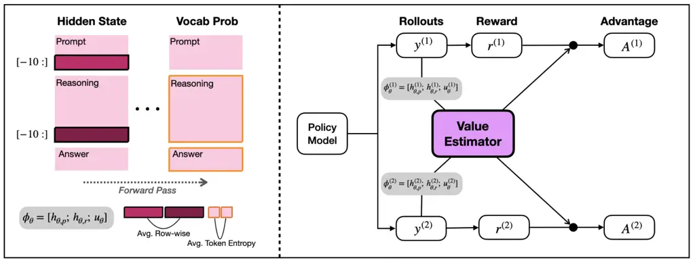

# Your Language Model is Its Own Critic: Reinforcement Learning with Value Estimation from Actor’s Internal States

Yunho ChoiGraduate School of Data ScienceSeoul National University
Email: [dbsgh7177@snu.ac.kr](mailto:)    Jongwon LimGraduate School of
Data ScienceSeoul National University
Email: [elijah0430@snu.ac.kr](mailto:)    Woojin AhnComputer Science and
EngineeringSeoul National University Email: [awj1204@snu.ac.kr](mailto:)
   Minjae OhGraduate School of Data ScienceSeoul National University
Email: [kosair@snu.ac.kr](mailto:)    Jeonghoon ShimGraduate School of
Data ScienceSeoul National University
Email: [jhshim98@snu.ac.kr](mailto:)    Yohan JoGraduate School of Data
ScienceSeoul National University Email: [yohan.jo@snu.ac.kr](mailto:)

###### Abstract

Reinforcement learning with verifiable rewards (RLVR) for Large
Reasoning Models rests on variance reduction, which requires both a
reliable baseline and high prompt diversity within each training batch.
This is especially difficult in multi-domain training for general
reasoning models, where prompts from different tasks induce highly
diverse gradient signals. Existing approaches fall short in different
ways: GRPO estimates its baseline as the group mean over rollouts from
the same prompt, so an accurate baseline leaves fewer distinct prompts
in the batch, while PPO avoids this trade-off by training a policy scale
critic, roughly doubling the cost of training. We introduce POISE
(Policy Optimization with Internal State Value Estimation), a
reinforcement learning algorithm that turns the model’s internal states
into a value model. A lightweight probe reads the signals already
computed during the forward pass to predict the baseline, and is trained
online alongside the policy. To preserve gradient unbiasedness, we
introduce a cross-rollout construction that predicts each rollout’s
value from an independent rollout’s internal states. On Qwen3-4B and
OLMo3-7B-Instruct-DPO across a six-domain verifiable-reward corpus,
POISE outperforms other RLVR baselines while achieving more stable
training. Moreover, the probe matches a separate LLM-scale value model,
generalizes to various tasks, and remains accurate as the policy scales.
By leveraging the model’s internal representations, POISE enables stable
policy optimization. ¹¹ 1 Code:
[https://github.com/holi-lab/poise](https://github.com/holi-lab/poise)

¹¹footnotetext: Equal contribution.²²footnotetext: Corresponding author.

## 1 Introduction

Reinforcement learning with verifiable rewards (RLVR) has become a key
driver of progress in large language model (LLM) reasoning (Guo et al.,
2025; Lambert et al., 2025), extending from basic mathematical tasks to
recent multi-domain post-training pipelines (Olmo et al., 2026; Yang et
al., 2025; Lambert et al., 2025; Cheng et al., 2025). However, RL
training is notoriously unstable, and this instability becomes more
pronounced in multi-task settings (Teh et al., 2017). Thus, enabling
stable RL across multiple domains has become increasingly important.

One common way modern RL algorithms address this instability is through
advantage estimation: rather than using the sampled reward directly,
they subtract a baseline to obtain a relative measure of performance and
thus reducing the gradient variance. Obtaining a reliable baseline,
however, is nontrivial. GRPO and its variants, among the most widely
used RLVR algorithms, estimate the baseline by averaging rewards over
multiple rollouts from the same prompt (Shao et al., 2024; Yu et al.,
2025). Accurate baseline estimation requires a large group size, but
under a fixed rollout budget, this leaves fewer distinct prompts in each
training batch. Thus, improving baseline accuracy comes at the cost of
prompt diversity, another key determinant of training stability. We
demonstrate this trade-off both theoretically, by decomposing policy
gradient covariance into within-prompt and between-prompt components
(§ 2.2), and empirically (Figure 2). Taken together, these results
reveal a fundamental flaw in GRPO: the same mechanism that improves
baseline estimation reduces prompt diversity, potentially increasing
training instability.

Alternative approaches that avoid group sampling exist, but each brings
limitations of its own. PPO (Schulman et al., 2017) learns the baseline
with a critic, but the critic is a LLM-scale model that processes every
generated sequence, roughly doubling memory consumption and optimization
cost. A second line instead relies on knowing how informative each
prompt is from previous rollout outcomes (Zheng et al., 2025; Xu and
Ding, 2025), and estimating it for every prompt and every model to be
trained is prohibitively expensive when the training corpus is large.
This raises the central question of our work: can we obtain a reliable
baseline for any domain, using only minimal rollouts and no separate
value model?

Our answer starts from a simple observation: the signal such a baseline
needs may already be inside the policy model. A growing body of work
shows that the hidden states of LLMs and LRMs encode outcome-relevant
information, including how difficult the model perceives a problem to
be (Zhang et al., 2025), whether it falls within the model’s
capabilities (Zhu et al., 2025), and whether an answer is
correct (Cencerrado et al., 2026). However, their use as a core
component of the training algorithm itself remains underexplored. In
this paper, we propose POISE (Policy Optimization with Internal State
Value Estimation), a reinforcement learning algorithm that turns the
policy model’s internal states into a value model. A lightweight probe
reads the policy’s hidden states from before and after generation along
with the uncertainty of the tokens it produced, and predicts the
expected reward on that prompt, which serves as the baseline.
Additionally, because a baseline read from a response would bias the
gradient for that same response (Williams, 1992; Tucker et al., 2018),
we adopt a cross-rollout construction, sampling two independent rollouts
per prompt and using each rollout’s baseline predicted from the other.

In a six-domain verifiable-reward training corpus (Cheng et al., 2025),
POISE outperforms DAPO, a state-of-the-art RLVR algorithm, while
achieving lower gradient variance (Figure 4) and maintaining stable
value estimation throughout training (Figure 5). Thorough ablations on
both value estimation and downstream policy optimization trace these
gains to each of our design choices. A critic must scale with the policy
while the probe does not, so our approach becomes more valuable as
models get larger, precisely where RLVR is most expensive (Table 10). By
bringing internal states into policy optimization itself, POISE attains
a reliable baseline with high prompt diversity, enabling stable
training.

## 2 Background

### 2.1 Preliminaries

#### Policy gradient and baseline estimation.

We formulate RLVR for LLM reasoning as a contextual bandit problem over
prompt–response pairs (Wang et al., 2026c). Given a prompt
$`x\sim\mathcal{D}`$ and a response $`y\sim\pi_{\theta}(\cdot\mid x)`$
sampled from the policy model, the objective is to maximize the expected
verifiable reward $`R(x,y)`$,

```math
J(\theta)=\mathbb{E}_{x\sim\mathcal{D},\,y\sim\pi_{\theta}(\cdot\mid x)}\left[R(x,y)\right]. \tag{1}
```

By the policy gradient theorem,

```math
\nabla_{\theta}J(\theta)=\mathbb{E}_{x\sim\mathcal{D},\,y\sim\pi_{\theta}(\cdot\mid x)}\left[R(x,y)\,\nabla_{\theta}\log\pi_{\theta}(y\mid x)\right], \tag{2}
```

which yields the REINFORCE estimator (Williams, 1992). In practice, this
estimator is typically combined with a baseline $`b(x)`$ to reduce
variance (Sutton et al., 2000), giving the advantage
$`A(x,y)=R(x,y)-b(x)`$ and the gradient estimator

```math
\nabla_{\theta}J(\theta)=\mathbb{E}_{x\sim\mathcal{D},\,y\sim\pi_{\theta}(\cdot\mid x)}\left[\left(R(x,y)-b(x)\right)\nabla_{\theta}\log\pi_{\theta}(y\mid x)\right]. \tag{3}
```

The standard near-optimal choice for variance reduction is the value
function (Weaver and Tao, 2001; Greensmith et al., 2004)

```math
V^{\pi_{\theta}}(x)=\mathbb{E}_{y\sim\pi_{\theta}(\cdot\mid x)}\left[R(x,y)\right], \tag{4}
```

which is unknown and must be estimated in practice. PPO approximates
$`V^{\pi_{\theta}}(x)`$ with a learned critic $`v_{\phi}`$ that is
trained jointly with the policy. GRPO instead samples a group of $`G`$
responses $`\{y^{(1)},\ldots,y^{(G)}\}`$ for the same prompt and uses
their mean reward as an empirical prompt-level baseline,
$`b_{\mathrm{GRPO}}(x)=\frac{1}{G}\sum_{j=1}^{G}R(x,y^{(j)}),`$
obtaining it directly from on-policy rollouts.

#### Unbiasedness condition for baselines.

Subtracting a baseline preserves the unbiasedness of the policy gradient
only when the baseline term has zero expectation:

```math
\mathbb{E}_{y\sim\pi_{\theta}(\cdot\mid x)}\left[b(x)\,\nabla_{\theta}\log\pi_{\theta}(y\mid x)\right]=0. \tag{5}
```

This condition holds when the baseline is conditionally independent of
the sampled response $`y`$ given the prompt $`x`$, in which case

```math
\mathbb{E}_{y\sim\pi_{\theta}(\cdot\mid x)}\left[b(x)\,\nabla_{\theta}\log\pi_{\theta}(y\mid x)\right]=b(x)\,\nabla_{\theta}\sum_{y}\pi_{\theta}(y\mid x)=0. \tag{6}
```

Equivalently, a baseline may depend only on the prompt or on any
quantity that is independent of the sampled response given the prompt.
Violating this condition biases the gradient and can drive the policy to
converge suboptimally. We therefore adopt a _cross-rollout_ construction
(§3.2), where the baseline for a response is computed from another
independent response, preserving Eq. 5.

### 2.2 Motivation: Gradient Variance and Number of Prompts in the Batch

In this section, we show theoretically and empirically that, under a
fixed rollout budget, using more rollouts per prompt reduces prompt
diversity and increases policy-gradient variance. This trade-off
naturally motivates a reliable baseline estimator that requires minimal
per-prompt sampling.

#### Theoretical analysis.

Let $`B`$ be the total number of completions in a training batch, with
$`n`$ distinct prompts and $`m`$ completions each, so $`B=n\cdot m`$.
For prompt $`x^{(i)}\sim D`$ and completion
$`y^{(ij)}\sim\pi_{\theta}(\cdot\mid x^{(i)})`$, define the per-sample
gradient:

```math
Z(x,y)=\nabla_{\theta}\log\pi_{\theta}(y\mid x)\bigl(R(x,y)-b(x)\bigr) \tag{7}
```

where $`b(x)`$ is a baseline. The batch gradient estimator is:

```math
\hat{g}=\frac{1}{n}\sum_{i=1}^{n}\frac{1}{m}\sum_{j=1}^{m}Z(x^{(i)},y^{(ij)}). \tag{8}
```

###### Proposition 0 (Gradient variance decomposition).

Let $`\Sigma_{w}`$ and $`\Sigma_{b}`$ denote the within-prompt and
between-prompt covariance matrices of $`Z`$. Both $`\Sigma_{w}`$ and
$`\Sigma_{b}`$ are fixed properties of $`(D,\pi_{\theta},R)`$,
independent of the allocation $`(n,m)`$. Then:

```math
\operatorname{Cov}(\hat{g})=\frac{1}{B}\Sigma_{w}+\frac{m}{B}\Sigma_{b}. \tag{9}
```

###### Proof.

See § B.1. ∎

###### Corollary 0 (Optimal allocation).

For a fixed budget $`B`$ and baseline $`b(x)`$, the variance of
$`\hat{g}`$ is monotonically non-decreasing in $`m`$ (in the Loewner
order) and is minimized at $`m=1`$, $`n=B`$.

###### Proof.

See § B.2. ∎

#### Empirical validation.

We next test whether the allocation effect predicted by Proposition 2.1
arises in practice. At each policy checkpoint, we fix the rollout budget
$`B`$ and compare $`m=1`$ (one rollout from each of $`B`$ prompts) with
$`m=8`$ (eight rollouts from each of $`B/8`$ prompts). Thus, the total
number of rollouts remains fixed while prompt diversity changes. Both
conditions use fixed prompt-specific baselines computed from eight
separate precomputed rollouts, controlling for baseline quality. We run
this comparison using OLMo-3-7B-Think-DPO on math-only and multi-domain
subsets of Dolci-Think-RL-7B dataset. As shown in Figure 2, $`m=8`$
consistently yields higher gradient variance, with a larger gap in the
multi-domain setting. Further details are provided in Appendix C.

In other words, given the same total budget, using as many diverse
prompts as possible is critical to stable learning. Yet GRPO requires
repeated sampling from the same prompt to estimate a faithful baseline
$`b(x)`$, This motivates our method of estimating a reliable baseline
with minimal sampling without training a separate value network as in
PPO.

We provide an extended discussion of related work on value estimation in
RL, outcome-relevant internal representations and multi-domain RL
training in § A.

Figure 1: Estimated policy-gradient variance under a fixed total rollout
budget. The $`m=1`$ condition allocates one rollout to each of $`B`$
distinct prompts, whereas the $`m=8`$ condition allocates eight rollouts
to each of $`B/8`$ prompts.

Figure 2: Value prediction between our probe and a separately trained
critic. Predictions are compared against empirical Avg@8 scores. Our
probe achieves higher Pearson correlation ($`r`$) and lower MAE,
indicating that the policy’s own internal representations provide an
effective low-cost signal for value estimation.

## 3 Policy Optimization with Internal State Value Estimation (POISE)

We now introduce POISE, which leverages the policy model’s internal
state signals for value estimation in RLVR. We first show that a
lightweight probe can predict the value function, i.e., the expected
verifier reward, directly from the policy model’s internal states
(§ 3.1). We then integrate this probe into policy optimization to
compute per-rollout advantages, yielding the full POISE algorithm
without requiring a separate LLM-scale value model (§. 3.2).

### 3.1 Value Function Estimation from Policy Model Internal States

We introduce a probe designed to estimate baseline values directly from
the policy model’s internal representations. Since the viability of this
method hinges on the presence of such information, we additionally
present preliminary empirical results demonstrating that these internal
states inherently encode the necessary signals for accurate value
estimation.

#### Probe prediction objective.

The probe is trained to predict the prompt-level value under the current
policy, defined as the expected verifier reward:

```math
V^{\pi_{\theta}}(x)=\mathbb{E}_{y\sim\pi_{\theta}(\cdot|x)}[R(x,y)].
```

Since the ground-truth quantity is unknown, we instead sample $`K`$
rollouts for each prompt $`x`$,
$`y^{(1)},\ldots,y^{(K)}\sim\pi_{\theta}(\cdot|x)`$, and collect their
verifier rewards $`r^{(i)}=R(x,y^{(i)})\in\{0,1\}`$. For the supervised
example associated with rollout $`y^{(i)}`$, we use the leave-one-out
Monte Carlo target as its gold value:

```math
\widehat{V}_{-i}(x)=\frac{1}{K-1}\sum_{j\neq i}r^{(j)}.
```

By excluding $`r^{(i)}`$, $`\widehat{V}_{-i}(x)`$ remains conditionally
independent of the input rollout $`y^{(i)}`$ given $`x`$, while still
estimating $`V^{\pi_{\theta}}(x)`$ in expectation. This prevents the
target from leaking the reward of the same rollout whose features are
used by the probe.

#### Probe input features.

As shown in Figure 3 (left), each supervised example for our probe is
indexed by a prompt and one rollout, $`(x,y^{(i)})`$. For each pair, we
construct the probe input from three complementary signals produced
during the forward pass of the current policy $`\pi_{\theta}`$. (All
hidden-state features are extracted from a fixed layer $`\ell`$, which
we omit below for readability.) Let $`H_{\theta,t}^{(i)}`$ denote the
residual-stream hidden state at token position $`t`$ for
$`(x,y^{(i)})`$, and let $`P`$ and $`R^{(i)}`$ denote the final $`n`$
prompt-token and reasoning-token positions, respectively.

First, we use the prompt-state feature
$`h_{\theta,p}^{(i)}=\mathrm{Avg}_{t\in P}H_{\theta,t}^{(i)}`$,
motivated by evidence that prompt hidden states encode pre-generation
estimates of difficulty and capability boundaries (Zhu et al., 2025).
Second, we use the reasoning-state feature
$`h_{\theta,r}^{(i)}=\mathrm{Avg}_{t\in R^{(i)}}H_{\theta,t}^{(i)}`$,
since trajectory-level hidden states can expose value-relevant
information not available from the prompt states alone (Zhang et al.,
2025). Third, we use token-level entropy statistics $`u_{\theta}^{(i)}`$
as lightweight uncertainty features (Wang et al., 2026b): the mean
predictive entropy over the vocabulary, averaged separately over all
generated tokens, reasoning tokens, and answer tokens. The final probe
input is

```math
\phi_{\theta}^{(i)}=[h_{\theta,p}^{(i)};\,h_{\theta,r}^{(i)};\,u_{\theta}^{(i)}].
```

We ablate these input components in § 5 and the hidden-state extraction
hyperparameters in § H.3. It is important to clarify that, while the
input features include the generated reasoning, the estimator learns to
predict the prompt-based value, rather than verifying its own reasoning,
because the prediction target during training is the expected reward
derived from other responses.

#### Probe implementation.

We train lightweight regressors $`g_{f}`$ to minimize the following
loss.

```math
\mathcal{L}_{\mathrm{value}}(f)=\mathbb{E}_{x,i}\left[\left(g_{f}(\phi^{(i)}_{\theta})-\widehat{V}_{-i}(x)\right)^{2}\right].
```

Although our framework can theoretically support any regression
architecture, we implement the probe using linear regression because its
computational efficiency allows for fast, lightweight updates at each
training step. This lightweight design also enables domain-specific
baseline estimation by training separate probes for different domain
groups, without additional policy-model computation. We provide an
ablation of probe designs in § H.4, and provide detailed implementations
and hyperparameters in § D.3.

#### Preliminary experiment.

Before using the probe for policy optimization, we first test whether
the policy model’s internal states contain enough information to
reliably estimate the prompt-level value across domains and model
scales. We use reward-labeled rollouts from DAPO-Math (Yu et al., 2025),
DeepScaleR (Luo et al., 2025), AceCoder (Zeng et al., 2025b),
ToolDial (Shim et al., 2025), and IF-RLVR (Pyatkin et al., 2025),
spanning mathematical reasoning, coding, tool calling, and instruction
following. We evaluate four policy backbones—Qwen3-4B,
DeepSeek-R1-Distill-Qwen-1.5B, DeepSeek-R1-Distill-Qwen-7B, and
GPT-OSS-120B—and, for each model–dataset pair, compare our probe with a
separately trained policy-model-scale critic (Wang et al., 2026c). Both
estimators are trained on the same rollout data and evaluated against
empirical Avg@8 values on held-out prompts.

We find that our probe is competitive with and often more accurate than
the critic across models and domains, despite requiring only a
lightweight readout over signals already produced by the actor. Figure 2
shows a representative result on Qwen3-4B with DAPO-Math, with full
results in Appendix G.1. Unlike the sequence-level critic used in this
comparison, the probe also observes trajectory-level states and
token-level uncertainty, giving it access to richer signals about the
current policy. We additionally compare POISE with PPO using a
token-level critic conditioned on generated prefixes and GAE in
end-to-end policy optimization (Appendix G.2). However, these
response-dependent features cannot be used naively as a baseline without
biasing the policy gradient. We next introduce a cross-rollout
construction that retains their predictive benefit while preserving
unbiasedness.



Figure 3: Overview of POISE. Left: Probe features $`\phi(x,y,\pi)`$
combine hidden states with token entropy. Right: The value estimator
predicts each rollout’s baseline from the other rollout’s features.

### 3.2 Policy Optimization with Cross-Rollout Baselines

We now integrate the internal state probe into RL training as a value
estimator, forming the full POISE algorithm (Figure 3 right).

#### Two rollouts per prompt.

For each prompt $`x\sim\mathcal{D}`$ in the training batch we sample two
independent rollouts from the current policy,

```math
y^{(1)},\,y^{(2)}\;\overset{\mathrm{i.i.d.}}{\sim}\;\pi_{\theta_{\mathrm{old}}}(\cdot\mid x), \tag{10}
```

and evaluate their verifiable rewards $`R(x,y^{(1)})`$ and
$`R(x,y^{(2)})`$.

#### Cross-rollout baseline and advantage.

The baseline for each rollout is predicted from the internal signals of
the _other_ rollout:

```math
b^{(1)}(x)\;=\;g_{f}\bigl(\phi^{(2)}),\qquad b^{(2)}(x)\;=\;g_{f}\bigl(\phi^{(1)}), \tag{11}
```

This yields the cross-rollout advantages

```math
A^{(i)}(x)\;=\;R(x,y^{(i)})-b^{(i)}(x),\qquad i\in\{1,2\}. \tag{12}
```

By construction, the baseline used to update $`y^{(i)}`$ depends only on
the independently sampled rollout $`y^{(j)}`$, $`j\neq i`$, satisfying
the conditional-independence condition in Eq. 5.

#### PPO-style policy update.

We optimize the policy with a PPO-style clipped surrogate objective. Let
$`r_{t}^{(i)}(\theta)=\pi_{\theta}(y_{t}^{(i)}\mid x,y_{<t}^{(i)})/\pi_{\theta_{\mathrm{old}}}(y_{t}^{(i)}\mid x,y_{<t}^{(i)})`$
be the importance ratio at token $`t`$ of rollout $`i`$. The objective
is

```math
\displaystyle\mathcal{L}(\theta)=\mathbb{E}_{x\sim D,\;y^{(1)},y^{(2)}\sim\pi_{\theta_{\mathrm{old}}}(\cdot\mid x)}\Bigg[\frac{1}{2}\sum_{i=1}^{2}\frac{1}{|y^{(i)}|}\sum_{t=1}^{|y^{(i)}|}\min\Bigl\{ \displaystyle r_{t}^{(i)}(\theta)A^{(i)}(x), \tag{13}
```

```math
\displaystyle\mathrm{clip}\!\left(r_{t}^{(i)}(\theta),1-\epsilon,1+\epsilon\right)A^{(i)}(x)\Bigr\}\Bigg].
```

which we maximize with respect to $`\theta`$.

#### Online estimator training with a trajectory buffer.

The value estimator $`g_{f}`$ is trained jointly with the policy on a
sliding buffer of recent trajectories. At each step, for each prompt
$`x`$ with two independent rollouts $`(y^{(1)},y^{(2)})`$, we construct
value-estimator examples
$`\{(x,\phi(x,y^{(i)}),\widehat{V}_{-i}(x))\}_{i=1,2}`$, where
$`\widehat{V}_{-i}(x)=R(x,y^{(j)})`$, $`j\neq i`$. To prevent leakage
through the buffer, the current baselines are computed with $`g_{f}`$
before it is updated on the current batch. We then update $`f`$ by
minimizing a regression loss over the new examples and a buffer from
recent steps. The buffer stabilizes the training signal under policy
drift, while the joint update keeps $`g_{f}`$ aligned with the evolving
policy. Because $`g_{f}`$ is a lightweight probe over signals already
computed during the forward pass, this update incurs negligible cost.
The full procedure is summarized in Algorithm 1.

## 4 Experiments

### 4.1 Experimental Setup

#### Training.

We instantiate our method on Qwen3-4B (Yang et al., 2025) and
OLMo-3-7B-Instruct-DPO (Olmo et al., 2026), and train on GURU (Cheng et
al., 2025), a curated corpus of 92K verifiable prompts spanning six
reasoning domains: math, code, science, logic, simulation, and tabular
reasoning. Each domain is paired with its own programmatic verifier
assigning a binary correctness reward. Rollouts are sampled with
temperature 1.0 and top-$`p`$ 1.0, and all methods are given an equal
compute budget. For more details, refer to (§ D.3).

We compare against two critic-free baselines, which obtain their
baseline from the group of rollouts. Throughout, $`m`$ denotes the
number of rollouts sampled per prompt. RLOO (Ahmadian et al., 2024) with
$`m=2`$ uses the same rollout allocation as POISE but replaces our
predicted value with the paired rollout’s reward, isolating the effect
of value estimation. DAPO (Yu et al., 2025), a state-of-the-art
GRPO-based RLVR algorithm, serves as our main competitive baseline; we
run it with $`m=8`$ and adopt the implementation of Zheng et al. (2025),
which performs DAPO’s dynamic sampling more efficiently. Training
details and full hyperparameters are provided in § D.4.

#### Evaluation.

We follow the evaluation suite of GURU (Cheng et al., 2025), covering
all six training domains as well as held-out task types. For math we use
MATH500 (Hendrycks et al., 2021) and AIME 2025 (Mathematical Association
of America, 2024); for code, HumanEval (Chen et al., 2021a),
MBPP (Austin et al., 2021), and LiveCodeBench (Jain et al., 2025); for
logic, Zebra Puzzle (Lin et al., 2025a) and ARC-AGI-1 (Chollet, 2019);
for simulation, CodeI/O (Li et al., 2025) and CRUXEval (Gu et al.,
2024); for science, GPQA Diamond (Rein et al., 2024) and SuperGPQA (Du
et al., 2025); and for tabular reasoning, HiTab (Cheng et al., 2022),
MultiHiertt (Zhao et al., 2022), and FinQA (Chen et al., 2021b). We
additionally report LiveBench (White et al., 2025) and IFeval (Zhou et
al., 2023) to assess for task types not represented in training.

For each method we select a checkpoint using the validation split
released with the training corpus. All evaluations decode with
temperature 0.6 and top-$`p`$ 0.95. The full evaluation protocol are
provided in § D.5.

### 4.2 Main Results

Table 1 reports benchmark-level performance. POISE achieves the best
overall average on both backbones, improving over DAPO by 1.35 points on
Qwen3-4B (58.10 vs. 56.75) and 1.96 points on OLMo-3-7B-Instruct-DPO
(49.92 vs. 47.96). The comparison with RLOO, which uses the same
allocation of $`m=2`$ but replaces our predicted baseline with the
paired rollout’s reward, isolates the contribution of value estimation:
POISE leads it by 1.68 and 1.60 points, a margin comparable to its lead
over DAPO. Notably, RLOO with $`m=2`$ is itself competitive with DAPO at
$`m=8`$, even surpassing it on OLMo-3-7B-Instruct-DPO. This is
consistent with the allocation effect in §2.2: under a fixed rollout
budget, prompt diversity can offset a substantial loss in baseline
quality, especially in the multi-domain setting. POISE keeps that
diversity while restoring a reliable baseline. The improvements are
spread across the suite rather than driven by a single benchmark: POISE
scores highest among the trained methods on 11 of 17 benchmarks for both
backbones, and attains the best domain average on four of the six
training domains for Qwen3-4B and on all six for OLMo-3-7B-Instruct-DPO.

|                       |               |          |              |              |               |                        |              |              |               |
| --------------------- | ------------- | -------- | ------------ | ------------ | ------------- | ---------------------- | ------------ | ------------ | ------------- |
|                       |               | Qwen3-4B |              |              |               | OLMo-3-7B-Instruct-DPO |              |              |               |
| Domain                | Benchmark     | Base     | RLOO $`m=2`$ | DAPO $`m=8`$ | POISE $`m=2`$ | Base                   | RLOO $`m=2`$ | DAPO $`m=8`$ | POISE $`m=2`$ |
| Code                  | HumanEval     | 87.20    | 93.90        | 95.73        | 94.51         | 15.24                  | 87.80        | 89.63        | 91.46         |
|                       | LiveCodeBench | 22.58    | 30.82        | 24.73        | 35.13         | 6.81                   | 32.62        | 25.81        | 30.82         |
|                       | MBPP          | 80.20    | 83.40        | 85.00        | 85.60         | 53.00                  | 67.20        | 68.80        | 69.60         |
| Logic                 | ARC-AGI-1     | 2.25     | 3.50         | 3.50         | 3.50          | 1.00                   | 2.25         | 1.75         | 2.25          |
|                       | Zebra Puzzle  | 12.02    | 42.39        | 43.77        | 41.05         | 18.06                  | 24.37        | 28.53        | 31.90         |
| Math                  | AIME(avg@32)  | 18.30    | 38.44        | 44.90        | 43.44         | 18.33                  | 33.54        | 33.85        | 35.83         |
|                       | MATH500       | 82.40    | 90.80        | 92.80        | 92.00         | 78.20                  | 88.80        | 91.40        | 92.20         |
| Simulation            | CodeIO        | 11.00    | 13.50        | 15.50        | 17.50         | 10.50                  | 19.00        | 16.00        | 20.00         |
|                       | CRUXEval-I    | 87.00    | 86.12        | 88.00        | 88.75         | 80.12                  | 75.75        | 70.38        | 75.00         |
|                       | CRUXEval-O    | 87.13    | 87.12        | 80.88        | 87.62         | 49.12                  | 79.75        | 79.62        | 80.88         |
| Science               | GPQA Diamond  | 42.93    | 54.04        | 54.55        | 56.06         | 40.40                  | 44.44        | 42.42        | 47.98         |
|                       | SuperGPQA     | 36.50    | 41.10        | 43.40        | 44.30         | 26.30                  | 30.80        | 30.30        | 31.40         |
| Tabular Reasoning     | FinQA         | 46.05    | 44.78        | 44.50        | 45.78         | 28.61                  | 34.97        | 34.79        | 38.96         |
|                       | HiTab         | 65.00    | 72.10        | 71.50        | 73.40         | 36.10                  | 56.50        | 57.60        | 58.00         |
|                       | MultiHiertt   | 49.40    | 50.60        | 51.49        | 52.08         | 20.83                  | 32.44        | 28.87        | 31.55         |
| LiveBench             | LiveBench     | 39.59    | 45.78        | 45.20        | 45.35         | 30.18                  | 34.95        | 36.59        | 33.54         |
| Instruction Following | IFEval        | 83.18    | 80.78        | 79.30        | 81.70         | 78.56                  | 76.34        | 78.93        | 77.26         |
| Average               |               | 50.16    | 56.42        | 56.75        | 58.10         | 34.79                  | 48.32        | 47.96        | 49.92         |

Table 1: Benchmark-level performance on Qwen3-4B and
OLMo-3-7B-Instruct-DPO. The best and second-best scores within each
model are bolded and underlined, respectively.

#### Additional experiments on instruction following.

Our training corpus contains no training data for instruction following,
so none of the methods is trained on this domain in our main
experiments. For completeness, we additionally train each method on the
IF-RLVR training split released with IFBench (Pyatkin et al., 2025) and
evaluate on the IFBench test set and IFEval (Zhou et al., 2023). POISE
achieves the best performance on both benchmarks across the two
backbones, indicating that its advantage carries over to instruction
following when in-domain data are available. Full results are provided
in Appendix E.

Figure 4: Adam-moment variance proxy during training (Qwen3-4B). The
proxy is estimated from the optimizer’s bias-corrected moments as
$`\mathrm{Var}(g)\approx\hat{v}_{t}-\hat{m}_{t}^{2}`$ and summed across
parameters.

Figure 5: Accuracy of the value estimator over training steps on
Qwen3-4B. Estimator predictions are compared against an oracle computed
from 8 rollouts per prompt; we report MAE (left axis) and Pearson
correlation (right axis).

#### Training stability.

We track a proxy for policy-gradient variance during training, estimated
from the Adam optimizer state following Takashiro et al. (2026). This is
not the exact gradient variance, but it is practical at LLM scale and
computed identically for all methods. Since DAPO divides its advantages
by the group standard deviation by design, its values come out larger
purely from this scale difference. For a fair comparison we multiply
them back by the squared group standard deviation, estimated from the
logged batch reward statistics.

Figure 4 shows the result. POISE maintains lower gradient variance than
RLOO throughout training, indicating that predicting the baseline from
internal states reduces variance beyond what the paired rollout’s reward
achieves at the same allocation. DAPO remains higher than both even
after rescaling, and drifts upward as training proceeds. This suggests
that insufficient prompt diversity may make training progressively less
stable as the policy moves further from its initialization in a
multi-domain setting.

#### Value estimator performance over training.

We also track how the estimator itself holds up as the policy changes.
Every 40 steps we sample eight rollouts per prompt on the validation set
to obtain an oracle baseline, and compare the estimator’s predictions
against it. Figure 5 shows that both MAE and Pearson correlation remain
stable throughout training, with no degradation as the policy improves.
Since the value function is nonstationary during RL, this stability
indicates that the online update keeps the estimator aligned with the
evolving policy rather than with its initialization.

## 5 Analysis

We analyze the estimator through controlled ablations and compare POISE
with critic-based PPO in end-to-end RL. The ablations use Qwen3-4B in a
controlled mathematical-reasoning setting based on DAPO-Math-17K
training set (Yu et al., 2025). The RL comparison also includes the main
multi-domain experiments on both policy backbones.

|                              |                    |                    |
| ---------------------------- | ------------------ | ------------------ |
| Input feature                | MAE $`\downarrow`$ | $`r`$ $`\uparrow`$ |
| Prompt hidden states only    | 0.234              | 0.569              |
| Reasoning hidden states only | 0.132              | 0.821              |
| Mean entropy only            | 0.152              | 0.780              |
| Response length only         | 0.251              | 0.494              |
| Full estimator               | 0.126              | 0.838              |

Table 2: Ablation of estimator input features on Qwen3-4B. We report MAE
and Pearson correlation ($`r`$) against empirical Avg@8 values.

|                                     |          |        |
| ----------------------------------- | -------- | ------ |
| Method                              | Rollouts | Avg@32 |
| base model                          | –        | 25.8   |
| POISE (no trajectory-level feature) | 1        | 47.5   |
| POISE (no cross-rollout)            | 1        | 40.7   |
| PPO (Token-level critic)            | 1        | 49.3   |
| POISE (Ours)                        | 2        | 50.1   |

Table 3: End-to-end ablations and comparison with a policy-model-scale
critic on Qwen3-4B. We report Avg@32 over seven mathematical-reasoning
benchmarks.

#### Ablations.

We begin by evaluating the estimator itself, holding the policy and data
fixed while varying its input features, hidden-state extraction
settings, and probe architecture. As shown in Table 2, all of our three
internal signals (prompt hidden states, reasoning hidden states, and
mean token entropy) contain value-relevant information. However,
combining all three features gives the best overall performance,
suggesting that the features capture complementary aspects of prompt
difficulty and policy uncertainty. Response length, by contrast, is
substantially less predictive, indicating that the estimator does not
simply rely on a superficial length signals. We further vary the
extraction layer and pooling window, and compare the linear probe with
several MLP architectures. The estimator performs well across a broad
range of layers and is relatively insensitive to the pooling window. The
linear probe also matches or surpasses the MLP probes in Pearson
correlation, despite being substantially cheaper. Detailed results are
reported in Appendices H.3 and H.4.

We next test whether these design choices actually improve online policy
optimization (Table 3). We first compare full POISE with a prompt-only
estimator using a single rollout. Although this comparison does not
isolate the effect of trajectory-level features, the prompt-only variant
benefits from twice as many distinct prompts under the same rollout
budget. Full POISE nevertheless performs better, supporting the
practical benefit of the two-rollout design despite its lower prompt
diversity. We then remove the cross-rollout construction while retaining
the full feature set. The resulting same-rollout variant performs
substantially worse, confirming that cross-rollout estimation is
necessary when using trajectory-dependent features.

#### End-to-end RL comparison to a policy-model-scale critic.

We compare POISE with PPO equipped with a separate policy-model-scale
critic. The critic predicts token-level values, is trained jointly with
the policy, and forms advantages using generalized advantage estimation.
In the controlled mathematical-reasoning setting, Table 3 shows that
POISE achieves a higher downstream score than critic-based PPO.

We extend this comparison to the main multi-domain setting on Qwen3-4B
and OLMo-3-7B-Instruct-DPO. POISE achieves a higher overall benchmark
average on both models (Table 11). This result shows that the actor’s
own representations can provide an effective value signal without
training an additional policy-scale model. Because critic cost grows
with the actor while POISE adds only a lightweight readout, this
advantage becomes particularly relevant at larger scales. The full PPO
setup and domain-level results are reported in Appendix G.2. We further
show that value remains decodable across diverse domains and models,
including GPT-OSS-120B, in Appendix G.1.

## 6 Conclusion

We introduce POISE (Policy Optimization with Internal State Value
Estimation), which predicts rollout value from the policy’s internal
states instead of relying on a group-mean baseline or a separate critic.
To preserve unbiasedness, we couple this baseline with a cross-rollout
construction. In multi-domain RL training over a six-domain
verifiable-reward corpus, our method consistently outperforms existing
RLVR baselines while keeping optimization stable. We further show that
the value estimator closely tracks the evolving policy throughout
training, generalizes across diverse task types, and scales robustly to
substantially larger models.

## 7 Limitations and Future Work

Our experiments are conducted under a fixed compute budget, and while
the trends we report are consistent across backbones and benchmarks,
characterizing the behavior of internal state value estimation under
substantially longer training horizons remains an interesting direction
that we leave to future work with greater compute resources.

Several extensions naturally follow from our framework. First, our
current estimator predicts value at the sequence level; extending it to
token-level credit assignment would yield finer-grained advantages that
more precisely reward the tokens responsible for a successful trajectory
and penalize those that derail it, an effect known to be especially
impactful for long reasoning trajectories (Lin et al., 2025b; Wang et
al., 2026b). Second, internal state value estimates may also be useful
beyond policy gradient optimization: for preference learning algorithms
such as Direct Preference Optimization (Rafailov et al., 2024), they
could inform the construction of response pairs by identifying rollouts
with meaningfully different predicted values, potentially yielding more
informative preference comparisons. Third, we trained our estimator on
verifiable rewards, but many non-verifiable tasks are instead scored by
rubrics or generative judges (Gunjal et al., 2025; Su et al., 2026).
Whether a baseline for such graded and noisier rewards can likewise be
predicted from internal states remains open. Finally, long-horizon and
agentic tasks make group sampling even harder to afford, since a single
rollout spans many turns (Hou et al., 2026). Reading value from the
internal states carried across those turns, and tracking how that value
shifts from one turn to the next, is a promising direction for obtaining
a baseline in this setting.

## References

- Ahmadian et al. (2024) A. Ahmadian, C. Cremer, M. Gallé, M. Fadaee, J.
  Kreutzer, O. Pietquin, A. Üstün, and S. Hooker Back to basics:
  revisiting REINFORCE-style optimization for learning from human
  feedback in LLMs. In Proceedings of the 62nd Annual Meeting of the
  Association for Computational Linguistics (Volume 1: Long Papers), L.
  Ku, A. Martins, and V. Srikumar (Eds.), Bangkok, Thailand,
  pp. 12248–12267. External Links:
  [Document](https://dx.doi.org/10.18653/v1/2024.acl-long.662),
  [Link](https://aclanthology.org/2024.acl-long.662/) Cited by: §4.1.
- Austin et al. (2021) J. Austin, A. Odena, M. Nye, M. Bosma, H.
  Michalewski, D. Dohan, E. Jiang, C. Cai, M. Terry, Q. Le, and C.
  Sutton Program synthesis with large language models. arXiv preprint
  arXiv:2108.07732. Cited by: §4.1.
- Azaria and Mitchell (2023) A. Azaria and T. Mitchell The internal
  state of an LLM knows when it’s lying. In Findings of the Association
  for Computational Linguistics: EMNLP 2023, H. Bouamor, J. Pino, and K.
  Bali (Eds.), Singapore, pp. 967–976. External Links:
  [Link](https://aclanthology.org/2023.findings-emnlp.68/),
  [Document](https://dx.doi.org/10.18653/v1/2023.findings-emnlp.68)
  Cited by: Appendix A.
- Burns et al. (2023) C. Burns, H. Ye, D. Klein, and J. Steinhardt
  Discovering latent knowledge in language models without supervision.
  In The Eleventh International Conference on Learning Representations,
  External Links: [Link](https://openreview.net/forum?id=ETKGuby0hcs)
  Cited by: Appendix A.
- Cai et al. (2026) M. Cai, Y. Liang, L. Wang, Y. Wang, Y. Zhang, L.
  Xia, Z. Sun, X. Ye, and D. Shi Advancing general-purpose reasoning
  models with modular gradient surgery. arXiv preprint arXiv:2602.02301.
  External Links: [Link](https://arxiv.org/abs/2602.02301) Cited by:
  Appendix A.
- Cencerrado et al. (2026) I. V. M. Cencerrado, A. P. Masdemont, A. G.
  Hawthorne, D. D. Africa, and L. Pacchiardi No answer needed:
  predicting LLM answer accuracy from question-only linear probes.
  External Links: [Link](https://openreview.net/forum?id=OhN25uxVab)
  Cited by: Appendix A, §1.
- Chen et al. (2021a) M. Chen, J. Tworek, H. Jun, Q. Yuan, H. P. d. O.
  Pinto, J. Kaplan, et al. Evaluating large language models trained on
  code. arXiv preprint arXiv:2107.03374. Cited by: §4.1.
- Chen et al. (2021b) Z. Chen, W. Chen, C. Smiley, S. Shah, I.
  Borova, D. Langdon, R. Moussa, M. Beane, T. Huang, B. Routledge,
  and W. Y. Wang FinQA: a dataset of numerical reasoning over financial
  data. In Proceedings of the 2021 Conference on Empirical Methods in
  Natural Language Processing, pp. 3697–3711. Cited by: §4.1.
- Chen et al. (2026) Z. Chen, J. Dong, Y. Tian, G. Yang, Y. Chen, Z.
  Chen, and J. Cheng Hista and numca: estimate state value effectively
  for large language model reinforcement learning. In Proceedings of the
  43rd International Conference on Machine Learning, Proceedings of
  Machine Learning Research, Vol. 306. Cited by: Appendix A.
- Cheng et al. (2022) Z. Cheng, H. Dong, Z. Wang, R. Jia, J. Guo, Y.
  Gao, S. Han, J. Lou, and D. Zhang HiTab: a hierarchical table dataset
  for question answering and natural language generation. In Proceedings
  of the 60th Annual Meeting of the Association for Computational
  Linguistics (Volume 1: Long Papers), Dublin, Ireland, pp. 1094–1110.
  External Links:
  [Document](https://dx.doi.org/10.18653/v1/2022.acl-long.78) Cited by:
  §4.1.
- Cheng et al. (2025) Z. Cheng, S. Hao, T. Liu, F. Zhou, Y. Xie, F. Yao,
  et al. Revisiting reinforcement learning for LLM reasoning from a
  cross-domain perspective. In Advances in Neural Information Processing
  Systems, Datasets and Benchmarks Track, Cited by: Appendix A, §D.4,
  §1, §1, §4.1, §4.1.
- Chollet (2019) F. Chollet On the measure of intelligence. arXiv
  preprint arXiv:1911.01547. Cited by: §4.1.
- Du et al. (2025) X. Du, Y. Yao, K. Ma, B. Wang, T. Zheng, K. Zhu, M.
  Liu, Y. Liang, X. Jin, Z. Wei, et al. SuperGPQA: scaling LLM
  evaluation across 285 graduate disciplines. arXiv preprint
  arXiv:2502.14739. Cited by: §4.1.
- Greensmith et al. (2004) E. Greensmith, P. L. Bartlett, and J. Baxter
  Variance reduction techniques for gradient estimates in reinforcement
  learning. Journal of Machine Learning Research 5, pp. 1471–1530. Cited
  by: §2.1.
- Gu et al. (2024) A. Gu, B. Rozière, H. Leather, A. Solar-Lezama, G.
  Synnaeve, and S. I. Wang CRUXEval: a benchmark for code reasoning,
  understanding and execution. In Proceedings of the 41st International
  Conference on Machine Learning, Proceedings of Machine Learning
  Research, Vol. 235, pp. 16568–16621. External Links:
  [Link](https://proceedings.mlr.press/v235/gu24c.html) Cited by: §4.1.
- Gunjal et al. (2025) A. Gunjal, A. Wang, E. Lau, V. Nath, Y. He, B.
  Liu, and S. Hendryx Rubrics as rewards: reinforcement learning beyond
  verifiable domains. arXiv preprint arXiv:2507.17746. External Links:
  [Link](https://arxiv.org/abs/2507.17746) Cited by: §7.
- Guo et al. (2025) D. Guo, D. Yang, H. Zhang, J. Song, P. Wang, Q.
  Zhu, R. Xu, R. Zhang, S. Ma, X. Bi, X. Zhang, X. Yu, Y. Wu, Z. F.
  Wu, Z. Gou, Z. Shao, Z. Li, Z. Gao, A. Liu, B. Xue, B. Wang, B. Wu, B.
  Feng, C. Lu, C. Zhao, C. Deng, C. Ruan, D. Dai, D. Chen, D. Ji, E.
  Li, F. Lin, F. Dai, F. Luo, G. Hao, G. Chen, G. Li, H. Zhang, H.
  Xu, H. Ding, H. Gao, H. Qu, H. Li, J. Guo, J. Li, J. Chen, J. Yuan, J.
  Tu, J. Qiu, J. Li, J. L. Cai, J. Ni, J. Liang, J. Chen, K. Dong, K.
  Hu, K. You, K. Gao, K. Guan, K. Huang, K. Yu, L. Wang, L. Zhang, L.
  Zhao, L. Wang, L. Zhang, L. Xu, L. Xia, M. Zhang, M. Zhang, M.
  Tang, M. Zhou, M. Li, M. Wang, M. Li, N. Tian, P. Huang, P. Zhang, Q.
  Wang, Q. Chen, Q. Du, R. Ge, R. Zhang, R. Pan, R. Wang, R. J.
  Chen, R. L. Jin, R. Chen, S. Lu, S. Zhou, S. Chen, S. Ye, S. Wang, S.
  Yu, S. Zhou, S. Pan, S. S. Li, S. Zhou, S. Wu, T. Yun, T. Pei, T.
  Sun, T. Wang, W. Zeng, W. Liu, W. Liang, W. Gao, W. Yu, W.
  Zhang, W. L. Xiao, W. An, X. Liu, X. Wang, X. Chen, X. Nie, X.
  Cheng, X. Liu, X. Xie, X. Liu, X. Yang, X. Li, X. Su, X. Lin, X. Q.
  Li, X. Jin, X. Shen, X. Chen, X. Sun, X. Wang, X. Song, X. Zhou, X.
  Wang, X. Shan, Y. K. Li, Y. Q. Wang, Y. X. Wei, Y. Zhang, Y. Xu, Y.
  Li, Y. Zhao, Y. Sun, Y. Wang, Y. Yu, Y. Zhang, Y. Shi, Y. Xiong, Y.
  He, Y. Piao, Y. Wang, Y. Tan, Y. Ma, Y. Liu, Y. Guo, Y. Ou, Y.
  Wang, Y. Gong, Y. Zou, Y. He, Y. Xiong, Y. Luo, Y. You, Y. Liu, Y.
  Zhou, Y. X. Zhu, Y. Huang, Y. Li, Y. Zheng, Y. Zhu, Y. Ma, Y. Tang, Y.
  Zha, Y. Yan, Z. Z. Ren, Z. Ren, Z. Sha, Z. Fu, Z. Xu, Z. Xie, Z.
  Zhang, Z. Hao, Z. Ma, Z. Yan, Z. Wu, Z. Gu, Z. Zhu, Z. Liu, Z. Li, Z.
  Xie, Z. Song, Z. Pan, Z. Huang, Z. Xu, Z. Zhang, and Z. Zhang
  DeepSeek-r1 incentivizes reasoning in llms through reinforcement
  learning. Nature 645 (8081), pp. 633–638. External Links: ISSN
  1476-4687, [Link](http://dx.doi.org/10.1038/s41586-025-09422-z),
  [Document](https://dx.doi.org/10.1038/s41586-025-09422-z) Cited by:
  §G.2, §1.
- Hendrycks et al. (2021) D. Hendrycks, C. Burns, S. Kadavath, A.
  Arora, S. Basart, E. Tang, D. Song, and J. Steinhardt Measuring
  mathematical problem solving with the MATH dataset. arXiv preprint
  arXiv:2103.03874. Cited by: §4.1.
- Hou et al. (2026) Z. Hou, Y. Li, J. Tang, and Y. Dong Single-rollout
  asynchronous optimization for agentic reinforcement learning. arXiv
  preprint arXiv:2607.07508. External Links:
  [Link](https://arxiv.org/abs/2607.07508) Cited by: §7.
- Hu et al. (2026) J. Hu, Y. Zhang, Q. Han, D. Jiang, X. Zhang, and H.
  Shum Open-reasoner-zero: an open source approach to scaling up
  reinforcement learning on the base model. Advances in Neural
  Information Processing Systems 38, pp. 162239–162262. Cited by: §G.2.
- Jain et al. (2025) N. Jain, K. Han, A. Gu, W. Li, F. Yan, T. Zhang, S.
  Wang, A. Solar-Lezama, K. Sen, and I. Stoica LiveCodeBench: holistic
  and contamination free evaluation of large language models for code.
  In The Thirteenth International Conference on Learning
  Representations, External Links:
  [Link](https://openreview.net/forum?id=chfJJYC3iL) Cited by: §4.1.
- Kwon et al. (2023) W. Kwon, Z. Li, S. Zhuang, Y. Sheng, L.
  Zheng, C. H. Yu, J. E. Gonzalez, H. Zhang, and I. Stoica Efficient
  memory management for large language model serving with
  pagedattention. In Proceedings of the ACM SIGOPS 29th Symposium on
  Operating Systems Principles, Cited by: §D.5.
- Lambert et al. (2025) N. Lambert, J. Morrison, V. Pyatkin, S.
  Huang, H. Ivison, F. Brahman, L. J. V. Miranda, A. Liu, N. Dziri, S.
  Lyu, Y. Gu, S. Malik, V. Graf, J. D. Hwang, J. Yang, R. L. Bras, O.
  Tafjord, C. Wilhelm, L. Soldaini, N. A. Smith, Y. Wang, P. Dasigi,
  and H. Hajishirzi Tulu 3: pushing frontiers in open language model
  post-training. External Links: 2411.15124 Cited by: §1.
- Li et al. (2025) J. Li, D. Guo, D. Yang, R. Xu, Y. Wu, and J. He
  CodeI/O: condensing reasoning patterns via code input-output
  prediction. In Forty-second International Conference on Machine
  Learning, Cited by: §4.1.
- Li et al. (2023) K. Li, O. Patel, F. Viégas, H. Pfister, and M.
  Wattenberg Inference-time intervention: eliciting truthful answers
  from a language model. In Advances in Neural Information Processing
  Systems, A. Oh, T. Naumann, A. Globerson, K. Saenko, M. Hardt, and S.
  Levine (Eds.), Vol. 36, pp. 41451–41530. External Links:
  [Link](https://proceedings.neurips.cc/paper_files/paper/2023/file/81b8390039b7302c909cb769f8b6cd93-Paper-Conference.pdf)
  Cited by: Appendix A.
- Liang et al. (2025) Y. Liang, J. Qiu, W. Ding, Z. Liu, J. Tompkin, M.
  Xu, M. Xia, Z. Tu, L. Shi, and J. Zhu MoDoMoDo: multi-domain data
  mixtures for multimodal llm reinforcement learning. arXiv preprint
  arXiv:2505.24871. External Links:
  [Link](https://arxiv.org/abs/2505.24871) Cited by: Appendix A.
- Lin et al. (2025a) B. Y. Lin, R. Le Bras, K. Richardson, A.
  Sabharwal, R. Poovendran, P. Clark, and Y. Choi ZebraLogic: on the
  scaling limits of LLMs for logical reasoning. In Forty-second
  International Conference on Machine Learning, Cited by: §4.1.
- Lin et al. (2025b) Z. Lin, T. Liang, J. Xu, Q. Lin, X. Wang, R.
  Luo, C. Shi, S. Li, Y. Yang, and Z. Tu Critical tokens matter:
  token-level contrastive estimation enhances llm’s reasoning
  capability. External Links: 2411.19943,
  [Link](https://arxiv.org/abs/2411.19943) Cited by: §7.
- Lu and Lab (2025) K. Lu and T. M. Lab On-policy distillation. Thinking
  Machines Lab: Connectionism. Note:
  https://thinkingmachines.ai/blog/on-policy-distillation External
  Links: [Document](https://dx.doi.org/10.64434/tml.20251026) Cited by:
  Appendix A.
- Luo et al. (2025) M. Luo, S. Tan, J. Wong, X. Shi, W. Y. Tang, M.
  Roongta, C. Cai, J. Luo, T. Zhang, L. E. Li, R. A. Popa, and I. Stoica
  DeepScaleR: surpassing o1-preview with a 1.5b model by scaling rl.
  Note:
  [https://pretty-radio-b75.notion.site/DeepScaleR-Surpassing-O1-Preview-with-a-1-5B-Model-by-Scaling-RL-19681902c1468005bed8ca303013a4e2](https://pretty-radio-b75.notion.site/DeepScaleR-Surpassing-O1-Preview-with-a-1-5B-Model-by-Scaling-RL-19681902c1468005bed8ca303013a4e2)Notion
  Blog Cited by: §G.1, §3.1.
- Ma et al. (2026) W. Ma, J. Wei, L. Zhao, H. Zhang, B. Xiao, L. Li, Q.
  Yang, B. Gao, Y. Wang, R. Li, J. Dong, Z. Sui, and F. Luo MOPD:
  multi-teacher on-policy distillation for capability integration in llm
  post-training. arXiv preprint arXiv:2606.30406. External Links:
  [Link](https://arxiv.org/abs/2606.30406) Cited by: Appendix A.
- Mathematical Association of America (2024) Mathematical Association of
  America American Invitational Mathematics Examination (AIME). Note:
  [https://maa.org/maa-invitational-competitions/](https://maa.org/maa-invitational-competitions/)
  Cited by: §4.1.
- NVIDIA (2025) NVIDIA NVIDIA nemotron 3: efficient and open
  intelligence. arXiv preprint arXiv:2512.20856. External Links:
  [Link](https://arxiv.org/abs/2512.20856) Cited by: Appendix A.
- Oh et al. (2026) M. Oh, S. Song, G. Choi, Y. Choi, and Y. Jo KL for a
  KL: on-policy distillation with control variate baseline. External
  Links: 2605.07865, [Link](https://arxiv.org/abs/2605.07865) Cited by:
  Appendix A.
- Olmo et al. (2026) T. Olmo, :, A. Ettinger, A. Bertsch, B. Kuehl, D.
  Graham, D. Heineman, D. Groeneveld, F. Brahman, F. Timbers, H.
  Ivison, J. Morrison, J. Poznanski, K. Lo, L. Soldaini, M. Jordan, M.
  Chen, M. Noukhovitch, N. Lambert, P. Walsh, P. Dasigi, R. Berry, S.
  Malik, S. Shah, S. Geng, S. Arora, S. Gupta, T. Anderson, T. Xiao, T.
  Murray, T. Romero, V. Graf, A. Asai, A. Bhagia, A. Wettig, A. Liu, A.
  Rangapur, C. Anastasiades, C. Huang, D. Schwenk, H. Trivedi, I.
  Magnusson, J. Lochner, J. Liu, L. J. V. Miranda, M. Sap, M. Morgan, M.
  Schmitz, M. Guerquin, M. Wilson, R. Huff, R. L. Bras, R. Xin, R.
  Shao, S. Skjonsberg, S. Z. Shen, S. S. Li, T. Wilde, V. Pyatkin, W.
  Merrill, Y. Chang, Y. Gu, Z. Zeng, A. Sabharwal, L. Zettlemoyer, P. W.
  Koh, A. Farhadi, N. A. Smith, and H. Hajishirzi Olmo 3. External
  Links: 2512.13961, [Link](https://arxiv.org/abs/2512.13961) Cited by:
  §1, §4.1.
- Ouyang et al. (2022) L. Ouyang, J. Wu, X. Jiang, D. Almeida, C.
  Wainwright, P. Mishkin, C. Zhang, S. Agarwal, K. Slama, A. Ray, J.
  Schulman, J. Hilton, F. Kelton, L. Miller, M. Simens, A. Askell, P.
  Welinder, P. Christiano, J. Leike, and R. Lowe Training language
  models to follow instructions with human feedback. In Advances in
  Neural Information Processing Systems, Cited by: Appendix A.
- Pyatkin et al. (2025) V. Pyatkin, S. Malik, V. Graf, H. Ivison, S.
  Huang, P. Dasigi, N. Lambert, and H. Hajishirzi Generalizing
  verifiable instruction following. In Advances in Neural Information
  Processing Systems 38: Datasets and Benchmarks Track, External Links:
  [Link](https://openreview.net/forum?id=yfYgwjj5F8) Cited by: Appendix
  E, §G.1, §3.1, §4.2.
- Rafailov et al. (2024) R. Rafailov, A. Sharma, E. Mitchell, S.
  Ermon, C. D. Manning, and C. Finn Direct preference optimization: your
  language model is secretly a reward model. External Links: 2305.18290,
  [Link](https://arxiv.org/abs/2305.18290) Cited by: §7.
- Ramesh et al. (2026) S. S. Ramesh, X. Ji, M. Zimmer, S. Yoon, Z.
  Wang, H. Bou Ammar, A. Lucchi, and I. Bogunovic Multi-task grpo:
  reliable llm reasoning across tasks. arXiv preprint arXiv:2602.05547.
  External Links: [Link](https://arxiv.org/abs/2602.05547) Cited by:
  Appendix A.
- Rein et al. (2024) D. Rein, B. L. Hou, A. C. Stickland, J.
  Petty, R. Y. Pang, J. Dirani, J. Michael, and S. R. Bowman GPQA: a
  graduate-level Google-proof Q&A benchmark. In First Conference on
  Language Modeling, Cited by: §4.1.
- Schulman et al. (2017) J. Schulman, F. Wolski, P. Dhariwal, A.
  Radford, and O. Klimov Proximal policy optimization algorithms. arXiv
  preprint arXiv:1707.06347. Cited by: Appendix A, §1.
- Shao et al. (2024) Z. Shao, P. Wang, Q. Zhu, R. Xu, J. Song, X. Bi, H.
  Zhang, M. Zhang, Y. Li, Y. Wu, et al. DeepSeekMath: pushing the limits
  of mathematical reasoning in open language models. arXiv preprint
  arXiv:2402.03300. Cited by: Appendix A, §1.
- Shim et al. (2025) J. Shim, G. Seo, C. Lim, and Y. Jo Tooldial:
  multi-turn dialogue generation method for tool-augmented language
  models. arXiv preprint arXiv:2503.00564. Cited by: §G.1, §3.1.
- Su et al. (2026) Y. Su, D. Yu, L. Song, J. Li, H. Mi, Z. Tu, M. Zhang,
  and D. Yu Crossing the reward bridge: expanding reinforcement learning
  with verifiable rewards across diverse domains. In Proceedings of the
  64th Annual Meeting of the Association for Computational Linguistics
  (ACL), External Links: [Link](https://arxiv.org/abs/2503.23829) Cited
  by: §7.
- Sui et al. (2025) Y. Sui, Y. Chuang, G. Wang, J. Zhang, T. Zhang, J.
  Yuan, H. Liu, A. Wen, S. Zhong, N. Zou, H. Chen, and X. Hu Stop
  overthinking: a survey on efficient reasoning for large language
  models. Transactions on Machine Learning Research. Note: External
  Links: ISSN 2835-8856,
  [Link](https://openreview.net/forum?id=HvoG8SxggZ) Cited by: Appendix
  A.
- Sutton et al. (2000) R. S. Sutton, D. McAllester, S. Singh, and Y.
  Mansour Policy gradient methods for reinforcement learning with
  function approximation. In Advances in Neural Information Processing
  Systems (NIPS) 12, pp. 1057–1063. External Links:
  [Link](https://papers.nips.cc/paper/1713-policy-gradient-methods-for-reinforcement-learning-with-function-approximation)
  Cited by: §2.1.
- Takashiro et al. (2026) S. Takashiro, S. Nishimori, P. Parmas, Y.
  Kim, K. Matsutani, G. Minegishi, Y. Iwasawa, T. Kojima, and Y. Matsuo
  On advantage estimates for Max@K policy gradients. arXiv preprint
  arXiv:2606.06080. Cited by: Appendix C, §4.2.
- Teh et al. (2017) Y. W. Teh, V. Bapst, W. M. Czarnecki, J. Quan, J.
  Kirkpatrick, R. Hadsell, N. Heess, and R. Pascanu Distral: robust
  multitask reinforcement learning. In Advances in Neural Information
  Processing Systems, Cited by: §1.
- Tucker et al. (2018) G. Tucker, S. Bhupatiraju, S. Gu, R. E.
  Turner, Z. Ghahramani, and S. Levine The mirage of action-dependent
  baselines in reinforcement learning. External Links: 1802.10031,
  [Link](https://arxiv.org/abs/1802.10031) Cited by: §1.
- Wang et al. (2026a) H. Wang, X. Long, Z. Li, Y. Xu, T. Li, and Y. Tang
  To mix or to merge: toward multi-domain reinforcement learning for
  large language models. arXiv preprint arXiv:2602.12566. External
  Links: [Link](https://arxiv.org/abs/2602.12566) Cited by: Appendix A.
- Wang et al. (2026b) S. Wang, L. Yu, C. Gao, C. Zheng, S. Liu, R.
  Lu, K. Dang, X. Chen, J. Yang, Z. Zhang, Y. Liu, A. Yang, A. Zhao, Y.
  Yue, S. Song, B. Yu, G. Huang, and J. Lin Beyond the 80/20 rule:
  high-entropy minority tokens drive effective reinforcement learning
  for LLM reasoning. In The Thirty-ninth Annual Conference on Neural
  Information Processing Systems, External Links:
  [Link](https://openreview.net/forum?id=yfcpdY4gMP) Cited by: §3.1, §7.
- Wang et al. (2026c) T. Wang, Y. Li, L. Li, Y. Chen, S. Huang, Y.
  Chen, P. Li, Y. Liu, and G. Chen SPPO: sequence-level ppo for
  long-horizon reasoning tasks. External Links: 2604.08865,
  [Link](https://arxiv.org/abs/2604.08865) Cited by: Appendix A, §G.1,
  §2.1, §3.1.
- Weaver and Tao (2001) L. Weaver and N. Tao The optimal reward baseline
  for gradient-based reinforcement learning. In Proceedings of the 17th
  Conference on Uncertainty in Artificial Intelligence (UAI),
  pp. 538–545. Cited by: §2.1.
- White et al. (2025) C. White, S. Dooley, M. Roberts, A. Pal, B.
  Feuer, S. Jain, R. Shwartz-Ziv, N. Jain, K. Saifullah, S. Naidu, C.
  Hegde, Y. LeCun, T. Goldstein, W. Neiswanger, and M. Goldblum
  LiveBench: a challenging, contamination-limited LLM benchmark. In The
  Thirteenth International Conference on Learning Representations, Cited
  by: §4.1.
- Williams (1992) R. J. Williams Simple statistical gradient-following
  algorithms for connectionist reinforcement learning. Machine Learning
  8 (3–4), pp. 229–256. External Links:
  [Document](https://dx.doi.org/10.1007/BF00992696) Cited by: §1, §2.1.
- Wu et al. (2025) R. Wu, A. Samanta, A. Jain, S. Fujimoto, J. Kwon, B.
  Kretzu, Y. Yu, K. Hassani, B. Vidolov, and Y. Efroni Imbalanced
  gradients in rl post-training of multi-task llms. arXiv preprint
  arXiv:2510.19178. External Links:
  [Link](https://arxiv.org/abs/2510.19178) Cited by: Appendix A.
- Xu et al. (2026) G. Xu, M. Yuksekgonul, and J. Zou Sparse reward
  subsystem in large language models. External Links: 2602.00986,
  [Link](https://arxiv.org/abs/2602.00986) Cited by: Appendix A.
- Xu and Ding (2025) Z. Xu and Z. Ding Single-stream policy
  optimization. External Links: 2509.13232,
  [Link](https://arxiv.org/abs/2509.13232) Cited by: Appendix A, §1.
- Yang et al. (2025) A. Yang, A. Li, B. Yang, B. Zhang, B. Hui, B.
  Zheng, B. Yu, C. Gao, C. Huang, C. Lv, C. Zheng, D. Liu, F. Zhou, F.
  Huang, F. Hu, H. Ge, H. Wei, H. Lin, J. Tang, J. Yang, J. Tu, J.
  Zhang, J. Yang, J. Yang, J. Zhou, J. Zhou, J. Lin, K. Dang, K. Bao, K.
  Yang, L. Yu, L. Deng, M. Li, M. Xue, M. Li, P. Zhang, P. Wang, Q.
  Zhu, R. Men, R. Gao, S. Liu, S. Luo, T. Li, T. Tang, W. Yin, X.
  Ren, X. Wang, X. Zhang, X. Ren, Y. Fan, Y. Su, Y. Zhang, Y. Zhang, Y.
  Wan, Y. Liu, Z. Wang, Z. Cui, Z. Zhang, Z. Zhou, and Z. Qiu Qwen3
  technical report. External Links: 2505.09388,
  [Link](https://arxiv.org/abs/2505.09388) Cited by: §1, §4.1.
- Yang et al. (2026a) Y. Yang, J. Liu, Y. He, L. Zhang, B. Schölkopf,
  and Z. Jin Transferability for general reasoning: an automated
  curriculum for multi-domain rlvr. arXiv preprint arXiv:2606.25178.
  External Links: [Link](https://arxiv.org/abs/2606.25178) Cited by:
  Appendix A.
- Yang et al. (2026b) Z. Yang, Z. Liu, Y. Chen, W. Dai, B. Wang, S.
  Lin, C. Lee, Y. Chen, D. Jiang, J. He, R. Pi, G. Lam, N. Lee, A.
  Bukharin, M. Shoeybi, B. Catanzaro, and W. Ping Nemotron-cascade 2:
  post-training llms with cascade rl and multi-domain on-policy
  distillation. arXiv preprint arXiv:2603.19220. External Links:
  [Link](https://arxiv.org/abs/2603.19220) Cited by: Appendix A.
- Yu et al. (2025) Q. Yu, Z. Zhang, R. Zhu, Y. Yuan, X. Zuo, Y. Yue, W.
  Dai, T. Fan, G. Liu, L. Liu, X. Liu, H. Lin, Z. Lin, B. Ma, G.
  Sheng, Y. Tong, C. Zhang, M. Zhang, W. Zhang, H. Zhu, J. Zhu, J.
  Chen, J. Chen, C. Wang, H. Yu, Y. Song, X. Wei, H. Zhou, J. Liu, W.
  Ma, Y. Zhang, L. Yan, M. Qiao, Y. Wu, and M. Wang DAPO: an open-source
  llm reinforcement learning system at scale. External Links:
  2503.14476, [Link](https://arxiv.org/abs/2503.14476) Cited by: §D.2,
  §D.4, §G.1, §1, §3.1, §4.1, §5.
- Yu et al. (2026) Z. Yu, W. Luo, Y. Sun, H. Fang, R. Cong, C. Lu,
  and C. Gong Harmony in diversity: multi-domain contrastive policy
  optimization for large reasoning models. arXiv preprint
  arXiv:2605.25443. External Links:
  [Link](https://arxiv.org/abs/2605.25443) Cited by: Appendix A.
- Zeng et al. (2025a) G. Zeng, Z. Zhou, D. Arora, and A. Zanette
  Shrinking the variance: shrinkage baselines for reinforcement learning
  with verifiable rewards. arXiv preprint arXiv:2511.03710. Cited by:
  Appendix A.
- Zeng et al. (2025b) H. Zeng, D. Jiang, H. Wang, P. Nie, X. Chen,
  and W. Chen ACECODER: acing coder RL via automated test-case
  synthesis. In Proceedings of the 63rd Annual Meeting of the
  Association for Computational Linguistics (Volume 1: Long Papers), W.
  Che, J. Nabende, E. Shutova, and M. T. Pilehvar (Eds.), Vienna,
  Austria, pp. 12023–12040. External Links:
  [Link](https://aclanthology.org/2025.acl-long.587/),
  [Document](https://dx.doi.org/10.18653/v1/2025.acl-long.587), ISBN
  979-8-89176-251-0 Cited by: §G.1, §3.1.
- Zhang et al. (2025) A. Zhang, Y. Chen, J. Pan, C. Zhao, A. Panda, J.
  Li, and H. He Reasoning models know when they’re right: probing hidden
  states for self-verification. In Second Conference on Language
  Modeling, External Links:
  [Link](https://openreview.net/forum?id=O6I0Av7683) Cited by: Appendix
  A, §1, §3.1.
- Zhang et al. (2026a) R. Zhang, X. Wu, and Y. Lu CARE-rl:
  capability-aware reinforcement learning for mitigating cross-domain
  conflicts. arXiv preprint arXiv:2606.00609. External Links:
  [Link](https://arxiv.org/abs/2606.00609) Cited by: Appendix A.
- Zhang et al. (2026b) Y. Zhang, Y. Sun, H. Hao, Q. Gu, X. Cai, D. Zhan,
  and H. Ye $`V_{0.5}`$: Generalist value model as a prior for sparse rl
  rollouts. External Links: 2603.10848,
  [Link](https://arxiv.org/abs/2603.10848) Cited by: Appendix A.
- Zhao et al. (2022) Y. Zhao, Y. Li, C. Li, and R. Zhang MultiHiertt:
  numerical reasoning over multi hierarchical tabular and textual data.
  In Proceedings of the 60th Annual Meeting of the Association for
  Computational Linguistics (Volume 1: Long Papers), Dublin, Ireland,
  pp. 6588–6600. Cited by: §4.1.
- Zheng et al. (2025) H. Zheng, Y. Zhou, B. R. Bartoldson, B.
  Kailkhura, F. Lai, J. Zhao, and B. Chen Act only when it pays:
  efficient reinforcement learning for llm reasoning via selective
  rollouts. External Links: 2506.02177,
  [Link](https://arxiv.org/abs/2506.02177) Cited by: Appendix A, §D.4,
  Table 7, Table 7, §1, §4.1.
- Zhou et al. (2023) J. Zhou, T. Lu, S. Mishra, S. Brahma, S. Basu, Y.
  Luan, D. Zhou, and L. Hou Instruction-following evaluation for large
  language models. arXiv preprint arXiv:2311.07911. Cited by: Appendix
  E, §4.1, §4.2.
- Zhu et al. (2025) Y. Zhu, D. Liu, Z. Lin, W. Tong, S. Zhong, and J.
  Shao The LLM already knows: estimating LLM-perceived question
  difficulty via hidden representations. In Proceedings of the 2025
  Conference on Empirical Methods in Natural Language Processing, C.
  Christodoulopoulos, T. Chakraborty, C. Rose, and V. Peng (Eds.),
  Suzhou, China, pp. 1160–1176. External Links:
  [Link](https://aclanthology.org/2025.emnlp-main.61/),
  [Document](https://dx.doi.org/10.18653/v1/2025.emnlp-main.61), ISBN
  979-8-89176-332-6 Cited by: Appendix A, §1, §3.1.
- Zou et al. (2023) A. Zou, L. Phan, S. Chen, J. Campbell, P. Guo, R.
  Ren, A. Pan, X. Yin, M. Mazeika, A. Dombrowski, et al. Representation
  engineering: a top-down approach to ai transparency. arXiv preprint
  arXiv:2310.01405. Cited by: Appendix A.

###### Appendix Contents

1.  1 Introduction
2.  2 Background
    1.  2.1 Preliminaries
    2.  2.2 Motivation: Gradient Variance and Number of Prompts in the
        Batch
3.  3 Policy Optimization with Internal State Value Estimation (POISE)
    1.  3.1 Value Function Estimation from Policy Model Internal States
    2.  3.2 Policy Optimization with Cross-Rollout Baselines
4.  4 Experiments
    1.  4.1 Experimental Setup
    2.  4.2 Main Results
5.  5 Analysis
6.  6 Conclusion
7.  7 Limitations and Future Work
8.  References
9.  A Related Work
10. B Theoretical Proofs
    1.  B.1 Proof of Proposition 1
    2.  B.2 Proof of Corollary 1
11. C Details of the Gradient-Variance Experiment
12. D Implementation Details
    1.  D.1 Pseudocode for POISE
    2.  D.2 Baseline Algorithm
    3.  D.3 Value Estimator
    4.  D.4 Training details
    5.  D.5 Evaluation Protocol
    6.  D.6 Prompt Templates
13. E Instruction-Following Experiments
14. F Training Dynamics
15. G Comparisons with Policy-Model-Scale Critics
    1.  G.1 Critic for Held-Out Value Prediction
    2.  G.2 End-to-end comparison with a token-level PPO critic
16. H Ablations
    1.  H.1 Controlled Setting for End-to-End Ablations
    2.  H.2 Ablation of Estimator Input Features
    3.  H.3 Ablations of Hidden-State Extraction
    4.  H.4 Ablations of Probe Architecture
    5.  H.5 End-to-End RL Ablations

## Appendix A Related Work

Value Estimation in RL for LLM Reasoning. RL algorithms for LLMs
reasoning differ mainly in how they estimate the baseline that reduces
policy-gradient variance \[Schulman et al., 2017, Ouyang et al., 2022,
Shao et al., 2024\]. Recent work extends this along three axes. The
first introduces explicit value models either a generalist value prior
for sparse rollouts \[Zhang et al., 2026b\] or a sequence-level value
model that treats reasoning as a contextual bandit \[Wang et al.,
2026c\] but incurs the substantial training, calibration, and deployment
cost of an additional LLM-scale model. Chen et al. \[2026\] instead
estimate the value of a state non-parametrically, averaging the returns
of the states closest to it in hidden-state space, which requires a
large group of rollouts per prompt to populate the neighborhood. Xu and
Ding \[2025\] forgo groups, tracking a persistent per-prompt value
estimate across training steps. The tracker is tabular and thus carries
no information for a prompt it has not yet seen, so each prompt is
initialized from substantial offline rollouts; without them the estimate
only becomes informative after a prompt has been revisited over epochs,
which is infeasible on corpora large enough that most prompts are seen
only once. The second axis reduces rollout cost by skipping
uninformative prompts before generation, predicting their
informativeness from past reward dynamics \[Zheng et al., 2025\], which
likewise depends on prompts being revisited across training. The third
refines how the empirical-mean baseline is formed: Zeng et al. \[2025a\]
apply the James–Stein principle to interpolate between the per-prompt
mean and the batch mean, obtaining a lower-MSE baseline at no additional
cost.

The first two axes obtain a better baseline by paying for it, either
with an auxiliary model or with additional rollouts. Our method instead
predicts the baseline at negligible cost from the policy’s hidden states
and generation signals already computed during the forward pass,
requiring neither an auxiliary value model nor more than a pair of
rollouts per prompt, while preserving the variance-reduction benefit of
value estimation. The third axis asks how to best combine the reward
means already available in a batch, whereas ours asks how to obtain a
more accurate baseline in the first place; the two approaches are
therefore composable and using our predicted value as the shrinkage
target is a natural extension we leave to future work.

The idea of obtaining a baseline from existing model outputs also
appears in on-policy distillation (OPD) \[Lu and Lab, 2025\]. Oh et al.
\[2026\] formulate OPD as policy-gradient RL and derive its per-token
value baseline directly as the negative reverse KL between the student
and teacher distributions. This baseline is available from the existing
forward pass without an additional critic or extra rollouts,
illustrating how the structure of the distillation reward enables direct
value computation.

Outcome-relevant Information in Hidden States. A growing body of work
shows that the hidden states of large language models encode information
relevant to assessing their outputs and task outcomes. Early studies on
language model interpretability support this by showing that simple
linear probes over internal representations can recover latent
properties such as factuality \[Burns et al., 2023\],
truthfulness \[Azaria and Mitchell, 2023, Li et al., 2023\],
confidence \[Zou et al., 2023\], and answer correctness. Recent studies
extend this idea to reasoning models, where activations have been used
to predict final correctness \[Cencerrado et al., 2026\], identify
capability boundaries between solvable and unsolvable prompts \[Zhu et
al., 2025\], estimate perceived difficulty and reasoning effort \[Zhang
et al., 2025\], and support self-verification or early stopping during
generation \[Sui et al., 2025\]. Moving beyond black-box probes over
hidden states, Xu et al. \[2026\] localize this information to a sparse
subset of neurons, identifying value neurons whose activations predict
state value and dopamine neurons that encode step-level TD errors, yet
these too are deployed only at inference time.

Overall, prior work primarily uses hidden-state information as
diagnostic signals or test-time control mechanisms. In contrast, we
incorporate such signals directly into RL training by learning an online
value estimator from the policy model’s own hidden states, yielding a
cheap baseline without requiring an auxiliary LLM-scale critic or large
rollout groups.

Multi-Domain RL. Modern post-training pipelines combine verifiable tasks
from many domains, and differ mainly in how those domains are combined.
One line keeps domains apart during optimization: either training them
in separate sequential stages, or training per-domain experts and
consolidating them afterwards through weight merging or on-policy
distillation \[Yang et al., 2026b, Ma et al., 2026, Wang et al.,
2026a\]. The other mixes all domains into a single RL run. Recent
evidence favors the latter. Wang et al. \[2026a\] find that mixed
multi-task RLVR matches separate-then-merge pipelines at substantially
lower compute cost, and NVIDIA \[2025\] report that training all tasks
simultaneously is more stable and less prone to reward hacking than the
staged pipelines they previously used, which often degraded capabilities
acquired in earlier stages. Following this practice, we train in the
mixed setting, where each batch contains prompts drawn from all domains
\[Cheng et al., 2025\].

Given heterogeneous training distributions, a growing body of work asks
how to train on them well. These efforts largely fall into three groups:
controlling what enters the batch, through domain-mixture optimization,
transfer-aware curricula, or samplers that align each task’s realized
contribution with its intended weight \[Liang et al., 2025, Yang et al.,
2026a, Ramesh et al., 2026\]; reconciling conflicting updates once they
arise, through gradient surgery, task reweighting, or
capability-subspace projection \[Cai et al., 2026, Ramesh et al., 2026,
Zhang et al., 2026a\]; and shaping cross-domain representations with
auxiliary objectives \[Yu et al., 2026\]. Underlying these is the
observation that heterogeneous tasks contribute gradients of widely
differing magnitudes, so naive mixing implicitly biases optimization
toward large-gradient domains \[Wu et al., 2025\].

All of these operate either on what enters the batch or on the update it
produces. Our work asks a different question: how the RL algorithm
itself should be modified to train well on such batches. The starting
point is that the number of distinct prompts per batch is what governs
the stability of the gradient estimate, so an algorithm for this regime
should be designed to preserve prompt diversity under a fixed rollout
budget. POISE achieves this by estimating the baseline from the policy’s
own internal states, freeing the remaining budget for distinct prompts.
Because it touches neither of the two levers above, it remains
complementary to all of these approaches.

## Appendix B Theoretical Proofs

### B.1 Proof of Proposition 1

###### Proof.

Define:

```math
\mu(x)=\mathbb{E}[Z(x,y)\mid x],\quad\Sigma_{w}=\mathbb{E}_{x}[\operatorname{Cov}(Z(x,y)\mid x)],\quad\Sigma_{b}=\operatorname{Cov}_{x}(\mu(x)).
```

Let $`G_{i}=\frac{1}{m}\sum_{j=1}^{m}Z(x_{i},G_{ij})`$. Since
completions within a prompt are conditionally independent given
$`x_{i}`$,

```math
\operatorname{Cov}(G_{i}\mid x_{i})=\frac{1}{m}\operatorname{Cov}(Z(x_{i},y)\mid x_{i}).
```

Applying the law of total covariance to $`G_{i}`$:

```math
\operatorname{Cov}(G_{i})=\mathbb{E}_{x}[\operatorname{Cov}(G_{i}\mid x_{i})]+\operatorname{Cov}_{x}(\mathbb{E}[G_{i}\mid x_{i}])=\frac{1}{m}\Sigma_{w}+\Sigma_{b}.
```

Since prompts are sampled independently,
$`\operatorname{Cov}(\hat{g})=\frac{1}{n}\operatorname{Cov}(G_{i})`$.
Substituting $`n=B/m`$:

```math
\operatorname{Cov}(\hat{g})=\frac{m}{B}\!\left(\frac{1}{m}\Sigma_{w}+\Sigma_{b}\right)=\frac{1}{B}\Sigma_{w}+\frac{m}{B}\Sigma_{b}.\qed
```

### B.2 Proof of Corollary 1

###### Proof.

From Proposition 1, for any allocation $`(n,m)`$ with $`nm=B`$,

```math
\operatorname{Cov}(\hat{g})=\frac{1}{B}\Sigma_{w}+\frac{m}{B}\Sigma_{b}.
```

Consider any two allocations $`m_{1}<m_{2}`$ with the same budget $`B`$.
Their difference is

```math
\operatorname{Cov}(\hat{g}_{m_{2}})-\operatorname{Cov}(\hat{g}_{m_{1}})=\frac{m_{2}-m_{1}}{B}\,\Sigma_{b}.
```

Since $`\Sigma_{b}=\operatorname{Cov}_{x}(\mu(x))`$ is a covariance
matrix, it is positive semidefinite, so for any vector $`v`$,

```math
v^{\top}\bigl(\operatorname{Cov}(\hat{g}_{m_{2}})-\operatorname{Cov}(\hat{g}_{m_{1}})\bigr)v=\frac{m_{2}-m_{1}}{B}\,v^{\top}\Sigma_{b}\,v\geq 0.
```

Therefore
$`\operatorname{Cov}(\hat{g}_{m_{2}})\succeq\operatorname{Cov}(\hat{g}_{m_{1}})`$
for any $`m_{2}>m_{1}`$, meaning the variance of $`\hat{g}`$ in every
gradient direction is non-decreasing in $`m`$. The minimum is thus
attained at $`m=1`$, giving $`n=B`$. ∎

## Appendix C Details of the Gradient-Variance Experiment

|                          |                           |
| ------------------------ | ------------------------- |
| Hyperparameter           | Value                     |
| policy model             | Olmo-3-7B-Think-DPO       |
| training data            | allenai/Dolci-Think-RL-7B |
| training steps           | 20                        |
| train batch size         | 64                        |
| mini batch size          | 64                        |
| micro batch size per GPU | 1                         |
| max prompt length        | 2048                      |
| max response length      | 32680                     |
| learning rate            | $`1\times 10^{-6}`$       |
| LR schedule              | constant (no warmup)      |
| optimizer                | AdamW                     |
| weight decay             | 0.01                      |
| gradient clipping        | 1.0                       |
| clip ratio (low / high)  | 0.2 / 0.28                |
| use KL loss              | False                     |
| KL in reward             | False                     |
| sampling temperature     | 1.0                       |
| sampling top-p           | 1.0                       |
| max batched tokens       | 34728                     |
| GPUs                     | 4 $`\times`$ 1 node       |

Table 4: Key training hyperparameters used in the experiment.

#### Experimental objective.

The purpose of this experiment is to isolate the effect of rollout
allocation on policy-gradient variance. In particular, we test whether
allocating a fixed rollout budget across fewer distinct prompts
increases gradient variance, as predicted by Proposition 2.1. This
experiment does not compare different baseline estimators or training
algorithms; instead, it holds the baseline fixed and varies only the
number of rollouts sampled per prompt.

#### Policy and data.

We conduct the experiment using Olmo-3-7B-Think-DPO and prompts from
Dolci-Think-RL-7B. We consider two prompt distributions. In the
math-only setting, prompts are drawn exclusively from the mathematical
reasoning subset. In the multi-domain setting, prompts are sampled
uniformly at random from the full dataset without any domain filtering,
so the domain composition follows the natural mixture of
Dolci-Think-RL-7B. In both settings the data seed is held fixed across
rollout-allocation conditions, so that the two conditions see the same
prompts in the same order and differ only in how the rollout budget is
distributed.

#### Oracle baseline and advantage estimation.

We use the pass rate that Dolci-Think-RL-7B already provides for each
prompt and it is held fixed across all rollout-allocation conditions.

Under a fixed budget of trajectories per optimizer step, we compare two
allocations: $`m=1`$ draws a single rollout from each of $`B`$ distinct
prompts, while $`m=8`$ draws eight rollouts from each of $`B/8`$
prompts. For every sampled trajectory $`(x,y)`$, the advantage is

```math
A(x,y)=R(x,y)-b_{\mathrm{orc}}(x), \tag{14}
```

with no group centering and no standard-deviation normalization. Because
$`b_{\mathrm{orc}}(x)`$ does not depend on the sampled rollouts, the
advantage remains well defined at $`m=1`$, and both allocations are
trained against an identical baseline. Any observed difference in
gradient variance therefore reflects the rollout allocation itself.

#### Gradient variance.

Computing the gradient variance exactly is impractical at LLM scale, so
we adopt the Adam-state proxy of Takashiro et al. \[2026\]: after bias
correction, the element-wise variance is estimated as
$`\widehat{\mathrm{Var}}(g)\approx\hat{v}_{t}-\hat{m}_{t}^{2}`$ and
summed over all parameters. This is not the exact instantaneous gradient
variance, but it is computed identically in both conditions and is
therefore suitable for comparison. Because the two conditions share the
same policy checkpoint, total rollout budget, and fixed oracle baseline,
this measurement isolates the variance induced by the number of distinct
prompts in the batch. As shown in Figure 2, the $`m=8`$ allocation
yields a higher variance proxy than $`m=1`$ at every optimizer step in
both settings, and the separation is larger under the multi-domain
distribution. Prompt diversity therefore has a direct effect on gradient
variance, and that effect is strongest when the training distribution is
heterogeneous. Preserving diversity under a fixed budget requires
obtaining a reliable baseline from as few rollouts as possible, which is
the problem we address.

## Appendix D Implementation Details

### D.1 Pseudocode for POISE

1: Prompt distribution $`\mathcal{D}`$; initial policy
$`\pi_{\theta_{0}}`$; initial value estimator $`g_{f_{0}}`$; prompt
batch size $`M`$; value-buffer capacity $`N`$; PPO clip $`\epsilon`$.

2: Initialize $`\theta\leftarrow\theta_{0}`$, $`f\leftarrow f_{0}`$,
value buffer $`\mathcal{B}_{V}\leftarrow\emptyset`$.

3: for step $`=1,2,\ldots,T`$ do

4:   $`\theta_{\mathrm{old}}\leftarrow\theta`$

5:   Sample a mini-batch of prompts
$`\{x_{b}\}_{b=1}^{M}\sim\mathcal{D}`$.

6:   $`\mathcal{R}\leftarrow\emptyset`$,
$`\mathcal{S}_{V}\leftarrow\emptyset`$

7:   for each prompt $`x_{b}`$ do

8:    Sample
$`y_{b}^{(1)},y_{b}^{(2)}\overset{\mathrm{i.i.d.}}{\sim}\pi_{\theta_{\mathrm{old}}}(\cdot\mid x_{b})`$.

9:    Extract internal state features
$`\phi_{b}^{(i)}\leftarrow\phi_{\theta_{\mathrm{old}}}(x_{b},y_{b}^{(i)})`$
for $`i\in\{1,2\}`$ via forward hooks.

10:    Compute rewards $`r_{b}^{(i)}\leftarrow R(x_{b},y_{b}^{(i)})`$
for $`i\in\{1,2\}`$.

11:    Compute cross-rollout baselines:

12:   
$`b_{b}^{(1)}\leftarrow g_{f}\bigl(\phi_{b}^{(2)}\bigr),\quad b_{b}^{(2)}\leftarrow g_{f}\bigl(\phi_{b}^{(1)}\bigr).`$

13:    Compute advantages
$`A_{b}^{(i)}\leftarrow r_{b}^{(i)}-b_{b}^{(i)}`$ for $`i\in\{1,2\}`$.

14:    Add policy-update examples:

15:   
$`\mathcal{R}\leftarrow\mathcal{R}\cup\bigl\{\bigl(x_{b},y_{b}^{(i)},A_{b}^{(i)}\bigr)\bigr\}_{i=1,2}`$.

16:    Add value-estimator examples:

17:   
$`\mathcal{S}_{V}\leftarrow\mathcal{S}_{V}\cup\left\{\bigl(\phi_{b}^{(1)},r_{b}^{(2)}\bigr),\bigl(\phi_{b}^{(2)},r_{b}^{(1)}\bigr)\right\}`$.

18:   end for

19:   Update $`\theta`$ by maximizing the PPO objective in Eq. 13 on
$`\mathcal{R}`$.

20:   Update $`f`$ by minimizing

```math
\sum_{(\phi,\widetilde{r})\in\mathcal{B}_{V}\cup\mathcal{S}_{V}}\bigl(g_{f}(\phi)-\widetilde{r}\bigr)^{2}.
```

21:   Append $`\mathcal{S}_{V}`$ to $`\mathcal{B}_{V}`$; retain only the
$`N`$ most recent examples.

22: end for

23: return $`\pi_{\theta}`$, $`g_{f}`$.

Algorithm 1 POISE

### D.2 Baseline Algorithm

We adopt DAPO \[Yu et al., 2025\] as our baseline RL algorithm. For each
prompt $`q\sim\mathcal{D}`$, a group of $`G`$ responses
$`\{o^{(i)}\}_{i=1}^{G}`$ is sampled from the old policy
$`\pi_{\theta_{\text{old}}}`$, and the following objective is optimized:

```math
\displaystyle\mathcal{J}_{\text{DAPO}}(\theta) \displaystyle=\mathbb{E}_{(q,a)\sim\mathcal{D},\,\{o^{(i)}\}_{i=1}^{G}\sim\pi_{\theta_{\text{old}}}(\cdot\mid q)} \tag{15}
```

```math
\displaystyle\Bigg[\,\frac{1}{\sum_{i=1}^{G}|o^{(i)}|}\sum_{i=1}^{G}\sum_{t=1}^{|o^{(i)}|}\min\!\Big(\,r_{t}^{(i)}(\theta)\,\hat{A}_{t}^{(i)},\;\mathrm{clip}\!\big(r_{t}^{(i)}(\theta),\,1-\varepsilon_{\text{low}},\,1+\varepsilon_{\text{high}}\big)\hat{A}_{t}^{(i)}\Big)\Bigg],
```

```math
\text{s.t.}\quad 0\;<\;\big|\{\,o^{(i)}\mid\mathrm{is\_equivalent}(a,o^{(i)})\,\}\big|\;<\;G,
```

where the importance ratio and the group-relative advantage are

```math
r_{t}^{(i)}(\theta)=\frac{\pi_{\theta}(o_{t}^{(i)}\mid q,o_{<t}^{(i)})}{\pi_{\theta_{\text{old}}}(o_{t}^{(i)}\mid q,o_{<t}^{(i)})},\qquad\hat{A}_{t}^{(i)}=\frac{R^{(i)}-\mathrm{mean}(\{R^{(j)}\}_{j=1}^{G})}{\mathrm{std}(\{R^{(j)}\}_{j=1}^{G})}.
```

DAPO augments GRPO with four key techniques: (i) Clip-Higher decouples
the lower and upper clipping bounds
($`\varepsilon_{\text{high}}>\varepsilon_{\text{low}}`$), giving
low-probability tokens more room to be promoted and mitigating entropy
collapse; (ii) Dynamic Sampling filters out prompts whose responses are
all correct or all incorrect, ensuring that every batch yields effective
gradients; (iii) Token-Level Policy Gradient Loss normalizes by the
total token count $`\sum_{i}|o^{(i)}|`$ rather than per-sequence, so
longer responses contribute proportionally to the loss; (iv) Overlong
Reward Shaping applies a length-aware penalty to truncated samples to
reduce reward noise.

#### Reward.

Unlike the original DAPO, we drop the length penalty and use a purely
binary reward based solely on correctness for simplicity:

```math
R^{(i)}\;=\;\begin{cases}1,&\text{if }o^{(i)}\text{ is correct},\\
0,&\text{otherwise.}\end{cases}
```

### D.3 Value Estimator

Hidden states used for estimator training are collected from the model’s
teacher-forced log-probability forward pass, which is already required
by our policy optimization algorithm and therefore incurs no additional
policy-model forward pass. Specifically, our implementation registers a
forward hook on a single transformer layer during this computation and
separately pools the prompt and reasoning hidden states.

For the single-domain mathematical-reasoning (§ H.1) and
instruction-following (§ E) experiments, we use a single estimator. In
the main multi-domain experiments, however, the domain label of each
training prompt is known, allowing us to use domain-specific estimators
without evaluating multiple probes for each trajectory. Each trajectory
is routed to exactly one lightweight estimator, so this design
introduces no additional policy-model computation relative to using a
single estimator. Specifically, we maintain three estimators: one for
mathematics, one for code, and one shared by logic, science, simulation,
and tabular reasoning. During the first 16 steps, no estimator is
applied and training proceeds with the paired rollout’s reward as the
baseline, which fills the trajectory buffer at no additional rollout
cost. Each estimator is then fitted to the trajectories of its domain
group and updated online thereafter.

Table 5 lists the model-specific estimator hyperparameters.

|                                 |                              |                             |
| ------------------------------- | ---------------------------- | --------------------------- |
| Component                       | Qwen3-4B                     | OLMo-3-7B-Instruct-DPO      |
| Hidden layer                    | $`19`$                       | $`19`$                      |
| Prompt hidden-state pooling     | Last 10 prompt-token mean    | Last 4 prompt-token mean    |
| Reasoning hidden-state pooling  | Last 10 reasoning-token mean | Last 4 reasoning-token mean |
| Scalar features                 | 3 entropy statistics         | 3 entropy statistics        |
| Final estimator input dimension | $`5123`$                     | $`8195`$                    |
| Regressor                       | StandardScaler + Ridge       | StandardScaler + Ridge      |
| Ridge penalty                   | $`\alpha=0.01`$              | $`\alpha=100`$              |
| Estimator routing               | Math / code / others         | Math / code / others        |
| Random seed                     | $`42`$                       | $`42`$                      |
| Prediction range                | Clipped to $`[0,1]`$         | Clipped to $`[0,1]`$        |

Table 5: Hyperparameters of the hidden-state value estimators.

### D.4 Training details

We instantiate our method on two reasoning model backbones, Qwen3-4B and
OLMo-3-7B-Instruct-DPO, the checkpoint released immediately before the
RLVR stage of the OLMo3 post-training pipeline. All training is
implemented in the verl library. As training data we use GURU \[Cheng et
al., 2025\], a curated corpus of 92K verifiable examples spanning six
reasoning domains: mathematics, code, science, logic, simulation, and
tabular reasoning. Each domain is paired with its own verifier, so that
a single training run receives heterogeneous but automatically checkable
rewards, and each batch contains prompts drawn from all six domains. All
experiments are run on H100 GPUs. We allocate a fixed compute budget of
two days on four GPUs for Qwen3-4B and six days on four GPUs for
OLMo-3-7B-Instruct-DPO.

Our main baseline is DAPO \[Yu et al., 2025\], for which we adopt the
implementation of Zheng et al. \[2025\] that improves the efficiency of
DAPO’s dynamic sampling, and follow the configurations of the original
paper for all other settings. RLOO uses exactly the same configuration
as POISE, except that each rollout’s baseline is the other rollout’s
observed reward. Across all methods, each optimization step consumes the
same number of rollouts. Detailed hyperparameter values are reported in
Tables 6,  7.

|                         |                     |
| ----------------------- | ------------------- |
| Hyperparameter          | Value               |
| algorithm               | POISE, RLOO         |
| training epochs         | 2                   |
| train batch size        | 256                 |
| samples per prompt      | 2                   |
| max prompt length       | 4096                |
| max response length     | 8192                |
| learning rate           | $`1\times 10^{-6}`$ |
| clip ratio (low / high) | 0.2 / 0.28          |
| use KL loss             | False               |
| sampling temperature    | 1.0                 |
| sampling top-p          | 1.0                 |

Table 6: Key training hyperparameters used in POISE, RLOO

|                         |                     |
| ----------------------- | ------------------- |
| Hyperparameter          | Value               |
| algorithm               | DAPO                |
| training epochs         | 2                   |
| train batch size        | 64                  |
| samples per prompt      | 8                   |
| $`p_{\mathrm{easy}}`$   | 0.5                 |
| $`p_{\mathrm{hard}}`$   | 0.5                 |
| target zero variance    | 0.25                |
| default br size         | 96                  |
| GRESO min $`p`$         | 0.05                |
| GRESO max $`p`$         | 0.95                |
| $`\beta`$               | 1.25                |
| max prompt length       | 4096                |
| max response length     | 8192                |
| learning rate           | $`1\times 10^{-6}`$ |
| clip ratio (low / high) | 0.2 / 0.28          |
| use KL loss             | False               |
| sampling temperature    | 1.0                 |
| sampling top-p          | 1.0                 |

Table 7: Key training hyperparameters used in DAPO with efficient
dynamic sampling \[Zheng et al., 2025\].

### D.5 Evaluation Protocol

The following section details our evaluation protocol and per domain
scoring rules.

#### Evaluation Protocol.

We follow the officially recommended decoding setting with temperature
$`0.6`$ and top-$`p`$ $`0.95`$, and set the maximum response length to
8192 tokens the same as the training setting. All inferences are
performed with the vLLM library \[Kwon et al., 2023\] on a single node
equipped with four NVIDIA H100 GPUs. We evaluate on 18 benchmarks
spanning six domains.

#### Per domain scoring rules.

All benchmarks are scored by deterministic, execution- or rule-based
verifiers; we use no LLM judge. Each response is reduced to a single
answer and mapped to a binary score, except where noted. When a response
contains a \</think\> delimiter, only the text after the final delimiter
is scored, so that reasoning traces are never mistaken for the answer.

- •
  Math (MATH-500, AIME 2024, AIME 2025). The prompt appends _“Please
  output the final answer within \boxed{}”_ to the problem statement. We
  extract the last \boxed{} expression and compare it to the reference
  answer by symbolic equivalence rather than string match, so that
  algebraically equal forms are accepted.
- •
  Code generation (HumanEval, MBPP, LiveCodeBench). The prompt asks for
  a complete, self-contained Python solution in a markdown code block;
  LiveCodeBench uses the stdin/stdout formulation. We extract the final
  code block and execute it in a sandbox against the reference test
  cases, scoring $`1`$ only if every test passes.
- •
  Simulation (CRUXEval-I, CRUXEval-O, CodeIO). CRUXEval asks the model
  to complete an assertion, predicting an input that yields a given
  output (I) or the output of a given input (O), inside a ‘‘‘ python
  block. We concatenate the extracted assertion with the reference
  function and execute it, scoring $`1`$ if the assertion holds. CodeIO
  asks for a feasible input as a JSON object, which we compare against
  the reference input.
- •
  Logic (Zebra Puzzle, ARC-AGI-1). Both prompts require the answer
  inside \<answer\> \</answer\> tags: a grid dictionary for Zebra Puzzle
  and a 2D array for ARC-AGI-1. ARC-AGI-1 is scored as exact grid match.
  Zebra Puzzle is the one benchmark scored continuously: we report the
  fraction of correctly filled cells, since a fully binary score is
  uninformative on grids of this size.
- •
  Table reasoning (HiTab, FinQA, MultiHiertt). The prompt supplies the
  table and, for FinQA, the surrounding text, and asks for the final
  answer within \boxed{}. We extract the boxed answer and compare it to
  the reference with numeric tolerance and unit normalization;
  multi-part answers are compared element-wise after sorting.
- •
  STEM (GPQA-Diamond, SuperGPQA). Both are multiple choice with the
  instruction to place only the option letter within \boxed{}. We
  extract that letter and score exact match; a missing or malformed box
  scores $`0`$.
- •
  Out-of-domain (IFEval, LiveBench-Reasoning, LiveBench-Language,
  LiveBench-Data-Analysis). IFEval carries no added instruction beyond
  its own constraints; we run the official verifiable-instruction
  checkers and score $`1`$ only if _all_ constraints of a prompt are
  satisfied. LiveBench prompts specify a task-appropriate answer format,
  and we apply the official per-task scorer for each split.

### D.6 Prompt Templates

Each domain uses a fixed single-turn template that encodes the answer
format its verifier expects; the templates are identical at training and
inference time and across models, and each rendered prompt is then
wrapped in the evaluated model’s own chat template. The placeholder
{problem} is replaced with the problem statement.


CRUXEval-I inverts the direction, asking for any input satisfying f(??)
== output; CodeIO asks the model to predict a feasible input as a JSON
object without writing code.


Zebra Puzzle uses the same \<answer\> convention, but asks for the
completed grid as a dictionary with header and rows keys.


IFEval and LiveBench are used verbatim as released: IFEval prompts
already carry their own verifiable constraints, and each LiveBench task
specifies its own answer format (for example, _“put your answer in bold
as a single integer”_). We add no instruction of our own to either.

## Appendix E Instruction-Following Experiments

|                                |                 |        |         |         |
| ------------------------------ | --------------- | ------ | ------- | ------- |
| Backbone                       | Method          | IFEval | IFBench | Average |
| Qwen3-4B                       | Base            | 83.0   | 34.3    | 58.7    |
|                                | RLOO ($`m=2`$)  | 81.7   | 35.0    | 58.4    |
|                                | DAPO ($`m=8`$)  | 83.9   | 37.7    | 60.8    |
|                                | POISE ($`m=2`$) | 84.8   | 39.7    | 62.3    |
| DeepSeek-R1-Distill- Qwen-1.5B | Base            | 36.0   | 10.3    | 23.2    |
|                                | RLOO ($`m=2`$)  | 52.9   | 15.3    | 34.1    |
|                                | DAPO ($`m=8`$)  | 54.0   | 16.7    | 35.3    |
|                                | POISE ($`m=2`$) | 56.6   | 17.3    | 36.9    |

Table 8: Prompt-level loose accuracy (%) after instruction-following
training. The best and second-best results for each backbone are bolded
and underlined, respectively.

#### Setup.

We evaluate POISE in instruction-following RL using the IF-RLVR training
split released with IFBench \[Pyatkin et al., 2025\]. We use the same
optimization setup as in our main experiments and compare POISE and RLOO
with two rollouts per prompt ($`m=2`$) against DAPO with eight rollouts
per prompt ($`m=8`$). We evaluate on the IFBench test set, which
contains constraint types not observed during training, and on
IFEval \[Zhou et al., 2023\]. Following the IFBench evaluation protocol,
we use greedy decoding with temperature 0 and report prompt-level loose
accuracy for both benchmarks.

#### Results.

Table 8 presents the results. POISE achieves the highest accuracy on
both evaluation sets and across both backbones. Compared with DAPO,
POISE improves IFBench accuracy by 2.0 percentage points on Qwen3-4B and
0.6 points on DeepSeek-R1-Distill-Qwen-1.5B. It also improves IFEval
accuracy by 0.9 and 2.6 points, respectively. The consistent gains
across in-domain instruction-following training and unseen evaluation
constraints provide further evidence that POISE is applicable beyond
mathematical reasoning.

## Appendix F Training Dynamics

We provide additional training dynamics for POISE on Qwen3-4B and
Olmo-3-7B-Instruct-DPO. In the main text, we report aggregate evidence
that the internal state value estimator remains stable during training.
Here, we expand the analysis by tracking six quantities over policy
updates: the batch reward, advantage, token-level entropy, the
value-estimation error against the online target, gradient norm and
response length.

For each training step $`t`$, let $`R_{t}`$ denote the verifier reward
of the sampled rollouts, $`b_{t}=g_{f}(\phi_{t})`$ the predicted
baseline, and $`A_{t}=R_{t}-b_{t}`$ the resulting advantage. We report
the batch reward $`\bar{R}_{t}=\mathbb{E}_{\mathrm{batch}}[R_{t}]`$, the
online target error
$`\mathrm{MAE}_{t}=\mathbb{E}_{\mathrm{batch}}[|b_{t}-\widehat{V}_{t}(x)|]`$.
Here, $`\widehat{V}_{t}(x)`$ is the empirical online target estimated
from rollouts sampled from the current checkpoint policy.

#### Qwen3-4B.

Figure 6 shows that the mean reward rises rapidly from approximately
0.45 to 0.65 during the first 100 steps and remains near that level
thereafter. The mean advantage stays within a relatively narrow negative
range without sustained drift. Despite the substantial change in policy
reward, the online-target MAE remains bounded between approximately 0.28
and 0.33, with only a modest upward trend, indicating that the estimator
continues to track the evolving policy.

Policy entropy increases throughout training, with a sharper rise near
the end, while response length drops rapidly from approximately 6,500 to
4,500 tokens before stabilizing. Thus, the reward improvement is not
driven by increasing response length or collapsing policy entropy, and
both the estimator and policy optimization remain stable after the
initial adaptation phase.

(a) Batch reward

(b) Advantage

(c) Entropy

(d) Online target MAE

(e) Gradient norm

(f) Response length

Figure 6: Training dynamics of POISE on Qwen3-4B.

#### OLMo-3-7B-Instruct-DPO.

Figure 7 shows a more gradual improvement: the mean reward increases
steadily from approximately 0.28 to 0.60 over training. The mean
advantage settles into a narrow negative range after the initial steps,
while the online-target MAE rises during early adaptation and then
remains around 0.34–0.36 for most of training. The actor gradient norm
likewise stabilizes after an initial decline, aside from an isolated
spike late in training.

Unlike Qwen3-4B, policy entropy evolves non-monotonically, increasing
modestly during the first half of training before declining later.
Response length also fluctuates after its initial increase but exhibits
no sustained growth. Despite these model-specific changes in exploration
and generation behavior, reward continues to improve without a
corresponding divergence in estimation error or gradient magnitude.

(a) Batch reward

(b) Advantage

(c) Entropy

(d) Online target MAE

(e) Gradient norm

(f) Response length

Figure 7: Training dynamics of POISE on Olmo-3-7B-Instruct-DPO.

## Appendix G Comparisons with Policy-Model-Scale Critics

We compare POISE with policy-model-scale critics in two settings. The
first examines held-out value prediction and supports the preliminary
analysis in Section 3.1. The second directly compares POISE with a
token-level critic in end-to-end RL.

### G.1 Critic for Held-Out Value Prediction

|                             |                                                   |
| --------------------------- | ------------------------------------------------- |
| Hyperparameter              | Value                                             |
| Trainable parameters        | Full critic backbone and scalar head              |
| Objective                   | Bernoulli cross-entropy (BCEWithLogitsLoss)       |
| Optimizer                   | AdamW                                             |
| Backbone/head learning rate | $`10^{-5}`$ / $`10^{-4}`$                         |
| Learning-rate schedule      | None                                              |
| Weight decay                | 0.01 (bias and normalization parameters excluded) |
| Batch size                  | 8 / 16                                            |
| Gradient clipping           | Global norm 1.0                                   |
| Precision                   | FP32 (BF16 autocast)                              |

Table 9: Hyperparameters for the held-out prompt-level scalar critic.

For the held-out value-prediction comparison, we implement a
prompt-level scalar critic following the sequence-level critic design of
SPPO \[Wang et al., 2026c\]. For each policy backbone, the critic is
initialized from the same pretrained checkpoint as the policy and
augmented with a bias-free scalar value head. Given a prompt $`x`$, it
processes the prompt only, extracts the hidden state at the final
non-padding prompt token, and predicts

```math
z_{\phi}(x)=w^{\top}h_{\phi}(x),\qquad V_{\phi}(x)=\sigma\!\left(z_{\phi}(x)\right). \tag{16}
```

We optimize both the scalar head and the full critic backbone, except
for GPT-OSS 120B where we use a LoRA adapter instead due to memory
constraints. Thus, although the critic produces a single prompt-level
scalar, it trains a policy-model-scale representation rather than
fitting only a small output head.

For each training prompt, we sample $`K_{\mathrm{train}}`$ responses
from the target policy and obtain binary rewards
$`r^{(j)}=R(x,y^{(j)})`$. The implementation minimizes Bernoulli
cross-entropy over the individual prompt–rollout pairs,

```math
\mathcal{L}_{\mathrm{critic}}(\phi)=-\frac{1}{K_{\mathrm{train}}}\sum_{j=1}^{K_{\mathrm{train}}}\left[r^{(j)}\log V_{\phi}(x)+\left(1-r^{(j)}\right)\log\left(1-V_{\phi}(x)\right)\right]. \tag{17}
```

Because all rollouts for a prompt share the same prediction, this
objective is exactly equivalent to soft-label cross-entropy with

```math
\widehat{V}(x)=\frac{1}{K_{\mathrm{train}}}\sum_{j=1}^{K_{\mathrm{train}}}R\!\left(x,y^{(j)}\right). \tag{18}
```

We train this critic and the internal-state estimator on the same
reward-labeled examples and evaluate both against empirical Avg@8 values
on held-out prompts using MAE and Pearson correlation. The critic is
used only as an analysis baseline and does not participate in POISE
training.

#### Comparisons on Multiple Domains and Models

We evaluate whether our internal-state value estimator generalizes to
different verifiable-reward domains and policy backbones. We consider
five datasets spanning math reasoning, coding, tool use, and instruction
following: DAPO-Math \[Yu et al., 2025\], DeepScaleR \[Luo et al.,
2025\], AceCoder \[Zeng et al., 2025b\], ToolDial \[Shim et al., 2025\],
and IF-RLVR \[Pyatkin et al., 2025\]. We also evaluate four policy
backbones: Qwen3-4B, DeepSeek-R1-Distill-Qwen-1.5B,
DeepSeek-R1-Distill-Qwen-7B, and GPT-OSS 120B.

For each model–dataset pair, we train the internal-state estimator and a
separately trained critic on the same reward-labeled rollout data. To
make the comparison consistent across settings, we use 4,096 training
examples for each estimator, matching the number of examples stored in
the value-estimator buffer used by the POISE algorithm. We then evaluate
both estimators against empirical Avg@8 values on held-out prompts. For
evaluation, we use 1,024 held-out prompts for all datasets except
ToolDial, for which we use 13,492 held-out examples.

Table 10 shows that our internal-state estimator outperforms the critic
in most settings, reducing MAE in 16 of 20 model–dataset pairs and
improving Pearson correlation in 18. On Qwen3-4B, the estimator improves
both metrics across all five datasets, with particularly large gains
outside the original math setting: Pearson correlation increases from
0.056 to 0.612 on AceCoder and from 0.150 to 0.642 on IF-RLVR. The trend
also holds for larger models. On both DeepSeek-R1-Distill-Qwen-7B and
GPT-OSS-120B, the estimator improves both metrics on four of the five
datasets. Results are more mixed but still favorable overall on
DeepSeek-R1-Distill-Qwen-1.5B: the estimator improves both metrics on
DAPO-Math, DeepScaleR, and ToolDial, while the critic performs better on
AceCoder and achieves lower MAE on IF-RLVR.

Overall, these results show that value-relevant information can be
recovered from policy internal states across different domains and model
scales, motivating our use of these signals for baseline estimation
within the POISE training algorithm (§ 3.2).

|                                |                       |            |                    |                    |                          |                    |
| ------------------------------ | --------------------- | ---------- | ------------------ | ------------------ | ------------------------ | ------------------ |
| Policy model                   | Domain                | Dataset    | Critic             |                    | Internal-state estimator |                    |
|                                |                       |            | MAE $`\downarrow`$ | $`r`$ $`\uparrow`$ | MAE $`\downarrow`$       | $`r`$ $`\uparrow`$ |
| Qwen3-4B                       | Math reasoning        | DAPO-Math  | 0.262              | 0.676              | 0.141                    | 0.870              |
|                                |                       | DeepScaleR | 0.393              | 0.384              | 0.231                    | 0.609              |
|                                | Coding                | AceCoder   | 0.499              | 0.056              | 0.234                    | 0.612              |
|                                | Tool calling          | ToolDial   | 0.303              | 0.440              | 0.188                    | 0.840              |
|                                | Instruction following | IF-RLVR    | 0.350              | 0.150              | 0.195                    | 0.642              |
| DeepSeek-R1-Distill- Qwen-1.5B | Math reasoning        | DAPO-Math  | 0.127              | 0.723              | 0.123                    | 0.834              |
|                                |                       | DeepScaleR | 0.251              | 0.586              | 0.151                    | 0.829              |
|                                | Coding                | AceCoder   | 0.135              | 0.706              | 0.196                    | 0.580              |
|                                | Tool calling          | ToolDial   | 0.201              | 0.337              | 0.122                    | 0.672              |
|                                | Instruction following | IF-RLVR    | 0.101              | 0.545              | 0.171                    | 0.557              |
| DeepSeek-R1-Distill- Qwen-7B   | Math reasoning        | DAPO-Math  | 0.300              | 0.441              | 0.191                    | 0.784              |
|                                |                       | DeepScaleR | 0.270              | 0.457              | 0.164                    | 0.814              |
|                                | Coding                | AceCoder   | 0.229              | 0.691              | 0.173                    | 0.804              |
|                                | Tool calling          | ToolDial   | 0.194              | 0.663              | 0.153                    | 0.842              |
|                                | Instruction following | IF-RLVR    | 0.155              | 0.716              | 0.191                    | 0.596              |
| GPT-OSS-120B                   | Math reasoning        | DAPO-Math  | 0.241              | 0.495              | 0.206                    | 0.661              |
|                                |                       | DeepScaleR | 0.219              | 0.531              | 0.166                    | 0.806              |
|                                | Coding                | AceCoder   | 0.222              | 0.602              | 0.233                    | 0.623              |
|                                | Tool calling          | ToolDial   | 0.191              | 0.752              | 0.179                    | 0.836              |
|                                | Instruction following | IF-RLVR    | 0.281              | 0.341              | 0.190                    | 0.671              |

Table 10: Full value-prediction results across policy backbones and
verifiable-reward domains. Where available, we compare our
internal-state estimator against a separately trained critic and report
MAE and Pearson correlation $`r`$.

### G.2 End-to-end comparison with a token-level PPO critic

The preceding held-out comparison uses a prompt-level critic to evaluate
value prediction. We now compare complete RL systems in the main
multi-domain setting. We run PPO with a separate, policy-model-scale
token-level critic on Qwen3-4B and OLMo-3-7B-Instruct-DPO. The policy
initialization, six-domain training mixture, actor-side optimization
settings, per-update rollout budget, validation-based checkpoint
selection, and evaluation protocol follow the main experiments. PPO
samples one rollout per prompt ($`m=1`$), while POISE samples two
($`m=2`$). At the same per-update trajectory budget, PPO can therefore
cover twice as many distinct prompts.

The PPO critic is initialized from the actor checkpoint, predicts a
value for each generated prefix, and is trained as a full-parameter
model using clipped value regression. Following the setup in
Open-Reasoner-Zero \[Hu et al., 2026\] and Deepseek-R1 \[Guo et al.,
2025\], PPO computes advantages using generalized advantage estimation
with $`\gamma=\lambda=1`$.

(a) Critic configuration

|                          |                          |
| ------------------------ | ------------------------ |
| Hyperparameter           | Value                    |
| Initialization           | Actor checkpoint         |
| Trainable parameters     | Full critic              |
| Critic learning rate     | $`10^{-5}`$              |
| Critic value clipping    | 0.5                      |
| Critic objective         | Clipped value regression |
| GAE $`(\gamma,\lambda)`$ | $`(1.0,1.0)`$            |

(b) Domain-level performance

|                       |          |       |           |       |
| --------------------- | -------- | ----- | --------- | ----- |
|                       | Qwen3-4B |       | OLMo-3-7B |       |
| Domain                | PPO      | POISE | PPO       | POISE |
| Code                  | 73.05    | 71.75 | 62.46     | 63.96 |
| Logic                 | 13.50    | 22.28 | 18.68     | 17.08 |
| Math                  | 69.28    | 67.72 | 62.22     | 64.02 |
| Simulation            | 65.33    | 64.62 | 59.63     | 58.63 |
| Science               | 49.28    | 50.18 | 34.60     | 39.69 |
| Tabular reasoning     | 55.71    | 57.09 | 43.28     | 42.84 |
| LiveBench             | 45.18    | 45.35 | 33.62     | 33.54 |
| Instruction following | 81.52    | 81.70 | 77.82     | 77.26 |
| Overall               | 57.24    | 58.10 | 49.33     | 49.92 |

Table 11: Token-level PPO critic configuration (a) and domain-level
performance (b). Domain scores are averaged over the corresponding
benchmarks in Table 1; Overall averages all 17 benchmarks. PPO uses
$`m=1`$ and POISE uses $`m=2`$. OLMo-3-7B abbreviates
OLMo-3-7B-Instruct-DPO.

Table 11 (right) shows that POISE achieves higher overall performance
than token-level PPO on both policy backbones. PPO performs better in
some individual domains, but POISE leads on the overall benchmark
average. This holds even though PPO’s $`m=1`$ allocation allows it to
cover more distinct prompts per update under the same rollout budget. A
possible explanation is that the full-parameter critic must learn
prefix-level values from sparse final rewards while tracking a changing
policy. Inaccurate or lagging value predictions can increase noise in
the resulting advantages. POISE instead fits a small readout to the
actor’s value-relevant representations and uses an independent rollout
to construct each baseline. The separate critic also requires a
model-scale set of parameters, together with gradients and optimizer
states during training. Keeping these on GPU increases GPU memory
requirements; offloading shifts much of the requirement to host RAM and
introduces data transfers. POISE does not train an additional
model-scale critic.

## Appendix H Ablations

### H.1 Controlled Setting for End-to-End Ablations

The end-to-end ablations in Section 5 are conducted separately from our
main multi-domain experiments. We use Qwen3-4B as the policy model and
train it on the English subset of DAPO-Math-17K. This single-domain
setting allows us to isolate individual estimator design choices without
variation from the domain mixture used in the main experiments.

All variants use the same actor initialization, training data,
optimization settings, and total trajectory budget per update (see
Table 6). When the number of rollouts per prompt changes, the number of
distinct prompts is adjusted accordingly so that the total rollout
budget remains fixed. We evaluate each trained policy using Avg@32 on
AMC23, AMC24, AIME24, AIME25, AIME26, HMMT25, and BRUMO25, and report
the average across the seven benchmarks.

### H.2 Ablation of Estimator Input Features

We first isolate the information contributed by each estimator input. We
use the held-out value-prediction setting from Section 3.1: the policy
and rollout data are held fixed, and predictions are evaluated against
empirical Avg@8 values on held-out prompts. Each single-feature variant
receives only the indicated feature type.

All three actor-internal signals are predictive of value. Reasoning
hidden states provide the strongest individual feature, followed by
token entropy, while prompt hidden states remain informative but
substantially weaker. Response length performs worse than any of the
internal signals, indicating that the estimator is not simply exploiting
a correlation between response length and correctness. Combining all
three internal signals gives the best MAE and Pearson correlation,
supporting their complementary use in the full estimator.

### H.3 Ablations of Hidden-State Extraction

We next vary the layer and pooling window used to extract prompt and
reasoning hidden states from Qwen3-4B. Unless otherwise specified, the
estimator uses StandardScaler followed by ridge regression, and all
non-ablated components are held fixed.

#### Layer index.

We fix the pooling window to the final 10 tokens and sweep the
transformer layer used for both prompt and reasoning features.

|       |                    |                            |
| ----- | ------------------ | -------------------------- |
| Layer | MAE $`\downarrow`$ | Pearson $`r`$ $`\uparrow`$ |
| 1     | 0.128              | 0.807                      |
| 3     | 0.126              | 0.821                      |
| 5     | 0.129              | 0.816                      |
| 7     | 0.129              | 0.820                      |
| 9     | 0.131              | 0.814                      |
| 11    | 0.131              | 0.819                      |
| 13    | 0.130              | 0.823                      |
| 15    | 0.128              | 0.828                      |
| 17    | 0.124              | 0.831                      |
| 19    | 0.123              | 0.834                      |
| 21    | 0.128              | 0.830                      |
| 23    | 0.130              | 0.824                      |
| 25    | 0.132              | 0.817                      |
| 27    | 0.125              | 0.827                      |
| 29    | 0.125              | 0.830                      |
| 31    | 0.126              | 0.824                      |
| 33    | 0.120              | 0.831                      |
| 35    | 0.123              | 0.827                      |

Table 12: Layer ablation for Qwen3-4B using last-10-token mean pooling.

Performance is strong across a broad range of layers. Layer 19 gives the
highest Pearson correlation, while layer 33 gives the lowest MAE. We use
layer 19 in the main experiments because it provides the strongest
correlation while remaining close to the best MAE.

#### Pooling window.

We fix the extraction layer to 19 and vary the number of final tokens
included in mean pooling.

|                |                    |                            |
| -------------- | ------------------ | -------------------------- |
| Pooling window | MAE $`\downarrow`$ | Pearson $`r`$ $`\uparrow`$ |
| Last 5         | 0.127              | 0.822                      |
| Last 10        | 0.124              | 0.834                      |
| Last 15        | 0.124              | 0.833                      |

Table 13: Pooling-window ablation for Qwen3-4B at layer 19.

The last-10 and last-15 variants perform nearly identically, while
last-5 pooling is slightly weaker. The estimator is therefore not
sensitive to the exact pooling window within this range. We use the
final 10 tokens as the default.

### H.4 Ablations of Probe Architecture

We compare the linear ridge estimator with MLP probes of different
depths and widths. All variants receive the same prompt hidden states,
reasoning hidden states, and entropy features extracted from Qwen3-4B at
layer 19 with last-10-token mean pooling. MLPs use ReLU activations,
dropout, AdamW, and early stopping on a validation split.

|                      |                    |                            |
| -------------------- | ------------------ | -------------------------- |
| Probe architecture   | MAE $`\downarrow`$ | Pearson $`r`$ $`\uparrow`$ |
| Linear ridge         | 0.124              | 0.834                      |
| MLP $`1\times 512`$  | 0.154              | 0.778                      |
| MLP $`3\times 512`$  | 0.123              | 0.780                      |
| MLP $`5\times 512`$  | 0.128              | 0.765                      |
| MLP $`7\times 512`$  | 0.124              | 0.763                      |
| MLP $`9\times 512`$  | 0.133              | 0.814                      |
| MLP $`3\times 1024`$ | 0.117              | 0.801                      |
| MLP $`5\times 1024`$ | 0.128              | 0.754                      |

Table 14: Probe-architecture ablation for Qwen3-4B. MLP names denote
depth $`\times`$ hidden width.

The best MLP slightly improves MAE, but none improves Pearson
correlation over the linear ridge estimator. Because the linear probe is
also substantially cheaper to refit online and introduces fewer
optimization hyperparameters, we use it throughout POISE.

### H.5 End-to-End RL Ablations

#### Ablations on algorithm design.

We next test the central design choices in end-to-end RL. The aggregate
results are reported in Table 3.

First, we test a version of the estimator without any trajectory-leve
features. This variant uses only prompt hidden states and requires a
single rollout per prompt. Because the estimator does not use
trajectory-dependent features, its baseline is action-independent
without cross-rollout estimation. Comparing this variant with full POISE
tests whether the information added by reasoning states and entropy is
sufficient to justify sampling a second rollout.

Second, we test a variant of the estimator withour cross-rollout design.
This variant retains the full feature set but predicts each rollout’s
baseline from its own internal states. It therefore removes the
cross-rollout construction and makes the baseline dependent on the
response being optimized. We include this variant only as a diagnostic:
it intentionally violates the action-independence condition discussed in
Section 2.

Full POISE outperforms both the prompt-only and same-rollout variants.
The first comparison shows that trajectory-level features provide
sufficient additional information to justify the second rollout. The
second shows that these features must be introduced through an
independent rollout rather than directly from the trajectory being
optimized.

#### Ablations on estimator components.

We further test the trajectory-level estimator inputs in end-to-end RL.
The entropy-only, reasoning-state-only, and full variants all use two
rollouts per prompt and the same cross-rollout construction. Their
rollout allocation and policy-optimization settings are therefore
identical, isolating the effect of the input feature set.

|                       |       |       |        |        |        |        |         |      |
| --------------------- | ----- | ----- | ------ | ------ | ------ | ------ | ------- | ---- |
| Method                | AMC23 | AMC24 | AIME24 | AIME25 | AIME26 | HMMT25 | BRUMO25 | Avg. |
| Base                  | 42.2  | 31.9  | 26.3   | 19.6   | 24.4   | 12.9   | 21.7    | 25.8 |
| Entropy only          | 83.5  | 56.8  | 44.3   | 38.4   | 45.1   | 22.3   | 33.9    | 46.3 |
| Reasoning states only | 84.2  | 60.0  | 47.9   | 42.0   | 46.9   | 24.4   | 35.5    | 48.7 |
| Full POISE            | 88.7  | 59.2  | 51.0   | 41.7   | 46.4   | 24.4   | 39.3    | 50.1 |

Table 15: End-to-end ablation of estimator inputs on Qwen3-4B. All
estimator variants use two rollouts per prompt and cross-rollout
baseline estimation. We report Avg@32 (%).

As visible in Table 15, reasoning hidden states provide the strongest
individual feature set, consistent with the held-out value-prediction
results. The full estimator nevertheless achieves the highest aggregate
score, showing that prompt states and entropy provide complementary
information that improves policy optimization overall.
