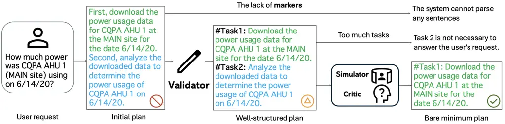
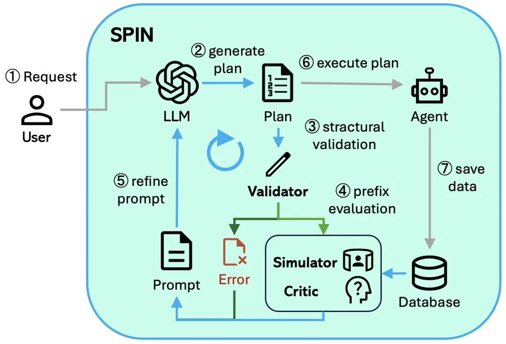
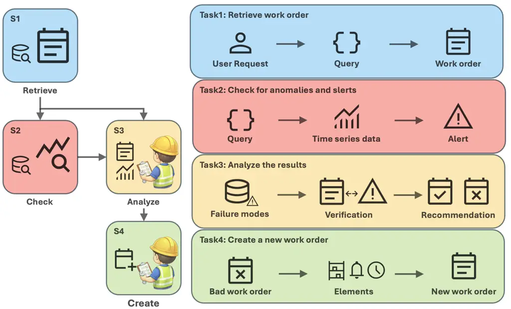
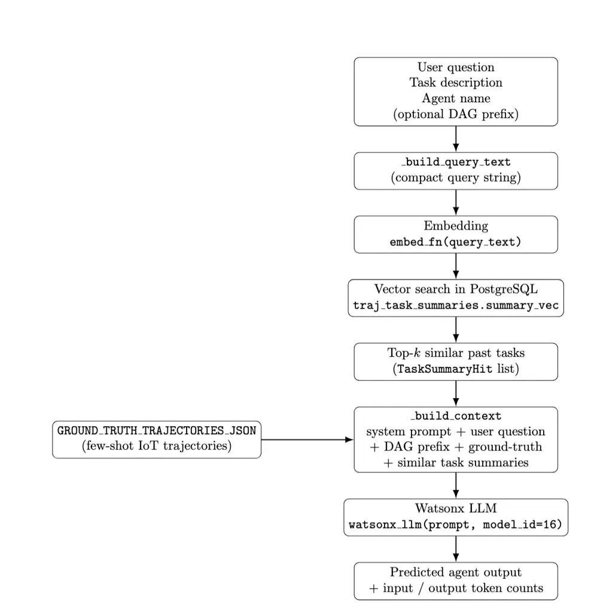
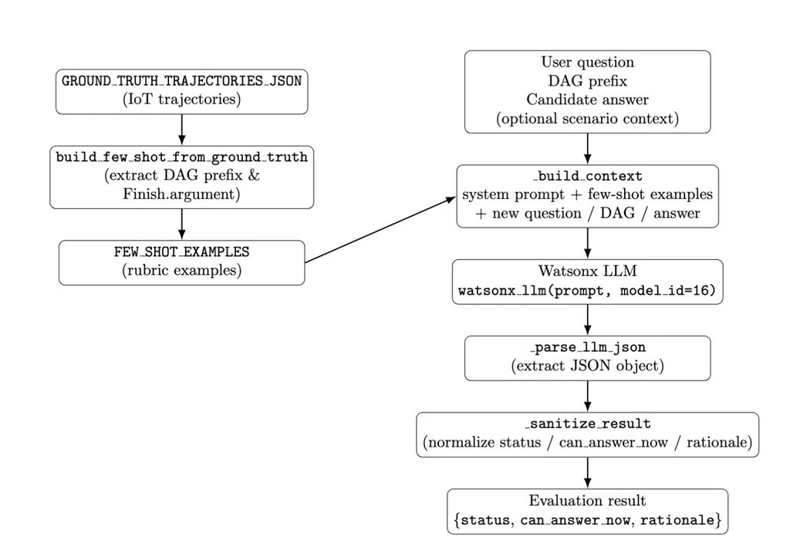
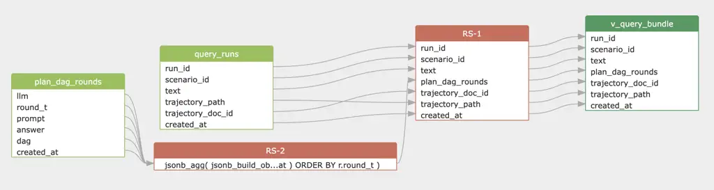

# SPIN: Structural LLM Planning via Iterative Navigation for Industrial Tasks

Yusuke Ozaki Affiliation: University at Albany Affiliation: Kwansei
Gakuin University Email: [inq31294@kwansei.ac.jp](mailto:)    Dhaval
Patel Affiliation: IBM, New York Email: [pateldha@us.ibm.com](mailto:)

###### Abstract

Industrial LLM agent systems often separate planning from execution, yet
LLM planners frequently produce structurally invalid or unnecessarily
long workflows, leading to brittle failures and avoidable tool and API
cost. We propose SPIN, a planning wrapper that combines validated
Directed Acyclic Graph (DAG) planning with prefix based execution
control. SPIN enforces a strict DAG contract through
\_validate_plan_text and repair prompting, producing executable plans
before downstream execution, and then evaluates DAG prefixes
incrementally to stop when the current prefix is sufficient to answer
the query. On AssetOpsBench, across 261 scenarios, SPIN reduces executed
tasks from 1061 to 623 and improves _Accomplished_ from 0.638 to 0.706,
while reducing tool calls from 11.81 to 6.82 per run. On MCP Bench, the
same wrapper improves planning, grounding, and dependency related scores
for both GPT OSS1 and Llama 4 Maverick.

## 1 Introduction

Industrial asset operations and maintenance workflows are inherently
multi-step, cross-functional, and constrained, requiring decisions that
are not only correct but also auditable and robust to heterogeneous tool
latencies and failures. In benchmarks such as AssetOpsBench, the
planner’s output serves as an interface contract for downstream
executors. A key practical challenge is that small structural errors in
a plan, such as incorrect indexing, dependency references, or tool and
agent names, can cause hard execution failures and obscure whether the
true problem is task reasoning or interface brittleness. Moreover,
executing long, conservative workflows end to end can be inefficient
when external actions dominate cost and runtime, even though partial
progress may already be sufficient to answer the user. These challenges
motivate methods that (i) make the planner–executor boundary explicit
and measurable, and (ii) support cost-aware execution policies that
terminate when further actions are unlikely to change the final outcome.

Prior work on LLM agents has largely focused on improving action
generation, for example through interleaving reasoning with tool use
\[19, 14\] or revising outputs through reflection and self-feedback
\[13, 9, 18\]. However, the planner–executor interface is often left
implicit, so downstream evaluation can be dominated by brittle
formatting errors rather than true task difficulty, especially in
domain-grounded benchmarks \[12\]. Recent evidence further suggests that
LLMs cannot be relied upon to consistently verify and repair planning
outputs without external checks \[15, 6, 2\]. Although structured
generation can improve schema compliance \[4, 10\] and search-based
methods can use external tests to guide generation \[8, 1\], these ideas
are rarely combined with a dependency-consistent task graph
representation and a cost-sensitive execution policy such as early
stopping in a domain-grounded agent pipeline.



Figure 1: Working example of validation and SPIN system.

We present SPIN, a planning wrapper for tool using LLM agents that makes
plan structure an explicit executable interface, instantiated on
AssetOpsBench and additionally evaluated on MCP Bench \[16\]. Starting
from a planner generated plan_text, SPIN validates and repairs it into a
dependency aware DAG serialization that an executor can consume
deterministically. For execution, SPIN applies a simulator and critic
based prefix policy, adapted from SPIRAL \[20\], to stop once the
current DAG prefix is sufficient to answer the query.

#### Contributions

- •
  We develop a contract based planning wrapper for tool using LLM
  agents. Our method combines a validator that enforces a dependency
  aware DAG format with a prefix evaluation loop in which a simulator
  and a critic decide whether further execution is necessary.
- •
  We present empirical evaluation on two benchmarks with different
  knowledge settings. The results show improved executability and lower
  execution burden on AssetOpsBench, and improved planning and grounding
  related scores on MCP Bench.
- •
  We provide a failure mode analysis showing that the gains of SPIN are
  concentrated in execution behavior, especially reduced repetition and
  improved state and termination related control. The analysis also
  suggests that the simulator is a more load bearing component than the
  critic on the matched scenario set.

## 2 Related Work

AssetOpsBench is designed for industrial asset operations and
maintenance, where operational workflows such as condition monitoring,
maintenance planning, and intervention scheduling require coordination
across multiple specialized steps, heterogeneous tools, and large
operational data sources \[12\]. This setting differs from many standard
agent benchmarks because planner outputs do not remain purely internal
reasoning artifacts: they can directly shape downstream execution cost,
operational burden, and recovery behavior. In such workflows, the
relevant question is not only whether an agent can produce a plausible
plan, but also whether that plan can be safely consumed and executed
within an execution-heavy industrial pipeline.

A large body of prior work has improved LLM agents through better
reasoning, reflection, tool use, or structured generation.
Representative examples include interleaving reasoning with acting,
verbal reinforcement learning and reflection, dynamic reflection
control, decomposed self-correction, reinforcement learning for
tool-integrated agents, and tool-interactive critiquing \[19, 13, 9, 18,
14, 6\]. Related systems work has also emphasized stronger validation
and consistency guarantees in multi-agent planning pipelines \[2\]. In
parallel, another line of work studies grammar-constrained decoding,
schema-constrained outputs, benchmarked structured generation, and
schema-level reinforcement learning \[5, 4, 10, 11\]. These directions
are highly relevant to our setting, but our emphasis is different: when
agent systems are deployed through external tools in industrial
applications, the output must be not only well formed, but also
machine-consumable as an execution interface. Accordingly, we treat
planner outputs as executable DAG interfaces rather than as generic
structured text.

A complementary line of work evaluates LLM agents on realistic,
multi-tool environments via the Model Context Protocol. MCP-Bench probes
agent behavior across a large suite of MCP servers and heterogeneous
real-world tools, measuring tool selection, planning, grounding, and
parameter accuracy under task specifications that require multi-hop,
cross-domain tool use \[16\]. Our work shares the view that agents must
be evaluated against execution-faithful tool interfaces rather than
synthetic APIs, but targets a different regime: industrial
asset-operations workflows in which planner outputs are consumed
downstream as executable DAGs, and where structural validity and
execution cost are first-class evaluation criteria.

A third line of work improves planning through search, tests,
simulator-guided reasoning, or more efficient reasoning–action
organization \[17, 8, 1, 20\]. ReWOO reduces redundant interleaving by
decoupling reasoning from observations, Thought of Search and AutoToS
emphasize efficient and correct search components, and SPIRAL uses a
planner–simulator–critic decomposition to improve search over predicted
outcomes. Our contribution is closest to this family, but differs in
optimization target. We do not primarily aim to improve search quality
over imagined futures. Instead, we focus on industrial settings in which
downstream execution can dominate practical cost: as language-model
inference becomes cheaper and faster over time, the dominant burden may
shift toward executable steps, tool invocations, data transfer, API
traffic, and recovery-inducing failures, especially in large-scale
data-intensive workflows. This execution-sensitive perspective is also
consistent with recent calls for agent evaluation beyond raw accuracy
alone \[7\]. This is why we treat structural validity and prefix-based
control as first-class concerns, and evaluate planner outputs with
execution-sensitive criteria in AssetOpsBench.

## 3 Method

We build a planning and execution workflow for tool using LLM agents,
instantiated on AssetOpsBench and later evaluated on MCP Bench, where a
planner first produces a task graph (Table 7) and an evaluation loop
determines how much of the plan is necessary to answer the user query
(See Figure 1, 4). Our pipeline has two core components (Figure 2): (1)
a strict plan validator/repair loop that enforces a machine readable DAG
format, and (2) a simulator and critic evaluation loop with early
stopping. Our prefix evaluation loop is inspired by the simulator critic
decomposition in SPIRAL, but differs in that we operate over validated
DAG prefixes and do not use Monte Carlo Tree Search style reflective
search.



Figure 2: System overview of validated DAG planning and prefix
evaluation by Simulator and Critic.

### 3.1 Formal Problem Setup

We study a tool-using planning setting in which a planner receives a
user query $`q`$ and produces a textual multi-step workflow $`x`$ that
must be consumed by a downstream executor. We represent a parsed plan as
an ordered set of nodes $`p=\{n_{1},\dots,n_{N}\}`$, where each node
$`n_{i}=(t_{i},a_{i},d_{i},e_{i})`$ contains a task description
$`t_{i}`$, an assigned agent $`a_{i}`$, a dependency set
$`d_{i}\subseteq\{1,\dots,i-1\}`$, and an expected output specification
$`e_{i}`$. In our implementation, the raw plan text is serialized as
four aligned lists: \#TaskN, \#AgentN, \#DependencyN, and
\#ExpectedOutputN.

We treat plan executability as structural validity of this serialized
interface prior to downstream execution. Let $`V(x)`$ denote a validator
that returns a validity indicator and an error set,
$`V(x)=(\mathrm{valid}(x),E(x))`$. A plan is considered valid if it
satisfies at least the following constraints: (i) the four lists have
matching lengths, (ii) indices are consecutive from $`1`$ to $`N`$,
(iii) each dependency refers only to a valid previous node, and (iv)
each assigned agent belongs to a predefined admissible set. These
constraints define the executable plan interface targeted by our repair
loop.

Given a valid plan $`p`$, we evaluate increasingly longer prefixes
$`p^{(k)}=\{n_{1},\dots,n_{k}\}`$ rather than executing the entire
workflow by default. For each prefix, a simulator $`S`$ predicts the
candidate outcome of the current execution state, and a critic $`C`$
returns a structured judgment containing a status, a Boolean
can_answer_now flag, and a rationale. This defines a stopping policy
over plan prefixes: the system halts once the current prefix is judged
sufficient to answer the original query $`q`$.

Our method therefore optimizes two related objectives. The first is
_executability_: increasing the probability that planner outputs are
machine-consumable before execution. The second is a _quality–effort
trade-off_: reducing external execution effort, such as executed tasks,
tool calls, API calls, and elapsed time, while preserving sufficient
answer quality. Importantly, this objective does not require all forms
of cost to decrease simultaneously; in particular, additional simulator
and critic prompting may increase internal token usage even when
external execution effort decreases.

### 3.2 Executable DAG Validation and Repair

We operationalize plan executability as structural validity of the
planner output prior to downstream execution. Rather than directly
executing the raw plan_text, we first apply a validator that checks
alignment across task fields, index consistency, dependency legality,
and agent-name admissibility. If the plan is invalid, we feed the
detected error set back to the planner and request a repaired plan. This
produces a simple error-aware repair loop whose goal is to transform raw
planner outputs into a machine-consumable DAG interface.

1: user query $`q`$, planner $`\Pi`$, validator $`V`$, retry budget
$`T`$

2: valid plan $`p`$ or failure after budget exhaustion

3: $`x\leftarrow\Pi(q)`$

4: for $`r=0`$ to $`T`$ do

5:   $`(\mathrm{valid},E)\leftarrow V(x)`$

6:   if $`\mathrm{valid}`$ then

7:    return $`x`$

8:   end if

9:   if $`r=T`$ then

10:    return Fail

11:   end if

12:   $`x\leftarrow\Pi(q;E)`$ $`\triangleright`$ repair conditioned on
detected errors

13: end for

Algorithm 1 Validation and Repair Loop

In our implementation, the validator checks whether the four serialized
fields (\#TaskN, \#AgentN, \#DependencyN, and \#ExpectedOutputN) are
aligned, whether indices are consecutive, whether dependencies refer
only to valid previous steps, and whether assigned agents belong to an
admissible set. The output of this procedure is therefore not a
task-level success judgment, but a pre-execution executability judgment
over the planner–executor interface.

### 3.3 Prefix Evaluation with Stopping

Given a validated plan $`p=\{n_{1},\dots,n_{N}\}`$, we do not execute
the full workflow by default. Instead, we evaluate a sequence of
increasingly longer prefixes

```math
p^{(k)}=\{n_{1},\dots,n_{k}\},\qquad k=1,\dots,N,
```

and stop as soon as the current prefix is judged sufficient to answer
the original user query. This defines execution control as a stopping
problem over validated DAG prefixes rather than as unconditional
end-to-end execution.

For each prefix $`p^{(k)}`$, we decompose the decision into two roles. A
_simulator_ $`S`$ predicts the candidate outcome of the current
execution state without requiring the full downstream execution of later
nodes. A _critic_ $`C`$ then evaluates whether the current prefix,
together with the simulated candidate outcome, is already sufficient to
answer the query. The critic returns a structured judgment

```math
C(q,p^{(k)},\hat{o}_{k})=(\mathrm{status}_{k},\ \mathrm{can\_answer\_now}_{k},\ r_{k}),
```

where $`\hat{o}_{k}=S(q,p^{(k)})`$ is the simulator output,
$`\mathrm{status}_{k}`$ is a task-level completion label,
$`\mathrm{can\_answer\_now}_{k}\in\{\mathrm{True},\mathrm{False}\}`$ is
a Boolean sufficiency flag, and $`r_{k}`$ is a short rationale.

1: validated plan $`p=\{n_{1},\dots,n_{N}\}`$, user query $`q`$,
simulator $`S`$, critic $`C`$

2: final answer $`\hat{y}`$, executed prefix length $`k^{\star}`$

3: for $`k=1`$ to $`N`$ do

4:   construct current prefix $`p^{(k)}=\{n_{1},\dots,n_{k}\}`$

5:   $`\hat{o}_{k}\leftarrow S(q,p^{(k)})`$

6:
  $`(\mathrm{status}_{k},\mathrm{can\_answer\_now}_{k},r_{k})\leftarrow C(q,p^{(k)},\hat{o}_{k})`$

7:   if $`\mathrm{can\_answer\_now}_{k}=\mathrm{True}`$ and
$`\mathrm{status}_{k}\in\{\textsc{Accomplished},\textsc{PartiallyAccomplished}\}`$
then

8:    return $`(\hat{o}_{k},k)`$

9:   end if

10: end for

11: return $`(\hat{o}_{N},N)`$

Algorithm 2 Prefix Evaluation with Stopping

The stopping decision is therefore given by

```math
\displaystyle\mathrm{Stop}(k)=1 \displaystyle\iff\Bigl(\mathrm{status}_{k}\in\{\textsc{Accomplished},\textsc{PartiallyAccomplished}\}\Bigr)
```

```math
\displaystyle\land\Bigl(\mathrm{can\_answer\_now}_{k}=\mathrm{True}\Bigr).
```

If this condition is not satisfied, the system extends the prefix and
repeats the same decision process at the next step. If no earlier prefix
satisfies the criterion, the method defaults to the full validated plan.

This procedure induces an explicit quality–effort trade-off. On the one
hand, shorter accepted prefixes reduce _external execution effort_, such
as the number of executed tasks, tool calls, API calls, and elapsed
runtime. On the other hand, the simulator and critic introduce
additional _internal prompting effort_, measured for example in prompt
and completion tokens. Accordingly, SPIN is not designed to reduce every
notion of cost simultaneously. Rather, its objective is to reduce costly
downstream execution while preserving sufficient answer quality through
prefix-level stopping.

## 4 Experiments

We evaluate three points: (i) whether strict DAG validation and targeted
repair improve plan executability before downstream execution, (ii) how
prefix evaluation changes outcome quality and execution cost on
AssetOpsBench, and (iii) how the same planning wrapper behaves on MCP
Bench.

### 4.1 Experimental setup and systems

On AssetOpsBench, we evaluate 261 scenarios in total, consisting of 141
original in-distribution (IID) scenarios and 120 additional
out-of-distribution (OOD) scenarios. The additional OOD scenarios use
the same agents and tools as the original benchmark but are instantiated
on different assets, so the expanded evaluation should be interpreted
not only as a larger in-domain test set but also as a generalization
test under asset shift. Each scenario provides a natural language user
request and a fixed tool and agent environment including IoT metadata,
sensor time series, and work order artifacts. Each scenario provides a
natural language user request and a fixed tool and agent environment
including IoT metadata, sensor time series, and work order artifacts. We
use paired comparisons between the baseline and SPIN based workflow
under the same scenario inputs and logging settings. Unless otherwise
noted, efficiency metrics are computed over non zero task runs, as
reported in Table 2 and Table 3.

|                                |            |             |          |          |          |          |             |          |            |          |
| ------------------------------ | ---------- | ----------- | -------- | -------- | -------- | -------- | ----------- | -------- | ---------- | -------- |
|                                | BASE       |             |          |          |          | VALID    |             |          |            |          |
| Metric                         | B#16       | B#20        | B#22     | B#23     | B#38     | V#16     | V#20        | V#22     | V#23       | V#38     |
| success_rate                   | 0.695      | 0.021       | 0.979    | 0.745    | 0.943    | 1.000    | 0.170       | 0.972    | 0.745      | 1.000    |
| ok_plans                       | 98         | 3           | 138      | 105      | 133      | 141      | 24          | 137      | 105        | 141      |
| COUNTS_MISMATCH                | 15 (10.6%) | 104 (73.8%) | 0 (0.0%) | 0 (0.0%) | 0 (0.0%) | 0 (0.0%) | 102 (72.3%) | 4 (2.8%) | 36 (25.5%) | 0 (0.0%) |
| AGENT_UNKNOWN                  | 9 (6.4%)   | 123 (87.2%) | 1 (0.7%) | 0 (0.0%) | 7 (5.0%) | 0 (0.0%) | 57 (40.4%)  | 0 (0.0%) | 0 (0.0%)   | 0 (0.0%) |
| TASK_NUMBERS_NOT_SEQ           | 33 (23.4%) | 57 (40.4%)  | 0 (0.0%) | 0 (0.0%) | 0 (0.0%) | 0 (0.0%) | 57 (40.4%)  | 4 (2.8%) | 35 (24.8%) | 0 (0.0%) |
| AGENT_NUMBERS_NOT_SEQ          | 34 (24.1%) | 66 (46.8%)  | 0 (0.0%) | 0 (0.0%) | 1 (0.7%) | 0 (0.0%) | 21 (14.9%)  | 0 (0.0%) | 0 (0.0%)   | 0 (0.0%) |
| DEPENDENCY_NUMBERS_NOT_SEQ     | 33 (23.4%) | 67 (47.5%)  | 0 (0.0%) | 0 (0.0%) | 0 (0.0%) | 0 (0.0%) | 22 (15.6%)  | 0 (0.0%) | 0 (0.0%)   | 0 (0.0%) |
| EXPECTEDOUTPUT_NUMBERS_NOT_SEQ | 33 (23.4%) | 67 (47.5%)  | 0 (0.0%) | 0 (0.0%) | 0 (0.0%) | 0 (0.0%) | 21 (14.9%)  | 0 (0.0%) | 0 (0.0%)   | 0 (0.0%) |

Table 1: Plan format validation results for \_validate_plan_text. Each
error cell reports the number of plan files in the directory that
triggered the corresponding validation rule at least once, with
percentage over 141 total plans per model in that directory. Columns
B#\* are \[BASE\] runs and V#\* are \[VALID\] runs for each LLM model
(Table 6).

We compare four systems. \[BASE\] is the original sequential planning
and execution pipeline. \[SPIN\] applies \_validate_plan_text to enforce
a dependency aware DAG format and then evaluates increasingly longer DAG
prefixes, stopping when the critic returns that the current prefix is
sufficient to answer the query. \[SPIN_wo_sim\] removes retrieval
conditioned simulation from the prefix loop. \[SPIN_wo_cri\] weakens
critic based stopping. In addition, we evaluate SPIN on 18 two server
grounding tasks from MCP Bench using GPT OSS1 (ID 20) and
Llama 4 Maverick (ID 16).

### 4.2 AssetOpsBench results

Table 1 reports offline plan format validation results. For each planner
configuration, we collect raw plan_text under the baseline prompt (B#\*)
and the validator assisted setting (V#\*), and compute (i) success_rate,
the fraction of plans that pass all checks, and (ii) error incidence by
rule. The most frequent error types are list-length inconsistencies
(COUNTS_MISMATCH), unsupported agent names (AGENT_UNKNOWN), and
non-consecutive indices across sections (\*\_NUMBERS_NOT_SEQ).

|                 |         |           |                          |               |               |
| --------------- | ------- | --------- | ------------------------ | ------------- | ------------- |
|                 | Scale   |           | Outcome rates (per task) |               |               |
| Method          | Runs    | Tasks     | Acc                      | Not           | Error         |
| \[BASE\]        | $`261`$ | $`1,061`$ | 0.638 (0.289)            | 0.244 (0.252) | 0.009 (0.048) |
| \[SPIN\]        | $`261`$ | $`623`$   | 0.706 (0.332)            | 0.195 (0.269) | 0.010 (0.061) |
| \[SPIN_wo_sim\] | $`139`$ | $`351`$   | 0.665 (0.335)            | 0.239 (0.294) | 0.008 (0.055) |
| \[SPIN_wo_cri\] | $`141`$ | $`405`$   | 0.619 (0.323)            | 0.271 (0.274) | 0.007 (0.048) |

Table 2: AssetOpsBench outcome and scale metrics. BASE and SPIN are
reported on 261 scenarios; ablations are reported on smaller subsets.
Values are mean (std) across runs. Higher is better for Acc; lower is
better for Not and Error.

|                 |               |                |                |                       |                   |                  |
| --------------- | ------------- | -------------- | -------------- | --------------------- | ----------------- | ---------------- |
| Method          | AvgTasks /Run | ToolCalls /Run | ApiCalls /Run  | TokSent /Run          | TokRecv /Run      | Elapsed(s) /Run  |
| \[BASE\]        | 4.07 (2.178)  | 11.81 (7.282)  | 34.05 (18.655) | 111530.3 (109009.698) | 2590.4 (1609.883) | 198.44 (155.552) |
| \[SPIN\]        | 2.39 (1.153)  | 6.82 (3.990)   | 19.97 (11.175) | 117592.7 (92820.875)  | 5542.3 (6527.553) | 143.53 (91.570)  |
| \[SPIN_wo_sim\] | 2.53 (1.119)  | 6.94 (4.150)   | 21.37 (11.856) | 106564.0 (124601.952) | 4033.7 (3135.429) | 138.41 (77.483)  |
| \[SPIN_wo_cri\] | 2.87 (1.088)  | 7.73 (4.249)   | 23.99 (11.221) | 154002.0 (109280.496) | 7751.0 (7400.157) | 193.54 (103.974) |

Table 3: AssetOpsBench execution-effort metrics. Values are mean (std)
across runs. Lower is better for all metrics, except that token counts
also reflect internal prompting overhead.

Tables 2 and 3 summarize the end-to-end outcome, scale, and
execution-effort metrics on AssetOpsBench. Table 2 shows that, on the
same 261 scenarios, \[SPIN\] reduces the total number of executed tasks
from 1061 to 623 while increasing task-level _Accomplished_ from 0.638
to 0.706. At the same time, _Not_ decreases from 0.244 to 0.195, while
_Error_ remains low and comparable (0.009 for \[BASE\] vs. 0.010 for
\[SPIN\]). These results indicate that the reduction in execution is not
merely due to premature stopping or degenerate truncation; rather, SPIN
executes fewer tasks while preserving and slightly improving task-level
outcome quality.

Table 3 shows that this quality improvement is accompanied by a
substantial reduction in downstream execution burden. Relative to
\[BASE\], \[SPIN\] reduces average tasks per run from 4.07 to 2.39, tool
calls per run from 11.81 to 6.82, API calls per run from 34.05 to 19.97,
and elapsed runtime from 198.44s to 143.53s. The only major metric that
increases is tokens sent per run, from 111,530.3 to 117,592.7, together
with tokens received per run from 2590.4 to 5542.3. This pattern is
consistent with the design of SPIN: the method spends additional
internal prompting budget on simulator and critic calls in order to
avoid more expensive downstream execution. We therefore interpret these
results not as a uniform reduction of all computational cost, but as a
favorable shift from external execution effort toward internal
deliberation.

The ablations help clarify which components drive these improvements. On
the smaller ablation subsets, \[SPIN_wo_sim\] remains relatively close
to full \[SPIN\] in task-level outcome rates, with _Accomplished_ of
0.665 versus 0.706, and it yields the lowest token-sent value among the
SPIN variants at 106,564.0 per run. By contrast, weakening critic-based
stopping in \[SPIN_wo_cri\] leads to longer and more expensive
executions: it processes 405 tasks in total, averages 2.87 tasks per
run, makes 23.99 API calls per run, and sends 154,002.0 tokens per run.
Relative to full \[SPIN\], these values suggest that the critic
contributes directly to limiting execution length once sufficient
evidence has been accumulated.

At the same time, we interpret the ablations cautiously because they are
evaluated on smaller subsets than the full 261-scenario comparison. In
particular, while Table 3 suggests that critic weakening most clearly
increases execution length, the matched-scenario failure analysis later
shows that removing the simulator more strongly degrades
robustness-related failure patterns, especially repetition and other
specification/state failures. Taken together, these results suggest a
division of labor between the two components: the critic is more
directly responsible for stopping control and execution-length
reduction, whereas the simulator contributes more strongly to the
quality of intermediate state estimation that supports robust execution
behavior.

Figure 3: Fine grained failure incidence rates on the exact common 95
scenario intersection across \[BASE\], \[SPIN\], \[SPIN_wo_sim\], and
\[SPIN_wo_cri\]. Lower is better.

### 4.3 Failure Mode Analysis on AssetOpsBench

Figure 3 reports fine-grained failure incidence rates on the exact
common 95-scenario intersection across \[BASE\], \[SPIN\],
\[SPIN_wo_sim\], and \[SPIN_wo_cri\]. This analysis complements the
aggregate outcome and effort metrics by showing not only whether SPIN
improves execution, but also which types of failures are most affected
by each component.

Relative to \[BASE\], full \[SPIN\] most clearly reduces
specification/state-related failures, especially 1.3 Step Repetition,
and also lowers 1.5 Unaware of Termination Conditions. This pattern is
consistent with the intended role of prefix-based execution control:
SPIN suppresses repeated or unnecessarily prolonged execution and
improves stopping behavior once the current prefix is already
sufficient. In other words, the main robustness gain of SPIN appears in
reducing redundant continuation rather than in repairing every
downstream failure category equally.

At the same time, the figure also shows an important limitation. Failure
types such as 2.2 Fail to Ask for Clarification and 3.2 No or Incorrect
Verification are not clearly improved by full \[SPIN\]. One plausible
interpretation is that SPIN is explicitly optimized to remove steps that
look unnecessary for answering the query under its current internal
estimate of sufficiency. As a result, steps that would have acted as
extra safeguards against missing information or weak verification can
also be pruned away as redundant. From this perspective, SPIN becomes
more efficient and less repetitive, but does not necessarily become more
conservative with respect to clarification or verification failures.
Thus, the FMA suggests that SPIN improves execution efficiency and
progression control more than it improves robustness to
uncertainty-handling or verification-related errors.

The ablations further clarify component roles. Removing the simulator
causes the failure profile to regress toward \[BASE\], especially for
1.3 Step Repetition and 3.1 Premature Termination, whereas removing the
critic leaves a profile that remains comparatively closer to full
\[SPIN\]. This suggests that the simulator is the more critical
component for robust intermediate state estimation and stable execution
behavior on the matched scenario set, while the critic contributes more
directly to execution-length control, as also suggested by the
end-to-end effort metrics.

### 4.4 MCP Bench results

Table 4 reports results on 18 two-server grounding tasks from MCP Bench.
We evaluate Baseline and SPIN-wrapped runs for GPT-OSS1 (ID 20) and
Llama 4 Maverick (ID 16), using the model mapping in Table 6. We include
MCP Bench for a different reason than AssetOpsBench: in this setting, we
do not use any trajectory database or external retrieval memory. As a
result, MCP Bench tests whether SPIN, and in particular its
simulator-centered prefix evaluation, can remain effective when the
relevant task knowledge must come primarily from the base LLM’s prior
knowledge rather than from benchmark-specific stored experience.

Under this no-external-memory setting, SPIN still improves most of the
quality-oriented metrics for both models. For GPT-OSS1, Task Completion
increases from 2.39 to 3.80, Tool Selection from 2.99 to 3.56, Planning
Effectiveness from 2.04 to 2.74, Grounding from 2.44 to 3.21, Dependency
Awareness from 2.39 to 3.49, and Parallelism & Efficiency from 1.69 to
2.00. For Llama 4 Maverick, Task Completion increases from 2.33 to 2.86,
Tool Selection from 2.73 to 3.43, Planning Effectiveness from 1.99 to
2.22, Grounding from 2.54 to 3.19, Dependency Awareness from 2.28 to
2.63, and Parallelism & Efficiency from 1.70 to 1.81. These gains are
important because they show that the benefits of SPIN are not limited to
settings where the simulator can draw on an external trajectory store.
Instead, the same wrapper continues to improve planning and grounding
behavior even when its intermediate judgments must be supported
primarily by the LLM’s internal prior knowledge.

The efficiency effects, however, are model-dependent. For GPT-OSS1, Avg
Rounds remains unchanged at 7.06, and Prompt Tokens increase slightly
from 55,464.78 to 56,890.44. By contrast, for Llama 4 Maverick, SPIN
reduces Avg Rounds from 17.06 to 14.00 and Prompt Tokens from 212,118.22
to 125,243.06. We interpret this difference as evidence that SPIN
provides a useful control mechanism for both models, but that the
magnitude of the efficiency benefit depends on the base model’s native
planning and execution behavior. In other words, SPIN improves the
quality of plan progression in both cases, while the extent to which
this translates into shorter interaction traces or lower token cost is
model-specific.

One exception is Tool Call Success for GPT-OSS1, which decreases
slightly from 0.97 to 0.92. We therefore do not claim that SPIN
uniformly improves every low-level execution metric. Rather, the overall
pattern suggests that SPIN consistently improves higher-level planning
and grounding quality, while some lower-level tool-execution behaviors
may remain sensitive to the underlying model. Taken together, the
MCP-Bench results support a stronger claim than simple benchmark
transfer: even without any database-backed external memory, SPIN remains
effective when the task can be supported by the LLM’s prior knowledge
alone.

|                             |                 |                |                  |           |                   |                      |                    |                   |               |
| --------------------------- | --------------- | -------------- | ---------------- | --------- | ----------------- | -------------------- | ------------------ | ----------------- | ------------- |
|                             | Quality         |                |                  |           |                   |                      |                    | Efficiency / Cost |               |
| Model                       | Task Completion | Tool Selection | Planning Effect. | Grounding | Tool Call Success | Dependency Awareness | Parallelism & Eff. | Avg Rounds        | Prompt Tokens |
| GPT-OSS1 (SPIN)             | 3.80            | 3.56           | 2.74             | 3.21      | 0.92              | 3.49                 | 2.00               | 7.06              | 56890.44      |
| GPT-OSS1 (Baseline)         | 2.39            | 2.99           | 2.04             | 2.44      | 0.97              | 2.39                 | 1.69               | 7.06              | 55464.78      |
| Llama 4 Maverick (SPIN)     | 2.86            | 3.43           | 2.22             | 3.19      | 0.83              | 2.63                 | 1.81               | 14.00             | 125243.06     |
| Llama 4 Maverick (Baseline) | 2.33            | 2.73           | 1.99             | 2.54      | 0.79              | 2.28                 | 1.70               | 17.06             | 212118.22     |

Table 4: MCP-Bench results on 18 two-server grounding tasks. Rows are
model variants with internal LLM IDs: GPT-OSS1 (ID 20) and
Llama 4 Maverick (ID 16) (Table 6); each is reported for Baseline and
SPIN-wrapped runs. Columns report core quality metrics (higher is
better) and efficiency/cost proxies (lower is better). Best values are
in bold (ties allowed).

## 5 Limitations

Our evaluation is limited to AssetOpsBench and its fixed tool/agent
environment, so the observed quality and efficiency trade-offs needs
testing to other benchmarks, or tool APIs with different latency and
failure characteristics.

In addition, the simulator depends on the coverage, freshness, and
representativeness of logged trajectories; sparse or shifting
environments can yield inaccurate simulated outcomes that may propagate
into suboptimal intermediate decisions. Early stopping further relies on
an LLM-based critic, which can be miscalibrated (false positives halting
too early; false negatives reducing efficiency) and is sensitive to
rubric design, few-shot selection, and model choice, with no formal
guarantees on stopping correctness. Finally, SPIN introduces additional
components (repair prompting, database retrieval, simulator, critic)
that increase engineering complexity and per-step inference overhead.

## 6 Conclusion

We presented SPIN, a planning wrapper for tool-using LLM agents that
combines executable DAG validation with prefix-based execution control.
Across our experiments, SPIN improved planner outputs as
machine-consumable interfaces and reduced downstream execution burden
while maintaining or improving task quality. On AssetOpsBench, this
appeared as both better structural executability and better end-to-end
execution efficiency, including fewer executed tasks, tool calls, API
calls, and shorter runtimes, while task-level _Accomplished_ also
improved. The ablation and failure-mode analyses further suggest that
these gains arise primarily from better progression and stopping
control: SPIN most clearly reduces redundant continuation and
repetition-related failures, while the simulator and critic play
different roles in robust state estimation and execution-length control.

At the same time, our results also identify an important boundary of the
current approach. Clarification- and verification-related failures are
not substantially improved, suggesting that SPIN is more effective at
pruning unnecessary continuation than at adding robustness-oriented
safeguards under uncertainty. A natural next step is therefore to extend
SPIN toward conditional planning with explicit clarification and
fallback branches. More broadly, an interesting future direction is to
use the simulator as a world model that exposes recurring failure
patterns and enables the LLM to learn, through few-shot examples, when a
task appears risky before execution. This could allow the system not
only to stop earlier, but also to recognize in advance when additional
clarification, verification, or alternative branches are needed.

## References

- \[1\] D. Cao, M. Katz, H. Kokel, K. Srinivas, and S. Sohrabi (2024)
  Automating thought of search: a journey towards soundness and
  completeness. External Links: 2408.11326,
  [Link](https://arxiv.org/abs/2408.11326) Cited by: §D.2, §1, §2.
- \[2\] E. Y. Chang and L. Geng (2025) SagaLLM: context management,
  validation, and transaction guarantees for multi-agent llm planning.
  Proceedings of the VLDB Endowment 18 (12), pp. 4874–4886. External
  Links: [Document](https://dx.doi.org/10.14778/3750601.3750611),
  [Link](https://www.vldb.org/pvldb/vol18/p4874-chang.pdf) Cited by: §1,
  §2.
- \[3\] CodaBench (2025) AssetOpsBench – codabench competition. Note:
  https://www.codabench.org/competitions/10206/Accessed: 2026-01-04
  Cited by: §A.1, §A.2.
- \[4\] S. Geng, H. Cooper, M. Moskal, S. Jenkins, J. Berman, N.
  Ranchin, R. West, E. Horvitz, and H. Nori (2025) JSONSchemaBench: a
  rigorous benchmark of structured outputs for language models. External
  Links: 2501.10868,
  [Document](https://dx.doi.org/10.48550/arXiv.2501.10868),
  [Link](https://arxiv.org/abs/2501.10868) Cited by: §D.2, §1, §2.
- \[5\] S. Geng, M. Josifoski, M. Peyrard, and R. West (2023)
  Grammar-constrained decoding for structured NLP tasks without
  finetuning. In Proceedings of the 2023 Conference on Empirical Methods
  in Natural Language Processing, pp. 10932–10952. External Links:
  [Link](https://aclanthology.org/2023.emnlp-main.674/),
  [Document](https://dx.doi.org/10.18653/v1/2023.emnlp-main.674) Cited
  by: §2.
- \[6\] Z. Gou, Z. Shao, Y. Gong, Y. Shen, Y. Yang, N. Duan, and W.
  Chen (2024) CRITIC: large language models can self-correct with
  tool-interactive critiquing. Note: ICLR 2024 External Links:
  2305.11738, [Document](https://dx.doi.org/10.48550/arXiv.2305.11738),
  [Link](https://arxiv.org/abs/2305.11738) Cited by: §1, §2.
- \[7\] S. Kapoor, B. Ströbl, Z. S. Siegel, N. Nadgir, and A.
  Narayanan (2024) AI agents that matter. External Links: 2407.01502,
  [Link](https://arxiv.org/abs/2407.01502) Cited by: §2.
- \[8\] M. Katz, H. Kokel, K. Srinivas, and S. Sohrabi (2024) Thought of
  search: planning with language models through the lens of efficiency.
  In Advances in Neural Information Processing Systems (NeurIPS),
  External Links:
  [Link](https://proceedings.neurips.cc/paper_files/paper/2024/hash/fa080fe0f218871faec1d8ba20e491d5-Abstract-Conference.html)
  Cited by: §D.2, §1, §2.
- \[9\] L. Liu, C. Zhang, L. Wu, C. Zhao, Z. Hu, M. He, and J.
  Fan (2025) Instruct-of-reflection: enhancing large language models
  iterative reflection capabilities via dynamic-meta instruction. In
  Proceedings of the 2025 Conference of the Nations of the Americas
  Chapter of the Association for Computational Linguistics: Human
  Language Technologies (Volume 1: Long Papers), L. Chiruzzo, A. Ritter,
  and L. Wang (Eds.), Albuquerque, New Mexico, pp. 9956–9978. External
  Links: [Link](https://aclanthology.org/2025.naacl-long.502/),
  [Document](https://dx.doi.org/10.18653/v1/2025.naacl-long.502), ISBN
  979-8-89176-189-6 Cited by: §D.2, §1, §2.
- \[10\] Y. Lu, H. Li, X. Cong, Z. Zhang, Y. Wu, Y. Lin, Z. Liu, F. Liu,
  and M. Sun (2025) Learning to generate structured output with schema
  reinforcement learning. In Proceedings of the 63rd Annual Meeting of
  the Association for Computational Linguistics (Volume 1: Long
  Papers), W. Che, J. Nabende, E. Shutova, and M. T. Pilehvar (Eds.),
  Vienna, Austria, pp. 4905–4918. External Links:
  [Link](https://aclanthology.org/2025.acl-long.243/),
  [Document](https://dx.doi.org/10.18653/v1/2025.acl-long.243), ISBN
  979-8-89176-251-0 Cited by: §D.2, §1, §2.
- \[11\] OpenAI (2024) Introducing structured outputs in the api. Note:
  Accessed: 2025-12-28 External Links:
  [Link](https://openai.com/index/introducing-structured-outputs-in-the-api/)
  Cited by: §2.
- \[12\] D. Patel, S. Lin, J. Rayfield, N. Zhou, R. Vaculin, N.
  Martinez, F. O’donncha, and J. Kalagnanam (2025) AssetOpsBench:
  benchmarking ai agents for task automation in industrial asset
  operations and maintenance. External Links: 2506.03828,
  [Document](https://dx.doi.org/10.48550/arXiv.2506.03828),
  [Link](https://arxiv.org/abs/2506.03828) Cited by: §D.2, §1, §2.
- \[13\] N. Shinn, F. Cassano, A. Gopinath, K. R. Narasimhan, and S.
  Yao (2023) Reflexion: language agents with verbal reinforcement
  learning. In Advances in Neural Information Processing Systems
  (NeurIPS), External Links:
  [Link](https://openreview.net/forum?id=vAElhFcKW6) Cited by: §D.2, §1,
  §2.
- \[14\] J. Singh, R. Magazine, Y. Pandya, and A. Nambi (2025) Agentic
  reasoning and tool integration for llms via reinforcement learning.
  Note: MSR-TR-042025-V1 External Links: 2505.01441,
  [Document](https://dx.doi.org/10.48550/arXiv.2505.01441),
  [Link](https://arxiv.org/abs/2505.01441) Cited by: §D.2, §1, §2.
- \[15\] K. Stechly, K. Valmeekam, and S. Kambhampati (2025) On the
  self-verification limitations of large language models on reasoning
  and planning tasks. In International Conference on Learning
  Representations (ICLR), Note: Poster External Links:
  [Link](https://openreview.net/forum?id=4O0v4s3IzY), 2402.08115,
  [Document](https://dx.doi.org/10.48550/arXiv.2402.08115) Cited by: §1.
- \[16\] Z. Wang, Q. Chang, H. Patel, S. Biju, C. Wu, Q. Liu, A.
  Ding, A. Rezazadeh, A. Shah, Y. Bao, and E. Siow (2026) MCP-bench:
  benchmarking tool-using LLM agents with complex real-world tasks via
  MCP servers. In The Fourteenth International Conference on Learning
  Representations, External Links:
  [Link](https://openreview.net/forum?id=fe8mzHwMxN) Cited by: §1, §2.
- \[17\] B. Xu, Z. Peng, B. Lei, S. Mukherjee, Y. Liu, and D. Xu (2023)
  ReWOO: decoupling reasoning from observations for efficient augmented
  language models. External Links: 2305.18323,
  [Document](https://dx.doi.org/10.48550/arXiv.2305.18323),
  [Link](https://arxiv.org/abs/2305.18323) Cited by: §2.
- \[18\] Z. Yang, Y. Zhang, Y. Wang, Z. Xu, J. Lin, and Z. Sui (2025)
  Confidence v.s. critique: a decomposition of self-correction
  capability for LLMs. In Proceedings of the 63rd Annual Meeting of the
  Association for Computational Linguistics (Volume 1: Long Papers), W.
  Che, J. Nabende, E. Shutova, and M. T. Pilehvar (Eds.), Vienna,
  Austria, pp. 3998–4014. External Links:
  [Link](https://aclanthology.org/2025.acl-long.203/),
  [Document](https://dx.doi.org/10.18653/v1/2025.acl-long.203), ISBN
  979-8-89176-251-0 Cited by: §D.2, §1, §2.
- \[19\] S. Yao, J. Zhao, D. Yu, N. Du, I. Shafran, K. R. Narasimhan,
  and Y. Cao (2023) ReAct: synergizing reasoning and acting in language
  models. In International Conference on Learning Representations
  (ICLR), External Links:
  [Link](https://openreview.net/forum?id=WE_vluYUL-X) Cited by: §D.2,
  §1, §2.
- \[20\] Y. Zhang, G. Ganapavarapu, S. Jayaraman, B. Agrawal, D. Patel,
  and A. Fokoue (2025) SPIRAL: symbolic llm planning via grounded and
  reflective search. External Links: 2512.23167,
  [Link](https://arxiv.org/abs/2512.23167) Cited by: §D.2, §1, §2.

## Appendix A Reproducibility Details

### A.1 Experiment Regeneration

#### Deterministic table recomputation from saved run artifacts.

All tables reported in this paper are computed _solely_ from the local
artifacts stored under AssetOpsBench/benchmark/cods_track1/track1_result
\[3\], without re-running the benchmark execution or invoking any
external APIs. In particular, the table generation scripts read (i) step
level execution traces under track1_result/trajectory and (ii) per
experiment metadata and summaries under track1_result/exp. Given a fixed
track1_result directory, this post processing stage is deterministic and
therefore reproduces the same aggregate numbers exactly. For example,
Table 2 can be regenerated as follows:

AssetOpsBench % python3 make_table_2.py \\ --trajectory_root
"./benchmark/cods_track1/track1_result/trajectory" \\ --exp_root
"./benchmark/cods_track1/track1_result/exp" \\ --model "Model_16" \\
--tags "BASE,SPIN,SPIN_wo_sim,SPIN_wo_cri" \\ --out_dir
"./benchmark/cods_track1/track1_result/tables3" \\ --debug

#### end to end trajectory regeneration via Docker Compose.

In addition to the deterministic post processing described above, we
provide an end to end replay path that regenerates trajectory (and
per-run exp summaries) by re-running the benchmark inside a Docker
Compose environment. This replay depends on external model/API calls;
therefore, we do not guarantee bitwise identical outputs or exact metric
equality across runs. Instead, we expect the aggregate statistics (e.g.,
success rate and error type distributions) to be broadly consistent when
the same scenario subset and configuration are used.

Configuration. Users must create benchmark/cods_track1/.env.local to
provide the required API credentials and endpoints. Secrets must remain
local and must not be committed.

Run (Compose).

\# From the repository root (AssetOpsBench/)

docker compose -f benchmark/cods_track1/docker-compose.yml up -d --build

\# (Optional) If you run the benchmark command explicitly in the
container:

\# docker compose -f benchmark/cods_track1/docker-compose.yml exec -T
assetopsbench \\

\# python /home/run_track_1.py --utterance_ids "\<comma-separated IDs\>"
--save_data "True"

Outputs. The end to end run writes local artifacts under
benchmark/cods_track1/track1_result/trajectory and
benchmark/cods_track1/track1_result/exp. All tables in this paper are
computed solely from these saved artifacts without re-invoking external
APIs.

#### Failure mode analysis replay via TrajFM.

In addition to the benchmark trajectory regeneration above, we provide a
replay path for the failure mode analysis (FMA) used in the appendix
discussion. The FMA pipeline runs the TrajFM extractor separately on
saved trajectory directories for \[BASE\], \[SPIN\], \[SPIN_wo_sim\],
and \[SPIN_wo_cri2\], and writes the resulting per-method outputs under
track1_result/trajfm_outputs/. This stage depends on external model/API
calls and therefore is not guaranteed to be bitwise identical across
replays, although the resulting failure distributions are expected to be
broadly consistent when the same trajectory inputs and evaluator
configuration are used. For consistency, we refer to this variant as
\[SPIN_wo_cri\] in the paper, while the corresponding artifact directory
is named spin_wo_cri2/work/ in the released outputs.

Run (TrajFM). The extraction step is executed inside the benchmark
container with:

\# From the repository root (AssetOpsBench/)

docker compose -f benchmark/cods_track1/docker-compose.yml exec -T
assetopsbench \\

bash /home/entrypoint_failure_modes_analysis.sh

This entrypoint activates the benchmark environment, reads saved
trajectories from /home/track1_result/trajectory/, and runs
TrajFM/failure_mode_extractor.py separately for each method directory.

Outputs. The FMA extraction writes method specific outputs under:

benchmark/cods_track1/track1_result/trajfm_outputs/ base/work/
spin/work/ spin_wo_sim/work/ spin_wo_cri2/work/ These directories
contain the raw TrajFM outputs used for the matched scenario analysis in
Appendix B.

Figure generation. After the FMA counts and rates are computed, the
plotting script make_fma_figure.py generates the rate figures used in
the paper:

\# From the repository root (AssetOpsBench/)

python make_fma_figure.py

This script writes:

benchmark/cods_track1/track1_result/trajfm_outputs/fma_full_rate.pdf
benchmark/cods_track1/track1_result/trajfm_outputs/fma_category_rate.pdf
The current plotting script renders figures from precomputed aggregated
rates; it does not itself perform the raw trajectory labeling or
aggregation.

External API dependency note. Our model routing / numeric model
identifiers for external calls follow the implementation in ReActXen’s
model_inference.py¹¹ 1
https://github.com/IBM/ReActXen/blob/main/src/reactxen/utils/model_inference.py.
If the provider changes the identifier mapping or discontinues service,
exact replay may become impossible, and only partial reproducibility
from saved artifacts is guaranteed.

### A.2 Submission Package Structure (Software Archive / Data Archive)

#### Overview.

We provide two archives for reproducibility: (i) a software archive
(AssetOpsBench.zip) containing a code snapshot of AssetOpsBench
(https://anonymous.4open.science/r/AssetOpsBench-2C61) \[3\], and (ii) a
data archive (pgdata.tgz) containing a populated PostgreSQL data
directory (PGDATA). The CODS Track 1 Docker Compose stack connects
services on a default Compose network, so containers can reach each
other by service name (e.g., postgres, couchdb).

#### A. Archive metadata (minimum).

- •
  Software archive filename (zip/tgz): AssetOpsBench.zip
- •
  Data archive filename (zip/tgz): pgdata.tgz

#### B. Top-level contents (minimum).

Software archive: top-level directory listing (depth $`\leq 2`$).

```ltx_verbatim
AssetOpsBench/
  benchmark/
    cods_track1/
  infra/
    postgres/
  src/
    agent_hive/
  readme.txt
  (other files/directories omitted)
```

Data archive: top-level directory listing (depth $`\leq 2`$).

```ltx_verbatim
pgdata.tgz (archive root)/
  data/
    PG_VERSION
    base/
    global/
    pg_wal/
    pg_notify/
    (other Postgres subdirectories omitted)
```

#### Key implementation location.

The primary workflow implementation used in our Track 1 experiments is
under src/agent_hive/workflows/ (e.g., planning workflows,
critic/simulator modules, and Track 1 workflow variants). For reference,
this directory contains modules such as track1_planning_baseline.py,
track1_planning_spin.py, track1_planning_validation.py, critic_agent.py,
simulator_agent.py, and validate_plan_text.py.

#### Configuration switch via docker-compose.yml.

In benchmark/cods_track1/docker-compose.yml, the execution configuration
can be switched by changing the suffixes of three referenced files:
\<FILE_A\>, \<FILE_B\>, and \<FILE_C\>. In our setup, these references
select which Track 1 workflow variant (e.g., baseline vs. SPIN variants)
is executed. Reviewers can reproduce different configurations by editing
these three filenames in the Compose file and restarting the services.

#### Restoration and rerun instructions (readme.txt).

The software archive includes a repository-level instruction file at
AssetOpsBench/readme.txt. Following readme.txt, reviewers can: (i)
restore the Postgres state by extracting pgdata.tgz into
infra/postgres/, (ii) recreate the required local environment file
benchmark/cods_track1/.env.local, and (iii) rerun the Compose stack and
regenerate the tables (Table 1 via make_dag_table.py and Table 2 via
make_table_2.py).

#### Database restoration note.

To restore the database directory to infra/postgres/data, place
pgdata.tgz at the repository root and extract using -C (change directory
before extraction):

```ltx_verbatim
tar -xzf pgdata.tgz -C infra/postgres data
```

#### Environment file note.

The Compose configuration expects benchmark/cods_track1/.env.local to
exist before docker compose is executed; missing env files can trigger a
startup error unless the Compose configuration explicitly marks them
optional.

### A.3 Fixed Experimental Settings (Configuration Only)

#### Evaluation scenario sets (fixed).

We use different fixed evaluation sets for different parts of the paper.
For the offline DAG validation study in Table 1, we evaluate 141 plan
files per planner configuration. For the end to end AssetOpsBench
results in Table 2 and Table 3, we evaluate 261 scenarios. For the MCP
Bench results in Table 4, we evaluate 18 two server grounding tasks.
Within each table, all reported aggregates are computed over the
corresponding fixed scenario set.

#### Outcome sensitive knobs (fixed).

The reported aggregates depend on the following configuration choices:

- •
  SPIN iteration / validation budget ($`T`$). The number of SPIN
  iterations is controlled in AssetOpsBench/src/agent_hive/workflows/  
  track1_planning\_{...}.py (denoted as T= in the code). Changing $`T`$
  changes both cost and outcomes.
- •
  Simulator retrieval filter. The Simulator retrieves task summaries
  restricted to Accomplished entries, that is, only completed historical
  tasks are used as retrieval candidates. Changing this filter, for
  example by including Not accomplished cases, may change Simulator
  outputs.
- •
  Early stopping rule (Critic $`\rightarrow`$ stop). We enable early
  stopping when the Critic returns can_answer_now=True for tasks that
  the Simulator predicts as Accomplished or Partially_Accomplished.
  Restricting the condition to only Accomplished is an alternative
  design choice and can change outcomes.
- •
  Data persistence and feedback effects (--save_data). When --save_data
  is enabled, generated plans and trajectories are written to the
  database and become queryable by downstream components. This can
  affect later Simulator retrieval behavior, and thus end to end
  results, by changing the database state seen by retrieval.

#### External API conditions (model identification and logging).

When reproducing results that require external LLM APIs, we identify the
exact provider and model via our internal LLM_ID. Table 6 maps each
LLM_ID to the corresponding model string used in the implementation,
together with provider and deployment details. For each external API
call, we log (i) timestamp, (ii) LLM_ID and provider/model identifier,
(iii) inference parameters such as temperature, top-$`p`$, and
max_tokens, and (iv) retry and timeout metadata such as retry count and
timeout type. These records enable post hoc verification of what could
vary across runs, including provider model updates, stochastic decoding,
and rate limit induced retries or timeouts.

### A.4 Failure mode analysis on matched scenarios

#### Scope and comparison setting.

We conduct failure mode analysis on AssetOpsBench trajectories from
\[BASE\], \[SPIN\], \[SPIN_wo_sim\], and \[SPIN_wo_cri\]. To ensure fair
comparison, we restrict the analysis to the exact common utterance ID
intersection across all four methods. After collapsing to one trajectory
per utterance ID, this yields 95 shared scenarios.

#### Model and evaluation prompt.

Failure labels were assigned by an LLM based evaluator using internal
LLM_ID 12 (Table 6). For each trajectory, the evaluator receives the
user question, the executed trajectory, and the final answer, and
returns a structured multi label judgement over the predefined failure
taxonomy described below.

#### Failure taxonomy.

We use a three category failure taxonomy covering specification and
state related failures (1.x), interaction failures (2.x), and
verification and completion failures (3.x). Table 5 defines all failure
modes used in the analysis.

|     |                             |                                                                                                                                                            |
| --- | --------------------------- | ---------------------------------------------------------------------------------------------------------------------------------------------------------- |
| ID  | Category                    | Definition                                                                                                                                                 |
| 1.1 | Specification and state     | Disobey Task Specification: the trajectory does not follow the requested task or violates explicit task constraints.                                       |
| 1.2 | Specification and state     | Disobey Role Specification: the agent acts outside its assigned role or uses behavior inconsistent with the role definition.                               |
| 1.3 | Specification and state     | Step Repetition: the trajectory repeats the same or nearly identical step without making meaningful progress.                                              |
| 1.4 | Specification and state     | Loss of Conversation History: the agent ignores or forgets relevant context established earlier in the interaction.                                        |
| 1.5 | Specification and state     | Unaware of Termination Conditions: the agent fails to recognize when the task should stop or when enough information has already been obtained.            |
| 2.1 | Interaction                 | Conversation Reset: the trajectory restarts the interaction or behaves as if prior turns were unavailable.                                                 |
| 2.2 | Interaction                 | Fail to Ask for Clarification: the agent proceeds without requesting clarification even though the available information is insufficient or ambiguous.     |
| 2.3 | Interaction                 | Task Derailment: the interaction drifts away from the intended objective and focuses on irrelevant or secondary subproblems.                               |
| 2.4 | Interaction                 | Information Withholding: relevant information that was obtained is not surfaced in the response or not used when it should be.                             |
| 2.5 | Interaction                 | Ignored Other Agent’s Input: outputs or observations from previous agents or earlier steps are not incorporated when they are relevant to the next action. |
| 2.6 | Interaction                 | Action–Reasoning Mismatch: the stated reasoning and the executed action are inconsistent with each other.                                                  |
| 3.1 | Verification and completion | Premature Termination: the trajectory ends before enough evidence has been collected to support the answer.                                                |
| 3.2 | Verification and completion | No or Incorrect Verification: the agent does not verify an important claim, or performs a verification step incorrectly.                                   |
| 3.3 | Verification and completion | Weak Verification: verification is attempted, but it is incomplete, shallow, or insufficiently connected to the final conclusion.                          |

Table 5: Failure taxonomy used in the matched scenario failure mode
analysis.

## Appendix B Failure Mode Analysis Details

### B.1 Failure mode analysis on matched scenarios

#### Scope and comparison setting.

We conduct failure mode analysis on AssetOpsBench trajectories from
\[BASE\], \[SPIN\], \[SPIN_wo_sim\], and \[SPIN_wo_cri\]. To ensure fair
comparison, we restrict the analysis to the exact common utterance ID
intersection across all four methods. After collapsing to one trajectory
per utterance ID, this yields 95 shared scenarios.

#### Model and evaluation prompt.

Failure labels are assigned by an LLM based evaluator using a fixed
prompt and a predefined failure taxonomy. We use the same evaluation
setup across all four methods so that differences in reported failure
rates reflect differences in the trajectories rather than differences in
the labeling procedure. We used model 12 as the evaluator (Table 6).

#### Aggregation and reporting protocol.

For each utterance ID, we aggregate failure labels across repeated
annotations by OR aggregation, so that a failure mode is counted as
present if it appears at least once for that scenario. We report both
fine grained failure rates over the full taxonomy and category level
aggregates over 1.x, 2.x, and 3.x groups. We also report the mean number
of failure modes per scenario on the same matched scenario set.

#### Results on the matched scenario set.

Figure 3 report failure incidence rates on the exact common 95 scenario
intersection across \[BASE\], \[SPIN\], \[SPIN_wo_sim\], and
\[SPIN_wo_cri\]. Under this strict matched comparison, full \[SPIN\] has
the lowest mean number of failure modes per scenario at 1.48, compared
with 1.87 for \[BASE\], 1.80 for \[SPIN_wo_sim\], and 1.53 for
\[SPIN_wo_cri\].

The clearest differences appear in 1.x specification and state related
failures. In category totals, 1.x decreases from 60 for \[BASE\] to 27
for full \[SPIN\], while \[SPIN_wo_sim\] and \[SPIN_wo_cri\] have 41 and
33, respectively. Within this category, the largest single reduction is
1.3 Step Repetition, which drops from 35.79% in \[BASE\] to 10.53% in
full \[SPIN\]; the corresponding rates are 17.89% for \[SPIN_wo_sim\]
and 12.63% for \[SPIN_wo_cri\]. 1.5 Unaware of Termination Conditions
also decreases from 23.16% in \[BASE\] to 15.79% in full \[SPIN\].

For 3.x verification and completion failures, the category totals are 84
for \[BASE\], 78 for full \[SPIN\], 93 for \[SPIN_wo_sim\], and 77 for
\[SPIN_wo_cri\]. At the fine grained level, 3.2 No or Incorrect
Verification remains high for all methods, but is lower for full
\[SPIN\] than for \[BASE\] (47.37% vs. 50.53%). 3.3 Weak Verification is
also lower for full \[SPIN\] than for \[BASE\] (9.47% vs. 12.63%). In
contrast, 3.1 Premature Termination is identical for \[BASE\], full
\[SPIN\], and \[SPIN_wo_cri\] at 25.26%, while \[SPIN_wo_sim\] is higher
at 37.89%.

The 2.x interaction failures vary less across methods. The category
totals are 34 for \[BASE\], 36 for full \[SPIN\], 37 for
\[SPIN_wo_sim\], and 35 for \[SPIN_wo_cri\]. In particular, 2.2 Fail to
Ask for Clarification is 24.21% for \[BASE\], 26.32% for full \[SPIN\],
24.21% for \[SPIN_wo_sim\], and 26.32% for \[SPIN_wo_cri\].

|     |                                                   |            |                          |                           |                                                 |
| --- | ------------------------------------------------- | ---------- | ------------------------ | ------------------------- | ----------------------------------------------- |
| ID  | Model string in ReActXen                          | Provider   | Size (total / active)    | Decoding (temp / max tok) | Quantization / Hosting                          |
| 12  | meta-llama/llama-3-3-70b-instruct                 | Meta       | 70B (dense)              | 0.0 / 8192                | Provider default; self hostable open weight     |
| 16  | meta-llama/llama-4-maverick-17b-128e-instruct-fp8 | Meta       | 400B total / 17B active  | 0.0 / 8192                | Provider default; self hostable (license gated) |
| 20  | openai/gpt-oss-120b                               | OpenAI     | 117B total / 5.1B active | 0.0 / 8192                | Provider default; self hostable open weight     |
| 22  | mistralai/mistral-medium-2505                     | Mistral AI | (see provider docs)      | 0.0 / 8192                | Provider default; hosted API                    |
| 23  | mistralai/mistral-small-3-1-24b-instruct-2503     | Mistral AI | 24B (dense)              | 0.0 / 8192                | Provider default; open weight + hosted options  |
| 38  | ibm/granite-4-h-small                             | IBM        | 32B total / 9B active    | 0.0 / 8192                | Provider default; self hostable open weight     |

Table 6: Mapping from our internal LLM IDs to the model strings used in
ReActXen’s model_inference.py, together with provider and deployment
notes. Unless explicitly stated, quantization and low level serving
optimizations are provider managed and not disclosed. Decoding
parameters follow our implementation defaults when no overrides are
provided: temperature $`=0.0`$ and max tokens $`=8192`$ for text
generation.

## Appendix C Working Examples

### C.1 Various DAG examples




Figure 4: Visualization of a four-step DAG plan for a maintenance
decision on Chiller 9 (equipment ID: CWC04009). S1–S4 denote the DAG
step indices referenced by the plan dependencies (#S1–#S4),
corresponding to Tasks 1–4, respectively. The left panel shows the
step-level dependency graph (arrows indicate prerequisite relations).
The right panel summarizes each step as a compact workflow (_query_
$`\rightarrow`$ _retrieve/analyze_ $`\rightarrow`$ _output_). Each
workflow is executed by its designated agent, which attempts to complete
the task using the tools available to it. The color coding matches the
highlighted blocks in the plan text.

 

DAG plan (text)

 

Mini DAG (structure)

 

 


 

Path

|                |
| -------------- |
| S1             |
| $`\downarrow`$ |
| S2             |

 

 


 

Tree

[TABLE]

 

 


 

Graph

 

 


 

Graph


Table 7: Four representative DAG plan examples (left: plan text; right:
corresponding dependency structure).

To provide a concrete, pictorial intuition for our DAG plans, we include
a worked example and a compact catalog of plan shapes in Appendix C.
Figure 4 visualizes a four step maintenance decision plan, showing how
step indices (S1–S4) in the plan text map to the dependency graph and
the agent assigned to each step. Table 7 complements this by presenting
multiple representative dependency patterns (e.g., a simple path, a
tree, and general DAG structures), illustrating that the same plan
format can express both sequential workflows and more complex multi
branch dependencies.

### C.2 \_validate_plan_text

Table 8 summarizes synthetic unit tests for our plan-text validator. The
validator enforces a strict, execution ready schema (\#TaskN, \#AgentN,
\#DependencyN, \#ExpectedOutputN) before any downstream tool calls are
issued. We construct minimally perturbed plans to exercise each
validation rule, and we report the resulting is_valid flag together with
representative error messages. These checks make common failure modes
explicit (e.g., missing fields, non-consecutive indices, malformed
dependencies, forward references, or unknown agent names) and prevent
malformed plans from entering the execution pipeline.

[TABLE]

Table 8: Test Case 1: Results of synthetic plan validation.

### C.3 Simulator Agent

Table 9 provides a concrete example of the SimulatorAgent, which serves
as a retrieval surrogate “world model” for predicting the expected
output of a planned step. Given the user question and the target
agent/task description, the SimulatorAgent retrieves similar past
trajectories and prompts an LLM to produce a predicted output for the
current step. We compare the predicted answer against a known
ground-truth answer for this test case, and we additionally report
input/output token counts to quantify the compute cost of a single
simulation call. This example illustrates how simulation can yield near
correct intermediate results while also exposing the overhead (tokens)
introduced by retrieval and prompting.

|                     |                                                                                                                                                                                                                                                        |
| ------------------- | ------------------------------------------------------------------------------------------------------------------------------------------------------------------------------------------------------------------------------------------------------ |
| Metric              | Value / Description                                                                                                                                                                                                                                    |
| Ground-truth answer | The assets for site MAIN are: CQPA AHU 1, CQPA AHU 2B, Chiller 4, Chiller 6, Chiller 9, Chiller 3.                                                                                                                                                     |
| Predicted answer    | The available IoT sites are MAIN. The assets for MAIN are: CQPA AHU 1, CQPA AHU 2B, Chiller 4, Chiller 6, Chiller 9, Chiller 3. The final answer is The assets for site MAIN are: CQPA AHU 1, CQPA AHU 2B, Chiller 4, Chiller 6, Chiller 9, Chiller 3. |
| Match type          | Essentially exact: the list of assets matches the ground-truth answer exactly; only extra preamble/suffix are added.                                                                                                                                   |
| Input token count   | 4136 (tokens sent to watsonx_llm for this simulation call).                                                                                                                                                                                            |
| Output token count  | 97 (tokens generated by the model for the predicted answer).                                                                                                                                                                                           |

Table 9: Test Case 2: answer quality and token counts for the simulated
output.

### C.4 Critic Agent

Table 10 reports CriticAgent outcomes for two provided examples (as
observed in our docker logs). The CriticAgent evaluates a prefix of the
planned DAG and a candidate answer, and returns a structured JSON
judgement: status (Accomplished, Partially accomplished, Not
accomplished), can_answer_now, and a short rationale. Example A
demonstrates a “Not accomplished” decision when the truncated plan
targets the wrong site, while Example B shows “Partially accomplished”
when the candidate answer contains the correct asset list but is mixed
with irrelevant information. We also report token usage (input/output)
because the Critic may be invoked iteratively during prefix evaluation;
in our implementation, we treat Accomplished or Partially accomplished
as a success flag for early stopping.

[TABLE]

Table 10: Test Case 3: CriticAgent evaluation outcomes for two provided
examples (docker log).

### C.5 Execution Agents

#### Design intent.

In AssetOpsBench, each domain execution agent is shipped with a role
specific system prompt that enumerates the tools it can invoke (e.g.,
sites, assets, sensors, history) and the expected I/O schema. During
execution, the agent follows a ReAct style loop
(Thought–Action–Observation) and often returns file backed tool outputs
(JSON artifacts) to avoid emitting large payloads directly in the chat
response.

#### Reflexion and review.

Optionally, an additional review step (“Reflexion”) provides self
reflection and a task level judgement (e.g., Accomplished) after the
agent finishes.

#### Highlighted excerpt (simplified).

The following excerpt is a simplified execution trace for the IoT Data
Download agent. It demonstrates (i) tool selection, (ii) parameterized
tool invocation, and (iii) file-backed outputs referenced in the final
answer.


## Appendix D Discussion of Our Work

### D.1 Research Hypotheses

#### RQ1 (Overthinking):

Do LLM planners overthink in industrial workflow planning, and can we
mitigate it without sacrificing task accomplishment?

#### RQ2 (Early stopping):

Does integrating prefix evaluation early stopping by World-Model and
Critic reduce effort while maintaining or improving success?

### D.2 What the Results Show

#### Main empirical findings.

The main empirical result is that \[SPIN\] improves quality and reduces
external execution effort on AssetOpsBench, while also transferring to
MCP Bench under a different simulator setting. On AssetOpsBench (Table 2
and Table 3), \[SPIN\] increases Acc from 0.638 to 0.706 and decreases
Not from 0.244 to 0.195, while reducing total executed tasks from 1061
to 623 and average tasks per run from 4.07 to 2.39. At the run level,
tool calls decrease from 11.81 to 6.82, API calls from 34.05 to 19.97,
and elapsed time from 198.44s to 143.53s. Tokens sent per run increase
from 111,530.3 to 117,592.7, indicating that the simulator and critic
introduce additional internal prompting overhead even as they reduce
downstream execution effort.

As described in Section E.2, the Simulator is designed as a retrieval
conditioned world model that predicts step outcomes from prior task
experience. This interpretation is supported by the ablations and by the
matched scenario failure analysis in Appendix B: removing the simulator
causes a clearer regression in failure structure, especially in
repetition and termination related failures. At the same time, the
additional 120 AssetOpsBench scenarios use the same agents and tools as
the original 141 scenarios but are defined over different assets, and
the retrieval database does not contain trajectory data for those
additional assets. The fact that \[SPIN\] still improves results on the
expanded 261 scenario set therefore suggests that the simulator is not
acting only as asset specific memory, but is also transferring task
level knowledge across related settings.

This interpretation is further supported by the MCP Bench results in
Table 4. In MCP Bench, we do not use a retrieval database, because the
benchmark is designed around general knowledge and multi tool
coordination rather than benchmark specific trajectory memory. Even
under this setting, SPIN improves Task Completion, Tool Selection,
Planning Effectiveness, Grounding, Dependency Awareness, and Parallelism
& Efficiency for both GPT-OSS1 and Llama 4 Maverick. For GPT-OSS1, Avg
Rounds remains unchanged at 7.06 and prompt tokens increase slightly,
whereas for Llama 4 Maverick, Avg Rounds decreases from 17.06 to 14.00
and prompt tokens decrease from 212,118.22 to 125,243.06. These results
indicate that SPIN can improve planning outcomes not only when a
retrieval based world model is available, but also when the benchmark
domain is covered mainly by the LLM’s general knowledge. Taken together,
the evidence suggests that SPIN combines two useful effects: retrieval
based task knowledge transfer when trajectory memory is available, and
improved planning control even without benchmark specific memory.

#### Matched scenario failure analysis.

The matched scenario failure analysis in Appendix B provides a more
detailed view of where the gains arise. On the exact common 95 scenario
intersection across \[BASE\], \[SPIN\], \[SPIN_wo_sim\], and
\[SPIN_wo_cri\], full \[SPIN\] achieves the lowest mean failure count
per scenario at 1.48, compared with 1.87 for \[BASE\], 1.80 for
\[SPIN_wo_sim\], and 1.53 for \[SPIN_wo_cri\]. The clearest reduction
appears in specification and state related failures, especially 1.3 Step
Repetition, which drops from 35.79% in \[BASE\] to 10.53% in full
\[SPIN\]. The corresponding rate rises to 17.89% in \[SPIN_wo_sim\] and
12.63% in \[SPIN_wo_cri\]. These results show that the main empirical
effect of \[SPIN\] is not only shorter execution, but also more stable
and less repetitive task progression.

#### Component level interpretation.

The ablations suggest that the simulator is the more load bearing
component for robustness on the matched scenario set. Removing the
simulator weakens much of the advantage of full \[SPIN\] and moves the
system closer to \[BASE\] in average failure count, repetition related
failures, premature termination, and verification and completion totals.
By contrast, \[SPIN_wo_cri\] remains comparatively close to full
\[SPIN\]. At the same time, the matched scenario analysis also shows a
limitation: \[SPIN\] does not improve clarification related behavior. In
particular, 2.2 Fail to Ask for Clarification is not reduced relative to
\[BASE\]. This suggests that the gains of \[SPIN\] come mainly from
stronger control of execution flow and reduced redundant behavior,
rather than from more cautious handling of missing information.

#### Relation to prior work.

Prior work on LLM agents has mainly emphasized reasoning quality, search
quality, or token efficiency, for example by interleaving reasoning with
tool use, adding reflection or self feedback, enforcing structured
outputs, or using external tests and simulator based search to improve
planning quality \[19, 14, 13, 9, 18, 4, 10, 8, 1\]. Our results suggest
a different framing for tool using industrial settings. When downstream
execution dominates cost, structural validity and prefix control become
first class concerns. In this setting, the main burden is not only how
many reasoning tokens the model uses, but also how many executable
steps, tool calls, API calls, and recovery inducing failures are
produced downstream. This is why we treat the planner output as an
executable DAG interface and evaluate it with execution sensitive
criteria in AssetOpsBench \[12\]. Relative to SPIRAL style planner,
simulator, critic decomposition, our contribution is not to improve
search over predicted outcomes per se, but to enforce machine consumable
plan structure and reduce downstream execution burden through prefix
based control \[20\].

### D.3 Impact of Our Work

#### Execution centric planning.

Under this framing, our main claim is that in tool using industrial
environments, external execution burden is often more important than
reasoning length or token efficiency alone. When downstream execution
dominates cost, structural validity and prefix control become first
class concerns. Our results suggest that planner outputs should be
treated not only as reasoning artifacts, but as executable interfaces
whose quality must be evaluated through executed tasks, tool and API
calls, elapsed time, and downstream failure patterns.

#### What SPIN changes in this setting.

From this perspective, the contribution of SPIN is not merely that it
generates shorter plans, but that it improves executability and
execution behavior under execution sensitive evaluation. The validator
makes planner outputs machine consumable before execution, while the
prefix control mechanism reduces avoidable downstream work. The
simulator can also be interpreted as a world model like component: on
AssetOpsBench, improvements remain even when the additional 120
scenarios involve assets not covered by the retrieval database, which
suggests task level knowledge transfer beyond asset specific memory; on
MCP Bench, improvements are also observed without any retrieval
database, which suggests that the same framework remains useful when the
benchmark domain is covered mainly by the LLM’s general knowledge.

#### Implications and next steps.

These findings suggest that practical progress in industrial agent
systems may come less from making plans longer or more elaborate, and
more from making them structurally valid, execution aware, and just
sufficient for the task. At the same time, our results also show that
this efficiency oriented control does not automatically improve
clarification or fallback behavior. A natural next step is therefore
conditional planning with explicit fallbacks, where DAG plans are
extended with contingency branches that preserve robustness while
keeping execution cost controlled.

## Appendix E System details

### E.1 \_validate_plan_text

#### Role in the pipeline.

\_validate_plan_text is a pre-execution gate that checks whether an
LLM-generated plan_text satisfies the required marker-based structure
and basic consistency constraints. Only validated plans are passed to
downstream execution (and any prefix evaluation). For invalid plans, the
validator returns a human-readable error list that can be used to
trigger repair or regeneration.

#### Input / Output contract.

Inputs are plan_text: str and agents_allowed (a collection of permitted
agent names). The function returns a tuple (is_valid: bool, errors:
List\[str\]), where is_valid is True iff no violations are found, and
errors accumulates all detected issues as strings.

#### Expected plan format and parsing.

The validator assumes a four-line tagged format per step $`i`$:
\#Task$`i`$:, \#Agent$`i`$:, \#Dependency$`i`$:, and
\#ExpectedOutput$`i`$:. It extracts (index, content) pairs for each tag
type using anchored regular expressions in multiline mode, and then
performs consistency checks over the extracted sequences.

#### Constraints enforced.

The implementation enforces: (i) presence of each tag type, (ii) per-tag
index sequences must be exactly 1..N in increasing order, (iii) equal
counts across Task/Agent/Dependency/ExpectedOutput blocks, (iv)
dependency syntax must be either None or a whitespace-separated list of
tokens \#S$`k`$, (v) dependency indices must lie in 1..N and must not
include forward/self references ($`k\geq i`$), and (vi) agent names must
be in agents_allowed.

#### Error reporting.

Violations are appended to errors (the validator attempts to continue
checking to report multiple issues at once). Representative failure
cases and the corresponding key error messages are summarized in
Table 8.

### E.2 Simulator Agent

#### Role in the pipeline.

The Simulator is a retrieval-conditioned surrogate that predicts the
_textual output_ an execution agent would produce for a _single target
task_. It is invoked during prefix-based evaluation to estimate whether
a partial plan already yields enough information to answer the user. The
Simulator itself does not implement early stopping decisions or
uncertainty handling; it only produces a predicted output string for the
specified task.

#### Input / Output contract.

The public entry point is run(user_question, task_description,
agent_name, dag_prefix=None). Inputs are: (i) the original user
question, (ii) a target task description, (iii) the execution agent name
for that task, and (iv) an optional DAG prefix (previous steps) which is
stringified and provided as context. The function returns the predicted
output text; the implementation additionally returns token accounting
from the LLM wrapper (input and generated token counts) as auxiliary
metadata.

#### Retrieval backend and data schema.

The Simulator retrieves similar historical tasks from the PostgreSQL
table traj_task_summaries. Each retrieved row is represented as a
fixed-schema dictionary (TaskSummaryHit via TypedDict) containing
identifiers, task metadata, a natural-language summary, and a similarity
score/rank.

#### Similarity search (pgvector).

Given a query embedding $`q`$, the Simulator performs a nearest-neighbor
search over summary_vec using pgvector distance operators and orders
results by increasing distance, returning the top-$`k`$ hits. The SQL
applies optional filters for agent_name and status (e.g., restricting to
Accomplished tasks) before the ORDER BY ... LIMIT stage.

#### Query construction and embedding.

The similarity query text is constructed compactly as: User question,
Agent, and Task fields concatenated with newlines. This text is embedded
by an external embedder function (loaded from summarize.py) to match the
dimensionality of summary_vec. The resulting float vector is serialized
into a pgvector literal (e.g., \[1,2,3\]) and passed to SQL as a typed
parameter (cast to ::vector).

#### Prompt construction (context packing).

The Simulator prompt is assembled in the following order: (1) a
Simulator system_prompt, (2) the User Question, (3) an optional DAG
Prefix section listing prior steps, (4) a set of ground-truth
trajectories provided verbatim as few-shot exemplars, (5) the Target
Task (agent + description), (6) a compact list of retrieved Similar Past
Tasks (status + summary), and (7) a final instruction requiring the
model to output _only_ the predicted result (no explanations, no JSON).
The exact full prompt text (including section headers and the final
instruction) is provided in Appendix E.4 (Figure 5).

#### Database construction.

For AssetOpsBench, the Simulator retrieval database was constructed from
saved trajectories generated on the following scenario IDs: {3, 4, 5,
41, 42, 43, 109, 110, 111, 112, 113, 114, 120, 219, 220, 221, 222, 223,
400, 401, 402, 414, 415, 416, 426, 427, 428, 434, 435, 511, 512, 513,
514, 515, 612, 613, 614, 615, 622}. The resulting trajectories were
stored in PostgreSQL and used as retrieval candidates for the Simulator.
The original 141 scenarios and the additional 120 scenarios use the same
agents and tools, but they are defined over different assets. Our
retrieval database contains trajectory data only for the assets
appearing in the original 141 scenarios, and does not include trajectory
data for the assets introduced in the additional 120 scenarios. The
latter scenarios can be inspected from the public dataset release at
https://huggingface.co/datasets/ibm-research/AssetOpsBench/viewer/hydrolic_pump.
By contrast, we did not use a retrieval database for MCP Bench, because
MCP Bench is designed around general knowledge and multi tool
coordination tasks, so we evaluated the system without trajectory based
retrieval support in the Simulator.

#### Database access and resource handling.

The Simulator connects to PostgreSQL using psycopg3 and manages both
connections and cursors via context managers, ensuring proper close
semantics and transactional commit/rollback behavior on scope exit.

#### Generation parameters.

The LLM call is made through a wrapper (watsonx_llm) with a fixed model
selector (e.g., model_id=16 is the default in the current
implementation). Unless explicitly overridden in the wrapper, decoding
parameters are treated as defaults; the Simulator enforces a strict
output policy via the prompt (“Respond ONLY with the predicted output”).

#### Failure handling and graceful degradation.

If no similar tasks are retrieved (empty hit list), the Similar Past
Tasks section is omitted and the model is prompted using only the system
prompt, user question, target task, optional prefix, and few-shot
exemplars. If the database URL is missing, initialization fails fast
with a configuration error (requiring DB_URL / DATABASE_URL).

#### Full prompt.

For reproducibility, we disclose the Simulator prompt verbatim as used
in our implementation (system prompt + context packing template) in
Appendix E.4, Figure 5.

### E.3 Critic Agent

#### Role in the pipeline.

The Critic evaluates whether a _candidate answer_ (produced by another
component) is sufficient to answer the _user question_ given the current
_DAG prefix_ (steps planned or executed so far). It supports early
stopping by deciding whether the system can answer at the current
prefix.

#### Input / Output contract.

The public entry point is evaluate(user_question, candidate_answer,
dag_prefix, scenario_context=None). Inputs are: the user question, a
candidate answer string, a DAG prefix (a sequence of strings and/or
dictionaries), and optional scenario metadata. The Critic returns a
fixed-schema JSON object with exactly three keys: status (_Accomplished
/ Partially accomplished / Not accomplished_), can_answer_now (boolean),
and rationale (short explanation). The implementation additionally
returns token accounting (input/generated tokens).

#### Few-shot rubric construction from ground-truth trajectories.

Few-shot examples are built offline from GROUND_TRUTH_TRAJECTORIES_JSON.
For each trajectory, we extract text as the user question and build a
compact DAG prefix as a list of strings of the form "Agent -\>
action(args)" from execution_steps. If the trajectory contains a Finish
step, the example’s candidate answer is set to Finish.argument;
trajectories without Finish (or missing question/answer strings) are
skipped. Each retained example is labeled as status=Accomplished and
can_answer_now=True.

#### Prompt construction (context packing).

The Critic prompt concatenates: (1) CRITIC_SYSTEM_PROMPT (role + strict
JSON schema), (2) Few-shot evaluation examples (each example includes
question, DAG prefix, candidate answer, and the expected evaluation
JSON), (3) New case to evaluate (current question, DAG prefix, candidate
answer), (4) optional scenario_context serialized as JSON, and (5) a
final instruction to output _only_ a single JSON object with keys
status, can_answer_now, and rationale. The full prompt template is
provided in Appendix E.4, Figure 6.

#### DAG prefix representation.

Prefix elements may be strings or dictionaries. Strings are emitted
verbatim. Dictionaries are formatted into a single line using (when
present) the fields agent, task, dependency, and expected_output. In our
pipeline, a helper parser converts plan text in the
\#Task/#Agent/#Dependency/#ExpectedOutput format into this dictionary
form.

#### Generation, parsing, and safeguards.

The Critic calls the LLM via watsonx_llm. The prompt enforces structured
output (valid JSON only, no extra fields, no markdown). The
implementation parses the model output as JSON; on failure, it attempts
to extract the substring between the first { and last } and parse again.
The result is sanitized to ensure valid status, boolean can_answer_now,
and a non-empty rationale; if parsing fails, the Critic returns a safe
default (Not accomplished, can_answer_now=False).

#### Early-stopping logic and ablation hook.

The Planner consumes status and can_answer_now to decide early stopping
at the current prefix (the Critic does not output stop_index in this
implementation). To disable the Critic, we bypass evaluation (or force
can_answer_now=False), yielding a no early stop baseline with longer
executions and higher token/call usage.

### E.4 Prompts by Agent Role

#### Simulator agent prompt.

Figure 5 presents the complete Simulator prompt (system instruction +
assembled context) used in our pipeline. The prompt specifies the
Simulator’s role as a retrieval conditioned surrogate: given the user
question, an optional DAG prefix, a target task (agent name and
›description), and optionally (i) few-shot ground-truth trajectories and
(ii) retrieved summaries of similar past tasks, it must _predict the
target agent’s final textual output_ and _return only that output_ (no
reasoning or structured formats). We include the prompt verbatim to
support reproducibility, as small prompt-format changes can materially
affect model behavior.


Figure 5: Simulator Agent full prompt (system prompt + assembled
context).

#### Critic agent prompt.

Figure 6 shows the complete Critic prompt (system instruction +
assembled context) used for prefix-based evaluation and early stopping
decisions. The prompt (i) defines the Critic’s role as judging a
_candidate answer_ against the _user question_ conditioned on the
current _DAG prefix_, (ii) constrains the output to a single JSON object
with keys status (Accomplished / Partially accomplished / Not
accomplished), can_answer_now (boolean), and a short rationale, and
(iii) provides few-shot evaluation exemplars, followed by the new case
(optionally including scenario context for reference). We include the
prompt verbatim to support reproducibility because prompt formats and
small instruction changes can materially affect LLM behavior and
evaluation outcomes.


Figure 6: Critic Agent full prompt (system prompt + assembled context).

### E.5 \_build_repair_prompt

#### Planner repair prompt.

Figure 7 presents the complete repair prompt constructed by
\_build_repair_prompt and provided to the planner LLM when we request a
minimally revised DAG plan. The function assembles four components: (i)
the original planning prompt with the output marker removed to avoid
duplication, (ii) an optional SPIN-style evaluation summary (status,
rationale, and optionally can_answer_now and stop_index), (iii)
validator-detected issues from \_validate_plan_text, and (iv) the
original plan text. When available, we additionally include a truncated
plan prefix derived from stop_index and instruct the planner to treat it
as the current repair context. The appended repair rules explicitly bias
the planner toward the bare minimum plan: it must incorporate SPIN
feedback, resolve structural issues, and make only minimal
changes—outputting the original plan verbatim if no fixes are required.
We report the full prompt verbatim to support reproducibility, as even
small changes in feedback formatting or repair constraints can affect
planning behavior.

Figure 7: Planner repair prompt (base prompt + SPIN feedback + validator
issues + original plan).




Figure 8: SimulatorAgent: retrieval-conditioned surrogate world-model
component.



Figure 9: CriticAgent: rubric-based evaluation for early stopping.



Figure 10: Trajectory database used for retrieval (task summaries and
embeddings).
