# Learning from Language Feedback via Variational Policy Distillation

Yang Li    Erik Nijkamp    Semih Yavuz    Shafiq Joty
Affiliation: Salesforce AI Research Affiliation: {yli2, erik.nijkamp,
syavuz, sjoty}@salesforce.com

###### Abstract

Reinforcement learning from verifiable rewards (RLVR) suffers from
sparse outcome signals, creating severe exploration bottlenecks on
complex reasoning tasks. Recent on-policy self-distillation methods
attempt to address this by utilizing language feedback to generate
dense, token-level supervision. However, these approaches rely on a
fixed, passive teacher to interpret the feedback. As the student policy
improves, the teacher’s zero-shot assessment capabilities plateau,
ultimately halting further learning. To overcome this, we propose
Variational Policy Distillation (VPD), a framework that formalizes
learning from language feedback as a Variational
Expectation-Maximization (EM) problem. VPD co-evolves both policies: in
the E-step, the teacher is actively refined on trajectory outcomes via
an adaptive trust-region update, translating textual feedback into a
dynamically improved target token distribution. In the M-step, the
student internalizes this dense distributional guidance on its own
on-policy rollouts. By continuously improving the teacher’s ability to
extract actionable signals from textual critique, VPD overcomes the
limitations of passive distillation. Evaluated across diverse sources of
diagnostic feedback on scientific reasoning and code generation tasks,
VPD consistently outperforms both standard RLVR and existing
self-distillation baselines. Finally, by stress-testing our framework on
rigid mathematical reasoning and cold-start regimes, we illuminate the
fundamental bounds of feedback-driven self-distillation compared to pure
environment-driven RL.

## 1 Introduction

Recent leaps in the reasoning capabilities of large language models
(LLMs) have been largely driven by reinforcement learning from
verifiable rewards (RLVR) (Guo et al., 2025; Shao et al., 2024; Yang et
al., 2025a). By optimizing models against objective, outcome-based
correctness, RLVR avoids the high cost of human preference data in
standard RLHF (Ouyang et al., 2022). However, standard policy gradient
methods like GRPO (Shao et al., 2024) and their variants (Zheng et al.,
2025a; Yu et al., 2025) rely almost entirely on sparse, binary outcome
signals. This creates a severe credit assignment bottleneck: a minor
arithmetic mistake in a complex derivation receives the same zero-reward
as a completely nonsensical hallucination. Consequently, standard
outcome-based RL is notoriously _sample inefficient_ (Zhang et al.,
2025; Zheng et al., 2025b). On hard problems where the model’s initial
success rate is near zero, on-policy algorithms face an extreme
exploration bottleneck: they receive zero positive learning signal
regardless of how many rollouts are sampled, entirely wasting the
valuable latent information embedded in near-miss trajectories (Qu et
al., 2026; Setlur et al., 2026).

To overcome this sparsity, a promising paradigm is to learn directly
from _language feedback_. In many real-world and agentic settings,
failure is accompanied by rich textual diagnostics, such as automated
critiques from a stronger LLM, compiler error traces, or user
corrections. This textual feedback can potentially provide exactly the
dense, localized supervision that scalar rewards lack, pointing out not
just _that_ an attempt failed, but _why_ and _how_ it should be fixed.

Leveraging this rich feedback effectively, however, remains an open
challenge. _Off-policy_ methods, such as supervised fine-tuning on
expert traces or feedback-revised trajectories, suffer from distribution
mismatch: the student model often lacks the internal capacity to
faithfully reproduce the external teacher’s reasoning, leading to
copycat behavior without genuine comprehension (Liu et al., 2023;
Scheurer et al., 2023). Recently, _on-policy self-distillation_ methods
like SDPO (Hübotter et al., 2026) and OPSD (Zhao et al., 2026) condition
the model itself on language feedback to act as a “self-teacher,”
distilling feedback-informed next-token predictions back into the
unconditioned policy. Crucially, by sampling directly from the student’s
own distribution, these methods avoid the severe train-inference
distribution mismatch of off-policy approaches (Shenfeld et al., 2026;
Agarwal et al., 2024), allowing the teacher to act as an internal critic
providing dense, token-level learning signals (Hübotter et al., 2026).

Yet, existing self-distillation approaches suffer from a critical flaw:
they treat the feedback-conditioned self-teacher as a _fixed, passive
function_. The quality of the distillation signal depends entirely on
the model’s zero-shot ability to parse and exploit the language
feedback. If the critique is noisy, or if the model cannot yet map
natural language hints to structural token adjustments, the
self-teacher’s guidance can become counterproductive. Furthermore, as
the student internalizes basic corrections, the zero-shot advantage of
appending feedback diminishes. Since a passive teacher is never
explicitly trained to be a sharper critic, its ability to distinguish
between increasingly subtle reasoning errors plateaus, ultimately
starving the student of further meaningful gradients.

To address this, we propose Variational Policy Distillation (VPD), a
principled framework that frames learning from language feedback as a
variational inference problem. Instead of taking the self-teacher’s
feedback interpretation for granted, VPD treats the feedback-conditioned
model as an _approximate posterior_ over correct solutions that must be
actively optimized alongside the student policy. This variational
perspective naturally yields an Expectation-Maximization (EM) algorithm
that enables the teacher and student to co-evolve:

- •
  E-step (Teacher Refinement): We actively train the teacher’s ability
  to interpret language feedback. By optimizing the teacher to
  distinguish between successful and failed trajectories _given_ the
  rich textual critique, we effectively teach the teacher how to read
  and leverage the feedback.
- •
  M-step (Student Optimization): We distill this refined knowledge back
  into the student. By minimizing the token-level KL divergence against
  the improved teacher on its own on-policy rollouts, the student
  internalizes this dense learning signal to succeed zero-shot at
  deployment.

By ensuring the teacher’s assessment capabilities scale alongside the
student’s reasoning, VPD extracts significantly more value from language
feedback than passive distillation methods. We summarize our
contributions as follows:

1.  1.  We formalize on-policy learning from language feedback as a
        Variational EM procedure. This introduces an explicit,
        feedback-aware teacher update (absent from prior self-distillation
        methods) implemented via unpaired preference optimization. By
        dynamically anchoring the teacher to the current student, we enforce
        an adaptive trust region that ensures highly stable on-policy KL
        distillation over a shared-weight network.
2.  2.  We present a comprehensive empirical study instantiating VPD across
        three sources of diagnostic feedback: deterministic environment
        verifiers, contrastive sibling rollouts, and autonomous
        self-critique. Evaluated on benchmarks spanning competitive
        programming and scientific reasoning, VPD consistently outperforms
        standard RLVR and self-distillation baselines.
3.  3.  We characterize the fundamental regimes in which language-feedback
        distillation outperforms sparse RL, and where it does not. By
        stress-testing our framework on base-model cold-start scenarios and
        challenging mathematical reasoning, we empirically establish the
        bounds of language-driven self-distillation. While VPD significantly
        mitigates and delays the training collapse typically observed in
        these settings, our results demonstrate that pure sparse RL
        ultimately remains the most effective paradigm.

## 2 Preliminaries

Reinforcement Learning from Verifiable Rewards. We model language
generation as a contextual bandit problem where the context is the user
prompt $`x\in\mathcal{X}`$. A language model, parameterized by
$`\theta`$, represents a policy $`\pi_{\theta}`$ that generates a
response $`y=(y_{1},\ldots,y_{T})`$ autoregressively:
$`y\sim\pi_{\theta}(\cdot\mid x)`$. In the RLVR framework, an
environment or rule-based verifier assesses the final response and
assigns a scalar outcome reward $`r(x,y)`$. For complex reasoning tasks,
such as mathematical theorem proving or competitive programming, this
reward is typically sparse and binary, $`r(x,y)\in\{0,1\}`$.

The standard RLVR objective seeks to maximize the expected reward while
penalizing deviations from an initial reference policy
$`\pi_{\text{ref}}`$ (typically the supervised fine-tuned model) to
prevent catastrophic forgetting or "over-optimization" (Gao et al.,
2023):

```math
\mathcal{J}_{\text{RLVR}}(\theta)=\mathbb{E}_{x\sim\mathcal{D},y\sim\pi_{\theta}(\cdot|x)}\left[r(x,y)\right]-\beta D_{\mathrm{KL}}\left(\pi_{\theta}(\cdot\mid x)\parallel\pi_{\text{ref}}(\cdot\mid x)\right), \tag{1}
```

where $`\beta`$ controls the strength of the KL penalty. Modern
post-training pipelines often optimize this objective using algorithms
like Group Relative Policy Optimization (GRPO) (Shao et al., 2024) and
its variants (Zheng et al., 2025a; Yu et al., 2025), which estimate
gradients using advantage scores normalized across a group of responses.
However, because $`r(x,y)`$ is a sparse outcome signal, if the model
fails to sample any correct answers for a given prompt (i.e.,
$`r(x,y_{i})=0`$ for all $`i`$), the advantage scores collapse, halting
the learning process and establishing a severe exploration bottleneck
(Qu et al., 2026).

On-Policy Self-Distillation. To circumvent the sparsity of outcome-based
rewards, recent approaches leverage rich textual feedback
$`\mathcal{C}`$ (e.g., compiler error messages or LLM-generated
critique) to construct a dense learning signal. Methods like
Self-Distillation Policy Optimization (SDPO) (Hübotter et al., 2026)
condition the model itself on $`\mathcal{C}`$ to act as an on-policy
“self-teacher”.

Given a student rollout $`y\sim\pi_{\theta}(\cdot\mid x)`$ and its
corresponding feedback $`\mathcal{C}`$, the self-teacher is defined as
the identical model conditioned on the augmented prompt:
$`\pi_{\theta}(\cdot\mid x,\mathcal{C})`$. The goal is to align the
unconditioned student policy with the feedback-informed teacher’s
next-token distribution. The SDPO objective minimizes the token-level KL
divergence on the student’s own rollouts:

```math
\textstyle\mathcal{L}_{\text{SDPO}}(\theta)=\mathbb{E}_{x\sim\mathcal{D},y\sim\pi_{\theta}(\cdot|x)}\left[\sum_{t=1}^{T}D_{\mathrm{KL}}\left(\pi_{\theta}(\cdot\mid x,y_{<t})\parallel\text{sg}\left[\pi_{\theta}(\cdot\mid x,\mathcal{C},y_{<t})\right]\right)\right], \tag{2}
```

where $`\text{sg}[\cdot]`$ denotes the stop-gradient operator. Note that
Forward KL or JS divergence can interchangeably be used here depending
on desired dynamics. While Eq. 2 provides dense gradients, the
stop-gradient highlights a fundamental limitation: the teacher is never
explicitly optimized. Instead, the teacher
$`\pi_{\theta}(\cdot\mid x,\mathcal{C})`$ operates purely zero-shot,
relying on its pre-existing capacity to interpret the textual feedback
$`\mathcal{C}`$. Since the teacher is not trained to refine its
diagnostic interpretation, this creates a ceiling effect that restricts
the gradients the teacher can ultimately provide to an improving
student.

## 3 Variational Policy Distillation

In contrast to passive self-distillation methods that treat the
feedback-conditioned model as a fixed heuristic, we frame learning from
language feedback as a variational inference problem. This perspective
allows the teacher to co-evolve alongside the student, actively learning
to extract deeper insights from the textual feedback.

### 3.1 Variational Formulation

As established in the literature (Peng et al., 2019; Rafailov et al.,
2023; Go et al., 2023), the optimal policy $`\pi^{*}`$ under the
KL-regularized RLVR objective (Eq.  1) takes the form of a reward-tilted
distribution:

```math
\textstyle\pi^{*}(y\mid x)=\frac{1}{Z(x)}\pi_{\text{ref}}(y\mid x)\exp\left(\frac{1}{\beta}r(x,y)\right). \tag{3}
```

Theoretically, optimizing the original RLVR objective is mathematically
equivalent to minimizing the reverse KL divergence
$`D_{\mathrm{KL}}(\pi_{\theta}\parallel\pi^{*})`$ (see Appendix A for
full derivations). In practice, however, directly minimizing this
divergence is computationally infeasible because the partition function
$`Z(x)`$ is analytically intractable, preventing us from explicitly
evaluating the target distribution $`\pi^{*}`$. Standard reinforcement
learning methods bypass this intractability by taking the gradient of
the objective, which elegantly cancels out $`Z(x)`$ and yields standard
policy gradient estimators. Yet, relying on these gradients inherently
reduces the optimization back to sampling-based reward estimation,
thrusting us right back into the sparse reward bottleneck discussed in
Sec. 2.

To bypass this intractability, we cast the alignment process as a
variational inference problem. We introduce a parameterized teacher
network, $`q_{\phi}(y\mid x,\mathcal{C})`$—conditioned on the dense
diagnostic feedback $`\mathcal{C}`$—to serve as a tractable approximate
posterior for the optimal distribution $`\pi^{*}`$. While the
unconditioned student $`\pi_{\theta}`$ must blindly search the vast
trajectory space for sparse rewards, the inclusion of $`\mathcal{C}`$
allows the teacher $`q_{\phi}`$ to more effectively approximate the
high-reward modes of $`\pi^{*}`$.

Mathematically, introducing this surrogate allows us to lower-bound the
intractable RLVR objective using an Evidence Lower Bound (ELBO) (see
Appendix A.3 for details). This variational formulation naturally
decomposes the training process into an Expectation-Maximization (EM)
algorithm:

1.  1.  E-Step (Teacher Refinement): We optimize the teacher parameters
        $`\phi`$ to minimize its divergence from the reward-tilted optimal
        target:
        $`\min_{\phi}D_{\text{KL}}(q_{\phi}(y\mid x,\mathcal{C})\parallel\pi^{*}(y\mid x))`$.
        This forces the teacher to actively learn how to translate textual
        diagnostics into high-reward token distributions.
2.  2.  M-Step (Student Distillation): We update the student parameters
        $`\theta`$ to minimize its divergence from the refined teacher:
        $`\min_{\theta}D_{\text{KL}}(\pi_{\theta}(y\mid x)\parallel q_{\phi}(y\mid x,\mathcal{C}))`$.
        This allows the student to internalize the teacher’s dense
        diagnostic guidance.

Crucially, while we maintain distinct notation for the teacher
($`\phi`$) and student ($`\theta`$) to mathematically isolate their
alternating optimization phases, both policies are instantiated within a
single, shared-weight neural network ($`\phi=\theta`$) in practice. The
two distributions remain behaviorally distinct simply because the
teacher is conditionally prompted with the diagnostic feedback
$`\mathcal{C}`$. This unified architecture allows us to execute complex
co-evolutionary distillation while entirely eliminating the memory
overhead typically associated with dual-model paradigms.

### 3.2 E-Step: Teacher Refinement via Off-policy Preference Optimization

For the student $`\pi_{\theta}`$ to learn effectively during the
subsequent M-step, the teacher $`q_{\phi}`$ must first become a highly
accurate surrogate for the intractable optimal policy $`\pi^{*}`$.
Therefore, the primary objective of the E-step is to minimize the
divergence $`D_{\mathrm{KL}}(q_{\phi}\parallel\pi^{*})`$. As formally
derived in Appendix A.3, we can decompose this divergence as follows:

```math
\textstyle D_{\mathrm{KL}}(q_{\phi}\parallel\pi^{*})=\log Z(x)-\left(\frac{1}{\beta}\mathbb{E}_{y\sim q_{\phi}}\left[r(x,y)\right]-D_{\mathrm{KL}}(q_{\phi}\parallel\pi_{\text{ref}})\right). \tag{4}
```

Since the log-partition function $`\log Z(x)`$ is a constant with
respect to the teacher parameters $`\phi`$, minimizing this divergence
is mathematically equivalent to maximizing the term inside the
parentheses. Multiplying by $`\beta`$, this yields our E-step objective:

```math
\mathcal{J}_{\text{E-Step}}(\phi)=\mathbb{E}_{y\sim q_{\phi}}\left[r(x,y)\right]-\beta D_{\mathrm{KL}}(q_{\phi}\parallel\pi_{\text{ref}}). \tag{5}
```

Notice that $`\mathcal{J}_{\text{E-Step}}(\phi)`$ takes the exact
mathematical form of a standard KL-regularized RL objective (similar to
Eq. 1). While it is theoretically possible to optimize this via standard
on-policy RL, doing so would force the teacher to independently search
for successful outcomes, immediately re-introducing the severe sparse
reward bottleneck we aim to bypass. Instead, we efficiently train the
teacher off-policy by leveraging the diverse exploration trajectories
already generated by the student.

Off-policy Preference Optimization. We frame this off-policy learning as
preference optimization. Since Eq. 5 mirrors the original RL objective,
the closed-form optimal distribution for the teacher takes the same
reward-tilted form as Eq. 3:
$`q^{*}(y\mid x,\mathcal{C})=\frac{1}{Z(x)}\pi_{\text{ref}}(y\mid x)\exp\left(\frac{1}{\beta}r(x,y)\right).`$
By algebraically rearranging this expression and substituting our
parameterized network $`q_{\phi}`$, we obtain the _implicit reward_
defined by the teacher’s current parameters:

```math
\textstyle r_{\phi}(x,y)=\beta\log\frac{q_{\phi}(y\mid x,\mathcal{C})}{\pi_{\text{ref}}(y\mid x)}+\beta\log Z(x). \tag{6}
```

Dynamic Reference Prior. In standard preference optimization, this
implicit reward is anchored to a static base model. However, in a
co-evolutionary framework, optimizing against a stale prior can lead to
severe distribution shift between teacher and student (Wu et al., 2024;
Rosset et al., 2024; Pang et al., 2024). To ensure the teacher remains a
useful critic for the student’s current capabilities, we frame the
E-step as an iterative trust-region update by dynamically anchoring the
reference prior to the current student policy
($`\pi_{\text{ref}}\leftarrow\pi_{\theta}`$) (Schulman et al., 2015;
Schulman et al., 2017). This yields our _effective implicit reward_:

```math
\textstyle r_{\phi}(x,y,\mathcal{C})=\beta\log\frac{q_{\phi}(y\mid x,\mathcal{C})}{\pi_{\theta}(y\mid x)}+\beta\log Z(x)\triangleq\tilde{r}_{\phi}(x,y,\mathcal{C})+\beta\log Z(x). \tag{7}
```

By setting the prior to $`\pi_{\theta}`$, we redefine the optimal target
$`\pi^{*}`$ as a student-relative posterior. To ensure optimization
stability, we freeze the student likelihoods $`\pi_{\theta}(y|x)`$
during each E-step; we provide a rigorous analysis of this implicit
reward and the resulting trust-region dynamics in Appendix A.4.

Unpaired Preference Optimization. Given our dynamically anchored
implicit reward, if we were to optimize the teacher using the standard
Bradley-Terry preference model (as in Direct Preference Optimization
(Rafailov et al., 2023)), we would require paired responses
$`(y^{+},y^{-})`$ evaluated under the exact same input context. However,
in our framework, the diagnostic feedback $`\mathcal{C}`$ acts as the
input context for the teacher, and this feedback is uniquely generated
for each individual student trajectory $`y`$. Consequently, we cannot
construct valid preference pairs, since there is no shared feedback
context between any two distinct trajectories.

To overcome this structural bottleneck, we adopt Binary Classifier
Optimization (BCO) (Jung et al., 2025), an unpaired preference
optimization framework. In a standard paired setting, the objective
relies on the difference between implicit rewards, allowing the
prompt-specific partition function $`\beta\log Z(x)`$ to perfectly
cancel out. By leveraging the fundamental property of the sigmoid
function, $`\log\sigma(a-b)\geq\log\sigma(a)+\log\sigma(-b)`$, BCO
decouples the paired DPO objective into two independent parts for
positive and negative samples. Substituting our computable
$`\tilde{r}_{\phi}`$ terms into this inequality establishes a Binary
Cross-Entropy (BCE) loss that acts as an upper bound to the standard
paired DPO loss:

```math
\displaystyle\mathcal{L}_{\text{DPO}}(\phi) \displaystyle=-\mathbb{E}_{(x,y^{+},y^{-})}\left[\log\sigma\left(\tilde{r}_{\phi}(x,y^{+},\mathcal{C}^{+})-\tilde{r}_{\phi}(x,y^{-},\mathcal{C}^{-})\right)\right] \tag{8}
```

```math
\displaystyle\leq-\mathbb{E}_{y^{+}}\left[\log\sigma(\tilde{r}_{\phi}(x,y^{+},\mathcal{C}^{+}))\right]-\mathbb{E}_{y^{-}}\left[\log\sigma(-\tilde{r}_{\phi}(x,y^{-},\mathcal{C}^{-}))\right].
```

To minimize the approximation gap of this upper bound, we introduce a
_reward shift_ parameter $`\delta`$ as prescribed by the BCO method
(Jung et al., 2025). This yields our final E-step objective:

```math
\mathcal{L}_{\text{E-step}}(\phi)=-\mathbb{E}_{y^{+}}\left[\log\sigma(\tilde{r}_{\phi}(x,y^{+},\mathcal{C}^{+})-\delta)\right]-\mathbb{E}_{y^{-}}\left[\log\sigma(-(\tilde{r}_{\phi}(x,y^{-},\mathcal{C}^{-})-\delta))\right], \tag{9}
```

where $`\delta`$ is dynamically estimated as the moving average of the
batch implicit rewards:
$`\delta=\frac{1}{2}(\mathbb{E}[\tilde{r}_{\phi}(x,y^{+},\mathcal{C}^{+})]+\mathbb{E}[\tilde{r}_{\phi}(x,y^{-},\mathcal{C}^{-})])`$.

### 3.3 M-Step: Student Optimization

With the teacher $`q_{\phi}`$ successfully refined in the E-step to
approximate the local optimal policy, the M-step focuses on transferring
this knowledge to the student $`\pi_{\theta}`$. Since the student
operates without the privileged diagnostic feedback $`\mathcal{C}`$ at
inference time, it must implicitly internalize the reasoning corrections
discovered by the teacher.

Mathematically, this corresponds to the maximization phase of the EM
framework. Holding the teacher’s parameters fixed, we project its
feedback-conditioned distribution back into the student’s unconditioned
hypothesis space. We achieve this by minimizing the token-level KL
divergence between the student and the updated teacher, sampled over the
student’s own on-policy rollouts:

```math
\textstyle\mathcal{L}_{\text{M-step}}(\theta)=\mathbb{E}_{x\sim\mathcal{D},y\sim\pi_{\theta}(\cdot\mid x)}\left[\sum_{t=1}^{T}D_{\mathrm{KL}}\left(\pi_{\theta}(\cdot\mid x,y_{<t})\parallel\text{sg}\left[q_{\phi}(\cdot\mid x,\mathcal{C},y_{<t})\right]\right)\right], \tag{10}
```

where $`\text{sg}[\cdot]`$ denotes the stop-gradient operation, ensuring
that optimization is strictly isolated to the student parameters
$`\theta`$.

This projection reveals the theoretical necessity of the dynamic
reference prior introduced in the E-step. Because the teacher
$`q_{\phi}`$ was explicitly constrained to stay within the local
trust-region of the student
($`D_{\mathrm{KL}}(q_{\phi}\parallel\pi_{\theta})`$), we guaranteed that
the teacher’s target distribution remains fundamentally reachable.
Consequently, this M-step distillation is highly stable, sidestepping
the extreme gradient variance and mode-collapse issues that typically
plague models forced to distill from a disconnected or overly dominant
oracle.

As the student masters basic syntax and logic, its improved rollouts
raise the baseline for the next EM cycle. The E-step then pushes the
teacher to focus on increasingly complex, multi-step logical flaws,
ensuring the student is continuously challenged and never starved of
meaningful gradients.

### 3.4 Algorithm Summary

The co-evolutionary procedure alternates between four phases: (1)
gathering on-policy student rollouts, (2) generating textual critique
via the environment, (3) updating the teacher via unpaired preference
optimization (E-step), and (4) distilling the updated teacher into the
student (M-step).

To eliminate the severe memory overhead of multi-model co-evolution, we
instantiate both the student $`\pi_{\theta}`$ and teacher $`q_{\phi}`$
within a single shared-weight network ($`\theta=\phi`$). The distinction
is purely contextual: the teacher is invoked by appending diagnostic
feedback $`\mathcal{C}`$ to the prompt, whereas the student relies
solely on the unconditioned input $`x`$.

This unified architecture and dynamic reference policy allow highly
efficient execution on standard hardware, bypassing the need for
separate frozen reference models. Furthermore, while Algorithm 1 depicts
synchronous updates, VPD natively supports asymmetric frequencies (e.g.,
multiple M-steps per E-step). Updating the student more frequently acts
like a target network in RL; it stabilizes the target distribution,
ensuring the student internalizes guidance before the teacher advances.

Since shared-weight sequential updating shifts parameters during the
E-step, initial rollouts $`y\sim\pi_{\theta_{k-1}}`$ become nominally
off-policy for the M-step. While this could be rigorously corrected via
importance sampling
($`\rho=\pi_{\theta_{\text{current}}}/\pi_{\theta_{k-1}}`$) as in PPO
(Schulman et al., 2017), our E-step’s constrained trust-region
empirically renders this unnecessary. Omitting importance sampling
yields no measurable degradation while streamlining implementation. The
complete training procedure is summarized in Algorithm 1.

## 4 Experiments

We design our experiments to answer three primary questions: (1) How
does our EM decoupling compare to standard RL and self-distillation
baselines? (2) How effectively can VPD leverage different sources of
diagnostic feedback? and (3) When stress-testing on-policy
self-distillation in extremely challenging scenarios, to what extent can
VPD overcome these inherent limitations?

Models and Benchmarks. To ensure our findings generalize across
different architectures and scales, our evaluation suite comprises
Qwen3-1.7B, Qwen3-8B (Yang et al., 2025a) and OLMo3-7B-Instruct (Olmo et
al., 2025). Across our various experiments, we test reasoning
capabilities spanning diverse domains: scientific reasoning via
SciKnowEval (Biology, Chemistry, Material, Physics) (Feng et al.,
2024a), code generation via LiveCodeBench (LCB) (Jain et al., 2024), and
mathematical reasoning via DAPO-Math (Yu et al., 2025), Math500
(Lightman et al., 2023), AIME24/25 (Zhang and Math-AI, 2024; Zhang and
Math-AI, 2025), and AMC23. The specific model-benchmark pairings for
each evaluation are detailed in their respective subsections below.

Baselines. Since our VPD framework integrates signals from both a
sequence-level verifier and token-level teacher guidance, we benchmark
against three classes of optimization paradigms: (1) Pure RL: GRPO (Shao
et al., 2024), relying entirely on sparse sequence-level rewards; (2)
Pure Distillation: SDPO (Hübotter et al., 2026), distilling reasoning
via token-level KL penalties without environment rewards; and (3)
Single-Phase Hybrids: Three coupled mechanisms defined in Section B.3
(Joint Loss, Advantage Reshaping, and Advantage Reweighting), which
attempt to fuse RL and distillation into a simultaneous update step.

### 4.1 Efficacy Across Feedback Sources

A core component of our on-policy distillation framework is the
diagnostic feedback $`\mathcal{C}`$. To demonstrate the versatility of
VPD, we evaluate its efficacy across three distinct sources of feedback:
verifiable environment execution, successful sibling rollouts, and
self-critique via an LLM judge.

| Qwen3-8B               | 28.05 |
| ---------------------- | ----- |
| GRPO                   | 45.61 |
| SDPO                   | 47.33 |
| SDPO+RL (Adv Reshape)  | 46.95 |
| SDPO+RL (Adv Reweight) | 44.85 |
| SDPO+RL (Joint Loss)   | 47.52 |
| VPD (Ours)             | 49.62 |

![[Uncaptioned
image]](arxiv-2605-15113--8b20b020af2c.figures/figure-1.webp)

Figure 1: Reward margin between correct and incorrect responses during
LCB training.

Table 1: Performance on the LCBv6 subset using Qwen3-8B (thinking mode
off).

1. Environment Feedback (LiveCodeBench). For code generation tasks, the
   environment acts as a natural, deterministic verifier, providing rich
   feedback such as runtime errors and failed unit test assertions. We
   evaluate Qwen3-8B (with reasoning/thinking mode disabled) on the
   LiveCodeBench (LCB) v6 subset, following the public and private unit
   test settings established by SDPO (Hübotter et al., 2026). Detailed
   hyperparameters and setup configurations are provided in Appendix C.1.
   As shown in Table 1, both pure RL (GRPO) and pure distillation (SDPO)
   significantly improve upon the base model’s 28.05% pass rate. However,
   attempting to simultaneously fuse these signals via single-phase hybrids
   yields highly mixed results: Advantage Reshaping and Advantage
   Reweighting degrade performance compared to pure SDPO (dropping to
   46.95% and 44.85%, respectively), while the Joint Loss formulation
   provides only a marginal gain. In contrast, our decoupled VPD framework
   effectively internalizes the compiler’s diagnostic feedback, achieving a
   state-of-the-art 49.62% pass rate. To demonstrate the sustained
   discriminative power of our approach, Figure 1 plots the reward margin
   between correct and incorrect student responses during training, defined
   as
   $`\tilde{r}(x,y^{+},\mathcal{C}^{+})-\tilde{r}(x,y^{-},\mathcal{C}^{-})`$.
   As training progresses, we observe that the margin for standard SDPO
   rapidly diminishes, indicating a loss of useful guidance. Conversely,
   VPD consistently increases this margin, confirming that our E-step
   successfully continuously refines the teacher to distinguish between
   high- and low-quality trajectories.

|                        | Bio.  | Chem. | Mat.  | Phys. | AVG   |
| ---------------------- | ----- | ----- | ----- | ----- | ----- |
| Qwen3-1.7B             | 33.63 | 40.95 | 50.07 | 49.92 | 43.64 |
| GRPO                   | 61.25 | 75.65 | 74.93 | 67.42 | 69.81 |
| SDPO                   | 61.50 | 72.41 | 71.54 | 59.92 | 66.34 |
| SDPO+RL (Adv Reshape)  | 54.62 | 54.94 | 66.62 | 58.83 | 58.75 |
| SDPO+RL (Adv Reweight) | 57.75 | 73.36 | 75.27 | 62.58 | 67.24 |
| SDPO+RL (Joint Loss)   | 58.00 | 77.53 | 68.88 | 62.11 | 66.63 |
| VPD (Ours)             | 64.75 | 81.88 | 77.06 | 73.67 | 74.34 |
| QWEN3-8B               | 31.13 | 42.14 | 59.18 | 59.14 | 47.90 |
| GRPO                   | 62.50 | 76.58 | 77.26 | 76.09 | 73.11 |
| SDPO                   | 61.62 | 82.26 | 79.59 | 74.30 | 74.44 |
| SDPO+RL (Adv Reshape)  | 52.00 | 75.18 | 75.07 | 74.14 | 69.10 |
| SDPO+RL (Adv Reweight) | 61.37 | 76.46 | 75.80 | 70.39 | 71.01 |
| SDPO+RL (Joint Loss)   | 66.00 | 81.01 | 73.87 | 73.12 | 73.50 |
| VPD (Ours)             | 68.00 | 82.38 | 77.66 | 80.55 | 77.15 |
| Olmo3-7B-Instruct      | 16.12 | 22.77 | 34.71 | 37.34 | 27.74 |
| GRPO                   | 52.88 | 69.88 | 74.00 | 66.09 | 65.71 |
| SDPO                   | 50.00 | 80.15 | 70.21 | 63.91 | 66.07 |
| SDPO+RL (Adv Reshape)  | 50.25 | 65.83 | 72.47 | 66.02 | 63.64 |
| SDPO+RL (Adv Reweight) | 58.25 | 76.67 | 74.87 | 66.56 | 69.09 |
| SDPO+RL (Joint Loss)   | 55.37 | 80.51 | 71.21 | 69.45 | 69.14 |
| VPD (Ours)             | 55.62 | 80.33 | 76.06 | 71.17 | 70.80 |

![[Uncaptioned
image]](arxiv-2605-15113--8b20b020af2c.figures/figure-2.webp)

![[Uncaptioned
image]](arxiv-2605-15113--8b20b020af2c.figures/figure-3.webp)

Figure 2: Training progression on SciKnowEval

Table 2: Performance on the SciKnowEval benchmark using contrastive
sibling rollouts as feedback.

2. Contrastive Sibling Rollouts (SciKnowEval). For many scientific
   reasoning tasks, ground-truth textual feedback is unavailable; the
   environment only provides a sparse, binary correctness signal. In these
   scenarios, we can synthesize the diagnostic feedback $`\mathcal{C}`$
   using the model’s own generations. Following the methodology of SDPO
   (Hübotter et al., 2026), we provide the student with a successful
   trajectory sampled from the same prompt’s rollout group, effectively
   using a contrastive sibling rollout as the textual guidance. We evaluate
   this setting on the SciKnowEval benchmark across Qwen3-1.7B, Qwen3-8B,
   and OLMo3-7B-Instruct (all with thinking mode disabled). As detailed in
   Table 2, VPD consistently outperforms both pure baselines and
   single-phase hybrids across almost all domains. Looking at the aggregate
   averages, VPD establishes a clear state-of-the-art: achieving 74.34% on
   Qwen3-1.7B (vs. GRPO’s 69.81%), 77.15% on Qwen3-8B (vs. SDPO’s 74.44%),
   and 70.80% on OLMo3-7B-Instruct. On specific sub-tasks, the gains are
   even more pronounced; for instance, on Qwen3-8B (Biology), VPD achieves
   68.00% compared to GRPO’s 62.50% and SDPO’s 61.62%. Crucially, this
   performance advantage is intrinsically linked to training stability.
   Across the SciKnowEval sub-tasks, the single-phase hybrid baselines
   (SDPO+RL variants) experience severe training instability. We
   hypothesize that simultaneously updating a policy using unbounded
   log-ratios and high-variance RL advantages causes catastrophic scale
   mismatches—a vulnerability entirely bypassed by VPD’s decoupled EM
   formulation. Furthermore, as illustrated in Figure 2, standard SDPO
   frequently suffers from late-stage training degradation, where
   validation accuracy begins to decrease at longer step counts. In
   contrast, VPD eliminates this issue entirely, exhibiting a highly stable
   and monotonic convergence curve.

|            |      | Bio.  | Chem. | Mat.  | Phys. | AVG   |
| ---------- | ---- | ----- | ----- | ----- | ----- | ----- |
| Qwen3-1.7B | SDPO | 62.12 | 78.66 | 71.21 | 58.13 | 67.53 |
|            | VPD  | 64.75 | 79.43 | 73.54 | 70.31 | 72.01 |
| QWEN3-8B   | SDPO | 61.38 | 82.35 | 83.71 | 72.03 | 74.87 |
|            | VPD  | 65.38 | 83.52 | 84.20 | 79.45 | 78.14 |

Table 3: Performance on SciKnowEval using autonomous self-critique as
the feedback source.

3. Self-Critique via LLM Judge. Contrastive sibling rollouts fail when
   all sampled trajectories for a prompt are incorrect, providing no
   diagnostic feedback. To overcome this, we evaluate a setting where the
   model acts as its own judge, generating autonomous critiques for failed
   trajectories without positive pairs (setup in Appendix C.3). This mimics
   a self-reflection loop: the model diagnoses its own logical errors, and
   the E-step refines the teacher policy based on this reflection before
   distilling it back into the student. As Table 3 shows, self-critique
   yields performance comparable to contrastive siblings. Crucially, VPD
   still significantly outperforms SDPO across architectures (e.g.,
   achieving 78.14% vs. 74.87% on Qwen3-8B). This viability highlights a
   compelling future direction: dynamically co-evolving the judge alongside
   the reasoning policy.

### 4.2 Ablations and Analysis: The Bounds of Self-Distillation

While VPD successfully stabilizes hybrid training across science and
coding domains, our empirical investigation revealed two critical
scenarios where all self-distillation methods (including standard SDPO
and our VPD) struggle relative to pure RL. We present these findings to
illuminate the fundamental, empirical limits of language-driven
self-distillation.

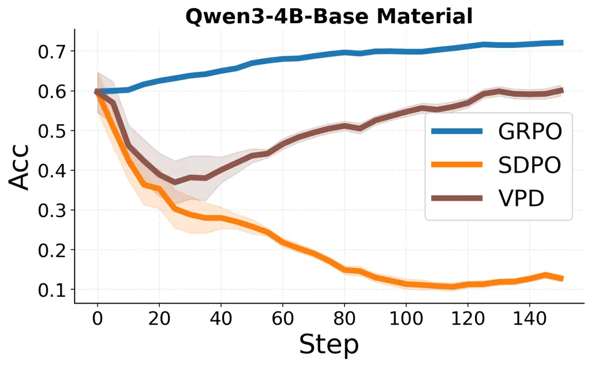

Figure 3: Training progression on Qwen3-4B-Base.

The "Cold Start" Problem on Base Models. Recent literature demonstrates
that GRPO can elicit advanced reasoning capabilities from a base
foundation model. However, when we apply SDPO to base models,
performance rapidly collapses to near zero. We hypothesize that
self-distillation intrinsically requires the policy to possess a
rudimentary level of instruction-following competence; if the base model
lacks the capacity to properly digest the diagnostic feedback
$`\mathcal{C}`$ in its prompt, the teacher’s target distribution becomes
corrupted. While our VPD formulation mitigates this collapse—increasing
discrimination power via the E-step updates and significantly delaying
the degradation—it still ultimately underperforms GRPO in pure
cold-start scenarios. Figure 3 illustrates this delayed collapse,
confirming that while VPD is far more robust than SDPO, pure RL remains
necessary for emergent reasoning elicitation.

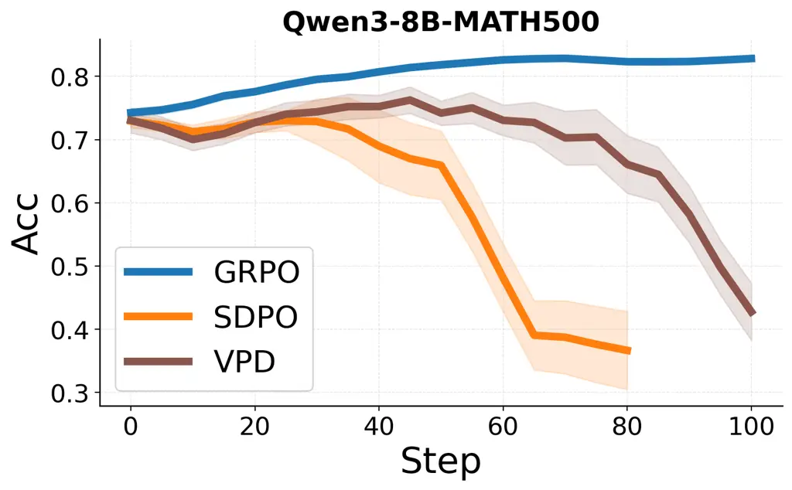

Figure 4: Performance on the Math500 benchmark for models trained on
DAPO-Math.

Mathematical Reasoning. Similarly, on challenging mathematical
benchmarks (e.g., training on DAPO-Math), SDPO suffers from severe
training collapse. This vulnerability to mathematical reasoning domains
has been observed in concurrent works (Kim et al., 2026). While VPD
again successfully delays this collapse, pure GRPO remains the dominant
approach (achieving 83.8% on Math500 with Qwen3-8B). We hypothesize that
this stems from the strict, non-forgiving nature of mathematical
derivations. Sparse RL (GRPO) encourages broad exploration, rewarding
the model only when it independently discovers a rigorous, fully correct
logical path. In contrast, self-distillation forces the student to
closely track the teacher’s intermediate token distribution. If the
teacher’s diagnostic feedback is imprecise or flawed, distilling this
noisy guidance may overly constrain exploration and inadvertently
reinforce incorrect reasoning steps.

Computational Efficiency. A major practical advantage of VPD is its
memory and sampling efficiency. By instantiating both policies within a
single shared-weight network, we completely eliminate the massive VRAM
overhead of hosting separate teacher models. Furthermore, because the
exact same on-policy student rollouts are shared across both the E-step
and M-step, VPD incurs zero additional sampling or environment
verification costs. While the explicit E-step introduces a
gradient-computation overhead compared to standard SDPO—empirically
observed as a 30% to 55% increase in overall runtime—this temporal cost
is effectively managed by our asymmetric update frequency (e.g., one
E-step per five M-steps). Ultimately, the significant gains in training
stability and final reasoning performance strongly justify this moderate
runtime increase, establishing VPD as a highly practical framework.

|           | Bio.  | Chem. | Mat.  | Phys. | AVG   |
| --------- | ----- | ----- | ----- | ----- | ----- |
| VPD (F5)  | 64.75 | 81.88 | 77.06 | 73.67 | 74.34 |
| VPD (F1)  | 61.12 | 78.51 | 72.47 | 68.75 | 70.21 |
| VPD (F10) | 59.50 | 79.50 | 71.61 | 66.48 | 69.27 |

Table 4: Ablation on E-step update frequency using Qwen3-1.7B. $`N`$
denotes one E-step per $`N`$ M-steps.

| Prior Type                   | Bio.  | Chem. | Mat.  | Phys. | AVG   |
| ---------------------------- | ----- | ----- | ----- | ----- | ----- |
| Dynamic ($`\pi_{\theta}`$)   | 64.75 | 81.88 | 77.06 | 73.67 | 74.34 |
| Fixed ($`\pi_{\text{ref}}`$) | 55.87 | 76.34 | 72.81 | 66.33 | 67.84 |

Table 5: Ablation on the E-Step reference prior using Qwen3-1.7B on
SciKnowEval.

Ablation: E-Step Update Frequency. As discussed in Sec. 3.4, our
shared-weight architecture allows for asymmetric update frequencies. In
our main experiments, we perform one E-step update for every 5 M-step
gradient updates (F5). To validate this design, we ablate the update
frequency on the SciKnowEval benchmark using Qwen3-1.7B. As shown in
Table 5, both overly frequent and overly infrequent E-step updates
degrade performance. If the teacher is updated too frequently (F1), the
target distribution becomes volatile, functioning like a rapidly moving
target network in RL that destabilizes the student’s distillation phase.
Conversely, if the teacher is updated too infrequently (F10), the target
distribution becomes stale, preventing the student from receiving
dynamically adjusted feedback. The F5 configuration provides the optimal
balance, allowing the student sufficient gradient steps to internalize
the refined guidance before the teacher advances.

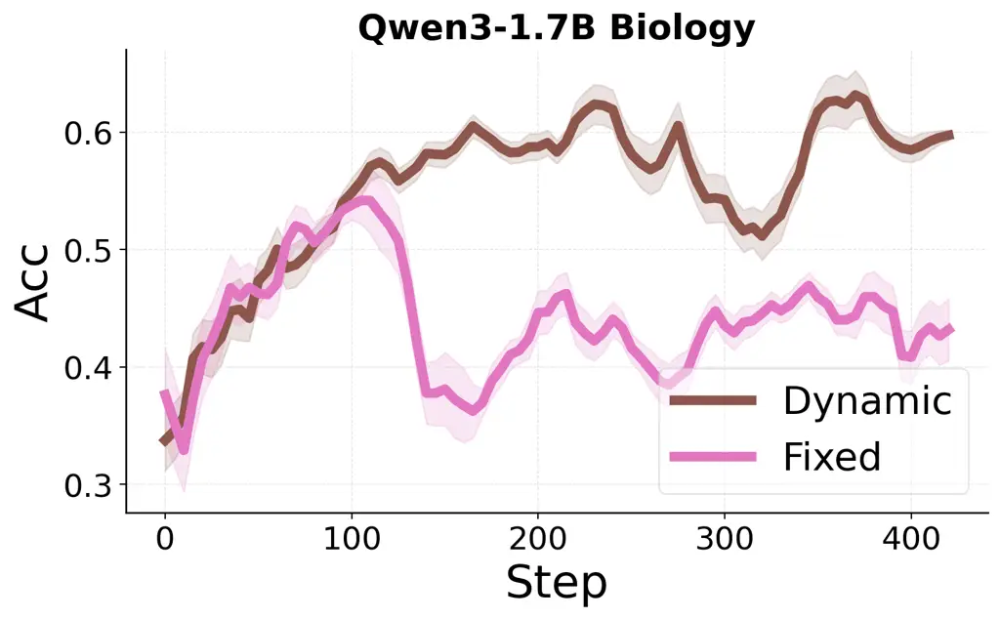

Figure 5: Training progression on Qwen3-1.7B with different reference
model for E-Step.

Ablation: Dynamic Reference Prior. As established in Eq. 7, VPD
dynamically anchors the reference prior to the current student policy
($`\pi_{\theta}`$). This sliding trust region restricts the teacher’s
target distribution, ensuring its guidance remains safely reachable for
the student. To validate this design, we conduct an ablation study
comparing our dynamic prior against a fixed reference model
($`\pi_{\text{ref}}`$). As shown in Table 5, reverting to a static prior
on Qwen3-1.7B not only results in a severe performance drop across the
evaluation domains but also severely degrades training stability (see
Fig. 5). This confirms our hypothesis: optimizing against a stale prior
induces harmful distribution shift, decoupling the teacher’s guidance
from the student’s exploration space and destabilizing the M-step
distillation.

## 5 Related Work

Reinforcement Learning with Verifiable Rewards (RLVR). Recent
advancements in large foundation models have popularized Reinforcement
Learning with Verifiable Rewards (RLVR) (Guo et al., 2025; Shao et al.,
2024; Yang et al., 2025a). Unlike traditional RLHF which relies on noisy
human preference models (Ouyang et al., 2022), RLVR optimizes LLMs
against deterministic, rule-based environments (e.g., Python
interpreters, formal theorem provers, or exact-match graders). While
RLVR provides unbiased ground-truth signals, it suffers heavily from
reward sparsity; a model receives a binary outcome only at the end of a
long generative trajectory, making the credit assignment problem
exceptionally difficult (Kazemnejad et al., 2024; Zhang et al., 2024;
Zhang et al., 2025; Zheng et al., 2025b; Liu et al., 2025). Our
Variational Policy Distillation (VPD) framework fundamentally solves
this sparsity issue. Instead of treating the verifiable environment
($`\mathcal{E}`$) as a black-box scalar reward generator, we extract
dense diagnostic feedback ($`\mathcal{C}`$) from it to condition an
intermediate teacher, transforming sparse RLVR into a rich, token-level
distillation process.

Iterative Self-Improvement and Preference Optimization. A rapidly
growing body of literature explores allowing LLMs to iteratively
self-improve using their own generated rollouts. Frameworks like
Self-Play Fine-Tuning (SPIN) (Chen et al., 2024) pit a model against its
previous iterations, while Self-Rewarding LLMs (Yuan et al., 2024)
prompt the model to act as its own reward judge. To bypass the
instabilities of policy gradients (e.g., PPO), recent methods
iteratively apply Direct Preference Optimization (DPO) (Rafailov et al., 2023) or leverage unpaired preference learning like Kahneman-Tversky
Optimization (KTO) (Ethayarajh et al., 2024) and Binary Classifier
Optimization (BCO) (Jung et al., 2025). However, unconstrained
self-improvement risks severe distribution shift and mode collapse, as
the target distribution can easily decouple from the student’s active
exploration space.

Privileged Information and On-Policy Self-Distillation. To mitigate
distribution shift and leverage privileged information without relying
on external oracles, recent research has shifted toward On-Policy
Self-Distillation. Methods such as On-Policy Self-Distillation (OPSD)
(Zhao et al., 2026) condition a teacher on ground-truth answers to
generate distillation targets. Similarly, On-Policy Context Distillation
(OPCD) (Ye et al., 2026b; Ye et al., 2026a) distills historical solution
traces and system-prompt behaviors into model weights, while
Self-Distillation Policy Optimization (SDPO) (Hübotter et al., 2026)
conditions a self-teacher on diagnostic feedback for dense credit
assignment. A major limitation of these existing methods is that they
typically treat the conditionally prompted teacher as a fixed, heuristic
oracle during the update step. Conceptually closer to our work is
$`\pi`$-Distill (Penaloza et al., 2026), which moves beyond a static
oracle by jointly learning a teacher (via GRPO) and a student. However,
it treats the teacher’s rollouts as disconnected off-policy samples to
subsequently fine-tune the student.

VPD fundamentally departs from all these approaches by embedding the
self-distillation process within a rigorous Expectation-Maximization
(EM) framework. Rather than blindly distilling from a static prompt or
relying on ad-hoc off-policy sampling, our E-step actively _optimizes_
the teacher to sharply distinguish successful from failed trajectories.
Crucially, this optimization is mathematically constrained within a
dynamic trust region. This guarantees that the teacher’s target
distribution is not only highly informative but remains safely anchored
to the student’s local support, ensuring stable M-step distillation and
preventing the vanishing gradients that plague standard
self-distillation. More broadly, while concurrent work explores
variational inference for LLM reasoning (Zhou et al., 2025), VPD
uniquely formulates this latent-variable optimization as a
teacher-student distillation problem.

Learning from Language Feedback. Moving beyond sparse scalar rewards, a
rapidly expanding body of work explores natural language as a denser,
more informative supervision signal. Theoretical foundations have
recently been laid by tracking LLM hypothesis spaces and utilizing the
transfer eluder dimension to quantify feedback information (Xu et al.,
2025), as well as by leveraging natural language for explicit value
estimation and policy improvement (Feng et al., 2024b). In practice,
methods integrate feedback through various mechanisms: some utilize
verbal reflections for temporal credit assignment (Chen et al., 2026;
Zhong et al., 2024; Yang et al., 2025b), while others treat feedback as
textual gradients to iteratively evolve responses (Lee et al., 2025;
Song et al., 2026). Another prominent strategy conditions models
directly on the feedback itself during fine-tuning, as seen in Chain of
Hindsight (Liu et al., 2023), Imitation learning from Language Feedback
(ILF) (Scheurer et al., 2023), and Feedback-Conditional Policy (FCP)
(Luo et al., 2025).

While these approaches successfully harness rich linguistic signals,
they typically require training separate, computationally expensive
critique models or rely on unconstrained, heuristic fine-tuning. VPD
streamlines this paradigm. By fusing the feedback-aware teacher and the
student into a single, shared-weight network ($`\theta=\phi`$), we embed
dense language critiques ($`\mathcal{C}`$) directly into a
mathematically bounded Expectation-Maximization cycle, achieving the
benefits of language feedback without the traditional memory overhead or
instability.

## 6 Conclusion

In this work, we introduced Variational Policy Distillation (VPD), a
framework that reframes self-distillation as a principled,
co-evolutionary Expectation-Maximization (EM) algorithm. Rather than
relying on frozen heuristic oracles or static reference models, VPD
jointly trains a feedback-aware teacher alongside an unconditioned
student. During the E-step, the framework actively updates the teacher
via unpaired preference learning (BCO) to extract sharper insights from
environmental critiques ($`\mathcal{C}`$). Crucially, by anchoring this
evolving teacher to the active student policy, we enforce a dynamic
trust-region that ensures the subsequent M-step distillation remains
highly informative yet safely within the student’s learning capacity. We
execute this complex cycle highly efficiently through a unified,
shared-weight architecture ($`\phi=\theta`$), completely eliminating the
massive memory overhead of traditional multi-model paradigms. Our
theoretical formulation and empirical evaluations demonstrate that this
approach yields stable optimization dynamics and consistent performance
gains on complex reasoning tasks, outperforming static reference methods
like standard SDPO.

Limitations and Future Work. Despite these advancements, our framework
has notable limitations. First, while VPD significantly improves upon
standard self-distillation and successfully delays training collapse in
challenging scenarios, it still ultimately lags behind pure sparse RL
(e.g., GRPO) in mathematical reasoning and base-model cold-starts. This
highlights an inherent limitation in relying on unstructured textual
feedback, which can sometimes be too noisy or imprecise for strict
logical derivations. Second, while our shared-weight parameterization
($`\phi=\theta`$) maximizes computational efficiency, it strictly bounds
the teacher’s representational capacity to the student’s architecture.
In highly complex domains, this strict coupling may prevent the teacher
from sufficiently approximating the optimal posterior. Moving forward,
future work should explore decoupled or partially decoupled
parameterizations (e.g., using parameter-efficient fine-tuning for the
teacher) to expand its diagnostic capacity without reintroducing massive
memory overheads. Additionally, analyzing the theoretical bounds of the
EM framework under varying degrees of feedback noise, and extending this
co-evolutionary process to continual learning scenarios, represent
exciting frontiers for developing autonomous, self-improving agents.

## References

- \[1\] R. Agarwal, N. Vieillard, Y. Zhou, P. Stanczyk, S. R. Garea, M.
  Geist, and O. Bachem (2024) On-policy distillation of language models:
  learning from self-generated mistakes. In The twelfth international
  conference on learning representations, Cited by: §1.
- \[2\] W. Chen, J. Chen, F. Tajwar, H. Zhu, X. Duan, R. Salakhutdinov,
  and J. Schneider (2026) Retrospective in-context learning for temporal
  credit assignment with large language models. arXiv preprint
  arXiv:2602.17497. Cited by: §5.
- \[3\] Z. Chen, Y. Deng, H. Yuan, K. Ji, and Q. Gu (2024) Self-play
  fine-tuning converts weak language models to strong language models.
  arXiv preprint arXiv:2401.01335. Cited by: §5.
- \[4\] K. Ethayarajh, W. Xu, N. Muennighoff, D. Jurafsky, and D.
  Kiela (2024) Kto: model alignment as prospect theoretic optimization.
  arXiv preprint arXiv:2402.01306. Cited by: §5.
- \[5\] K. Feng, X. Shen, W. Wang, X. Zhuang, Y. Tang, Q. Zhang, and K.
  Ding (2024) Sciknoweval: evaluating multi-level scientific knowledge
  of large language models. arXiv preprint arXiv:2406.09098. Cited by:
  §C.2, §4.
- \[6\] X. Feng, B. Liu, Y. Song, H. Fu, Z. Wan, G. A. Koushik, Z.
  Hu, M. Yang, Y. Wen, and J. Wang (2024) Natural language reinforcement
  learning. arXiv preprint arXiv:2411.14251. Cited by: §5.
- \[7\] L. Gao, J. Schulman, and J. Hilton (2023) Scaling laws for
  reward model overoptimization. In International Conference on Machine
  Learning, pp. 10835–10866. Cited by: §2.
- \[8\] D. Go, T. Korbak, G. Kruszewski, J. Rozen, N. Ryu, and M.
  Dymetman (2023) Aligning language models with preferences through
  f-divergence minimization. arXiv preprint arXiv:2302.08215. Cited by:
  §3.1.
- \[9\] D. Guo, D. Yang, H. Zhang, J. Song, P. Wang, Q. Zhu, R. Xu, R.
  Zhang, S. Ma, X. Bi, et al. (2025) Deepseek-r1: incentivizing
  reasoning capability in llms via reinforcement learning. arXiv
  preprint arXiv:2501.12948. Cited by: §1, §5.
- \[10\] J. Hübotter, F. Lübeck, L. Behric, A. Baumann, M. Bagatella, D.
  Marta, I. Hakimi, I. Shenfeld, T. K. Buening, C. Guestrin, et
  al. (2026) Reinforcement learning via self-distillation. arXiv
  preprint arXiv:2601.20802. Cited by: §B.3, §C.1, §C.1, §1, §2, §4.1,
  §4.1, §4, §5.
- \[11\] N. Jain, K. Han, A. Gu, W. Li, F. Yan, T. Zhang, S. Wang, A.
  Solar-Lezama, K. Sen, and I. Stoica (2024) Livecodebench: holistic and
  contamination free evaluation of large language models for code. arXiv
  preprint arXiv:2403.07974. Cited by: §C.1, §4.
- \[12\] S. Jung, G. Han, D. W. Nam, and K. On (2025) Binary classifier
  optimization for large language model alignment. In Proceedings of the
  63rd Annual Meeting of the Association for Computational Linguistics
  (Volume 1: Long Papers), pp. 1858–1872. Cited by: §3.2, §3.2, §5.
- \[13\] A. Kazemnejad, M. Aghajohari, E. Portelance, A. Sordoni, S.
  Reddy, A. Courville, and N. L. Roux (2024) Vineppo: refining credit
  assignment in rl training of llms. arXiv preprint arXiv:2410.01679.
  Cited by: §5.
- \[14\] J. Kim, X. Luo, M. Kim, S. Lee, D. Kim, J. Jeon, D. Li, and Y.
  Yang (2026) Why does self-distillation (sometimes) degrade the
  reasoning capability of llms?. arXiv preprint arXiv:2603.24472. Cited
  by: §4.2.
- \[15\] Y. Lee, J. Boen, and C. Finn (2025) Feedback descent:
  open-ended text optimization via pairwise comparison. arXiv preprint
  arXiv:2511.07919. Cited by: §5.
- \[16\] H. Lightman, V. Kosaraju, Y. Burda, H. Edwards, B. Baker, T.
  Lee, J. Leike, J. Schulman, I. Sutskever, and K. Cobbe (2023) Let’s
  verify step by step. arXiv preprint arXiv:2305.20050. Cited by: §C.5,
  §4.
- \[17\] H. Liu, C. Sferrazza, and P. Abbeel (2023) Chain of hindsight
  aligns language models with feedback. arXiv preprint arXiv:2302.02676.
  Cited by: §1, §5.
- \[18\] Z. Liu, P. Wang, R. Xu, S. Ma, C. Ruan, P. Li, Y. Liu, and Y.
  Wu (2025) Inference-time scaling for generalist reward modeling. arXiv
  preprint arXiv:2504.02495. Cited by: §5.
- \[19\] R. Luo, Z. Liu, X. Liu, C. Du, M. Lin, W. Chen, W. Lu, and T.
  Pang (2025) Language models can learn from verbal feedback without
  scalar rewards. arXiv preprint arXiv:2509.22638. Cited by: §5.
- \[20\] R. M. Neal and G. E. Hinton (1998) A view of the em algorithm
  that justifies incremental, sparse, and other variants. In Learning in
  graphical models, pp. 355–368. Cited by: §B.2.
- \[21\] T. Olmo, A. Ettinger, A. Bertsch, B. Kuehl, D. Graham, D.
  Heineman, D. Groeneveld, F. Brahman, F. Timbers, H. Ivison, et
  al. (2025) Olmo 3. arXiv preprint arXiv:2512.13961. Cited by: §C.2,
  §4.
- \[22\] L. Ouyang, J. Wu, X. Jiang, D. Almeida, C. Wainwright, P.
  Mishkin, C. Zhang, S. Agarwal, K. Slama, A. Ray, et al. (2022)
  Training language models to follow instructions with human feedback.
  Advances in neural information processing systems 35, pp. 27730–27744.
  Cited by: §1, §5.
- \[23\] R. Y. Pang, W. Yuan, K. Cho, H. He, S. Sukhbaatar, and J.
  Weston (2024) Iterative reasoning preference optimization. Advances in
  Neural Information Processing Systems 37, pp. 116617–116637. Cited by:
  §3.2.
- \[24\] E. Penaloza, D. Vattikonda, N. Gontier, A. Lacoste, L. Charlin,
  and M. Caccia (2026) Privileged information distillation for language
  models. arXiv preprint arXiv:2602.04942. Cited by: §5.
- \[25\] X. B. Peng, A. Kumar, G. Zhang, and S. Levine (2019)
  Advantage-weighted regression: simple and scalable off-policy
  reinforcement learning. arXiv preprint arXiv:1910.00177. Cited by:
  §3.1.
- \[26\] Y. Qu, A. Setlur, V. Smith, R. Salakhutdinov, and A.
  Kumar (2026) POPE: learning to reason on hard problems via privileged
  on-policy exploration. arXiv preprint arXiv:2601.18779. Cited by: §1,
  §2.
- \[27\] R. Rafailov, A. Sharma, E. Mitchell, C. D. Manning, S. Ermon,
  and C. Finn (2023) Direct preference optimization: your language model
  is secretly a reward model. Advances in neural information processing
  systems 36, pp. 53728–53741. Cited by: §3.1, §3.2, §5.
- \[28\] C. Rosset, C. Cheng, A. Mitra, M. Santacroce, A. Awadallah,
  and T. Xie (2024) Direct nash optimization: teaching language models
  to self-improve with general preferences. arXiv preprint
  arXiv:2404.03715. Cited by: §3.2.
- \[29\] J. Scheurer, J. A. Campos, T. Korbak, J. S. Chan, A. Chen, K.
  Cho, and E. Perez (2023) Training language models with language
  feedback at scale. arXiv preprint arXiv:2303.16755. Cited by: §1, §5.
- \[30\] J. Schulman, S. Levine, P. Abbeel, M. Jordan, and P.
  Moritz (2015) Trust region policy optimization. In International
  conference on machine learning, pp. 1889–1897. Cited by: §3.2.
- \[31\] J. Schulman, F. Wolski, P. Dhariwal, A. Radford, and O.
  Klimov (2017) Proximal policy optimization algorithms. arXiv preprint
  arXiv:1707.06347. Cited by: §3.2, §3.4.
- \[32\] A. Setlur, Z. Wang, A. Cohen, P. Rashidinejad, and S. M.
  Xie (2026) Reuse your flops: scaling rl on hard problems by
  conditioning on very off-policy prefixes. arXiv preprint
  arXiv:2601.18795. Cited by: §1.
- \[33\] Z. Shao, P. Wang, Q. Zhu, R. Xu, J. Song, X. Bi, H. Zhang, M.
  Zhang, Y. Li, Y. Wu, et al. (2024) Deepseekmath: pushing the limits of
  mathematical reasoning in open language models. arXiv preprint
  arXiv:2402.03300. Cited by: §1, §2, §4, §5.
- \[34\] I. Shenfeld, M. Damani, J. Hübotter, and P. Agrawal (2026)
  Self-distillation enables continual learning. arXiv preprint
  arXiv:2601.19897. Cited by: §1.
- \[35\] Y. Song, L. Chen, F. Tajwar, R. Munos, D. Pathak, J. A.
  Bagnell, A. Singh, and A. Zanette (2026) Expanding the capabilities of
  reinforcement learning via text feedback. arXiv preprint
  arXiv:2602.02482. Cited by: §5.
- \[36\] Y. Wu, Z. Sun, H. Yuan, K. Ji, Y. Yang, and Q. Gu (2024)
  Self-play preference optimization for language model alignment. arXiv
  preprint arXiv:2405.00675. Cited by: §3.2.
- \[37\] W. Xu, A. Nie, R. Zheng, A. Modi, A. Swaminathan, and C.
  Cheng (2025) Provably learning from language feedback. arXiv preprint
  arXiv:2506.10341. Cited by: §5.
- \[38\] A. Yang, A. Li, B. Yang, B. Zhang, B. Hui, B. Zheng, B. Yu, C.
  Gao, C. Huang, C. Lv, et al. (2025) Qwen3 technical report. arXiv
  preprint arXiv:2505.09388. Cited by: §C.1, §C.2, §1, §4, §5.
- \[39\] C. Yang, C. Qin, Q. Si, M. Chen, N. Gu, D. Yao, Z. Lin, W.
  Wang, J. Wang, and N. Duan (2026) Self-distilled rlvr. arXiv preprint
  arXiv:2604.03128. Cited by: §B.3.
- \[40\] W. Yang, J. Chen, Y. Lin, and J. Wen (2025) Deepcritic:
  deliberate critique with large language models. arXiv preprint
  arXiv:2505.00662. Cited by: §5.
- \[41\] T. Ye, L. Dong, Q. Dong, X. Wu, S. Huang, and F. Wei (2026)
  Online experiential learning for language models. arXiv preprint
  arXiv:2603.16856. Cited by: §5.
- \[42\] T. Ye, L. Dong, X. Wu, S. Huang, and F. Wei (2026) On-policy
  context distillation for language models. arXiv preprint
  arXiv:2602.12275. Cited by: §5.
- \[43\] Q. Yu, Z. Zhang, R. Zhu, Y. Yuan, X. Zuo, Y. Yue, W. Dai, T.
  Fan, G. Liu, L. Liu, et al. (2025) Dapo: an open-source llm
  reinforcement learning system at scale. arXiv preprint
  arXiv:2503.14476. Cited by: §C.5, §1, §2, §4.
- \[44\] W. Yuan, R. Y. Pang, K. Cho, X. Li, S. Sukhbaatar, J. Xu,
  and J. E. Weston (2024) Self-rewarding language models. In Forty-first
  International Conference on Machine Learning, Cited by: §5.
- \[45\] L. Zhang, A. Hosseini, H. Bansal, M. Kazemi, A. Kumar, and R.
  Agarwal (2024) Generative verifiers: reward modeling as next-token
  prediction. arXiv preprint arXiv:2408.15240. Cited by: §5.
- \[46\] Y. Zhang and T. Math-AI (2024) American invitational
  mathematics examination (aime) 2024. Cited by: §4.
- \[47\] Y. Zhang and T. Math-AI (2025) American invitational
  mathematics examination (aime) 2025. Cited by: §4.
- \[48\] Y. Zhang, W. Yao, C. Yu, Y. Liu, Q. Yin, B. Yin, H. Yun, and L.
  Li (2025) Improving sampling efficiency in rlvr through adaptive
  rollout and response reuse. arXiv preprint arXiv:2509.25808. Cited by:
  §1, §5.
- \[49\] S. Zhao, Z. Xie, M. Liu, J. Huang, G. Pang, F. Chen, and A.
  Grover (2026) Self-distilled reasoner: on-policy self-distillation for
  large language models. arXiv preprint arXiv:2601.18734. Cited by: §1,
  §5.
- \[50\] C. Zheng, S. Liu, M. Li, X. Chen, B. Yu, C. Gao, K. Dang, Y.
  Liu, R. Men, A. Yang, et al. (2025) Group sequence policy
  optimization. arXiv preprint arXiv:2507.18071. Cited by: §1, §2.
- \[51\] H. Zheng, Y. Zhou, B. R. Bartoldson, B. Kailkhura, F. Lai, J.
  Zhao, and B. Chen (2025) Act only when it pays: efficient
  reinforcement learning for llm reasoning via selective rollouts. arXiv
  preprint arXiv:2506.02177. Cited by: §1, §5.
- \[52\] V. Zhong, D. Misra, X. Yuan, and M. Côté (2024) Policy
  improvement using language feedback models. Advances in Neural
  Information Processing Systems 37, pp. 43730–43758. Cited by: §5.
- \[53\] X. Zhou, Z. Liu, H. Wang, C. Du, M. Lin, C. Li, L. Wang, and T.
  Pang (2025) Variational reasoning for language models. arXiv preprint
  arXiv:2509.22637. Cited by: §5.

## Appendix A Theoretical Derivations

This appendix provides the formal derivations for the variational
framework introduced in Section 3. We first derive the closed-form
optimal policy under the KL-regularized RLVR objective, demonstrate its
equivalence to minimizing the reverse KL divergence, and finally
establish the Expectation-Maximization (EM) lower bound that justifies
the alternating optimization of the teacher $`q_{\phi}`$ and student
$`\pi_{\theta}`$.

### A.1 Derivation of the Optimal Target Distribution

The standard KL-regularized RLVR objective for a given context $`x`$ is
defined as:

```math
\mathcal{J}(\pi)=\mathbb{E}_{y\sim\pi(\cdot|x)}\left[r(x,y)\right]-\beta D_{\mathrm{KL}}\left(\pi(\cdot\mid x)\parallel\pi_{\text{ref}}(\cdot\mid x)\right). \tag{A.1}
```

We wish to find the optimal policy $`\pi^{*}`$ that maximizes
$`\mathcal{J}(\pi)`$ subject to the probability constraint
$`\sum_{y}\pi(y\mid x)=1`$. We formulate this constrained optimization
problem using the method of Lagrange multipliers. The Lagrangian is
given by:

```math
\mathcal{L}(\pi,\lambda)=\sum_{y}\pi(y\mid x)r(x,y)-\beta\sum_{y}\pi(y\mid x)\log\frac{\pi(y\mid x)}{\pi_{\text{ref}}(y\mid x)}-\lambda\left(\sum_{y}\pi(y\mid x)-1\right). \tag{A.2}
```

Taking the partial derivative of $`\mathcal{L}`$ with respect to
$`\pi(y\mid x)`$ and setting it to zero yields:

```math
\frac{\partial\mathcal{L}}{\partial\pi(y\mid x)}=r(x,y)-\beta\left(\log\frac{\pi(y\mid x)}{\pi_{\text{ref}}(y\mid x)}+1\right)-\lambda=0. \tag{A.3}
```

Solving for $`\pi(y\mid x)`$:

```math
\log\frac{\pi(y\mid x)}{\pi_{\text{ref}}(y\mid x)}=\frac{1}{\beta}r(x,y)-1-\frac{\lambda}{\beta}\implies\pi^{*}(y\mid x)=\pi_{\text{ref}}(y\mid x)\exp\left(\frac{1}{\beta}r(x,y)\right)\exp\left(-1-\frac{\lambda}{\beta}\right). \tag{A.4}
```

To eliminate the Lagrange multiplier $`\lambda`$, we apply the
constraint that the probabilities must sum to 1. This reveals that the
term $`\exp(-1-\frac{\lambda}{\beta})`$ acts as a normalization
constant. We define the partition function $`Z(x)`$ as:

```math
Z(x)=\sum_{y}\pi_{\text{ref}}(y\mid x)\exp\left(\frac{1}{\beta}r(x,y)\right). \tag{A.5}
```

Thus, the optimal target distribution is the exponentially reward-tilted
policy:

```math
\pi^{*}(y\mid x)=\frac{1}{Z(x)}\pi_{\text{ref}}(y\mid x)\exp\left(\frac{1}{\beta}r(x,y)\right). \tag{A.6}
```

### A.2 Equivalence of Reverse KL and the RLVR Objective

We now demonstrate that minimizing the reverse KL divergence between the
student policy $`\pi_{\theta}`$ and the optimal policy $`\pi^{*}`$ is
mathematically equivalent to maximizing the original RLVR objective.
Expanding the definition of the KL divergence:

```math
D_{\mathrm{KL}}(\pi_{\theta}\parallel\pi^{*})=\mathbb{E}_{y\sim\pi_{\theta}}\left[\log\pi_{\theta}(y\mid x)-\log\pi^{*}(y\mid x)\right]. \tag{A.7}
```

Substituting the definition of $`\pi^{*}(y\mid x)`$ from Equation A.6:

```math
\displaystyle D_{\mathrm{KL}}(\pi_{\theta}\parallel\pi^{*}) \displaystyle=\mathbb{E}_{y\sim\pi_{\theta}}\left[\log\pi_{\theta}(y\mid x)-\log\left(\frac{1}{Z(x)}\pi_{\text{ref}}(y\mid x)\exp\left(\frac{1}{\beta}r(x,y)\right)\right)\right]
```

```math
\displaystyle=\mathbb{E}_{y\sim\pi_{\theta}}\left[\log\pi_{\theta}(y\mid x)-\log\pi_{\text{ref}}(y\mid x)-\frac{1}{\beta}r(x,y)+\log Z(x)\right]
```

```math
\displaystyle=D_{\mathrm{KL}}(\pi_{\theta}\parallel\pi_{\text{ref}})-\frac{1}{\beta}\mathbb{E}_{y\sim\pi_{\theta}}\left[r(x,y)\right]+\log Z(x). \tag{A.8}
```

Multiplying both sides by $`-\beta`$, we observe:

```math
-\beta D_{\mathrm{KL}}(\pi_{\theta}\parallel\pi^{*})=\mathbb{E}_{y\sim\pi_{\theta}}\left[r(x,y)\right]-\beta D_{\mathrm{KL}}(\pi_{\theta}\parallel\pi_{\text{ref}})-\beta\log Z(x). \tag{A.9}
```

Since the term $`\beta\log Z(x)`$ depends only on the environment and
$`\pi_{\text{ref}}`$, it is a constant with respect to the policy
parameters $`\theta`$. Therefore, minimizing the reverse KL divergence
exactly maximizes the original objective $`\mathcal{J}(\theta)`$.

### A.3 Variational Expectation-Maximization Lower Bound

Because $`Z(x)`$ is analytically intractable, computing the exact
log-likelihood of $`\pi^{*}`$ is impossible. We introduce a tractable
teacher distribution $`q_{\phi}(y\mid x,\mathcal{C})`$ conditioned on
the dense language feedback $`\mathcal{C}`$ to act as an approximate
posterior.

To evaluate the quality of this approximation, we look to the
log-partition function, $`\log Z(x)`$. By rearranging the equivalence
established in Equation A.9, we can express the original RL objective
as:

```math
\mathcal{J}(\pi)=\beta\log Z(x)-\beta D_{\mathrm{KL}}(\pi\parallel\pi^{*}). \tag{A.10}
```

Because the KL divergence is strictly non-negative, the maximum possible
value of the objective function is exactly $`\beta\log Z(x)`$, achieved
only when $`\pi`$ perfectly matches $`\pi^{*}`$. Therefore,
$`\log Z(x)`$ represents the absolute theoretical ceiling of performance
under the KL constraint.

To bound this intractable ceiling, we multiply and divide the terms
inside $`Z(x)`$ by our teacher distribution
$`q_{\phi}(y\mid x,\mathcal{C})`$:

```math
\log Z(x)=\log\sum_{y}q_{\phi}(y\mid x,\mathcal{C})\frac{\pi_{\text{ref}}(y\mid x)\exp\left(\frac{1}{\beta}r(x,y)\right)}{q_{\phi}(y\mid x,\mathcal{C})}. \tag{A.11}
```

Applying Jensen’s Inequality, we establish the Evidence Lower Bound
(ELBO), denoted as $`\mathcal{F}(q_{\phi})`$:

```math
\displaystyle\log Z(x) \displaystyle\geq\sum_{y}q_{\phi}(y\mid x,\mathcal{C})\log\frac{\pi_{\text{ref}}(y\mid x)\exp\left(\frac{1}{\beta}r(x,y)\right)}{q_{\phi}(y\mid x,\mathcal{C})}
```

```math
\displaystyle=\frac{1}{\beta}\mathbb{E}_{y\sim q_{\phi}}\left[r(x,y)\right]-D_{\mathrm{KL}}(q_{\phi}\parallel\pi_{\text{ref}})\equiv\mathcal{F}(q_{\phi}). \tag{A.12}
```

To explicitly derive the gap between this lower bound and the true
optimal log-partition function, we expand the KL divergence between our
approximate posterior $`q_{\phi}`$ and the optimal policy $`\pi^{*}`$:

```math
D_{\mathrm{KL}}(q_{\phi}\parallel\pi^{*})=\mathbb{E}_{y\sim q_{\phi}}\left[\log q_{\phi}(y\mid x,\mathcal{C})-\log\pi^{*}(y\mid x)\right]. \tag{A.13}
```

Substituting the definition of $`\pi^{*}(y\mid x)`$ from Equation A.6:

```math
\displaystyle D_{\mathrm{KL}}(q_{\phi}\parallel\pi^{*}) \displaystyle=\mathbb{E}_{y\sim q_{\phi}}\left[\log q_{\phi}(y\mid x,\mathcal{C})-\log\left(\frac{1}{Z(x)}\pi_{\text{ref}}(y\mid x)\exp\left(\frac{1}{\beta}r(x,y)\right)\right)\right]
```

```math
\displaystyle=\mathbb{E}_{y\sim q_{\phi}}\left[\log q_{\phi}(y\mid x,\mathcal{C})-\log\pi_{\text{ref}}(y\mid x)-\frac{1}{\beta}r(x,y)+\log Z(x)\right]. \tag{A.14}
```

By separating the terms, we can reformulate this in terms of the ELBO:

```math
\displaystyle D_{\mathrm{KL}}(q_{\phi}\parallel\pi^{*}) \displaystyle=\log Z(x)+\mathbb{E}_{y\sim q_{\phi}}\left[\log\frac{q_{\phi}(y\mid x,\mathcal{C})}{\pi_{\text{ref}}(y\mid x)}\right]-\frac{1}{\beta}\mathbb{E}_{y\sim q_{\phi}}\left[r(x,y)\right]
```

```math
\displaystyle=\log Z(x)+D_{\mathrm{KL}}(q_{\phi}\parallel\pi_{\text{ref}})-\frac{1}{\beta}\mathbb{E}_{y\sim q_{\phi}}\left[r(x,y)\right]
```

```math
\displaystyle=\log Z(x)-\left(\frac{1}{\beta}\mathbb{E}_{y\sim q_{\phi}}\left[r(x,y)\right]-D_{\mathrm{KL}}(q_{\phi}\parallel\pi_{\text{ref}})\right). \tag{A.15}
```

Recognizing the term inside the parentheses as exactly our definition of
$`\mathcal{F}(q_{\phi})`$, we arrive at the fundamental decomposition:

```math
\log Z(x)=\mathcal{F}(q_{\phi})+D_{\mathrm{KL}}(q_{\phi}\parallel\pi^{*}). \tag{A.16}
```

Because $`\log Z(x)`$ is a constant with respect to $`\phi`$, this
derivation proves that maximizing the tractable lower bound
$`\mathcal{F}(q_{\phi})`$ is mathematically equivalent to minimizing the
divergence $`D_{\mathrm{KL}}(q_{\phi}\parallel\pi^{*})`$. This
establishes the following E-Step optimization:


To mathematically justify the M-step, we must connect this updated
teacher back to our global objective: minimizing
$`D_{\mathrm{KL}}(\pi_{\theta}\parallel\pi^{*})`$. By adding and
subtracting $`\log q_{\phi}(y\mid x,\mathcal{C})`$ inside the
expectation of this global objective, we can decompose it as follows:

```math
\displaystyle D_{\mathrm{KL}}(\pi_{\theta}\parallel\pi^{*}) \displaystyle=\mathbb{E}_{y\sim\pi_{\theta}}\left[\log\pi_{\theta}(y\mid x)-\log\pi^{*}(y\mid x)\right]
```

```math
\displaystyle=\mathbb{E}_{y\sim\pi_{\theta}}\left[\log\pi_{\theta}(y\mid x)-\log q_{\phi}(y\mid x,\mathcal{C})+\log q_{\phi}(y\mid x,\mathcal{C})-\log\pi^{*}(y\mid x)\right]
```

```math
\displaystyle=D_{\mathrm{KL}}(\pi_{\theta}\parallel q_{\phi})+\mathbb{E}_{y\sim\pi_{\theta}}\left[\log\frac{q_{\phi}(y\mid x,\mathcal{C})}{\pi^{*}(y\mid x)}\right]. \tag{A.17}
```

While the E-step cannot guarantee that $`q_{\phi}`$ perfectly matches
the optimal policy $`\pi^{*}`$ due to finite network capacity, it
actively minimizes the residual error represented by the second term. By
treating the optimized $`q_{\phi}`$ as the tightest tractable surrogate
for the optimal policy, the M-step circumvents the intractable global
objective by instead minimizing the proxy divergence
$`D_{\mathrm{KL}}(\pi_{\theta}\parallel q_{\phi})`$. This establishes
the following M-Step optimization:


### A.4 Theoretical Implications of the Dynamic Reference Model

As established in Equation 7, we define the effective implicit reward
using a dynamic prior by setting the reference model to the current
student policy, $`\pi_{\theta}`$. This formulation is mathematically
equivalent to defining an optimal target distribution
$`\pi^{*}_{\text{dyn}}`$ where the student acts as the base prior:

```math
\pi^{*}_{\text{dyn}}(y\mid x,\mathcal{C})=\frac{1}{Z_{\text{dyn}}(x)}\pi_{\theta}(y\mid x)\exp\left(\frac{r(x,y)}{\beta}\right) \tag{A.18}
```

where $`Z_{\text{dyn}}(x)`$ is the partition function.

To deeply understand the regularizing effect of this dynamic prior, we
analyze the E-step objective from two complementary mathematical
perspectives: its relationship to standard static priors, and its role
as an adaptive trust region.

Perspective 1: The Adaptive Alignment Bonus. First, we can contrast our
dynamic target directly against the standard optimal target $`\pi^{*}`$
introduced previously in Equation 3, which utilizes a fixed, static
prior anchored to the initial reference model $`\pi_{\text{ref}}`$. We
can analytically express our new dynamic target as a probability-ratio
scaled version of this static target:

```math
\pi^{*}_{\text{dyn}}(y\mid x,\mathcal{C})=\left(\frac{Z_{\text{stat}}(x)}{Z_{\text{dyn}}(x)}\right)\frac{\pi_{\theta}(y\mid x)}{\pi_{\text{ref}}(y\mid x)}\pi^{*}(y\mid x) \tag{A.19}
```

Because our E-step objective is to minimize the KL divergence between
the teacher policy $`q_{\phi}`$ and this dynamic optimal target, we can
substitute the ratio expansion into the objective:

```math
\displaystyle\min_{\phi}D_{\text{KL}}(q_{\phi}\parallel\pi^{*}_{\text{dyn}}) \displaystyle=\mathbb{E}_{q_{\phi}}\left[\log\frac{q_{\phi}(y\mid x,\mathcal{C})}{\pi^{*}_{\text{dyn}}(y\mid x,\mathcal{C})}\right]
```

```math
\displaystyle=\mathbb{E}_{q_{\phi}}\left[\log\frac{q_{\phi}}{\pi^{*}}-\log\frac{\pi_{\theta}}{\pi_{\text{ref}}}-\log\frac{Z_{\text{stat}}}{Z_{\text{dyn}}}\right]
```

```math
\displaystyle=D_{\text{KL}}(q_{\phi}\parallel\pi^{*})-\mathbb{E}_{q_{\phi}}\left[\log\frac{\pi_{\theta}(y\mid x)}{\pi_{\text{ref}}(y\mid x)}\right]+C. \tag{A.20}
```

This derivation reveals a profound insight into how VPD stabilizes
co-evolution. The E-step objective is mathematically equivalent to the
standard, static objective, but with a critical additional penalty term:
$`-\mathbb{E}_{q_{\phi}}[\log(\pi_{\theta}/\pi_{\text{ref}})]`$. This
extra term acts as an adaptive alignment bonus. It explicitly
incentivizes the teacher to upweight trajectories where the current
student ($`\pi_{\theta}`$) assigns a higher likelihood than the base
model ($`\pi_{\text{ref}}`$). Instead of rigidly pulling the teacher
toward an absolute global optimum that may be conceptually out of reach
for the student, the teacher actively anchors its guidance to the
pathways the student has already begun to master.

Perspective 2: The Sliding Trust Region. Alternatively, to explicitly
demonstrate how this dynamic prior restricts the teacher’s updates, we
can expand the E-step KL divergence directly:

```math
\displaystyle\min_{\phi}D_{\text{KL}}(q_{\phi}\parallel\pi^{*}_{\text{dyn}}) \displaystyle=\mathbb{E}_{q_{\phi}}\left[\log\frac{q_{\phi}(y\mid x,\mathcal{C})}{\pi^{*}_{\text{dyn}}(y\mid x,\mathcal{C})}\right]
```

```math
\displaystyle=\mathbb{E}_{q_{\phi}}\left[\log q_{\phi}(y\mid x,\mathcal{C})-\log\left(\frac{1}{Z_{\text{dyn}}(x)}\pi_{\theta}(y\mid x)\exp\left(\frac{r(x,y)}{\beta}\right)\right)\right]
```

```math
\displaystyle=\mathbb{E}_{q_{\phi}}\left[\log\frac{q_{\phi}(y\mid x,\mathcal{C})}{\pi_{\theta}(y\mid x)}-\frac{r(x,y)}{\beta}+\log Z_{\text{dyn}}(x)\right]
```

```math
\displaystyle=D_{\text{KL}}(q_{\phi}\parallel\pi_{\theta})-\frac{1}{\beta}\mathbb{E}_{q_{\phi}}[r(x,y)]+\log Z_{\text{dyn}}(x). \tag{A.21}
```

Because $`\log Z_{\text{dyn}}(x)`$ is a constant with respect to the
teacher’s parameters $`\phi`$, minimizing this KL divergence is
mathematically identical to solving the following constrained
optimization problem:

```math
\max_{\phi}\mathbb{E}_{q_{\phi}}[r(x,y)]-\beta D_{\text{KL}}(q_{\phi}\parallel\pi_{\theta}). \tag{A.22}
```

This direct expansion exposes the profound regularizing effect of the
dynamic prior. By anchoring the implicit reward to the current student
$`\pi_{\theta}`$, the E-step objective naturally produces a strict KL
penalty against the student’s active distribution. Our dynamic
formulation fundamentally acts as a sliding trust region. It enforces a
geometric boundary: the teacher is permitted to adjust its distribution
to maximize the diagnostic language feedback, but it is mathematically
penalized for proposing targets that fall outside the student’s current
active learning capacity. This ensures the dense distributional guidance
provided during the M-step is always a safely reachable "next step,"
thereby eliminating the catastrophic training collapse observed in
standard single-phase hybrid methods.

Stable Inner Loops and Dynamic Outer Loops. Finally, it is important to
distinguish the stationary nature of the E-step from the global
trajectory of training. Because the student parameters $`\theta`$ are
continuously updated during the M-step, the optimal target
$`\pi^{*}_{\text{dyn}}`$ dynamically shifts across the overall training
process. However, the reference likelihoods $`\pi_{\theta}(y\mid x)`$
are pre-calculated and frozen before each individual E-step begins. This
ensures that within the bounds of any specific E-step, the target
remains strictly stationary, allowing for highly stable gradient descent
while still supporting the continuous co-evolution of the policies.

## Appendix B Method

### B.1 VPD Algorithm

0:  Initialized model parameters $`\theta_{0}`$, Prompt dataset
$`\mathcal{D}`$, Verifiable Environment $`\mathcal{E}`$, KL coefficient
$`\beta`$, Number of iterations $`K`$

1:  for $`k=1,2,\dots,K`$ do

2:   // 1. On-Policy Rollout

3:   Sample a batch of prompts $`x\sim\mathcal{D}`$.

4:   Generate student trajectories
$`y\sim\pi_{\theta_{k-1}}(\cdot\mid x)`$.

5:   // 2. Environment Critique

6:   for each trajectory $`y`$ do

7:    Evaluate $`y`$ using $`\mathcal{E}`$ to obtain binary outcome
$`r(x,y)`$ and diagnostic feedback $`\mathcal{C}`$.

8:   end for

9:   Partition trajectories and feedback into successes
$`\{(y^{+},\mathcal{C}^{+})\}`$ and failures
$`\{(y^{-},\mathcal{C}^{-})\}`$

10:   // 3. E-Step: Teacher Refinement (Unpaired Preference)

11:   Synchronize teacher alias with current student weights:
$`\phi_{k}\leftarrow\theta_{k-1}`$.

12:   Compute the dynamic reward shift
$`\delta=\frac{1}{2}(\mathbb{E}[\tilde{r}_{\phi_{k}}(x,y^{+},\mathcal{C}^{+})]+\mathbb{E}[\tilde{r}_{\phi_{k}}(x,y^{-},\mathcal{C}^{-})])`$.

13:   Update parameters to obtain refined teacher $`\phi^{\prime}_{k}`$
by minimizing $`\mathcal{L}_{\text{E-step}}`$ (Eq. 9).

14:   // 4. M-Step: Student Distillation (Information Projection)

15:   Update student $`\theta_{k}`$ by minimizing
$`\mathcal{L}_{\text{M-step}}`$ against the stop-gradient teacher
$`\text{sg}[q_{\phi^{\prime}_{k}}]`$ (Eq. 10).

16:  end for

17:  return Optimized policy $`\theta_{K}`$

Algorithm 1 Variational Policy Distillation via Co-Evolutionary EM

### B.2 Convergence Properties of the VPD EM Procedure

A natural concern with any EM-style algorithm is whether alternating E-
and M-steps yields monotonic progress toward the global objective. We
formalize this below and connect it to the practical setting where each
step performs only approximate gradient updates.

###### Proposition 1 (Monotonic ELBO Improvement).

Let $`\theta_{k}`$ denote the student parameters at the start of
iteration $`k`$. Suppose the E-step and M-step each attain their
respective global optima within iteration $`k`$. Then the RLVR objective
$`\mathcal{J}(\theta_{k})`$ (Eq. 1) is non-decreasing across iterations:
$`\mathcal{J}(\theta_{k+1})\geq\mathcal{J}(\theta_{k})`$.

###### Proof.

We chain two results already established in Appendix A.

Step 1 (E-step improves the bound). From Eq. A.16, the log-partition
function decomposes as
$`\log Z_{\mathrm{dyn}}(x)=\mathcal{F}(q_{\phi})+D_{\mathrm{KL}}(q_{\phi}\|\pi^{*}_{\mathrm{dyn}})`$,
where
$`\mathcal{F}(q_{\phi})=\frac{1}{\beta}\mathbb{E}_{q_{\phi}}[r(x,y)]-D_{\mathrm{KL}}(q_{\phi}\|\pi_{\theta_{k}})`$
is the dynamic ELBO. Since $`\log Z_{\mathrm{dyn}}(x)`$ is constant
w.r.t. $`\phi`$, any reduction in
$`D_{\mathrm{KL}}(q_{\phi}\|\pi^{*}_{\mathrm{dyn}})`$ produces an equal
increase in $`\mathcal{F}`$. The E-step optimizes exactly this
divergence, so the refined teacher $`q_{\phi^{\prime}_{k}}`$ satisfies
$`\mathcal{F}(q_{\phi^{\prime}_{k}})\geq\mathcal{F}(q_{\theta_{k}})`$.

Step 2 (M-step improves the objective). From Eq. A.17, the global
divergence decomposes as
$`D_{\mathrm{KL}}(\pi_{\theta}\|\pi^{*})=D_{\mathrm{KL}}(\pi_{\theta}\|q_{\phi^{\prime}_{k}})+\mathbb{E}_{\pi_{\theta}}[\log(q_{\phi^{\prime}_{k}}/\pi^{*})]`$.
Holding $`q_{\phi^{\prime}_{k}}`$ fixed, the second term is constant
w.r.t. $`\theta`$. The M-step minimizes
$`D_{\mathrm{KL}}(\pi_{\theta}\|q_{\phi^{\prime}_{k}})`$, directly
reducing $`D_{\mathrm{KL}}(\pi_{\theta}\|\pi^{*})`$. By the equivalence
in Eq. A.9, this implies
$`\mathcal{J}(\theta_{k+1})\geq\mathcal{J}(\theta_{k})`$.

Step 3 (Convergence). Chaining Steps 1 and 2 yields a monotonically
non-decreasing sequence $`\{\mathcal{J}(\theta_{k})\}_{k=1}^{K}`$. Since
$`\mathcal{J}`$ is upper-bounded by $`\beta\log Z(x)`$ (Eq. A.10), the
sequence converges. ∎

#### Extension to approximate updates (Generalized EM).

In practice, neither step is solved to global optimality; each performs
a finite number of gradient updates. Following the Generalized EM
framework \[20\], monotonic ELBO improvement is preserved provided each
step _does not decrease_ its respective sub-objective—a condition
satisfied by gradient descent with a sufficiently small learning rate.
Two features of VPD further strengthen this practical guarantee:(i) the
dynamic trust-region (Eq. A.22) explicitly penalizes large teacher drift
via $`D_{\mathrm{KL}}(q_{\phi}\|\pi_{\theta_{k}})`$, bounding
per-iteration parameter change; and (ii) freezing the student
likelihoods $`\pi_{\theta_{k}}(y|x)`$ during each E-step ensures a
stationary inner-loop landscape. Together, these place VPD squarely
within the Generalized EM family with bounded per-step updates,
providing strong practical assurance of monotonic progress even under
partial optimization.

### B.3 Hybrid Distillation and RL

While our EM framework elegantly separates the integration of verifiable
rewards (E-step) from the distillation of the reasoning process
(M-step), an alternative paradigm in recent literature attempts to fuse
these signals simultaneously within a single optimization phase. Since
the on-policy nature of our M-step evaluates trajectories against a
ground-truth verifier at no additional sampling cost, it is technically
possible to compress both the dense distillation signal and the sparse
scalar advantage into a single update. To rigorously benchmark the
benefits of our decoupled co-evolutionary approach, we formulate three
representative single-phase hybrid mechanisms to serve as strong
baselines:

1. Joint Loss Optimization. The most straightforward baseline computes
   the objective losses independently and optimizes their weighted sum. We
   calculate the standard GRPO surrogate loss $`\mathcal{L}_{\text{GRPO}}`$
   using the sequence-level advantages, and combine it with the SDPO KL
   distillation loss:

```math
\mathcal{L}_{\text{Hybrid}}(\theta)=\omega_{\text{opd}}\cdot\mathcal{L}_{\text{SDPO}}(\theta)+\omega_{\text{rl}}\cdot\mathcal{L}_{\text{GRPO}}(\theta), \tag{B.23}
```

where $`\omega_{\text{opd}}`$ and $`\omega_{\text{rl}}`$ are
hyperparameters balancing the dense distributional guidance of the
teacher with the unbiased terminal outcome of the verifier. While simple
to implement, linearly combining a bounded reward with a potentially
high-variance KL loss can often cause scale mismatches.

2. Advantage Reshaping. Instead of summing the final losses, a second
   class of baselines fuses the signals at the advantage level. Following
   the methodology of Self-Distillation Policy Optimization (SDPO) \[10\],
   the teacher’s dense distillation signal can be translated into a
   per-token advantage,
   $`A_{t}^{\text{SDPO}}=\text{sg}\left(\log q_{\phi}(y_{t}\mid x,\mathcal{C},y_{<t})-\log\pi_{\theta}(y_{t}\mid x,y_{<t})\right)`$.
   This is then linearly combined with the sequence-level Monte Carlo
   advantage provided by the verifier, $`A^{\text{GRPO}}`$. For a given
   token $`y_{t}`$, the fused advantage is:

```math
A_{t}^{\text{Hybrid}}(y_{t})=\omega_{\text{rl}}\cdot A^{\text{GRPO}}+\omega_{\text{opd}}\cdot A_{t}^{\text{SDPO}}(y_{t}). \tag{B.24}
```

The combined advantage is then used as a direct drop-in replacement in
the standard clipped policy gradient objective:

```math
\mathcal{L}_{\text{PPO}}(\theta)=-\mathbb{E}_{x,y}\left[\sum_{t=1}^{|y|}\min\left(\rho_{t}(\theta)A_{t}^{\text{Hybrid}}(y_{t}),\text{clip}(\rho_{t}(\theta),1-\epsilon,1+\epsilon)A_{t}^{\text{Hybrid}}(y_{t})\right)\right], \tag{B.25}
```

where
$`\rho_{t}(\theta)=\pi_{\theta}(y_{t}\mid x,y_{<t})/\pi_{\theta_{\text{old}}}(y_{t}\mid x,y_{<t})`$
is the token-level importance sampling ratio. This baseline
fundamentally balances the unbiased, high-variance nature of the
environment reward with the dense, low-variance bootstrapped signal from
the self-teacher.

3. Distillation-Guided Advantage Reweighting. A fundamental limitation
   of the standard GRPO advantage $`A^{\text{GRPO}}`$ is its uniform
   application to all tokens in a sequence, failing to differentiate
   between critical reasoning steps and generic filler. To construct a
   baseline that addresses this without fully decoupling the steps, we can
   explicitly weight the sequence-level advantage using the teacher’s
   distillation signal.

First, we capture the token-level discrepancy between the teacher and
student using the log-ratio:

```math
\Delta_{t}=\text{sg}\left(\log q_{\phi}(y_{t}\mid x,\mathcal{C},y_{<t})-\log\pi_{\theta}(y_{t}\mid x,y_{<t})\right). \tag{B.26}
```

To rigorously formulate this multiplier and avoid destabilizing the RL
training with unbounded log-ratios, we adapt the mathematical mechanics
of RLVR with Self-Distillation (RLSD) \[39\]. Specifically, we construct
an exponential weight modulated by the sign of the sequence-level
advantage:

```math
w_{t}=\exp(\text{sign}(A^{\text{GRPO}})\cdot\Delta_{t}). \tag{B.27}
```

This ensures that when a trajectory is successful
($`A^{\text{GRPO}}>0`$), tokens favored by the teacher receive amplified
credit, whereas in a failed trajectory ($`A^{\text{GRPO}}<0`$), tokens
disfavored by the teacher bear a greater penalty.

To safely integrate this reweighting, we adapt RLSD’s stabilization
formula, applying a trust-region clip $`\epsilon_{w}`$ and a decaying
mixing coefficient $`\alpha\in[0,1]`$:

```math
A_{t}^{\text{Hybrid}}(y_{t})=A^{\text{GRPO}}\cdot\left((1-\alpha)+\alpha\cdot\text{clip}(w_{t},1-\epsilon_{w},1+\epsilon_{w})\right). \tag{B.28}
```

By decaying $`\alpha`$ over the course of training, this baseline relies
heavily on the teacher’s fine-grained magnitude guidance early on, and
smoothly transitions to pure verifier-driven GRPO as the policy matures.
The hybrid advantage is similarly inserted into the standard policy
gradient objective. This formulation ensures the overall update
direction remains strictly anchored to the environment verifier, while
our distillation signal dynamically reshapes the token-level credit.

## Appendix C Experiments

### C.1 Environment Feedback (LiveCodeBench)

Dataset and Evaluation Protocol. We evaluate our framework on the
LiveCodeBench (LCB) v6 subset \[11\]. To ensure a rigorous evaluation of
generalization, we follow the exact protocol established by SDPO \[10\]:
during the on-policy rollout generation, the environment verifies the
model’s code against the _public_ unit tests provided in the prompt. If
the code fails, the specific compiler error or assertion failure is
returned as the diagnostic feedback $`\mathcal{C}`$. However, final
model performance is exclusively evaluated on the held-out _private_
unit tests. Following the SDPO evaluation standard, we report the
average accuracy over 4 independent rollouts to reliably measure the
model’s robust reasoning capabilities and ensure it is not merely
overfitting to the visible test cases.

Model Configuration. We adopt Qwen3-8B \[38\] as our base model. To
rigorously isolate the impact of our VPD framework and prevent the
policy from relying on built-in extended reasoning mechanisms, we
explicitly disable Qwen3’s “thinking mode” across all evaluations.
Additionally, we construct the feedback-augmented prompt for the teacher
policy using the exact template format established by SDPO \[10\].

Hyperparameters. Across all baselines and VPD, we sample $`N=8`$
on-policy rollouts per prompt. For VPD, we apply an asymmetric update
frequency, performing one E-step optimization for every $`F=5`$ M-step
gradient updates. The shared-weight network is optimized using the AdamW
optimizer. Detailed hyperparameters are provided in Table C.1.

| Hyperparameter               | Value               |
| ---------------------------- | ------------------- |
| Learning Rate                | $`1\times 10^{-6}`$ |
| Epochs                       | 30                  |
| Rollout Batch Size           | 32                  |
| Rollouts per Prompt ($`N`$)  | 8                   |
| Max Prompt Length            | 2048                |
| Max Response Length          | 8192                |
| PPO Minibatch Size           | 1                   |
| SDPO Logits Topk             | 20                  |
| SDPO Loss                    | Reverse KL          |
| SDPO Teacher Update Rate     | 0.01                |
| VPD E-Step Frequency ($`F`$) | 5                   |
| VPD E-Step Minibatch Size    | 32                  |
| BCO temperature ($`\beta`$)  | 0.1                 |

Table C.1: Hyperparameters for LiveCodeBench experiments (Qwen3-8B).

### C.2 Contrastive Sibling Rollouts as Feedback (SciKnowEval)

Dataset and Evaluation Protocol. We evaluate the generalization of our
framework across diverse scientific domains using the SciKnowEval
benchmark \[5\], encompassing Biology, Chemistry, Materials Science, and
Physics. Unlike code generation environments, SciKnowEval does not
natively provide dense execution tracebacks; instead, the environment
acts as a sparse verifier, returning only a binary correctness score via
exact-match grading of the final extracted answer. We report the final
average accuracy (Avg@16) on the benchmark’s evaluation split.

Contrastive Sibling Feedback Mechanism. Because the environment cannot
generate natural language critiques, we synthesize the diagnostic
feedback $`\mathcal{C}`$ using the model’s own successful rollouts.
During the rollout phase, we sample $`N`$ trajectories per prompt. For
each generated rollout, we select one successful trajectory from the
same prompt’s rollout group (excluding itself) to serve as the
conditioning information for the teacher. If all $`N`$ rollouts for a
given prompt are uniformly incorrect (meaning no successful sibling
exists), those samples are entirely excluded from both the E-step and
M-step updates. The prompt template for the teacher policy strictly
follows the exact formatting established in SDPO.

Model Configuration and Hyperparameters. We evaluate Qwen3-1.7B,
Qwen3-8B \[38\], and OLMo3-7B-Instruct \[21\]. As with our LiveCodeBench
experiments, we explicitly disable the built-in “thinking mode” for all
models to rigorously isolate the benefits of the VPD framework. We
sample $`N=8`$ trajectories per prompt during the data collection phase.
The shared-weight network is optimized using the AdamW optimizer. To
maintain stable trust-region dynamics during the EM cycle, we employ an
asymmetric update frequency of $`F=5`$ (one E-step per five M-steps).
Detailed hyperparameters are provided in Table C.2.

|                              |                                                         |
| ---------------------------- | ------------------------------------------------------- |
| Hyperparameter               | Value                                                   |
| Learning Rate                | $`1\times 10^{-5}`$ (Qwen) / $`5\times 10^{-6}`$ (OLMO) |
| Training Steps               | 500                                                     |
| Rollout Batch Size           | 32                                                      |
| Rollouts per Prompt ($`N`$)  | 8                                                       |
| Max Prompt Length            | 2048                                                    |
| Max Response Length          | 8192                                                    |
| PPO Minibatch Size           | 32                                                      |
| SDPO Logits Top-k            | 100                                                     |
| SDPO Loss                    | JS                                                      |
| SDPO Teacher Update Rate     | 0.05                                                    |
| VPD E-Step Frequency ($`F`$) | 5                                                       |
| VPD E-Step Minibatch Size    | 32                                                      |
| BCO Temperature ($`\beta`$)  | 0.1                                                     |

Table C.2: Hyperparameters for SciKnowEval experiments.

### C.3 Self-Critique via LLM Judge (SciKnowEval)

Motivation and Protocol. As discussed in Section C.2, the contrastive
sibling mechanism relies on the presence of at least one successful
trajectory within a prompt’s rollout group. If all $`N`$ rollouts fail,
the sample provides no contrastive textual guidance. To evaluate our
framework’s ability to operate without contrastive positive pairs, we
introduce an autonomous LLM Judge setting. In this configuration, the
model acts as its own evaluator, generating diagnostic critiques for its
failed trajectories.

Critique Generation Prompt. To generate the diagnostic feedback
$`\mathcal{C}`$, the failed trajectory is passed back to the model along
with the ground-truth answer. Because SciKnowEval acts as a sparse
verifier, it does not provide step-by-step ground-truth derivation; the
available {reference_solution} is strictly limited to the final
multiple-choice letter (e.g., “The correct answer is A”). The model must
therefore independently deduce the logical gap between its attempt and
the correct final answer. We generate the critique using the following
zero-shot prompt:


Teacher Conditioning and Hyperparameters. Once the critique is
generated, it serves as the diagnostic feedback $`\mathcal{C}`$ for the
E-step. The teacher policy is conditioned on this critique using a
format identical to the contrastive sibling template (replacing the
sibling trajectory with the generated text). The subsequent E-step and
M-step optimizations proceed exactly as in the contrastive setting. All
model configurations, rollout strategies ($`N=8`$), update frequencies
($`F=5`$), and optimization hyperparameters are identical to those
detailed in Table C.2.

### C.4 Base Model “Cold Start”

Motivation and Setup. To investigate the reliance of self-distillation
methods on pre-existing instruction-following capabilities, we evaluate
our framework in a pure “cold start” scenario. In this setting, we
directly optimize a base foundation model using on-policy generation. We
utilize Qwen3-4B-Base and evaluate its performance on the SciKnowEval
benchmark.

Prompting and Formatting. We maintain the exact same prompt templates
used for the instruction-tuned models. However, because the base model
lacks instruction-following alignment, it struggles to efficiently parse
and integrate the textual critique ($`\mathcal{C}`$) into its subsequent
reasoning steps. For standard self-distillation, this inability to
utilize feedback causes the teacher’s target distribution to rapidly
degrade.

Hyperparameters and Stability. All hyperparameters are kept identical to
those detailed in Table C.2. While pure RL (GRPO) successfully elicits
reasoning capabilities through sparse reward maximization, standard SDPO
immediately collapses to a 0% pass rate within the first few steps. By
actively optimizing the teacher policy and constraining the trust
region, VPD’s E-step effectively prevents this rapid collapse,
maintaining a functional learning trajectory for substantially longer.
However, because the M-step distillation inherently relies on tracking
the teacher’s intermediate token distribution, the base model still
ultimately struggles compared to pure outcome-based RL, resulting in
lower final accuracy. The results are summarized in Table C.3.

| Method | Bio.  | Chem. | Mat.  | Phys. | AVG   |
| ------ | ----- | ----- | ----- | ----- | ----- |
| Base   | 29.37 | 32.71 | 50.84 | 51.33 | 41.06 |
| GRPO   | 58.63 | 77.98 | 81.12 | 80.23 | 74.49 |
| VPD    | 48.50 | 70.45 | 64.03 | 72.81 | 63.95 |

Table C.3: Cold start training on SciKnowEval using Qwen3-4B-Base.

Figure C.1 presents additional training curves for the base model
cold-start experiments across the remaining SciKnowEval domains.

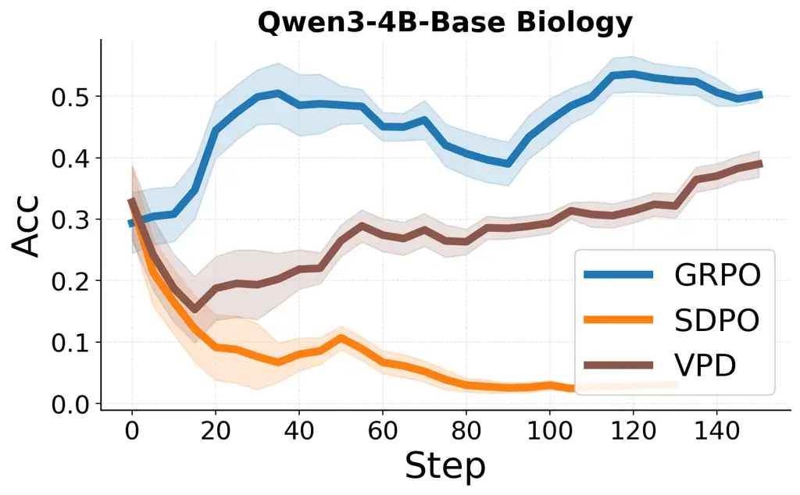

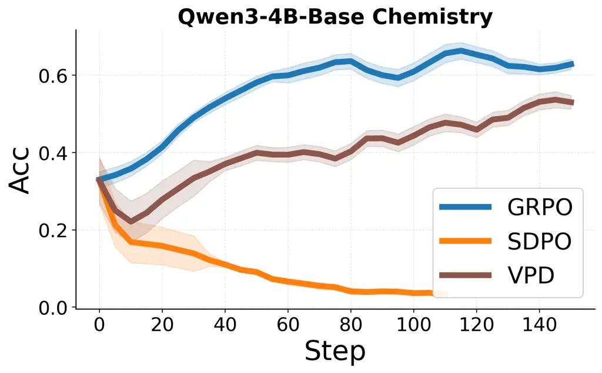

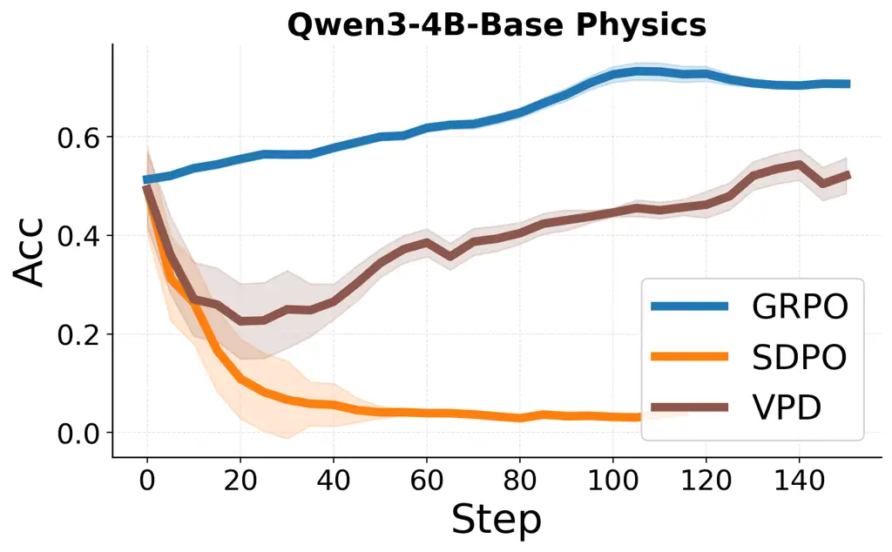

Figure C.1: Additional training curves illustrating the cold-start
optimization dynamics of Qwen3-4B-Base across the Biology, Chemistry,
and Physics domains. While standard SDPO collapses almost immediately,
VPD actively stabilizes the trust region and effectively delays training
degradation.

### C.5 Mathematical Reasoning Experimental Setup

Dataset and Evaluation Protocol. To stress-test our framework on highly
symbolic and strict logical domains, we utilize the DAPO-Math dataset
\[43\] for training and evaluate the resulting policies on the Math500
benchmark \[16\]. DAPO-Math provides a challenging distribution of
competitive mathematics problems. During training, the verifiable
environment parses the model’s final answer (enclosed in a \boxed{} tag)
and uses a symbolic exact-match grader to assign a binary reward. Final
performance is evaluated using the standard Math500 test script,
reporting the Avg@4 accuracy.

Feedback Mechanism for Mathematics. For mathematical reasoning, we
employ the contrastive sibling mechanism to generate the diagnostic
feedback $`\mathcal{C}`$. If a model’s logical derivation leads to an
incorrect final boxed answer, the teacher policy is provided with a
successful sibling trajectory to identify the algebraic or conceptual
error.

Optimization Dynamics. As noted in the main text, mathematical reasoning
is uniquely unforgiving; intermediate self-distillation targets
($`\pi^{*}`$) that contain subtle arithmetic hallucinations can actively
poison the student policy. While pure sparse RL (GRPO) achieves an 83.8%
accuracy by strictly rewarding fully correct derivations, standard SDPO
suffers from severe training collapse as it distills these flawed
linguistic explanations. We sample $`N=8`$ trajectories per prompt and
apply an asymmetric update frequency ($`F=5`$) for VPD. Detailed
training hyperparameters for the DAPO-Math experiments are provided in
Table C.4.

| Hyperparameter               | Value               |
| ---------------------------- | ------------------- |
| Learning Rate                | $`5\times 10^{-6}`$ |
| Training Steps               | 200                 |
| Rollout Batch Size           | 32                  |
| Rollouts per Prompt ($`N`$)  | 8                   |
| Max Prompt Length            | 2048                |
| Max Response Length          | 8192                |
| PPO Minibatch Size           | 32                  |
| SDPO Logits Top-k            | full logits         |
| SDPO Loss                    | Forward KL          |
| SDPO Teacher Update Rate     | 0.05                |
| VPD E-Step Frequency ($`F`$) | 5                   |
| VPD E-Step Minibatch Size    | 32                  |
| BCO Temperature ($`\beta`$)  | 0.1                 |

Table C.4: Hyperparameters for DAPO-Math experiments (Qwen3-8B).

Figure C.2 presents additional training curves for the mathematical
reasoning experiments across the AIME24, AIME25, and AMC 23 benchmarks.

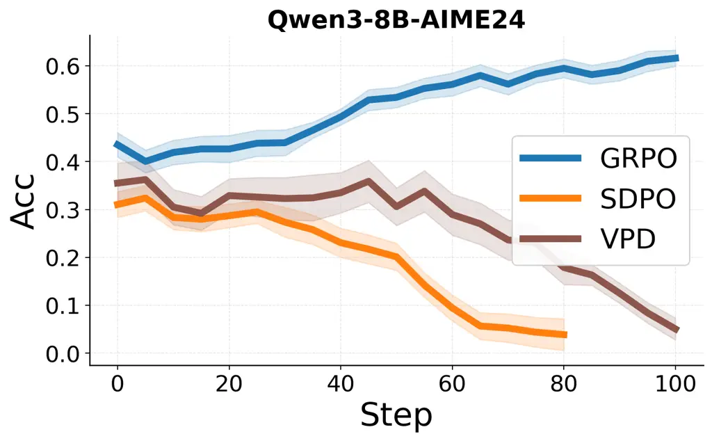

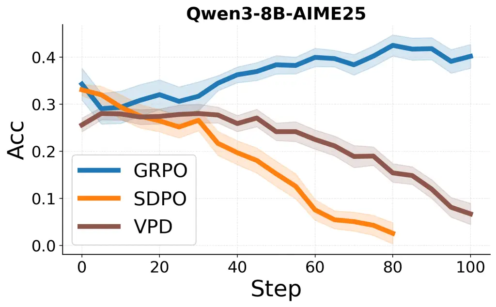

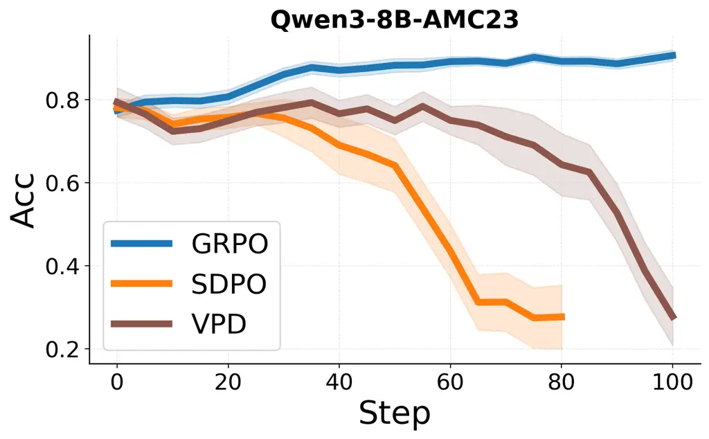

Figure C.2: Additional training curves illustrating the performance on
the AIME24, AIME25, and AMC23 benchmarks. Consistent with our Math500
findings, while VPD actively delays the severe training collapse
observed with standard SDPO, pure sparse RL (GRPO) remains the most
robust optimization method for these strict, highly symbolic domains.

### C.6 Ablations

E-Step Update Frequency ($`F`$). To investigate the impact of the
asymmetric update frequency, we utilize Qwen3-1.7B on the SciKnowEval
benchmark. All foundational hyperparameters remain strictly identical to
the configuration detailed in Table C.2. In our algorithmic
implementation, configuring the update frequency to $`F`$ dictates the
optimization schedule at the rollout-batch level. For every generated
batch of on-policy rollouts, we perform the standard M-step distillation
updates for the student. Additionally, once every $`F`$ rollout batches,
we reuse this exact same batch of trajectories to perform an E-step
optimization to refine the teacher.

As discussed in the main text, $`F=5`$ provides an optimal
target-network dynamic. When setting $`F=1`$ (synchronous updates), the
temporal runtime overhead increases as well, and the rapidly shifting
teacher distribution prevents the student from adequately converging on
the distillation targets. Conversely, for $`F=10`$, the teacher’s
diagnostic capabilities stagnate relative to the student’s learning
pace, yielding stale guidance that fails to appropriately address the
student’s newly emerging logical errors.

Dynamic vs. Fixed Reference Prior. In standard reinforcement learning
(e.g., PPO) and traditional self-distillation paradigms (e.g., SDPO),
the policy is typically regularized via a KL-divergence penalty against
a completely frozen reference model ($`\pi_{\text{ref}}`$), which is
usually the initial base model. For our Fixed Prior ablation, we
replicate this standard mechanism during the E-step, anchoring the
teacher’s BCO objective strictly to the frozen Qwen3-1.7B
initialization. For our standard VPD (Dynamic Prior) setting, this prior
is instead continually updated to match the active student policy
($`\pi_{\theta}`$) at the start of each expectation-maximization cycle.

The severe training instability observed with the Fixed Prior
(illustrated in Figure 5) stems from an escalating distribution shift.
As the student policy naturally evolves and discovers novel, successful
reasoning paths during the iterative M-steps, its distribution
inherently drifts from the initial base model. If the teacher is
subsequently forced to anchor its E-step updates to the frozen
$`\pi_{\text{ref}}`$, its optimized target distribution is artificially
pulled backwards toward the outdated base behaviors. This creates a
destructive gradient conflict during the subsequent M-step: the student
is penalized for exploring new reasoning paths and is instead distilled
toward stale, pre-training priors. By dynamically anchoring the prior to
$`\pi_{\theta}`$, VPD guarantees a sliding trust region, ensuring the
teacher’s guidance smoothly tracks the student’s active exploration
space without inducing training collapse. Figure C.3 provides additional
training progression plots across the remaining SciKnowEval domains.

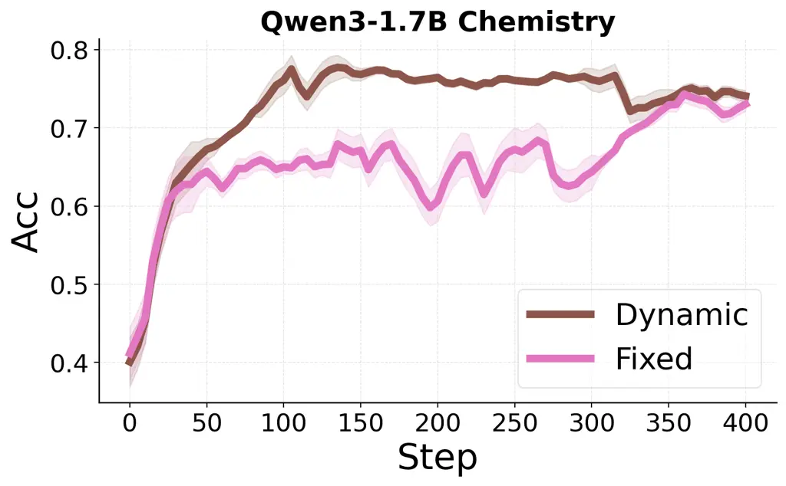

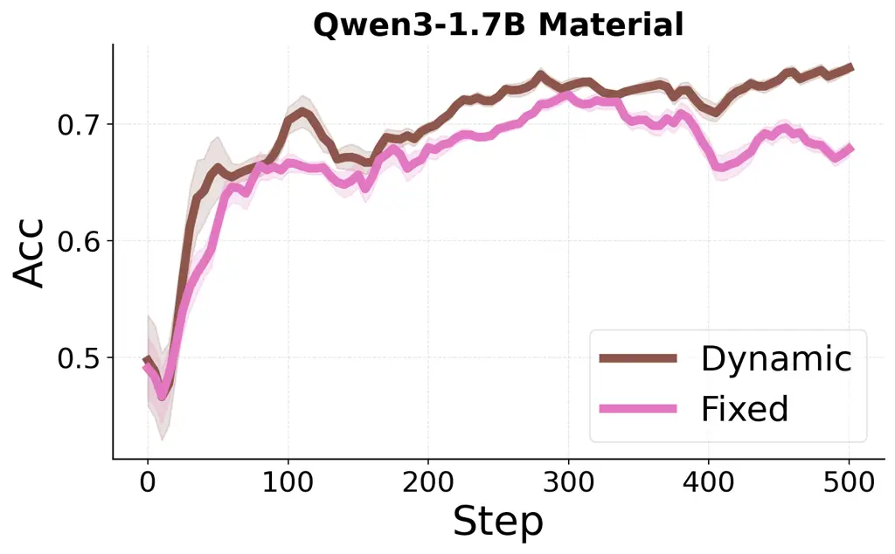

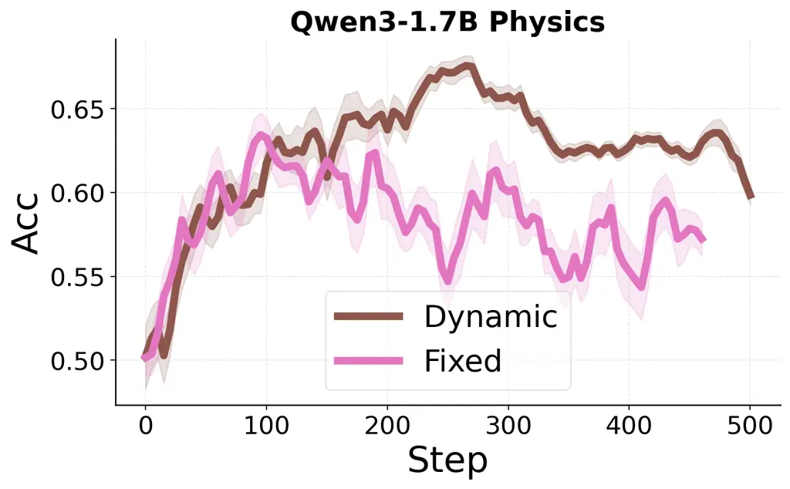

Figure C.3: Additional training curves comparing the dynamic and fixed
reference priors during E-step optimization across the Chemistry,
Materials Science, and Physics domains.
