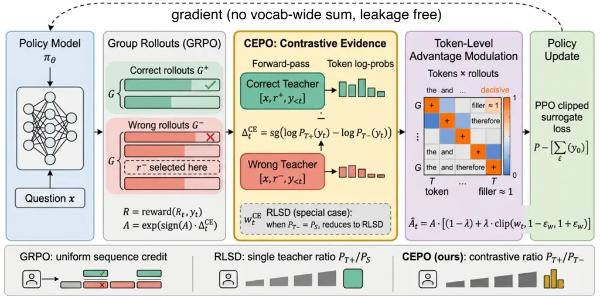
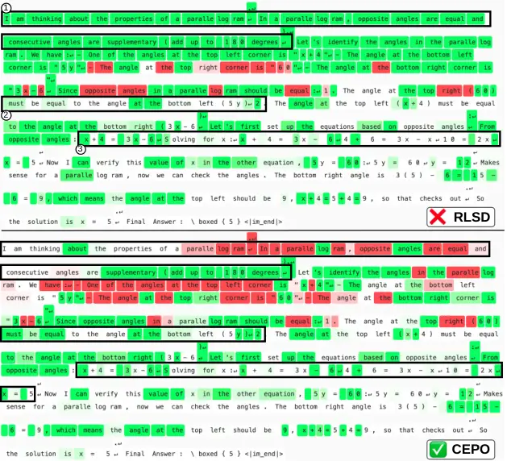

# CEPO: RLVR Self-Distillation using Contrastive Evidence Policy Optimization

Ahmed Heakl Affiliation: MBZUAI    Abdelrahman M. Shaker
Affiliation: MBZUAI    Youssef Mohamed Affiliation: MBZUAI    Rania
Elbadry Affiliation: MBZUAI    Omar Fetouh   Fahad Shahbaz Khan   Salman
Khan Affiliation: MBZUAI Affiliation: Linköping University
Affiliation: Australian National University

###### Abstract

When a model produces a correct solution under reinforcement learning
with verifiable rewards (RLVR), every token receives the same reward
signal regardless of whether it was a decisive reasoning step or a
grammatical filler. A natural fix is to condition the model on the
correct answer as a teacher, identifying tokens it would have generated
differently had it known the answer. Prior work shows this either
corrupts training by leaking the answer into the gradient, or produces a
weak signal that cannot distinguish decisive steps from filler, since
both look equally surprising relative to the model’s baseline. We
propose Contrastive Evidence Policy Optimization (CEPO), which asks a
sharper question at every token: not just “does the correct answer favor
this token?” but “does the correct answer favor it _while_ the wrong
answer disfavors it?” A token satisfying both is a genuine reasoning
step; one satisfying neither is filler. The wrong-answer teacher is
constructed from rejected rollouts already in the training batch,
incurring no additional sampling cost. We prove CEPO inherits all
structural safety guarantees of the prior state of the art while
strictly sharpening credit at decisive tokens, with the improvement
vanishing exactly at filler positions. Empirically, CEPO achieves 43.43%
and 60.56% average accuracy across five multimodal mathematical
reasoning benchmarks at 2B and 4B scale, respectively, versus 41.17% and
57.43% for GRPO under identical training budgets. Distribution-matching
self-distillation methods (OPSD, SDPO) fall below the untrained
baseline, empirically confirming the information leakage our theory
predicts. Our code is available at
[https://github.com/ahmedheakl/CEPO](https://github.com/ahmedheakl/CEPO).

## 1 Introduction

Figure 1: Accuracy over 50 training steps. CEPO improves faster than
GRPO and RLSD, reaching its largest gap around step 40 before partially
converging by the final checkpoint.

Reinforcement learning with verifiable rewards (RLVR) has become the
dominant paradigm for post-training large language models to
reason (Shao and others, 2024; Guo and others, 2025; Yang et al., 2025).
The core loop is simple: sample rollouts from the current policy, score
them against a verifier, and update the policy to increase the
probability of correct trajectories. Group Relative Policy
Optimization (GRPO) (Shao and others, 2024) operationalizes this at
scale by eliminating the value network entirely, normalizing rewards
within groups of sampled responses to obtain sequence-level advantages.
Yet the simplicity that makes GRPO practical also makes it blunt: every
token in a correct trajectory receives the same positive advantage, and
every token in a wrong one receives the same negative signal. The credit
assignment problem, _which tokens actually mattered?_, is left entirely
unresolved.

This is not a minor inefficiency. In mathematical reasoning, a single
arithmetic error or a single correct inferential step can determine the
outcome of an entire chain-of-thought (Kazemnejad et al., 2025; Guo et
al., 2025). Uniform credit assignment wastes gradient signal on filler
tokens (connectives, formatting, boilerplate) while underweighting the
few decisive tokens that distinguish correct from incorrect reasoning.
The result is slow convergence, noisy updates, and poor sample
efficiency, problems that worsen as reasoning chains grow longer and
sparser in decision-relevant content (Zhang, 2026). Figure 1 illustrates
this empirically, with CEPO improving faster than GRPO and RLSD early in
training.

A natural fix is to condition the model on the correct answer $`r^{+}`$
as its own teacher, using the resulting distribution
$`P_{T}^{+}(\cdot\mid x,r^{+})`$ as a dense, token-level training
signal. On-policy self-distillation methods (Zhao et al., 2026; Hübotter
et al., 2026; Penaloza et al., 2026) pursue exactly this, minimizing a
per-token divergence between $`P_{T}^{+}`$ and the student $`P_{S}`$
over on-policy rollouts. (Yang et al., 2026) showed this is structurally
unsafe: the gradient of any divergence objective decomposes into a
benign component and a harmful deviation with variance proportional to
$`I(Y_{t};R^{+}\mid X)`$. As training progresses the benign signal
vanishes and the deviation dominates, driving the model to encode
spurious $`x\!\to\!r^{+}`$ correlations, a pathology termed _information
leakage_ that is irreducible regardless of implementation details.

RLSD (Yang et al., 2026) resolved leakage by evaluating the evidence
ratio $`P_{T}^{+}(y_{t})/P_{S}(y_{t})`$ only at the sampled token, under
a stop-gradient, using it solely to modulate the _magnitude_ of the GRPO
advantage while keeping its sign anchored to the verifier. No
vocabulary-wide sum over $`r`$-conditioned weights appears in the
gradient, so privileged information cannot redirect gradient flow. This
is a sound structural recipe for safe self-distillation, but structural
safety is not the same as signal quality. We identify three specific
limitations of RLSD’s evidence ratio. The denominator $`P_{S}(y_{t})`$
reflects base-rate fluency, not semantic relevance, so a common token
suppresses the ratio regardless of how strongly $`r^{+}`$ favors it
(fluency confound). For wrong trajectories, the signal penalizes tokens
that $`r^{+}`$ would have supported, indirect, with no explicit
grounding in what $`r^{-}`$ predicts (asymmetric negative). Most
critically, $`P_{T}^{+}/P_{S}`$ cannot distinguish a filler token that
both the correct and wrong answers support equally from a decisive
reasoning step that $`r^{+}`$ supports while $`r^{-}`$ actively
disfavors; both receive identical weight (one-sided evidence).

We propose Contrastive Evidence Policy Optimization (CEPO), which
replaces $`P_{T}^{+}/P_{S}`$ with the contrastive ratio
$`P_{T}^{+}/P_{T}^{-}(y_{t})`$, where $`P_{T}^{-}`$ is the model
conditioned on a wrong answer drawn from rejected rollouts already in
the training batch. The student prior $`P_{S}`$ cancels entirely,
eliminating the fluency confound by construction. The contrastive ratio
admits a clean Bayesian interpretation as the _differential belief
update_: how much token $`y_{t}`$ simultaneously raises posterior belief
in $`r^{+}`$ and lowers it for $`r^{-}`$. Decisive reasoning steps score
high; filler tokens score near unity.

We prove CEPO preserves all structural safety guarantees of RLSD:
direction anchoring
($`\operatorname{sign}(\hat{A}_{t})=\operatorname{sign}(A)`$ for all
tokens) and leakage-free gradients (no vocabulary-wide $`r`$-conditioned
sum). When $`P_{T}^{-}(y_{t})=P_{S}(y_{t})`$, CEPO reduces exactly to
RLSD, making RLSD a limiting case when the wrong-answer teacher carries
no information. Beyond these guarantees, Proposition 1 gives exact
necessary and sufficient conditions for CEPO to assign strictly sharper
credit than RLSD at any token: for correct trajectories, sharpness holds
precisely when $`P_{T}^{-}(y_{t})<P_{S}(y_{t})`$, a condition we
validate empirically concentrates at arithmetically and inferentially
decisive positions rather than at filler.

#### Contributions.

1.  1.  We identify three concrete limitations of RLSD’s evidence ratio: the
        fluency confound, asymmetric negative signal, and one-sided
        evidence.
2.  2.  We propose CEPO, replacing $`P_{T}^{+}/P_{S}`$ with
        $`P_{T}^{+}/P_{T}^{-}`$, with a Bayesian interpretation as the
        differential belief update which inherits all structural safety
        guarantees of RLSD while strictly generalizing it.
3.  3.  We derive exact conditions under which CEPO sharpens credit relative
        to RLSD and validate empirically that these concentrate at
        semantically decisive token positions.
4.  4.  We demonstrate accuracy improvements of 3.7% and 2.2% over base at
        2B and 4B scale across five multimodal mathematical reasoning
        benchmarks.

## 2 Related Work

[TABLE]

Table 1: Comparison of credit assignment methods. Priv.: uses privileged
info at training time. Leak-free: no vocabulary-wide $`r`$-conditioned
gradient. Contr.: uses both positive and negative references. No Aux.:
requires no auxiliary network.

#### RLVR and the credit assignment bottleneck.

Reinforcement learning with verifiable rewards trains language models by
scoring sampled rollouts against a deterministic verifier (Guo and
others, 2025). GRPO (Shao and others, 2024) eliminates the value network
by normalizing rewards within a rollout group, and extensions such as
DAPO (Yu et al., 2025) improve exploration stability. All methods in
this family assign uniform sequence-level advantages: every token in a
correct trajectory receives the same signal regardless of its
contribution. Token-level methods address this gap either through Monte
Carlo re-simulation, as in VinePPO (Kazemnejad et al., 2025) and
SPO (Guo et al., 2025), or through a separately trained process reward
model (PRM; (Lightman et al., 2023; Setlur et al., 2024)). Both families
appear in the top block of Table 1: they improve credit assignment
without privileged information but either require expensive
re-simulation or an auxiliary network.

#### On-policy self-distillation with privileged information.

A natural alternative is to condition the model on the correct answer
$`r^{+}`$ as its own teacher, producing a dense token-level signal at no
auxiliary network cost. OPSD (Zhao et al., 2026) minimizes the per-token
KL divergence between the privileged teacher $`P_{T}^{+}`$ and the
student; SDPO (Hübotter et al., 2026) extends this with Jensen-Shannon
divergence and EMA teacher stabilization; and HDPO (Ding, 2026) applies
the same recipe specifically to prompts where all rollouts fail. As
shown by (Yang et al., 2026), any method that uses $`P_{T}^{+}`$ as a
distributional target produces gradients containing a vocabulary-wide
sum of $`r`$-conditioned weights, a structural source of information
leakage whose variance is irreducible regardless of implementation.
These methods are marked Priv. but not Leak-free in Table 1, and we
confirm their degradation empirically in §5. The closest work to the
contrastive direction within the DPO family (Rafailov et al., 2023) is
cDPO (Cao et al., 2024), which identifies critical tokens via
contrastive estimation, but it operates offline on fixed response pairs
under a sequence-level implicit reward rather than within the RLVR loop.

RLSD (Yang et al., 2026) resolves leakage by evaluating the teacher
signal only at the sampled token under a stop-gradient, using the
evidence ratio $`P_{T}^{+}(y_{t})/P_{S}(y_{t})`$ solely to modulate the
magnitude of the GRPO advantage while anchoring its direction to the
verifier. This makes RLSD both Priv. and Leak-free, which no prior
method achieves. However, the denominator $`P_{S}(y_{t})`$ conflates
reasoning importance with base-rate fluency, the negative signal for
wrong trajectories is indirect, and the ratio cannot distinguish a
decisive reasoning step from filler when both have the same
$`P_{T}^{+}/P_{S}`$ value.

## 3 Method



Figure 2: CEPO training pipeline and its relationship to GRPO and RLSD.
Given a question $`x`$, the policy $`\pi_{\theta}`$ produces $`G`$
rollouts that are partitioned into correct ($`G^{+}`$) and wrong
($`G^{-}`$) sets by a verifiable reward. CEPO conditions two frozen
teachers on a sampled correct rationale $`r^{+}\in G^{+}`$ and rejected
rationale $`r^{-}\in G^{-}`$, and defines a per-token _contrastive
evidence delta_ $`\Delta_{t}^{\mathrm{CE}}`$ that amplifies advantage at
decisive tokens (large $`|\Delta_{t}^{\mathrm{CE}}|`$) while leaving
filler tokens near unit weight. Then, the token-level modulated
advantage is plugged into a standard PPO-clipped surrogate.

### 3.1 Preliminaries

Let $`\pi_{\theta}`$ be an autoregressive language model with parameters
$`\theta`$ and vocabulary $`\mathcal{V}`$, trained on
$`\mathcal{S}=\{(x_{i},r_{i}^{+})\}_{i=1}^{N}`$ where $`r_{i}^{+}`$ is a
verifiable correct answer. A deterministic verifier
$`R:\mathcal{X}\times\mathcal{Y}\to\{0,1\}`$ scores responses.
GRPO (Shao and others, 2024) samples $`G`$ rollouts per question and
computes a normalized sequence-level advantage:

```math
A^{(i)}=\frac{R(x,y^{(i)})-\mu_{G}}{\sigma_{G}}, \tag{1}
```

partitioning rollouts into correct ($`\mathcal{G}^{+}`$) and wrong
($`\mathcal{G}^{-}`$) subsets. We define three next-token distributions
sharing parameters $`\theta`$ but differing in context:

```math
\displaystyle P_{S}(y_{t}) \displaystyle\triangleq\pi_{\theta}(y_{t}\mid x,y_{<t}),\quad P_{T}^{+}(y_{t})\triangleq\pi_{\theta}(y_{t}\mid x,r^{+},y_{<t}),\quad P_{T}^{-}(y_{t})\triangleq\pi_{\theta}(y_{t}\mid x,r^{-},y_{<t}), \tag{2}
```

denoting the student, correct teacher, and wrong teacher respectively.
We write $`\operatorname{sg}(\cdot)`$ for the stop-gradient operator.

### 3.2 Background: Leakage in Self-Distillation and the RLSD Fix

Methods such as OPSD (Zhao et al., 2026) and SDPO (Hübotter et al., 2026) minimize per-token KL divergence between a privileged teacher
$`P_{T}^{+}`$ and the student, producing a gradient of the form:

```math
\nabla_{\theta}\mathcal{L}_{\text{OPSD}}=-\sum_{v\in\mathcal{V}}P_{T}^{+}(v\mid r^{+})\,\nabla_{\theta}\log P_{S}(v). \tag{3}
```

This vocabulary-wide sum encodes $`r^{+}`$ directly into every gradient
direction. (Yang et al., 2026) showed this produces a harmful deviation
$`\delta(\theta;r^{+})`$ with variance $`\propto I(Y_{t};R^{+}\mid X)`$
that dominates as training progresses, a pathology termed _information
leakage_ that is irreducible regardless of implementation. Our results
confirm it empirically: OPSD and SDPO fall below the untrained baseline
on four of five benchmarks (§5).

RLSD (Yang et al., 2026) resolves leakage by evaluating the teacher
signal only at the sampled token $`y_{t}`$ under stop-gradient, using
the evidence ratio $`P_{T}^{+}(y_{t})/P_{S}(y_{t})`$ solely to modulate
the _magnitude_ of the GRPO advantage:

```math
\begin{split}w_{t}^{\text{RLSD}}&=\exp\!\bigl(\operatorname{sign}(A)\cdot\operatorname{sg}(\log P_{T}^{+}(y_{t})-\log P_{S}(y_{t}))\bigr),\\
\hat{A}_{t}^{(i)}&=A^{(i)}\cdot\left[(1-\lambda)+\lambda\cdot\operatorname{clip}\!\left(w_{t}^{\text{RLSD}},\,1{-}\epsilon_{w},\,1{+}\epsilon_{w}\right)\right].\end{split} \tag{4}
```

Because $`\hat{A}_{t}`$ is $`\theta`$-constant via sg, no
vocabulary-wide sum appears in the gradient and the update direction is
anchored to the verifier.

### 3.3 Limitations of Single-Reference Evidence

Despite its safety guarantees, RLSD’s ratio
$`P_{T}^{+}(y_{t})/P_{S}(y_{t})`$ has three signal quality limitations.
(1) Fluency confound: the denominator $`P_{S}(y_{t})`$ reflects
base-rate corpus frequency, not semantic relevance, suppressing the
ratio at common tokens regardless of the numerator. (2) Asymmetric
negative signal: for wrong trajectories, the weight $`P_{S}/P_{T}^{+}`$
penalizes tokens that $`r^{+}`$ would have supported, indirect, with no
grounding in what $`r^{-}`$ predicts. (3) One-sided evidence:
$`P_{T}^{+}/P_{S}`$ cannot distinguish a filler token (supported equally
by both $`r^{+}`$ and $`r^{-}`$) from a decisive reasoning step
($`r^{+}`$ supports it, $`r^{-}`$ disfavors it); both receive identical
weight if their $`P_{T}^{+}/P_{S}`$ ratio coincides.

### 3.4 Contrastive Evidence Policy Optimization

#### Contrastive evidence delta.

We replace $`P_{T}^{+}(y_{t})/P_{S}(y_{t})`$ with the _contrastive
ratio_ $`P_{T}^{+}(y_{t})/P_{T}^{-}(y_{t})`$, where $`r^{-}`$ is the
final answer of the lowest-reward rejected rollout in
$`\mathcal{G}^{-}`$, available at no additional inference cost. The
student prior $`P_{S}`$ cancels entirely, eliminating the fluency
confound by construction. The contrastive evidence delta is:

```math
\Delta_{t}^{\text{CE}}=\operatorname{sg}\!\left(\log\frac{P_{T}^{+}(y_{t})}{P_{T}^{-}(y_{t})}\right). \tag{5}
```

#### Bayesian interpretation.

Applying Theorem 4 of (Yang et al., 2026) to both teachers and
subtracting, $`P_{S}`$ cancels and we obtain:

```math
\Delta_{t}^{\text{CE}}=\underbrace{\log\frac{P(r^{+}\mid x,y_{\leq t})}{P(r^{+}\mid x,y_{<t})}}_{\text{belief update for }r^{+}}-\underbrace{\log\frac{P(r^{-}\mid x,y_{\leq t})}{P(r^{-}\mid x,y_{<t})}}_{\text{belief update for }r^{-}}. \tag{6}
```

Thus $`\Delta_{t}^{\text{CE}}`$ is the _differential belief update_: how
much token $`y_{t}`$ simultaneously strengthens posterior belief in
$`r^{+}`$ and weakens it for $`r^{-}`$. Decisive steps receive large
positive $`\Delta_{t}^{\text{CE}}`$; filler tokens receive
$`\Delta_{t}^{\text{CE}}\approx 0`$.

#### Token-level advantage and update.

The contrastive weight and clipped token-level advantage are:

```math
\begin{split}w_{t}^{\text{CE}}&=\exp\!\bigl(\operatorname{sign}(A)\cdot\Delta_{t}^{\text{CE}}\bigr)=\left(\frac{P_{T}^{+}(y_{t})}{P_{T}^{-}(y_{t})}\right)^{\!\operatorname{sign}(A)},\\
\hat{A}_{t}^{(i)}&=A^{(i)}\cdot\bigl[(1{-}\lambda)+\lambda\cdot\operatorname{clip}(w_{t}^{\text{CE}},\,1{-}\epsilon_{w},\,1{+}\epsilon_{w})\bigr].\end{split} \tag{7}
```

where $`\lambda`$ decays linearly from $`\lambda_{0}`$ to 0 over
$`T_{\mathrm{warm}}`$ steps. The policy is updated by maximizing the
standard PPO-style clipped surrogate objective (Schulman et al., 2017)
with $`\hat{A}_{t}^{(i)}`$ in place of $`A^{(i)}`$. When
$`\mathcal{G}^{-}=\emptyset`$, we set $`P_{T}^{-}=P_{S}`$, recovering
RLSD exactly. CEPO adds one teacher forward pass over RLSD per
trajectory, the same marginal overhead as RLSD over GRPO, with no
additional sampling cost. Algorithm 1 summarizes the full procedure.

1: Policy $`\pi_{\theta}`$, dataset $`\mathcal{S}`$, verifier $`R`$,
group size $`G`$, $`\lambda`$ schedule, clip bounds $`\epsilon_{w}`$,
$`\epsilon`$

2: for each training iteration do

3:   for each $`(x,r^{+})`$ in batch do

4:    Sample $`\{y^{(i)}\}_{i=1}^{G}\sim\pi_{\theta}(\cdot\mid x)`$;
compute $`A^{(i)}`$ via Eq. (1)

5:
   $`r^{-}\leftarrow\operatorname{answer}\!\bigl(\arg\min_{j\in\mathcal{G}^{-}}R(y^{(j)})\bigr)`$;
if $`\mathcal{G}^{-}=\emptyset`$ set $`P_{T}^{-}\leftarrow P_{S}`$

6:    for each trajectory $`i`$, each position $`t`$ do

7:
     $`\Delta_{t}\leftarrow\operatorname{sg}(\log P_{T}^{+}(y_{t})-\log P_{T}^{-}(y_{t}))`$

8:
     $`\hat{A}_{t}^{(i)}\leftarrow A^{(i)}\cdot[(1{-}\lambda)+\lambda\cdot\operatorname{clip}(e^{\operatorname{sign}(A^{(i)})\Delta_{t}},\,1{-}\epsilon_{w},\,1{+}\epsilon_{w})]`$

9:    end for

10:    Update $`\theta`$ via PPO clipped surrogate with
$`\hat{A}_{t}^{(i)}`$

11:   end for

12: end for

Algorithm 1 Contrastive Evidence Policy Optimization (CEPO)

#### Theoretical guarantees.

We establish three formal properties of CEPO (proofs in Appendix A).

###### Theorem 1 (CEPO Properties).

For $`\lambda\in[0,1]`$ and $`\epsilon_{w}\in(0,1)`$, CEPO satisfies:

1.  (i)
    Direction anchoring.
    $`\operatorname{sign}(\hat{A}_{t})=\operatorname{sign}(A)`$ for all
    $`t`$, privileged information cannot flip any token’s update
    direction.
2.  (ii)
    Leakage-free gradient.
    $`\nabla_{\theta}\mathcal{L}_{\mathrm{CEPO}}`$ contains no
    vocabulary-wide $`r`$-conditioned sum; $`r^{+}`$ and $`r^{-}`$ enter
    only as stop-gradiented scalars at the sampled token.
3.  (iii)
    RLSD containment. Setting $`P_{T}^{-}=P_{S}`$ recovers RLSD exactly;
    RLSD is the degenerate case where the wrong-answer teacher carries
    no information.

Beyond safety, we characterize _when_ CEPO strictly improves over RLSD.

###### Proposition 1 (Discriminative sharpness).

For a correct trajectory: $`w_{t}^{\mathrm{CE}}>w_{t}^{\mathrm{RLSD}}`$
if and only if $`P_{T}^{-}(y_{t})<P_{S}(y_{t})`$, precisely when the
wrong-answer teacher disfavors this token relative to the student prior.
The symmetric condition holds for wrong trajectories. At filler tokens,
$`P_{T}^{-}`$ and $`P_{T}^{+}`$ both track $`P_{S}`$ closely, so
$`w_{t}^{\mathrm{CE}}\approx w_{t}^{\mathrm{RLSD}}\approx 1`$: CEPO
introduces no spurious signal where none is warranted.

This concentration property is the crux of CEPO’s design. RLSD’s
denominator $`P_{S}(y_{t})`$ is blind to $`r^{-}`$, so it cannot
distinguish a decisive reasoning step from a fluent filler token when
both happen to have the same $`P_{T}^{+}/P_{S}`$ ratio. CEPO’s
denominator $`P_{T}^{-}`$ breaks this tie: a token the wrong answer
actively disfavors receives a smaller denominator and strictly higher
credit, exactly at positions where the gradient signal is semantically
meaningful. The filler-token neutrality is therefore not a limitation
but a correctness criterion, amplifying filler gradients would introduce
noise, not signal. We validate the sharpness conditions empirically via
token-weight analysis in §5.2.¹¹ 1 CEPO is not equivalent to a
contrastive KL objective: the gradient of
$`D_{\mathrm{KL}}(P_{T}^{+}\|P_{S})-D_{\mathrm{KL}}(P_{T}^{-}\|P_{S})`$
produces a vocabulary-wide sum
$`-\sum_{v}[P_{T}^{+}(v)-P_{T}^{-}(v)]\nabla_{\theta}\log P_{S}(v)`$,
structurally identical to OPSD’s leakage flaw (Eq. 3).

|                      |                               |                                                                   |                                                                   |                                                                   |                                                                   |                                                                   |                                                                   |
| -------------------- | ----------------------------- | ----------------------------------------------------------------- | ----------------------------------------------------------------- | ----------------------------------------------------------------- | ----------------------------------------------------------------- | ----------------------------------------------------------------- | ----------------------------------------------------------------- |
|                      |                               | DynaMath                                                          | LogicVista                                                        | MathVis.\_(m)                                                     | MMMU                                                              | WeMath                                                            | Average Acc.                                                      |
| Qwen3-VL-2B-Instruct |                               |                                                                   |                                                                   |                                                                   |                                                                   |                                                                   |                                                                   |
|                      | Base                          | $`50.08{\color[rgb]{0.5,0.5,0.5}\scriptstyle\,\pm 0.7}`$          | $`32.81{\color[rgb]{0.5,0.5,0.5}\scriptstyle\,\pm 2.2}`$          | $`19.41{\color[rgb]{0.5,0.5,0.5}\scriptstyle\,\pm 2.3}`$          | $`44.11{\color[rgb]{0.5,0.5,0.5}\scriptstyle\,\pm 1.7}`$          | $`52.24{\color[rgb]{0.5,0.5,0.5}\scriptstyle\,\pm 1.2}`$          | $`39.73{\color[rgb]{0.5,0.5,0.5}\scriptstyle\,\pm 0.8}`$          |
|                      | +GRPO (Shao and others, 2024) | $`50.36{\color[rgb]{0.5,0.5,0.5}\scriptstyle\,\pm 0.7}`$          | $`37.50{\color[rgb]{0.5,0.5,0.5}\scriptstyle\,\pm 2.3}`$          | $`21.05{\color[rgb]{0.5,0.5,0.5}\scriptstyle\,\pm 2.3}`$          | $`42.33{\color[rgb]{0.5,0.5,0.5}\scriptstyle\,\pm 1.6}`$          | $`54.60{\color[rgb]{0.5,0.5,0.5}\scriptstyle\,\pm 1.2}`$          | $`41.17{\color[rgb]{0.5,0.5,0.5}\scriptstyle\,\pm 0.8}`$          |
|                      | +OPSD (Zhao et al., 2026)     | $`46.85{\color[rgb]{0.5,0.5,0.5}\scriptstyle\,\pm 0.7}`$          | $`28.79{\color[rgb]{0.5,0.5,0.5}\scriptstyle\,\pm 2.1}`$          | $`14.14{\color[rgb]{0.5,0.5,0.5}\scriptstyle\,\pm 2.0}`$          | $`43.78{\color[rgb]{0.5,0.5,0.5}\scriptstyle\,\pm 1.7}`$          | $`41.26{\color[rgb]{0.5,0.5,0.5}\scriptstyle\,\pm 1.2}`$          | $`34.96{\color[rgb]{0.5,0.5,0.5}\scriptstyle\,\pm 0.7}`$          |
|                      | +SDPO (Hübotter et al., 2026) | $`46.65{\color[rgb]{0.5,0.5,0.5}\scriptstyle\,\pm 0.7}`$          | $`29.46{\color[rgb]{0.5,0.5,0.5}\scriptstyle\,\pm 2.2}`$          | $`15.46{\color[rgb]{0.5,0.5,0.5}\scriptstyle\,\pm 2.1}`$          | $`43.00{\color[rgb]{0.5,0.5,0.5}\scriptstyle\,\pm 1.7}`$          | $`43.91{\color[rgb]{0.5,0.5,0.5}\scriptstyle\,\pm 1.2}`$          | $`35.70{\color[rgb]{0.5,0.5,0.5}\scriptstyle\,\pm 0.8}`$          |
|                      | +RLSD (Yang et al., 2026)     | $`50.36{\color[rgb]{0.5,0.5,0.5}\scriptstyle\,\pm 0.7}`$          | $`36.38{\color[rgb]{0.5,0.5,0.5}\scriptstyle\,\pm 2.3}`$          | $`23.39{\color[rgb]{0.5,0.5,0.5}\scriptstyle\,\pm 2.3}`$          | $`39.44{\color[rgb]{0.5,0.5,0.5}\scriptstyle\,\pm 1.6}`$          | $`55.26{\color[rgb]{0.5,0.5,0.5}\scriptstyle\,\pm 1.2}`$          | $`40.05{\color[rgb]{0.5,0.5,0.5}\scriptstyle\,\pm 0.8}`$          |
|                      | +CEPO (Ours)                  | $`\mathbf{51.44}{\color[rgb]{0.5,0.5,0.5}\scriptstyle\,\pm 0.7}`$ | $`\mathbf{37.72}{\color[rgb]{0.5,0.5,0.5}\scriptstyle\,\pm 2.3}`$ | $`\mathbf{25.99}{\color[rgb]{0.5,0.5,0.5}\scriptstyle\,\pm 2.5}`$ | $`\mathbf{45.78}{\color[rgb]{0.5,0.5,0.5}\scriptstyle\,\pm 1.7}`$ | $`\mathbf{56.21}{\color[rgb]{0.5,0.5,0.5}\scriptstyle\,\pm 1.2}`$ | $`\mathbf{43.43}{\color[rgb]{0.5,0.5,0.5}\scriptstyle\,\pm 0.8}`$ |
| Qwen3-VL-4B-Instruct |                               |                                                                   |                                                                   |                                                                   |                                                                   |                                                                   |                                                                   |
|                      | Base                          | $`64.59{\color[rgb]{0.5,0.5,0.5}\scriptstyle\,\pm 0.7}`$          | $`54.91{\color[rgb]{0.5,0.5,0.5}\scriptstyle\,\pm 2.4}`$          | $`44.41{\color[rgb]{0.5,0.5,0.5}\scriptstyle\,\pm 2.8}`$          | $`53.56{\color[rgb]{0.5,0.5,0.5}\scriptstyle\,\pm 1.7}`$          | $`74.31{\color[rgb]{0.5,0.5,0.5}\scriptstyle\,\pm 1.0}`$          | $`58.36{\color[rgb]{0.5,0.5,0.5}\scriptstyle\,\pm 0.8}`$          |
|                      | +GRPO (Shao and others, 2024) | $`63.97{\color[rgb]{0.5,0.5,0.5}\scriptstyle\,\pm 0.7}`$          | $`54.98{\color[rgb]{0.5,0.5,0.5}\scriptstyle\,\pm 2.4}`$          | $`42.76{\color[rgb]{0.5,0.5,0.5}\scriptstyle\,\pm 2.8}`$          | $`52.34{\color[rgb]{0.5,0.5,0.5}\scriptstyle\,\pm 1.7}`$          | $`73.10{\color[rgb]{0.5,0.5,0.5}\scriptstyle\,\pm 1.1}`$          | $`57.43{\color[rgb]{0.5,0.5,0.5}\scriptstyle\,\pm 0.9}`$          |
|                      | +OPSD (Zhao et al., 2026)     | $`61.80{\color[rgb]{0.5,0.5,0.5}\scriptstyle\,\pm 0.7}`$          | $`55.58{\color[rgb]{0.5,0.5,0.5}\scriptstyle\,\pm 2.3}`$          | $`44.41{\color[rgb]{0.5,0.5,0.5}\scriptstyle\,\pm 2.8}`$          | $`47.00{\color[rgb]{0.5,0.5,0.5}\scriptstyle\,\pm 1.7}`$          | $`72.36{\color[rgb]{0.5,0.5,0.5}\scriptstyle\,\pm 1.1}`$          | $`56.23{\color[rgb]{0.5,0.5,0.5}\scriptstyle\,\pm 0.8}`$          |
|                      | +SDPO (Hübotter et al., 2026) | $`61.58{\color[rgb]{0.5,0.5,0.5}\scriptstyle\,\pm 0.7}`$          | $`52.01{\color[rgb]{0.5,0.5,0.5}\scriptstyle\,\pm 2.4}`$          | $`43.42{\color[rgb]{0.5,0.5,0.5}\scriptstyle\,\pm 2.8}`$          | $`48.11{\color[rgb]{0.5,0.5,0.5}\scriptstyle\,\pm 1.7}`$          | $`73.62{\color[rgb]{0.5,0.5,0.5}\scriptstyle\,\pm 1.1}`$          | $`55.75{\color[rgb]{0.5,0.5,0.5}\scriptstyle\,\pm 0.9}`$          |
|                      | +RLSD (Yang et al., 2026)     | $`65.07{\color[rgb]{0.5,0.5,0.5}\scriptstyle\,\pm 0.7}`$          | $`56.92{\color[rgb]{0.5,0.5,0.5}\scriptstyle\,\pm 2.3}`$          | $`44.08{\color[rgb]{0.5,0.5,0.5}\scriptstyle\,\pm 2.8}`$          | $`53.22{\color[rgb]{0.5,0.5,0.5}\scriptstyle\,\pm 1.7}`$          | $`73.28{\color[rgb]{0.5,0.5,0.5}\scriptstyle\,\pm 1.1}`$          | $`58.51{\color[rgb]{0.5,0.5,0.5}\scriptstyle\,\pm 0.8}`$          |
|                      | +CEPO (Ours)                  | $`\mathbf{65.37}{\color[rgb]{0.5,0.5,0.5}\scriptstyle\,\pm 0.7}`$ | $`\mathbf{61.16}{\color[rgb]{0.5,0.5,0.5}\scriptstyle\,\pm 2.3}`$ | $`\mathbf{47.37}{\color[rgb]{0.5,0.5,0.5}\scriptstyle\,\pm 2.9}`$ | $`\mathbf{54.11}{\color[rgb]{0.5,0.5,0.5}\scriptstyle\,\pm 1.7}`$ | $`\mathbf{74.77}{\color[rgb]{0.5,0.5,0.5}\scriptstyle\,\pm 1.0}`$ | $`\mathbf{60.56}{\color[rgb]{0.5,0.5,0.5}\scriptstyle\,\pm 0.9}`$ |

Table 2: Results on five multimodal mathematical reasoning benchmarks.
All methods trained 50 steps on Geo3k, $`\lambda_{0}{=}0.5`$,
$`\epsilon_{w}{=}0.5`$. OPSD and SDPO degradation below baseline is
consistent with the information leakage identified in §3.2.

## 4 Experiments

| Method | Time   |
| ------ | ------ |
| GRPO   | 5h 58m |
| SDPO   | 6h 14m |
| RLSD   | 6h 15m |
| CEPO   | 6h 34m |

Table 3: Wall-clock training time for 50 steps on Geo3k.

#### Models and training.

We train Qwen3-VL-2B-Instruct and Qwen3-VL-4B-Instruct (Bai et al., 2025) using the EasyR1 (Zheng et al., 2025) framework with FSDP (Zhao
and others, 2023) and vLLM (Kwon et al., 2023)-accelerated inference.
All models are fine-tuned with LoRA (rank 16) for 50 steps on Geo3k (Lu
et al., 2021), a geometry question-answering dataset of 3,000 training
problems with verifiable numeric answers. We use AdamW (Loshchilov and
Hutter, 2017) with lr $`10^{-6}`$ (CEPO $`5\!\times\!10^{-6}`$), batch
size 32, rollout group size $`G=8`$, and maximum sequence length 2,048
tokens. For all CEPO runs, $`\lambda_{0}=0.5`$ with linear decay to 0
over $`T_{\mathrm{warm}}=25`$ steps and $`\epsilon_{w}=0.5`$ unless
otherwise stated. The negative reference $`r^{-}`$ is the final answer
extracted from the lowest-reward rejected rollout in the current group.
The teacher is the same as the actor. All experiments run on NVIDIA
RTX6000 Pro Blackwell 100GBs GPUs. Table 3 reports wall-clock training
times; CEPO’s two teacher forward passes add 36 minutes over GRPO,
comparable to that of RLSD/SDPO over GRPO.

#### Baselines.

We compare against four baselines under identical training budgets:
GRPO (Shao and others, 2024), the sequence-level RL baseline; OPSD (Zhao
et al., 2026), which minimizes per-token KL divergence to a
correct-answer teacher; SDPO (Hübotter et al., 2026), which extends OPSD
with Jensen-Shannon divergence and EMA teacher stabilization; and
RLSD (Yang et al., 2026), the direct predecessor of CEPO. All baselines
use the same LoRA rank, group size, and training steps as CEPO. Other
training hyperparameters are detailed in Appendix B.

#### Evaluation.

We report accuracy on five held-out multimodal mathematical reasoning
benchmarks: DynaMath (Zou et al., 2024),LogicVista (Xiao et al., 2024),
MathVision\_(mini) (Wang et al., 2024), MMMU (Yue et al., 2024), and
WeMath (Qiao and others, 2025). All models are evaluated using
lmms-eval (Zhang and others, 2025) with sampling (temperature 1.0,
top-$`p`$ 1.0, top-$`k`$ 40, presence penalty 2.0, maximum 32,000
tokens).

## 5 Results

Table 2 reports results on both model scales. On Qwen3-VL-2B, CEPO
achieves 43.43% average accuracy, compared to 41.17% for GRPO (+2.26pp),
34.96% for OPSD, and 35.70% for SDPO. On Qwen3-VL-4B, CEPO achieves
60.56%, versus 57.43% for GRPO (+3.13pp) and 56.23% for OPSD. Gains are
most pronounced on LogicVista (+6.18pp over GRPO on 4B) and
MathVision\_(mini) (+4.94pp over GRPO on 2B), benchmarks that reward
fine-grained multi-step reasoning over short, pattern-matchable answers.
MMMU, which is primarily a multiple-choice knowledge retrieval benchmark
with limited reasoning chains, shows the smallest gain (+1.67pp on 2B),
consistent with the expectation that CEPO’s contrastive signal provides
less leverage when reasoning traces are short.

#### OPSD and SDPO degradation.

A notable finding is that both OPSD and SDPO fall _below_ the untrained
base model on 2B (34.96% and 35.70% vs. 39.73%). This is consistent with
the information leakage analysis in §3.2: as training progresses, the
vocabulary-wide $`r`$-conditioned gradient deviation
$`\delta(\theta;r^{+})`$ dominates the benign signal, driving the model
to encode spurious $`x\to r^{+}`$ correlations that degrade
generalization. The same pattern appears at 4B (56.23% for OPSD vs.
58.36% base), confirming that the leakage pathology is not an artifact
of model scale. CEPO avoids this entirely: its gradient contains no
vocabulary-wide $`r`$-conditioned term by construction (Theorem 1(ii)).

### 5.1 Ablations

| Teacher Source      | Avg. Acc                     | $`\boldsymbol{\Delta}`$GRPO |
| ------------------- | ---------------------------- | --------------------------- |
| GRPO baseline       | $`41.17_{\pm 0.8}`$          | $`0.00`$                    |
| Reference policy    | $`42.18_{\pm 0.8}`$          | $`+1.01`$                   |
| Sync every 25 steps | $`42.74_{\pm 0.8}`$          | $`+1.57`$                   |
| Actor policy        | $`\mathbf{43.43}_{\pm 0.8}`$ | $`\mathbf{+2.26}`$          |

Table 4: Teacher source ablation. $`\Delta`$ is relative to GRPO.

#### Teacher source (Table 4).

We compare three teacher sources: a fixed reference policy, a
periodically synced teacher, and the actor policy itself. The
actor-policy teacher performs best, reaching 43.43%, a +2.26pp
improvement over GRPO. This indicates that, in our setting, the most
useful teacher is the one aligned with the current on-policy rollout
distribution, even if its token distribution remains close to the
student. Crucially, sharing weights with the actor requires no separate
parameter copy, reducing memory overhead. The fixed reference policy
improves over GRPO but reaches only 42.18%, suggesting that a frozen
teacher provides a useful but increasingly stale contrastive signal as
the policy changes. Synchronizing the teacher with the actor every 25
steps improves performance to 42.74%, narrowing the gap to the
actor-policy teacher by keeping the teacher fresher while still
partially decoupling it from the student. Overall, these results suggest
that teacher freshness and on-policy alignment are more important than
maintaining a large teacher-student distribution gap for CEPO.

| Positive $`r^{+}`$        | Negative $`r^{-}`$         | Avg. Acc                     | $`\boldsymbol{\Delta}`$GRPO |
| ------------------------- | -------------------------- | ---------------------------- | --------------------------- |
| GRPO baseline, no teacher |                            | $`41.17_{\pm 0.8}`$          | $`0.00`$                    |
| Peer rollout (prefix)     | Peer rollout (prefix)      | $`40.47_{\pm 0.8}`$          | $`-0.70`$                   |
| Peer rollout (suffix)     | Peer rollout (suffix)      | $`40.60_{\pm 0.8}`$          | $`-0.57`$                   |
| Peer rollout (full)       | Peer rollout (full)        | $`41.99_{\pm 0.8}`$          | $`+0.82`$                   |
| Ground truth answer       | Peer rollout (full)        | $`42.74_{\pm 0.8}`$          | $`+1.57`$                   |
| Ground truth answer       | Peer rollout (answer only) | $`\mathbf{43.43}_{\pm 0.8}`$ | $`\mathbf{+2.26}`$          |

Table 5: Feedback source ablation. Average accuracy on Qwen3-VL-2B after
50 Geo3k training steps; $`\Delta`$ is relative to GRPO.

#### Feedback source (Table 5).

We ablate the construction of $`r^{+}`$ and $`r^{-}`$ across five
configurations. The main CEPO setting, ground truth final answer as
$`r^{+}`$ and peer answer only as $`r^{-}`$, performs best at 43.43%,
improving over GRPO by +2.26pp. Using the full peer rollout as the
negative reference also improves performance, reaching 42.74%, while
full peer rollout conditioning on both sides reaches 41.99%. Partial
peer context performs worse. Prefix only and suffix only conditioning
reach 40.47% and 40.60%, both below GRPO, suggesting that truncated
reasoning traces provide a noisy contrastive signal. Overall, the
strongest ablation result comes from using the verified final answer as
the positive reference and a compact rejected answer as the negative
reference.

Figure 3: Hyperparameter sensitivity averaged across 5 reasoning
benchmarks). (a) Constant $`\lambda`$ schedule: $`\lambda=0.5`$ peaks at
$`41.40\%`$, outperforming GRPO ($`41.17\%`$); sustained
high-$`\lambda`$ training ($`\lambda=1.0`$) introduces noise that
offsets the credit-assignment benefit. (b) Linear-decay schedule from
$`\lambda_{0}=1.0`$: a $`25`$-step warmup matches the
constant-$`\lambda`$ peak ($`41.25\%`$). (c) Evidence clip bound
$`\varepsilon_{w}`$: performance peaks in $`[0.4,0.5]`$ at $`42.7\%`$
($`+1.5`$pp over GRPO) and degrades at both extremes, small
$`\varepsilon_{w}`$ collapses CEPO toward GRPO, large
$`\varepsilon_{w}`$ destabilizes the modulated advantage.

#### Hyperparameter sensitivity (Figure 3).

Evidence clip bound $`\epsilon_{w}`$. Performance peaks at
$`\epsilon_{w}\in[0.4,0.5]`$ and degrades toward both extremes. At
$`\epsilon_{w}=0.1`$, the clip is too tight and the method effectively
reduces to GRPO. At $`\epsilon_{w}\geq 0.8`$, unconstrained weights
introduce variance that destabilizes advantage estimation. We recommend
$`\epsilon_{w}=0.5`$ as the default. $`\lambda`$ schedule. A constant
$`\lambda=0.5`$ and a 25-step linear decay both outperform GRPO, while
$`\lambda=1.0`$ (constant maximum) performs worse despite the highest
integrated CEPO pressure (50 units vs. 25 for $`\lambda=0.5`$). A
10-step fast decay achieves comparable performance to the 25-step
schedule, suggesting that the benefit of contrastive credit assignment
is front-loaded: the first 10–25 steps drive the bulk of the
improvement. Extending the schedule beyond 25 steps introduces noise
that offsets the signal.

### 5.2 Analysis

Figure 4: Contrastive delta fractions during CEPO training. We track the
fraction of tokens assigned positive versus negative contrastive
evidence. Positive-delta mass increases early, while negative-delta mass
decreases.

#### Contrastive delta fractions.

Figure 4 tracks the sign structure of CEPO’s raw contrastive delta
$`\Delta_{t}^{\mathrm{CE}}=\log P_{T}^{+}(y_{t})-\log P_{T}^{-}(y_{t})`$
before clipping or reweighting. A positive delta means the token is more
supported by the correct-answer teacher, so CEPO amplifies credit on
positive-advantage rollouts; a negative delta means the token is more
supported by the wrong-answer teacher, so CEPO assigns stronger blame on
negative-advantage rollouts. The positive-delta fraction rises during
early updates, indicating CEPO increasingly identifies tokens supporting
correct reasoning, while the negative-delta fraction declines,
suggesting the model produces fewer tokens compatible with the
rejected-answer teacher. This confirms CEPO’s intended behavior:
training shifts evidence toward correct-answer support rather than
uniformly increasing weights.



Figure 5: Token-level credit assignment on a parallelogram problem.
Green/red/white denote high, low, and neutral token weights. Numbered
regions illustrate three claims: ① RLSD over-credits fluent setup prose,
while CEPO suppresses it; ② CEPO localizes blame to the misapplied
angle-equality inference instead of diffusing penalties; ③ CEPO sharpens
credit on the decisive algebraic derivation ($`x{+}4=3x{-}6`$, isolation
steps, final answer). The lower CEPO clip rate (49.5% vs. 71.3%)
indicates a wider effective dynamic range, consistent with
Proposition 1.

#### Token weight heatmap.

Figure 5 compares token-level credit assignment between RLSD and CEPO on
the same geometry trajectory. In the top (RLSD) panel, credit is spread
broadly across fluent setup prose and connective tokens, with no strong
concentration on decisive steps. In the bottom (CEPO) panel, the
contrastive signal sharpens credit onto the critical algebraic
derivation and final answer tokens, while suppressing filler to
near-unity weight. The lower CEPO clip rate (49.5% vs. 71.3%) confirms
that CEPO operates over a wider effective dynamic range than RLSD. This
qualitative pattern is consistent with Proposition 1 and provides
interpretable evidence that the contrastive denominator $`P_{T}^{-}`$
successfully distinguishes decisive reasoning steps from fluent but
uninformative tokens.

## 6 Conclusion

We presented CEPO, a token-level credit assignment method for RLVR that
replaces RLSD’s single-reference evidence ratio with a contrastive ratio
between correct- and wrong-answer teachers drawn from rejected rollouts
in the training batch. We proved this preserves all structural safety
guarantees of RLSD (direction anchoring and leakage-free gradients)
while strictly sharpening credit at decisive tokens and leaving filler
unchanged (Theorem 1, Proposition 1). CEPO outperforms GRPO, OPSD, and
SDPO across five multimodal mathematical reasoning benchmarks at 2B and
4B scale; the collapse of OPSD and SDPO below the untrained baseline
confirms that structural safety is a practical prerequisite, not a
theoretical nicety. These results are validated on Qwen3-VL trained on
Geo3k, and extending CEPO to larger models, text-only reasoning, and
code generation is a natural next step. We hope CEPO offers a principled
and practical building block for the next generation of credit-aware
RLVR training.

## References

- \[1\] S. Bai, Y. Cai, R. Chen, K. Chen, X. Chen, Z. Cheng, L. Deng, W.
  Ding, C. Gao, C. Ge, et al. (2025) Qwen3-vl technical report. arXiv
  preprint arXiv:2511.21631. Cited by: §4.
- \[2\] M. Cao, L. Shu, L. Yu, Y. Zhu, N. Wichers, Y. Liu, and L.
  Meng (2024) Enhancing reinforcement learning with dense rewards from
  language model critic. In Proceedings of the 2024 Conference on
  Empirical Methods in Natural Language Processing, Cited by: §2, Table
  1.
- \[3\] K. Ding (2026) HDPO: hybrid distillation policy optimization via
  privileged self-distillation. arXiv preprint arXiv:2603.23871. Cited
  by: §2, Table 1.
- \[4\] D. Guo et al. (2025) Deepseek-r1: incentivizing reasoning
  capability in llms via reinforcement learning. arXiv preprint
  arXiv:2501.12948. Cited by: §1, §2.
- \[5\] Y. Guo, L. Xu, J. Liu, D. Ye, and S. Qiu (2025) Segment policy
  optimization: effective segment-level credit assignment in rl for
  large language models. arXiv preprint arXiv:2505.23564. Cited by: §1,
  §2, Table 1.
- \[6\] J. Hübotter, F. Lübeck, L. Behric, A. Baumann, M. Bagatella, D.
  Marta, I. Hakimi, I. Shenfeld, T. K. Buening, C. Guestrin, et
  al. (2026) Reinforcement learning via self-distillation. arXiv
  preprint arXiv:2601.20802. Cited by: §1, §2, Table 1, §3.2, Table 2,
  Table 2, §4.
- \[7\] A. Kazemnejad, M. Aghajohari, E. Portelance, A. Sordoni, S.
  Reddy, A. Courville, and N. L. Roux (2025) VinePPO: refining credit
  assignment in rl training of llms. External Links: 2410.01679,
  [Link](https://arxiv.org/abs/2410.01679) Cited by: §1, §2, Table 1.
- \[8\] W. Kwon, Z. Li, S. Zhuang, Y. Sheng, L. Zheng, C. H. Yu, J.
  Gonzalez, H. Zhang, and I. Stoica (2023) Efficient memory management
  for large language model serving with pagedattention. In Proceedings
  of the 29th symposium on operating systems principles, Cited by: §4.
- \[9\] H. Lightman, V. Kosaraju, Y. Burda, H. Edwards, B. Baker, T.
  Lee, J. Leike, J. Schulman, I. Sutskever, and K. Cobbe (2023) Let’s
  verify step by step. In The twelfth international conference on
  learning representations, Cited by: §2, Table 1.
- \[10\] I. Loshchilov and F. Hutter (2017) Decoupled weight decay
  regularization. arXiv preprint arXiv:1711.05101. Cited by: §4.
- \[11\] P. Lu, R. Gong, S. Jiang, L. Qiu, S. Huang, X. Liang, and S.
  Zhu (2021) Inter-gps: interpretable geometry problem solving with
  formal language and symbolic reasoning. In Proceedings of the 59th
  Annual Meeting of the Association for Computational Linguistics and
  the 11th International Joint Conference on Natural Language Processing
  (Volume 1: Long Papers), Cited by: §4.
- \[12\] E. Penaloza, D. Vattikonda, N. Gontier, A. Lacoste, L. Charlin,
  and M. Caccia (2026) Privileged information distillation for language
  models. arXiv preprint arXiv:2602.04942. Cited by: §1.
- \[13\] R. Qiao et al. (2025) We-math: does your large multimodal model
  achieve human-like mathematical reasoning?. In Proceedings of the 63rd
  Annual Meeting of the Association for Computational Linguistics
  (Volume 1: Long Papers), Cited by: §4.
- \[14\] R. Rafailov, A. Sharma, E. Mitchell, C. D. Manning, S. Ermon,
  and C. Finn (2023) Direct preference optimization: your language model
  is secretly a reward model. Advances in neural information processing
  systems. Cited by: §2, Table 1.
- \[15\] J. Schulman, F. Wolski, P. Dhariwal, A. Radford, and O.
  Klimov (2017) Proximal policy optimization algorithms. arXiv preprint
  arXiv:1707.06347. Cited by: Table 1, §3.4.
- \[16\] A. Setlur, C. Nagpal, A. Fisch, X. Geng, J. Eisenstein, R.
  Agarwal, A. Agarwal, J. Berant, and A. Kumar (2024) Rewarding
  progress: scaling automated process verifiers for llm reasoning. arXiv
  preprint arXiv:2410.08146. Cited by: §2.
- \[17\] Z. Shao et al. (2024) Deepseekmath: pushing the limits of
  mathematical reasoning in open language models. arXiv preprint
  arXiv:2402.03300. Cited by: §1, §2, Table 1, §3.1, Table 2, Table 2,
  §4.
- \[18\] K. Wang, J. Pan, W. Shi, Z. Lu, H. Ren, A. Zhou, M. Zhan,
  and H. Li (2024) Measuring multimodal mathematical reasoning with
  math-vision dataset. Advances in Neural Information Processing
  Systems. Cited by: §4.
- \[19\] Y. Xiao, E. Sun, T. Liu, and W. Wang (2024) Logicvista:
  multimodal llm logical reasoning benchmark in visual contexts. arXiv
  preprint arXiv:2407.04973. Cited by: §4.
- \[20\] A. Yang, A. Li, B. Yang, B. Zhang, B. Hui, B. Zheng, B. Yu, C.
  Gao, C. Huang, C. Lv, et al. (2025) Qwen3 technical report. arXiv
  preprint arXiv:2505.09388. Cited by: §1.
- \[21\] C. Yang, C. Qin, Q. Si, M. Chen, N. Gu, D. Yao, Z. Lin, W.
  Wang, J. Wang, and N. Duan (2026) Self-distilled rlvr. arXiv preprint
  arXiv:2604.03128. Cited by: §1, §1, §2, §2, Table 1, §3.2, §3.2, §3.4,
  Table 2, Table 2, §4.
- \[22\] Q. Yu, Z. Zhang, R. Zhu, Y. Yuan, X. Zuo, Y. Yue, W. Dai, T.
  Fan, G. Liu, L. Liu, et al. (2025) Dapo: an open-source llm
  reinforcement learning system at scale. arXiv preprint
  arXiv:2503.14476. Cited by: §2.
- \[23\] X. Yue, Y. Ni, K. Zhang, T. Zheng, R. Liu, G. Zhang, S.
  Stevens, D. Jiang, W. Ren, Y. Sun, et al. (2024) Mmmu: a massive
  multi-discipline multimodal understanding and reasoning benchmark for
  expert agi. In Proceedings of the IEEE/CVF conference on computer
  vision and pattern recognition, Cited by: §4.
- \[24\] C. Zhang (2026) From reasoning to agentic: credit assignment in
  reinforcement learning for large language models. arXiv preprint
  arXiv:2604.09459. Cited by: §1.
- \[25\] K. Zhang et al. (2025) Lmms-eval: reality check on the
  evaluation of large multimodal models. In Findings of the Association
  for Computational Linguistics: NAACL 2025, Cited by: §4.
- \[26\] S. Zhao, Z. Xie, M. Liu, J. Huang, G. Pang, F. Chen, and A.
  Grover (2026) Self-distilled reasoner: on-policy self-distillation for
  large language models. arXiv preprint arXiv:2601.18734. Cited by: §1,
  §2, Table 1, §3.2, Table 2, Table 2, §4.
- \[27\] Y. Zhao et al. (2023) Pytorch fsdp: experiences on scaling
  fully sharded data parallel. arXiv preprint arXiv:2304.11277. Cited
  by: §4.
- \[28\] Y. Zheng, J. Lu, S. Wang, Z. Feng, D. Kuang, Y. Xiong, and R.
  Zhang (2025) EasyR1: an efficient, scalable, multi-modality RL
  training framework. Note:
  [https://github.com/hiyouga/EasyR1](https://github.com/hiyouga/EasyR1)
  Cited by: Appendix B, §4.
- \[29\] C. Zou, X. Guo, R. Yang, J. Zhang, B. Hu, and H. Zhang (2024)
  Dynamath: a dynamic visual benchmark for evaluating mathematical
  reasoning robustness of vision language models. arXiv preprint
  arXiv:2411.00836. Cited by: §4.

Appendix

## Appendix A Proofs

### A.1 Proof of Theorem 1

#### (i) Direction anchoring.

Since $`\exp(\cdot)>0`$, we have $`w_{t}^{\mathrm{CE}}>0`$
unconditionally. Because $`\epsilon_{w}\in(0,1)`$, both clip bounds
$`1\pm\epsilon_{w}`$ are positive, so
$`\operatorname{clip}(w_{t}^{\mathrm{CE}},1{-}\epsilon_{w},1{+}\epsilon_{w})>0`$.
For any $`\lambda\in[0,1]`$:

```math
(1-\lambda)+\lambda\cdot\operatorname{clip}(w_{t}^{\mathrm{CE}},1{-}\epsilon_{w},1{+}\epsilon_{w})>0,
```

since it is a convex combination of $`1`$ and a positive quantity.
Therefore $`\hat{A}_{t}=A\cdot[\text{positive}]`$, giving
$`\operatorname{sign}(\hat{A}_{t})=\operatorname{sign}(A)`$
unconditionally. $`\square`$

#### (ii) Leakage-free gradient.

The stop-gradient on $`\Delta_{t}^{\mathrm{CE}}`$ renders
$`\hat{A}_{t}^{(i)}`$ $`\theta`$-constant within each update step.
Therefore:

```math
\nabla_{\theta}\mathcal{L}_{\mathrm{CEPO}}=\mathbb{E}\!\left[\frac{1}{G}\sum_{i}\frac{1}{|y^{(i)}|}\sum_{t}\hat{A}_{t}^{(i)}\cdot\nabla_{\theta}\log\pi_{\theta}(y_{t}^{(i)}\mid x,y_{<t}^{(i)})\right],
```

where $`\hat{A}_{t}^{(i)}`$ is constant. The gradient acts only at the
sampled token $`y_{t}^{(i)}`$; no vocabulary-wide sum
$`\sum_{v\in\mathcal{V}}`$ appears, and $`r^{+},r^{-}`$ enter only
through the $`\theta`$-constant scalar $`\hat{A}_{t}^{(i)}`$.
$`\square`$

#### (iii) RLSD containment.

When $`P_{T}^{-}(y_{t})=P_{S}(y_{t})`$ for all $`t`$:

```math
\Delta_{t}^{\mathrm{CE}}=\log P_{T}^{+}(y_{t})-\log P_{T}^{-}(y_{t})=\log P_{T}^{+}(y_{t})-\log P_{S}(y_{t})=\Delta_{t}^{\mathrm{RLSD}}.
```

Hence $`w_{t}^{\mathrm{CE}}=w_{t}^{\mathrm{RLSD}}`$ and
$`\hat{A}_{t}^{\mathrm{CEPO}}=\hat{A}_{t}^{\mathrm{RLSD}}`$ for all
$`t`$. $`\square`$

### A.2 Proof of Proposition 1

From Eqs. (7) and (4):

```math
w_{t}^{\mathrm{CE}}\big|_{A>0}=\frac{P_{T}^{+}(y_{t})}{P_{T}^{-}(y_{t})},\qquad w_{t}^{\mathrm{RLSD}}\big|_{A>0}=\frac{P_{T}^{+}(y_{t})}{P_{S}(y_{t})}.
```

|                                         |                                                    |
| --------------------------------------- | -------------------------------------------------- |
| Hyperparameter                          | Value                                              |
| Base models                             | Qwen3-VL-2B-Instruct, Qwen3-VL-4B-Instruct         |
| Training dataset                        | Geo3k (3,000 geometry problems)                    |
| Training steps                          | 50                                                 |
| Optimizer                               | AdamW                                              |
| Learning rate                           | $`1\times 10^{-6}`$ ($`5\times 10^{-6}`$ for CEPO) |
| LR schedule                             | Cosine decay, 5-step linear warmup                 |
| Batch size (prompts)                    | 32                                                 |
| Rollout group size $`G`$                | 8                                                  |
| Rollout temperature                     | 1.0                                                |
| LoRA rank / $`\alpha`$                  | 16 / 32                                            |
| LoRA dropout                            | 0.0                                                |
| Max sequence length                     | 2,048 tokens                                       |
| PPO clip bound high $`\epsilon_{high}`$ | 0.28                                               |
| PPO clip bound low $`\epsilon_{low}`$   | 0.20                                               |
| KL penalty                              | None                                               |
| Entropy regularization                  | None                                               |
| Reward model                            | Rule-based verifier (numeric match)                |
| Framework                               | EasyR1 + FSDP + vLLM                               |

Table 6: Shared training hyperparameters. Identical across all five
methods in our experimental setup.

#### Case 1 ($`A>0`$).

$`w_{t}^{\mathrm{CE}}>w_{t}^{\mathrm{RLSD}}`$ iff
$`P_{T}^{+}(y_{t})/P_{T}^{-}(y_{t})>P_{T}^{+}(y_{t})/P_{S}(y_{t})`$.
Since $`P_{T}^{+}(y_{t})>0`$, this reduces to
$`1/P_{T}^{-}(y_{t})>1/P_{S}(y_{t})`$, i.e.
$`P_{S}(y_{t})>P_{T}^{-}(y_{t})`$. Under the joint condition
$`P_{T}^{+}(y_{t})\geq P_{S}(y_{t})`$, RLSD already assigns
above-baseline credit ($`w_{t}^{\mathrm{RLSD}}\geq 1`$) and CEPO
strictly amplifies it. $`\square`$

#### Case 2 ($`A<0`$).

The weights are
$`w_{t}^{\mathrm{CE}}=P_{T}^{-}(y_{t})/P_{T}^{+}(y_{t})`$ and
$`w_{t}^{\mathrm{RLSD}}=P_{S}(y_{t})/P_{T}^{+}(y_{t})`$. By the same
argument, $`w_{t}^{\mathrm{CE}}>w_{t}^{\mathrm{RLSD}}`$ iff
$`P_{T}^{-}(y_{t})>P_{S}(y_{t})`$. Under the joint condition
$`P_{T}^{+}(y_{t})\leq P_{S}(y_{t})`$, CEPO assigns strictly stronger
blame to a token RLSD already penalizes. $`\square`$

#### Case 3 (filler).

When $`P_{T}^{+}(y_{t})\approx P_{T}^{-}(y_{t})\approx P_{S}(y_{t})`$,
all ratios are near 1, so $`\Delta_{t}^{\mathrm{CE}}\approx 0`$ and
$`w_{t}^{\mathrm{CE}}\approx w_{t}^{\mathrm{RLSD}}\approx 1`$. Neither
method discriminates at informationally neutral positions. $`\square`$

## Appendix B Baseline Hyperparameter Details

All methods in our experiments share a common training infrastructure
based on Qwen3-VL-{2B,4B}-Instruct fine-tuned with LoRA via the
EasyR1 \[28\] framework with FSDP and vLLM-accelerated rollout
generation. Table 6 reports the shared infrastructure hyperparameters
and Table 7 reports the method-specific hyperparameters.

| Hyperparameter                     | GRPO | OPSD                                             | SDPO                                             | RLSD                | CEPO                           |
| ---------------------------------- | ---- | ------------------------------------------------ | ------------------------------------------------ | ------------------- | ------------------------------ |
| Distillation objective             | —    | $`D_{\mathrm{KL}}(P_{T}^{+}\!\parallel\!P_{S})`$ | $`D_{\mathrm{JS}}(P_{T}^{+}\!\parallel\!P_{S})`$ | —                   | —                              |
| Distillation weight $`\alpha`$     | —    | 1.0                                              | 1.0                                              | —                   | —                              |
| EMA teacher decay $`\beta`$        | —    | —                                                | 0.999                                            | —                   | —                              |
| EMA update frequency               | —    | —                                                | every step                                       | —                   | —                              |
| Evidence weight $`\lambda_{0}`$    | —    | —                                                | —                                                | 0.5                 | 0.5                            |
| $`\lambda`$ decay schedule         | —    | —                                                | —                                                | linear $`\to 0`$    | linear $`\to 0`$               |
| Warmup steps $`T_{\mathrm{warm}}`$ | —    | —                                                | —                                                | 25                  | 25                             |
| Evidence clip $`\epsilon_{w}`$     | —    | —                                                | —                                                | 0.5                 | 0.5                            |
| Positive reference $`r^{+}`$       | —    | ground truth answer                              | ground truth answer                              | ground truth answer | ground truth answer            |
| Negative reference $`r^{-}`$       | —    | —                                                | —                                                | —                   | rejected rollout (answer only) |
| Teacher source                     | —    | actor                                            | EMA of actor                                     | actor               | actor                          |
| Teacher sync frequency             | —    | every step                                       | EMA                                              | every 50 steps      | every step                     |
| Stop-gradient on teacher           | —    | Yes                                              | Yes                                              | Yes                 | Yes                            |

Table 7: Method-specific hyperparameters used in our reimplementation.
“—” denotes parameters not applicable to a given method.

#### Training prompts.

The prompt used for training the student is as follows:

{{ problem }} Solve the problem step by step, keeping reasoning brief.

Put ONLY the final answer inside \\boxed{}.

The prompt for computing the log probabilities through the teacher is as
follows:

{{ problem }} Solve the problem step by step, keeping reasoning brief.

Put ONLY the final answer inside \\boxed{}.

Here is a sample answer: {{ ground_truth_answer }}

{{ student_answer }}
