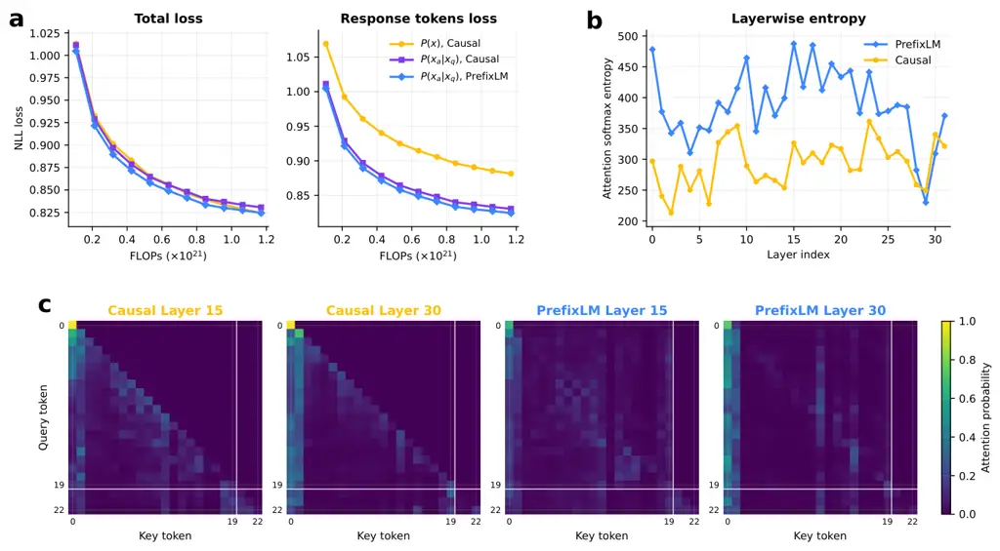
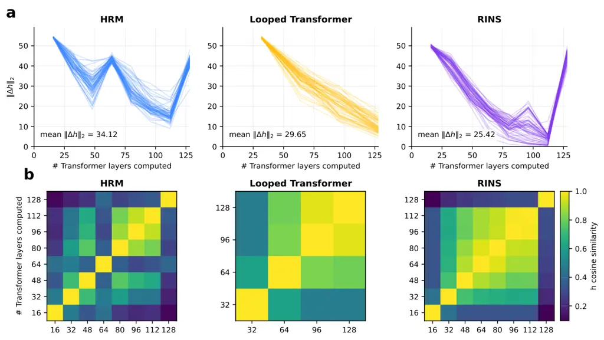
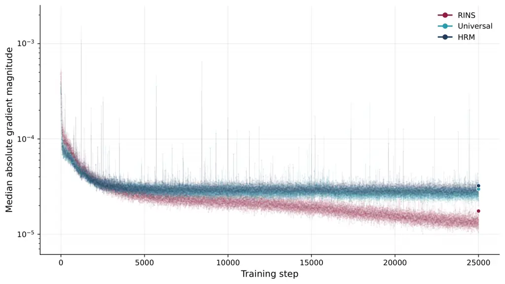
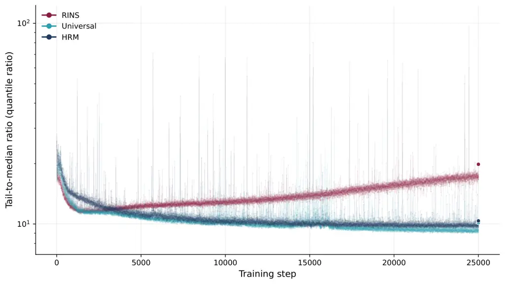

# HRM-Text: Efficient Pretraining Beyond Scaling

Guan Wang Affiliation: Sapient Intelligence    Changling Liu
Affiliation: Sapient Intelligence    Chenyu Wang Affiliation: MIT    Cai
Zhou Affiliation: MIT    Yuhao Sun Affiliation: Sapient Intelligence   
Yifei Wu Affiliation: Sapient Intelligence    Shuai Zhen Affiliation:
Sapient Intelligence    Luca Scimeca Affiliation: Sapient Intelligence
   Yasin Abbasi Yadkori Affiliation: Sapient Intelligence

###### Abstract

The current pretraining paradigm for large language models relies on
massive compute and internet-scale raw text, creating a significant
barrier to foundational research. In contrast, biological systems
demonstrate highly sample-efficient learning through multi-timescale
processing, such as the functional organization of the frontoparietal
loop. Taking this as inspiration, we introduce HRM-Text, which replaces
standard Transformers with a Hierarchical Recurrent Model (HRM) that
decouples computation into slow-evolving strategic and fast-evolving
execution layers. To stabilize this deep recurrence for language
modeling, we introduce MagicNorm and warmup deep credit assignment.
Furthermore, instead of standard raw-text pretraining, we train
exclusively on instruction-response pairs using a task-completion
objective and PrefixLM masking. Serving as an empirical existence proof
of efficient pretraining, a 1B-parameter HRM-Text model trained from
scratch on only 40 billion unique tokens and \$1,500 budget achieves
60.7% on MMLU, 81.9% on ARC-C, 82.2% on DROP, 84.5% on GSM8K, and 56.2%
on MATH. Despite utilizing roughly 100-900x fewer training tokens and
96-432x less estimated compute than standard baselines, HRM-Text
performs competitively with 2–7B parameter open models. These results
demonstrate that co-designing architectures and objectives can radically
reduce the compute-to-performance ratio, making pretraining from scratch
accessible to the broader research community.

^(†)^(†)footnotetext: ^(†) Corresponding author. ^(∗) Equal
Contribution. Contact: research@sapient.inc. Code available at:
[github.com/sapientinc/HRM-Text](https://github.com/sapientinc/HRM-Text)

Figure 1: Pretraining efficiency. Trained from scratch in 1.9 days on 16
GPUs, HRM-Text 1B achieved performance competitive with substantially
larger 2–7B foundation models while utilizing up to 432$`\times`$ less
compute and 900$`\times`$ fewer training tokens.

## 1 Introduction

The remarkable success of large language models (LLMs) is currently
driven by a monolithic recipe: massive, multi-stage pipelines that begin
with broad unsupervised pretraining over internet-scale raw text. While
undeniably effective, this brute-force scaling paradigm is highly
inefficient in data-limited regimes. Massive compute is spent predicting
prompt-like or task-irrelevant text simply to build generalized
representations 37, 31, 63. Consequently, this extreme computational
barrier has largely locked the broader research community out of
foundational pretraining exploration. The prevailing assumption is that
without immense compute clusters and trillions of tokens, investigating
new architectures or training from scratch is futile.

This brute-force data hunger stands in stark contrast to human
intelligence, which can grasp governing rules and perform
heuristic-guided search from only a few examples. In our previous work,
we introduced the Hierarchical Recurrent Model (HRM), a dual-timescale
architecture inspired by the functional organization of the biological
frontoparietal loop 69. By decoupling deliberation into a slow-evolving
strategic layer and a fast-evolving execution layer, HRM provided a
structural inductive bias that helped avoid local stagnation and
successfully guided symbolic search on combinatorial tasks.

However, scaling recurrent architectures to the open-ended complexities
of language modeling introduces severe gradient-instability risks 6, 13,
34, 78. A structural prior alone is insufficient; achieving competitive
open-domain performance requires a holistic codesign. In this paper, we
demonstrate that architecture and training methods are profoundly
important once again. We explore two major, synergistic directions to
realize this sample-efficient engine:

- •
  Architectural Exploration: To achieve deep computation without a
  proportional explosion in parameter counts, we build upon HRM’s
  modular, multi-timescale recurrence. The fast $`L`$-module performs
  local iterative refinement, while the slow $`H`$-module maintains
  stable semantic context across cycles 69. To make this deep recurrence
  mathematically viable for language, we introduce stabilization
  techniques like MagicNorm and warmup deep credit assignment, which
  bound forward activation variance while maintaining backward
  optimization stability 71, 44, 62.
- •
  Objective Exploration: We challenge the dogma of autoregressive
  pretraining on raw text. Since models are primarily used for
  conditional generation at inference time, we pretrain HRM-Text
  directly from scratch on instruction-response pairs 70, 55, 46. We
  optimize a task-completion objective, computing the negative
  log-likelihood loss exclusively over the response:
  $`-\log P(x_{a}\mid x_{q})`$ 61, 53, 55. We pair this with a PrefixLM
  attention mask, which allows full bidirectional (encoder-like)
  attention across the instruction tokens while preserving standard
  causal generation for the response 45, 17, 53, 63.

When these two directions are combined, the result is an empirical
existence proof that defies the current scaling dogma. Trained from
scratch on a low budget of only 40B unique tokens, HRM-Text achieves
strong performance on most benchmarks against contemporary open models
like Llama, Qwen, Gemma, OLMo, Ouro and Huginn 48, 72, 64, 50, 77, 23.
Strikingly, it reaches this performance neighborhood using roughly
$`100\text{-}900\times`$ fewer training tokens and
$`96\text{-}432\times`$ less estimated training compute than these
baselines, as shown in Figure 1 and Table 4.

We do not present HRM-Text as the final or optimal language model, but
rather as proof that specific structural priors and targeted training
objectives can radically alter the compute-to-performance ratio. Because
the entry price is vastly reduced, this methodology democratizes
foundational AI research. Pretraining from scratch is accessible
again—we invite the community to join us in exploring how far smart
architectures and focused objectives can go.

## 2 Methods

Figure 2: HRM-Text architecture. (a) Dual-timescale recurrent design
comprising L and H modules. (b) L/H module internals featuring
MagicNorm—PreNorm blocks followed by final norm. (c) Sigmoid-gated multi
head self-attention. (d) PrefixLM mask enabling bidirectional attention
on instruction.

HRM-Text builds upon an improved HRM architecture, featuring a
dual-timescale recurrence ⁶⁹. The forward pass is initialized with a
high-level state, $`z_{H}^{0}`$, derived from the input token
embeddings, alongside a fixed low-level state, $`z_{L}^{0}`$. The core
processing sequence consists of two high-level cycles. Each cycle
executes three fast $`L`$ module updates followed by a single slow $`H`$
module update. Token logits are generated by applying a linear head to
the output of the final $`H`$ module state. We employ a warmup deep
credit assignment strategy: gradients are initially backpropagated
through only the final two recurrent steps, expanding to the final five
steps as training progresses.

Internally, both the $`H`$ and $`L`$ recurrent modules are structured
using MagicNorm. Additionally, we utilize parameterless RMSNorm
(omitting the learnable $`\gamma`$ parameter) ⁷⁴, SwiGLU activation
functions ⁵⁸, Rotary Position Embeddings (RoPE) ⁶⁰, and a sigmoid-gated
self-attention mechanism ⁵².

In contrast to standard autoregressive pretraining on raw text, we
optimize a task-completion objective. The model is pretrained directly
on instruction-response pairs $`(x_{q},x_{a})`$ from scratch using a
negative log-likelihood (NLL) loss computed exclusively over the
response, $`-\log P(x_{a}|x_{q})`$. This objective is naturally paired
with a PrefixLM attention mask, enabling full bidirectional attention
across the instruction tokens.

In the following sections, we detail the specific mechanics that enable
HRM-Text’s extreme efficiency. Section 2.1 delves into our novel
stabilization techniques, while Section 2.2 explores the task-completion
pretraining objective and PrefixLM masking strategy.

### 2.1 Scaling to language with recurrence

#### 2.1.1 Stabilization via MagicNorm

Although the original HRM demonstrated strong performance on symbolic
tasks, scaling recurrent architectures to language modeling introduces
severe gradient-instability risks. Transformer design already involves a
compromise in the placement of normalization layers71, 44; recurrence
amplifies this compromise because the same transformation is repeatedly
applied over many steps.

PostNorm 67 places the normalization outside the residual branch:

```math
h_{l}=\text{Norm}(h_{l-1}+\text{Sublayer}(h_{l-1}))
```

This effectively bounds activation variance and can improve
expressivity, but it disrupts the clean identity path and can lead to
vanishing gradients in deeper networks 44.

PreNorm places the normalization inside the residual branch:

```math
h_{l}=h_{l-1}+\text{Sublayer}(\text{Norm}(h_{l-1}))
```

This maintains a direct identity path,
$`h_{L}=h_{0}+\sum_{l=1}^{L}\text{Sublayer}(\cdot)`$, allowing gradients
to flow more directly to early layers. However, the unnormalized
residual accumulation can cause hidden-state variance to grow with
depth, which may lead to representation collapse or reduced performance
relative to PostNorm.

MagicNorm: To address this tradeoff in recurrent models, we introduce
MagicNorm, which exploits the asymmetry between the forward and backward
computational horizons induced by truncated backpropagation through time
(TBPTT).

Let $`N`$ denote the total number of recurrent forward steps and $`K`$
denote the truncated backward horizon, where $`K\ll N`$. In MagicNorm,
each recurrent module is composed of $`L`$ internal PreNorm blocks, but
is capped with a final normalization layer at its exit:

```math
z_{n}=\text{Norm}\left(z_{n-1}+\sum_{l=1}^{L}\text{Sublayer}_{l}(\text{Norm}(\cdot))\right)
```

During the _forward pass_, the recurrent state $`z`$ is subjected to
$`N`$ module-level normalization operations. Because these norms sit
directly on the main recurrent pathway, they bound activation variance
at the end of every recurrent step. This prevents the unbounded variance
growth of pure PreNorm and gives the recurrent core PostNorm-like
forward stability.

Conversely, during the _backward pass_, the truncated gradient horizon
means the error signal passes through the module-level normalization
only $`K`$ times. Within that same horizon, the gradient also flows
through $`L`$ internal PreNorm identity connections. Since $`K`$ is
small relative to the full recurrence depth $`N`$, MagicNorm behaves
more like a stable PreNorm architecture during optimization.

#### 2.1.2 Warmup deep credit assignment

The original HRM uses a fixed 1-step gradient strategy, backpropagating
only through the last two recurrent steps (last $`H`$ and last $`L`$).
We extend this approach with warmup deep credit assignment. The schedule
is motivated by temporal-curriculum principles: early optimization is
restricted to short credit-assignment paths, and longer paths are
introduced only after the model has reached a more stable regime. This
design is also consistent with biological accounts of temporal learning,
where local traces can support delayed credit assignment 35,
reward-predictive signals can shift from reward-proximal events to
earlier cues 4, and developmental curricula can improve sequence
learning by exposing learners to shorter-range structure before
longer-range dependencies 19.

Operationally, we dynamically adjust the backward gradient horizon,
$`K`$. During early pretraining, we compute gradients through only the
last two recurrent steps ($`K=2`$), then linearly warm up the horizon to
the last five steps ($`K=5`$). This progressive deepening allows the
model to exploit longer recurrent computation while reducing exposure to
the optimization pathologies that often arise from long gradient paths
at initialization. Because the warmup phase backpropagates through fewer
recurrent steps than the final setting, it also reduces the average
backward-pass computation and accelerates early training.

### 2.2 Task-completion objective and PrefixLM

The dominant paradigm for training foundation models relies on a
resource-intensive, multi-stage pipeline. From T5 through modern large
language models ⁵³, training typically begins with broad unsupervised
pretraining and is followed by higher-quality mid-training.

In the pretraining phase, models are trained on internet-scale raw
corpora to learn general language representations. In the mid-training
(or annealing) phase, the model is refined on high-quality text, usually
instruction-like data. In both phases, the model optimizes an NLL
objective over all tokens

```math
-\log P(x)
```

While effective, this approach can be inefficient in the data- and
resource-limited regime. Broad raw-text pretraining consumes most of the
compute and data, and much of the token-level loss is spent on
predicting prompt-like or task-irrelevant text. Yet at inference time,
models are applied primarily on conditional generation: given a query or
instruction, they must produce an appropriate response.

To improve sample efficiency, HRM-Text omits broad raw-text pretraining
and trains exclusively on instruction-response pairs from scratch. Given
an example containing an instruction and response $`x=(x_{q},x_{a})`$,
we optimize the NLL of the response conditioned on the instruction:

```math
-\log P(x_{a}|x_{q})
```

By not predicting the instruction tokens, the model concentrates its
parameter updates on generating accurate responses. Figure 3-(a)
illustrates this effect. Although the total loss is comparable with and
without the task-completion objective, the error associated with the
response component is substantially lower.

Furthermore, this single-stage conditional objective naturally aligns
with a PrefixLM attention mask 53. Because the model is never required
to autoregressively predict the instruction $`x_{q}`$, we remove the
causal masking over the instruction segment: all instruction tokens
attend to one another bidirectionally, while standard causal masking is
maintained over the response sequence. This gives HRM-Text an
encoder–decoder-like separation inside a decoder-style implementation.
The instruction segment is first integrated as a fully visible context,
analogous to an encoder-side representation, while the response segment
is generated autoregressively, analogous to a decoder.

Figure 3 (b) shows that PrefixLM leads to higher attention softmax
entropy, indicating attention over a more diverse set of tokens.
Figure 3 (c) shows that causal attention is more localized, whereas
PrefixLM attention is more global and diverse. Together, the
response-only conditional loss and PrefixLM attention improve sample
efficiency in the data- and compute-restricted regime.



Figure 3: Task-completion and PrefixLM improve response modeling. (a)
Compared with full causal language modeling $`P(x)`$, response-only
training $`P(x_{a}|x_{q})`$ lowers response-token NLL. PrefixLM further
improves response loss. (b) PrefixLM increases layerwise attention
entropy relative to causal masking, suggesting broader use of the
prompt. (c) Attention maps illustrate the qualitative difference: causal
attention remains mostly local and triangular, while PrefixLM enables
global bidirectional interactions among prompt.

## 3 Results

As the central question of this paper is whether a model trained from
random initialization under a small pretraining budget can reach a
meaningful open-model performance regime, we approach this question as a
small-budget design exploration: first, whether architectural choices
can improve the use of fixed training compute, and second, whether the
objective and input structure can increase the yield of each training
example. Finally, we compare HRM-Text with contemporary fully open and
open-weight models to quantify its efficiency relative to current
pretraining practice, and analyze whether the recurrent architecture
increases effective depth. Training details for all models are provided
in Section 4.

Across these experiments, HRM-Text is trained from scratch on the
task-formatted mixture described in Section 4.1, using only 40B unique
tokens. We report all the performance from a single HRM-Text checkpoint.

### 3.1 Architecture efficiency under matched training compute

The first part of this exploration asks how much architecture design can
improve the use of a fixed training budget. We test this by comparing
standard Transformers, larger matched-FLOPs Transformers, Looped
Transformers ¹⁶, RINS ³, and HRM under matched training compute.

|                       |             |                     |            |       |       |        |       |       |       |       |       |
| --------------------- | ----------- | ------------------- | ---------- | ----- | ----- | ------ | ----- | ----- | ----- | ----- | ----- |
| Model                 | Recursions  | FLOPs ($`10^{21}`$) | Tokens (T) | MMLU  | ARC-C | Hella. | Wino. | BoolQ | DROP  | GSM8K | MATH  |
| HRM 1B                | 4 (H2L3)    | 1.0                 | 0.06       | 60.73 | 81.91 | 63.42  | 72.38 | 86.18 | 82.21 | 84.53 | 56.16 |
| Looped Transformer 1B | 4           | 1.0                 | 0.06       | 56.51 | 74.06 | 47.59  | 68.19 | 82.35 | 76.20 | 75.13 | 48.30 |
| RINS 1B               | 4 ($`r=7`$) | 1.1                 | 0.06       | 56.09 | 76.71 | 52.49  | 68.35 | 83.98 | 79.92 | 77.71 | 48.90 |
| Transformer 1B        | 1           | 1.0                 | 0.17       | 53.15 | 74.32 | 47.29  | 65.51 | 83.58 | 75.30 | 75.06 | 48.36 |
| Transformer 3B (Deep) | 1           | 1.1                 | 0.06       | 56.67 | 80.46 | 51.05  | 67.96 | 84.07 | 76.95 | 75.66 | 50.50 |
| Transformer 3B (Wide) | 1           | 1.1                 | 0.06       | 54.53 | 76.54 | 43.77  | 67.09 | 83.55 | 74.04 | 73.01 | 49.74 |

Table 1: Training FLOPs-matched comparison of recurrent architectures
and Transformer models. Bold denotes the highest score in each column,
and underline denotes the second highest.

Table 1 compares training-FLOPs-matched recurrent architectures
(including HRM, looped Transformers, and RINS) with standard
Transformers. For recursive models, the value in the recursions column
indicates total compute per forward pass, expressed as a multiple of the
compute required if recurrence is not present. For example, H2L3 denotes
2 outer H cycles, with 3 L steps inside each outer cycle, giving
$`2\times(3+1)=8`$ total H/L module steps. Since each H or L module
contains half of the non-embedding parameters of the full HRM recurrent
core, this corresponds to $`8\times 0.5=4`$ recursions in the table. For
standard Transformer models, the value is 1.

Looped Transformers and RINS generally outperform Transformer models of
the same size, showing that recurrent or looped computation is an
effective architectural direction. When compared with a larger
Transformer under a matched training-FLOPs budget, however, their
advantage is less consistent. HRM is a strong instance of this
architecture-design space and performs well against the listed
baselines, including the larger deep Transformer.

Within recurrent designs, we further compare HRM with TRM to separate
hierarchical dual-timescale recurrence from a shared-parameter
dual-timescale recurrent variant.

| Model             | Recursions | FLOPs ($`10^{21}`$) | Tokens (T) | MMLU  | ARC-C | Hella. | Wino. | BoolQ | DROP  | GSM8K | MATH  |
| ----------------- | ---------- | ------------------- | ---------- | ----- | ----- | ------ | ----- | ----- | ----- | ----- | ----- |
| HRM 1B            | 4 (H2L3)   | 1.0                 | 0.06       | 60.73 | 81.91 | 63.42  | 72.38 | 86.18 | 82.21 | 84.53 | 56.16 |
| TRM 1B (unstable) | 2 (H2L1)   | 1.1                 | 0.06       | 46.38 | 56.66 | 35.22  | 59.35 | 74.74 | 63.56 | 67.63 | 44.12 |
| HRM 0.6B          | 4 (H2L3)   | 0.5                 | 0.06       | 56.87 | 74.32 | 50.48  | 66.38 | 84.86 | 78.07 | 78.39 | 50.28 |
| TRM 0.6B          | 4 (H2L3)   | 1.1                 | 0.06       | 56.88 | 76.71 | 55.12  | 67.01 | 84.22 | 79.91 | 78.47 | 50.84 |

Table 2: Performance and stability comparison against TRM. HRM maintains
stable training dynamics across all scales, whereas TRM suffers from
severe instability at the 1B parameter scale. Furthermore, at the 0.6B
scale, HRM achieves competitive performance across most benchmarks while
requiring 2$`\times`$ less compute than TRM.

TRM is a HRM-variant that shares the H and L module parameters, to
achieve strong results on symbolic reasoning problems at smaller scale 36. Table 2 compares HRM and TRM. Since TRM shares parameters across H-L
modules, there are two ways to approximately match FLOPs: keeping the
overall parameter count fixed and reduce the number of recursions, or
keeping the recursive structure fixed and reduce the parameter count. In
the first setting, TRM training is less stable, likely due to the
reduced recursion weakening the intended iterative computation. In the
second setting, the additional recursion stabilizes training and
improves performance, but the model still lags behind FLOPs-matched HRM.
HRM achieves generally comparable or stronger performance while using
substantially fewer FLOPs than TRM in this comparison.

These results support the first part of the small-budget design
exploration: recurrent and looped architectures can improve benchmark
yield under fixed training compute, and HRM is one effective point in
this broader architecture-design space.

### 3.2 Task-completion objective and PrefixLM yield

The second part of this exploration asks whether the training objective
and input structure can increase the yield of each training example. We
test this through an incremental ablation that starts with a standard
Transformer trained on full question–answer pairs using causal
attention, then adds the task-completion objective, PrefixLM attention,
and finally the HRM architecture. All experiments are FLOPs-matched.

As shown in Table 3, the task-completion objective, PrefixLM training,
and the HRM architecture each significantly contribute to overall
performance. Introducing the task-completion objective establishes
initial gains across all benchmarks, while PrefixLM training further
enhances these results compared to standard causal masking. Ultimately,
transitioning from a standard Transformer to the HRM architecture
delivers a final, consistent performance increase across the board.

| Architecture   | Objective  | Attention | MMLU     | ARC-C | Hella. | Wino. | BoolQ | DROP  | GSM8K | MATH  |
| -------------- | ---------- | --------- | -------- | ----- | ------ | ----- | ----- | ----- | ----- | ----- | ----- |
| Transformer 1B | $`P(x)`$   | Causal    | 40.55    | 51.91 | 32.50  | 48.54 | 39.94 | 38.24 | 48.37 | 35.44 |
|                | $`P(x\_{a} | x\_{q})`$ | Causal   | 47.72 | 62.88  | 41.64 | 60.85 | 76.57 | 54.24 | 69.75 | 47.04 |
|                | $`P(x\_{a} | x\_{q})`$ | PrefixLM | 53.15 | 74.32  | 47.29 | 65.51 | 83.58 | 75.30 | 75.06 | 48.36 |
| HRM 1B         | $`P(x)`$   | Causal    | 43.68    | 60.24 | 45.10  | 53.71 | 55.98 | 42.74 | 66.19 | 44.32 |
|                | $`P(x\_{a} | x\_{q})`$ | Causal   | 50.60 | 69.80  | 50.43 | 63.93 | 67.28 | 62.39 | 79.91 | 54.18 |
|                | $`P(x\_{a} | x\_{q})`$ | PrefixLM | 60.73 | 81.91  | 63.42 | 72.38 | 86.18 | 82.21 | 84.53 | 56.16 |

Table 3: Performance Comparison across Model Architectures and
Objectives

### 3.3 Comparison with contemporary open models

After exploring architecture, objective, and input structure under the
small-budget setting, we compare the resulting HRM-Text checkpoint with
contemporary fully open and open-weight models trained with
substantially larger budgets.

Figure 1 and Table 4 compares HRM-Text 1B with contemporary fully open
and open-weight models, including Llama, Qwen, Gemma, OLMo and recurrent
models, Huginn and Ouro. HRM-Text achieves strong performance among
these models on most benchmarks, while remaining competitive on MMLU
despite its smaller parameter count and limited 40B unique-token
pretraining budget. This pattern is consistent with the role of
HRM-Text: recurrent depth and task-completion pretraining improve
reasoning and task execution, while broad factual-knowledge coverage
remains more sensitive to model scale and data breadth. HRM-Text reaches
this performance range with $`96\text{-}432\times`$ less estimated
training compute and roughly $`100\text{-}900\times`$ fewer training
tokens than the compared open baselines. This comparison supports the
paper’s central question by showing that a small,
task-completion-oriented pretraining run can enter the performance range
of open models trained with far larger token and compute budgets.

|             |              |                    |           |      |       |        |       |       |      |       |      |
| ----------- | ------------ | ------------------ | --------- | ---- | ----- | ------ | ----- | ----- | ---- | ----- | ---- |
| Model       | Architecture | FLOPs($`10^{21}`$) | Tokens(T) | MMLU | ARC-C | Hella. | Wino. | BoolQ | DROP | GSM8K | MATH |
| Fully open  |              |                    |           |      |       |        |       |       |      |       |      |
| HRM-Text 1B | Recurrent    | 1                  | 0.06      | 60.7 | 81.9  | 63.4   | 72.4  | 86.2  | 82.2 | 84.5  | 56.2 |
| Huginn 3.5B | Recurrent    | 127                | 0.8       | 31.4 | 38.2  | 65.2   | 59.4  | 69.8  | 17.8 | 34.6  | 12.6 |
| Olmo3 7B    | Dense        | 252                | 6         | 65.8 | 81.6  | 72.7   | 64.6  | 85.4  | 71.5 | 75.5  | 40.0 |
| Open weight |              |                    |           |      |       |        |       |       |      |       |      |
| Llama3.2 3B | Dense        | 162                | 9         | 58.0 | 69.1  | 47.1   | 52.4  | 76.2  | 45.2 | 77.7  | 48.0 |
| Gemma3 4B   | Dense        | 96                 | 4         | 59.6 | 56.2  | 77.2   | 64.7  | 72.3  | 60.1 | 38.4  | 24.2 |
| Qwen3.5 2B  | Dense        | 432                | 36        | 64.5 | 81.0  | 64.6   | 56.7  | 80.5  | 30.8 | 53.0  | 34.2 |
| Ouro 1.4B   | Recurrent    | 259                | 7         | 67.4 | 60.9  | 74.3   | 72.3  | 83.6  | 49.7 | 78.9  | 22.4 |

Table 4: Evaluation results of HRM-Text 1B and contemporary fully open
or open-weight models.

Our reported scaling experiments extend to 3B parameters for
Transformers and 1B parameters for HRM-Text. Within this range, the
results show that models trained with a limited amount of data can
remain competitive with contemporary industrial-scale pretraining
efforts that use much larger datasets (up to 36T tokens). Demonstrating
similar efficiency gains at larger model scales remains in the scope of
future work.

### 3.4 Effective depth analysis

We hypothesize that HRM’s effectiveness is due to its recurrence,
increasing the amount of useful internal computation. We test this
hypothesis by examining whether HRM exhibits greater effective depth
than standard and looped Transformer baselines.



Figure 4: Effective depth analysis. (a) Each layer of HRM consistently
reveals considerable changes compared to its previous layer, showing
that deep layers of HRM are still making meaningful contributions to the
hidden states. (b) HRM has smaller cosine similarity of block-wise
representations, while other model variants suffer more from the common
layer representation over-smoothing issue, analogously to standard
transformers.

Figure 5: Per-layer logit lens KL. HRM shows the largest logit len KL in
deep layers, while both standard and looped transformers converges to
stable distributions in shallow layers.

Figure 4 illustrates effective depth from two perspectives: (a) the norm
of the difference between adjacent recurrent blocks, and (b) the cosine
similarity of block-wise representations. Both metrics suggest that HRM
maintains more active representational change across depth than standard
Transformers and other looped models.

Following Hu et al. Super, we also use logit lens analysis to evaluate
how early the model’s output distribution begins to stabilize. We decode
hidden states from different layers using the model’s output projection
head, then compute the KL divergence between each probed prediction and
the final model distribution. As shown in Figure 5, both the standard
Transformer and looped Transformer converge to a stable output
distribution in relatively early layers, suggesting that their deeper
layers make smaller incremental contributions. In contrast, HRM retains
larger KL values in deeper layers, indicating greater effective depth.

## 4 Training details

### 4.1 Dataset

We train HRM-Text exclusively on open-source datasets, comprising
general instructions, rewritten knowledge, mathematical and symbolic
tasks, textbook exercises, and web-extracted questions. The initial
corpus contains approximately $`176.5`$B tokens across $`593.7`$M
documents. From this, we sample $`40`$B unique tokens for a total
training duration of $`60`$B tokens, with repetition governed by the
stratified sampling schedule described below. Table 5 summarizes the
dataset composition.

| Type                                | Datasets                                                                   | Tokens | Docs   | Condition            |
| ----------------------------------- | -------------------------------------------------------------------------- | ------ | ------ | -------------------- |
| General instructions                | FLAN 46, Tasksource 59, NoRobots 33                                        | 138.7B | 379.9M | direct / cot         |
| Rewritten Wikipedia knowledge       | SYNTH 51                                                                   | 21.7B  | 60.8M  | synth, direct / cot  |
| Math and reasoning                  | Platypus 40, Principia 1, OpenMathInstruct2 65, NuminaMath 41, OmniMATH 22 | 6.8B   | 25.7M  | synth / synth, cot   |
| Symbolic                            | DMMath 57, AMPS 28, Sudoku-Extreme 69                                      | 6.2B   | 120.7M | direct               |
| Reasoning (thinking tokens removed) | AceReason 9, OpenThoughts2 25                                              | 2.4B   | 3.6M   | synth, cot           |
| Textbook exercises                  | TextbookReasoning 21                                                       | 358.1M | 1.2M   | synth, cot           |
| Extracted web instructions          | NaturalReasoning 73, WebInstruct-verified 47, AMPS-khan 28                 | 375.1M | 1.8M   | noisy / direct / cot |

Table 5: Source datasets used for HRM-Text training, grouped by type.

| Source dataset                     | Sampling cap               |
| ---------------------------------- | -------------------------- |
| FLAN                               | 5k docs/task               |
| Tasksource                         | 10k docs/task              |
| SYNTH                              | 10M docs                   |
| AceReason                          | 2M docs                    |
| OpenThoughts2                      | 500k docs                  |
| DM Math                            | 100k docs/task             |
| Sudoku                             | 1M docs                    |
| Small datasets ($`\leq 50`$k docs) | $`10\times`$ original size |
| Other datasets                     | Original size              |

Table 6: Stratified sampling limits used to construct the training
mixture.

To control response properties during inference, we prepend specific
condition tags to the instructions based on the target response style.
We utilize four primary conditions: direct (answer-only), cot
(chain-of-thought), synth (synthetic answer style), and noisy (web-crawl
text with uneven formatting). As outlined in the “Condition” column of
Table 5, this approach leverages conditioned training 68, 18 to enable
explicit selection of the model’s output format at generation time.

To concentrate the training signal on final task completions, we strip
all text enclosed within \<think\>…\</think\> boundaries prior to
training. This eliminates explicit long-CoT traces mostly produced by
reinforcement learning with verifiable rewards (RLVR) training ¹⁵,
aligning with our objective for HRM-Text to rely on its internal
hierarchical computation rather than explicit reasoning steps.

We employ SeqIO-style stratified sampling 54, treating each dataset or
task as an independent stratum rather than sampling uniformly from a
pooled corpus. To ensure a balanced training mixture and prevent
over-representation of massive datasets, we apply caps on number of
documents per task or per dataset, while upsampling smaller datasets.
The specific sampling limits and multipliers are detailed in Table 6.

### 4.2 Dataset Contamination

While our pretraining data originates from widely used public sources,
and many enforce decontamination measures, residual contamination may
still persist considering the scale of pretraining. To rigorously assess
whether our models’ benchmark performance artificially benefits from
exposure to test examples, we conduct a statistical test adapted from
the Llama family 66.

We tokenize questions from all evaluated benchmarks (excluding few-shot
exemplars) and identify $`n`$-gram matches against the fully tokenized
pretraining corpus. A sample’s contamination percentage is defined as
the fraction of its tokens participating in these matched $`n`$-grams.

To determine if contamination inflates performance, we partition the
evaluation data into four overlapping subsets based on contamination
percentage: “Clean” ($`<20\%`$), “Not Clean” ($`\geq 20\%`$), “Not
Dirty” ($`<80\%`$), and “Dirty” ($`\geq 80\%`$). For contamination to be
deemed significantly impactful, “clean” samples must perform
demonstrably worse than average, while “dirty” samples perform
demonstrably better. For each subset of size $`k`$, we compute the
empirical mean performance $`\bar{X}`$ and the test statistic
$`Z_{k}=(\bar{X}-\mu_{k})/\sigma_{k}`$, where $`\mu_{k}`$ and
$`\sigma_{k}`$ are the mean and standard deviation of the sampling
distribution for size $`k`$. We conclude that dataset contamination
provides a statistically significant performance boost only if
$`|Z_{k}|>2`$ across all four subsets.

We applied this test to HRM-Text 0.6B and 1B using $`n=13`$ and
$`n=20`$, on all benchmarks shown in Table 4. HRM-Text 0.6B exhibited no
significant contamination in either setting. HRM-Text 1B showed
statistical significance on the DROP benchmark for $`n=13`$ (as shown in
Table 7), but not for $`n=20`$. Nonetheless, HRM-Text 1B still achieves
a score of $`81.1`$ on the strictly clean subset ($`0\%`$ average
contamination, $`5904`$ samples) of DROP, indicating strong baseline
generalization despite a marginal potential benefit from contamination.

Overall, these analyses show that HRM-Text’s benchmark performance is
unlikely artificially driven by prior exposure to test examples.

| Dataset         | Subset Type | Avg. Contam. % | $`n`$ | $`\bar{X}`$ | $`\mu_{n}`$ | $`Z_{n}`$ |
| --------------- | ----------- | -------------- | ----- | ----------- | ----------- | --------- |
| DROP ($`n=13`$) | Clean       | 0.0            | 5904  | 81.1        | 82.3        | $`-2.53`$ |
|                 | Not Clean   | 90.5           | 3632  | 84.2        | 82.3        | $`3.23`$  |
|                 | Not Dirty   | 6.1            | 6576  | 80.8        | 82.3        | $`-3.25`$ |
|                 | Dirty       | 97.5           | 2960  | 85.5        | 82.3        | $`4.85`$  |

Table 7: Contamination analysis results for the DROP dataset on HRM-Text
1B.

### 4.3 Architecture and optimization details

HRM-Text 1B took 46 hours to pretrain on two 8×H100 nodes, costing
around \$1,472 (assuming \$2 per H100 hour). We summarize the model,
optimization, and infrastructure settings below.

##### Tokenizer.

We employ a Byte-Pair Encoding (BPE) tokenizer with a vocabulary size of
65,536, trained using the tokenizers library.

##### Model configuration.

Each module is a transformer comprising 16 layers, with a hidden size of
1536 and a head size of 128. We use a context size of 4,096 and RoPE
positional encoding with $`\theta=10{,}000`$. The RMSNorm $`\epsilon`$
parameter is set to $`10^{-6}`$. All models are trained in bfloat16
precision, and all model weights are initialized using LeCun normal.

##### Optimization.

We use the Adam-atan2 optimizer ²⁰ with $`\beta_{1}=0.9`$,
$`\beta_{2}=0.95`$, and a weight decay of 0.1. The learning rate is
linearly warmed up over 2,000 steps and then held constant at
$`2.2\times 10^{-4}`$. No gradient clipping is applied. The batch size
is 196,608 tokens. Rather than applying standard learning rate decay, we
maintain an Exponential Moving Average (EMA) of the model weights with a
decay rate of 0.9999. Both our final evaluations and the publicly
released model weights use this EMA checkpoint.

##### Infrastructure.

The parallelization framework is based on PyTorch FSDP2 42. All models
are trained in a single continuous run. We do not use intermediate
checkpointing, crash recovery, or skip loss spikes.

## 5 Discussion

### 5.1 Toward decoupling knowledge and reasoning

Our results suggest a direction for partially decoupling factual
coverage from reasoning computation. HRM-Text is trained on only 40B
unique tokens, and explicitly knowledge-oriented sources constitute only
a fraction of the task-formatted mixture. Nevertheless, the model
achieves strong performance on reasoning-heavy benchmarks such as MATH
and GSM8K, while retaining nontrivial performance on broader knowledge
benchmarks such as MMLU. This pattern suggests that a compact recurrent
model can learn useful task-execution and reasoning behavior without
requiring the same degree of broad factual memorization typically
associated with trillion-token pretraining.

This observation motivates future systems that separate a compact
reasoning core from factual storage. In such systems, recurrent models
like HRM-Text could specialize in computation, planning, and task
execution, while factual breadth is supplied by curated corpora,
retrieval-augmented stores, or learned memory modules. Recent
conditional-memory approaches such as Engram point in a related
direction: instead of forcing the Transformer backbone to simulate
static pattern lookup through dense computation, they introduce scalable
memory lookup as a complementary sparsity axis, freeing neural
computation for global context integration and reasoning 10. HRM-Text
does not yet implement retrieval or conditional memory, but its results
suggest that combining small recurrent reasoning models with external or
learned knowledge stores is a promising direction for future work.

### 5.2 Adaptive computation time (ACT)

Wang et al. Super equipped HRM with an adaptive computation module that
allows simpler problems to terminate earlier, reducing computation while
maintaining near-optimal performance. We do not use this component in
HRM-Text in order to keep the design and training procedure simpler, but
it remains a promising direction for improving both performance and
computational efficiency. The current recurrent schedule provides
additional effective serial depth, but it also increases inference-time
computation relative to a single-pass Transformer. ACT would allow easy
prompts or tokens to halt after fewer recurrent cycles while reserving
the full recurrent budget for harder cases, potentially recovering a
substantial portion of the inference overhead. We therefore view ACT as
a natural complement to HRM-Text’s recurrent-depth design: HRM supplies
depth when reasoning is needed, while ACT can make that depth
conditional rather than fixed.

### 5.3 PrefixLM with inference frameworks

PrefixLM can run inside standard text-generation inference frameworks
such as vLLM without requiring a fundamentally different serving stack.
The main requirement is custom attention-mask handling during
prefilling, so that instruction tokens can attend bidirectionally while
response tokens remain autoregressive.

Using a PrefixLM-style attention pattern in multi-turn chat also
requires careful KV-cache logic: user tokens need full attention within
each user segment, while assistant tokens must preserve causal
generation. This is an engineering constraint rather than a conceptual
limitation, but it should be addressed explicitly in production
inference systems.

## 6 Conclusion

We introduced HRM-Text as an empirical existence proof that highly
efficient pretraining is achievable. Inspired by biological
multi-timescale processing, we co-designed a hierarchical recurrent
architecture with a targeted task-completion objective. This
demonstrates that there is at least one model family capable of reaching
competitive performance without relying on the massive compute and
internet-scale raw text that dominate current paradigms.

By drastically reducing the compute-to-performance ratio, this work
opens significant potentials for future research. Foundational
pretraining is no longer locked inside highly resourced institutions; it
is now computationally accessible to small labs, academic groups, and
even individuals. We hope this democratization empowers the broader
community to actively explore, train, and innovate on new architectures
from scratch.

## 7 Related Work

The literature on recurrent neural networks and language modelling is
extensive. In this section, we discuss the most relevant papers.

### 7.1 Scaling laws and efficient pretraining

Language-model development is driven by scaling laws and compute-optimal
training, which together prescribe jointly increasing parameters, data,
and compute 37, 31. This underlies the dominant recipe: large
decoder-only Transformers trained on massive corpora and refined via
mid- and post-training 8, 24, 43, 49. While this scaling paradigm has
produced strong models, it concentrates pretraining among compute-rich
organizations, reinforcing a growing compute divide 7, 2. HRM-Text
instead explores whether improved architectures, objectives, and data
curation can shift the cost–performance frontier, complementing scaling
laws by increasing per-token and per-FLOP efficiency.

### 7.2 Conditional sequence modeling and PrefixLM

The distinction between modeling conditional answers,
$`P_{\theta}(x_{a}\mid x_{q})`$, and full text streams,
$`P_{\theta}(x)`$, predates modern LLMs. Early sequence-to-sequence
models and encoder–decoder transformers explicitly model outputs
conditioned on inputs 61, 12, 5, 67. T5 53 later unified NLP tasks as
text-to-text generation, reinforcing this conditional framing. In the
instruction-tuning phase of language modeling, NLP datasets are
converted into instruction–response pairs, and a mask is often applied
so that loss is only computed on the response tokens 70, 55. Scaling
approaches like FLAN show that such task formatting improves
generalization 46, 14.

Decoder-only models concatenate the prompt and response into a single
causal stream and predict all tokens. Although scalable, this is
inefficient: the prompt is known at inference time, yet training still
assigns loss to reconstruct it.

PrefixLM-style objectives bridge decoder-only models and conditional
generation: prefix tokens attend bidirectionally, while outputs remain
causal 45, 17, 53, 63. HRM-Text builds directly on this lineage by
making conditional modeling the primary pretraining objective, using
response-only loss and PrefixLM masking to combine encoder–decoder
behavior with decoder-only simplicity.

### 7.3 Latent computation and recurrent language models

A line of work seeks to improve model capability by increasing internal
computation rather than just scaling parameters or output tokens.
Universal Transformers introduced recurrent depth to self-attention 16,
and later recurrent or block-recurrent Transformer variants reuse
parameters across steps or layers 34, 13, 56. These approaches echo
classic recurrent-network ideas but inherit the challenge of unstable
long-range credit assignment 6, 78.

Recent latent-reasoning approaches refine hidden states internally
before emitting an answer 27, 39. Recurrent-depth language models such
as Huginn and looped language models such as Ouro 76 scale this idea to
language modeling and test-time computation 23, 76. Meanwhile, CCDD 75
establishes the connection between looped transformers and continuous
diffusion language model with latent reasoning advantages. These works
demonstrate that latent recurrence is a promising alternative to purely
token-level reasoning, but many still rely on large token budgets,
stage-wise training, or extensive test-time recurrence.

HRM-Text builds on the Hierarchical Reasoning Model, which uses a
two-timescale recurrent design for symbolic reasoning 69. Like prior
work, it emphasizes richer internal computation, but it differs in that
it is trained from scratch under a small token budget and uses a
hierarchical dual-timescale architecture. Related work such as TRM
explore even smaller recursive models 36, suggesting that hierarchy,
temporal separation and recurrence can enable useful serial computation,
though applying them to language remains challenging due to larger
states and broader data.

### 7.4 Stable recurrent optimization

Stability is a key challenge for recurrent-depth language models. In
Transformers, normalization placement trades off forward stability and
gradient flow: PostNorm stabilizes activations but is harder to optimize
at depth, while PreNorm improves gradients but risks residual growth and
reduced expressivity 71, 44. Recurrence intensifies this issue, as
repeated transformations create long products of Jacobian-like operators
during backpropagation. Prior work shows exact long-horizon credit
assignment is often impractical 6, 62, and studies of random matrix
products and neural gradients suggest deep multiplicative paths lead to
heavy-tailed, lognormal-like variability 26, 11, 30.

HRM-Text addresses these stability issues using architecture-specific
techniques: MagicNorm and warm-up for deep credit assignment. These
design choices distinguish HRM-Text from generic looped Transformers and
are crucial to making recurrent depth stable at language-model scale.

## Acknowledgements

We thank Sen Song, Jiacheng You, and Andy L. Siy for their insightful
discussions.

## References

- Aggarwal et al. (2026) P. Aggarwal, M. Ghazvininejad, S. Kim, I.
  Kulikov, J. Lanchantin, X. Li, T. Li, B. Liu, G. Neubig, A. Ovalle, S.
  Saha, S. Sukhbaatar, S. Welleck, J. Weston, C. Whitehouse, A.
  Williams, J. Xu, P. Yu, W. Yuan, J. Zhang, and W. Zhao Reasoning over
  mathematical objects: on-policy reward modeling and test time
  aggregation. External Links: 2603.18886 Cited by: Table 5.
- Ahmed and Wahed (2020) N. Ahmed and M. Wahed The de-democratization of
  ai: deep learning and the compute divide in artificial intelligence
  research. arXiv preprint arXiv:2010.15581. Cited by: §7.1.
- Alabdulmohsin and Zhai (2026) I. Alabdulmohsin and X. Zhai Recursive
  inference scaling: a winning path to scalable inference in language
  and multimodal systems. Advances in Neural Information Processing
  Systems 38, pp. 109020–109049. Cited by: §3.1.
- Amo et al. (2022) R. Amo, S. Matias, A. Yamanaka, K. F. Tanaka, N.
  Uchida, and M. Watabe-Uchida A gradual temporal shift of dopamine
  responses mirrors the progression of temporal difference error in
  machine learning. Nature neuroscience 25 (8), pp. 1082–1092. Cited by:
  §2.1.2.
- Bahdanau et al. (2015) D. Bahdanau, K. Cho, and Y. Bengio Neural
  machine translation by jointly learning to align and translate. In
  International Conference on Learning Representations, Cited by: §7.2.
- Bengio et al. (1994) Y. Bengio, P. Simard, and P. Frasconi Learning
  long-term dependencies with gradient descent is difficult. IEEE
  Transactions on Neural Networks 5 (2), pp. 157–166. External Links:
  [Document](https://dx.doi.org/10.1109/72.279181) Cited by: §1, §7.3,
  §7.4.
- Besiroglu et al. (2024) T. Besiroglu, S. A. Bergerson, A. Michael, L.
  Heim, X. Luo, and N. Thompson The compute divide in machine learning:
  a threat to academic contribution and scrutiny?. arXiv preprint
  arXiv:2401.02452. Cited by: §7.1.
- Brown et al. (2020) T. Brown, B. Mann, N. Ryder, M. Subbiah, J. D.
  Kaplan, P. Dhariwal, A. Neelakantan, P. Shyam, G. Sastry, A. Askell,
  et al. Language models are few-shot learners. In Advances in neural
  information processing systems, Vol. 33, pp. 1877–1901. Cited by:
  §7.1.
- Chen et al. (2026) Y. Chen, Z. Yang, Z. Liu, C. Lee, P. Xu, M.
  Shoeybi, B. Catanzaro, and W. Ping Acereason-nemotron: advancing math
  and code reasoning through reinforcement learning. In Advances in
  neural information processing systems, Vol. 38, pp. 110320–110345.
  Cited by: Table 5.
- Cheng et al. (2026) X. Cheng, W. Zeng, D. Dai, Q. Chen, B. Wang, Z.
  Xie, K. Huang, X. Yu, Z. Hao, Y. Li, H. Zhang, H. Zhang, D. Zhao,
  and W. Liang Conditional memory via scalable lookup: a new axis of
  sparsity for large language models. arXiv preprint arXiv:2601.07372.
  Cited by: §5.1.
- Chmiel et al. (2020) B. Chmiel, L. Ben-Uri, M. Shkolnik, E. Hoffer, R.
  Banner, and D. Soudry Neural gradients are near-lognormal: improved
  quantized and sparse training. arXiv preprint arXiv:2006.08173.
  External Links: 2006.08173 Cited by: §C.1, §7.4.
- Cho et al. (2014) K. Cho, B. van Merriënboer, Ç. Gülçehre, D.
  Bahdanau, F. Bougares, H. Schwenk, and Y. Bengio Learning phrase
  representations using RNN encoder–decoder for statistical machine
  translation. In Proceedings of the 2014 Conference on Empirical
  Methods in Natural Language Processing, pp. 1724–1734. External Links:
  [Document](https://dx.doi.org/10.3115/v1/D14-1179) Cited by: §7.2.
- Chowdhury and Caragea (2024) J. R. Chowdhury and C. Caragea
  Investigating recurrent transformers with dynamic halt. arXiv preprint
  arXiv:2402.00976. Cited by: §1, §7.3.
- Chung et al. (2024) H. W. Chung, L. Hou, S. Longpre, B. Zoph, Y.
  Tay, W. Fedus, Y. Li, X. Wang, M. Dehghani, S. Brahma, et al. Scaling
  instruction-finetuned language models. Journal of Machine Learning
  Research 25, pp. 1–53. Cited by: §7.2.
- DeepSeek-AI (2025) DeepSeek-AI DeepSeek-r1: incentivizing reasoning
  capability in llms via reinforcement learning. arXiv preprint
  arXiv:2501.12948. External Links: 2501.12948,
  [Document](https://dx.doi.org/10.48550/arXiv.2501.12948),
  [Link](https://arxiv.org/abs/2501.12948) Cited by: §4.1.
- Dehghani et al. (2019) M. Dehghani, S. Gouws, O. Vinyals, J.
  Uszkoreit, and Ł. Kaiser Universal transformers. In International
  Conference on Learning Representations, Cited by: §3.1, §7.3.
- Dong et al. (2019) L. Dong, N. Yang, W. Wang, F. Wei, X. Liu, Y.
  Wang, J. Gao, M. Zhou, and H. Hon Unified language model pre-training
  for natural language understanding and generation. In Advances in
  Neural Information Processing Systems, Vol. 32. Cited by: 2nd item,
  §7.2.
- Dong et al. (2023) Y. Dong, Z. Wang, M. Sreedhar, X. Wu, and O.
  Kuchaiev Steerlm: attribute conditioned sft as an (user-steerable)
  alternative to rlhf. In Findings of the Association for Computational
  Linguistics: EMNLP 2023, pp. 11275–11288. Cited by: §4.1.
- Elman (1993) J. L. Elman Learning and development in neural networks:
  the importance of starting small. Cognition 48 (1), pp. 71–99.
  External Links:
  [Document](https://dx.doi.org/10.1016/0010-0277%2893%2990058-4) Cited
  by: §2.1.2.
- Everett et al. (2024) K. E. Everett, L. Xiao, M. Wortsman, A. A.
  Alemi, R. Novak, P. J. Liu, I. Gur, J. Sohl-Dickstein, L. P.
  Kaelbling, J. Lee, and J. Pennington Scaling exponents across
  parameterizations and optimizers. In Forty-first International
  Conference on Machine Learning, Cited by: §4.3.
- Fan et al. (2025) R. Fan, Z. Wang, and P. Liu MegaScience: pushing the
  frontiers of post-training datasets for science reasoning. External
  Links: 2507.16812 Cited by: Table 5.
- Gao et al. (2025) B. Gao, F. Song, Z. Yang, Z. Cai, Y. Miao, Q.
  Dong, L. Li, C. Ma, L. Chen, Z. Tang, et al. Omni-math: a universal
  olympiad level mathematic benchmark for large language models. In
  International Conference on Learning Representations, Vol. 2025,
  pp. 100540–100569. Cited by: Table 5.
- Geiping et al. (2026) J. Geiping, S. M. McLeish, N. Jain, J.
  Kirchenbauer, S. Singh, B. R. Bartoldson, B. Kailkhura, A. Bhatele,
  and T. Goldstein Scaling up test-time compute with latent reasoning: a
  recurrent depth approach. In The Thirty-ninth Annual Conference on
  Neural Information Processing Systems, External Links:
  [Link](https://openreview.net/forum?id=S3GhJooWIC) Cited by: §1, §7.3.
- Grattafiori et al. (2024) A. Grattafiori, A. Dubey, A. Jauhri, A.
  Pandey, A. Kadian, A. Al-Dahle, A. Letman, A. Mathur, A. Schelten, A.
  Vaughan, et al. The llama 3 herd of models. arXiv preprint
  arXiv:2407.21783. Cited by: §7.1.
- Guha et al. (2025) E. Guha, R. Marten, S. Keh, N. Raoof, G.
  Smyrnis, H. Bansal, M. Nezhurina, J. Mercat, T. Vu, Z. Sprague, A.
  Suvarna, B. Feuer, L. Chen, Z. Khan, E. Frankel, S. Grover, C.
  Choi, N. Muennighoff, S. Su, W. Zhao, J. Yang, et al. OpenThoughts:
  data recipes for reasoning models. External Links: 2506.04178 Cited
  by: Table 5.
- Hanin and Nica (2020) B. Hanin and M. Nica Products of many large
  random matrices and gradients in deep neural networks: b. hanin, m.
  nica. Communications in Mathematical Physics 376 (1), pp. 287–322.
  Cited by: §C.1, §7.4.
- Hao et al. (2025) S. Hao, S. Sukhbaatar, D. Su, X. Li, Z. Hu, J. E.
  Weston, and Y. Tian Training large language models to reason in a
  continuous latent space. In Conference on Language Modeling, Cited by:
  §7.3.
- Hendrycks et al. (2021) D. Hendrycks, C. Burns, S. Kadavath, A.
  Arora, S. Basart, E. Tang, D. Song, and J. Steinhardt Measuring
  mathematical problem solving with the math dataset. In Advances in
  Neural Information Processing Systems Datasets and Benchmarks Track,
  Cited by: Table 5, Table 5.
- Ho and Salimans (2022) J. Ho and T. Salimans Classifier-free diffusion
  guidance. arXiv preprint arXiv:2207.12598. Cited by: Appendix D.
- Hodgkinson and Mahoney (2021) L. Hodgkinson and M. W. Mahoney
  Multiplicative noise and heavy tails in stochastic optimization. In
  Proceedings of the 38th International Conference on Machine Learning
  (ICML), Proceedings of Machine Learning Research, Vol. 139,
  pp. 4262–4272. External Links:
  [Link](https://proceedings.mlr.press/v139/hodgkinson21a.html) Cited
  by: §C.1, §7.4.
- Hoffmann et al. (2022) J. Hoffmann, S. Borgeaud, A. Mensch, E.
  Buchatskaya, T. Cai, E. Rutherford, D. d. L. Casas, L. A.
  Hendricks, J. Welbl, A. Clark, et al. Training compute-optimal large
  language models. arXiv preprint arXiv:2203.15556. Cited by: §1, §7.1.
- Hu et al. (2025) Y. Hu, C. Zhou, and M. Zhang What affects the
  effective depth of large language models?. arXiv preprint
  arXiv:2512.14064. Cited by: §3.4.
- HuggingFace H4 (2023) HuggingFace H4 No robots. Note:
  [https://huggingface.co/datasets/HuggingFaceH4/no_robots](https://huggingface.co/datasets/HuggingFaceH4/no_robots)Dataset
  card Cited by: Table 5.
- Hutchins et al. (2022) D. Hutchins, I. Schlag, Y. Wu, E. Dyer, and B.
  Neyshabur Block-recurrent transformers. In Advances in Neural
  Information Processing Systems, Vol. 35, pp. 33248–33261. Cited by:
  §1, §7.3.
- Izhikevich (2007) E. M. Izhikevich Solving the distal reward problem
  through linkage of STDP and dopamine signaling. Cerebral Cortex 17
  (10), pp. 2443–2452. External Links:
  [Document](https://dx.doi.org/10.1093/cercor/bhl152) Cited by: §2.1.2.
- Jolicoeur-Martineau (2025) A. Jolicoeur-Martineau Less is more:
  recursive reasoning with tiny networks. External Links: 2510.04871,
  [Link](https://arxiv.org/abs/2510.04871) Cited by: §3.1, §7.3.
- Kaplan et al. (2020) J. Kaplan, S. McCandlish, T. Henighan, T. B.
  Brown, B. Chess, R. Child, S. Gray, A. Radford, J. Wu, and D. Amodei
  Scaling laws for neural language models. arXiv preprint
  arXiv:2001.08361. Cited by: §1, §7.1.
- Karras et al. (2024) T. Karras, M. Aittala, T. Kynkäänniemi, J.
  Lehtinen, T. Aila, and S. Laine Guiding a diffusion model with a bad
  version of itself. Advances in Neural Information Processing Systems
  37, pp. 52996–53021. Cited by: Appendix D.
- Koishekenov et al. (2025) Y. Koishekenov, A. Lipani, and N. Cancedda
  Encode, think, decode: scaling test-time reasoning with recursive
  latent thoughts. External Links: 2510.07358 Cited by: §7.3.
- Lee et al. (2023) A. N. Lee, C. J. Hunter, and N. Ruiz Platypus:
  quick, cheap, and powerful refinement of llms. External Links:
  2308.07317 Cited by: Table 5.
- Li et al. (2024) J. Li, E. Beeching, L. Tunstall, B. Lipkin, R.
  Soletskyi, S. C. Huang, K. Rasul, L. Yu, A. Jiang, Z. Shen, Z. Qin, B.
  Dong, L. Zhou, Y. Fleureau, G. Lample, and S. Polu NuminaMath. Numina.
  Note:
  [https://huggingface.co/datasets/AI-MO/NuminaMath-CoT](https://huggingface.co/datasets/AI-MO/NuminaMath-CoT)
  Cited by: Table 5.
- Liang et al. (2025) W. Liang, T. Liu, L. Wright, W. Constable, A.
  Gu, C. Huang, I. Zhang, W. Feng, H. Huang, J. Wang, S. Purandare, G.
  Nadathur, and S. Idreos TorchTitan: one-stop pytorch native solution
  for production ready LLM pretraining. In The Thirteenth International
  Conference on Learning Representations, External Links:
  [Link](https://openreview.net/forum?id=SFN6Wm7YBI) Cited by: §4.3.
- Liu et al. (2025) E. Liu, G. Neubig, and C. Xiong Midtraining bridges
  pretraining and posttraining distributions. External Links: 2510.14865
  Cited by: §7.1.
- Liu et al. (2020) L. Liu, X. Liu, J. Gao, W. Chen, and J. Han
  Understanding the difficulty of training transformers. In Proceedings
  of the 2020 Conference on Empirical Methods in Natural Language
  Processing (EMNLP), pp. 5747–5763. Cited by: 1st item, §2.1.1, §2.1.1,
  §7.4.
- Liu et al. (2018) P. J. Liu, M. Saleh, E. Pot, B. Goodrich, R.
  Sepassi, L. Kaiser, and N. Shazeer Generating wikipedia by summarizing
  long sequences. In International Conference on Learning
  Representations, Cited by: 2nd item, §7.2.
- Longpre et al. (2023) S. Longpre, L. Hou, T. Vu, A. Webson, H. W.
  Chung, Y. Tay, D. Zhou, Q. V. Le, B. Zoph, J. Wei, and A. Roberts The
  flan collection: designing data and methods for effective instruction
  tuning. In Proceedings of the 40th International Conference on Machine
  Learning, Proceedings of Machine Learning Research, Vol. 202,
  pp. 22631–22648. Cited by: 2nd item, Table 5, §7.2.
- Ma et al. (2026) X. Ma, Q. Liu, D. Jiang, G. Zhang, Z. Ma, and W. Chen
  General-reasoner: advancing llm reasoning across all domains. In
  Advances in Neural Information Processing Systems, Vol. 38,
  pp. 56596–56618. Cited by: Table 5.
- Meta AI (2024) Meta AI Llama 3: state-of-the-art open weight language
  models. Technical report Meta. External Links:
  [Link](https://ai.meta.com/llama/) Cited by: §1.
- Mo et al. (2025) K. Mo, Y. Shi, W. Weng, Z. Zhou, S. Liu, H. Zhang,
  and A. Zeng Mid-training of large language models: a survey. External
  Links: 2510.06826 Cited by: §7.1.
- Olmo et al. (2025) T. Olmo, A. Ettinger, A. Bertsch, B. Kuehl, D.
  Graham, D. Heineman, D. Groeneveld, F. Brahman, F. Timbers, H. Ivison,
  et al. Olmo 3. arXiv preprint arXiv:2512.13961. Cited by: §1.
- PleIAs (2025) PleIAs PleIAs/synth · datasets at hugging face. External
  Links: [Link](https://huggingface.co/datasets/PleIAs/SYNTH) Cited by:
  Table 5.
- Qiu et al. (2026) Z. Qiu, Z. Wang, B. Zheng, Z. Huang, K. Wen, S.
  Yang, R. Men, L. Yu, F. Huang, S. Huang, et al. Gated attention for
  large language models: non-linearity, sparsity, and
  attention-sink-free. Advances in Neural Information Processing Systems
  38, pp. 100092–100118. Cited by: §2.
- Raffel et al. (2020) C. Raffel, N. Shazeer, A. Roberts, K. Lee, S.
  Narang, M. Matena, Y. Zhou, W. Li, and P. J. Liu Exploring the limits
  of transfer learning with a unified text-to-text transformer. Journal
  of Machine Learning Research 21 (140), pp. 1–67. Cited by: 2nd item,
  §2.2, §2.2, §7.2, §7.2.
- Roberts et al. (2023) A. Roberts, H. W. Chung, A. Levskaya, G.
  Mishra, J. Bradbury, D. Andor, S. Narang, B. Lester, C. Gaffney, A.
  Mohiuddin, et al. Scaling up models and data with t5x and seqio.
  Journal of Machine Learning Research 24 (377), pp. 1–8. Cited by:
  §4.1.
- Sanh et al. (2022) V. Sanh, A. Webson, C. Raffel, S. H. Bach, L.
  Sutawika, Z. Alyafeai, A. Chaffin, A. Stiegler, T. Le Scao, A. Raja,
  et al. Multitask prompted training enables zero-shot task
  generalization. In International Conference on Learning
  Representations, Cited by: 2nd item, §7.2.
- Saunshi et al. (2025) N. Saunshi, N. Dikkala, Z. Li, S. Kumar,
  and S. J. Reddi Reasoning with latent thoughts: on the power of looped
  transformers. In International Conference on Learning Representations,
  Cited by: §7.3.
- Saxton et al. (2019) D. Saxton, E. Grefenstette, F. Hill, and P. Kohli
  Analysing mathematical reasoning abilities of neural models. In
  International Conference on Learning Representations, Cited by: Table 5.
- Shazeer (2020) N. Shazeer Glu variants improve transformer. arXiv
  preprint arXiv:2002.05202. Cited by: §2.
- Sileo (2024) D. Sileo Tasksource: a large collection of nlp tasks with
  a structured dataset preprocessing framework. In Proceedings of the
  2024 Joint International Conference on Computational Linguistics,
  Language Resources and Evaluation, Cited by: Table 5.
- Su et al. (2024) J. Su, M. Ahmed, Y. Lu, S. Pan, W. Bo, and Y. Liu
  Roformer: enhanced transformer with rotary position embedding.
  Neurocomputing 568, pp. 127063. Cited by: §2.
- Sutskever et al. (2014) I. Sutskever, O. Vinyals, and Q. V. Le
  Sequence to sequence learning with neural networks. External Links:
  1409.3215, [Link](https://arxiv.org/abs/1409.3215) Cited by: 2nd item,
  §7.2.
- Tallec and Ollivier (2017) C. Tallec and Y. Ollivier Unbiasing
  truncated backpropagation through time. arXiv preprint
  arXiv:1705.08209. External Links: 1705.08209 Cited by: §C.1, 1st item,
  §7.4.
- Tay et al. (2023) Y. Tay, M. Dehghani, V. Q. Tran, X. Garcia, J.
  Wei, X. Wang, H. W. Chung, S. Shakeri, D. Bahri, T. Schuster, H. S.
  Zheng, D. Zhou, N. Houlsby, and D. Metzler UL2: unifying language
  learning paradigms. In International Conference on Learning
  Representations, Cited by: 2nd item, §1, §7.2.
- Team (2025) G. Team Gemma 3 technical report. External Links:
  2503.19786, [Link](https://arxiv.org/abs/2503.19786) Cited by: §1.
- Toshniwal et al. (2025) S. Toshniwal, W. Du, I. Moshkov, B.
  Kisacanin, A. Ayrapetyan, and I. Gitman OpenMathInstruct-2:
  accelerating ai for math with massive open-source instruction data. In
  International Conference on Learning Representations, Cited by: Table 5.
- Touvron et al. (2023) H. Touvron, L. Martin, K. Stone, P. Albert, A.
  Almahairi, Y. Babaei, N. Bashlykov, S. Batra, P. Bhargava, S. Bhosale,
  et al. Llama 2: open foundation and fine-tuned chat models. arXiv
  preprint arXiv:2307.09288. Cited by: §4.2.
- Vaswani et al. (2017) A. Vaswani, N. Shazeer, N. Parmar, J.
  Uszkoreit, L. Jones, A. N. Gomez, Ł. Kaiser, and I. Polosukhin
  Attention is all you need. In Advances in neural information
  processing systems, pp. 5998–6008. Cited by: §2.1.1, §7.2.
- Wang et al. (2024) G. Wang, S. Cheng, X. Zhan, X. Li, S. Song, and Y.
  Liu OpenChat: advancing open-source language models with mixed-quality
  data. In The Twelfth International Conference on Learning
  Representations, External Links:
  [Link](https://openreview.net/forum?id=AOJyfhWYHf) Cited by: §4.1.
- Wang et al. (2025) G. Wang, J. Li, Y. Sun, X. Chen, C. Liu, Y. Wu, M.
  Lu, S. Song, and Y. A. Yadkori Hierarchical reasoning model. arXiv
  preprint arXiv:2506.21734. Cited by: 1st item, §1, §2, Table 5, §5.2,
  §7.3.
- Wei et al. (2022) J. Wei, M. Bosma, V. Y. Zhao, K. Guu, A. W. Yu, B.
  Lester, N. Du, A. M. Dai, and Q. V. Le Finetuned language models are
  zero-shot learners. In International Conference on Learning
  Representations, Cited by: 2nd item, §7.2.
- Xiong et al. (2020) R. Xiong, Y. Yang, D. He, K. Zheng, S. Zheng, C.
  Xing, H. Zhang, Y. Lan, L. Wang, and T. Liu On layer normalization in
  the transformer architecture. In International conference on machine
  learning, pp. 10524–10533. Cited by: 1st item, §2.1.1, §7.4.
- Yang et al. (2025) A. Yang, A. Li, B. Yang, B. Zhang, B. Hui, B.
  Zheng, B. Yu, C. Gao, C. Huang, C. Lv, et al. Qwen3 technical report.
  arXiv preprint arXiv:2505.09388. Cited by: §1.
- Yuan et al. (2026) W. Yuan, J. Yu, S. Jiang, K. Padthe, Y. Li, D.
  Wang, I. Kulikov, K. Cho, Y. Tian, J. Weston, et al. Naturalreasoning:
  reasoning in the wild with 2.8 m challenging questions. In Advances in
  Neural Information Processing Systems, Vol. 38. Cited by: Table 5.
- Zhang and Sennrich (2019) B. Zhang and R. Sennrich Root mean square
  layer normalization. Advances in neural information processing systems 32. Cited by: §2.
- Zhou et al. (2026) C. Zhou, C. Yang, Y. Hu, C. Wang, C. Zhang, M.
  Zhang, L. Mackey, T. Jaakkola, S. Bates, and D. Zhang Coevolutionary
  continuous discrete diffusion: make your diffusion language model a
  latent reasoner. In Forty-third International Conference on Machine
  Learning, Cited by: §7.3.
- Zhu et al. (2025a) R. Zhu, Z. Wang, K. Hua, T. Zhang, Z. Li, H.
  Que, B. Wei, Z. Wen, F. Yin, H. Xing, L. Li, J. Shi, K. Ma, S. Li, T.
  Kergan, A. Smith, X. Qu, M. Hui, B. Wu, Q. Min, H. Huang, X. Zhou, W.
  Ye, J. Liu, J. Yang, Y. Shi, C. Lin, E. Zhao, T. Cai, G. Zhang, W.
  Huang, Y. Bengio, and J. Eshraghian Scaling latent reasoning via
  looped language models. External Links: 2510.25741,
  [Link](https://arxiv.org/abs/2510.25741) Cited by: §7.3.
- Zhu et al. (2025b) R. Zhu, Z. Wang, K. Hua, T. Zhang, Z. Li, H.
  Que, B. Wei, Z. Wen, F. Yin, H. Xing, L. Li, J. Shi, K. Ma, S. Li, T.
  Kergan, A. Smith, X. Qu, M. Hui, B. Wu, Q. Min, H. Huang, X. Zhou, W.
  Ye, J. Liu, J. Yang, Y. Shi, C. Lin, E. Zhao, T. Cai, G. Zhang, W.
  Huang, Y. Bengio, and J. Eshraghian Scaling latent reasoning via
  looped language models. External Links: 2510.25741 Cited by: §1.
- Zucchet and Orvieto (2024) N. Zucchet and A. Orvieto Recurrent neural
  networks: vanishing and exploding gradients are not the end of the
  story. In Advances in Neural Information Processing Systems, Cited by:
  §1, §7.3.

## Appendix

## Appendix A FLOPs estimation

For dense models, we use the standard training-FLOPs estimate $`F=6ND`$.

For recurrent models, we account separately for the forward and backward
recurrent unrolls. We count $`2ND`$ for forward computation and $`4ND`$
for backward computation, then scale these terms by the number of
recurrent steps included in each pass.

## Appendix B Evaluation details

| Setting                    | Value                                                             |
| -------------------------- | ----------------------------------------------------------------- |
| Maximum evaluation context | 3072 tokens                                                       |
| Decoding temperature       | 0                                                                 |
| System prompt              | None                                                              |
| Prompt contents            | Original question only                                            |
| Baseline scores            | Original papers when available; otherwise rerun from open weights |

Table 8: Shared evaluation configuration.

The evaluation prompt contains the original benchmark question and, when
required by the benchmark protocol, the corresponding few-shot examples.
Few-shot examples are added only for few-shot evaluations. We do not add
an additional system prompt. Unless otherwise specified, decoding is
deterministic with temperature zero and a maximum context length of 3072
tokens.

Baseline scores are taken from the original papers when those scores are
available under comparable settings. When paper-reported numbers are
unavailable, we evaluate the corresponding open-weight model directly.
All few-shot evaluations are run with the same configuration used for
HRM-Text and use the vLLM inference engine. Chain-of-thought evaluations
are run with lm_eval_harness.

## Appendix C Stable optimization in recurrent-depth models

### C.1 Gradient Stability Under Deep BPTT in HRM

Backpropagation through time (BPTT) is the canonical mechanism for
training recurrent computation graphs, yet extensive prior work has
established that propagating gradients through the full unroll is often
unnecessary and can be detrimental to optimization. On the other hand,
truncating the backward horizon can improve practical convergence by
trading exact long-range credit assignment for gradients that behave
more favorably as stochastic estimators. This bias–stability tradeoff
has been formalized and leveraged in the recurrent literature,
motivating both principled truncation schemes and analyses of when and
why truncation improves training dynamics 62. In contrast, analogous
diagnostics remain underdeveloped for HRM, or other modern looped
architectures, where repeated application of a shared block induces an
implicit recurrence and the effective backward depth is controlled by
the number of backpropagated loop iterations.

(a) Mean absolute gradient magnitude over training.

(b) Log-magnitude dispersion.

Figure 6: (a) Full BPTT exhibits rare but substantially larger
gradient-magnitude spikes compared with the truncated setting,
suggesting that longer backward horizons introduce intermittent
high-amplitude gradient events. (b) Values are normalized within
diagnostic checkpoints to isolate the effect of backward depth from
global training-time drift. Deeper H cycling increases log-magnitude
dispersion

We hypothesize that the instabilities observed under deep BPTT in looped
architectures are a consequence of the intrinsically multiplicative
structure of gradient propagation through repeated iterations.
Specifically, gradients backpropagate through products of Jacobian-like
operators across loop steps, and theory for products of many random
matrices predicts that the logarithm of the norm of such products is
approximately Gaussian, implying lognormal-like variability in gradient
magnitudes and increasing separation between typical and extreme values
as backward depth grows 26. Complementing this theoretical perspective,
empirical evidence suggests that neural gradient magnitudes are often
close to lognormal, consistent with multiplicative mechanisms that
concentrate mass near small magnitudes while producing comparatively
heavier tails 11, 30.

To test these hypotheses, we perform a targeted study of gradient
dynamics in HRM as we systematically increase the number of backward H
and L cycles while holding the forward computation fixed. We first
quantify instability using the _mean absolute gradient magnitude_ and
show in Figure 6a that extending the backward horizon toward full BPTT
yields substantially more intermittent high-amplitude gradient events
over training. We then characterize distributional heterogeneity using a
complementary dispersion measure in Figure 6b, which reports
_log-magnitude dispersion_, defined as
$`\mathrm{Std}(\log(|g|+\varepsilon))`$. This measure supports the view
that deeper backward cycling increases multiplicative heterogeneity in
gradient magnitudes. Notably, the increase in log-magnitude dispersion
is driven primarily by the H-cycle depth rather than the L-cycle depth.
We therefore interpret the H dimension as the dominant contributor to
gradient-magnitude spread in these experiments.

Figure 7: Mechanistic evidence for multiplicative gradient instability.
Left: Jacobian growth increases with deeper backward cycling, consistent
with stronger amplification through products of loop Jacobians. Right:
paired full-vs-truncated gradient magnitudes show that full BPTT
produces rare, disproportionately large gradient events at the same
diagnostic checkpoints.

Finally, we examine whether the observed gradient spikes are consistent
with a multiplicative amplification mechanism. Figure 7a shows that
Jacobian growth increases with backward depth, indicating that deeper
backpropagation through the recurrent computation amplifies some
directions more strongly. Figure 7b provides a paired comparison between
the truncated setting used for training and the full-BPTT reference at
identical diagnostic checkpoints. The paired scatter shows that full
BPTT is often comparable to truncation but occasionally produces much
larger gradient magnitudes, consistent with the hypothesis that full
backward unrolling primarily harms optimization through rare,
high-amplitude tail events rather than through a uniform increase in
gradient scale.

The truncation setting used in our experiments is the closest setting to
full BPTT that remains stable during training, as illustrated in Figure
6a and Figure 7.

### C.2 Gradient stability across recurrent architectures

We further compare HRM against RINs and the Universal Transformer
through the lens of gradient stability. Since all three architectures
reuse computation over depth or recurrence, stable gradient dynamics are
an important part of whether the architecture can be trained
effectively, rather than merely whether it has sufficient expressive
capacity. We therefore evaluate two complementary statistics across
runs: the median absolute gradient magnitude and the tail-to-median
ratio.



(a) Median absolute gradient magnitude across runs.



(b) Tail-to-median gradient ratio across runs.

Figure 8: Gradient stability comparison between RINs, HRM, and the
Universal Transformer. HRM maintains a strong gradient signal while
exhibiting increasingly even gradient dynamics over training, matching
the stability of the Universal Transformer more closely than RINs.

Figure 8a shows that HRM and the Universal Transformer maintain a
stronger training signal as optimization progresses: their median
absolute gradient magnitudes remain higher than those of RINs across
training. At the same time, Figure 8b shows that this signal does not
come from increasingly unstable or rare extreme updates. Instead, HRM
and the Universal Transformer exhibit lower tail-to-median ratios over
training, indicating that the gradient distribution becomes more even,
less heavy-tailed, and less dominated by rare large updates.

This places HRM in the favorable regime of retaining useful gradient
signal while avoiding the instability associated with heavy-tailed
gradient dynamics. Combined with the main results, this suggests that
HRM preserves the training stability of stronger recurrent-depth
baselines while delivering better downstream performance.

## Appendix D Inference-time analysis

| Model  | Guidance | MMLU    | ARC-C | Hella.   | Wino.   | BoolQ    |
| ------ | -------- | ------- | ----- | -------- | ------- | -------- |
| HRM 1B | w/o      | 61.89   | 80.80 | 62.18    | 73.01   | 88.17    |
| HRM 1B | w/       | 62.12   | 80.80 | 62.31    | 73.17   | 88.29    |
|        |          | (w=0.1) | (w=0) | (w=-0.1) | (w=0.5) | (w=-0.5) |

Table 9: Inference-time auto-guidance. We report the base performance of
standard inference, and the best performance along with the
corresponding guidance scale $`w\in\{-0.5,-0.1,0,0.1,0.5\}`$.

At inference time, we enable the auto-guidance 38 mechanism specifically
designed for HRM, which guides itself by interpolating or extrapolating
logits from various recursion depths. While having similar motivations,
auto-guidance is more efficient than classifier-free guidance (CFG) 29:
it induces zero computation overhead because the hidden representations
from shallow loops are already accessible at decoding time.

In particular, suppose we have the final hidden state $`h`$ and another
hidden state $`h^{\prime}`$ from an earlier recurrent loop, both decoded
by the LM head. Auto-guidance with guidance scale $`w`$ is calculated
as:

```math
\text{logits}_{w}=(1+w)\cdot\text{logits}(h)-w\cdot\text{logits}(h^{\prime})
```

$`w=0`$ recovers the standard final prediction; $`w>0`$ corresponds to
extrapolation between the final layer and a shallower layer, treating
the shallower prediction as a negative direction; and $`w<0`$
corresponds to interpolation, where the model balances predictions from
shallow and deep recurrent states.

Table 9 reports HRM performance with and without auto-guidance, where
the guidance scale is searched over $`w\in\{-0.5,-0.1,0,0.1,0.5\}`$. We
use an HRM model with two high-level loops and interpolate or
extrapolate the logits from these two $`H`$ modules. Because the
intermediate hidden states are already available, auto-guidance
introduces no additional computation. It slightly improves performance
at test time, and the best guidance scale varies across benchmarks,
suggesting that different tasks may benefit from different effective
recurrent depths.

Auto-guidance is also closely related to adaptive computation time (ACT)
and test-time scaling (TTS). When interpolation ($`w<0`$) yields better
results, the task may not require the full recurrent depth, suggesting
that early stopping could improve efficiency. Conversely, when
extrapolation ($`w>0`$) performs better, the task may benefit from
deeper recurrent computation and could be a candidate for adaptive
test-time scaling. The results in Table 9 therefore suggest that HRM
inference can support adaptive control of recurrent depth, balancing
efficiency and performance at test time.
