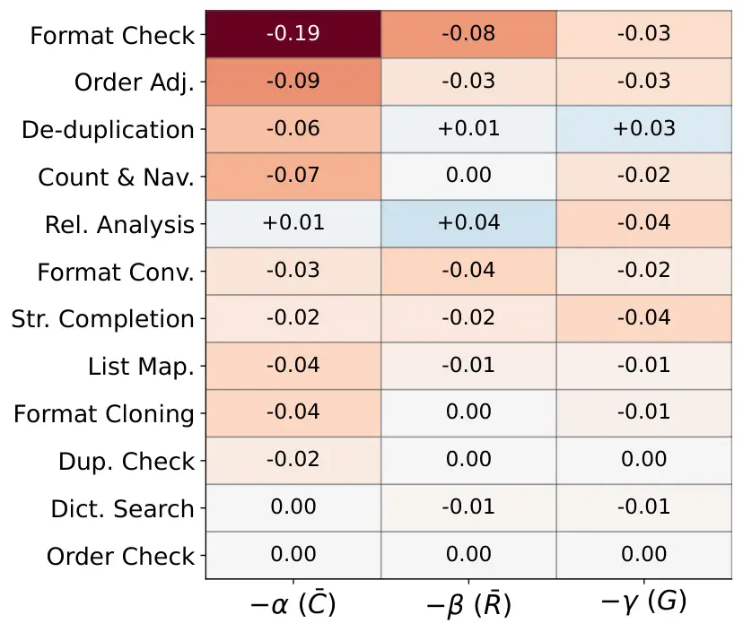
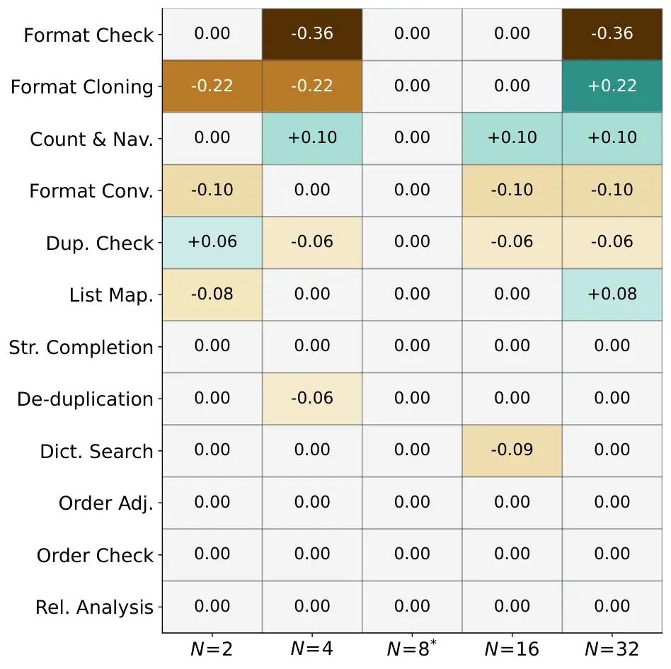
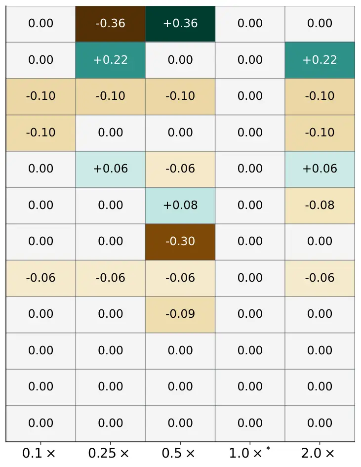

# Self-Improving In-Context Learning

Baturay Saglam    Dionysis Kalogerias Affiliation: Department of
Electrical and Computer Engineering Affiliation: Yale University
Affiliation: {[baturay.saglam](mailto:baturay.saglam@yale.edu),
[dionysis.kalogerias](mailto:dionysis.kalogerias@yale.edu)}@yale.edu

###### Abstract

We propose to improve in-context learning (ICL) by optimizing the
continuous embeddings of a fixed few-shot prompt at test time. The key
observation is that the log-probabilities a model assigns to its
demonstrated outputs—available from a single forward pass without
generating any tokens—provide a meaningful signal for how well the model
has inferred the task from its demonstrations. We formalize this signal
as a bounded, self-supervised confidence proxy and maximize it via
zeroth-order optimization over the prompt embeddings, yielding a
test-time calibration procedure. The approach requires no finetuning, no
token generation, no predefined label set, and no external data, making
it equally applicable to both classification and free-form generation
tasks. Across a comprehensive suite of ICL tasks, the proposed
calibration consistently matches or improves upon the base model and
outperforms classification-specific baselines on most tasks. The
statistically significant correlation between proxy improvement and
downstream accuracy gain confirms that the proposed proxy encodes a
reliable optimization signal for in-context learning.

## 1 Introduction

In-context learning (ICL) enables large language models (LLMs) to
perform new tasks by conditioning on a small set of input–output
demonstrations in the prompt, without updating model parameters \[2\].
This capability has made few-shot prompting a dominant paradigm for
deploying language models \[30\]. However, it is also notably fragile:
even with semantically identical demonstrations, simply reordering them
can shift accuracy from near state-of-the-art to near random \[26\].
Performance is similarly sensitive to the choice and formatting of
examples. This brittleness has motivated a growing body of work on
improving the reliability of ICL at inference time.

Existing test-time methods fall into three broad categories:
demonstration selection, demonstration ordering, and output calibration.
Each family has shown practical improvements in its target setting, yet
all share a common structural limitation: they operate either on
discrete prompt-level decisions (i.e., which examples to include and in
what order) or on the model’s output probabilities after the fact. Most
additionally require a finite, predefined label set, restricting them to
classification (see Appendix A). We explore a complementary direction.

A fundamentally different strategy is to intervene on the continuous
prompt embedding matrix that the model directly conditions on. Since the
model operates over this matrix rather than the discrete tokens,
adjustments in embedding space can reshape the output distribution while
leaving the human-readable input intact \[37, 38\]. We propose to
improve ICL by optimizing the continuous embeddings of a fixed few-shot
prompt. Our key observation is that the model’s own log-probabilities on
the demonstrated output labels—obtainable from a single teacher-forced
forward pass, without generating any tokens—provide a meaningful signal
for how well the model has inferred the task from its demonstrations. We
formalize this signal as a scalar, bounded confidence proxy with three
complementary facets: absolute predictive confidence on each
demonstrated label, robustness to low-probability tokens in the output
spans, and progressive improvement in prediction quality across
demonstrations.

To maximize this proxy, we estimate its gradient with respect to the
input embeddings via zeroth-order optimization and iteratively update
the embeddings along the estimated gradient direction. The resulting
procedure calibrates the prompt representation at test time, steering it
toward regions of the embedding space associated with higher in-context
confidence. It requires no external data, no access to model parameters,
and no additionally learned parameters—only the input embeddings and the
model’s log-probabilities are assumed to be available. Each optimization
step consists entirely of forward passes; no tokens are generated at any
point, and the original discrete prompt is never modified—only its
continuous embeddings are. Because the proxy is computed solely from the
model’s predictions on the demonstrations already present in the prompt,
no predefined label set is required, making the method equally
applicable to classification and free-form generation. It can therefore
be freely composed with any existing demonstration selection, ordering,
or calibration strategy, and applied as a plug-and-play module to any
off-the-shelf autoregressive language model.

Across a comprehensive suite of classification and free-form generation
tasks designed to probe rule learning and exact copying \[3\], and over
several model scales, the proposed method consistently matches or
improves upon the base model while outperforming classification-specific
baselines on most tasks out of the box. Furthermore, the correlation
between proxy improvement and downstream accuracy gain is statistically
significant across all models combined, confirming that the proxy
encodes a reliable optimization signal for in-context learning. We
open-source our code at
[https://github.com/baturaysaglam/self-improving-ICL](https://github.com/baturaysaglam/self-improving-ICL).

## 2 Related Work

### 2.1 In-Context Learning

In-context learning is sensitive to the choice of demonstrations, their
ordering, and the decoding procedure. A complementary line of work
studies _why_ ICL works—through the role of demonstration labels \[30,
54\], information flow through label tokens \[46\], the formation of
task representations \[13, 24, 41, 36\], and connections to implicit
gradient descent \[5, 43\]—but lies outside our scope.

#### Demonstration selection.

The choice of in-context examples can dramatically shift ICL
performance \[23\]. Existing methods retrieve nearest neighbors in a
pretrained embedding space \[23, 53, 39\], score candidates via the
target model’s own feedback \[48, 32, 22, 20, 50, 34, 58\], apply
task-specific heuristics such as reasoning complexity or structural
coverage \[7, 19\], or have the model generate its own
demonstrations \[16, 27, 45, 44\]. All assume access to a scorable
candidate pool or a finite label space.

#### Demonstration ordering.

The order of demonstrations alone can shift accuracy by tens of
percentage points \[26\]. Subsequent work addresses this through
instance-adaptive reordering \[11, 51, 1, 33\] or by eliminating order
sensitivity entirely \[56\]; however, the scoring functions used
generally require a finite label set, and permutation search scales
combinatorially with the number of demonstrations.

#### Output calibration.

A separate family corrects systematic biases—majority-label, recency,
and surface-form effects—by adjusting the model’s output
distribution \[60, 15, 29, 6, 62, 17, 21, 49\] or operating on internal
representations \[12, 4\]. All require a known label set, restricting
them to classification; several further need transductive access to a
batch of test inputs \[62, 12, 61\] or to hidden states \[4\].

Our method is orthogonal to all three families. It optimizes the
continuous representation of a _fixed_ prompt and requires no candidate
pool, test batch, label set, or access to model internals beyond the
embedding layer. Its cost does not scale with the number of
demonstrations, it operates identically on classification and open-ended
generation, and it can be composed freely with any selection, ordering,
or calibration strategy.

Appendix A formalizes this comparison and explains why the listed
methods are structurally incompatible with open-ended generation.

### 2.2 Zeroth-Order Optimization in LLMs

Finite-difference estimators \[31\] have been mainly used for privacy-
and memory-efficient finetuning \[57, 25, 28, 8\] and as a substitute
for gradient estimation in soft prompt optimization \[55\]. All of these
works operate at training time under a dataset-level loss. In contrast,
we operate at the instance level: the gradient is estimated for a single
prompt at test time, within a small forward-pass budget, in the
fundamentally different regime of in-context learning. More recently,
Saglam and Kalogerias \[37\], Saglam and Kalogerias \[38\] have shown
that optimizing input embeddings can steer a model toward behavior
satisfying certain properties. Our setting differs, however: we devise a
self-supervised objective and operate in ICL, whereas they target safety
properties (e.g., toxicity) for which a noise-free oracle is available
from an external provider (e.g., an API). Moreover, we use
input-embedding optimization as a tool to demonstrate the effectiveness
of the proposed proxy, rather than as the objective of our study.

## 3 Background

### 3.1 Autoregressive Text Generation

Large language models generate text autoregressively, producing one
token at a time with each prediction conditioned on all preceding
tokens. Let $`\mathcal{V}`$ denote a finite vocabulary of
$`V=|\mathcal{V}|`$ tokens. We write a text sequence of length $`L`$ as
$`x_{1:L}=(x_{1},x_{2},\ldots,x_{L})`$, where each
$`x_{t}\in\mathcal{V}`$. An autoregressive model parameterized by
$`\theta`$ defines the joint probability of the sequence via the chain
rule of probability:

```math
P_{\theta}(x_{1:L})\;=\;\prod_{t=1}^{L}P_{\theta}\!\left(x_{t}\mid x_{<t}\right),
```

where $`x_{<t}=(x_{1},\ldots,x_{t-1})`$ is the prefix preceding position
$`t`$.

Each token $`x_{t}`$ is first mapped to a dense vector
$`e_{t}\in\mathbb{R}^{d}`$ through a learned embedding matrix
$`E\in\mathbb{R}^{V\times d}`$. The transformer architecture \[42\]
processes the resulting embedding sequence and produces, at each
position, a conditional distribution over the next token. The
log-probability of the observed token $`x_{t}`$ is denoted

```math
\ell_{t}(X)\;=\;\log P_{\theta}(x_{t}\mid x_{<t}),\qquad t=1,\ldots,L,
```

which satisfies $`\ell_{t}\leq 0`$, with equality only when the model
assigns probability one to $`x_{t}`$.

When a complete sequence is provided as input—as in the prompt-based
setting we consider—a single forward pass yields the full sequence of
log-probabilities $`(\ell_{1},\ldots,\ell_{L})`$ simultaneously, which
is central to the practicality of our approach.

### 3.2 In-Context Learning

A _few-shot prompt_ $`\mathcal{P}`$ is constructed by concatenating
$`T`$ demonstration pairs followed by a query input:

```math
\mathcal{P}\;=\;\bigl[\,s_{1},\;y_{1},\;s_{2},\;y_{2},\;\ldots,\;s_{T},\;y_{T},\;s_{\mathrm{query}}\,\bigr], \tag{1}
```

where each $`(s_{i},y_{i})`$ consists of a task input $`s_{i}`$ and its
corresponding output $`y_{i}`$.

When tokenized, the prompt $`\mathcal{P}`$ becomes a token sequence
$`x_{1:L}=(x_{1},\ldots,x_{L})`$. For each demonstration $`i`$, we
denote by $`\mathcal{Y}_{i}\subseteq\{1,\ldots,L\}`$ the set of token
positions corresponding to the output $`y_{i}`$. These output-span
log-probabilities reflect how confidently the model predicts each
demonstrated output given its context—the optimization signal of
Section 4.

### 3.3 Zeroth-Order Optimization

Zeroth-order methods estimate gradient information from function
evaluations alone—useful when the objective is black-box or
non-differentiable; we rely on the Gaussian smoothing framework
of Nesterov and Spokoiny \[31\].

Given an objective $`f\colon\mathbb{R}^{n}\to\mathbb{R}`$ and a
smoothing parameter $`\mu>0`$, the _Gaussian-smoothed_ counterpart of
$`f`$ is defined as

```math
f_{\mu}(X)\;=\;\mathbb{E}_{U\sim\mathcal{N}(0,I_{n})}\!\bigl[f(X+\mu U)\bigr].
```

If $`f`$ is Lipschitz-continuous, i.e., $`|f(X)-f(Y)|\leq L_{0}\|X-Y\|`$
for all $`X,Y`$, then $`f_{\mu}`$ is differentiable for every $`\mu>0`$
and approximates $`f`$ with a controlled error of order
$`\mathcal{O}(\mu\sqrt{n})`$. We note that these conditions are invoked
only to motivate the bound; in a fully black-box setting they cannot be
verified from query access to $`f`$. Nonetheless, the resulting
estimator can be applied empirically regardless of whether the
underlying constants are known.

A central result of Nesterov and Spokoiny \[31\] establishes that the
gradient of $`f_{\mu}`$ admits the familiar finite-difference form:

```math
\nabla f_{\mu}(X)\;=\;\mathbb{E}_{U}\!\left[\frac{f(X+\mu U)-f(X)}{\mu}\,U\right]. \tag{2}
```

This identity requires only Lipschitz continuity of $`f`$;
differentiability of $`f`$ itself is not needed. The baseline term
$`f(X)/\mu`$ does not bias the estimate (since $`\mathbb{E}[U]=0`$) but
reduces its variance.

In practice, the expectation in (2) is replaced by a Monte Carlo average
over $`N`$ independent perturbations
$`U_{1},\ldots,U_{N}\sim\mathcal{N}(0,I_{n})`$:

```math
\hat{g}(X)\;=\;\frac{1}{N}\sum_{i=1}^{N}\frac{f(X+\mu U_{i})-f(X)}{\mu}\,U_{i}\;\approx\;\nabla f_{\mu}(X). \tag{3}
```

The smoothing parameter $`\mu`$ governs a bias–variance tradeoff:
smaller values produce a sharper approximation to $`\nabla f`$ but
amplify the variance of the finite-difference terms, while larger values
yield smoother but more biased estimates. The number of samples $`N`$
controls the variance of the Monte Carlo average.

## 4 Self-Improving In-Context Learning

#### Overview.

Given a few-shot prompt as in (1), we treat the language model as a
black box that, for any provided prompt, returns teacher-forced token
log-probabilities. Our key assumption is that the token positions
corresponding to each demonstrated output span are known (denoted
$`\mathcal{Y}_{1},\ldots,\mathcal{Y}_{T}`$ in Section 3.2).

Let $`X\in\mathbb{R}^{L\times d}`$ denote the embedding matrix of the
prompt tokens, and let $`f(X)`$ be a scalar proxy quantifying the
model’s confidence on the demonstrations given the prompt context. We
seek an embedding-space optimization that increases the proxy value:

```math
X^{\star}\;\in\;\argmax_{X}\;f(X),
```

with the understanding that the discrete prompt text is held fixed and
only its continuous embeddings are modified; each embedding remains
within its token subspace. The proxy $`f`$ may be non-smooth due to
robust aggregation over tokens, and backpropagating through the model to
obtain $`\nabla_{X}f(X)`$ is prohibitively expensive at test time.
Instead, we estimate this gradient via zeroth-order optimization
reviewed in Section 3.3 and defined in (3).

We form a stochastic ascent direction
$`\hat{g}_{k}~\approx~\nabla_{X}f_{\mu}(X_{k})`$ from evaluations of
$`f`$ at randomly perturbed embeddings $`X_{k}+\mu U_{i}`$. Because each
row of $`U_{i}`$ is drawn independently, each token embedding is
perturbed separately, allowing the estimator to capture token-specific
sensitivity of $`f`$. Since the proxy is to be computed from
log-probabilities at demonstration positions, which under causal
attention are unaffected by the query tokens that follow them, the
perturbation is restricted to the demonstration region—noise at query
positions is set to zero.

The embeddings are then updated iteratively as
$`X_{k+1}=X_{k}+\eta\,\hat{g}_{k}`$, where $`\eta`$ is the step size.
This update steers the prompt representation toward regions of the
embedding space associated with higher in-context confidence. The
procedure operates entirely at test time, requires only additional
forward passes per input instance, and assumes access only to the input
embeddings and model log-probabilities.

### 4.1 A Proxy for In-Context Learning Confidence

We define the proxy $`f(\cdot)`$ subject to three design principles
balancing theoretical constraints and practical considerations:

1.  _(D1)_
    _Bounded and continuous._ $`f(X)\in[0,1]`$, ensuring compatibility
    with the zeroth-order estimator and controlled approximation error.
2.  _(D2)_
    _Single forward pass._ Each evaluation depends only on
    teacher-forced log-probabilities
    $`\{\ell_{t}:t\in\bigcup_{i}\mathcal{Y}_{i}\}`$ from the
    demonstrations already present in the prompt; the full vocabulary
    distribution is neither extracted nor stored, no tokens are
    generated, and no ground-truth label candidates for the query are
    required (in contrast to, e.g., 51, 26, 11).
3.  _(D3)_
    _Behaviorally informative._ $`f`$ increases as the model’s
    predictions on the demonstrated outputs improve, reflecting genuine
    task understanding and thereby translating into downstream task
    performance.

#### Component 1 – Per-demonstration absolute confidence.

To make confidence comparable across labels with different token
lengths, we compute a length-normalized average log-probability for each
demonstrated output:

```math
\bar{\ell}_{i}(X)\;\coloneqq\;\frac{1}{|\mathcal{Y}_{i}|}\sum_{t\in\mathcal{Y}_{i}}\ell_{t}(X).
```

We then map it to a bounded score
$`c_{i}(X)\;\coloneqq\;\exp\bigl(\bar{\ell}_{i}(X)\bigr)\in(0,1]`$,
which equals the geometric mean of the true-token probabilities over the
$`i`$-th output span. We then average the confidence scores across
demonstrations for the absolute confidence, defining

```math
\bar{C}(X)\coloneqq\frac{1}{T}\sum_{i=1}^{T}c_{i}(X).
```

#### Component 2 – Pooled robustness.

High mean confidence can mask brittleness: a label may look easy on
average while containing a few tokens the model assigns very low
probability. To penalize such cases, we pool the true-token
probabilities $`p_{t}(X)\coloneqq\exp(\ell_{t}(X))\in(0,1]`$ from _all_
demonstration output spans into a single set,

```math
\mathcal{S}(X)\;\coloneqq\;\bigl\{p_{t}(X):t\in\mathcal{Y}_{1}\cup\mathcal{Y}_{2}\cup\cdots\cup\mathcal{Y}_{T}\bigr\},
```

and summarize its lower tail via a fixed quantile level $`q\in(0,1)`$
(we use $`q=0.1`$):

```math
R(X)\;\coloneqq\;\operatorname{Quantile}_{q}\!\bigl(\mathcal{S}(X)\bigr)\in[0,1].
```

$`R(\cdot)`$ is the probability threshold below which the lowest
$`q`$-fraction of all label tokens fall. Viewed as a risk measure, it
coincides with Value-at-Risk at level $`q`$ on the empirical
distribution of token confidences, capturing tail fragility that the
mean $`\bar{C}`$ may conceal. Per-demonstration quantiles degenerate for
single-token labels
($`\operatorname{Quantile}_{q}(\{p_{t}\})~=~p_{t}=~c_{i}`$); pooling
across all spans preserves a genuine tail measure.

#### Component 3 – Information gain across demonstrations.

If the task is inferred progressively, later demonstrations should
become more predictable as they are conditioned on a richer in-context
history. To capture this trend in a single pass, we track improvements
in the per-demonstration confidence sequence $`\{c_{i}(X)\}_{i=1}^{T}`$:

```math
G(X)\;\coloneqq\;\begin{cases}\dfrac{1}{T-1}{\displaystyle\sum_{i=2}^{T}}\delta_{i}(X),&T\geq 2,\\[6.0pt]
0,&T=1,\end{cases}
```

where $`\delta_{i}(X)\coloneqq\max\bigl(0,\,c_{i}(X)-c_{i-1}(X)\bigr)`$.
$`G(\cdot)`$ assigns credit only to increases and remains in $`[0,1]`$.
It is order-dependent by design; rewarding progressive task inference,
consistent with evidence that autoregressive models process
demonstrations sequentially. Because $`G(\cdot)`$’s gradient exerts
opposing pressure on early- and late-demonstration embeddings under
causal attention, we assign it a small weight $`\gamma`$ so the residual
asymmetry remains negligible relative to the confidence and robustness
gradients. Conceptually, $`G`$ can be viewed as a single-pass
approximation to the progressive-compression principle underlying
description-length approaches \[48\]; rather than evaluating each
demonstration in isolation, it tracks confidence improvements as the
in-context history grows.

#### Final proxy score.

The final ICL-confidence proxy is the weighted linear combination of the
components:

```math
f(X)\;\coloneqq\;\alpha\,\bar{C}(X)+\beta\,R(X)+\gamma\,G(X),\qquad\alpha,\beta,\gamma\geq 0,\;\;\alpha+\beta+\gamma=1.
```

Note that we exclude any entropic measure as it is label-agnostic and
risks collapse onto incorrect tokens \[59\], and at exemplar positions
its signal is already subsumed by $`\bar{C}`$ and $`R`$.

### 4.2 End-to-End Test-Time Calibration

The zeroth-order ascent updates require regularization to prevent
embeddings from drifting into out-of-distribution regions of the
embedding space. We incorporate three lightweight mechanisms, while
deliberately avoiding any external optimization components (e.g.,
momentum), so that any performance gains can be attributed solely to the
test-time embedding adjustment driven by the proposed proxy.

#### Gradient clipping.

Clipping preserves proportionality of per-position gradient magnitudes
while bounding large updates:
$`\hat{g}_{k,t}~\leftarrow~\hat{g}_{k,t}/\max(1,\,\|\hat{g}_{k,t}\|_{2})`$
for each position $`t`$.

#### Cosine similarity.

We constrain the updated embeddings to remain directionally close to
their initial values. At each iteration $`k`$, if the cosine similarity
between the updated embeddings $`X_{k+1}`$ and the original embeddings
$`X_{0}`$ falls below a threshold $`\kappa\in[0,1]`$, we project
$`X_{k+1}`$ back onto the boundary of the feasible region.

#### Initial proxy gate.

Before entering the optimization loop, the proxy is evaluated on the
unperturbed embeddings. Because each per-exemplar confidence is defined
as $`c_{i}=\exp(\bar{\ell}_{i})`$, its gradient with respect to
$`\bar{\ell}_{i}`$ equals $`c_{i}`$ itself; when $`f(X_{0})`$ is near
zero, the proxy surface is exponentially flat and the zeroth-order
gradient estimate carries no directional signal. If $`f(X_{0})`$ falls
below a threshold $`\tau`$, optimization is skipped and the original
embeddings are returned unchanged.

The complete procedure is summarized in Algorithm 1 (Appendix B.2). The
returned embedding $`X^{\star}`$ is the one achieving the highest proxy
value across all iterations; after convergence, the query output is
generated under $`X^{\star}`$ for any desired number of tokens.

## 5 Experiments

#### Benchmark.

Standard few-shot benchmarks (e.g., MMLU 14) conflate a model’s
in-context learning ability with its pretraining knowledge and language
proficiency \[3\]: a model may fail not because it cannot learn from
demonstrations, but because it lacks the requisite domain knowledge.
ICLEval \[3\] addresses this confound by replacing factual content with
hash strings, ensuring that correct predictions can only be derived from
the provided demonstrations. The benchmark comprises 12 tasks
(2,040 samples) organized around two core sub-abilities: _exact copying_
(matching a prefix and reproducing subsequent content) and _rule
learning_ (inferring format, order, statistical, and list-mapping rules
from examples). Each sample includes its own dynamically generated set
of 3–31 demonstrations. Further details are provided in Appendix B.

#### Baselines.

We consider inference-time methods of _Contextual Calibration_
(CC) \[60\], which corrects label biases via an affine transformation
estimated from content-free inputs; _domain-conditional PMI_
(DC-PMI) \[15\], which normalizes out the label prior induced by the
prompt; and *DEmO* \[11\], which eliminates ordering sensitivity by
processing each exemplar independently and aggregating
label-distribution shifts. CC and DC-PMI require a single-token label
space and are evaluated on Order Check and Duplication Check (400 of the
2,040 samples). DEmO accommodates multi-token labels and is additionally
evaluated on Format Check.

Methods with structural limitations preventing general-purpose use are
catalogued in Table 3.

#### Evaluation.

Following the ICLEval protocol \[3\], we use greedy decoding and report
exact-match accuracy—the fraction of samples for which the generated
string matches the gold label exactly. Exact match is the natural
criterion given the unambiguous, hash-based outputs.

#### Models.

We evaluate a range of models spanning different sizes, architectures,
and developers: Llama 3.1-8B \[9\], Qwen3-4B \[52\], and
Gemma 2-2B \[40\]. Smaller models such as GPT-2 \[35\] and Phi-2 \[10\]
were excluded because their context windows (1024 and 2048 tokens) fall
short of the longest prompts in ICLEval (2100 tokens).

#### Hyperparameters.

We use $`N=16`$ for Llama 3.1-8B and $`N=8`$ for Qwen3-4B and
Gemma 2-2B. The configuration $`\alpha=0.6`$, $`\beta=0.3`$,
$`\gamma=0.1`$ is selected; the small value of $`\gamma`$ keeps the
information-gain term from suppressing absolute confidence
(Component 1). The proxy gate threshold is set to $`\tau=0.05`$.
Optimization is terminated when the proxy fails to improve for 5
consecutive steps. Complete hyperparameter settings and sweep details
are provided in Appendix B.3.

|                    |       |              |      |                |     |          |      |                |     |            |      |                |
| ------------------ | ----- | ------------ | ---- | -------------- | --- | -------- | ---- | -------------- | --- | ---------- | ---- | -------------- |
|                    |       | Llama 3.1-8B |      |                |     | Qwen3-4B |      |                |     | Gemma 2-2B |      |                |
| Task               | $`n`$ | Base         | Ours | $`\Delta`$ (%) |     | Base     | Ours | $`\Delta`$ (%) |     | Base       | Ours | $`\Delta`$ (%) |
| String Completion  | 100   | 0.57         | 0.57 | $`=`$          |     | 0.90     | 0.90 | $`=`$          |     | 0.87       | 0.87 | $`=`$          |
| Dict. Search       | 190   | 0.87         | 0.87 | $`=`$          |     | 0.92     | 0.92 | $`=`$          |     | 0.66       | 0.66 | $`=`$          |
| Format Check       | 120   | 0.07         | 0.17 | $`+122.2`$     |     | 0.17     | 0.36 | $`+104.8`$     |     | 0.07       | 0.07 | $`=`$          |
| Format Cloning     | 100   | 0.97         | 0.97 | $`=`$          |     | 0.85     | 0.89 | $`+4.7`$       |     | 0.71       | 0.84 | $`+18.3`$      |
| Format Conversion  | 120   | 0.86         | 0.88 | $`+2.9`$       |     | 0.72     | 0.77 | $`+5.7`$       |     | 0.65       | 0.71 | $`+9.0`$       |
| Order Check        | 100   | 0.98         | 0.98 | $`=`$          |     | 1.00     | 1.00 | $`=`$          |     | 0.78       | 0.79 | $`+1.3`$       |
| Order Adjustment   | 240   | 0.86         | 0.95 | $`+10.7`$      |     | 0.60     | 0.70 | $`+18.2`$      |     | 0.37       | 0.40 | $`+6.7`$       |
| Duplication Check  | 300   | 0.69         | 0.76 | $`+11.7`$      |     | 0.73     | 0.75 | $`+3.2`$       |     | 0.49       | 0.53 | $`+7.4`$       |
| De-Duplication     | 300   | 0.75         | 0.85 | $`+13.8`$      |     | 0.70     | 0.85 | $`+20.4`$      |     | 0.24       | 0.28 | $`+15.1`$      |
| Count & Navigation | 120   | 0.29         | 0.34 | $`+17.1`$      |     | 0.43     | 0.51 | $`+17.3`$      |     | 0.03       | 0.03 | $`=`$          |
| Relation Analysis  | 100   | 0.47         | 0.56 | $`+19.2`$      |     | 0.27     | 0.35 | $`+29.6`$      |     | 0.03       | 0.12 | $`+300.0`$     |
| List Mapping       | 250   | 0.63         | 0.66 | $`+5.1`$       |     | 0.56     | 0.62 | $`+11.4`$      |     | 0.48       | 0.48 | $`=`$          |
| Mean               |       | 0.67         | 0.71 | $`+6.0`$       |     | 0.65     | 0.72 | $`+10.8`$      |     | 0.45       | 0.48 | $`+6.7`$       |

Table 1: Per-task exact-match accuracy on ICLEval ($`n`$: number of test
samples). Boldface indicates strict improvement over the base model;
$`\Delta`$ denotes relative improvement (%). One-sided McNemar test
($`H_{1}`$: Ours $`>`$ Base) across all 2,040 samples: $`p=0.001`$ for
Llama 3.1-8B, $`p=0.038`$ for Qwen3-4B, $`p<0.001`$ for Gemma 2-2B.
Baseline comparisons on the classification subset are reported in
Table 2.

### 5.1 Main Results

Table 1 reports per-task results for all three models. Across all three
models, our method either matches or improves base-model accuracy on
every task, never causing degradation—a property enforced by the
regularization mechanisms. The per-model improvements are statistically
significant under the one-sided McNemar test ($`p=0.001`$ for Llama,
$`p=0.038`$ for Qwen, $`p<0.001`$ for Gemma), which operates at the
individual-sample level and accounts for both improved and degraded
predictions.

On exact-copying tasks (String Completion, Dictionary Search), accuracy
remains unchanged across all models. Here, improvements in the proxy do
not transfer to query-level accuracy, i.e., increasing confidence on
exemplar sequences does not help the model reproduce a specific target
hash sequence.

For rule-learning tasks, improvement depends not on base accuracy alone
but on whether the model possesses a latent task-specific capability
that the proxy can surface. Gemma 2-2B illustrates this clearly:
Relation Analysis and Count & Navigation share the same base accuracy
(0.03), yet only the former improves ($`0.03\to 0.12`$). At the opposite
extreme, near-ceiling tasks leave no room for further gains. Between
these two regimes, where capability exists but remains underutilized,
improvements are consistent across format, order, statistics, and
list-mapping rules.

#### Comparison with the baselines.

Table 2 reports the numerical comparison on the classification subset.
Our method outperforms all baselines on Llama and Qwen despite operating
without a predefined label space. On Gemma—the smallest and most
ordering-sensitive model—DEmO is the strongest baseline, most notably on
Format Check ($`0.85`$ vs. $`0.07`$): by processing exemplars
independently, DEmO bypasses the compositional difficulty Gemma faces
when attending over the full demonstration sequence. On larger models,
DEmO’s ordering-based approach yields diminishing returns. CC and DC-PMI
degrade Duplication Check accuracy on Llama and Qwen through
overcalibration of their content-free bias estimates. All baselines
require a finite label space, restricting them to the classification
subset, whereas the proposed method applies fully task-agnostic.

|                   |              |                                                            |                                                            |                                                             |                                                             |
| ----------------- | ------------ | ---------------------------------------------------------- | ---------------------------------------------------------- | ----------------------------------------------------------- | ----------------------------------------------------------- |
| Task              | Model        | CC                                                         | DC-PMI                                                     | DEmO                                                        | Ours                                                        |
| Format Check      | Llama 3.1-8B | —                                                          | —                                                          | 0.16                                                        |   |
|                   | Qwen3-4B     | —                                                          | —                                                          | 0.17                                                        |   |
|                   | Gemma 2-2B   | —                                                          | —                                                          |   | 0.07                                                        |
| Order Check       | Llama 3.1-8B |  |  |   |   |
|                   | Qwen3-4B     |  |  |  |  |
|                   | Gemma 2-2B   | 0.79                                                       | 0.70                                                       |  | 0.79                                                        |
| Duplication Check | Llama 3.1-8B | 0.60                                                       | 0.67                                                       | 0.70                                                        |  |
|                   | Qwen3-4B     | 0.60                                                       | 0.73                                                       | 0.68                                                        |  |
|                   | Gemma 2-2B   | 0.48                                                       | 0.50                                                       |  | 0.53                                                        |

Table 2: Baseline comparison on the classification subset of ICLEval. CC
and DC-PMI require a single-token label space (Order Check and
Duplication Check only); DEmO also applies to Format Check.

and

results are highlighted.

#### Computational cost.

Each optimization step requires $`N{+}1`$ forward passes (one base
evaluation and $`N`$ perturbations). Because the proxy is non-stationary
(i.e., each embedding update changes the log-probabilities from which it
is computed), conservative learning rates are necessary; per-task
iteration counts are reported in Table 6 (Appendix B.6).

### 5.2 Proxy–Performance Correlation

For the proxy to serve as a meaningful optimization signal, improvements
in its value should translate to improvements in downstream performance.
We test this by examining whether tasks with greater proxy improvement
also exhibit greater accuracy gains. For each of the 12 tasks, we
compute the mean per-sample proxy improvement and the change in accuracy
between the optimized and baseline prompts. Figure 1 plots accuracy
improvement against proxy improvement, with each point representing one
task. To quantify the monotonic association, we apply a one-sided
Spearman rank correlation test ($`H_{1}\colon\rho>0`$). Across all 12
tasks, the correlation between proxy and accuracy improvements is
statistically significant for Llama and Gemma, but not for Qwen.

Two tasks account for the weaker correlation observed in Qwen. Order
Check achieves perfect baseline accuracy, leaving no room for
improvement and rendering its inclusion uninformative. Duplication Check
exhibits large proxy improvement with minimal accuracy gain: its label
vocabulary consists of only two tokens (True/False), so the task is
already well understood by the model. Continued optimization beyond
consolidating this understanding begins to overfit to the output format
rather than improving the input–output mapping, inflating confidence
without improving discrimination. These proxy gains do not transfer to
the query position; the model becomes more certain about predicting True
or False, but no more accurate. We identify this as a mild limitation as
it can be addressed with stricter early stopping.

(a) Llama 3.1-8B

(b) Qwen3-4B

(c) Gemma 2-2B

Figure 1: Proxy improvement versus accuracy improvement across all 12
ICLEval tasks. A one-sided Spearman rank correlation test
($`H_{1}\colon\rho>0`$) yields a statistically significant positive
association across all models and tasks combined.

Excluding these two tasks, the Spearman test yields a statistically
significant positive rank correlation at 95% confidence. Fisher’s
combined Spearman test across all models achieves statistical
significance ($`\chi^{2}=13.95`$, $`p=0.03`$) even when Order Check and
Duplication Check are included, confirming that the ICL confidence proxy
is a meaningful optimization signal for in-context learning.



(a) Proxy component ablation

(b) Perturbation domain

Figure 2: Ablation studies of the proposed three-component proxy
($`\alpha{=}0.6`$, $`\beta{=}0.3`$, $`\gamma{=}0.1`$) and the
perturbation domain used in end-to-end calibration. (a) Each proxy
component is ablated by setting its coefficient to zero and
renormalizing the remaining weights. (b) Accuracy difference between the
default perturbation domain (demonstration embeddings only) and
full-sequence perturbation that includes query positions. Results are
reported for Qwen3-4B.

### 5.3 Ablations and Sensitivity Analysis

To understand the contribution of each proxy component, we perform
ablations by setting the corresponding coefficient to zero and
renormalizing the remaining weights relative to the original
configuration ($`\alpha{=}0.6`$, $`\beta{=}0.3`$, $`\gamma{=}0.1`$). We
also examine the effect of perturbing the full token sequence (including
query positions) versus perturbing only the demonstration embeddings, as
in the default setting. The results are shown in Figure 2.



(a) $`N`$ (Monte Carlo samples)



(b) $`\mu`$ (perturbation scale)

Figure 3: Downstream accuracy under varying perturbation sample counts
$`N`$ and perturbation scales, expressed as fractions of the optimal
value $`\mu=0.004`$, with all other hyperparameters held fixed. Results
are reported for Qwen3-4B, where $`(^{*})`$ indicates the values used in
the main experiments.

The confidence component ($`\bar{C}`$) is clearly the primary driver of
the method’s gains: removing it reduces the fraction of samples that
improve during optimization from over 90% to roughly half, and cuts the
average proxy improvement by approximately 40%. The robustness component
($`R`$) follows in importance—without it, the optimization remains
broadly effective but achieves lower proxy improvement, indicating that
low-probability outlier tokens are common enough for the tail-confidence
signal to provide a meaningful complementary gradient direction that the
mean alone cannot capture. Removing the information gain component
($`G`$) has the least effect; its small weight ($`\gamma=0.1`$) means
the redistribution to the remaining two components preserves—and even
marginally sharpens—the optimization signal. Perturbing the full token
sequence degrades downstream accuracy on the tasks whose optimization
trajectory is affected, confirming that noise at query positions, where
the proxy gradient has zero expectation, accumulates into drift that
distorts the query representation without a compensating proxy benefit.

The quality of the zeroth-order gradient estimates depends directly on
the perturbation strength $`\mu`$ and the number of perturbation samples
$`N`$, the latter of which also determines computational cost. We sweep
several values of each around the optimal configuration; results are
shown in Figure 3. Downstream accuracy varies non-monotonically with
both parameters, consistent with the standard bias–variance tradeoff in
finite-difference gradient estimation (Section 3.3).

## 6 Conclusion

We presented a test-time method that improves in-context learning
through zeroth-order optimization of the prompt’s continuous embeddings,
without finetuning the model, generating any tokens, or requiring
auxiliary data. The optimization objective is a bounded, self-supervised
confidence proxy derived entirely from the model’s log-probabilities on
its demonstrated outputs, capturing per-demonstration predictive
confidence, tail robustness across output tokens, and progressive
improvement in predictions along the demonstration sequence. Across
models spanning 2B to 8B parameters, the method never degrades
base-model accuracy and with statistically significant improvements
across all evaluated models, it outperforms classification-specific
baselines on most tasks despite requiring no predefined label set.

The statistically significant correlation between proxy and accuracy
improvement, consistent across diverse task types and model scales,
confirms that demonstration log-probabilities constitute a reliable
optimization surface—one whose ascent direction aligns with downstream
performance, rather than merely a scoring function for selecting or
ranking prompts. A natural extension is to compose this calibration with
existing demonstration selection or ordering strategies—for instance,
applying embedding optimization on a prompt whose demonstrations have
already been selected or reordered.

## Limitations

The method requires that output-span positions are known and that
exemplar labels are correct; it has not been validated on prompts with
fewer than three demonstrations. Additionally, since the proxy is
non-stationary (each embedding update changes the log-probabilities from
which it is computed), conservative learning rates are necessary, which
may increase the number of optimization steps. In practice, however,
this overhead remained modest: the longest per-sample runtime in our
experiments (Qwen3-4B on Format Check; see Table 6 in the appendix) was
roughly a minute and could be further reduced with optimized inference
stacks (see Appendix B.4).

## References

- \[1\] R. A. Bhope, P. Venkateswaran, K. R. Jayaram, V. Isahagian, V.
  Muthusamy, and N. Venkatasubramanian (2025) OptiSeq: ordering examples
  on-the-fly for in-context learning. In Findings of the Association for
  Computational Linguistics: EMNLP 2025, C. Christodoulopoulos, T.
  Chakraborty, C. Rose, and V. Peng (Eds.), Suzhou, China,
  pp. 24864–24887. External Links:
  [Link](https://aclanthology.org/2025.findings-emnlp.1353/),
  [Document](https://dx.doi.org/10.18653/v1/2025.findings-emnlp.1353),
  ISBN 979-8-89176-335-7 Cited by: §A.2, Table 3, §2.1.
- \[2\] T. B. Brown, B. Mann, N. Ryder, M. Subbiah, J. Kaplan, P.
  Dhariwal, A. Neelakantan, P. Shyam, G. Sastry, A. Askell, S.
  Agarwal, A. Herbert-Voss, G. Krueger, T. Henighan, R. Child, A.
  Ramesh, D. M. Ziegler, J. Wu, C. Winter, C. Hesse, M. Chen, E.
  Sigler, M. Litwin, S. Gray, B. Chess, J. Clark, C. Berner, S.
  McCandlish, A. Radford, I. Sutskever, and D. Amodei (2020) Language
  models are few-shot learners. External Links: 2005.14165 Cited by: §1.
- \[3\] W. Chen, Y. Lin, Z. Zhou, H. Huang, Y. Jia, Z. Cao, and J.
  Wen (2025) ICLEval: evaluating in-context learning ability of large
  language models. In Proceedings of the 31st International Conference
  on Computational Linguistics, O. Rambow, L. Wanner, M. Apidianaki, H.
  Al-Khalifa, B. D. Eugenio, and S. Schockaert (Eds.), Abu Dhabi, UAE,
  pp. 10398–10422. External Links:
  [Link](https://aclanthology.org/2025.coling-main.693/) Cited by: §B.1,
  §1, §5, §5.
- \[4\] H. Cho, Y. Sakai, M. Kato, K. Tanaka, A. Ishii, and N.
  Inoue (2025) Token-based decision criteria are suboptimal in
  in-context learning. In Proceedings of the 2025 Conference of the
  Nations of the Americas Chapter of the Association for Computational
  Linguistics: Human Language Technologies (Volume 1: Long Papers), L.
  Chiruzzo, A. Ritter, and L. Wang (Eds.), Albuquerque, New Mexico,
  pp. 5378–5401. External Links:
  [Link](https://aclanthology.org/2025.naacl-long.278/),
  [Document](https://dx.doi.org/10.18653/v1/2025.naacl-long.278), ISBN
  979-8-89176-189-6 Cited by: §A.3, Table 3, §2.1.
- \[5\] D. Dai, Y. Sun, L. Dong, Y. Hao, S. Ma, Z. Sui, and F.
  Wei (2023) Why can GPT learn in-context? language models secretly
  perform gradient descent as meta-optimizers. In Findings of the
  Association for Computational Linguistics: ACL 2023, A. Rogers, J.
  Boyd-Graber, and N. Okazaki (Eds.), Toronto, Canada, pp. 4005–4019.
  External Links:
  [Link](https://aclanthology.org/2023.findings-acl.247/),
  [Document](https://dx.doi.org/10.18653/v1/2023.findings-acl.247) Cited
  by: §2.1.
- \[6\] Y. Fei, Y. Hou, Z. Chen, and A. Bosselut (2023) Mitigating label
  biases for in-context learning. In Proceedings of the 61st Annual
  Meeting of the Association for Computational Linguistics (Volume 1:
  Long Papers), A. Rogers, J. Boyd-Graber, and N. Okazaki (Eds.),
  Toronto, Canada, pp. 14014–14031. External Links:
  [Link](https://aclanthology.org/2023.acl-long.783/),
  [Document](https://dx.doi.org/10.18653/v1/2023.acl-long.783) Cited by:
  Table 3, §2.1.
- \[7\] Y. Fu, H. Peng, A. Sabharwal, P. Clark, and T. Khot (2023)
  Complexity-based prompting for multi-step reasoning. External Links:
  2210.00720, [Link](https://arxiv.org/abs/2210.00720) Cited by: §A.1,
  Table 3, §2.1.
- \[8\] T. Gautam, Y. Park, H. Zhou, P. Raman, and W. Ha (2024)
  Variance-reduced zeroth-order methods for fine-tuning language models.
  In Forty-first International Conference on Machine Learning, External
  Links: [Link](https://openreview.net/forum?id=VHO4nE7v41) Cited by:
  §2.2.
- \[9\] A. Grattafiori, A. Dubey, A. Jauhri, A. Pandey, A. Kadian, A.
  Al-Dahle, A. Letman, A. Mathur, A. Schelten, A. Vaughan, A. Yang, A.
  Fan, A. Goyal, A. Hartshorn, A. Yang, A. Mitra, A. Sravankumar, A.
  Korenev, A. Hinsvark, A. Rao, A. Zhang, A. Rodriguez, A. Gregerson, A.
  Spataru, B. Roziere, B. Biron, B. Tang, B. Chern, C. Caucheteux, C.
  Nayak, C. Bi, C. Marra, C. McConnell, C. Keller, C. Touret, C. Wu, C.
  Wong, C. C. Ferrer, C. Nikolaidis, D. Allonsius, D. Song, D. Pintz, D.
  Livshits, D. Wyatt, D. Esiobu, D. Choudhary, D. Mahajan, D.
  Garcia-Olano, D. Perino, D. Hupkes, E. Lakomkin, E. AlBadawy, E.
  Lobanova, E. Dinan, E. M. Smith, F. Radenovic, F. Guzmán, F. Zhang, G.
  Synnaeve, G. Lee, G. L. Anderson, G. Thattai, G. Nail, G. Mialon, G.
  Pang, G. Cucurell, H. Nguyen, H. Korevaar, H. Xu, H. Touvron, I.
  Zarov, I. A. Ibarra, I. Kloumann, I. Misra, I. Evtimov, J. Zhang, J.
  Copet, J. Lee, J. Geffert, J. Vranes, J. Park, J. Mahadeokar, J.
  Shah, J. van der Linde, J. Billock, J. Hong, J. Lee, J. Fu, J. Chi, J.
  Huang, J. Liu, J. Wang, J. Yu, J. Bitton, J. Spisak, J. Park, J.
  Rocca, J. Johnstun, J. Saxe, J. Jia, K. V. Alwala, K. Prasad, K.
  Upasani, K. Plawiak, K. Li, K. Heafield, K. Stone, K. El-Arini, K.
  Iyer, K. Malik, K. Chiu, K. Bhalla, K. Lakhotia, L. Rantala-Yeary, L.
  van der Maaten, L. Chen, L. Tan, L. Jenkins, L. Martin, L. Madaan, L.
  Malo, L. Blecher, L. Landzaat, L. de Oliveira, M. Muzzi, M.
  Pasupuleti, M. Singh, M. Paluri, M. Kardas, M. Tsimpoukelli, M.
  Oldham, M. Rita, M. Pavlova, M. Kambadur, M. Lewis, M. Si, M. K.
  Singh, M. Hassan, N. Goyal, N. Torabi, N. Bashlykov, N. Bogoychev, N.
  Chatterji, N. Zhang, O. Duchenne, O. Çelebi, P. Alrassy, P. Zhang, P.
  Li, P. Vasic, P. Weng, P. Bhargava, P. Dubal, P. Krishnan, P. S.
  Koura, P. Xu, Q. He, Q. Dong, R. Srinivasan, R. Ganapathy, R.
  Calderer, R. S. Cabral, R. Stojnic, R. Raileanu, R. Maheswari, R.
  Girdhar, R. Patel, R. Sauvestre, R. Polidoro, R. Sumbaly, R.
  Taylor, R. Silva, R. Hou, R. Wang, S. Hosseini, S. Chennabasappa, S.
  Singh, S. Bell, S. S. Kim, S. Edunov, S. Nie, S. Narang, S.
  Raparthy, S. Shen, S. Wan, S. Bhosale, S. Zhang, S. Vandenhende, S.
  Batra, S. Whitman, S. Sootla, S. Collot, S. Gururangan, S.
  Borodinsky, T. Herman, T. Fowler, T. Sheasha, T. Georgiou, T.
  Scialom, T. Speckbacher, T. Mihaylov, T. Xiao, U. Karn, V. Goswami, V.
  Gupta, V. Ramanathan, V. Kerkez, V. Gonguet, V. Do, V. Vogeti, V.
  Albiero, V. Petrovic, W. Chu, W. Xiong, W. Fu, W. Meers, X.
  Martinet, X. Wang, X. Wang, X. E. Tan, X. Xia, X. Xie, X. Jia, X.
  Wang, Y. Goldschlag, Y. Gaur, Y. Babaei, Y. Wen, Y. Song, Y. Zhang, Y.
  Li, Y. Mao, Z. D. Coudert, Z. Yan, Z. Chen, Z. Papakipos, A. Singh, A.
  Srivastava, A. Jain, A. Kelsey, A. Shajnfeld, A. Gangidi, A.
  Victoria, A. Goldstand, A. Menon, A. Sharma, A. Boesenberg, A.
  Baevski, A. Feinstein, A. Kallet, A. Sangani, A. Teo, A. Yunus, A.
  Lupu, A. Alvarado, A. Caples, A. Gu, A. Ho, A. Poulton, A. Ryan, A.
  Ramchandani, A. Dong, A. Franco, A. Goyal, A. Saraf, A. Chowdhury, A.
  Gabriel, A. Bharambe, A. Eisenman, A. Yazdan, B. James, B. Maurer, B.
  Leonhardi, B. Huang, B. Loyd, B. D. Paola, B. Paranjape, B. Liu, B.
  Wu, B. Ni, B. Hancock, B. Wasti, B. Spence, B. Stojkovic, B.
  Gamido, B. Montalvo, C. Parker, C. Burton, C. Mejia, C. Liu, C.
  Wang, C. Kim, C. Zhou, C. Hu, C. Chu, C. Cai, C. Tindal, C.
  Feichtenhofer, C. Gao, D. Civin, D. Beaty, D. Kreymer, D. Li, D.
  Adkins, D. Xu, D. Testuggine, D. David, D. Parikh, D. Liskovich, D.
  Foss, D. Wang, D. Le, D. Holland, E. Dowling, E. Jamil, E.
  Montgomery, E. Presani, E. Hahn, E. Wood, E. Le, E. Brinkman, E.
  Arcaute, E. Dunbar, E. Smothers, F. Sun, F. Kreuk, F. Tian, F.
  Kokkinos, F. Ozgenel, F. Caggioni, F. Kanayet, F. Seide, G. M.
  Florez, G. Schwarz, G. Badeer, G. Swee, G. Halpern, G. Herman, G.
  Sizov, Guangyi, Zhang, G. Lakshminarayanan, H. Inan, H.
  Shojanazeri, H. Zou, H. Wang, H. Zha, H. Habeeb, H. Rudolph, H.
  Suk, H. Aspegren, H. Goldman, H. Zhan, I. Damlaj, I. Molybog, I.
  Tufanov, I. Leontiadis, I. Veliche, I. Gat, J. Weissman, J.
  Geboski, J. Kohli, J. Lam, J. Asher, J. Gaya, J. Marcus, J. Tang, J.
  Chan, J. Zhen, J. Reizenstein, J. Teboul, J. Zhong, J. Jin, J.
  Yang, J. Cummings, J. Carvill, J. Shepard, J. McPhie, J. Torres, J.
  Ginsburg, J. Wang, K. Wu, K. H. U, K. Saxena, K. Khandelwal, K.
  Zand, K. Matosich, K. Veeraraghavan, K. Michelena, K. Li, K.
  Jagadeesh, K. Huang, K. Chawla, K. Huang, L. Chen, L. Garg, L. A, L.
  Silva, L. Bell, L. Zhang, L. Guo, L. Yu, L. Moshkovich, L.
  Wehrstedt, M. Khabsa, M. Avalani, M. Bhatt, M. Mankus, M. Hasson, M.
  Lennie, M. Reso, M. Groshev, M. Naumov, M. Lathi, M. Keneally, M.
  Liu, M. L. Seltzer, M. Valko, M. Restrepo, M. Patel, M. Vyatskov, M.
  Samvelyan, M. Clark, M. Macey, M. Wang, M. J. Hermoso, M. Metanat, M.
  Rastegari, M. Bansal, N. Santhanam, N. Parks, N. White, N. Bawa, N.
  Singhal, N. Egebo, N. Usunier, N. Mehta, N. P. Laptev, N. Dong, N.
  Cheng, O. Chernoguz, O. Hart, O. Salpekar, O. Kalinli, P. Kent, P.
  Parekh, P. Saab, P. Balaji, P. Rittner, P. Bontrager, P. Roux, P.
  Dollar, P. Zvyagina, P. Ratanchandani, P. Yuvraj, Q. Liang, R.
  Alao, R. Rodriguez, R. Ayub, R. Murthy, R. Nayani, R. Mitra, R.
  Parthasarathy, R. Li, R. Hogan, R. Battey, R. Wang, R. Howes, R.
  Rinott, S. Mehta, S. Siby, S. J. Bondu, S. Datta, S. Chugh, S.
  Hunt, S. Dhillon, S. Sidorov, S. Pan, S. Mahajan, S. Verma, S.
  Yamamoto, S. Ramaswamy, S. Lindsay, S. Lindsay, S. Feng, S. Lin, S. C.
  Zha, S. Patil, S. Shankar, S. Zhang, S. Zhang, S. Wang, S. Agarwal, S.
  Sajuyigbe, S. Chintala, S. Max, S. Chen, S. Kehoe, S. Satterfield, S.
  Govindaprasad, S. Gupta, S. Deng, S. Cho, S. Virk, S. Subramanian, S.
  Choudhury, S. Goldman, T. Remez, T. Glaser, T. Best, T. Koehler, T.
  Robinson, T. Li, T. Zhang, T. Matthews, T. Chou, T. Shaked, V.
  Vontimitta, V. Ajayi, V. Montanez, V. Mohan, V. S. Kumar, V.
  Mangla, V. Ionescu, V. Poenaru, V. T. Mihailescu, V. Ivanov, W. Li, W.
  Wang, W. Jiang, W. Bouaziz, W. Constable, X. Tang, X. Wu, X. Wang, X.
  Wu, X. Gao, Y. Kleinman, Y. Chen, Y. Hu, Y. Jia, Y. Qi, Y. Li, Y.
  Zhang, Y. Zhang, Y. Adi, Y. Nam, Yu, Wang, Y. Zhao, Y. Hao, Y.
  Qian, Y. Li, Y. He, Z. Rait, Z. DeVito, Z. Rosnbrick, Z. Wen, Z.
  Yang, Z. Zhao, and Z. Ma (2024) The llama 3 herd of models. External
  Links: 2407.21783, [Link](https://arxiv.org/abs/2407.21783) Cited by:
  §5.
- \[10\] S. Gunasekar, Y. Zhang, J. Aneja, C. C. T. Mendes, A. D.
  Giorno, S. Gopi, M. Javaheripi, P. Kauffmann, G. de Rosa, O.
  Saarikivi, A. Salim, S. Shah, H. S. Behl, X. Wang, S. Bubeck, R.
  Eldan, A. T. Kalai, Y. T. Lee, and Y. Li (2023) Textbooks are all you
  need. External Links: 2306.11644,
  [Link](https://arxiv.org/abs/2306.11644) Cited by: §5.
- \[11\] Q. Guo, L. Wang, Y. Wang, W. Ye, and S. Zhang (2024) What makes
  a good order of examples in in-context learning. In Findings of the
  Association for Computational Linguistics: ACL 2024, L. Ku, A.
  Martins, and V. Srikumar (Eds.), Bangkok, Thailand, pp. 14892–14904.
  External Links:
  [Link](https://aclanthology.org/2024.findings-acl.884/),
  [Document](https://dx.doi.org/10.18653/v1/2024.findings-acl.884) Cited
  by: §A.2, §A.2, Table 3, §2.1, item (D2), §5.
- \[12\] Z. Han, Y. Hao, L. Dong, Y. Sun, and F. Wei (2023) Prototypical
  calibration for few-shot learning of language models. In The Eleventh
  International Conference on Learning Representations, External Links:
  [Link](https://openreview.net/forum?id=nUsP9lFADUF) Cited by: §A.3,
  Table 3, §2.1.
- \[13\] R. Hendel, M. Geva, and A. Globerson (2023) In-context learning
  creates task vectors. In Findings of the Association for Computational
  Linguistics: EMNLP 2023, H. Bouamor, J. Pino, and K. Bali (Eds.),
  Singapore, pp. 9318–9333. External Links:
  [Link](https://aclanthology.org/2023.findings-emnlp.624/),
  [Document](https://dx.doi.org/10.18653/v1/2023.findings-emnlp.624)
  Cited by: §2.1.
- \[14\] D. Hendrycks, C. Burns, S. Basart, A. Zou, M. Mazeika, D. Song,
  and J. Steinhardt (2021) Measuring massive multitask language
  understanding. Proceedings of the International Conference on Learning
  Representations (ICLR). Cited by: §5.
- \[15\] A. Holtzman, P. West, V. Shwartz, Y. Choi, and L.
  Zettlemoyer (2021) Surface form competition: why the highest
  probability answer isn’t always right. In Proceedings of the 2021
  Conference on Empirical Methods in Natural Language Processing, M.
  Moens, X. Huang, L. Specia, and S. W. Yih (Eds.), Online and Punta
  Cana, Dominican Republic, pp. 7038–7051. External Links:
  [Link](https://aclanthology.org/2021.emnlp-main.564/),
  [Document](https://dx.doi.org/10.18653/v1/2021.emnlp-main.564) Cited
  by: §A.3, Table 3, §2.1, §5.
- \[16\] H. J. Kim, H. Cho, J. Kim, T. Kim, K. M. Yoo, and S. Lee (2022)
  Self-generated in-context learning: leveraging auto-regressive
  language models as a demonstration generator. External Links:
  2206.08082, [Link](https://arxiv.org/abs/2206.08082) Cited by: §A.1,
  Table 3, §2.1.
- \[17\] S. Kumar (2022) Answer-level calibration for free-form multiple
  choice question answering. In Proceedings of the 60th Annual Meeting
  of the Association for Computational Linguistics (Volume 1: Long
  Papers), S. Muresan, P. Nakov, and A. Villavicencio (Eds.), Dublin,
  Ireland, pp. 665–679. External Links:
  [Link](https://aclanthology.org/2022.acl-long.49/),
  [Document](https://dx.doi.org/10.18653/v1/2022.acl-long.49) Cited by:
  §A.3, Table 3, §2.1.
- \[18\] W. Kwon, Z. Li, S. Zhuang, Y. Sheng, L. Zheng, C. H. Yu, J. E.
  Gonzalez, H. Zhang, and I. Stoica (2023) Efficient memory management
  for large language model serving with pagedattention. In Proceedings
  of the ACM SIGOPS 29th Symposium on Operating Systems Principles,
  Cited by: §B.4.
- \[19\] I. Levy, B. Bogin, and J. Berant (2023) Diverse demonstrations
  improve in-context compositional generalization. In Proceedings of the
  61st Annual Meeting of the Association for Computational Linguistics
  (Volume 1: Long Papers), A. Rogers, J. Boyd-Graber, and N. Okazaki
  (Eds.), Toronto, Canada, pp. 1401–1422. External Links:
  [Link](https://aclanthology.org/2023.acl-long.78/),
  [Document](https://dx.doi.org/10.18653/v1/2023.acl-long.78) Cited by:
  §A.1, Table 3, §2.1.
- \[20\] X. Li and X. Qiu (2023) Finding support examples for in-context
  learning. In Findings of the Association for Computational
  Linguistics: EMNLP 2023, H. Bouamor, J. Pino, and K. Bali (Eds.),
  Singapore, pp. 6219–6235. External Links:
  [Link](https://aclanthology.org/2023.findings-emnlp.411/),
  [Document](https://dx.doi.org/10.18653/v1/2023.findings-emnlp.411)
  Cited by: §A.1, Table 3, §2.1.
- \[21\] Y. Li, Y. Luo, X. Xie, and Y. Zhang (2025) Task calibration:
  calibrating large language models on inference tasks. In Findings of
  the Association for Computational Linguistics: ACL 2025, W. Che, J.
  Nabende, E. Shutova, and M. T. Pilehvar (Eds.), Vienna, Austria,
  pp. 6937–6951. External Links:
  [Link](https://aclanthology.org/2025.findings-acl.362/),
  [Document](https://dx.doi.org/10.18653/v1/2025.findings-acl.362), ISBN
  979-8-89176-256-5 Cited by: §A.3, Table 3, §2.1.
- \[22\] H. Liu, J. Liu, S. Huang, Y. Zhan, H. Sun, W. Deng, F. Wei,
  and Q. Zhang (2024) $`Se^{2}`$: Sequential example selection for
  in-context learning. In Findings of the Association for Computational
  Linguistics: ACL 2024, L. Ku, A. Martins, and V. Srikumar (Eds.),
  Bangkok, Thailand, pp. 5262–5284. External Links:
  [Link](https://aclanthology.org/2024.findings-acl.312/),
  [Document](https://dx.doi.org/10.18653/v1/2024.findings-acl.312) Cited
  by: §A.1, Table 3, §2.1.
- \[23\] J. Liu, D. Shen, Y. Zhang, B. Dolan, L. Carin, and W.
  Chen (2022) What makes good in-context examples for GPT-3?. In
  Proceedings of Deep Learning Inside Out (DeeLIO 2022): The 3rd
  Workshop on Knowledge Extraction and Integration for Deep Learning
  Architectures, E. Agirre, M. Apidianaki, and I. Vulić (Eds.), Dublin,
  Ireland and Online, pp. 100–114. External Links:
  [Link](https://aclanthology.org/2022.deelio-1.10/),
  [Document](https://dx.doi.org/10.18653/v1/2022.deelio-1.10) Cited by:
  §A.1, Table 3, §2.1.
- \[24\] S. Liu, H. Ye, L. Xing, and J. Y. Zou (2024) In-context
  vectors: making in context learning more effective and controllable
  through latent space steering. In Proceedings of the 41st
  International Conference on Machine Learning, R. Salakhutdinov, Z.
  Kolter, K. Heller, A. Weller, N. Oliver, J. Scarlett, and F.
  Berkenkamp (Eds.), Proceedings of Machine Learning Research, Vol. 235,
  pp. 32287–32307. External Links:
  [Link](https://proceedings.mlr.press/v235/liu24bx.html) Cited by:
  §2.1.
- \[25\] Y. Liu, Z. Zhu, C. Gong, M. Cheng, C. Hsieh, and Y. You (2025)
  Sparse meZO: less parameters for better performance in zeroth-order
  LLM fine-tuning. In The Thirty-ninth Annual Conference on Neural
  Information Processing Systems, External Links:
  [Link](https://openreview.net/forum?id=Tjw0ACu3NL) Cited by: §2.2.
- \[26\] Y. Lu, M. Bartolo, A. Moore, S. Riedel, and P. Stenetorp (2022)
  Fantastically ordered prompts and where to find them: overcoming
  few-shot prompt order sensitivity. In Proceedings of the 60th Annual
  Meeting of the Association for Computational Linguistics (Volume 1:
  Long Papers), S. Muresan, P. Nakov, and A. Villavicencio (Eds.),
  Dublin, Ireland, pp. 8086–8098. External Links:
  [Link](https://aclanthology.org/2022.acl-long.556/),
  [Document](https://dx.doi.org/10.18653/v1/2022.acl-long.556) Cited by:
  §A.2, §A.2, Table 3, §1, §2.1, item (D2).
- \[27\] X. Lyu, S. Min, I. Beltagy, L. Zettlemoyer, and H.
  Hajishirzi (2023) Z-ICL: zero-shot in-context learning with
  pseudo-demonstrations. In Proceedings of the 61st Annual Meeting of
  the Association for Computational Linguistics (Volume 1: Long
  Papers), A. Rogers, J. Boyd-Graber, and N. Okazaki (Eds.), Toronto,
  Canada, pp. 2304–2317. External Links:
  [Link](https://aclanthology.org/2023.acl-long.129/),
  [Document](https://dx.doi.org/10.18653/v1/2023.acl-long.129) Cited by:
  §A.1, Table 3, §2.1.
- \[28\] S. Malladi, T. Gao, E. Nichani, A. Damian, J. D. Lee, D. Chen,
  and S. Arora (2023) Fine-tuning language models with just forward
  passes. In Thirty-seventh Conference on Neural Information Processing
  Systems, External Links:
  [Link](https://openreview.net/forum?id=Vota6rFhBQ) Cited by: §2.2.
- \[29\] S. Min, M. Lewis, H. Hajishirzi, and L. Zettlemoyer (2022)
  Noisy channel language model prompting for few-shot text
  classification. In Proceedings of the 60th Annual Meeting of the
  Association for Computational Linguistics (Volume 1: Long Papers), S.
  Muresan, P. Nakov, and A. Villavicencio (Eds.), Dublin, Ireland,
  pp. 5316–5330. External Links:
  [Link](https://aclanthology.org/2022.acl-long.365/),
  [Document](https://dx.doi.org/10.18653/v1/2022.acl-long.365) Cited by:
  §A.3, Table 3, §2.1.
- \[30\] S. Min, X. Lyu, A. Holtzman, M. Artetxe, M. Lewis, H.
  Hajishirzi, and L. Zettlemoyer (2022) Rethinking the role of
  demonstrations: what makes in-context learning work?. In Proceedings
  of the 2022 Conference on Empirical Methods in Natural Language
  Processing, Y. Goldberg, Z. Kozareva, and Y. Zhang (Eds.), Abu Dhabi,
  United Arab Emirates, pp. 11048–11064. External Links:
  [Link](https://aclanthology.org/2022.emnlp-main.759/),
  [Document](https://dx.doi.org/10.18653/v1/2022.emnlp-main.759) Cited
  by: §1, §2.1.
- \[31\] Y. Nesterov and V. Spokoiny (2017) Random gradient-free
  minimization of convex functions. Foundations of Computational
  Mathematics 17 (2), pp. 527–566. External Links: ISBN 1615-3383,
  [Document](https://dx.doi.org/10.1007/s10208-015-9296-2),
  [Link](https://doi.org/10.1007/s10208-015-9296-2) Cited by: §2.2,
  §3.3, §3.3.
- \[32\] K. Peng, L. Ding, Y. Yuan, X. Liu, M. Zhang, Y. Ouyang, and D.
  Tao (2024) Revisiting demonstration selection strategies in in-context
  learning. In Proceedings of the 62nd Annual Meeting of the Association
  for Computational Linguistics (Volume 1: Long Papers), L. Ku, A.
  Martins, and V. Srikumar (Eds.), Bangkok, Thailand, pp. 9090–9101.
  External Links: [Link](https://aclanthology.org/2024.acl-long.492/),
  [Document](https://dx.doi.org/10.18653/v1/2024.acl-long.492) Cited by:
  §A.1, Table 3, §2.1.
- \[33\] K. Pham, H. Le, M. Ngo, and T. Tran (2025) Rapid selection and
  ordering of in-context demonstrations via prompt embedding clustering.
  In International Conference on Learning Representations, Y. Yue, A.
  Garg, N. Peng, F. Sha, and R. Yu (Eds.), Vol. 2025, pp. 43540–43556.
  External Links:
  [Link](https://proceedings.iclr.cc/paper_files/paper/2025/file/6c2745a8e20271c2e8c7067a2c3c7710-Paper-Conference.pdf)
  Cited by: §A.2, Table 3, §2.1.
- \[34\] C. Qin, A. Zhang, C. Chen, A. Dagar, and W. Ye (2024)
  In-context learning with iterative demonstration selection. In
  Findings of the Association for Computational Linguistics: EMNLP
  2024, Y. Al-Onaizan, M. Bansal, and Y. Chen (Eds.), Miami, Florida,
  USA, pp. 7441–7455. External Links:
  [Link](https://aclanthology.org/2024.findings-emnlp.438/),
  [Document](https://dx.doi.org/10.18653/v1/2024.findings-emnlp.438)
  Cited by: §A.1, Table 3, §2.1.
- \[35\] A. Radford, J. Wu, R. Child, D. Luan, D. Amodei, and I.
  Sutskever (2019) Language models are unsupervised multitask learners.
  OpenAI Blog. Cited by: §5.
- \[36\] B. Saglam, X. Hu, Z. Yang, D. Kalogerias, and A. Karbasi (2025)
  Learning task representations from in-context learning. In Findings of
  the Association for Computational Linguistics: ACL 2025, W. Che, J.
  Nabende, E. Shutova, and M. T. Pilehvar (Eds.), Vienna, Austria,
  pp. 6634–6663. External Links:
  [Link](https://aclanthology.org/2025.findings-acl.345/),
  [Document](https://dx.doi.org/10.18653/v1/2025.findings-acl.345), ISBN
  979-8-89176-256-5 Cited by: §2.1.
- \[37\] B. Saglam and D. Kalogerias (2026) Test-time detoxification
  without training or learning anything. External Links: 2602.02498,
  [Link](https://arxiv.org/abs/2602.02498) Cited by: §1, §2.2.
- \[38\] B. Saglam and D. Kalogerias (2026) Test-time safety alignment.
  External Links: 2604.26167, [Link](https://arxiv.org/abs/2604.26167)
  Cited by: §1, §2.2.
- \[39\] H. SU, J. Kasai, C. H. Wu, W. Shi, T. Wang, J. Xin, R.
  Zhang, M. Ostendorf, L. Zettlemoyer, N. A. Smith, and T. Yu (2023)
  Selective annotation makes language models better few-shot learners.
  In The Eleventh International Conference on Learning Representations,
  External Links: [Link](https://openreview.net/forum?id=qY1hlv7gwg)
  Cited by: §A.1, Table 3, §2.1.
- \[40\] G. Team, M. Riviere, S. Pathak, P. G. Sessa, C. Hardin, S.
  Bhupatiraju, L. Hussenot, T. Mesnard, B. Shahriari, A. Ramé, J.
  Ferret, P. Liu, P. Tafti, A. Friesen, M. Casbon, S. Ramos, R.
  Kumar, C. L. Lan, S. Jerome, A. Tsitsulin, N. Vieillard, P.
  Stanczyk, S. Girgin, N. Momchev, M. Hoffman, S. Thakoor, J. Grill, B.
  Neyshabur, O. Bachem, A. Walton, A. Severyn, A. Parrish, A. Ahmad, A.
  Hutchison, A. Abdagic, A. Carl, A. Shen, A. Brock, A. Coenen, A.
  Laforge, A. Paterson, B. Bastian, B. Piot, B. Wu, B. Royal, C.
  Chen, C. Kumar, C. Perry, C. Welty, C. A. Choquette-Choo, D.
  Sinopalnikov, D. Weinberger, D. Vijaykumar, D. Rogozińska, D.
  Herbison, E. Bandy, E. Wang, E. Noland, E. Moreira, E. Senter, E.
  Eltyshev, F. Visin, G. Rasskin, G. Wei, G. Cameron, G. Martins, H.
  Hashemi, H. Klimczak-Plucińska, H. Batra, H. Dhand, I. Nardini, J.
  Mein, J. Zhou, J. Svensson, J. Stanway, J. Chan, J. P. Zhou, J.
  Carrasqueira, J. Iljazi, J. Becker, J. Fernandez, J. van
  Amersfoort, J. Gordon, J. Lipschultz, J. Newlan, J. Ji, K. Mohamed, K.
  Badola, K. Black, K. Millican, K. McDonell, K. Nguyen, K. Sodhia, K.
  Greene, L. L. Sjoesund, L. Usui, L. Sifre, L. Heuermann, L. Lago, L.
  McNealus, L. B. Soares, L. Kilpatrick, L. Dixon, L. Martins, M.
  Reid, M. Singh, M. Iverson, M. Görner, M. Velloso, M. Wirth, M.
  Davidow, M. Miller, M. Rahtz, M. Watson, M. Risdal, M. Kazemi, M.
  Moynihan, M. Zhang, M. Kahng, M. Park, M. Rahman, M. Khatwani, N.
  Dao, N. Bardoliwalla, N. Devanathan, N. Dumai, N. Chauhan, O.
  Wahltinez, P. Botarda, P. Barnes, P. Barham, P. Michel, P. Jin, P.
  Georgiev, P. Culliton, P. Kuppala, R. Comanescu, R. Merhej, R.
  Jana, R. A. Rokni, R. Agarwal, R. Mullins, S. Saadat, S. M. Carthy, S.
  Cogan, S. Perrin, S. M. R. Arnold, S. Krause, S. Dai, S. Garg, S.
  Sheth, S. Ronstrom, S. Chan, T. Jordan, T. Yu, T. Eccles, T.
  Hennigan, T. Kocisky, T. Doshi, V. Jain, V. Yadav, V. Meshram, V.
  Dharmadhikari, W. Barkley, W. Wei, W. Ye, W. Han, W. Kwon, X. Xu, Z.
  Shen, Z. Gong, Z. Wei, V. Cotruta, P. Kirk, A. Rao, M. Giang, L.
  Peran, T. Warkentin, E. Collins, J. Barral, Z. Ghahramani, R.
  Hadsell, D. Sculley, J. Banks, A. Dragan, S. Petrov, O. Vinyals, J.
  Dean, D. Hassabis, K. Kavukcuoglu, C. Farabet, E. Buchatskaya, S.
  Borgeaud, N. Fiedel, A. Joulin, K. Kenealy, R. Dadashi, and A.
  Andreev (2024) Gemma 2: improving open language models at a practical
  size. External Links: 2408.00118,
  [Link](https://arxiv.org/abs/2408.00118) Cited by: §5.
- \[41\] E. Todd, M. L. Li, A. S. Sharma, A. Mueller, B. C. Wallace,
  and D. Bau (2024) Function vectors in large language models. In The
  Twelfth International Conference on Learning Representations, Note:
  arXiv:2310.15213 External Links:
  [Link](https://openreview.net/forum?id=AwyxtyMwaG) Cited by: §2.1.
- \[42\] A. Vaswani, N. Shazeer, N. Parmar, J. Uszkoreit, L.
  Jones, A. N. Gomez, Ł. Kaiser, and I. Polosukhin (2017) Attention is
  all you need. In Advances in Neural Information Processing Systems, I.
  Guyon, U. V. Luxburg, S. Bengio, H. Wallach, R. Fergus, S.
  Vishwanathan, and R. Garnett (Eds.), Vol. 30, pp. . External Links:
  [Link](https://proceedings.neurips.cc/paper_files/paper/2017/file/3f5ee243547dee91fbd053c1c4a845aa-Paper.pdf)
  Cited by: §3.1.
- \[43\] J. Von Oswald, E. Niklasson, E. Randazzo, J. Sacramento, A.
  Mordvintsev, A. Zhmoginov, and M. Vladymyrov (2023) Transformers learn
  in-context by gradient descent. In Proceedings of the 40th
  International Conference on Machine Learning, A. Krause, E.
  Brunskill, K. Cho, B. Engelhardt, S. Sabato, and J. Scarlett (Eds.),
  Proceedings of Machine Learning Research, Vol. 202, pp. 35151–35174.
  External Links:
  [Link](https://proceedings.mlr.press/v202/von-oswald23a.html) Cited
  by: §2.1.
- \[44\] X. Wan, R. Sun, H. Dai, S. Arik, and T. Pfister (2023) Better
  zero-shot reasoning with self-adaptive prompting. In Findings of the
  Association for Computational Linguistics: ACL 2023, A. Rogers, J.
  Boyd-Graber, and N. Okazaki (Eds.), Toronto, Canada, pp. 3493–3514.
  External Links:
  [Link](https://aclanthology.org/2023.findings-acl.216/),
  [Document](https://dx.doi.org/10.18653/v1/2023.findings-acl.216) Cited
  by: §A.1, Table 3, §2.1.
- \[45\] X. Wan, R. Sun, H. Nakhost, H. Dai, J. Eisenschlos, S. Arik,
  and T. Pfister (2023) Universal self-adaptive prompting. In
  Proceedings of the 2023 Conference on Empirical Methods in Natural
  Language Processing, H. Bouamor, J. Pino, and K. Bali (Eds.),
  Singapore, pp. 7437–7462. External Links:
  [Link](https://aclanthology.org/2023.emnlp-main.461/),
  [Document](https://dx.doi.org/10.18653/v1/2023.emnlp-main.461) Cited
  by: §A.1, Table 3, §2.1.
- \[46\] L. Wang, L. Li, D. Dai, D. Chen, H. Zhou, F. Meng, J. Zhou,
  and X. Sun (2023) Label words are anchors: an information flow
  perspective for understanding in-context learning. In Proceedings of
  the 2023 Conference on Empirical Methods in Natural Language
  Processing, H. Bouamor, J. Pino, and K. Bali (Eds.), Singapore,
  pp. 9840–9855. External Links:
  [Link](https://aclanthology.org/2023.emnlp-main.609/),
  [Document](https://dx.doi.org/10.18653/v1/2023.emnlp-main.609) Cited
  by: §2.1.
- \[47\] T. Wolf, L. Debut, V. Sanh, J. Chaumond, C. Delangue, A.
  Moi, P. Cistac, T. Rault, R. Louf, M. Funtowicz, J. Davison, S.
  Shleifer, P. von Platen, C. Ma, Y. Jernite, J. Plu, C. Xu, T. L.
  Scao, S. Gugger, M. Drame, Q. Lhoest, and A. M. Rush (2020)
  Transformers: state-of-the-art natural language processing. In
  Proceedings of the 2020 Conference on Empirical Methods in Natural
  Language Processing: System Demonstrations, Online, pp. 38–45.
  External Links:
  [Link](https://www.aclweb.org/anthology/2020.emnlp-demos.6) Cited by:
  §B.4.
- \[48\] Z. Wu, Y. Wang, J. Ye, and L. Kong (2023) Self-adaptive
  in-context learning: an information compression perspective for
  in-context example selection and ordering. In Proceedings of the 61st
  Annual Meeting of the Association for Computational Linguistics
  (Volume 1: Long Papers), A. Rogers, J. Boyd-Graber, and N. Okazaki
  (Eds.), Toronto, Canada, pp. 1423–1436. External Links:
  [Link](https://aclanthology.org/2023.acl-long.79/),
  [Document](https://dx.doi.org/10.18653/v1/2023.acl-long.79) Cited by:
  §A.1, Table 3, §2.1, §4.1.
- \[49\] B. Xu, Q. Wang, Z. Mao, Y. Lyu, Q. She, and Y. Zhang (2023)
  \$k\$NN prompting: beyond-context learning with calibration-free
  nearest neighbor inference. In The Eleventh International Conference
  on Learning Representations, External Links:
  [Link](https://openreview.net/forum?id=fe2S7736sNS) Cited by: §A.3,
  Table 3, §2.1.
- \[50\] S. Xu and C. Zhang (2024) Misconfidence-based demonstration
  selection for llm in-context learning. External Links: 2401.06301,
  [Link](https://arxiv.org/abs/2401.06301) Cited by: §A.1, Table 3,
  §2.1.
- \[51\] Z. Xu, D. Cohen, B. Wang, and V. Srikumar (2024) In-context
  example ordering guided by label distributions. In Findings of the
  Association for Computational Linguistics: NAACL 2024, K. Duh, H.
  Gomez, and S. Bethard (Eds.), Mexico City, Mexico, pp. 2623–2640.
  External Links:
  [Link](https://aclanthology.org/2024.findings-naacl.167/),
  [Document](https://dx.doi.org/10.18653/v1/2024.findings-naacl.167)
  Cited by: §A.2, Table 3, §2.1, item (D2).
- \[52\] A. Yang, A. Li, B. Yang, B. Zhang, B. Hui, B. Zheng, B. Yu, C.
  Gao, C. Huang, C. Lv, C. Zheng, D. Liu, F. Zhou, F. Huang, F. Hu, H.
  Ge, H. Wei, H. Lin, J. Tang, J. Yang, J. Tu, J. Zhang, J. Yang, J.
  Yang, J. Zhou, J. Zhou, J. Lin, K. Dang, K. Bao, K. Yang, L. Yu, L.
  Deng, M. Li, M. Xue, M. Li, P. Zhang, P. Wang, Q. Zhu, R. Men, R.
  Gao, S. Liu, S. Luo, T. Li, T. Tang, W. Yin, X. Ren, X. Wang, X.
  Zhang, X. Ren, Y. Fan, Y. Su, Y. Zhang, Y. Zhang, Y. Wan, Y. Liu, Z.
  Wang, Z. Cui, Z. Zhang, Z. Zhou, and Z. Qiu (2025) Qwen3 technical
  report. External Links: 2505.09388,
  [Link](https://arxiv.org/abs/2505.09388) Cited by: §5.
- \[53\] Z. Yang, Y. Zhang, D. Sui, C. Liu, J. Zhao, and K. Liu (2023)
  Representative demonstration selection for in-context learning with
  two-stage determinantal point process. In Proceedings of the 2023
  Conference on Empirical Methods in Natural Language Processing, H.
  Bouamor, J. Pino, and K. Bali (Eds.), Singapore, pp. 5443–5456.
  External Links: [Link](https://aclanthology.org/2023.emnlp-main.331/),
  [Document](https://dx.doi.org/10.18653/v1/2023.emnlp-main.331) Cited
  by: §A.1, Table 3, §2.1.
- \[54\] K. M. Yoo, J. Kim, H. J. Kim, H. Cho, H. Jo, S. Lee, S. Lee,
  and T. Kim (2022) Ground-truth labels matter: a deeper look into
  input-label demonstrations. In Proceedings of the 2022 Conference on
  Empirical Methods in Natural Language Processing, Y. Goldberg, Z.
  Kozareva, and Y. Zhang (Eds.), Abu Dhabi, United Arab Emirates,
  pp. 2422–2437. External Links:
  [Link](https://aclanthology.org/2022.emnlp-main.155/),
  [Document](https://dx.doi.org/10.18653/v1/2022.emnlp-main.155) Cited
  by: §2.1.
- \[55\] H. Zhan, C. Chen, T. Ding, Z. Li, and R. Sun (2024) Unlocking
  black-box prompt tuning efficiency via zeroth-order optimization. In
  Findings of the Association for Computational Linguistics: EMNLP
  2024, Y. Al-Onaizan, M. Bansal, and Y. Chen (Eds.), Miami, Florida,
  USA, pp. 14825–14838. External Links:
  [Link](https://aclanthology.org/2024.findings-emnlp.871/),
  [Document](https://dx.doi.org/10.18653/v1/2024.findings-emnlp.871)
  Cited by: §2.2.
- \[56\] K. Zhang, A. Lv, Y. Chen, H. Ha, T. Xu, and R. Yan (2024)
  Batch-ICL: effective, efficient, and order-agnostic in-context
  learning. In Findings of the Association for Computational
  Linguistics: ACL 2024, L. Ku, A. Martins, and V. Srikumar (Eds.),
  Bangkok, Thailand, pp. 10728–10739. External Links:
  [Link](https://aclanthology.org/2024.findings-acl.638/),
  [Document](https://dx.doi.org/10.18653/v1/2024.findings-acl.638) Cited
  by: §A.2, Table 3, §2.1.
- \[57\] L. Zhang, B. Li, K. K. Thekumparampil, S. Oh, and N. He (2024)
  DPZero: private fine-tuning of language models without
  backpropagation. In Proceedings of the 41st International Conference
  on Machine Learning, ICML’24. Cited by: §2.2.
- \[58\] Q. Zhang, Z. Xiao, R. Xiao, L. Gao, and J. Zhao (2025) D.Va:
  validate your demonstration first before you use it. In Proceedings of
  the 63rd Annual Meeting of the Association for Computational
  Linguistics (Volume 1: Long Papers), W. Che, J. Nabende, E. Shutova,
  and M. T. Pilehvar (Eds.), Vienna, Austria, pp. 2580–2594. External
  Links: [Link](https://aclanthology.org/2025.acl-long.129/),
  [Document](https://dx.doi.org/10.18653/v1/2025.acl-long.129), ISBN
  979-8-89176-251-0 Cited by: §A.1, Table 3, §2.1.
- \[59\] Q. Zhang, Y. Bian, X. Kong, P. Zhao, and C. Zhang (2025) COME:
  test-time adaption by conservatively minimizing entropy. In The
  Thirteenth International Conference on Learning Representations,
  External Links: [Link](https://openreview.net/forum?id=506BjJ1ziZ)
  Cited by: §4.1.
- \[60\] Z. Zhao, E. Wallace, S. Feng, D. Klein, and S. Singh (2021)
  Calibrate before use: improving few-shot performance of language
  models. In Proceedings of the 38th International Conference on Machine
  Learning, M. Meila and T. Zhang (Eds.), Proceedings of Machine
  Learning Research, Vol. 139, pp. 12697–12706. External Links:
  [Link](https://proceedings.mlr.press/v139/zhao21c.html) Cited by:
  §A.3, Table 3, §2.1, §5.
- \[61\] C. Zheng, H. Zhou, F. Meng, J. Zhou, and M. Huang (2024) Large
  language models are not robust multiple choice selectors. In The
  Twelfth International Conference on Learning Representations, External
  Links: [Link](https://openreview.net/forum?id=shr9PXz7T0) Cited by:
  §A.3, Table 3, §2.1.
- \[62\] H. Zhou, X. Wan, L. Proleev, D. Mincu, J. Chen, K. A. Heller,
  and S. Roy (2024) Batch calibration: rethinking calibration for
  in-context learning and prompt engineering. In The Twelfth
  International Conference on Learning Representations, External Links:
  [Link](https://openreview.net/forum?id=L3FHMoKZcS) Cited by: §A.3,
  Table 3, §2.1.

## Appendix A Applicability of Existing Test-Time Methods

Examined in Section 2, existing methods span over demonstration
selection, demonstration ordering, and output calibration. While
effective in their respective target settings—predominantly text
classification with candidate demonstration pools—each category carries
structural assumptions that prevent broad applicability. This discussion
explains why these methods cannot serve as general-purpose baselines in
our experiments, and why the three baselines we do report (CC, DC-PMI,
DEmO) are restricted to the classification subset.

We identify three failure modes: _(i)_ restriction to classification
tasks with a finite label space, _(ii)_ dependence on the latent
semantic structure of prompt inputs, and _(iii)_ combinatorial scaling
in the number of demonstrations. These are inherent properties of the
methods, not artifacts of any particular benchmark; ICLEval makes all
three visible in a single evaluation because it combines classification
and generation tasks, masks factual content with hash strings, and the
number of in-context examples can be as many as 31.

Table 3 provides a systematic comparison along four operational axes
that expose these structural limitations.

### A.1 Demonstration Selection

Selection methods choose which examples to place in the prompt from an
external candidate pool. Their gains depend on the quality of this
choice, but the mechanism by which candidates are scored determines
whether those gains reflect genuine ICL improvement or exploitation of
the model’s parametric knowledge.

#### Knowledge dependence.

Similarity-based methods \[23, 39, 53\] retrieve candidates whose inputs
are semantically or lexically close to the test query. This strategy
succeeds when some pretrained representation encodes task-relevant
structure that transfers via surface similarity. When this structure is
absent—for example, when factual tokens are replaced with opaque
identifiers such as hash strings in ICLEval—the features these methods
match on become uninformative, and selection reduces to random. This
reveals that similarity-based selection improves ICL performance partly
by routing the model toward inputs where its parametric knowledge is
already useful, rather than by strengthening the ICL mechanism itself.

LLM-feedback methods \[48, 32, 22, 20, 50, 34, 58\] avoid this
dependence by scoring candidates using the model’s own output
distributions, while task-specific heuristics select for reasoning
complexity \[7\] or structural coverage \[19\]. In both cases, the
scoring criteria are typically tied to a finite label space or a
specific task format and do not extend to open-ended generation.

#### Candidate pool requirement.

All selection methods presuppose a pool of candidate demonstrations
external to the prompt. Constructing one—whether by domain-specific
curation or by aggregating exemplars across test instances—introduces
assumptions about data availability that fall outside the scope of
test-time adaptation. Self-generated methods \[16, 27, 45, 44\] bypass
the pool requirement by generating demonstrations from scratch, but they
replace the exemplar content entirely rather than improving ICL over the
given original prompt. They may also require explicit task descriptions
or an external text corpus, neither of which is available in
plug-and-play settings.

### A.2 Demonstration Ordering

Ordering methods optimize the sequence in which exemplars appear in the
prompt. The well-documented sensitivity of ICL to ordering \[26, 11\]
motivates a body of work that searches over permutations to find the
best arrangement.

#### Task generality.

The scoring functions used to evaluate candidate orderings (e.g.,
entropy over predicted label distributions 26, GlobalE/LocalE, label
fairness 11, label-distribution optimization 51, prompt embedding
clustering 33) all require a finite, enumerable label set. For
open-ended generation tasks, there is no such set, and these scoring
functions are undefined. Batch-ICL \[56\] takes a different approach by
eliminating order sensitivity entirely: it processes each exemplar as an
independent one-shot prompt and aggregates the resulting
output-distribution shifts onto a zero-shot query. The aggregation,
however, operates over label probabilities and has been evaluated
exclusively on classification benchmarks. In ICLEval, 74.5% of the
benchmark (1,520 of 2,040 samples) consists of generation tasks with
free-form outputs, making these methods inapplicable to the majority of
the evaluation.

#### Scalability.

OEOICL \[1\] is the only ordering method whose scoring
function—log-probability distinguishability of the generated output—does
not require a label space and could in principle extend to generation
tasks. However, it evaluates all $`M!`$ permutations of the
demonstrations. For $`M=8`$ this requires approximately 40,000 forward
passes per test instance; for $`M\geq 10`$ it is computationally
intractable. Even with sampling, the cost grows combinatorially with the
number of demonstrations—a limitation shared by any method that searches
the permutation space. ICLEval includes tasks with up to 31 in-context
examples, placing a large portion of the benchmark well beyond the reach
of permutation-based methods.

### A.3 Output Calibration

Calibration methods adjust the model’s output probabilities to correct
systematic biases—majority-label bias, recency bias, common-token bias,
and surface-form competition.

#### Task generality.

Calibration methods usually operate by scoring, rescoring, or comparing
probabilities across a known set of candidate labels \[60, 15, 29, 62,
17, 49\]. In every case, the method requires a finite label set over
which to operate. When the output is free-form text—as in format
conversion, deduplication, sequence completion—there is no label set to
calibrate over. Additionally, several calibration methods impose further
constraints, such as requiring transductive access to a batch of test
inputs \[62, 12, 61\] and to the model’s hidden states \[4\], or
assuming an NLI-style premise–hypothesis input structure \[21\].

The proposed method does not exhibit any of the above limitations. It
accepts a fixed input prompt without selecting or reordering
demonstrations, operates identically on classification and open-ended
generation tasks, and its computational cost is determined by a fixed
perturbation batch size that does not scale with the number of
in-context examples.

\[b\] Method Test-time No hidden repr. Task-agnostic Self-contained
Selection Complexity-Based \[7\] ✓ ✓ ✗ ✗ COSP^($`\dagger`$) \[44\] ✓ ✓ ✗
✓ D.Va \[58\] ✓ ✓ ✓ ✗ Diverse Demos \[19\] ✓ ✓ ✗ ✗ IDS \[34\] ✓ ✓ ✗ ✗
KATE \[23\] ✓ ✓ ✓ ✗ LENS \[20\] ✓ ✓ ✗ ✗ Misconfidence \[50\] ✓ ✓ ✗ ✗
Se² \[22\] ✓ ✓ ✗ ✗ Self-Adaptive (MDL) \[48\] ✓ ✓ ✗ ✗
SG-ICL^($`\dagger`$) \[16\] ✓ ✓ ✗ ✓ TopK+ConE \[32\] ✓ ✓ ✗ ✗ Two-Stage
DPP \[53\] ✓ ✓ ✓ ✗ USP^($`\dagger`$) \[45\] ✓ ✓ ✓ ✗ Vote-k \[39\] ✓ ✓ ✓
✗ Z-ICL \[27\] ✓ ✓ ✗ ✗ Ordering Batch-ICL^($`\ddagger`$) \[56\] ✓ ✗ ✗ ✓
Cluster-Based Search \[33\] ✓ ✗ ✗ ✓ DEmO \[11\] ✓ ✓ ✗ ✓ GlobalE /
LocalE \[26\] ✓ ✓ ✗ ✓ Label Dist. Ordering \[51\] ✓ ✓ ✗ ✓
OEOICL^($`\star`$) \[1\] ✓ ✓ ✓ ✓ Calibration Answer-Level \[17\] ✓ ✓ ✗ ✓
Batch Calibration \[62\] ✓ ✓ ✗ ✗ CC \[60\] ✓ ✓ ✗ ✓ DC-PMI \[15\] ✓ ✓ ✗ ✓
Domain-Context \[6\] ✓ ✓ ✗ ✗ Hidden Calibration \[4\] ✓ ✗ ✗ ✗ kNN
Prompting \[49\] ✓ ✓ ✗ ✗ Noisy Channel \[29\] ✓ ✓ ✗ ✓ PriDe \[61\] ✓ ✓ ✗
✗ ProCa \[12\] ✓ ✓ ✗ ✗ Task Calibration \[21\] ✓ ✓ ✗ ✓ Ours ✓ ✓ ✓ ✓

- $`\dagger`$
  Generates demonstrations from scratch, replacing the given prompt
  rather than improving it.
- $`\ddagger`$
  An output-level variant that aggregates label-probability shifts
  without hidden representation access is also conceivable; however,
  this approach substantially underperformed the base model in our
  initial experiments.
- $`\star`$
  Evaluates all $`M!`$ orderings; intractable for large $`M`$.

Table 3: Operational comparison of prior methods against the proposed
approach. ✓ and ✗ indicate whether the property is satisfied or not.
Test-time: no training or optimization of any module over a dataset. No
hidden representations: no access to the model’s hidden representations
(hidden states, attention weights, or gradients); access to output
log-probabilities and input word embeddings is permitted. Task-agnostic:
applicable to general-purpose settings; not restricted to
classification, structured reasoning, or other task-specific formats.
Self-contained: requires no external data such as candidate pools, test
batches, or corpora; methods that construct reference inputs or
demonstrations internally satisfy this criterion.

|                  |                       |            |          |           |       |       |                     |
| ---------------- | --------------------- | ---------- | -------- | --------- | ----- | ----- | ------------------- |
|                  |                       |            |          | \# Tokens |       |       |                     |
| Category         | Task                  | \# Samples | \# Demos | Min       | Max   | Avg   | Type                |
| Exact Copying    | String Completion     | 100        | —        | 246       | 2,100 | 1,045 | Generation          |
|                  | Dict. Search (String) | 100        | 19       | 468       | 724   | 579   | Generation          |
|                  | Dict. Search (Number) | 90         | 10       | 1,064     | 1,084 | 1,074 | Generation          |
| Format Rules     | Format Check          | 120        | 6        | 192       | 230   | 207   | Clf. (multi-token)  |
|                  | Format Cloning        | 100        | 5        | 429       | 1,197 | 655   | Generation          |
|                  | Format Conversion     | 120        | 3        | 137       | 1,592 | 478   | Generation          |
| Order Rules      | Order Check           | 100        | 8        | 295       | 319   | 302   | Clf. (single-token) |
|                  | Order Adjustment      | 240        | 5        | 134       | 1,157 | 395   | Generation          |
| Statistics Rules | Duplication Check     | 300        | 8        | 124       | 1,362 | 475   | Clf. (single-token) |
|                  | De-Duplication        | 300        | 5        | 198       | 1,469 | 536   | Generation          |
|                  | Count & Navigation    | 120        | 8        | 127       | 389   | 236   | Generation          |
|                  | Relation Analysis     | 100        | 5        | 542       | 1,043 | 686   | Generation          |
| List Mapping     | Numbers’ List Mapping | 250        | 31       | 426       | 1,835 | 1,188 | Generation          |
| Total            |                       | 2,040      | 3–31     | 124       | 2,100 | 588   |                     |

Table 4: Dataset statistics for ICLEval. Classification (“Clf.”) tasks
have a fixed label space; generation tasks require open-ended output.
Dictionary (“Dict.”) Search comprises two subtasks (String and Number),
which are merged into a single task in the main results (Table 1).

## Appendix B Experimental Details

### B.1 Benchmark

Table 4 reports dataset statistics for ICLEval \[3\]. Each task targets
a specific facet of in-context learning: _exact copying_ tests whether
the model can reproduce content from its context via prefix matching,
while _rule learning_ tests whether it can infer and apply a
transformation rule from the demonstrations. Factual entities are
replaced with hash strings so that correct predictions require
in-context inference rather than recall of pretraining knowledge.
Demonstrations are generated dynamically per sample (i.e., each sample
has a unique set of exemplars), and all predictions are scored by exact
match. For full task descriptions and construction details, we refer the
reader to Chen et al. \[3\].

### B.2 Optimization Pseudocode

Algorithm 1 presents the pseudocode for the proposed end-to-end
in-context calibration.

1: Few-shot prompt $`\mathcal{P}`$

2: $`X_{0}\leftarrow\textsc{Embed}(\mathcal{P})`$ $`\triangleright`$
Initial prompt embeddings

3: if $`f(X_{0})<\tau`$ then

4:   return $`X_{0}`$ $`\triangleright`$ Proxy gate

5: end if

6: for $`k=0,1,\ldots,K-1`$ do

7:   $`f_{\mathrm{base}}\leftarrow f(X_{k})`$ $`\triangleright`$
Evaluate proxy via forward pass

8:   for $`i=1,\ldots,N`$ do

9:    Sample $`U_{i}\sim\mathcal{N}(0,I)`$ $`\triangleright`$ Same shape
as $`X_{k}`$

10:    $`f_{i}\leftarrow f(X_{k}+\mu\,U_{i})`$ $`\triangleright`$
Perturbed evaluation

11:   end for

12:
  $`\hat{g}_{k}\leftarrow\frac{1}{N}\sum_{i=1}^{N}\frac{f_{i}-f_{\mathrm{base}}}{\mu}\,U_{i}`$
$`\triangleright`$ Gradient estimate

13:
  $`\hat{g}_{k,t}\leftarrow\hat{g}_{k,t}/\max(1,\,\|\hat{g}_{k,t}\|_{2})`$
for each $`t`$ $`\triangleright`$ Clip per token

14:   $`X_{k+1}\leftarrow X_{k}+\eta\,\hat{g}_{k}`$ $`\triangleright`$
Ascent step

15:   $`X_{k+1}\leftarrow\textsc{CosineProject}(X_{k+1},X_{0},\kappa)`$
$`\triangleright`$ Cosine constraint

16: end for

17: return $`X^{\star}`$ $`\triangleright`$ Embedding that has achieved
the highest proxy

Algorithm 1 Self-Improving In-Context Learning

### B.3 Hyperparameters

We swept $`\mu`$ and learning rate $`\eta`$ on a small representative
subset of 140 samples. We first tuned on Llama 3.1-8B. After selecting
the best configuration, we constructed model-specific grids for the
remaining models by scaling these values by $`\bar{E}/\sqrt{d}`$, where

```math
\bar{E}\;=\;\frac{1}{|\mathcal{V}|}\sum_{i=1}^{|\mathcal{V}|}\|E_{i}\|_{2}
```

is the mean row-norm of the embedding matrix
$`E\in\mathbb{R}^{|\mathcal{V}|\times d}`$ and $`|\mathcal{V}|`$ is the
vocabulary size. We then ran this scaled, model-specific grid to select
the best hyperparameters for each model. The final tuned values are
listed in Table 5.

|                                        |              |          |            |
| -------------------------------------- | ------------ | -------- | ---------- |
| Parameter                              | Llama 3.1-8B | Qwen3-4B | Gemma 2-2B |
| Perturbation scale $`\mu`$             | 0.004        | 0.004    | 0.001      |
| \# Monte Carlo samples $`N`$           | 16           | 8        | 8          |
| Stepsize $`\eta`$                      | 0.05         | 0.06     | 0.035      |
| Cosine similarity threshold $`\kappa`$ | 0.2          | 0.2      | 0.2        |
| Proxy gate threshold $`\tau`$          | 0.05         | 0.05     | 0.05       |
| Dimensionality $`d`$                   | 4096         | 2560     | 2048       |

Table 5: Model-specific tuned hyperparameters of our method along with
the embedding (or hidden) dimensionality. For each model, we use the
same set of hyperparameters across all samples.

### B.4 Implementation

We implemented the proxy and ran all evaluations using Hugging Face’s
transformers library \[47\]. Since no tokens are generated during
optimization, the runtime overhead is modest; optimized inference stacks
such as vLLM \[18\] could reduce it further, though as of v0.17, vLLM
does not yet support log-probability output for input tokens. Baselines
were implemented using the code released by the respective authors.

Our benchmark implementation directly adopts the data and evaluation
protocol from the ICLEval codebase¹¹ 1
[https://github.com/RUCBM/ICLEval](https://github.com/RUCBM/ICLEval).
The only model shared with the original ICLEval evaluation is
Llama 3.1-8B (compared against the Llama 3-8B results reported in the
paper). Most task-level scores agree closely, with ours tending slightly
higher. For Count & Navigation and Format Check, we observe notably
lower scores (29% vs. 52% and 8% vs. 30%, respectively), which we
attribute to behavioral differences between Llama 3 and Llama 3.1—both
tasks are documented by the ICLEval authors as highly sensitive to model
priors. For String Completion and Dictionary Search, our results (57%
and 89%) are consistent with the paper’s reported values (57% and 87%)
once one accounts for what appears to be a transposition of those two
columns in Table 7 of the original paper, as can be verified by
cross-referencing with the grouped scores in Table 2 and the
task-to-category mapping in Table 1.

### B.5 Computational Resources

All experiments were run on a single workstation with two NVIDIA RTX
A6000 GPUs (49 GiB each).

### B.6 Optimization Duration

|                    |              |          |            |
| ------------------ | ------------ | -------- | ---------- |
| Task               | Llama 3.1-8B | Qwen3-4B | Gemma 2-2B |
| String Completion  | 51.94        | 52.90    | 32.54      |
| Dict. Search       | 38.59        | 55.42    | 9.17       |
| Format Check       | 59.11        | 81.37    | 0.00       |
| Format Cloning     | 42.13        | 57.41    | 40.65      |
| Format Conversion  | 48.80        | 64.84    | 21.60      |
| Order Check        | 43.68        | 49.65    | 33.82      |
| Order Adjustment   | 47.99        | 47.43    | 29.58      |
| Duplication Check  | 51.07        | 69.97    | 54.13      |
| De-Duplication     | 52.32        | 55.23    | 43.95      |
| Count & Navigation | 51.61        | 68.26    | 35.50      |
| Relation Analysis  | 40.29        | 49.74    | 71.01      |
| List Mapping       | 46.42        | 64.66    | 38.57      |
| Average            | 47.83        | 59.74    | 34.21      |

Table 6: Mean number of optimization steps per task and model, averaged
over all samples within each task. The corresponding runtimes range from
roughly 10 to 60 seconds.

Table 6 reports the mean number of optimization steps per task and
model, averaged over all samples within each task. Optimization runs for
a maximum of 250 steps with early stopping at a patience of 5. Qwen3-4B
averages the most iterations ($`{\approx}60`$), followed by Llama 3.1-8B
($`{\approx}48`$) and Gemma 2-2B ($`{\approx}34`$). This ordering
suggests two factors: Llama uses $`N{=}16`$ perturbations per step (vs.
$`N{=}8`$ for Qwen and Gemma), producing better gradient estimates and
faster convergence; and Qwen exhibits the broadest downstream
improvement (10 of 12 tasks), indicating a richer proxy landscape that
sustains optimization longer before early stopping activates. Format
Check on Gemma 2-2B is the only cell with exactly zero iterations,
confirming that the proxy gate triggers on every sample for this task.
The highest per-model iteration counts tend to coincide with the largest
accuracy gains—Qwen Format Check (81 steps, $`+104.8\%`$) and Gemma
Relation Analysis (71 steps, $`+300\%`$)—providing further evidence that
the proxy serves as an informative optimization signal where latent
capability exists.
