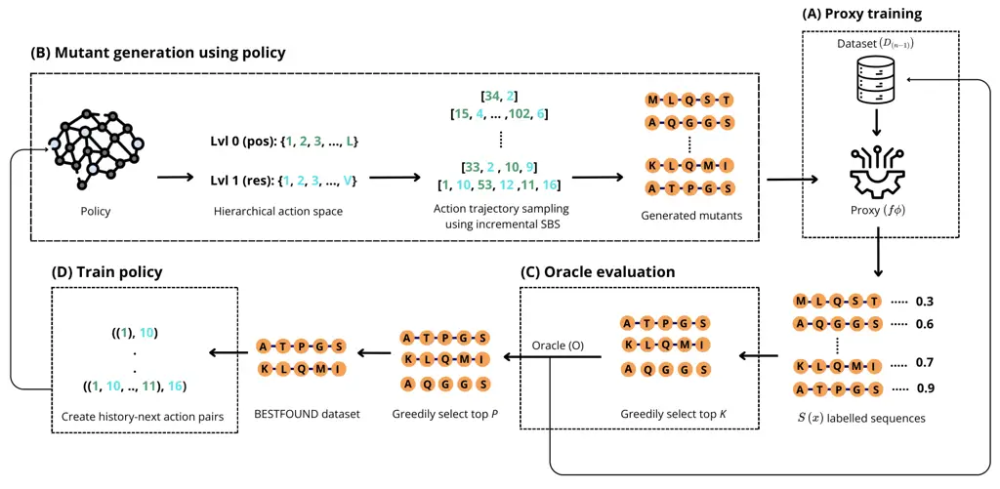
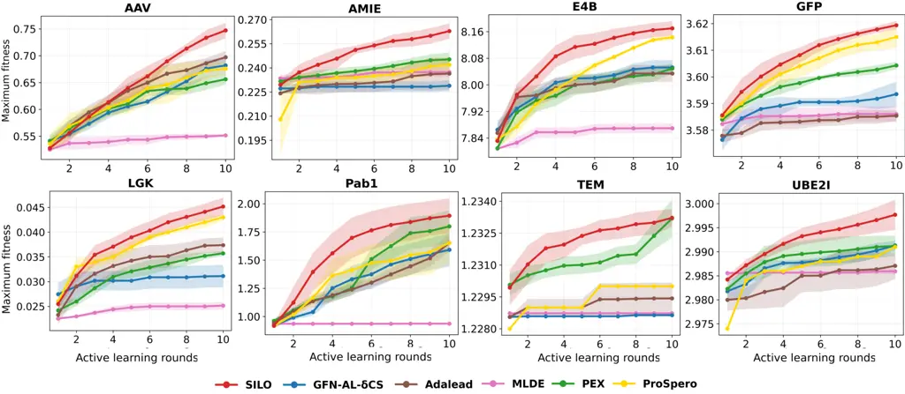
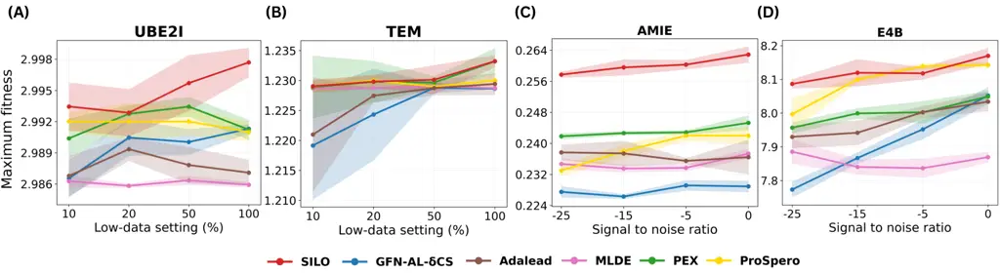

# Self-Improvement Imitation with Biologically Guided Search for Protein Design Under Oracle Budgets

Ashima Khanna Affiliation:  Bioinformatics, Technical University of
MunichTUM Campus Straubing, 94315 Straubing, Germany Affiliation: 
University of Applied Sciences Weihenstephan-Triesdorf, 94315 Straubing,
Germany Email: [ashima.khanna@tum.de](mailto:)    Dominik Grimm
Affiliation:  Bioinformatics, Technical University of MunichTUM Campus
Straubing, 94315 Straubing, Germany Affiliation:  University of Applied
Sciences Weihenstephan-Triesdorf, 94315 Straubing, Germany
Email: [dominik.grimm@tum.de](mailto:)

###### Abstract

Protein sequence optimization under tight oracle budgets requires
methods that explore vast combinatorial spaces while making each
evaluation informative. Existing reinforcement learning and off-policy
generative approaches often degrade under surrogate noise, and
position-agnostic mutation proposals risk disrupting functionally
critical residues. We introduce SILO, a trajectory-level
self-improvement imitation framework for oracle-budgeted protein design.
SILO uses a hierarchical edit policy that decomposes each mutation into
a position choice followed by a residue choice. In each active-learning
round, the policy samples candidate trajectories via incremental
stochastic beam search without replacement (SBS), and a UCB-based proxy
ensemble, combined with an alanine-scan fitness score (AFS), selects
candidates with functionally relevant edits for in silico oracle
evaluation. The policy is then updated by next-action cross-entropy
imitation on the round’s best oracle-labeled trajectories, avoiding
value-function estimation. Across eight reproduced protein fitness
landscapes and five strong baselines from prior work, SILO achieves the
highest maximum and top-100 mean fitness on 8 of 8 landscapes within our
evaluations, often exhibiting faster early-stage improvement. In
low-data and noisy-proxy stress tests on two landscapes per setting,
SILO remains competitive or best when several baselines degrade.
Ablations show that SBS with AFS account for much of the gains, with
iterative imitation providing additional improvement. Code is available
at:
[https://github.com/grimmlab/SILO.git](https://github.com/grimmlab/SILO.git)

^(†)^(†)footnotetext: Code available at:
[https://github.com/grimmlab/SILO.git](https://github.com/grimmlab/SILO.git)

## 1 Introduction

Protein engineering enables the development of proteins with tailored
functional properties, with applications ranging from therapeutics to
enzyme engineering \[35, 30, 23\]. This engineering can be framed as a
sequential-decision making optimization problem under a strict
evaluation budget, where the goal is to propose mutations to an initial
sequence that maximize a "fitness" function quantifying a desired
property such as thermostability, binding affinity, or catalytic
efficiency. The problem is challenging due to the combinatorial size of
the sequence space \[13\] and the prevalence of epistasis, which yields
rugged, sparse, and highly non-convex fitness landscapes \[10\]. Locally
plausible edits can produce highly non-additive outcomes, making
efficient exploration critical.  
A range of learning- and search-based methods address this problem.
Reinforcement learning (RL) approaches optimize a generative policy via
on-policy algorithms such as proximal policy optimization (PPO) \[38\]
using learned reward models \[2, 24\]. Self-play approaches based on
AlphaZero \[40\] combine policy-value networks with Monte Carlo Tree
Search \[21\], enabling structured exploration through look-ahead search
\[48, 25\]. Generative methods such as GFlowNets \[3\] instead learn to
sample diverse high-reward candidates via off-policy training \[15\] on
existing datasets.  
Despite these advances, sequence optimization under limited evaluation
budgets faces three persistent challenges. First, value-based
optimization can be unstable, sensitive to hyperparameters \[38, 12\],
and prone to error propagation when value estimates are computed over
noisy surrogate rewards \[1\]. Although off-policy generative methods
improve stability \[15\], they remain sensitive to the quality and
coverage of training data. This can lead to distributional shifts and
poor generalization to unseen regions \[39\]. Moreover, their
performance degrade under unreliable reward estimates when evaluating
out-of-distribution generated candidates \[17, 45\]. Second, mutational
proposals are typically position-agnostic, and edits at conserved
residues can compromise protein function. Third, efficient exploration
under strict evaluation budgets requires prioritizing high-value regions
while avoiding redundant evaluations. Together, these challenges
motivate approaches that integrate robust learning, structured search,
and biologically informed selection.  
Recent works in neural combinatorial optimization (NCO) have explored
self-improvement imitation learning (SIL) \[27, 32, 7\] as an
alternative to value-based optimization. SIL iteratively improves a
policy by supervised next-action prediction on trajectories that
produced the highest-quality solutions found so far, relying on strong
sampling procedures to generate candidates. Crucially, because the
training signal comes from the actions of oracle-labeled top performers
rather than from value estimates over a noisy surrogate, SIL sidesteps
the value-propagation failures that destabilize RL under approximate
rewards. While effective in settings such as routing problems with cheap
evaluation, adapting SIL to oracle-budgeted settings with limited or
noisy feedback is non-trivial. Evaluations must be allocated carefully,
and the sampling procedure must surface candidates that are both
promising under the surrogate and unlikely to disrupt protein
function.

Main contributions Motivated by the challenges above, we introduce SILO,
an active-learning framework that combines structured sampling,
biologically-informed selection, and trajectory-level imitation
learning. Our contributions are:

1.  1.  Structured sampling and biologically informed selection. We combine
        incremental stochastic beam search without replacement (SBS) \[22\]
        for diverse trajectory generation with a UCB acquisition function
        augmented by an alanine-scan fitness score (AFS) \[20\] that
        down-weights candidates whose mutated positions are predicted to be
        functionally disruptive. Ablations indicate that this combination
        drives the majority of performance gains across evaluated tasks.
2.  2.  Adapting trajectory-level SIL to oracle-budgeted protein design.
        Building on the SIL paradigm of Pirnay and Grimm \[32\], we train a
        transformer-based hierarchical edit policy over frozen ESM Cambrian
        embeddings, decomposing each mutation into a position choice
        followed by a residue choice, and learning from action trajectories
        of oracle-labeled top performers. This provides additional
        improvements over the structured sampling and selection.
3.  3.  Empirical analysis under realistic constraints. Across eight protein
        fitness landscapes and five reproduced baselines, our approach
        consistently identifies high-fitness candidates across all
        landscapes. Under low-data and noisy-proxy conditions on four tasks,
        our performance remains stable and competitive where several
        baselines degrade.

## 2 Problem formulation

We consider protein sequence optimization over a discrete sequence
space. Let $`x\in\mathcal{V}^{L}`$ denote a protein sequence of length
$`{L}`$, where $`\mathcal{V}`$ is a finite vocabulary of
$`|\mathcal{V}|=20`$ (the standard amino acids). The objective is to
maximize an expensive-to-evaluate oracle fitness function
$`O:\mathcal{V}^{L}\to\mathbb{R}`$ measuring a desired property such as
binding affinity, thermostability, or activity. We assume that oracle
evaluations are expensive and only available through queries. The
optimization proceeds in an active-learning setting, following prior
protein design works \[2, 15\]. We assume access to an initial dataset
$`\mathcal{D}_{0}=\{(x_{i},O(x_{i}))\}_{i=1}^{M_{0}}`$ of
$`M_{0}=|\mathcal{D}_{0}|`$ oracle-labeled sequences, and initialize a
starting sequence as $`x_{\text{start}}=`$
argmax$`{}_{x\in\mathcal{D}_{0}}O(x)`$. At each active-learning round
$`n\in\{1,\ldots,N\}`$, we select a batch
$`B_{n}\subset\mathcal{V}^{L}`$ of $`K`$ candidate sequences for oracle
evaluation, where $`K`$ is the per-round oracle query budget and each
candidate differs from $`x_{start}`$ by at most $`d_{max}`$ mutations.
After observing their oracle fitness values, the dataset is updated as
$`\mathcal{D}_{n}=\mathcal{D}_{n-1}\cup\{(x,O(x)):x\in B_{n}\}`$, giving
a total of at most $`NK`$ new oracle evaluations. Because direct oracle
evaluation is limited, we train a proxy model $`f_{\phi}`$ on the
currently available oracle-labeled dataset by minimizing

```math
\mathcal{L}({\phi})=\mathbb{E}_{(x,O(x))\sim\mathcal{D}_{n-1}}\left[(O(x)-f_{\phi}(x))^{2}\right] \tag{1}
```

The proxy guides candidate selection before oracle evaluation, while
final performance is always measured by the oracle $`O`$. The goal is to
design sequences with higher fitness than $`x_{start}`$ within the
budget $`NK`$.

## 3 Active learning with SILO

We follow an active learning loop, namely iterating over four steps, as
illustrated in Figure 1 and outlined in Algorithm 1: (i) updating the
proxy model $`f_{\phi}`$ by training on current dataset $`D_{n-1}`$ by
minimizing loss as shown in Equation 1; (ii) generating mutants using
policy $`\pi_{\theta}`$ by sampling action trajectories using
incremental SBS \[22\]; (iii) evaluating the selected candidates with
the oracle and appending the new pairs to the dataset; (iv) updating the
policy $`\pi_{\theta}`$ by training on action trajectories derived from
oracle-labeled top performing sequences using a batch-wise cross entropy
objective.  
We cast candidate generation as a Markov decision process (MDP) over
edit trajectories, which allows policy training via cross-entropy on
action sequences rather than value estimation over generated sequences.
At each round we re-select the starting sequence $`x_{start}`$ as the
highest-oracle-scoring sequence in the current dataset
$`\mathcal{D}_{n-1}`$, anchoring the search on the best candidate found
so far. In the following subsections, we describe important components
within SILO.

Input: policy $`\pi_{\theta}`$, proxy $`f_{\phi}`$, oracle $`O`$,
initial dataset $`D_{0}`$, oracle budget $`K`$, active learning rounds
$`N`$, starting sequence $`x_{start}`$

1 for _$`n\leftarrow 1`$ to $`N`$_ do

    2 Train $`f_{\phi}`$ on $`D_{n-1}`$:
$`\mathbb{E}_{(x,O(x))\sim D_{n-1}}[(O(x)-f_{\phi}(x))^{2}]`$

    3 Select starting sequence:
$`x_{start}\leftarrow\text{argmax}_{x\in\mathcal{D}_{n-1}}O(x)`$

    4 SAMPLED $`\leftarrow`$ Sample mutated sequences from
$`\pi_{\theta}`$ using incremental SBS with beam size $`\beta`$ and
mutational budget $`d_{max}`$

    5 Score $`x\in`$ SAMPLED using a defined objective function $`S(x)`$

    6 CANDIDATES $`\leftarrow`$ Select top $`K`$ unique sequences from
SAMPLED via greedy selection

    7 Evaluate CANDIDATES with oracle $`O`$ and update dataset:
$`{D}_{n}\leftarrow\mathcal{D}_{n-1}\cup\{x,O(x)\}`$: x $`\in`$
CANDIDATES

    8 BESTFOUND $`\leftarrow`$ top $`P`$ sequences from CANDIDATES
ranked by $`O(x)`$, together with their action trajectories

    9 for _each training step_ do

       10 Sample a batch of $`m`$ history-next action pairs
$`(h^{(t)},a^{(t)})`$ uniformly from BESTFOUND trajectories

       11 Update policy $`\pi_{\theta}`$ by minimizing the cross-entropy
loss:

       12 $`\mathcal{L}(\theta)=-\frac{1}{m}\sum_{(h^{(t)},a^{(t)})}`$
log $`\pi_{\theta}(a^{(t)}\mid h^{(t)})`$

Algorithm 1 Active Learning with SILO.



Figure 1: Active learning with SILO. We define the following four steps
within our active learning loop: (A) A proxy ensemble $`f_{\phi}(x)`$ is
trained on the current dataset $`D_{n-1}`$. (B) The policy
$`\pi_{\theta}`$ generates candidate mutated sequences by sampling
action trajectories (position then residue) with incremental stochastic
beam search. The proxy scores the generated sequences with the objective
$`S(x)`$ (Equation 5). (C) Top K candidates are selected for oracle
evaluation. (D) The top $`P`$ oracle-labeled sequences yield action
trajectories used to train $`\pi_{\theta}`$ via next-action
cross-entropy imitation. The loop repeats over $`N`$ active learning
rounds.

### 3.1 Markov decision process formulation

We formulate candidate optimization as a MDP, where an agent iteratively
edits a protein sequence through a sequence of actions. A state
$`x^{(t)}\in\mathcal{V}^{L}`$ corresponds to the edited sequence at step
$`t`$, with $`x_{0}=x_{start}`$ and $`t\in\{0,\ldots,d_{\max}-1\}`$. At
each step, the agent selects an action $`a^{(t)}`$ from a hierarchical
action space $`\mathcal{A}=\mathcal{A}_{0}\times\mathcal{A}_{1}`$,
sampled in two stages:

- •
  Level-0 action $`a_{0}^{(t)}\in\{1,...,L\}`$ chooses a position to
  modify.
- •
  Level-1 action $`a_{1}^{(t)}\in\mathcal{V}`$ chooses a replacement
  amino acid, conditioned on the selected position $`i=a^{(t)}_{0}`$.

The environment transitions deterministically to a new state
$`x^{(t+1)}`$, by substituting the amino acid at position $`i`$ in
$`x^{(t)}`$ with $`a_{1}^{(t)}`$. Each episode terminates after
$`d_{max}`$ steps, returning the final sequence $`x^{(d_{max})}`$, where
$`d_{max}`$ is the per-round mutational budget defined in Section 2.
This hierarchical action space decomposes sequence editing into position
selection followed by amino acid selection, enabling a more structured
exploration.

### 3.2 Policy network architecture

Following the architecture used by GraphXForm for molecular design
\[33\], we adapt it to the protein design space. Our policy is a
lightweight transformer-based decision module (Figure 2). Given an input
sequence $`x`$, we obtain contextualized per-residue embeddings from a
frozen ESM Cambrian encoder \[44\], which encodes evolutionary priors.
These embeddings are then processed by a stack of transformer layers
\[47\] using FlashAttention \[9\] for memory efficiency, producing a
latent representation $`H\in\mathbb{R}^{(L\times D)}`$, where $`D`$ is
the latent dimension.  
Two learnable policy heads operate on $`H`$. A level-0 head $`h_{0}`$
produces logits over sequence positions in $`\mathbb{R}^{L}`$, and a
level-1 head $`h_{1}`$ produces position-conditioned logits over the
amino acid vocabulary in $`\mathbb{R}^{(L\times|\mathcal{V}|)}`$. The
final residue distribution is obtained by selecting the row
corresponding to the chosen position. This factorization reduces the
joint action space of size $`L\times|\mathcal{V}|`$ to two factored
decisions and naturally mirrors the hierarchical structure of the action
space, enabling efficient parameter sharing while decomposing
decision-making into position selection followed by amino acid
selection.

Figure 2: Overview of the policy architecture. An input sequence is
encoded by a frozen ESM Cambrian model and the embeddings are processed
by a transformer based policy. Two policy heads use latent
representations from the policy to emit logits: $`h_{0}`$ over positions
($`\mathbb{R}^{L}`$) and $`h_{1}`$ over residues per position
($`\mathbb{R}^{(L\times|\mathcal{V}|)}`$). The policy is invoked
iteratively over $`d_{max}`$ edit steps, updating the input sequence
after each step.

### 3.3 Training algorithm

We train the policy via SIL \[32\], adapting it to the oracle-budgeted
setting. The key idea is to treat the policy’s own highest-fitness
solutions as pseudo-expert demonstrations for cross-entropy imitation,
without external supervision or value-function estimation.  
At each active-learning round, the current policy $`\pi_{\theta}`$
samples a set of candidate trajectories of mutated sequences. Each
trajectory $`\tau=(a^{(0)},...,a^{(d_{max}-1)})`$ corresponds to a
sequence of actions that converts $`x_{start}`$ into a final candidate
$`x^{d_{max}}`$. The resulting candidate sequences are scored by the
proxy under the objective $`S(x)`$ (Equation 5), and the top $`K`$
unique sequences are evaluated by the oracle $`O`$. From these
oracle-evaluated sequences, we select top $`P`$ by oracle fitness as the
BESTFOUND set, whose corresponding action trajectories serve as
imitation targets.  
We update $`\pi_{\theta}`$ on history-next action pairs
$`\{h^{(t)},a^{(t)}\}`$ drawn from BESTFOUND trajectories, where
$`h^{(t)}=(a^{(0)},\ldots,a^{(t-1)})`$ denotes the sequence of past
actions taken until $`t-1`$ step and $`a^{(t)}`$ denotes the
corresponding next action at step $`t`$. The policy is then trained by
minimizing the cross-entropy loss. In practice, we optimize Equation 2
by uniformly sampling batches of history-next action pairs across
BESTFOUND trajectories rather than processing full trajectories. The
improved policy is then used to generate candidates in the next round.
This creates a closed-loop self-improvement learning process, in which
the policy progressively concentrates probability mass on regions of the
sequence space yielding higher oracle fitness. Unlike the original SIL
\[32\], where objective evaluation is cheap and the full candidate pool
can be re-ranked, our oracle budget motivates a proxy-scored selection
step (Section 3.5) that interposes between trajectory sampling and
oracle evaluation.

```math
\mathcal{L}({\theta})=-\mathbb{E}_{\tau\sim\text{BESTFOUND}}\left[\sum^{d_{max}-1}_{t=0}log\pi_{\theta}(a^{(t)}\mid h^{(t)})\right] \tag{2}
```

### 3.4 Sampling

We sample candidate trajectories using incremental stochastic beam
search (SBS) \[22\]. SBS is a stochastic variant of beam search that
draws trajectories without replacement by perturbing log-probabilities
with Gumbel noise (Equation10 in Appendix D.1). Starting from
$`x^{(0)}=x_{start}`$, SBS expands partial action trajectories by
sampling from $`\pi_{\theta}`$. At each step, candidate continuations
are ranked by perturbed log-probabilities and the top $`\beta`$
trajectories are retained, forming a beam. To further improve efficiency
and exploration, SIL adopts an incremental formulation of SBS, which
allows sampling trajectories sequentially while dynamically updating the
underlying distribution. After sampling a complete trajectory, its
probability mass is removed from $`\pi_{\theta}`$, and the remaining
probabilities are renormalized, so that subsequent trajectories are
drawn from the remaining probability space. This yields a diverse set of
trajectories over the action space.

### 3.5 Objective function

Each candidate sequence $`x`$ is scored using the proxy ensemble
$`f_{\phi}`$, which provides a mean prediction $`\mu_{\phi}(x)`$ and an
uncertainty estimate $`\sigma_{\phi}(x)`$. The first scoring term
reflects the predicted fitness of $`x`$ itself, computed as an
upper-confidence-bound (UCB) acquisition function \[42\]:

```math
\text{UCB}_{\text{proxy}}(x)=\mu_{\phi}(x)+\gamma_{1}\sigma_{\phi}(x), \tag{3}
```

where $`\gamma_{1}`$ controls the exploration-exploitation factor. The
second term incorporates the alanine-scan fitness signal (AFS),
originally introduced by Kmicikiewicz et al. \[20\]. Alanine scanning is
a widely used experimental site-directed mutagenesis technique that
identifies functionally relevant positions by substituting them with
alanine, a neutral amino acid that perturbs side-chain interactions \[8,
16\]. For a set of mutated positions $`M`$ in $`x`$ selected by the
agent, we construct an alanine-substituted variant $`A(x)`$ by replacing
all positions in $`M`$ with alanine, and score it with the same proxy
ensemble $`f_{\phi}`$:

```math
\text{UCB}_{\text{AFS}}(x)=\mu_{\phi}(A(x))+\gamma_{2}\sigma_{\phi}(A(x)), \tag{4}
```

where $`\gamma_{2}`$ controls the exploration-exploitation weight on the
AFS term. Intuitively, if UCB$`{}_{\text{AFS}}(x)`$ of the
alanine-substituted variant $`A(x)`$ is also predicted to be high, the
edited positions are likely to tolerate neutral substitutions,
suggesting regions of functional relevance. While the prior work \[20\]
uses AFS as a filter to identify non-disruptive substitutions, we
instead use it as an additive ranking signal combined with the proxy
UCB, preserving information about the magnitude of disruption rather
than thresholding it.  
The final candidate score is the unweighted sum of both terms:

```math
S(x)=\,\text{UCB}_{\text{proxy}}(x)+\,\text{UCB}_{\text{AFS}}(x) \tag{5}
```

After scoring all sampled candidates, we greedily select the top $`K`$
unique sequences for oracle evaluation.

## 4 Experiments

### 4.1 General setup

We examine the performance of SILO based on the following general setup
as specified by \[20\], which serves as a basis of all subsequent
experiments. The number of active learning rounds are $`N=`$ 10, and
query budget to the oracle $`O`$ is $`K=`$ 128. The proxy $`f_{\phi}`$
architecture is an ensemble of three one-dimensional convolutional
neural networks, as specified in \[41\]. Details on training
$`f_{\phi}`$ per round can be found in Appendix B.2. These constraints
remain consistent across all comparison partners. We set
$`\gamma_{1}=0.1`$ and $`\gamma_{2}=1`$ in the objective $`S(x)`$
(Equation 5). At each round, we instantiate $`M=5`$ search instances
with mutational budget $`d_{max}\in\{1,2,3\}`$, consistent with the
low-order mutations typically done in experimental directed evolution to
enable cumulative optimization. Full hyperparameters are reported in
Appendix B.5

#### Protein engineering benchmarks

We adopt the same eight benchmark datasets and evaluation protocol as
used in ProSpero (see Appendix B.1) \[20\] for all methods. For AAV, we
used ground-truth scores from FLEXS \[41\], while for all other tasks we
follow Ren et al. \[36\] and use TAPE \[34\] as in silico oracle $`O`$.
Following Kim et al. \[17\] and Kmicikiewicz et al. \[20\], we replace
the experimentally-measured fitness values in $`D_{0}`$ with
oracle-derived scores. This isolates optimization performance from the
regression error between the in silico oracle and the original
experimental measurements, ensuring that the proxy is trained against
the same target the optimization algorithms are evaluated on.

#### Baselines

We compare SILO against five baselines: (i) PEX and AdaLead, which are
evolutionary algorithms \[36, 41\]; (ii) GFN-AL-$`\delta`$CS, which is
an off-policy RL method with $`\delta`$ conservation parameter \[17\];
(iii) MLDE, a machine-learning-assisted directed evolution approach
\[46\]; (iv) ProSpero, a biologically constrained search method based on
inference-time guidance of a pre-trained generative model \[20\]. We
focus our analysis on the top baselines from the ’Fitness optimization’
experiment in original ProSpero publication, selected based on their
overall performance. For completeness, we report both our reproduced
results and the originally reported performance from ProSpero in Tables
1 and 19, respectively.

#### Evaluation metrics

We report four metrics, with primary emphasis on (i) maximum fitness,
the highest fitness value attained among all generated sequences,
reflecting the core objective of identifying top-performing candidates,
and (ii) mean fitness, computed over the top 100 sequences across all
rounds. We additionally report (iii) novelty, the average Hamming
distance between generated sequences and $`x_{start}`$, and (iv)
diversity, the average pairwise Hamming distance within the top 100
sequences. Novelty and diversity characterize the exploration profile of
each methods rather than its optimization quality.

### 4.2 Experiment 1: Sequence optimization task

#### Setup

We evaluate all methods under the active learning setup as described in
subsection 4.1. In this experiment, we focus on the core objective of
protein fitness optimization: identifying high-fitness variants under a
fixed oracle budget. We compare methods using maximum oracle fitness and
mean fitness of top 100 sequences across all rounds, measuring both peak
performance and the quality of the best generted candidate set.

#### Results

SILO achieves the highest maximum fitness on 8 of 8 benchmark landscapes
in our reproduced comparison (Tables 1, 19), with the clearest gains on
AAV, AMIE, and UBE2I, and competitive performance on the remaining
tasks. SILO also achieves the highest mean top-100 fitness on 8 of 8
tasks (Table 3), suggesting that its advantage is not limited to
isolated high-scoring candidates but extends to the quality of the best
generated set. As shown in Figure 3 and Table 7, SILO often discovers
high-fitness sequences in earlier active-learning rounds, indicating
efficient use of the oracle budget.  
We note that on Pab1, our reproduced AdaLead achieves a maximum fitness
of $`1.653\pm 0.165`$ (Table 1), below the $`1.978\pm 0.188`$ (Table 19)
originally reported by Kmicikiewicz et al. \[20\]. We attribute this
discrepancy to environment-level differences described in Appendix B.3.
Under our reproduced setup, SILO outperforms all reproduced baselines on
Pab1 and outperforms the originally reported ProSpero baselines on the
remaining seven landscapes. SILO and ProSpero produce comparable novelty
relative to the wildtype sequence on most tasks (Table 4), but with
different exploration profiles. ProSpero achieves higher diversity
within its top-100 set (Table 5), whereas SILO concentrates on a tighter
neighborhood. Thus, SILO’s main advantage is better local optimization
under the evaluated oracle budget, not uniformly better diversity. This
is consistent with the imitation-based learning, which biases the policy
toward exploitation of high-fitness regions (discussed further in C.2).
The trade-off favors solution quality on the evaluated benchmarks, as
SILO achieves higher mean top-100 fitness than ProSpero on all eight
tasks in our reproduced comparison (Table 3).



Figure 3: Active learning performance across eight protein fitness
landscapes. All methods improve over $`O(x_{start})`$ fitness; however,
SILO consistently achieves the highest maximum fitness compared to all
baselines. High quality sequences are discovered in earlier rounds,
indicating more efficient exploration under limited oracle budgets.
Shaded regions denote standard deviation over five runs.

| Method              | AAV (0.500)         | AMIE (0.224)        | E4B (7.743)         | GFP (3.572)         | LGK (0.020)         | Pab1 (0.84)         | TEM (1.229)         | UBE2I (2.978)       |
| ------------------- | ------------------- | ------------------- | ------------------- | ------------------- | ------------------- | ------------------- | ------------------- | ------------------- |
| PEX                 | 0.656 $`\pm`$ 0.009 | 0.245 $`\pm`$ 0.004 | 8.049 $`\pm`$ 0.037 | 3.604 $`\pm`$ 0.037 | 0.035 $`\pm`$ 0.000 | 1.799 $`\pm`$ 0.324 | 1.233 $`\pm`$ 0.002 | 2.991 $`\pm`$ 0.002 |
| AdaLead             | 0.697$`\pm`$0.0119  | 0.236$`\pm`$0.009   | 8.034$`\pm`$0.0625  | 3.585$`\pm`$0.002   | 0.037$`\pm`$0.002   | 1.653$`\pm`$0.165   | 1.229$`\pm`$0.001   | 2.987$`\pm`$0.002   |
| GFN-AL-$`\delta`$CS | 0.681$`\pm`$0.0159  | 0.228$`\pm`$0.003   | 8.052$`\pm`$0.055   | 3.593$`\pm`$0.004   | 0.031$`\pm`$0.003   | 1.592$`\pm`$0.327   | 1.228$`\pm`$0.000   | 2.991$`\pm`$0.000   |
| MLDE                | 0.551 $`\pm`$ 0.001 | 0.237 $`\pm`$ 0.002 | 7.869 $`\pm`$ 0.035 | 3.586 $`\pm`$ 0.002 | 0.025 $`\pm`$ 0.001 | 0.936 $`\pm`$ 0.001 | 1.228 $`\pm`$ 0.000 | 2.985 $`\pm`$ 0.005 |
| ProSpero            | 0.676 $`\pm`$ 0.012 | 0.242 $`\pm`$ 0.005 | 8.143 $`\pm`$ 0.021 | 3.615 $`\pm`$ 0.004 | 0.043 $`\pm`$ 0.001 | 1.653 $`\pm`$ 0.404 | 1.230 $`\pm`$ 0.001 | 2.991 $`\pm`$ 0.002 |
| SILO                | 0.747 $`\pm`$ 0.014 | 0.262 $`\pm`$ 0.004 | 8.169 $`\pm`$ 0.052 | 3.619 $`\pm`$ 0.002 | 0.045 $`\pm`$ 0.003 | 1.894 $`\pm`$ 0.348 | 1.233 $`\pm`$ 0.003 | 2.997 $`\pm`$ 0.003 |

Table 1: Maximum fitness attained by all methods on 8 benchmark datasets
across 10 active learning rounds. Reported values are the mean and
standard deviation over 5 independent runs. Values in brackets denote
wildtype $`(x_{start})`$ fitness. Bold: the best per each task.
Underline: second-best

### 4.3 Experiment 2: Low labeled data regime

#### Setup

We evaluate all methods under the active-learning setup as Section 4.1,
but reduce the size of the initial labeled dataset $`D_{0}`$.
Specifically, we randomly subsample 10%, 20%, and 50% of $`D_{0}`$,
using the same subsample per seed across all methods to ensure identical
proxy training data. All other experimental settings are held fixed. We
conduct this targeted stress test on UBE2I and TEM datasets, where the
available initial datasets are already relatively limited, with
approximately $`3,000`$ and $`5,000`$ labeled sequences, respectively.
The goal of this experiment is to assess performance under reduced
initial labeled data in settings where proxy training data are limited.
We report performance in terms of maximum fitness, evaluating the
ability of each method to identify high-quality sequences despite
reduced training data.

#### Results

Figure 4 (A-B) shows that SILO achieves highest mean maximum fitness on
UBE2I across all data fractions and remains competitive on TEM. On
UBE2I, competing methods degrade more noticeably as the amount of
initial labeled data decreases, while SILO maintains relatively stable
performance. This is especially evident for approaches such as
GFN-AL-$`\delta`$CS, which trains a policy through
$`\delta`$-conservative search by masking and denoising high-scoring
offline sequences, making its performace more dependent on the coverage
and quality of the initial dataset. In contrast, SILO’s iterative policy
update relies on oracle-evaluated trajectories, which may reduce
dependence on the initial offline data. On TEM, methods like MLDE,
ProSpero, and PEX perform similarly to SILO at low data fractions, but
SILO remains competitive and achieves the best performance with full
data. Overall, these results suggest that SILO is robust on the two
low-data settings evaluated here, while maintaining strong performance
when more initial labeled data are available.

### 4.4 Experiment 3: Noisy proxy setting

#### Setup

In this experiment, we investigate the robustness of different methods
under degraded proxy quality by deliberately corrupting the proxy model,
while keeping other experimental details constant. We replace the proxy
$`f_{\phi}`$ with an ensemble of noisy oracles $`f_{\epsilon}`$,
obtained by adding zero-mean Gaussian noise to ground-truth oracles,
following the inference scheme of \[41\]. The noise magnitude is
governed by the signal-to-noise ratio (SNR), with
$`\delta_{noise}=\sqrt{Var(D_{0})}\times 10^{-SNR/10}`$, where
$`Var(D_{0})`$ denotes the variance of fitness values in the initial
dataset $`(D_{0})`$. We examine three levels of surrogate noise, namely
-25, -15, and -5, on AMIE and E4B.

#### Results

Across the two evaluated tasks, AMIE and E4B, SILO achieves the highest
fitness and remains stable under the tested noise levels. In contrast,
competing methods, especially ProSpero and PEX, exhibit noticeable
degradation as noise increases on AMIE, despite being designed for
robustness. This stability may be partly explained by SILO’s policy
learning mechanism: while proxy estimates are used for candidate
ranking, the policy is trained exclusively on oracle-evaluated
trajectories, which may reduce sensitivity to noisy surrogate rankings.
We note, however, that in this experimental setup noise is applied to
the proxy used for candidate ranking, while the policy training signal
remains oracle-derived. Overall, these results suggest that SILO is
resilient to this synthetic Gaussian proxy-noise setting on the
evaluated tasks, maintaining a strong performance under substantial
noise levels.



Figure 4: Performance across low-data (A-B) and noisy settings (C-D). We
compare the performance of all methods in terms of maximum fitness
achieved across 4 tasks. SILO outperforms or matches baselines and
remains stable in both settings.

### 4.5 Experiment 4: Ablation studies

#### Setup

We perform ablations to isolate the effects of (i) structured
exploration, (ii) sampling and selection strategy, and (iii) policy
learning. We first include a random mutation baseline, where sequences
are generated uniformly at random without model guidance, to assess the
importance of structured sampling and model-guided candidate generation.
We then compare sampling and selection strategies by replacing SBS with
standard beam search (BS) and by ablating the AFS term, using only the
proxy UCB score in Equation 3 instead of the full objective in Equation 5. Finally, to quantify the impact of learning, we evaluate a randomly
initialized frozen-policy variant, where policy parameters are not
updated across active-learning rounds. Table 2 reports these ablations
on AAV, GFP, and Pab1. Complete ablation results are provided in Tables
17 and 18.

#### Results

The ablation results show that structured sampling method, biologically
informed selection, and policy learning all contribute to SILO’s
performance on the evaluated tasks (Table 2). The random baseline
performs substantially worse across all tasks, indicating that
model-guided candidate generation is important under limited oracle
budgets. SBS outperforms standard BS in these comparisons, supporting
the benefit of diverse action trajectory sampling. Removing the AFS term
reduces performance relative to the full SILO objective, suggesting that
the alanine-scan-inspired score improves candidate ranking in this
setup. The frozen-policy variant with SBS remains competitive,
particularly on GFP, which shows that sampling and selection account for
a substantial part of the performance. However, the full model achieves
the best results across the three reported tasks, suggesting that
iterative policy learning provides additional gains on top of structured
sampling and selection, most notably on AAV and Pab1. Overall, these
ablations support the contribution of each component on the evaluated
tasks, while the strongest evidence is for the combined effect of
SBS-based sampling, AFS-based selection, and iterative imitation
learning.

| Ablation            | AAV               | GFP               | Pab1              |
| ------------------- | ----------------- | ----------------- | ----------------- |
| Random baseline     | 0.530$`\pm`$0.015 | 3.600$`\pm`$0.010 | 1.018$`\pm`$0.103 |
| BS + AFS            | 0.587$`\pm`$0.028 | 3.602$`\pm`$0.012 | 1.022$`\pm`$0.146 |
| SBS + w/o AFS       | 0.694$`\pm`$0.019 | 3.615$`\pm`$0.001 | 1.558$`\pm`$0.134 |
| Frozen policy + SBS | 0.706$`\pm`$0.013 | 3.615$`\pm`$0.001 | 1.530$`\pm`$0.268 |
| SILO                | 0.747$`\pm`$0.014 | 3.619$`\pm`$0.002 | 1.894$`\pm`$0.348 |

Table 2: Results of ablation studies on AAV, GFP, and Pab1, reporting
maximum fitness achieved over 5 independent runs across 10 active
learning rounds. We analyze the impact of sampling strategy, selection,
and policy learning

## 5 Conclusion

We present SILO, a self-improvement imitation framework that integrates
three key components: trajectory-level imitation learning, structured
sampling, and biologically-informed selection. Concretely, SILO
leverages imitation learning to improve a generative policy from
oracle-evaluated sequences, employs incremental stochastic beam search
for diverse action sampling, and incorporates an alanine-scan-inspired
signal to guide selection toward mutations predicted to be less
disruptive by the proxy. Across eight in silico protein benchmark tasks,
SILO identifies high-fitness candidates and achieves fast convergence
under a fixed oracle budget. We further show that SILO remains stable in
targeted low-data and noisy-proxy settings on four evaluated datasets.
Overall, our results suggest the combining learning, sampling, and
biologically guided selection is an effective direction for
oracle-budget protein sequence optimization. Future work should evaluate
SILO under larger mutation budgets, and experimental validation beyond
in silico oracles.

## Funding and acknowledgments

This work was supported by the Pythagoras Project (Grant No. 031B1407B)
within the program “Climate-neutral products through biotechnology–CO₂
and C1 compounds as sustainable raw materials for the industrial
bioeconomy (CO2BioTech)”, which is funded by the Bundesministerium für
Forschung, Technologie und Raumfahrt (BMFTR). The Deutsche
Forschungsgemeinschaft (DFG, German Research Foundation) further
supported this work through Project No. 466387255 within the Priority
Programme “SPP 2331: Machine Learning in Chemical Engineering”. The
authors gratefully acknowledge the Competence Center for Digital
Agriculture (KoDA) at the University of Applied Sciences
Weihenstephan-Triesdorf for providing computational resources.

## References

- \[1\] Marcin Andrychowicz, Filip Wolski, Alex Ray, Jonas Schneider,
  Rachel Fong, Peter Welinder, Bob McGrew, Josh Tobin, OpenAI
  Pieter Abbeel, and Wojciech Zaremba. Hindsight experience replay.
  _Advances in neural information processing systems_, 30, 2017.
- \[2\] Christof Angermueller, David Dohan, David Belanger, Ramya
  Deshpande, Kevin Murphy, and Lucy Colwell. Model-based reinforcement
  learning for biological sequence design. In _International conference
  on learning representations_, 2019.
- \[3\] Emmanuel Bengio, Moksh Jain, Maksym Korablyov, Doina Precup, and
  Yoshua Bengio. Flow network based generative models for non-iterative
  diverse candidate generation. _Advances in neural information
  processing systems_, 34:27381–27394, 2021.
- \[4\] Shimon Bershtein, Michal Segal, Roy Bekerman, Nobuhiko Tokuriki,
  and Dan S Tawfik. Robustness–epistasis link shapes the fitness
  landscape of a randomly drifting protein. _Nature_,
  444(7121):929–932, 2006.
- \[5\] David Brookes, Hahnbeom Park, and Jennifer Listgarten.
  Conditioning by adaptive sampling for robust design. In _International
  conference on machine learning_, pages 773–782. PMLR, 2019.
- \[6\] David H Brookes and Jennifer Listgarten. Design by adaptive
  sampling. _arXiv preprint arXiv:1810.03714_, 2018.
- \[7\] Andrea Corsini, Angelo Porrello, Simone Calderara, and Mauro
  Dell’Amico. Self-labeling the job shop scheduling problem. _Advances
  in Neural Information Processing Systems_, 37:105528–105551, 2024.
- \[8\] Brian C Cunningham and James A Wells. High-resolution epitope
  mapping of hgh-receptor interactions by alanine-scanning mutagenesis.
  _Science_, 244(4908):1081–1085, 1989.
- \[9\] Tri Dao, Dan Fu, Stefano Ermon, Atri Rudra, and Christopher Ré.
  Flashattention: Fast and memory-efficient exact attention with
  io-awareness. _Advances in neural information processing systems_,
  35:16344–16359, 2022.
- \[10\] J. Arjan G.M. de Visser and Joachim Krug. Empirical fitness
  landscapes and the predictability of evolution. _Nature Reviews
  Genetics_, 15(7):480–490, 2014. ISSN 1471-0064. doi: 10.1038/nrg3744.
  URL
  [http://dx.doi.org/10.1038/nrg3744](http://dx.doi.org/10.1038/nrg3744).
- \[11\] Elad Firnberg, Jason W Labonte, Jeffrey J Gray, and Marc
  Ostermeier. A comprehensive, high-resolution map of a gene’s fitness
  landscape. _Molecular biology and evolution_, 31(6):1581–1592, 2014.
- \[12\] Peter Henderson, Riashat Islam, Philip Bachman, Joelle Pineau,
  Doina Precup, and David Meger. Deep reinforcement learning that
  matters. In _Proceedings of the AAAI conference on artificial
  intelligence_, volume 32, 2018.
- \[13\] J D Hermes, S C Blacklow, and J R Knowles. Searching sequence
  space by definably random mutagenesis: improving the catalytic potency
  of an enzyme. _Proceedings of the National Academy of Sciences_,
  87(2):696–700, January 1990. ISSN 1091-6490. doi:
  10.1073/pnas.87.2.696. URL
  [http://dx.doi.org/10.1073/pnas.87.2.696](http://dx.doi.org/10.1073/pnas.87.2.696).
- \[14\] Hervé Jacquier, André Birgy, Hervé Le Nagard, Yves Mechulam,
  Emmanuelle Schmitt, Jérémy Glodt, Beatrice Bercot, Emmanuelle Petit,
  Julie Poulain, Guilène Barnaud, et al. Capturing the mutational
  landscape of the beta-lactamase tem-1. _Proceedings of the National
  Academy of Sciences_, 110(32):13067–13072, 2013.
- \[15\] Moksh Jain, Emmanuel Bengio, Alex Hernandez-Garcia, Jarrid
  Rector-Brooks, Bonaventure FP Dossou, Chanakya Ajit Ekbote, Jie Fu,
  Tianyu Zhang, Michael Kilgour, Dinghuai Zhang, et al. Biological
  sequence design with gflownets. In _International conference on
  machine learning_, pages 9786–9801. PMLR, 2022.
- \[16\] Sanjeevaiah Kasturi, Ako Kihara, David FitzGerald, and Ira
  Pastan. Alanine scanning mutagenesis identifies surface amino acids on
  domain ii of pseudomonas exotoxin required for cytotoxicity, proper
  folding, and secretion into periplasm. _Journal of Biological
  Chemistry_, 267(32):23427–23433, 1992.
- \[17\] Hyeonah Kim, Minsu Kim, Taeyoung Yun, Sanghyeok Choi, Emmanuel
  Bengio, Alex Hernández-García, and Jinkyoo Park. Improved off-policy
  reinforcement learning in biological sequence design. _arXiv preprint
  arXiv:2410.04461_, 2024.
- \[18\] Diederik P Kingma and Jimmy Ba. Adam: A method for stochastic
  optimization. _arXiv preprint arXiv:1412.6980_, 2014.
- \[19\] Justin R Klesmith, John-Paul Bacik, Emily E Wrenbeck, Ryszard
  Michalczyk, and Timothy A Whitehead. Trade-offs between enzyme fitness
  and solubility illuminated by deep mutational scanning. _Proceedings
  of the National Academy of Sciences_, 114(9):2265–2270, 2017.
- \[20\] Michal Kmicikiewicz, Vincent Fortuin, and Ewa Szczurek.
  Prospero: Active learning for robust protein design beyond wild-type
  neighborhoods. _arXiv preprint arXiv:2505.22494_, 2025.
- \[21\] Levente Kocsis and Csaba Szepesvári. Bandit based monte-carlo
  planning. In _European conference on machine learning_, pages 282–293.
  Springer, 2006.
- \[22\] Wouter Kool, Herke Van Hoof, and Max Welling. Stochastic beams
  and where to find them: The gumbel-top-k trick for sampling sequences
  without replacement. In _International conference on machine
  learning_, pages 3499–3508. PMLR, 2019.
- \[23\] HA Daniel Lagassé, Aikaterini Alexaki, Vijaya L Simhadri,
  Nobuko H Katagiri, Wojciech Jankowski, Zuben E Sauna, and Chava
  Kimchi-Sarfaty. Recent advances in (therapeutic protein) drug
  development. _F1000Research_, 6:113, 2017.
- \[24\] Minji Lee, Luiz Felipe Vecchietti, Hyunkyu Jung, Hyun Joo Ro,
  Meeyoung Cha, and Ho Min Kim. Robust optimization in protein fitness
  landscapes using reinforcement learning in latent space. _arXiv
  preprint arXiv:2405.18986_, 2024.
- \[25\] Huitian Lin, Cheng Zhu, Tianfeng Shang, Ning Zhu, Kang Lin,
  Chengyun Zhang, Xiang Shao, Xudong Wang, and Hongliang Duan. Highplay:
  Cyclic peptide sequence design based on reinforcement learning and
  protein structure prediction. _Journal of Medicinal Chemistry_,
  68(11):12047–12057, 2025.
- \[26\] Zeming Lin, Halil Akin, Roshan Rao, Brian Hie, Zhongkai Zhu,
  Wenting Lu, Allan dos Santos Costa, Maryam Fazel-Zarandi, Tom Sercu,
  Sal Candido, et al. Language models of protein sequences at the scale
  of evolution enable accurate structure prediction. _BioRxiv_,
  2022:500902, 2022.
- \[27\] Fu Luo, Xi Lin, Zhenkun Wang, Xialiang Tong, Mingxuan Yuan, and
  Qingfu Zhang. Self-improved learning for scalable neural combinatorial
  optimization. _arXiv preprint arXiv:2403.19561_, 2024.
- \[28\] Daniel Melamed, David L Young, Caitlin E Gamble, Christina R
  Miller, and Stanley Fields. Deep mutational scanning of an rrm domain
  of the saccharomyces cerevisiae poly (a)-binding protein. _Rna_,
  19(11):1537–1551, 2013.
- \[29\] Philipp Moritz, Robert Nishihara, Stephanie Wang, Alexey
  Tumanov, Richard Liaw, Eric Liang, Melih Elibol, Zongheng Yang,
  William Paul, Michael I Jordan, et al. Ray: A distributed framework
  for emerging $`\{`$AI$`\}`$ applications. In _13th USENIX symposium on
  operating systems design and implementation (OSDI 18)_, pages
  561–577, 2018.
- \[30\] Giles Obinna Ndochinwa, Qing-Yan Wang, Nkwachukwu Oziamara
  Okoro, Oyetugo Chioma Amadi, Tochukwu Nwamaka Nwagu, Chukwudi Innocent
  Nnamchi, Anene Nwabu Moneke, and Arome Solomon Odiba. New advances in
  protein engineering for industrial applications: Key takeaways. _Open
  life sciences_, 19(1):20220856, 2024.
- \[31\] Adam Paszke, Sam Gross, Francisco Massa, Adam Lerer, James
  Bradbury, Gregory Chanan, Trevor Killeen, Zeming Lin, Natalia
  Gimelshein, Luca Antiga, et al. Pytorch: An imperative style,
  high-performance deep learning library. _Advances in neural
  information processing systems_, 32, 2019.
- \[32\] Jonathan Pirnay and Dominik G Grimm. Self-improvement for
  neural combinatorial optimization: Sample without replacement, but
  improvement. _arXiv preprint arXiv:2403.15180_, 2024.
- \[33\] Jonathan Pirnay, Jan G Rittig, Alexander B Wolf, Martin Grohe,
  Jakob Burger, Alexander Mitsos, and Dominik G Grimm. Graphxform: graph
  transformer for computer-aided molecular design. _Digital Discovery_,
  4(4):1052–1065, 2025.
- \[34\] Roshan Rao, Nicholas Bhattacharya, Neil Thomas, Yan Duan, Peter
  Chen, John Canny, Pieter Abbeel, and Yun Song. Evaluating protein
  transfer learning with tape. _Advances in neural information
  processing systems_, 32, 2019.
- \[35\] Julia C. Reisenbauer, Kathleen M. Sicinski, and Frances H.
  Arnold. Catalyzing the future: recent advances in chemical synthesis
  using enzymes. _Current Opinion in Chemical Biology_, 83:102536, 2024.
  ISSN 1367-5931. doi: https://doi.org/10.1016/j.cbpa.2024.102536. URL
  [https://www.sciencedirect.com/science/article/pii/S1367593124001121](https://www.sciencedirect.com/science/article/pii/S1367593124001121).
- \[36\] Zhizhou Ren, Jiahan Li, Fan Ding, Yuan Zhou, Jianzhu Ma, and
  Jian Peng. Proximal exploration for model-guided protein sequence
  design. In _International Conference on Machine Learning_, pages
  18520–18536. PMLR, 2022.
- \[37\] Karen S Sarkisyan, Dmitry A Bolotin, Margarita V Meer, Dinara R
  Usmanova, Alexander S Mishin, George V Sharonov, Dmitry N Ivankov,
  Nina G Bozhanova, Mikhail S Baranov, Onuralp Soylemez, et al. Local
  fitness landscape of the green fluorescent protein. _Nature_,
  533(7603):397–401, 2016.
- \[38\] John Schulman, Filip Wolski, Prafulla Dhariwal, Alec Radford,
  and Oleg Klimov. Proximal policy optimization algorithms. _arXiv
  preprint arXiv:1707.06347_, 2017.
- \[39\] Kajetan Schweighofer, Markus Hofmarcher, Marius-Constantin
  Dinu, Philipp Renz, Angela Bitto-Nemling, Vihang Prakash Patil, and
  Sepp Hochreiter. Understanding the effects of dataset characteristics
  on offline reinforcement learning. In _Deep RL Workshop NeurIPS
  2021_, 2021. URL
  [https://openreview.net/forum?id=A4EWtf-TO3Y](https://openreview.net/forum?id=A4EWtf-TO3Y).
- \[40\] David Silver, Thomas Hubert, Julian Schrittwieser, Ioannis
  Antonoglou, Matthew Lai, Arthur Guez, Marc Lanctot, Laurent Sifre,
  Dharshan Kumaran, Thore Graepel, et al. Mastering chess and shogi by
  self-play with a general reinforcement learning algorithm. _arXiv
  preprint arXiv:1712.01815_, 2017.
- \[41\] Sam Sinai, Richard Wang, Alexander Whatley, Stewart Slocum,
  Elina Locane, and Eric D Kelsic. Adalead: A simple and robust adaptive
  greedy search algorithm for sequence design. _arXiv preprint
  arXiv:2010.02141_, 2020.
- \[42\] Niranjan Srinivas, Andreas Krause, Sham M Kakade, and Matthias
  Seeger. Gaussian process optimization in the bandit setting: No regret
  and experimental design. _arXiv preprint arXiv:0912.3995_, 2009.
- \[43\] Lea M Starita, Jonathan N Pruneda, Russell S Lo, Douglas M
  Fowler, Helen J Kim, Joseph B Hiatt, Jay Shendure, Peter S Brzovic,
  Stanley Fields, and Rachel E Klevit. Activity-enhancing mutations in
  an e3 ubiquitin ligase identified by high-throughput mutagenesis.
  _Proceedings of the National Academy of Sciences_,
  110(14):E1263–E1272, 2013.
- \[44\] ESM Team et al. Esm cambrian: Revealing the mysteries of
  proteins with unsupervised learning. _EvolutionaryScale
  Website_, 2024.
- \[45\] Brandon Trabucco, Aviral Kumar, Xinyang Geng, and Sergey
  Levine. Conservative objective models for effective offline
  model-based optimization. In _International Conference on Machine
  Learning_, pages 10358–10368. PMLR, 2021.
- \[46\] Thanh VT Tran and Truong Son Hy. Protein design by directed
  evolution guided by large language models. _IEEE Transactions on
  Evolutionary Computation_, 29(2):418–428, 2024.
- \[47\] Ashish Vaswani, Noam Shazeer, Niki Parmar, Jakob Uszkoreit,
  Llion Jones, Aidan N Gomez, Łukasz Kaiser, and Illia Polosukhin.
  Attention is all you need. _Advances in neural information processing
  systems_, 30, 2017.
- \[48\] Yi Wang, Hui Tang, Lichao Huang, Lulu Pan, Lixiang Yang,
  Huanming Yang, Feng Mu, and Meng Yang. Self-play reinforcement
  learning guides protein engineering. _Nature Machine Intelligence_,
  5(8):845–860, 2023.
- \[49\] Jochen Weile, Song Sun, Atina G Cote, Jennifer Knapp, Marta
  Verby, Joseph C Mellor, Yingzhou Wu, Carles Pons, Cassandra Wong,
  Natascha van Lieshout, et al. A framework for exhaustively mapping
  functional missense variants. _Molecular systems biology_,
  13(12):MSB177908, 2017.
- \[50\] Emily E Wrenbeck, Laura R Azouz, and Timothy A Whitehead.
  Single-mutation fitness landscapes for an enzyme on multiple
  substrates reveal specificity is globally encoded. _Nature
  communications_, 8(1):15695, 2017.

## Appendix

## Appendix A Related work

#### Search and surrogate-guided generative methods

Adapt-with-the-Leader (AdaLead) is a model-guided method that
iteratively refines sequences by greedily applying mutations informed by
a learned proxy, following the evolutionary and follow the perturbed
leader approaches \[41\]. Proximal Exploration (PEX), introduced by Ren
et al., emphasizes conservative exploration by prioritizing lower-order
mutants and close to the wildtype sequence, framing the problem of local
search as proximal optimization \[36\]. Within Machine Learning-Driven
Evolution (MLDE) framework, Tran and Hy leveraged ESM-2 protein language
model to generate mutants through random and importance-based masking of
the wild-type sequence \[46\]. Lastly, ProSpero integrates proxy
guidance with inference-time control of pretrained generative model,
EvoDiff, using targeted masking and biologically constrained sampling to
generate candidates \[20\] without updating any learned parameters of
EvoDiff across rounds.

#### Reinforcement learning

DyNA-PPO \[2\] applies model-based RL to generate sequences using PPO
\[38\] to guide the policy and using a learned proxy for generating
high-fitness candidates. LatProtRL extends this paradigm by performing
optimization in the latent space of ESM-2 model. A PPO-based policy is
trained to navigate this latent space, enabling smoother exploration
\[24\]. EvoPlay \[48\] adopts a self-play RL framework inspired by
AlphaZero \[40\], combining a policy-value network with Monte Carlo Tree
Search \[21\] to iteratively refine candidate sequences.

#### Generative and distribution-based models

Methods like GFlowNets \[3\], learn a stochastic policy by combining
offline datasets with on-policy samples during training to generate high
fitness candidates \[15\]. While they improve stability over methods
like DyNA-PPO, they can be sensitive to proxy misspecification \[17,
45\]. Building on this, Kim et al. introduced GFN-AL-$`\delta`$CS, which
utilizes conservativeness parameter $`\delta`$ to balance novelty and
robustness \[17\]. Authors of DbAS iteratively refine a generative
model, i.e. variational autoencoder, to high fitness sequences under a
surrogate model, effectively concentrating probability mass on promising
regions \[6\]. CbAS extends DbAS by adding distributional regularization
to mitigate surrogate bias and improve stability \[5\].

#### Difference between SILO and related methods

SILO differs from above methods in several key ways. First, unlike
DbAS/CbAS and GFlowNets/GFN-AL-$`\delta`$CS, SILO operates in action
trajectory space rather than sequence space, decomposing the problem
into finer-grained decisions, rather than modeling the sequence as a
whole, enabling more structured and targeted exploration of the
mutational space. Second, while both SILO and ProSpero use an
alanine-scan inspired score to provide feedback on disruptive positions,
ProSpero relies on a pretrained generative model that is never updated
after deployment. In contrast, SILO learns a reusable editing policy
from oracle-evaluated trajectories, accumulating task-specific knowledge
about which positions and substitutions lead to fitness gains across
rounds. Finally, unlike Evoplay and other PPO methods, SILO requires no
value function or critic network and the training signal comes from
cross-entropy on the action trajectories oracle-evaluated mutants per
round, making training more stable under proxy misspecifications.

#### SILO vs current applications of SIL

The SIL paradigm we adapt from Pirnay and Grimm \[32\], and its
applications to routing problems \[32\] and molecular design \[33\],
trains a policy via supervised cross-entropy on action trajectories that
produced the best discovered solutions. Importantly, both settings
assume cheap and unlimited objective evaluations. Our setting, however,
imposes a strict oracle budget per round, making the careful selection
of the most promising candidates for evaluation a central challenge, and
motivating biologically-informed selection in SILO.

## Appendix B Experiment setting and implementation details

### B.1 Benchmark datasets

SILO was evaluated on eight diverse benchmark protein fitness
landscapes. As mentioned in \[20\], the AAV and GFP benchmarks were
originally introduced by Kim et al. (Apache-2.0 license) \[17\], while
the remaining datasets were compiled by Tran and Hy \[46\] (GPL-3.0
license). Oracles are taken from FLEXS \[41\] for AAV and GFP
(Apache-2.0 license), and from Ren et al. \[36\] for the other tasks
(Apache-2.0 license).

1.  1.  Adeno-associated Virus (AAV): The task focuses on improving binding
        affinity of an amino acid segment (position 450-540) of the VP1
        protein located in the capsid of the Adeno-associated virus. The
        dataset $`D_{0}`$ containing 15,307 sequences, was generated by Kim
        et al. \[17\] by randomly mutating the wild-type sequence while
        filtering out sequences that have higher scores than the wild-type.
        Here, the sequence length $`L=`$ 90, corresponding to search space
        of $`20^{90}`$. The starting fitness is the wildtype sequence is
        $`O(x_{start})=0.500`$ and its average Hamming distance to sequences
        in $`D_{0}`$ is Novelty ($`D_{0}`$, $`x_{start}`$) = 5.05.
2.  2.  Aliphatic Amide Hydrolase (AMIE): The task aims is optimize amidase
        sequences for increased enzymatic activity \[50\]. Initial dataset
        $`D_{0}`$ contains 6417 sequences with single mutations to model the
        fitness landscape. The length of sequence $`L=`$ 341. The starting
        fitness is $`O(x_{start})=0.224`$, and Novelty ($`D_{0}`$,
        $`x_{start}`$) = 2.
3.  3.  Ubiquitination Factor Ube4b (E4B): The goal is generate sequences
        that enhance E4B ubiquitination enzyme. Starita et al. \[43\]
        measured the rates of ubiquitination of the mutants to the target
        protein. The full dataset includes 91,032 sequences of length
        $`L=102`$, from which \[20\] randomly selected 10,000 sequences to
        form $`D_{0}`$. The starting sequence has $`O(x_{start})=`$ 7.743
        and Novelty ($`D_{0}`$, $`x_{start}`$) = 5.42.
4.  4.  Green Fluorescent Protein (GFP): The task seeks to generate
        sequences with high log-fluorescence intensity \[37\]. The $`D_{0}`$
        dataset contains 10,200 sequences generated by \[17\], similarly to
        AAV. The sequence length is $`L=`$238, with $`O(x_{start})=`$ 3.572
        and Novelty ($`D_{0}`$, $`x_{start}`$) = 42.87.
5.  5.  Levoglucosan Kinase (LGK): This task aims to improve enzymatic
        activity of levoglucosan kinase, which converts LG to the glycolytic
        intermediate glucose-6-phosphate \[19\]. The initial dataset
        $`D_{0}`$ includes 7,633 sequences of length $`L=`$ 439, with
        $`O(x_{start})=`$ 0.020 and Novelty ($`D_{0}`$, $`x_{start}`$) =
        2.0.
6.  6.  Poly(A)-binding Protein (Pab1): The poly(A)-binding protein Pab1 is
        binds to polyadenosine (poly-A) sequences via its RNA recognition
        motif (RRM). Melamed et al. \[28\] conducted a high-throughput
        screening assay to measure binding fitness for approximately 36,000
        double mutants of Pab1 within the RRM region. This task focuses on
        improving binding affinity within the RRM. As with E4B, \[17\]
        subsampled 10,000 sequences to construct $`D_{0}`$. The length of
        the sequence is $`L=`$ 75, the starting sequence has
        $`O(x_{start})=`$ 0.843 and Novelty ($`D_{0}`$, $`x_{start}`$) =
        3.95.
7.  7.  TEM-1 $`\beta`$-Lactamase (TEM): TEM-1 $`\beta`$-Lactamase
        resistance to penicillin antibiotics in E.coli is widely studied to
        understand mutational effect and fitness landscape \[14\], \[4\].
        The aim of this task is to TEM variants with improved thermodynamic
        stability. The dataset $`D_{0}`$ derived \[11\] from contains 5,199
        sequences of length $`L=`$286. The starting sequence has fitness
    $`O(x_{start})=`$ 1.229 and Novelty ($`D_{0}`$, $`x_{start}`$) =
        2.0.
8.  8.  SUMO E2 Conjugase (UBE2I): Variants of the disease-relevant protein,
        human SUMO E2 conjugase were generated by Weile et al. \[49\] and
        the goal of this task is to optimize these variants for functional
        mapping applications. $`D_{0}`$ comprise of 3,022 sequences of
        length $`L=`$159. The starting sequence has $`O(x_{start})=`$2.978
    and Novelty ($`D_{0}`$, $`x_{start}`$) = 2.0.

### B.2 Proxy architecture and training

For the proxy model, we use an ensemble of one-dimensional convolutional
neural network \[20, 41\]. The ensemble size is assigned to 3, and the
model is trained using the Adam optimizer \[18\] with both learning rate
and weight decay set to 0.0001. We do a random 90%-10% train-validation
data split. The batch size is set to 256. We train the ensemble for 3000
epoches. To mitigate overfitting, we use early stopping based on a
validation set comprising 10% of the data, stopping training if the
validation loss does not improve for ten consecutive evaluations.

### B.3 Baselines

We reproduce the top five comparison partners from the ’Fitness
optimization’ experiment in ProSpero by rerunning them under the same
experimental conditions, including identical hyperparameter
configurations and seeds as specified in the original work \[20\]. While
we followed the original implementations and use controlled
(deterministic where possible) settings, we observed discrepancies
compared to the originally reported results across several baselines. We
attribute these differences to environment-level factors (i.e., library
and hardware configurations) and the sensitivity of iterative
optimization procedures to small numerical variations. All comparison
partners are ran with active learning rounds $`N=`$ 10, number of
queries to the oracle per round $`K=`$ 128, and the same proxy
architecture.

1.  1.  AdaLead \[41\]: We employed the open-source implementations provided
        by Sinai et al. \[41\] available at
        [https://github.com/samsinai/FLEXS/tree/master](https://github.com/samsinai/FLEXS/tree/master)
        under the Apache-2.0 license. We used the default hyperparameters of
        the model, with a recombination rate of 0.2, a mutation rate of 1/L,
        where L is the sequence length, and a threshold $`\tau=`$ 0.05. The
        numbers of model predictions is set to 2000.
2.  2.  GFN-AL-$`\delta`$CS \[17\]: For the conservative strategy
        GFN-AL-$`\delta`$CS proposed by Kim et al. \[17\], we employ an
        adaptive $`\delta`$ with a maximum masking radius of 0.05 and
        rank-based proxy training with a reweighting factor k=0.01. We set
        the scaling factor $`\lambda=`$0.1 for AAV, E4B, and Pab1, and
    $`\lambda=`$1 for GFP, AMIE, TEM, UBE2I, and LGK. We use the
        publically released codebase from
        [https://github.com/hyeonahkimm/delta_cs.git](https://github.com/hyeonahkimm/delta_cs.git)
        under the Apache-2.0 license.
3.  3.  MLDE \[46\]: We use the MLDE implementation from Tran and Hy \[46\],
        from their publicly available codebase
        [https://github.com/HySonLab/Directed_Evolution](https://github.com/HySonLab/Directed_Evolution)
        under the GPL-3.0 license. Adapting their setup to perform active
        learning, we perform 10 rounds of surrogate-guided optimization with
        a population size of 128 and a beam size of 4. The masking strategy
        employs a random-to-importance ratio of 0.6:0.4, and unmasking is
        performed using ESM-2 \[26\] with 35M parameters.
4.  4.  PEX \[36\]: We implement PEX from Ren et al. \[36\] using the
        official codebase
        [https://github.com/HeliXonProtein/proximal-exploration/tree/main](https://github.com/HeliXonProtein/proximal-exploration/tree/main)
        under the Apache-2.0 license. We use the default configuration,
        including 2 random mutations and a frontier neighborhood size of 5.
5.  5.  ProSpero \[20\]: We use ProSpero under the official codebase
        [https://github.com/szczurek-lab/ProSpero.git](https://github.com/szczurek-lab/ProSpero.git)
        released by Kmicikiewicz, Fortuin, and Szczurek \[20\] under the
        GPL-3.0 license. We use the default hyperparameters of the method,
        keeping the range of number of corruptions introduced within the
        sequences between 3-10 for shorter sequences (E4B, Pab1, AAV) and
        5-15 for longer sequences (GFP, LGK, AMIE, TEM, UBE2I). Number of
        scans (S) for targeted masking is set to 16 and sequential monte
        carlo (SMC) batch size is 256. The UCB exploitation-exploration
        hyperparamaters for targeted masking and biologically-constrained
        SMC are $`k=`$ 1.0 and 0.1, respectively. Additionally, we run
        experiments under fully deterministic setting to reinforce
        reproducibility.

### B.4 Protein sequence representations

To compute sequence embeddings, we use a frozen ESM Cambrian \[44\], a
pretrained protein language model with 300M parameters, available under
Cambrian Open License Agreement.

### B.5 Hyperparameters for SILO

At each round, we instantiate $`M=5`$ mutation-constrained search
instance with the budget of 1–3 mutations and apply SBS to sample
diverse trajectories. The beam size $`\beta`$ is 32 and the total
sequences generated for proxy evaluation per round are 480. We use
$`P=`$ 50 top oracle evaluated candidates per round for training the
policy. The batch size for training is 16. The number of transformer
blocks for the policy are 2, number of heads are 16, and latent
dimension $`R_{D}`$ is 512. We train the policy using Adam optimizer
\[18\] with a learning rate of 0.00001.

### B.6 Evaluation metrics

Considering
$`\mathcal{D}_{\text{top}}=\{(x^{(i)},O(x^{(i)}))\}_{i=1}^{100}`$
contains the set of the top 100 highest-scoring sequences identified
across $`N`$ active learning rounds. We evaluate all methods using the
following metrics:

1.  1.  Maximum fitness: Measures the ability of a method to identify highly
        functional sequences:

    ```math
    \text{MaxFitness}(\mathcal{D}_{\text{top}})=\max_{x\in\mathcal{D}_{\text{top}}}O(x) \tag{6}
    ```

2.  2.  Mean fitness: Captures the average performance of the top candidate
        sequences:

    ```math
    \text{MeanFitness}(\mathcal{D}_{\text{top}})=\frac{1}{|\mathcal{D}_{\text{top}}|}\sum_{x\in\mathcal{D}_{\text{top}}}O(x) \tag{7}
    ```

3.  3.  Novelty: Quantifies the average Hamming distance between the top
        sequences and the starting sequence $`x_{start}`$, reflecting
        deviation from the wild-type:

    ```math
    \text{Novelty}(\mathcal{D}_{\text{top}},x_{start})=\frac{1}{|\mathcal{D}_{\text{top}}|}\sum_{x\in\mathcal{D}_{\text{top}}}d(x,x_{start}) \tag{8}
    ```

4.  4.  Diversity: Measures the average pairwise Hamming distance among the
        top sequences, indicating the extent of exploration:

    ```math
    \text{Diversity}(\mathcal{D}_{\text{top}})=\frac{1}{|\mathcal{D}_{\text{top}}|(|\mathcal{D}_{\text{top}}|-1)}\sum_{x,x^{\prime}\in\mathcal{D}_{\text{top},x\neq x^{\prime}}}d(x,x^{\prime}) \tag{9}
    ```

## Appendix C Discussion

### C.1 Hardware and runtime details

Our code is developed in PyTorch \[31\] v.2.8.0. Experiments were
conducted on an NVIDIA A40 GPU using CUDA 12.2. SILO incurs a higher
computational cost due to sampling, requiring approximately 4.5 hours
for a single run over 10 rounds for all 8 tasks, and around 23 hours for
complete reproducibility across 5 runs. However, sampling can be
efficiently parallelized, and for this we use ray.io \[29\] to enable
scalable execution across multiple problem instances.

### C.2 Limitations

Self-improvement collapse SILO learns from its own best generated
solutions, which can lead to reinforcement of inferior solutions if the
search becomes trapped in a suboptimal region of the landscape.
Additionally, the method tends to concentrate on imitating high
performing solutions, resulting in lower diversity compared to
approaches that explicitly encourage exploration, as reflected in Table 5. A potential solution could be incorporate an entropy regularization
term into the policy training objective to maintain diversity across
rounds.  
Local search constraints. Because improvements are made incrementally
within a buget of 1-3 edits per round, SILO may struggle to discover
distant high-fitness regions that are not reachable through a sequence
of local improvements. Relaxing the mutational budget or combining SILO
with occasional random restarts could help escape local optima.  
In-silico oracles All experiments use in-silico oracles rather than
wet-lab measurements. Performance under real experimental conditions may
differ due to batch effects, assay noise, and domain shift between the
oracle model and actual biological fitness. Evaluating SILO in a
wet-lab-in-the-loop setting would be an important next step toward
validating practical applicability.

### C.3 Broader impact

Our work improves methods for protein sequence optimization, with
applications in areas such as enzyme design, biotechnology, and drug
discovery. By enabling efficient search for high fitness variants under
limited and noisy proxy settings, it may help accelerate the development
of beneficial biological systems by reducing the burden of extensive wet
lab experimentation. However, protein design methods can carry dual-use
risks if misapplied. Notably, one of our benchmark tasks involves AAV
caspid optimization, a protein family directly relevant to gene therapy
vectors. More broadly, such optimization methods could be applied to
optimize proteins with pathogenic, toxic, or otherwise harmful
phenotypes. Therefore, appropriate safeguards for responsible use of
these methods in downstream applications should be enforced.
Furthermore, we will not release any task-specific fine-tuned policy
weights for sequences flagged by biosecurity screening tools.

## Appendix D Algorithmic details

### D.1 Incremental stochastic beam search

We employ SBS, originally introduced by Kool et al. \[22\], as the core
sampling procedure, which is a key component within SIL. SBS is a
stochastic variant of beam search, which enables sampling trajectories
without replacement by perturbing policy log-probabilities with Gumbel
noise. Concretely, given a partial trajectory $`a_{0:t}`$, each
candidate extension $`a_{0:t+1}`$ is scored using a perturbed
log-probability and top-$`\beta`$ candidates are retained in the beam.

```math
\tilde{G}(a_{0:t+1})=\log\pi_{\theta}(a_{0:t+1})+\epsilon,\hskip 9.24994pt\epsilon\sim\mathrm{Gumbel}(0,1) \tag{10}
```

In its incremental formulation, SBS allows sampling multiple complete
trajectories sequentially while dynamically updating the underlying
distribution. After a trajectory is sampled, its probability mass is
removed and the distribution is renormalized, ensuring that subsequent
samples are drawn from the remaining probability space. In our
framework, SBS operates over the action space, where each node in the
search tree represents a partial mutation trajectory. Combined with the
SIL loop, this results in a set of high-quality and diverse action
trajectories used for training.

## Appendix E Complete results

### E.1 Sequence optimization task

| Method              | AAV                 | AMIE                | E4B                 | GFP                 | LGK                 | Pab1                | TEM                 | UBE2I               |
| ------------------- | ------------------- | ------------------- | ------------------- | ------------------- | ------------------- | ------------------- | ------------------- | ------------------- |
| PEX                 | 0.603$`\pm`$0.010   | 0.234 $`\pm`$ 0.001 | 7.877$`\pm`$ 0.047  | 3.597 $`\pm`$ 0.001 | 0.033 $`\pm`$ 0.001 | 1.476 $`\pm`$ 0.224 | 1.228 $`\pm`$ 0.000 | 2.987 $`\pm`$ 0.002 |
| AdaLead             | 0.661 $`\pm`$ 0.013 | 0.228 $`\pm`$ 0.010 | 7.874 $`\pm`$ 0.06  | 3.571 $`\pm`$0.002  | 0.034 $`\pm`$ 0.003 | 1.455 $`\pm`$ 0.154 | 1.209$`\pm`$0.000   | 2.974 $`\pm`$ 0.002 |
| GFN-AL-$`\delta`$CS | 0.638$`\pm`$0.007   | 0.168$`\pm`$0.010   | 7.917$`\pm`$0.054   | 3.576$`\pm`$0.001   | 0.020$`\pm`$0.002   | 1.485$`\pm`$0.324   | 1.207$`\pm`$0.003   | 2.981$`\pm`$0.002   |
| MLDE                | 0.533$`\pm`$0.005   | 0.230$`\pm`$0.002   | 7.769$`\pm`$0.010   | 3.579$`\pm`$0.001   | 0.0225$`\pm`$0.001  | 0.902$`\pm`$0.019   | 1.227$`\pm`$0.000   | 2.981$`\pm`$0.000   |
| ProSpero            | 0.632 $`\pm`$ 0.023 | 0.232 $`\pm`$ 0.005 | 8.061 $`\pm`$ 0.010 | 3.611 $`\pm`$ 0.003 | 0.041 $`\pm`$ 0.001 | 1.512 $`\pm`$ 0.425 | 1.193 $`\pm`$ 0.011 | 2.985 $`\pm`$ 0.002 |
| SILO                | 0.727 $`\pm`$ 0.014 | 0.259 $`\pm`$ 0.005 | 8.148 $`\pm`$ 0.058 | 3.617 $`\pm`$ 0.001 | 0.044 $`\pm`$ 0.002 | 1.856 $`\pm`$ 0.355 | 1.232 $`\pm`$ 0.001 | 2.996 $`\pm`$ 0.002 |

Table 3: Mean fitness of top 100 sequences generated by all methods on
eight benchmark datasets across 10 active learning rounds. Reported
values are the mean and standard deviation over 5 independent runs.
Bold: the best per each task. Underline: second-best

| Method              | AAV                  | AMIE                 | E4B                 | GFP                  | LGK                   | Pab1                 | TEM                 | UBE2I                |
| ------------------- | -------------------- | -------------------- | ------------------- | -------------------- | --------------------- | -------------------- | ------------------- | -------------------- |
| PEX                 | 5.843 $`\pm`$ 0.909  | 4.040 $`\pm`$ 0.77   | 3.415 $`\pm`$ 0.907 | 9.029 $`\pm`$ 1.278  | 8.976 $`\pm`$ 1.430   | 6.192 $`\pm`$ 1.366  | 2.106 $`\pm`$ 0.196 | 4.609 $`\pm`$ 0.574  |
| AdaLead             | 8.615$`\pm`$ 0.515   | 5.790$`\pm`$ 1.865   | 4.906$`\pm`$ 1.175  | 4.278$`\pm`$ 2.114   | 31.889$`\pm`$ 2.683   | 9.429$`\pm`$ 1.587   | 0.637$`\pm`$ 0.060  | 6.670$`\pm`$ 2.717   |
| GFN-AL-$`\delta`$CS | 8.617$`\pm`$ 0.268   | 1.743$`\pm`$ 0.824   | 6.364$`\pm`$ 0.570  | 12.275$`\pm`$ 2.213  | 16.515$`\pm`$ 4.055   | 10.589$`\pm`$ 2.318  | 0.473$`\pm`$ 0.2971 | 6.342$`\pm`$ 1.195   |
| MLDE                | 2.801$`\pm`$0.333    | 5.353$`\pm`$1.135    | 2.846$`\pm`$0.717   | 3.357$`\pm`$0.379    | 6.370$`\pm`$0.960     | 2.998$`\pm`$0.781    | 4.217$`\pm`$0.415   | 3.385$`\pm`$0.869    |
| ProSpero            | 13.118$`\pm`$ 1.647  | 16.666$`\pm`$3.931   | 9.236 $`\pm`$ 1.931 | 42.328 $`\pm`$ 5.149 | 64.146 $`\pm`$ 4.232  | 10.416 $`\pm`$ 2.879 | 3.224 $`\pm`$ 0.872 | 16.256 $`\pm`$ 3.193 |
| SILO                | 12.320 $`\pm`$ 1.411 | 15.892 $`\pm`$ 1.610 | 8.516 $`\pm`$ 1.395 | 20.040 $`\pm`$ 0.825 | 32.432 $`\pm`$ 20.070 | 10.880 $`\pm`$ 2.013 | 6.804 $`\pm`$ 1.872 | 14.816 $`\pm`$ 2.999 |

Table 4: Average novelty of top 100 generated sequences generated by all
methods on 8 benchmark datasets across 10 active learning rounds.
Reported values are the mean and standard deviation over 5 independent
runs. Bold: the best per each task. Underline: second-best

| Method              | AAV                 | AMIE                 | E4B                 | GFP                  | LGK                  | Pab1                | TEM                 | UBE2I               |
| ------------------- | ------------------- | -------------------- | ------------------- | -------------------- | -------------------- | ------------------- | ------------------- | ------------------- |
| PEX                 | 7.118 $`\pm`$ 1.244 | 6.941 $`\pm`$ 0.873  | 5.115 $`\pm`$ 0.993 | 10.116 $`\pm`$ 1.050 | 8.370 $`\pm`$ 2.039  | 5.363 $`\pm`$ 0.836 | 3.958 $`\pm`$ 0.328 | 6.919 $`\pm`$ 0.641 |
| AdaLead             | 6.786$`\pm`$ 1.028  | 7.828$`\pm`$ 3.120   | 6.779$`\pm`$ 0.615  | 29.156$`\pm`$ 9.185  | 20.483$`\pm`$ 3.547  | 3.943$`\pm`$ 1.193  | 3.041$`\pm`$ 0.131  | 11.258$`\pm`$ 3.261 |
| GFN-AL-$`\delta`$CS | 10.897$`\pm`$ 0.989 | 5.022$`\pm`$ 1.436   | 7.552$`\pm`$ 1.625  | 36.413$`\pm`$ 6.266  | 32.517$`\pm`$ 6.508  | 6.298$`\pm`$ 1.376  | 2.793$`\pm`$ 0.492  | 10.706$`\pm`$ 0.743 |
| MLDE                | 2.493$`\pm`$0.278   | 5.183$`\pm`$ 0.584   | 1.511$`\pm`$ 0.950  | 4.883$`\pm`$0.492    | 6.896$`\pm`$ 1.966   | 2.563$`\pm`$ 0.874  | 2.242$`\pm`$ 0.204  | 4.037$`\pm`$ 0.922  |
| ProSpero            | 5.565 $`\pm`$ 0.317 | 12.404 $`\pm`$ 0.658 | 3.815 $`\pm`$ 0.184 | 10.298 $`\pm`$ 1.520 | 12.519 $`\pm`$ 1.205 | 3.683 $`\pm`$ 0.369 | 4.629 $`\pm`$ 0.828 | 9.294 $`\pm`$ 1.592 |
| SILO                | 2.624$`\pm`$ 0.362  | 3.288 $`\pm`$ 0.484  | 2.619 $`\pm`$ 0.339 | 3.427 $`\pm`$ 1.140  | 6.497 $`\pm`$ 6.769  | 2.784 $`\pm`$ 0.219 | 2.523 $`\pm`$ 0.491 | 3.496 $`\pm`$ 0.537 |

Table 5: Average diversity between top 100 generated sequences generated
by all methods on 8 benchmark datasets across 10 active learning rounds.
Reported values are the mean and standard deviation over 5 independent
runs. Bold: the best per each task. Underline: second-best.

| Method              | AAV               | AMIE              | E4B               | GFP               | LGK               | Pab1              | TEM               | UBE2I             |
| ------------------- | ----------------- | ----------------- | ----------------- | ----------------- | ----------------- | ----------------- | ----------------- | ----------------- |
| PEX                 | 0.598$`\pm`$0.010 | 0.233$`\pm`$0.001 | 7.869$`\pm`$0.051 | 3.596$`\pm`$0.001 | 0.032$`\pm`$0.001 | 1.473$`\pm`$0.226 | 1.228$`\pm`$0.000 | 2.986$`\pm`$0.002 |
| AdaLead             | 0.660$`\pm`$0.013 | 0.227$`\pm`$0.010 | 7.863$`\pm`$0.062 | 3.570$`\pm`$0.002 | 0.033$`\pm`$0.003 | 1.445$`\pm`$0.159 | 1.205$`\pm`$0.002 | 2.974$`\pm`$0.002 |
| GFN-AL-$`\delta`$CS | 0.634$`\pm`$0.007 | 0.181$`\pm`$0.013 | 7.911$`\pm`$0.052 | 3.575$`\pm`$0.002 | 0.019$`\pm`$0.002 | 1.480$`\pm`$0.325 | 1.203$`\pm`$0.005 | 2.981$`\pm`$0.002 |
| MLDE                | 0.531$`\pm`$0.005 | 0.229$`\pm`$0.002 | 7.745$`\pm`$0.006 | 3.578$`\pm`$0.001 | 0.022$`\pm`$0.001 | 0.894$`\pm`$0.030 | 1.227$`\pm`$0.000 | 2.981$`\pm`$0.000 |
| ProSpero            | 0.627$`\pm`$0.025 | 0.232$`\pm`$0.005 | 8.056$`\pm`$0.011 | 3.611$`\pm`$0.003 | 0.041$`\pm`$0.001 | 1.503$`\pm`$0.425 | 1.208$`\pm`$0.012 | 2.985$`\pm`$0.002 |
| SILO                | 0.726$`\pm`$0.014 | 0.259$`\pm`$0.005 | 8.146$`\pm`$0.058 | 3.617$`\pm`$0.001 | 0.044$`\pm`$0.002 | 1.854$`\pm`$0.356 | 1.232$`\pm`$0.001 | 2.996$`\pm`$0.002 |

Table 6: Median fitness between top 50 generated sequences generated all
methods on 8 benchmark datasets across 10 active learning rounds.
Reported values are the mean and standard deviation over 5 independent
runs. Bold: the best per each task. Underline: second-best.

### E.2 Early-round protein design

| Method              | AAV                 | AMIE                | E4B                 | GFP                 | LGK                 | Pab1                | TEM                 | UBE2I               |
| ------------------- | ------------------- | ------------------- | ------------------- | ------------------- | ------------------- | ------------------- | ------------------- | ------------------- |
| PEX                 | 0.610$`\pm`$0.013   | 0.237 $`\pm`$ 0.002 | 7.999$`\pm`$ 0.074  | 3.597 $`\pm`$ 0.001 | 0.032 $`\pm`$ 0.002 | 1.254 $`\pm`$ 0.151 | 1.231 $`\pm`$ 0.001 | 2.989 $`\pm`$ 0.002 |
| AdaLead             | 0.634$`\pm`$ 0.013  | 0.230 $`\pm`$ 0.005 | 8.000$`\pm`$ 0.063  | 3.583 $`\pm`$0.002  | 0.034 $`\pm`$ 0.004 | 1.240 $`\pm`$ 0.107 | 1.228$`\pm`$0.000   | 2.985 $`\pm`$ 0.003 |
| GFN-AL-$`\delta`$CS | 0.605$`\pm`$0.007   | 0.228$`\pm`$0.003   | 8.019$`\pm`$0.032   | 3.590$`\pm`$0.001   | 0.030$`\pm`$0.003   | 1.330$`\pm`$0.263   | 1.228$`\pm`$0.000   | 2.987$`\pm`$0.000   |
| MLDE                | 0.543$`\pm`$0.008   | 0.235$`\pm`$0.002   | 7.857$`\pm`$0.036   | 3.585$`\pm`$0.003   | 0.024$`\pm`$0.001   | 0.935$`\pm`$0.000   | 1.228$`\pm`$0.000   | 2.985$`\pm`$0.000   |
| ProSpero            | 0.639 $`\pm`$ 0.030 | 0.235 $`\pm`$ 0.005 | 8.059 $`\pm`$ 0.024 | 3.607 $`\pm`$ 0.004 | 0.039 $`\pm`$ 0.001 | 1.475$`\pm`$ 0.374  | 1.230$`\pm`$ 0.001  | 2.988 $`\pm`$ 0.002 |
| SILO                | 0.640 $`\pm`$ 0.020 | 0.251 $`\pm`$ 0.005 | 8.114 $`\pm`$ 0.058 | 3.608 $`\pm`$ 0.002 | 0.038$`\pm`$ 0.003  | 1.698 $`\pm`$ 0.402 | 1.232 $`\pm`$ 0.001 | 2.993 $`\pm`$ 0.001 |

Table 7: Maximum fitness achieved by all methods on eight benchmark
datasets for the first 5 active learning rounds. Reported values are the
mean and standard deviation over 5 independent runs. Bold: the best per
each task. Underline: second-best

| Method              | AAV                 | AMIE                  | E4B                 | GFP                 | LGK                  | Pab1                | TEM                 | UBE2I               |
| ------------------- | ------------------- | --------------------- | ------------------- | ------------------- | -------------------- | ------------------- | ------------------- | ------------------- |
| PEX                 | 0.505$`\pm`$0.005   | -0.212$`\pm`$ 0.308   | 6.638$`\pm`$ 0.414  | 3.554 $`\pm`$ 0.011 | 0.023 $`\pm`$ 0.002  | 0.854 $`\pm`$ 0.092 | 0.642 $`\pm`$ 0.112 | 2.921$`\pm`$ 0.029  |
| AdaLead             | 0.580$`\pm`$ 0.013  | -0.028 $`\pm`$ 0.0756 | 6.939 $`\pm`$ 0.257 | 3.370 $`\pm`$0.054  | -0.062 $`\pm`$ 0.137 | 1.011 $`\pm`$ 0.122 | 0.758$`\pm`$0.128   | 2.831$`\pm`$ 0.054  |
| GFN-AL-$`\delta`$CS | 0.553$`\pm`$0.006   | -4.375$`\pm`$1.859    | 7.176$`\pm`$0.247   | 3.106$`\pm`$0.007   | -0.824$`\pm`$0.347   | 0.968$`\pm`$0.085   | 0.407$`\pm`$0.142   | 2.796$`\pm`$0.0092  |
| MLDE                | 0.500$`\pm`$0.005   | 0.159$`\pm`$0.047     | 7.273$`\pm`$0.076   | 3.567$`\pm`$0.002   | 0.014$`\pm`$0.006    | 0.709$`\pm`$0.037   | 1.043$`\pm`$0.003   | 2.895$`\pm`$0.003   |
| ProSpero            | 0.580 $`\pm`$ 0.018 | 0.225$`\pm`$ 0.005    | 7.896 $`\pm`$ 0.044 | 3.602 $`\pm`$ 0.004 | 0.036 $`\pm`$ 0.004  | 1.332 $`\pm`$ 0.320 | 1.115 $`\pm`$ 0.023 | 2.981 $`\pm`$ 0.001 |
| SILO                | 0.606 $`\pm`$ 0.011 | 0.2449 $`\pm`$ 0.005  | 8.044 $`\pm`$ 0.087 | 3.605 $`\pm`$ 0.003 | 0.037 $`\pm`$ 0.003  | 1.504 $`\pm`$ 0.384 | 1.231 $`\pm`$ 0.001 | 2.991 $`\pm`$ 0.001 |

Table 8: Mean fitness of top 100 sequences generated by all methods on
eight benchmark datasets for first 5 active learning rounds. Reported
values are the mean and standard deviation over 5 independent runs.
Bold: the best per each task. Underline: second-best

### E.3 Low labeled data regime

|                     | Max fitness         |                     |                   |                   | Mean fitness       |                   |                   |                   |
| ------------------- | ------------------- | ------------------- | ----------------- | ----------------- | ------------------ | ----------------- | ----------------- | ----------------- |
| Method              | 10%                 | 20%                 | 50%               | 100%              | 10%                | 20%               | 50%               | 100%              |
| PEX                 | 1.228$`\pm`$0.005   | 1.229$`\pm`$0.003   | 1.229$`\pm`$0.001 | 1.233$`\pm`$0.002 | 1.203$`\pm`$0.012  | 1.215$`\pm`$0.008 | 1.220$`\pm`$0.004 | 1.228$`\pm`$0.000 |
| AdaLead             | 1.220 $`\pm`$ 0.009 | 1.227 $`\pm`$ 0.001 | 1.228$`\pm`$0.001 | 1.229$`\pm`$0.001 | 1.196$`\pm`$0.003  | 1.201$`\pm`$0.000 | 1.204$`\pm`$0.001 | 1.209$`\pm`$0.000 |
| GFN-AL-$`\delta`$CS | 1.219$`\pm`$0.009   | 1.224$`\pm`$0.007   | 1.228$`\pm`$0.000 | 1.228$`\pm`$0.000 | 1.200$`\pm`$0.0135 | 1.213$`\pm`$0.008 | 1.206$`\pm`$0.003 | 1.207$`\pm`$0.003 |
| MLDE                | 1.228$`\pm`$0.000   | 1.228$`\pm`$0.000   | 1.229$`\pm`$0.000 | 1.228$`\pm`$0.000 | 1.222$`\pm`$0.005  | 1.224$`\pm`$0.003 | 1.223$`\pm`$0.004 | 1.227$`\pm`$0.000 |
| ProSpero            | 1.229 $`\pm`$ 0.001 | 1.230 $`\pm`$ 0.001 | 1.229$`\pm`$0.000 | 1.230$`\pm`$0.001 | 1.161$`\pm`$0.046  | 1.152$`\pm`$0.036 | 1.101$`\pm`$0.042 | 1.193$`\pm`$0.011 |
| SILO                | 1.229$`\pm`$0.001   | 1.229$`\pm`$0.001   | 1.230$`\pm`$0.002 | 1.233$`\pm`$0.003 | 1.228$`\pm`$0.000  | 1.228$`\pm`$0.001 | 1.229$`\pm`$0.001 | 1.232$`\pm`$0.001 |

Table 9: Results under low-data setting (TEM). Maximum and mean fitness
across different fractions of the initial dataset over 5 independent
runs. Bold: the best per each task. Underline: second-best.

|                     | Max fitness        |                    |                   |                   | Mean fitness      |                    |                   |                   |
| ------------------- | ------------------ | ------------------ | ----------------- | ----------------- | ----------------- | ------------------ | ----------------- | ----------------- |
| Method              | 10%                | 20%                | 50%               | 100%              | 10%               | 20%                | 50%               | 100%              |
| PEX                 | 2.990$`\pm`$ 0.00  | 2.992$`\pm`$0.001  | 2.993$`\pm`$0.002 | 2.991$`\pm`$0.002 | 2.984$`\pm`$0.003 | 2.987$`\pm`$0.000  | 2.987$`\pm`$0.008 | 2.987$`\pm`$0.002 |
| AdaLead             | 2.986$`\pm`$0.004  | 2.989$`\pm`$ 0.002 | 2.987$`\pm`$0.003 | 2.987$`\pm`$0.002 | 2.976$`\pm`$0.006 | 2.979$`\pm`$0.002  | 2.975$`\pm`$0.003 | 2.974$`\pm`$0.002 |
| GFN-AL-$`\delta`$CS | 2.986$`\pm`$ 0.004 | 2.990$`\pm`$0.003  | 2.990$`\pm`$0.002 | 2.991$`\pm`$0.000 | 2.975$`\pm`$0.009 | 2.981$`\pm`$0.008  | 2.981$`\pm`$0.005 | 2.981$`\pm`$0.002 |
| MLDE                | 2.986$`\pm`$ 0.001 | 2.985$`\pm`$0.000  | 2.986$`\pm`$0.000 | 2.985$`\pm`$0.005 | 2.892$`\pm`$0.006 | 2.981$`\pm`$0.000  | 2.982$`\pm`$0.003 | 2.981$`\pm`$0.000 |
| ProSpero            | 2.992$`\pm`$0.002  | 2.992$`\pm`$0.004  | 2.992$`\pm`$0.003 | 2.991$`\pm`$0.002 | 2.986$`\pm`$0.001 | 2.985$`\pm`$0.003  | 2.986$`\pm`$0.002 | 2.985$`\pm`$0.002 |
| SILO                | 2.993$`\pm`$0.005  | 2.992$`\pm`$0.005  | 2.995$`\pm`$0.006 | 2.997$`\pm`$0.003 | 2.992$`\pm`$0.005 | 2.992$`\pm`$0.0049 | 2.994$`\pm`$0.005 | 2.996$`\pm`$0.002 |

Table 10: Results under low-data setting (UBE2I). Maximum and mean
fitness across different fractions of the initial dataset over 5
independent runs. Bold: the best per each task. Underline: second-best.

|                     | Novelty           |                   |                   |                   | Diversity         |                   |                   |                   |
| ------------------- | ----------------- | ----------------- | ----------------- | ----------------- | ----------------- | ----------------- | ----------------- | ----------------- |
| Method              | 10%               | 20%               | 50%               | 100%              | 10%               | 20%               | 50%               | 100%              |
| PEX                 | 1.160$`\pm`$0.272 | 1.507$`\pm`$0.698 | 1.525$`\pm`$0.233 | 2.106$`\pm`$0.196 | 3.313$`\pm`$0.296 | 3.464$`\pm`$0.411 | 3.515$`\pm`$0.262 | 3.958$`\pm`$0.328 |
| AdaLead             | 0.910$`\pm`$0.082 | 0.621$`\pm`$0.131 | 0.578$`\pm`$0.075 | 0.637$`\pm`$0.060 | 3.638$`\pm`$0.136 | 3.102$`\pm`$0.235 | 2.993$`\pm`$0.123 | 3.041$`\pm`$0.328 |
| GFN-AL-$`\delta`$CS | 1.564$`\pm`$0.749 | 2.507$`\pm`$0.667 | 1.223$`\pm`$0.800 | 0.473$`\pm`$0.297 | 4.045$`\pm`$0.672 | 4.755$`\pm`$0.593 | 3.898$`\pm`$1.040 | 2.793$`\pm`$0.492 |
| MLDE                | 3.979$`\pm`$0.473 | 4.562$`\pm`$0.439 | 5.05$`\pm`$0.933  | 4.217$`\pm`$0.415 | 1.872$`\pm`$0.179 | 2.227$`\pm`$0.233 | 2.275$`\pm`$0.296 | 2.242$`\pm`$0.204 |
| ProSpero            | 2.608$`\pm`$0.407 | 3.358$`\pm`$0.922 | 2.864$`\pm`$0.818 | 3.224$`\pm`$0.872 | 4.133$`\pm`$0.411 | 5.006$`\pm`$1.087 | 4.380$`\pm`$0.550 | 4.629$`\pm`$0.828 |
| SILO                | 1.456$`\pm`$0.564 | 3.240$`\pm`$2.407 | 2.752$`\pm`$2.999 | 6.804$`\pm`$1.872 | 1.704$`\pm`$0.120 | 2.006$`\pm`$0.487 | 1.848$`\pm`$0.431 | 2.523$`\pm`$0.491 |

Table 11: Results under low-data setting (TEM). Average novelty and
diversity of top 100 generated sequences across different fractions of
the initial dataset over 5 independent runs. Bold: the best per each
task. Underline: second-best.

|                     | Novelty            |                    |                    |                    | Diversity          |                    |                    |                    |
| ------------------- | ------------------ | ------------------ | ------------------ | ------------------ | ------------------ | ------------------ | ------------------ | ------------------ |
| Method              | 10%                | 20%                | 50%                | 100%               | 10%                | 20%                | 50%                | 100%               |
| PEX                 | 5.440$`\pm`$1.798  | 4.873$`\pm`$0.631  | 6.157$`\pm`$0.879  | 4.609$`\pm`$0.574  | 7.807$`\pm`$1.644  | 7.905$`\pm`$1.175  | 8.350$`\pm`$0.377  | 6.919$`\pm`$0.641  |
| AdaLead             | 4.660$`\pm`$2.292  | 3.596$`\pm`$0.493  | 4.309$`\pm`$0.717  | 6.670$`\pm`$2.717  | 7.498$`\pm`$2.207  | 7.092$`\pm`$1.089  | 8.692$`\pm`$1.009  | 11.258$`\pm`$3.261 |
| GFN-AL-$`\delta`$CS | 5.376$`\pm`$1.782  | 6.846$`\pm`$1.777  | 6.006$`\pm`$1.454  | 6.342$`\pm`$1.195  | 5.812$`\pm`$1.382  | 8.908$`\pm`$2.035  | 8.164$`\pm`$2.749  | 10.706$`\pm`$0.743 |
| MLDE                | 5.192$`\pm`$1.800  | 5.320$`\pm`$1.071  | 5.056$`\pm`$0.013  | 3.385$`\pm`$0.869  | 5.165$`\pm`$0.718  | 5.529$`\pm`$0.691  | 5.461$`\pm`$0.839  | 4.037$`\pm`$0.992  |
| ProSpero            | 17.584$`\pm`$3.784 | 16.210$`\pm`$4.653 | 18.938$`\pm`$4.909 | 16.256$`\pm`$3.193 | 10.371$`\pm`$0.842 | 11.095$`\pm`$1.276 | 11.420$`\pm`$0.936 | 9.294$`\pm`$1.592  |
| SILO                | 10.580$`\pm`$3.255 | 9.864$`\pm`$2.990  | 11.908$`\pm`$3.113 | 14.816$`\pm`$2.999 | 2.587$`\pm`$0.580  | 2.796$`\pm`$0.479  | 2.871$`\pm`$0.616  | 3.496$`\pm`$0.537  |

Table 12: Results under low-data setting (UBE2I). Average novelty and
diversity of top 100 generated sequences across different fractions of
the initial dataset over 5 independent runs. Bold: the best per each
task. Underline: second-best.

### E.4 Proxy failure setting

|                     | Max fitness       |                   |                   |                   | Mean fitness      |                   |                   |                   |
| ------------------- | ----------------- | ----------------- | ----------------- | ----------------- | ----------------- | ----------------- | ----------------- | ----------------- |
| Method              | -5                | -15               | -25               | 0                 | -5                | -15               | -25               | 0                 |
| PEX                 | 0.242$`\pm`$0.001 | 0.242$`\pm`$0.001 | 0.241$`\pm`$0.001 | 0.245$`\pm`$0.004 | 0.234$`\pm`$0.001 | 0.233$`\pm`$0.001 | 0.232$`\pm`$0.002 | 0.234$`\pm`$0.001 |
| AdaLead             | 0.235$`\pm`$0.001 | 0.237$`\pm`$0.007 | 0.237$`\pm`$0.004 | 0.236$`\pm`$0.009 | 0.227$`\pm`$0.001 | 0.228$`\pm`$0.003 | 0.225$`\pm`$0.001 | 0.228$`\pm`$0.010 |
| GFN-AL-$`\delta`$CS | 0.229$`\pm`$0.002 | 0.226$`\pm`$0.001 | 0.227$`\pm`$0.003 | 0.228$`\pm`$0.003 | 0.212$`\pm`$0.003 | 0.205$`\pm`$0.002 | 0.201$`\pm`$0.001 | 0.168$`\pm`$0.010 |
| MLDE                | 0.233$`\pm`$0.002 | 0.233$`\pm`$0.002 | 0.241$`\pm`$0.001 | 0.237$`\pm`$0.002 | 0.227$`\pm`$0.001 | 0.227$`\pm`$0.001 | 0.226$`\pm`$0.002 | 0.230$`\pm`$0.002 |
| ProSpero            | 0.242$`\pm`$0.003 | 0.238$`\pm`$0.004 | 0.233$`\pm`$0.003 | 0.242$`\pm`$0.005 | 0.233$`\pm`$0.003 | 0.226$`\pm`$0.004 | 0.217$`\pm`$0.003 | 0.232$`\pm`$0.005 |
| SILO                | 0.260$`\pm`$0.002 | 0.259$`\pm`$0.004 | 0.257$`\pm`$0.001 | 0.262$`\pm`$0.004 | 0.257$`\pm`$0.003 | 0.256$`\pm`$0.004 | 0.254$`\pm`$0.000 | 0.259$`\pm`$0.005 |

Table 13: Results under noisy proxy setting (AMIE). Maximum and mean
fitness under different signal-to-noise ratios over 5 independent runs.
Bold: the best per each task. Underline: second-best.

|                     | Max fitness       |                   |                   |                    | Mean fitness      |                   |                   |                   |
| ------------------- | ----------------- | ----------------- | ----------------- | ------------------ | ----------------- | ----------------- | ----------------- | ----------------- |
| Method              | -5                | -15               | -25               | 0                  | -5                | -15               | -25               | 0                 |
| PEX                 | 8.002$`\pm`$0.074 | 7.999$`\pm`$0.033 | 7.956$`\pm`$0.036 | 8.049$`\pm`$0.037  | 7.826$`\pm`$0.037 | 7.783$`\pm`$0.026 | 7.744$`\pm`$0.018 | 7.877$`\pm`$0.047 |
| AdaLead             | 8.002$`\pm`$0.040 | 7.941$`\pm`$0.081 | 7.929$`\pm`$0.074 | 8.034$`\pm`$0.0625 | 7.805$`\pm`$0.034 | 7.717$`\pm`$0.045 | 7.602$`\pm`$0.092 | 7.874$`\pm`$0.060 |
| GFN-AL-$`\delta`$CS | 7.952$`\pm`$0.064 | 7.866$`\pm`$0.036 | 7.773$`\pm`$0.053 | 8.052$`\pm`$0.055  | 7.700$`\pm`$0.031 | 7.277$`\pm`$0.128 | 5.674$`\pm`$0.127 | 7.917$`\pm`$0.054 |
| MLDE                | 7.836$`\pm`$0.063 | 7.840$`\pm`$0.050 | 7.885$`\pm`$0.081 | 7.869$`\pm`$0.035  | 7.738$`\pm`$0.021 | 7.728$`\pm`$0.020 | 7.725$`\pm`$0.023 | 7.769$`\pm`$0.010 |
| ProSpero            | 8.139$`\pm`$0.019 | 8.100$`\pm`$0.022 | 7.997$`\pm`$0.106 | 8.143$`\pm`$0.021  | 8.074$`\pm`$0.023 | 7.953$`\pm`$0.076 | 7.785$`\pm`$0.141 | 8.061$`\pm`$0.010 |
| SILO                | 8.118$`\pm`$0.040 | 8.119$`\pm`$0.089 | 8.086$`\pm`$0.030 | 8.169$`\pm`$0.052  | 8.088$`\pm`$0.044 | 8.090$`\pm`$0.093 | 8.056$`\pm`$0.034 | 8.148$`\pm`$0.058 |

Table 14: Results under noisy proxy setting (E4B). Maximum and mean
fitness under different signal-to-noise ratios over 5 independent runs.
Bold: the best per each task. Underline: second-best.

|                     | Novelty            |                    |                    |                    | Diversity          |                   |                    |                    |
| ------------------- | ------------------ | ------------------ | ------------------ | ------------------ | ------------------ | ----------------- | ------------------ | ------------------ |
| Method              | -5                 | -15                | -25                | 0                  | -5                 | -15               | -25                | 0                  |
| PEX                 | 3.934$`\pm`$0.242  | 3.621$`\pm`$0.416  | 3.262$`\pm`$0.646  | 4.040$`\pm`$0.77   | 6.442$`\pm`$0.738  | 5.961$`\pm`$0.735 | 5.605$`\pm`$0.701  | 6.941$`\pm`$0.873  |
| AdaLead             | 4.135$`\pm`$0.421  | 4.662$`\pm`$1.262  | 4.482$`\pm`$0.300  | 5.790$`\pm`$1.865  | 8.264$`\pm`$0.700  | 7.881$`\pm`$0.464 | 8.638$`\pm`$0.448  | 7.828$`\pm`$3.120  |
| GFN-AL-$`\delta`$CS | 1.985$`\pm`$0.210  | 1.843$`\pm`$0.268  | 1.553$`\pm`$0.145  | 1.743$`\pm`$0.824  | 4.835$`\pm`$0.341  | 4.803$`\pm`$0.403 | 4.339$`\pm`$0.1750 | 5.022$`\pm`$1.436  |
| MLDE                | 2.985$`\pm`$0.0741 | 2.879$`\pm`$0.133  | 3.076$`\pm`$0.153  | 5.353$`\pm`$1.135  | 3.343$`\pm`$0.429  | 3.089$`\pm`$0.259 | 3.153$`\pm`$0.299  | 5.183$`\pm`$0.584  |
| ProSpero            | 17.916$`\pm`$1.868 | 16.274$`\pm`$3.813 | 12.078$`\pm`$3.181 | 16.666$`\pm`$3.931 | 12.485$`\pm`$0.732 | 14.019$`\pm`$1.87 | 14.366$`\pm`$0.581 | 12.404$`\pm`$0.658 |
| SILO                | 14.172$`\pm`$2.557 | 13.880$`\pm`$1.225 | 14.316$`\pm`$1.927 | 15.892$`\pm`$1.610 | 2.917$`\pm`$0.355  | 3.145$`\pm`$0.954 | 3.465$`\pm`$0.373  | 3.288$`\pm`$0.484  |

Table 15: Results under noisy proxy setting (AMIE). Average novelty and
diversity of top 100 generated sequences reported under different
signal-to-noise ratios over 5 independent runs. Bold: the best per each
task. Underline: second-best.

|                     | Novelty           |                   |                   |                   | Diversity         |                   |                   |                   |
| ------------------- | ----------------- | ----------------- | ----------------- | ----------------- | ----------------- | ----------------- | ----------------- | ----------------- |
| Method              | -5                | -15               | -25               | 0                 | -5                | -15               | -25               | 0                 |
| PEX                 | 2.767$`\pm`$0.086 | 2.582$`\pm`$0.214 | 2.126$`\pm`$0.246 | 3.415$`\pm`$0.907 | 5.161$`\pm`$0.823 | 4.699$`\pm`$0.315 | 3.912$`\pm`$0.362 | 5.115$`\pm`$0.993 |
| AdaLead             | 3.175$`\pm`$0.509 | 3.243$`\pm`$0.518 | 3.623$`\pm`$0.608 | 4.906$`\pm`$1.175 | 5.742$`\pm`$0.579 | 5.930$`\pm`$0.778 | 6.261$`\pm`$0.807 | 6.779$`\pm`$0.615 |
| GFN-AL-$`\delta`$CS | 3.796$`\pm`$0.285 | 3.543$`\pm`$0.262 | 1.684$`\pm`$0.188 | 1.743$`\pm`$0.824 | 6.512$`\pm`$0.539 | 5.960$`\pm`$0.153 | 7.308$`\pm`$0.339 | 7.552$`\pm`$1.625 |
| MLDE                | 2.985$`\pm`$0.074 | 2.742$`\pm`$0.121 | 3.039$`\pm`$0.069 | 2.846$`\pm`$0.717 | 2.586$`\pm`$0.260 | 2.538$`\pm`$0.504 | 5.752$`\pm`$0.193 | 1.511$`\pm`$0.950 |
| ProSpero            | 9.970$`\pm`$1.982 | 7.028$`\pm`$1.661 | 6.324$`\pm`$1.752 | 9.236$`\pm`$1.931 | 4.329$`\pm`$0.510 | 5.081$`\pm`$0.223 | 2.632$`\pm`$0.236 | 3.815$`\pm`$0.184 |
| SILO                | 8.532$`\pm`$1.336 | 8.492$`\pm`$2.085 | 7.828$`\pm`$1.053 | 8.516$`\pm`$1.395 | 2.709$`\pm`$0.217 | 2.441$`\pm`$0.286 | 2.632$`\pm`$0.236 | 2.619$`\pm`$0.339 |

Table 16: Results under noisy proxy setting (E4B). Average novelty and
diversity of top 100 generated sequences reported under different
signal-to-noise ratios over 5 independent runs. Bold: the best per each
task. Underline: second-best.

### E.5 Ablation studies

|                                |                   |                   |                   |                   |                   |                   |
| ------------------------------ | ----------------- | ----------------- | ----------------- | ----------------- | ----------------- | ----------------- |
|                                | Max Fitness       |                   |                   | Mean Fitness      |                   |                   |
| Ablation                       | AAV               | GFP               | Pab1              | AAV               | GFP               | Pab1              |
| Random mutations               | 0.530$`\pm`$0.015 | 3.600$`\pm`$0.010 | 1.018$`\pm`$0.103 | 0.526$`\pm`$0.014 | 3.599$`\pm`$0.010 | 0.997$`\pm`$0.109 |
| Sampling                       |                   |                   |                   |                   |                   |                   |
| Beam search + w/o AFS score    | 0.549$`\pm`$0.026 | 3.593$`\pm`$0.006 | 0.942$`\pm`$0.090 | 0.548$`\pm`$0.025 | 3.592$`\pm`$0.006 | 0.929$`\pm`$0.093 |
| Beam search + with AFS score   | 0.587$`\pm`$0.028 | 3.602$`\pm`$0.012 | 1.022$`\pm`$0.146 | 0.582$`\pm`$0.026 | 3.600$`\pm`$0.011 | 1.002$`\pm`$0.143 |
| SBS + w/o AFS score            | 0.694$`\pm`$0.019 | 3.615$`\pm`$0.001 | 1.558$`\pm`$0.134 | 0.673$`\pm`$0.014 | 3.614$`\pm`$0.000 | 1.467$`\pm`$0.111 |
| Without policy update          |                   |                   |                   |                   |                   |                   |
| Frozen policy with beam search | 0.551$`\pm`$0.024 | 3.595$`\pm`$0.010 | 0.901$`\pm`$0.045 | 0.549$`\pm`$0.022 | 3.594$`\pm`$0.010 | 0.898$`\pm`$0.042 |
| Frozen policy with SBS         | 0.706$`\pm`$0.013 | 3.615$`\pm`$0.001 | 1.530$`\pm`$0.268 | 0.669$`\pm`$0.024 | 3.613$`\pm`$0.001 | 1.383$`\pm`$0.207 |
| SILO                           | 0.747$`\pm`$0.014 | 3.619$`\pm`$0.002 | 1.894$`\pm`$0.348 | 0.727$`\pm`$0.014 | 3.617$`\pm`$0.001 | 1.856$`\pm`$0.355 |

Table 17: Results of ablation studies on AAV, GFP, and Pab1, reporting
maximum and mean fitness. We analyze the impact of sampling strategy,
selection, and policy learning.

|                                |                    |                    |                    |                   |                    |                   |
| ------------------------------ | ------------------ | ------------------ | ------------------ | ----------------- | ------------------ | ----------------- |
|                                | Novelty            |                    |                    | Diversity         |                    |                   |
| Ablation                       | AAV                | GFP                | Pab1               | AAV               | GFP                | Pab1              |
| Random mutations               | 3.268$`\pm`$1.436  | 13.052$`\pm`$6.317 | 4.928$`\pm`$2.663  | 1.518$`\pm`$1.147 | 2.139$`\pm`$0.382  | 1.531$`\pm`$0.888 |
| Sampling                       |                    |                    |                    |                   |                    |                   |
| Beam search + w/o AFS score    | 3.524$`\pm`$1.648  | 9.064$`\pm`$2.930  | 2.916$`\pm`$2.847  | 0.665$`\pm`$0.419 | 1.745$`\pm`$0.708  | 0.600$`\pm`$0.543 |
| Beam search + with AFS score   | 5.556$`\pm`$1.327  | 10.100$`\pm`$3.812 | 4.360$`\pm`$3.408  | 1.701$`\pm`$1.156 | 1.9126$`\pm`$0.821 | 1.076$`\pm`$0.844 |
| SBS + w/o AFS score            | 9.584$`\pm`$0.685  | 19.360$`\pm`$2.542 | 10.512$`\pm`$1.742 | 2.477$`\pm`$0.167 | 2.861$`\pm`$0.191  | 2.665$`\pm`$0.029 |
| Without policy update          |                    |                    |                    |                   |                    |                   |
| Frozen policy with beam search | 3.736$`\pm`$1.398  | 12.356$`\pm`$4.095 | 1.564$`\pm`$0.507  | 0.656$`\pm`$0.425 | 2.159$`\pm`$0.435  | 0.081$`\pm`$0.094 |
| Frozen policy with SBS         | 10.388$`\pm`$0.973 | 18.612$`\pm`$3.984 | 10.384$`\pm`$1.911 | 2.616$`\pm`$0.225 | 2.778$`\pm`$0.220  | 2.669$`\pm`$0.386 |
| SILO                           | 12.320$`\pm`$1.411 | 20.040$`\pm`$0.825 | 10.880$`\pm`$2.013 | 2.624$`\pm`$0.362 | 3.427$`\pm`$1.140  | 2.784$`\pm`$0.219 |

Table 18: Results of ablation studies on AAV, GFP, and Pab1, reporting
average novelty and diversity of top 100 generated sequences. We analyze
the impact of sampling strategy, selection, and policy learning.

### E.6 Results reported from ProSpero

| Algorithm           | AAV                 | AMIE                | E4B                 | GFP                 | LGK                 | Pab1                | TEM                 | UBE2I               |
| ------------------- | ------------------- | ------------------- | ------------------- | ------------------- | ------------------- | ------------------- | ------------------- | ------------------- |
| CMA-ES              | 0.000$`\pm`$0.000   | -6.857$`\pm`$0.257  | -0.429$`\pm`$0.252  | 1.972$`\pm`$0.135   | -1.337$`\pm`$0.021  | 0.553$`\pm`$0.038   | 0.037$`\pm`$0.01    | 0.135$`\pm`$0.178   |
| DyNaPPO             | 0.009$`\pm`$0.018   | -3.683$`\pm`$0.575  | 3.924$`\pm`$0.883   | 3.550$`\pm`$0.012   | -0.007$`\pm`$0.015  | 0.783$`\pm`$0.036   | 0.067$`\pm`$0.008   | 2.796$`\pm`$0.059   |
| BO                  | 0.667$`\pm`$0.024   | 0.168$`\pm`$0.056   | 7.442$`\pm`$0.242   | 3.584$`\pm`$ 0.007  | 0.026$`\pm`$0.003   | 0.814$`\pm`$0.081   | 0.682$`\pm`$0.369   | 2.883$`\pm`$0.069   |
| PEX                 | 0.665$`\pm`$0.022   | 0.248$`\pm`$0.007   | 8.099$`\pm`$0.017   | 3.603$`\pm`$ 0.003  | 0.037$`\pm`$0.001   | 1.499$`\pm`$.343    | 1.232$`\pm`$0.000   | 2.991$`\pm`$0.001   |
| AdaLead             | 0.683$`\pm`$0.037   | 0.235$`\pm`$0.002   | 8.034$`\pm`$0.036   | 3.581$`\pm`$0.003   | 0.038$`\pm`$0.001   | 1.978$`\pm`$0.188   | 1.228$`\pm`$0.002   | 2.985$`\pm`$0.002   |
| CbAS                | 0.000$`\pm`$0.000   | -8.202$`\pm`$0.032  | -0.569$`\pm`$0.092  | 1.858$`\pm`$0.067   | -1.492$`\pm`$0.035  | 0.351$`\pm`$0.043   | 0.019$`\pm`$0.002   | -0.056$`\pm`$0.003  |
| GFN-AL              | 0.000$`\pm`$0.000   | -7.853$`\pm`$0.270  | 0.160$`\pm`$0.228   | 2.004$`\pm`$0.022   | -1.164$`\pm`$0.118  | 0.507$`\pm`$0.025   | 0.027$`\pm`$0.020   | 0.271$`\pm`$0.443   |
| GFN-AL-$`\delta`$CS | 0.686$`\pm`$0.021   | 0.203$`\pm`$0.005   | 7.930$`\pm`$0.055   | 3.589 $`\pm`$0.006  | 0.033$`\pm`$0.001   | 1.297$`\pm`$ 0.337  | 0.701$`\pm`$0.148   | 2.984$`\pm`$0.002   |
| LatProtRL           | 0.593$`\pm`$0.018   | 0.224$`\pm`$0.000   | 7.902$`\pm`$0.086   | 3.590$`\pm`$0.003   | 0.020$`\pm`$0.000   | 1.122$`\pm`$0.152   | 1.229 $`\pm`$0.000  | 2.983$`\pm`$0.000   |
| MLDE                | 0.555$`\pm`$0.000   | 0.241$`\pm`$0.003   | 7.934$`\pm`$0.077   | 3.596$`\pm`$0.003   | 0.038$`\pm`$0.002   | 0.896$`\pm`$0.015   | 1.229$`\pm`$0.000   | 2.984$`\pm`$0.003   |
| ProSpero            | 0.720$`\pm`$0.027   | 0.246$`\pm`$0.006   | 8.114$`\pm`$0.037   | 3.617$`\pm`$0.002   | 0.043$`\pm`$0.002   | 1.527$`\pm`$0.254   | 1.231$`\pm`$0.002   | 2.993$`\pm`$0.003   |
| SILO                | 0.747 $`\pm`$ 0.014 | 0.262 $`\pm`$ 0.004 | 8.169 $`\pm`$ 0.052 | 3.619 $`\pm`$ 0.002 | 0.045 $`\pm`$ 0.003 | 1.894 $`\pm`$ 0.348 | 1.233 $`\pm`$ 0.003 | 2.997 $`\pm`$ 0.003 |

Table 19: Maximum fitness values obtained by all methods on 8 benchmark
protein design tasks. Results reported for comparison partners are taken
from \[20\]. Green indicates an improvement in fitness relative to the
wild-type sequence. Bold: the best per each task. Underline:
second-best.

| Method              | AAV                 | AMIE                 | E4B                  | GFP                 | LGK                  | Pab1                | TEM                 | UBE2I                |
| ------------------- | ------------------- | -------------------- | -------------------- | ------------------- | -------------------- | ------------------- | ------------------- | -------------------- |
| CMA-ES              | 0.000 $`\pm`$ 0.000 | -8.317 $`\pm`$ 0.029 | -1.009 $`\pm`$ 0.029 | 1.593 $`\pm`$ 0.008 | -1.538 $`\pm`$ 0.008 | 0.232 $`\pm`$ 0.012 | 0.013 $`\pm`$ 0.000 | -0.072 $`\pm`$ 0.004 |
| DynaPPO             | 0.000 $`\pm`$ 0.000 | -6.493 $`\pm`$ 0.155 | 0.574 $`\pm`$ 0.148  | 2.064 $`\pm`$ 0.068 | -1.020 $`\pm`$ 0.045 | 0.481 $`\pm`$ 0.013 | 0.027 $`\pm`$ 0.002 | 1.600 $`\pm`$ 0.101  |
| BO                  | 0.618 $`\pm`$ 0.010 | -0.849 $`\pm`$ 0.474 | 5.909 $`\pm`$ 0.785  | 3.538 $`\pm`$ 0.036 | -0.017 $`\pm`$ 0.020 | 0.510 $`\pm`$ 0.047 | 0.606 $`\pm`$ 0.352 | 2.695 $`\pm`$ 0.148  |
| PEX                 | 0.620 $`\pm`$ 0.017 | 0.238 $`\pm`$ 0.004  | 7.948 $`\pm`$ 0.046  | 3.597 $`\pm`$ 0.003 | 0.033 $`\pm`$ 0.001  | 1.307 $`\pm`$ 0.258 | 1.227 $`\pm`$ 0.002 | 2.987 $`\pm`$ 0.001  |
| AdaLead             | 0.644 $`\pm`$ 0.031 | 0.229 $`\pm`$ 0.001  | 7.846 $`\pm`$ 0.040  | 3.563 $`\pm`$ 0.007 | 0.037 $`\pm`$ 0.001  | 1.836 $`\pm`$ 0.266 | 1.201 $`\pm`$ 0.002 | 2.976 $`\pm`$ 0.003  |
| CbAS                | 0.000 $`\pm`$ 0.000 | -8.361 $`\pm`$ 0.025 | -0.820 $`\pm`$ 0.068 | 1.666 $`\pm`$ 0.021 | -1.659 $`\pm`$ 0.023 | 0.162 $`\pm`$ 0.082 | 0.010 $`\pm`$ 0.001 | -0.072 $`\pm`$ 0.003 |
| GFN-AL              | 0.000 $`\pm`$ 0.000 | -8.268 $`\pm`$ 0.010 | -0.415 $`\pm`$ 0.091 | 1.776 $`\pm`$ 0.009 | -1.345 $`\pm`$ 0.037 | 0.276 $`\pm`$ 0.036 | 0.015 $`\pm`$ 0.001 | 0.172 $`\pm`$ 0.396  |
| GFN-AL-$`\delta`$CS | 0.648 $`\pm`$ 0.020 | -0.244 $`\pm`$ 0.137 | 7.653 $`\pm`$ 0.136  | 3.569 $`\pm`$ 0.009 | 0.024 $`\pm`$ 0.004  | 1.070 $`\pm`$ 0.113 | 0.192 $`\pm`$ 0.027 | 2.968 $`\pm`$ 0.006  |
| LatProtRL           | 0.563 $`\pm`$ 0.009 | 0.217 $`\pm`$ 0.001  | 7.562 $`\pm`$ 0.060  | 3.582 $`\pm`$ 0.003 | 0.019 $`\pm`$ 0.000  | 0.888 $`\pm`$ 0.072 | 1.222 $`\pm`$ 0.000 | 2.975 $`\pm`$ 0.001  |
| MLDE                | 0.555 $`\pm`$ 0.000 | 0.231 $`\pm`$ 0.004  | 7.843 $`\pm`$ 0.122  | 3.591 $`\pm`$ 0.003 | 0.036 $`\pm`$ 0.002  | 0.877 $`\pm`$ 0.024 | 1.131 $`\pm`$ 0.021 | 2.975 $`\pm`$ 0.005  |
| ProSpero            | 0.679 $`\pm`$ 0.025 | 0.236 $`\pm`$ 0.007  | 8.017 $`\pm`$ 0.054  | 3.613 $`\pm`$ 0.002 | 0.040 $`\pm`$ 0.002  | 1.401 $`\pm`$ 0.202 | 1.176 $`\pm`$ 0.029 | 2.987 $`\pm`$ 0.003  |
| SILO                | 0.727 $`\pm`$ 0.014 | 0.259 $`\pm`$ 0.005  | 8.148 $`\pm`$ 0.058  | 3.617 $`\pm`$ 0.001 | 0.044 $`\pm`$ 0.002  | 1.856 $`\pm`$ 0.355 | 1.232 $`\pm`$ 0.001 | 2.996 $`\pm`$ 0.002  |

Table 20: Mean fitness of top 100 sequences generated by each method.
Results reported for comparison partners are taken from \[20\]. Reported
values are the mean and standard deviation over 5 runs. Bold: the best
per each task. Underline: second-best.
