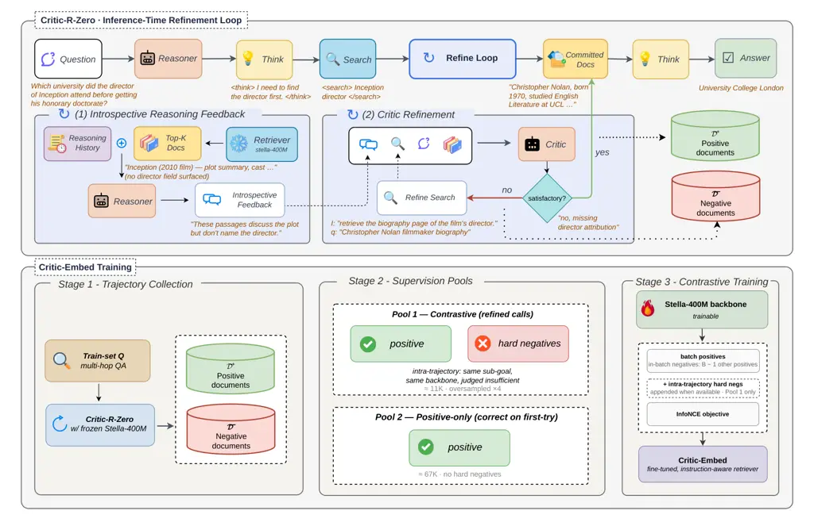

# Critic-R: Improving Agentic Search using Instruction-tuned Retrievers with Natural Language Introspective Feedback

Md Zarif Ul Alam    Alireza Salemi    Hamed Zamani Affiliation: Center
for Intelligent Information Retrieval Affiliation: University of
Massachusetts Amherst Affiliation: United States
Email: [{zarifalam,asalemi,zamani}@cs.umass.edu](mailto:)

###### Abstract

Agentic search systems iteratively interact with retrieval models to
answer complex queries. Despite substantial progress, optimizing
retrievers for agentic search remains challenging, often requiring heavy
co-training or gold-standard annotations that limit real-world
applicability. We propose Critic-R, a framework that explicitly closes
the feedback loop between the reasoning agent and the retrieval model
during both inference and training. Critic-R introduces a critic model
that evaluates the agent’s introspective reasoning trace after consuming
retrieved evidence to determine whether the retrieved context
sufficiently supports the next reasoning step. Critic-R has two
complementary mechanisms: Critic-R-Zero, an inference-time query
refinement loop that iteratively rewrites queries and retrieval
instructions, and Critic-Embed, an optimization approach for retrieval
models that leverages successful and failed refinement trajectories as
automatic supervision without requiring manual relevance annotation. We
evaluate Critic-R on HotpotQA, 2WikiMultihopQA, MuSiQue, and Bamboogle.
Results show that Critic-R significantly improves both retrieval quality
and downstream answer accuracy.

## 1 Introduction

Retrieval-Augmented Generation (RAG) extends Large Language Models
(LLMs) with non-parametric access to external corpora and has become a
standard framework for knowledge-intensive tasks (Lewis et al., 2020;
Zamani et al., 2022). Early RAG systems primarily relied on single-turn
pre-generation retrieval. However, this setting is often insufficient
for complex queries that require decomposition or information synthesis
from multiple sources. As a result, recent work has shifted toward
agentic search, in which reasoning models interleave internal
deliberation with iterative retrieval actions over multiple steps.
Recent advances have shown that reinforcement learning (RL) can be used
to optimize these agents directly from task rewards, leading to
search-aware reasoning systems such as Search-R1 (Jin et al., 2025a) and
DeepResearcher (Zheng et al., 2025).

Most existing agentic search approaches primarily optimize the reasoning
agent while treating the retrieval model as a frozen black-box
component. This design implicitly assumes that a sufficiently capable
reasoning model can compensate for retrieval failures through improved
query reformulation alone. This paper challenges this assumption by
arguing that sub-optimal retrieval can be a bottleneck in agentic search
performance. Recent studies such as Agentic-R (Liu et al., 2026) and
CoSearch (Zeng et al., 2026) attempt to address this issue by jointly
optimizing retrievers and reasoning agents. In practice, however, these
methods are difficult to apply in settings where the reasoning model
cannot be further trained, the retriever is externally provided, or
gold-passage supervision is unavailable.



Figure 1: Critic-R Overview.

To address this, we propose Critic-R, a framework that closes the
feedback loop between the reasoning agent and retriever during both
inference and training time. Instead of blindly accepting the retrieved
documents provided by the retriever, Critic-R enables the agent to
assess whether they satisfy its current information requirements before
proceeding to subsequent retrieval or reasoning steps. We employ a
separate critic model for this purpose for two reasons. First, it allows
the framework to be applied to arbitrary reasoning agents without
requiring built-in self-criticism or modifications to the underlying
model. Second, in long multi-step trajectories, accumulated context and
reasoning noise can cause the reasoning model to become overconfident or
less sensitive to retrieval failures Jin et al. (2025b), motivating the
use of a dedicated evaluation component. To achieve this, the critic
analyzes the agent’s introspective reasoning trace—namely, the reasoning
generated immediately after consuming the retrieved evidence—to
determine whether the retrieved context is sufficient for the next
reasoning step. This design uses the observation that the agent often
explicitly indicates whether the retrieved documents contain the
information required to continue reasoning.

This verification signal enables two complementary mechanisms: (1)
Critic-R-Zero (Inference-Time Scaling): An iterative
reasoning-evaluation loop that operates entirely at inference time
without additional gradient updates. When the critic determines that the
retrieved evidence is insufficient, it rewrites the retrieval query and
instruction for another retrieval attempt. This process continues until
the agent is satisfied with the retrieved evidence or a predefined
refinement budget is exhausted. Importantly, the reasoning agent itself
remains unchanged and only interacts with retrieved documents, while the
refinement process is handled externally. This mechanism dynamically
allocates additional inference-time computation to recover from
retrieval failures. (2) Critic-Embed (Retriever Fine-Tuning): To
amortize the computational overhead introduced by iterative refinement,
we leverage the execution trajectories generated by Critic-R-Zero as a
source of automatic supervision for retrieval model training. Documents
that satisfy the reasoning agent are treated as positive examples, while
documents rejected during unsuccessful refinement attempts are treated
as hard intra-trajectory negatives. Using this intra-trajectory
contrastive learning, we fine-tune the retrieval model without requiring
relevance information (i.e., gold passages). These two components are
complementary and can be combined within a unified system, where a
trained retriever can benefit from the inference-time refinement
capabilities.

We evaluate Critic-R on several challenging multi-hop question answering
benchmarks, including HotpotQA Yang et al. (2018), 2WikiMultihopQA Ho et
al. (2020), MuSiQue Trivedi et al. (2022), and Bamboogle Press et al.
(2023). Our results demonstrate that explicitly modeling retrieval
quality within the agentic reasoning loop leads to substantial
improvements in downstream answer accuracy. First, we show that the
inference-time refinement mechanism, Critic-R-Zero, significantly
alleviates retrieval failures across reasoning agents of different
scales by iteratively evaluating retrieved evidence and refining
retrieval queries, yielding an overall relative improvement of 12.4%. We
further demonstrate that the fine-tuned dense retriever, Critic-Embed,
consistently outperforms both off-the-shelf retrievers and prior
co-trained baselines, achieving up to an overall 7.5% relative
improvement. Finally, combining the trained retriever with the
inference-time refinement loop—i.e., integrating Critic-R-Zero and
Critic-Embed into a unified system called Critic-R---yields the
strongest overall performance, achieving a 10.9% relative improvement
overall. To support future research on this topic, we release our code,
data, and trained models.¹¹ 1 Available at:
[https://github.com/zarif98sjs/Critic-R](https://github.com/zarif98sjs/Critic-R)

## 2 Related Work

#### Retrieval-Augmented Generation and Agentic Search.

Retrieval-Augmented Generation (RAG) extends Large Language Models with
non-parametric access to external corpora and has become the standard
recipe for knowledge-intensive QA Asai et al. (2023b); Gao et al.
(2023); Ram et al. (2023). Early systems issued a single query at the
start of generation, which is ill-suited to multi-hop questions whose
information needs only become apparent partway through reasoning Shao et
al. (2023); Trivedi et al. (2023). Two lines of work have addressed
this. The first uses prompting to interleave reasoning with retrieval,
exemplified by IRCoT Trivedi et al. (2023) and ReAct Yao et al. (2022).
The second teaches models when and how to retrieve through supervised
fine-tuning, including Self-RAG Asai et al. (2023a) and
Toolformer Schick et al. (2023). More recently, reinforcement learning
has enabled agents to acquire multi-turn search policies directly from
task-outcome rewards: Search-R1 Jin et al. (2025a), R1-Searcher Song et
al. (2025), ReSearch Chen et al. (2026), and DeepResearcher Zheng et al.
(2025) all train an LLM to alternate \<think\>, \<search\>, and
\<answer\> turns, producing a search-aware reasoner. Our work builds
directly on this paradigm. We use Search-R1 as our reasoning agent, but
is orthogonal to its training objective: rather than modifying how the
agent is trained, Critic-R intervenes at inference time to inspect and
repair the agent’s individual retrieval calls. The gains from improving
_how the agent interacts with retrieval_ are largely orthogonal to gains
from improving the agent itself.

#### Retrieval optimization for Agents.

A complementary line of work also rejects the frozen-retriever
assumption, but addresses it through additional _training_ of the
retrieval side. REPLUG Shi et al. (2024) and Atlas Izacard et al. (2023)
optimize the retriever using generator likelihood as a signal; later
approaches use task-level metrics or LLM-judged passage utility Xu et
al. (2025); Zamani and Bendersky (2024); Zhang et al. (2025b). Two
recent works extend this idea explicitly to the agentic-search setting
and make the retrieval bottleneck their central claim. Agentic-R Liu et
al. (2026) trains a retriever tailored for multi-turn search by jointly
modeling local query-passage relevance and global answer correctness,
and iteratively co-optimizes the retriever with the agent. CoSearch Zeng
et al. (2026) quantifies the bottleneck directly through an
oracle-retrieval experiment. They show double-digit relative F1 gains
when correct documents are guaranteed to appear and jointly train a
generative reranker alongside the reasoning agent with GRPO, using a
composite reward over ranking quality and final answer correctness. We
share the diagnosis with these works but split the problem along a
different seam. The first is Critic-R-Zero, a purely inference-time loop
that requires no gradient updates anywhere: a separate critic model
inspects each retrieval, judges whether the returned context is
sufficient based on the reasoning agent’s feedback, and rewrites the
search instruction and query when it is not. Critic-R-Zero treats the
underlying retriever as a fixed black box and is therefore composable
with any retriever, including those produced by Agentic-R or CoSearch.
The second part, Critic-Embed, is a retriever trained on the
trajectories that Critic-R-Zero collects on the train splits of two QA
datasets, turning the critic’s free-form feedback into supervision
without ever requiring gold passage annotations. The full system,
Critic-R, is Critic-R-Zero running on top of Critic-Embed. This
decomposition allows us to address both lines of prior work: for
frozen-retriever agentic search, we introduce Critic-R-Zero; and for
retriever-training approaches, we provide a training recipe supervised
entirely by the inference loop’s own feedback.

#### Inference-Time Scaling for Reasoning.

Parallel to the work above, recent work shows that allocating more
compute at inference through longer chain-of-thought, self-consistency,
or process supervision Wei et al. (2022); Wang et al. (2022); Lightman
et al. (2023) can rival the gains from scaling model parameters.
OpenAI’s o1-style models and subsequent open-source reasoners take this
further by training models to spend more tokens deliberating before
answering. Critic-R-Zero can be viewed as inference-time scaling
targeted at the retrieval bottleneck rather than the reasoning trace:
each additional refinement attempt and each step-up in critic size is a
controlled investment of compute aimed specifically at recovering from a
bad retrieval.

## 3 The Critic-R Framework

This section presents the approaches that lead to the development of
Critic-R. First, we describe Critic-R-Zero, an inference-time critic on
retrieval results for query refinement that does not require any
additional training. Second, we introduce Critic-Embed by explaining how
Critic-R-Zero can be used to optimize retrieval models through a novel
intra-trajectory contrastive learning approach. Next, we describe how
these two approaches can complement each other to form Critic-R. Last,
we describe our implementation details.

### 3.1 Critic-R-Zero for Inference-Time Query Refinement

As shown in Algorithm 1 and Figure 1, we assume access to a frozen
reasoning agent $`\mathcal{M}_{R}`$ operating under the ReAct framework
Yao et al. (2022), which is allowed to perform at most $`M`$ actions to
answer a question $`Q`$ (Line 5). At each step $`i`$, the agent
$`\mathcal{M}_{R}`$ produces a reasoning trace $`T_{i}`$ and an action
$`A_{i}`$ (Line 6), which are appended to the overall trajectory
(Line 7). If $`A_{i}`$ is a final answer, the trajectory terminates
(Line 9). Otherwise, if $`A_{i}`$ is a search action, the agent extracts
an initial query $`q_{i}^{(1)}`$, which is augmented with a default
instruction²² 2 The default instruction is: “Given a query, retrieve
relevant passages that answer the query”. $`I_{i}^{(1)}`$ for the
retrieval model $`\mathcal{R}`$ (Lines 11–12). Entering the search
phase, an instruction-aware retrieval model $`\mathcal{R}`$ returns the
top $`k`$ documents,
$`D_{i}^{(t)}=\mathcal{R}(q^{(t)}_{i},I^{(t)}_{i},k)`$ (Line 15). Note
that these initial retrieved documents frequently fail to provide the
necessary evidence, making single-turn retrieval a severe bottleneck for
agentic search performance. This dissatisfaction is typically reflected
in the model’s subsequent reasoning trace.

To address this limitation, we introduce a speculative refinement loop
(Line 14) that allows the agent to recover from an ineffective
retrieval. At each refinement step, the retrieved documents
$`D_{i}^{(t)}`$ are speculatively provided to the reasoner to generate
an introspective reasoning trace, without yet committing these documents
to the persistent trajectory (Line 16). A separate critic model, denoted
as $`\mathcal{M}_{C}`$, then evaluates this trace to determine whether
the retrieved evidence sufficiently resolves the reasoner’s information
need (Line 17). If the critic produces positive feedback,
$`\sigma_{i}^{(t)}=\text{yes}`$, the retrieved documents are added to
the candidate positive set $`\tilde{\mathcal{D}}^{+}`$ as useful
evidence, and the refinement loop terminates (Lines 19–20). Otherwise,
the documents are assigned to the candidate negative set
$`\tilde{\mathcal{D}}^{-}`$ (Line 22). The critic then leverages the
reasoner’s explicit dissatisfaction in its thinking trace to generate a
refined query and retrieval instruction for the next iteration
(Line 24). This process repeats for at most $`K`$ refinement steps,
adaptively bridging retrieval failures before the final selected
documents are committed to the reasoning history (Line 26). The
procedure concludes by returning the final extracted answer together
with the collected positive and negative document sets (Lines 29–33).
These document sets are used exclusively for retriever training and are
not required during inference.

### 3.2 Critic-Embed: Intra-Trajectory Contrastive Learning for Training Instruction-Following Dense Retrieval

While the inference-time refinement loop effectively detects and repairs
retrieval failures, repeated interaction with the critic introduces
additional computational overhead. To amortize this cost and permanently
improve the retrieval backbone without relying on expensive
human-annotated gold passages, we leverage the execution trajectories
generated by Critic-R-Zero as a source of automatically constructed
supervision. Specifically, each refinement trajectory produces a natural
training signal: documents that satisfy the reasoner, as verified by the
critic, are treated as positive examples ($`\mathcal{D}^{+}`$), while
documents rejected during earlier unsuccessful refinement attempts are
treated as hard intra-trajectory negatives ($`\mathcal{D}^{-}`$). We use
the collected supervision signals to fine-tune the retriever, resulting
in Critic-Embed, a retriever trained to better align retrieved evidence
with the information requirements of the reasoning agent for a given
query. To ensure label quality, we retain only trajectories whose final
prediction is correct according to the downstream task metric. The
contrastive learning loss for each training instance is defined as:

```math
\mathcal{L}=-\log\frac{\exp\!\big(\mathrm{sim}(q_{i},z_{i}^{+})/\tau\big)}{\sum_{z\in\mathcal{Z}_{i}}\exp\!\big(\mathrm{sim}(q_{i},z)/\tau\big)} \tag{1}
```

where $`q_{i}`$ is the query embedding, $`z_{i}^{+}`$ is its paired
positive document, $`\mathcal{Z}_{i}`$ contains the positive, all
in-batch negatives, and the query’s intra-trajectory hard negatives,
$`\mathrm{sim}(\cdot,\cdot)`$ denotes cosine similarity, and $`\tau`$ is
the temperature.

### 3.3 Critic-R: Improving Critic-Embed with Inference-Time Scaling

The complete Critic-R pipeline pairs the Critic-R-Zero inference loop
with the trained Critic-Embed retriever. This composition ensures the
agent starts with a highly capable, domain-aligned retrieval that
minimizes initial search errors, while still maintaining the
inference-time ability to introspect and recover from complex edge-case
retrieval failures.

### 3.4 Implementation Details

The reasoning agent $`\mathcal{M}_{R}`$ is an instruction-tuned LLM
operating under the ReAct paradigm Yao et al. (2022), alternating
\<think\>, \<search\>, and \<answer\> actions, with retrieved documents
injected within \<information\> tags. The critic $`\mathcal{M}_{C}`$ is
a separate LLM that operates in two sequential modes: a _satisfaction
judgment_ mode that emits a binary verdict $`\sigma_{i}^{(t)}`$ and
diagnostic reason $`r_{i}^{(t)}`$ conditioned on
$`(Q,q_{i}^{(t)},D_{i}^{(t)},T_{i+1}^{(t)})`$, and a _query refinement_
mode invoked only when $`\sigma_{i}^{(t)}=\texttt{no}`$ that rewrites
the sub-query and retrieval instruction using $`r_{i}^{(t)}`$. Full
component descriptions and all prompts are deferred to Appendix B.

1: Question $`Q`$, corpus $`\mathcal{C}`$, reasoner $`\mathcal{M}_{R}`$,
critic $`\mathcal{M}_{C}`$, instruction-aware retriever $`\mathcal{R}`$,
number of retrieved docs $`k`$, max reasoning iterations $`M`$, max
refinements $`K`$

2: $`H\leftarrow Q`$ $`\triangleright`$ initialize reasoning history

3: $`\tilde{\mathcal{D}}^{+}\leftarrow\emptyset`$ $`\triangleright`$
initialize candidate positive set

4: $`\tilde{\mathcal{D}}^{-}\leftarrow\emptyset`$ $`\triangleright`$
initialize candidate negative set

5: for $`i=1\xrightarrow{}M`$ do

6:   $`(T_{i},A_{i})\leftarrow\mathcal{M}_{R}(H)`$ $`\triangleright`$
Sample reasoning & action

7:   $`H\leftarrow H;T_{i};A_{i}`$ $`\triangleright`$ Append to the
trajectory

8:   if $`A_{i}`$ is an \<answer\> action then

9:    break

10:   else

11:    $`q_{i}^{(1)}\leftarrow A_{i}`$ $`\triangleright`$ Extract query

12:    $`I_{i}^{(1)}\leftarrow\emptyset`$ $`\triangleright`$ Default
instruction

13:   end if

14:   for $`t=1\xrightarrow{}K`$ do $`\triangleright`$ Refine query at
most $`K`$ times

15:    $`D_{i}^{(t)}\leftarrow\mathcal{R}(q_{i}^{(t)},I_{i}^{(t)},k)`$
$`\triangleright`$ Retriever docs

16:
   $`T_{i+1}^{(t)},A_{i+1}^{(t)}\leftarrow\mathcal{M}_{R}(H;D_{i}^{(t)})`$
$`\triangleright`$ Sample next thinking & action based on retrieved docs

17:
   $`(\sigma_{i}^{(t)},r_{i}^{(t)})\leftarrow\mathcal{M}_{C}(P_{\text{J}}(Q,q_{i}^{(t)},D_{i}^{(t)},T_{i+1}^{(t)}))`$
$`\triangleright`$ Check if reasoner is satisfied with documents

18:    if $`\sigma_{i}^{(t)}=\texttt{yes}`$ then

19:
     $`\tilde{\mathcal{D}}^{+}\leftarrow\tilde{\mathcal{D}}^{+}\cup\{(i,q_{i}^{(t)},I_{i}^{(t)},D_{i}^{(t)})\}`$
$`\triangleright`$ Add retrieved documents as positive

20:      break

21:    else

22:
     $`\tilde{\mathcal{D}}^{-}\leftarrow\tilde{\mathcal{D}}^{-}\cup\{(i,q_{i}^{(t)},I_{i}^{(t)},D_{i}^{(t)})\}`$
$`\triangleright`$ Add retrieved documents as negative

23:    end if

24:
   $`(q_{i}^{(t+1)},I_{i}^{(t+1)})\leftarrow\mathcal{M}_{C}(P_{\text{R}}(Q,q_{i}^{(t)},I_{i}^{(t)},r_{i}^{(t)}))`$
$`\triangleright`$ New query and instruction for next refinement round

25:   end for

26:   $`H\leftarrow H;D_{i}^{(t)}\,`$ $`\triangleright`$ commit final
documents to history

27: end for

28: if $`A_{i}`$ is an \<answer\> action then

29:   $`\hat{y}\leftarrow A_{i}`$ $`\triangleright`$ Extract answer

30: else

31:   $`\hat{y}\leftarrow\emptyset`$ $`\triangleright`$ No answer
generated in $`M`$ actions

32: end if

33: return $`\hat{y}`$, $`\tilde{\mathcal{D}}^{+}`$,
$`\tilde{\mathcal{D}}^{-}`$ $`\triangleright`$ returning final answer,
positive docs and negative docs (only for training)

Algorithm 1 Critic-R-Zero: Inference Loop

## 4 Experiments

We structure our evaluation around four questions:

- •
  RQ1. Can the retrieval bottleneck in agentic search be mitigated
  _without_ modifying the retriever itself, and, how does the gain scale
  with the critic model’s parameters size?
- •
  RQ2. Do the trajectories that Critic-R-Zero collects contain
  transferable retrieval supervision i.e., does fine-tuning a retriever
  with them (Critic-Embed) beat both an off-the-shelf dense retriever
  and a retriever co-trained end-to-end with the search agent?
- •
  RQ3. Can combining inference-time query refinement loop and the
  trained retriever yield further gains?
- •
  RQ4. Is the agent’s introspective feedback $`T_{i+1}`$ a key source of
  supervisory signal that Critic-Embed inherits?

### 4.1 Datasets

Following previous work Jin et al. (2025a), we evaluate our method on
four multi-hop QA datasets requiring synthesizing information across
multiple documents: HotpotQA Yang et al. (2018), 2WikiMultihopQA Ho et
al. (2020), MuSiQue Trivedi et al. (2022), and Bamboogle Press et al.
(2023). To assess whether the critic loop also helps when a single-hop
retrieval is sufficient, we additionally report results on three
general-domain QA datasets: NQ Kwiatkowski et al. (2019), TriviaQA Joshi
et al. (2017), and PopQA Mallen et al. (2023) for Critic-R-Zero
experiments. Dataset statistics are reported in Table 6 in Appendix C.
For evaluation, we report Exact Match (EM) and token-level F1, following
prior work Jin et al. (2025a).

|                 |                              | HotpotQA |        | 2Wiki  |        | Musique |        | Bamboogle |        | Avg.   |        |
| --------------- | ---------------------------- | -------- | ------ | ------ | ------ | ------- | ------ | --------- | ------ | ------ | ------ |
| Reasoner        | Critic ($`\mathcal{M}_{C}`$) | EM       | F1     | EM     | F1     | EM      | F1     | EM        | F1     | EM     | F1     |
| Search-R1 (14B) | no-critic                    | 0.4149   | 0.5284 | 0.4367 | 0.4946 | 0.1849  | 0.2684 | 0.3520    | 0.4963 | 0.3472 | 0.4470 |
|                 | Qwen2.5-14B                  | 0.4373   | 0.5539 | 0.4460 | 0.5051 | 0.2069  | 0.2948 | 0.4320    | 0.5510 | 0.3806 | 0.4762 |
|                 | Qwen2.5-32B                  | 0.4431   | 0.5586 | 0.4492 | 0.5064 | 0.2218  | 0.3110 | 0.4400    | 0.5668 | 0.3886 | 0.4857 |
|                 | Qwen2.5-72B                  | 0.4425   | 0.5593 | 0.4580 | 0.5155 | 0.2127  | 0.3045 | 0.4480    | 0.5627 | 0.3903 | 0.4855 |
| Search-R1 (7B)  | no-critic                    | 0.3589   | 0.4667 | 0.3369 | 0.3963 | 0.1324  | 0.2151 | 0.3600    | 0.4691 | 0.2971 | 0.3868 |
|                 | Qwen2.5-14B                  | 0.3741   | 0.4815 | 0.3465 | 0.4070 | 0.1398  | 0.2220 | 0.3840    | 0.4984 | 0.3111 | 0.4023 |
|                 | Qwen2.5-32B                  | 0.3759   | 0.4834 | 0.3533 | 0.4135 | 0.1568  | 0.2383 | 0.4309    | 0.5351 | 0.3293 | 0.4176 |
|                 | Qwen2.5-72B                  | 0.3769   | 0.4865 | 0.3594 | 0.4227 | 0.1485  | 0.2360 | 0.3920    | 0.4980 | 0.3192 | 0.4108 |
| Search-R1 (3B)  | no-critic                    | 0.2813   | 0.3755 | 0.2627 | 0.3169 | 0.0910  | 0.1580 | 0.1920    | 0.2708 | 0.2068 | 0.2803 |
|                 | Qwen2.5-14B                  | 0.2875   | 0.3841 | 0.2715 | 0.3253 | 0.1005  | 0.1701 | 0.2080    | 0.3095 | 0.2169 | 0.2973 |
|                 | Qwen2.5-32B                  | 0.2935   | 0.3900 | 0.2749 | 0.3306 | 0.1030  | 0.1750 | 0.2177    | 0.3215 | 0.2223 | 0.3043 |
|                 | Qwen2.5-72B                  | 0.2987   | 0.3973 | 0.2750 | 0.3323 | 0.0976  | 0.1742 | 0.2560    | 0.3571 | 0.2319 | 0.3153 |

Table 1: Multi-Hop QA — inference-time scaling along the critic-size
axis for Critic-R-Zero (frozen Stella-400M retriever, top $`k\!=\!1`$,
$`K\!=\!2`$ refinement attempts). Bold marks the best EM/F1 per
(reasoner, dataset, metric).

### 4.2 Experimental Setup

We use the optimized checkpoints of Search-R1 Jin et al. (2025a) for
reasoning models, which are instruction-tuned GRPO-trained variants of
Qwen2.5-Instruct³³ 3
[https://hf.co/collections/PeterJinGo/search-r1-v03](https://hf.co/collections/PeterJinGo/search-r1-v03).
To study scale, we evaluate three sizes: SearchR1-Qwen2.5-3B,-7B, and
-14B. For the critic, we use frozen instruction-tuned Qwen2.5 with 14B⁴⁴
4
[https://hf.co/Qwen/Qwen2.5-14B-Instruct](https://hf.co/Qwen/Qwen2.5-14B-Instruct),
32B ⁵⁵ 5
[https://hf.co/Qwen/Qwen2.5-32B-Instruct](https://hf.co/Qwen/Qwen2.5-32B-Instruct),
and 72B ⁶⁶ 6
[https://hf.co/Qwen/Qwen2.5-72B-Instruct](https://hf.co/Qwen/Qwen2.5-72B-Instruct)
parameters.

The frozen-retriever experiments use a dense retriever based on the
Stella-400M embedding model Zhang et al. (2025a), with the December 2018
Wikipedia dump Karpukhin et al. (2020) indexed as the retrieval corpus
for all experiments. The instruction interface is essential to
Critic-R-Zero: it is what allows the critic’s refined instruction to
alter the retrieval behavior without re-indexing. We evaluate three
retrieval depths, top $`k\in\{1,3,5\}`$, to measure how the critic’s
benefit varies as more raw recall is given to the reasoner.

To collect intra-trajectory hard negatives, we run Critic-R-Zero with a
Search-R1 (14B) reasoner, a Qwen2.5-72B critic, the frozen Stella-400M
backbone, on the train splits of HotpotQA and Musique. The resulting
dataset consists of roughly 11K natural contrastive pairs (search calls
that underwent at least one refinement, yielding both positives and
intra-trajectory hard negatives) and 67K positive-only samples (search
calls satisfied on the first attempt).

Critic-Embed is initialized from Stella-400M Zhang et al. (2025a) and
fine-tuned with an InfoNCE objective using intra-trajectory hard
negatives combined with in-batch negatives, with natural contrastive
pairs oversampled relative to positive-only samples. Full training
hyperparameters are reported in Appendix D.

For the full Critic-R experiments, the Stella-400M backbone is replaced
by Critic-Embed, our fine-tuned retriever. Experiments were run on
NVIDIA A100 (80GB) GPUs. We set the maximum number of refinements to
$`K=2`$, as additional iterations do not yield more improvements.

#### Baselines.

We compare against two baseline families, depending on the question each
table targets:

- •
  No-critic ablation. The Critic is removed and Search-R1 is run with
  default setting. This isolates the contribution of the critic’s
  verdict and refinement (used for RQ1 and RQ3).
- •
  Retriever baselines (Table 2). The same Search-R1 reasoner makes a
  single top $`k`$ retrieval call against the off-the-shelf Stella-400M
  backbone and the Agentic-R Liu et al. (2026) retriever, with no critic
  loop. This isolates the contribution of the retriever itself and lets
  us compare Critic-Embed against both an untrained dense backbone and a
  retriever that is co-trained end-to-end with the search agent.

|           |              | HotpotQA |        | 2Wiki  |        | Musique |        | Bamboogle |        | Avg.   |        |
| --------- | ------------ | -------- | ------ | ------ | ------ | ------- | ------ | --------- | ------ | ------ | ------ |
| top $`k`$ | Retriever    | EM       | F1     | EM     | F1     | EM      | F1     | EM        | F1     | EM     | F1     |
| $`k=1`$   | Stella-400M  | 0.4149   | 0.5284 | 0.4367 | 0.4946 | 0.1849  | 0.2684 | 0.3520    | 0.4963 | 0.3472 | 0.4470 |
|           | Agentic-R    | 0.4212   | 0.5328 | 0.4392 | 0.4966 | 0.1833  | 0.2700 | 0.4240    | 0.5260 | 0.3670 | 0.4564 |
|           | Critic-Embed | 0.4289   | 0.5446 | 0.4497 | 0.5083 | 0.1907  | 0.2821 | 0.4480    | 0.5872 | 0.3794 | 0.4806 |
| $`k=3`$   | Stella-400M  | 0.4540   | 0.5698 | 0.4479 | 0.5059 | 0.2085  | 0.2988 | 0.4880    | 0.6213 | 0.3996 | 0.4990 |
|           | Agentic-R    | 0.4492   | 0.5659 | 0.4643 | 0.5255 | 0.2127  | 0.3013 | 0.4880    | 0.5959 | 0.4036 | 0.4972 |
|           | Critic-Embed | 0.4610   | 0.5811 | 0.4700 | 0.5309 | 0.2242  | 0.3185 | 0.4960    | 0.6269 | 0.4128 | 0.5144 |
| $`k=5`$   | Stella-400M  | 0.4578   | 0.5789 | 0.4575 | 0.5151 | 0.2321  | 0.3249 | 0.5120    | 0.6285 | 0.4149 | 0.5119 |
|           | Agentic-R    | 0.4540   | 0.5743 | 0.4682 | 0.5313 | 0.2238  | 0.3148 | 0.4960    | 0.6211 | 0.4105 | 0.5104 |
|           | Critic-Embed | 0.4686   | 0.5905 | 0.4763 | 0.5367 | 0.2346  | 0.3277 | 0.5280    | 0.6536 | 0.4269 | 0.5272 |

Table 2: Multi-hop QA — retriever comparison. Three dense retrievers
evaluated at top $`k\in\{1,3,5\}`$ under the same Search-R1 reasoner.
Bold = best in column for that $`k`$.

### 4.3 Results

#### RQ1: Can inference-time refinement close the retrieval gap on a frozen retriever?

We hold reasoner family (Search-R1), retriever (frozen Stella-400M, top
$`k{=}1`$), and refinement budget ($`K{=}2`$) fixed, and vary (i) the
reasoner scale (3B / 7B / 14B) and (ii) the critic scale (14B / 32B /
72B). Results reported in Table 1.

(1) Any critic beats no critic. For every (reasoner, dataset, metric)
cell, the smallest critic (14B) already strictly improves over the
no-critic ablation. The lift is large even on the hardest datasets
(Bamboogle, Musique), confirming that the gains are driven by the
critic’s verdict + instruction rewrite rather than by the extra forward
passes alone.

(2) Inference-time scaling is not strictly monotonic: a larger critic
does not guarantee better generation. Rather than a linear improvement,
scaling the critic from 32B to 72B yields sharply diminishing returns
and occasional performance degradation on complex tasks. The 72B critic
reliably boosts the weaker 3B reasoner across the board, but the 32B
critic proves optimal for harder datasets like Musique, and on Bamboogle
when paired with the 7B reasoner. Ultimately, averaged across the suite,
the 32B critic edges out the 72B for the 7B reasoner (0.3293 / 0.4176
vs. 0.3192 / 0.4108 EM/F1), showing that beyond 32B parameters,
injecting more evaluator compute may not overcome the limitations of the
reasoner and retriever.

|                                     | HotpotQA |        | 2Wiki  |        | Musique |        | Bamboogle |        | Avg.   |        |
| ----------------------------------- | -------- | ------ | ------ | ------ | ------- | ------ | --------- | ------ | ------ | ------ |
| Method                              | EM       | F1     | EM     | F1     | EM      | F1     | EM        | F1     | EM     | F1     |
| Search-R1 (static, Stella-400M)     | 0.4149   | 0.5284 | 0.4367 | 0.4946 | 0.1849  | 0.2684 | 0.3520    | 0.4963 | 0.3472 | 0.4470 |
| Critic-Embed (static, no loop)      | 0.4289   | 0.5446 | 0.4497 | 0.5083 | 0.1907  | 0.2821 | 0.4480    | 0.5872 | 0.3794 | 0.4806 |
| Critic-R-Zero (loop on Stella-400M) | 0.4425   | 0.5593 | 0.4580 | 0.5155 | 0.2127  | 0.3045 | 0.4480    | 0.5627 | 0.3903 | 0.4855 |
| Critic-R (loop on Critic-Embed)     | 0.4365   | 0.5501 | 0.4634 | 0.5237 | 0.2027  | 0.2895 | 0.4800    | 0.6200 | 0.3957 | 0.4959 |

Table 3: Full Critic-R results on Multi-Hop QA. All configurations share
the same Search-R1 (14B) reasoner; the critic (when active) is
Qwen2.5-72B; top $`k\!=\!1`$; $`K\!=\!2`$ refinement attempts. Bold =
best in column.

|           |                                             | HotpotQA |        | 2Wiki  |        | Musique |        | Bamboogle |        | Avg.   |        |
| --------- | ------------------------------------------- | -------- | ------ | ------ | ------ | ------- | ------ | --------- | ------ | ------ | ------ |
| top $`k`$ | Method                                      | EM       | F1     | EM     | F1     | EM      | F1     | EM        | F1     | EM     | F1     |
| $`k=1`$   | Critic-Embed                                | 0.4289   | 0.5446 | 0.4497 | 0.5083 | 0.1907  | 0.2821 | 0.4480    | 0.5872 | 0.3794 | 0.4806 |
|           |    w/o Introspective Feedback ($`T_{i+1}`$) | 0.3932   | 0.5098 | 0.4174 | 0.4749 | 0.1787  | 0.2623 | 0.4560    | 0.5613 | 0.3614 | 0.4521 |
| $`k=3`$   | Critic-Embed                                | 0.4610   | 0.5811 | 0.4700 | 0.5309 | 0.2242  | 0.3185 | 0.4960    | 0.6269 | 0.4128 | 0.5144 |
|           |    w/o Introspective Feedback ($`T_{i+1}`$) | 0.4319   | 0.5454 | 0.4474 | 0.5059 | 0.2019  | 0.2924 | 0.4800    | 0.6109 | 0.3903 | 0.4887 |
| $`k=5`$   | Critic-Embed                                | 0.4686   | 0.5905 | 0.4763 | 0.5367 | 0.2346  | 0.3277 | 0.5280    | 0.6536 | 0.4269 | 0.5272 |
|           |    w/o Introspective Feedback ($`T_{i+1}`$) | 0.4400   | 0.5568 | 0.4536 | 0.5142 | 0.2147  | 0.3052 | 0.4800    | 0.6197 | 0.3971 | 0.4990 |

Table 4: Effect of removing the agent’s introspective feedback when
collecting training trajectories for Critic-Embed.

#### RQ2: Do Critic-R-Zero trajectories transfer into a better retriever?

We evaluate Critic-Embed as a drop-in replacement for the retriever,
_with no loop active_. This isolates the supervision signal that the
trained retriever absorbs from Critic-R-Zero trajectories. Table 2
reports three retrievers with identical agent and conditions: the
off-the-shelf Stella-400M backbone, the Agentic-R retriever baseline,
and our Critic-Embed.

Critic-Embed is the best-performing retriever in every setting. The
largest absolute gains come at top $`k=1`$, where retrieval errors are
most costly: on Bamboogle, EM/F1 climbs from 0.3520 / 0.4963
(Stella-400M) and 0.4240 / 0.5260 (Agentic-R) to 0.4480 / 0.5872 with
Critic-Embed; the multi-hop average rises from 0.3472 / 0.4470 to 0.3794
/ 0.4806. As $`k`$ increases the absolute gap narrows because of the
higher recall, yet Critic-Embed retains the lead at $`k=3`$ (average
0.4128 / 0.5144 vs. 0.3996 / 0.4990 for Stella-400M and 0.4036 / 0.4972
for Agentic-R) and $`k=5`$ (average 0.4269 / 0.5272 vs. 0.4149 / 0.5119
and 0.4105 / 0.5104). Figure 2 visualizes the multi-hop average for the
three retrievers across $`k`$. The result establishes that the
trajectories produced by Critic-R-Zero contain genuine, transferable
retrieval supervision: even before any inference-time criticism is
layered on top, training retriever on those trajectories outperforms a
retriever that was co-trained end-to-end with an agent on the same task.

Figure 2: Multi-hop average F1 vs. retrieval depth $`k`$.

#### RQ3: Does combining the inference-time loop and the trained retriever yield further gains?

Having established that the inference-time query refinement loop and the
trained retriever each close part of the retrieval gap on their own, we
now ask whether combining them yields further gains. Table 3 reports
four configurations on the same Search-R1 (14B) reasoner at top
$`k\!=\!1`$: the static Search-R1 baseline (Stella-400M backbone, no
critic loop); Critic-Embed as a static retriever (no loop);
Critic-R-Zero (the loop running on top of the frozen Stella-400M); and
the full Critic-R system (the loop running on top of Critic-Embed).

Three observations emerge. (1) Critic-Embed alone, with no
inference-time loop, already lifts the multi-hop average over the static
Stella-400M baseline from 0.3472 / 0.4470 to 0.3794 / 0.4806 EM/F1,
without any test-time refinement. (2) the Critic-R-Zero loop on the
frozen backbone reaches 0.3903 / 0.4855, showing that inference-time
refinement and retriever fine-tuning each close part of the same overall
gap, with the loop modestly ahead on this configuration. (3) combining
them, yields the best overall configuration: average 0.3957 EM / 0.4959
F1, exceeding both Critic-Embed alone and Critic-R-Zero alone. The
per-dataset picture is mixed: Critic-R wins decisively on Bamboogle
(0.4800 / 0.6200 vs. 0.4480 / 0.5627 for Critic-R-Zero) and on 2Wiki,
while Critic-R-Zero edges ahead on HotpotQA and Musique. The two
configurations are therefore not redundant: each repairs a different
slice of retrieval failures, and the loop and the trained retriever are
best read as complementary contributions rather than alternatives.

#### RQ4: Is the agent’s introspective feedback a key source of the supervisory signal?

A central design choice of Critic-R-Zero is that the critic does not
judge retrievals from the query and documents alone: it is conditioned
on the reasoning agent’s own introspective trace $`T_{i+1}`$ over the
retrieved passages. We claim that this conditioning is essential. We
test that directly by re-collecting training trajectories with a
modified Critic-R-Zero in which the speculative-feedback step is removed
and the critic receives only the global question $`Q`$, the generated
query $`q_{i}`$, and the retrieved documents $`D_{i}`$. We then
fine-tune a separate retriever, denoted “w/o Introspective Feedback
($`T_{i+1}`$)”, on these alternative trajectories using the same recipe
as Critic-Embed, and evaluate it under the same no-loop static-retriever
protocol used in Table 2.

Table 4 reports the results. At every retrieval depth, removing the
introspective feedback $`T_{i+1}`$ strictly degrades the resulting
retriever. The drop in multi-hop average is substantial $`-0.0180`$ EM
and $`-0.0285`$ F1 at $`k\!=\!1`$, $`-0.0225`$ EM and $`-0.0257`$ F1 at
$`k\!=\!3`$, and $`-0.0298`$ EM and $`-0.0282`$ F1 at $`k\!=\!5`$ — and
consistent across HotpotQA, 2Wiki, Musique, and (with a small exception
on Bamboogle EM at $`k\!=\!1`$) Bamboogle. This indicates that the
agent’s introspection contains signals of dissatisfaction of the agent
about the retrieved documents and is not just a marginal input to the
critic but a primary source of the supervisory signal that Critic-Embed
inherits: without it, the critic’s verdicts are noisier, the
trajectories are weaker, and the distilled retriever inherits the
deficit. So, inference-time scaling alone doesn’t make agentic search
better. The result supports our reading that the critic specializes
_over_ the reasoner’s introspection rather than independently of it.

## 5 Conclusion

In this work, we demonstrate that retriever remains a critical
bottleneck in agentic search. We introduced Critic-R, a framework where
a dedicated critic evaluates retrieved evidence against the reasoning
agent’s introspective trace, with two complementary mechanisms:
Critic-R-Zero, an inference-time procedure that iteratively refines
queries and retrieval instructions, and Critic-Embed, a retriever
fine-tuned on the contrastive trajectories produced by this procedure
without manual relevance annotation. Evaluated across several
challenging multi-hop QA benchmarks, the combined Critic-R system
achieved substantial improvements in downstream task accuracy, proving
that explicitly modeling and optimizing retrieval quality from within
the agentic loop is a powerful path toward more robust agentic search.

## Limitations

The success of the critic relies heavily on the reasoning agent’s
capacity to give feedback about the retrieved documents or identify
missing information. While state-of-the-art RL-tuned reasoning models
(like Search-R1) naturally possess this ability, weaker or smaller
language models may struggle to produce accurate introspective traces,
thereby degrading the critic’s verification signal. Furthermore, our
experiments primarily focus on multi-hop and general knowledge-intensive
question answering using a static Wikipedia corpus. The behavior and
efficacy of the Critic-R has not yet been evaluated in highly dynamic
environments, such as real-time web search or private enterprise
document systems, where corpus noise and distribution shifts are
drastically more pronounced.

## Acknowledgments

This work was supported in part by the Center for Intelligent
Information Retrieval, in part by NSF grant \#2402873, in part by the
Office of Naval Research contract \#N000142412612, and with support from
Google.org. Any opinions, findings and conclusions or recommendations
expressed in this material are those of the authors and do not
necessarily reflect those of the sponsor.

## References

- Asai et al. (2023a) A. Asai, W. Zeqiu, W. Yizhong, et al. Self-rag:
  learning to retrieve, generate, and critique through self-reflection.
  arxiv. arXiv preprint arXiv:2310.11511. Cited by: §2.
- Asai et al. (2023b) A. Asai, S. Min, Z. Zhong, and D. Chen
  Retrieval-based language models and applications. In Proceedings of
  the 61st Annual Meeting of the Association for Computational
  Linguistics (Volume 6: Tutorial Abstracts), pp. 41–46. Cited by: §2.
- Chen et al. (2026) M. Chen, L. Sun, T. Li, H. Sun, C. Zhu, H. Wang, J.
  Pan, W. Zhang, H. Chen, F. Yang, et al. Learning to reason with search
  for llms via reinforcement learning. Advances in Neural Information
  Processing Systems 38, pp. 85287–85307. Cited by: §2.
- Gao et al. (2023) Y. Gao, Y. Xiong, X. Gao, K. Jia, J. Pan, Y. Bi, Y.
  Dai, J. Sun, H. Wang, H. Wang, et al. Retrieval-augmented generation
  for large language models: a survey. arXiv preprint arXiv:2312.10997 2
  (1), pp. 32. Cited by: §2.
- Ho et al. (2020) X. Ho, A. D. Nguyen, S. Sugawara, and A. Aizawa
  Constructing a multi-hop qa dataset for comprehensive evaluation of
  reasoning steps. In Proceedings of the 28th International Conference
  on Computational Linguistics, pp. 6609–6625. Cited by: Table 6, §1,
  §4.1.
- Izacard et al. (2023) G. Izacard, P. Lewis, M. Lomeli, L. Hosseini, F.
  Petroni, T. Schick, J. Dwivedi-Yu, A. Joulin, S. Riedel, and E. Grave
  Atlas: few-shot learning with retrieval augmented language models.
  Journal of Machine Learning Research 24 (251), pp. 1–43. Cited by: §2.
- Jin et al. (2025a) B. Jin, H. Zeng, Z. Yue, J. Yoon, S. Arik, D.
  Wang, H. Zamani, and J. Han Search-r1: training llms to reason and
  leverage search engines with reinforcement learning. arXiv preprint
  arXiv:2503.09516. Cited by: Appendix C, §1, §2, §4.1, §4.2.
- Jin et al. (2025b) H. Jin, P. Zhang, M. Luo, and H. Wang Reasoning can
  hurt the inductive abilities of large language models. External Links:
  2505.24225, [Link](https://arxiv.org/abs/2505.24225) Cited by: §1.
- Joshi et al. (2017) M. Joshi, E. Choi, D. S. Weld, and L. Zettlemoyer
  Triviaqa: a large scale distantly supervised challenge dataset for
  reading comprehension. In Proceedings of the 55th Annual Meeting of
  the Association for Computational Linguistics (Volume 1: Long Papers),
  pp. 1601–1611. Cited by: Table 6, §4.1.
- Karpukhin et al. (2020) V. Karpukhin, B. Oguz, S. Min, P. Lewis, L.
  Wu, S. Edunov, D. Chen, and W. Yih Dense passage retrieval for
  open-domain question answering. In Proceedings of the 2020 conference
  on empirical methods in natural language processing (EMNLP),
  pp. 6769–6781. Cited by: §4.2.
- Kwiatkowski et al. (2019) T. Kwiatkowski, J. Palomaki, O. Redfield, M.
  Collins, A. Parikh, C. Alberti, D. Epstein, I. Polosukhin, J.
  Devlin, K. Lee, et al. Natural questions: a benchmark for question
  answering research. Transactions of the Association for Computational
  Linguistics 7, pp. 453–466. Cited by: Table 6, §4.1.
- Lewis et al. (2020) P. Lewis, E. Perez, A. Piktus, F. Petroni, V.
  Karpukhin, N. Goyal, H. Küttler, M. Lewis, W. Yih, T. Rocktäschel, S.
  Riedel, and D. Kiela Retrieval-augmented generation for
  knowledge-intensive nlp tasks. In Proceedings of the 34th
  International Conference on Neural Information Processing Systems,
  NIPS ’20, Red Hook, NY, USA. External Links: ISBN 9781713829546 Cited
  by: §1.
- Lightman et al. (2023) H. Lightman, V. Kosaraju, Y. Burda, H.
  Edwards, B. Baker, T. Lee, J. Leike, J. Schulman, I. Sutskever, and K.
  Cobbe Let’s verify step by step, 2023. URL https://arxiv.
  org/abs/2305.20050 17. Cited by: §2.
- Liu et al. (2026) W. Liu, X. Ma, Y. Zhu, Y. Li, D. Shi, D. Yin, and Z.
  Dou Agentic-r: learning to retrieve for agentic search. arXiv preprint
  arXiv:2601.11888. Cited by: §1, §2, 2nd item.
- Mallen et al. (2023) A. Mallen, A. Asai, V. Zhong, R. Das, D.
  Khashabi, and H. Hajishirzi When not to trust language models:
  investigating effectiveness of parametric and non-parametric memories.
  In Proceedings of the 61st annual meeting of the association for
  computational linguistics (volume 1: Long papers), pp. 9802–9822.
  Cited by: Table 6, §4.1.
- Press et al. (2023) O. Press, M. Zhang, S. Min, L. Schmidt, N. A.
  Smith, and M. Lewis Measuring and narrowing the compositionality gap
  in language models. In Findings of the Association for Computational
  Linguistics: EMNLP 2023, pp. 5687–5711. Cited by: Table 6, §1, §4.1.
- Ram et al. (2023) O. Ram, Y. Levine, I. Dalmedigos, D. Muhlgay, A.
  Shashua, K. Leyton-Brown, and Y. Shoham In-context retrieval-augmented
  language models. Transactions of the Association for Computational
  Linguistics 11, pp. 1316–1331. Cited by: §2.
- Schick et al. (2023) T. Schick, J. Dwivedi-Yu, R. Dessì, R.
  Raileanu, M. Lomeli, E. Hambro, L. Zettlemoyer, N. Cancedda, and T.
  Scialom Toolformer: language models can teach themselves to use tools.
  Advances in neural information processing systems 36, pp. 68539–68551.
  Cited by: §2.
- Shao et al. (2023) Z. Shao, Y. Gong, Y. Shen, M. Huang, N. Duan,
  and W. Chen Enhancing retrieval-augmented large language models with
  iterative retrieval-generation synergy. In Findings of the Association
  for Computational Linguistics: EMNLP 2023, pp. 9248–9274. Cited by:
  §2.
- Shi et al. (2024) W. Shi, S. Min, M. Yasunaga, M. Seo, R. James, M.
  Lewis, L. Zettlemoyer, and W. Yih Replug: retrieval-augmented
  black-box language models. In Proceedings of the 2024 Conference of
  the North American Chapter of the Association for Computational
  Linguistics: Human Language Technologies (Volume 1: Long Papers),
  pp. 8371–8384. Cited by: §2.
- Song et al. (2025) H. Song, J. Jiang, Y. Min, J. Chen, Z. Chen, W. X.
  Zhao, L. Fang, and J. Wen R1-searcher: incentivizing the search
  capability in llms via reinforcement learning. arXiv preprint
  arXiv:2503.05592. Cited by: §2.
- Trivedi et al. (2022) H. Trivedi, N. Balasubramanian, T. Khot, and A.
  Sabharwal MuSiQue: multihop questions via single-hop question
  composition. Transactions of the Association for Computational
  Linguistics 10, pp. 539–554. Cited by: Table 6, §1, §4.1.
- Trivedi et al. (2023) H. Trivedi, N. Balasubramanian, T. Khot, and A.
  Sabharwal Interleaving retrieval with chain-of-thought reasoning for
  knowledge-intensive multi-step questions. In Proceedings of the 61st
  annual meeting of the association for computational linguistics
  (volume 1: long papers), pp. 10014–10037. Cited by: §2.
- Wang et al. (2022) X. Wang, J. Wei, D. Schuurmans, Q. Le, E. Chi, S.
  Narang, A. Chowdhery, and D. Zhou Self-consistency improves chain of
  thought reasoning in language models. arXiv preprint arXiv:2203.11171.
  Cited by: §2.
- Wei et al. (2022) J. Wei, X. Wang, D. Schuurmans, M. Bosma, F. Xia, E.
  Chi, Q. V. Le, D. Zhou, et al. Chain-of-thought prompting elicits
  reasoning in large language models. Advances in neural information
  processing systems 35, pp. 24824–24837. Cited by: §2.
- Xu et al. (2025) Y. Xu, J. Gao, X. Yu, Y. Xue, B. Bi, H. Shen, and X.
  Cheng Training a utility-based retriever through shared context
  attribution for retrieval-augmented language models. In Proceedings of
  the 2025 Conference on Empirical Methods in Natural Language
  Processing, pp. 629–648. Cited by: §2.
- Yang et al. (2018) Z. Yang, P. Qi, S. Zhang, Y. Bengio, W. Cohen, R.
  Salakhutdinov, and C. D. Manning HotpotQA: a dataset for diverse,
  explainable multi-hop question answering. In Proceedings of the 2018
  conference on empirical methods in natural language processing,
  pp. 2369–2380. Cited by: Table 6, §1, §4.1.
- Yao et al. (2022) S. Yao, J. Zhao, D. Yu, N. Du, I. Shafran, K.
  Narasimhan, and Y. Cao React: synergizing reasoning and acting in
  language models. arXiv preprint arXiv:2210.03629. Cited by: Appendix
  B, §2, §3.1, §3.4.
- Zamani and Bendersky (2024) H. Zamani and M. Bendersky Stochastic rag:
  end-to-end retrieval-augmented generation through expected utility
  maximization. In Proceedings of the 47th International ACM SIGIR
  Conference on Research and Development in Information Retrieval,
  pp. 2641–2646. Cited by: §2.
- Zamani et al. (2022) H. Zamani, F. Diaz, M. Dehghani, D. Metzler,
  and M. Bendersky Retrieval-enhanced machine learning. In Proceedings
  of the 45th International ACM SIGIR Conference on Research and
  Development in Information Retrieval, SIGIR ’22, pp. 2875–2886. Cited
  by: §1.
- Zeng et al. (2026) H. Zeng, L. Collins, B. Kumar, N. Shah, and H.
  Zamani COSEARCH: joint training of reasoning and document ranking via
  reinforcement learning for agentic search. arXiv preprint
  arXiv:2604.17555. Cited by: §1, §2.
- Zhang et al. (2025a) D. Zhang, J. Li, Z. Zeng, and F. Wang Jasper and
  stella: distillation of sota embedding models. External Links:
  2412.19048, [Link](https://arxiv.org/abs/2412.19048) Cited by:
  Appendix D, §4.2, §4.2.
- Zhang et al. (2025b) H. Zhang, K. Bi, J. Guo, J. Zhang, S. Wang, D.
  Yin, and X. Cheng LLM-specific utility: a new perspective for
  retrieval-augmented generation. arXiv preprint arXiv:2510.11358. Cited
  by: §2.
- Zheng et al. (2025) Y. Zheng, D. Fu, X. Hu, X. Cai, L. Ye, P. Lu,
  and P. Liu Deepresearcher: scaling deep research via reinforcement
  learning in real-world environments. In Proceedings of the 2025
  Conference on Empirical Methods in Natural Language Processing,
  pp. 414–431. Cited by: §1, §2.

## Appendix A General-Domain QA Results

Table 5 reports the inference-time scaling results for Critic-R-Zero on
the three general-domain QA benchmarks (NQ, TriviaQA, PopQA),
complementing the multi-hop results in Table 1. The same trends observed
on the multi-hop suite hold here: any critic reliably improves over the
no-critic ablation across all reasoner scales, and the largest critic
(Qwen2.5-72B) typically yields the strongest average performance.

|                 |                              | NQ     |        | TriviaQA |        | PopQA  |        | Avg.   |        |
| --------------- | ---------------------------- | ------ | ------ | -------- | ------ | ------ | ------ | ------ | ------ |
| Reasoner        | Critic ($`\mathcal{M}_{C}`$) | EM     | F1     | EM       | F1     | EM     | F1     | EM     | F1     |
| Search-R1 (14B) | no-critic                    | 0.4385 | 0.5275 | 0.6554   | 0.7306 | 0.4069 | 0.4444 | 0.5003 | 0.5675 |
|                 | Qwen2.5-14B                  | 0.4452 | 0.5340 | 0.6619   | 0.7367 | 0.4156 | 0.4528 | 0.5076 | 0.5745 |
|                 | Qwen2.5-32B                  | 0.4526 | 0.5430 | 0.6668   | 0.7424 | 0.4176 | 0.4570 | 0.5124 | 0.5808 |
|                 | Qwen2.5-72B                  | 0.4499 | 0.5406 | 0.6687   | 0.7438 | 0.4274 | 0.4667 | 0.5154 | 0.5837 |
| Search-R1 (7B)  | no-critic                    | 0.3582 | 0.4587 | 0.5859   | 0.6662 | 0.3377 | 0.3912 | 0.4273 | 0.5054 |
|                 | Qwen2.5-14B                  | 0.3731 | 0.4755 | 0.5975   | 0.6794 | 0.3509 | 0.4076 | 0.4405 | 0.5209 |
|                 | Qwen2.5-32B                  | 0.3801 | 0.4823 | 0.6056   | 0.6867 | 0.3549 | 0.4093 | 0.4469 | 0.5261 |
|                 | Qwen2.5-72B                  | 0.3740 | 0.4806 | 0.6063   | 0.6872 | 0.3657 | 0.4229 | 0.4487 | 0.5303 |
| Search-R1 (3B)  | no-critic                    | 0.3044 | 0.4048 | 0.5058   | 0.5854 | 0.3031 | 0.3557 | 0.3711 | 0.4487 |
|                 | Qwen2.5-14B                  | 0.3102 | 0.4107 | 0.5244   | 0.6035 | 0.3205 | 0.3731 | 0.3851 | 0.4625 |
|                 | Qwen2.5-32B                  | 0.3199 | 0.4164 | 0.5366   | 0.6151 | 0.3229 | 0.3755 | 0.3932 | 0.4690 |
|                 | Qwen2.5-72B                  | 0.3211 | 0.4193 | 0.5316   | 0.6122 | 0.3287 | 0.3827 | 0.3938 | 0.4714 |

Table 5: General QA — inference-time scaling along the critic-size axis
for Critic-R-Zero (frozen Stella-400M retriever, top-$`k\!=\!1`$,
$`K\!=\!2`$ refinement attempts). Bold marks the best EM/F1 per
(reasoner, dataset, metric).

## Appendix B Implementation Details

#### Reasoning Agent ($`\mathcal{M}_{R}`$):

The reasoning agent is an instruction-tuned LLM operating under the
ReAct paradigm Yao et al. (2022). At each step, the agent first emits a
reasoning trace enclosed in \<think\>…\</think\> tags, followed by an
action drawn from two types: a search action \<search\>$`q`$\</search\>,
which issues a sub-query $`q`$ to the retriever when external evidence
is required, or a final answer action \<answer\>$`\hat{y}`$\</answer\>,
which terminates the trajectory. Retrieved documents returned by the
retriever are injected back into the agent’s context within
\<information\>…\</information\> tags, and the agent is explicitly
instructed to use its subsequent thinking trace to verbalize which
aspects of the retrieved evidence are missing or misaligned with its
current sub-goal. This introspective feedback is what the critic
subsequently exploits to detect retrieval failures. The full system
prompt is provided in Figure 3 in Appendix E.1.

#### Critic Model ($`\mathcal{M}_{C}`$):

The critic is a separate LLM, and it operates in two sequential modes
that decouple the judgment of retrieval quality from the act of refining
it. In the _satisfaction judgment_ mode, the critic is prompted with the
original question $`Q`$, the current sub-query $`q_{i}^{(t)}`$, the
retrieved documents $`D_{i}^{(t)}`$, and the reasoner’s introspective
thinking trace $`T_{i+1}^{(t)}`$, and is asked to emit a binary verdict
$`\sigma_{i}^{(t)}\in\{\texttt{yes},\texttt{no}\}`$ within a
\<satisfactory\> tag together with a concise diagnostic reason
$`r_{i}^{(t)}`$ within a \<reason\> tag that states precisely what
evidence, if any, is missing. In the _query refinement_ mode, the critic
is invoked only when the previous verdict is negative; it is then
prompted with the failed sub-query $`q_{i}^{(t)}`$, the failed
instruction $`I_{i}^{(t)}`$, and the diagnostic reason $`r_{i}^{(t)}`$,
and is asked to produce a refined retrieval instruction inside an
\<instruction\> tag and a refined sub-query inside a \<query\> tag for
the next retrieval attempt. Splitting the critic into these two modes
prevents premature commitment to refinements when retrieval is in fact
adequate, and allows the refinement step to focus entirely on diagnosing
and bridging the specific gap identified during judgment. The full
satisfaction judgment prompt $`P_{\text{J}}`$ (Figure 4) and the query
refinement prompt $`P_{\text{R}}`$ (Figure 5) are provided in
Appendix E.2.

## Appendix C Dataset Statistics

Table 6 reports the evaluation set sizes for the seven QA datasets used
in our experiments. Following Jin et al. (2025a), we evaluate on the dev
split when an official test split is not publicly available, and
otherwise use the test split. The first four datasets are multi-hop QA
benchmarks; the last three are general-domain (predominantly single-hop)
QA benchmarks.

|                                  |       |             |
| -------------------------------- | ----- | ----------- |
| Dataset                          | Split | \# Examples |
| _Multi-hop QA_                   |       |             |
| HotpotQA Yang et al. (2018)      | dev   | 7,405       |
| 2WikiMultihopQA Ho et al. (2020) | dev   | 12,576      |
| MuSiQue Trivedi et al. (2022)    | dev   | 2,417       |
| Bamboogle Press et al. (2023)    | test  | 125         |
| _General-domain QA_              |       |             |
| NQ Kwiatkowski et al. (2019)     | test  | 3,610       |
| TriviaQA Joshi et al. (2017)     | test  | 11,313      |
| PopQA Mallen et al. (2023)       | test  | 14,267      |

Table 6: Evaluation set sizes for the QA datasets used in our
experiments.

## Appendix D Critic-Embed Training Details

Critic-Embed is initialized from Stella-400M embedding model Zhang et
al. (2025a)⁷⁷ 7
[https://hf.co/NovaSearch/stella_en_400M_v5](https://hf.co/NovaSearch/stella_en_400M_v5)
and fine-tuned with InfoNCE (temperature $`\tau=0.02`$). The effective
batch size is 128 (per-device 32 with 4-step gradient accumulation),
trained for 5 epochs at learning rate $`2{\times}10^{-5}`$, weight decay
0.01, linear warmup over the first 10% of steps, and gradient clipping
at 1.0. Mixed precision (FP16) is used throughout. Natural contrastive
pairs are oversampled by a factor of 4 relative to positive-only
samples, and up to 3 intra-trajectory hard negatives are retained per
query. Hard negatives are combined with in-batch negatives.

## Appendix E Prompts

Throughout this section, we use {slot} to denote runtime-substituted
variables and \<tag\> / \</tag\> to denote the structured output markers
parsed from the model’s response.

### E.1 Reasoning Agent Prompt

The reasoning agent $`\mathcal{M}_{R}`$ is driven by a single user-turn
prompt that establishes the ReAct interaction protocol. The full
template is shown in Figure 3.

### E.2 Critic Model Prompts

The critic $`\mathcal{M}_{C}`$ is invoked with two distinct prompts
corresponding to its two modes: the satisfaction judgment prompt
$`P_{\text{J}}`$ (Figure 4) and the query refinement prompt
$`P_{\text{R}}`$ (Figure 5).

## Appendix F Use of AI Assistants

We use Claude⁸⁸ 8 [https://claude.ai/](https://claude.ai/) to improve
the presentation of the paper.


Figure 3: System prompt for the reasoning agent $`\mathcal{M}_{R}`$. The
placeholder {question} is replaced at runtime with the input question.


Figure 4: Satisfaction judgment prompt $`P_{\text{J}}`$. Given the
global question, the current sub-query, the retrieved documents, and the
reasoner’s introspective feedback, the critic emits a binary verdict
together with a diagnostic reason.


Figure 5: Query refinement prompt $`P_{\text{R}}`$. Invoked only when
$`P_{\text{J}}`$ returns no, the critic uses the diagnostic reason to
rewrite the failed sub-query and retrieval instruction for the next
attempt.
