# Robust Reasoning via Dynamic Token Selection for Distribution-Aligned Self-Distillation

Ruiqi Zhang Affiliation:  Beijing Advanced Innovation Center for Future
Blockchain and Privacy Computing, Beihang University Affiliation: 
School of Artificial Intelligence, Beihang University
Correspondence:[zhanghainan@buaa.edu.cn](mailto:zhanghainan@buaa.edu.cn)
   Lingxiang Wang Affiliation:  Beijing Advanced Innovation Center for
Future Blockchain and Privacy Computing, Beihang University
Affiliation:  School of Artificial Intelligence, Beihang University
Correspondence:[zhanghainan@buaa.edu.cn](mailto:zhanghainan@buaa.edu.cn)
   Hainan Zhang Affiliation:  Beijing Advanced Innovation Center for
Future Blockchain and Privacy Computing, Beihang University
Affiliation:  School of Artificial Intelligence, Beihang University
Correspondence:[zhanghainan@buaa.edu.cn](mailto:zhanghainan@buaa.edu.cn)
   Zhiming Zheng Affiliation:  Beijing Advanced Innovation Center for
Future Blockchain and Privacy Computing, Beihang University
Affiliation:  School of Artificial Intelligence, Beihang University
Correspondence:[zhanghainan@buaa.edu.cn](mailto:zhanghainan@buaa.edu.cn)

###### Abstract

Self-distillation improves learning efficiency by rewriting reference
answers as training data that better matches the model’s own
distribution. However, reference answers also introduce strong stylistic
biases, causing the generative model to imitate surface forms rather
than learn useful reasoning patterns. We observe that the rewriting data
contains a large number of high-perplexity(PPL) tokens, coming from two
distinct sources: beneficial knowledge-enhancing logical corrections,
and harmful stylistic drift induced by reference imitation. Treating all
such tokens equally can disrupt the base model’s original distribution
and degrade performance, especially on difficult reasoning tasks. To
address this, we propose Distribution-Aligned Self-Distillation (DASD),
which uses an answer-aware reference model to generate candidate tokens
and dynamically filters them according to the base model’s confidence.
DASD preserves tokens that encode useful logical knowledge while
suppressing distributionally misaligned style noise. Experiments on
math, code, and commonsense reasoning benchmarks show that DASD
consistently outperforms competitive baselines, reduces high-PPL tokens,
and improves robustness across tasks of varying difficulty.

## 1 Introduction

Catastrophic forgetting Luo et al. (2025); Li et al. (2024) remains a
central challenge in post-training large language models(LLMs). When
downstream data differs substantially from the pretraining distribution,
direct fine-tuning can distort the model’s original parameter space.
Self-distillation Yang et al. (2024) mitigate this issue by transforming
downstream examples into training samples that better match the model’s
own generation distribution, thereby reducing distribution shift while
improving training efficiency.

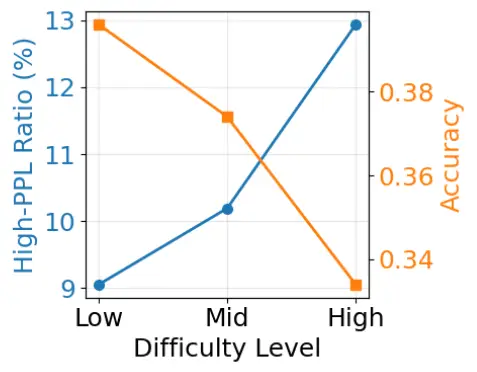

Figure 1: Correlation between average high-PPL token(PPL \> 2.5) ratio
and model performance under different difficulty levels. The x-axis
denotes Low (level 1&2), Mid (level 3&4) and High (level 5).

However, self-distillation is not always distribution-aligned. In many
downstream tasks, especially difficult reasoning problems, generated
solutions are constrained to preserve ground-truth answers or reference
reasoning traces. When the base model lacks sufficient reasoning
competence, this process can cause the generated data to inherit
reference-specific reasoning patterns, templates, and stylistic
expressions rather than reflecting the base model’s native distribution.
As shown in Figure 1, our hierarchical difficulty analysis on MATH
benchmarks Hendrycks et al. (2021) reveals that, as problem difficulty
increases, the proportion of tokens inconsistent with the base model
rises sharply, while the effectiveness of fine-tuning steadily
deteriorates. This suggests that self-distillation may provide
supervision that is correct in content but misaligned in distribution,
weakening knowledge transfer and increasing the risk of forgetting.

A token-level analysis further shows that such inconsistencies arise
from two qualitatively different sources, as shown in Figure 4. Some
high-perplexity(PPL) tokens represent beneficial logical corrections:
reasoning steps that are unlikely under the base model but necessary for
solving the problem. Others reflect harmful stylistic drift: redundant
surface forms, reasoning templates, or answer-specific expressions
inherited from the reference solution that contribute little useful
knowledge. Naive self-distillation optimizes all generated tokens
uniformly and therefore cannot distinguish useful corrections from noisy
stylistic deviations.

Existing token-selection strategies only partially address this issue.
Masked-PPL Wu et al. (2026) and ProFit Liu et al. (2026) methods remove
high-PPL tokens from training, which suppresses stylistic noise but also
discards valuable reasoning corrections. Hint-decoding Zhang et al.
(2026a) methods combine base and reference distributions using
reference-model uncertainty, but answer-conditioned references can be
overconfident, causing generation to remain biased toward the reference
solution. These limitations call for a more selective mechanism that
preserves useful reasoning deviations while filtering distributionally
misaligned noise.

In this paper, we propose DASD, a confidence-based dynamic token
selection method for robust Distribution-Aligned Self-Distillation. DASD
constructs reference model’s candidate tokens to preserve answer
correctness, while using the base model’s confidence to determine
whether each token is distributionally acceptable. Tokens that are
locally familiar to the base model are preferred to maintain
distribution alignment, and a mandatory fallback mechanism retains
indispensable reasoning tokens even when they are unlikely under the
base model. In this way, DASD preserves beneficial logical corrections
while suppressing harmful stylistic drift.

Experiments on mathematical reasoning, code generation, and commonsense
reasoning benchmarks show that DASD consistently outperforms competitive
self-distillation baselines. It reduces high-PPL stylistic deviations,
improves robustness across difficulty levels, and better preserves
pretrained knowledge during post-training ¹¹ 1
https://anonymous.4open.science/r/emnlp-SD-6AB2.. We summarize our main
contributions as follows:

- •
  We expose self-distillation’s severe dependence on reference answers
  and verify how task difficulty and distribution shift affect
  performance.
- •
  We propose DASD, a distribution-aligned self-distillation framework
  with confidence-aware dynamic token selection that balances knowledge
  injection and distribution preservation.
- •
  We evaluate DASD across diverse reasoning benchmarks and show it
  substantially outperforms conventional self-distillation baselines,
  especially on difficult reasoning tasks.

## 2 Related Work

##### Distribution-Consistent Data Selection

Extensive efforts have explored training large language models with
synthetic self-generated data Wang et al. (2023). In synthetic data
construction, distribution alignment between training samples and the
target model is widely recognized as critical, since models learn more
efficiently on familiar data while mitigating the erosion of pre-trained
knowledge Ren et al. (2024). To maintain stylistic consistency in model
generation, SCAR Li et al. (2025) filters high-quality instruction data
via style-aware ranking, which stabilizes model performance with fewer
training samples. Beyond standard perplexity, the self-aligned PPL Ren
et al. (2025) metric is proposed to measure the consistency between
generated content and the model’s inherent reasoning patterns,
facilitating better data selection. Methods such as Mask-PPL Wu et al.
(2026) and ProFit Liu et al. (2026) directly discard high-perplexity
tokens to preserve in-distribution content, yet they suffer from
insufficient knowledge injection and limit the model’s ability to
acquire new reasoning capabilities.

##### Self-Distillation

Building on this, self-training with model-generated data has been
extensively studied. Self-distillation Yang et al. (2024) leverages the
inherent distribution consistency of synthetic data to effectively
alleviate distribution shift during fine-tuning. Beyond Human Data Singh
et al. (2023) generates samples from the model, filters them via binary
feedback, fine-tunes on correct samples, and repeats this process. In
code generation tasks, SSD Zhang et al. (2026b) stably improves model
performance through balancing format paradigms and logical reasoning,
even without strict correctness filtering on self-generated data. To
ensure additional knowledge injection, STAR Zelikman et al. (2024)
prompts the model to regenerate answers by providing correct ones when
it errs. The Self-Distillation work introduces reference answers with
reasoning paths to assist model generation, ensuring both answer
correctness and distribution proximity. Subsequent Hint-Decoding Zhang
et al. (2026a) research attempts to distinguish in-distribution and
out-of-distribution content at the token level: it fuses outputs of the
base and reference models via entropy, yet outputs are easily disturbed
by reference answers, leading to inflated confidence and failure in
accurately distinguishing style and logical tokens.

## 3 Motivation

Self-distillation adopts reference answers as external guidance to
ensure the correctness of generated content. However, this mechanism
causes the model to mechanically imitate reference-specific reasoning
paths, leading to the generated content deviating from its original
distribution. A typical phenomenon is the widespread emergence of
high-perplexity tokens during self-generation. To reveal its adverse
effects, we conduct a difficulty-stratified experiment on the MATH
dataset Hendrycks et al. (2021). The results show that the higher the
task difficulty, the higher the proportion of corresponding high-PPL
tokens, and the further the model performance degrades.

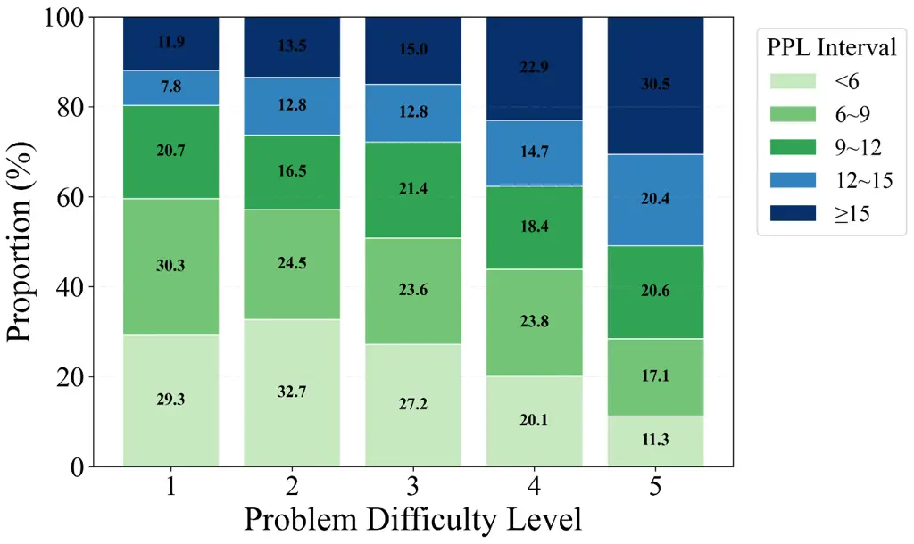

Figure 2: The high PPL rate distribution of different difficulty answers
from MATH benchmark, the abscissa is 5 difficulty levels, and the
ordinate is the proportion.

### 3.1 High-PPL Tokens in Distillation Data

We conduct a difficulty-stratified analysis on the MATH dataset. We
adopt Llama3.2-3B-Instruct as the base model $`\mathcal{M}_{\theta}`$
and build a reference model $`\mathcal{M}_{\text{ref}}`$ to generate
reasoning paths conditioned on golden answers. We compute token-level
perplexity from the base model and empirically regard tokens with
perplexity \> 2.5 as high-PPL tokens, which indicate distribution
mismatch with the base model. We then evaluate high-PPL token ratios
across difficulty levels.

Figure 2 presents segment-level PPL distributions across different
difficulties. Simple questions are dominated by low-PPL content, while
ultra-high-PPL($`\geq`$ 15) segments grow consistently as difficulty
increases. For Level 1 easy samples, sequences with PPL lower than 9
take the majority, and ultra-high-PPL content accounts for only 11.89%.
By contrast, Level 5 hard samples yield a sharp drop in low-PPL
proportion, with ultra-high-PPL segments rising to 30.52%. These results
demonstrate that hard reasoning induces severe distribution drift under
reference-guided generation.

Figure 1 further illustrates the correlation between high-PPL ratio and
downstream performance. As high-PPL tokens increase, model performance
gradually declines. Fine-tuning on easy data brings stable gains,
whereas hard-level training drops overall accuracy by 7%. This indicates
that distribution drift impairs knowledge learning and corrupts inherent
model representations. Naive self-distillation blindly fits drifted
noisy tokens, which becomes the key limitation for complex reasoning.

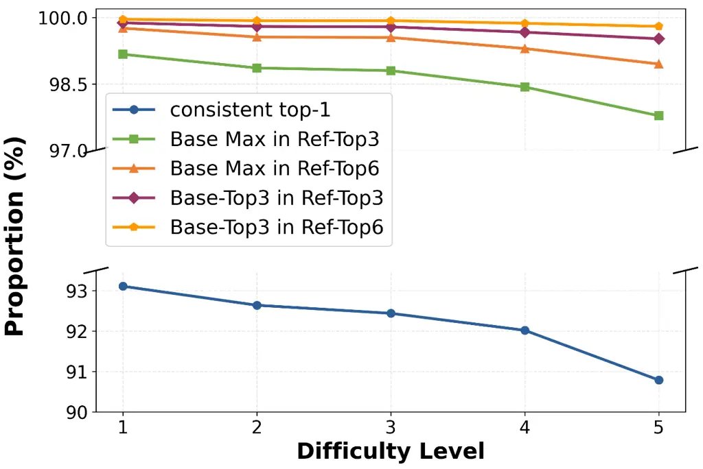

Figure 3: Token-level alignment between $`\mathcal{M}_{\theta}`$ and
$`\mathcal{M}_{\text{ref}}`$ at different difficulty levels. All metrics
are calculated on full sequences sampled from
$`\mathcal{M}_{\text{ref}}`$, including pairwise top-1 token
consistency, coverage of $`\mathcal{M}_{\theta}`$ top-1 token in
$`\mathcal{M}_{\text{ref}}`$ top-3/top-6, and coverage of
$`\mathcal{M}_{\theta}`$ top-3 tokens in $`\mathcal{M}_{\text{ref}}`$
top-3/top-6.

### 3.2 Distribution Shift Phenomenon

To analyze the prediction gap and distribution drift between reference
model and base model, we conduct token-level alignment experiments
across five difficulty levels. We sample complete sequences from
reference model $`\mathcal{M}_{\text{ref}}`$ and compute token-wise
overlap rates with base model $`\mathcal{M}_{\theta}`$. We measure five
statistics: consistent top-1 tokens of both models, the top-1 token of
$`\mathcal{M}_{\theta}`$ covered in $`\mathcal{M}_{\text{ref}}`$ top-3
and top-6, as well as $`\mathcal{M}_{\theta}`$ top-3 tokens covered in
$`\mathcal{M}_{\text{ref}}`$ top-3 and top-6.

As shown in Figure 3, all alignment metrics show a steady downward trend
with the growth of reasoning difficulty. The proportion of identical top
tokens predicted by two models declines from 93.11% to 90.79%, which
manifests that high-complexity reasoning enlarges the divergence of the
model’s most confident predictions. Although the overall token overlap
remains at a high level, the coverage ratio of the base model’s optimal
token in reference top-3 candidates gradually decreases from 99.17% to
97.78%. Similarly, the overlapping degree of broader base top-3
candidate sets also presents a slow but continuous drop on hard samples.

Such empirical observations provide solid motivation for our DASD
method. On the one hand, the extremely high candidate coverage proves
that most native high-quality tokens of the base model are naturally
included in the reference candidate space. It is feasible to retain the
original generation style within the correctness boundary constrained by
$`\mathcal{M}_{\text{ref}}`$. On the other hand, the non-negligible
prediction gap on difficult tasks verifies the necessity of fine-grained
filtering. Simply following the reference model will inevitably
introduce drifted tokens and destroy the base model’s inherent
distribution. Therefore, instead of rigid imitation or direct token
replacement, our method dynamically balances dual-model outputs via
confidence calibration and candidate screening, thereby alleviating
distribution drift while maintaining logical correctness for complex
mathematical reasoning.

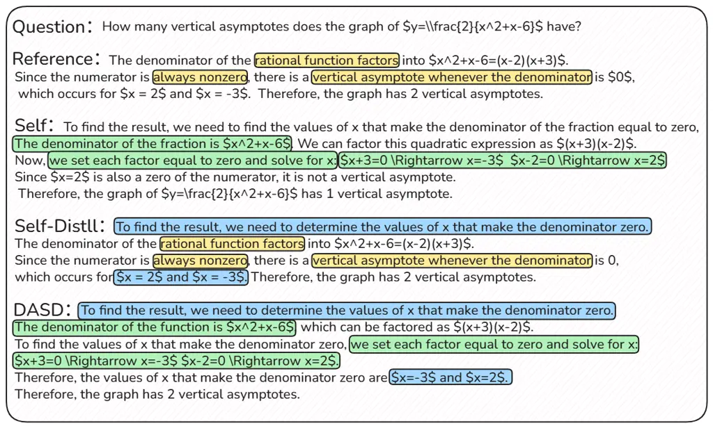

Figure 4: A generation case on the MATH dataset. Question: original
problem; Reference: standard solution; Self: base model output;
Self-Distill: self-distilled result; DASD: output of our method. Yellow
tokens denote mechanical imitation of reference answers that diverge
from the base model style. Green tokens retain the inherent linguistic
style of the base model, and blue tokens follow reasoning logic
consistent with reference-guided outputs.

0:  Base Model $`\mathcal{M}_{\theta}`$, Reference Model
$`\mathcal{M}_{ref}`$, Dataset
$`\mathcal{D}=\{(x_{i},y_{i}^{*})\}_{i=1}^{N}`$, Confidence Threshold
$`\tau`$, Candidate Number $`K`$.

0:  Optimized Model $`\mathcal{M}_{\theta}`$.

1:  Phase 1: Distribution-Aligned Data Generation

2:  Initialize aligned dataset
$`\mathcal{D}_{aligned}\leftarrow\emptyset`$

3:  for each sample $`(x,y^{*})`$ in $`\mathcal{D}`$ do

4:   Initialize generated sequence $`y\leftarrow[]`$

5:   for $`t=1`$ to $`T_{max}`$ do

6:    Obtain Top-$`K`$ candidate tokens
$`\mathcal{C}_{t}=\{c_{1},\dots,c_{K}\}`$ from
$`\mathcal{M}_{ref}(x,y,y^{*})`$

7:    $`selected\_token\leftarrow\text{None}`$

8:    for $`c_{i}`$ in $`\mathcal{C}_{t}`$ do

9:     Calculate probability $`p=P_{\theta}(c_{i}|x,y)`$

10:     if $`p>\tau`$ then

11:      $`selected\_token\leftarrow c_{i}`$

12:      break

13:     end if

14:    end for

15:    if $`selected\_token`$ is None then

16:     $`selected\_token\leftarrow c_{1}`$

17:    end if

18:    Append $`selected\_token`$ to $`y`$

19:    if $`selected\_token`$ is EOS then

20:     break

21:    end if

22:   end for

23:
  $`\mathcal{D}_{aligned}\leftarrow\mathcal{D}_{aligned}\cup\{(x,y)\}`$

24:  end for

25:  Phase 2: Model Training

26:  Optimize $`\mathcal{M}_{\theta}`$ on $`\mathcal{D}_{aligned}`$
using standard Causal Language Modeling loss.

Algorithm 1 Distribution-Aligned Self-Distillation

## 4 Method

In this section, we present Distribution-Aligned Self-Distillation
(DASD), a novel self-distillation method to mitigate performance
degradation brought by cross-model distribution mismatch. DASD
guarantees reasoning correctness by leveraging the base model with
golden answer guidance to construct teacher-style reasoning content, and
restricts generated content to fit the base model’s inherent output
distribution through confidence verification. The resulting
distribution-aligned data facilitates effective knowledge transfer while
avoiding catastrophic forgetting. The overall procedure of our DASD
method is formally described in Algorithm 1.A concrete generation case
comparison is illustrated in Figure 4.

### 4.1 Symbol Definition

Let $`\mathcal{M}_{\theta}`$ denote the base model to be improved, and
$`\mathcal{M}_{\text{ref}}`$ denote the reference model, which is the
same as the base model but guided by golden answers to generate
teacher-style reasoning content. The training dataset is
$`\mathcal{D}=\{(x_{i},y_{i}^{*})\}_{i=1}^{N}`$, where $`x_{i}`$ is the
input and $`y_{i}^{*}`$ is the corresponding golden answer. Let $`t`$ be
the generation time step, $`y_{<t}`$ be the generated prefix, and
$`T_{\text{max}}`$ be the maximum generation length. Let $`K`$ be the
number of candidate tokens and $`\tau`$ be the confidence threshold. EOS
denotes the end-of-sequence token.

### 4.2 Reference-Guided Candidate Generation

To guarantee the logical correctness of distilled data, we first
generate a high-quality token candidate pool using the reference model.
At each generation step $`t`$, the reference model
($`\mathcal{M}_{\text{ref}}`$), which is derived from the same base
model, computes the conditional probability distribution with access to
the golden answer $`y^{*}`$:

```math
P_{\text{ref}}(\cdot\mid x,y_{<t},y^{*}) \tag{1}
```

We select the top-$`K`$ tokens with the highest probabilities to form
the candidate set:

```math
\mathcal{C}_{t}=\{c_{1},c_{2},\dots,c_{K}\}, \tag{2}
```

where $`c_{1}`$ is the greedy decoding output of
$`\mathcal{M}_{\text{ref}}`$, representing the most reasonable reasoning
choice at this step. This step leverages the golden answer to avoid
logical fallacies caused by free generation and provides a reliable
candidate foundation for subsequent distribution alignment.

### 4.3 Dynamic Selection Strategy

We further design a confidence-verified dynamic selection strategy to
balance reasoning correctness and distribution consistency. For each
candidate token $`c_{i}`$ in the candidate set $`\mathcal{C}_{t}`$, we
calculate its conditional probability from the base model
$`\mathcal{M}_{\theta}`$, which reflects the native certainty and
perplexity level of the model toward each token:

```math
p=P_{\theta}(c_{i}\mid x,y_{<t}). \tag{3}
```

This probability acts as the core measurement for distribution
alignment. We adopt a two-rule selection mechanism to determine the
token to be generated at each step $`t`$:

- •
  Distribution Alignment First: Traverse $`\mathcal{C}_{t}`$ and select
  the first token satisfying $`p>\tau`$, ensuring outputs conform to the
  original distribution of the base model.
- •
  Knowledge Backup Mechanism: If all K candidates fail the confidence
  check, we directly choose $`c_{1}`$ from $`\mathcal{M}_{\text{ref}}`$
  to maintain reasonable and correct reasoning logic.

We repeat this selection process token by token until the EOS token is
generated, thus forming a complete and distribution-aligned sequence.

### 4.4 Training Objective

We construct the distribution-aligned dataset
$`\mathcal{D}_{\text{aligned}}`$ through the proposed generation
pipeline. Specifically, we filter the generated samples to retain only
those with correct answers, which are then used for training the base
model. The base model is optimized by standard causal language modeling
loss:

```math
\mathcal{L}(\theta)=-\sum_{(x,y)\in\mathcal{D}_{\text{aligned}}}\sum_{t=1}^{|y|}\log P_{\theta}(y_{t}\mid y_{<t},x;\theta). \tag{4}
```

| Model Name  | Method            | MATH  | MBPP  | ARC-Challenge | Average |
| ----------- | ----------------- | ----- | ----- | ------------- | ------- |
| Llama3.2-3B | Origin            | 0.360 | 0.470 | 0.740         | 0.523   |
|             | Self-Distillation | 0.384 | 0.466 | 0.744         | 0.531   |
|             | Mask-PPL          | 0.388 | 0.490 | 0.762         | 0.547   |
|             | Hint-decoding     | 0.418 | 0.500 | 0.770         | 0.563   |
|             | DASD              | 0.416 | 0.504 | 0.780         | 0.567   |
| Qwen3-4B    | Origin            | 0.630 | 0.614 | 0.880         | 0.708   |
|             | Self-Distillation | 0.670 | 0.532 | 0.888         | 0.697   |
|             | Mask-PPL          | 0.692 | 0.556 | 0.884         | 0.711   |
|             | Hint-decoding     | 0.684 | 0.574 | 0.889         | 0.716   |
|             | DASD              | 0.702 | 0.632 | 0.896         | 0.743   |
| Gemma2-2B   | Origin            | 0.220 | 0.370 | 0.700         | 0.430   |
|             | Self-Distillation | 0.248 | 0.364 | 0.733         | 0.448   |
|             | Mask-PPL          | 0.248 | 0.364 | 0.749         | 0.454   |
|             | Hint-decoding     | 0.262 | 0.370 | 0.745         | 0.459   |
|             | DASD              | 0.274 | 0.380 | 0.755         | 0.470   |

Table 1: Main Results on Reasoning Benchmarks

## 5 Experiments

### 5.1 Experimental Setup

Datasets We conduct experimental validations on three datasets, namely
MATH Hendrycks et al. (2021), MBPP Austin et al. (2021), and
ARC-Challenge Clark et al. (2018). Following the setting in
self-distillation research Yang et al. (2024), for datasets containing
more than 10,000 samples, we randomly select 2,000 samples for
fine-tuning to ensure comparable data scale across all datasets.

Target Models We evaluate three open-source LLMs with diverse
architectures: Llama3.2-3B Grattafiori et al. (2024), Qwen3-4B Yang et
al. (2025), and Gemma2-2B Team et al. (2024), all of which are retrieved
from Hugging Face.

Baseline We compare our proposed method with three baseline methods,
including standard self-distillation Yang et al. (2024), Mask-PPL Wu et
al. (2026), and Hint-decoding Zhang et al. (2026a), we use the
hyperparameters corresponding to their best performance reported in the
original papers

Evaluation Metrics We perform different strategy-based data processing
following the same dataset split, train the original model, and evaluate
its performance on the test set. Specifically, we use the ACC score for
the MATH and ARC datasets, and the Pass@1 score for the MBPP dataset.

Implementation Details We adopt LoRA training using the PEFT library,
where all methods share the same training parameters: the learning rate
is set to 2e-5, the warmup ratio is 0.2, and the target modules are all
linear layers. For our DASD method, the confidence threshold is set to
0.2 and the number of candidate tokens is 6.

### 5.2 Main Results

Table 1 reports results on Math, MBPP, and ARC-Challenge. Overall, our
proposed DASD method achieves superior performance across all three
models and three datasets, demonstrating its strong generalization
ability. Specifically, for Llama3.2-3B on the MATH dataset, DASD
achieves an accuracy of 0.416, which represents a 16% improvement over
the original base model and an 8% improvement compared to the standard
self-distillation method. Notably, on the MBPP dataset, standard
self-distillation leads to performance degradation, indicating that
models are more susceptible to the influence of golden answers in code
generation tasks, which in turn causes severe distribution shift. In
contrast, our DASD method effectively alleviates this issue and achieves
consistent performance improvements across all evaluated models on MBPP,
verifying its effectiveness in mitigating distribution mismatch caused
by reference imitation.

### 5.3 Ablation Study

We conduct ablation experiments on the MATH dataset to analyze the
effects of the confidence threshold, hard token selection strategy, and
reference candidate token number. The results are shown in Table 2.

First, we explore three confidence thresholds: 0.25, 0.20, and 0.10. As
shown in Table 2, a high threshold of 0.25 obtains an accuracy of 0.406.
Strict threshold constraints force the model to retain more native
base-model tokens, which harms reasoning correctness. When the threshold
is reduced to 0.10, the performance drops slightly to 0.412, since loose
thresholds weaken the distribution alignment effect. The threshold of
0.20 achieves the best accuracy of 0.416, striking a favorable balance
between reasoning quality and feature distribution consistency.

We further explore the effect of reference candidate size, namely Top-3,
Top-6 and Top-9. A smaller Top-K restricts generation within a narrow
reference range, which enhances external knowledge injection but
exacerbates distribution inconsistency. Top-3 adopts strict reference
constraints and obtains an accuracy of 0.408. By contrast, Top-9 relaxes
reference restrictions and mitigates distribution drift, yet
insufficient logical guidance leads to suboptimal performance of 0.414.
The default Top-6 achieves the optimal accuracy of 0.416, properly
balancing reference-based reasoning enhancement and native distribution
preservation.

Furthermore, we compare two hard token strategies when all candidate
tokens fall below the threshold. The base-mode selects the most
confident token from the base model candidates with an accuracy of
0.408. In contrast, the ref-mode adopts the top token from the reference
model and reaches 0.416. The results verify that prioritizing correct
logic tokens and sufficient knowledge injection via reference guidance
is critical for improving mathematical reasoning performance.

| Variant              | MATH Acc. |
| -------------------- | --------- |
| Confidence Threshold |           |
| Threshold = 0.25     | 0.406     |
| Threshold = 0.20     | 0.416     |
| Threshold = 0.10     | 0.412     |
| Candidate Number     |           |
| Top-3                | 0.408     |
| Top-6                | 0.416     |
| Top-9                | 0.414     |
| Hard Token Strategy  |           |
| Base-mode            | 0.408     |
| Ref-mode             | 0.416     |

Table 2: Ablation results on the MATH dataset.

### 5.4 Analysis

#### 5.4.1 Token-Level PPL

We analyze the average ratio of high-PPL tokens and its discrepancy
across samples with different difficulty levels on the MATH dataset,
between standard self-distillation and our DASD method in Figure 3. We
observe that DASD significantly reduces the proportion of high-PPL
tokens in generated samples, indicating better alignment with the
original model distribution. Specifically, the ratio of tokens with PPL
greater than 2.5 is 10.59% in vanilla self-distillation, while DASD
reduces it to 4.09%. Furthermore, the high-PPL ratio generated by DASD
remains more consistent across different difficulty levels, with only a
7% gap between easy and hard samples, compared to 43% in standard
self-distillation. This demonstrates that our distribution-aware
filtering mechanism exhibits stronger robustness when facing complex
inputs.

|            | PPL $`>2.5`$ |      | PPL $`>5.0`$ |      |
| ---------- | ------------ | ---- | ------------ | ---- |
| Difficulty | Distill      | DASD | Distill      | DASD |
| Avg.       | 10.59        | 4.09 | 5.89         | 0.75 |
| Easy       | 9.05         | 4.01 | 4.86         | 0.82 |
| Mid        | 10.19        | 4.03 | 5.65         | 0.70 |
| Hard       | 12.94        | 4.29 | 7.42         | 0.75 |

Table 3: High-PPL token ratio (%) on the MATH dataset under different
difficulty levels. Distill presents self-distillatio method

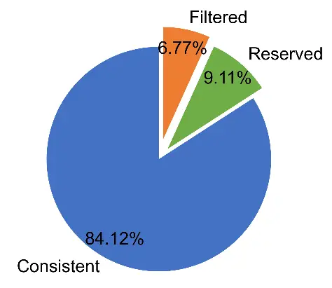

Figure 5: Proportion distribution of three types of token, including
Consistent, Reserved, and Filtered tokens.

#### 5.4.2 Token Distribution

We carry out training experiments on Llama3.2-3B with MATH data
categorized by difficulty levels. As depicted in Figure 6, we compare
the performance of baseline training and DASD-enhanced training across
different difficulty tiers. The baseline suffers evident performance
fluctuations due to distribution drift, while DASD delivers stable and
robust gains at all difficulty levels. Models trained on medium and
high-difficulty data outperform those trained on low-difficulty samples,
proving that DASD can effectively incorporate valuable reasoning
information to promote model optimization. Medium-difficulty training
finally achieves the best overall capability, realizing a sound
trade-off between external reasoning knowledge infusion and the original
distribution characteristics of the model.

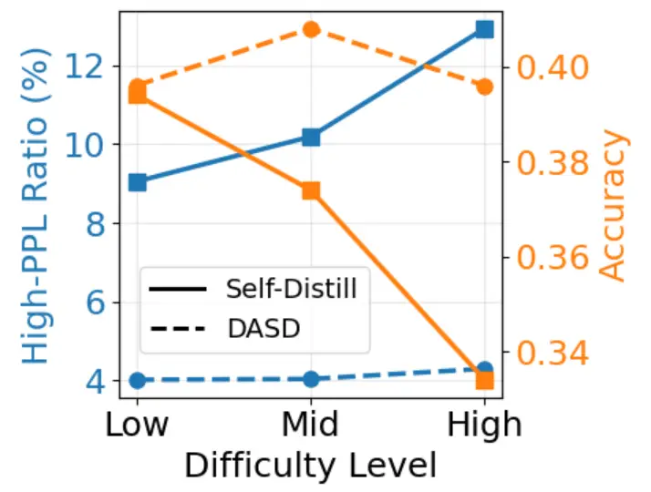

Figure 6: Performance comparison of Self-Distillation and DASD across
different difficulty levels. Yellow lines represent accuracy, dashed
lines denote the results obtained by DASD method.

#### 5.4.3 Token Distribution

We statistically analyze the token selection results of our DASD method
on 2000 samples. We focus on five token types in constrained decoding.
The consistent token denotes the top-probability output of both the base
and reference models. The reserved token refers to valid reference
candidates accepted via the confidence threshold. The filtered token
emerges when reference candidates fail to meet the threshold and trigger
dynamic filtering. The base-selected token is the optimal output
selected from the base model after filtering. The hard token enforces
the top reference candidate when all reference candidates are
unqualified. Only tokens from correctly answered samples are counted to
eliminate interference from incorrect reasoning.

Figure 5 illustrates the overall distribution of mainstream token
categories. The consistent token occupies an absolutely dominant
proportion at 92.54%, which reveals strong prediction alignment between
dual models. The reserved token and filtered token account for 5.25% and
2.21% respectively. A small proportion of divergent tokens indicates
that the two models maintain stable distribution consistency in most
reasoning steps, and the conflict requiring additional constraint
adjustment only appears in a few generation positions.

Figure 7 further reflects the internal composition variation of filtered
tokens across different difficulty levels. The base-selected token
always maintains a high proportion within filtered tokens, verifying
that our method preferentially retains the optimal output of the base
model. As the difficulty level increases, the ratio of base-selected
tokens gradually declines, while the proportion of hard tokens increases
steadily. This trend demonstrates that complex mathematical reasoning
enlarges the distribution discrepancy between dual models. Meanwhile,
our constrained decoding framework exhibits great adaptive robustness,
which can balance the selection of base model and reference model
according to input complexity.

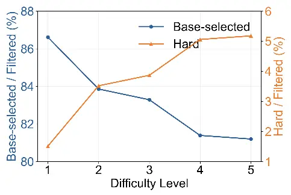

Figure 7: Proportions of base-selected tokens and hard tokens within
filtered tokens across different reasoning difficulty levels.

## 6 Conclusion

This paper re-examines self-distillation from the perspective of
distribution alignment and proposes DASD, a confidence-aware approach to
alleviate distribution drift. By analyzing the negative effects of
high-PPL tokens caused by over-reliance on reference answers, we reveal
the inherent distribution mismatch issue existing in conventional
self-distillation. Experimental results demonstrate that DASD
effectively balances external knowledge injection and original
distribution preservation, achieving stable and outstanding performance
and outperforming traditional self-distillation .

## Limitations

We adopt dual-path simultaneous decoding to guarantee the correctness of
training samples and maintain the distribution consistency of the
original model, which achieves favorable performance in offline
distillation scenarios. Nevertheless, our sample generation strategy
mainly follows greedy token-wise selection, which may lead to
insufficient diversity of distilled training data. In future work, we
intend to further identify stylistic tokens and generate more diverse
training samples while preserving reasoning correctness.

## References

- Austin et al. (2021) J. Austin, A. Odena, M. Nye, M. Bosma, H.
  Michalewski, D. Dohan, E. Jiang, C. Cai, M. Terry, Q. Le, et al.
  Program synthesis with large language models. arXiv preprint
  arXiv:2108.07732. Cited by: §5.1.
- Clark et al. (2018) P. Clark, I. Cowhey, O. Etzioni, T. Khot, A.
  Sabharwal, C. Schoenick, and O. Tafjord Think you have solved question
  answering? try arc, the ai2 reasoning challenge. arXiv preprint
  arXiv:1803.05457. Cited by: §5.1.
- Grattafiori et al. (2024) A. Grattafiori, A. Dubey, A. Jauhri, A.
  Pandey, A. Kadian, A. Al-Dahle, A. Letman, A. Mathur, A. Schelten, A.
  Vaughan, et al. The llama 3 herd of models. arXiv preprint
  arXiv:2407.21783. Cited by: §5.1.
- Hendrycks et al. (2021) D. Hendrycks, C. Burns, S. Kadavath, A.
  Arora, S. Basart, E. Tang, D. Song, and J. Steinhardt Measuring
  mathematical problem solving with the math dataset. arXiv preprint
  arXiv:2103.03874. Cited by: §1, §3, §5.1.
- Li et al. (2024) H. Li, L. Ding, M. Fang, and D. Tao Revisiting
  catastrophic forgetting in large language model tuning. In Findings of
  the association for computational linguistics: EMNLP 2024,
  pp. 4297–4308. Cited by: §1.
- Li et al. (2025) Z. Li, Y. Hua, T. Vu, H. Zhan, L. Qu, and G. Haffari
  Scar: data selection via style consistency-aware response ranking for
  efficient instruction-tuning of large language models. In Proceedings
  of the 63rd Annual Meeting of the Association for Computational
  Linguistics (Volume 1: Long Papers), pp. 12756–12790. Cited by: §2.
- Liu et al. (2026) T. Liu, T. Wu, R. Yang, S. Sun, J. Wang, and Y. Yang
  ProFit: leveraging high-value signals in sft via probability-guided
  token selection. arXiv preprint arXiv:2601.09195. Cited by: §1, §2.
- Luo et al. (2025) Y. Luo, Z. Yang, F. Meng, Y. Li, J. Zhou, and Y.
  Zhang An empirical study of catastrophic forgetting in large language
  models during continual fine-tuning. IEEE Transactions on Audio,
  Speech and Language Processing. Cited by: §1.
- Ren et al. (2025) X. Ren, Q. Chen, and L. Liu Efficiently selecting
  response generation strategies for synthetic data construction by
  self-aligned perplexity. In Findings of the Association for
  Computational Linguistics: EMNLP 2025, pp. 11584–11605. Cited by: §2.
- Ren et al. (2024) X. Ren, B. Wu, and L. Liu I learn better if you
  speak my language: understanding the superior performance of
  fine-tuning large language models with llm-generated responses. In
  Proceedings of the 2024 Conference on Empirical Methods in Natural
  Language Processing, pp. 10225–10245. Cited by: §2.
- Singh et al. (2023) A. Singh, J. D. Co-Reyes, R. Agarwal, A. Anand, P.
  Patil, X. Garcia, P. J. Liu, J. Harrison, J. Lee, K. Xu, et al. Beyond
  human data: scaling self-training for problem-solving with language
  models. arXiv preprint arXiv:2312.06585. Cited by: §2.
- Team et al. (2024) G. Team, M. Riviere, S. Pathak, P. G. Sessa, C.
  Hardin, S. Bhupatiraju, L. Hussenot, T. Mesnard, B. Shahriari, A.
  Ramé, et al. Gemma 2: improving open language models at a practical
  size. arXiv preprint arXiv:2408.00118. Cited by: §5.1.
- Wang et al. (2023) Y. Wang, Y. Kordi, S. Mishra, A. Liu, N. A.
  Smith, D. Khashabi, and H. Hajishirzi Self-instruct: aligning language
  models with self-generated instructions. In Proceedings of the 61st
  annual meeting of the association for computational linguistics
  (volume 1: long papers), pp. 13484–13508. Cited by: §2.
- Wu et al. (2026) C. Wu, Z. R. Tam, C. Lin, Y. V. Chen, S. Sun, and H.
  Lee Mitigating forgetting in llm fine-tuning via low-perplexity token
  learning. Advances in Neural Information Processing Systems 38,
  pp. 1708–1744. Cited by: §1, §2, §5.1.
- Yang et al. (2025) A. Yang, A. Li, B. Yang, B. Zhang, B. Hui, B.
  Zheng, B. Yu, C. Gao, C. Huang, C. Lv, et al. Qwen3 technical report.
  arXiv preprint arXiv:2505.09388. Cited by: §5.1.
- Yang et al. (2024) Z. Yang, T. Pang, H. Feng, H. Wang, W. Chen, M.
  Zhu, and Q. Liu Self-distillation bridges distribution gap in language
  model fine-tuning. In Proceedings of the 62nd Annual Meeting of the
  Association for Computational Linguistics (Volume 1: Long Papers),
  pp. 1028–1043. Cited by: §1, §2, §5.1, §5.1.
- Zelikman et al. (2024) E. Zelikman, Y. Wu, J. Mu, and N. D. Goodman
  Star: self-taught reasoner bootstrapping reasoning with reasoning. In
  Proc. the 36th International Conference on Neural Information
  Processing Systems, Vol. 1126, pp. 0–55. Cited by: §2.
- Zhang et al. (2026a) M. Zhang, Y. Liu, S. Lin, X. Yang, Q. Dai, C.
  Luo, W. Jiang, P. Hou, A. Zeng, X. Geng, et al. Towards on-policy sft:
  distribution discriminant theory and its applications in llm training.
  arXiv preprint arXiv:2602.12222. Cited by: §1, §2, §5.1.
- Zhang et al. (2026b) R. Zhang, R. H. Bai, H. Zheng, N. Jaitly, R.
  Collobert, and Y. Zhang Embarrassingly simple self-distillation
  improves code generation. arXiv preprint arXiv:2604.01193. Cited by:
  §2.

## Appendix A Prompt Templates of Base and Reference Model

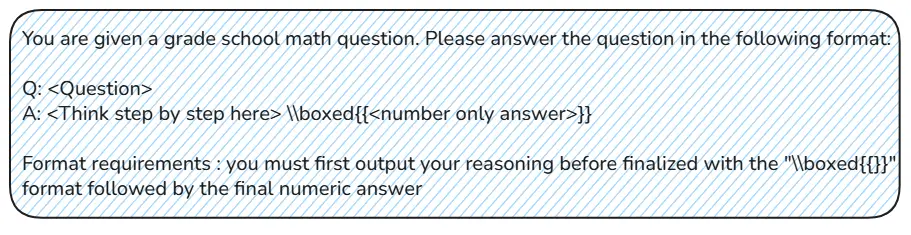

Figure 8: Prompt template of the base model

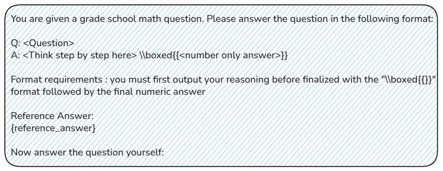

Figure 9: Prompt template of the reference model

We detail the prompt templates used for the base model and the reference
model throughout our experiments. The base model takes only the raw
problem question as input, following a standard step-by-step reasoning
format without any additional reference information. By contrast, the
reference model is fed with the same question plus an official reference
solution, which provides rigorous logical derivation and correct
reasoning demonstrations.

The concrete prompt formats are illustrated in Figure 8 and Figure 9.
Figure 8 presents the prompt template for the base model, which only
contains the problem statement and format requirements. Figure 9 shows
the template for the reference model, where an extra reference answer is
inserted to provide high-quality reasoning guidance.

This design enables the reference model to produce logically correct
token candidates, while the base model preserves its inherent linguistic
style and expression preference, supporting the token-level selection
and distribution alignment in our method.

## Appendix B Case Study

To intuitively compare the generation behaviors of different methods on
code datasets, we present a representative case from the MBPP dataset.
We visualize the original programming problem, the reference
ground-truth solution, and the code responses generated by the baseline
model, the reference model, and our proposed DASD method. The generated
examples are shown in Figure 10, Figure 11, Figure 12, and Figure 13.

This case focuses on the classic Maximum Length of Pair Chain dynamic
programming problem, which requires constructing the longest chain of
pairs where the second element of each preceding pair is strictly less
than the first element of the next pair. As illustrated in the generated
code implementations, the baseline and reference models adopt standard
dynamic programming paradigms with $`O(n^{2})`$ time complexity: they
initialize a DP array to record the longest chain length ending at each
pair, iterate through all previous pairs to update the DP values, and
finally return the maximum value of the DP array.

Notably, our DASD method preserves the natural output style and
structural conventions of the base model, while implicitly injecting
correctness signals derived from verified solutions. Compared to the
baseline and reference responses, the DASD-generated code maintains
consistency in variable naming, loop structure, and overall formatting,
yet resolves subtle functional errors and logical oversights (e.g.,
off-by-one indexing issues, incorrect conditional bounds, and redundant
array initialization) that appear in the baseline outputs. This
demonstrates that DASD effectively enhances functional correctness
without compromising the fluency and stylistic coherence of the original
model’s generations.

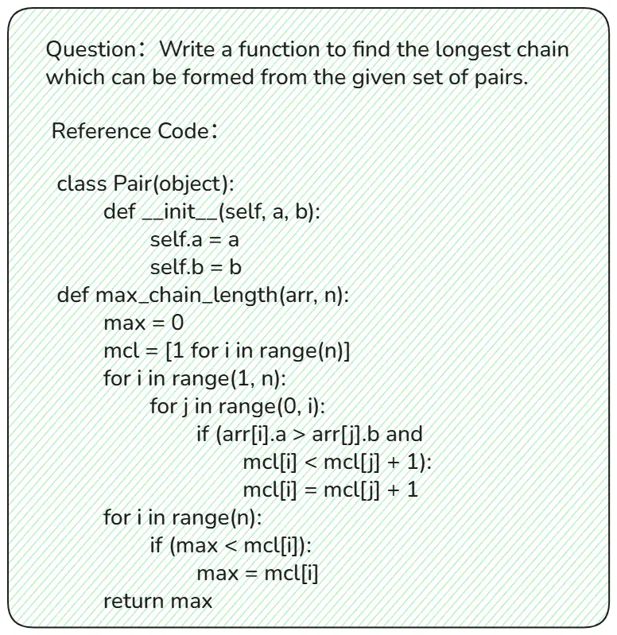

Figure 10: Original question and standard reference answer.

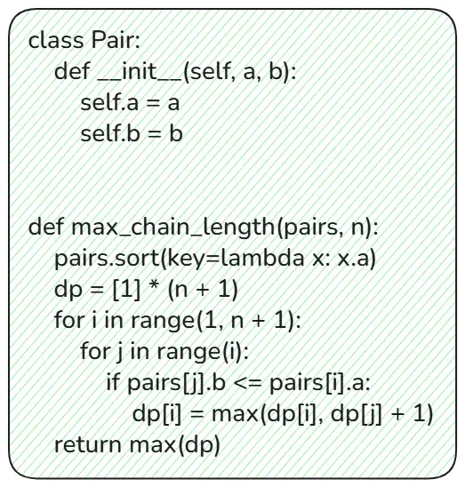

Figure 11: Generation output of the base model.

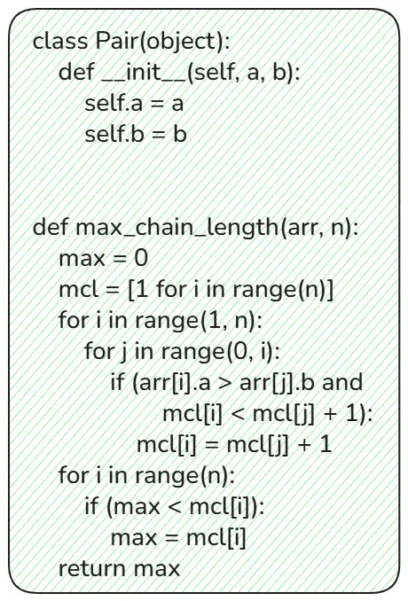

Figure 12: Generation output of the reference model.

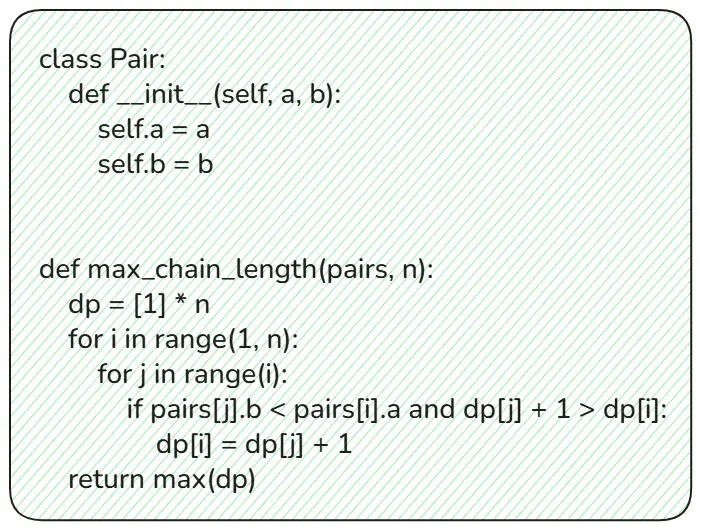

Figure 13: Generation output of our DASD method.

## Appendix C Supplementary Experiments

Table 4 presents experimental results of Llama3-8B on MATH and
commonsense reasoning tasks. The proposed DASD method still yields the
best overall performance among all comparison approaches. On the MATH
dataset, DASD reaches an accuracy of 0.292, outperforming the original
baseline and other alternative methods. Conventional self-distillation
fails to boost reasoning capability and even suffers performance drop,
revealing that blindly learning from reference content easily breaks
inherent token distribution. By contrast, our distribution-aligned
self-distillation strategy avoids negative distribution drift and
obtains favorable gains on both mathematical and commonsense reasoning
scenarios.

| Method            | MATH  | Commonsense Reasoning |
| ----------------- | ----- | --------------------- |
| Base              | 0.278 | 0.799                 |
| Self-Distillation | 0.248 | 0.819                 |
| Mask-PPL          | 0.258 | 0.810                 |
| Hint-decoding     | 0.264 | 0.814                 |
| DASD              | 0.292 | 0.816                 |

Table 4: Results of Llama3-8B. Bold values denote the best performance,
and underlined values represent the second-best result.

## Appendix D Efficiency Analysis

Since the proposed DASD framework requires dual independent forward
inferences from both the base model and the reference model, we
simultaneously load and activate two model instances during training.
This inevitably doubles the GPU memory consumption compared with
conventional self-distillation paradigms. However, the additional token
screening and confidence verification modules introduced in DASD are
extremely lightweight. Their computational overhead is negligible
relative to the full model forward propagation, resulting in nearly
identical inference latency and no extra time cost for the overall data
generation pipeline.
