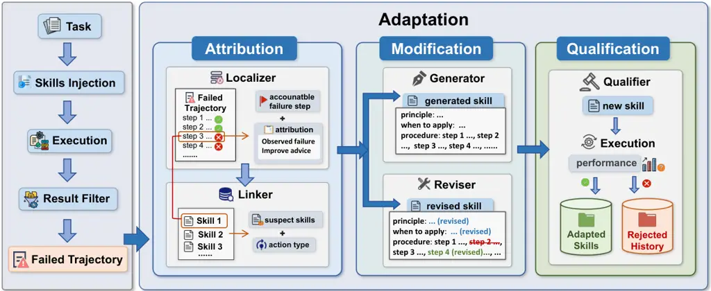
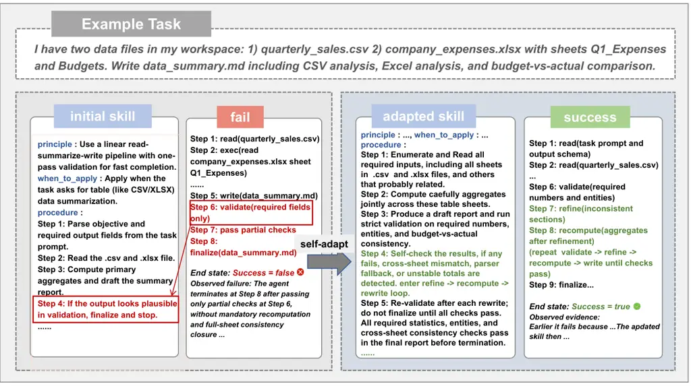

# SkillAdaptor: Self-Adapting Skills for LLM Agents from Trajectories

Zhuoyun Yu ^(†)^(†)thanks: Equal contribution.
Email: [3220104147@zju.edu.cn](mailto:)    Xin Xie¹¹footnotemark: 1
Affiliation: Ant Digital Technologies, Ant Group
Email: [231sm@zju.edu.cn](mailto:)    Wuguannan Yao Affiliation: Ant
Digital Technologies, Ant Group    Chenxi Wang Affiliation: Zhejiang
University    Lei Liang,  Xiang Qi,  Shumin Deng ^(†)^(†)thanks:
Corresponding author. Affiliation: Zhejiang University Affiliation: Ant
Digital Technologies, Ant Group Affiliation: Zhejiang University - Ant
Group Joint Laboratory of Knowledge Graph

###### Abstract

Large language model (LLM) agents increasingly rely on reusable external
skills to solve long-horizon interactive tasks. Existing training-free
skill adaptation pipelines usually update skills from full trajectories
or session-level feedback, which makes failure attribution coarse and
often produces unstable or overly broad revisions. We propose
SkillAdaptor, a training-free step-level skill adaptation framework with
explicit failure attribution, and it can plug into OpenClaw-class agent
harnesses. Given a failed trajectory, SkillAdaptor identifies a first
actionable fault step, links responsibility to candidate skills, and
applies targeted updates under explicit acceptance checks while keeping
the backbone frozen. We evaluate on WebShop, PinchBench, and Claw-Eval
with Kimi-K2.5, GLM-5, and GPT-5.2. SkillAdaptor improves over no-skill
and skill-adaptation baselines on all three suites, with the largest
single-metric improvements of $`+1.5`$ points on PinchBench Avg Score%,
$`+1.8`$ on Claw-Eval Avg Score, and $`+1.7`$ on WebShop success rate.
These results indicate that step-level attribution supports more stable
and auditable training-free skill maintenance¹¹ 1 The code will be
released at
[https://github.com/zjunlp/SkillAdaptor](https://github.com/zjunlp/SkillAdaptor)..

## 1 Introduction



Figure 1: Overview of SkillAdaptor framework.

Large language model (LLM) agents are widely used for long-horizon tasks
involving tool use, coding, and web interaction Yao et al. (2023);
Schick et al. (2023); Patil et al. (2024); Wang et al. (2023). To enable
continual improvement without retraining the base model, many systems
augment frozen LLMs with reusable external skills, such as triggers,
action patterns, and verification procedures Lin et al. (2026); HKUDS
(2026); Wang et al. (2026).

Recent training-free adaptation methods improve such LLM agents from
execution traces through memory distillation Xu et al. (2025), workflow
refinement Wang et al. (2025), retrospective feedback Zhao et al.
(2024), and iterative skill evolution Liu et al. (2026b); Alzubi et al.
(2026); Zhang et al. (2026a). While effective, most of them adapt skills
from trajectory-level outcomes or session-level summaries, using the
completed trajectory as the main unit of reflection and revision.

Furthermore, this outcome-level adaptation becomes fragile in
long-horizon environments. A failed trajectory often contains many
correct intermediate decisions, while the actual failure may result from
only a few previous mistakes. When updates are driven mainly by the
final outcome, failure signals can be diffused across unrelated steps
and skills, leading to overly broad or misdirected revisions. This
credit-assignment problem is especially severe when a single early error
invalidates many subsequent actions.

To address the aforementioned limitation, we propose SkillAdaptor, a
training-free modular skill adaptor that shifts adaptation from
trajectory-level reflection to step-level attribution. Given an
execution trace, SkillAdaptor localizes the first actionable fault,
diagnoses the relevant skill deficiency, and then refines only the
relevant skill deficient while leaving the irrelevant skills unchanged.
As a modular post-execution adaptation approach, SkillAdaptor can be
integrated as a plug-in component for OpenClaw-class agent
harnesses Steinberger (2026).

We evaluate SkillAdaptor on WebShop Yao et al. (2022), PinchBench Kilo
Code (2026), and Claw-Eval Ye et al. (2026). SkillAdaptor consistently
improves over training-free adaptation baselines, suggesting that stable
agent improvement depends less on expanding skill libraries or
reflecting over entire trajectories, and more on accurately attributing
failures to the specific steps and skills that caused them.

## 2 Preliminaries

We consider an interactive setting in which an LLM agent solves tasks by
acting in an environment. Given a task $`q`$ sampled from a task
distribution $`\mathcal{Q}`$, the agent produces an execution trajectory

```math
\tau=\{(a_{t},o_{t})\}_{t=1}^{T}, \tag{1}
```

where $`a_{t}`$ is the action taken by the agent at step $`t`$ and
$`o_{t}`$ is the observation. The trajectory is the only evidence
available for subsequent fault analysis and skill updates.

To improve task completion without updating model parameters, we
maintain a skill collection

```math
K=\{s_{1},s_{2},\ldots,s_{n}\}, \tag{2}
```

where each $`s_{i}`$ is a textual skill record carrying a title, a
principle, and applicability conditions. The base model is frozen
throughout, and only $`K`$ is revised or appended across iterations.

Our objective is to design the update procedure so that the expected
success rate over $`\mathcal{Q}`$ is improved through $`K`$ alone

```math
\max_{K}\ \mathbb{E}_{q\sim\mathcal{Q}}\left[\operatorname{success}\!\left(\operatorname{Run}(q,K)\right)\right], \tag{3}
```

where $`\operatorname{Run}(q,K)`$ executes the agent on $`q`$
conditioned on a retrieved subset of $`K`$, and
$`\operatorname{success}(\cdot)`$ is the benchmark-defined success
indicator. This formulation keeps the method training-free and
attributes any improvement to updates on $`K`$.

## 3 Method

|              |                       |                       |                       |                       |         |                       |         |                       |         |
| ------------ | --------------------- | --------------------- | --------------------- | --------------------- | ------- | --------------------- | ------- | --------------------- | ------- |
|              | PinchBench            |                       |                       | Claw-Eval             |         |                       |         |                       |         |
|              | Kimi-K2.5             | GLM-5                 | GPT-5.2               | Kimi-K2.5             |         | GLM-5                 |         | GPT-5.2               |         |
| Method       | Avg Score%            | Avg Score%            | Avg Score%            | Avg Score             | Pass@3% | Avg Score             | Pass@3% | Avg Score             | Pass@3% |
| Base Model   | 63.6^($`\pm`$$`8.7`$) | 70.2^($`\pm`$$`5.4`$) | 74.8^($`\pm`$$`6.1`$) | 73.2^($`\pm`$$`1.3`$) | 74.4%   | 72.8^($`\pm`$$`1.1`$) | 72.9%   | 76.0^($`\pm`$$`1.6`$) | 77.4%   |
| OpenSpace    | 66.0^($`\pm`$$`5.9`$) | 72.3^($`\pm`$$`4.5`$) | 75.8^($`\pm`$$`5.6`$) | 74.0^($`\pm`$$`2.2`$) | 75.9%   | 73.6^($`\pm`$$`2.1`$) | 74.4%   | 77.1^($`\pm`$$`1.8`$) | 77.4%   |
| SkillAdaptor | 67.2^($`\pm`$$`5.2`$) | 73.8^($`\pm`$$`4.6`$) | 76.6^($`\pm`$$`5.1`$) | 75.8^($`\pm`$$`1.6`$) | 77.4%   | 75.3^($`\pm`$$`1.5`$) | 75.9%   | 77.6^($`\pm`$$`1.8`$) | 78.9%   |

Table 1: Main comparison across PinchBench and Claw-Eval. PinchBench
reports Avg Score%; Claw-Eval reports Avg Score and Pass@3%.

|              |                       |                       |                       |                       |                       |                       |
| ------------ | --------------------- | --------------------- | --------------------- | --------------------- | --------------------- | --------------------- |
| WebShop      |                       |                       |                       |                       |                       |                       |
|              | Kimi-K2.5             |                       | GLM-5                 |                       | GPT-5.2               |                       |
| Method       | Score                 | Succ%                 | Score                 | Succ%                 | Score                 | Succ%                 |
| Base Model   | 32.1^($`\pm`$$`1.4`$) | 24.6^($`\pm`$$`1.5`$) | 33.8^($`\pm`$$`0.9`$) | 25.3^($`\pm`$$`2.0`$) | 36.2^($`\pm`$$`1.0`$) | 25.0^($`\pm`$$`1.6`$) |
| A-Mem        | 30.3^($`\pm`$$`1.6`$) | 22.6^($`\pm`$$`2.1`$) | 30.9^($`\pm`$$`0.8`$) | 20.0^($`\pm`$$`1.8`$) | 33.7^($`\pm`$$`1.2`$) | 21.6^($`\pm`$$`2.4`$) |
| AWM          | 34.0^($`\pm`$$`0.9`$) | 25.3^($`\pm`$$`1.4`$) | 34.5^($`\pm`$$`1.6`$) | 25.6^($`\pm`$$`1.7`$) | 36.5^($`\pm`$$`1.3`$) | 28.3^($`\pm`$$`1.9`$) |
| ExpeL        | 35.7^($`\pm`$$`0.6`$) | 26.0^($`\pm`$$`1.1`$) | 35.2^($`\pm`$$`1.0`$) | 27.3^($`\pm`$$`1.2`$) | 37.0^($`\pm`$$`0.7`$) | 29.6^($`\pm`$$`1.4`$) |
| EvoSkill     | 40.4^($`\pm`$$`0.3`$) | 31.3^($`\pm`$$`0.8`$) | 41.6^($`\pm`$$`0.6`$) | 32.6^($`\pm`$$`0.8`$) | 43.1^($`\pm`$$`0.5`$) | 33.0^($`\pm`$$`1.1`$) |
| SkillAdaptor | 41.6^($`\pm`$$`0.5`$) | 33.0^($`\pm`$$`1.1`$) | 43.9^($`\pm`$$`0.7`$) | 33.3^($`\pm`$$`0.4`$) | 44.8^($`\pm`$$`0.4`$) | 34.3^($`\pm`$$`1.2`$) |

Table 2: Results on WebShop.

SkillAdaptor is a trajectory-driven skill adaptation framework built on
a dynamic skill collection $`K`$. During task execution, the agent
retrieves a small set of relevant skills from $`K`$ and conditions
generation on the retrieved context. Failed trajectories are
subsequently used to improve skill collection through Attribution,
Modification, and Qualification.

Skill Initialization. The framework is initialized without any external
skill collection. The backbone LLM first executes the task set
$`\mathcal{Q}`$ used for skill adaptation, without any skill or
experience augmentation. Successful trajectories are archived as
reference traces, from which initial skills are distilled to construct
the initial collection $`K_{0}`$.

After initialization, all subsequent executions are performed with skill
retrieval over $`K`$. Then failed trajectories from these executions are
forwarded to the adaptation stage for skill updating.

Skill Injection. For each task $`q`$ with description $`d_{q}`$, each
skill contains structured fields including title, applicability
condition, and behavioral principle. We encode tasks and skills using
Qwen3-Embedding-8B denoted by $`\phi(\cdot)`$. Candidate skills are
first retrieved by cosine similarity, truncated to
top-$`k_{\text{ret}}`$ candidates, and finally reranked by the backbone
LLM

```math
S_{q}=\operatorname{Rerank}\!\left(\operatorname*{TopK}_{\begin{subarray}{c}s\in K\end{subarray}}\operatorname{sim}\!\big(\phi(d_{q}),\phi(s)\big),\,d_{q}\right). \tag{4}
```

Conditioned on $`S_{q}`$, the agent interacts with the environment and
produces a trajectory tuple $`(q,\tau,r)`$, where $`\tau`$ denotes the
execution trajectory and $`r`$ indicates task success or failure.

Skill Adaptation. The Adaptation phrase includes the following three
parts. Starting from $`K^{(0)}`$, we iterate this process for up to
$`10`$ rounds, or until the skill collection remains unchanged for $`3`$
consecutive rounds. The final collection $`K^{\ast}`$ is then frozen
with no further updates.

(1) Attribution. Given a failed trajectory, the Localizer predicts the
accountable failure step:

```math
(t^{\ast},\pi)=\operatorname{Localize}(q,\tau,S_{q}). \tag{5}
```

Here, $`t^{\ast}`$ denotes the earliest accountable fault step whose
correction is expected to improve the final outcome. $`\pi`$ is a
description of observed failure behavior and improvement suggestion.

The Linker then estimates which retrieved skills are most responsible
for the failure:

```math
\{(s_{j},w_{j})\}=\operatorname{Link}(q,\tau,t^{\ast},S_{q}). \tag{6}
```

The output is a weighted suspect set over retrieved skills, where a
larger $`w_{j}`$ indicates stronger estimated responsibility for the
failure. The Linker additionally predicts an adaptation action
$`\hat{a}\in\{\textsc{revise},\textsc{generate}\}`$. If the failure is
attributed to an inappropriate or misleading retrieved skill, the
trajectory is routed to skill revision. Otherwise, the failure is
treated as an uncovered capability gap due to missing skill coverage and
routed to new skill generation.

(2) Modification. Given the predicted action $`\hat{a}`$, the Modifier
updates the skill collection:

```math
K^{+}=\operatorname{Modify}(K,t^{\ast},\hat{a}). \tag{7}
```

where $`\operatorname{Modify}`$ rewrites the highest-weighted skill and
replaces it in $`K`$ when $`\hat{a}=\textsc{revise}`$, and synthesizes a
new skill from the localized context at $`t^{\ast}`$ and appends it when
$`\hat{a}=\textsc{generate}`$.

To control redundancy growth, generated skills are filtered using the
same encoder method as retrieval, together with a duplicate threshold
$`\theta_{\text{dup}}`$. Candidate skills whose semantic similarity
exceeds the threshold are discarded before insertion.

(3) Qualification. All candidate updates are qualified respectively
before being committed to the skill collection. Given the current
collection $`K`$ and candidate collection $`K^{+}`$, the framework
re-executes tasks under both settings and compares their outcomes:

```math
\Delta=\mathbb{E}_{q\sim\mathcal{Q}}\bigl[\mathcal{M}(q;K^{+})\bigr]-\mathbb{E}_{q\sim\mathcal{Q}}\bigl[\mathcal{M}(q;K)\bigr] \tag{8}
```

where $`\mathcal{M}(\cdot)`$ denotes the execution feedback metric. The
candidate update is accepted only when $`\Delta\geq 0`$. Otherwise, the
modification is discarded and the original collection $`K`$ is retained
unchanged. This qualification stage suppresses harmful updates and
stabilizes continual skill adaptation over long interaction horizons.

## 4 Experiments

|                                                                                                                       |                       |                       |                       |                       |         |
| --------------------------------------------------------------------------------------------------------------------- | --------------------- | --------------------- | --------------------- | --------------------- | ------- |
| Configuration                                                                                                         | WebShop               |                       | PinchBench            | Claw-Eval             |         |
|                                                                                                                       | Score                 | Succ%                 | Avg Score%            | Avg Score             | Pass@3% |
| \(0\) Base model (no skill bank)                                                                                      | 32.1^($`\pm`$$`1.4`$) | 24.6^($`\pm`$$`1.5`$) | 63.6^($`\pm`$$`8.7`$) | 73.2^($`\pm`$$`1.3`$) | 74.4%   |
| \(1\) SkillAdaptor (full)                                                                                             | 41.6^($`\pm`$$`0.8`$) | 33.0^($`\pm`$$`1.0`$) | 67.2^($`\pm`$$`5.2`$) | 75.8^($`\pm`$$`1.6`$) | 77.4%   |
| \(2\) w/o $`\operatorname{Localizer}`$ & $`\operatorname{Linker}`$                                                    | 35.8^($`\pm`$$`0.9`$) | 28.6^($`\pm`$$`1.5`$) | 65.3^($`\pm`$$`6.8`$) | 74.5^($`\pm`$$`1.4`$) | 75.9%   |
| \(3\) w/o qualifier gate                                                                                              | 34.0^($`\pm`$$`2.1`$) | 26.3^($`\pm`$$`2.6`$) | 65.8^($`\pm`$$`8.1`$) | 74.2^($`\pm`$$`2.7`$) | 75.9%   |
| \(4\) w/o $`\operatorname{Localizer}`$, $`\operatorname{Linker}`$, $`\operatorname{Qualifier}`$ (initial skills only) | 32.5^($`\pm`$$`1.0`$) | 25.3^($`\pm`$$`2.5`$) | 64.1^($`\pm`$$`7.3`$) | 73.9^($`\pm`$$`1.8`$) | 74.4%   |

Table 3: Component ablations on Kimi-K2.5 (same harness and metrics as
Table 1&2). Row (2) removes $`\operatorname{Localizer}`$ and
$`\operatorname{Linker}`$, row (3) removes $`\operatorname{Qualifier}`$,
row (4) uses only round-1 extracted skills without further attributed
edits.

#### Backbone models.

We evaluate all methods using three backbone LLMs (Kimi-K2.5, GLM-5,
GPT-5.2), and detailed configurations of each backbone model are
provided in Appendix B.1.

#### Benchmarks and metrics.

We evaluate on PinchBench Kilo Code (2026), Claw-Eval Ye et al. (2026),
and WebShop Yao et al. (2022). Detailed benchmark descriptions and
settings are provided in Appendix B.2.

#### Models and baselines.

We compare with six representative baselines. Details for all baselines
are summarized in Appendix B.3. All methods use the same backbone models
and benchmark settings. Each setting is repeated with three independent
runs, and tables report the mean and spread.

#### Main results.

As shown in Tables 1 and 2, SkillAdaptor consistently improves over
reported baselines across all three benchmarks with matched backbones.
The clearest improvements appear on WebShop, where gains remain positive
across all evaluated models. On PinchBench and Claw-Eval, improvements
are smaller but still positive on all metrics, indicating that the
method remains effective in the most open-ended setting. Overall, finer
failure attribution improves the stability of training-free skill
adaptation under frozen backbones. Against the strongest matched skill
baseline in each column, the largest gains are $`+2.3`$ on WebShop Score
(GLM-5), $`+1.7`$ percentage points on WebShop Succ% (Kimi-K2.5),
$`+1.5`$ on PinchBench Avg Score% (GLM-5), $`+1.8`$ on Claw-Eval Avg
Score (Kimi-K2.5).

#### Component ablation.

Table 3 reports Kimi-K2.5 ablation results. Without
$`\operatorname{Localizer}`$ and $`\operatorname{Linker}`$, WebShop
success drops to 28.6% and score to 35.8, while Claw-Eval Avg Score
falls to 74.5, so step-level attribution is needed to target effective
revisions. Without $`\operatorname{Qualifier}`$, spread rises, including
PinchBench $`\pm 8.1`$ versus $`\pm 5.2`$ and Claw-Eval Avg Score
$`\pm 2.7`$, and WebShop success falls to 26.3% with $`\pm 2.6`$, so
removing qualification allows unstable skills to enter retrieval. When
disabling all adaptor modules and keeping only the initial LLM-extracted
skill bank, spread stays high on PinchBench ($`\pm 7.3`$), WebShop
success is only $`25.3\pm 2.5`$%, and WebShop Score is 32.5 versus the
32.1 base model, so gains nearly vanish relative to the full settings.
Skills distilled solely from successful trajectories do not reliably
transfer across tasks, indicating that effective adaptation depends on
precise failure attribution and qualification rather than skill
accumulation alone.

#### Case study.



Figure 2: PinchBench task CSV and Excel Data Summarization before (left)
and after (right) skill adaptation. The localized failure at interaction
step six is mapped to the fourth line of the pre-revision skill, which
becomes the target span for revision. The revised card reduces the
mismatch between shallow qualification checks and final permission by
requiring recomputation before finalization.

Trajectory-level failures are often difficult to translate into precise
skill updates, because only a small portion of the interaction is
directly responsible for the final outcome. We analyze a task on
PinchBench, i.e., CSV and Excel Data Summarization (Figure 2), where
SkillAdaptor localizes the failure to interaction step six and links it
to the fourth procedure of the most relevant skill injected. This
attribution converts an otherwise broad trajectory failure into a
concrete and directly editable skill span grounded in execution
feedback.

The example also reflects a broader pattern across benchmarks.
SkillAdaptor is most effective in tasks where failures can be localized
to explicit intermediate decisions, such as incorrect parsing, invalid
tool arguments, or missing execution steps. These conditions occur most
frequently in Data and Code tasks, where execution traces expose a clear
procedural structure and a single faulty skill span can often be revised
and reused across related problems. More moderate gains are observed in
Productivity tasks. In these settings, localized revisions can improve
execution ordering, schema usage, or argument selection, but final
performance may still be constrained by environment-side rules or
external verification requirements. By contrast, improvements are
smaller in Research, Memory, and Security tasks, where failures often
depend on persistent state, external knowledge, or cross-session context
that cannot be fully resolved through localized skill refinement alone.

Overall, SkillAdaptor is most effective when the failure signals are
localizable, and execution traces that expose intermediate structure,
while less effective when task success depends on external systems or
persistent state beyond the scope of a single skill update.

#### Skill adaptations across adaptor rounds.

Figure 3: Accepted writes and headline-score gains across adaptor rounds
on Kimi-K2.5. Left axis is the incremental share $`f_{h}`$ of
qualifier-approved writes in round $`h`$. Right axis shows $`\Delta`$ in
headline score _vs_ the bare-LLM for Claw-Eval and PinchBench; the inset
shows the corresponding WebShop $`\Delta`$.

Figure 3 shows the distribution of qualifier-approved skill adaptations
across adaptor rounds and the corresponding performance trajectory on
three benchmarks. Despite allowing up to ten rounds, the majority of
accepted updates concentrate on the first two rounds. WebShop receives
roughly 75% of all accepted writes in rounds 1–2, while Claw-Eval and
PinchBench show 64% and 65%, respectively. Accepted writes fall to zero
after round 5 for WebShop and Claw-Eval, and after round 6 for
PinchBench. This early concentration suggests that the dominant
recurring failure modes are corrected during the initial adaptation
phase, whereas later rounds contribute only incremental refinements. The
performance trajectory follows a similar trend, with most gains emerging
alongside the earliest accepted updates. The diminishing improvement in
later rounds indicates that once major procedural deficiencies are
resolved, remaining limitations are increasingly governed by the
intrinsic capability of the backbone model rather than missing skill
coverage.

## 5 Conclusion

This work presents SkillAdaptor, a training-free adaptor framework that
updates external agent skills. Across WebShop, PinchBench, and
Claw-Eval, SkillAdaptor consistently improves over no-skill and prior
skill-adaptation baselines. These results suggest that step-level
failure attribution enables more precise and efficient agent skill
adaptation than trajectory-level updates alone, while remaining
lightweight and compatible with existing agent frameworks.

## Limitations

This study has two limitations. First, the method is most effective when
failures expose observable intermediate signals and required tool
dependencies are available, and its performance may weaken under sparse,
delayed feedback or missing external interfaces. Second, while our
current experiments cover three public benchmarks, additional evaluation
under longer-term deployment settings and broader distribution shifts
remains an important direction for future work.

## References

- Alzubi et al. (2026) Salaheddin Alzubi, Noah Provenzano, Jaydon
  Bingham, Weiyuan Chen, and Tu Vu. 2026. [Evoskill: Automated skill
  discovery for multi-agent systems](https://arxiv.org/abs/2603.02766).
  _arXiv preprint arXiv:2603.02766_.
- HKUDS (2026) HKUDS. 2026. Openspace.
  [https://github.com/HKUDS/OpenSpace](https://github.com/HKUDS/OpenSpace).
  Repository-only baseline (no archival paper at the time of writing).
- Hong et al. (2024) Sirui Hong, Mingchen Zhuge, Jiaqi Chen, Xiawu
  Zheng, Yuheng Cheng, Ceyao Zhang, Jinlin Wang, Zili Wang, Steven
  Ka Shing Yau, Zijuan Lin, Liyang Zhou, Chenyu Ran, Lingfeng Xiao,
  Chenglin Wu, and Jürgen Schmidhuber. 2024. [Metagpt: Meta programming
  for a multi-agent collaborative
  framework](https://arxiv.org/abs/2308.00352). In _The Twelfth
  International Conference on Learning Representations_.
- Huang et al. (2026) Zisu Huang, Jingwen Xu, Yifan Yang, Ziyang Gong,
  Qihao Yang, Muzhao Tian, Xiaohua Wang, Changze Lv, Xuemei Gao, Qi Dai,
  Bei Liu, Kai Qiu, Xue Yang, Dongdong Chen, Xiaoqing Zheng, and Chong
  Luo. 2026. [From raw experience to skill consumption: A systematic
  study of model-generated agent
  skills](https://arxiv.org/abs/2605.23899). _arXiv preprint
  arXiv:2605.23899_.
- Jung et al. (2025) Yeonsung Jung, Trilok Padhi, Sina Shaham, Dipika
  Khullar, Joonhyun Jeong, Ninareh Mehrabi, and Eunho Yang. 2025.
  [Co-evolving agents: Learning from failures as hard
  negatives](https://arxiv.org/abs/2511.22254). _arXiv preprint
  arXiv:2511.22254_.
- Kilo Code (2026) Kilo Code. 2026. Pinchbench: Real-world benchmarks
  for OpenClaw agents.
  [https://github.com/pinchbench/skill](https://github.com/pinchbench/skill).
  Benchmark skill repository, task definitions, and scoring scripts;
  leaderboard at [https://pinchbench.com/](https://pinchbench.com/).
- Li et al. (2026) Xiangyi Li, Wenbo Chen, Yimin Liu, Shenghan Zheng,
  Xiaokun Chen, Yifeng He, Yubo Li, Bingran You, Haotian Shen, Jiankai
  Sun, Shuyi Wang, Binxu Li, Qunhong Zeng, Di Wang, Xuandong Zhao,
  Yuanli Wang, Roey Ben Chaim, Zonglin Di, Yipeng Gao, Junwei He, Yizhuo
  He, Liqiang Jing, Luyang Kong, Xin Lan, Jiachen Li, Songlin Li,
  Yijiang Li, Yueqian Lin, Xinyi Liu, Xuanqing Liu, Haoran Lyu, Ze Ma,
  Bowei Wang, Runhui Wang, Tianyu Wang, Wengao Ye, Yue Zhang, Hanwen
  Xing, Yiqi Xue, Steven Dillmann, and Han-chung Lee. 2026.
  [Skillsbench: Benchmarking how well agent skills work across diverse
  tasks](https://arxiv.org/abs/2602.12670). _arXiv preprint
  arXiv:2602.12670_.
- Lin et al. (2026) Jiahang Lin, Shichun Liu, Chengjun Pan, Lizhi Lin,
  Shihan Dou, Zhiheng Xi, Xuanjing Huang, Hang Yan, Zhenhua Han, Tao
  Gui, and Yu-Gang Jiang. 2026. [Agentic harness engineering:
  Observability-driven automatic evolution of coding-agent
  harnesses](https://arxiv.org/abs/2604.25850). _arXiv preprint
  arXiv:2604.25850_.
- Liu et al. (2026a) Hongyi Liu, Haoyan Yang, Tao Jiang, Bo Tang, Feiyu
  Xiong, and Zhiyu Li. 2026a. [Skillsvote: Lifecycle governance of agent
  skills from collection, recommendation to
  evolution](https://arxiv.org/abs/2605.18401). _arXiv preprint
  arXiv:2605.18401_.
- Liu et al. (2026b) Xingyan Liu, Xiyue Luo, Linyu Li, Ganghong Huang,
  Jianfeng Liu, and Honglin Qiao. 2026b. [Skillforge: Forging
  domain-specific, self-evolving agent skills in cloud technical
  support](https://doi.org/10.1145/3805712.3808466). _arXiv preprint
  arXiv:2604.08618_.
- Liu et al. (2026c) Yujian Liu, Jiabao Ji, Li An, Tommi Jaakkola, Yang
  Zhang, and Shiyu Chang. 2026c. [How well do agentic skills work in the
  wild: Benchmarking LLM skill usage in realistic
  settings](https://arxiv.org/abs/2604.04323). _arXiv preprint
  arXiv:2604.04323_.
- Ma et al. (2026) Ziyu Ma, Shidong Yang, Yuxiang Ji, Xucong Wang, Yong
  Wang, Yiming Hu, Tongwen Huang, and Xiangxiang Chu. 2026. [Skillclaw:
  Let skills evolve collectively with agentic
  evolver](https://arxiv.org/abs/2604.08377). _arXiv preprint
  arXiv:2604.08377_.
- Ouyang et al. (2026) Siru Ouyang, Jun Yan, Yanfei Chen, Rujun Han,
  Zifeng Wang, Bhavana Dalvi Mishra, Rui Meng, Chun-Liang Li, Yizhu
  Jiao, Kaiwen Zha, Maohao Shen, Vishy Tirumalashetty, George Lee,
  Jiawei Han, Tomas Pfister, and Chen-Yu Lee. 2026. [SkillOS: Learning
  skill curation for self-evolving
  agents](https://arxiv.org/abs/2605.06614). _arXiv preprint
  arXiv:2605.06614_.
- Park et al. (2023) Joon Sung Park, Joseph C. O’Brien, Carrie J. Cai,
  Meredith Ringel Morris, Percy Liang, and Michael S. Bernstein. 2023.
  [Generative agents: Interactive simulacra of human
  behavior](https://doi.org/10.1145/3586183.3606763). In _Proceedings of
  the 36th Annual ACM Symposium on User Interface Software and
  Technology_, UIST ’23. Association for Computing Machinery.
- Patil et al. (2024) Shishir G. Patil, Tianjun Zhang, Xin Wang, and
  Joseph E. Gonzalez. 2024. [Gorilla: Large language model connected
  with massive apis](https://arxiv.org/abs/2305.15334). In _Advances in
  Neural Information Processing Systems_.
- Schick et al. (2023) Timo Schick, Jane Dwivedi-Yu, Roberto Dessı,
  Roberta Raileanu, Maria Lomeli, Eric Hambro, Luke Zettlemoyer, Nicola
  Cancedda, and Thomas Scialom. 2023. [Toolformer: Language models can
  teach themselves to use tools](https://arxiv.org/abs/2302.04761). In
  _Advances in Neural Information Processing Systems_, volume 36.
- Shinn et al. (2023) Noah Shinn, Federico Cassano, Edward Berman,
  Ashwin Gopinath, Karthik Narasimhan, and Shunyu Yao. 2023. [Reflexion:
  Language agents with verbal reinforcement
  learning](https://arxiv.org/abs/2303.11366). In _Advances in Neural
  Information Processing Systems_, volume 36.
- Si et al. (2026) Shuzheng Si, Haozhe Zhao, Yu Lei, Qingyi Wang,
  Dingwei Chen, Zhitong Wang, Zhenhailong Wang, Kangyang Luo, Zheng
  Wang, Gang Chen, Fanchao Qi, Minjia Zhang, and Maosong Sun. 2026.
  [From context to skills: Can language models learn from context
  skillfully?](https://arxiv.org/abs/2604.27660) _arXiv preprint
  arXiv:2604.27660_.
- Steinberger (2026) Peter Steinberger. 2026. Openclaw: Personal AI
  assistant.
  [https://github.com/openclaw/openclaw](https://github.com/openclaw/openclaw).
- Wang et al. (2026) Chenxi Wang, Zhuoyun Yu, Xin Xie, Wuguannan Yao,
  Runnan Fang, Shuofei Qiao, Kexin Cao, Guozhou Zheng, Xiang Qi, Peng
  Zhang, and Shumin Deng. 2026. [SkillX: Automatically constructing
  skill knowledge bases for agents](https://arxiv.org/abs/2604.04804).
  _arXiv preprint arXiv:2604.04804_.
- Wang et al. (2023) Guanzhi Wang, Yuqi Xie, Yunfan Jiang, Ajay
  Mandlekar, Chaowei Xiao, Yuke Zhu, Linxi Fan, and Anima
  Anandkumar. 2023. [Voyager: An open-ended embodied agent with large
  language models](https://arxiv.org/abs/2305.16291). _arXiv preprint
  arXiv:2305.16291_.
- Wang et al. (2025) Zora Zhiruo Wang, Jiayuan Mao, Daniel Fried, and
  Graham Neubig. 2025. [Agent workflow
  memory](https://arxiv.org/abs/2409.07429). In _Proceedings of the 42nd
  International Conference on Machine Learning_, volume 267 of
  _Proceedings of Machine Learning Research_, pages 63897–63911.
- Xu et al. (2025) Wujiang Xu, Zujie Liang, Kai Mei, Hang Gao, Juntao
  Tan, and Yongfeng Zhang. 2025. [A-mem: Agentic memory for LLM
  agents](https://arxiv.org/abs/2502.12110). In _Advances in Neural
  Information Processing Systems_.
- Yang et al. (2026) Yifan Yang, Ziyang Gong, Weiquan Huang, Qihao Yang,
  Ziwei Zhou, Zisu Huang, Yan Li, Xuemei Gao, Qi Dai, Bei Liu, Kai Qiu,
  Yuqing Yang, Dongdong Chen, Xue Yang, and Chong Luo. 2026. [SkillOpt:
  Executive strategy for self-evolving agent
  skills](https://arxiv.org/abs/2605.23904). _arXiv preprint
  arXiv:2605.23904_.
- Yao et al. (2022) Shunyu Yao, Howard Chen, John Yang, and Karthik
  Narasimhan. 2022. [Webshop: Towards scalable real-world web
  interaction with grounded language
  agents](https://arxiv.org/abs/2207.01206). In _Advances in Neural
  Information Processing Systems_, volume 35.
- Yao et al. (2023) Shunyu Yao, Jeffrey Zhao, Dian Yu, Nan Du, Izhak
  Shafran, Karthik Narasimhan, and Yuan Cao. 2023. [React: Synergizing
  reasoning and acting in language
  models](https://arxiv.org/abs/2210.03629). In _The Eleventh
  International Conference on Learning Representations_.
- Ye et al. (2026) Bowen Ye, Rang Li, Qibin Yang, Yuanxin Liu, Linli
  Yao, Hanglong Lv, Zhihui Xie, Chenxin An, Lei Li, Lingpeng Kong,
  Qi Liu, Zhifang Sui, and Tong Yang. 2026. [Claw-eval: Towards
  trustworthy evaluation of autonomous
  agents](https://arxiv.org/abs/2604.06132). arXiv preprint
  arXiv:2604.06132.
- Zhang et al. (2026a) Hanrong Zhang, Shicheng Fan, Henry Peng Zou,
  Yankai Chen, Zhenting Wang, Jiayu Zhou, Chengze Li, Wei-Chieh Huang,
  Yifei Yao, Kening Zheng, Xue Liu, Xiaoxiao Li, and Philip S. Yu.
  2026a. [Coevoskills: Self-evolving agent skills via co-evolutionary
  verification](https://arxiv.org/abs/2604.01687). _arXiv preprint
  arXiv:2604.01687_.
- Zhang et al. (2026b) Xing Zhang, Yanwei Cui, Guanghui Wang, Ziyuan Li,
  Wei Qiu, Bing Zhu, and Peiyang He. 2026b. [Library drift: Diagnosing
  and fixing a silent failure mode in self-evolving LLM skill
  libraries](https://arxiv.org/abs/2605.19576). _Preprint_,
  arXiv:2605.19576.
- Zhao et al. (2024) Andrew Zhao, Daniel Huang, Quentin Xu, Matthieu
  Lin, Yong-Jin Liu, and Gao Huang. 2024. [Expel: LLM agents are
  experiential learners](https://doi.org/10.1609/aaai.v38i17.29936). In
  _Proceedings of the AAAI Conference on Artificial Intelligence_,
  volume 38, pages 19632–19642.

## Appendix A Related Work

Long-horizon agent systems and capability decomposition Large language
model agents are increasingly applied to long-horizon interactive tasks
such as WebShop Yao et al. (2022), software terminals, and
tool-augmented workflows Yao et al. (2023); Schick et al. (2023); Patil
et al. (2024); Hong et al. (2024). Recent work studies how reasoning,
action, memory, and tool usage can be integrated into unified execution
loops Shinn et al. (2023); Park et al. (2023); Wang et al. (2023).
Existing systems are commonly organized around interaction, memory, and
skills. While interaction and memory have been extensively studied
through tool augmentation and retrieval mechanisms, skill evolution in
long-horizon environments remains less explored, especially under
concrete execution failures.

Self-adapting skill methods Recent work explores how skills can be
extracted and refined from agent experiences. Ctx2Skill Si et al. (2026)
studies context-aware retrieval and large-scale skill infrastructure.
SkillForge Liu et al. (2026b) performs failure analysis and minimal
skill revision from execution traces. EvoSkill Alzubi et al. (2026)
studies skill discovery under distribution shift, while
CoEvoSkills Zhang et al. (2026a) introduces iterative generation and
verification for skill refinement. SkillClaw Ma et al. (2026) extends
skill adaptation to deployment settings through cross-session feedback
aggregation. SkillsVote Liu et al. (2026a) further studies lifecycle
governance for reusable agent skills, including collection,
recommendation, attribution, and evidence-gated evolution in large-scale
skill ecosystems. SkillX Wang et al. (2026) and SkillOS Ouyang et al.
(2026) further study hierarchical skill organization and feedback-driven
curation. SkillOpt Yang et al. (2026) formulates skill editing as a
controllable evolution process with validation-gated textual updates to
compact skill artifacts. Library Drift Zhang et al. (2026b) studies
failure modes in self-evolving skill libraries arising from semantic and
distributional drift over time.

Most existing approaches operate at the trajectory or session level,
where failures are aggregated before updates are applied. As a result,
they often lack precise localization of the execution step responsible
for downstream errors. Several methods further rely on multi-agent
coordination or iterative verification pipelines for adaptation, yet our
method adopts a lightweight single-agent framework, enabling direct and
efficient skill adaptation.

Harness systems and skill adaptation Another line of work studies how
external orchestration systems stabilize agent execution. AHE Lin et al.
(2026) and OpenSpace HKUDS (2026) improve execution reliability through
workflow organization and controlled tool interaction. Complementary
studies investigate skill retrieval and reuse at scale. Skill-Usage Liu
et al. (2026c) and SkillsBench Li et al. (2026) evaluate skill
effectiveness across tasks. Huang et al. Huang et al. (2026) conduct a
systematic study of the full trajectory-to-skill lifecycle, introducing
extraction efficacy and target evolvability metrics to disentangle skill
quality from model adaptability.

These studies improve execution robustness and skill reuse, but they do
not directly address how reusable skills should be updated after
concrete execution failures. Our work instead focuses on step-level
failure attribution and fine-grained skill evolution under long-horizon
interaction.

## Appendix B Experimental Details

### B.1 Implementation Details

All stages of skill adaptation, including initialization rollout,
failure localization, responsibility attribution, skill revision, skill
generation, and qualification, are performed using the same backbone LLM
configured for the current experiment setting.

#### Skill Initialization, Injection and Adaptation.

Skills are represented using the SKILL.md format adopted by
OpenClaw-style agents, where each skill contains lightweight structured
metadata together with natural-language behavioral instructions and
optional execution guidance.

For skill extraction, generation, and revision, we use a relatively high
temperature ($`0.9`$) to encourage diverse reasoning traces and broaden
coverage of failure-induced behaviors.

We use Qwen3-Embedding-8B for dense retrieval over the skill collection.
At inference time, candidate skills are first filtered by cosine
similarity using a minimum threshold of $`0.45`$, after which the
top-$`10`$ candidates are reranked by the backbone LLM conditioned on
the current task description.

To suppress redundancy accumulation during continual adaptation, newly
generated or revised skills are semantically compared against the
existing collection using the same embedding model. Candidate updates
whose cosine similarity exceeds the duplicate threshold
$`\theta_{\text{dup}}=0.95`$ are discarded before insertion.

Skill adaptation proceeds for at most $`10`$ rounds, with early stopping
triggered if the skill collection remains unchanged for $`3`$
consecutive rounds.

#### Execution.

Across all benchmarks, we set the temperature to $`0`$ for execution.
For WebShop, all methods are evaluated in the official WebShop Gym-based
environment and the standard evaluator released by the benchmark
authors. For PinchBench and Claw-Eval, experiments are conducted using
the benchmark-provided OpenClaw runtime and task configurations. We keep
the default sandbox, tool interfaces, execution settings, grading
pipeline, and aggregation rules unchanged, and vary only the backbone
LLM or adaptation method across experiments.

During skill iteration, the adaptor only has access to execution
trajectories and their success or failure signals. It does not observe
internal evaluator logic, reward decomposition, or any
benchmark-specific scoring details. All sandbox settings, tool
interfaces, execution configurations, grading pipelines, and aggregation
rules are kept unchanged, while we vary only the backbone LLM or the
adaptation method across experiments.

### B.2 Benchmarks

#### WebShop

WebShop(Yao et al., 2022) is an interactive web navigation benchmark for
multi-step online shopping tasks. We follow the data split of Jung
et al. (2025), with 1,624 training instances, and a test set of 200
instructions. Our tables report task score and success rate on the test
set, with identical environment settings across methods.

#### PinchBench

PinchBench(Kilo Code, 2026) is an OpenClaw(Steinberger, 2026) benchmark
for long-horizon tool-mediated agents. The task set covers coding and
DevOps scripts, spreadsheets, and log analysis, meeting transcripts,
email and calendar workflows, and web research briefs. We report Avg
Score% in the main table.

#### Claw-Eval

Claw-Eval(Ye et al., 2026) is an OpenClaw(Steinberger, 2026) benchmark
for open-ended agent evaluation. Tasks span single-turn office and ops
workflows, finance and ticket triage, and multi-turn advisory dialogues
with a simulated user. We use the Overall Dimension of the official
leaderboard, which follows the benchmark’s standard aggregation protocol
and consists of General tasks and Multi-turn tasks. We report Avg Score
and Pass@3 in the main table.

### B.3 Baselines

Unless stated otherwise, each baseline sits on the same training-free
base LLM as our method, under the same experiment settings. External
skills or memory are applied in whatever module the baseline defines.

#### Base model

This method runs the policy with no external skills or experience
injected. We evaluate test tasks on Kimi-K2.5, GLM-5, and GPT-5.2.

#### A-Mem

A-Mem(Xu et al., 2025) implements agentic memory. The model chooses what
to store, retrieve, and revise in a persistent store rather than a fixed
scratchpad. We follow the public A-Mem recipe, including the benchmark
prompts and harness assumptions described in the original release.

#### Agent Workflow Memory

Agent Workflow Memory(Wang et al., 2025), abbreviated AWM, distills
reusable workflows from past trajectories and retrieves them on new
tasks with lightweight string matching. We reuse the wiring prescribed
in our benchmark runbook with identical tool calls, step limits, and
scoring.

#### ExpeL

ExpeL(Zhao et al., 2024) extracts qualitative lessons from high- versus
low-reward rollouts and injects them as free-text hints at test time.
Its artifacts read as retrospective critiques rather than explicit
workflow templates.

#### EvoSkill

EvoSkill(Alzubi et al., 2026) performs iterative skill discovery from
traces and maintains a skill pool over time. We run it in the same
training-free regime as our other skill-bank baselines and report
WebShop numbers in Table 2.

#### OpenSpace

OpenSpace(HKUDS, 2026) is a training-free agent system that ships skill
libraries and iterative skill refinement loops on top of an
OpenClaw-class harness. The released codebase targets long-horizon
desktop-style agents rather than a single fixed policy template. We
submit runs through the same PinchBench and Claw-Eval channels as the
base model so that scores stay comparable under the OpenClaw evaluation
stack(Steinberger, 2026).

## Appendix C Input Tokens and Interaction Steps

Figure 4: Overview of mean interaction steps (top) and mean input tokens
(bottom) per task across the three benchmarks, for the methods listed in
Tables 4 and 5. SkillAdaptor increases measured prompt size while
reducing mean steps on PinchBench and Claw-Eval relative to Base.
WebShop stays in a lower token band with smaller absolute shifts.

Retrieving and injecting skills add procedural descriptions to the
prompt in each task, which inflates input tokens. This effect is more
pronounced on PinchBench and Claw-Eval, where tool usage patterns and
multi-step reasoning chains lead to repeated exposure of skill-related
context across interactions. For Kimi-K2.5, mean input tokens increase
from 13.9k to 16.9k on PinchBench and from 11.5k to 13.9k on Claw-Eval,
while WebShop increases from 1.5k to 2.7k, remaining within a lower
token range.

Despite the increased per-step context, the average number of
interaction steps consistently decreases on the two desktop benchmarks.
Mean steps decrease from 10.4 to 9.8 on PinchBench and from 7.3 to 5.8
on Claw-Eval, with a similar reduction from 18.9 to 15.5 on WebShop.
This pattern suggests that skill augmentation shifts part of the
decision burden from multi-step interaction to in-context reasoning at
each step, reducing the need for repeated exploration and correction at
the trajectory level.

Importantly, the reduction in interaction steps does not directly imply
lower overall computational cost, but instead reflects a redistribution
of computation from environmental interaction to richer per-step context
conditioning. As a result, token usage and interaction length should be
interpreted jointly, as they capture different aspects of the same
adaptation process rather than independent efficiency measures.

|              |           |       |         |
| ------------ | --------- | ----- | ------- |
| WebShop      |           |       |         |
| Method       | Kimi-K2.5 | GLM-5 | GPT-5.2 |
| Base Model   | 1507      | 1308  | 1440    |
| A-Mem        | 1968      | 1810  | 1985    |
| AWM          | 2364      | 2229  | 2507    |
| ExpeL        | 2316      | 2311  | 2592    |
| EvoSkill     | 2585      | 2450  | 2663    |
| SkillAdaptor | 2651      | 2516  | 2690    |
| PinchBench   |           |       |         |
| Method       | Kimi-K2.5 | GLM-5 | GPT-5.2 |
| Base Model   | 13927     | 15039 | 16284   |
| OpenSpace    | 16207     | 19052 | 18941   |
| SkillAdaptor | 16902     | 19954 | 18607   |
| Claw-Eval    |           |       |         |
| Method       | Kimi-K2.5 | GLM-5 | GPT-5.2 |
| Base Model   | 11470     | 10515 | 10763   |
| OpenSpace    | 13684     | 12042 | 12720   |
| SkillAdaptor | 13933     | 12769 | 12917   |

Table 4: Input token statistics. Values are mean input tokens per task
execution.

|              |           |       |         |
| ------------ | --------- | ----- | ------- |
| WebShop      |           |       |         |
| Method       | Kimi-K2.5 | GLM-5 | GPT-5.2 |
| Base Model   | 18.9      | 18.4  | 17.1    |
| A-Mem        | 17.9      | 19.2  | 17.0    |
| AWM          | 17.5      | 17.1  | 16.4    |
| ExpeL        | 16.6      | 17.9  | 15.9    |
| EvoSkill     | 15.8      | 16.5  | 14.9    |
| SkillAdaptor | 15.5      | 15.3  | 15.1    |
| PinchBench   |           |       |         |
| Method       | Kimi-K2.5 | GLM-5 | GPT-5.2 |
| Base Model   | 10.4      | 10.2  | 9.3     |
| OpenSpace    | 10.1      | 9.6   | 9.7     |
| SkillAdaptor | 9.8       | 9.2   | 9.9     |
| Claw-Eval    |           |       |         |
| Method       | Kimi-K2.5 | GLM-5 | GPT-5.2 |
| Base Model   | 7.3       | 6.9   | 6.7     |
| OpenSpace    | 6.0       | 6.6   | 6.1     |
| SkillAdaptor | 5.8       | 6.4   | 6.0     |

Table 5: Execution step statistics. Values are mean interaction steps
per task execution.

## Appendix D Prompt Templates

This appendix presents the core prompt templates used in the
training-free SkillAdaptor adaptor pipeline. We report compact but
complete prompt skeletons for failure localization, responsibility
linking, skill revision, skill generation, and qualification gating. All
templates are written in English and intended for top-tier conference
style reproducibility.


Figure 5: Shared safety and quality constraints applied across all
stages.


Figure 6: Template for fault-chain localization and primary-step
selection in failed trajectories.


Figure 7: Template for step-level responsibility attribution.


Figure 8: Template for minimal skill revision under explicit evidence.


Figure 9: Template for failure-driven reusable skill generation.
