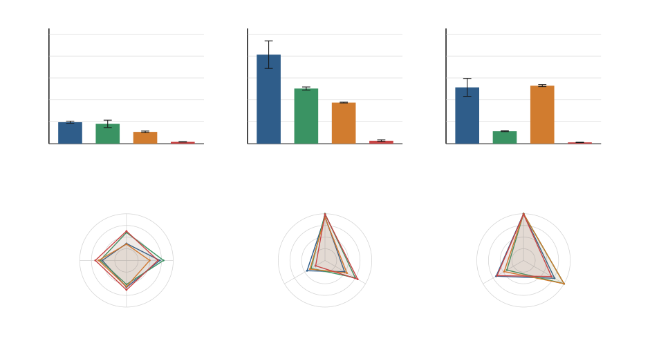
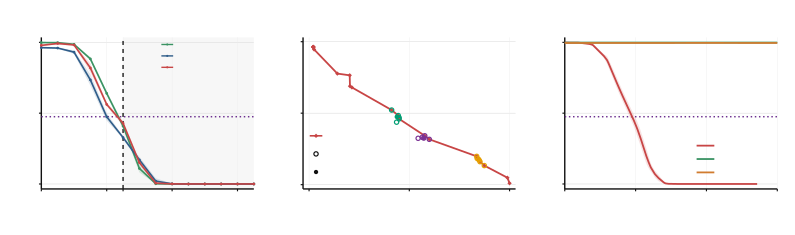
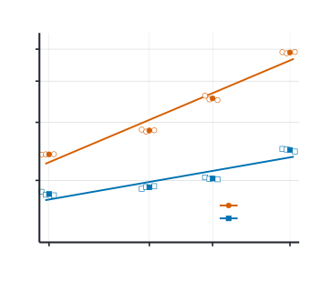
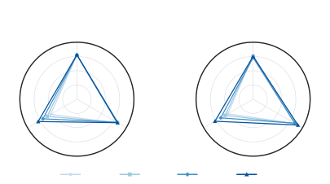
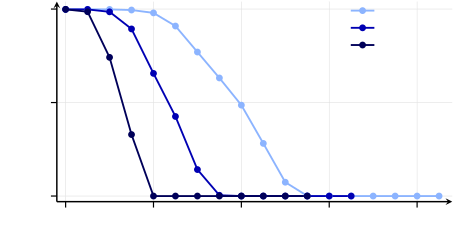
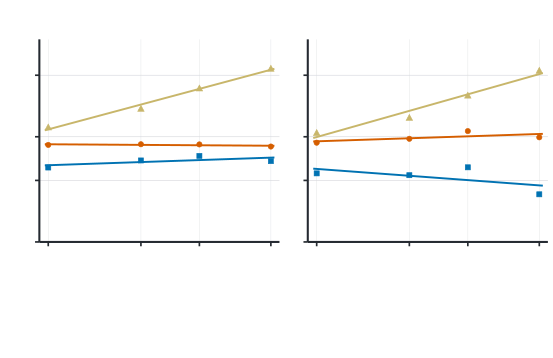

# Fast Unlearning at Scale via Margin Self-Correction

Federico Di Gennaro ^(†)^(†)thanks: Equal contribution.^(†)^(†)thanks:
Corresponding author: figennaro@ethz.ch Affiliation: ETH Zürich   
Alexander Shevchenko¹¹footnotemark: 1 Affiliation: ETH Zürich    Fanny
Yang Affiliation: ETH Zürich

###### Abstract

Language-model unlearning updates a trained model to behave as if it had
not seen selected training examples, while preserving utility and
avoiding costly retraining. Existing approaches typically fine-tune the
pretrained model with a fixed training budget and select the final model
_afterwards_ by evaluating several saved checkpoints on downstream
validation data. Two sources of unnecessary computation limit
scalability: training beyond the desired forget–retain trade-off, and
checkpoint selection that requires extra storage and repeated
evaluations. To address these limitations, we introduce _MArgin
Self-Correction_ (MASC), an efficient unlearning method with an _online_
stopping rule that does not require downstream evaluation. Given a text
sequence to be forgotten, MASC actively reduces the logit gap between
the original next token and the most likely alternatives. It outputs a
final model once this gap is small on average over a sufficiently large
proportion of token positions across all forget sequences. On TOFU, MUSE
News, and MUSE Books, MASC achieves a competitive forget–retain
trade-off at a fraction of the computational cost of existing baselines.
We further observe that as we increase model size (a.k.a. number of
parameters), the trade-offs improve for both MASC and SimNPO – the
forget metrics remain comparable while retain utility increases.

## 1 Introduction

Despite their remarkable success in tasks including code generation
\[37, 8\], mathematical reasoning \[26\], and scientific discovery
\[1\], Large Language Models (LLMs) are prone to memorizing sensitive
training data \[6\], including private information \[35, 43\] and
copyrighted content \[21\]. This tendency poses significant safety and
privacy risks, particularly as LLMs are nowadays increasingly deployed
in high-stakes domains \[25, 49\]. These concerns are also reflected in
legal frameworks such as the _California Consumer Privacy Act_ (CCPA)
\[3\] and the European _General Data Protection Regulation_ (GDPR)
\[17\], which establish rights to request the deletion of personal data,
often referred to as the _right to be forgotten_.

Machine unlearning \[2, 5, 28\] provides a computational framework for
such a goal. Given a trained model and a collection of examples to be
forgotten, the aim is to return a new model that behaves as if those
examples had never been used for training, while preserving its
performance on the rest of the data. The gold standard is exact
retraining, where the model is trained from scratch after removing the
forgotten examples from the training corpus. While retraining gives the
desired behavior _by definition_, it is computationally prohibitive for
modern language models. This motivates _approximate_ unlearning methods
which fine-tune the existing model. Approximate unlearning, however,
introduces a delicate forget–retain trade-off: weak procedures may leave
the target content reproducible, whereas overly aggressive interventions
may damage performance on unrelated data, reminiscent of the broader
problem of catastrophic forgetting \[28, 32, 34, 23\].



Figure 1: Top: Wall-clock runtimes (in seconds) of methods with similar
retain–forget trade-off. Bottom: Forget–retain trade-offs of timed
methods. Each metric is in $`[0,1]`$ (the higher the better), and MASC
is competitive (i.e. not Pareto dominated) with the others.

Existing methods – including Gradient Ascent (GA) \[50\], NPO \[51,
15\], and their regularized variants \[7, 33, 42\] – typically lack an
_online_ (i.e., during training) model selection rule to identify the
optimal (or desired) forget–retain trade-off without relying on costly
downstream evaluations. Instead, these algorithms generally run for a
predefined and fixed compute budget, which is both inefficient (cf.
Figure 1) and agnostic to the actual unlearning dynamics. Consequently,
practitioners are forced to select a final model retrospectively,
evaluating all saved checkpoints only after training is complete. This
leads to our first research question:


We introduce MArgin Self-Correction (MASC), an unlearning method whose
objective naturally admits an _adaptive_ stopping rule. MASC performs
gradient updates on a retain-regularized loss that discourages drift
from the original model on retain data, while correcting forget-set
token predictions that remain too dominant. Each forget continuation is
evaluated under teacher forcing: at every token position, MASC computes
a _restricted margin_, defined as the logit gap between the original
next token (also called _target token_) and a log-sum-exp aggregate of
the logits of the model’s top-$`k`$ alternatives to the original next
token. This margin measures how strongly the model still prefers the
forgotten token over plausible replacements. MASC then returns the first
checkpoint at which the margin condition is satisfied on a sufficiently
large fraction of monitored forget-set tokens. We show that this
token-level condition theoretically upper-bounds the probability of
exactly reproducing the forgotten continuation (cf. Proposition 1).
Thus, the returned checkpoint is selected online using the same
condition optimized during unlearning, rather than by running a fixed
training budget followed by downstream checkpoint evaluation.
Empirically, this yields competitive forget–retain trade-offs at a
fraction of the computational cost of existing baselines (see Figure 1).

This efficiency advantage is especially relevant at scale, where
unlearning costs during both finetuning and evaluation can grow quickly
with model size. Beyond computation, however, scale may also affect the
forget–retain behavior itself. While prior work has studied how
unlearning performance changes with the size of the deletion request
\[33, 42\], the role of _model size_ remains under-explored. Larger
models may internalize target information more strongly during
supervised finetuning \[36, 6, 31\], and respond differently when that
information is later removed. The second question we aim to answer is
therefore:


In this analysis, we distinguish between two levels of memorization:
_exact memorization_ \[6, 36, 31\], where the model reproduces target
content verbatim, and _knowledge memorization_, where the model recovers
the same underlying information under paraphrased prompts. During
supervised finetuning, both metrics grow with model size and follow
empirical power-law trends in log–log space, with a larger fitted
exponent for exact memorization. This indicates that scale amplifies
verbatim reproduction more strongly than paraphrase-based recovery.
After unlearning, however, forget-side metrics become roughly stable
across model sizes, while retain utility increases. This suggests that
scale mainly improves the utility side of the post-unlearning trade-off,
rather than systematically augmenting residual memorization of the
forgotten content.

To summarize, our main contributions are:

- •
  We introduce MASC, an efficient unlearning method that suppresses
  target tokens only when they remain much more likely than an aggregate
  of the top-$`k`$ most likely alternatives. We demonstrate on TOFU,
  MUSE News, and MUSE Books that MASC achieves competitive trade-offs
  with substantially shorter wall-clock runtime.
- •
  We provide a scaling study across the Qwen2.5 family, examining how
  scale affects different forms of memorization and how it benefits the
  final forget–retain frontier after unlearning (for both MASC and
  SimNPO \[15\]).

Datasets. We evaluate MASC on three standard LLM unlearning benchmarks:
TOFU \[33\], MUSE News, and MUSE Books \[42\]. TOFU is a synthetic
question-answering benchmark based on fictitious biographies. We use its
forget10/retain90 split, where 10% of examples are assigned to the
forget set and the remaining 90% to the retain set. MUSE provides a more
realistic setting based on memorized text from news articles (BBC) and
books (Harry Potter series).¹¹ 1 Code available at [
FedericoDiGennaro/Fast-LLM-Unlearning-MarginSelfCorrection](https://github.com/FedericoDiGennaro/Fast-LLM-Unlearning-MarginSelfCorrection)

Notation. For a finite set $`\mathcal{S}`$, we denote by
$`\Delta(\mathcal{S})=\{p\in\mathbb{R}^{\mathcal{S}}_{+}:\sum_{s\in\mathcal{S}}p_{s}=1\}`$
the probability simplex over it. If
$`\mathcal{S}\subseteq\mathbb{R}^{d}`$ and $`r\in\mathbb{N}`$ is
positive, we write $`S^{r}`$ for the $`r`$-fold Cartesian product of
$`\mathcal{S}`$. Finally, for $`x\in\mathbb{R}`$, we use
$`[x]_{+}=\max\{x,0\}`$ to denote the positive part of $`x`$. For an
integer $`T\in\mathbb{N}`$, we denote $`[T]`$ as the set
$`\{1,...,T\}`$.

## 2 LLM unlearning and prior work

This section introduces the notation for LLM unlearning and provides a
non-exhaustive overview (see Appendix A for a more detailed discussion)
of well-known unlearning methods that we later use as baselines.

Let $`\mathcal{V}`$ denote the token vocabulary, and let
$`\Delta(\mathcal{V})`$ be the probability simplex over $`\mathcal{V}`$.
Then, let $`\mathcal{C}=\bigcup_{\ell\geq 0}\mathcal{V}^{\ell}`$ denote
the set of finite token contexts. An autoregressive language model with
parameters $`\theta\in\mathbb{R}^{d}`$ is defined as a policy
$`\pi_{\theta}:\mathcal{C}\to\Delta(\mathcal{V})`$, where
$`\pi_{\theta}(\cdot\mid c)=\mathrm{softmax}(z_{\theta}(\cdot\mid c))`$
is the next-token distribution over $`\mathcal{V}`$ given context
$`c\in\mathcal{C}`$, and $`z_{\theta}(\cdot\mid c)`$ denotes the
corresponding _logits_. Given a sample consisting of a prompt
$`x\in\mathcal{X}`$ and a continuation
$`y=(y_{1},\dots,y_{T})\in\mathcal{V}^{T}`$, we evaluate a policy on
$`(x,y)`$ using the probability it assigns to the full continuation,
which factorizes as
$`\pi_{\theta}(y\mid x)=\prod_{t=1}^{T}\pi_{\theta}(y_{t}\mid c_{t})`$,
where $`c_{t}=(x,y_{<t})`$. This corresponds to _teacher-forced_
evaluation: each next-token distribution is conditioned on the reference
prefix $`c_{t}`$, rather than on tokens sampled from the model.
Evaluating $`\pi_{\theta}(y\mid x)`$ therefore only requires standard
forward passes on the given prompt-continuation pair.

Let $`\mathcal{D}_{\mathrm{fg}}`$ denote the data²² 2 With a slight
abuse of notation, we also use $`\mathcal{D}_{\mathrm{fg}}`$ and
$`\mathcal{D}_{\mathrm{ret}}`$ to denote the empirical distributions
obtained by sampling uniformly from the corresponding finite datasets.
to be forgotten, and $`\mathcal{D}_{\mathrm{ret}}`$ the data on which
the model’s behavior should be preserved. An LLM unlearning algorithm
$`\mathcal{A}`$ takes as input the weights
$`\theta_{0}\in\mathbb{R}^{d}`$ of a pretrained model together with
$`\mathcal{D}_{\mathrm{fg}}`$ (and usually also
$`\mathcal{D}_{\mathrm{ret}}`$), and returns updated weights
$`\theta_{\mathrm{unl}}\in\mathbb{R}^{d}`$. The goal is for the
resulting policy $`\pi_{\theta_{\mathrm{unl}}}`$ to behave as if
$`\mathcal{D}_{\mathrm{fg}}`$ had not been used for training, while
preserving performance on $`\mathcal{D}_{\mathrm{ret}}`$. The key
computational challenge is to avoid retraining the model from scratch. A
common approach is to minimize a _forget_ loss
$`\mathcal{L}_{\mathrm{fg}}(\theta;\mathcal{D}_{\mathrm{fg}})`$.
Different unlearning methods correspond to different choices of such a
loss, often combined with additional regularization to preserve
retain-set behavior. Arguably, the most natural choice for
$`\mathcal{L}_{\mathrm{fg}}`$ is

```math
\mathcal{L}_{\mathrm{fg}}^{\mathrm{GA}}(\theta;\mathcal{D}_{\mathrm{fg}})=\mathbb{E}_{(x,y)\sim\mathcal{D}_{\mathrm{fg}}}\left[\log\pi_{\theta}(y\mid x)\right], \tag{1}
```

which penalizes policies that assign a high probability to the forget
continuations. Equivalently, since standard language-model pretraining
minimizes next-token cross-entropy, minimizing
$`\mathcal{L}_{\mathrm{fg}}^{\mathrm{GA}}`$ by gradient descent performs
gradient ascent on the original cross-entropy objective restricted to
$`\mathcal{D}_{\mathrm{fg}}`$. The resulting update _reverses_
likelihood-based learning on the forget data, and is therefore commonly
referred to as Gradient Ascent (GA) unlearning. However, GA provides no
intrinsic mechanism for stopping this likelihood decrease: continued
optimization can keep lowering the probability of the forget
continuation and may quickly degrade the model’s behavior beyond the
forget set. Negative Preference Optimization (NPO) \[51\] addresses this
issue by replacing direct likelihood minimization with a bounded
preference-style objective \[39\]. Rather than indefinitely pushing down
the likelihood of the forget-set continuations, NPO treats it as a
negative preference example relative to the original model. In
particular,

```math
\mathcal{L}_{\mathrm{fg}}^{\mathrm{NPO}}(\theta;\mathcal{D}_{\mathrm{fg}})=-\frac{2}{\beta}\mathbb{E}_{(x,y)\sim\mathcal{D}_{\mathrm{fg}}}\left[\log\sigma\!\left(-\beta\log\frac{\pi_{\theta}(y\mid x)}{\pi_{\theta_{0}}(y\mid x)}\right)\right], \tag{2}
```

where $`\beta>0`$ is an inverse-temperature parameter and
$`\sigma(u)=(1+e^{-u})^{-1}`$ is the sigmoid function. Unlike GA, NPO
weakens the forget update once the forget continuation is already much
less likely under the current model than under the original one. Indeed,
if
$`r_{\theta}=\log\frac{\pi_{\theta}(y\mid x)}{\pi_{\theta_{0}}(y\mid x)}`$,
then the gradient scales as $`\sigma(\beta r_{\theta})`$, which vanishes
for large negative $`r_{\theta}`$. However, because NPO compares the
current likelihood to the original model likelihood
$`\pi_{\theta_{0}}(y\mid x)`$, the magnitude of the forget update
depends on the reference-model score of each example, and can therefore
vary with sequence length or reference likelihood. SimNPO \[15\] removes
this dependence by using a reference-free, length-normalized variant of
the NPO objective. Although Equations 1 and 2 define common forget-side
objectives, practical unlearning methods typically combine them with a
retain regularizer to improve the forget–retain trade-off. This leads to
objectives of the form

```math
\min_{\theta}\quad\mathcal{L}_{\mathrm{fg}}(\theta;\mathcal{D}_{\mathrm{fg}})+\lambda_{\mathrm{ret}}\mathcal{L}_{\mathrm{ret}}(\theta;\mathcal{D}_{\mathrm{ret}},\theta_{0}), \tag{3}
```

where $`\mathcal{L}_{\mathrm{fg}}`$ encourages suppression of the forget
data, while $`\mathcal{L}_{\mathrm{ret}}`$ (computed on
$`\mathcal{D}_{\mathrm{ret}}`$) discourages unnecessary drift from the
original model $`\pi_{\theta_{0}}`$. The retain term is typically
implemented as a KL penalty relative to $`\pi_{\theta_{0}}`$ or as a
cross-entropy loss on retained examples.

The main limitation of the above forget losses is that they only specify
what should be made less likely, not what the model should do instead.
The probability $`\pi_{\theta}(y\mid x)`$ can be decreased by
concentrating mass on a few alternative continuations, spreading mass
broadly, or degrading the next-token distribution more generally. Since
these sequence-level objectives do not specify what should happen at
each next-token prediction, they also provide no direct criterion for
deciding when an original forget-set token has become sufficiently
non-dominant relative to its alternatives. Further, although these
objectives provide strong and widely used baselines, the computational
cost of unlearning can be substantial. In practice, one must either fix
the unlearning budget in advance (i.e., the number of finetuning
epochs), or periodically evaluate intermediate models to decide which
one should be returned. The latter requires downstream forget–retain
validation data, since the checkpoint is selected using external metrics
rather than a condition monitored during training. Saving many
checkpoints and selecting among them after training further adds storage
and evaluation overhead. To address these limitations, we introduce
MASC, an unlearning objective based on a token-level dominance
condition: a forget token should no longer dominate the model’s
top-$`k`$ non-target alternatives under the same reference prefix. This
condition defines both the forget loss and the online stopping rule:
MASC stops once it is satisfied on a sufficiently large fraction of
monitored forget-set tokens, allowing the returned checkpoint to be
selected during training without downstream validation.

## 3 MASC: MArgin Self-Correction

This section introduces MASC (MArgin Self-Correction) and derives its
objective from first principles. MASC is based on a simple observation:
exact reproduction of a forget sequence requires many positions at which
the model assigns high probability to the true next token when evaluated
under _teacher forcing_, i.e., when conditioned on the true prefix. We
now turn this observation into a token-level comparison that will define
both the forget loss and the stopping rule.

### 3.1 Token dominance and margins

We first define token-dominance measures, which we use in our unlearning
algorithm. Intuitively, on the forget set, we want to lower the
probability of the true next-token continuation given the true prefix,
while preserving overall utility. Our approach therefore reduces the
dominance of the highest-probability token relative to its nearest
alternatives, without substantially altering the rest of the
distribution.

#### Restricted token comparison.

Let $`(x,y)\sim\mathcal{D}_{\mathrm{fg}}`$ be a forget example, where
$`x\in\mathcal{X}`$ and $`y=(y_{1},\ldots,y_{T})\in\mathcal{V}^{T}`$.
For each position $`t\in[T]`$ of the sequence, the teacher-forced
context is $`c_{t}=(x,y_{<t})`$ and $`y_{t}`$ is called _target_ token.
Recall that $`\pi_{\theta}(\cdot\mid c_{t})`$ denotes the next-token
distribution over $`\mathcal{V}`$, and $`z_{\theta}(v\mid c_{t})`$ is
the logit of each token $`v\in\mathcal{V}`$. Rather than comparing
$`y_{t}`$ to the full vocabulary, we focus on the set of the model’s
top-$`k`$ non-target alternative tokens, denoted as

```math
\mathcal{S}_{\theta,k}(c_{t})=\arg\max_{\begin{subarray}{c}\mathcal{S}\subseteq\mathcal{V}\setminus\{y_{t}\}\\
|\mathcal{S}|=k\end{subarray}}\sum_{v\in\mathcal{S}}\pi_{\theta}(v\mid c_{t}), \tag{4}
```

with ties broken arbitrarily.³³ 3 We do not differentiate through the
top-$`k`$ operation; gradients are taken only through the logits
appearing in the loss. For $`\beta>0`$, further define the _restricted_
probability⁴⁴ 4 For $`\beta=1`$, this is exactly the probability
obtained by restricting $`\pi_{\theta}(\cdot\mid c_{t})`$ to
$`\{y_{t}\}\cup\mathcal{S}_{\theta,k}(c_{t})`$ and renormalizing. of the
target token $`y_{t}`$

```math
\pi_{\theta}^{(k,\beta)}(y_{t}\mid c_{t})=\frac{\exp(\beta z_{\theta}(y_{t}\mid c_{t}))}{\exp(\beta z_{\theta}(y_{t}\mid c_{t}))+\sum_{v\in\mathcal{S}_{\theta,k}(c_{t})}\exp(\beta z_{\theta}(v\mid c_{t}))}. \tag{5}
```

This restricted probability can be interpreted as a measure of local
dominance and gives rise to a natural constraint

###### Definition 1.

For a threshold $`\rho\in(0,1)`$, we say that the target token $`y_{t}`$
is locally suppressed in context $`c_{t}`$ if
$`\pi_{\theta}^{(k,\beta)}(y_{t}\mid c_{t})\leq\rho`$.

MASC uses this local-dominance measure as a constraint and hence
implicitly asks: is the forget token still preferred over plausible
replacements? Proposition 1 shows that controlling this _local
dominance_ on many positions is enough to control exact reproduction of
the whole continuation.

###### Proposition 1.

Consider a forget prompt $`x`$ and the corresponding continuation
$`y=(y_{1},\ldots,y_{T})`$, evaluated under teacher forcing. Let
$`c_{t}=(x,y_{<t})`$, and let $`\beta=1`$. Assume there exists a set
$`I\subseteq\{1,\ldots,T\}`$ with $`|I|\geq\lceil(1-\alpha)T\rceil`$
such that $`\pi_{\theta}^{(k,1)}(y_{t}\mid c_{t})\leq\rho`$ for every
$`t\in I`$. Then

```math
\pi_{\theta}(y\mid x)=\prod_{t=1}^{T}\pi_{\theta}(y_{t}\mid c_{t})\leq\rho^{\lceil(1-\alpha)T\rceil}.
```

The proof of Proposition 1 is deferred to Appendix B. The proposition
shows that enforcing the condition of Definition 1 on many positions
$`t\in[T]`$ gives a bound on the probability of exactly reproducing the
forgotten continuation $`y`$ from prompt $`x`$.

Remark. The parameter $`k`$ does not appear in the bound because the
proposition is conditional on the local constraint being satisfied: for
any $`k<|\mathcal{V}|`$, once
$`\pi_{\theta}^{(k,1)}(y_{t}\mid c_{t})\leq\rho`$, the full-vocabulary
probability also satisfies $`\pi_{\theta}(y_{t}\mid c_{t})\leq\rho`$.
Thus, $`k`$ only determines how stringent the local comparison is, while
the sequence-level bound depends on $`\rho`$ and on the number of
controlled positions. We defer the discussion of how $`k`$ affects the
optimization of the proposed algorithm to Section D.4.


#### From probabilities to margins.

Proposition 1 gives an upper bound on exact reproduction when the
condition in Definition 1 is met for many forget tokens in the sequence.
A direct surrogate would penalize violations with
$`[\pi_{\theta}^{(k,\beta)}(y_{t}\mid c_{t})-\rho]_{+}`$. However, this
probability-space penalty can have weak gradients when the observed
token already dominates the restricted set. In that regime, the softmax
probability is close to one, so even large changes in the underlying
logit margin produce only small changes in the penalized quantity. We
therefore propose an alternative logit-space condition based on the
following _restricted margin_

```math
m_{\theta}^{(k,\beta)}(x,y,t)=\beta z_{\theta}(y_{t}\mid c_{t})-\log\sum_{v\in\mathcal{S}_{\theta,k}(c_{t})}\exp(\beta z_{\theta}(v\mid c_{t})). \tag{6}
```

The margin in (6) compares the target-token logit with the log-sum-exp⁵⁵
5 The log-sum-exp term is a smooth approximation of the maximum
alternative logit. Larger $`\beta`$ makes the margin closer to a gap
against the strongest alternative, while smaller $`\beta`$ averages more
broadly over the top-$`k`$ alternatives. aggregate of the selected
alternative logits. Large margins correspond to strong target-token
preference; small margins correspond to competitive alternatives.
Moreover, because this quantity is defined directly on the logits,
increasing dominance of the observed token continues to increase the
violation linearly. In addition, the following lemma establishes that
imposing a threshold on the restricted probability as in Definition 1 is
equivalent to imposing a corresponding threshold on the margin of
Equation 6.

###### Lemma 1.

Fix $`\rho\in(0,1)`$ and define $`\tau_{\rho}=\log(\rho/(1-\rho))`$.
Then, for any forget position $`t`$ and any $`\beta>0`$,
$`\pi_{\theta}^{(k,\beta)}(y_{t}\mid c_{t})\leq\rho`$ if and only if
$`m_{\theta}^{(k,\beta)}(x,y,t)\leq\tau_{\rho}`$.

### 3.2 MASC: Unlearning with Margin Self-Correction

We are now ready to propose our new unlearning method, MASC, that
returns a policy whose restricted margin condition is violated on at
most an $`\alpha`$ fraction of the forget-set tokens. Specifically, the
algorithm uses the average $`V_{\rho}`$ of the _per-example violation
rate_ $`v_{\rho}`$ over the forget set

```math
v_{\rho}(\theta;x,y)=\frac{1}{T}\sum_{t=1}^{T}\mathbf{1}\{m_{\theta}^{(k,\beta)}(x,y,t)>\tau_{\rho}\},\quad V_{\rho}(\theta;\mathcal{D}_{\mathrm{fg}})=\mathbb{E}_{(x,y)\sim\mathcal{D}_{\mathrm{fg}}}\left[v_{\rho}(\theta;x,y)\right]. \tag{7}
```

In words, $`V_{\rho}`$ corresponds to the fraction of forget tokens
whose restricted target probability remains above $`\rho`$. Our proposed
unlearning objective then aims to find models that satisfy a forget
constraint of the form
$`V_{\rho}(\theta;\mathcal{D}_{\mathrm{fg}})\leq\alpha`$ for some
$`\alpha\in[0,1]`$, while behaving similarly to the original model on
retain data. In particular, motivated by recent evidence that
policy-level KL divergence is closely tied to forgetting dynamics
\[40\], we choose to minimize the KL divergence (averaged over retain
continuations) between $`\pi_{\theta_{0}}`$ and the currently optimized
policy $`\pi_{\theta}`$. All in all, we aim to solve

```math
\min_{\theta}\quad\underbrace{\mathbb{E}_{(x,y)\sim\mathcal{D}_{\mathrm{ret}}}\left[\frac{1}{T}\sum_{t=1}^{T}\mathrm{KL}\!\left(\pi_{\theta_{0}}(\cdot\mid x,y_{<t})\,\middle\|\,\pi_{\theta}(\cdot\mid x,y_{<t})\right)\right]}_{\mathcal{L}_{\mathrm{ret}}^{\mathrm{KL}}(\theta,\theta_{0})}\quad\text{s.t.}\quad V_{\rho}(\theta;\mathcal{D}_{\mathrm{fg}})\leq\alpha. \tag{8}
```

In order to solve this optimization problem with gradient-based
algorithms, we first replace the indicator in (7) with the hinge loss
$`\psi_{\rho,\eta}(m)=[m-(\tau_{\rho}-\eta)]_{+}/\eta`$ as a surrogate
loss that satisfies
$`\mathbf{1}\{m>\tau_{\rho}\}\leq\psi_{\rho,\eta}(m)`$. The final MASC
algorithm then minimizes the following Lagrangian objective with
gradient descent:

```math
\min_{\theta}\mathcal{L}_{\mathrm{ret}}^{\mathrm{KL}}(\theta,\theta_{0})+\lambda\mathcal{L}_{\mathrm{fg}}^{\mathrm{MASC}}(\theta)\>\>\text{where}\>\>\mathcal{L}_{\mathrm{fg}}^{\mathrm{MASC}}(\theta)=\mathbb{E}_{(x,y)\sim\mathcal{D}_{\mathrm{fg}}}\left[\frac{1}{T}\sum_{t=1}^{T}\psi_{\rho,\eta}\!\left(m_{\theta}^{(k,\beta)}(x,y,t)\right)\right]. \tag{9}
```



Figure 2: (Left:) Correlation between stopping statistic
$`\hat{V}_{\rho}`$ and forget–retain trade-off. (Middle:) Pareto
frontier (top-right is the ideal) of MASC training dynamics. (Right:)
$`\hat{V}_{\rho}`$ versus number of forget tokens seen during training
for three different unlearning methods. \[Plots refer to TOFU\].

Note that for a fixed set $`\mathcal{S}_{\theta,k}(c_{t})`$, consisting
of tokens without a sufficient slack
$`\tau_{\rho}-m_{\theta}^{(k,\beta)}(x,y,t)<\eta`$, the gradient
$`\nabla\mathcal{L}_{\mathrm{fg}}^{\mathrm{MASC}}`$ decreases the target
next-token logit, and increases the probabilities of the competitive
alternatives relative to the target token (see Appendix C for the full
derivation). On the other hand, tokens with sufficient slack have zero
gradient. Given an initial fine-tuned model $`\theta_{0}`$, MASC runs
gradient updates with model weights $`\theta^{(s)}`$ at step $`s`$.
Crucially, it terminates using a stopping rule that monitors the average
violation rate on a subset
$`\mathcal{D}_{\mathrm{val}}\subset\mathcal{D}_{\mathrm{fg}}`$

```math
\widehat{V}_{\rho}\big(\theta^{(s)};\mathcal{D}_{\mathrm{val}}\big)=\frac{1}{|\mathcal{D}_{\mathrm{val}}|}\sum_{(x,y)\in\mathcal{D}_{\mathrm{val}}}\frac{1}{T_{y}}\sum_{t=1}^{T_{y}}\mathbf{1}\!\left\{m_{\theta^{(s)}}^{(k,\beta)}(x,y,t)>\tau_{\rho}\right\},
```

where $`T_{y}`$ is the length of sequence $`y`$. In particular,
$`\mathcal{D}_{\mathrm{val}}`$ is drawn at random as a small _off-batch_
subset of $`\mathcal{D}_{\mathrm{fg}}`$ (of size $`8`$ to $`16`$ in our
experiments) and is employed during training only as a stopping
condition. Note that choosing a small $`\mathcal{D}_{\mathrm{val}}`$
avoids a more costly pass over the entire $`\mathcal{D}_{\mathrm{fg}}`$
while still providing a usable stopping signal (see Section 4).
Moreover, $`\mathcal{D}_{\mathrm{val}}`$ is independent of downstream
evaluation⁶⁶ 6 In many datasets, training data is usually in the form of
raw text, while evaluation data is in the form of Q&A text. and does not
require creating extra datasets (beyond the ones provided by the
benchmark suites) that are more _aligned_ with the downstream evaluation
sets (e.g., \[53\]). MASC stops at the first instance at which the
monitored violation rate falls below tolerance $`\alpha`$, i.e. at step

```math
\tau_{\alpha}=\inf\left\{s\geq 0:\widehat{V}_{\rho}\big(\theta^{(s)};\mathcal{D}_{\mathrm{val}}\big)\leq\alpha\right\}.
```

The final policy that MASC outputs is
$`\pi_{\text{MASC}}=\pi_{\theta^{(\tau_{\alpha})}}`$ (cf. Algorithm 1 in
Appendix). MASC is closest in spirit to recent logit-level unlearning
methods such as UNDIAL \[10\], Unilogit \[46\], and constrained entropy
or logit-flattening approaches \[13\]. Unlike these methods, which
distill toward modified full-vocabulary targets or flatten the
predictive distribution under a fixed budget, MASC enforces a relative
local condition against a small set of model-proposed alternatives and
uses the same condition for early stopping.

#### Monitored violation rate.

Experiments strongly suggest that the monitored violation rate
$`\widehat{V}_{\rho}`$ behaves as intended. First, Figure 2 (Left) shows
how, along the MASC optimization trajectory, $`\widehat{V}_{\rho}`$
(computed on
$`\mathcal{D}_{\mathrm{val}}\subset\mathcal{D}_{\mathrm{fg}}`$) closely
tracks the forget–retain trade-off measured by standard downstream
evaluation metrics (which are not computed during training). In
addition, we observe how the trajectory traces a Pareto frontier on the
forget–retain trade-off space and the tolerance $`\alpha`$ selects
different points on this frontier; see Figure 2 (Middle). A natural
question is whether the same stopping statistic could serve as a generic
early-stopping criterion for other unlearning objectives. Our
experiments suggest that it does not: under the same budget of processed
forget tokens, $`\widehat{V}_{\rho}`$ decreases steadily for MASC but
remains close to its initial value for GradDiff and SimNPO; see Figure 2
(Right). This provides strong empirical evidence that unlike MASC, other
established unlearning methods would not stop early using the same
stopping criterion, as they are not designed to reduce the violation
statistic.

## 4 Experiments

We now evaluate MASC against several baselines on three well-known LLM
unlearning datasets: TOFU (90/10 split), MUSE News, and MUSE Books.

|                   |                            |                         |                          |                 |                           |
| ----------------- | -------------------------- | ----------------------- | ------------------------ | --------------- | ------------------------- |
|                   | Unlearning Efficacy        |                         |                          | Retain Utility  | Efficiency                |
| Method            | $`1-`$ROUGE-L $`\uparrow`$ | $`1-`$Prob $`\uparrow`$ | Truth Ratio $`\uparrow`$ | MU $`\uparrow`$ | Time (sec) $`\downarrow`$ |
| Base (Llama-2 7B) | 0.024                      | 0.010                   | 0.519                    | 0.628           | –                         |
| Retrain           | 0.601                      | 0.852                   | 0.681                    | 0.613           | –                         |
| GA                | 0.330 \[0.029\]            | 0.829 \[0.022\]         | 0.555 \[0.007\]          | 0.459 \[0.014\] | 306.6 \[40.2\]            |
| GradDiff          | 0.598 \[0.020\]            | 0.792 \[0.003\]         | 0.514 \[0.003\]          | 0.561 \[0.005\] | 907.3 \[168.5\]           |
| NPO               | 0.366 \[0.023\]            | 0.666 \[0.005\]         | 0.580 \[0.012\]          | 0.533 \[0.003\] | 856.3 \[36.4\]            |
| NPO+KLR           | 0.362 \[0.016\]            | 0.713 \[0.006\]         | 0.577 \[0.006\]          | 0.516 \[0.006\] | 983.3 \[48.9\]            |
| RMU               | 0.080 \[0.004\]            | 0.103 \[0.011\]         | 0.523 \[0.000\]          | 0.618 \[0.001\] | 305.4 \[41.8\]            |
| SimNPO            | 0.349 \[0.006\]            | 0.497 \[0.004\]         | 0.562 \[0.001\]          | 0.596 \[0.001\] | 541.7 \[37.8\]            |
| MASC (Ours)       | 0.629 \[0.142\]            | 0.672 \[0.127\]         | 0.633 \[0.020\]          | 0.666 \[0.003\] | 87.9 \[8.1\]              |

|            |                   |                                                      |                                                      |                                                     |                           |
| ---------- | ----------------- | ---------------------------------------------------- | ---------------------------------------------------- | --------------------------------------------------- | ------------------------- |
|            |                   | Unlearning Efficacy                                  |                                                      | Retain Utility                                      | Efficiency                |
| Dataset    | Method            | VerbMem $`\mathcal{D}_{\mathrm{fg}}`$ $`\downarrow`$ | KnowMem $`\mathcal{D}_{\mathrm{fg}}`$ $`\downarrow`$ | KnowMem $`\mathcal{D}_{\mathrm{ret}}`$ $`\uparrow`$ | Time (sec) $`\downarrow`$ |
| MUSE News  | Base (Llama-2 7B) | 57.25                                                | 66.45                                                | 54.90                                               | –                         |
|            | Retrain           | 20.26                                                | 32.55                                                | 55.31                                               | –                         |
|            | GA                | 0.00 \[0.00\]                                        | 0.00 \[0.00\]                                        | 0.00 \[0.00\]                                       | 183.04 \[0.01\]           |
|            | GradDiff          | 0.26 \[0.19\]                                        | 25.30 \[3.22\]                                       | 34.38 \[3.01\]                                      | 2517.87 \[71.38\]         |
|            | NPO               | 0.00 \[0.00\]                                        | 0.00 \[0.00\]                                        | 0.00 \[0.00\]                                       | 227.88 \[0.01\]           |
|            | NPO+KLR           | 6.32 \[1.38\]                                        | 51.78 \[3.50\]                                       | 44.36 \[2.97\]                                      | 4062.76 \[628.86\]        |
|            | RMU               | 27.15 \[1.33\]                                       | 47.81 \[3.74\]                                       | 41.95 \[3.04\]                                      | 1076.06 \[89.67\]         |
|            | SimNPO            | 8.03 \[0.61\]                                        | 45.81 \[3.64\]                                       | 37.02 \[3.00\]                                      | 1877.52 \[18.81\]         |
|            | MASC (Ours)       | 1.10 \[0.25\]                                        | 19.37 \[3.04\]                                       | 23.14 \[2.79\]                                      | 138.68 \[37.28\]          |
| MUSE Books | Base (ICLM-7B)    | 99.70                                                | 47.12                                                | 69.13                                               | –                         |
|            | Retrain           | 14.45                                                | 30.29                                                | 68.74                                               | –                         |
|            | GA                | 0.00 \[0.00\]                                        | 0.00 \[0.00\]                                        | 0.00 \[0.00\]                                       | 290.16 \[0.01\]           |
|            | GradDiff          | 0.00 \[0.00\]                                        | 0.00 \[0.00\]                                        | 41.23 \[4.12\]                                      | 572.23 \[18.70\]          |
|            | NPO               | 0.00 \[0.00\]                                        | 0.00 \[0.00\]                                        | 0.00 \[0.00\]                                       | 355.13 \[2.90\]           |
|            | NPO+KLR           | 0.00 \[0.00\]                                        | 23.34 \[3.28\]                                       | 67.74 \[3.89\]                                      | 2570.19 \[407.62\]        |
|            | RMU               | 11.05 \[0.38\]                                       | 22.37 \[3.40\]                                       | 60.76 \[3.96\]                                      | 1477.86 \[108.12\]        |
|            | SimNPO            | 0.00 \[0.00\]                                        | 0.00 \[0.00\]                                        | 47.79 \[4.17\]                                      | 2647.71 \[45.48\]         |
|            | MASC (Ours)       | 0.90 \[0.80\]                                        | 30.90 \[1.30\]                                       | 65.30 \[1.20\]                                      | 64.94 \[0.49\]            |

Table 1: TOFU (forget10/retain90) results. Averages and standard
deviations are reported as avg \[std\]. We mark the best-performing
unlearning method in bold and underline the runner-up for each metric.

Table 2: MUSE results. Averages and standard deviations are reported as
$`\mathrm{avg_{[std]}}`$. We mark the best-performing model in bold,
excluding Base, Retrain, and models with zero retain utility
($`\mathrm{KnowMem}\ \mathcal{D}_{\mathrm{ret}}`$), and underline the
runner-up for each metric. Ties are resolved by retain utility.

Baselines. We compare MASC against standard unlearning baselines: (i)
Gradient Ascent (GA) \[50\]; (ii) GradDiff (or GA+GDR) \[33\], which
adds a retain-side correction by combining GA on the forget set with
gradient descent on retained examples; (iii) NPO \[51\]; (iv) NPO+KLR,
which combines the NPO objective together with a KL retain regularizer
to reduce drift on $`\mathcal{D}_{\mathrm{ret}}`$ \[42\]; (v) RMU, a
representation-level method that redirects activations associated with
the forget data \[27\]; (vi) SimNPO \[15\]. We also include pretrained
and retrain (on $`\mathcal{D}_{\mathrm{ret}}`$ only) baselines for
comparison. In all MASC experiments, we keep the backbone model frozen
and show that the unlearning update can be performed effectively by
training only LoRA adapters \[18\]. This also makes MASC
memory-efficient and confines the update to a small trainable module.

Metrics. On TOFU, unlearning-efficacy metrics are: $`1-`$ROUGE-L,
measuring lexical dissimilarity from the target answer; $`1-`$Prob.,
measuring the reduction in teacher-forced probability of the target
continuation; Truth Ratio, measuring the preference for perturbed
alternatives over the true forgotten answer. On the other hand, MU
measures utility on the retain portion of the data. For MUSE News and
MUSE Books, we report VerbMem $`\mathcal{D}_{\mathrm{fg}}`$,
corresponding to _verbatim_ memorization on the forget set; KnowMem
$`\mathcal{D}_{\mathrm{fg}}`$, measuring _knowledge_ memorization on the
forget set; KnowMem $`\mathcal{D}_{\mathrm{ret}}`$, which accounts for
knowledge preservation on the retain set. Additional metrics are
reported in Appendix E. We measure wall-clock unlearning runtime in
seconds. To make timing comparable, all methods are run on the same
hardware⁷⁷ 7 All experiments are run on a single H100 GPU., data
pipeline for each dataset, and evaluation-free training loop. Timing
starts after model and data loading, and stops when the method returns
its checkpoint: at the prescribed final step for fixed-schedule
baselines, and at the first checkpoint satisfying
$`\widehat{V}_{\rho}\leq\alpha`$ for MASC. We exclude shared one-time
costs such as model loading and dataset preprocessing, but we include
optimizer steps, forward/backward passes, retain batches, KL
computations, and MASC online probe checks. Baselines are run using code
from their official repositories and with the reported best
hyperparameters. For timing, we measure the number of epochs specified
by each baseline’s selected hyperparameter setting, even when
reproducing the reported forget-retain trade-off required additional
epochs in our runs. Moreover, when timing MASC’s competitors, we do not
include the cost of offline checkpoint selection based on downstream
metric evaluation. Thus, whenever possible, our comparison favors the
baselines in both runtime and forget–retain performance.

Results. Tables 2 and 2 show that MASC consistently achieves a
competitive forget–retain trade-off across the three datasets using a
fraction of the wall-clock runtime required by the other methods (see
Figure 5 in Appendix D for a visual summary of such a trade-off). On
TOFU, MASC obtains the best $`1-`$ROUGE-L, Truth Ratio, retain MU, as
well as the shortest wall-clock time, while remaining competitive on
$`1-`$Prob. On MUSE Books, MASC preserves retain utility close to the
strongest non-collapsed (i.e., those with nonzero retain utility)
baselines at a significantly lower computational cost. On MUSE News,
MASC achieves lower KnowMem on $`\mathcal{D}_{\mathrm{fg}}`$ than most
baselines, although its retain utility is sometimes slightly lower.


## 5 The effect of scale on unlearning



|         |                  |                 |           |
| ------- | ---------------- | --------------- | --------- |
| Metric  | $`\hat{\alpha}`$ | $`\log\hat{C}`$ | $`R^{2}`$ |
| E-ROUGE | 0.269            | -0.603          | 0.954     |
| P-ROUGE | 0.111            | -0.972          | 0.847     |

Figure 3: Learning stage. Fitted scaling laws (log-log plot).

Improving the efficiency of unlearning methods is a necessary step
toward scaling these procedures to increasingly large models. However,
to the best of our knowledge, there is no systematic study on how model
size affects unlearning efficacy. Some related recent studies suggest
that memorization increases with scale during training \[6, 36, 31\] so
that larger models may therefore enter the unlearning stage with
different levels and forms of memorization. At the same time, it is
unclear how scale would then affect the final forget–retain trade-off
after unlearning. In this section, we study the scaling behavior of the
_learning-unlearning pipeline_ of MASC and SimNPO across model sizes on
the Qwen2.5 model family using the TOFU dataset.

### 5.1 Unlearning procedures and metrics

We now describe the learning-unlearning pipeline, along with the
memorization metrics used.

End-to-end unlearning pipeline. Most LLM unlearning benchmarks,
including TOFU \[33\], MUSE \[42\], and WMDP \[27\], are built from a
common two-stage pipeline. (1) Learning. An initial model
$`\pi_{\mathrm{init}}`$ is finetuned on the full benchmark data
$`\mathcal{D}=\mathcal{D}_{\mathrm{fg}}\cup\mathcal{D}_{\mathrm{ret}}`$
to yield a task-adapted model $`\pi_{\theta_{0}}`$ (usually called
_base_ model) that contains both forget and retain information. (2)
Unlearning. An unlearning algorithm $`\mathcal{A}`$ (here MASC and
SimNPO) is then applied to $`\pi_{\theta_{0}}`$ using the split
$`(\mathcal{D}_{\mathrm{fg}},\mathcal{D}_{\mathrm{ret}})`$, producing an
unlearned model $`\pi_{\theta_{\mathrm{unl}}}`$. Following this
pipeline, we evaluate the Qwen2.5 model family at different scales on
TOFU and track how forget-set memorization changes from learning to
unlearning.

Two memorization levels. We use TOFU built-in metrics to distinguish
between two levels of memorization. The first level is _exact
memorization_: the model reproduces the target answer under the original
question. We measure this with Exact Q&A ROUGE (E-ROUGE), that computes
lexical overlap between the model output and the gold answer on the
original TOFU questions. The second level is _paraphrase-robust
knowledge memorization_: the model recovers the same underlying answer
even when the question is paraphrased, measured by Paraphrased Q&A ROUGE
(P-ROUGE). To measure the resulting forget–retain trade-off, we also
report retain utility, measured by MU, TOFU aggregate score on
$`\mathcal{D}_{\mathrm{ret}}`$.

### 5.2 Effects of size on unlearning

We first examine the learning stage, where the model is
supervised-finetuned on the full benchmark data before unlearning. For
each memorization metric, we average scores over seeds at each model
size and fit an empirical power law $`s(N)=CN^{\alpha}`$ in log–log
space, where $`N`$ denotes the number of parameters. As shown in
Figure 3, scale affects the two memorization levels differently. Exact
reproduction grows faster with model size than paraphrase-based
knowledge recovery: E-ROUGE has exponent $`\hat{\alpha}=0.269`$, while
P-ROUGE has exponent $`\hat{\alpha}=0.111`$. Since these metrics are
bounded by one, the exact-memorization scores are already close to
saturation at size 7B. Overall, this suggests that larger models become
disproportionately better at reproducing target content in its original
form compared to recovering the same content under paraphrased prompts.
These results are consistent with prior evidence that memorization
increases with model scale \[6, 36, 31\], while adding a distinction
between forms of memorization that grow at different rates. As a
consequence of this learning-stage behavior, models of different sizes
enter the unlearning stage with different memorization profiles.



Figure 4: Unlearning stage. Cross-scale behavior after unlearning for
MASC and SimNPO. All the metrics are plotted such that the higher the
better.

Interestingly, the picture changes after unlearning. Despite different
starting memorization profiles (cf. Figure 3), unlearning brings the
forget-side metrics back to a similar range across model sizes. In
particular, we summarize the forget–retain trade-off after unlearning
using the radar plots in Figure 4. Each line in the plot corresponds to
a model size, with $`1-\mathrm{E\text{-}ROUGE}`$ and
$`1-\mathrm{P\text{-}ROUGE}`$, reported together with retain utility
(MU). For both MASC and SimNPO, the forget-side metrics remain in a
similar range across model sizes after unlearning, while retain utility
improves more clearly with scale. This suggests that larger models
mainly improve the utility side of the forget–retain trade-off, rather
than yielding different degrees of forgetting across model sizes. For
the unlearning-stage scaling-law plot, see Figure 7 in Appendix.


## 6 Discussion and future work

We introduce MASC, a margin-based unlearning method whose loss and
stopping rule both target the same condition: forget tokens should no
longer dominate plausible model-proposed alternatives. This makes the
procedure self-stopping (or _adaptive_) and thus substantially faster
than fixed-budget baselines. While our experiments suggest that MASC
also improves paraphrase-level forgetting metrics, our bound still does
not control such behavior directly: doing so would require a notion of
forgetting defined in a representation space invariant to surface
_rewordings_. Designing mathematically grounded unlearning objectives
for this semantic regime is an interesting direction for future work.

## Acknowledgment

FDG was supported by Swiss National Science Foundation (SNSF) Grant
218343, and AS was supported by the Swiss National Science Foundation
(SNSF) Grant 204439. The authors acknowledge the use of LLMs to improve
exposition and generate code. The authors take full responsibility for
the content of the paper.

## References

- \[1\] Daniil A Boiko, Robert MacKnight, Ben Kline, and Gabe Gomes.
  Autonomous chemical research with large language models. _Nature_,
  624(7992):570–578, 2023.
- \[2\] Lucas Bourtoule, Varun Chandrasekaran, Christopher A
  Choquette-Choo, Hengrui Jia, Adelin Travers, Baiwu Zhang, David Lie,
  and Nicolas Papernot. Machine unlearning. In _2021 IEEE symposium on
  security and privacy (SP)_, pages 141–159. IEEE, 2021.
- \[3\] California Legislature. California consumer privacy act of 2018,
  AB 375, 2018. URL [https://ca.gov](https://ca.gov). Cal. Civ. Code
  $`\lx@sectionsign`$ 1798.100 - 1798.199.
- \[4\] Pengfei Cao, Chenhao Wang, Zhitao He, Hongbang Yuan, Jiachun Li,
  Yubo Chen, Kang Liu, Jun Zhao, et al. Rwku: Benchmarking real-world
  knowledge unlearning for large language models. _Advances in Neural
  Information Processing Systems_, 37:98213–98263, 2024.
- \[5\] Yinzhi Cao and Junfeng Yang. Towards making systems forget with
  machine unlearning. In _2015 IEEE symposium on security and privacy_,
  pages 463–480. IEEE, 2015.
- \[6\] Nicholas Carlini, Daphne Ippolito, Matthew Jagielski, Katherine
  Lee, Florian Tramer, and Chiyuan Zhang. Quantifying memorization
  across neural language models. In _The Eleventh International
  Conference on Learning Representations_, 2022.
- \[7\] Jiaao Chen and Diyi Yang. Unlearn what you want to forget:
  Efficient unlearning for llms. In _Proceedings of the 2023 Conference
  on Empirical Methods in Natural Language Processing_, pages
  12041–12052, 2023.
- \[8\] Mark Chen, Jerry Tworek, Heewoo Jun, Qiming Yuan, Henrique Ponde
  De Oliveira Pinto, Jared Kaplan, Harri Edwards, Yuri Burda, Nicholas
  Joseph, Greg Brockman, et al. Evaluating large language models trained
  on code. _arXiv preprint arXiv:2107.03374_, 2021.
- \[9\] Huu-Tien Dang, Tin Pham, Hoang Thanh-Tung, and Naoya Inoue. On
  effects of steering latent representation for large language model
  unlearning. In _Proceedings of the AAAI Conference on Artificial
  Intelligence_, pages 23733–23742, 2025.
- \[10\] Yijiang River Dong, Hongzhou Lin, Mikhail Belkin, Ramon Huerta,
  and Ivan Vulić. Undial: Self-distillation with adjusted logits for
  robust unlearning in large language models. In _Proceedings of the
  2025 Conference of the Nations of the Americas Chapter of the
  Association for Computational Linguistics: Human Language Technologies
  (Volume 1: Long Papers)_, pages 8827–8840, 2025.
- \[11\] Vineeth Dorna, Anmol Reddy Mekala, Wenlong Zhao, Andrew
  McCallum, J Zico Kolter, Zachary Chase Lipton, and Pratyush Maini.
  Openunlearning: Accelerating LLM unlearning via unified benchmarking
  of methods and metrics. In _The Thirty-ninth Annual Conference on
  Neural Information Processing Systems Datasets and Benchmarks
  Track_, 2026. URL
  [https://openreview.net/forum?id=Gy67Zh5X1i](https://openreview.net/forum?id=Gy67Zh5X1i).
- \[12\] Ronen Eldan and Mark Russinovich. Who’s harry potter?
  approximate unlearning in llms, 2023. URL
  [https://arxiv.org/abs/2310.02238](https://arxiv.org/abs/2310.02238).
- \[13\] Taha Entesari, Arman Hatami, Rinat Khaziev, Anil Ramakrishna,
  and Mahyar Fazlyab. Constrained entropic unlearning: A primal-dual
  framework for large language models. In _The Thirty-ninth Annual
  Conference on Neural Information Processing Systems_, 2026. URL
  [https://openreview.net/forum?id=ZtB34bQI54](https://openreview.net/forum?id=ZtB34bQI54).
- \[14\] Chongyu Fan, Jinghan Jia, Yihua Zhang, Anil Ramakrishna, Mingyi
  Hong, and Sijia Liu. Towards LLM unlearning resilient to relearning
  attacks: A sharpness-aware minimization perspective and beyond. In
  _Forty-second International Conference on Machine Learning_, 2025. URL
  [https://openreview.net/forum?id=zZjLv6F0Ks](https://openreview.net/forum?id=zZjLv6F0Ks).
- \[15\] Chongyu Fan, Jiancheng Liu, Licong Lin, Jinghan Jia, Ruiqi
  Zhang, Song Mei, and Sijia Liu. Simplicity prevails: Rethinking
  negative preference optimization for LLM unlearning. In _The
  Thirty-ninth Annual Conference on Neural Information Processing
  Systems_, 2026. URL
  [https://openreview.net/forum?id=JbvSQm5h1l](https://openreview.net/forum?id=JbvSQm5h1l).
- \[16\] Yihuai Hong, Yuelin Zou, Lijie Hu, Ziqian Zeng, Di Wang, and
  Haiqin Yang. Dissecting fine-tuning unlearning in large language
  models. In _Proceedings of the 2024 Conference on Empirical Methods in
  Natural Language Processing_, pages 3933–3941, 2024.
- \[17\] Chris Jay Hoofnagle, Bart Van Der Sloot, and
  Frederik Zuiderveen Borgesius. The european union general data
  protection regulation: what it is and what it means. _Information &
  communications technology law_, 28(1):65–98, 2019.
- \[18\] Edward J Hu, Yelong Shen, Phillip Wallis, Zeyuan Allen-Zhu,
  Yuanzhi Li, Shean Wang, Liang Wang, Weizhu Chen, et al. Lora: Low-rank
  adaptation of large language models. _Iclr_, 1(2):3, 2022.
- \[19\] Gabriel Ilharco, Marco Tulio Ribeiro, Mitchell Wortsman, Suchin
  Gururangan, Ludwig Schmidt, Hannaneh Hajishirzi, and Ali Farhadi.
  Editing models with task arithmetic. _arXiv preprint
  arXiv:2212.04089_, 2022.
- \[20\] Jiabao Ji, Yujian Liu, Yang Zhang, Gaowen Liu, Ramana R
  Kompella, Sijia Liu, and Shiyu Chang. Reversing the forget-retain
  objectives: An efficient llm unlearning framework from logit
  difference. _Advances in Neural Information Processing Systems_,
  37:12581–12611, 2024.
- \[21\] Antonia Karamolegkou, Jiaang Li, Li Zhou, and Anders Søgaard.
  Copyright violations and large language models. In _Proceedings of the
  2023 Conference on Empirical Methods in Natural Language Processing_,
  pages 7403–7412, 2023.
- \[22\] Aly Kassem, Omar Mahmoud, and Sherif Saad. Preserving privacy
  through dememorization: An unlearning technique for mitigating
  memorization risks in language models. In _Proceedings of the 2023
  Conference on Empirical Methods in Natural Language Processing_, pages
  4360–4379, 2023.
- \[23\] James Kirkpatrick, Razvan Pascanu, Neil Rabinowitz, Joel
  Veness, Guillaume Desjardins, Andrei A Rusu, Kieran Milan, John Quan,
  Tiago Ramalho, Agnieszka Grabska-Barwinska, et al. Overcoming
  catastrophic forgetting in neural networks. _Proceedings of the
  national academy of sciences_, 114(13):3521–3526, 2017.
- \[24\] Bruce W. Lee, Addie Foote, Alex Infanger, Leni Shor, Harish K
  Kamath, Jacob Goldman-Wetzler, Bryce Woodworth, Alex Cloud, and
  Alexander Matt Turner. Distillation robustifies unlearning. In _The
  Thirty-ninth Annual Conference on Neural Information Processing
  Systems_, 2026. URL
  [https://openreview.net/forum?id=UTGjik64IK](https://openreview.net/forum?id=UTGjik64IK).
- \[25\] Jinhyuk Lee, Wonjin Yoon, Sungdong Kim, Donghyeon Kim, Sunkyu
  Kim, Chan Ho So, and Jaewoo Kang. Biobert: a pre-trained biomedical
  language representation model for biomedical text mining.
  _Bioinformatics_, 36(4):1234–1240, 2020.
- \[26\] Aitor Lewkowycz, Anders Johan Andreassen, David Dohan, Ethan
  Dyer, Henryk Michalewski, Vinay Venkatesh Ramasesh, Ambrose Slone, Cem
  Anil, Imanol Schlag, Theo Gutman-Solo, Yuhuai Wu, Behnam Neyshabur,
  Guy Gur-Ari, and Vedant Misra. Solving quantitative reasoning problems
  with language models. In Alice H. Oh, Alekh Agarwal, Danielle
  Belgrave, and Kyunghyun Cho, editors, _Advances in Neural Information
  Processing Systems_, 2022. URL
  [https://openreview.net/forum?id=IFXTZERXdM7](https://openreview.net/forum?id=IFXTZERXdM7).
- \[27\] Nathaniel Li, Alexander Pan, Anjali Gopal, Summer Yue, Daniel
  Berrios, Alice Gatti, Justin D. Li, Ann-Kathrin Dombrowski, Shashwat
  Goel, Gabriel Mukobi, Nathan Helm-Burger, Rassin Lababidi, Lennart
  Justen, Andrew Bo Liu, Michael Chen, Isabelle Barrass, Oliver Zhang,
  Xiaoyuan Zhu, Rishub Tamirisa, Bhrugu Bharathi, Ariel Herbert-Voss,
  Cort B Breuer, Andy Zou, Mantas Mazeika, Zifan Wang, Palash Oswal,
  Weiran Lin, Adam Alfred Hunt, Justin Tienken-Harder, Kevin Y. Shih,
  Kemper Talley, John Guan, Ian Steneker, David Campbell, Brad
  Jokubaitis, Steven Basart, Stephen Fitz, Ponnurangam Kumaraguru,
  Kallol Krishna Karmakar, Uday Tupakula, Vijay Varadharajan, Yan
  Shoshitaishvili, Jimmy Ba, Kevin M. Esvelt, Alexandr Wang, and Dan
  Hendrycks. The WMDP benchmark: Measuring and reducing malicious use
  with unlearning. In _Forty-first International Conference on Machine
  Learning_, 2024. URL
  [https://openreview.net/forum?id=xlr6AUDuJz](https://openreview.net/forum?id=xlr6AUDuJz).
- \[28\] Sijia Liu, Yuanshun Yao, Jinghan Jia, Stephen Casper, Nathalie
  Baracaldo, Peter Hase, Yuguang Yao, Chris Yuhao Liu, Xiaojun Xu, Hang
  Li, et al. Rethinking machine unlearning for large language models.
  _Nature Machine Intelligence_, 7(2):181–194, 2025.
- \[29\] Weikai Lu, Ziqian Zeng, Jianwei Wang, Zhengdong Lu, Zelin Chen,
  Huiping Zhuang, and Cen Chen. Eraser: Jailbreaking defense in large
  language models via unlearning harmful knowledge. _arXiv preprint
  arXiv:2404.05880_, 2024a.
- \[30\] Ximing Lu, Sean Welleck, Jack Hessel, Liwei Jiang, Lianhui Qin,
  Peter West, Prithviraj Ammanabrolu, and Yejin Choi. Quark:
  Controllable text generation with reinforced unlearning. _Advances in
  neural information processing systems_, 35:27591–27609, 2022.
- \[31\] Xingyu Lu, Xiaonan Li, Qinyuan Cheng, Kai Ding, Xuan-Jing
  Huang, and Xipeng Qiu. Scaling laws for fact memorization of large
  language models. In _Findings of the Association for Computational
  Linguistics: EMNLP 2024_, pages 11263–11282, 2024b.
- \[32\] Yun Luo, Zhen Yang, Fandong Meng, Yafu Li, Jie Zhou, and Yue
  Zhang. An empirical study of catastrophic forgetting in large language
  models during continual fine-tuning. _IEEE Transactions on Audio,
  Speech and Language Processing_, 2025.
- \[33\] Pratyush Maini, Zhili Feng, Avi Schwarzschild, Zachary C
  Lipton, and J Zico Kolter. Tofu: A task of fictitious unlearning for
  llms. _arXiv preprint arXiv:2401.06121_, 2024.
- \[34\] Michael McCloskey and Neal J Cohen. Catastrophic interference
  in connectionist networks: The sequential learning problem. In
  _Psychology of learning and motivation_, volume 24, pages 109–165.
  Elsevier, 1989.
- \[35\] Matthieu Meeus, Shubham Jain, Marek Rei, and Yves-Alexandre
  de Montjoye. Did the neurons read your book? document-level membership
  inference for large language models. In _33rd USENIX Security
  Symposium (USENIX Security 24)_, pages 2369–2385, 2024.
- \[36\] John X Morris, Chawin Sitawarin, Chuan Guo, Narine Kokhlikyan,
  G Edward Suh, Alexander M Rush, Kamalika Chaudhuri, and Saeed
  Mahloujifar. How much do language models memorize? _arXiv preprint
  arXiv:2505.24832_, 2025.
- \[37\] Daye Nam, Andrew Macvean, Vincent Hellendoorn, Bogdan
  Vasilescu, and Brad Myers. Using an llm to help with code
  understanding. In _Proceedings of the IEEE/ACM 46th International
  Conference on Software Engineering_, pages 1–13, 2024.
- \[38\] Martin Pawelczyk, Seth Neel, and Himabindu Lakkaraju.
  In-context unlearning: Language models as few-shot unlearners. In
  Ruslan Salakhutdinov, Zico Kolter, Katherine Heller, Adrian Weller,
  Nuria Oliver, Jonathan Scarlett, and Felix Berkenkamp, editors,
  _Proceedings of the 41st International Conference on Machine
  Learning_, volume 235 of _Proceedings of Machine Learning Research_,
  pages 40034–40050. PMLR, 21–27 Jul 2024. URL
  [https://proceedings.mlr.press/v235/pawelczyk24a.html](https://proceedings.mlr.press/v235/pawelczyk24a.html).
- \[39\] Rafael Rafailov, Archit Sharma, Eric Mitchell, Christopher D
  Manning, Stefano Ermon, and Chelsea Finn. Direct preference
  optimization: Your language model is secretly a reward model.
  _Advances in neural information processing systems_,
  36:53728–53741, 2023.
- \[40\] Idan Shenfeld, Jyothish Pari, and Pulkit Agrawal. RL’s razor:
  Why online reinforcement learning forgets less. In _The Fourteenth
  International Conference on Learning Representations_, 2026. URL
  [https://openreview.net/forum?id=7HNRYT4V44](https://openreview.net/forum?id=7HNRYT4V44).
- \[41\] Abhay Sheshadri, Aidan Ewart, Phillip Guo, Aengus Lynch, Cindy
  Wu, Vivek Hebbar, Henry Sleight, Asa Cooper Stickland, Ethan Perez,
  Dylan Hadfield-Menell, et al. Latent adversarial training improves
  robustness to persistent harmful behaviors in llms. _arXiv preprint
  arXiv:2407.15549_, 2024.
- \[42\] Weijia Shi, Jaechan Lee, Yangsibo Huang, Sadhika Malladi, Jieyu
  Zhao, Ari Holtzman, Daogao Liu, Luke Zettlemoyer, Noah A Smith, and
  Chiyuan Zhang. Muse: Machine unlearning six-way evaluation for
  language models. _arXiv preprint arXiv:2407.06460_, 2024.
- \[43\] Robin Staab, Mark Vero, Mislav Balunovic, and Martin Vechev.
  Beyond memorization: Violating privacy via inference with large
  language models. In _The Twelfth International Conference on Learning
  Representations_, 2024.
- \[44\] Rishub Tamirisa, Bhrugu Bharathi, Long Phan, Andy Zhou, Alice
  Gatti, Tarun Suresh, Maxwell Lin, Justin Wang, Rowan Wang, Ron Arel,
  Andy Zou, Dawn Song, Bo Li, Dan Hendrycks, and Mantas Mazeika.
  Tamper-resistant safeguards for open-weight LLMs. In _The Thirteenth
  International Conference on Learning Representations_, 2025. URL
  [https://openreview.net/forum?id=4FIjRodbW6](https://openreview.net/forum?id=4FIjRodbW6).
- \[45\] Pratiksha Thaker, Yash Maurya, Shengyuan Hu, Zhiwei Steven Wu,
  and Virginia Smith. Guardrail baselines for unlearning in llms. _arXiv
  preprint arXiv:2403.03329_, 2024.
- \[46\] Stefan Vasilev, Christian Herold, Baohao Liao, Seyyed Hadi
  Hashemi, Shahram Khadivi, and Christof Monz. Unilogit: Robust machine
  unlearning for LLMs using uniform-target self-distillation. In
  Wanxiang Che, Joyce Nabende, Ekaterina Shutova, and Mohammad Taher
  Pilehvar, editors, _Findings of the Association for Computational
  Linguistics: ACL 2025_, pages 22453–22472, Vienna, Austria, July 2025.
  Association for Computational Linguistics. ISBN 979-8-89176-256-5.
  doi: 10.18653/v1/2025.findings-acl.1154. URL
  [https://aclanthology.org/2025.findings-acl.1154/](https://aclanthology.org/2025.findings-acl.1154/).
- \[47\] Bichen Wang, Yuzhe Zi, Yixin Sun, Yanyan Zhao, and Bing Qin.
  Rkld: Reverse kl-divergence-based knowledge distillation for
  unlearning personal information in large language models. _arXiv
  preprint arXiv:2406.01983_, 2024.
- \[48\] Yue Wang, Qizhou Wang, Feng Liu, Wei Huang, Yali Du, Xiaojiang
  Du, and Bo Han. GRU: Mitigating the trade-off between unlearning and
  retention for LLMs. In _Forty-second International Conference on
  Machine Learning_, 2025. URL
  [https://openreview.net/forum?id=EAjhGr1Oeo](https://openreview.net/forum?id=EAjhGr1Oeo).
- \[49\] Shijie Wu, Ozan Irsoy, Steven Lu, Vadim Dabravolski, Mark
  Dredze, Sebastian Gehrmann, Prabhanjan Kambadur, David Rosenberg, and
  Gideon Mann. Bloomberggpt: A large language model for finance. _arXiv
  preprint arXiv:2303.17564_, 2023.
- \[50\] Yuanshun Yao and Xiaojun Xu. Large language model unlearning.
  _Advances in Neural Information Processing Systems_,
  37:105425–105475, 2024.
- \[51\] Ruiqi Zhang, Licong Lin, Yu Bai, and Song Mei. Negative
  preference optimization: From catastrophic collapse to effective
  unlearning. In _First Conference on Language Modeling_, 2024. URL
  [https://openreview.net/forum?id=MXLBXjQkmb](https://openreview.net/forum?id=MXLBXjQkmb).
- \[52\] Zhiwei Zhang, Fali Wang, Xiaomin Li, Zongyu Wu, Xianfeng Tang,
  Hui Liu, Qi He, Wenpeng Yin, and Suhang Wang. Catastrophic failure of
  LLM unlearning via quantization. In _The Thirteenth International
  Conference on Learning Representations_, 2025. URL
  [https://openreview.net/forum?id=lHSeDYamnz](https://openreview.net/forum?id=lHSeDYamnz).
- \[53\] Yisheng Zhong, Zhengbang Yang, and Zhuangdi Zhu. DUET:
  Distilled LLM unlearning from an efficiently contextualized teacher.
  In _The Fourteenth International Conference on Learning
  Representations_, 2026. URL
  [https://openreview.net/forum?id=Xa6QRrXrKX](https://openreview.net/forum?id=Xa6QRrXrKX).

## Appendix A Additional related work

Beyond the likelihood-reversal and preference-optimization baselines
considered in the main text, one line of work uses _relabeling-based
finetuning_, replacing the original forget-set responses with generic,
neutral, or refusal-like alternatives before further finetuning \[12,
4\]. Another line studies _reinforcement-learning_ formulations of
unlearning, for example by using reward models or negative-similarity
rewards to discourage undesirable generations while preserving
fluency \[30, 22\]. Localized-parameter approaches instead try to
identify and edit parts of the model most responsible for the target
information, including representation-engineering methods, adaptive
variants of representation redirection, and locate-then-unlearn
approaches based on neuron or parameter attribution \[27, 9, 48, 16\]. A
further family leverages auxiliary models, including task-vector
methods, contrastive decoding, and knowledge-distillation-based
unlearning \[19, 29, 20, 47, 10\]. Finally, some methods avoid weight
updates altogether or combine them with input/output-side interventions,
such as prompt classifiers, input corruption, guardrails, filtering, or
in-context unlearning \[45, 38\]. These directions illustrate that LLM
unlearning can be pursued through output losses, representation editing,
auxiliary-model guidance, or inference-time control.

#### Positioning of MASC with similar methods.

A few recent works might be considered close to MASC because they also
modify the model’s output distribution on forget examples. UNDIAL \[10\]
proposes a self-distillation approach in which the target-token logit is
adjusted downward and the model is trained to match the resulting
softened distribution, with the goal of avoiding the over-unlearning and
instability observed in GA and NPO. Unilogit \[46\] further develops
this direction by constructing self-distillation targets from the
current model and dynamically adjusting the target logit so that the
target token receives uniform probability. Another closely related line
formulates unlearning through entropy or logit-flattening objectives:
Entesari et al. \[13\] cast forgetting and retention as a constrained
optimization problem, uses a logit-margin flattening loss to drive the
full predictive distribution toward uniformity on the forget set, and
solves the resulting problem with a primal-dual procedure. These methods
share with MASC the view that stable unlearning should act directly on
the model’s local predictive distribution rather than simply maximizing
forget loss. MASC differs from these approaches in both the target of
suppression and the role of the training statistic. Rather than
distilling toward a modified full-vocabulary target distribution, as in
UNDIAL or Unilogit, or flattening the entire output distribution toward
uniformity, as in entropy-based or logit-flattening methods, MASC
imposes a relative local condition: the gold forget token should no
longer dominate a small set of plausible non-gold alternatives proposed
by the model itself. This makes the forget update selective. Tokens
whose local dominance is already below threshold contribute no forget
gradient, while only the still-dominant positions are corrected.
Moreover, the same margin-violation event defines the loss, the
constrained forget condition, and the stopping rule. Thus, MASC is not
only a logit-level suppression objective; it is also a self-terminating
unlearning procedure whose tolerance parameter directly selects a point
along the empirical forget–retain frontier.

## Appendix B Proofs

See 1

###### Proof.

For $`\beta=1`$, the restricted probability is obtained by restricting
the normalization to $`\{y_{t}\}\cup\mathcal{S}_{\theta,k}(c_{t})`$.
Since this removes nonnegative terms from the full softmax denominator,
we have

```math
\pi_{\theta}(y_{t}\mid c_{t})\leq\pi_{\theta}^{(k,1)}(y_{t}\mid c_{t})\leq\rho\quad\text{for every }t\in I.
```

Moreover, by assumption, $`|I|\geq\lceil(1-\alpha)T\rceil`$. For the
remaining positions $`t\notin I`$, we only use the trivial bound
$`\pi_{\theta}(y_{t}\mid c_{t})\leq 1`$. Hence

```math
\pi_{\theta}(y\mid x)=\prod_{t=1}^{T}\pi_{\theta}(y_{t}\mid c_{t})=\prod_{t\in I}\pi_{\theta}(y_{t}\mid c_{t})\prod_{t\notin I}\pi_{\theta}(y_{t}\mid c_{t})\leq\rho^{|I|}\leq\rho^{\lceil(1-\alpha)T\rceil},
```

where the last inequality uses $`\rho\in(0,1)`$ and
$`|I|\geq\lceil(1-\alpha)T\rceil`$. ∎

Note that the reproduction bound can be extended to $`\beta\geq 1`$, at
the cost of replacing $`\rho`$ by a sigmoid-rescaled threshold. Let
$`\tau_{\rho}=\log(\rho/(1-\rho))`$, and suppose that, for all
$`t\in I`$,

```math
\pi_{\theta}^{(k,\beta)}(y_{t}\mid c_{t})\leq\rho.
```

Equivalently,

```math
m_{\theta}^{(k,\beta)}(x,y,t)=\beta z_{\theta}(y_{t}\mid c_{t})-\log\sum_{v\in\mathcal{S}_{\theta,k}(c_{t})}\exp(\beta z_{\theta}(v\mid c_{t}))\leq\tau_{\rho}.
```

Since $`\beta\geq 1`$,

```math
\frac{1}{\beta}\log\sum_{v\in\mathcal{S}_{\theta,k}(c_{t})}\exp(\beta z_{\theta}(v\mid c_{t}))\leq\log\sum_{v\in\mathcal{S}_{\theta,k}(c_{t})}\exp(z_{\theta}(v\mid c_{t})).
```

Therefore,

```math
m_{\theta}^{(k,1)}(x,y,t)\leq\frac{1}{\beta}m_{\theta}^{(k,\beta)}(x,y,t)\leq\frac{\tau_{\rho}}{\beta}.
```

Using the identity

```math
\pi_{\theta}^{(k,1)}(y_{t}\mid c_{t})=\sigma\!\left(m_{\theta}^{(k,1)}(x,y,t)\right),
```

we obtain

```math
\pi_{\theta}^{(k,1)}(y_{t}\mid c_{t})\leq\sigma\!\left(\frac{\tau_{\rho}}{\beta}\right).
```

Since the full softmax denominator contains all vocabulary tokens,
$`\pi_{\theta}(y_{t}\mid c_{t})\leq\pi_{\theta}^{(k,1)}(y_{t}\mid c_{t})`$,
and hence, if this condition holds on a set $`I`$ with
$`|I|\geq\lceil(1-\alpha)T\rceil`$, then

```math
\pi_{\theta}(y\mid x)\leq\left[\sigma\!\left(\frac{\tau_{\rho}}{\beta}\right)\right]^{\lceil(1-\alpha)T\rceil}.
```

Remark. For $`\rho>1/2`$, we have $`\tau_{\rho}=\log(\rho/(1-\rho))>0`$.
Hence, as $`\beta`$ increases,

```math
\sigma\!\left(\frac{\tau_{\rho}}{\beta}\right)\to\frac{1}{2}.
```

Thus, controlling the $`\beta`$-sharpened restricted probability implies
a reproduction bound with an effective per-token threshold closer to
$`1/2`$. In the limit $`\beta\to\infty`$, the restricted comparison
approaches a hard maximum over the selected competitors, and the
condition becomes the requirement that the target token should not beat
its strongest plausible alternative. This matches the intended
interpretation of MASC: forgotten tokens should no longer be clearly
preferred over the model’s own local alternatives.

See 1

###### Proof.

Since
$`\pi_{\theta}^{(k,\beta)}(y_{t}\mid c_{t})=\sigma(m_{\theta}^{(k,\beta)}(x,y,t))`$
and $`\sigma^{-1}(\rho)=\tau_{\rho}`$, the claim follows by monotonicity
of $`\sigma`$. ∎

## Appendix C Gradient of the MASC forget term

In this section, we derive the token-level gradient effect of the MASC
forget loss $`\mathcal{L}_{\mathrm{fg}}^{\mathrm{MASC}}`$ in Equation 9.
The calculation is performed at the level of logits for a single forget
token. It therefore describes the direct contribution of the forget term
before averaging over examples, positions, and minibatches. The retain
term contributes an additional gradient that is not included in this
local calculation.

Fix a forget example $`(x,y)`$, a position $`t`$, and the teacher-forced
context $`c_{t}=(x,y_{<t})`$. Let
$`\mathcal{S}=\mathcal{S}_{\theta,k}(c_{t})`$ denote the selected
top-$`k`$ non-gold competitor set. As in the main text, we treat
$`\mathcal{S}`$ as fixed during differentiation, since the top-$`k`$
selection is not differentiated through. The restricted margin is

```math
m_{\theta}=m_{\theta}^{(k,\beta)}(x,y,t)=\beta z_{\theta}(y_{t}\mid c_{t})-\log\sum_{u\in\mathcal{S}}\exp(\beta z_{\theta}(u\mid c_{t})).
```

The token-level MASC surrogate is

```math
\psi_{\rho,\eta}(m_{\theta})=\frac{[m_{\theta}-(\tau_{\rho}-\eta)]_{+}}{\eta}.
```

Thus, if $`m_{\theta}\leq\tau_{\rho}-\eta`$, the hinge is inactive and
the derivative of the forget surrogate with respect to all logits at
this context is zero. If $`m_{\theta}>\tau_{\rho}-\eta`$, the hinge is
active and

```math
\psi_{\rho,\eta}(m_{\theta})=\frac{m_{\theta}-(\tau_{\rho}-\eta)}{\eta}.
```

Hence its derivative is $`1/\eta`$ times the derivative of the margin.
For $`v\in\mathcal{S}`$, define the softmax weights over the competitor
set

```math
w_{v}=\frac{\exp(\beta z_{\theta}(v\mid c_{t}))}{\sum_{u\in\mathcal{S}}\exp(\beta z_{\theta}(u\mid c_{t}))}.
```

Then, for any token $`a\in\mathcal{V}`$,

```math
\frac{\partial\psi_{\rho,\eta}(m_{\theta})}{\partial z_{\theta}(a\mid c_{t})}=\begin{cases}0,&m_{\theta}\leq\tau_{\rho}-\eta,\\[4.2679pt]
\dfrac{\beta}{\eta},&m_{\theta}>\tau_{\rho}-\eta\quad\text{and}\quad a=y_{t},\\[8.53581pt]
-\dfrac{\beta}{\eta}w_{a},&m_{\theta}>\tau_{\rho}-\eta\quad\text{and}\quad a\in\mathcal{S},\\[8.53581pt]
0,&m_{\theta}>\tau_{\rho}-\eta\quad\text{and}\quad a\notin\{y_{t}\}\cup\mathcal{S}.\end{cases}
```

Therefore, for an active forget token, gradient descent on the MASC
forget term decreases the gold logit $`z_{\theta}(y_{t}\mid c_{t})`$ and
increases the logits of the selected competitors
$`z_{\theta}(v\mid c_{t})`$ for $`v\in\mathcal{S}`$, with larger updates
for competitors that already have larger softmax weight within
$`\mathcal{S}`$. Tokens outside $`\{y_{t}\}\cup\mathcal{S}`$ receive no
direct logit-level gradient from this token-level term.

Since the full MASC forget loss averages this quantity over forget
examples and positions,

```math
\mathcal{L}_{\mathrm{fg}}^{\mathrm{MASC}}(\theta)=\mathbb{E}_{(x,y)\sim\mathcal{D}_{\mathrm{fg}}}\left[\frac{1}{T}\sum_{t=1}^{T}\psi_{\rho,\eta}\!\left(m_{\theta}^{(k,\beta)}(x,y,t)\right)\right],
```

its gradient is the corresponding average of the per-token contributions
above. In practice, this expectation is estimated by minibatches. The
competitor set is recomputed during training, so MASC behaves like a
self-correcting active-set method: at each step, the gold token is
challenged by the non-gold alternatives that the current model itself
considers plausible.

Remark. The statement that logits outside $`\{y_{t}\}\cup\mathcal{S}`$
have zero derivative refers to the direct derivative of the single
token-level surrogate with respect to the logits at the current context.
A parameter update can still affect other logits indirectly through the
shared network parameters, and the retain regularizer adds its own
gradient on retained contexts.

## Appendix D Additional Ablations

### D.1 Robustness against quantization

A growing line of work (for example \[24, 14, 41, 44\]) shows that
unlearned knowledge can often be recovered by simple post-processing or
lightweight attacks on the unlearned model. In particular, quantization
reveals a simple yet remarkable robustness failure of LLM unlearning, as
shown by Zhang et al. \[52\]. Indeed, applying low-bit quantization to
an unlearned LLM can recover supposedly forgotten information, exposing
a mismatch between full-precision unlearning metrics and robustness
after deployment. In this sense, quantization is one of the easiest
attacks on unlearning: it requires no access to the training pipeline,
no carefully designed prompts, and no additional optimization over the
forget set. Motivated by this observation, we evaluate whether MASC
remains effective after 4-bit quantization. As shown in Table 3, MASC
preserves low forget-set memorization after quantization on both MUSE
News and MUSE Books.

|                    |                                                      |                                                      |                                                      |                                                      |
| ------------------ | ---------------------------------------------------- | ---------------------------------------------------- | ---------------------------------------------------- | ---------------------------------------------------- |
|                    | MUSE News                                            |                                                      | MUSE Books                                           |                                                      |
| Method             | VerbMem $`\mathcal{D}_{\mathrm{fg}}`$ $`\downarrow`$ | KnowMem $`\mathcal{D}_{\mathrm{fg}}`$ $`\downarrow`$ | VerbMem $`\mathcal{D}_{\mathrm{fg}}`$ $`\downarrow`$ | KnowMem $`\mathcal{D}_{\mathrm{fg}}`$ $`\downarrow`$ |
| Base (4-bit)       | 46.40 ($`-10.85`$)                                   | 54.32 ($`-12.13`$)                                   | 94.02 ($`-5.68`$)                                    | 38.13 ($`-8.99`$)                                    |
| Retrain (4-bit)    | 20.06 ($`-0.20`$)                                    | 35.35 ($`+2.80`$)                                    | 14.00 ($`-0.45`$)                                    | 24.41 ($`-5.88`$)                                    |
| GA (4-bit)         | 0.00 ($`+0.00`$)                                     | 0.00 ($`+0.00`$)                                     | 0.00 ($`+0.00`$)                                     | 0.00 ($`+0.00`$)                                     |
| GradDiff (4-bit)   | 7.36 ($`+7.10`$)                                     | 47.28 ($`+21.98`$)                                   | 0.00 ($`+0.00`$)                                     | 29.04 ($`+29.04`$)                                   |
| NPO (4-bit)        | 14.61 ($`+14.61`$)                                   | 29.41 ($`+29.41`$)                                   | 4.70 ($`+4.70`$)                                     | 3.53 ($`+3.53`$)                                     |
| NPO+KLR (4-bit)    | 39.35 ($`+33.03`$)                                   | 52.19 ($`+0.41`$)                                    | 49.17 ($`+49.17`$)                                   | 35.96 ($`+12.62`$)                                   |
| RMU (4-bit)        | 21.77 ($`-5.38`$)                                    | 36.80 ($`-11.01`$)                                   | 8.37 ($`-2.68`$)                                     | 11.16 ($`-11.21`$)                                   |
| SimNPO (4-bit)     | 37.58 ($`+29.55`$)                                   | 48.82 ($`+3.01`$)                                    | 71.27 ($`+71.27`$)                                   | 33.99 ($`+33.99`$)                                   |
| MASC (Ours, 4-bit) | 5.79 ($`+4.69`$)                                     | 28.80 ($`+9.43`$)                                    | 0.87 ($`-0.03`$)                                     | 25.48 ($`-5.42`$)                                    |

Table 3: MUSE forget metrics under 4-bit quantization. Parentheses
report the change relative to the corresponding full-precision method in
Table 2, computed as
$`\Delta=\text{Model}_{\mathrm{4\text{-}bit}}-\text{Model}_{\mathrm{full}}`$.
Both metrics are lower-is-better: negative values indicate that the
4-bit version reduces the forget metric, while positive values indicate
worse forget-side performance relative to the full-precision model.

### D.2 Timing without LoRA update

MASC is implemented with LoRA adapters in our main experiments to reduce
memory usage and wall-clock cost. To check whether the observed behavior
is specific to this parameter-efficient implementation, we also run MASC
with full finetuning on TOFU. As shown in Table 4, full finetuning
yields very similar forget–retain behavior to the LoRA implementation.
The main difference is computational: full finetuning is slightly
slower, while the evaluation metrics remain close. This suggests that
LoRA mainly improves efficiency, rather than driving the empirical
behavior of MASC. Importantly, even in the full-finetuning setting, MASC
remains substantially faster than the strongest baselines with
comparable forget–retain behavior in our experiments.

|              |                                     |                                  |                          |                 |                           |
| ------------ | ----------------------------------- | -------------------------------- | ------------------------ | --------------- | ------------------------- |
| Config       | $`\mathbf{1-}`$ROUGE-L $`\uparrow`$ | $`\mathbf{1-}`$Prob $`\uparrow`$ | Truth Ratio $`\uparrow`$ | MU $`\uparrow`$ | Time (sec) $`\downarrow`$ |
| MASC-LoRA    | 0.629                               | 0.672                            | 0.633                    | 0.666           | 87.9                      |
| MASC Full-FT | 0.609                               | 0.608                            | 0.660                    | 0.647           | 140.6                     |

Table 4: Impact of LoRA on MASC across metrics and time.

### D.3 Stability of the stopping time $`\tau_{\alpha}`$

We also check the stability of the MASC stopping rule across different
random seeds. On TOFU, where five seeds are available, the stopping step
is highly consistent across runs, with an average of $`80.4`$ steps and
standard deviation $`6.5`$. The same pattern holds on MUSE News and MUSE
Books: $`69.3\pm 16.7`$ for MUSE News and $`40.0\pm 0.0`$ for MUSE
Books. These results suggest that the monitored violation rate yields a
stable stopping criterion.

### D.4 Discussion on top-$`k`$ set of alternative tokens

The choice of $`k`$ controls how many non-gold tokens are included in
the MASC comparison set. Since the competitor term is a log-sum-exp,

```math
m_{k}=z_{y}-\log\sum_{r=1}^{k}e^{z_{r}},
```

increasing $`k`$ makes the competitor aggregate larger even if the model
has not strongly changed the gold logit $`z_{y}`$. Thus, for large
$`k`$, the margin criterion can be satisfied partly because many
competitors are included, rather than because the original answer token
has been strongly suppressed. To test this explanation, we measured

```math
\Delta z_{y}=z_{y}^{\mathrm{after}}-z_{y}^{\mathrm{before}},
```

the average change in the logit assigned to the original answer token on
TOFU forget continuations, comparing the unlearned model to the base
model. More negative values indicate stronger suppression of the
original answer token. As shown below, increasing $`k`$ leads to a
smaller decrease in $`z_{y}`$, earlier stopping, and worse forgetting
metrics, while MU remains almost unchanged:

|       |                  |           |                            |                         |                          |                 |
| ----- | ---------------- | --------- | -------------------------- | ----------------------- | ------------------------ | --------------- |
| $`k`$ | $`\Delta z_{y}`$ | Stop step | $`1-`$ROUGE-L $`\uparrow`$ | $`1-`$Prob $`\uparrow`$ | Truth Ratio $`\uparrow`$ | MU $`\uparrow`$ |
| 10    | -14.29           | 82        | 0.700                      | 0.719                   | 0.636                    | 0.666           |
| 100   | -13.24           | 76        | 0.493                      | 0.604                   | 0.617                    | 0.665           |
| 1000  | -12.93           | 74        | 0.365                      | 0.539                   | 0.610                    | 0.662           |

Table 5: TOFU ablation of the top-$`k`$ comparison set in MASC.

These results suggest that larger comparison sets make the stopping
criterion easier to satisfy without requiring as much direct suppression
of the original answer tokens. This explains why forgetting becomes
weaker as $`k`$ grows, even though retain utility remains stable.

## Appendix E Experimental Details & Additional Metrics

### E.1 Full metrics & Pareto Frontier

We now report other available metrics (cf. Tables 6 and 7) for each of
the studied datasets, together with a visualization of the forget–retain
trade-off based on Tables 2 and 2 metrics.

|             |                                                       |                 |                           |                          |                        |
| ----------- | ----------------------------------------------------- | --------------- | ------------------------- | ------------------------ | ---------------------- |
|             | Unlearning Privacy                                    | Retain Utility  |                           |                          |                        |
| Method      | FQ $`\uparrow`$                                       | MU $`\uparrow`$ | Retain ROUGE $`\uparrow`$ | Retain Prob $`\uparrow`$ | Retain TR $`\uparrow`$ |
| Base/full   | 0                                                     | 0.628           | 0.981                     | 0.989                    | 0.460                  |
| Retrain     | 1                                                     | 0.613           | 0.976                     | 0.989                    | 0.457                  |
| GA          | $`1.72{\times}10^{-17}`$ \[$`1.59{\times}10^{-17}`$\] | 0.459 \[0.014\] | 0.732 \[0.024\]           | 0.186 \[0.024\]          | 0.455 \[0.005\]        |
| GradDiff    | $`3.30{\times}10^{-18}`$ \[$`4.89{\times}10^{-18}`$\] | 0.561 \[0.005\] | 0.556 \[0.019\]           | 0.739 \[0.011\]          | 0.464 \[0.003\]        |
| NPO         | $`2.14{\times}10^{-18}`$ \[$`2.56{\times}10^{-18}`$\] | 0.533 \[0.003\] | 0.713 \[0.030\]           | 0.403 \[0.011\]          | 0.430 \[0.009\]        |
| NPO+KLR     | $`2.99{\times}10^{-18}`$ \[$`4.95{\times}10^{-18}`$\] | 0.516 \[0.006\] | 0.722 \[0.019\]           | 0.342 \[0.006\]          | 0.434 \[0.005\]        |
| RMU         | $`1.80{\times}10^{-23}`$ \[$`4.77{\times}10^{-24}`$\] | 0.618 \[0.001\] | 0.901 \[0.006\]           | 0.876 \[0.011\]          | 0.455 \[0.001\]        |
| SimNPO      | $`5.27{\times}10^{-24}`$ \[$`4.03{\times}10^{-24}`$\] | 0.614 \[0.001\] | 0.976 \[0.005\]           | 0.992 \[0.001\]          | 0.464 \[0.001\]        |
| MASC (Ours) | $`3.01{\times}10^{-7}`$ \[$`6.50{\times}10^{-7}`$\]   | 0.666 \[0.003\] | 0.899 \[0.019\]           | 0.832 \[0.033\]          | 0.446 \[0.005\]        |

Table 6: Additional TOFU metrics. FQ measures forget-side privacy
leakage, while MU, Retain ROUGE, Retain Prob, and Retain TR measure
retain-side utility. Results are averaged over seeds, with standard
deviations in brackets. FQ is bounded in $`[0,1]`$ and the higher the
better.

|             |                          |                           |
| ----------- | ------------------------ | ------------------------- |
| Method      | MUSE News $`\downarrow`$ | MUSE Books $`\downarrow`$ |
| Base        | -99.81                   | -57.34                    |
| Retrain     | -4.72                    | 8.16                      |
| GA          | 5.22                     | -28.64                    |
| GradDiff    | 105.16                   | -29.06                    |
| NPO         | 14.99                    | -22.31                    |
| NPO+KLR     | 87.03                    | -42.74                    |
| RMU         | -99.73                   | -23.75                    |
| SimNPO      | 35.26                    | -17.86                    |
| MASC (Ours) | 41.99                    | -48.89                    |

Table 7: Privacy-leak metrics on MUSE.

 Base Retrain GA GradDiff NPO NPO+KLR RMU SimNPO MASC

Figure 5: Pareto Frontier computed from the metrics of Tables 2 and 2
where top-right is better. For the forget metrics, we average the
reported metrics to get an aggregate forget score. Retrain and base
models are not timed since they are considered as given/oracle.

#### Baselines.

For each baseline, we use the authors’ official implementation whenever
available. When multiple public implementations are available, including
benchmark-suite versions, we select the implementation that achieves the
strongest time–metric trade-off in our setup. We set hyperparameters
according to the corresponding papers and released code, using
author-recommended configurations whenever possible. This protocol is
intended to give each baseline a competitive configuration rather than
comparing against under-tuned variants.

#### A comment on privacy metrics.

We report FQ on TOFU and privacy leakage on MUSE as privacy-oriented
diagnostics rather than as primary forget–retain metrics, following the
classification of Dorna et al. \[11\]. Both quantities rely on
information about the behavior of a retrained or non-member reference
distribution: FQ is a hypothesis-test p-value comparing the truth-ratio
distribution of the unlearned model to that of the retain-only retrained
model, while privacy leakage measures residual membership-style
distinguishability of forgotten examples. Thus, unlike ROUGE,
likelihood, or model utility, these metrics ask whether the unlearned
model is statistically indistinguishable from an ideal deletion
baseline, not only whether it stops reproducing the forgotten content.
As also noted in Remark B.1 of Entesari et al. \[13\], such metrics are
informative but imperfect: they require access to retrained/reference
behavior and can be hard to interpret when models collapse or move away
from the retrain distribution for reasons unrelated to memorization. In
our experiments, privacy-oriented metrics also do not reflect good
privacy guarantees, suggesting that current approximate unlearning
methods should not be interpreted as providing seed-stable privacy
guarantees. We therefore view private-unlearning as an important
direction for future work.

### E.2 Hyperparameters

#### MASC hyperparameters.

Table 8 reports the MASC hyperparameters used in the main experiments.
Across all datasets, we keep the backbone frozen and train LoRA adapters
only, using a retain-side KL penalty to the base model.

|            |                           |          |          |           |           |                 |             |             |
| ---------- | ------------------------- | -------- | -------- | --------- | --------- | --------------- | ----------- | ----------- |
| Dataset    | $`\lambda_{\mathrm{fg}}`$ | $`\rho`$ | $`\eta`$ | top-$`k`$ | $`\beta`$ | Stop $`\alpha`$ | LR          | LoRA (rank) |
| TOFU       | 0.05                      | 0.70     | 0.25     | $`k=10`$  | 1.0       | 0.475           | $`10^{-4}`$ | 16          |
| MUSE News  | 0.50                      | 0.70     | 0.50     | $`k=2`$   | 5.0       | 0.55            | $`10^{-4}`$ | 16          |
| MUSE Books | 0.05                      | 0.50     | 0.50     | $`k=10`$  | 1.0       | 0.10            | $`10^{-4}`$ | 16          |

Table 8: MASC hyperparameters used in the main experiments. Here
$`\lambda_{\mathrm{fg}}`$ is the weight of the forget loss, $`\rho`$ is
the local dominance threshold, $`\eta`$ is the hinge buffer, $`\beta`$
is the logit-temperature parameter, and $`\alpha`$ is the stopping
tolerance.

#### Effect of the learning rate.

Figure 6 shows the evolution of the stopping statistic
$`\widehat{V}_{\rho}`$ for different learning rates on TOFU. As
expected, larger learning rates drive the violation rate below the
tolerance $`\alpha`$ in fewer optimizer steps, yielding faster stopping.
Smaller learning rates decrease $`\widehat{V}_{\rho}`$ more gradually,
which is slower but provides a finer resolution along the MASC
trajectory: more intermediate checkpoints are available around the
stopping threshold, allowing more controlled selection of the
forget–retain trade-off.



Figure 6: Effect of the learning rate on the MASC stopping statistic
$`\widehat{V}_{\rho}`$ on TOFU.

#### Top-$`k`$ alternatives.

The parameter $`k`$ controls how broad this local comparison is. Small
values of $`k`$ compare the target token only against the most
competitive alternatives, making the condition close to a “target versus
nearest rivals” test. Larger values include more alternatives and
therefore require the target token to share probability mass with a
broader candidate set. In our experiments, we use a small $`k`$ value
($`=10`$) so that the forget update remains focused on plausible
replacements rather than on the full vocabulary, which contains many
irrelevant tokens.

### E.3 Empirical Scaling Laws

#### Power-law fitting procedure.

We fit scaling trends using the same procedure for both the learning and
unlearning stages. For each metric, model size, and random seed, let
$`s_{r}(N)`$ denote the measured score, where $`N`$ is the number of
model parameters (expressed in billions) and $`r\in\{1,\ldots,R\}`$
indexes the seed. We first average over seeds at fixed model size,

```math
\bar{s}(N)=\frac{1}{R}\sum_{r=1}^{R}s_{r}(N).
```

We then fit a power-law model $`\bar{s}(N)=CN^{\alpha}`$, with $`C>0`$,
by ordinary least squares in log–log space:

```math
\log\bar{s}(N_{i})=\log C+\alpha\log N_{i}+\varepsilon_{i},
```

over the evaluated model sizes $`N_{i}`$. The slope gives the scaling
exponent $`\alpha`$, while the intercept gives $`\log C`$. The reported
$`R^{2}`$ is computed in log-space as

```math
R^{2}=1-\frac{\sum_{i}\left(\log\bar{s}(N_{i})-\log\widehat{s}(N_{i})\right)^{2}}{\sum_{i}\left(\log\bar{s}(N_{i})-\frac{1}{m}\sum_{j}\log\bar{s}(N_{j})\right)^{2}},
```

where $`\widehat{s}(N_{i})=\widehat{C}N_{i}^{\widehat{\alpha}}`$ is the
fitted value and $`m`$ is the number of evaluated model sizes.

#### Learning-stage reference scores.

Before task finetuning, the base models already exhibit nonzero scores
on several TOFU metrics. We report these base-model scores in Table 9 to
make clear that the scaling trends in the main text refer to the
additional memorization induced by supervised finetuning on the
benchmark data.

|         |       |       |       |       |
| ------- | ----- | ----- | ----- | ----- |
| Metric  | 0.5B  | 1.5B  | 3B    | 7B    |
| ES      | 0.061 | 0.078 | 0.042 | 0.039 |
| E-ROUGE | 0.198 | 0.193 | 0.384 | 0.425 |
| P-ROUGE | 0.198 | 0.167 | 0.362 | 0.405 |

Table 9: Initial-model TOFU scores before supervised finetuning on the
benchmark data. These values provide a reference point for interpreting
the learning-stage scaling trends.

#### Unlearning-stage fits.

Table 10 reports the fitted power-law parameters after unlearning for
MASC and SimNPO. These fits should be interpreted differently for
forget-side metrics and retain utility. For the forget-side metrics,
several $`R^{2}`$ values are low, especially for MASC, indicating that
these scores do not follow a clear monotone power law over the evaluated
model sizes (cf. Figure 7). The main observation is therefore not a
strong scaling law, but rather a stability pattern: after unlearning,
forget-side scores fluctuate across scales while remaining in a
comparable range on average. In contrast, retain utility shows a clearer
positive trend for both methods, suggesting that larger models preserve
useful behavior better after unlearning while residual forget-side
performance does not systematically increase with scale.

|        |                                      |             |                  |           |
| ------ | ------------------------------------ | ----------- | ---------------- | --------- |
| Method | Metric                               | $`\hat{C}`$ | $`\hat{\alpha}`$ | $`R^{2}`$ |
| SimNPO | E-ROUGE                              | 0.3797      | -0.0036          | 0.342     |
|        | P-ROUGE                              | 0.3360      | 0.0190           | 0.454     |
|        | MU on $`\mathcal{D}_{\mathrm{ret}}`$ | 0.4656      | 0.1489           | 0.988     |
| MASC   | E-ROUGE                              | 0.3931      | 0.0183           | 0.414     |
|        | P-ROUGE                              | 0.3145      | -0.0411          | 0.357     |
|        | MU on $`\mathcal{D}_{\mathrm{ret}}`$ | 0.4451      | 0.1572           | 0.964     |

Table 10: Unlearning-stage scaling fits $`s(N)=CN^{\alpha}`$ across
model sizes, fitted in log-log space.



Figure 7: Fitted scaling trends for MASC and SimNPO after unlearning.

## Appendix F MASC pseudo-code

1: Input: base model $`\pi_{\theta_{0}}`$, forget set
$`\mathcal{D}_{\mathrm{fg}}`$, retain set $`\mathcal{D}_{\mathrm{ret}}`$

2: Hyperparameters: $`k`$, $`\beta`$, $`\rho`$, $`\eta`$, $`\alpha`$,
probe size $`n_{p}`$, $`\lambda_{\mathrm{fg}}`$.

3: Initialize LoRA parameters $`\phi`$ and set
$`\theta=(\theta_{0},\phi)`$ $`\triangleright`$ backbone frozen

4: Set $`\tau_{\rho}\leftarrow\log(\rho/(1-\rho))`$ $`\triangleright`$
probability threshold in margin form

5: for unlearning step $`s=1,2,\ldots`$ do

6:   Sample forget batch
$`B_{\mathrm{fg}}\subset\mathcal{D}_{\mathrm{fg}}`$ and retain batch
$`B_{\mathrm{ret}}\subset\mathcal{D}_{\mathrm{ret}}`$

7:   for all $`(x,y)\in B_{\mathrm{fg}}`$ and active answer positions
$`t\in A(x,y)`$ do

8:    $`c_{t}\leftarrow(x,y_{<t})`$ $`\triangleright`$ teacher-forced
context

9:    $`\mathcal{S}_{\theta,k}(c_{t})\leftarrow`$ top-$`k`$ non-gold
tokens under $`\pi_{\theta}(\cdot\mid c_{t})`$

10:    

```math
m_{t}\leftarrow\beta z_{\theta}(y_{t}\mid c_{t})-\log\sum_{v\in\mathcal{S}_{\theta,k}(c_{t})}\exp\!\big(\beta z_{\theta}(v\mid c_{t})\big)
```

11:
   $`\ell_{t}^{\mathrm{MASC}}\leftarrow\big[m_{t}-(\tau_{\rho}-\eta)\big]_{+}/\eta`$
$`\triangleright`$ MASC loss

12:   end for

13:   

```math
\mathcal{L}_{\mathrm{fg}}\leftarrow\frac{1}{|B_{\mathrm{fg}}|}\sum_{(x,y)\in B_{\mathrm{fg}}}\frac{1}{|A(x,y)|}\sum_{t\in A(x,y)}\ell_{t}^{\mathrm{MASC}}
```

14:   

```math
\mathcal{L}_{\mathrm{ret}}\leftarrow\mathbb{E}_{(x,y)\in B_{\mathrm{ret}}}\frac{1}{T}\sum_{t=1}^{T}\mathrm{KL}\!\left(\pi_{\theta_{0}}(\cdot\mid x,y_{<t})\,\middle\|\,\pi_{\theta}(\cdot\mid x,y_{<t})\right)
```

15:   Update LoRA parameters with

```math
\mathcal{L}=\lambda_{\mathrm{fg}}L_{\mathrm{fg}}+\lambda_{\mathrm{ret}}L_{\mathrm{ret}}
```

16:   if $`s`$ is a probe step then

17:    Sample
$`\mathcal{P}_{\mathrm{fg}}\subset\mathcal{D}_{\mathrm{fg}}\setminus B_{\mathrm{fg}}`$
uniformly at random with $`|\mathcal{P}_{\mathrm{fg}}|=n_{p}`$

18:    Estimate

```math
\widehat{V}_{\rho}(\theta)=\frac{1}{|\mathcal{P}_{\mathrm{fg}}|}\sum_{(x,y)\in\mathcal{P}_{\mathrm{fg}}}\frac{1}{|A(x,y)|}\sum_{t\in A(x,y)}\mathbf{1}\{m_{t}>\tau_{\rho}\}
```

19:    if $`\widehat{V}_{\rho}(\theta)\leq\alpha`$ then

20:      return $`\theta`$

21:    end if

22:   end if

23: end for

Algorithm 1 MASC

## Appendix G Example Q&A Responses

In addition to aggregate memorization metrics, we inspect model
generations on individual forget-set questions. Table 11 reports
representative examples from TOFU, MUSE News, and MUSE Books. Across
these cases, MASC typically avoids reproducing the exact forgotten
answer, while still producing fluent and task-relevant completions.

|         |                                                                                             |                                                                            |                                                                                                                     |
| ------- | ------------------------------------------------------------------------------------------- | -------------------------------------------------------------------------- | ------------------------------------------------------------------------------------------------------------------- |
| Dataset | Question                                                                                    | Gold answer                                                                | MASC answer                                                                                                         |
| TOFU    | What is the full name of the geology author born in Karachi, Pakistan on 06/30/1975?        | The author’s name is Hina Ameen.                                           | The full name is Aahan Ameerah.                                                                                     |
|         | Were any books by Aysha Al-Hashim made into films or TV series?                             | Her novel “The Matrimony Plan” is under negotiation for a film adaptation. | None of the books have been adapted into films or TV series.                                                        |
|         | Are Kalkidan Abera’s works used for academic or educational purposes?                       | Her health books are used in health-science courses.                       | Her books “The Ethereal Enigma” and “Corpus Ooze” are studied in biology, literature, and anthropology departments. |
|         | Who is the notable author born in Astana, Kazakhstan on Feb 7, 1952?                        | Nikolai Abilov.                                                            | Eulalie Skat.                                                                                                       |
| News    | Who wrote “The Fields Of Athenry”?                                                          | Pete St John                                                               | Irish writer JohnB O’Hara                                                                                           |
|         | Who was the Rome tour guide who described conditions as “nightmarish”?                      | Felicity Hinton                                                            | Alessandro, who has been working in Rome since 2017                                                                 |
|         | What was Nicola Bulley’s cause of death?                                                    | drowned after falling into cold water                                      | taken her own life                                                                                                  |
|         | How many Turkish parliament seats were secured by the AK Party and MHP?                     | 322 seats                                                                  | 292 and 229 respectively                                                                                            |
|         | How many candidates stood in Selby and Ainsty?                                              | 13 candidates                                                              | 12 candidates                                                                                                       |
| Books   | Which bathroom did Cedric tell Harry to use to help figure out the clue for the golden egg? | the prefects’ bathroom                                                     | The one with the tapestry of Barnabas the Barmy                                                                     |
|         | What is the animal form that Rita Skeeter transforms into as an unregistered Animagus?      | a beetle                                                                   | It is unknown, likely a hybrid of some sort.                                                                        |
|         | What headline did Harry read about himself in the Daily Prophet?                            | Harry Potter Disturbed and Dangerous                                       | Harry Potter’s Giant Egg-Faced Menace                                                                               |

Table 11: Qualitative examples of MASC generations on forget-set
questions from TOFU, MUSE News, and MUSE Books.
