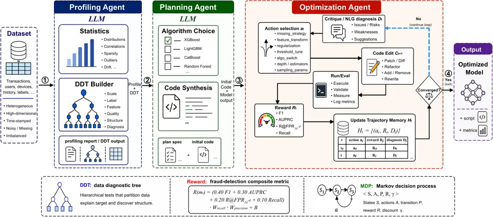
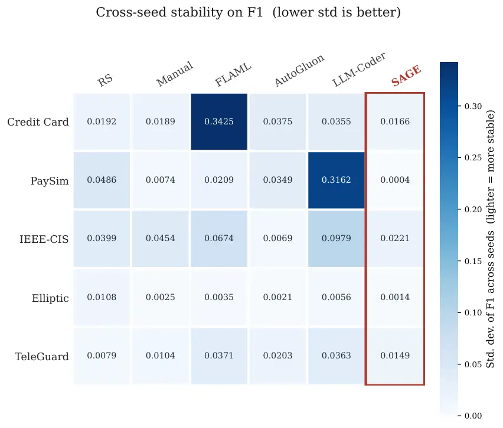

# SAGE: An LLM-driven Self Reflective Agentic Framework for Fraud Detection

Yichen Chen Affiliation: National University of Singapore
Affiliation: School of Computing, Singapore 117417
Email: [chenyichen@u.nus.edu](mailto:)    Siying Li
Affiliation: University of Chinese Academy of Sciences
Affiliation: Institute of Information Engineering, Beijing 100085
Email: [lisiying@iie.ac.cn](mailto:)    Yuhang Liang Affiliation: China
Mobile Communications Group Affiliation: Big Data Business Group,
Beijing 102206 Email: [liangyuhang@chinamobile.com](mailto:)    Lijun
Wang Affiliation: China Mobile Communications Group Affiliation: Big
Data Business Group, Beijing 102206
Email: [wanglijunit@chinamobile.com](mailto:)    Renyang Liu
^(†)^(†)thanks: Corresponding author. Affiliation: National University
of Singapore Affiliation: Institute of Data Science, Singapore 117602
Email: [ryliu@nus.edu.sg](mailto:)

###### Abstract

Fraud detection in payment, e-commerce, and telecommunications systems
requires accuracy at the individual level, robustness under severe class
imbalance, and ease of understanding for risk managers. Existing methods
fall at least one of these requirements: automated machine learning
systems search a fixed numerical space without semantic awareness of the
dataset; graph neural network-based methods require pre-defined
relational graphs and remain opaque at the individual-decision level;
and the design of general-purpose large language model (LLM) agents does
not consider the recall and precision constraints specific to real-world
fraud detection. In this paper, we propose SAGE, the first end-to-end
LLM-driven multi-agent framework for fraud detection. SAGE coordinates
three dedicated agents that make decisions based on a six-layer Data
Diagnostic Tree (DDT) and a Markov decision process guided by
natural-language gradients, automatically optimizing the model under a
fraud-specific reward. On five fraud datasets and five LLM backbones,
SAGE wins $`96.00\%`$ of method–dataset comparisons and improves F1 by
an average of $`40.86\%`$ over baselines. The code is available at
[https://github.com/yichenC1c/SAGE](https://github.com/yichenC1c/SAGE).

## 1 Introduction

Fraud has become one of the most prevalent economic threats in the
digital age, severely eroding public trust in payment systems,
e-commerce platforms, and telecommunications networks. The rapid
development of large language models (LLMs) and increasingly automated
fraud strategies have led to an exponential increase in the operational
costs of fraud cases. Therefore, fraud detection needs to shift from
back-end data mining tasks to automated engineering processes that are
responsive and sustainable, while maintaining interpretability for risk
managers and auditors. However, in most real-world environments, the
available evidence for each suspicious entity is not a rich relational
graph, but rather structured features such as device fingerprints,
transaction history, call patterns, and aggregated behavioral
statistics. The core problem this paper aims to address is: how to
automatically build accurate, robust, and interpretable fraud detectors
based on such individual-level data.

While numerous studies have dedicated themselves to addressing this
issue, existing research still falls short. Traditional supervised
processes and automated machine learning (AutoML) systems excel on
structured data, but they rely on fixed numerical searches, and the
generated models lack a semantic foundation. Some anti-fraud methods
based on graph neural networks (GNNs) require pre-defined relationship
graphs, which are costly to construct in practice and remain opaque at
the individual decision-making level, making them difficult to meet the
needs of real-world anti-fraud operations. Recently developed
general-purpose LLM agents can plan, encode, and self-correct, but they
are all developed based on general benchmarks, rather than on the recall
and precision-constrained task environments required for anti-fraud. To
our knowledge, there is currently no AI agent framework specifically
designed for classifier construction tasks in real-world anti-fraud
scenarios.

This gap prompted us to propose an innovative design concept: building
an LLM agent specifically for constructing fraud detection classifiers
for real-world business scenarios. In this agent, the model has
sufficient autonomy to reason about data features and the classifier
itself, while being subject to structural and reward-based constraints,
ensuring its decisions are evidence-based and consistent with anti-fraud
requirements. Implementing this design concept faces two specific
challenges:

- •
  C1: How can the agent quickly construct a global, realistic picture of
  the fraud dataset without being overwhelmed by the massive amount of
  raw column-level data, thus selecting an efficient and correct
  classifier model?
- •
  C2: How can the agent’s iterative process adhere entirely to
  principles rather than being arbitrary, ensuring that each
  optimization is based on the task objective and existing evidence?

To answer these questions, we propose SAGE, an end-to-end multi-agent
framework for structured data fraud detection. SAGE decomposes the
workflow into three dedicated agents driven by LLM, operating strictly
in sequence: first, the “Profiling Agent” interprets the dataset into a
Data Diagnostic Tree (DDT) to semantically perceive the full features of
the fraud dataset, avoiding agent context loss due to excessively long
datasets by profiling the dataset; second, the “Planning Agent” uses the
DDT described by the “Profiling Agent” to understand the overall
dataset, selects the optimal algorithm, and synthesizes an initial
classifier model customized for the dataset; finally, the “Optimization
Agent” iteratively optimizes the model in the code space through a
finite-time Markov decision process. In this process, the language model
first emits a natural language gradient to evaluate the current model,
then transforms this evaluation into localized code optimization,
ultimately achieving the recall and precision constraints required for
the fraud business scenario set by the reward mechanism. Users only need
to provide the fraud dataset; the entire process, from data analysis to
model optimization, can be completed without human intervention, saving
anti-fraud experts a significant amount of time previously spent on data
cleaning, feature engineering, and parameter tuning.

In summary, our main contributions are as follows:

- •
  As far as we kown, SAGE is the first end-to-end LLM-based multi-agent
  framework designed specifically for the detection of individual-level
  tabular fraud datasets.
- •
  We introduce the DDT, a six-layer structured prior that characterizes
  the feature information of extremely long raw datasets as a
  fraud-aware tree-structured representation, allowing the agent to make
  dataset-grounded decisions within a limited context window.
- •
  We formalize agent code optimization as a finite-horizon MDP driven by
  natural-language gradients, in which natural language is translated
  into concrete code modifications under fraud-specific recall and
  precision constraints.
- •
  We evaluate SAGE on five fraud datasets (four public benchmarks and
  one real-world industrial dataset) and across five LLM backbones. The
  results show that it significantly outperforms existing AutoML
  systems, LLM coding agents, and human experts, while remaining
  insensitive to changes in the underlying language model.

The remainder of this paper is organized as follows. Section 2 analyzes
the current background and existing fraud detection paradigms, and
compares related works. Section 3 formalizes the anti-fraud problem and
introduces the modeling primitives that run through SAGE. Section 4
details the SAGE framework and its design principles, including the Data
Diagnostic Tree and the natural-language-gradient-guided Markov decision
process (MDP). Section 5 introduces the experimental setup, main
results, robustness and sensitivity analysis, interpretability case
study, and ablation study. Section 6 discusses the limitations and
future research directions, and Section 7 summarizes the entire paper.

## 2 Related Work

### 2.1 Fraud detection background

Fraud has become one of the most destructive economic threats worldwide,
permeating both financial and telecommunications sectors. A 2025 survey
of 46,000 adults across 42 markets found that 57% of respondents had
experienced fraud in the preceding year, with estimated global losses
reaching \$442 billion \[18\]. Fraud takes many forms: credit-card and
payment fraud, e-commerce fraud, account takeover, cryptocurrency
transaction fraud, and, in telecommunications, voice phishing and SMS
phishing (smishing). A substantial body of work has formalized these
settings: \[9\] formalizes the credit-card fraud detection system;
\[42\] addresses credit-card fraud through a semi-supervised gated
attention network over transaction graphs; \[43\] targets camouflaged
frauds in tabular data through cohort augmentation; \[22\] introduces an
event-centric, commonsense-guided framework for fake detection; and
\[14\] targets covert textual expressions of telecom fraud. Across these
settings, the detection problem reduces to individual-level
classification: judging whether a single transaction, account, or
subscriber is fraudulent from its own behavioral record, typically
encoded as device attributes, transaction records, calling behavior, and
aggregated temporal/frequency statistics. This task carries a difficult
statistical profile: fraud is extremely rare (legitimate activity
outnumbers fraud by tens to hundreds to one), a severe imbalance
recognized as a fundamental learning obstacle \[21\] and repeatedly
identified as the central challenge of fraud detection \[27, 46\]; the
cost of errors is asymmetric under a strict false-alarm budget; and
fraud is adversarial and non-stationary \[10\]. These properties are
reflected in widely used benchmarks such as the European credit-card
dataset \[31\], the PaySim simulator \[26\], and the Elliptic Bitcoin
dataset \[40\].

### 2.2 Fraud detection methods

Classical research has demonstrated the power of data mining
classifiers: \[4\] compared logistic regression, support vector
machines, and random forests on real credit-card data, and \[44\]
confirmed the effectiveness of random forests; sequence-aware variants
such as the LSTM model of \[24\] and the hidden-Markov approach
of \[33\] further exploit transaction order. Building on this, automated
machine learning (AutoML) systems such as Auto-sklearn \[17\],
FLAML \[38\], and AutoGluon \[16\] search over algorithms and
hyperparameters to build gradient-boosted tree ensembles like
XGBoost \[6\], which remains the de facto standard since tree-based
models still match or outperform deep networks on tabular data \[19\].
However, AutoML explores a fixed numerical search space without
reasoning about dataset semantics, performs no domain-grounded feature
engineering, and returns a model rather than a human-readable rationale;
its search is statistical, not diagnostic. Another paradigm models
fraudulent behavior on a graph of users, transactions, and
devices \[8\]. Representative methods include the semi-supervised graph
attention network of \[39\], the camouflage-resistant CARE-GNN \[15\],
and the imbalance-aware PC-GNN \[25\]. These methods excel at
group-level and link-level analysis, but require a pre-defined
construction graph, entailing costly relational-data collection,
substantial entity-resolution difficulty, and manual architecture design
while remaining opaque at the individual-decision level. Crucially, in
most real-world fraud-screening scenarios the available evidence is
plain individual-level tabular data rather than a rich relational
graph \[36, 20\], so the multi-relational structure these methods rely
on is often absent or prohibitively expensive to construct. For
individual-level classification dominating real deployments, tree-based
models tailored to tabular data therefore remain both sufficient and
preferable.

### 2.3 Gap for Fraud Detection

However, the rise of large language models has intensified the threat of
fraud: generative AI enables fraudsters to produce personalized phishing
messages and deepfake content at scale, weakening the lexical and
grammatical cues traditional detection methods rely on \[34\].
Meanwhile, high-quality classical pipelines require substantial expert
effort in feature engineering and tuning, limiting their responsiveness
as fraud techniques evolve. More recently, large language models have
been used as autonomous agents that reason and act in external
environments. AutoGen \[41\] orchestrates multiple conversable agents to
solve tasks collaboratively; Reflexion \[35\] reinforces agents through
verbal self-reflection rather than weight updates; and textual-gradient
methods \[32\] optimize programs by treating natural-language critiques
as gradients. Closer to data work, Data Interpreter \[23\] decomposes
data-science tasks into hierarchical plans and invokes tools for
modeling, while coding agents such as Claude Code \[2\] autonomously
write, execute, and debug code from natural-language instructions. These
frameworks show that an LLM agent can diagnose, plan, and self-correct
in language, but they have been developed on generic reasoning, coding,
and data-science benchmarks, with none tailored to fraud detection or to
the strict recall and precision constraints of production anti-fraud
systems. Table 1 contrasts the main paradigms against the requirements
of individual-level fraud detection. As the table shows, AutoML suits
tabular data but is neither semantic nor fraud-specific; graph methods
are fraud-oriented but require relational structure and are opaque; and
current LLM agents are agentic and interpretable yet not designed for
fraud detection. No existing approach simultaneously satisfies all four
requirements, which motivates an LLM-driven agent purpose-built for
tabular fraud detection.

| Method              | Paradigm  | Agentic | Tabular | Interpretable | Fraud-specific |
| ------------------- | --------- | ------- | ------- | ------------- | -------------- |
| Auto-sklearn \[17\] | AutoML    | ✗       | ✓       | ✗             | ✗              |
| FLAML \[38\]        | AutoML    | ✗       | ✓       | ✗             | ✗              |
| AutoGluon \[16\]    | AutoML    | ✗       | ✓       | ✗             | ✗              |
| CARE-GNN \[15\]     | GNN       | ✗       | ✗       | ✗             | ✓              |
| PC-GNN \[25\]       | GNN       | ✗       | ✗       | ✗             | ✓              |
| AutoGen \[41\]      | LLM agent | ✓       | ✓       | ✓             | ✗              |
| Data Interp. \[23\] | LLM agent | ✓       | ✓       | ✓             | ✗              |
| Claude Code \[2\]   | LLM agent | ✓       | ✓       | ✓             | ✗              |

Table 1: Representative methods against the four requirements of
individual level fraud detection.

## 3 Preliminaries

This section establishes the formal foundations on which SAGE is built.
We define the tabular fraud detection problem (Section 3.1),
characterize the class imbalance that shapes any fraud detector
(Section 3.2), and introduce the modeling and optimization primitives
reused throughout Section 4 (Section 3.3).

### 3.1 Problem Formalization

We study fraud detection in its tabular, individual-transaction form.
Let each instance be a feature vector
$`\mathbf{x}\in\mathcal{X}\subseteq\mathbb{R}^{p}`$ describing a single
transaction or account, together with a binary label $`y\in\{0,1\}`$,
where $`y=1`$ denotes a fraudulent (positive) instance and $`y=0`$ a
legitimate (negative) one. A dataset $`P=(X,y)`$ collects $`n`$ such
instances as a feature matrix $`X\in\mathbb{R}^{n\times p}`$ and a label
vector $`y\in\{0,1\}^{n}`$. The goal of a fraud detector is to obtain a
scoring function

```math
f:\mathcal{X}\to[0,1],\qquad\hat{y}=\mathbf{1}\!\left[\,f(\mathbf{x})\geq\delta\,\right], \tag{1}
```

that maps each instance to a fraud probability, which a decision
threshold $`\delta\in[0,1]`$ converts into a hard prediction
$`\hat{y}`$. In the remainder of the paper, this scoring function is
realized as the model $`M\in\mathcal{M}`$ produced by SAGE, and the
threshold $`\delta`$ corresponds to the tunable threshold_tune handle of
Section 4.2. Following \[11\] and \[10\], we treat fraud detection not
as plain binary classification but as a constrained problem: maximizing
detection quality subject to a tight false-alarm budget and a
minimum-recall requirement, a view that directly motivates the composite
reward of Section 4.3.3. We use $`\delta`$ throughout for the decision
threshold and reserve $`\tau`$ (introduced in Section 3.3.4) for the
dataset-specific recall constraint in the reward function.

### 3.2 Class Imbalance

A defining property of fraud data is extreme class imbalance, which we
quantify by the _imbalance ratio_

```math
\mathrm{IR}\;=\;\frac{n_{\mathrm{neg}}}{n_{\mathrm{pos}}}, \tag{2}
```

where $`n_{\mathrm{pos}}`$ and $`n_{\mathrm{neg}}`$ are the numbers of
positive and negative instances; in real fraud datasets $`\mathrm{IR}`$
commonly spans two orders of magnitude. Under such skew, a trivial
classifier predicting every instance as legitimate attains near-perfect
accuracy while detecting no fraud, rendering accuracy
uninformative \[27, 46\]. Common remedies span _data-level_ resampling
that rebalances the training distribution (e.g., SMOTE \[5\]) and
_algorithm-level_ loss reweighting such as a positive-class weight
$`w_{\mathrm{pos}}\approx\mathrm{IR}`$.

### 3.3 Formal Definitions of SAGE

#### 3.3.1 SAGE as a Composite Mapping

Let $`\mathcal{P}`$ denote the _problem space_, the set of tabular fraud
detection problems $`P=(X,y)`$ introduced in Section 3.1. Let
$`\mathcal{M}`$ denote the _model space_ of trained fraud classifiers,
$`\mathcal{C}`$ the _code space_ of executable training scripts, and
$`\mathbb{R}^{d}`$ the $`d`$-dimensional metric vector space (in this
work $`d=4`$, covering AUPRC, F1, MCC, and
$`\mathrm{R}@\mathrm{FPR}_{10^{-4}}`$). SAGE is then formalized as the
composite mapping

```math
\displaystyle\mathrm{SAGE} \displaystyle:\mathcal{P}\to\mathcal{C}\times\mathcal{M}\times\mathbb{R}^{d},
```

```math
\displaystyle\mathrm{SAGE}(P) \displaystyle=\mathcal{A}_{3}\!\big(P,\,\mathcal{A}_{2}(P,\,\mathcal{A}_{1}(P))\big), \tag{3}
```

in which the three agents
$`\mathcal{A}_{1},\mathcal{A}_{2},\mathcal{A}_{3}`$ are applied strictly
in sequence. The final output is the triple
$`(c^{*},M^{*},\mathbf{m}^{*})`$ recorded at the best iteration
$`t^{*}=\arg\max_{t}R(\mathbf{m}_{t})`$, where $`R(\cdot)`$ is the
composite reward defined in Eq. (11) and
$`\mathbf{m}_{t}\in\mathbb{R}^{d}`$ is the metric vector of the model at
iteration $`t`$.

#### 3.3.2 The structure of Three Agents

Each agent in Eq. (3) is a typed mapping between intermediate spaces:

```math
\displaystyle\mathcal{A}_{1} \displaystyle:\mathcal{P}\to\mathcal{R}\times\mathcal{T},
```

```math
\displaystyle\mathcal{A}_{2} \displaystyle:\mathcal{P}\times\mathcal{R}\times\mathcal{T}\to\mathcal{C}\times\mathcal{M},
```

```math
\displaystyle\mathcal{A}_{3} \displaystyle:\mathcal{P}\times\mathcal{C}\times\mathcal{M}\to\mathcal{C}\times\mathcal{M}\times\mathbb{R}^{d}, \tag{4}
```

where $`\mathcal{R}`$ is the profiling report space and $`\mathcal{T}`$
the DDT space (Section 3.3.3). Internally, each agent decomposes as
follows. The Profiling Agent $`\mathcal{A}_{1}`$ runs a deterministic
statistical computation $`\mathrm{Stats}(\cdot)`$, builds the Data
Diagnostic Tree, and adds a semantic interpretation through an LLM call:

```math
\begin{split}&\mathcal{A}_{1}(P)=(\rho,T),\\
&\rho=\mathrm{LLM}_{\mathrm{interpret}}(\mathrm{Stats}(P)),\\
&T=\mathrm{DDT}(P).\end{split} \tag{5}
```

The Planning Agent $`\mathcal{A}_{2}`$ then consumes $`(\rho,T)`$ and
synthesizes an initial training program $`c_{0}`$, executed in a sandbox
runner to obtain the initial model $`M_{0}`$ and its metric vector
$`\mathbf{m}_{0}`$:

```math
\displaystyle\mathcal{A}_{2}(P,\rho,T)=(c_{0},M_{0}),
```

```math
\displaystyle c_{0}=\mathrm{LLM}_{\mathrm{codegen}}(\rho,T),
```

```math
\displaystyle M_{0}=\mathrm{Execute}(c_{0},P). \tag{6}
```

Finally, the Optimization Agent $`\mathcal{A}_{3}`$ iteratively refines
$`c_{0}`$ for at most $`K`$ rounds, returning the triple from the best
iteration:

```math
\mathcal{A}_{3}(P,c_{0},M_{0})=(c^{*},M^{*},\mathbf{m}^{*}),\quad t^{*}=\arg\max_{t\in[0,K]}R(\mathbf{m}_{t}). \tag{7}
```

Here $`\mathrm{LLM}_{\mathrm{interpret}}`$ and
$`\mathrm{LLM}_{\mathrm{codegen}}`$ are independent LLM calls, and
$`\mathrm{Execute}(\cdot,P)`$ returns both the trained model and its
metric vector $`\mathbf{m}\in\mathbb{R}^{d}`$. The structural innovation
of $`\mathcal{A}_{1}`$ is the DDT $`T`$ defined next; the optimization
loop driving $`\mathcal{A}_{3}`$ is formalized in Section 3.3.4; the
engineering instantiation of each $`\mathcal{A}_{i}`$ is presented in
Section 4.

#### 3.3.3 Data Diagnostic Tree

The Data Diagnostic Tree $`T`$ produced by $`\mathcal{A}_{1}`$ in
Eq. (5) is a rooted attributed tree $`T=(N,A)`$, where $`N`$ is a set of
nodes organized hierarchically with a unique root $`n_{\mathrm{root}}`$
representing the target dataset, and
$`A:N\to 2^{\mathcal{K}\times\mathcal{V}}`$ assigns to each node a set
of key–value pairs drawn from a predefined key space $`\mathcal{K}`$ and
value space $`\mathcal{V}`$. Every non-root node has exactly one parent.
The DDT is structured around six _semantic layers_, each forming one
principal branch of the tree:

```math
\begin{split}&T=\big\{\,L_{\mathrm{scale}},\;L_{\mathrm{label}},\;L_{\mathrm{feature}},\\
&\qquad\;L_{\mathrm{quality}},\;L_{\mathrm{structure}},\;L_{\mathrm{diagnosis}}\,\big\}.\end{split} \tag{8}
```

The encoded content of each layer and the procedure that constructs
$`T`$ are detailed in Section 4.1.

#### 3.3.4 MDP, Natural-Language Gradient, and Reward

The iterative code refinement of $`\mathcal{A}_{3}`$ in Eq. (7) is cast
as a finite-horizon Markov Decision Process \[37\], a tuple
$`\langle\mathcal{S},\mathcal{A},\mathcal{T}_{\mathrm{trans}},R,K\rangle`$
with state space $`\mathcal{S}`$, action space $`\mathcal{A}`$,
transition
$`\mathcal{T}_{\mathrm{trans}}:\mathcal{S}\times\mathcal{A}\to\mathcal{S}`$,
reward $`R:\mathcal{S}\to\mathbb{R}`$, and horizon $`K`$. The state
$`s_{t}`$ at iteration $`t`$ is

```math
s_{t}=(c_{t},\,\mathbf{m}_{t},\,H_{t}), \tag{9}
```

where $`c_{t}\in\mathcal{C}`$ is the current code,
$`\mathbf{m}_{t}=\mathrm{Eval}(M_{t})\in\mathbb{R}^{d}`$ is the metric
vector of $`M_{t}=\mathrm{Execute}(c_{t},P)`$ evaluated on the held-out
validation split (Section 5.1.3), and
$`H_{t}=\{(a_{i},R_{i},D_{i})\}_{i=1}^{t-1}`$ records past actions,
rewards, and natural-language diagnoses (with $`H_{1}=\emptyset`$). The
action space $`\mathcal{A}`$ consists of seven handle-targeted edits:
missing_strategy, feature_transform, regularization,
depth_and_estimators, sampling_params, threshold_tune, and algo_switch.

Following ReAct \[45\] and textual-gradient methods \[32\], each
iteration decomposes into two independent, stateless LLM calls:

```math
\begin{split}&D_{t}=\mathrm{LLM}_{\mathrm{critique}}(c_{t},\mathbf{m}_{t},H_{t}),\\
&c_{t+1}=\mathrm{LLM}_{\mathrm{codegen}}(c_{t},D_{t},a_{t}).\end{split} \tag{10}
```

The first call (_reasoning_) emits a natural-language diagnosis
$`D_{t}\in\mathcal{D}`$; the second call (_acting_) translates
$`D_{t}`$, together with the selected action $`a_{t}\in\mathcal{A}`$,
into a concrete code edit. $`D_{t}`$ is the natural-language analog of a
numerical gradient: while the latter specifies the descent direction in
continuous parameter space, $`D_{t}`$ specifies the edit direction in
discrete code space.

Finally, the scalar reward $`R(\mathbf{m}_{t})`$ that drives the
selection of $`t^{*}`$ in Eq. (7) consolidates the multi-objective
requirements of fraud detection:

```math
R(\mathbf{m}_{t})=\underbrace{\big(w_{1}\mathrm{F1}+w_{2}\mathrm{AUPRC}+w_{3}\mathrm{R}@\mathrm{FPR}_{10^{-4}}+w_{4}\mathrm{Recall}\big)}_{\text{primary score}}\cdot W_{\mathrm{recall}}\cdot W_{\mathrm{precision}}\,+\,B, \tag{11}
```

where $`(w_{1},w_{2},w_{3},w_{4})=(0.40,0.30,0.20,0.10)`$. The two
multiplicative gates and additive bonus realize three fraud-specific
design intents: $`W_{\mathrm{recall}}`$ penalizes recall below a
dataset-specific threshold $`\tau`$ produced by $`\mathcal{A}_{1}`$;
$`W_{\mathrm{precision}}`$ prevents degeneration into a trivial
high-recall classifier; and $`B`$ adds a small bonus when F1 or recall
exceeds the initial baseline $`\mathbf{m}_{0}`$ produced by
$`\mathcal{A}_{2}`$, providing a non-zero gradient even when both gates
saturate. The operational consequences of each term are discussed in
Section 4.3.3.

## 4 SAGE



Figure 1: Overall architecture of the SAGE framework. ① SAGE takes a
heterogeneous tabular fraud dataset as input, ② profiles it through
statistical analysis and a six-layer Data Diagnostic Tree (DDT), ③ and
uses the resulting data diagnosis to select an algorithm and synthesize
the initial training code. ④ The Optimization Agent then iteratively
refines the code through an NLG-guided MDP loop, where code edits are
evaluated by a fraud-specific composite reward and stored in trajectory
memory. The process stops after convergence and returns the optimized
model, final script, and evaluation metrics.

SAGE balances LLM _autonomy_ (each agent independently chooses
algorithms, designs features, diagnoses bottlenecks, and edits code)
with explicit _mathematical constraints_ (the DDT grounds early
decisions in data, the finite-horizon MDP \[37\] with natural-language
gradient \[32\] signals constrains the iterative loop, and a composite
reward enforces fraud-specific objectives), enabling SAGE to run without
human intervention. SAGE decomposes the end-to-end process into three
specialized, collaborative LLM-driven agents (Eq. (3)), each responsible
for a classic operation in the fraud detection workflow. The Profiling
Agent ($`\mathcal{A}_{1}`$, Section 4.1) examines the input dataset and
generates a data-aware profiling result containing statistical reports
and a DDT. The Planning Agent ($`\mathcal{A}_{2}`$, Section 4.2) uses
this profiling result to select an appropriate algorithm and synthesize
an initial executable training program tailored to the dataset. The
Optimization Agent ($`\mathcal{A}_{3}`$, Section 4.3) then iteratively
optimizes the program in the code space through an NLG-guided MDP under
a fraud-specific reward, until convergence. These three agents
constitute a strictly sequential process (Figure 1). Communication flows
forward, with each downstream agent relying on the structured output of
the upstream agent. The user supplies only the dataset $`P`$ and the
target label column; the entire pipeline proceeds without human
intervention and returns the triple $`(c^{*},M^{*},\mathbf{m}^{*})`$ at
the best iteration.

### 4.1 Profiling Agent with DDT

The Profiling Agent $`\mathcal{A}_{1}`$ is the entry point of SAGE.
Following the typed signature in Eq. (5), it transforms a raw fraud
detection problem $`P=(X,y)`$ into a structured, fraud-aware diagnosis
$`(\rho,T)`$ that grounds every subsequent decision in the data itself.
We focus here on the engineering realization of the DDT, which is the
central structural innovation of $`\mathcal{A}_{1}`$.

#### 4.1.1 Why a tree

Feeding LLMs with raw fraud datasets exposes three coupled bottlenecks:
(i) _information overload_, where hundreds of raw feature descriptors
dilute key signals; (ii) _semantic gap_, where raw statistics (e.g.,
imbalance_ratio$`=577.3`$) require an additional reasoning step to
become actionable; and (iii) _narrow attention_, where LLMs
overemphasize the most salient features while neglecting global
structure. The Data Diagnostic Tree (DDT), formally defined in Eq. (8),
addresses all three by compressing the dataset into a compact,
semantically annotated tree of six layers. Table 2 summarizes the
encoded content and downstream usage of each layer.

| Layer                      | Encoded content                                                        |
| -------------------------- | ---------------------------------------------------------------------- |
| $`L_{\mathrm{scale}}`$     | Rows, features, memory footprint                                       |
| $`L_{\mathrm{label}}`$     | Fraud rate, imbalance ratio, positive/negative counts                  |
| $`L_{\mathrm{feature}}`$   | Numeric/categorical counts, top label-correlated features              |
| $`L_{\mathrm{quality}}`$   | Missing columns, high-missing columns, redundant pairs                 |
| $`L_{\mathrm{structure}}`$ | ID-like columns, time columns, subset-fraud columns                    |
| $`L_{\mathrm{diagnosis}}`$ | Difficulty, dataset type, key risk features, recall threshold $`\tau`$ |

Table 2: The six semantic layers of the Data Diagnostic Tree (DDT).

Downstream agents receive the DDT as indented hierarchical text, in
which each of the six branches contains raw statistical fields generated
by $`\mathrm{Stats}(P)`$ together with semantic annotations, with the
origin of each annotation (_rule-based_ or _LLM-derived_) marked inline.
This inline origin tag is critical: it allows downstream agents to weigh
deterministic facts and LLM inferences differently when their
conclusions disagree, and lets human auditors trace every diagnostic
claim back to either a numerical rule or a specific LLM call. Separating
these two origins also enables targeted debugging: an incorrect
statistic reflects a flaw in $`\mathrm{Stats}(P)`$, whereas an
unreasonable diagnosis points to the
$`\mathrm{LLM}_{\mathrm{interpret}}`$ prompt or backbone. The indented
format itself is deliberately chosen to align with the token-level
patterns LLMs have absorbed from code and configuration files during
pre-training, allowing the agent to traverse the six branches with
minimal parsing overhead and avoiding the verbosity of JSON or XML
serialization that would otherwise inflate the prompt budget. The same
structure remains stable across datasets of vastly different scale, so
prompt templates downstream of $`\mathcal{A}_{1}`$ do not need to be
rewritten for each new fraud domain. This representation compresses the
statistical fingerprint of IEEE-CIS, a flattened report of over
$`50{,}000`$ tokens covering all $`433`$ features, into a six-layer tree
of approximately $`2{,}000`$ tokens, a $`25\times`$ reduction while
preserving the decision-critical signals required by downstream agents.
The same compression trend holds on the other four datasets, with
reductions ranging from $`4\times`$ on the lower-dimensional Credit Card
data to over $`20\times`$ on the high-dimensional industrial telecom
dataset. A partial excerpt for the IEEE-CIS dataset is shown below; note
that values such as $`\tau=0.75`$ are produced by
$`\mathrm{LLM}_{\mathrm{interpret}}`$ from dataset-specific semantics
rather than hard-coded defaults:

DDT("ieee_cis")

\|- Scale

\| \|- n_rows: 590,540

\| \|- n_features: 433

\| +- note: large-scale dataset

\|- Label

\| \|- imbalance_ratio: 27.58

\| +- difficulty \[rule\]: HARD

\|- Feature

\| \|- n_numeric: 400, n_cat: 33

\| +- top_correlated

\| \|- V258 (corr = 0.42)

\| +- V201 (corr = 0.38)

\|- Quality

\| +- note: heavy missingness,

\| native-NA preferred

\|- Structure

\| +- note: identifier-only,

\| no temporal partition

+- Diagnosis \[LLM\]

\|- type: transactional fraud

\|- key_risk: \[V258, V201, C14\]

+- recall_threshold: tau=0.75

#### 4.1.2 DDT Construction Procedure

The DDT is constructed in two phases, separating statistical numerical
analysis from LLM-based semantic interpretation.

##### Phase 1: Statistical Computation $`\mathrm{Stats}(P)`$ ($`L_{\mathrm{scale}}`$–$`L_{\mathrm{structure}}`$)

This phase is entirely rule-based. Given $`P`$, $`\mathrm{Stats}(P)`$
computes the basic dimensions, the imbalance ratio
$`\mathrm{IR}=n_{\mathrm{neg}}/n_{\mathrm{pos}}`$, feature types,
missing rate per column ($`50\%`$ high-missingness threshold, following
common practice in tabular preprocessing), distribution moments
(skewness, kurtosis), top-$`K`$ feature–label correlations, and special
structure detection (ID columns with uniqueness $`>95\%`$, time columns,
subset-fraud columns). Each statistic is mapped to semantic labels
through threshold rules and written into the corresponding branch (e.g.,
$`\mathrm{IR}\!>\!100`$ becomes “extremely imbalanced, requiring sample
weighting” under $`L_{\mathrm{label}}`$), populating the first five
layers.

##### Phase 2: Diagnostic Inference ($`L_{\mathrm{diagnosis}}`$)

The sixth layer is populated by a single
$`\mathrm{LLM}_{\mathrm{interpret}}`$ call that reasons over the first
five layers and outputs: (i) Dataset type (transactional, behavioral, or
profile-based fraud), inferred from feature names, top-correlated
features, and the presence of time/ID columns; (ii) Key risk features, a
short list of fraud-distinguishing columns drawn from the top-$`K`$
correlated columns combined with semantic priors of feature names (e.g.,
transaction amount, device fingerprint, time field); and (iii) Recall
threshold $`\tau`$, subsequently used by the recall-constraint gate
$`W_{\mathrm{recall}}`$ in Eq. (11). By committing to a complete dataset
profile at this analysis phase, rather than letting downstream agents
drift on arbitrary cues, SAGE remains grounded in dataset evidence
throughout the optimization loop.

### 4.2 Planning Agent

The Planning Agent $`\mathcal{A}_{2}`$ converts the structured diagnosis
$`(\rho,T)`$ produced by $`\mathcal{A}_{1}`$ into an executable training
program tailored to the target dataset, following Eq. (6).
$`\mathcal{A}_{2}`$ delegates almost the entire generation task to a
single $`\mathrm{LLM}_{\mathrm{codegen}}`$ call, with algorithm
selection, feature engineering, hyperparameter values, and thresholding
logic all autonomously written by the LLM. This autonomy is safe rather
than chaotic, because the structured DDT $`T`$ ensures it is grounded in
dataset evidence.

#### 4.2.1 Algorithm Selection Logic

The core responsibility of $`\mathcal{A}_{2}`$ is to select an algorithm
family for $`c_{0}`$. Here, we deliberately avoid using hard-coded
selection rules. Instead, leveraging the inference capabilities of the
LLM-driven agent, $`\mathrm{LLM}_{\mathrm{codegen}}`$ receives the
complete DDT $`T`$ in its prompt. Our prompt instructs the LLM to weigh
the $`L_{\mathrm{scale}}`$, $`L_{\mathrm{label}}`$,
$`L_{\mathrm{feature}}`$, and $`L_{\mathrm{quality}}`$ layers of $`T`$,
evaluate a set of common candidate models against these layers, and
describe the empirical strengths of each candidate. After committing to
a choice, the LLM is also required to articulate why the selected
algorithm is best suited for the diagnosed scenario. An example of the
SAGE built-in prompt used at this stage is shown below:


#### 4.2.2 Code Structure Design

Code $`c_{0}`$ must have a fixed five-block structure: data loading,
preprocessing, feature engineering, model training, and metric
calculation. The specific content of each block is filled in by the LLM,
but the block boundaries themselves are immutable. This design provides
a consistent working environment for the LLM, reduces quality variation
in the generated code, and allows the Agent to intervene and optimize
without rewriting the entire script; these locations are referred to as
_optimization handles_. Each annotation marked \# handle: \<name\>
corresponds to an action type in the action space $`\mathcal{A}`$
(defined in Section 4.3). These handle conventions enable the
natural-language gradients of the Optimization Agent to translate
textual information such as “the threshold for recalling the target is
too high” into precise local edits at the corresponding handle.

A typical $`c_{0}`$ generated by $`\mathcal{A}_{2}`$ takes the following
form:

1: $`P=(X,y)`$, $`\rho`$, DDT $`T`$

2: $`M_{0}`$, $`\mathbf{m}_{0}`$

3: B1: Loading

4: $`df\leftarrow\textsc{Load}(P)`$

5: B2: Preprocessing

6: $`df\leftarrow\textsc{Impute}(df)`$

7: B3: Feature Eng.

8: $`df\leftarrow\textsc{Transform}(df,T)`$

9: B4: Training

10:
$`\theta\leftarrow\{\texttt{n\_est},\texttt{depth},\texttt{reg},\ldots\}`$

11: $`M_{0}\leftarrow\textsc{Fit}(\theta,X_{\text{tr}},y_{\text{tr}})`$

12: B5: Evaluation

13: $`\delta\leftarrow 0.5`$

14:
$`\mathbf{m}_{0}\leftarrow\textsc{Eval}(M_{0},X_{\text{val}},y_{\text{val}},\delta)`$

15: return $`(M_{0},\mathbf{m}_{0})`$

Algorithm 1 Initial Training Script $`c_{0}`$ by $`\mathcal{A}_{2}`$

### 4.3 NLG-Guided MDP Optimization Agent

The Optimization Agent $`\mathcal{A}_{3}`$ iteratively refines the
initial code $`c_{0}`$ produced by $`\mathcal{A}_{2}`$, following
Eq. (7), until convergence. The dependence of $`\mathcal{A}_{3}`$ on
$`M_{0}`$ provides the initial baseline metrics $`\mathbf{m}_{0}`$ used
by the baseline-bonus term $`B`$ of the reward function (Eq. (11)). The
loop is implemented as a ReAct-style reasoning–acting cycle \[45\]: in
each iteration, the LLM first performs inference through NLG text
diagnostics, then converts the diagnosis into a code edit.

#### 4.3.1 MDP Loop and Convergence

The optimization is a finite-horizon MDP whose state
$`s_{t}=(c_{t},\mathbf{m}_{t},H_{t})`$ and seven handle-targeted actions
$`\mathcal{A}`$ are defined in Eq. (9) and Section 3.3.4. We focus here
on the engineering of the loop. Each tuple $`(a_{i},R_{i},D_{i})`$
recorded in $`H_{t}`$ captures the action selected at iteration $`i`$,
the natural-language diagnosis $`D_{i}`$ that motivated it, and the
scalar reward $`R_{i}=R(\mathbf{m}_{i+1})`$ observed after executing the
resulting code $`c_{i+1}`$. Although the LLM calls within an iteration
are stateless, $`H_{t}`$ is fed into the next iteration’s prompt,
granting the agent access to its own trajectory. Action selection
defaults to LLM-driven decision-making, but when F1 stagnates for
$`\geq 2`$ consecutive rounds an action switch is triggered, guiding the
LLM to explore new actions in $`\mathcal{A}`$. The loop terminates
either when $`t=K`$, or when $`R(\mathbf{m}_{t})`$ improves by less than
a tolerance $`\varepsilon`$ for $`k`$ consecutive iterations. We use
$`K=20`$, $`k=4`$, and $`\varepsilon=0.001`$ in this work.

#### 4.3.2 NLG as Textual Gradient

A distinguishing feature of $`\mathcal{A}_{3}`$ is that its optimization
does not rely solely on metric values to drive code refinement. Each
iteration decomposes into two stateless LLM calls (Eq. (10)): the first
call acts as a _critic_ that produces a natural-language gradient
$`D_{t}`$ in the code space, identifying bottlenecks and proposing
improvement directions; the second call acts as an _executor_ that
translates $`D_{t}`$, together with the selected action $`a_{t}`$, into
a concrete code edit at the corresponding handle. The two calls share no
memory; only $`D_{t}`$ and $`a_{t}`$ flow between them, making every
reasoning–acting cycle auditable through $`H_{t}`$. SAGE’s
_self-reflection_ thus materializes through $`H_{t}`$: the LLM reviews
its own previous code and outcomes before deciding the next action.

#### 4.3.3 Composite Reward Design

The composite reward $`R(\mathbf{m}_{t})`$ defined in Eq. (11)
consolidates the multi-objective requirements of fraud detection into a
single scalar that drives the MDP. The weights
$`(w_{1},w_{2},w_{3},w_{4})=(0.40,0.30,0.20,0.10)`$ reflect the relative
priorities of classification balance, ranking quality,
low-false-positive-rate detection, and overall recall, while the two
multiplicative gates and the additive bonus realize three fraud-specific
design intents: $`W_{\mathrm{recall}}`$ penalizes recall below the
dataset-specific threshold $`\tau`$ set by $`\mathcal{A}_{1}`$,
$`W_{\mathrm{precision}}`$ prevents degeneration into a trivially
high-recall classifier, and $`B`$ provides a non-zero gradient signal
when both gates saturate. Recall and Precision are computed internally
for the reward and are not part of the reported metric vector
$`\mathbf{m}`$; conversely, MCC belongs to $`\mathbf{m}`$ for final
reporting but is excluded from the reward, since F1 and MCC are strongly
correlated under extreme imbalance and including both would be redundant
for driving optimization. Together, $`R`$, $`D_{t}`$, and
$`\mathcal{A}`$ form a closed optimization loop: $`\mathcal{A}_{3}`$
measures progress through $`R`$, articulates the cause of any shortfall
through $`D_{t}`$, and acts on a specific handle through $`a_{t}`$.
Crucially, every quantity inside $`R`$, F1, AUPRC,
R@FPR$`{}_{10^{-4}}`$, Recall, Precision, the baseline-bonus comparison,
and the threshold value used by threshold_tune, is computed on the
validation split alone, so the test split remains untouched throughout
the optimization loop.

### 4.4 Algorithm and Complexity

We now consolidate the three agents into a single end-to-end procedure
(Algorithm 2) and analyze its computational complexity.

1: $`P`$; $`K`$; $`\varepsilon`$; $`k`$

2: $`(c^{*},M^{*},\mathbf{m}^{*})`$

3: Stage 1: $`\mathcal{A}_{1}`$ Profiling

4: $`\rho\leftarrow\textsc{Interpret}(\textsc{Stats}(P))`$

5: $`T\leftarrow\textsc{BuildDDT}(P)`$ $`\triangleright`$ 6-layer

6: Stage 2: $`\mathcal{A}_{2}`$ Planning

7: $`c_{0}\leftarrow\textsc{Codegen}(\rho,T)`$

8: $`(M_{0},\mathbf{m}_{0})\leftarrow\textsc{Execute}(c_{0},P)`$

9: Stage 3: $`\mathcal{A}_{3}`$ Optimization

10: $`H_{1}\leftarrow\emptyset`$; $`t\leftarrow 1`$;
$`(c_{t},M_{t},\mathbf{m}_{t})\leftarrow(c_{0},M_{0},\mathbf{m}_{0})`$

11: while $`t<K`$ and not converged do

12:   $`D_{t}\leftarrow\textsc{Critique}(c_{t},\mathbf{m}_{t},H_{t})`$
$`\triangleright`$ reasoning

13:   $`a_{t}\leftarrow\pi(s_{t})`$ $`\triangleright`$ LLM-driven;
force-explore on stagnation

14:   $`c_{t+1}\leftarrow\textsc{Codegen}(c_{t},D_{t},a_{t})`$
$`\triangleright`$ acting

15:
  $`(M_{t+1},\mathbf{m}_{t+1})\leftarrow\textsc{Execute}(c_{t+1},P)`$

16:   $`R_{t}\leftarrow R(\mathbf{m}_{t+1})`$ $`\triangleright`$
Eq. (11)

17:   $`H_{t+1}\leftarrow H_{t}\cup\{(a_{t},R_{t},D_{t})\}`$;
$`t\leftarrow t{+}1`$

18: end while

19: $`t^{*}\leftarrow\arg\max_{t}R(\mathbf{m}_{t})`$

20:
$`(c^{*},M^{*},\mathbf{m}^{*})\leftarrow(c_{t^{*}},M_{t^{*}},\mathbf{m}_{t^{*}})`$

21: return $`(c^{*},M^{*},\mathbf{m}^{*})`$

Algorithm 2 SAGE: End-to-End Pipeline

##### Complexity analysis

We characterize the cost of each stage in terms of two atomic
operations: one LLM call $`\mathcal{O}(L)`$, whose latency depends
primarily on the model’s response time to the prompt, and one sandboxed
code execution $`\mathcal{O}(E)`$, which trains the model on $`P`$.

$`\mathcal{A}_{1}`$ costs $`\mathcal{O}(np+L)`$ from a statistical
traversal of $`P`$ plus one LLM call; $`\mathcal{A}_{2}`$ costs
$`\mathcal{O}(L+E)`$ from one LLM call and one sandbox execution; and
$`\mathcal{A}_{3}`$ costs $`\mathcal{O}(K(L+E))`$ from at most $`K`$
iterations each consuming two LLM calls and one execution. The total
cost of SAGE is therefore

```math
\mathcal{O}\!\big(\underbrace{np}_{\text{Stats}}+\underbrace{(K+1)\,L}_{\text{LLM calls}}+\underbrace{(K+1)\,E}_{\text{executions}}\big)\;=\;\mathcal{O}\!\big(K\,(L+E)\big), \tag{12}
```

given $`K\gg 1`$ and $`np\ll K(L+E)`$. Empirically, each LLM call
($`L`$) takes 5–30 seconds on commercial APIs, while each sandboxed
model training ($`E`$) takes seconds to minutes depending on dataset
size. In our full-pipeline runs, the average end-to-end wall-clock time
is dominated by the Stage 3 Optimization Agent, consistent with the
linear-in-$`K`$ scaling predicted by Eq. (12).

## 5 Experiments

### 5.1 Experimental Setup

#### 5.1.1 Datasets

We evaluated SAGE using five tabular fraud detection datasets. Four of
these datasets are publicly available and widely used fraud benchmark
datasets from the Kaggle platform; the fifth dataset, named TeleGuard,
is a non-public dataset provided by a telecommunications operator we are
collaborating with. Table 3 summarizes their key statistics.

| Dataset     | \#Rows    | \#Feat. | Fraud | IR    | Domain         |
| ----------- | --------- | ------- | ----- | ----- | -------------- |
| Credit Card | 284,807   | 30      | 0.17% | 577.9 | Credit-card    |
| PaySim      | 6,362,620 | 10      | 0.13% | 773.7 | Mobile-payment |
| IEEE-CIS    | 590,540   | 433     | 3.50% | 27.58 | E-commerce     |
| Elliptic    | 46,564    | 166     | 9.76% | 9.2   | Bitcoin        |
| TeleGuard   | 31,130    | 47      | 1.00% | 99.1  | Telecom        |

Table 3: Statistics of the five fraud detection datasets. IR = imbalance
ratio ($`n_{\mathrm{neg}}/n_{\mathrm{pos}}`$).

The five datasets together span a wide spectrum of fraud detection
scenarios. Credit Card¹¹ 1
[https://www.kaggle.com/datasets/mlg-ulb/creditcardfraud](https://www.kaggle.com/datasets/mlg-ulb/creditcardfraud)
contains 28 PCA-anonymized principal components plus the raw Amount and
Time columns, collected over two days of European credit-card
transactions in September 2013 \[31\]. PaySim²² 2
[https://www.kaggle.com/datasets/ealaxi/paysim1](https://www.kaggle.com/datasets/ealaxi/paysim1)
is a synthetic mobile-payment log simulated from real African operator
data, covering five transaction types (CASH_IN, CASH_OUT, TRANSFER,
DEBIT, PAYMENT) \[26\]. IEEE-CIS³³ 3
[https://www.kaggle.com/c/ieee-fraud-detection](https://www.kaggle.com/c/ieee-fraud-detection)
is the e-commerce fraud benchmark released by Vesta Corporation,
containing 433 anonymized features (the V1–V339 block) with missing
rates exceeding $`75\%`$ in many columns. Elliptic⁴⁴ 4
[https://www.kaggle.com/datasets/ellipticco](https://www.kaggle.com/datasets/ellipticco)
is a Bitcoin transaction table annotated with licit/illicit labels; each
column carries 166 features combining transaction attributes and
graph-aggregated statistics \[40\]. At last, TeleGuard is a non-public
dataset provided by our industrial collaborator, a telecom operator. It
comprises 47 features covering subscriber profiles, calling behavior,
account-opening patterns, and network metadata, with each record labeled
by the operator’s anti-fraud investigation team. TeleGuard is included
not to expand the public benchmark suite, but to verify that SAGE
remains effective on a real industrial dataset whose distribution and
feature semantics differ substantially from those of public benchmarks.

#### 5.1.2 Baselines

We compared SAGE to the following five baselines:

- •
  RS (Random Search) — For each dataset, RS adopts the same algorithm,
  data preprocessing, and feature engineering that SAGE selects, and
  then performs random sampling over the hyperparameter space of that
  algorithm. The number of sampling rounds is set equal to the number of
  optimization iterations SAGE uses on the same task, and the
  best-performing round is recorded as the result. RS thus replaces
  SAGE’s directed, gradient-like refinement with undirected random
  search under an identical search budget.
- •
  Manual (3 human data scientists) — We invited three anti-fraud data
  scientists to manually perform data analysis, feature engineering,
  model selection, and hyperparameter tuning for each dataset, thereby
  establishing a robust human benchmark and achieving average-level
  results. This reflects the workload and output of a typical industry
  anti-fraud expert team without the use of automation.
- •
  FLAML \[38\] — Microsoft’s open-source AutoML framework that uses
  cost-aware Bayesian optimization to automatically select algorithms
  and tune hyperparameters within a given time budget. Rather than
  treating all configurations as equally expensive, FLAML explicitly
  models the training cost of each candidate and prioritizes low-cost,
  high-potential configurations, making it a strong and
  efficiency-oriented representative of classical AutoML. We grant FLAML
  a time budget comparable to SAGE’s end-to-end runtime to ensure a fair
  comparison.
- •
  AutoGluon \[16\] — Amazon’s open-source AutoML framework that builds
  an ensemble of multiple models via bagging and multi-layer stacking,
  returning the strongest combined predictor. Unlike methods that search
  for a single best model, AutoGluon trains a diverse pool of base
  learners (including gradient-boosted trees, neural networks, and
  others) and combines them through a layered stacking strategy, which
  typically yields highly competitive accuracy at the cost of greater
  training and inference overhead. It represents the ensemble-based,
  accuracy-oriented state of the art in AutoML, and serves as the
  strongest non-LLM automated baseline in our comparison.
- •
  LLM as Coder — a single-call LLM baseline. We pass the entire dataset
  description directly to the LLM and ask it to generate the complete
  model code and execute it in one shot, obtaining the result. We use
  Claude Opus 4.7 \[3\], a powerful LLM as both the data analyst and the
  coder. This baseline uses no multi-agent design, no DDT structure, and
  no iterative optimization; it represents the simplest form of
  LLM-driven coding.

All baselines operate under the same three-way data split as SAGE
(Section 5.1.3). RS selects its best-performing round, FLAML and
AutoGluon tune internally, Manual experts choose their final
hyperparameters and threshold, and LLM-as-Coder runs its single-shot
evaluation — in every case, model selection and threshold tuning are
performed on the validation split, and the reported test-split metrics
are not used at any selection stage.

#### 5.1.3 Evaluation Metrics

Fraud detection is a severely imbalanced classification task with
multi-objective operational constraints, so single-number metrics such
as accuracy are uninformative. We will use the following four indicators
as our main reporting indicators:

- •
  F1 — the harmonic mean of precision and recall, measuring the overall
  balance between catching more fraud and reducing false alarms.
- •
  MCC (Matthews Correlation Coefficient) \[28\] — a correlation-based
  classification metric that takes values in $`[-1,1]`$ and remains
  informative under extreme class imbalance; $`\text{MCC}=1`$ denotes
  perfect classification and $`\text{MCC}=0`$ denotes random prediction.
- •
  R@FPR$`{}_{10^{-4}}`$ (Recall at FPR$`=10^{-4}`$) — the recall
  achieved when the false-positive rate is fixed at one in ten thousand,
  capturing the model’s detection ability under the stringent
  false-alarm budget typical of production fraud systems. On datasets
  whose test split contains fewer than $`10{,}000`$ negative samples,
  this operating point falls below the minimum measurable FPR.
- •
  AUPRC (Area Under the Precision–Recall Curve) \[11\] — the threshold
  independent ranking quality, widely regarded as the most informative
  scalar metric for imbalanced binary classification.

##### Data splits

For every dataset we use a strict three-way split: the data is first
partitioned into a training set (70%), a validation set (10%), and a
test set (20%) under each random seed. The validation set is used
exclusively inside SAGE’s optimization loop: the metric vector
$`\mathbf{m}_{t}`$ that drives the reward $`R(\mathbf{m}_{t})`$ and the
best-iteration selection $`t^{*}=\arg\max_{t}R(\mathbf{m}_{t})`$ are
computed on the validation set, never on the test set. The action
threshold*tune likewise sweeps the decision threshold $`\delta`$ on the
validation set only. All reported metrics in Section 5.2 (F1, MCC,
R@FPR$`{}*{10^{-4}}`$, AUPRC) are computed on the held-out test set
using the model $`M^{_}`$ and threshold $`\delta^{_}`$ selected on the
validation set, ensuring that no test data participates in any model
selection or hyperparameter tuning. The same three-way split is applied
identically to all baselines (RS, Manual, FLAML, AutoGluon,
LLM-as-Coder); each baseline tunes on the validation set and reports on
the test set under the matching seed.

##### Seed protocol

Each dataset is evaluated under five random seeds (42, 123, 456, 789,
2024). The seed simultaneously controls four sources of randomness: (i)
the train/val/test partition, (ii) model initialization, (iii)
sampling-based imbalance handlers (SMOTE, class weights), and (iv) LLM
token sampling via the API-level seed parameter. All reported results
are the mean and standard deviation over these five seeds. To prevent
target leakage, all data-dependent preprocessing statistics, including
frequency encodings, target encodings, mean imputation values, and
feature standardization parameters, are fit on the training split alone
and applied as a frozen transformation to the validation and test
splits.

#### 5.1.4 Implementation Details

##### LLM backbones

We instantiate SAGE with five different LLM backbones to demonstrate
that the framework is not tied to any particular vendor: Claude
Opus 4.7 \[3\], GPT-5.4 \[30\], DeepSeek-V3.2 \[12\], Qwen3-Max \[1\],
and LLaMA-3.3-70B \[29\]. The first four are accessed via their
respective vendor APIs, while LLaMA-3.3-70B is deployed locally on our
cluster. The local deployment is deliberate: it verifies that SAGE can
run entirely within a private network for confidential settings where
data forbids the use of public LLM endpoints.

##### Temperature and randomness

All LLM calls use temperature $`0.1`$. The low temperature, combined
with the API-level seed parameter described in Section 5.1.3, ensures
that each LLM call is reproducible under a fixed seed to the greatest
extent possible. The unique residual variance across the five seeds
comes from truly distinct train/val/test partitions and the resulting
model variations.

##### Convergence parameters

We use $`K=20`$ (maximum iterations of $`\mathcal{A}_{3}`$),
$`\varepsilon=0.001`$ (reward-improvement tolerance), $`k=4`$ (patience
window before triggering early stopping), and $`\tau_{0}=0.85`$ (the
default recall-constraint threshold, which $`\mathcal{A}_{1}`$ adapts
per dataset; e.g., $`\tau=0.75`$ on IEEE-CIS). The reward weights
$`(w_{1},w_{2},w_{3},w_{4})=(0.40,0.30,0.20,0.10)`$ are fixed across all
experiments.

##### Sandbox environment and hardware

Generated code is executed in an isolated sandbox running Python 3.13.3
with XGBoost 3.1.3, LightGBM 4.6.0, scikit-learn 1.7.2, pandas 2.3.3,
NumPy 2.1.3 and other necessary dependencies. All experiments are run on
a server with dual AMD EPYC 7543 CPUs (128 cores), 1 TB RAM, and
8$`\times`$NVIDIA A40 GPUs (46 GB each) running Ubuntu 24.04.3 LTS. The
LLaMA-3.3-70B backbone is served locally via vLLM on a subset of these
GPUs.

Building on this setup, our evaluation is organized around four research
questions (RQs):

- •
  RQ1: How does SAGE perform on different fraud detection datasets in
  terms of overall detection performance?
- •
  RQ2: How sensitive is SAGE’s performance to the choice of the
  underlying LLM and datasets?
- •
  RQ3: How interpretable is SAGE’s NLG-guided optimization and reward
  process?
- •
  RQ4: How much does each of the three agents contribute to SAGE’s
  performance?

### 5.2 Main Results

To answer RQ1, we compare SAGE (with Claude Opus 4.7 as the backbone)
against five baselines across five datasets and four main metrics. The
full results are reported in Table 4, and we further validate each
metric with the Friedman test, complemented by a Friedman–Nemenyi
critical-difference analysis (Figure 2).

| Dataset     | Method       | F1                  | MCC                 | R@FPR$`{}_{10^{-4}}`$ | AUPRC               |
| ----------- | ------------ | ------------------- | ------------------- | --------------------- | ------------------- |
| Credit Card | RS           | 0.8269$`\pm`$0.0192 | 0.8278$`\pm`$0.0197 | 0.7714$`\pm`$0.0522   | 0.8625$`\pm`$0.0316 |
|             | Manual       | 0.8577$`\pm`$0.0189 | 0.8582$`\pm`$0.0186 | 0.7878$`\pm`$0.0497   | 0.8701$`\pm`$0.0306 |
|             | FLAML        | 0.6831$`\pm`$0.3425 | 0.6852$`\pm`$0.3435 | 0.7755$`\pm`$0.0540   | 0.8495$`\pm`$0.0349 |
|             | AutoGluon    | 0.8563$`\pm`$0.0375 | 0.8605$`\pm`$0.0350 | 0.8041$`\pm`$0.0637   | 0.8717$`\pm`$0.0312 |
|             | LLM as Coder | 0.8303$`\pm`$0.0355 | 0.8354$`\pm`$0.0329 | 0.7735$`\pm`$0.0773   | 0.8482$`\pm`$0.0256 |
|             | SAGE         | 0.8673$`\pm`$0.0166 | 0.8684$`\pm`$0.0152 | 0.7918$`\pm`$0.0431   | 0.8731$`\pm`$0.0281 |
| PaySim      | RS           | 0.1593$`\pm`$0.0486 | 0.2857$`\pm`$0.0506 | 0.0000$`\pm`$0.0000   | 0.1166$`\pm`$0.0616 |
|             | Manual       | 0.8770$`\pm`$0.0074 | 0.8779$`\pm`$0.0070 | 0.8847$`\pm`$0.0075   | 0.9601$`\pm`$0.0007 |
|             | FLAML        | 0.8951$`\pm`$0.0209 | 0.8976$`\pm`$0.0193 | 0.8814$`\pm`$0.0281   | 0.9503$`\pm`$0.0207 |
|             | AutoGluon    | 0.8000$`\pm`$0.0349 | 0.8073$`\pm`$0.0349 | 0.7156$`\pm`$0.0441   | 0.8121$`\pm`$0.0273 |
|             | LLM as Coder | 0.4951$`\pm`$0.3162 | 0.5612$`\pm`$0.2658 | 0.6875$`\pm`$0.3511   | 0.9099$`\pm`$0.0643 |
|             | SAGE         | 0.9973$`\pm`$0.0004 | 0.9973$`\pm`$0.0004 | 0.9965$`\pm`$0.0007   | 0.9976$`\pm`$0.0007 |
| IEEE-CIS    | RS           | 0.3804$`\pm`$0.0399 | 0.4175$`\pm`$0.0363 | 0.1216$`\pm`$0.0268   | 0.6522$`\pm`$0.0381 |
|             | Manual       | 0.7774$`\pm`$0.0454 | 0.7713$`\pm`$0.0466 | 0.3799$`\pm`$0.0487   | 0.8441$`\pm`$0.0175 |
|             | FLAML        | 0.7291$`\pm`$0.0674 | 0.7417$`\pm`$0.0594 | 0.2899$`\pm`$0.1477   | 0.8009$`\pm`$0.0641 |
|             | AutoGluon    | 0.6134$`\pm`$0.0069 | 0.6444$`\pm`$0.0064 | 0.2685$`\pm`$0.0182   | 0.6700$`\pm`$0.0071 |
|             | LLM as Coder | 0.3297$`\pm`$0.0979 | 0.3555$`\pm`$0.0801 | 0.0895$`\pm`$0.0530   | 0.5300$`\pm`$0.0515 |
|             | SAGE         | 0.7816$`\pm`$0.0221 | 0.7752$`\pm`$0.0225 | 0.3781$`\pm`$0.0775   | 0.8338$`\pm`$0.0234 |
| Elliptic    | RS           | 0.9496$`\pm`$0.0108 | 0.9443$`\pm`$0.0120 | 0.7994$`\pm`$0.1323   | 0.9866$`\pm`$0.0032 |
|             | Manual       | 0.9644$`\pm`$0.0025 | 0.9608$`\pm`$0.0028 | 0.8374$`\pm`$0.0783   | 0.9884$`\pm`$0.0019 |
|             | FLAML        | 0.9580$`\pm`$0.0035 | 0.9542$`\pm`$0.0039 | 0.8007$`\pm`$0.1818   | 0.9883$`\pm`$0.0031 |
|             | AutoGluon    | 0.9587$`\pm`$0.0021 | 0.9552$`\pm`$0.0021 | 0.8055$`\pm`$0.1788   | 0.9896$`\pm`$0.0016 |
|             | LLM as Coder | 0.9324$`\pm`$0.0056 | 0.9265$`\pm`$0.0068 | 0.8141$`\pm`$0.0325   | 0.9788$`\pm`$0.0034 |
|             | SAGE         | 0.9657$`\pm`$0.0014 | 0.9624$`\pm`$0.0014 | 0.8592$`\pm`$0.0792   | 0.9894$`\pm`$0.0016 |
| TeleGuard   | RS           | 0.9346$`\pm`$0.0079 | 0.9342$`\pm`$0.0078 | 0.8742$`\pm`$0.0413   | 0.9622$`\pm`$0.0142 |
|             | Manual       | 0.9513$`\pm`$0.0104 | 0.9509$`\pm`$0.0104 | 0.9161$`\pm`$0.0400   | 0.9673$`\pm`$0.0100 |
|             | FLAML        | 0.9295$`\pm`$0.0371 | 0.9305$`\pm`$0.0358 | 0.7774$`\pm`$0.2054   | 0.9584$`\pm`$0.0227 |
|             | AutoGluon    | 0.9457$`\pm`$0.0203 | 0.9464$`\pm`$0.0199 | 0.9194$`\pm`$0.0489   | 0.9727$`\pm`$0.0110 |
|             | LLM as Coder | 0.8303$`\pm`$0.0363 | 0.8347$`\pm`$0.0342 | 0.1677$`\pm`$0.2294   | 0.9141$`\pm`$0.0304 |
|             | SAGE         | 0.9545$`\pm`$0.0149 | 0.9542$`\pm`$0.0151 | 0.9419$`\pm`$0.0164   | 0.9655$`\pm`$0.0084 |

Table 4: SAGE versus five baselines on five datasets and four metrics
(mean$`\pm`$std over five seeds). For each (dataset, metric) the best
value is in bold and the second-best is underlined. For Elliptic and
TeleGuard, the test split contains only $`\sim`$8.4K and $`\sim`$6.2K
negative samples respectively, so the minimum measurable FPR exceeds
$`10^{-4}`$; on these two datasets the reported R@FPR$`{}_{10^{-4}}`$ is
therefore equivalent to recall at the zero-false-positive operating
point.

##### Overall performance

Across the $`25`$ method–dataset comparisons (five baselines $`\times`$
five datasets), SAGE wins $`24`$ (a $`96.00\%`$ win rate), where a
method–dataset pair is counted as a SAGE win if SAGE outperforms the
baseline on the majority of the four metrics. SAGE ranks first on $`15`$
of the $`20`$ individual (dataset, metric) cells. Its gains are largest
on the hardest datasets: on PaySim, whose extreme imbalance
(IR$`=773.7`$) drives most baselines to collapse (RS reaches an F1 of
only $`0.1593`$), SAGE attains $`0.9973`$, a $`135.43\%`$ average
improvement; on IEEE-CIS, with $`433`$ heavily missing features, it
improves the baseline average by $`55.54\%`$. On the easier Elliptic and
TeleGuard datasets it still secures top or near-top results, showing
that its advantage does not sacrifice easy regimes.

##### Honest analysis

The few cases where a baseline edges ahead are isolated single-metric
wins on otherwise SAGE-dominated datasets, not signs of instability.
AutoGluon leads on Credit Card R@FPR$`{}_{10^{-4}}`$ ($`0.8041`$ vs.
$`0.7918`$) and on Elliptic/TeleGuard AUPRC, and Manual narrowly leads
on IEEE-CIS R@FPR$`{}_{10^{-4}}`$ and AUPRC; in every case SAGE wins the
remaining metrics on the same dataset. Crucially, SAGE never collapses:
FLAML’s F1 std reaches $`0.3425`$ on Credit Card and LLM-as-Coder’s
R@FPR$`{}_{10^{-4}}`$ drops to $`0.1677`$ on TeleGuard, whereas SAGE’s
std stays consistently small.

##### Critical-difference analysis

We validate significance with the Friedman \[13\] test applied per
metric (5 datasets, 6 methods), which rejects equal performance for all
four metrics ($`p=0.0012`$, $`0.0015`$, $`0.0032`$, $`0.0050`$). Pooling
all $`20`$ blocks and adding a Nemenyi post-hoc test yields the CD
diagram in Figure 2: SAGE attains the best average rank ($`1.30`$),
ahead of Manual ($`2.25`$), AutoGluon ($`3.05`$), FLAML ($`4.00`$), RS
($`5.05`$), and LLM as Coder ($`5.35`$), with the pooled test highly
significant ($`\chi^{2}=72.46`$, $`p<10^{-13}`$). At
$`\mathrm{CD}=1.69`$, SAGE is significantly better than all baselines
except Manual, whose gap ($`0.95`$) falls below the CD.

Figure 2: Critical-difference diagram (Friedman + Nemenyi,
$`\alpha=0.05`$) over all $`20`$ (dataset, metric) blocks.


### 5.3 Robustness and Sensitivity

To answer RQ2, we examine whether the effectiveness of SAGE depends on
the specific LLM driving its agents. We re-run the entire pipeline on
all five datasets using five backbone: Claude Opus 4.7, GPT-5.4,
DeepSeek-V3.2, Qwen3-Max, and LLaMA-3.3-70B, and analyze both the win
rate against the baselines and the performance spread across backbones.

##### Cross-backbone Robustness

Figure 3 reports, for each backbone, the win rate of SAGE over the
$`25`$ method–dataset comparisons (five baselines $`\times`$ five
datasets). All five backbones place SAGE clearly ahead of the baseline
field: the win rate ranges from $`94.00\%`$ (Claude Opus 4.7) down to
$`85.00\%`$ (Qwen3-Max), a spread of only $`9.00`$ percentage points,
with an average of $`88.80\%`$. Even the weakest backbone wins more than
four out of five comparisons, and the locally deployed LLaMA-3.3-70B
reaches $`90.00\%`$, confirming that SAGE delivers strong results even
under the on-premise, privacy-preserving deployment required for
confidential data Figure 3 uses a finer granularity than the $`96.00\%`$
figure in Section 5.2: the latter counts a win at the method–dataset
pair level, whereas Figure 3 counts wins independently on each metric,
so Claude Opus 4.7’s per-metric average ($`94.00\%`$) is consistent
with, and slightly below, the aggregate $`96.00\%`$. A complementary
perspective is the _spread_: a smaller spread on the main metrics means
the framework is less sensitive to the choice of backbone. As summarized
in Table 5, SAGE’s average AUPRC spread is only $`1.13\%`$ and its
average F1 spread is only $`3.60\%`$.

Figure 3: Per-metric win rate of SAGE over the $`25`$ method–dataset
comparisons (five baselines $`\times`$ five datasets) under five LLM
backbones, with the four-metric average shown on the right.

| Dataset     | AUPRC Spread | AUPRC Range | F1 Spread | F1 Range |
| ----------- | ------------ | ----------- | --------- | -------- |
| Credit Card | 0.0034       | 0.39%       | 0.0076    | 0.87%    |
| PaySim      | 0.0028       | 0.28%       | 0.0185    | 1.85%    |
| IEEE-CIS    | 0.0392       | 4.70%       | 0.1004    | 12.85%   |
| Elliptic    | 0.0007       | 0.07%       | 0.0029    | 0.30%    |
| TeleGuard   | 0.0022       | 0.23%       | 0.0206    | 2.13%    |
| Average     | —            | 1.13%       | —         | 3.60%    |

Table 5: Cross-backbone performance spread per dataset, reported as the
relative range across the five LLM backbones. The last row gives the
average over datasets.

##### Sensitivity across data splits

Besides its robustness to the backbone, SAGE is also the least sensitive
to the five random data splits. Returning to the main results (Table 4),
SAGE achieves the smallest standard deviation on the vast majority of
(dataset, metric) cells, whereas the baseline methods are highly
sensitive in the worst cases: FLAML’s F1 standard deviation on Credit
Card reaches $`0.3425`$, as a single failed split causes its mean to
plummet, while the LLM-as-Coder baseline fluctuates by $`0.3162`$ in F1
on PaySim and drops to $`0.1677`$ in R@FPR$`{}_{10^{-4}}`$ on TeleGuard.
In contrast, SAGE’s standard deviation remains consistently small: for
example, $`0.0004`$ in F1 on PaySim and only $`0.0166`$ in F1 on Credit
Card. Figure 4 visualizes this contrast as a per-seed standard-deviation
heatmap on the F1 metric, where SAGE is consistently among the most
stable methods, attaining the lowest average F1 standard deviation on
the five datasets. Crucially, unlike FLAML and LLM-as-Coder, SAGE never
exhibits a catastrophic worst case.



Figure 4: Per-seed standard deviation across the five datasets (lighter
= more stable). SAGE attains the lowest or near-lowest F1 standard
deviation on every dataset.


### 5.4 Case Study

To answer RQ3, we examine the interpretability of SAGE’s NLG-guided
optimization and reward process. We trace a single run on IEEE-CIS,
using Claude Opus 4.7 as the backbone, and examine the critiques
generated by $`\mathcal{A}_{3}`$ and their reward trajectory. Figure 5
shows the reward and related metrics as a function of the number of
optimization iterations.

##### Interpretable Diagnosis and Action

At each iteration, the critic LLM emits a structured natural-language
gradient organized as Observation, Diagnosis, and Action, which is both
human-readable and directly auditable. The box below reproduces the
complete critique for the first iteration. This diagnosis is not generic
but is generated by the LLM from the characteristics of each iteration:
it correctly attributes the initial model’s precision collapse
($`0.3447`$) to the interaction between an aggressive
scale_pos_weight$`=27.58`$ and the default decision threshold of
$`0.50`$, and further points out that the high-signal IEEE-fraud columns
(TransactionAmt, the C/D groups, card1, addr1) are left unexploited. The
corresponding actions are concrete and traceable: raising the threshold,
reducing the positive weight, deepening the model, and adding
domain-specific engineered features, each mapped to a specific
optimization handle in the generated code, turning the LLM reasoning
into a verifiable, reproducible edit history.

##### Reward-Based Multi-Objective Trade-offs

Figure 5 shows that the optimization is not simply about increasing the
F1 score, but jointly weighs detection quality and operational
constraints at every iteration. Iteration $`t=1`$ increases the F1 score
from $`0.4866`$ to $`0.6907`$ while maintaining recall above the
threshold $`\tau`$, and restores precision from $`0.3447`$ to
$`0.6319`$, thus achieving a peak reward of $`0.6954`$. At $`t=2`$, the
agent further advances feature engineering, obtaining a higher F1 score
($`0.7658`$) and AUPRC ($`0.8177`$), but its recall drops to $`0.7176`$,
below $`\tau`$, triggering the recall-constraint gate
$`W_{\mathrm{recall}}`$ in the composite reward and causing the reward
to drop to $`0.5001`$. Because SAGE selects the iteration that maximizes
the reward, i.e., $`t^{*}=\arg\max_{t}R(\mathbf{m}_{t})`$, it correctly
preserves the recall-compliant $`t=1`$ model rather than the $`t=2`$
model that superficially has a higher F1 score. Therefore, within the
SAGE framework, a higher F1 score obtained by sacrificing the recall
constraint is rejected, indicating that the reward performs a true
multi-objective trade-off rather than pursuing a single metric, which is
the exact behavior production fraud systems require when scoring
candidate models against business-defined risk budgets.


Figure 5: Reward and underlying metrics over optimization iterations on
IEEE-CIS.


### 5.5 Ablation Study

To answer RQ4, we conduct an ablation study on the IEEE-CIS benchmark to
quantify the contribution of the three agents, using Claude Opus 4.7 as
the backbone. Starting from the complete SAGE pipeline, we disable one
agent at a time and measure the resulting performance change, reported
as the mean$`\pm`$std of F1 over five seeds. Removing
$`\mathcal{A}_{1}`$ withholds the DDT and the other data-aware
structures of the Profiling Agent, so the downstream agents run without
data-aware guidance. Removing $`\mathcal{A}_{2}`$ replaces its
DDT-driven algorithm selection with a fixed Random Forest model as the
initial code template, disabling adaptive initial code selection and
generation. Removing $`\mathcal{A}_{3}`$ skips the NLG-guided
optimization loop, so the evaluation reflects only the initial code
produced by $`\mathcal{A}_{2}`$. Table 6 reports the results.

##### Each agent contributes

Removing any one agent lowers the F1 score, confirming that all three
agents are necessary. $`\mathcal{A}_{3}`$ is the most critical:
disabling it causes a $`36.19\%`$ drop in F1, demonstrating that data
analysis and algorithm selection alone cannot produce a high-quality
detector. $`\mathcal{A}_{2}`$ follows closely: replacing its LLM-based
algorithm selection with a fixed Random Forest code template causes a
$`25.74\%`$ drop in F1. Even a fully executed optimization loop by
$`\mathcal{A}_{3}`$ does not fully recover from a poor initial algorithm
choice on IEEE-CIS, suggesting that the model-selection reasoning of
$`\mathcal{A}_{2}`$ is a key contributor. $`\mathcal{A}_{1}`$ provides
essential guidance: removing its DDT and semantic interpretation causes
a $`13.72\%`$ drop in F1, leaving the downstream agents with only
generic strategies and lacking a holistic understanding of the dataset.

| Configuration           | $`\bm{\mathcal{A}_{1}}`$ | $`\bm{\mathcal{A}_{2}}`$ | $`\bm{\mathcal{A}_{3}}`$ | F1                      | $`\Delta`$F1 |
| ----------------------- | ------------------------ | ------------------------ | ------------------------ | ----------------------- | ------------ |
| w/o $`\mathcal{A}_{1}`$ | ✗                        | ✓                        | ✓                        | 0.6744$`\,\pm\,`$0.0307 | $`-13.72\%`$ |
| w/o $`\mathcal{A}_{2}`$ | ✓                        | ✗                        | ✓                        | 0.5804$`\,\pm\,`$0.0445 | $`-25.74\%`$ |
| w/o $`\mathcal{A}_{3}`$ | ✓                        | ✓                        | ✗                        | 0.4988$`\,\pm\,`$0.0391 | $`-36.19\%`$ |
| Full SAGE               | ✓                        | ✓                        | ✓                        | 0.7816$`\,\pm\,`$0.0221 | —            |

Table 6: Ablation on IEEE-CIS. A ✓ indicates the agent is enabled and a
✗ indicates it is removed. $`\Delta`$F1 is the relative F1 drop with
respect to the full SAGE pipeline.


## 6 Discussion

Our discussion reveals some limitations of SAGE, which also point to
specific directions for future research. First, as observed in the
honest analysis (Section 5.2), SAGE currently generates a single
classification model rather than a multi-model ensemble model. On
low-dimensional and well-behaved datasets such as Credit Card,
AutoGluon’s re-stacking method achieves a slightly higher R@FPR value;
on Elliptic and TeleGuard, its ensemble model also maintains a slight
advantage in the AUPRC metric. Therefore, one optimization direction is
to allow the agent to coordinate the stacking layers in the code space,
attempting to combine multiple model variants under a guided reward
mechanism, so that SAGE can inherit the advantages of a single method
without sacrificing interpretability. Recent research on hybrid
architectures \[7\] has demonstrated that a Transformer-LSTM-KELM scheme
utilizing the synergistic complementarity of three heterogeneous modules
outperforms nine mainstream baseline classifiers, including XGBoost and
CatBoost. Second, SAGE’s current evaluation is limited to
individual-level tabular fraud and does not leverage the relational
signals available in some real settings. Integrating graph-derived
features as an additional view in the DDT is therefore a natural next
step toward a more relationally aware agentic anti-fraud framework.

## 7 Conclusion

This paper proposes a novel multi-agent framework called SAGE for
detecting fraudulent behavior in tabular data at the individual level.
Its main contribution lies in addressing the under-explored intersection
between LLM-driven agent reasoning and the practical constraints of
production-grade anti-fraud systems. Traditional AutoML, graph-based
methods, and general LLM agents all suffer from shortcomings in four
aspects: agent-centricity, tabular data processing capabilities,
interpretability, and fraud detection specificity. To our knowledge,
SAGE is the first end-to-end LLM-driven agent framework specifically
built for tabular fraud detection. It coordinates data understanding,
modeling, and reflective optimization through three dedicated agents.
Our research demonstrates that building the process on structured data
diagnostic priors and setting the optimization process as a
reward-driven search guided by natural language comments can transform
the previously open agent loop into a process that meets the constraints
of anti-fraud business requirements. We assess SAGE on multiple
authoritative fraud datasets and across multiple LLM backbones in order
to distinguish the contributions of the framework itself from those of
the underlying language models. Empirical results confirm that SAGE
outperforms strong AutoML, human-expert, and LLM-as-coder baselines.

## References

- \[1\] Alibaba Qwen Team (2025) Qwen3-Max. Note:
  [https://qwen.ai/research](https://qwen.ai/research) Cited by: §5.1.4.
- \[2\] Anthropic (2025) Claude code. Note:
  [https://www.anthropic.com/claude-code](https://www.anthropic.com/claude-code)
  Cited by: §2.3, Table 1.
- \[3\] Anthropic (2026) Claude opus 4.7 system card. Note:
  [https://www.anthropic.com/claude/opus](https://www.anthropic.com/claude/opus)
  Cited by: 5th item, §5.1.4.
- \[4\] S. Bhattacharyya, S. Jha, K. Tharakunnel, and J. C.
  Westland (2011) Data mining for credit card fraud: a comparative
  study. Decision support systems, pp. 602–613. Cited by: §2.2.
- \[5\] N. V. Chawla, K. W. Bowyer, L. O. Hall, and W. P.
  Kegelmeyer (2002) SMOTE: synthetic minority over-sampling technique.
  Journal of artificial intelligence research, pp. 321–357. Cited by:
  §3.2.
- \[6\] T. Chen and C. Guestrin (2016) Xgboost: a scalable tree boosting
  system. In KDD, pp. 785–794. Cited by: §2.2.
- \[7\] Y. Chen, L. Wang, and X. Xie (2025) TLK: an industrial internet
  of things attack detection method based on transformer-lstm-kelm. In
  CCNS, pp. 61–65. Cited by: §6.
- \[8\] D. Cheng, Y. Zou, S. Xiang, and C. Jiang (2025) Graph neural
  networks for financial fraud detection: a review. Frontiers of
  Computer Science, pp. 199609. Cited by: §2.2.
- \[9\] A. Dal Pozzolo, G. Boracchi, O. Caelen, C. Alippi, and G.
  Bontempi (2017) Credit card fraud detection: a realistic modeling and
  a novel learning strategy. IEEE transactions on neural networks and
  learning systems, pp. 3784–3797. Cited by: §2.1.
- \[10\] A. Dal Pozzolo, O. Caelen, Y. Le Borgne, S. Waterschoot, and G.
  Bontempi (2014) Learned lessons in credit card fraud detection from a
  practitioner perspective. Expert systems with applications,
  pp. 4915–4928. Cited by: §2.1, §3.1.
- \[11\] J. Davis and M. Goadrich (2006) The relationship between
  precision-recall and roc curves. In ICML, pp. 233–240. Cited by: §3.1,
  4th item.
- \[12\] DeepSeek-AI (2025) DeepSeek-V3.2. Note:
  [https://www.deepseek.com](https://www.deepseek.com) Cited by: §5.1.4.
- \[13\] J. Demšar (2006) Statistical comparisons of classifiers over
  multiple data sets. Journal of Machine learning research, pp. 1–30.
  Cited by: §5.2.
- \[14\] J. Ding and H. Zhou (2026) Telecom fraud detection based on
  large language models: a multi-role, multi-layer prompting strategy.
  Applied Sciences, pp. 544. Cited by: §2.1.
- \[15\] Y. Dou, Z. Liu, L. Sun, Y. Deng, H. Peng, and P. S. Yu (2020)
  Enhancing graph neural network-based fraud detectors against
  camouflaged fraudsters. In CIKM, pp. 315–324. Cited by: §2.2, Table 1.
- \[16\] N. Erickson, J. Mueller, A. Shirkov, H. Zhang, P. Larroy, M.
  Li, and A. J. Smola (2020) AutoGluon-tabular: robust and accurate
  automl for structured data. arXiv preprint arXiv:2003.06505. Cited by:
  §2.2, Table 1, 4th item.
- \[17\] M. Feurer, A. Klein, K. Eggensperger, J. Springenberg, M. Blum,
  and F. Hutter (2015) Efficient and robust automated machine learning.
  In NeurIPS, Cited by: §2.2, Table 1.
- \[18\] Global Anti-Scam Alliance and Feedzai (2025) The global state
  of scams 2025 report. Note:
  [https://www.gasa.org/](https://www.gasa.org/) Cited by: §2.1.
- \[19\] L. Grinsztajn, E. Oyallon, and G. Varoquaux (2022) Why do
  tree-based models still outperform deep learning on typical tabular
  data?. In NeurIPS, pp. 507–520. Cited by: §2.2.
- \[20\] P. Grover, J. Xu, J. Tittelfitz, A. Cheng, Z. Li, J.
  Zablocki, J. Liu, and H. Zhou (2022) Fraud dataset benchmark and
  applications. arXiv preprint arXiv:2208.14417. Cited by: §2.2.
- \[21\] H. He and E. A. Garcia (2009) Learning from imbalanced data.
  IEEE Transactions on knowledge and data engineering, pp. 1263–1284.
  Cited by: §2.1.
- \[22\] J. He, H. Zhang, Y. Xiao, W. Guo, S. Yao, and R. Liu (2026)
  FACTGUARD: event-centric and commonsense-guided fake news detection.
  In AAAI, pp. 363–371. Cited by: §2.1.
- \[23\] S. Hong, Y. Lin, B. Liu, B. Liu, B. Wu, C. Zhang, D. Li, J.
  Chen, J. Zhang, J. Wang, et al. (2025) Data interpreter: an llm agent
  for data science. In ACL, pp. 19796–19821. Cited by: §2.3, Table 1.
- \[24\] J. Jurgovsky, M. Granitzer, K. Ziegler, S. Calabretto, P.
  Portier, L. He-Guelton, and O. Caelen (2018) Sequence classification
  for credit-card fraud detection. Expert systems with applications,
  pp. 234–245. Cited by: §2.2.
- \[25\] Y. Liu, X. Ao, Z. Qin, J. Chi, J. Feng, H. Yang, and Q.
  He (2021) Pick and choose: A gnn-based imbalanced learning approach
  for fraud detection. In WWW, pp. 3168–3177. Cited by: §2.2, Table 1.
- \[26\] E. Lopez-Rojas, A. Elmir, and S. Axelsson (2016) PaySim: a
  financial mobile money simulator for fraud detection. In EMSS,
  pp. 249–255. Cited by: §2.1, §5.1.1.
- \[27\] Y. Lucas and J. Jurgovsky (2020) Credit card fraud detection
  using machine learning: a survey. arXiv preprint arXiv:2010.06479.
  Cited by: §2.1, §3.2.
- \[28\] B. W. Matthews (1975) Comparison of the predicted and observed
  secondary structure of t4 phage lysozyme. Biochimica et Biophysica
  Acta (BBA)-Protein Structure, pp. 442–451. Cited by: 2nd item.
- \[29\] Meta AI (2024) LLaMA-3.3-70B. Note:
  [https://www.llama.com](https://www.llama.com) Cited by: §5.1.4.
- \[30\] OpenAI (2026) GPT-5.4. Note:
  [https://openai.com](https://openai.com) Cited by: §5.1.4.
- \[31\] A. D. Pozzolo, O. Caelen, R. A. Johnson, and G. Bontempi (2015)
  Calibrating probability with undersampling for unbalanced
  classification. In SSCI, pp. 159–166. Cited by: §2.1, §5.1.1.
- \[32\] R. Pryzant, D. Iter, J. Li, Y. T. Lee, C. Zhu, and M.
  Zeng (2023) Automatic prompt optimization with ”gradient descent” and
  beam search. In EMNLP, pp. 7957–7968. Cited by: §2.3, §3.3.4, §4.
- \[33\] W. N. Robinson and A. Aria (2018) Sequential fraud detection
  for prepaid cards using hidden markov model divergence. Expert Systems
  with Applications, pp. 235–251. Cited by: §2.2.
- \[34\] M. Schmitt and I. Flechais (2024) Digital deception: generative
  artificial intelligence in social engineering and phishing. Artificial
  Intelligence Review, pp. 324. Cited by: §2.3.
- \[35\] N. Shinn, F. Cassano, A. Gopinath, K. Narasimhan, and S.
  Yao (2023) Reflexion: language agents with verbal reinforcement
  learning. In NeurIPS, Cited by: §2.3.
- \[36\] R. Shwartz-Ziv and A. Armon (2022) Tabular data: deep learning
  is not all you need. Information fusion, pp. 84–90. Cited by: §2.2.
- \[37\] R. S. Sutton A. G. Barto et al. (1998) Reinforcement learning:
  an introduction. MIT press Cambridge. Cited by: §3.3.4, §4.
- \[38\] C. Wang, Q. Wu, M. Weimer, and E. Zhu (2021) FLAML: A fast and
  lightweight automl library. In MLSys, Cited by: §2.2, Table 1, 3rd
  item.
- \[39\] D. Wang, J. Lin, P. Cui, Q. Jia, Z. Wang, Y. Fang, Q. Yu, J.
  Zhou, S. Yang, and Y. Qi (2019) A semi-supervised graph attentive
  network for financial fraud detection. In ICDM, pp. 598–607. Cited by:
  §2.2.
- \[40\] M. Weber, G. Domeniconi, J. Chen, D. K. I. Weidele, C.
  Bellei, T. Robinson, and C. E. Leiserson (2019) Anti-money laundering
  in bitcoin: experimenting with graph convolutional networks for
  financial forensics. arXiv preprint arXiv:1908.02591. Cited by: §2.1,
  §5.1.1.
- \[41\] Q. Wu, G. Bansal, J. Zhang, Y. Wu, S. Zhang, E. Zhu, B. Li, L.
  Jiang, X. Zhang, and C. Wang (2023) AutoGen: enabling next-gen LLM
  applications via multi-agent conversation framework. arXiv preprint
  arXiv:2308.08155. Cited by: §2.3, Table 1.
- \[42\] S. Xiang, M. Zhu, D. Cheng, E. Li, R. Zhao, Y. Ouyang, L. Chen,
  and Y. Zheng (2023) Semi-supervised credit card fraud detection via
  attribute-driven graph representation. In AAAI, pp. 14557–14565. Cited
  by: §2.1.
- \[43\] F. Xiao, S. Cai, G. Chen, H. V. Jagadish, B. C. Ooi, and M.
  Zhang (2024) VecAug: unveiling camouflaged frauds with cohort
  augmentation for enhanced detection. In KDD, pp. 6025–6036. Cited by:
  §2.1.
- \[44\] S. Xuan, G. Liu, Z. Li, L. Zheng, S. Wang, and C. Jiang (2018)
  Random forest for credit card fraud detection. In ICNSC, pp. 1–6.
  Cited by: §2.2.
- \[45\] S. Yao, J. Zhao, D. Yu, N. Du, I. Shafran, K. R. Narasimhan,
  and Y. Cao (2023) ReAct: synergizing reasoning and acting in language
  models. In ICLR, Cited by: §3.3.4, §4.3.
- \[46\] N. Yousefi, M. Alaghband, and I. Garibay (2019) A comprehensive
  survey on machine learning techniques and user authentication
  approaches for credit card fraud detection. arXiv preprint
  arXiv:1912.02629. Cited by: §2.1, §3.2.
