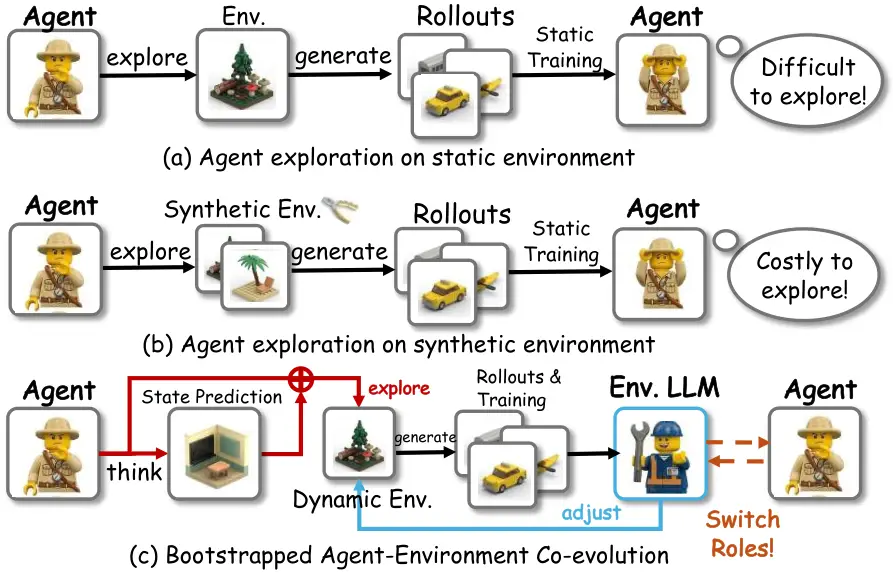
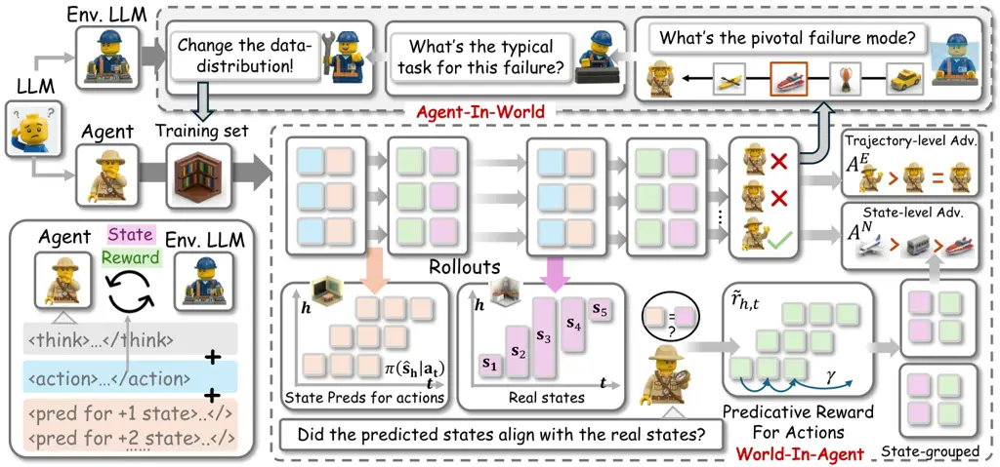
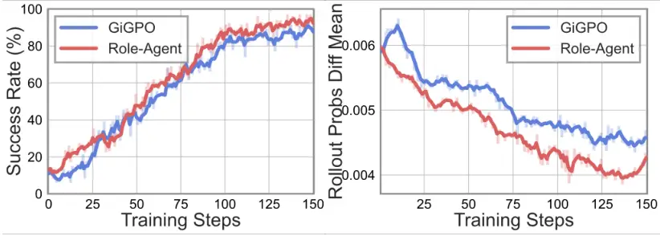
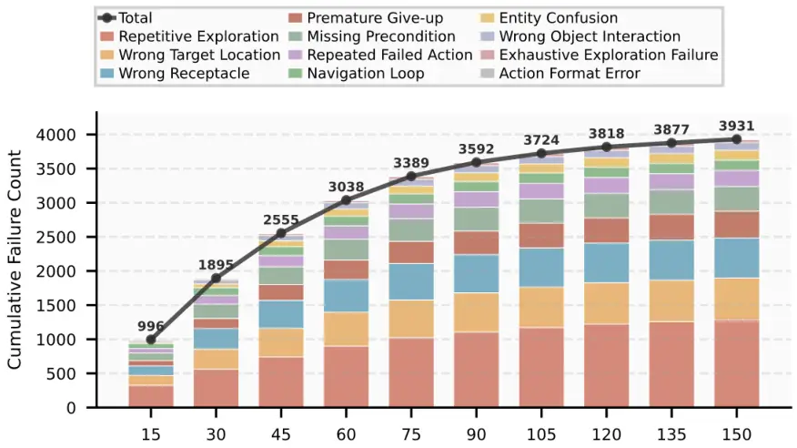
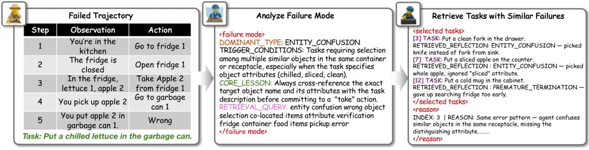
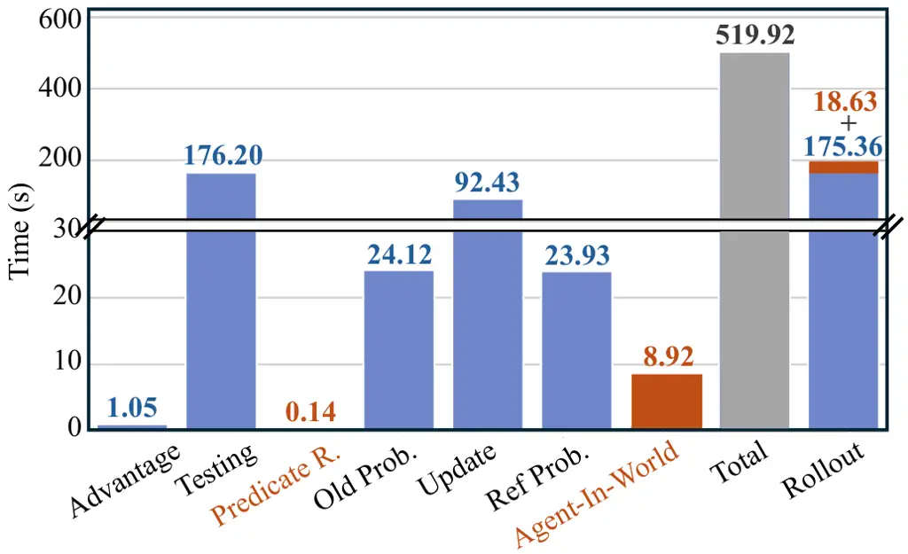

# ![[Uncaptioned image]](arxiv-2606-10917--bcfec25dd589.figures/figure-1.webp) Role-Agent: Bootstrapping LLM Agents via Dual-Role Evolution

Xucong Wang Affiliation: USTC Affiliation: AMAP, Alibaba Group
GitHub:[https://github.com/AMAP-ML/roleagent](https://github.com/AMAP-ML/roleagent)
   Ziyu Ma Affiliation: AMAP, Alibaba Group
GitHub:[https://github.com/AMAP-ML/roleagent](https://github.com/AMAP-ML/roleagent)
   Shidong Yang Affiliation: AMAP, Alibaba Group
GitHub:[https://github.com/AMAP-ML/roleagent](https://github.com/AMAP-ML/roleagent)
   Tongwen Huang Affiliation: AMAP, Alibaba Group
GitHub:[https://github.com/AMAP-ML/roleagent](https://github.com/AMAP-ML/roleagent)
   Pengkun Wang  Yong Wang  Xiangxiang Chu Affiliation: AMAP, Alibaba
Group
GitHub:[https://github.com/AMAP-ML/roleagent](https://github.com/AMAP-ML/roleagent)

###### Abstract

Although Large Language Model (LLM) agents have demonstrated strong
performance on complex tasks, their learning is often limited by
inefficient interaction feedback and static training environments, which
hinder broader generalization. To address these limitations, this paper
introduces Role-Agent, a framework that harnesses a single LLM to
function concurrently as both the agent and the environment, enabling a
bootstrapped co-evolution. Role-Agent comprises two synergistic
components: World-In-Agent (WIA) and Agent-In-World (AIW). In WIA, the
LLM acts as the agent and predicts future states after each action; the
alignment between predicted and actual states is then used as a process
reward, encouraging environment-aware reasoning. In AIW, the LLM
analyzes failure modes from failed trajectories and retrieves tasks with
similar failure patterns, thereby reshaping the training data
distribution for targeted practice. Experiments on multiple benchmarks
show that Role-Agent consistently improves performance, yielding an
average gain of over 4% over strong baselines.

## 1 Introduction

Beyond simple question answering, Large Language Model (LLM) agents Team
et al. (2023); Yang et al. (2025); Chen et al. (2025a); Ou et al.
(2025); Ma et al. (2026) have found wide application in complex
real-world challenges, owing to their unique abilities to think, reason,
and reflect Yao et al. (2022b); Shinn et al. (2023); Liu et al. (2023);
Dong et al. (2025a) within their environments. In more dynamic
applications such as coding Jiang et al. (2025), navigation Comanici et
al. (2025), deep research Citron (2024); Team et al. (2025), and
embodied applications Shridhar et al. (2020), the multi-turn tool-use
and long-horizon capabilities of agents are critical and have therefore
been widely explored Liu et al. (2023); Dong et al. (2025b).

Building on the use of Reinforcement Learning (RL) in LLM
post-training Schulman et al. (2017); Rafailov et al. (2023); Chu et al.
(2026), Agentic Reinforcement Learning (ARL) incorporates full
interaction rollout trajectories into the RL framework, enabling agents
to optimize their problem-solving abilities through environment
feedback. In contrast to supervised fine-tuning Zhang and Zhang (2024),
where agents are trained to mimic expert behavior, ARL allows greater
solution diversity Guo et al. (2025) and can substantially enhance
agents’ reasoning and problem-solving capabilities.



Figure 1: (a): Static environments provide sparse and non-specific
feedback that limits the agent’s exploration; (b): Synthetic
environments incur high labor and runtime costs; (c): The proposed
Role-Agent enables one model to switch roles between agent and
environment to achieve bootstrapped co-evolution.

Beyond using expert trajectories and static rewards to optimize agent
policies, recent studies of self-evolving agents Gao et al. (2025) focus
on continuous capability growth by autonomously discovering their own
deficiencies and updating agent harness Fernando et al. (2023); Hemberg
et al. (2024); Zhang et al. (2025a); Zhang et al. (2026b); Anthropic
(2024); Xia et al. (2026). However, most existing methods evolve only
the agent itself while treating the environment as a fixed source of
tasks, observations, and rewards; The environment fails to expose the
agent’s hidden weaknesses or provide feedback targeted to its current
failure modes. A more desirable paradigm is the synthetic environment,
where the agent improves through interaction while the environment also
adapts to diagnose the agent’s deficiencies and present more challenges.
Yet building such an adaptive environment often requires additional
environment models, task generators, or scheduling mechanisms Zhuo et
al. (2025); Xue et al. (2026), which increases deployment complexity.
This raises a natural question: can we achieve agent-environment
co-evolution by using a single LLM to act as both the agent and the
environment?

Guided by this idea, we propose Role-Agent, which enables bootstrapped
agent-environment co-evolution by using a single LLM as a dual-role
entity. Role-Agent consists of:

(a) World-In-Agent (WIA), where the LLM agent predicts the future
observations resulting from its actions, thereby incorporating
environment priors into its rollouts. Role-Agent measures the gap
between agent-predicted future states and actual states to estimate the
agent’s ability to predict action consequences. By integrating this
measure into reward and credit assignment, WIA encourages more reliable
decision-making in states where action consequences are uncertain.

(b) Agent-In-World (AIW), where the same LLM provides environment
feedback and adapts the data distribution to prioritize difficult and
easily overlooked tasks. Specifically, we instruct the LLM to analyze
failed trajectories step by step, producing failure modes and
reflections that reveal the root causes of failure. We then retrieve
tasks with similar failure modes and adjust the data distribution
accordingly, enabling the agent to focus training on its historical
deficiencies.

Extensive experiments demonstrate that Role-Agent consistently
outperforms existing approaches, showing that a single LLM can serve as
both agent and environment to achieve practical gains in text-based
interactive environments. Our contributions are threefold:

- •
  Different from agent-side self-improvement and state-grouped RL
  methods, we investigate bootstrapped agent-environment co-evolution
  without human supervision.
- •
  We propose Role-Agent, which uses the World-In-Agent and
  Agent-In-World modules to cast a single LLM in dual roles, enabling
  fine-grained environment prediction and adaptive task redistribution.
- •
  Extensive experiments demonstrate that Role-Agent achieves substantial
  improvements over strong baselines across diverse benchmarks.

## 2 Related Work

#### Large Language Model (LLM) Agents.

Large language models (LLMs) are increasingly being adopted as
autonomous agents across a wide range of domains Wang et al. (2023);
Wang et al. (2024); Jiang et al. (2025); Ou et al. (2025). Early LLM
agents were equipped with tool-use Yao et al. (2022b), reflection Shinn
et al. (2023), or memory schemes Xu et al. (2025); Fang et al. (2025);
Zhang et al. (2026a) to transform LLM backbones into autonomous,
interactive agents. More recent studies incorporate RL methods Lambert
et al. (2024) to endow agents with long-horizon reasoning and multi-turn
interaction abilities, exemplified by PPO Schulman et al. (2017),
DPO Rafailov et al. (2023), GRPO Guo et al. (2025), DAPO Yu et al.
(2025), GSPO Zheng et al. (2025), and GPG Chu et al. (2026). While these
approaches sample full tool-use trajectories and leverage final outcome
rewards with limited extra supervision, another line of studies adopts
process reward models Shao et al. (2024); Zhang et al. (2025b); Wang et
al. (2025b) to assign credit to each action, improving complex reasoning
tasks.

#### Self-Evolving Agents.

Unlike optimized under fixed data distributions and tasks, self-evolving
agents Gao et al. (2025); Zhai et al. (2025) emphasize autonomous
capability iteration within dynamically evolving open environments.
EvolveR Wu et al. (2025) introduces a self-contained lifecycle where the
agent distills its own experiences into principles and evolves its
policy. Other works Hu et al. (2024); Novikov et al. (2025) focus on
automated exploration of agent design. MAE Chen et al. (2025b)
instantiates three roles (Proposer, Solver and Judge) to co-evolve
without human-curated data. More recently, Agentevolver Zhai et al.
(2025) leverages self-questioning, self-navigation, and self-attribution
to facilitate agent evolution. GiGPO Feng et al. (2025) further
introduces state-grouped advantage estimation for LLM agent RL. In
contrast, Role-Agent achieves bootstrapped agent-environment
co-evolution, differing from these studies whose auxiliary roles mainly
remain on the agent side.

## 3 Methodology

### 3.1 Preliminaries

#### Problem Setup.

We first formalize general multi-step agent-environment interaction
tasks as follows: given a task prompt $`\bm{x}\in\mathcal{X}`$, the
agent generates an action $`\bm{a}_{t}\in{\mathcal{A}}`$ based on the
current state $`\bm{s}_{t}`$ and its policy
$`\pi_{\theta}(\bm{a}_{t}|\bm{s}_{t},\bm{x})`$ at each step $`t`$
($`1\leq t\leq T`$, where $`T`$ is the interaction length of the
trajectory and $`\theta`$ denotes the policy parameters). The
environment then provides the next state $`\bm{s}_{t+1}`$ and an instant
reward $`r_{t}`$. This yields a trajectory (rollout)
$`\bm{\tau}=\{(\bm{s}_{t},\bm{a}_{t},r_{t})\}_{t=1}^{T}`$. We denote a
batch of rollouts as $`\mathcal{T}=\{\bm{\tau}_{i}\}_{i=1}^{N}`$.
Notably, in sparse-reward open-world applications, process-level rewards
$`r_{t}`$ are often replaced by trajectory-level rewards
$`\mathcal{R}^{E}(\bm{\tau}_{i})`$, such as whether the agent achieves
the goal at the final step Shridhar et al. (2020).



Figure 2: Overview of the Role-Agent. A single LLM is leveraged to
switch between the roles of agent and environment. As an agent, it is
prompted to predict states for the next $`H`$ steps; the alignment
between these predictions and ground-truth states serves as a reward
signal to compute trajectory-level and state-level advantages. As the
environment, it analyzes failure modes from failed trajectories and
reshapes the data distribution by retrieving tasks with similar modes.
This closed-loop process enables bootstrapped agent-environment
co-evolution.

#### Agent Reinforcement Learning (ARL).

ARL incorporates full trajectories of agent reasoning and actions Wang
et al. (2025a) into the RL framework. A representative formulation is
Group Relative Policy Optimization (GRPO) Guo et al. (2025); for the
task $`\bm{x}`$ and sampled rollouts
$`\{\bm{\tau}_{i}\}_{i=1}^{N}\!\sim\!\bm{\pi}_{old}`$, GRPO is
formulated as the following:

```math
\begin{split}&\mathcal{J}({\theta})=\frac{1}{N}\sum_{i=1}^{N}\frac{1}{|\bm{\tau}_{i}|}\sum_{t=1}^{|\bm{\tau}_{i}|}{\rm min}(\rho_{\theta,t}^{(i)}A^{E}(\bm{\tau}_{i}),\\
&{\rm clip}(\rho_{\theta,t}^{(i)},1\pm\epsilon)A^{E}(\bm{\tau}_{i}))\!-\!\beta\mathcal{D}_{KL}[\bm{\pi}_{\theta}||\bm{\pi}_{ref}]\\
&A^{E}(\bm{\tau}_{i})=\frac{\mathcal{R}^{E}(\bm{\tau}_{i})-{\rm avg}(\{\mathcal{R}^{E}(\bm{\tau}_{i})\}_{i=1}^{N})}{{\rm std}(\{\mathcal{R}^{E}(\bm{\tau}_{i})\}_{i=1}^{N})},\end{split} \tag{1}
```

where $`\bm{y}^{(i)}_{t}`$ represents partial trajectory under rollout
$`i`$ at token $`t`$,
$`\rho_{\theta,t}^{(i)}\!=\!\nicefrac{{\bm{\pi}_{\theta}(\bm{y}^{(i)}_{t}|\bm{x},\bm{y}^{(i)}_{<t})}}{{\bm{\pi}_{old}(\bm{y}^{(i)}_{t}|\bm{x},\bm{y}^{(i)}_{<t})}}`$
is the importance sampling ratio of $`\bm{y}^{(i)}_{t}`$, rollout $`i`$;
$`\mathcal{D}_{KL}`$, $`\bm{\pi}_{old}`$ and $`\bm{\pi}_{ref}`$ are the
KL divergence, old policy and reference policy respectively. $`\beta`$
controls the penalty degree of the KL-loss. The following subsections
present our proposed Role-Agent, which integrates the World-In-Agent
(WIA) and Agent-In-World (AIW) design to achieve the bootstrapped
agent-environment co-evolution.

### 3.2 World-In-Agent (WIA)

Role-Agent first assigns the LLM the role of an agent and requires it to
develop fine-grained, interleaved perception of the world. Inspired by
world models Li et al. (2025); Gu et al. (2024), we internalize
environment dynamics into the agent by rewarding future-state
prediction.

#### Predicting the Future State.

During rollout, at each interaction step $`t`$, after the agent
generates an action $`\bm{a}_{t}`$, we prompt it with the augmented
prompt $`\bm{x}_{pre}`$ to predict the future states induced by this
action. This encourages the agent to explicitly model how its actions
may change the environment, rather than relying only on observed
rewards. For each prediction horizon $`h\in\{1,\ldots,H\}`$, the agent
predicts the state at step $`t+h`$:

```math
\hat{\bm{s}}_{t,h}\sim\bm{\pi}(\cdot\mid\bm{a}_{t},\bm{x}_{pre}), \tag{2}
```

where $`\hat{\bm{s}}_{t,h}`$ denotes the prediction made at step $`t`$
for the future state $`\bm{s}_{t+h}`$. We denote the prediction set at
step $`t`$ as
$`\mathcal{E}_{pre,t}=\{\hat{\bm{s}}_{t,h}\mid 1\leq h\leq H\}`$, and
collect all prediction sets after rollout:

```math
\mathcal{E}_{pre}=\{\mathcal{E}_{pre,t}\mid 1\leq t\leq T\}. \tag{3}
```

Inspired by GiGPO Feng et al. (2025), we measure the discrepancy between
predicted and ground-truth states using the Longest Matching Subsequence
(LMS) over their textual state contexts, yielding a predictive reward
matrix $`\tilde{\bm{r}}\in\mathbb{R}^{T\times H}`$:

```math
\tilde{r}_{t,h}=\operatorname{LMS}(\hat{\bm{s}}_{t,h},\bm{s}_{t+h}), \tag{4}
```

each $`\tilde{r}_{t,h}\in[0,1]`$ quantifies the agent’s foresight in
predicting the state $`h`$ steps ahead. In implementation, predictive
rewards are computed at the end of each rollout. In parallel, we obtain
the full trajectory
$`\bm{\tau}=\{(\bm{s}_{t},\bm{a}_{t},r_{t})\}_{t=1}^{T}`$. The task
reward for each action $`\bm{a}_{t}`$ is computed as the discounted
return from step $`t`$, while the predictive reward aggregates
future-state prediction scores within horizon $`H`$:

```math
\mathcal{R}_{task}(\bm{a}_{t})\!\!=\!\!\sum_{k=t}^{T}\gamma^{k-t}r_{k},\mathcal{R}_{pre}(\bm{a}_{t})\!\!=\!\!\sum_{h=1}^{H}\gamma^{h-1}\tilde{r}_{t,h}. \tag{5}
```

We combine the task and predictive rewards according to two principles:
(a) accurate state prediction preserves and amplifies the original
credit, reflecting reliable environment perception; and (b) inaccurate
prediction weakens the advantage signal, reducing credit for actions
that achieve high returns by chance. Thus, predictive reward serves as a
reliability-aware modulation of task reward:

```math
\mathcal{R}_{t}=\mathcal{R}_{task}(\bm{a}_{t})(1+\mathcal{R}_{pre}(\bm{a}_{t})). \tag{6}
```

We use multiplication rather than addition so that predictive reward
cannot independently introduce extra credit. Instead, it only modulates
actions with non-zero task reward, preventing failed trajectories from
being rewarded solely for plausible state predictions.

#### State Grouping & State-level Advantage.

Instead of employing the trajectory-level advantage, following
GiGPO Feng et al. (2025), we observe that even within the same
environment and initial settings, there can be significant redundancy
among states in a trajectory. By grouping actions that occur under
identical states and computing state-level advantages, we can more
clearly attribute rewards at the state level, independent of their
temporal ordering. Formally, we identify a set of non-repetitive states
$`\mathcal{O}\!\!=\!\!\{\bm{s}^{\dagger}_{o}\}_{o=1}^{|\mathcal{O}|}`$
from the batch with hash-maps, then group the actions like:

```math
\mathcal{G}\!\!=\!\!\{\{(\bm{s}_{t},\!\bm{a}_{t})|{\rm hash}(\bm{s}^{(i)}_{t})\!\!=\!\!{\rm hash}(\bm{s}^{\dagger}_{o})\}|\bm{s}^{\dagger}_{o}\!\!\in\!\!\mathcal{O}\} \tag{7}
```

Accordingly, we denote
$`\mathcal{G}^{(o)}\!\!=\!\!\{(\bm{s}^{(o)}_{t}\!\!,\bm{a}^{(o)}_{t})\}`$
as the set of state-action pairs grouped by $`\bm{s}^{\dagger}_{o}`$.
Finally, the state-level advantage for each $`\bm{a}_{t}^{(o)}`$ is
calculated as:

```math
A^{S}(\bm{a}^{(o)}_{t})\!\!=\!\!\frac{\mathcal{R}^{(o)}_{t}\!\!-\!\!{\rm avg}(\{\mathcal{R}^{(o)}_{t}|(\bm{s}^{(o)}_{t}\!\!\!,\bm{a}^{(o)}_{t})\!\!\in\!\mathcal{G}^{(o)}\})}{{\rm std}(\{\mathcal{R}^{(o)}_{t}|(\bm{s}^{(o)}_{t}\!\!\!,\bm{a}^{(o)}_{t})\!\!\in\!\mathcal{G}^{(o)}\})} \tag{8}
```

With the state-level advantages, we finally revise the trajectory-level
policy optimization of GRPO into the following variants:

```math
\begin{split}&\mathcal{J}_{ours}(\theta)=\frac{1}{N}\sum_{i=1}^{N}\frac{1}{|\bm{\tau}_{i}|}\sum_{t=1}^{|\bm{\tau}_{i}|}{\rm min}(\rho_{\theta,t}^{(i)}A(\bm{a}_{t}^{(i)}),\\
&{\rm clip}(\rho_{\theta,t}^{(i)},1\pm\epsilon)A(\bm{a}_{t}^{(i)}))\!-\!\beta\mathcal{D}_{KL}[\pi_{\theta}||\pi_{ref}]\end{split} \tag{9}
```

where
$`\rho_{\theta,t}^{(i)}\!=\!\nicefrac{{\bm{\pi}_{\theta}(\bm{a}^{(i)}_{t}|\bm{s}_{t}^{(i)},\bm{y}^{(i)}_{<t})}}{{\bm{\pi}_{old}(\bm{a}^{(i)}_{t}|\bm{s}_{t}^{(i)},\bm{y}^{(i)}_{<t})}}`$
is the importance sampling ratio at step $`t`$ for rollout $`i`$. The
advantage is derived from the trajectory-level and state-level
advantages, linked with coefficient $`\alpha`$, i.e.,
$`A(\bm{a}_{t}^{(i)})\!\!=\!\!A^{S}(\bm{a}^{(o)}_{t})\!+\alpha\!\cdot\!A^{E}(\bm{\tau}_{i})`$,
where $`o`$ denotes the group to which $`\bm{a}_{t}^{(i)}`$ belongs.

### 3.3 Agent-In-World (AIW)

Beyond enabling the agent to perceive world dynamics, we argue that the
environment should also dynamically adjust itself based on the agent’s
capability. To this end, we propose Agent-In-World (AIW), which allows
the agent itself to act as a source of environmental feedback. By
receiving, validating, and filtering its own interaction history, the
agent expands the data distribution in a self-regulated manner.

#### Failure Mode Analysis.

For each failed trajectory, we feed all interaction sequences, along
with the task description and objective, into an LLM for analysis. We
prompt the LLM to identify one or more action patterns that led to the
failure, and to generate a failure-mode reflection that includes the
failure type, core lessons, and query contexts to be used for retrieving
similar tasks subsequently.

#### Task Retrieval & Changing Data Distribution.

Subsequently, we store these failure modes along with the corresponding
failed trajectories and task information in an offline interaction
history. The entire history of failure modes is then fed into the LLM,
which is instructed to retrieve patterns similar to the current failure
mode and return the indices of relevant interaction histories. In
practice, we organize tasks under unique failure modes rather than
referring to every failed trajectory. On ALFWorld, this library
comprises 11 unique modes across training, and storage or retrieval
costs remain negligible. Tasks grouped by shared failure modes highlight
the LLM’s deficiencies and oversights when facing specific situations.
Accordingly, we reintegrate these retrieved tasks into the training set.
Compared with random failed-task replay or task-text retrieval, AIW
retrieves by the underlying error pattern, which can connect
surface-different tasks sharing the same procedural weakness. By using
the same LLM to switch roles, we establish an agent-environment
co-evolution without introducing a separate model in the fine-tuning
stage.

|                         |                |          |      |       |      |      |       |      |           |       |
| ----------------------- | -------------- | -------- | ---- | ----- | ---- | ---- | ----- | ---- | --------- | ----- |
| Type                    | Method         | ALFWorld |      |       |      |      |       |      | WebShop   |       |
|                         |                | Pick     | Look | Clean | Heat | Cool | Pick2 | All  | Score     | Succ. |
| Closed-source Model     |                |          |      |       |      |      |       |      |           |       |
| Prompting               | GPT-4o         | 75.3     | 60.8 | 31.2  | 56.7 | 21.6 | 49.8  | 48.0 | 31.8      | 23.7  |
| Prompting               | Gemini-2.5-Pro | 92.8     | 63.3 | 62.1  | 69.0 | 26.6 | 58.7  | 60.3 | 42.5      | 35.9  |
| Qwen2.5-1.5B-Instruct   |                |          |      |       |      |      |       |      |           |       |
| Prompting               | Qwen-2.5       | 5.9      | 5.5  | 3.3   | 9.7  | 4.2  | 0.0   | 4.1  | 23.1      | 5.2   |
| Prompting               | ReAct          | 17.4     | 20.5 | 15.7  | 6.2  | 7.7  | 2.0   | 12.8 | 40.1      | 11.3  |
| Prompting               | Reflexion      | 35.3     | 22.2 | 21.7  | 13.6 | 19.4 | 3.7   | 21.8 | 55.8      | 21.9  |
| RL Training             | PPO            | 64.8     | 40.5 | 57.1  | 60.6 | 46.4 | 47.4  | 54.4 | 73.8      | 51.5  |
| RL Training             | RLOO           | 88.3     | 52.8 | 71.0  | 62.8 | 66.4 | 56.9  | 69.7 | 73.9      | 52.1  |
| RL Training             | GRPO           | 85.3     | 53.7 | 84.5  | 78.2 | 59.7 | 53.5  | 72.8 | 75.8      | 56.8  |
| RL Training             | GiGPO          | 94.4     | 67.5 | 94.8  | 94.4 | 79.8 | 76.4  | 86.7 | 83.1      | 65.0  |
| RL Training             | Role-Agent     | 95.8     | 78.3 | 95.0  | 97.0 | 87.5 | 91.7  | 90.9 | 87.7      | 71.9  |
| Qwen2.5-7B-Instruct     |                |          |      |       |      |      |       |      |           |       |
| Prompting               | Qwen-2.5       | 33.4     | 21.6 | 19.3  | 6.9  | 2.8  | 3.2   | 14.8 | 26.4      | 7.8   |
| Prompting               | ReAct          | 48.5     | 35.4 | 34.3  | 13.2 | 18.2 | 17.6  | 31.2 | 46.2      | 19.5  |
| Prompting               | Reflexion      | 62.0     | 41.6 | 44.9  | 30.9 | 36.3 | 23.8  | 42.7 | 58.1      | 28.8  |
| RL Training             | PPO            | 92.3     | 64.0 | 92.5  | 89.5 | 80.3 | 68.8  | 80.4 | 81.4      | 68.7  |
| RL Training             | RLOO           | 87.6     | 78.2 | 87.3  | 81.3 | 71.9 | 48.9  | 75.5 | 80.3      | 65.7  |
| RL Training             | GRPO           | 90.8     | 66.1 | 89.3  | 74.7 | 72.5 | 64.7  | 77.6 | 79.3      | 66.1  |
| RL Training             | GiGPO          | 97.7     | 82.7 | 98.8  | 83.7 | 89.3 | 79.2  | 90.8 | 84.4      | 72.8  |
| RL Training             | Role-Agent     | 98.3     | 93.7 | 98.5  | 88.9 | 90.0 | 92.8  | 93.8 | 88.0      | 77.1  |

Table 1: Performance comparison on ALFWorld and WebShop. We report the
average success rate (%) for each task and the averaged performance in
ALFWorld; For WebShop, we report the averaged score and success rate
(%).

## 4 Experiments

### 4.1 Experiment Setups

#### Benchmarks.

We evaluate our method across three types of tasks: ALFWorld Shridhar et
al. (2020), WebShop Yao et al. (2022a), and search-augmented question
answering (QA). ALFWorld assesses the model’s multi-step decision-making
abilities through household tasks, where they are required to navigate
the environment using textual commands to achieve given goals. WebShop
is a simulated e-commerce platform where agents interact with a
realistic web interface containing over 1.18 million real-world
products. Additionally, we employ search-augmented QA tasks, which
include single-hop QA datasets such as NQ Kwiatkowski et al. (2019),
TriviaQA Joshi et al. (2017), and PopQA Mallen et al. (2023), as well as
multi-hop QA datasets including HotpotQA Yang et al. (2018),
2WikiMultiHopQA Ho et al. (2020), MuSiQue Trivedi et al. (2022), and
Bamboogle Press et al. (2023). Together, these benchmarks enable a
comprehensive evaluation of an agent’s ability to ground language while
effectively leveraging external information.

#### Baselines.

We compare Role-Agent with various competitive models, categorized as
follows: (a) Closed-source models: GPT-4o Achiam et al. (2023) and
Gemini-2.5-Pro Team et al. (2023), which achieve superior performance in
general-purpose reasoning and understanding. (b) Prompt engineering
methods: ReAct Yao et al. (2022b) and Reflexion Shinn et al. (2023),
which leverage prompts to structure the multi-step behavior of agents.
(c) RL training methods: PPO Schulman et al. (2017), which utilizes the
collaboration between actor and critic networks along with a reward
model; RLOO Kool et al. (2019); Ahmadian et al. (2024) and GRPO Guo et
al. (2025), which compute advantages within grouped trajectories. (d)
Search-based models (evaluated only on search-QA tasks): R1-Instruct Jin
et al. (2025), Search-R1 Jin et al. (2025), ZeroSearch Sun et al.
(2025), and StepSearch Wang et al. (2025b).

#### Implementation Details.

We employ Qwen2.5-1.5/3B/7B-Instruct as backbone models for all
experiments. All baselines adopt the same hyper-parameters (if shared)
values as our method. Following Feng et al. (2025), the group size for
RLOO and GRPO is set to 8. For the search tasks we use E5 as the
retriever, with a group size of 5 and a maximum of 4 turns. All models
are trained on a single node with 8 NVIDIA H20 GPUs. State grouping is
performed by merging states whose longest-matching subsequence
similarity exceeds 0.9. We keep this threshold from GiGPO for fair
comparison; Also, since states of all datasets we employed are short and
templated, a high threshold avoids the conflation of genuinely different
states. The maximal steps $`T_{max}`$ for ALFWorld, WebShop and Search
QA are 50, 15, 4 respectively. Details of datasets, implementations and
prompts are in Appendix A/C/D respectively.

|             |             |               |              |           |              |           |             |               |      |
| ----------- | ----------- | ------------- | ------------ | --------- | ------------ | --------- | ----------- | ------------- | ---- |
| Type        | Method      | Single-Hop QA |              |           | Multi-Hop QA |           |             |               | Avg. |
|             |             | NQ^(†)        | TriviaQA^(∗) | PopQA^(∗) | HotpotQA^(†) | 2Wiki^(∗) | MuSiQue^(∗) | Bamboogle^(∗) |      |
| RL Training | R1-Instruct | 27.0          | 53.7         | 19.9      | 23.7         | 29.2      | 7.2         | 29.3          | 27.1 |
| RL Training | Search_R1   | 34.1          | 54.5         | 37.8      | 32.4         | 31.9      | 10.3        | 26.4          | 32.5 |
| RL Training | Zero-Search | 41.4          | 57.4         | 44.8      | 27.4         | 30.0      | 9.8         | 11.1          | 31.7 |
| RL Training | StepSearch  | \-            | \-           | \-        | 34.5         | 32.0      | 17.4        | 34.4          | \-   |
| RL Training | GiGPO       | 42.0          | 59.5         | 42.4      | 36.9         | 37.0      | 12.6        | 64.1          | 42.1 |
| RL Training | Role-Agent  | 40.1          | 60.4         | 49.8      | 38.8         | 45.2      | 17.8        | 68.4          | 45.8 |

Table 2: Comparison on search-augmented QA tasks. Role-Agent is trained
on NQ and HotpotQA. $`\dagger`$ and $`*`$ indicate in-domain and
out-of-domain datasets, respectively. All methods are experimented with
Qwen2.5-3B-Instruct.

### 4.2 Experimental Results

#### Results on ALFWorld and WebShop.

Table 1 presents the comparison results, showing that Role-Agent
consistently outperforms various existing baselines. Our key
observations are as follows:

(a): Traditional prompt-based methods such as ReAct and Reflexion yield
considerable gains over zero-shot models but still underperform compared
to RL-based methods. Role-Agent, in particular, outperforms these
approaches by an average of 78.0% on ALFWorld and 59.1% on WebShop in
terms of success rate. While closed-source models like Gemini achieve
competitive performance on specific tasks (e.g., 92.8% on
Pick-ALFWorld), their average performance lags behind, underscoring both
the difficulty of the tasks and the benefits of post-training. This
suggests that prompts can enhance the in-context learning ability of
agents but do not enable internal adaptation.

(b): RL training methods yield substantial gains, as demonstrated by
GRPO which achieves 72.8% / 75.8% on ALFWorld / WebShop, and GiGPO which
achieves 86.7% / 83.1% respectively with Qwen2.5-1.5B-Instruct. The
success of GiGPO stems from its group-level advantages, which unify
action evaluation across different steps for the same state.
Nevertheless, Role-Agent mostly outperforms GiGPO across both backbone
models, with relative gains of 4.2% / 6.9% on two datasets, validating
that the co-evolution in Role-Agent equips the agent with more
generalization abilities.

(c): Role-Agent demonstrates consistent superiority across larger
backbone models (Qwen2.5-7B-Instruct), achieving average gains of 3.8%.
Moreover, improvements are more pronounced in complex and compositional
tasks. For instance, Role-Agent shows a +11.0% increase on the Look task
(i.e., look_at_obj_in_light) and a +13.6% increase on the Pick2 task
(i.e., pick_two_obj_and_place), both of which require stable memory and
multi-step planning to ensure the correctness of each sub-task. These
results further indicate that the bootstrapped agent-environment
co-evolution endows agents with substantial generalization capabilities.

|                         |          |         |         |
| ----------------------- | -------- | ------- | ------- |
| Method                  | ALFWorld | WebShop | Average |
| Role-Agent              | 90.9     | 71.9    | 81.4    |
| - w/o Agent-In-World    | 87.5     | 66.9    | 77.2    |
| - w/o Predictive Reward | 88.0     | 68.3    | 78.2    |
| GiGPO                   | 86.7     | 65.0    | 75.9    |

Table 3: Ablation study of components with Qwen2.5-1.5B-Instruct. We
report the average success rate.

Results on Search-Augmented QA tasks. Table 2 presents the results.
Role-Agent achieves the best average performance of 45.8%, outperforming
the GiGPO average by 3.7%. Notably, the performance gains are more
pronounced on multi-hop QA tasks compared to single-hop ones, with
improvements of +8.2% on 2Wiki and +5.2% on MuSiQue. These results
demonstrate that agent-environment co-evolution equips the agent with
enhanced multi-step retrieval and reasoning capabilities. We also
observe that Role-Agent slightly underperforms GiGPO on NQ dataset,
which we attribute to its stronger generalization capabilities rather
than overfitting to the training set. Since search-agent baselines
differ in training and evaluation protocols, we use these results as a
cross-domain comparison and rely on ALFWorld/WebShop comparisons for the
most direct assessment.

### 4.3 Ablation Study & Sensitivity Analysis

Effects of Components. We conduct an ablation study by comparing the
performance of Role-Agent against variants with specific components
removed. The results are presented in Table 3. Specifically, we find
that removing either the AIW module or the predictive reward leads to a
drop in overall performance, with the effect being more pronounced for
AIW removal (a 5.0% decrease on WebShop). This highlights the pivotal
role of targeted environment feedback in AIW. Without dynamic data
distribution, the agent lacks iterative practice on critical failure
modes. The results also confirm that the predictive reasoning in WIA
equips the agent with valuable implicit world priors, enhancing its
decision-making capabilities at every step. Notably, both ablated
variants still outperform GiGPO on average, indicating that WIA and AIW
each provide gains beyond state-grouped credit assignment alone and are
complementary rather than redundant.

|                               |                       |          |         |         |
| ----------------------------- | --------------------- | -------- | ------- | ------- |
| Hyper-Param.                  | Value                 | ALFWorld | WebShop | Average |
| Adv. Scaling Coef. $`\alpha`$ | 0.5                   | 89.5     | 71.0    | 80.2    |
|                               | 1.0                   | 90.9     | 71.9    | 81.4    |
|                               | 2.0                   | 86.0     | 65.4    | 75.7    |
| \# Prediction Step $`H`$      | $`5\%\cdot T_{max}`$  | 90.9     | 71.9    | 81.4    |
|                               | $`10\%\cdot T_{max}`$ | 90.2     | 68.5    | 79.3    |
|                               | $`20\%\cdot T_{max}`$ | 75.6     | 62.3    | 69.0    |

Table 4: Sensitivity Analysis of hyper-parameters with
Qwen2.5-1.5B-Instruct. ($`H\geq 1`$ and is rounded).



Figure 3: Running dynamics on ALFWorld. (left): success rate on the
validation set; (right): the averaged difference between training and
inference rollouts.



Figure 4: Tasks of failure modes accumulated in training. Tracked on
ALFWorld with Qwen2.5-7B-Instruct.



Figure 5: Case study of Agent-In-World in Role-Agent on ALFWorld,
illustrating how the environment LLM extracts failure modes from failed
trajectories and retrieves tasks with similar failure modes.



Figure 6: Per-step time breakdown of Role-Agent. The gray bar represents
the average time of a complete generation. The blue bar indicates the
runtime of the comparative baseline (GiGPO), while the orange bars
highlight the additional runtime from our method.

Failure Mode Evolution. Figure 4 visualizes the cumulative evolution of
failure modes during training. The total number of recorded failures
grows quickly in the early stage and then gradually saturates, from 996
at step 15 to 3931 at step 150. This suggests that tasks are assigned to
failure-mode buckets rapidly at first, and per-mode accumulation then
tapers off as the library becomes sufficiently populated. Among
different categories, repetitive exploration, wrong target location, and
wrong receptacle account for a large proportion of failures, suggesting
the importance of exploration and grounding. The increment of other
modes show that AIW captures diverse and fine-grained weaknesses rather
than a single dominant error type. These results show that by
accumulating structured failure modes over training, the environment can
provide more targeted tasks for the agent to revisit its historical
deficiencies. Failure modes of all datasets are provided in Appendix C.

Hyper-parameter Sensitivity. We vary the advantage scaling coefficient
$`\alpha`$ and the number of steps per prediction $`H`$, and report the
results in Table 4. When studying one hyperparameter, the other is fixed
at its optimal value. Our findings are:

(a): The coefficient $`\alpha`$ controls the balance between
trajectory-level and state-level advantages in the final optimization
signal. When $`\alpha=0.5`$, Role-Agent achieves 89.5% on ALFWorld and
71.0% on WebShop, which is slightly lower than the default setting. This
indicates that under-weighting the trajectory-level advantage may weaken
the global task-completion signal. When $`\alpha`$ is increased to 2.0,
the average performance drops clearly to 75.7%, suggesting that
excessive trajectory-level weighting can dilute the fine-grained
state-level credit assignment. Therefore, setting $`\alpha=1.0`$
provides a balanced integration of both advantage terms and achieves the
best average performance.

(b) Increasing $`H`$ beyond $`5\%\cdot T_{max}`$ ($`T_{max}`$ is the
number of maximal interaction steps) generally leads to a sharp decline
in performance. For instance, at $`H\!\!=\!\!10\%\cdot T_{max}`$, the
average accuracy on WebShop drops to 68.5%; further increases eventually
render Role-Agent ineffective, causing it to underperform most RL
methods. This degradation may be attributed to that excessive
predictions occupy the in-context window and diminish the agent’s focus
on action planning. Additionally, predicting states too far beyond the
current context can lead to speculative guesswork and reward hacking.
Therefore, setting $`H\!\!=\!\!5\%\cdot T_{max}`$ achieves a Pareto
optimum in both efficiency and effectiveness.

Running Dynamics. Figure 3 compares the running curves of Role-Agent and
GiGPO. In Figure 3 (left), we find that while Role-Agent falls behind
GiGPO or shows fluctuation in the beginning stage, it generally achieves
a higher performance ceiling (90.9%) and faster convergence. This
suggests that the effects of closed-loop agent-environment evolution
intensify with the accumulation of adjusted data distribution, where the
agent receives targeted training on its failures. In Figure 3 (right),
we plot the difference between training and inference rollouts. Compared
with GiGPO, Role-Agent brings a substantial mitigation of the
train-inference mismatch. Higher consistency between the rollout and
training policies leads to lower variance in gradient estimation and
improves training stability.

Efficiency Study. Figure 6 compares the running time of different
components, with Role-Agent-specific costs highlighted in orange. All of
the efficiency results are evaluated on ALFWorld.

The extra predictions during rollout, calculations of predictive reward
and Agent-In-World feedback are minor (18.63s, 0.14s, 8.92s) compared
with the overall running-time per step, inducing only about 5.2% extra
computation. The state comparison contains only the task description and
two short state descriptions, and the retrieval repository contains only
a small number of unique failure modes. Additional retrieved tasks alter
the sampling distribution but do not require a separate model. Together
with the gains in Table 1, these results show that Role-Agent balances
efficiency and effectiveness.

### 4.4 Case Study

Figure 5 further illustrates how the environment LLM adjusts the data
distribution by analyzing failure trajectories. In the shown failed
trajectory, the agent mistakenly picks "Apple 2" from the fridge in step 3. The environment LLM then identifies the failure mode as
ENTITY_CONFUSION, along with a description of how the failure occurred
and queries for retrieving similar failure modes. Finally, it searches
for analogous failures in the stored history of (task, failure mode)
pairs. This workflow shows how structured failure analysis enables more
targeted subsequent training.

## 5 Conclusion

This paper introduces Role-Agent, a bootstrapped framework for
agent-environment co-evolution designed to overcome the challenges of
undirected and non-specific feedback in static environments. Role-Agent
leverages a single Large Language Model (LLM) to act as both the agent
and the environment, realized through our World-In-Agent (WIA) and
Agent-In-World (AIW). WIA enhances the agent’s planning and reasoning by
equipping it with the ability to predict future states based on its
actions; AIW uses the same LLM to analyze failure patterns from
unsuccessful trajectories and retrieve analogous tasks, thereby
dynamically reshaping the training data distribution. Extensive
experiments across diverse benchmarks validate that Role-Agent achieves
strong performance, demonstrating the effectiveness of our approach.

## Limitations

Despite its effectiveness, Role-Agent has several limitations. First, a
stronger frozen environment LLM can improve the AIW component, but it
also introduces extra external knowledge and changes the fairness of
comparison with same-backbone baselines. Second, the state grouping
mechanism employs a similarity threshold from previous studies, limiting
cross-task generalization. Finally, the current evaluation is confined
to text-based environments; extensions to multi-modal or real-time
embodied settings may require vision-language state descriptions or
latent-state matching and remain important future work.

## References

- Achiam et al. (2023) J. Achiam, S. Adler, S. Agarwal, L. Ahmad, I.
  Akkaya, F. L. Aleman, D. Almeida, J. Altenschmidt, S. Altman, S.
  Anadkat, et al. Gpt-4 technical report. arXiv preprint
  arXiv:2303.08774. Cited by: §4.1.
- Ahmadian et al. (2024) A. Ahmadian, C. Cremer, M. Gallé, M. Fadaee, J.
  Kreutzer, O. Pietquin, A. Üstün, and S. Hooker Back to basics:
  revisiting reinforce-style optimization for learning from human
  feedback in llms. In Proceedings of the 62nd Annual Meeting of the
  Association for Computational Linguistics (Volume 1: Long Papers),
  pp. 12248–12267. Cited by: §4.1.
- Anthropic (2024) A. Anthropic The claude 3 model family: opus, sonnet,
  haiku. Claude-3 Model Card 1 (1), pp. 4. Cited by: §1.
- Chen et al. (2025a) K. Chen, P. Wang, Y. Yu, X. Zhan, and H. Wang
  Large language model-based data science agent: a survey. arXiv
  preprint arXiv:2508.02744. Cited by: §1.
- Chen et al. (2025b) Y. Chen, Y. Wang, S. Zhu, H. Yu, T. Feng, M.
  Zhang, M. Patwary, and J. You Multi-agent evolve: llm self-improve
  through co-evolution. arXiv preprint arXiv:2510.23595. Cited by: §2.
- Chu et al. (2026) X. Chu, H. Huang, X. Zhang, F. Wei, and Y. Wang GPG:
  a simple and strong reinforcement learning baseline for model
  reasoning. In The Fourteenth International Conference on Learning
  Representations, External Links:
  [Link](https://openreview.net/forum?id=inccdtfx8x) Cited by: §1, §2.
- Citron (2024) D. Citron Try deep research and our new experimental
  model in gemini, your ai assistant. Google Blog, December 11. Cited
  by: §1.
- Comanici et al. (2025) G. Comanici, E. Bieber, M. Schaekermann, I.
  Pasupat, N. Sachdeva, I. Dhillon, M. Blistein, O. Ram, D. Zhang, E.
  Rosen, et al. Gemini 2.5: pushing the frontier with advanced
  reasoning, multimodality, long context, and next generation agentic
  capabilities. arXiv preprint arXiv:2507.06261. Cited by: §1.
- Dong et al. (2025a) G. Dong, Y. Chen, X. Li, J. Jin, H. Qian, Y.
  Zhu, H. Mao, G. Zhou, Z. Dou, and J. Wen Tool-star: empowering
  llm-brained multi-tool reasoner via reinforcement learning. arXiv
  preprint arXiv:2505.16410. Cited by: §1.
- Dong et al. (2025b) G. Dong, H. Mao, K. Ma, L. Bao, Y. Chen, Z.
  Wang, Z. Chen, J. Du, H. Wang, F. Zhang, et al. Agentic reinforced
  policy optimization. arXiv preprint arXiv:2507.19849. Cited by: §1.
- Fang et al. (2025) R. Fang, Y. Liang, X. Wang, J. Wu, S. Qiao, P.
  Xie, F. Huang, H. Chen, and N. Zhang Memp: exploring agent procedural
  memory. arXiv preprint arXiv:2508.06433. Cited by: §2.
- Feng et al. (2025) L. Feng, Z. Xue, T. Liu, and B. An Group-in-group
  policy optimization for llm agent training. arXiv preprint
  arXiv:2505.10978. Cited by: §2, §3.2, §3.2, §4.1.
- Fernando et al. (2023) C. Fernando, D. Banarse, H. Michalewski, S.
  Osindero, and T. Rocktäschel Promptbreeder: self-referential
  self-improvement via prompt evolution. arXiv preprint
  arXiv:2309.16797. Cited by: §1.
- Gao et al. (2025) H. Gao, J. Geng, W. Hua, M. Hu, X. Juan, H. Liu, S.
  Liu, J. Qiu, X. Qi, Y. Wu, et al. A survey of self-evolving agents:
  what, when, how, and where to evolve on the path to artificial super
  intelligence. arXiv preprint arXiv:2507.21046. Cited by: §1, §2.
- Gu et al. (2024) Y. Gu, K. Zhang, Y. Ning, B. Zheng, B. Gou, T.
  Xue, C. Chang, S. Srivastava, Y. Xie, P. Qi, et al. Is your llm
  secretly a world model of the internet? model-based planning for web
  agents. arXiv preprint arXiv:2411.06559. Cited by: §3.2.
- Guo et al. (2025) D. Guo, D. Yang, H. Zhang, J. Song, P. Wang, Q.
  Zhu, R. Xu, R. Zhang, S. Ma, X. Bi, et al. Deepseek-r1: incentivizing
  reasoning capability in llms via reinforcement learning. arXiv
  preprint arXiv:2501.12948. Cited by: §1, §2, §3.1, §4.1.
- Hemberg et al. (2024) E. Hemberg, S. Moskal, and U. O’Reilly Evolving
  code with a large language model. Genetic Programming and Evolvable
  Machines 25 (2), pp. 21. Cited by: §1.
- Ho et al. (2020) X. Ho, A. D. Nguyen, S. Sugawara, and A. Aizawa
  Constructing a multi-hop qa dataset for comprehensive evaluation of
  reasoning steps. In Proceedings of the 28th International Conference
  on Computational Linguistics, pp. 6609–6625. Cited by: §4.1.
- Hu et al. (2024) S. Hu, C. Lu, and J. Clune Automated design of
  agentic systems. arXiv preprint arXiv:2408.08435. Cited by: §2.
- Jiang et al. (2025) Z. Jiang, D. Schmidt, D. Srikanth, D. Xu, I.
  Kaplan, D. Jacenko, and Y. Wu Aide: ai-driven exploration in the space
  of code. arXiv preprint arXiv:2502.13138. Cited by: §1, §2.
- Jin et al. (2025) B. Jin, H. Zeng, Z. Yue, J. Yoon, S. Arik, D.
  Wang, H. Zamani, and J. Han Search-r1: training llms to reason and
  leverage search engines with reinforcement learning. arXiv preprint
  arXiv:2503.09516. Cited by: §4.1.
- Joshi et al. (2017) M. Joshi, E. Choi, D. S. Weld, and L. Zettlemoyer
  Triviaqa: a large scale distantly supervised challenge dataset for
  reading comprehension. In Proceedings of the 55th Annual Meeting of
  the Association for Computational Linguistics (Volume 1: Long Papers),
  pp. 1601–1611. Cited by: §4.1.
- Kool et al. (2019) W. Kool, H. van Hoof, and M. Welling Buy 4
  reinforce samples, get a baseline for free!. ICLR 2019 Workshop. Cited
  by: §4.1.
- Kwiatkowski et al. (2019) T. Kwiatkowski, J. Palomaki, O. Redfield, M.
  Collins, A. Parikh, C. Alberti, D. Epstein, I. Polosukhin, J.
  Devlin, K. Lee, et al. Natural questions: a benchmark for question
  answering research. Transactions of the Association for Computational
  Linguistics 7, pp. 453–466. Cited by: §4.1.
- Lambert et al. (2024) N. Lambert, J. Morrison, V. Pyatkin, S.
  Huang, H. Ivison, F. Brahman, L. J. V. Miranda, A. Liu, N. Dziri, S.
  Lyu, et al. Tulu 3: pushing frontiers in open language model
  post-training. arXiv preprint arXiv:2411.15124. Cited by: §2.
- Li et al. (2025) J. Li, D. Guo, D. Yang, R. Xu, Y. Wu, and J. He
  Codei/o: condensing reasoning patterns via code input-output
  prediction. arXiv preprint arXiv:2502.07316. Cited by: §3.2.
- Liu et al. (2023) X. Liu, H. Yu, H. Zhang, Y. Xu, X. Lei, H. Lai, Y.
  Gu, H. Ding, K. Men, K. Yang, et al. Agentbench: evaluating llms as
  agents. arXiv preprint arXiv:2308.03688. Cited by: §1.
- Ma et al. (2026) Z. Ma, S. Yang, Y. Ji, X. Wang, Y. Wang, Y. Hu, T.
  Huang, and X. Chu SkillClaw: let skills evolve collectively with
  agentic evolver. arXiv preprint arXiv:2604.08377. Cited by: §1.
- Mallen et al. (2023) A. Mallen, A. Asai, V. Zhong, R. Das, D.
  Khashabi, and H. Hajishirzi When not to trust language models:
  investigating effectiveness of parametric and non-parametric memories.
  In Proceedings of the 61st annual meeting of the association for
  computational linguistics (volume 1: Long papers), pp. 9802–9822.
  Cited by: §4.1.
- Novikov et al. (2025) A. Novikov, N. Vũ, M. Eisenberger, E. Dupont, P.
  Huang, A. Z. Wagner, S. Shirobokov, B. Kozlovskii, F. J. Ruiz, A.
  Mehrabian, et al. Alphaevolve: a coding agent for scientific and
  algorithmic discovery. arXiv preprint arXiv:2506.13131. Cited by: §2.
- Ou et al. (2025) Y. Ou, Y. Luo, J. Zheng, L. Wei, Z. Yu, S. Qiao, J.
  Zhang, D. Zheng, Y. Mao, Y. Gao, et al. Automind: adaptive
  knowledgeable agent for automated data science. arXiv preprint
  arXiv:2506.10974. Cited by: §1, §2.
- Press et al. (2023) O. Press, M. Zhang, S. Min, L. Schmidt, N. A.
  Smith, and M. Lewis Measuring and narrowing the compositionality gap
  in language models. In Findings of the Association for Computational
  Linguistics: EMNLP 2023, pp. 5687–5711. Cited by: §4.1.
- Rafailov et al. (2023) R. Rafailov, A. Sharma, E. Mitchell, C. D.
  Manning, S. Ermon, and C. Finn Direct preference optimization: your
  language model is secretly a reward model. Advances in neural
  information processing systems 36, pp. 53728–53741. Cited by: §1, §2.
- Schulman et al. (2017) J. Schulman, F. Wolski, P. Dhariwal, A.
  Radford, and O. Klimov Proximal policy optimization algorithms. arXiv
  preprint arXiv:1707.06347. Cited by: §1, §2, §4.1.
- Shao et al. (2024) Z. Shao, P. Wang, Q. Zhu, R. Xu, J. Song, X. Bi, H.
  Zhang, M. Zhang, Y. Li, Y. Wu, et al. Deepseekmath: pushing the limits
  of mathematical reasoning in open language models. arXiv preprint
  arXiv:2402.03300. Cited by: §2.
- Shinn et al. (2023) N. Shinn, F. Cassano, A. Gopinath, K. Narasimhan,
  and S. Yao Reflexion: language agents with verbal reinforcement
  learning. Advances in neural information processing systems 36,
  pp. 8634–8652. Cited by: §1, §2, §4.1.
- Shridhar et al. (2020) M. Shridhar, X. Yuan, M. Côté, Y. Bisk, A.
  Trischler, and M. Hausknecht Alfworld: aligning text and embodied
  environments for interactive learning. arXiv preprint
  arXiv:2010.03768. Cited by: §1, §3.1, §4.1.
- Sun et al. (2025) H. Sun, Z. Qiao, J. Guo, X. Fan, Y. Hou, Y.
  Jiang, P. Xie, Y. Zhang, F. Huang, and J. Zhou Zerosearch: incentivize
  the search capability of llms without searching. arXiv preprint
  arXiv:2505.04588. Cited by: §4.1.
- Team et al. (2023) G. Team, R. Anil, S. Borgeaud, J. Alayrac, J.
  Yu, R. Soricut, J. Schalkwyk, A. M. Dai, A. Hauth, K. Millican, et al.
  Gemini: a family of highly capable multimodal models. arXiv preprint
  arXiv:2312.11805. Cited by: §1, §4.1.
- Team et al. (2025) T. D. Team, B. Li, B. Zhang, D. Zhang, F. Huang, G.
  Li, G. Chen, H. Yin, J. Wu, J. Zhou, et al. Tongyi deepresearch
  technical report. arXiv preprint arXiv:2510.24701. Cited by: §1.
- Trivedi et al. (2022) H. Trivedi, N. Balasubramanian, T. Khot, and A.
  Sabharwal MuSiQue: multihop questions via single-hop question
  composition. Transactions of the Association for Computational
  Linguistics 10, pp. 539–554. Cited by: §4.1.
- Wang et al. (2023) G. Wang, Y. Xie, Y. Jiang, A. Mandlekar, C.
  Xiao, Y. Zhu, L. Fan, and A. Anandkumar Voyager: an open-ended
  embodied agent with large language models. arXiv preprint
  arXiv:2305.16291. Cited by: §2.
- Wang et al. (2024) J. Wang, H. Xu, H. Jia, X. Zhang, M. Yan, W.
  Shen, J. Zhang, F. Huang, and J. Sang Mobile-agent-v2: mobile device
  operation assistant with effective navigation via multi-agent
  collaboration. Advances in Neural Information Processing Systems 37,
  pp. 2686–2710. Cited by: §2.
- Wang et al. (2025a) Z. Wang, K. Wang, Q. Wang, P. Zhang, L. Li, Z.
  Yang, X. Jin, K. Yu, M. N. Nguyen, L. Liu, et al. Ragen: understanding
  self-evolution in llm agents via multi-turn reinforcement learning.
  arXiv preprint arXiv:2504.20073. Cited by: §3.1.
- Wang et al. (2025b) Z. Wang, X. Zheng, K. An, C. Ouyang, J. Cai, Y.
  Wang, and Y. Wu Stepsearch: igniting llms search ability via step-wise
  proximal policy optimization. arXiv preprint arXiv:2505.15107. Cited
  by: §2, §4.1.
- Wu et al. (2025) R. Wu, X. Wang, J. Mei, P. Cai, D. Fu, C. Yang, L.
  Wen, X. Yang, Y. Shen, Y. Wang, et al. Evolver: self-evolving llm
  agents through an experience-driven lifecycle. arXiv preprint
  arXiv:2510.16079. Cited by: §2.
- Xia et al. (2026) P. Xia, J. Chen, H. Wang, J. Liu, K. Zeng, Y.
  Wang, S. Han, Y. Zhou, X. Zhao, H. Chen, et al. SkillRL: evolving
  agents via recursive skill-augmented reinforcement learning. arXiv
  preprint arXiv:2602.08234. Cited by: §1.
- Xu et al. (2025) W. Xu, Z. Liang, K. Mei, H. Gao, J. Tan, and Y. Zhang
  A-mem: agentic memory for llm agents. arXiv preprint arXiv:2502.12110.
  Cited by: §2.
- Xue et al. (2026) T. Xue, C. Peng, M. Huang, L. Guo, T. Han, H.
  Wang, J. Wang, X. Zhang, X. Yang, D. Zhao, et al. Evocua: evolving
  computer use agents via learning from scalable synthetic experience.
  arXiv preprint arXiv:2601.15876. Cited by: §1.
- Yang et al. (2025) A. Yang, A. Li, B. Yang, B. Zhang, B. Hui, B.
  Zheng, B. Yu, C. Gao, C. Huang, C. Lv, et al. Qwen3 technical report.
  arXiv preprint arXiv:2505.09388. Cited by: §1.
- Yang et al. (2018) Z. Yang, P. Qi, S. Zhang, Y. Bengio, W. Cohen, R.
  Salakhutdinov, and C. D. Manning HotpotQA: a dataset for diverse,
  explainable multi-hop question answering. In Proceedings of the 2018
  conference on empirical methods in natural language processing,
  pp. 2369–2380. Cited by: §4.1.
- Yao et al. (2022a) S. Yao, H. Chen, J. Yang, and K. Narasimhan
  Webshop: towards scalable real-world web interaction with grounded
  language agents. Advances in Neural Information Processing Systems 35,
  pp. 20744–20757. Cited by: §4.1.
- Yao et al. (2022b) S. Yao, J. Zhao, D. Yu, N. Du, I. Shafran, K. R.
  Narasimhan, and Y. Cao React: synergizing reasoning and acting in
  language models. In The eleventh international conference on learning
  representations, Cited by: §1, §2, §4.1.
- Yu et al. (2025) Q. Yu, Z. Zhang, R. Zhu, Y. Yuan, X. Zuo, Y. Yue, W.
  Dai, T. Fan, G. Liu, L. Liu, et al. Dapo: an open-source llm
  reinforcement learning system at scale. arXiv preprint
  arXiv:2503.14476. Cited by: §2.
- Zhai et al. (2025) Y. Zhai, S. Tao, C. Chen, A. Zou, Z. Chen, Q.
  Fu, S. Mai, L. Yu, J. Deng, Z. Cao, et al. Agentevolver: towards
  efficient self-evolving agent system. arXiv preprint arXiv:2511.10395.
  Cited by: §2.
- Zhang et al. (2025a) G. Zhang, H. Ren, C. Zhan, Z. Zhou, J. Wang, H.
  Zhu, W. Zhou, and S. Yan Memevolve: meta-evolution of agent memory
  systems. arXiv preprint arXiv:2512.18746. Cited by: §1.
- Zhang et al. (2026a) H. Zhang, Q. Long, J. Bao, T. Feng, W. Zhang, H.
  Yue, and W. Wang MemSkill: learning and evolving memory skills for
  self-evolving agents. arXiv preprint arXiv:2602.02474. Cited by: §2.
- Zhang et al. (2026b) S. Zhang, J. Wang, R. Zhou, J. Liao, Y. Feng, Z.
  Li, Y. Zheng, W. Zhang, Y. Wen, Z. Li, et al. Memrl: self-evolving
  agents via runtime reinforcement learning on episodic memory. arXiv
  preprint arXiv:2601.03192. Cited by: §1.
- Zhang et al. (2025b) W. Zhang, X. Li, K. Dong, Y. Wang, P. Jia, X.
  Li, Y. Zhang, D. Xu, Z. Du, H. Guo, et al. Process vs. outcome reward:
  which is better for agentic rag reinforcement learning. arXiv preprint
  arXiv:2505.14069. Cited by: §2.
- Zhang and Zhang (2024) Z. Zhang and A. Zhang You only look at screens:
  multimodal chain-of-action agents. In Findings of the Association for
  Computational Linguistics: ACL 2024, pp. 3132–3149. Cited by: §1.
- Zheng et al. (2025) C. Zheng, S. Liu, M. Li, X. Chen, B. Yu, C.
  Gao, K. Dang, Y. Liu, R. Men, A. Yang, et al. Group sequence policy
  optimization. arXiv preprint arXiv:2507.18071. Cited by: §2.
- Zhuo et al. (2025) T. Y. Zhuo, D. Wang, H. Ding, V. Kumar, and Z. Wang
  Cyber-zero: training cybersecurity agents without runtime. arXiv
  preprint arXiv:2508.00910. Cited by: §1.

## Appendix A Dataset Details

### A.1 ALFWorld

ALFWorld is an interactive framework that bridges text-based
environments and physically embodied simulations. Agents learn
high-level policies in TextWorld and apply them within the visual ALFRED
benchmark. With parallel representations of the same world, ALFWorld
enables agents to leverage semantic priors and language-based reasoning
to generalize more effectively to new tasks. This dual-modality design
promotes stronger generalization and greater training efficiency
compared to vision-only approaches.

|                           |                   |                                  |                    |
| ------------------------- | ----------------- | -------------------------------- | ------------------ |
|    Parameter              |    Value          |    Parameter                     |    Value           |
|    learning rate          |    1.00E-06       |    evaluation temperature        |    0               |
|    training batch size    |    16/16/256      |    max response length           |    4096            |
|    optimizer              |    AdaW           |    reward                        |    suc=1,fail=0    |
|    clip ratio low         |    0.2            |    max interaction step          |    50/15/4         |
|    clip ratio high        |    0.28           |    state similarity threshold    |    0.9             |
|    KL coefficient         |    1.00E-03       |    $`reflectiontemperature`$     |    0.5             |
|    rollout temperature    |    0.9            |    total epoch                   |    150             |
|    val_data_size          |    128/128/512    |    group_size                    |    8               |

Table 5: Hyper-parameters for RL training.

|                                      |                                   |                                     |
| ------------------------------------ | --------------------------------- | ----------------------------------- |
|    ALFWorld                          |    WebShop                        |    Search                           |
|    repetitive_exploration            |    irrelevant_query               |    wrong_answer                     |
|    wrong_target_location             |    wrong_product_selection        |    insufficient_retrieval           |
|    wrong_receptacle                  |    wrong_attribute_selection      |    irrelevant_retrieval_query       |
|    premature_give_up                 |    missing_attribute_selection    |    repeated_retrieval_query         |
|    missing_precondition              |    premature_purchase             |    information_misinterpretation    |
|    repeated_failed_action            |    excessive_browsing             |    partial_answer                   |
|    navigation_loop                   |    repeated_query                 |    hallucinated_answer              |
|    entity_confusion                  |    navigation_error               |    premature_answer                 |
|    wrong_object_interaction          |    price_constraint_violation     |    action_format_error              |
|    exhaustive_exploration_failure    |    action_format_error            |                                     |
|    action_format_error               |    premature_termination          |                                     |

Table 6: Failure modes used in Agent-In-World across ALFWorld, WebShop,
and search-augmented QA tasks.

### A.2 WebShop

WebShop is a large-scale simulated e-commerce environment comprising
over 1.18 million real-world products and 12,087 crowd-sourced natural
language instructions for training grounded language agents. In this
benchmark, agents use two actions, i.e., search\[query\] and
click\[element\], to fulfill complex user requirements. The environment
features an automatically computable reward function based on product
attributes, which shows sim-to-real transfer capabilities when deployed
on actual shopping websites like Amazon and eBay.

### A.3 Search-QA Tasks

Natural Questions (NQ) is a large-scale open-domain QA dataset built
from real Google search queries. Each example pairs a user question with
an answer extracted from a Wikipedia page. It’s widely used to benchmark
single-hop retrieval and reading comprehension, where the task is to
locate and extract an answer from a single passage.

TriviaQA consists of question-answer-evidence triples sourced from
Wikipedia and news articles. The questions involve complex entity
relationships, and the evidence is collected via distant supervision,
meaning the answer isn’t necessarily tied to a single pre-selected
passage. It’s commonly used to test how well models retrieve and
synthesize facts from unstructured text.

PopQA focuses on long-tail entities. It samples over 14,000 questions
about less frequently mentioned entities. It tests whether a retrieval
method can actually look up obscure knowledge instead of relying on
parametric memory.

HotpotQA requires multi-hop reasoning across two or more Wikipedia
paragraphs. It’s designed to test whether a model can follow a chain of
evidence, not just locate a single fact.

2WikiMultihopQA (2Wiki) is constructed using a rule-based template
system. This ensures each question has a predefined reasoning path, and
questions are categorized by logical type, such as comparison, temporal,
or compositional. It provides a controlled setting for evaluating
whether models can perform specific kinds of multi-step inference.

MuSiQue is built by programmatically composing single-hop questions from
existing datasets like SQuAD and TriviaQA. The composition ensures
strict connectivity between reasoning steps. It includes unanswerable
distractors. This tests whether models can follow a dependency chain
while filtering out irrelevant information.

Bamboogle is designed to be unsolvable by parametric models alone. The
questions require decomposition and sequential retrieval across multiple
documents. It’s used to evaluate whether search-augmented agents can
generalize compositionally, meaning they can combine facts from
different sources in ways that weren’t seen during training.

## Appendix B More Studies

### B.1 Standard Deviations

Table 7 reports the mean and standard deviations over three runs.

### B.2 Relation between predictive reward and outcome reward

On 200 ALFWorld rollouts with Qwen2.5-3B-Instruct, the predictive reward
has a point-biserial correlation of 0.41 ($`p<0.01`$) with outcome
reward. Its average value also rises from about 0.60 at initialization
to the mid-to-high 0.70 range near convergence, indicating improved
state prediction quality.

|                             |                       |                       |
| --------------------------- | --------------------- | --------------------- |
|    Method                   |    ALFWorld           |    WebShop            |
|    Qwen2.5-1.5B-Instruct    |                       |                       |
|    GRPO                     |    $`72.8\pm 1.5`$    |    $`56.8\pm 0.7`$    |
|    GiGPO                    |    $`86.7\pm 0.6`$    |    $`65.0\pm 1.1`$    |
|    Role-Agent               |    $`90.9\pm 0.8`$    |    $`71.9\pm 0.9`$    |
|    Qwen2.5-7B-Instruct      |                       |                       |
|    GRPO                     |    $`77.6\pm 1.0`$    |    $`66.1\pm 0.9`$    |
|    GiGPO                    |    $`90.8\pm 0.5`$    |    $`72.8\pm 1.8`$    |
|    Role-Agent               |    $`93.8\pm 0.8`$    |    $`77.1\pm 0.6`$    |

Table 7: Stability results over three runs with
Qwen2.5-1.5B/7B-Instruct.

## Appendix C Implementation Details

Role-Agent adopts the VeRL framework to train agents. We list the
detailed hyper-parameters in Table 5. All of the employed backbones in
the experiments, i.e., Qwen2.5-1.5/3/7B-Instruct are trained on
8$`\times`$ NVIDIA H20 GPUs with tensor parallel equals 1. The list of
failure modes employed by Role-Agent is shown in Table 6.

## Appendix D Prompts

We provide all the prompts we used in the experiment in Figure 7 to 9.

To be specific, Figure 7 shows the specific prompt for search-augmented
QA tasks, where we provide the history of interaction, search query and
corresponding results. We ask the LLM to either search the website or
answer the question. The prompt in Figure 8 first feeds the LLM with the
task context and failed trajectories, then asks the LLM to generate
typical failure modes, including failure categories, core lessons and
suggested queries for the incoming retrieval. The prompt in Figure 9
takes the generated content and asks the LLM to retrieve tasks with
similar failure modes, which are stored in the offline library.

## Appendix E Algorithm

The algorithm is listed in Algorithm 1.

1: Initial policy $`\pi_{\theta}`$, reference policy $`\pi_{\rm ref}`$,
task pool $`\mathcal{D}`$, prediction horizon $`H`$, discount factor
$`\gamma`$, mixing coefficient $`\alpha`$

2: Optimized policy $`\pi_{\theta}`$

3: Initialize task distribution $`p_{\mathcal{D}}`$ and failure memory
$`\mathcal{M}\leftarrow\emptyset`$

4: for each training iteration do

5:   Sample a batch of tasks $`\{q_{i}\}_{i=1}^{N}\sim p_{\mathcal{D}}`$

6:   for each task $`q_{i}`$ do

7:    Roll out the LLM agent to obtain trajectory
$`\bm{\tau}_{i}=\{(\bm{s}^{(i)}_{t},\bm{a}^{(i)}_{t},r^{(i)}_{t})\}_{t=1}^{T_{i}}`$

8:    for each step $`t`$ in $`\bm{\tau}_{i}`$ do

9:      Use the same LLM with prompt $`\bm{x}_{pre}`$ to predict future
states $`\{\hat{\bm{s}}^{(i)}_{t,h}\}_{h=1}^{H}`$

10:      Compute predictive scores
$`\tilde{r}^{(i)}_{t,h}=\operatorname{LMS}(\hat{\bm{s}}^{(i)}_{t,h},\bm{s}^{(i)}_{t+h})`$

11:      Compute task and predictive rewards:

```math
\mathcal{R}_{task}^{(i)}(\bm{a}_{t})=\sum_{k=t}^{T_{i}}\gamma^{k-t}r^{(i)}_{k},\quad\mathcal{R}_{pre}^{(i)}(\bm{a}_{t})=\sum_{h=1}^{H}\gamma^{h-1}\tilde{r}^{(i)}_{t,h}
```

12:      Modulate the reward:

```math
\mathcal{R}^{(i)}_{t}=\mathcal{R}_{task}^{(i)}(\bm{a}_{t})\bigl(1+\mathcal{R}_{pre}^{(i)}(\bm{a}_{t})\bigr)
```

13:    end for

14:   end for

15:   Group identical states across the rollout batch using hash maps

16:   Compute state-level advantage $`A^{S}_{o}(\bm{a}^{(i)}_{t})`$
within each state group $`\mathcal{G}_{o}`$

17:   Compute the final advantage:

```math
A(\bm{a}^{(i)}_{t})=A^{S}_{o}(\bm{a}^{(i)}_{t})+\alpha A^{E}(\bm{\tau}_{i})
```

18:   Update $`\pi_{\theta}`$ with the GRPO-style clipped objective
using $`A(\bm{a}^{(i)}_{t})`$

19:   for each failed trajectory $`\bm{\tau}_{i}`$ do

20:    Use the same LLM as the environment role to analyze failure
causes

21:    Generate failure mode and reflection, then store them in
$`\mathcal{M}`$

22:   end for

23:   Retrieve tasks in $`\mathcal{D}`$ similar to the accumulated
failure modes

24:   Update $`p_{\mathcal{D}}`$ to prioritize difficult and overlooked
tasks

25: end for

26: return $`\pi_{\theta}`$

Algorithm 1 Role-Agent Training

## Appendix F The Use of Large Language Models

During manuscript preparation, we use large language models (LLMs) to
(i) improve grammar and spelling without altering the intended
scientific content, and (ii) provide lightweight coding assistance
(e.g., scripts and formatting help). All reported numerical results,
analyses, and claims are produced by the authors. The authors design the
methods, conduct the experiments, and verify the findings.


Figure 7: The prompt template of Search agents.


Figure 8: The prompt template for abstracting failure modes from failed
trajectories.


Figure 9: The prompt template for retrieving tasks with similar failure
modes.


Figure 10: Case-1: failure trajectories.


Figure 11: Case-2: failure trajectories.


