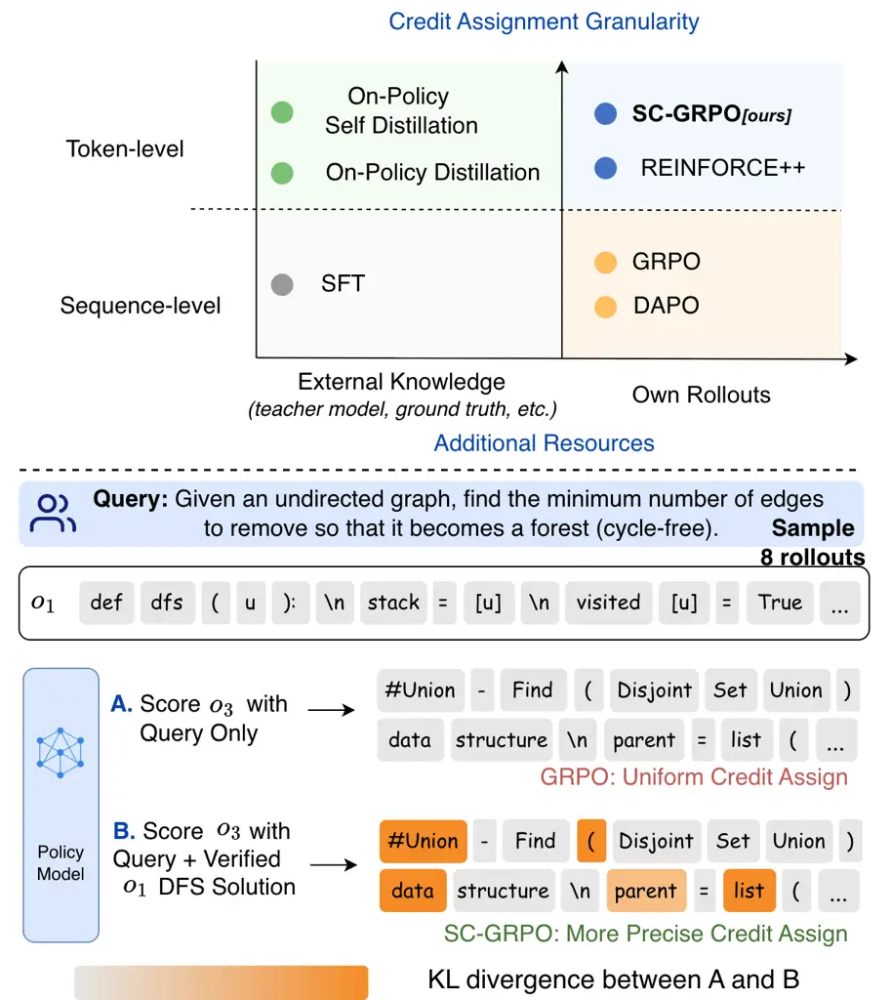
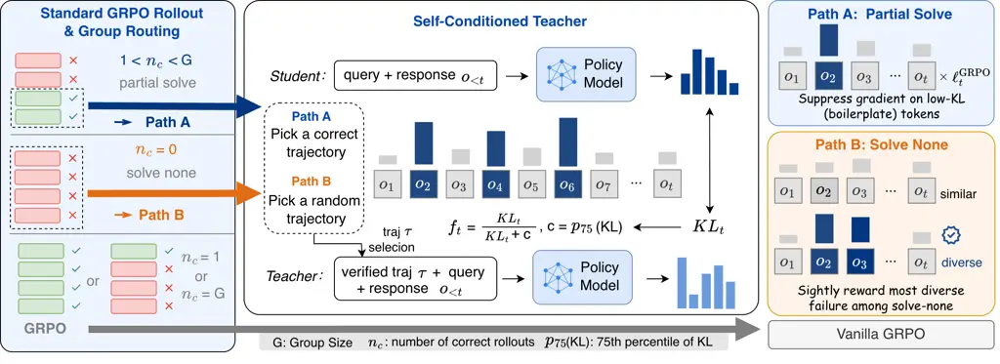
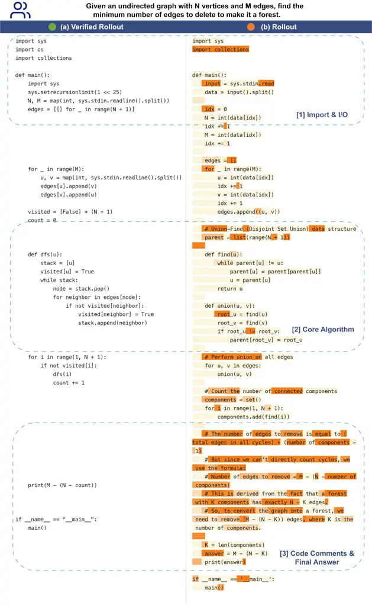

# Learning from Own Solutions: Self-Conditioned Credit Assignment for Reinforcement Learning with Verifiable Rewards

Yingyu Shan Affiliation: Beijing Institute of Technology    Yuhang Guo
Affiliation: Beijing Institute of Technology Affiliation: Corresponding
authorEmail: {shanyingyu, guoyuhang}@bit.edu.cn    Zihao Cheng
Affiliation: Beihang University    Zeming Liu Affiliation: Beihang
University    Xiangrong Zhu Affiliation: Independent Researcher    Xinyi
Wang Affiliation: Independent Researcher    Jiashu Yao
Affiliation: Beijing Institute of Technology    Wei Lin
Affiliation: Independent Researcher    Hongru Wang
Affiliation: Independent Researcher    Heyan Huang Affiliation: Beijing
Institute of Technology

###### Abstract

Reinforcement learning with verifiable rewards (RLVR) has driven
substantial progress in training LLMs for reasoning tasks, but
representative methods such as GRPO assign uniform credit across all
tokens, wasting gradient on routine tokens while under-crediting pivotal
reasoning steps. Existing token-level credit assignment methods require
resources beyond the model’s own rollouts. GRPO variants rely on process
reward models or ground-truth answers. Knowledge distillation assigns
credit through per-token divergence but requires external teachers
(On-Policy Distillation) or privileged information (On-Policy Self
Distillation). However, these dependencies limit applicability in the
pure RLVR setting. We observe that conditioning the model on its own
verified trajectories induces a measurable per-token KL divergence
between the original and conditioned distributions, and prove that
distilling from a self-teacher constructed by verified trajectories
leads to infeasible weighted-average solutions when multiple verified
trajectories exist. We propose SC-GRPO (Self-Conditioned GRPO), which
uses KL divergence mentioned before as a multiplicative weight on GRPO
gradients. Across five benchmarks spanning math, code, and agentic
tasks, SC-GRPO consistently outperforms 8.1% over GRPO and 5.9% over
DAPO with stronger OOD performance. Moreover, SC-GRPO achieves higher
performance than OPD.

## 1 Introduction



Figure 1: Overview of SC-GRPO. Top: positioning of SC-GRPO among
existing methods. Bottom: core mechanism illustrated on a LiveCodeBench
example.

Large language models (LLMs) have shown strong capabilities in various
tasks, but competition-level problems remain challenging. Reinforcement
learning with verifiable rewards (RLVR) (8; 35; 11) has driven
substantial progress in tackling such problems. Representative methods
in RLVR including GRPO 8; 21; 37; 28 assign a single scalar reward per
rollout, so every token shares the same advantage. This uniform credit
cannot identify which tokens caused success or failure, diluting
gradient across routine tokens while under-crediting pivotal reasoning
steps (12; 30).

To enable token-level credit assignment, existing approaches require
resources beyond the model’s own rollouts (Figure 1, top). Recent GRPO
variants have explored different directions: some train process reward
models on step-level annotations (29; 2), while others rely on
ground-truth answers (26). Alternatively, knowledge distillation
directly assigns credit at the token level through per-position
divergence between student and teacher distributions 13. On-Policy
Distillation (OPD) (1; 18) uses a stronger external teacher to provide
token-level supervision, and On-Policy Self-Distillation (OPSD) (15; 36)
similarly requires privileged information. These dependencies limit
applicability in the pure RLVR setting, where only a binary verifier is
available.

However, we can identify which tokens carry credit by comparing
predictions with and without access to the model’s own verified
solution. Recent work has shown that conditioning models on their own
verified trajectories improves generation quality (33). Building on this
observation, we propose SC-GRPO (Self-Conditioned GRPO), which uses such
conditioning to induce a measurable per-token distributional shift as a
credit assignment signal. As shown in Figure 1 bottom, for problems
where the model produces both correct and incorrect rollouts, SC-GRPO
injects one verified correct solution as an in-context demonstration and
re-scores all remaining rollouts under this prompt, constructing a
self-conditioned teacher. A complete version of this example is provided
in Figure 10.

We quantify this shift via per-token Kullback–Leibler (KL) divergence
between the original and demonstration-conditioned next-token
distributions. Inspired by OPSD (36), a natural approach would be to add
this KL as an auxiliary distillation loss. However, when multiple
distinct verified trajectories exist, the loss-minimizing student
converges to a weighted average over these teachers, a distribution that
does correspond to any feasible trajectory (we formalize this in §4.2).
Empirically, such additive formulations consistently fail to improve
over GRPO (§7.1).

Instead, SC-GRPO uses the KL signal purely as a multiplicative weight on
the GRPO gradient: the reward determines the update direction, and the
KL determines only its intensity at each token. The same
self-conditioned teacher handles both partial-solve groups, where a
verified correct trajectory serves as the reference and the KL weight
sharpens credit assignment, and solve-none groups, where a random
rollout serves as the reference and the KL signal provides a slight
exploration bonus that encourages diversity. On five benchmarks spanning
math, code, and multi-turn agentic tasks, SC-GRPO improves Average@8 by
8.1% over GRPO and 5.9% over DAPO, while achieving more consistent and
higher performance than OPD with external teachers.

Our contributions are as follows:

- •
  In RLVR, verified trajectories are the only supervision beyond the
  binary verifier. We prove that distilling from a teacher constructed
  using these trajectories leads to infeasible solutions, and
  demonstrate empirically that such formulations fail to improve over
  GRPO.
- •
  We propose SC-GRPO, which constructs a teacher by conditioning the
  model on its own verified trajectories and uses the resulting
  token-level KL divergence as a multiplicative weight on GRPO
  gradients.
- •
  Across five benchmarks spanning math, code, and agentic tasks, SC-GRPO
  consistently outperforms RL baselines and achieves higher and more
  stable performance than OPD.

## 2 Related Work

### 2.1 On-Policy Distillation

On-policy distillation trains on student generated rollouts with a
divergence to the teacher distribution (1; 6; 18; 23), eliminating the
train-test mismatch of offline distillation (13). The divergence
objective has been refined through skew-KL (18),
$`\alpha`$-$`\beta`$-divergence (25), and adaptive interpolation (23),
highlighting the sensitivity of letting divergence set the gradient
direction. Moreover, all variants require a stronger external teacher.

Self-distillation removes the external teacher dependency by
constructing a teacher from the model itself, typically conditioned on
privileged information such as textual feedback (15), ground truth (36;
4; 32), or expert demonstrations (22). SC-GRPO uses KL as a per-token
weight, eliminating sensitivity to divergence form choice, and
conditions the teacher solely on the model’s own verified rollouts.

### 2.2 Token-Level Credit Assignment in RL

Process reward models (PRMs) (20; 29; 27) provide step-level supervision
but require training a separate reward model with large-scale
annotation, and remain vulnerable to reward hacking (17; 5).
Annotation-free alternatives estimate token values through Monte Carlo
sampling (7) or segment-level sampling (9), requiring additional rollout
compute. GRPO-based methods also need external PRM models 2 or ground
truth 26 to gain token-level credit during training. In contrast,
SC-GRPO only depends on the model’s own rollouts to obtain token-level
reward without external resources.

## 3 Preliminaries

#### Notation

Let $`\pi_{\theta}`$ denote the policy parameterized by $`\theta`$.
Given a query $`x`$ sampled from the training dataset $`\mathcal{D}`$,
the policy generates a response
$`o=(o_{1},\ldots,o_{|o|})\sim\pi_{\theta}(\cdot\mid x)`$, where
$`o_{t}`$ is the token at position $`t`$ and $`o_{<t}`$ denotes the
prefix before position $`t`$. Each response is evaluated by a verifier
$`r`$, yielding a scalar reward $`r(x,o)\in[0,1]`$.

### 3.1 GRPO

For each query $`x`$, GRPO samples a group of $`G`$ responses
$`\{o_{i}\}_{i=1}^{G}`$ from the old policy
$`\pi_{\theta_{\mathrm{old}}}`$. Each response is evaluated by the
verifier, yielding $`r_{i}=r(x,o_{i})`$. Instead of learning a value
function, GRPO normalizes rewards across the $`G`$ responses in the same
group to obtain a sequence-level advantage. Equivalently, every token
position $`t`$ in response $`o_{i}`$ shares the same advantage:

```math
\hat{A}_{i,t}=\hat{A}_{i}=\frac{r(x,o_{i})-\mathrm{mean}(\{r(x,o_{k})\}_{k=1}^{G})}{\mathrm{std}(\{r(x,o_{k})\}_{k=1}^{G})}. \tag{1}
```

The policy is then updated with following objective over response
tokens:

```math
\displaystyle\mathcal{J}_{\mathrm{GRPO}}(\theta)=\mathbb{E}_{x\sim\mathcal{D},\,\{o_{i}\}_{i=1}^{G}\sim\pi_{\theta_{\mathrm{old}}}(\cdot\mid x)}\Bigg[\frac{1}{G}\sum_{i=1}^{G}\frac{1}{|o_{i}|}
```

```math
\displaystyle\sum_{t=1}^{|o_{i}|}\min\!\bigl(\rho_{i,t}\hat{A}_{i,t},\,\mathrm{clip}(\rho_{i,t},1-\epsilon,1+\epsilon)\hat{A}_{i,t}\bigr)\Bigg],
```

```math
\displaystyle\mathrm{with}\quad\rho_{i,t}=\frac{\pi_{\theta}(o_{i,t}\mid x,o_{i,<t})}{\pi_{\theta_{\mathrm{old}}}(o_{i,t}\mid x,o_{i,<t})}.
```

### 3.2 On-Policy Distillation

OPD 1 provides dense token-level signal along the student’s own
trajectories.

Let $`\pi_{\theta}`$ and $`\pi_{T}`$ denote the student and frozen
teacher policies, respectively. Given a prompt $`x\sim\mathcal{D}`$, the
student samples a response $`o\sim\pi_{\theta}(\cdot\mid x)`$, which
induces prefix states $`s_{t}=(x,o_{<t})`$. At each prefix, the student
and teacher next-token distributions are
$`\pi_{\theta}(\cdot\mid s_{t})`$ and $`\pi_{T}(\cdot\mid s_{t})`$, and
the token-level OPD objective is

```math
\displaystyle\mathcal{L}_{\mathrm{OPD}}(\theta) \displaystyle=\mathbb{E}_{\,x\sim\mathcal{D},\;o\sim\pi_{\theta}(\cdot\mid x)}\Big[\frac{1}{|o|}\sum_{t=1}^{|o|} \tag{2}
```

```math
\displaystyle D\!\bigl(\pi_{T}(\cdot\mid s_{t})\,\|\,\pi_{\theta}(\cdot\mid s_{t})\bigr)\Big],
```

where $`D`$ is a divergence such as the Kullback–Leibler (KL) divergence
or the Jensen–Shannon divergence (JSD).

OPSD 4; 15; 36 removes the requirement of external teacher by
conditioning the same model on privileged information $`c`$ (e.g.,
ground-truth or expert demonstration). The student distribution remains
$`\pi_{\theta}(\cdot\mid s_{t})`$, while the self-teacher is
instantiated as:

```math
\widetilde{\pi}_{\theta}(\cdot\mid s_{t},c)\;:=\;\operatorname{sg}\!\left[\pi_{\theta}(\cdot\mid x,c,o_{<t})\right], \tag{3}
```

where $`\operatorname{sg}[\cdot]`$ denotes the stop-gradient operator,
indicating that the teacher distribution is treated as a fixed target
for the current update. The training objective keeps the same form as
Eq. (2), with $`\pi_{T}(\cdot\mid s_{t})`$ replaced by
$`\widetilde{\pi}_{\theta}(\cdot\mid s_{t},c)`$.

## 4 Why Self-Distillation Fails in RLVR

### 4.1 Available Supervision in RLVR

For a query $`x`$, GRPO samples a group of responses
$`\{o_{i}\}_{i=1}^{G}\sim\pi_{\theta_{\mathrm{old}}}(\cdot\mid x)`$, and
a verifier assigns a sequence-level reward
$`r_{i}=r(x,o_{i})\in\{0,1\}`$ to each response. Let

```math
\mathcal{C}(x)=\{\,o_{i}:r(x,o_{i})=1,\ i\in\{1,\dots,G\}\,\}
```

denote the set of _verifier-approved_ trajectories.

In conventional self-distillation mentioned before, the teacher is
conditioned on some form of privileged information. In the RLVR setting,
however, no such privileged information is available. Beyond the query
$`x`$ and the scalar reward $`r`$, the only additional information we
can access is a verifier-approved trajectory drawn from the model’s own
rollouts, i.e., a sample from $`\mathcal{C}(x)`$. A verified trajectory
is not privileged information. It certifies only end-task correctness,
not reasoning quality. The trajectory may contain exploratory steps,
redundant derivations, or recoverable mistakes, and when multiple
trajectories in $`\mathcal{C}(x)`$ succeed, they may follow
contradictory reasoning paths.

### 4.2 Why OPSD Fails in RLVR

Despite this limitation, verified trajectories are the only additional
structure available in RLVR. A natural but naive adaptation is therefore
to treat them as a substitute for privileged context. Concretely, for a
student rollout $`o_{i}`$ with prefix states $`s_{i,t}=(x,o_{i,<t})`$
and a verifier-approved trajectory $`\tau_{j}\in\mathcal{C}(x)`$, we
instantiate the generic OPSD formulation in Section 3 by taking
$`\tau_{j}`$ as the privileged context:

```math
\widetilde{\pi}_{\theta}(\cdot\mid s_{i,t},\,\tau_{j})\;:=\;\operatorname{sg}\!\left[\pi_{\theta}(\cdot\mid x,\,\tau_{j},\,o_{i,<t})\right]. \tag{4}
```

The training objective keeps the same form as Eq. (2), replacing the
external teacher $`\pi_{T}`$ with the self-conditioned teacher
$`\widetilde{\pi}_{\theta}(\cdot\mid s_{i,t},\,\tau_{j})`$.

This adaptation, however, does not work. A pointwise analysis (detailed
in Appendix A) shows that under both forward and reverse KL, the
loss-minimizing student distribution at any prefix $`s_{i,t}`$ is a
aggregate of the self-conditioned teachers $`\{p_{j}\}`$ across
$`\mathcal{C}(x)`$:

```math
\!\!q^{\star}\propto\begin{cases}\sum_{j}\mu_{x}(j)\,p_{j}&\text{(Forward KL),}\\[2.0pt]
\prod_{j}p_{j}^{\,\mu_{x}(j)}&\text{(Reverse KL),}\end{cases}
```

where $`p_{j}:=\widetilde{\pi}_{\theta}(\cdot\mid s_{i,t},\tau_{j})`$
and $`\mu_{x}`$ is the selection rule over $`\mathcal{C}(x)`$. This
average distribution is problematic: (i) it need not correspond to any
single feasible trajectory; (ii) it assigns equal weight to all
prefixes, even those where verified trajectories disagree about the next
token; and (iii) it inherits whatever each $`\tau_{j}`$ happens to take
to reach the correct answer. These issues are fundamental to any
distillation-based approach that treats the teacher as a target
distribution.



Figure 2: Overview of SC-GRPO. We construct a self-conditioned teacher
by conditioning the model on a reference trajectory, compute token-level
KL divergence, and use it to weight the GRPO gradient.

## 5 SC-GRPO

1: policy $`\pi_{\theta}`$; query $`x`$; group size $`G`$; diversity
coefficient $`\alpha`$

2: // Phase 1: Standard GRPO rollout

3: Sample $`G`$ responses
$`\{o_{1},\ldots,o_{G}\}\sim\pi_{\theta}(\cdot\mid x)`$

4: Verify each $`o_{i}`$; let $`n_{c}`$ = number of correct responses

5: Compute group-normalized advantage $`\hat{A}_{i}`$ for each $`o_{i}`$

6: // Phase 2: KL signal (if $`2\leq n_{c}<G`$)

7: for each response $`o_{i}`$ do

8:   Pick a correct response $`\tau\neq o_{i}`$ as demonstration

9:   Run teacher forward:
$`\widetilde{\pi}_{\theta}(\cdot\mid x,\tau,o_{i,<t})`$

10:   Run student forward: $`\pi_{\theta}(\cdot\mid x,o_{i,<t})`$

11:
  $`D_{t}\leftarrow\mathrm{KL}(\widetilde{\pi}_{\theta}\|\pi_{\theta})`$
at each token $`t`$

12: end for

13:
$`c\leftarrow\max\big(p_{75}(\{D_{t}\}_{\text{all tokens}}),\;10^{-4}\big)`$

14: $`f_{t}\leftarrow D_{t}/(D_{t}+c)`$ // per-token weight $`\in[0,1)`$

15: // Phase 3: Diversity signal (if $`n_{c}=0`$)

16: Pick a random response $`o_{r}`$ as reference

17: for each $`o_{i}\neq o_{r}`$ do

18:   Teacher forward with $`o_{r}`$ in context (same as Phase 2)

19:   Compute $`D_{t},f_{t}`$ as in Phase 2

20:   $`s_{i}\leftarrow\frac{1}{|o_{i}|}\sum_{t}f_{t}`$ // diversity
score

21: end for

22: $`\hat{A}_{i}\leftarrow\alpha\cdot(s_{i}-\bar{s})/\mathrm{std}(s)`$
for each $`o_{i}`$ // exploration signal for zero-reward groups

23: // Phase 4: Weighted update

24: Update $`\theta`$ to maximize
$`\displaystyle\frac{1}{G}\sum_{i}\frac{1}{|o_{i}|}\sum_{t}f_{t}\cdot\ell^{\mathrm{GRPO}}_{i,t}(\hat{A}_{i})`$

25: // $`f_{t}{=}1`$ for groups skipping Phase 2&3

Algorithm 1 SC-GRPO

#### Overview

Section 4.2 shows that directly using verified trajectories as OPSD
distillation targets fails in RLVR. Therefore, we propose SC-GRPO
(Self-Conditioned GRPO), which takes a different approach. We construct
a _self-conditioned teacher_ by conditioning the model on a verified
trajectory, then measure the per-token distributional shift between the
teacher and the original student.

This shift, quantified as token-level KL divergence, identifies which
tokens depend on access to a verified solution. Tokens with small KL
make the same prediction regardless of whether a verified solution is
available. The token’s choice is unrelated to the rollout’s outcome, so
applying sequence-level credit here misattributes success or failure.
Tokens with large KL depend on verified solution, so the reward signal
is informative. SC-GRPO uses this KL purely as a multiplicative weight
on the GRPO gradient: the reward determines the update direction, and
the KL determines its intensity at each token.

Figure 2 and Algorithm 1 illustrate the method. The core mechanism is
described in §5.1: we construct a self-conditioned teacher by
conditioning the model on a reference trajectory, compute token-level
KL, and use it to weight the GRPO gradient. The reference is selected
based on the number of correct rollouts $`n_{c}`$ in the group: verified
trajectories for partial-solve groups ($`2\leq n_{c}<G`$), random
rollouts for solve-none groups ($`n_{c}{=}0`$), and standard GRPO for
$`n_{c}{=}1`$ or $`n_{c}{=}G`$. Section 5.2 analyzes the computational
overhead.

### 5.1 Self-Conditioned GRPO

#### Teacher construction

For a rollout $`o_{i}`$ with prefix states $`s_{i,t}=(x,o_{i,<t})`$ and
a verified trajectory $`\tau\in\mathcal{C}(x)`$ , we instantiate the
self-conditioned teacher
$`\widetilde{\pi}_{\theta}(\cdot\mid s_{i,t},\tau)`$ via Eq. (4), where
$`\tau`$ appears only in the teacher’s system prompt. Appendix E provide
the complete prompt templates. Both teacher and student are scored on
the same prefix $`o_{i,<t}`$ of $`o_{i}`$. At each response token, we
compute the forward KL from teacher to student:

```math
D_{i,t}=\mathrm{KL}\!\left(\widetilde{\pi}_{\theta}(\cdot\mid s_{i,t},\tau)\;\middle\|\;\pi_{\theta}(\cdot\mid s_{i,t})\right).
```

#### KL weighting

We map each $`D_{i,t}`$ to a bounded weight $`f(D_{i,t})\in[0,1)`$ to
modulate the GRPO gradient: tokens with small KL are downweighted, while
tokens with large KL are preserved. We map each $`D_{i,t}`$ to a bounded
weight via

```math
\displaystyle f(D_{i,t}) \displaystyle=\frac{D_{i,t}}{D_{i,t}+c},
```

```math
\displaystyle c \displaystyle=\max\!\left(P_{75}(\mathcal{D}_{\mathrm{act}}),\,c_{\min}\right),
```

where $`\mathcal{D}_{\mathrm{act}}`$ is the set of active token KL
values in the current micro-batch, $`P_{75}`$ denotes its 75th
percentile, and $`c_{\min}>0`$ is a small floor. We use $`P_{75}`$
instead of median because token-level KL is sparse (most tokens have
near-zero KL). $`P_{75}`$ ensures low-KL tokens are suppressed while
high-KL tokens are preserved. We visualize and analyze the KL
distribution and weighting function in Appendix C.3 and Appendix C.4. A
detailed case study is provided in Appendix D.

#### Group routing

The reference trajectory $`\tau`$ and advantage $`\hat{A}_{i}`$ are
selected based on the group’s solve pattern. Partial-solve groups have
both correct and incorrect rollouts, allowing us to use verified
trajectories as references. Solve-none groups have zero GRPO gradient,
so we extract exploration signal via diversity.

Partial-solve groups ($`2\leq n_{c}<G`$): For each rollout $`o_{i}`$, we
sample a verified trajectory $`\tau\in\mathcal{C}(x)`$ uniformly (with
$`\tau\neq o_{i}`$ when $`o_{i}\in\mathcal{C}(x)`$). We use the GRPO
advantage $`\hat{A}_{i}`$ in Eq. (1).

Solve-none groups ($`n_{c}=0`$): We sample one rollout $`o_{r}`$
uniformly as reference. For each remaining rollout $`o_{i}`$
($`i\neq r`$), we compute KL against the reference-conditioned teacher.
The average KL weight over the reference-length prefix becomes a
diversity score:

```math
s_{i}=\frac{1}{L_{i}}\sum_{t=1}^{L_{i}}f(D_{i,t}),\quad L_{i}=\min(|o_{i}|,|o_{r}|),
```

where $`L_{i}`$ truncates at the reference length. Since the reference
itself is a failed trajectory, we apply stricter supervision to prevent
reward hacking: tokens beyond the reference would have artificially high
KL and inflate diversity scores for longer rollouts. Scores are
normalized within the group to form a pseudo-advantage:

```math
\hat{A}^{\mathrm{div}}_{i}=\frac{s_{i}-\mathrm{mean}(\{s_{k}\}_{k=1}^{G})}{\mathrm{std}(\{s_{k}\}_{k=1}^{G})+\epsilon}, \tag{5}
```

which replaces $`\hat{A}_{i}`$ with $`\alpha\hat{A}^{\mathrm{div}}_{i}`$
in the SC-GRPO objective. Since all rollouts failed which bring zero
GRPO advantage, this diversity signal encourages exploring new modes
rather than repeating common ones.

Fallback ($`n_{c}=1`$ or $`n_{c}=G`$): Standard GRPO (no KL weighting).

SC-GRPO optimizes the weighted GRPO objective:

```math
\begin{split}&J_{\mathrm{SC\text{-}GRPO}}(\theta)=\mathbb{E}\Big[\tfrac{1}{G}\!\sum_{i=1}^{G}\tfrac{1}{|o_{i}|}\!\sum_{t=1}^{|o_{i}|}\\
&\quad f(D_{i,t})\,\min\!\big(\rho_{i,t}\hat{A}_{i},\,\mathrm{clip}(\rho_{i,t},1{-}\epsilon,1{+}\epsilon)\hat{A}_{i}\big)\Big],\end{split}\vskip-5.69054pt
```

where
$`\rho_{i,t}=\pi_{\theta}(o_{i,t}\mid s_{i,t})/\pi_{\theta_{\mathrm{old}}}(o_{i,t}\mid s_{i,t})`$
is the importance ratio, $`\hat{A}_{i}`$ is the advantage (GRPO
advantage from Eq. (1) for partial-solve groups,
$`\alpha\hat{A}^{\mathrm{div}}_{i}`$ from Eq. (5) for solve-none
groups). The KL weight $`f(D_{i,t})`$ is applied symmetrically: both
correct and incorrect rollouts are downweighted at low-KL tokens,
regardless of their advantage sign.

Figure 3: Timing overhead of SC-GRPO vs. GRPO. Mean per-step wall-clock
time (seconds) across training steps.

| Method                                                   | AIME24 |        | AIME25 |        | LCB v6 |        | AppWorld |        | WebShop |        | Avg.  |        |
| -------------------------------------------------------- | ------ | ------ | ------ | ------ | ------ | ------ | -------- | ------ | ------- | ------ | ----- | ------ |
|                                                          | Avg@8  | Pass@8 | Avg@8  | Pass@8 | Avg@8  | Pass@8 | Avg@8    | Pass@8 | Avg@8   | Pass@8 | Avg@8 | Pass@8 |
| Qwen3-8B                                                 | 25.41  | 46.67  | 18.75  | 30.00  | 26.33  | 35.11  | 9.65     | 26.31  | 8.13    | 14.00  | 17.65 | 30.42  |
| Reinforcement Learning                                   |        |        |        |        |        |        |          |        |         |        |       |        |
| GRPO                                                     | 41.67  | 70.00  | 34.16  | 50.00  | 39.59  | 43.51  | 12.50    | 33.33  | 68.93   | 69.40  | 39.37 | 53.25  |
| DAPO                                                     | 43.75  | 70.00  | 37.91  | 53.33  | 40.74  | 44.27  | 13.99    | 33.33  | 71.50   | 75.00  | 41.58 | 55.19  |
| REINFORCE++                                              | 18.33  | 26.67  | 16.25  | 30.00  | 39.69  | 44.27  | –        | –      | –       | –      | –     | –      |
| On-Policy Self Distillation with External Demonstrations |        |        |        |        |        |        |          |        |         |        |       |        |
| MiniMax-M2.7^(†)                                         | 29.17  | 50.00  | 19.58  | 36.67  | 26.05  | 35.88  | 9.87     | 35.08  | 11.40   | 20.00  | 19.21 | 35.53  |
| DeepSeekv4-Pro^(†)                                       | 33.75  | 56.67  | 22.08  | 33.33  | 26.05  | 35.88  | 9.43     | 29.82  | 9.88    | 16.80  | 20.24 | 34.50  |
| Oracle                                                   | 33.75  | 56.67  | 22.08  | 33.33  | 25.38  | 36.64  | 9.43     | 31.57  | 10.38   | 21.60  | 20.20 | 35.96  |
| Ours                                                     |        |        |        |        |        |        |          |        |         |        |       |        |
| SC-GRPO                                                  | 51.67  | 80.00  | 42.08  | 63.33  | 43.22  | 48.85  | 22.36    | 49.12  | 77.88   | 79.25  | 47.44 | 64.11  |

Table 1: Main results. We report Avg@8 and Pass@8 across five RLVR
benchmarks. ^(†) External LLM that generates demonstration trajectories
for OPSD. Oracle collects as many correct demonstrations as possible by
extending the thinking budget. Bold indicates the best result, underline
indicates the second-best.

### 5.2 Computational Overhead

SC-GRPO adds a single new operation compared to GRPO: a teacher forward
pass for per-token KL weighting. As shown in Figure 3, this makes the
actor update 51% slower on LiveCodeBench and 37% slower on DAPO-Math,
but end-to-end step time grows by only 13% and 2% respectively, since
rollout generation dominates total latency. Combined with the gains in
Section 6.3, this confirms that SC-GRPO’s improvements come from better
use of existing rollouts rather than additional compute.

## 6 Experiments

### 6.1 Setup

#### Tasks

We train and evaluate on RLVR tasks spanning mathematical reasoning,
code generation, and multi-turn agentic interaction. (i) Math: we train
on DAPO-Math-17k (35) and evaluate on AIME 2024 & 2025. (ii) Code: we
use LiveCodeBench v6 (16) (LCB), holding out half of each problem’s unit
tests for training and using the rest for evaluation.
(iii) AppWorld (24), (iv) WebShop (34). For both AppWorld and WebShop,
we train and evaluated on the official splits. All runs share the same
base model, Qwen3-8B with thinking disabled (31). Full per-task settings
are detailed in Appendix B.1.

#### Metrics

For each query we sample eight trajectories and report two metrics:
Avg@8, the mean verifier reward across the eight samples; and Pass@8,
the fraction of queries solved by at least one of the eight samples.

### 6.2 Baselines

We compare SC-GRPO against two families of baselines, all sharing the
same base model, training data, rollouts-per-prompt, and step budget as
our method.

#### Reinforcement learning

GRPO (8) is the canonical RLVR algorithm. DAPO (35) is a stronger GRPO
variant incorporating decoupled clipping, dynamic sampling, and
token-level loss normalization. REINFORCE++ (14) simplifies PPO by
removing the critic and shaping rewards with per-token KL penalties.

#### OPSD with external demonstrations

Following 36, we report OPSD baselines that supply the teacher with
demonstrations $`\tau`$ produced by external LLMs and train student with
the same OPSD objective. We consider three demonstration sources of
progressively higher quality: MiniMax-M2.7 ¹¹ 1
https://huggingface.co/MiniMaxAI/MiniMax-M2.7, DeepSeekv4-Pro 3, and
Oracle, which obtain as many correct solutions as possible, simulating
access to all reference solutions. Details and prompt templates are
provided in Appendix B.2.

### 6.3 Main Results

SC-GRPO consistently outperforms all baselines. Across all five
benchmarks (Table 1), SC-GRPO achieves the highest Avg@8 and Pass@8,
outperforming DAPO by 5.86% and 8.92% respectively. The largest
improvements appear on multi-turn agentic tasks, where credit assignment
over long horizons is most challenging. We provide detailed training
dynamics in Appendix C.

#### REINFORCE++ exhibits unstable performance across tasks.

Despite also operating at the token level, REINFORCE++ shows
inconsistent results: competitive on code generation but significantly
weaker on mathematical reasoning, and collapsing on multi-turn agentic
tasks. We analyze the training dynamics in Appendix B.4. This
instability highlights that removing the critic sacrifices robustness
across diverse task structures. In contrast, SC-GRPO remains stable
across all five benchmarks.

External demonstrations do not reliably help. The three OPSD variants
all stay close to the Qwen3-8B base model, substantially below the RL
baselines. Unexpectedly, Oracle fails to outperform DeepSeekv4-Pro and
even underperforms the base model on LCB, suggesting that demonstration
quantity and quality are not the bottleneck. These results indicate that
OPSD constructed from external demonstrations provides an unreliable
training signal, as we demonstrate in §4.2. SC-GRPO addresses this by
drawing the teacher trajectory from the model’s own verifier-approved
rollouts, achieving substantially stronger performance.

## 7 Analysis

In this section, we conduct a comprehensive analysis to answer the
following research questions: RQ1: Why must the KL signal be a weight
rather than a loss? (§7.1) RQ2: Which design choices within SC-GRPO
matter most? (§7.2) RQ3: Do the gains transfer out of domain? (§7.3)

### 7.1 RQ1: Additive Loss

|                                                                                                   |       |        |
| ------------------------------------------------------------------------------------------------- | ----- | ------ |
| Variant                                                                                           | Avg@8 | Pass@8 |
| GRPO                                                                                              | 39.59 | 43.51  |
| SC-GRPO \[ours\]                                                                                  | 43.22 | 48.85  |
| 1. Forward KL loss                                                                                |       |        |
| $`\beta=0.1`$                                                                                     | 38.35 | 41.98  |
| $`\beta:0.03\!\to\!0.1`$                                                                          | 36.35 | 38.16  |
| 2. Reverse KL loss                                                                                |       |        |
| $`\beta=0.1`$                                                                                     | 36.06 | 38.93  |
| $`\beta:0.03\!\to\!0.1`$                                                                          | 39.11 | 41.98  |
| 3. Bidirectional KL loss                                                                          |       |        |
| $`\beta_{\mathrm{fwd}}{=}0.1{-}\beta_{\mathrm{rev}}`$,  $`\beta_{\mathrm{rev}}{:}\,0.03{\to}0.1`$ | 34.35 | 36.64  |

Table 2: Using additive distillation loss results on LiveCodeBench v6.
All variants use the same self-conditioned teacher and optimize
$`\mathcal{L}_{\mathrm{GRPO}}+\beta\,\mathcal{L}_{\mathrm{distill}}`$.

A natural alternative to SC-GRPO is to add the self-conditioned
teacher’s KL divergence as an auxiliary distillation loss:
$`\mathcal{L}_{\mathrm{GRPO}}+\beta\,\mathcal{L}_{\mathrm{distill}}`$.
We test Forward KL, Reverse KL (both with fixed $`\beta=0.1`$ and linear
warm-up $`\beta:0.03\!\to\!0.1`$), and Bidirectional KL (combining both
directions with complementary coefficients). Table 2 shows that all five
variants underperform SC-GRPO.

Figure 4: Comparison with OPD on AIME. We compare SC-GRPO against OPD
using two student models on AIME 24 & 25. Percentages show relative gain
over the student baseline.

Following 19, we compare SC-GRPO against OPD under two configurations
(Figure 4). The left panel (Qwen3-1.7B-Base student, Qwen3-4B-Base
teacher) represents a failing OPD setting, the right panel
(DeepSeek-R1-Distill-Qwen-1.5B (8) student, JustRL-DeepSeek-1.5B (10)
teacher) represents a successful setting. Hyperparameters are detailed
in Appendix B.3. Figure 4 shows that SC-GRPO consistently outperforms
OPD in both settings. When OPD fails (left), SC-GRPO achieves 23%
improvement, when OPD succeeds (right), SC-GRPO still outperforms OPD on
both AIME tasks, while requiring no external teacher.

### 7.2 RQ2: Ablation Study

|                                                                    |       |        |
| ------------------------------------------------------------------ | ----- | ------ |
| Variant                                                            | Avg@8 | Pass@8 |
| A1. Which groups receive KL weighting?                             |       |        |
| Partial-solve ($`2{\leq}n_{c}{\leq}7`$)                            | 41.41 | 45.80  |
| Partial + solve-none ($`\{0\}{\cup}[2,7]`$) \[ours\]               | 43.22 | 48.85  |
| Any partial ($`1{\leq}n_{c}{\leq}7`$)                              | 38.55 | 41.98  |
| All-correct only ($`n_{c}{=}8`$)                                   | 40.17 | 42.74  |
| All groups                                                         | 36.64 | 42.75  |
| A2. Threshold $`c`$ $`f(\mathrm{KL})=\mathrm{KL}/(\mathrm{KL}+c)`$ |       |        |
| Adaptive: $`\max(p_{75},\,10^{-4})`$ \[ours\]                      | 43.22 | 48.85  |
| Fixed: $`c=10^{-4}`$                                               | 42.93 | 48.09  |
| Adaptive: $`p_{50}`$                                               | 41.98 | 45.03  |
| A3. Diversity coefficient $`\alpha`$                               |       |        |
| $`\alpha=0.1`$ \[ours\]                                            | 43.22 | 48.85  |
| $`\alpha=0.2`$                                                     | 40.74 | 45.80  |

Table 3: Ablation study on LiveCodeBench v6. $`n_{c}`$ = number of
correct rollouts. $`p_{50}`$/$`p_{75}`$ denote the 50th/75th percentile
of token-level KL values in the current batch.

We validate the three core design choices in SC-GRPO (Table 3).

#### A1 Group Routing

The KL weighting is designed to operate where meaningful contrast
exists. Partial-solve groups ($`2\leq n_{c}<G`$) provide such contrast
and benefit from KL weighting. Adding solve-none groups ($`n_{c}=0`$)
brings further improvement, as the diversity signal recovers useful
updates from otherwise zero-gradient groups. Including single-correct
groups ($`n_{c}=1`$) violates the design premise: the single verified
trajectory dominates the KL signal, causing entropy collapse. Including
all-correct groups ($`n_{c}=G`$) similarly fails: without incorrect
rollouts for contrast, self-conditioned teacher cannot separate critical
decision points from routine tokens. Covering all groups combines both
failure modes and drops below GRPO.

#### A2 Normalization threshold

The threshold $`c`$ separates the informative high-KL tail from the
uninformative majority (visualization in Appendix C.3). When
$`c=p_{50}`$ (median), the heavily right-skewed KL distribution pushes
$`c`$ below $`10^{-4}`$, making $`f(\mathrm{KL})\approx 1`$ for nearly
all tokens and reducing to uniform weighting. Using
$`c=\max(p_{75},10^{-4})`$ achieves the intended separation: $`p_{75}`$
suppresses the low-KL majority while the floor prevents collapse when
the entire batch has near-zero KL. A fixed constant achieves comparable
performance but requires per-task calibration; $`p_{75}`$ with floor is
adaptive and hyperparameter-free.

#### A3 Diversity coefficient

The diversity signal rewards exploration rather than correctness, so it
should serve as a weak exploration signal that does not override the
reward gradient. The ablation confirms this: $`\alpha{=}0.1`$ provides
sufficient pressure to break repeated failure patterns, while
$`\alpha{=}0.2`$ lets the exploration signal compete with the RL
objective and degrades performance.

### 7.3 RQ3: Out-of-Domain Performance

Figure 5: In-Domain vs. OOD performance. Models trained on LiveCodeBench
are evaluated on Codeforces.

Both SC-GRPO and DAPO are trained exclusively on LiveCodeBench and
evaluated on Codeforces without domain-specific fine-tuning. Figure 5
shows that SC-GRPO retains its advantage, achieving 5.2% relative gain
on Avg@8 (nearly identical to the 6.1% in-domain gain on LCB v6) while
maintaining comparable Pass@8. The consistent improvement across domains
suggests that SC-GRPO’s gains stem from improved credit assignment
rather than overfitting.

## 8 Conclusion

We propose SC-GRPO, a token-level credit assignment method for RLVR. By
constructing a self-conditioned teacher from the model’s own verified
rollouts and measuring token-level KL divergence, SC-GRPO assigns
fine-grained credit to each token. This KL signal is used as a per-token
weight on the GRPO gradient, eliminating sensitivity to divergence form
choice and requiring no external resources beyond what RLVR already
provides. Experiments show that SC-GRPO consistently outperforms GRPO
and other baseline with minimal computational overhead, demonstrating
the effectiveness and robustness of SC-GRPO.

### Limitations

Due to computational resource constraints, our experiments are limited
to models up to 8B parameters and response lengths up to 12288 tokens.
The effectiveness of SC-GRPO on larger models and longer responses
remains to be explored. Similarly, resource limitations restrict our
evaluation to models operating in standard reasoning mode. The
applicability of SC-GRPO to extended thinking modes (e.g.,
chain-of-thought with explicit reasoning steps, multi-turn refinement)
or structured output formats remains unexplored.

### Ethics Statement

This work focuses on improving token-level credit assignment in
reinforcement learning with verifiable rewards. All LLMs, RL frameworks,
and datasets used in our experiments are publicly available and used in
accordance with their respective licenses. As a training algorithm,
SC-GRPO does not introduce new ethical concerns

## References

- Agarwal et al. (2024) R. Agarwal, N. Vieillard, Y. Zhou, P.
  Stanczyk, S. R. Garea, M. Geist, and O. Bachem On-policy distillation
  of language models: learning from self-generated mistakes. In The
  twelfth international conference on learning representations, Cited
  by: §1, §2.1, §3.2.
- Cui et al. (2025) G. Cui, L. Yuan, Z. Wang, H. Wang, Y. Zhang, J.
  Chen, W. Li, B. He, Y. Fan, T. Yu, et al. Process reinforcement
  through implicit rewards. arXiv preprint arXiv:2502.01456. Cited by:
  §1, §2.2.
- DeepSeek-AI (2026) DeepSeek-AI DeepSeek-v4: towards highly efficient
  million-token context intelligence. Cited by: §6.2.
- Ding (2026) K. Ding HDPO: hybrid distillation policy optimization via
  privileged self-distillation. arXiv preprint arXiv:2603.23871. Cited
  by: §2.1, §3.2.
- Gao et al. (2024) J. Gao, S. Xu, W. Ye, W. Liu, C. He, W. Fu, Z.
  Mei, G. Wang, and Y. Wu On designing effective rl reward at training
  time for llm reasoning. arXiv preprint arXiv:2410.15115. Cited by:
  §2.2.
- Gu et al. (2024) Y. Gu, H. Zhou, F. Meng, J. Zhou, and M. Huang
  MiniPLM: knowledge distillation for pre-training language models. In
  The Thirteenth International Conference on Learning Representations,
  Cited by: §2.1.
- \[7\] X. Guan, L. L. Zhang, Y. Liu, N. Shang, Y. Sun, Y. Zhu, F. Yang,
  and M. Yang RStar-math: small llms can master math reasoning with
  self-evolved deep thinking. In Forty-second International Conference
  on Machine Learning, Cited by: §2.2.
- Guo et al. (2025) D. Guo, D. Yang, H. Zhang, J. Song, P. Wang, Q.
  Zhu, R. Xu, R. Zhang, S. Ma, X. Bi, X. Zhang, X. Yu, Y. Wu, Z. F.
  Wu, Z. Gou, Z. Shao, Z. Li, Z. Gao, A. Liu, B. Xue, B. Wang, B. Wu, B.
  Feng, C. Lu, C. Zhao, C. Deng, C. Ruan, D. Dai, D. Chen, D. Ji, E.
  Li, F. Lin, F. Dai, F. Luo, G. Hao, G. Chen, G. Li, H. Zhang, H.
  Xu, H. Ding, H. Gao, H. Qu, H. Li, J. Guo, J. Li, J. Chen, J. Yuan, J.
  Tu, J. Qiu, J. Li, J. L. Cai, J. Ni, J. Liang, J. Chen, K. Dong, K.
  Hu, K. You, K. Gao, K. Guan, K. Huang, K. Yu, L. Wang, L. Zhang, L.
  Zhao, L. Wang, L. Zhang, L. Xu, L. Xia, M. Zhang, M. Zhang, M.
  Tang, M. Zhou, M. Li, M. Wang, M. Li, N. Tian, P. Huang, P. Zhang, Q.
  Wang, Q. Chen, Q. Du, R. Ge, R. Zhang, R. Pan, R. Wang, R. J.
  Chen, R. L. Jin, R. Chen, S. Lu, S. Zhou, S. Chen, S. Ye, S. Wang, S.
  Yu, S. Zhou, S. Pan, S. S. Li, S. Zhou, S. Wu, T. Yun, T. Pei, T.
  Sun, T. Wang, W. Zeng, W. Liu, W. Liang, W. Gao, W. Yu, W.
  Zhang, W. L. Xiao, W. An, X. Liu, X. Wang, X. Chen, X. Nie, X.
  Cheng, X. Liu, X. Xie, X. Liu, X. Yang, X. Li, X. Su, X. Lin, X. Q.
  Li, X. Jin, X. Shen, X. Chen, X. Sun, X. Wang, X. Song, X. Zhou, X.
  Wang, X. Shan, Y. K. Li, Y. Q. Wang, Y. X. Wei, Y. Zhang, Y. Xu, Y.
  Li, Y. Zhao, Y. Sun, Y. Wang, Y. Yu, Y. Zhang, Y. Shi, Y. Xiong, Y.
  He, Y. Piao, Y. Wang, Y. Tan, Y. Ma, Y. Liu, Y. Guo, Y. Ou, Y.
  Wang, Y. Gong, Y. Zou, Y. He, Y. Xiong, Y. Luo, Y. You, Y. Liu, Y.
  Zhou, Y. X. Zhu, Y. Huang, Y. Li, Y. Zheng, Y. Zhu, Y. Ma, Y. Tang, Y.
  Zha, Y. Yan, Z. Z. Ren, Z. Ren, Z. Sha, Z. Fu, Z. Xu, Z. Xie, Z.
  Zhang, Z. Hao, Z. Ma, Z. Yan, Z. Wu, Z. Gu, Z. Zhu, Z. Liu, Z. Li, Z.
  Xie, Z. Song, Z. Pan, Z. Huang, Z. Xu, Z. Zhang, and Z. Zhang
  DeepSeek-r1 incentivizes reasoning in llms through reinforcement
  learning. Nature 645 (8081), pp. 633–638. External Links: ISSN
  1476-4687, [Link](http://dx.doi.org/10.1038/s41586-025-09422-z),
  [Document](https://dx.doi.org/10.1038/s41586-025-09422-z) Cited by:
  §1, §6.2, §7.1.
- Guo et al. (2026) Y. Guo, L. Xu, J. Liu, D. Ye, and S. Qiu Segment
  policy optimization: effective segment-level credit assignment in rl
  for large language models. Advances in Neural Information Processing
  Systems 38, pp. 114399–114431. Cited by: §2.2.
- He et al. (2025) B. He, Z. Qu, Z. Liu, Y. Chen, Y. Zuo, C. Qian, K.
  Zhang, W. Chen, C. Xiao, G. Cui, et al. Justrl: scaling a 1.5 b llm
  with a simple rl recipe. arXiv preprint arXiv:2512.16649. Cited by:
  §7.1.
- He et al. (2026a) B. He, M. Hu, Z. Xu, H. Wang, L. Zong, Y. Chen, C.
  Ma, X. Liu, P. Zhou, and I. King Search-r2: enhancing
  search-integrated reasoning via actor-refiner collaboration. External
  Links: 2602.03647, [Link](https://arxiv.org/abs/2602.03647) Cited by:
  §1.
- He et al. (2026b) Y. He, H. Wu, S. Liu, H. Ge, H. Zhou, K. Wu, Z.
  Zheng, Q. Lin, Z. Zhong, and Y. Zhang Rethinking token-level credit
  assignment in rlvr: a polarity-entropy analysis. arXiv preprint
  arXiv:2604.11056. Cited by: §1.
- Hinton et al. (2015) G. Hinton, O. Vinyals, and J. Dean Distilling the
  knowledge in a neural network. arXiv preprint arXiv:1503.02531. Cited
  by: §1, §2.1.
- Hu et al. (2025) J. Hu, J. K. Liu, H. Xu, and W. Shen REINFORCE++:
  stabilizing critic-free policy optimization with global advantage
  normalization. External Links: 2501.03262,
  [Link](https://arxiv.org/abs/2501.03262) Cited by: §B.4, §6.2.
- Hübotter et al. (2026) J. Hübotter, F. Lübeck, L. Behric, A.
  Baumann, M. Bagatella, D. Marta, I. Hakimi, I. Shenfeld, T. K.
  Buening, C. Guestrin, et al. Reinforcement learning via
  self-distillation. arXiv preprint arXiv:2601.20802. Cited by: §1,
  §2.1, §3.2.
- Jain et al. (2025) N. Jain, A. Gu, W. Li, F. Yan, T. Zhang, S.
  Wang, A. Solar-Lezama, K. Sen, and I. Stoica Livecodebench: holistic
  and contamination free evaluation of large language models for code.
  In International Conference on Learning Representations, Vol. 2025,
  pp. 58791–58831. Cited by: §B.1, §6.1.
- Juneja et al. (2025) G. Juneja, D. Nathani, and W. Y. Wang Adversarial
  training for process reward models. arXiv preprint arXiv:2511.22888.
  Cited by: §2.2.
- Ko et al. (2024) J. Ko, S. Kim, T. Chen, and S. Yun DistiLLM: towards
  streamlined distillation for large language models. In Forty-first
  International Conference on Machine Learning, Cited by: §1, §2.1.
- Li et al. (2026) Y. Li, Y. Zuo, B. He, J. Zhang, C. Xiao, C. Qian, T.
  Yu, H. Gao, W. Yang, Z. Liu, and N. Ding Rethinking on-policy
  distillation of large language models: phenomenology, mechanism, and
  recipe. External Links: 2604.13016,
  [Link](https://arxiv.org/abs/2604.13016) Cited by: §B.3, §7.1.
- Lightman et al. (2023) H. Lightman, V. Kosaraju, Y. Burda, H.
  Edwards, B. Baker, T. Lee, J. Leike, J. Schulman, I. Sutskever, and K.
  Cobbe Let’s verify step by step. External Links: 2305.20050,
  [Link](https://arxiv.org/abs/2305.20050) Cited by: §2.2.
- \[21\] Z. Liu, C. Chen, W. Li, P. Qi, T. Pang, C. Du, W. S. Lee,
  and M. Lin Understanding r1-zero-like training: a critical
  perspective. In Second Conference on Language Modeling, Cited by: §1.
- Shenfeld et al. (2026) I. Shenfeld, M. Damani, J. Hübotter, and P.
  Agrawal Self-distillation enables continual learning. External Links:
  2601.19897, [Link](https://arxiv.org/abs/2601.19897) Cited by: §2.1.
- \[23\] M. Shing, K. Misaki, H. Bao, S. Yokoi, and T. Akiba TAID:
  temporally adaptive interpolated distillation for efficient knowledge
  transfer in language models. In The Thirteenth International
  Conference on Learning Representations, Cited by: §2.1.
- Trivedi et al. (2024) H. Trivedi, T. Khot, M. Hartmann, R. Manku, V.
  Dong, E. Li, S. Gupta, A. Sabharwal, and N. Balasubramanian Appworld:
  a controllable world of apps and people for benchmarking interactive
  coding agents. In Proceedings of the 62nd Annual Meeting of the
  Association for Computational Linguistics (Volume 1: Long Papers),
  pp. 16022–16076. Cited by: §B.1, §6.1.
- Wang et al. (2025a) G. Wang, Z. Yang, Z. Wang, S. Wang, Q. Xu, and Q.
  Huang ABKD: pursuing a proper allocation of the probability mass in
  knowledge distillation via $`\alpha`$-$`\beta`$-divergence. In
  International Conference on Machine Learning, pp. 65167–65212. Cited
  by: §2.1.
- Wang et al. (2025b) G. Wang, S. Dai, G. Ye, Z. Gan, W. Yao, Y.
  Deng, X. Wu, and Z. Ying Information gain-based policy optimization: a
  simple and effective approach for multi-turn llm agents. arXiv
  preprint arXiv:2510.14967. Cited by: §1, §2.2.
- Wang et al. (2024a) H. Wang, W. Xiong, T. Xie, H. Zhao, and T. Zhang
  Interpretable preferences via multi-objective reward modeling and
  mixture-of-experts. In EMNLP, Cited by: §2.2.
- Wang et al. (2025c) H. Wang, C. Qian, W. Zhong, X. Chen, J. Qiu, S.
  Huang, B. Jin, M. Wang, K. Wong, and H. Ji Acting less is reasoning
  more! teaching model to act efficiently. External Links: 2504.14870,
  [Link](https://arxiv.org/abs/2504.14870) Cited by: §1.
- Wang et al. (2024b) P. Wang, L. Li, Z. Shao, R. Xu, D. Dai, Y. Li, D.
  Chen, Y. Wu, and Z. Sui Math-shepherd: verify and reinforce llms
  step-by-step without human annotations. In Proceedings of the 62nd
  Annual Meeting of the Association for Computational Linguistics
  (Volume 1: Long Papers), pp. 9426–9439. Cited by: §1, §2.2.
- Xie et al. (2025) C. Xie, R. Pan, X. Wu, Y. Zhang, J. Fu, T. Gao,
  and G. Zhou Unlocking exploration in rlvr: uncertainty-aware advantage
  shaping for deeper reasoning. arXiv preprint arXiv:2510.10649. Cited
  by: §1.
- Yang et al. (2025) A. Yang, A. Li, B. Yang, B. Zhang, B. Hui, B.
  Zheng, B. Yu, C. Gao, C. Huang, C. Lv, C. Zheng, D. Liu, F. Zhou, F.
  Huang, F. Hu, H. Ge, H. Wei, H. Lin, J. Tang, J. Yang, J. Tu, J.
  Zhang, J. Yang, J. Yang, J. Zhou, J. Zhou, J. Lin, K. Dang, K. Bao, K.
  Yang, L. Yu, L. Deng, M. Li, M. Xue, M. Li, P. Zhang, P. Wang, Q.
  Zhu, R. Men, R. Gao, S. Liu, S. Luo, T. Li, T. Tang, W. Yin, X.
  Ren, X. Wang, X. Zhang, X. Ren, Y. Fan, Y. Su, Y. Zhang, Y. Zhang, Y.
  Wan, Y. Liu, Z. Wang, Z. Cui, Z. Zhang, Z. Zhou, and Z. Qiu Qwen3
  technical report. External Links: 2505.09388,
  [Link](https://arxiv.org/abs/2505.09388) Cited by: §6.1.
- Yang et al. (2026) C. Yang, C. Qin, Q. Si, M. Chen, N. Gu, D. Yao, Z.
  Lin, W. Wang, J. Wang, and N. Duan Self-distilled rlvr. External
  Links: 2604.03128, [Link](https://arxiv.org/abs/2604.03128) Cited by:
  §2.1.
- Yao et al. (2026) J. Yao, H. Huang, S. Zeng, C. Luo, W. You, J.
  Tang, Q. Liu, Y. Guo, and Y. Kang Incorporating self-rewriting into
  large language model reasoning reinforcement. In Proceedings of the
  AAAI Conference on Artificial Intelligence, Vol. 40, pp. 34405–34413.
  Cited by: §1.
- Yao et al. (2022) S. Yao, H. Chen, J. Yang, and K. Narasimhan Webshop:
  towards scalable real-world web interaction with grounded language
  agents. Advances in Neural Information Processing Systems 35,
  pp. 20744–20757. Cited by: §B.1, §6.1.
- Yu et al. (2026) Q. Yu, Z. Zhang, R. Zhu, Y. Yuan, X. Zuo, Y. Yue, W.
  Dai, T. Fan, G. Liu, L. Liu, et al. Dapo: an open-source llm
  reinforcement learning system at scale. Advances in Neural Information
  Processing Systems 38, pp. 113222–113244. Cited by: §B.1, §1, §6.1,
  §6.2.
- Zhao et al. (2026) S. Zhao, Z. Xie, M. Liu, J. Huang, G. Pang, F.
  Chen, and A. Grover Self-distilled reasoner: on-policy
  self-distillation for large language models. arXiv preprint
  arXiv:2601.18734. Cited by: §B.2, §B.2, §1, §1, §2.1, §3.2, §6.2.
- Zheng et al. (2025) C. Zheng, S. Liu, M. Li, X. Chen, B. Yu, C.
  Gao, K. Dang, Y. Liu, R. Men, A. Yang, et al. Group sequence policy
  optimization. arXiv preprint arXiv:2507.18071. Cited by: §1.

## Appendix A Derivation for Direct OPSD in RLVR

This section formalizes why directly adapting OPSD in the standard RLVR
setting induces a token-level target mismatch. We fix a query $`x`$, a
student rollout prefix $`o_{i,<t}`$, and analyze the induced
distribution over the next token.

### A.1 Setup

Following Section 3, for a query $`x`$ let
$`\{o_{i}\}_{i=1}^{G}\sim\pi_{\theta_{\mathrm{old}}}(\cdot\mid x)`$ be
the sampled response group, and let $`r(x,o_{i})\in\{0,1\}`$ be the
verifier reward. The set of verifier-approved responses is

```math
\mathcal{C}(x)\;:=\;\{\,o_{i}:r(x,o_{i})=1,\ i=1,\ldots,G\,\}. \tag{A.1}
```

Fix a student response $`o_{i}`$ and token position $`t`$, and let the
prefix state be $`s_{i,t}:=(x,o_{i,<t})`$. The student next-token
distribution is

```math
\pi_{\theta}(\cdot\mid s_{i,t})\;=\;\pi_{\theta}(\cdot\mid x,o_{i,<t}). \tag{A.2}
```

For each verifier-approved response $`\tau_{j}\in\mathcal{C}(x)`$,
direct OPSD constructs a self-conditioned teacher by additionally
conditioning the same model on $`\tau_{j}`$:

```math
\widetilde{\pi}_{\theta}(\cdot\mid s_{i,t},\,\tau_{j})\;:=\;\operatorname{sg}\!\left[\pi_{\theta}(\cdot\mid x,\,\tau_{j},\,o_{i,<t})\right]. \tag{A.3}
```

Let $`\mu_{x}`$ denote a selection distribution over $`\mathcal{C}(x)`$
that specifies which verifier-approved response is used as the
privileged context (e.g., uniform over $`\mathcal{C}(x)`$).

The stop-gradient operator $`\operatorname{sg}[\cdot]`$ indicates that
the self-conditioned teacher is treated as a fixed target for the
current update, and gradients do not backpropagate through teacher
logits. We further assume all distributions are defined over a common
finite vocabulary $`\mathcal{V}`$ with shared support, which is
satisfied by standard softmax LLM outputs.

### A.2 Forward-KL Direct OPSD

We use forward KL as a representative distillation objective and analyze
direct OPSD pointwise at a single prefix.

#### Notation.

Fix a query $`x`$, a student rollout $`o_{i}`$, and a token position
$`t`$, with prefix state $`s_{i,t}=(x,o_{i,<t})`$. Throughout this
subsection we suppress the dependence on $`(i,t)`$ and write

```math
\displaystyle q \displaystyle:=\;\pi_{\theta}(\cdot\mid s_{i,t}), \tag{A.4}
```

```math
\displaystyle p_{j} \displaystyle:=\;\widetilde{\pi}_{\theta}(\cdot\mid s_{i,t},\,\tau_{j}),\quad\tau_{j}\in\mathcal{C}(x).
```

Here $`q`$ is the student next-token distribution and each $`p_{j}`$ is
a self-conditioned teacher distribution (treated as a fixed target via
stop-gradient). All quantities are distributions over the vocabulary
$`\mathcal{V}`$, for a distribution $`p`$ and a token
$`y\in\mathcal{V}`$, $`p(y)\in[0,1]`$ denotes the probability assigned
to $`y`$.

The direct OPSD loss at this prefix is

```math
\ell_{\mathrm{OPSD}}(q)\;:=\;\mathbb{E}_{j\sim\mu_{x}}\!\left[D_{\mathrm{KL}}\!\bigl(p_{j}\,\|\,q\bigr)\right], \tag{A.5}
```

and the $`\mu_{x}`$-averaged teacher distribution is the per-token
weighted average

```math
\bar{p}(y)\;:=\;\sum_{j}\mu_{x}(j)\,p_{j}(y),\qquad y\in\mathcal{V}. \tag{A.6}
```

Inserting $`\bar{p}(y)`$ into the log ratio in Eq. (A.5) and using
$`\mathbb{E}_{j}[p_{j}(y)]=\bar{p}(y)`$ yields

```math
\displaystyle\ell_{\mathrm{OPSD}}(q) \displaystyle=\mathbb{E}_{j\sim\mu_{x}}\sum_{y\in\mathcal{V}}p_{j}(y)\,\log\tfrac{p_{j}(y)}{q(y)} \tag{A.7}
```

```math
\displaystyle=\mathbb{E}_{j\sim\mu_{x}}\sum_{y\in\mathcal{V}}p_{j}(y)\,\log\tfrac{p_{j}(y)}{\bar{p}(y)}
```

```math
\displaystyle+\mathbb{E}_{j\sim\mu_{x}}\sum_{y\in\mathcal{V}}p_{j}(y)\,\log\tfrac{\bar{p}(y)}{q(y)}
```

```math
\displaystyle=\mathbb{E}_{j\sim\mu_{x}}\,D_{\mathrm{KL}}\!\bigl(p_{j}\,\|\,\bar{p}\bigr)
```

```math
\displaystyle+\sum_{y\in\mathcal{V}}\bar{p}(y)\,\log\tfrac{\bar{p}(y)}{q(y)}
```

```math
\displaystyle=\underbrace{\mathbb{E}_{j\sim\mu_{x}}\,D_{\mathrm{KL}}\!\bigl(p_{j}\,\|\,\bar{p}\bigr)}_{\mathcal{D}_{\mathrm{disagree}}\,\geq\,0}\;+\;D_{\mathrm{KL}}\!\bigl(\bar{p}\,\|\,q\bigr).
```

where the expectation is over $`j\sim\mu_{x}`$ and the sums are over
$`y\in\mathcal{V}`$. The first term
$`\mathcal{D}_{\mathrm{disagree}}\geq 0`$ quantifies how much the
self-conditioned teachers $`\{p_{j}\}`$ disagree with each other at this
prefix: it is zero exactly when all $`p_{j}`$ coincide, and grows as
they spread apart. Equivalently, when $`\mu_{x}`$ is uniform,
$`\mathcal{D}_{\mathrm{disagree}}`$ is the generalized Jensen–Shannon
divergence of $`\{p_{j}\}`$.

The disagreement term $`\mathcal{D}_{\mathrm{disagree}}`$ measures how
much the self-conditioned teachers disagree at this prefix, crucially,
it is constant in $`q`$. The only $`q`$-dependent term is
$`D_{\mathrm{KL}}(\bar{p}\,\|\,q)\geq 0`$, with equality if and only if
$`q=\bar{p}`$. Hence the unconstrained pointwise minimizer of Eq. (A.5)
is

```math
q^{\star}\;=\;\bar{p}. \tag{A.8}
```

Direct forward-KL OPSD does not target any particular verified
trajectory’s local continuation, it targets the average $`\bar{p}`$ of
the self-conditioned teacher distributions. The disagreement term
$`\mathcal{D}_{\mathrm{disagree}}`$ shows that different verified
trajectories can induce genuinely different local continuations, but
this disagreement does not influence the optimizer because it is
constant in $`q`$. In a parametric policy class, the update can be
viewed as projecting the student toward this average, an average that
need not correspond to any single feasible trajectory.

### A.3 Reverse-KL Variant

The previous analysis is specific to forward KL. We now repeat the
pointwise analysis for the reverse-KL variant of direct OPSD, using the
same notation ($`q,p_{j},\mu_{x}`$) as in Appendix A.2.

The reverse-KL direct OPSD loss at the prefix $`s_{i,t}`$ is

```math
\ell_{\mathrm{OPSD}}(q)\;:=\;\mathbb{E}_{j\sim\mu_{x}}\!\left[D_{\mathrm{KL}}\!\bigl(q\,\|\,p_{j}\bigr)\right]. \tag{A.9}
```

Unfolding the KL by definition and using the linearity of expectation in
$`j`$:

```math
\displaystyle\ell_{\mathrm{OPSD}}(q) \displaystyle=\mathbb{E}_{j}\sum_{y\in\mathcal{V}}q(y)\,\log\tfrac{q(y)}{p_{j}(y)} \tag{A.10}
```

```math
\displaystyle=\sum_{y\in\mathcal{V}}q(y)\log q(y)
```

```math
\displaystyle-\sum_{y\in\mathcal{V}}q(y)\,\mathbb{E}_{j}\!\left[\log p_{j}(y)\right],
```

Minimizing Eq. (A.10) over $`q`$ subject to $`\sum_{y}q(y)=1`$, we form
the Lagrangian

```math
\displaystyle\mathcal{L}(q,\lambda) \displaystyle=\sum_{y}q(y)\log q(y) \tag{A.11}
```

```math
\displaystyle-\sum_{y}q(y)\,\mathbb{E}_{j}[\log p_{j}(y)]
```

```math
\displaystyle+\lambda\!\left(\sum_{y}q(y)-1\right),
```

where $`\lambda`$ is the Lagrange multiplier for the normalization
constraint. Setting $`\partial\mathcal{L}/\partial q(y)=0`$ yields the
stationarity condition

```math
\log q(y)+1-\mathbb{E}_{j}\!\left[\log p_{j}(y)\right]+\lambda=0, \tag{A.12}
```

which gives
$`q(y)\propto\exp\!\bigl(\mathbb{E}_{j}[\log p_{j}(y)]\bigr)`$.
Enforcing the normalization constraint yields

```math
q^{\star}(y)\;=\;\frac{\exp\!\bigl(\mathbb{E}_{j}[\log p_{j}(y)]\bigr)}{\sum_{y^{\prime}\in\mathcal{V}}\exp\!\bigl(\mathbb{E}_{j}[\log p_{j}(y^{\prime})]\bigr)}. \tag{A.13}
```

Equivalently, $`q^{\star}`$ is the normalized weighted geometric mean of
the teacher distributions:

```math
q^{\star}(y)\;\propto\;\prod_{j}p_{j}(y)^{\mu_{x}(j)}. \tag{A.14}
```

#### Interpretation

Reverse-KL direct OPSD replaces the per-token arithmetic average
$`\bar{p}`$ from the forward-KL case (Eq. (A.8)) with a normalized
_geometric_ average of the self-conditioned teacher distributions. The
two averages have very different behavior: the geometric mean
$`q^{\star}(y)`$ is large only when _every_ $`p_{j}(y)`$ is
non-negligible, so reverse KL exhibits mode-seeking behavior,
concentrating mass on tokens that all teachers find plausible. The
arithmetic mean $`\bar{p}(y)`$, in contrast, is large whenever _any_
$`p_{j}(y)`$ is large, exhibiting mode-covering behavior. Despite this
difference, the overall conclusion is the same: changing the divergence
merely changes the form of averaging, but the optimization target is
still constructed from self-conditioned teacher distributions.

### A.4 Summary: Why Direct OPSD Fails in RLVR

Combining Appendices A.2 and A.3, we obtain a unified characterization
of direct OPSD at any prefix $`s_{i,t}`$.

#### Pointwise minimizers under different divergences.

Let $`\{p_{j}\}_{j}`$ denote the self-conditioned teacher distributions
induced by verifier-approved trajectories $`\tau_{j}\in\mathcal{C}(x)`$,
weighted by the selection rule $`\mu_{x}`$. Then the pointwise minimizer
of direct OPSD takes the form

```math
q^{\star}(y)\;=\;\begin{cases}\displaystyle\sum_{j}\mu_{x}(j)\,p_{j}(y)&\text{(forward KL),}\\[6.0pt]
\displaystyle\frac{\prod_{j}p_{j}(y)^{\mu_{x}(j)}}{\sum_{y^{\prime}}\prod_{j}p_{j}(y^{\prime})^{\mu_{x}(j)}}&\text{(reverse KL),}\end{cases} \tag{A.15}
```

a weighted arithmetic average and a normalized weighted geometric
average of the teachers, respectively.

#### Three structural problems.

Eq. (A.15) exposes three problems that arise regardless of the choice of
divergence:

The optimization target is an average, not a trajectory. Both minimizers
are constructed by combining multiple self-conditioned teachers. Even if
every individual $`p_{j}`$ corresponded to a valid local continuation of
$`\tau_{j}`$, the average $`q^{\star}`$ generally does not correspond to
any single feasible trajectory. The student is trained to imitate a
synthetic distribution that no verified rollout actually instantiates.

Disagreement between teachers carries information, but the loss discards
it. The forward-KL decomposition in Eq. (A.7) contains the disagreement
term $`\mathcal{D}_{\mathrm{disagree}}\geq 0`$, which measures how much
the teachers $`\{p_{j}\}`$ disagree about the next token at the current
prefix. This quantity is large precisely at prefixes where different
verified trajectories branch into different continuations—for example, a
math prefix “Solve $`2x+4=10`$, so” where one verified trajectory
continues with “$`2x=6`$” while another continues with “subtract 4 from
both sides”. Such prefixes are arguably the most informative ones for
the student: they mark decision points where multiple valid
continuations exist. Yet because $`\mathcal{D}_{\mathrm{disagree}}`$
does not depend on $`q`$, it contributes nothing to the gradient. As far
as the loss is concerned, a prefix with strong teacher disagreement is
treated identically to a prefix where all teachers agree. Direct OPSD
therefore uses the disagreement signal only _implicitly_, through how it
perturbs the average $`\bar{p}`$, and never as a per-token quantity that
could focus learning on these branch points.

The teacher is not a verifier-defined ground truth. Each $`p_{j}`$ is
constructed by conditioning the student on a single verifier-approved
trajectory $`\tau_{j}`$. As discussed in Section 5, $`\tau_{j}`$
certifies only end-task success and may contain redundant, lucky, or
even flawed reasoning. Treating $`p_{j}`$ as a distillation target
therefore propagates whatever artifacts $`\tau_{j}`$ contains into the
student, weighted equally with genuinely informative predictions.

#### Implication.

The three problems above are not artifacts of a particular divergence
choice or selection rule $`\mu_{x}`$: they follow directly from the
structural fact that direct OPSD uses self-conditioned teachers as
_distillation targets_. Any objective that asks the student to move
toward $`\{p_{j}\}`$ in distribution will inherit some form of
Eq. (A.15), and hence inherit (P1)–(P3).

## Appendix B Experiment Details

### B.1 Training Details

Table 4 summarizes the training settings for each task. All experiments
use Qwen3-8B (thinking disabled) as the base model. For mathematical
reasoning (AIME 24&25), we randomly sample 4,000 problems from
DAPO-Math-17k (35). For code generation (LCB v6), we randomly sample
half of the unit tests per problem in LiveCodeBench v6 16 as our
training set and reserve the other half for evaluation. For AppWorld 24,
we train on the official training split. For WebShop 34, we randomly
sample 2,400 tasks from the training split. All runs use 8 rollouts per
prompt, a batch size of 8 prompts per update, and a learning rate of
$`1\times 10^{-6}`$. We conducted experiments using an 8-node cluster.
Each node was equipped with 8 NVIDIA A100 80GB GPUs, 144-core AMD EPYC
7713 processors, and 960 GB of RAM, running Ubuntu as the operating
system.

| Task       | Training Data    | Size | Max Resp. Len | LR   | Steps |
| ---------- | ---------------- | ---- | ------------- | ---- | ----- |
| AIME 24&25 | DAPO-Math-17k    | 4000 | 8192          | 1e-6 | 500   |
| LCB v6     | LiveCodeBench v6 | 131  | 8192          | 1e-6 | 320   |
| AppWorld   | AppWorld         | 90   | 12288         | 1e-6 | 110   |
| WebShop    | WebShop          | 2400 | 8192          | 1e-6 | 300   |

Table 4: Training settings for each task. “Size” denotes the number of
training set size. “Max Resp. Len” is the maximum response length in
tokens.

### B.2 OPSD Details

We follow the OPSD framework of 36. In the original formulation, the
teacher is conditioned on the ground-truth answer $`y^{*}`$ (e.g., an
answer with reference chain-of-thought), and the training objective
minimizes the per-token divergence between the privileged teacher and
the student along the student’s own rollouts:

```math
\displaystyle\mathcal{L}_{\mathrm{OPSD}}(\theta)=\mathbb{E}_{x,\,\hat{y}\sim\pi_{\theta}(\cdot\mid x)}\left[\frac{1}{|\hat{y}|}\sum_{t=1}^{|\hat{y}|}D\big(p_{T}^{t}\,\big\|\,p_{S}^{t}\big)\right],
```

```math
\displaystyle\text{where}\quad p_{T}^{t}=\pi_{\theta}(\cdot\mid x,y^{*},\hat{y}_{<t}),
```

```math
\displaystyle\phantom{\text{where}}\quad p_{S}^{t}=\pi_{\theta}(\cdot\mid x,\hat{y}_{<t}).
```

#### Demonstration Acquisition

The key requirement of OPSD is a ground-truth answer $`y^{*}`$ to serve
as the teacher’s privileged context. How $`y^{*}`$ is obtained depends
on whether ground-truth answers are available.

Math (DAPO-Math-17k). Ground-truth answers are available, so we directly
use them as the privileged context $`y^{*}`$ to construct the
self-conditioned teacher. To simulate varying teacher quality, we sample
500 questions and measure each external LLM’s accuracy; we then provide
ground-truth to a corresponding fraction of training queries (matching
that model’s coverage rate). Oracle provides ground truth to 100% of
queries.

Code generation (LCB v6), AppWorld, and WebShop. No ground-truth
solutions exist. We instead query each teacher LLM up to 3 times per
query and retain any correct trajectory (verified by execution) as the
demonstration $`\tau`$. Per-model coverage is reported in Table 5.

| Teacher Source | DAPO-Math | LCB v6 | WebShop | AppWorld |
| -------------- | --------- | ------ | ------- | -------- |
| MiniMax-M2.7   | 93.60     | 46.56  | 43.38   | 70.00    |
| DeepSeekv4-Pro | 97.80     | 67.94  | 50.21   | 78.89    |
| Oracle         | 100.00    | 79.39  | 64.13   | 86.67    |

Table 5: OPSD teacher coverage (%, 3 attempts). For each query, we
sample up to three attempts and retain any correct trajectory as the
demonstration. Math uses ground-truth answer verification; code and
agentic tasks use execution-based verifiers.

#### Training Hyperparameters

All OPSD experiments use Qwen3-8B as the base model and train LoRA
adapters with bfloat16 precision. Following (36), we use LoRA rank
$`r=64`$ and scaling factor $`\alpha=128`$ on all attention and MLP
projection layers (q_proj, k_proj, v_proj, o_proj, gate_proj, up_proj,
and down_proj). We optimize with learning rate $`1\times 10^{-6}`$,
gradient clipping at 1.0, per-device batch size 1, gradient accumulation
2, and 8 training processes, yielding an effective batch size of 16. For
OPSD, we use a fixed teacher, $`\beta=0`$, $`\lambda=1`$, temperature
1.0, top-$`p=0.95`$, and token-level JSD clipping threshold 0.05.

#### OPSD Prompt

The student prompt for each task follows that used in our main
experiments. The teacher prompt injects a reference/answer block as
privileged context. Below we show the teacher-specific prompt for each
task type.


In all cases, the reference block is appended to the standard task
prompt. The student never sees the reference block.

### B.3 OPD Details

|                     |          |           |
| ------------------- | -------- | --------- |
| Hyperparameter      | Training | Inference |
| Max prompt length   | 4096     | 1024      |
| Max response length | 7168     | 31744     |
| Thinking Mode       | False    | True      |

Table 6: Training and inference hyperparameters used for the OPD
comparison experiment (Figure 4).

To align with the settings in 19, we use the same training and inference
configurations as 19 in Figure 4. See Table 6 for details. Due to
computational resource constraints, we sample 3,600 examples for RL
training, which corresponds to the 60 step performance reported in 19.

### B.4 Analysis of Reinforce++

REINFORCE++ (14) applies per-token credit assignment through discounted
returns: $`G_{t}=r_{t}+\gamma G_{t+1}`$. While competitive on
short-horizon tasks (math, code), it collapses on long-horizon agentic
tasks.

On AppWorld, validation performance peaked at 0.175@step40, then
declined to 0.035@step101. On WebShop, performance dropped from 0.327
(base model) to 0.0@step80, with training reward also reaching 0.0 in
the final steps.

The instability stems from gradient variance in long horizons. Early
tokens accumulate returns from all subsequent tokens:
$`G_{1}=\sum_{t=1}^{T}\gamma^{t-1}r_{t}`$. With $`\gamma=1.0`$ and
trajectories spanning hundreds of tokens, gradient variance grows
exponentially. Combined with sparse episode-level rewards, advantage
whitening fails to identify critical tokens, causing policy collapse.

In contrast, SC-GRPO uses trajectory-level GRPO advantages and applies
token-level credit assignment only through KL-based gradient modulation,
avoiding variance explosion in long-horizon settings.

## Appendix C Training Dynamics

### C.1 Training Dynamics on AIME 24 & 25

Figure 6: Training dynamics on AIME 24 & 25. We compare validation
performance of SC-GRPO (blue) and DAPO (red) throughout training.
SC-GRPO consistently outperforms DAPO on both Avg@8 and Pass@8 metrics
across both test sets.

Figure 6 shows the validation performance throughout training on AIME
2024 and 2025. Both methods are trained on DAPO-Math-17k with identical
hyperparameters and evaluated every 20 steps.

#### AIME 2024 (Top Row)

On Avg@8 (left), SC-GRPO establishes an early advantage and maintains it
throughout training. Both methods exhibit some variance in the later
stages of training, but SC-GRPO consistently stays above DAPO. On Pass@8
(right), the gap is more pronounced: SC-GRPO achieves 0.80 at step 280,
while DAPO peaks at 0.72 around step 260 before declining slightly.

#### AIME 2025 (Bottom Row)

AIME 2025 is harder than AIME 2024, with both methods achieving lower
absolute scores. On Avg@8 (left), SC-GRPO shows steady improvement
throughout training, reaching 0.40 by step 500. The advantage is more
consistent here than on AIME 2024, with less variance in the later
stages. On Pass@8 (right), SC-GRPO maintains a 5-10% advantage
throughout most of training, reaching 0.63 compared to DAPO’s 0.57.

#### Stability and convergence

Both methods exhibit training variance typical of RL with verifiable
rewards, where validation performance fluctuates due to the discrete
nature of the reward signal. However, SC-GRPO demonstrates more stable
improvement on AIME 2025, the harder test set, suggesting that
token-level credit assignment becomes increasingly valuable as problem
difficulty increases. The consistent gap across both metrics and both
test sets confirms that the gains are not due to overfitting to a
particular evaluation protocol.

### C.2 Policy Entropy

Figure 7: Policy entropy during training. We compare the entropy of
SC-GRPO (blue) and DAPO (red) throughout training on DAPO-Math-17k.
SC-GRPO maintains consistently higher entropy, indicating better
exploration and diversity preservation.

Figure 7 shows the policy entropy throughout training. SC-GRPO maintains
consistently higher entropy than DAPO across all training steps, with
the gap widening after step 200. This suggests that SC-GRPO preserves
exploration capacity: by selectively suppressing gradients on tokens
where the student already matches the teacher and encouraging
exploration when facing solve-none groups, SC-GRPO avoids premature
convergence on the full trajectory. In contrast, DAPO’s uniform credit
assignment drives the policy toward deterministic outputs more
aggressively, reducing entropy and potentially limiting the model’s
ability to explore alternative reasoning paths.

The entropy gap correlates with the performance advantage observed in
Figure 6: higher entropy enables the model to maintain diverse solution
strategies, which is particularly valuable on harder problems (AIME 2025) where multiple reasoning approaches may be necessary to reach the
correct answer.

### C.3 KL Weighting Function

Figure 8: KL weighting function with different thresholds. We visualize
the weighting function $`f(\text{KL})=\text{KL}/(\text{KL}+c)`$ for
different choices of threshold $`c`$ at training step 270. Using
$`c=p_{75}`$ (blue) effectively separates tokens where the student
matches the teacher (KL $`<c`$, weight $`<0.5`$) from critical
difference tokens (KL $`>c`$, weight $`>0.5`$). Using $`c=p_{25}`$
(orange) provides almost no discrimination, while $`c=p_{90}`$ (red)
over-suppresses moderately divergent tokens.

Figure 8 illustrates why we use the 75th percentile of token-level KL
divergence as the threshold $`c`$ in our weighting function. The
function $`f(\text{KL})=\text{KL}/(\text{KL}+c)`$ maps each token’s KL
divergence to a weight between 0 and 1, which modulates the RL gradient
for that token.

When $`c=p_{25}`$ (orange curve), the threshold is near zero, so almost
all tokens receive high weights ($`f(\text{KL})\approx 1`$), effectively
reverting to uniform credit assignment. When $`c=p_{90}`$ (red curve),
the threshold is too high, causing many tokens with moderate KL
divergence (0.05–0.15) to receive low weights, over-suppressing the
gradient signal.

Our choice of $`c=p_{75}`$ (blue curve) strikes a balance: tokens with
KL below $`p_{75}`$ (the bottom 75% of the distribution) receive weights
below 0.5, indicating the student has already learned these tokens from
the teacher. Only the top 25% of tokens, those with the highest KL
divergence, receive weights above 0.5, preserving the RL gradient where
the student and teacher genuinely differ. This adaptive threshold
ensures that credit assignment focuses on critical difference tokens
while avoiding both under-discrimination and over-suppression.

### C.4 KL Distribution Evolution

Figure 9: Evolution of KL distribution during training. We track the
percentiles of token-level KL divergence throughout training. The shaded
regions show the interquartile range (p25-p75, dark blue) and the
p75-p90 range (light blue). The p75 line (blue) serves as our adaptive
threshold, while p95 (red dashed) marks the upper tail. The distribution
remains stable throughout training, with p75 consistently separating the
bottom 75% of tokens (low KL, student matches teacher) from the top 25%
(high KL, critical difference tokens).

Figure 9 shows how the KL distribution evolves throughout training. The
distribution exhibits a heavy-tailed structure: the bottom 75% of tokens
(p25 to p75, dark blue region) have very low KL divergence, often near
zero, indicating that the student policy has already learned to match
the teacher on these tokens. Only the top 25% of tokens show significant
divergence.

This distribution remains remarkably stable across training steps, with
p75 fluctuating around 0.03–0.10 and p95 around 0.2–0.5. The stability
validates our choice of using p75 as an adaptive threshold: it
consistently identifies the boundary between learned tokens and critical
difference tokens, regardless of training stage. The occasional spikes
in the lower percentiles (visible as vertical streaks in the p25-p75
region) correspond to batches with particularly challenging problems
where even common tokens require learning, but these are rare and do not
affect the overall threshold selection.

## Appendix D Case Study: Token-Level KL Heatmap

Figure 10 shows the per-token KL distribution a real LiveCodeBench
problem (counting the minimum number of edges to remove so that an
undirected graph becomes a forest). The student rollout $`o_{i}`$
implements the standard _Disjoint Set Union_ (DSU / Union-Find)
approach, while the sampled verifier-approved trajectory $`\tau`$ used
to condition the teacher implements a stack-based _Depth-First Search_
(DFS) over an adjacency list. Both solve the problem correctly, but
follow distinct algorithmic paths.

Panels (a) show the sampled verifier-approved trajectory $`\tau`$ that
is injected into the teacher’s system prompt. Panel (b) shows the
student rollout $`o_{i}`$, with each token shaded by its KL weight
$`f_{t}=D_{t}/(D_{t}+c)`$. Near-white tokens correspond to positions
where the student’s distribution is essentially unchanged by
conditioning on $`\tau`$: the model would produce these tokens whether
or not a verified solution was available. Deeply shaded tokens mark
positions where $`\tau`$ substantially redirects the next-token
distribution, these are the tokens on which the GRPO update is preserved
at full weight, while the near-white tokens are downweighted.

#### What tokens are selected

Most low-level scaffolding code (indentation, parentheses, simple
variable assignments, generic loops) receives near-zero weight, since
both DSU and DFS share these surface forms. The high-KL tokens
concentrate at the points where the two algorithms genuinely diverge:
the import of collections and the choice of stdin reader; the allocation
of the DSU parent = list(range(N+1)) array (absent under DFS, which
builds an adjacency list instead); the bodies of def find and def union,
the merge predicate root_u != root_v, and the construction of the
components set; and finally the closed-form answer answer = M - (N - K).
These are precisely the tokens whose choice distinguishes a DSU
implementation from a DFS one, and on which a verified DFS trajectory
shifts the student’s belief most strongly.

The pattern is consistent with the design intent of SC-GRPO: the
self-teacher does not act as an additional supervision signal, it acts
as a _credit-assignment filter_ on the existing GRPO gradient.
Sequence-level reward is preserved as the source of update direction,
while gradient mass is concentrated on the small subset of tokens that
actually carry the algorithmic decision.



Figure 10: Token-level KL heatmap on a LiveCodeBench rollout. Each
rollout token is shaded by its KL weight $`f_{t}`$, which measures the
shift in the student’s next-token distribution induced by inserting the
verified trajectory $`\tau`$ into the teacher’s context.

## Appendix E Prompt Templates for SC-GRPO

### E.1 Prompt Construction

For a given problem instance, we construct student and teacher prompts
as follows: The student prompt consists of a base system prompt followed
by the problem specification. The teacher prompt extends this by
concatenating three components: the base system prompt, the guide
instruction, and the reference trajectory.

### E.2 LiveCodeBench Templates Example

We use LiveCodeBench as an example to illustrate our prompt templates.
The same structure applies to other tasks (math and agentic tasks) with
domain-specific guide instructions.


For math tasks (DAPO-Math-17K) and agentic tasks (AppWorld & Webshop),
we use task-specific system prompts and guide instructions.
