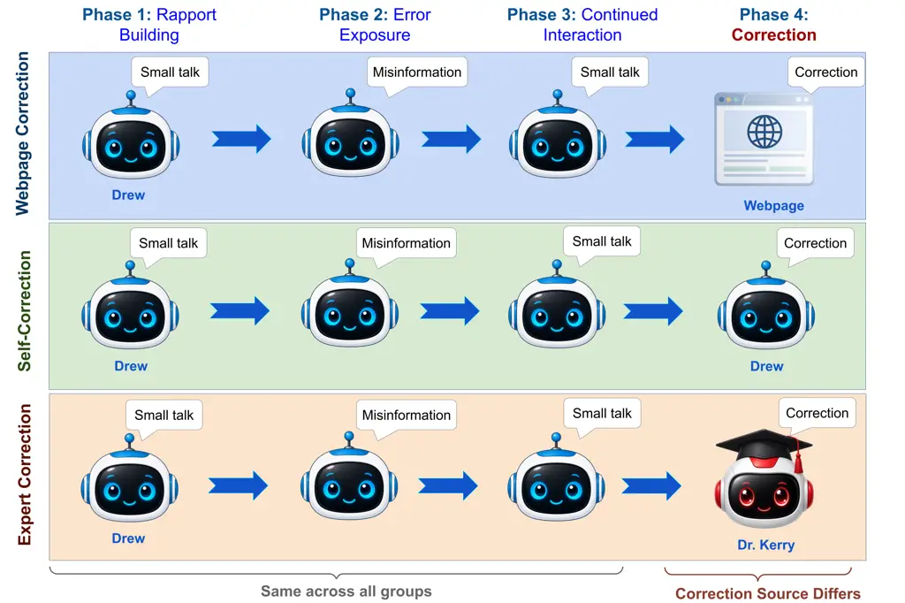
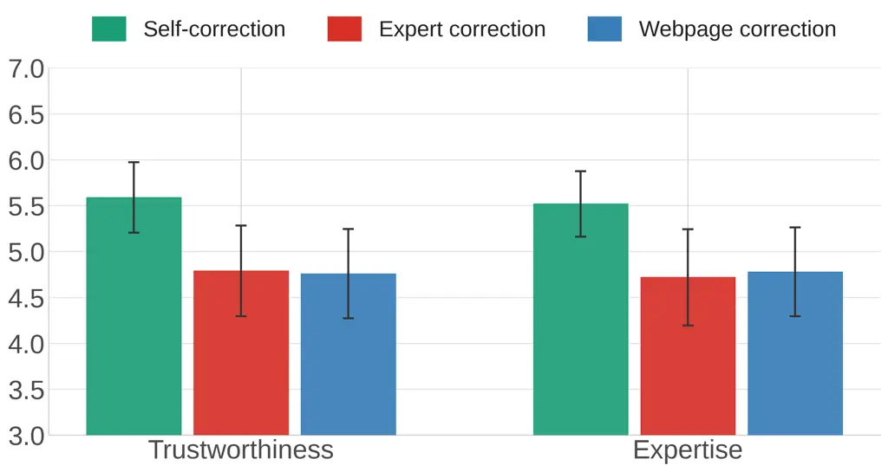
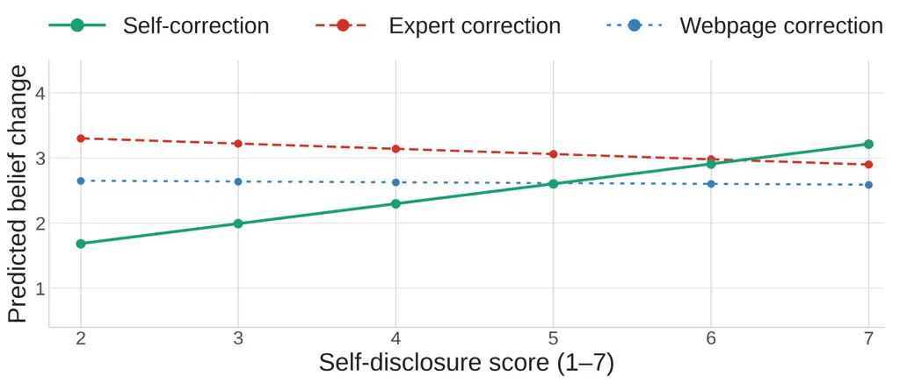

# Correct Yourself, Keep My Trust: How Self-Correction and Social Connection Shape Credibility in Social ChatbotsThanks: NOTE: AI assistants were used for language editing, framing suggestions on author-drafted text, and generation of the chatbot avatar images used in the study. All research design, analysis, and claims are the authors’ own.

CCS: Human-centered computing Empirical studies in
HCICCS: Human-centered computing Natural language
interfacesCCS: Human-centered computing HCI design and evaluation
methods

Biswadeep Sen Affiliation: School of Computing, National University of
Singapore, Singapore, Singapore email: <biswadeep@u.nus.edu> and
Yi-Chieh Lee Affiliation: Computer Science, National University of
Singapore, Singapore, Singapore email: <yclee@nus.edu.sg>

© none

###### Abstract.

When social chatbots make mistakes — and they do — how they recover
determines whether users trust them again. Social chatbots are
increasingly integrated into everyday life, yet they remain prone to
generating convincing but inaccurate information. The social connection
they build with users makes such errors particularly consequential. We
conducted a between-subjects experiment (N=120) comparing three error
correction strategies: a webpage retraction, self-correction by the same
social chatbot, and correction by an expert chatbot. Our results reveal
two key findings. First, all three strategies corrected the error
equally well, but only self-correction did so without damaging the
chatbot’s credibility — participants rated self-correcting chatbots
significantly higher in both trustworthiness and perceived expertise
than chatbots whose errors were corrected by external sources. Second,
the strength of the user’s social connection with the chatbot — measured
through social attraction and self-disclosure — significantly predicted
the magnitude of belief change, but only when the chatbot corrected
itself. Outsourcing corrections to an external source severed this link
entirely. These findings suggest that social chatbots should correct
their own mistakes rather than outsource corrections, and that investing
in social connection is a functional mechanism that amplifies correction
effectiveness — not merely a design feature. We discuss implications for
designing chatbots that maintain long-term credibility while effectively
addressing their own errors.

###### Keywords: 

Chatbots, Trust Repair, Self-Correction, Social Connection,
Misinformation, Human-Chatbot Interaction

## 1. Introduction

Social chatbots — conversational agents designed to engage users in
social interaction — are increasingly integrated into everyday life \[7,
10\]. Through self-disclosure, small talk, and personalized engagement,
these agents can form meaningful social connections with users \[64,
65\]. However, social chatbots remain prone to generating convincing but
inaccurate information \[67, 81\]. The social connection they build with
their user makes such errors particularly consequential \[12, 23\]. As
these agents become more deeply embedded in users’ daily routines,
understanding how they should recover from errors — and how to maintain
the relationship afterward — becomes a critical design challenge.

Research in cognitive psychology offers relevant insights. The Computers
Are Social Actors (CASA) paradigm demonstrates that people unconsciously
apply social rules from human interaction to computers (Nass et al.,
1994). In human contexts, self-correction — where the person who made
the error acknowledges and corrects it — increases perceived
trustworthiness and credibility (Altenmüller et al., 2021; Esterwood and
Robert, 2023; Margolin et al., 2018). Attribution theory explains why:
self-correction signals the ability to identify and remedy one’s own
mistakes, leading observers to attribute the original error to
incomplete information rather than fundamental incompetence (Weiner,
1985). Trust repair literature further predicts that for
competence-based failures, the most effective repair is demonstrating
the ability to detect and fix the problem (Kim et al., 2004). If CASA
holds, these effects should transfer to chatbots. Yet whether
self-correction repairs credibility in social chatbots with an
established relationship — how it compares to external correction
sources, and whether the social connection itself shapes how effectively
corrections land — remains untested.

We conducted a between-subjects experiment (N=120) comparing three error
correction strategies for a social chatbot: webpage retraction,
self-correction by the same chatbot, and correction by an expert
chatbot. Our results reveal two key findings. First, while all three
strategies reduced belief in the inaccurate information equally well,
only self-correction did so without damaging the chatbot’s credibility —
participants rated self-correcting chatbots higher in both
trustworthiness and perceived expertise than chatbots whose errors were
corrected by external sources. Second, the strength of the user’s social
connection with the chatbot — measured through social attraction and
self-disclosure — predicted the magnitude of belief change, but only
when the same chatbot delivered the correction, suggesting that social
connection amplifies correction effectiveness but only through the
bonded agent.

These findings make three contributions to the HCI community. First, we
show that self-correction is the only strategy that repairs a chatbot’s
error without damaging its credibility, dissociating belief correction
from credibility preservation — two outcomes prior work has treated as
coupled. Second, we demonstrate that the social relationship a chatbot
builds with its user is a functional mechanism that amplifies correction
effectiveness, not merely a design feature. Third, we offer actionable
design implications: social chatbots should correct their own mistakes
rather than outsource corrections, and investing in social connection
and rapport before delivering corrections leads to more effective
outcomes.

## 2. Related Work

### 2.1. Trust and Credibility in Human-Chatbot Interaction

Trustworthiness and perceived expertise are central to human–chatbot
relationships (Skjuve et al., 2021), shaping user satisfaction,
continued use (Dawar et al., 2022), and effective corrective
communication (Lewandowsky et al., 2020). For social chatbots designed
for prolonged interaction, maintaining credibility is especially
important because their function depends on sustained trust (Iancu and
Iancu, 2023). Moreover, early errors can shape the entire trajectory of
the relationship: users who encounter mistakes become more sceptical of
future responses, and whether trust recovers depends on how and when the
error is addressed (Kahr et al., 2024).

This credibility is fragile. Chatbots that produce incorrect information
suffer lasting damage to trustworthiness and expertise (Toader et al.,
2019; Yu et al., 2018). Crucially, corrections that fix factual beliefs
can simultaneously damage the corrected source’s credibility — a
“corrections dilemma” (Freitag et al., 2024) — with changes in source
credibility perceptions mediating the correction effect (Westbrook et
al., 2023). This confirms that belief change and credibility repair are
distinct outcomes that do not necessarily co-occur. The problem is
compounded for social chatbots: their conversational capabilities enable
them to produce misinformation persuasively (Spitale et al., 2023; Zhan
et al., 2023), and the social connection they build increases user
susceptibility (Folk et al., 2022; Christoforakos et al., 2021). The
very qualities that make social chatbots effective thus create a
heightened obligation to repair credibility when errors occur.

| Study                           | Source   | Belief | Trust | SC  |
| ------------------------------- | -------- | ------ | ----- | --- |
| Danry et al. (CHI ’25)          | External | ✓      | ✗     | ✗   |
| Lee & Fussell (PACMHCI ’25)     | External | ✓      | ✗     | ✗   |
| Xiao et al. (IUI ’23)           | External | ✓      | ✗     | ✗   |
| Costello et al. (Science ’24)   | External | ✓      | ✗     | ✗   |
| Pataranutaporn et al. (IUI ’25) | External | ✓      | ✗     | ✗   |
| Rani et al. (CHI ’26)           | External | ✓      | ✗     | ✗   |
| Lucas et al. (HRI ’18)          | Self     | ✗      | ✓     | ✓   |
| Hald et al. (HAI ’21)           | Self     | ✗      | ✓     | ✗   |
| Ours                            | Both     | ✓      | ✓     | ✓   |

Table 1. Comparison with prior work on belief correction, trust repair,
and social connection (SC). ✓= measured; ✗= not measured.

### 2.2. Trust Repair Through Self-Correction

Kim et al.’s trust violation typology (Kim et al., 2004) distinguishes
competence violations (inability or error) from integrity violations
(dishonesty or moral failure), with the most effective competence repair
being a demonstration of ability to identify and fix the problem (Zhang
et al., 2023). Recent HRI work confirms this: no purely communicative
strategy (apology, denial, explanation, promise) fully restores
trustworthiness after repeated violations (Esterwood and Robert, 2023),
while behavioural “model updates” — showing the system has actually
improved — surpass even initial trust levels (Pareek et al., 2024).
Demonstrating improvement is more persuasive than promising it.

In human communication, self-correction achieves precisely this,
increasing the corrector’s credibility, expertise, and trustworthiness
(Altenmüller et al., 2021; Denner et al., 2023; Lim, 2019). Attribution
theory (Weiner, 1985) explains the mechanism: self-correction shifts
causal attribution from internal incompetence to external factors such
as incomplete information. This extends to task-oriented AI agents —
when outcomes are perceived as beyond the system’s control, users assign
less blame (Jones-Jang and Park, 2023), and agents that take
responsibility for errors can paradoxically increase trust through
perceived honesty (Na et al., 2023).

The CASA paradigm (Nass et al., 1994) predicts self-correction should
repair credibility in chatbots too. Closest to our question, Bluvstein
et al. (Bluvstein et al., 2024) found that agents who corrected their
own errors were seen as more humanlike and capable than error-free
agents, extending the pratfall effect (Aronson et al., 1966) to AI. But
this and related work studied task-oriented encounters, where the agent
is a tool and no rapport precedes the error. Social chatbots are
different: through small talk and self-disclosure, they build a social
connection that prior work suggests heightens the stakes of an error
(Skjuve et al., 2021). Whether self-correction repairs credibility once
that connection exists — and whether the connection shapes how the
correction lands — remains untested. This is the gap we address.

Recent work shows that AI-mediated correction can change beliefs:
personalised GPT-4 dialogues reduce conspiracy beliefs (Costello et al.,
2024), AI-generated counterarguments reduce misinformation belief (Danry
et al., 2025), and LLM–based interventions shift attitudes across
contested topics and levels of user resistance (Pataranutaporn et al.,
2025; Rani et al., 2026). Yet this literature evaluates belief updating,
not whether the correcting agent’s credibility survives the process.
Conversely, work on post-error trust repair shows that self-initiated
repair can preserve trust (Lucas et al., 2018; Hald et al., 2021), but
does not measure belief change. No prior work has examined whether
self-correction preserves credibility while achieving effective belief
correction, or whether the social relationship between user and agent
moderates this process. Table 1 summarises this gap.

RQ1: How does self-correction by a social chatbot affect its perceived
credibility (trustworthiness and expertise) compared to correction by a
webpage or expert chatbot?

RQ2: How do the three correction strategies compare in their
effectiveness at reducing belief in the incorrect information?

### 2.3. Social Connection as a Mechanism in Persuasion and Correction

Humans form meaningful social connections with chatbots. Through
reciprocal self-disclosure, these connections deepen over time in stages
consistent with social penetration theory (Altman and Taylor, 1973;
Skjuve et al., 2021; Skjuve et al., 2023b): chatbot self-disclosure
promotes reciprocal user disclosure (Lee et al., 2020; Moon, 2000;
Saffarizadeh et al., 2017; Skjuve et al., 2023a; Lee et al., 2024; Jo et
al., 2024), and chatbots that remember and reference previous
interactions are perceived as more empathetic and engaged (Jain et al.,
2018; Portela and Granell-Canut, 2017; Cox et al., 2023). These
connections are not merely affective — they shape how information is
processed. The Elaboration Likelihood Model (Petty and Cacioppo, 1986)
predicts that people evaluate messages from trusted sources on their
merits but dismiss messages from untrusted sources regardless of
quality. This holds in human contexts: corrections from friends are
accepted more than corrections from strangers (Margolin et al., 2018),
and corrections from relationally close sources outperform distant ones,
with effects persisting weeks later (Wang and Kashian, 2025). It extends
to AI: GPT-4 armed with personal information about interlocutors is
substantially more persuasive (Salvi et al., 2025). This sets up the
question no one has answered: when a chatbot builds a social connection
and then corrects its own mistake, does that connection make the
correction more effective — and does it still matter if someone else
delivers the correction instead?

RQ3: Does the strength of the user’s social connection with the chatbot
moderate correction effectiveness, and does this differ across
correction strategies?

## 3. Method

We conducted a randomized between-subjects experiment using three
groups: Webpage Correction Group where the correction was delivered via
a webpage (the traditional method (Cook et al., 2015)), Self-Correction
Group where the social chatbot itself corrected the incorrect statement
it produced, and Expert Correction Group where an expert chatbot
corrected the statement based on previous literature showing the
effectiveness of expert sources (Lewandowsky et al., 2012). The three
conditions are shown in Figure 1. The University’s Institutional Review
Board approved this study.

### 3.1. Chatbot Design and Implementation

We gave the social chatbot a gender-neutral name, Drew, and described it
as a friendly, engaging social chatbot interested in getting to know
users personally through meaningful conversations about their interests,
preferences, and daily experiences. This design was derived from
previous research on social chatbots (Skjuve et al., 2021; Skjuve et
al., 2023a; Chaturvedi et al., 2023; Croes and Antheunis, 2021). Drew
was given a gender-neutral avatar. The expert chatbot was named Dr.
Kerry, also with a gender-neutral avatar. The “Dr.”-prefix followed
previous literature where expert cues led to more significant belief
change (Zhao et al., 2023).

The interaction comprised four phases: (1) social small talk to build
rapport through introductory questions (e.g., “How is your day going?”),
questions promoting self-sharing (e.g., “Do you have a favorite dish?”),
and chatbot self-disclosure (e.g., “Italian is my favorite cuisine”)
(Lee et al., 2020; Wang et al., 2020); (2) a health/nutrition
conversation during which the chatbot made an incorrect statement, after
which participants rated their belief on a 7-point Likert scale; (3) a
second round of small talk; and (4) correction of the incorrect
statement via the assigned condition. We chose health and nutrition as
the domain for incorrect statements because this area is particularly
susceptible to misinformation (Ruani and Reiss, 2023; Lewandowsky et
al., 2012; Wang et al., 2019; Shao et al., 2017; Angelis et al., 2023).

The incorrect statements — Spinach is an exceptionally good source of
iron (König, 2023) and If you have difficulty falling asleep, it is
better to stay in bed and fall back to sleep (Robbins et al., 2019) —
were selected through a pilot study from common health misconceptions
(Do Nascimento et al., 2022; Arkowitz and Lilienfeld, 2017; Hale, ).
Participants also rated a true statement per topic (Cooking method
affects nutritional content; Adults sleep less as they get older) to
avoid suspicion. Corrections followed the truth-sandwich format (König,
2023; Lewandowsky et al., 2020; Lewandowsky et al., 2021), using a
deliberative argumentation style (Asterhan and Babichenko, 2015) where
the chatbot presented the statement, elicited the user’s reasoning,
challenged it with evidence, and asked for reflection. Correction
interfaces for each condition are shown in the Appendix.

The chatbot was built using UChat for conversational flow and GPT-4o for
context-aware small talk responses. The chatbot was embedded on an
anonymous webpage, allowing users to interact without logging in. Full
prompts are provided in the Appendix.

Figure 1. Study design across the three correction conditions. All
participants first completed the same three phases with Drew: social
connection-building small talk, exposure to misinformation, and
continued interaction. In Phase 4, the correction source differed by
condition: a webpage delivered the correction in the webpage-correction
group, Drew corrected the misinformation in the self-correction group,
and Dr. Kerry delivered the correction in the expert-correction group.

### 3.2. Participants

We sourced participants through Prolific, an online research platform.
Eligibility criteria required participants to be: 1) 18 years or older, 2) native English speakers, 3) have an approval rate of 95% or higher,
and 4) have completed at least 100 prior Prolific studies. We recruited
120 participants (60 male, 60 female) with an average age of 31.2 years,
randomly divided into three groups of 40 with equal gender distribution.

Sample size considerations. With 120 participants randomly assigned to
three groups (40 per group with equal gender distribution), a
sensitivity analysis indicates that the study had 80% power to detect
medium effects ($`f=0.31`$, $`\eta^{2}\approx.09`$) in one-way ANOVA at
$`\alpha=.05`$. This is consistent with the medium effect sizes
typically reported in human-chatbot trust and perception studies (Lee et
al., 2020). We supplemented parametric analyses with non-parametric and
resampling-based robustness checks, as reported in Section 4.

### 3.3. Procedure

Participants first interacted with the chatbot for approximately 15
minutes, then completed a post-experiment questionnaire (approximately
15 minutes) including demographic information and open-ended questions.
Participants gave informed consent and were told the study investigated
user experience with a social chatbot. The chatbot’s design
intentionally did not disclose the possibility of incorrect information
until after the experiment, mirroring real-world scenarios (Spitale et
al., 2023). Compensation was 3 GBP.

### 3.4. Measures

#### 3.4.1. Surveys.

To measure participants’ social connection with Drew, we assessed Social
Attraction (e.g., Drew is pleasant to be with) using the scale by
McCroskey et al. (McCroskey et al., 2006), commonly used in
human-chatbot research (Croes and Antheunis, 2021). We also measured
Intimacy, Interaction Quality, Communication Competence, Feelings of
Friendship, and Self-Disclosure (Croes and Antheunis, 2021; Skjuve et
al., 2023a). Trustworthiness (e.g., Drew was trustworthy) and Expertise
(e.g., Drew was an expert) were measured using the scale by O’Hara et
al. (O’hara et al., 1991). All items used 7-point Likert scales (1 =
Strongly Disagree to 7 = Strongly Agree). Full scale details are in
Appendix.

Belief change was computed as the arithmetic difference between pre- and
post-correction ratings on 7-point Likert scales for both correct and
incorrect statements, with higher scores indicating greater change (Wang
and Tanes-Ehle, 2023). We conducted one-way ANOVAs to test for group
differences, supplemented by Dunnett’s post-hoc tests, bootstrap
confidence intervals, permutation tests, and non-parametric
alternatives.

#### 3.4.2. Qualitative data.

Open-ended questions assessed participants’ social connection with Drew,
trust after the error (e.g., “How did Drew passing misinformation in one
of his statements affect your trust in Drew?”), trust after correction,
perceptions of the correction source, and future trust (e.g., “To what
extent would you trust information passed by Drew in the future?”).
Responses were inductively coded by the first author and iteratively
refined into themes. The full list of questions can be found in the
Appendix.

## 4. Results

### 4.1. Social Connection with the Chatbot

As a prerequisite check, we measured whether participants established a
social connection with Drew. Social attraction scores were high across
all groups (Webpage: $`M=6.18`$, $`SD=0.82`$; Self-correction:
$`M=6.25`$, $`SD=0.75`$; Expert: $`M=6.07`$, $`SD=0.91`$; all on a
7-point scale). Social attraction did not differ significantly across
groups ($`F=1.096`$, $`p=.338`$), confirming equivalent connection
across conditions. Qualitative responses supported this: participants
across all groups described their interaction with Drew in terms
typically reserved for human social encounters, such as “naturally
sociable… He was very outgoing which made it easier to feel a sort of
connection with him” (self-correction group), “The connection felt
natural and normal. I forgot that Drew was AI” (expert group), and “Drew
was very social, felt like I am talking to someone I have known for some
time” (webpage group). These responses indicate that Drew was perceived
as a socially engaging agent rather than a purely informational tool.

### 4.2. Credibility: Trustworthiness and Expertise (RQ1)

We examined how the correction strategy affected perceptions of Drew’s
trustworthiness and expertise. Since our research questions specifically
concerned whether self-correction differed from the other conditions, we
used Dunnett’s test with self-correction as the reference group for
pairwise comparisons. We also verified results using bootstrap
confidence intervals and permutation tests to ensure robustness to
distributional assumptions.

Trustworthiness. A one-way ANOVA revealed significant differences in
perceived trustworthiness across groups ($`F(2,99)=4.000`$, $`p=.021`$,
$`\eta^{2}=.075`$). Dunnett’s test confirmed that the self-correction
group rated Drew significantly higher in trustworthiness ($`M=5.59`$,
$`SD=1.14`$) than both the expert group ($`M=4.79`$, $`SD=1.47`$;
$`p=.032`$, $`d=0.61`$) and the webpage group ($`M=4.76`$, $`SD=1.45`$;
$`p=.022`$, $`d=0.64`$). Bootstrap 95% confidence intervals for the mean
differences excluded zero in both comparisons (SC vs expert:
$`[0.182,1.439]`$; SC vs webpage: $`[0.220,1.432]`$), and permutation
tests corroborated these results (SC vs expert: $`p=.017`$; SC vs
webpage: $`p=.012`$).

Expertise. A one-way ANOVA revealed significant differences in perceived
expertise across groups ($`F(2,99)=3.522`$, $`p=.033`$,
$`\eta^{2}=.066`$). Dunnett’s test confirmed that the self-correction
group rated Drew significantly higher in expertise ($`M=5.52`$,
$`SD=1.06`$) than both the expert group ($`M=4.72`$, $`SD=1.56`$;
$`p=.035`$, $`d=0.60`$) and the webpage group ($`M=4.78`$, $`SD=1.44`$;
$`p=.037`$, $`d=0.59`$). Bootstrap 95% confidence intervals excluded
zero for both comparisons (SC vs expert: $`[0.176,1.448]`$; SC vs
webpage: $`[0.167,1.316]`$), and permutation tests confirmed the pattern
(SC vs expert: $`p=.021`$; SC vs webpage: $`p=.021`$).

In both cases, the expert and webpage groups did not differ from each
other (trustworthiness: $`d=0.02`$; expertise: $`d=-0.04`$), indicating
that the credibility advantage is specific to self-correction rather
than reflecting a general difference between external correction
strategies. Figure 2 shows this.

Within the expert correction group, Dr. Kerry was rated higher than Drew
on both trustworthiness ($`M=5.29`$, $`SD=1.46`$ vs $`M=4.79`$,
$`SD=1.47`$) and expertise ($`M=5.59`$, $`SD=1.29`$ vs $`M=4.72`$,
$`SD=1.56`$), suggesting that while Drew’s credibility suffered when an
external agent delivered the correction, the expert agent itself was
perceived favorably.

Self-correction as a trust repair mechanism. Qualitative responses from
the self-correction group revealed three distinct mechanisms through
which self-correction repaired credibility. First, participants
interpreted self-correction as a sign of honesty. S62 stated: If he is
willing to check and correct his own statements, it makes him appear
more honest.” S31 generalized this to a broader social norm: Anyone who
is willing to correct their mistakes after learning they are wrong will
always earn more of my respect and trust” — a response that directly
reflects the application of human social rules to an AI agent,
consistent with the CASA paradigm. Second, participants reframed the
original error as a good-faith mistake rather than evidence of
incompetence. S48 noted that Drew made a statement they believed was
correct but were willing to check on their own claims” — attributing the
error to incomplete information rather than fundamental unreliability.
S56 highlighted the design value of this capability: Capacity to correct
the information is something important in a chatbot.” S09 described how
the correction reframed the initial error: “I didn’t lose any trust in
Drew. His later responses corrected the misinformation, which I’d say
reinforced my trust in him providing accurate information.” This pattern
of charitable attribution is consistent with attribution theory: the
self-correction signaled competence to identify and fix errors, shifting
the causal explanation for the mistake from internal incompetence to
external factors. Third, participants viewed self-correction as evidence
of continuous learning. S22 noted: It tells me that he learns and
updates his sources when he is wrong.” S43 stated: Knowing he can
correct misinformation makes me more confident in Drew and therefore I
trust his statements more.” Strikingly, S19 found that error followed by
correction actually humanized Drew: “misinformation on a small scale
makes the bot feel more real” — suggesting that imperfection followed by
self-correction may paradoxically strengthen the perceived authenticity
of the human-agent relationship.

Trust damage without self-correction. In contrast, participants in the
webpage and expert groups described lasting trust damage with no repair
mechanism. S12 (webpage group) stated: Information is a large part of
why people are utilizing chatbots and other forms of artificial
intelligence. For Drew to pass along non-factual information is a huge
hit to my confidence and attitude towards using him again.” S44 captured
how the social connection paradoxically amplified the sense of betrayal:
His passing on misinformation certainly decreases my trust in him in
hindsight. He seemed credible at the time but that was probably because
he was so pleasant.” In the expert group, S37 reinterpreted the prior
social connection as manipulative rather than genuine: That really did
put me off Drew and made me feel they were being super friendly to cover
up the fact that they wanted to lie to me!” S51 described permanent
disengagement: If I can’t trust the information he gives, it’s hard to
reliably trust him.” This contrasts sharply with the self-correction
group, where the same social connection was seen as evidence of honesty
rather than deception.

Figure 2. Self-correction boosts credibility. Chatbots that corrected
their own errors were rated higher in trustworthiness and expertise than
chatbots corrected by external sources.

### 4.3. Belief Change Across Groups (RQ2)

All three correction strategies effectively reduced belief in the
incorrect statements. A one-way ANOVA revealed no significant
differences in belief change across groups ($`F(2,99)=0.451`$,
$`p=.638`$, $`\eta^{2}=.009`$). Group means were comparable:
self-correction ($`M=2.79`$, $`SD=1.63`$), expert ($`M=3.00`$,
$`SD=1.89`$), and webpage ($`M=2.61`$, $`SD=1.57`$). Pairwise
comparisons confirmed no significant differences between any pair of
groups (all Bonferroni-corrected $`p=1.00`$; all $`d<0.23`$).
Non-parametric Kruskal-Wallis analysis corroborated this result
($`H=0.765`$, $`p=.682`$). This indicates that all three correction
strategies were equally effective at reducing belief in the chatbot’s
error — the advantage of self-correction lies not in producing greater
belief change, but in achieving the same correction outcome without
eroding the chatbot’s credibility.

Across all groups, initial belief strength was a strong predictor of
belief change ($`r=.502`$, $`p<.001`$): participants who initially
believed the incorrect statement more strongly showed greater change
after correction. This effect was consistent across all three conditions
(self-correction: $`r=.393`$, $`p=.024`$; expert: $`r=.525`$,
$`p=.002`$; webpage: $`r=.564`$, $`p<.001`$). Importantly, initial
belief strength did not interact with correction strategy for either
belief change ($`p=.488`$) or trustworthiness ($`p=.944`$), indicating
that the trust repair advantage of self-correction operates
independently of how strongly participants initially believed the
misinformation.

### 4.4. Social Bond as Moderator of Belief Change (RQ3)

To investigate what drives belief change, we examined whether the social
bond between user and chatbot predicted the magnitude of belief change,
and whether this relationship differed across correction strategies.

In the self-correction group, the social bond was a strong predictor of
belief change. An OLS regression with four predictors — Interaction
Quality, Communication Competence, Self-Disclosure, and Social
Attraction — explained substantial variance ($`R^{2}=.825`$,
$`F=34.22`$, $`p<.001`$), with Self-Disclosure ($`\beta=1.055`$,
$`p=.005`$) and Social Attraction ($`\beta=1.039`$, $`p=.025`$) as the
only significant individual predictors. Interaction Quality ($`p=.154`$)
and Communication Competence ($`p=.082`$) did not reach significance. To
verify robustness, we conducted model selection across all possible 3-
and 4-variable combinations from eight candidate predictors (Social
Attraction, Self-Disclosure, Intimacy, Interaction Quality,
Communication Competence, Trustworthiness, Expertise, and Friendship).
Self-Disclosure and Social Attraction appeared in every top-performing
model by both $`R^{2}`$ and AIC, regardless of which other variables
were included — confirming that the social dimensions of the
relationship, rather than general conversational quality or perceived
competence, drive belief change.

Crucially, this effect was specific to the self-correction group. In the
expert and webpage groups, neither Self-Disclosure nor Social Attraction
reached individual significance as predictors of belief change (expert:
Self-Disclosure $`p=.092`$, Social Attraction $`p=.254`$; webpage:
Self-Disclosure $`p=.665`$, Social Attraction $`p=.732`$). The
divergence was starkest for Self-Disclosure, which correlated
significantly with belief change in the self-correction group
($`r=.382`$, $`p=.028`$) but was near zero in the expert ($`r=-.115`$,
$`p=.524`$) and webpage ($`r=-.022`$, $`p=.899`$) groups. A formal
interaction model confirmed this moderation: the Self-Disclosure
$`\times`$ correction strategy interaction was significant
($`\beta=0.577`$, $`p=.028`$), and a Fisher z-test confirmed that the
correlation was significantly stronger in the self-correction group than
in the expert group ($`z=2.007`$, $`p=.045`$). This indicates that the
social bond amplifies correction effectiveness, but only when the
socially bonded agent itself delivers the correction. See Figure 3 .

Figure 3. Social connection amplifies belief change only under
self-correction. Greater self-disclosure predicted stronger belief
change only when the chatbot itself delivered the correction.

Stronger bonds led to deeper engagement with corrections. In the
self-correction group, participants who reported stronger social
connections with Drew actively engaged with the correction’s reasoning
rather than passively accepting or dismissing it. The participant who
described Drew as “naturally sociable,” making it “easier to feel a sort
of connection,” was the same participant who later said Drew’s reasoning
“gave me the benefit of the doubt to trust him.” S50, who described the
interaction as feeling “like I was chatting with a friend,” stated: “I
trusted him more. The explanations he gave were plausible and I feel
like I learned things from him.” This pattern — where social connection
led participants to evaluate the correction on its merits rather than
dismiss it based on its source — is consistent with the Elaboration
Likelihood Model’s prediction that messages from trusted sources receive
deeper, more central-route processing. The few participants in this
group who reported little connection showed the opposite pattern: S29,
who described Drew as an “NLP model getting stuck in a loop” and
reported “the same feelings towards Drew as I have toward my pencil
eraser,” related to the correction as a bare source claim rather than a
relational exchange. Together, these two ends of the continuum mirror
the within-group correlation between self-disclosure and belief change
($`r=.382`$, $`p=.028`$).

Self-disclosure created perceived reciprocity. Several participants in
the self-correction group linked their willingness to accept the
correction to the reciprocal nature of the preceding conversation —
aligning with the statistical finding that self-disclosure,
specifically, drives the moderation effect. S17, one participant who had
enjoyed sharing hobbies, stated: “My connection with Drew was friendly,
polite and we discussed a surprising amount of topics. We also delved a
lot further into these topics than I was expecting.” S17 later
approached the correction with openness: “This made me trust him a
little more. Anyone who is willing to correct their mistakes after
learning they are wrong will always earn more of my respect.” S24,
another who found the conversation “very natural” and felt Drew was
“interested in getting to know me,” similarly described the correction
as “reinforcing trust” rather than merely restoring trust. The depth of
prior self-disclosure appeared to create a relational context in which
correction was received as a natural part of an ongoing dialogue rather
than an external intervention.

Taken together, the qualitative themes converge with the statistical
finding: social connection amplifies correction effectiveness, but only
when the connected agent delivers the correction itself. Where the bond
was strong and self-correction came from Drew, participants engaged with
the correction on its merits; where it was weak, or delivered by an
external source, they dismissed it at the source level.

## 5. Discussion

Our findings reveal two complementary mechanisms in social chatbot error
recovery. First, self-correction uniquely preserves the chatbot’s
credibility — achieving the same belief correction as external sources
while maintaining trustworthiness and perceived expertise. Second, the
social connection between user and chatbot amplifies correction
effectiveness, but only when the connected agent itself delivers the
correction.

### 5.1. Self-Correction as a Trust Repair Mechanism

Self-correction was the only strategy that corrected the error without
collateral damage to the chatbot’s credibility. All three methods
reduced belief equally ($`p=.638`$), yet the self-correction group rated
Drew significantly higher in both trustworthiness ($`d=0.61`$–$`0.64`$)
and expertise ($`d=0.59`$–$`0.60`$). Our qualitative findings reveal
that this repair operated through three mechanisms that we propose form
a sequential process.

First, self-correction triggered an immediate character judgment:
participants interpreted the willingness to acknowledge error as
honesty, applying a social norm typically reserved for human
interlocutors. This confirms a core CASA prediction (Nass et al., 1994),
is consistent with recent CASA extensions to generative AI (Gong and Su,
2025; Gu et al., 2024), and aligns with work showing that agents who
take responsibility for errors can paradoxically increase trust through
perceived honesty (Na et al., 2023; Bluvstein et al., 2024).

Second, this honesty signal enabled cognitive reattribution:
participants reframed the error as a good-faith mistake from incomplete
information rather than fundamental incompetence. Attribution theory
(Weiner, 1985) predicts this — observers judge actors more favourably
when failures are attributed to external, unstable causes than to
internal, stable ones (Jones-Jang and Park, 2023). The pattern also
echoes corrections research showing that good-faith errors are more
effectively corrected than negligent ones (Westbrook et al., 2023).

Third, participants made a forward-looking evaluation, interpreting
self-correction as evidence that Drew learns and updates its knowledge —
transforming a single corrective act into a generalised expectation of
future reliability. This aligns with Kim et al.’s typology (Kim et al.,
2004): factual errors constitute competence violations, and the most
effective repair is demonstrating the ability to identify and fix the
problem. Recent HRI work supports this — behavioural demonstrations of
improvement surpass even initial trust levels (Pareek et al., 2024),
while purely communicative strategies are less effective (Esterwood and
Robert, 2023).

The non-self-correction groups reveal why external correction fails to
produce the same repair. When a webpage or expert chatbot delivered the
correction, it confirmed Drew was wrong without providing evidence that
Drew itself had changed — leaving the error anchored to Drew’s
competence while the correction was credited to a different source. This
is consistent with the “corrections dilemma” (Freitag et al., 2024):
retractions increase belief accuracy but simultaneously decrease trust
in the corrected source (Westbrook et al., 2023). Some participants went
further, reinterpreting Drew’s prior social connection as manipulative
rather than genuine — a response consistent with betrayal aversion,
where violated trust produces disproportionately negative evaluations
(Koehler and Gershoff, 2003).

Even in these groups, some participants applied human-like forgiveness
norms, providing further evidence for CASA. However, they remained the
minority and still rated Drew lower than the self-correction group —
suggesting that self-correction actively triggers charitable attribution
across a broader population rather than relying on spontaneous
generosity (Altenmüller et al., 2021). For some self-correction
participants, trust was not fully restored to pre-error levels,
consistent with findings that recovered trust often stabilises slightly
below initial levels (Lount Jr et al., 2008; Esterwood and Robert,
2023).

### 5.2. The Social Connection as a Conditional Amplifier

Our third research question asked whether social connection predicted
belief change. It did, but only under self-correction. Self-disclosure
predicted belief change in the self-correction group ($`r=.382`$,
$`p=.028`$), and the Self-Disclosure $`\times`$ correction strategy
interaction was significant ($`\beta=0.577`$, $`p=.028`$). In the expert
and webpage groups, the relationship was near zero. Thus, social
connection did not make users generally more correctable. It mattered
only when the socially connected agent delivered the correction itself.

This pattern fits dual-process models of persuasion, including the
Elaboration Likelihood Model and the Heuristic-Systematic Model (Petty
and Cacioppo, 1986; Chaiken, 1980). Stronger connection did not seem to
make users accept Drew’s correction blindly. Instead, connected
participants engaged more with the explanation: they judged it as
plausible, linked it to Drew’s honesty, and used it to update their
belief. Participants with weaker bonds often dismissed Drew at the
source level, describing it as fake, mechanical, or not worth trusting.
In other words, social connection affected whether users processed the
correction deeply, not simply whether they saw it.

Self-disclosure helps explain why this effect emerged. Social
penetration theory argues that relationships deepen through reciprocal
disclosure (Altman and Taylor, 1973); work on self-disclosure and liking
shows that sharing personal information increases closeness (Collins and
Miller, 1994); and the interpersonal process model of intimacy
emphasizes perceived responsiveness (Laurenceau et al., 2004). Our
findings extend these theories to social chatbots. Users who had
disclosed more to Drew appeared to read Drew’s self-correction as
reciprocal openness: Drew was not just correcting a fact, but admitting
fallibility. For these users, that admission felt authentic rather than
damaging.

We describe this as a relational channel effect. When Drew corrected its
own error, the correction travelled through the same relationship built
earlier in the conversation. When a webpage or Dr. Kerry corrected the
error, the correction came through a different channel with no shared
history. Users could still believe the correction, but the bond with
Drew no longer helped drive belief change.

This adds a boundary condition to HCI and relational-agent research
(Bickmore and Picard, 2005). Social connection is not a general
credibility boost that transfers across agents or media. It helps only
when corrective communication stays with the agent who built the
relationship.

### 5.3. Design Implications

Our findings yield four actionable implications for chatbot design.

Design social chatbots to repair their own errors visibly.
Self-correction was the only strategy that corrected misinformation
without eroding the chatbot’s credibility. In contrast, webpage
retractions and expert interventions reduced false belief equally well
but left the original chatbot’s trustworthiness and expertise lower. For
social chatbots designed for long-term interaction, this distinction
matters: systems that depend on sustained relationships should not
outsource corrective communication when credibility repair is itself
part of the design goal. More broadly, our findings suggest that social
chatbots should be designed not around the unrealistic expectation of
infallibility, but around the ability to detect, acknowledge, and
visibly repair mistakes in ways that preserve the relationship.

Treat social connection as a functional resource for correction.
Self-disclosure predicted belief change only when the connected agent
delivered the correction ($`\beta=0.577`$, $`p=.028`$), showing that
rapport is not merely a desirable social feature but a mechanism that
can increase corrective effectiveness. Designers should therefore view
small talk, self-disclosure, and personalized engagement not only as
tools for engagement, but also as groundwork for future repair and
persuasion. A chatbot that builds rapport before an error occurs may be
better positioned to have its later correction taken seriously — but
only if that correction is delivered through the same relational
channel.

Use self-correction as a form of transparent updating. Participants
often interpreted self-correction as evidence of honesty and continuous
improvement, aligning with prior work showing that transparency can
improve perceptions of AI systems (Xu et al., 2023). This suggests that
self-correction can serve not only as a repair strategy after a single
mistake, but also as a broader design pattern for systems that are
continuously updated. As social chatbots revise knowledge, adapt models,
or change recommendations over time, communicating these updates through
direct self-correction may help users interpret change as a sign of
accountability rather than unreliability. Unlike webpage-based
retractions, which often fail to reach those exposed to the original
error (Cook et al., 2015), self-correction also delivers the update
through the same channel in which the misinformation appeared.

Scale recovery capacity with relational depth. Our results also suggest
that the reputational cost of an error increases with the strength of
the social connection the chatbot has built. In the non-self-correction
groups, some participants reinterpreted Drew’s earlier friendliness
negatively after the error was revealed, treating the prior warmth as
retroactively undermining credibility. This implies that relational
design and recovery design cannot be separated. The more socially
engaging, personable, and disclosive a chatbot becomes, the more
important it is that the system can later repair its own mistakes
convincingly. In other words, stronger social design creates stronger
obligations for error recovery.

### 5.4. Ethical Considerations

Participants engaged in social conversations that could involve personal
preferences; we assured them in the consent form that data would be used
solely for research purposes, that they could skip questions or withdraw
at any time, and deployed the chatbot anonymously without requiring
login credentials.

Because real-world chatbot errors occur without warning, withholding the
possibility of misinformation until debriefing was necessary to study
correction under naturalistic conditions; this design was reviewed and
approved by the IRB. To ensure no participant left the study holding a
belief introduced by the manipulation, we took several steps to mitigate
residual misinformation effects. All participants received a thorough
correction at the end of the survey using the truth-sandwich method
(König, 2023), were explicitly informed which statements had been
inaccurate, received supplementary educational materials on health and
nutrition (Lewandowsky et al., 2012), and were given the opportunity to
ask the experimenters clarifying questions. The design of our corrective
feedback was informed by cognitive psychology principles emphasizing
multiple sources of accurate information to overcome continued influence
effects (Walter and Tukachinsky, 2020; Swire-Thompson et al., 2020).

### 5.5. Limitations and Future Work

One limitation of this study is that the participants interacted with
the chatbot only once. However, according to current research, the
relationship between humans and chatbots happens stagewise over an
extended period (Skjuve et al., 2023a). To ensure a proper social
connection between the participants and the chatbot, collecting data on
their interaction over an extended period is essential. Additionally,
this study examined a single error-correction episode; whether
self-correction remains effective after repeated mistakes, or whether a
threshold exists beyond which even self-correction cannot sustain
credibility, remains unexplored.

In future work, we plan a longitudinal study tracking trust and belief
change as users interact with a social chatbot over time. We also aim to
investigate how the linguistic framing of self-correction — how the
chatbot acknowledges its error and how much detail it provides —
moderates its effectiveness (Cox et al., 2023), and to extend this work
beyond misinformation to other belief-change domains such as pro-social
and pro-environmental behaviour. Our finding that outsourcing
corrections severs the link between social connection and belief change
also raises open questions for multi-agent systems: how should
correction responsibilities be distributed to preserve users’ relational
channels, and which agent should own a given mistake? Future work should
examine this alongside how chatbot personality and power dynamics shape
self-correction.

## 6. Conclusion

This study examined how self-correction, expert correction, and webpage
correction shape a social chatbot’s credibility and its capacity to
reduce false beliefs. Self-correction was the only strategy that
corrected misinformation without eroding the social chatbot’s
credibility: it preserved trustworthiness and perceived expertise
relative to expert and webpage correction, which did not differ from
each other. All three strategies reduced false belief to an equivalent
degree, indicating that the advantage of self-correction lies not in
greater corrective efficacy but in achieving correction without
incurring relational cost. The social relationship itself proved
functionally consequential: social connection predicted the magnitude of
belief change only when the chatbot that built the connection also
delivered the correction, whereas routing the correction through an
external source eliminated this association. Together, these findings
demonstrate that, for social chatbots, correction is not solely
informational but relational — even when corrections succeed equally in
changing beliefs, the source and the relationship determine the
credibility the chatbot retains and whether the user’s social connection
amplifies the correction. The most effective means of repairing a social
chatbot’s error is therefore the chatbot itself.

## References

- Altenmüller et al. (2021) M. S. Altenmüller, S. Nuding, and M.
  Gollwitzer No harm in being self-corrective: self-criticism and reform
  intentions increase researchers’ epistemic trustworthiness and
  credibility in the eyes of the public. Public understanding of science
  30 (8), pp. 962–976. Cited by: §1, §2.2, §5.1.
- Altman and Taylor (1973) I. Altman and D. A. Taylor Social
  penetration: the development of interpersonal relationships. Cited by:
  §2.3, §5.2.
- Angelis et al. (2023) L. D. Angelis, F. Baglivo, G. Arzilli, G. P.
  Privitera, P. Ferragina, A. Tozzi, and C. Rizzo ChatGPT and the rise
  of large language models: the new ai-driven infodemic threat in public
  health. Frontiers in Public Health 11. External Links:
  [Document](https://dx.doi.org/10.3389/fpubh.2023.1166120) Cited by:
  §3.1.
- Arkowitz and Lilienfeld (2017) H. Arkowitz and S. O. Lilienfeld Facts
  and fictions in mental health. John Wiley & Sons. Cited by: §3.1.
- Aronson et al. (1966) E. Aronson, B. Willerman, and J. Floyd The
  effect of a pratfall on increasing interpersonal attractiveness.
  Psychonomic Science 4 (6), pp. 227–228. External Links:
  [Document](https://dx.doi.org/10.3758/BF03342263) Cited by: §2.2.
- Asterhan and Babichenko (2015) C. S. Asterhan and M. Babichenko The
  social dimension of learning through argumentation: effects of human
  presence and discourse style.. Journal of Educational Psychology 107
  (3), pp. 740. Cited by: §3.1.
- Bickmore and Picard (2005) T. W. Bickmore and R. W. Picard
  Establishing and maintaining long-term human-computer relationships.
  ACM Transactions on Computer-Human Interaction (TOCHI) 12 (2),
  pp. 293–327. Cited by: §5.2.
- Bluvstein et al. (2024) S. Bluvstein, X. Zhao, A. Barasch, and J.
  Schroeder Imperfectly human: the humanizing potential of (corrected)
  errors in text-based communication. Journal of the Association for
  Consumer Research 9 (3), pp. 332–343. External Links:
  [Document](https://dx.doi.org/10.1086/728412) Cited by: §2.2, §5.1.
- Chaiken (1980) S. Chaiken Heuristic versus systematic information
  processing and the use of source versus message cues in persuasion..
  Journal of personality and social psychology 39 (5), pp. 752. Cited
  by: §5.2.
- Chaturvedi et al. (2023) R. Chaturvedi, S. Verma, R. Das, and Y. K.
  Dwivedi Social companionship with artificial intelligence: recent
  trends and future avenues. Technological Forecasting and Social Change
  193, pp. 122634. Cited by: §3.1.
- Christoforakos et al. (2021) L. Christoforakos, N. Feicht, S.
  Hinkofer, A. Löscher, S. F. Schlegl, and S. Diefenbach Connect with
  me. exploring influencing factors in a human-technology relationship
  based on regular chatbot use. Frontiers in Digital Health 3. External
  Links: [Document](https://dx.doi.org/10.3389/fdgth.2021.689999) Cited
  by: §2.1.
- Collins and Miller (1994) N. L. Collins and L. C. Miller
  Self-disclosure and liking: a meta-analytic review.. Psychological
  bulletin 116 (3), pp. 457. Cited by: §5.2.
- Cook et al. (2015) J. Cook, U. Ecker, and S. Lewandowsky
  Misinformation and how to correct it. Emerging trends in the social
  and behavioral sciences: An interdisciplinary, searchable, and
  linkable resource, pp. 1–17. Cited by: §3, §5.3.
- Costello et al. (2024) T. H. Costello, G. Pennycook, and D. G. Rand
  Durably reducing conspiracy beliefs through dialogues with ai. Science
  385 (6714), pp. eadq1814. Cited by: §2.2.
- Cox et al. (2023) S. R. Cox, Y.-C. Lee, and W. T. Ooi Comparing how a
  chatbot references user utterances from previous chatting sessions: an
  investigation of users’ privacy concerns and perceptions. In
  Proceedings of the 11th International Conference on Human-Agent
  Interaction (HAI ’23), pp. 105–114. External Links:
  [Document](https://dx.doi.org/10.1145/3623809.3623875) Cited by: §2.3,
  §5.5.
- Croes and Antheunis (2021) E. A. Croes and M. L. Antheunis Can we be
  friends with mitsuku? a longitudinal study on the process of
  relationship formation between humans and a social chatbot. Journal of
  Social and Personal Relationships 38 (1), pp. 279–300. Cited by: §3.1,
  §3.4.1.
- Danry et al. (2025) V. Danry, P. Pataranutaporn, M. Groh, and Z.
  Epstein Deceptive explanations by large language models lead people to
  change their beliefs about misinformation more often than honest
  explanations. In Proceedings of the 2025 CHI conference on human
  factors in computing systems, pp. 1–31. Cited by: §2.2.
- Dawar et al. (2022) S. Dawar, S. Panwar, S. Dhaka, and P. Kudal
  Antecedents and role of trust in chatbot use intentions: an indian
  perspective. Marketing i menedžment innovacij 13 (4), pp. 198–206.
  Cited by: §2.1.
- Denner et al. (2023) N. Denner, B. Viererbl, and T. Koch Effects of
  repeated corrections of misinformation on organizational trust: more
  is not always better. International Journal of Strategic Communication
  17 (1), pp. 39–53. Cited by: §2.2.
- Do Nascimento et al. (2022) I. J. B. Do Nascimento, A. B.
  Pizarro, J. M. Almeida, N. Azzopardi-Muscat, M. A. Gonçalves, M.
  Björklund, and D. Novillo-Ortiz Infodemics and health misinformation:
  a systematic review of reviews. Bulletin of the World Health
  Organization 100 (9), pp. 544. Cited by: §3.1.
- Esterwood and Robert (2023) C. Esterwood and L. P. Robert Three
  strikes and you are out!: the impacts of multiple human–robot trust
  violations and repairs on robot trustworthiness. Computers in Human
  Behavior 142, pp. 107658. External Links:
  [Document](https://dx.doi.org/10.1016/j.chb.2023.107658) Cited by: §1,
  §2.2, §5.1, §5.1.
- Folk et al. (2022) D. Folk, S. Yu, and E. W. Dunn Is a good bot better
  than a mediocre human?: chatbots as alternative sources of social
  connection. External Links:
  [Document](https://dx.doi.org/10.31234/osf.io/xunsy) Cited by: §2.1.
- Freitag et al. (2024) J. Freitag, M. Gochee, B. Nyhan, M. Ransden, K.
  Roschke, and D. Gillmor The corrections dilemma: media retractions
  increase belief accuracy but decrease trust. Journal of Experimental
  Political Science 11 (1), pp. 90–101. External Links:
  [Document](https://dx.doi.org/10.1017/XPS.2023.4) Cited by: §2.1,
  §5.1.
- Gong and Su (2025) Z. Gong and L. Y.-F. Su Designing chatbots for
  misinformation correction: examining the roles of chatbot expertise
  and anthropomorphism. International Journal of Human–Computer
  Interaction. External Links:
  [Document](https://dx.doi.org/10.1080/10447318.2025.2490703) Cited by:
  §5.1.
- Gu et al. (2024) C. Gu, Y. Zhang, and L. Zeng Exploring the mechanism
  of sustained consumer trust in AI chatbots after service failures: a
  perspective based on attribution and CASA theories. Humanities and
  Social Sciences Communications 11, pp. 1400. External Links:
  [Document](https://dx.doi.org/10.1057/s41599-024-03879-5) Cited by:
  §5.1.
- Hald et al. (2021) K. Hald, K. Weitz, E. André, and M. Rehm “An error
  occurred!”-trust repair with virtual robot using levels of mistake
  explanation. In Proceedings of the 9th International Conference on
  Human-Agent Interaction, pp. 218–226. Cited by: §2.2.
- \[27\] J. Hale Myths about health that should die. Cited by: §3.1.
- Iancu and Iancu (2023) I. Iancu and B. Iancu Interacting with chatbots
  later in life: a technology acceptance perspective in COVID-19
  pandemic situation. Frontiers in Psychology 13, pp. 1111003. External
  Links: [Document](https://dx.doi.org/10.3389/fpsyg.2022.1111003) Cited
  by: §2.1.
- Jain et al. (2018) M. Jain, P. Kumar, R. Kota, and S. N. Patel
  Evaluating and informing the design of chatbots. In Proceedings of the
  2018 Designing Interactive Systems Conference (DIS ’18), pp. 895–906.
  External Links: [Document](https://dx.doi.org/10.1145/3196709.3196735)
  Cited by: §2.3.
- Jo et al. (2024) E. Jo, Y. Jeong, S. Park, D. A. Epstein, and Y.-H.
  Kim Understanding the impact of long-term memory on self-disclosure
  with large language model-driven chatbots for public health
  intervention. In Proceedings of the 2024 CHI Conference on Human
  Factors in Computing Systems (CHI ’24), External Links:
  [Document](https://dx.doi.org/10.1145/3613904.3642420) Cited by: §2.3.
- Jones-Jang and Park (2023) S. M. Jones-Jang and Y. J. Park How do
  people react to AI failure? automation bias, algorithmic aversion, and
  perceived controllability. Journal of Computer-Mediated Communication
  28 (1), pp. zmac029. External Links:
  [Document](https://dx.doi.org/10.1093/jcmc/zmac029) Cited by: §2.2,
  §5.1.
- Kahr et al. (2024) P. K. Kahr, G. Rooks, C. C. P. Snijders, and M. C.
  Willemsen The trust recovery journey: the effect of timing of errors
  on the willingness to follow AI advice. In Proceedings of the 29th
  International Conference on Intelligent User Interfaces (IUI ’24),
  External Links: [Document](https://dx.doi.org/10.1145/3640543.3645167)
  Cited by: §2.1.
- Kim et al. (2004) P. H. Kim, D. L. Ferrin, C. D. Cooper, and K. T.
  Dirks Removing the shadow of suspicion: the effects of apology versus
  denial for repairing competence- versus integrity-based trust
  violations. Journal of Applied Psychology 89 (1), pp. 104–118.
  External Links:
  [Document](https://dx.doi.org/10.1037/0021-9010.89.1.104) Cited by:
  §1, §2.2, §5.1.
- Koehler and Gershoff (2003) J. J. Koehler and A. D. Gershoff Betrayal
  aversion: when agents of protection become agents of harm.
  Organizational Behavior and Human Decision Processes 90 (2),
  pp. 244–261. External Links:
  [Document](https://dx.doi.org/10.1016/S0749-5978%2802%2900518-6) Cited
  by: §5.1.
- König (2023) L. M. König Debunking nutrition myths: an experimental
  test of the ‘truth sandwich’text format. British Journal of Health
  Psychology. Cited by: §3.1, §5.4.
- Laurenceau et al. (2004) J. Laurenceau, L. M. Rivera, A. R. Schaffer,
  and P. R. Pietromonaco Intimacy as an interpersonal process: current
  status and future directions. Handbook of closeness and intimacy,
  pp. 71–88. Cited by: §5.2.
- Lee et al. (2024) J. Lee, D. Lee, and J.-G. Lee Influence of rapport
  and social presence with an AI psychotherapy chatbot on users’
  self-disclosure. International Journal of Human–Computer Interaction
  40 (7), pp. 1620–1631. External Links:
  [Document](https://dx.doi.org/10.1080/10447318.2023.2240000) Cited by:
  §2.3.
- Lee et al. (2020) Y.-C. Lee, N. Yamashita, Y. Huang, and W. Fu “I hear
  you, I feel you”: encouraging deep self-disclosure through a chatbot.
  In Proceedings of the 2020 CHI Conference on Human Factors in
  Computing Systems (CHI ’20), pp. 1–12. External Links:
  [Document](https://dx.doi.org/10.1145/3313831.3376175) Cited by: §2.3,
  §3.1, §3.2.
- Lewandowsky et al. (2020) S. Lewandowsky, J. Cook, U. K. H. Ecker, D.
  Albarracín, M. A. Amazeen, P. Kendeou, D. Lombardi, E. J. Newman, G.
  Pennycook, E. Porter, et al. The debunking handbook 2020. External
  Links: [Document](https://dx.doi.org/10.17910/b7.1182) Cited by: §2.1,
  §3.1.
- Lewandowsky et al. (2012) S. Lewandowsky, U. K. H. Ecker, C. M.
  Seifert, N. Schwarz, and J. Cook Misinformation and its correction:
  continued influence and successful debiasing. Psychological Science in
  the Public Interest 13 (3), pp. 106–131. External Links:
  [Document](https://dx.doi.org/10.1177/1529100612451018) Cited by:
  §3.1, §3, §5.4.
- Lewandowsky et al. (2021) S. Lewandowsky, J. Cook, P. Schmid, D. L.
  Holford, A. Finn, J. Leask, A. Thomson, D. Lombardi, A. K.
  Al-Rawi, M. A. Amazeen, et al. The covid-19 vaccine communication
  handbook. a practical guide for improving vaccine communication and
  fighting misinformation. SciBeh. Cited by: §3.1.
- Lim (2019) J. S. Lim The effectiveness of refutation with logic vs.
  indignation in restoring the credibility of and trust in a government
  organization: a heuristic-systematic model of crisis communication
  processing. Journal of Contingencies and Crisis Management 27 (2),
  pp. 157–167. Cited by: §2.2.
- Lount Jr et al. (2008) R. B. Lount Jr, C. Zhong, N. Sivanathan,
  and J. K. Murnighan Getting off on the wrong foot: the timing of a
  breach and the restoration of trust. Personality and Social Psychology
  Bulletin 34 (12), pp. 1601–1612. Cited by: §5.1.
- Lucas et al. (2018) G. M. Lucas, J. Boberg, D. Traum, R. Artstein, J.
  Gratch, A. Gainer, E. Johnson, A. Leuski, and M. Nakano Getting to
  know each other: the role of social dialogue in recovery from errors
  in social robots. In Proceedings of the 2018 acm/ieee international
  conference on human-robot interaction, pp. 344–351. Cited by: §2.2.
- Margolin et al. (2018) D. B. Margolin, A. Hannak, and I. Weber
  Political fact-checking on Twitter: when do corrections have an
  effect?. Political Communication 35 (2), pp. 196–219. External Links:
  [Document](https://dx.doi.org/10.1080/10584609.2017.1334018) Cited by:
  §1, §2.3.
- McCroskey et al. (2006) L. L. McCroskey, J. C. McCroskey, and V. P.
  Richmond Analysis and improvement of the measurement of interpersonal
  attraction and homophily. Communication Quarterly 54 (1), pp. 1–31.
  Cited by: §3.4.1.
- Moon (2000) Y. Moon Intimate exchanges: using computers to elicit
  self-disclosure from consumers. Journal of Consumer Research 26 (4),
  pp. 323–339. External Links:
  [Document](https://dx.doi.org/10.1086/209566) Cited by: §2.3.
- Na et al. (2023) G. Na, J. Choi, and H. Kang It’s not my fault, but
  I’m to blame: the effect of a home robot’s attribution and approach
  movement on trust and emotion of users. International Journal of
  Human-Computer Interaction. External Links:
  [Document](https://dx.doi.org/10.1080/10447318.2023.2209977) Cited by:
  §2.2, §5.1.
- Nass et al. (1994) C. Nass, J. Steuer, and E. R. Tauber Computers are
  social actors. In Proceedings of the SIGCHI Conference on Human
  Factors in Computing Systems (CHI ’94), pp. 72–78. External Links:
  [Document](https://dx.doi.org/10.1145/191666.191703) Cited by: §1,
  §2.2, §5.1.
- O’hara et al. (1991) B. S. O’hara, R. G. Netemeyer, and S. Burton AN
  examination of the relative effects of source expertise,
  trustworthiness, and likability.. Social Behavior & Personality: an
  international journal 19 (4). Cited by: §3.4.1.
- Pareek et al. (2024) S. Pareek, E. Velloso, and J. Goncalves Trust
  development and repair in AI-assisted decision-making during
  complementary expertise. In Proceedings of the 2024 ACM Conference on
  Fairness, Accountability, and Transparency (FAccT ’24), pp. 546–561.
  External Links: [Document](https://dx.doi.org/10.1145/3630106.3658924)
  Cited by: §2.2, §5.1.
- Pataranutaporn et al. (2025) P. Pataranutaporn, C.
  Archiwaranguprok, S. W. Chan, E. Loftus, and P. Maes Slip through the
  chat: subtle injection of false information in llm chatbot
  conversations increases false memory formation. In Proceedings of the
  30th International Conference on Intelligent User Interfaces,
  pp. 1297–1313. Cited by: §2.2.
- Petty and Cacioppo (1986) R. E. Petty and J. T. Cacioppo The
  elaboration likelihood model of persuasion. Advances in Experimental
  Social Psychology 19, pp. 123–205. External Links:
  [Document](https://dx.doi.org/10.1016/S0065-2601%2808%2960214-2) Cited
  by: §2.3, §5.2.
- Portela and Granell-Canut (2017) M. Portela and C. Granell-Canut A new
  friend in our smartphone? observing interactions with chatbots in the
  search of emotional engagement. In Proceedings of the XVIII
  International Conference on Human Computer Interaction, pp. 1–7. Cited
  by: §2.3.
- Rani et al. (2026) A. Rani, V. Danry, P. P. Liang, A. Lippman, and P.
  Maes Dialogues with ai reduce beliefs in misinformation but build no
  lasting discernment skills. In Proceedings of the 2026 CHI Conference
  on Human Factors in Computing Systems, pp. 1–26. Cited by: §2.2.
- Robbins et al. (2019) R. Robbins, M. A. Grandner, O. M. Buxton, L.
  Hale, D. J. Buysse, K. L. Knutson, S. R. Patel, W. M. Troxel, S. D.
  Youngstedt, C. A. Czeisler, et al. Sleep myths: an expert-led study to
  identify false beliefs about sleep that impinge upon population sleep
  health practices. Sleep health 5 (4), pp. 409–417. Cited by: §3.1.
- Ruani and Reiss (2023) M. A. Ruani and M. Reiss Susceptibility to
  covid-19 nutrition misinformation and eating behavior change during
  lockdowns: an international web-based survey. Nutrients 15. External
  Links: [Document](https://dx.doi.org/10.3390/nu15020451) Cited by:
  §3.1.
- Saffarizadeh et al. (2017) K. Saffarizadeh, M. Boodraj, and T. M.
  Alashoor Conversational assistants: investigating privacy concerns,
  trust, and self-disclosure. In ICIS 2017 Proceedings, Cited by: §2.3.
- Salvi et al. (2025) F. Salvi, M. Horta Ribeiro, R. Gallotti, and R.
  West On the conversational persuasiveness of GPT-4. Nature Human
  Behaviour 9, pp. 1645–1653. External Links:
  [Document](https://dx.doi.org/10.1038/s41562-025-02194-6) Cited by:
  §2.3.
- Shao et al. (2017) C. Shao, G. Ciampaglia, O. Varol, K. Yang, A.
  Flammini, and F. Menczer The spread of low-credibility content by
  social bots. Nature Communications 9. External Links:
  [Document](https://dx.doi.org/10.1038/s41467-018-06930-7) Cited by:
  §3.1.
- Skjuve et al. (2021) M. Skjuve, A. Følstad, P. B. Brandtzæg, and K.
  Kvale My chatbot companion – a study of human-chatbot relationships.
  International Journal of Human-Computer Studies 149, pp. 102601.
  External Links:
  [Document](https://dx.doi.org/10.1016/j.ijhcs.2021.102601) Cited by:
  §2.1, §2.2, §2.3, §3.1.
- Skjuve et al. (2023a) M. Skjuve, A. Følstad, and P. B. Brandtzæg A
  longitudinal study of human–chatbot relationships. International
  Journal of Human-Computer Studies 168, pp. 102903. External Links:
  [Document](https://dx.doi.org/10.1016/j.ijhcs.2022.102903) Cited by:
  §2.3, §3.1, §3.4.1, §5.5.
- Skjuve et al. (2023b) M. Skjuve, A. Følstad, and P. B. Brandtzæg A
  longitudinal study of self-disclosure in human–chatbot relationships.
  Interacting with Computers 35 (1), pp. 24–39. External Links:
  [Document](https://dx.doi.org/10.1093/iwc/iwad022) Cited by: §2.3.
- Spitale et al. (2023) G. Spitale, N. Biller-Andorno, and F. Germani AI
  model GPT-3 (dis)informs us better than humans. Science Advances 9
  (26), pp. eadh1850. External Links:
  [Document](https://dx.doi.org/10.1126/sciadv.adh1850) Cited by: §2.1,
  §3.3.
- Swire-Thompson et al. (2020) B. Swire-Thompson D. Lazer et al. Public
  health and online misinformation: challenges and recommendations. Annu
  Rev Public Health 41 (1), pp. 433–451. Cited by: §5.4.
- Toader et al. (2019) D.-C. Toader, G. Boca, R. Toader, M. Măcelaru, C.
  Toader, D. Ighian, and A. T. Rădulescu The effect of social presence
  and chatbot errors on trust. Sustainability 12 (1), pp. 256. External
  Links: [Document](https://dx.doi.org/10.3390/su12010256) Cited by:
  §2.1.
- Walter and Tukachinsky (2020) N. Walter and R. Tukachinsky A
  meta-analytic examination of the continued influence of misinformation
  in the face of correction: how powerful is it, why does it happen, and
  how to stop it?. Communication research 47 (2), pp. 155–177. Cited by:
  §5.4.
- Wang and Tanes-Ehle (2023) J. Wang and Z. Tanes-Ehle Examining the
  effects of conversational chatbots on changing conspiracy beliefs
  about science: the paradox of interactivity. Journal of Broadcasting &
  Electronic Media 67 (1), pp. 68–89. Cited by: §3.4.1.
- Wang et al. (2020) J. Wang, H. Yang, R. Shao, S. Abdullah, and S. S.
  Sundar Alexa as coach: leveraging smart speakers to build social
  agents that reduce public speaking anxiety. In Proceedings of the 2020
  CHI conference on human factors in computing systems, pp. 1–13. Cited
  by: §3.1.
- Wang and Kashian (2025) W. Wang and N. Kashian The story my friend
  told me: examining the interplay of message format and relational
  closeness in misinformation correction. Media Psychology 28 (3),
  pp. 412–438. Cited by: §2.3.
- Wang et al. (2019) Y. Wang, M. Mckee, A. Torbica, and D. Stuckler
  Systematic literature review on the spread of health-related
  misinformation on social media. Social Science & Medicine (1982) 240,
  pp. 112552 – 112552. External Links:
  [Document](https://dx.doi.org/10.1016/j.socscimed.2019.112552) Cited
  by: §3.1.
- Weiner (1985) B. Weiner An attributional theory of achievement
  motivation and emotion. Psychological Review 92 (4), pp. 548–573.
  External Links:
  [Document](https://dx.doi.org/10.1037/0033-295X.92.4.548) Cited by:
  §1, §2.2, §5.1.
- Westbrook et al. (2023) V. Westbrook, D. T. Wegener, and M. W. Susmann
  Mechanisms in continued influence: the impact of misinformation
  corrections on source perceptions. Memory & Cognition 51,
  pp. 1317–1330. External Links:
  [Document](https://dx.doi.org/10.3758/s13421-023-01402-w) Cited by:
  §2.1, §5.1, §5.1.
- Xu et al. (2023) Y. Xu, N. Bradford, R. Garg, et al. Transparency
  enhances positive perceptions of social artificial intelligence. Human
  Behavior and Emerging Technologies 2023. Cited by: §5.3.
- Yu et al. (2018) Q. Yu, T. Nguyen, S. Prakkamakul, and N. Salehi
  Silent abandonment in contact centers: estimating customer patience
  from uncertain data. Cited by: §2.1.
- Zhan et al. (2023) E. S. Zhan, M. D. Molina, M. Rheu, and W. Peng
  Deceptive AI systems that generate disinformation: a science mapping
  approach. Telematics and Informatics 83, pp. 102026. External Links:
  [Document](https://dx.doi.org/10.1016/j.tele.2023.102026) Cited by:
  §2.1.
- Zhang et al. (2023) X. Zhang, S. K. Lee, W. Kim, and S. Hahn “Sorry,
  it was my fault”: repairing trust in human–robot interactions.
  International Journal of Human-Computer Studies 175, pp. 103031.
  External Links:
  [Document](https://dx.doi.org/10.1016/j.ijhcs.2023.103031) Cited by:
  §2.2.
- Zhao et al. (2023) X. Zhao, L. Chen, Y. Jin, and X. Zhang Comparing
  button-based chatbots with webpages for presenting fact-checking
  results: a case study of health information. Information Processing &
  Management 60 (2), pp. 103203. Cited by: §3.1.
