# FlowBender: Feedback-Aware Training for Self-Correcting Conditional Flows

Daniel Gilo Affiliation: Technion
Email: [danielgilo@cs.technion.ac.il](mailto:)    Sven Elflein
Affiliation: NVIDIA Affiliation: University of Toronto
Affiliation: Vector Institute    Ido Sobol Affiliation: Technion    Or
Litany Affiliation: Technion Affiliation: NVIDIA

###### Abstract

Conditional diffusion and flow models routinely fail to satisfy the very
constraints that define their task. For instance, a depth-conditioned
model often produces images whose re-extracted depth disagrees with the
input, even though the forward operator—the depth predictor defining the
constraint—is available during both training and inference. Existing
approaches generally fall into two categories: supervised models that
treat the conditioning signal as a static cue and ignore alignment
information at inference, and guidance-based methods that consult it
through hand-tuned linear updates, typically trading fidelity to the
condition against the plausibility of the generated sample. We argue
that the fundamental gap in both paradigms is that the model is never
trained to utilize its own alignment error. We introduce FlowBender, a
closed-loop framework that treats this error as a first-class input,
training the network to learn a correction policy conditioned on
inference-time feedback. At each step, an unguided look-ahead pass
estimates the clean signal, a task-specific deviation is computed via
the forward operator, and a refinement pass consumes this signal to
produce a corrected velocity. We propose several variants of FlowBender,
including a gradient-based formulation for differentiable operators and
a zero-order variant for non-differentiable settings such as JPEG
compression. For efficient sampling, we introduce a prior-step shortcut
that enables closed-loop correction at a minimal additional
computational cost. Across image-to-image translation, restoration, and
3D mesh texturing, FlowBender consistently outperforms standard
supervised baselines, alignment-loss-augmented training, and
state-of-the-art inference-time guidance, improving fidelity and
plausibility simultaneously rather than trading them against each other.
Project page:
[https://flow-bender.github.io/](https://flow-bender.github.io/).

## 1 Introduction

Diffusion and Flow Matching (FM) models \[51, 22, 34\] have become the
dominant paradigm for generative modeling, and a primary use-case is
_conditional_ generation: producing samples $`\mathbf{x}`$ aligned with
an external signal $`\mathbf{y}`$, $`e.g.,`$ a text prompt, a depth map,
or a geometric constraint. Effective conditional sampling requires both
_fidelity_ to $`\mathbf{y}`$ and _plausibility_ with respect to the
target data manifold. Existing methods, however, routinely fail on the
first axis: for instance, a ControlNet \[69\] conditioned on depth or
edge maps often produces images whose re-extracted measurements disagree
with the input (Fig. 3). This inconsistency occurs even though the
forward operator $`\mathcal{H}`$ that relates the sample to the
conditioning signal, such as a depth predictor, edge detector, or
renderer, is typically available during both training and inference.

This failure mode reveals a missed opportunity. Supervised conditional
models \[44, 48, 47, 69\] treat $`\mathbf{y}`$ as a static cue and
operate as _open-loop_ systems at inference: even when the evolving
sample drifts from the constraint, and even when the operator
$`\mathcal{H}`$ is available to compute a deviation signal, the network
has no built-in mechanism to consult this feedback and adjust its
trajectory. The very alignment information that motivates the task is
left on the table.

Guidance-based methods \[15, 11, 5, 45\] do consult $`\mathcal{H}`$ at
inference, steering the trajectory using the gradient of a
measurement-matching objective. However, these approaches utilize
feedback only during inference, through a manually-tuned linear update
rule which creates a fundamental train-test discrepancy and a delicate
tuning problem: too little guidance fails to satisfy the constraint, too
much pushes the trajectory off the data manifold \[21, 65\]. Figure 1
illustrates both failure modes on a 2D Archimedean spiral: standard
conditional generation drifts across class boundaries (c), while
inference-time guidance enforces the radial constraint at the cost of
missing the data manifold (d).

We argue the fundamental gap in both paradigms is that the model is
never _trained_ to utilize its own alignment error. We close this gap by
treating this error as a first-class input and training the model to
learn a correction policy over it. Concretely, at each sampling step,
the model first performs an unguided look-ahead pass to estimate the
clean signal, from which we derive a task-specific deviation signal via
the operator $`\mathcal{H}`$. A second refinement pass then consumes
this error alongside the standard inputs and emits a corrected update —
_bending_ the trajectory toward the conditional manifold (Fig. 1(b),
Fig. 2). We refer to our framework as FlowBender – a closed-loop system
that self-corrects throughout sampling.

The framework has three notable properties. First, the learned
correction is _not_ guidance with better hyperparameters: orthogonal
decomposition shows that 80% of the second-pass correction energy lies
orthogonal to the gradient, indicating that the model exploits feedback
through a non-linear policy that scalar-weighted schemes cannot express
(§5.4). Second, FlowBender does not require the error signal to be a
gradient: a _zero-order variant_ feeds the raw measurement-space error
directly to the network, extending correction to non-differentiable or
black-box operators, such as JPEG compression and third-party APIs,
where gradient guidance is inapplicable. Third, a _prior-step shortcut_
allows reducing inference cost to as little as $`N{+}1`$ evaluations for
$`N`$-step sampling, nearly matching open-loop efficiency while
retaining corrective benefits (§4.5).

Empirically, FlowBender consistently outperforms standard supervised
training, alignment-loss-augmented training \[32\], and state-of-the-art
inference-time guidance \[45\] across 3D texturing, JPEG restoration,
and image translation (super-resolution, depth/edge-to-RGB). Remarkably,
while our closed-loop framework is designed to enhance fidelity, it
consistently improves plausibility as well (e.g., FID), in direct
contrast to the fidelity–plausibility trade-off that manifests in
traditional guidance approaches.

Our main contributions are:

- •
  We present FlowBender, a closed-loop approach for conditional
  diffusion and FM models that replaces hand-tuned guidance updates with
  a learned policy over the model’s own alignment error. The framework
  is architecturally agnostic and integrates with existing adapters such
  as ControlNet \[69\] and LoRA \[24\].
- •
  We include a zero-order variant that extends learned correction to
  non-differentiable or black-box operators, a regime where
  gradient-based guidance is inapplicable.
- •
  We propose a prior-step shortcut for closed-loop correction at
  near-open-loop inference cost.
- •
  We demonstrate simultaneous gains in fidelity and plausibility across
  image translation, restoration, and 3D texturing; analysis attributes
  these results to a learned correction policy that utilizes feedback
  non-linearly, in contrast to the rigid scalar-weighting of traditional
  guidance.

Figure 1: A conditional flow model is trained to sample from the 2D
Archimedean spiral distribution shown in (a), which is partitioned by
quadrant into four classes representing distinct radius ranges. (b–d)
point colors denote the provided condition target classes. (b)
FlowBender learns to internalize feedback from a radial guidance signal,
achieving faithful alignment with both class constraints and the data
manifold. (c) Standard conditional generation often violates class
boundaries and misses the target distribution. (d) Inference-time (IT)
Guidance satisfies radial constraints but drives samples off-manifold
entirely. Insets showcase representative sampling trajectories for a
green-class target, focusing on a specific velocity prediction at
$`t=0.7`$. The grey arrows (b, d) represent the first-pass or
unconditional prediction, the purple arrow is the guidance component,
and the green arrow is the final step taken. In (d), guidance dominates,
pushing the final sample (large green dot) off-manifold. While the
standard model (c) misses both the class and data distribution, our
framework (b) learned to aggregate the components to arrive safely at
the correct class within the data manifold. See Appendix A.1 for further
details.

## 2 Related Work

#### Conditional Sampling via Open-Loop Training.

Conditional diffusion and flow-matching models typically parameterize a
score function or velocity field given a static conditioning signal. For
high-dimensional domains like images or meshes, foundational models
\[47, 17, 30, 31\] require massive paired data; specific controls (e.g.,
depth or masks) are thus often added via adapters like ControlNet \[69\]
or LoRA \[24\]. Although theoretically sampling from the posterior
$`p(\mathbf{x}\mid\mathbf{y})`$ \[6\], these models often fail to
satisfy conditioning constraints in practice \[23, 26, 50\]. We identify
a limitation in treating $`\mathbf{y}`$ as a static hint: the model
lacks a mechanism to evaluate or adjust its trajectory even though
alignment diagnostics are often available during both training and
inference. Self-Conditioning \[9\] is a related technique that feeds the
model’s prior-step sample prediction back into the network as an
additional condition to improve overall sample quality. However, like
other recent enhanced training schemes \[32, 63, 39, 16\], this approach
remains fundamentally open-loop: it does not provide the model with an
estimate of its deviation with respect to $`\mathbf{y}`$. By introducing
alignment error as an explicit input, we transform the generation
process into a closed-loop system capable of active self-correction.

#### Conditional Sampling via Bayesian Guidance.

An alternative paradigm treats conditional sampling as Bayesian
posterior inference, decomposing the conditional score into prior and
likelihood terms:

```math
\nabla_{\mathbf{x}_{t}}\log p_{t}(\mathbf{x}_{t}\mid\mathbf{y})=\nabla_{\mathbf{x}_{t}}\log p_{t}(\mathbf{x}_{t})+\nabla_{\mathbf{x}_{t}}\log p_{t}(\mathbf{y}\mid\mathbf{x}_{t}). \tag{1}
```

While the prior is typically approximated via a pre-trained denoiser,
the likelihood term is defined by the intractable integral
$`p_{t}(\mathbf{y}\mid\mathbf{x}_{t})=\int p(\mathbf{y}\mid\mathbf{x}_{1})p(\mathbf{x}_{1}\mid\mathbf{x}_{t})\mathrm{d}\mathbf{x}_{1}`$.
Paradigms for approximating the likelihood vary: Classifier Guidance
\[15\] utilizes time-dependent classifiers, Classifier-Free Guidance
(CFG) \[23\] leverages the difference between conditional and
unconditional score estimates, and training-free methods \[13, 28, 27,
11, 12, 52, 56, 68, 5, 45, 29\] approximate it using distance metrics
between the predicted clean signal
$`\hat{\mathbf{x}}_{1}(\mathbf{x}_{t})`$ and the measurement
$`\mathbf{y}`$. These modular approaches rely on _heuristic_ weighting,
creating a trade-off between constraint satisfaction and sampling
artifacts or divergence \[21, 65\]. This standard decomposition involves
cascading approximations (estimated prior, point-estimate likelihood,
and manual weighting), yielding a suboptimal conditional score. Unlike
works that learn CFG coefficients \[19, 66\], we propose a general
paradigm where the model utilizes alignment error as a first-class
input. This enables the network to learn a complex, non-linear policy
that compensates for systematic inaccuracies and more faithfully samples
from the posterior.

#### Learned Iterative Refinement.

The paradigm of training neural networks to utilize error signals traces
back to _learned optimizers_, where a network is trained to predict
weight update rules based on gradient information from a base model \[4,
58, 42, 20, 41\]. This approach was adapted for inverse problems to
iteratively refine estimates by incorporating measurement-space
reconstruction error as input \[7, 1, 2, 33, 40\]. In computer vision,
learned iterative refinement has advanced view synthesis \[18\] and 3D
scene reconstruction \[10, 25, 36, 67, 35, 8, 37, 62, 57\]. By learning
to leverage feedback from their own errors, these methods improve
fidelity over feed-forward baselines while exceeding the efficiency of
per-scene optimization. To our knowledge, we are the first to adapt this
error-feedback paradigm to conditional diffusion and flow models.

## 3 Preliminaries: Conditional Flow Matching Models

Flow Matching (FM) \[34\] models a probability path
$`p_{t}(\mathbf{x}_{t})`$ that interpolates between a noise distribution
$`p_{0}(\mathbf{x}_{0})\sim\mathcal{N}(0,\mathbf{I})`$ and a target data
distribution $`p_{1}(\mathbf{x}_{1})`$. While the term _conditional flow
matching_ (CFM) often refers specifically to the training framework
where paths are constructed relative to data points $`\mathbf{x}_{1}`$,
we use it here to denote flow models that receive an external
task-specific conditioning signal $`\mathbf{c}`$, $`e.g.`$, a corrupted
image or depth map. The forward process
$`p_{t}(\mathbf{x}_{t}\mid\mathbf{x}_{1})`$ for $`t\in[0,1]`$ is defined
by the linear interpolation:

```math
\mathbf{x}_{t}=a_{t}\mathbf{x}_{1}+\sigma_{t}\mathbf{x}_{0}, \tag{2}
```

where $`a_{t}`$ and $`\sigma_{t}`$ are schedule coefficients. This
framework typically involves training a network
$`\mathbf{v}_{\theta}(\mathbf{x}_{t},t,\mathbf{c})`$ to approximate the
vector field
$`\mathbf{u}_{t}(\mathbf{x}_{t}\mid\mathbf{x}_{1})=\dot{a}_{t}\mathbf{x}_{1}+\dot{\sigma}_{t}\mathbf{x}_{0}`$
via the objective:

```math
\mathcal{L}_{\text{FM}}=\mathbb{E}_{t,(\mathbf{x}_{1},\mathbf{c}),\mathbf{x}_{0}}\left[\|\mathbf{v}_{\theta}(\mathbf{x}_{t},t,\mathbf{c})-\mathbf{u}_{t}(\mathbf{x}_{t}\mid\mathbf{x}_{1})\|^{2}\right]. \tag{3}
```

Notably, $`\mathbf{v}_{\theta}`$ provides a principled mechanism to
compute a point estimate of the clean signal, $`\hat{\mathbf{x}}_{1}`$,
at any step $`t`$. For instance, in optimal transport FM
($`a_{t}=t,\sigma_{t}=1-t`$), the clean estimate is
$`\hat{\mathbf{x}}_{1}=\mathbf{x}_{t}+(1-t)\mathbf{v}_{\theta}`$.

## 4 Feedback-Aware Conditional Flows

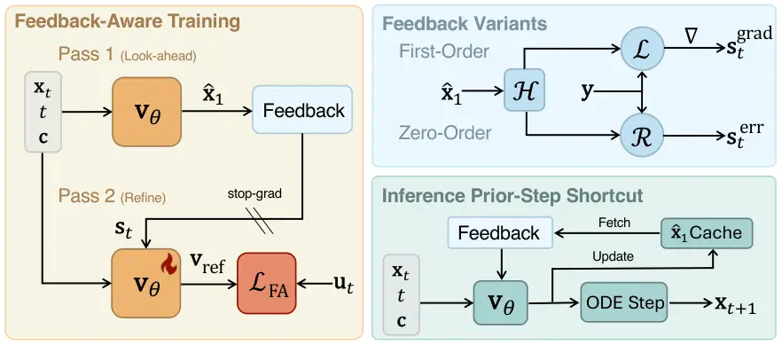

Figure 2: FlowBender overview. (Left) Training follows a two-pass
strategy: a look-ahead pass produces a clean-signal estimate
$`\hat{\mathbf{x}}_{1}`$ to compute the feedback signal
$`\mathbf{s}_{t}`$, which then conditions a second refinement pass.
(Top-right) Feedback variants include first-order gradients for
differentiable operators and zero-order residuals for non-differentiable
or black-box settings. (Bottom-right) At inference, an optional shortcut
bypasses the look-ahead pass by fetching $`\hat{\mathbf{x}}_{1}`$ from a
cached estimate of the previous step, significantly reducing
computational overhead.

We propose FlowBender, a framework transforming generative sampling into
a closed-loop system by learning to integrate alignment feedback
(Fig. 2). In the following sections, we investigate various formulations
of the feedback signal and describe how the model is trained to
internalize them. Pseudocode for training and inference is provided in
Algs. A and A (Appendix).

### 4.1 Problem Formulation

Conditional generative modeling aims to sample from
$`p(\mathbf{x}\mid\mathbf{c})`$, producing samples that satisfy two
simultaneous objectives: plausibility, adhering to the target data
manifold, and fidelity, maintaining consistency with the conditioning
signal. Given a forward operator $`\mathcal{H}`$ accessible during
training and inference, we define the observation
$`\mathbf{y}=\mathcal{H}(\mathbf{x})`$. The condition $`\mathbf{c}`$
includes $`\mathbf{y}`$ and potentially auxiliary signals such as text.
This formulation generalizes diverse tasks; for example, $`\mathcal{H}`$
may represent a renderer for 3D texturing, a depth predictor for
depth-to-RGB, or a degradation operator for image restoration. In this
context, the objective is to sample from the posterior distribution
$`p(\mathbf{x}\mid\mathbf{c},\mathcal{H}).`$

### 4.2 The Two-Pass Feedback Loop

The core mechanism of FlowBender relies on feeding a task-specific
feedback signal, derived from the model’s current alignment error, back
into the network as a first-class input. However, obtaining the clean
signal estimate $`\hat{\mathbf{x}}_{1}`$ required to compute this
feedback $`\mathbf{s}_{t}`$ introduces a causal dependency:
$`\mathbf{s}_{t}`$ must be provided as a model input, yet it depends on
$`\hat{\mathbf{x}}_{1}`$, which is only available from the model’s
output. We resolve this via a two-pass execution strategy where a single
network $`\mathbf{v}_{\theta}`$ handles both unguided and feedback-aware
regimes. In the first pass, we set $`\mathbf{s}_{t}=\mathbf{0}`$ to
generate a _look-ahead_ velocity $`\mathbf{v}_{\text{LA}}`$ and derive
the initial estimate $`\hat{\mathbf{x}}_{1}`$. This estimate allows for
computing deviations from target constraints to define the feedback
signal $`\mathbf{s}_{t}`$. In the second pass, the model consumes
$`\mathbf{s}_{t}`$ alongside $`(\mathbf{x}_{t},t,\mathbf{c})`$ to
produce the final, refined velocity $`\mathbf{v}_{\text{ref}}`$.

### 4.3 Feedback Design Variants

We propose several formulations for the error signal $`\mathbf{s}_{t}`$.
A key design principle is to provide $`\mathbf{s}_{t}`$ as an auxiliary
input naturally supported by any model, rendering our framework
architecture-agnostic.

#### First-Order Feedback.

For differentiable $`\mathcal{H}`$, we define an alignment loss
$`\mathcal{L}(\mathcal{H}(\mathbf{x}),\mathbf{y})`$ quantifying the
discrepancy between prediction and target. The first-order feedback
signal is derived from the gradient of this loss. While Bayesian
formulations (Eq. 1) require gradients w.r.t. $`\mathbf{x}_{t}`$,
stability and efficiency often favor approximations w.r.t. the estimated
clean signal $`\hat{\mathbf{x}}_{1}`$ \[21, 45, 29\]. We therefore
evaluate two candidates for $`\mathbf{s}^{\text{grad}}_{t}`$:
$`\nabla_{\mathbf{x}_{t}}\mathcal{L}(\mathcal{H}(\hat{\mathbf{x}}_{1}),\mathbf{y})`$
and the “shortcut”
$`\nabla_{\hat{\mathbf{x}}_{1}}\mathcal{L}(\mathcal{H}(\hat{\mathbf{x}}_{1}),\mathbf{y})`$.
The latter omits the expensive denoiser Jacobian
$`\frac{\partial\hat{\mathbf{x}}_{1}}{\partial\mathbf{x}_{t}}`$,
reducing memory overhead. The resulting gradient is concatenated to
$`\mathbf{x}_{t}`$ along the channel dimension, providing an explicit
direction for error correction.

#### Zero-Order Feedback.

We additionally consider a derivative-free feedback signal defined by a
measurement-space error operator:
$`\mathbf{s}^{\text{err}}_{t}=\mathcal{R}(\mathcal{H}(\hat{\mathbf{x}}_{1}),\mathbf{y}).`$
$`\mathcal{R}`$ is task-specific and aligns with the domain of the
conditioning signal $`\mathbf{y}`$, $`e.g.`$, a pixel-wise residual for
images. In this variant, the residual $`\mathbf{s}^{\text{err}}_{t}`$ is
provided as a conditional input alongside $`\mathbf{y}`$, forcing the
model to learn a mapping from measurement-space errors to signal-space
updates. By avoiding gradients through $`\mathcal{H}`$, this approach
improves efficiency and supports non-differentiable operators—such as
JPEG compression or physical simulations—where gradient-based guidance
is impossible. It also extends to black-box systems where gradients are
unavailable, such as proprietary APIs or feature extractors.

#### Hybrid Feedback.

Finally, we consider a composite variant that incorporates both first-
and zero-order feedback. In this configuration, the model receives the
gradient $`\mathbf{s}^{\text{grad}}_{t}`$ and the residual
$`\mathbf{s}^{\text{err}}_{t}`$ through their respective input channels.

### 4.4 Training

We optimize the model parameters $`\theta`$ using a joint training
paradigm that supports both unguided and feedback-aware modes. For a
pair $`(\mathbf{x}_{1},\mathbf{c})`$ and timestep $`t`$, we generate
$`\mathbf{x}_{t}`$ following Eq. 2. First, the model computes a
look-ahead estimate $`\hat{\mathbf{x}}_{1}`$ by setting the feedback
input to zero ($`\mathbf{s}_{t}=\mathbf{0}`$). We then compute the
feedback signal $`\mathbf{s}_{t}`$ from this estimate (Section 4.3). The
training objective is:

```math
\mathcal{L}_{\text{FA}}=\mathbb{E}[\|\mathbf{v}_{\theta}(\mathbf{x}_{t},t,\mathbf{c},\text{sg}[\mathbf{s}_{t}])-\mathbf{u}_{t}\|^{2}],
```

where $`\text{sg}[\cdot]`$ denotes the stop-gradient operation. To
ensure numerical stability and efficiency, we treat $`\mathbf{s}_{t}`$
as a constant input rather than differentiating through the look-ahead
pass and operator $`\mathcal{H}`$. To maintain look-ahead reliability,
we randomly replace $`\mathbf{s}_{t}`$ with a null vector with
probability $`p_{\text{un}}`$, similar to the training protocol of CFG
\[23\]. This joint training ensures the model remains accurate in the
unguided regime, which is essential for generating reliable feedback at
inference time.

### 4.5 Inference

Inference follows the two-pass procedure described in Section 4.2: at
each step $`t`$, an unguided look-ahead pass estimates the clean signal
$`\hat{\mathbf{x}}_{1}`$ to derive the feedback signal
$`\mathbf{s}_{t}`$. A subsequent refinement pass then consumes
$`\mathbf{s}_{t}`$ to yield the final velocity
$`\mathbf{v}_{\text{ref}}`$ used to advance the ODE. We next describe
optional modifications to this procedure that enable stronger alignment
and more efficient sampling.

#### Optional CFG.

Our approach enables Classifier-Free Guidance (CFG) \[23\] at zero
marginal cost. While our framework aims to move beyond heuristic-based
sampling, users desiring manual control can elegantly leverage the
unguided velocity $`\mathbf{v}_{\text{LA}}`$, already computed to derive
the feedback signal, as the “unconditional” reference. We define the
resulting velocity as:
$`\mathbf{v}_{\text{cfg}}=w\cdot\mathbf{v}_{\text{ref}}+(1-w)\cdot\mathbf{v}_{\text{LA}},`$
where $`w`$ modulates alignment strength (see Fig. 5 and Appendix B).

#### Efficient Sampling via Prior-Step Feedback Approximation.

The baseline two-pass execution doubles model evaluations as each step
requires both a look-ahead and a refinement pass. To alleviate this, we
propose an optional shortcut that exploits the similarity of error
signals across subsequent timesteps to approximate the feedback without
an additional evaluation. Analysis indicates that the feedback derived
from the _unguided_ prediction at $`t`$ is increasingly correlated with
the feedback computed from the _guided_ prediction of the preceding step
as the trajectory approaches the clean manifold (see Fig. 6(a–b)). This
suggests that the refined prediction from the previous step serves as an
effective surrogate for the current unguided clean estimate,
particularly in the later stages of generation. We introduce a threshold
$`t_{\text{thresh}}\in[0,1]`$ to control this approximation; for
$`t>t_{\text{thresh}}`$, we bypass the look-ahead pass by deriving
$`\mathbf{s}_{t}`$ from the cached estimate
$`\hat{\mathbf{x}}_{1}^{\text{prev}}`$ from the prior step (Fig. 2,
bottom-right). This threshold enables a controllable trade-off between
train-test compatibility and sampling speed. While
$`t_{\text{thresh}}=1`$ preserves the two-pass logic,
$`t_{\text{thresh}}=0`$ collapses execution into a single-pass loop
after an initial bootstrap step – requiring only $`N+1`$ evaluations for
an $`N`$-step trajectory, nearly matching vanilla sampling efficiency
while retaining closed-loop corrective benefits.

## 5 Experiments

We evaluate FlowBender by fine-tuning pre-trained models for
image-to-image translation and 3D mesh texturing. We conduct these
evaluations using latent flow-matching models, as they represent the
current state-of-the-art, though our method fits diffusion and
signal-space models as well. We compare our closed-loop approach against
three established paradigms for conditional sampling:

1.  1.  Standard Fine-Tuning (Standard FT): The conventional single-pass
        supervised approach for learning a conditional velocity field. We
        implement this using ControlNet \[69\] and LoRA \[24\], two popular
        adapters designed to incorporate new conditions into pre-trained
        models while mitigating catastrophic forgetting.
2.  2.  Fine-Tuning with Alignment Loss (FT +
        $`\mathcal{L}_{\text{align}}`$): An augmented training strategy that
        incorporates an explicit measurement-consistency objective during
        the fine-tuning stage to improve fidelity, as proposed in
        ControlNet++ \[32\].
3.  3.  Inference-Time Guidance (IT Guidance): A test-time approach that
        applies gradient updates during sampling to enforce conditional
        consistency without retraining. Specifically, we compare against
        FlowChef \[45\], a recent state-of-the-art general guidance
        framework for FM models, as the representative baseline for this
        paradigm.

#### Experimental Protocol.

Performance is evaluated across two primary axes: _fidelity_, defined by
the alignment between the projected output $`\mathcal{H}(\mathbf{x})`$
and the target measurement $`\mathbf{y}`$, and _plausibility_, which
assesses adherence to the target data manifold (e.g., perceptual
quality). To ensure a controlled comparison and isolate the impact of
our feedback mechanism, primary evaluations utilize an identical number
of sampling steps across all methods. We provide more extensive
comparisons in Appendix B, including results for baselines with doubled
sampling budgets and the incorporation of CFG. As we demonstrate, such
standard test-time enhancements do not resolve the fundamental
shortcomings of existing paradigms.

### 5.1 Image-to-Image Translation

We evaluate our framework on four image-to-image translation tasks:
super-resolution, depth-to-RGB, edge-to-RGB, and JPEG restoration. These
represent closed-form, neural-network-based, and non-differentiable
forward operators $`\mathcal{H}`$, respectively. Our setup uses Stable
Diffusion 3.5 Large \[17\] with ControlNet \[69\] for conditioning. We
train on the Unsplash-25K \[3\] dataset (20k training and 5k test
images) and sample using the Euler sampler with 40 steps. The forward
operators consist of an 8$`\times`$ downsampling kernel (SR),
DepthAnythingV2 \[64\] (depth), HED \[61\] (edges), and JPEG compression
($`\sigma=10`$). To assess _fidelity_ compared to the provided condition
image, we report PSNR, SSIM, and LPIPS for restoration tasks; MAE and
MSE for edges; and MAE and $`\delta_{1.25}`$ for depth. _Plausibility_
is measured using FID across all tasks. Since JPEG restoration is
non-differentiable, we only compare Standard FT and our zero-order
variant for this task, as other baselines and closed-loop variants
require a differentiable operator.

Tables 1 and 3 summarize the quantitative results across all four tasks.
FlowBender’s variants consistently outperform the baselines, yielding
significant gains in both fidelity and plausibility. IT Guidance
exhibits a strict trade-off between fidelity and plausibility depending
on hyperparameter choices. While competitive on fidelity metrics, we
find that this is traded off with worse quality of generated images as
indicated by higher FID and vice versa. We provide further results and
discussion on this trade-off in Appendix B.1. Qualitative examples for
edge and depth to RGB are provided in Fig. 3, with restoration tasks
examples available in the Appendix.

Super Resolution Depth-to-RGB Edge-to-RGB Fidelity Plausibility Fidelity
Plausibility Fidelity Plausibility Method PSNR $`\uparrow`$ SSIM
$`\uparrow`$ LPIPS $`\downarrow`$ FID $`\downarrow`$ MAE $`\downarrow`$
$`\delta_{1.25}\uparrow`$ FID $`\downarrow`$ MAE $`\downarrow`$ MSE
$`\downarrow`$ FID $`\downarrow`$ Standard FT 34.35 96.88 0.83 3.93
0.0848 0.7882 18.21 0.0533 0.0137 13.98 FT +
$`\mathcal{L}_{\text{align}}`$ 35.21 97.53 0.79 4.11 0.0834 0.7933 17.57
0.0501 0.0128 14.47 IT Guidance 43.02 98.29 0.65 18.96 0.0866 0.7592
223.54 0.0416 0.0129 97.65 First-order (w.r.t. $`\mathbf{x}_{t}`$) 36.27
97.10 0.66 4.30 0.0747 0.8268 14.57 0.0456 0.0104 14.81 First-order
(w.r.t. $`\hat{\mathbf{x}}_{1}`$) 44.07 98.96 0.33 6.45 0.0818 0.7973
15.89 0.0435 0.0123 14.97 Zero-order 39.25 98.18 0.21 3.36 0.0764 0.8187
15.70 0.0460 0.0111 14.29 Combined (w.r.t. $`\mathbf{x}_{t}`$) 39.95
98.25 0.21 3.40 0.0829 0.7949 15.93 0.0435 0.0097 13.91 Combined (w.r.t.
$`\hat{\mathbf{x}}_{1}`$) 39.77 98.24 0.23 3.39 0.0783 0.8175 15.39
0.0408 0.0085 13.68

Table 1: Image-to-Image Results. Shaded rows denote FlowBender variants.
Best results in bold; second best underlined.

Fidelity Plausibility Method PSNR $`\uparrow`$ SSIM $`\uparrow`$ LPIPS
$`\downarrow`$ FID $`\downarrow`$ Standard FT 26.29 79.45 22.24 4.35
Zero-order (Ours) 28.86 83.13 16.33 3.80

Table 2: JPEG Restoration Results.

Fidelity Plausibility $`p_{un}`$ PSNR $`\uparrow`$ SSIM $`\uparrow`$
LPIPS $`\downarrow`$ FID $`\downarrow`$ 0.0 37.38 97.41 0.49 3.89 0.1
39.21 97.64 0.43 3.83 0.2 38.55 97.57 0.48 3.93 0.3 37.55 97.24 0.53
3.92

Table 3: Ablation of $`p_{un}`$.

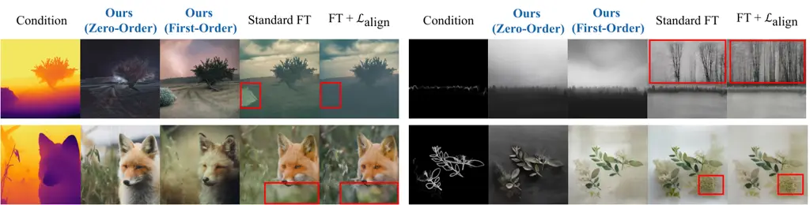

Figure 3: Qualitative comparisons. (Left) Depth-to-RGB; (right)
Edge-to-RGB. Red boxes highlight conditioning inconsistencies.

### 5.2 3D Mesh Texturing

We evaluate FlowBender on 3D mesh texturing by fine-tuning the TRELLIS-2
\[59\] texture transformer. Given the 3D geometry and the conditioning
image $`\mathbf{y}`$ as inputs, we utilize their corresponding latents
as conditions, integrate LoRA adapters \[24\] into all linear layers and
expand the input channels to accommodate the feedback signal
$`\mathbf{s}_{t}`$. We focus on first-order feedback, concatenating
$`\mathbf{s}_{t}`$ with noisy latents, avoiding the complexity of
injecting zero-order residuals via DINO-based cross-attention \[49\].
The forward operator $`\mathcal{H}`$ is defined as the composition of
the TRELLIS-2 latent decoder and its differentiable PBR renderer.
Training uses 7500 Objaverse assets \[14\], with evaluation on 100
held-out Objaverse and 100 Toys4K assets \[53\]. Fidelity is measured
via masked PSNR (M.PSNR, excluding background), SSIM, LPIPS, and
CLIP-similarity to the conditioning image. Plausibility is assessed by
evaluating 50 random renders for each asset (5,000 total images). From
these, we compute FID and standard multi-view reconstruction metrics. We
adopt the default TRELLIS-2 configuration ($`n=12`$ steps, Euler
sampler).

Quantitative results in Table 4 show our framework consistently
outperforms all baselines. Notably, the
$`\nabla_{\hat{\mathbf{x}}_{1}}`$ variant achieves the strongest
performance, significantly improving over supervised baselines. While IT
Guidance enhances fidelity, it fails to match FlowBender in
plausibility. Qualitative comparisons (Fig. 4) illustrate that our
approach recovers fine-grained details omitted by baselines. Additional
visualizations, including multi-view renderings, are provided in the
Appendix.

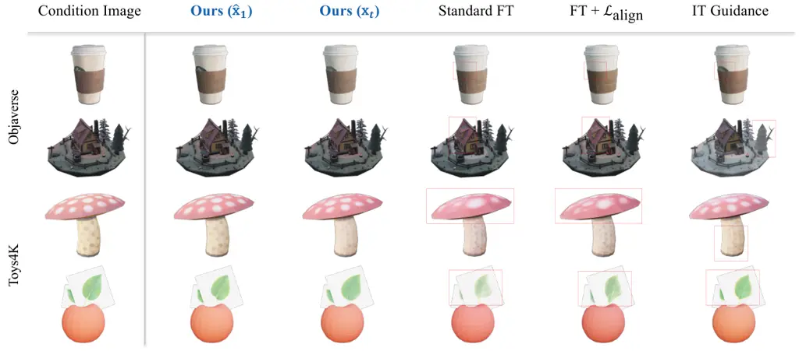

Figure 4: 3D Texturing Results. Objaverse (rows 1–2) and Toys4K (3–4)
assets. The leftmost column provides the input condition image;
remaining columns show generated 3D textured assets rendered from
corresponding viewpoints. Red boxes highlight conditioning
inconsistencies.

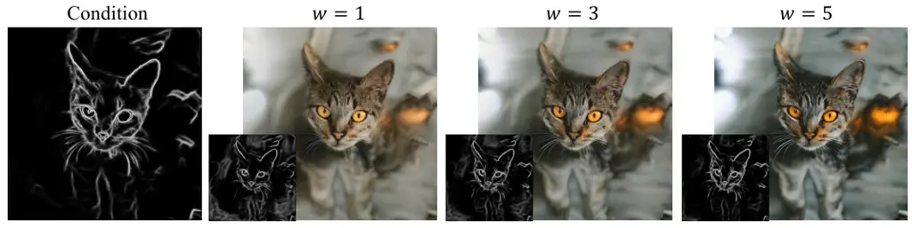

Figure 5: Effect of Optional CFG. Increasing guidance strength $`w`$ can
enhance condition fidelity. Insets show re-extracted edge maps.

Fidelity Plausibility Method M. PSNR $`\uparrow`$ SSIM $`\uparrow`$
LPIPS $`\downarrow`$ CLIP $`\uparrow`$ MV-M.PSNR $`\uparrow`$ MV-SSIM
$`\uparrow`$ MV-LPIPS $`\downarrow`$ MV-CLIP $`\uparrow`$ FID
$`\downarrow`$ Objaverse Dataset Pre-Trained 19.20 0.978 0.0221 0.961
19.91 0.987 0.0138 0.961 11.03 IT Guidance 25.86 0.986 0.0191 0.973
22.80 0.989 0.0123 0.968 9.10 Standard FT 21.91 0.981 0.0189 0.969 23.05
0.990 0.0115 0.970 8.74 FT + $`\mathcal{L}_{\text{align}}`$ 22.63 0.983
0.0182 0.970 22.48 0.989 0.0117 0.969 8.94 Ours (w.r.t.
$`\mathbf{x}_{t}`$) 25.26 0.985 0.0157 0.979 25.91 0.991 0.0105 0.974
7.41 Ours (w.r.t. $`\hat{\mathbf{x}}_{1}`$) 26.39 0.987 0.0140 0.983
26.53 0.992 0.0098 0.977 6.64 Toys4K Dataset Pre-Trained 20.36 0.984
0.0182 0.965 20.63 0.989 0.0129 0.966 10.66 IT Guidance 26.82 0.990
0.0137 0.982 23.63 0.992 0.0112 0.972 8.43 Standard FT 23.00 0.986
0.0160 0.975 24.38 0.991 0.0114 0.972 8.87 FT +
$`\mathcal{L}_{\text{align}}`$ 23.05 0.986 0.0159 0.976 23.25 0.991
0.0111 0.973 8.30 Ours (w.r.t. $`\mathbf{x}_{t}`$) 26.54 0.990 0.0129
0.980 27.20 0.993 0.0097 0.977 7.20 Ours (w.r.t.
$`\hat{\mathbf{x}}_{1}`$) 27.26 0.991 0.0116 0.984 27.21 0.993 0.0092
0.978 6.66

Table 4: Mesh Texturing Results. Metrics evaluate single-view fidelity
to the conditioning image and multi-view (MV) plausibility of the
resulting 3D texture across Objaverse and Toys4K datasets. Shaded rows
denote FlowBender variants. Best results in bold; second best
underlined.

Figure 6: Prior-Step Shortcut Analysis. (a–b) Temporal similarity of
feedback signals for zero-order (a) and first-order (b) variants; rising
correlation as $`t\to 1`$ motivates the $`t_{\text{thresh}}`$-controlled
shortcut strategy. (c–d) FID and PSNR vs. $`t_{\text{thresh}}`$; our
method maintains a consistent advantage over Standard FT (dashed) even
at low $`t_{\text{thresh}}`$ values. (e) Computational cost (NFEs) as a
function of $`t_{\text{thresh}}`$, where $`n`$ is the number of sampling
steps.

### 5.3 Ablation Study

We evaluate the impact of key hyperparameters on the super-resolution
task.

#### Inference-time Shortcut.

We analyze the efficiency-performance trade-off controlled by
$`t_{\text{thresh}}`$ (Section 4.5). As shown in Fig. 6, reducing
$`t_{\text{thresh}}`$ decreases the computational cost toward $`n+1`$
NFEs, approaching the speed of vanilla sampling at lower threshold
values. Although the shortcut introduces a relative performance dip, our
approach consistently outperforms the Standard FT baseline even at low
$`t_{\text{thresh}}`$ settings. The fidelity gap at
$`t_{\text{thresh}}=0`$ is especially notable. These results demonstrate
that while our primary approach utilizes a two-pass logic, the framework
can provide substantial corrective benefits even with minimal
computational overhead compared to standard open-loop sampling.

#### Null Feedback Probability.

The parameter $`p_{\text{un}}`$ allocates the training budget between
unguided and feedback-aware iterations. Conceptually, a non-zero
$`p_{\text{un}}`$ supports the model’s ability to generate reliable
look-ahead estimates, which serve as the foundation for the feedback
signal. However, increasing this probability limits the iterations
available for learning the second-pass refinement. Table 3 shows that
$`p_{un}=0.1`$ yields the best results across all metrics, providing the
optimal balance for the closed-loop system.

### 5.4 Is FlowBender Just Gradient Guidance in Disguise?

We investigate whether closed-loop training simply automates
hyperparameter tuning for linear guidance. Evaluating 180 velocity
predictions across 20 assets in the texturing task
($`\nabla_{\hat{\mathbf{x}}_{1}}`$ variant), we decompose the learned
correction
$`\Delta\mathbf{v}=\mathbf{v}_{\text{ref}}-\mathbf{v}_{\text{LA}}`$
relative to the gradient signal $`\mathbf{s}_{t}^{\text{grad}}`$. The
squared norm of the parallel component accounts for approximately 20% of
the total correction’s energy; the majority of the correcting update
resides in the component orthogonal to the gradient. This relationship
remains stable across noise levels ($`t\in[0.1,0.9]`$). While a cosine
similarity of
$`\cos(\Delta\mathbf{v},\mathbf{s}_{t}^{\text{grad}})=0.42\pm 0.11`$
confirms the gradient is utilized, the dominant orthogonal component
proves that FlowBender internalizes the gradient as a high-dimensional
feature to non-linearly _bend_ the flow toward the manifold,
transcending the strict additive formulation of traditional Bayesian
guidance.

## 6 Conclusion and Limitations

We presented FlowBender, a framework that addresses the fundamental
"open-loop" limitation of existing conditional flow models by treating
their own alignment errors as first-class inputs, thus training them to
correct (“bend”) their initial predictions. By replacing hand-tuned
guidance with a learned, non-linear two-pass correction policy,
FlowBender simultaneously enhances both conditional fidelity and sample
plausibility. Our approach significantly improves over supervised and
inference-time baselines across a diverse range of tasks, including
image-to-image translation, restoration, and 3D mesh texturing.

Despite these gains, certain limitations remain. First, while our
prior-step shortcut enables efficient inference, the training phase
requires an additional model evaluation per iteration to derive the
feedback signal, increasing the computational budget for fine-tuning.
Future work could investigate training schemes that directly utilize
cached prior-step predictions, potentially restoring single-pass
efficiency throughout the entire pipeline. Second, performance sometimes
further improves when using CFG alongside FlowBender (Sec. 4.5),
suggesting the learned policy has not yet fully internalized the most
complex conditioning nuances. We believe that more expressive
feedback-integration architectures and large-scale training are
promising directions for closing this gap.

## 7 Acknowledgments

Or Litany acknowledges support from the Israel Science Foundation (grant
624/25) and the Azrieli Foundation Early Career Faculty Fellowship. This
research was also supported in part by an academic gift from Meta. The
authors gratefully acknowledge this support. This research was supported
by the Council for Higher Education in Israel under the Moonshot
Project.

## References

- \[1\] J. Adler and O. Öktem (2017) Solving ill-posed inverse problems
  using iterative deep neural networks. Inverse Problems 33 (12),
  pp. 124007. Cited by: §2.
- \[2\] J. Adler and O. Öktem (2018) Learned primal-dual reconstruction.
  IEEE transactions on medical imaging 37 (6), pp. 1322–1332. Cited by:
  §2.
- \[3\] Z. Ali, C. Luke, and C. Timothy (2023) Unsplash. Note:
  [https://github.com/unsplash/datasets](https://github.com/unsplash/datasets)
  Cited by: §A.2, §5.1.
- \[4\] M. Andrychowicz, M. Denil, S. Gomez, M. W. Hoffman, D. Pfau, T.
  Schaul, B. Shillingford, and N. De Freitas (2016) Learning to learn by
  gradient descent by gradient descent. Advances in neural information
  processing systems 29. Cited by: §2.
- \[5\] A. Bansal, H. Chu, A. Schwarzschild, S. Sengupta, M.
  Goldblum, J. Geiping, and T. Goldstein (2023) Universal guidance for
  diffusion models. In Proceedings of the IEEE/CVF conference on
  computer vision and pattern recognition, pp. 843–852. Cited by: §1,
  §2.
- \[6\] G. Batzolis, J. Stanczuk, C. Schönlieb, and C. Etmann (2021)
  Conditional image generation with score-based diffusion models. arXiv
  preprint arXiv:2111.13606. Cited by: §2.
- \[7\] J. Carreira, P. Agrawal, K. Fragkiadaki, and J. Malik (2016)
  Human pose estimation with iterative error feedback. In Proceedings of
  the IEEE conference on computer vision and pattern recognition,
  pp. 4733–4742. Cited by: §2.
- \[8\] T. Chen, W. Xiang, K. Han, Y. Lu, D. Wu, G. Liu, and R. R.
  Kompella (2026) GIFSplat: generative prior-guided iterative
  feed-forward 3d gaussian splatting from sparse views. arXiv preprint
  arXiv:2602.22571. Cited by: §2.
- \[9\] T. Chen, R. Zhang, and G. Hinton (2022) Analog bits: generating
  discrete data using diffusion models with self-conditioning. arXiv
  preprint arXiv:2208.04202. Cited by: §2.
- \[10\] Y. Chen, J. Wang, Z. Yang, S. Manivasagam, and R.
  Urtasun (2024) G3r: gradient guided generalizable reconstruction. In
  European Conference on Computer Vision, pp. 305–323. Cited by: §2.
- \[11\] H. Chung, J. Kim, M. T. Mccann, M. L. Klasky, and J. C.
  Ye (2022) Diffusion posterior sampling for general noisy inverse
  problems. arXiv preprint arXiv:2209.14687. Cited by: §1, §2.
- \[12\] H. Chung, B. Sim, D. Ryu, and J. C. Ye (2022) Improving
  diffusion models for inverse problems using manifold constraints.
  Advances in Neural Information Processing Systems 35, pp. 25683–25696.
  Cited by: §2.
- \[13\] G. Daras, H. Chung, C. Lai, Y. Mitsufuji, J. C. Ye, P.
  Milanfar, A. G. Dimakis, and M. Delbracio (2024) A survey on diffusion
  models for inverse problems. arXiv preprint arXiv:2410.00083. Cited
  by: §2.
- \[14\] M. Deitke, R. Liu, M. Wallingford, H. Ngo, O. Michel, A.
  Kusupati, A. Fan, C. Laforte, V. Voleti, S. Y. Gadre, et al. (2023)
  Objaverse-xl: a universe of 10m+ 3d objects. Advances in Neural
  Information Processing Systems 36, pp. 35799–35813. Cited by: §5.2.
- \[15\] P. Dhariwal and A. Nichol (2021) Diffusion models beat gans on
  image synthesis. Advances in neural information processing systems 34,
  pp. 8780–8794. Cited by: §1, §2.
- \[16\] N. Elata, H. Chung, J. C. Ye, T. Michaeli, and M. Elad (2025)
  InvFusion: bridging supervised and zero-shot diffusion for inverse
  problems. arXiv preprint arXiv:2504.01689. Cited by: §2.
- \[17\] P. Esser, S. Kulal, A. Blattmann, R. Entezari, J. Müller, H.
  Saini, Y. Levi, D. Lorenz, A. Sauer, F. Boesel, et al. (2024) Scaling
  rectified flow transformers for high-resolution image synthesis. In
  Forty-first international conference on machine learning, Cited by:
  §2, §5.1.
- \[18\] J. Flynn, M. Broxton, P. Debevec, M. DuVall, G. Fyffe, R.
  Overbeck, N. Snavely, and R. Tucker (2019) Deepview: view synthesis
  with learned gradient descent. In Proceedings of the IEEE/CVF
  Conference on Computer Vision and Pattern Recognition, pp. 2367–2376.
  Cited by: §2.
- \[19\] A. Galashov, A. Pokle, A. Doucet, A. Gretton, M. Delbracio,
  and V. De Bortoli (2025) Learn to guide your diffusion model. arXiv
  preprint arXiv:2510.00815. Cited by: §2.
- \[20\] J. Harrison, L. Metz, and J. Sohl-Dickstein (2022) A closer
  look at learned optimization: stability, robustness, and inductive
  biases. Advances in neural information processing systems 35,
  pp. 3758–3773. Cited by: §2.
- \[21\] Y. He, N. Murata, C. Lai, Y. Takida, T. Uesaka, D. Kim, W.
  Liao, Y. Mitsufuji, J. Z. Kolter, R. Salakhutdinov, et al. (2023)
  Manifold preserving guided diffusion. arXiv preprint arXiv:2311.16424.
  Cited by: §1, §2, §4.3.
- \[22\] J. Ho, A. Jain, and P. Abbeel (2020) Denoising diffusion
  probabilistic models. Advances in neural information processing
  systems 33, pp. 6840–6851. Cited by: §1.
- \[23\] J. Ho and T. Salimans (2022) Classifier-free diffusion
  guidance. arXiv preprint arXiv:2207.12598. Cited by: §2, §2, §4.4,
  §4.5.
- \[24\] E. J. Hu, Y. Shen, P. Wallis, Z. Allen-Zhu, Y. Li, S. Wang, L.
  Wang, W. Chen, et al. (2022) Lora: low-rank adaptation of large
  language models.. ICLR 1 (2), pp. 3. Cited by: 1st item, §2, item 1,
  §5.2.
- \[25\] G. Kang, S. Nam, S. Yang, X. Sun, S. Khamis, A. Mohamed, and E.
  Park (2025) Ilrm: an iterative large 3d reconstruction model. arXiv
  preprint arXiv:2507.23277. Cited by: §2.
- \[26\] T. Karras, M. Aittala, T. Kynkäänniemi, J. Lehtinen, T. Aila,
  and S. Laine (2024) Guiding a diffusion model with a bad version of
  itself. Advances in Neural Information Processing Systems 37,
  pp. 52996–53021. Cited by: §2.
- \[27\] B. Kawar, M. Elad, S. Ermon, and J. Song (2022) Denoising
  diffusion restoration models. Advances in neural information
  processing systems 35, pp. 23593–23606. Cited by: §2.
- \[28\] B. Kawar, G. Vaksman, and M. Elad (2021) Snips: solving noisy
  inverse problems stochastically. Advances in neural information
  processing systems 34, pp. 21757–21769. Cited by: §2.
- \[29\] J. Kim, B. S. Kim, and J. C. Ye (2025) Flowdps: flow-driven
  posterior sampling for inverse problems. In Proceedings of the
  IEEE/CVF International Conference on Computer Vision, pp. 12328–12337.
  Cited by: §2, §4.3.
- \[30\] B. F. Labs (2024) FLUX. Note:
  [https://github.com/black-forest-labs/flux](https://github.com/black-forest-labs/flux)
  Cited by: §2.
- \[31\] B. F. Labs (2025) FLUX.2: Frontier Visual Intelligence. Note:
  [https://bfl.ai/blog/flux-2](https://bfl.ai/blog/flux-2) Cited by: §2.
- \[32\] M. Li, T. Yang, H. Kuang, J. Wu, Z. Wang, X. Xiao, and C.
  Chen (2024) Controlnet++: improving conditional controls with
  efficient consistency feedback: project page: liming-ai. github.
  io/controlnet_plus_plus. In European Conference on Computer Vision,
  pp. 129–147. Cited by: §A.2, §A.3, §1, §2, item 2.
- \[33\] Y. Li, G. Wang, X. Ji, Y. Xiang, and D. Fox (2018) Deepim: deep
  iterative matching for 6d pose estimation. In Proceedings of the
  European conference on computer vision (ECCV), pp. 683–698. Cited by:
  §2.
- \[34\] Y. Lipman, R. T. Chen, H. Ben-Hamu, M. Nickel, and M. Le (2022)
  Flow matching for generative modeling. arXiv preprint
  arXiv:2210.02747. Cited by: §A.1, §1, §3.
- \[35\] Y. Liu, J. Hladkỳ, M. Nießner, and A. Dai (2026) Diff3R:
  feed-forward 3d gaussian splatting with uncertainty-aware
  differentiable optimization. arXiv preprint arXiv:2604.01030. Cited
  by: §2.
- \[36\] Y. Liu, L. Höllein, M. Nießner, and A. Dai (2025) Quicksplat:
  fast 3d surface reconstruction via learned gaussian initialization. In
  Proceedings of the IEEE/CVF International Conference on Computer
  Vision, pp. 27851–27861. Cited by: §2.
- \[37\] W. Long, H. Wu, S. Jiang, J. Zhang, X. Ji, and S. Gu (2026)
  IDESplat: iterative depth probability estimation for generalizable 3d
  gaussian splatting. arXiv preprint arXiv:2601.03824. Cited by: §2.
- \[38\] I. Loshchilov and F. Hutter (2019) Decoupled Weight Decay
  Regularization. In International Conference on Learning
  Representations, External Links: 1711.05101 Cited by: §A.2, §A.3.
- \[39\] G. Luo, T. Darrell, O. Wang, D. B. Goldman, and A.
  Holynski (2024) Readout guidance: learning control from diffusion
  features. In Proceedings of the IEEE/CVF Conference on Computer Vision
  and Pattern Recognition, pp. 8217–8227. Cited by: §2.
- \[40\] W. Ma, S. Wang, J. Gu, S. Manivasagam, A. Torralba, and R.
  Urtasun (2020) Deep feedback inverse problem solver. In European
  conference on computer vision, pp. 229–246. Cited by: §2.
- \[41\] L. Metz, J. Harrison, C. D. Freeman, A. Merchant, L. Beyer, J.
  Bradbury, N. Agrawal, B. Poole, I. Mordatch, A. Roberts, et al. (2022)
  Velo: training versatile learned optimizers by scaling up. arXiv
  preprint arXiv:2211.09760. Cited by: §2.
- \[42\] L. Metz, N. Maheswaranathan, C. D. Freeman, B. Poole, and J.
  Sohl-Dickstein (2020) Tasks, stability, architecture, and compute:
  training more effective learned optimizers, and using them to train
  themselves. arXiv preprint arXiv:2009.11243. Cited by: §2.
- \[43\] J. Munkberg, J. Hasselgren, T. Shen, J. Gao, W. Chen, A.
  Evans, T. Müller, and S. Fidler (2022) Extracting triangular 3d
  models, materials, and lighting from images. In Proceedings of the
  IEEE/CVF conference on computer vision and pattern recognition,
  pp. 8280–8290. Cited by: §A.3.
- \[44\] A. Nichol, P. Dhariwal, A. Ramesh, P. Shyam, P. Mishkin, B.
  McGrew, I. Sutskever, and M. Chen (2021) Glide: towards photorealistic
  image generation and editing with text-guided diffusion models. arXiv
  preprint arXiv:2112.10741. Cited by: §1.
- \[45\] M. Patel, S. Wen, D. N. Metaxas, and Y. Yang (2025) Flowchef:
  steering of rectified flow models for controlled generations. In
  Proceedings of the IEEE/CVF International Conference on Computer
  Vision, pp. 15308–15318. Cited by: §A.2, §A.2, §A.3, §B.1, §1, §1, §2,
  §4.3, item 3.
- \[46\] W. Peebles and S. Xie (2023) Scalable diffusion models with
  transformers. In Proceedings of the IEEE/CVF international conference
  on computer vision, pp. 4195–4205. Cited by: §A.2.
- \[47\] R. Rombach, A. Blattmann, D. Lorenz, P. Esser, and B.
  Ommer (2022) High-resolution image synthesis with latent diffusion
  models. In Proceedings of the IEEE/CVF conference on computer vision
  and pattern recognition, pp. 10684–10695. Cited by: §1, §2.
- \[48\] C. Saharia, W. Chan, H. Chang, C. Lee, J. Ho, T. Salimans, D.
  Fleet, and M. Norouzi (2022) Palette: image-to-image diffusion models.
  In ACM SIGGRAPH 2022 conference proceedings, pp. 1–10. Cited by: §1.
- \[49\] O. Siméoni, H. V. Vo, M. Seitzer, F. Baldassarre, M. Oquab, C.
  Jose, V. Khalidov, M. Szafraniec, S. Yi, M. Ramamonjisoa, et
  al. (2025) Dinov3. arXiv preprint arXiv:2508.10104. Cited by: §A.3,
  §5.2.
- \[50\] I. Sobol, C. Xu, and O. Litany (2024) Zero-to-hero: enhancing
  zero-shot novel view synthesis via attention map filtering. Advances
  in Neural Information Processing Systems 37, pp. 30522–30553. Cited
  by: §2.
- \[51\] J. Sohl-Dickstein, E. Weiss, N. Maheswaranathan, and S.
  Ganguli (2015) Deep unsupervised learning using nonequilibrium
  thermodynamics. In International conference on machine learning,
  pp. 2256–2265. Cited by: §1.
- \[52\] J. Song, A. Vahdat, M. Mardani, and J. Kautz (2023)
  Pseudoinverse-guided diffusion models for inverse problems. In
  International Conference on Learning Representations, Cited by: §2.
- \[53\] S. Stojanov, A. Thai, and J. M. Rehg (2021) Using shape to
  categorize: low-shot learning with an explicit shape bias. In
  Proceedings of the IEEE/CVF conference on computer vision and pattern
  recognition, pp. 1798–1808. Cited by: §5.2.
- \[54\] A. Vaswani, N. Shazeer, N. Parmar, J. Uszkoreit, L.
  Jones, A. N. Gomez, Ł. Kaiser, and I. Polosukhin (2017) Attention is
  all you need. Advances in neural information processing systems 30.
  Cited by: §A.1.
- \[55\] P. von Platen, S. Patil, A. Lozhkov, P. Cuenca, N. Lambert, K.
  Rasul, M. Davaadorj, D. Nair, S. Paul, W. Berman, Y. Xu, S. Liu,
  and T. Wolf (2022) Diffusers: state-of-the-art diffusion models.
  GitHub. Note:
  [https://github.com/huggingface/diffusers](https://github.com/huggingface/diffusers)
  Cited by: §A.2.
- \[56\] Y. Wang, J. Yu, and J. Zhang (2022) Zero-shot image restoration
  using denoising diffusion null-space model. arXiv preprint
  arXiv:2212.00490. Cited by: §2.
- \[57\] J. Wen, A. G. Schwing, and S. Wang (2025) LIFE-gom:
  generalizable human rendering with learned iterative feedback over
  multi-resolution gaussians-on-mesh. In 13th International Conference
  on Learning Representations, ICLR 2025, pp. 40453–40472. Cited by: §2.
- \[58\] O. Wichrowska, N. Maheswaranathan, M. W. Hoffman, S. G.
  Colmenarejo, M. Denil, N. Freitas, and J. Sohl-Dickstein (2017)
  Learned optimizers that scale and generalize. In International
  conference on machine learning, pp. 3751–3760. Cited by: §2.
- \[59\] J. Xiang, X. Chen, S. Xu, R. Wang, Z. Lv, Y. Deng, H. Zhu, Y.
  Dong, H. Zhao, N. J. Yuan, et al. (2025) Native and compact structured
  latents for 3d generation. arXiv preprint arXiv:2512.14692. Cited by:
  §A.3, §5.2.
- \[60\] B. Xiao, H. Wu, W. Xu, X. Dai, H. Hu, Y. Lu, M. Zeng, C. Liu,
  and L. Yuan (2024) Florence-2: advancing a unified representation for
  a variety of vision tasks. In Proceedings of the IEEE/CVF Conference
  on Computer Vision and Pattern Recognition, pp. 4818–4829. Cited by:
  §A.2.
- \[61\] S. Xie and Z. Tu (2015) Holistically-nested edge detection. In
  Proceedings of the IEEE international conference on computer vision,
  pp. 1395–1403. Cited by: §5.1.
- \[62\] H. Xu, D. Barath, A. Geiger, and M. Pollefeys (2025) Resplat:
  learning recurrent gaussian splats. arXiv preprint arXiv:2510.08575.
  Cited by: §2.
- \[63\] Y. Xu, Z. He, S. Shan, and X. Chen (2024) Ctrlora: an
  extensible and efficient framework for controllable image generation.
  arXiv preprint arXiv:2410.09400. Cited by: §2.
- \[64\] L. Yang, B. Kang, Z. Huang, Z. Zhao, X. Xu, J. Feng, and H.
  Zhao (2024) Depth Anything V2. pp. 21875–21911. External Links:
  [Document](https://dx.doi.org/10.52202/079017-0688) Cited by: §5.1.
- \[65\] H. Ye, H. Lin, J. Han, M. Xu, S. Liu, Y. Liang, J. Ma, J. Zou,
  and S. Ermon (2024) Tfg: unified training-free guidance for diffusion
  models. Advances in Neural Information Processing Systems 37,
  pp. 22370–22417. Cited by: §1, §2.
- \[66\] S. Yehezkel, O. Dahary, A. Voynov, and D. Cohen-Or (2025)
  Navigating with annealing guidance scale in diffusion space. In
  Proceedings of the SIGGRAPH Asia 2025 Conference Papers, pp. 1–11.
  Cited by: §2.
- \[67\] A. B. Yildirim, T. Saygin, D. Ceylan, and A. Dundar (2026)
  GeoFusionLRM: geometry-aware self-correction for consistent 3d
  reconstruction. In Computer Graphics Forum, pp. e70325. Cited by: §2.
- \[68\] B. Zhang, W. Chu, J. Berner, C. Meng, A. Anandkumar, and Y.
  Song (2025) Improving diffusion inverse problem solving with decoupled
  noise annealing. In Proceedings of the Computer Vision and Pattern
  Recognition Conference, pp. 20895–20905. Cited by: §2.
- \[69\] L. Zhang, A. Rao, and M. Agrawala (2023) Adding conditional
  control to text-to-image diffusion models. In Proceedings of the
  IEEE/CVF international conference on computer vision, pp. 3836–3847.
  Cited by: §A.2, 1st item, §1, §1, §2, item 1, §5.1.

## Appendix A Implementation Details

Algorithm 1: Feedback-Aware Training

 

1: Dataset $`\mathcal{D}`$, model $`\mathbf{v}_{\theta}`$, prob.
$`p_{\text{un}}`$

2: while not converged do

3:   Sample $`(\mathbf{x}_{1},\mathbf{c})\sim\mathcal{D}`$ where
$`\mathbf{y}\in\mathbf{c}`$

4:
  $`\mathbf{x}_{0}\sim\mathcal{N}(0,\mathbf{I}),t\sim\mathcal{U}[0,1]`$

5:
  $`\mathbf{x}_{t}\leftarrow a_{t}\mathbf{x}_{1}+\sigma_{t}\mathbf{x}_{0}`$

6:
  $`\mathbf{v}_{\text{LA}}\leftarrow\mathbf{v}_{\theta}(\mathbf{x}_{t},t,\mathbf{c},\mathbf{0})`$
// Pass 1: Unguided Look-ahead

7:
  $`\hat{\mathbf{x}}_{1}\leftarrow\operatorname{EstimateSample}(\mathbf{x}_{t},t,\mathbf{v}_{\text{LA}})`$

8:
  $`\mathbf{s}_{t}\leftarrow\operatorname{Feedback}(\hat{\mathbf{x}}_{1},\mathbf{y})`$
// See Sec. 4.3

9:   if $`\operatorname{rand}(0,1)<p_{\text{un}}`$ then // Conditioning
Dropout

10:    $`\mathbf{s}_{\text{in}}\leftarrow\mathbf{0}`$

11:   else

12:
   $`\mathbf{s}_{\text{in}}\leftarrow\operatorname{stop\_grad}(\mathbf{s}_{t})`$

  

13:
  $`\mathbf{v}_{\text{ref}}\leftarrow\mathbf{v}_{\theta}(\mathbf{x}_{t},t,\mathbf{c},\mathbf{s}_{\text{in}})`$
// Pass 2: Refinement

14:
  $`\mathcal{L}_{\text{FA}}\leftarrow\|\mathbf{v}_{\text{ref}}-\mathbf{u}_{t}\|^{2}`$

15:   Update $`\bm{\theta}`$ via
$`\nabla_{\bm{\theta}}\mathcal{L}_{\text{FA}}`$

Algorithm 2: Feedback-Aware Inference

 

1: $`\mathbf{v}_{\theta}`$, condition $`\mathbf{c}`$ (incl.
$`\mathbf{y}`$), $`t_{\text{thresh}}`$, ODE Solver

2: $`\mathbf{x}_{0}\sim\mathcal{N}(0,\mathbf{I})`$

3: $`\hat{\mathbf{x}}_{1}^{\text{prev}}\leftarrow\mathbf{0}`$

4: for $`i=0`$ to $`N-1`$ do

5:   $`t\leftarrow t_{i}`$

6:   if $`t\leq t_{\text{thresh}}`$ or $`i=0`$ then // Pass 1: Unguided
Look-ahead

7:
   $`\mathbf{v}_{\text{LA}}\leftarrow\mathbf{v}_{\theta}(\mathbf{x}_{t},t,\mathbf{c},\mathbf{0})`$

8:
   $`\hat{\mathbf{x}}_{1}\leftarrow\operatorname{EstimateSample}(\mathbf{x}_{t},t,\mathbf{v}_{\text{LA}})`$

9:   else// Shortcut: Prior-Step Reuse

10:
   $`\hat{\mathbf{x}}_{1}\leftarrow\hat{\mathbf{x}}_{1}^{\text{prev}}`$

  

11:
  $`\mathbf{s}_{t}\leftarrow\operatorname{Feedback}(\hat{\mathbf{x}}_{1},\mathbf{y})`$

12:
  $`\mathbf{v}_{\text{ref}}\leftarrow\mathbf{v}_{\theta}(\mathbf{x}_{t},t,\mathbf{c},\mathbf{s}_{t})`$
// Pass 2: Refinement

13:
  $`\hat{\mathbf{x}}_{1}^{\text{prev}}\leftarrow\operatorname{EstimateSample}(\mathbf{x}_{t},t_{i},\mathbf{v}_{\text{ref}})`$
// Cache Update

14:
  $`\mathbf{x}_{t+1}\leftarrow\operatorname{Step}(\mathbf{x}_{t},\mathbf{v}_{\text{ref}},t)`$
// Integration

15: return $`\mathbf{x}_{N}`$

### A.1 2D Toy Experiment

Ground-Truth Distribution. The target distribution is a 2D Archimedean
spiral with finite thickness, defined by the curve

```math
r=a\theta,\quad\theta\sim\mathrm{Uniform}(0,2\pi),\quad a=2.0
```

The finite thickness of is modeled by an isotropic Gaussian spread
around each point on the curve ($`\sigma=0.12`$).

Each point is assigned a quadrant label $`c\in\{0,1,2,3\}`$ based on
which quarter-turn of the spiral it falls in
($`c=\lfloor\theta/(\pi/2)\rfloor`$).

Model Architecture. The generative model is an MLP with 3 linear layers,
hidden dimension 64, and SiLU activations between layers. The input is a
concatenation of the noisy sample $`x_{t}\in\mathbb{R}^{2}`$ with a time
embedding. The scalar $`t\in[0,1]`$ is lifted to a 16-dimensional
sinusoidal embedding \[54\]. The class condition is encoded via a
learned embedding table that maps the quadrant label $`c`$ to a vector
of the hidden dimension, which is added to the time embedding before
being passed to the main network.

Training. All models are trained with the standard conditional flow
matching objective \[34\] for 50,000 steps with a batch size of 1024 and
a learning rate of $`3\times 10^{-4}`$ (AdamW optimizer). Training
samples are generated on the fly at each iteration. Prior to training, a
z-score normalizer is fitted on 200,000 spiral samples (per-coordinate
mean and standard deviation). All inputs and model outputs are
normalized using this transformation.

Feedback and Guidance objective The spiral is divided into four
quadrants, each assigned a non-overlapping arc-length band. For quadrant
$`c`$, the target radius interval is:

```math
r^{c}_{\min}=c\pi,\qquad r^{c}_{\max}=(c+1)\pi
```

The loss penalises points outside this band:

```math
\mathcal{L}(x,c)=\text{softplus}(r^{c}_{\min}-r)+\text{softplus}(r-r^{c}_{\max}),\quad r=|x|_{2}
```

This is zero (up to softplus smoothing) when
$`r\in[r^{c}_{\min},r^{c}_{\max}]`$, and grows linearly outside.

Guidance Scale. As illustrated in Fig. 1, Training-Free Guidance tends
to push the final samples off the data manifold. We explore different
guidance scales in Fig. 7. Small guidance scales fail to enforce the
conditioning signal, while large guidance scales lead to samples that
deviate from the target manifold.

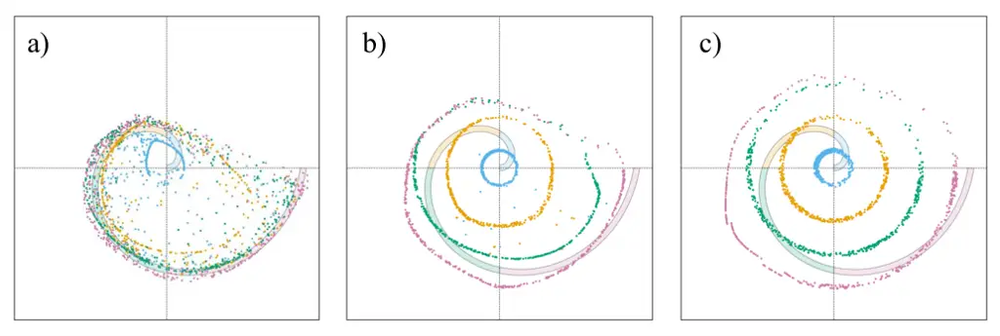

Figure 7: Effect of guidance scale on conditional generation. We compare
guidance scales of a) 0.5, b) 2.0 (used in Fig. 1), and c) 4.0. Small
scale (a) fails to enforce the condition, while large guidance (c)
pushes samples off the data manifold entirely. We therefore selected an
intermediate scale that provides a reasonable trade-off between fidelity
and plausibility.

### A.2 Image-to-Image Translation

We use the official Stable Diffusion 3.5 (SD3.5) checkpoint implemented
in the diffusers \[55\] library and adapt their reference script to add
and train the ControlNets ¹¹ 1
[https://github.com/huggingface/diffusers/blob/main/examples/controlnet/train_controlnet_sd3.py](https://github.com/huggingface/diffusers/blob/main/examples/controlnet/train_controlnet_sd3.py).

The model is conditioned on
$`\mathbf{c}=(\mathbf{y},\mathbf{c}_{\mathrm{text}})`$ where
$`\mathbf{y}`$ is the image-shaped condition (e.g., edges) and
$`\mathbf{c}_{\mathrm{text}}`$ is the text condition. In the following,
we omit the dependence on the text condition
$`\textbf{c}_{\mathrm{text}}`$ for clarity.

#### Zero-order.

To inject zero-order information, we expand the input convolution of the
ControlNet and concatenate the residual to the condition along the
channel dimension. Specifically, the ControlNet module
$`\operatorname{CN}`$ computes the condition in the unguided pass from
the image condition $`\mathbf{y}`$ as

```math
\mathbf{\hat{c}}=\operatorname{CN}([\mathbf{y},\mathbf{0}]),\quad\mathbf{y},\mathbf{0}\in\mathbb{R}^{3\times H\times W}
```

where $`[\cdot]`$ denotes concatenation along the channel dimension.

We then compute the residual via

```math
\displaystyle\mathbf{v}_{\text{LA}} \displaystyle=\mathbf{v}_{\theta}(\mathbf{x}_{t},t,\mathbf{\hat{c}})
```

```math
\displaystyle\hat{\mathbf{x}}_{1} \displaystyle=\operatorname{EstimateSample}(\mathbf{x}_{t},t,\mathbf{v}_{\text{LA}})
```

```math
\displaystyle\mathbf{\tilde{s}}_{t} \displaystyle=\left|\mathbf{y}-\mathcal{H}(\hat{\mathbf{x}}_{1})\right|
```

where $`\mathcal{H}`$ is the composition of the VAE decoder and the
pixel-space forward operator. We normalize the feedback signal using

```math
\mathbf{s}_{t}=\mathbf{\tilde{s}}_{t}/\max\left(|\mathbf{\tilde{s}}_{t}|\right)
```

Finally, the ControlNet encodes the guidance signal
$`\mathbf{\tilde{c}}=\operatorname{CN}([\mathbf{y},\mathbf{s}_{t}])`$
and the refined velocity is

```math
\mathbf{v}_{\text{ref}}=\mathbf{v}_{\theta}(\mathbf{x}_{t},t,\mathbf{\tilde{c}}).
```

#### First-order.

For our first-order variant, we double the number of input channels of
the input convolution of the DiT to inject the feedback signal. In the
unguided pass, the denoising network $`\mathbf{v}_{\theta}`$ predicts

```math
\mathbf{v}_{\text{LA}}=\mathbf{v}_{\theta}\left([\mathbf{x}_{t},\mathbf{0}],t,\mathbf{\tilde{c}}\right),\quad\mathbf{x}_{t},\mathbf{0}\in\mathbb{R}^{16\times h\times w}
```

where $`h,w`$ are the height and width of the VAE-encoded image latents
and $`\mathbf{\tilde{c}}=\operatorname{CN}(\mathbf{y})`$.

We then compute the guidance signal
$`\mathbf{\tilde{s}}_{t}=\nabla_{\mathbf{x}_{t}}\mathcal{L}`$ where

```math
\displaystyle\hat{\mathbf{x}}_{1} \displaystyle=\operatorname{EstimateSample}(\mathbf{x}_{t},t,\mathbf{v}_{\text{LA}})
```

```math
\displaystyle\mathcal{L} \displaystyle=\mathrm{MSE}(\mathbf{y},\mathcal{H}(\hat{\mathbf{x}}_{1})))
```

We standardize the feedback signal

```math
\mathbf{s}_{t}=\left(\mathbf{\tilde{s}}_{t}-\operatorname{mean}(\mathbf{\tilde{s}}_{t})\right)/\operatorname{std}(\mathbf{\tilde{s}}_{t})
```

before computing the refined velocity as

```math
\mathbf{v}_{\text{ref}}=\mathbf{v}_{\theta}([\mathbf{x}_{t},\mathbf{s}_{t}],t,\mathbf{\tilde{c}}).
```

Inspired by Patel et al. \[45\], we additionally explore a variant that
uses $`\mathbf{\tilde{s}}_{t}=\nabla_{\hat{\mathbf{x}}_{1}}\mathcal{L}`$
which avoids differentiating through the denoising network
$`\mathbf{v}_{\theta}`$.

#### Training

We center crop and resize images of the Unsplash-25K \[3\] dataset to
$`1,024^{2}`$ resolution and create text conditions for images using
Florence2-Large \[60\]. Training uses batch size 16 for 5 epochs,
resulting in a total of $`6,250`$ optimizer steps, using the
AdamW \[38\] optimizer with learning rate $`10^{-5}`$, weight decay
$`0.01`$, and 500 steps of learning rate warmup. Similar to Zhang et al.
\[69\], the weights corresponding to the additional channels, used to
inject feedback information, are zero-initialized such that the network
is slowly adapted to make use of feedback during training. We drop the
feedback condition during training with probability $`p_{un}=0.1`$
following our ablation study in the main text (Tab. 3).

We only train newly added parameters, specifically the ControlNet, while
keeping weights of the StableDiffusion3.5 base model frozen. In the
first-order and combined variants, we additionally unfreeze the input
convolution to the DiT \[46\] to allow the model to make use of the
feedback signal that is concatenated to the input latent.

All methods use NVIDIA A100 GPUs for training where zero-order
experiments take $`\approx 51`$ GPU hours, first-order experiments take
$`\approx 61`$ GPU hours, and Standard FT and
FT+$`\mathcal{L}_{\text{align}}`$ runs take $`\approx 38`$ and
$`\approx 48`$ GPU hours, respectively.

#### Inference.

We use 40 Euler steps with full two-pass execution at every step
($`t_{\text{thresh}}=1`$). No CFG is applied in the main text
comparisons (guidance scale 1.0), consistent with all other evaluated
methods.

#### Baselines.

Standard FT. Baseline fine-tuning variants use the vanilla ControlNet
setup with zero-convolutions to slowly expose the network to the
condition during training.

FT + $`\mathcal{L}_{\text{align}}`$. The variants with
$`\mathcal{L}_{\text{align}}`$ adopt the set up in Li et al. \[32\] with
loss weight $`\lambda_{\text{align}}=0.5`$ for the consistency objective
in addition to the standard flow matching loss. We use the same forward
operator used in our other experiments to compute the consistency loss.
Further, similarly to Li et al. \[32\], the loss is only applied on
timesteps $`t>t_{\mathrm{min}}`$ such that the consistency loss is not
computed on low-quality point estimates during the initial denoising
steps. While rectified flow models produce stable estimates relatively
early in the denoising chain, we find in Table 5 that higher
$`t_{\mathrm{min}}`$ leads to better results, similar to the findings in
Li et al. \[32\].

IT Guidance. Inference-time guidance methods directly update the
evolving sample using gradient descent on the measurement-space distance
function
$`\mathcal{L}=\text{MSE}(\mathcal{H}(\hat{\mathbf{x}}_{1}),\mathbf{y})`$.
We follow the FlowChef approach \[45\] to avoid differentiating through
the denoising model by computing the gradient w.r.t.
$`\hat{\mathbf{x}}_{1}`$ instead of $`\mathbf{x}_{t}`$.

### A.3 3D Mesh Texturing

#### Data Preparation.

We follow the original TRELLIS-2 data preparation pipeline \[59\] with
two notable modifications. First, conditioning images are rendered using
TRELLIS-2’s differentiable PBR renderer rather than Blender. This
ensures operator consistency: the ground-truth observation
$`\mathbf{y}`$ in the dataset is produced by the exact same forward
operator $`\mathcal{H}`$ that computes the feedback term during training
and inference. Second, we use a fixed lighting for all assets to aid
convergence in our relatively small-data regime.

#### Architecture.

We adapt the TRELLIS-2 texture flow model, a sparse DiT operating on
32-channel PBR texture latents, by attaching LoRA adapters (rank 128,
$`\alpha=128`$, dropout $`0.05`$) to all linear layers. To inject the
first-order gradient feedback $`\mathbf{s}_{t}`$, we expand the model’s
input projection from $`2d`$ to $`3d`$ channels, where $`d=32`$ is the
latent dimension, zero-initializing the additional block so the network
initially behaves identically to the unguided baseline. In the
look-ahead pass the gradient slot is set to $`\mathbf{0}`$; the
refinement pass receives $`\mathbf{s}_{t}`$.

#### Feedback Signal.

We use the first-order variant with gradients $`\mathbf{\tilde{s}}_{t}`$
taken with respect to either $`\mathbf{x}_{t}`$ or the clean estimate
$`\hat{\mathbf{x}}_{1}`$. The forward operator $`\mathcal{H}`$ is the
composition of the frozen TRELLIS-2 PBR texture decoder and the
differentiable split-sum PBR renderer (nvdiffrec \[43\]), and
$`\mathcal{L}`$ is the sum-reduced MSE between the rendered output and
the conditioning image. The signal is normalized per-sample by its
standard deviation,

```math
\mathbf{s}_{t}=\mathbf{\tilde{s}}_{t}\;/\;\operatorname{std}(\mathbf{\tilde{s}}_{t}),
```

#### Training.

We fine-tune the LoRA layers and the expanded input layer on 7,500
Objaverse assets, filtered by aesthetic score $`\geq 4.5`$ and a maximum
token count of 8,192 sparse voxels. Training runs for 25,000 steps with
a batch size of 16. We use AdamW \[38\] with learning rate $`10^{-4}`$,
weight decay $`0.01`$, and $`\beta=(0.9,\,0.95)`$. Training uses
bfloat16 automatic mixed precision with an EMA rate of $`0.9999`$.
Gradients are clipped adaptively at the $`95^{\text{th}}`$ percentile
with maximum norm $`1.0`$. The null-feedback probability is
$`p_{\text{un}}=0.1`$. Image conditioning uses a DINOv3-ViT-L/16 feature
extractor \[49\] at resolution 512. Training takes approximately 34
hours on 4 NVIDIA RTX PRO 6000 GPUs.

#### Inference.

We use the default TRELLIS-2 sampler: 12 Euler steps with full two-pass
execution at every step ($`t_{\text{thresh}}=1`$). No CFG is applied in
the main text comparisons (guidance scale 1.0), consistent with all
other evaluated methods.

#### Baselines.

Standard FT uses identical LoRA architecture (rank 128, $`\alpha=128`$,
dropout $`0.05`$) and the same training configuration as our method,
using the standard flow matching objective. CFG dropout (for results
shown in Tables 10, 11) is set to 0.1.

FT + $`\mathcal{L}_{\text{align}}`$ extends Standard FT with an
additional render consistency loss, following the ControlNet++ \[32\]
protocol. The loss weight is $`\lambda=5\times 10^{-3}`$ and the loss is
applied only for $`t>0.3`$, where the clean-signal estimate is
sufficiently reliable; all other hyperparameters are shared with
Standard FT.

IT Guidance (FlowChef \[45\]) is applied directly to the pretrained
TRELLIS-2 model without any fine-tuning. At each of the 12 ODE steps,
one SGD update with learning rate ($`s^{\prime}`$) $`0.1`$ is applied to
the noisy latent $`\mathbf{x}_{t}`$ using the MSE render loss gradient,
following the official implementation defaults.

Results for baselines with additional configurations, including number
of sampling steps, CFG, consistency loss weight $`\lambda`$, and
guidance learning rate $`s^{\prime}`$ can be seen in Tables 10, 11.

## Appendix B Additional Results

### B.1 Image-to-Image Translation

We provide additional qualitative comparisons for the JPEG restoration
task in Fig. 8, depth-to-RGB in Fig. 9, and super resolution in Fig. 10.
Tables with full results and additional settings, such as number of
sampling steps, Classifier-Free Guidance, and hyperparameter choices in
Table 7, Table 9, Table 8, and Table 6.

#### Extended Experimental Analysis.

While the main text evaluates the configurations marked with $`(*)`$,
this section provides a comprehensive comparison across varying sampling
budgets and guidance strengths.

For open-loop baselines, standard test-time enhancement techniques fail
to resolve the fundamental fidelity and plausibility shortcomings.
Doubling the sampling budget ($`2\times`$ steps) yields negligible
improvements in fidelity metrics. Similarly, applying CFG to these
baselines often degrades plausibility (FID) without significantly
bridging the fidelity gap. These results confirm that open-loop failures
cannot be resolved with standard test-time enhancements.

In contrast, our proposed CFG scheme (Sec. 4.5) often boosts
FlowBender’s fidelity. For example, as shown in Table 6, $`w=3.0`$
guidance improves our zero-order variant’s PSNR by 6.0 dB, compared to a
negligible 0.3 dB for the baseline.

Inference-time guidance (IT Guidance) shows a strict trade-off between
plausibility and fidelity across all tasks depending on hyperparameter
choices while our method consistently achieves the best of both worlds.

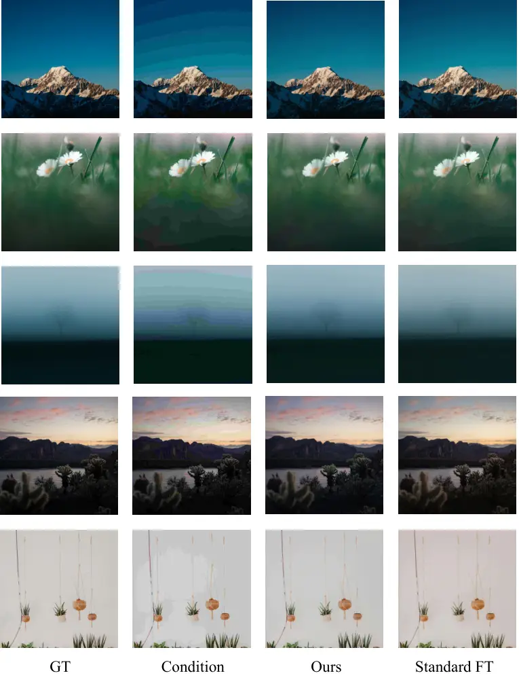

Figure 8: Qualitative comparison for the JPEG restoration task. Our
method reduces color banding quantization artifacts (rows 1-3) and color
shifts (rows 4-5).

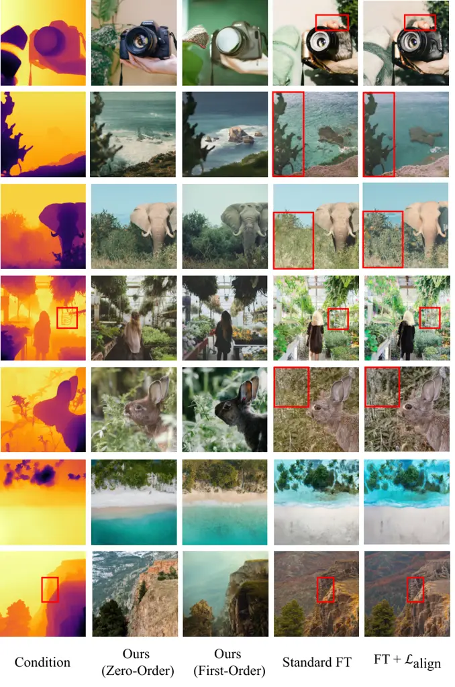

Figure 9: Qualitative comparison for the depth-to-RGB task.

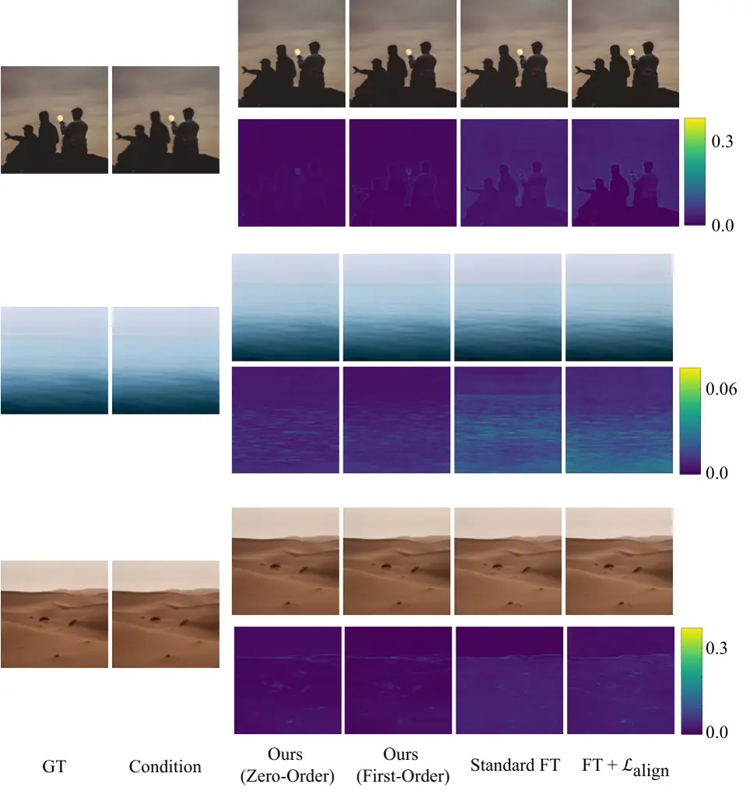

Figure 10: Qualitative comparison for the super-resolution task. Error
maps show per-pixel MAE.

Fidelity Plausibility $`t_{\mathrm{min}}`$ MAE $`\downarrow`$
$`\delta_{1}`$ $`\uparrow`$ FID $`\downarrow`$ 0.8 0.0834 0.7933 17.57
0.5 0.0799 0.7854 21.31

Table 5: Ablation of $`t_{\mathrm{min}}`$ parameter in
$`\mathcal{L}_{\text{align}}`$ baseline on depth task.

Fidelity Plausibility Method PSNR $`\uparrow`$ SSIM $`\uparrow`$ LPIPS
$`\downarrow`$ FID $`\downarrow`$ Standard FT (\*) 34.35*(±2.78)
96.88*(±4.32) 0.83*(±0.43) 3.93    + CFG ($`w=3.0`$) 34.65*(±2.94)
97.23*(±3.29) 0.91*(±0.49) 4.09    + CFG ($`w=5.0`$) 34.07*(±3.02)
97.17*(±2.76) 1.15*(±0.68) 4.57    + $`2\times`$ steps 34.46*(±2.74)
96.93*(±3.84) 0.86*(±0.44) 4.07 Standard FT +
$`\mathcal{L}_{\text{align}}`$ (\*) 35.21*(±2.80) 97.53*(±2.96)
0.79*(±0.36) 4.11    + $`2\times`$ steps 35.11*(±2.81) 97.43*(±2.74)
0.83*(±0.39) 4.10 IT Guidance ($`\lambda=0.1`$) 38.30*(±2.80)
97.20*(±1.91) 1.33*(±1.46) 20.93 IT Guidance ($`\lambda=0.5`$) (\*)
43.02*(±4.85) 98.29*(±3.19) 0.65*(±2.24) 18.96 IT Guidance
($`\lambda=0.5`$, $`2\times`$ steps) 46.05*(±4.91) 98.95*(±2.72)
0.27*(±1.18) 18.87 Zero-order (\*) 39.25*(±2.46) 98.18*(±4.06)
0.21*(±0.11) 3.36    + CFG ($`w=3.0`$) 45.25*(±1.35) 99.08*(±1.68)
0.13*(±0.15) 3.58    + CFG ($`w=5.0`$) 42.61*(±1.61) 98.70*(±1.10)
0.34*(±0.38) 4.20 First-order (w.r.t. $`\mathbf{x}_{t}`$) (\*)
36.27*(±3.95) 97.10*(±4.69) 0.66*(±0.39) 4.30 First-order (w.r.t.
$`\hat{\mathbf{x}}*{1}`$) (\*) 39.21_(±3.85) 97.64_(±5.01) 0.43_(±0.30)
3.83    + CFG ($`w=3.0`$) 45.14_(±2.98) 98.95_(±2.50) 0.17_(±0.17) 4.74
   + CFG ($`w=5.0`$) 44.07_(±2.11) 98.96_(±2.04) 0.33_(±0.55) 6.45
Combined (w.r.t. $`\mathbf{x}_{t}`$) (\*) 39.95_(±2.77) 98.25*(±4.18)
0.21*(±0.12) 3.40    + CFG ($`w=3.0`$) 43.77*(±1.40) 98.79*(±2.58)
0.15*(±0.17) 3.62    + CFG ($`w=5.0`$) 41.43*(±1.57) 98.25*(±2.10)
0.42*(±0.49) 4.39 Combined (w.r.t. $`\hat{\mathbf{x}}_{1}`$) (\*)
39.77*(±2.83) 98.24*(±3.94) 0.23\_(±0.13) 3.39

Table 6: Super resolution results. Asterisks (\*) denote base
configurations compared in the main text. Shaded rows indicate
FlowBender variants.

Fidelity Plausibility Method MAE $`\downarrow`$ $`\delta_{1}`$
$`\uparrow`$ FID $`\downarrow`$ Standard FT (\*) 0.0847*(±0.0593)
0.7886*(±0.1930) 18.21    + CFG ($`w=3.0`$) 0.0814*(±0.0394)
0.8003*(±0.1331) 14.90    + CFG ($`w=5.0`$) 0.0823*(±0.0388)
0.7959*(±0.1333) 15.77    + $`2\times`$ steps 0.0844*(±0.0415)
0.7907*(±0.1381) 16.74 FT + $`\mathcal{L}_{\text{align}}`$ (\*)
0.0837*(±0.0600) 0.7930*(±0.1926) 17.57 IT Guidance ($`\lambda=0.0001`$)
0.1617*(±0.0787) 0.5919*(±0.1986) 23.42 IT Guidance ($`\lambda=0.001`$)
(\*) 0.0866*(±0.0360) 0.7592*(±0.1284) 223.54 IT Guidance
($`\lambda=0.01`$) 0.1385*(±0.0501) 0.6145*(±0.1378) 328.57 Zero-order
(\*) 0.0763*(±0.0563) 0.8188*(±0.1843) 15.70 First-order (w.r.t.
$`\mathbf{x}_{t}`$) (\*) 0.0747*(±0.0535) 0.8268*(±0.1726) 14.57    +
CFG ($`w=3.0`$) 0.0616*(±0.0465) 0.8705*(±0.1474) 14.62    + CFG
($`w=5.0`$) 0.0534*(±0.0422) 0.8961*(±0.1280) 14.76 First-order (w.r.t.
$`\hat{\mathbf{x}}_{1}`$) (\*) 0.0818*(±0.0582) 0.7973*(±0.1933) 15.89
Combined (w.r.t. $`\hat{\mathbf{x}}_{1}`$) (\*) 0.0829*(±0.0610)
0.7949*(±0.1953) 15.93 Combined (w.r.t. $`\mathbf{x}_{t}`$) (\*)
0.0783*(±0.0606) 0.8175*(±0.1878) 15.39

Table 7: Depth-to-RGB generation results. Asterisks (\*) denote base
configurations compared in the main text. Shaded rows indicate
FlowBender variants.

Fidelity Plausibility Method PSNR SSIM LPIPS FID Standard FT (\*)
26.29*(±2.91) 79.45*(±10.59) 22.24*(±5.44) 4.35    + CFG. ($`w=3.0`$)
26.56*(±3.04) 80.32*(±10.18) 21.62*(±5.48) 4.36    + CFG. ($`w=5.0`$)
26.58*(±3.10) 80.85*(±9.89) 21.44*(±5.47) 4.62    + $`2\times`$ steps
26.30*(±3.00) 79.17*(±10.54) 22.59*(±5.58) 4.30 Zero-order (\*)
28.86*(±4.00) 83.13*(±9.64) 16.33*(±4.59) 3.80    + CFG. ($`w=3.0`$)
29.79*(±4.21) 85.58*(±8.50) 14.72*(±4.93) 3.85    + CFG. ($`w=5.0`$)
29.66*(±4.07) 85.83*(±8.02) 16.19\_(±5.95) 4.58

Table 8: JPEG restoration results. Asterisks (\*) denote base
configurations compared in the main text. Shaded rows indicate
FlowBender variants.

Fidelity Plausibility Method Edge MAE $`\downarrow`$ Edge MSE
$`\downarrow`$ FID $`\downarrow`$ Standard FT (\*) 0.0533*(±0.0286)
0.0137*(±0.0087) 13.98    + CFG ($`w=3.0`$) 0.0500*(±0.0286)
0.0137*(±0.0092) 12.41    + CFG ($`w=5.0`$) 0.0513*(±0.0296)
0.0150*(±0.0101) 13.64    $`2\times`$ steps 0.0512*(±0.0285)
0.0134*(±0.0087) 13.17 Standard FT + $`\mathcal{L}_{\text{align}}`$ (\*)
0.0501*(±0.0277) 0.0128*(±0.0087) 14.47 IT Guidance ($`\lambda=0.001`$)
0.0620*(±0.0359) 0.0247*(±0.0167) 23.97 IT Guidance ($`\lambda=0.01`$)
(\*) 0.0416*(±0.0235) 0.0129*(±0.0093) 97.65 Zero-order (\*)
0.0456*(±0.0253) 0.0104*(±0.0072) 14.81 First-order (w.r.t.
$`\mathbf{x}_{t}`$) (\*) 0.0460*(±0.0265) 0.0111*(±0.0077) 14.29
First-order (w.r.t. $`\hat{\mathbf{x}}_{1}`$) (\*) 0.0435*(±0.0294)
0.0123*(±0.0089) 14.97 Combined (w.r.t. $`\mathbf{x}_{t}`$) (\*)
0.0435*(±0.0253) 0.0097*(±0.0072) 13.91 Combined (w.r.t.
$`\hat{\mathbf{x}}_{1}`$) (\*) 0.0408*(±0.0232) 0.0085*(±0.0060) 13.68
   + CFG ($`w=3.0`$) 0.0322*(±0.0201) 0.0057*(±0.0053) 14.62    + CFG
($`w=5.0`$) 0.0320*(±0.0220) 0.0062*(±0.0071) 17.97

Table 9: Edge-to-RGB generation results. Asterisks (\*) denote base
configurations compared in the main text. Shaded rows indicate
FlowBender variants.

#### FlowChef limitations.

While Patel et al. \[45\] show that their inference-time guidance scheme
works for simple forward operators such as inpainting and
super-resolution, we find that FlowChef does not generalize to complex
forward operators such as neural networks. To validate this, we
performed a dense sweep over key hyperparameters, including learning
rate
$`\lambda\in\{1\times 10^{-5},\,2.5\times 10^{-5},\,5\times 10^{-5},\,7.5\times 10^{-5},\,1\times 10^{-4},\,2.5\times 10^{-4},\,5\times 10^{-4},\,1\times 10^{-3},\,5\times 10^{-3},\,1\times 10^{-2},\,2\times 10^{-2},\,5\times 10^{-2},\,1\times 10^{-1},\,5\times 10^{-1},\,1.0\}`$,
the percentage of steps applying guidance ($`80\%,100\%`$), and total
number of steps ($`40,80,100`$). Despite these extensive attempts, we
could not find any setting that resulted in both satisfactory visual
quality and adherence to the conditioning for the Edge and Depth tasks.
We provide qualitative examples of these failures in Fig. 11.

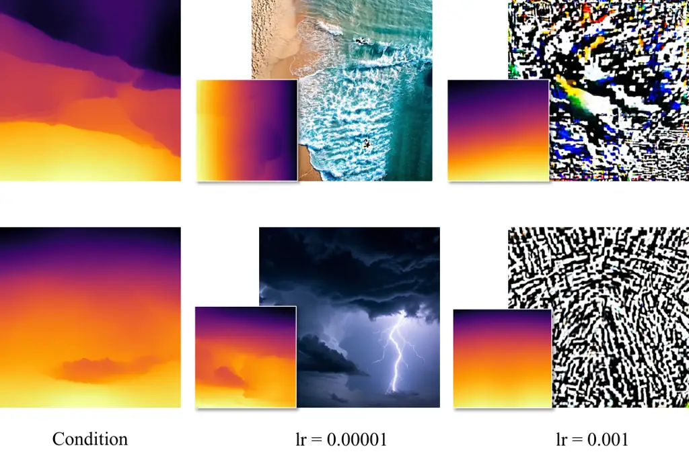

(a) Depth

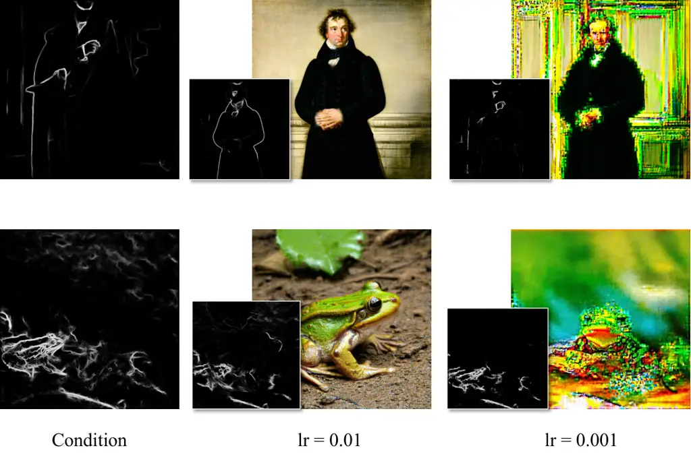

(b) Edge

Figure 11: Qualitative examples of failures of FlowChef for
neural-network forward operators. As the adherence to the condition
improves, shown as insets, the visual quality degrades significantly.

### B.2 3D Mesh Texturing

We present extended results in Tables 10 and 11, additional qualitative
comparisons in Figure 12, and multi-view visualizations in Figure 13.

The patterns observed in image-to-image tasks (Appendix B.1) persist in
the 3D domain (Tables 10 and 11). For open-loop baselines, standard
enhancements like doubling sampling steps or applying CFG prove
suboptimal or even detrimental; for example, applying CFG ($`w=3.0`$) to
Standard FT on Toys4K leads to a 1.57 dB drop in M.PSNR and a
significant plausibility collapse (FID increases from 8.87 to 10.30).
While our proposed CFG scheme for FlowBender (Sec. 4.5) provides further
fidelity and plausibility gains—such as a 1.04 dB M.PSNR and 0.65 FID
improvement on Toys4K—we emphasize that FlowBender without any explicit
guidance already significantly outperforms baselines using doubled
sampling budgets or CFG. This indicates that while FlowBender can
effectively leverage optional user-controlled test-time guidance, its
primary strength lies in the learned correction policy which
internalizes the feedback signal.

Fidelity Plausibility Method M. PSNR $`\uparrow`$ SSIM $`\uparrow`$
LPIPS $`\downarrow`$ CLIP $`\uparrow`$ MV-M.PSNR $`\uparrow`$ MV-SSIM
$`\uparrow`$ MV-LPIPS $`\downarrow`$ MV-CLIP $`\uparrow`$ FID
$`\downarrow`$ IT Guidance (\*) 25.87$`\pm`$3.7 0.986$`\pm`$0.015
0.0191$`\pm`$0.0250 0.973$`\pm`$0.029 22.79$`\pm`$5.7 0.989$`\pm`$0.011
0.0124$`\pm`$0.0113 0.968$`\pm`$0.024 9.10    + $`2\times`$ steps
27.05$`\pm`$3.5 0.988$`\pm`$0.013 0.0174$`\pm`$0.0231 0.978$`\pm`$0.026
23.47$`\pm`$5.9 0.990$`\pm`$0.011 0.0122$`\pm`$0.0114 0.969$`\pm`$0.026
8.70    + $`s=0.5`$ 26.77$`\pm`$3.2 0.987$`\pm`$0.015
0.0218$`\pm`$0.0276 0.970$`\pm`$0.035 23.04$`\pm`$6.7 0.989$`\pm`$0.011
0.0136$`\pm`$0.0130 0.966$`\pm`$0.025 10.11 Standard FT (\*)
21.91$`\pm`$3.8 0.981$`\pm`$0.020 0.0189$`\pm`$0.0178 0.970$`\pm`$0.022
23.05$`\pm`$6.3 0.990$`\pm`$0.012 0.0116$`\pm`$0.0114 0.970$`\pm`$0.022
8.74    + CFG ($`w=3`$) 20.41$`\pm`$4.4 0.980$`\pm`$0.023
0.0217$`\pm`$0.0215 0.961$`\pm`$0.030 21.06$`\pm`$5.5 0.988$`\pm`$0.015
0.0134$`\pm`$0.0136 0.963$`\pm`$0.024 10.11    + CFG ($`w=5`$)
19.45$`\pm`$4.8 0.975$`\pm`$0.034 0.0255$`\pm`$0.0273 0.952$`\pm`$0.042
19.83$`\pm`$5.0 0.986$`\pm`$0.020 0.0158$`\pm`$0.0167 0.955$`\pm`$0.029
12.53    + $`2\times`$ steps 21.68$`\pm`$3.9 0.980$`\pm`$0.021
0.0194$`\pm`$0.0184 0.970$`\pm`$0.022 22.77$`\pm`$6.5 0.989$`\pm`$0.012
0.0120$`\pm`$0.0117 0.969$`\pm`$0.022 8.81 FT +
$`\mathcal{L}_{\text{align}}`$    $`\lambda=10^{-3}`$ 22.49$`\pm`$3.8
0.983$`\pm`$0.017 0.0182$`\pm`$0.0162 0.971$`\pm`$0.021 22.89$`\pm`$6.4
0.990$`\pm`$0.011 0.0116$`\pm`$0.0110 0.970$`\pm`$0.021 8.79
   $`\lambda=5\times 10^{-3}`$ (\*) 22.63$`\pm`$3.6 0.983$`\pm`$0.018
0.0182$`\pm`$0.0160 0.970$`\pm`$0.023 22.48$`\pm`$5.3 0.990$`\pm`$0.011
0.0117$`\pm`$0.0110 0.969$`\pm`$0.021 8.94    $`\lambda=10^{-2}`$
21.75$`\pm`$4.2 0.981$`\pm`$0.018 0.0193$`\pm`$0.0157 0.969$`\pm`$0.024
21.73$`\pm`$6.0 0.988$`\pm`$0.012 0.0127$`\pm`$0.0112 0.966$`\pm`$0.023
9.64 Ours (w.r.t. $`\mathbf{x}_{t}`$) (\*) 25.26$`\pm`$3.9
0.985$`\pm`$0.017 0.0157$`\pm`$0.0152 0.979$`\pm`$0.017 25.91$`\pm`$7.2
0.991$`\pm`$0.011 0.0105$`\pm`$0.0109 0.974$`\pm`$0.021 7.41 Ours
(w.r.t. $`\hat{\mathbf{x}}_{1}`$) (\*) 26.40$`\pm`$3.8 0.987$`\pm`$0.016
0.0140$`\pm`$0.0142 0.983$`\pm`$0.014 26.53$`\pm`$7.2 0.992$`\pm`$0.010
0.0098$`\pm`$0.0101 0.977$`\pm`$0.019 6.64    + CFG ($`w=3`$)
27.02$`\pm`$5.1 0.989$`\pm`$0.013 0.0124$`\pm`$0.0128 0.986$`\pm`$0.017
25.85$`\pm`$7.2 0.992$`\pm`$0.010 0.0096$`\pm`$0.0100 0.978$`\pm`$0.018
6.25    + CFG ($`w=5`$) 26.35$`\pm`$5.6 0.989$`\pm`$0.012
0.0139$`\pm`$0.0153 0.983$`\pm`$0.023 24.43$`\pm`$7.2 0.991$`\pm`$0.011
0.0109$`\pm`$0.0111 0.973$`\pm`$0.022 7.35

Table 10: Extended Quantitative Results for 3D Texturing (Objaverse).
Asterisks (\*) denote configurations included in the main text
comparisons. Shaded rows indicate FlowBender variants.

Fidelity Plausibility Method M. PSNR $`\uparrow`$ SSIM $`\uparrow`$
LPIPS $`\downarrow`$ CLIP $`\uparrow`$ MV-M.PSNR $`\uparrow`$ MV-SSIM
$`\uparrow`$ MV-LPIPS $`\downarrow`$ MV-CLIP $`\uparrow`$ FID
$`\downarrow`$ IT Guidance (\*) 26.82$`\pm`$3.2 0.990$`\pm`$0.009
0.0137$`\pm`$0.0136 0.982$`\pm`$0.017 23.63$`\pm`$4.2 0.992$`\pm`$0.008
0.0112$`\pm`$0.0111 0.972$`\pm`$0.020 8.43    + $`2\times`$ steps
27.95$`\pm`$3.2 0.991$`\pm`$0.008 0.0127$`\pm`$0.0125 0.984$`\pm`$0.016
24.42$`\pm`$4.7 0.992$`\pm`$0.009 0.0111$`\pm`$0.0110 0.973$`\pm`$0.020
7.90    + $`s=0.5`$ 28.02$`\pm`$3.4 0.991$`\pm`$0.009
0.0163$`\pm`$0.0195 0.975$`\pm`$0.030 23.94$`\pm`$5.2 0.991$`\pm`$0.008
0.0120$`\pm`$0.0116 0.970$`\pm`$0.020 9.00 Standard FT (\*)
23.00$`\pm`$4.2 0.986$`\pm`$0.014 0.0160$`\pm`$0.0164 0.975$`\pm`$0.024
24.38$`\pm`$6.9 0.991$`\pm`$0.010 0.0114$`\pm`$0.0118 0.972$`\pm`$0.021
8.87    + CFG ($`w=3`$) 21.43$`\pm`$4.4 0.985$`\pm`$0.015
0.0182$`\pm`$0.0177 0.968$`\pm`$0.023 21.26$`\pm`$4.9 0.990$`\pm`$0.010
0.0130$`\pm`$0.0124 0.965$`\pm`$0.023 10.30    + CFG ($`w=5`$)
20.55$`\pm`$4.6 0.984$`\pm`$0.016 0.0210$`\pm`$0.0214 0.963$`\pm`$0.025
20.32$`\pm`$4.9 0.989$`\pm`$0.011 0.0151$`\pm`$0.0149 0.960$`\pm`$0.027
12.41    + $`2\times`$ steps 22.66$`\pm`$4.3 0.986$`\pm`$0.015
0.0163$`\pm`$0.0161 0.975$`\pm`$0.024 23.04$`\pm`$6.3 0.990$`\pm`$0.010
0.0118$`\pm`$0.0118 0.971$`\pm`$0.020 8.75 FT +
$`\mathcal{L}_{\text{align}}`$    $`\lambda=10^{-3}`$ 23.01$`\pm`$4.1
0.986$`\pm`$0.014 0.0162$`\pm`$0.0173 0.975$`\pm`$0.023 23.39$`\pm`$5.3
0.991$`\pm`$0.010 0.0114$`\pm`$0.0124 0.972$`\pm`$0.022 7.99
   $`\lambda=5\times 10^{-3}`$ (\*) 23.05$`\pm`$4.0 0.986$`\pm`$0.014
0.0159$`\pm`$0.0162 0.976$`\pm`$0.023 23.24$`\pm`$5.0 0.991$`\pm`$0.009
0.0111$`\pm`$0.0112 0.973$`\pm`$0.022 8.30    $`\lambda=10^{-2}`$
22.79$`\pm`$4.2 0.986$`\pm`$0.015 0.0168$`\pm`$0.0169 0.975$`\pm`$0.024
23.16$`\pm`$5.7 0.990$`\pm`$0.010 0.0119$`\pm`$0.0116 0.971$`\pm`$0.022
8.60 Ours (w.r.t. $`\mathbf{x}_{t}`$) (\*) 26.54$`\pm`$4.2
0.990$`\pm`$0.011 0.0129$`\pm`$0.0140 0.980$`\pm`$0.024 27.20$`\pm`$8.1
0.993$`\pm`$0.008 0.0097$`\pm`$0.0104 0.977$`\pm`$0.020 7.20 Ours
(w.r.t. $`\hat{\mathbf{x}}_{1}`$) (\*) 27.26$`\pm`$4.4 0.991$`\pm`$0.010
0.0116$`\pm`$0.0125 0.984$`\pm`$0.022 27.21$`\pm`$7.5 0.993$`\pm`$0.008
0.0092$`\pm`$0.0100 0.978$`\pm`$0.021 6.66    + CFG ($`w=3`$)
28.30$`\pm`$4.0 0.993$`\pm`$0.006 0.0099$`\pm`$0.0102 0.990$`\pm`$0.010
26.18$`\pm`$6.7 0.993$`\pm`$0.008 0.0093$`\pm`$0.0102 0.979$`\pm`$0.018
6.01    + CFG ($`w=5`$) 27.44$`\pm`$4.8 0.992$`\pm`$0.007
0.0114$`\pm`$0.0120 0.986$`\pm`$0.017 24.26$`\pm`$6.7 0.992$`\pm`$0.008
0.0109$`\pm`$0.0120 0.974$`\pm`$0.022 7.53

Table 11: Extended Quantitative Results for 3D Texturing (Toys4K).
Asterisks (\*) denote base configurations compared in the main text.
Shaded rows indicate FlowBender variants.

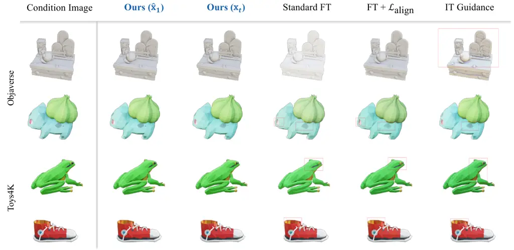

Figure 12: 3D Mesh Texturing Results (Objaverse, Toys4K).

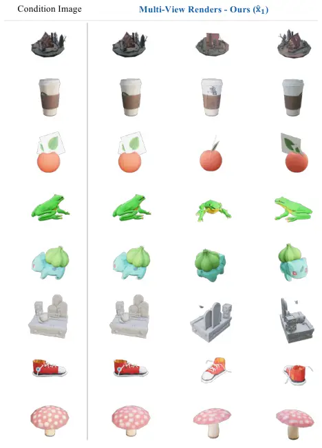

Figure 13: Multi-view visualizations of textured objects (Objaverse,
Toys4K).
