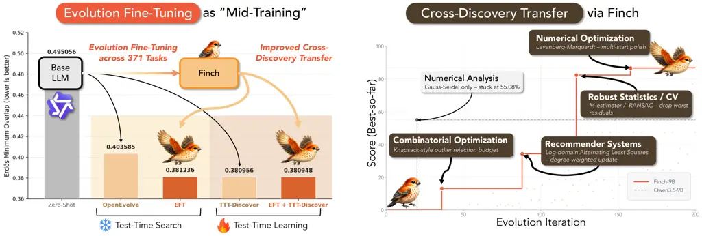
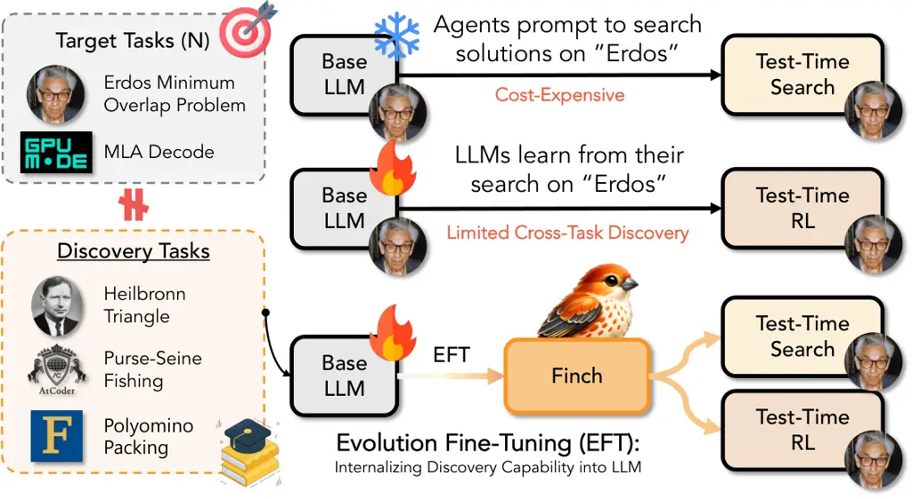
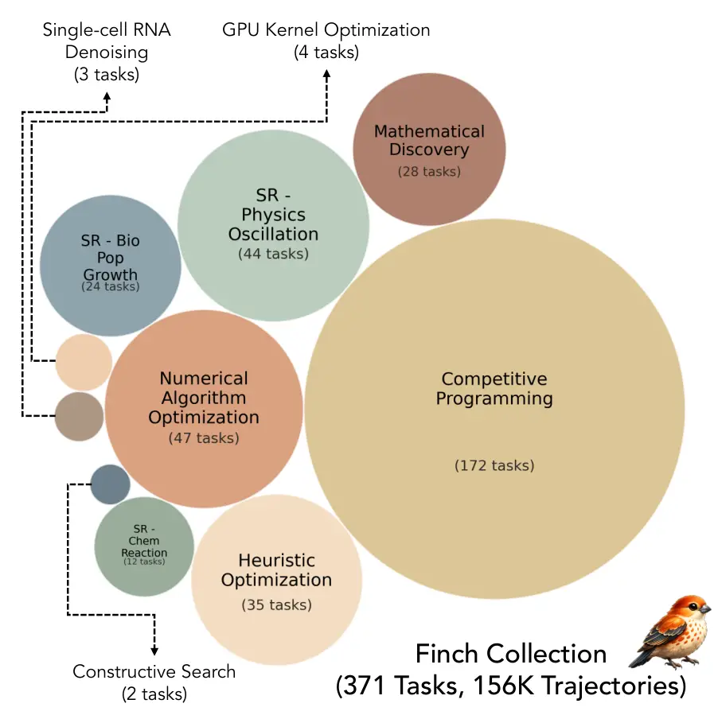
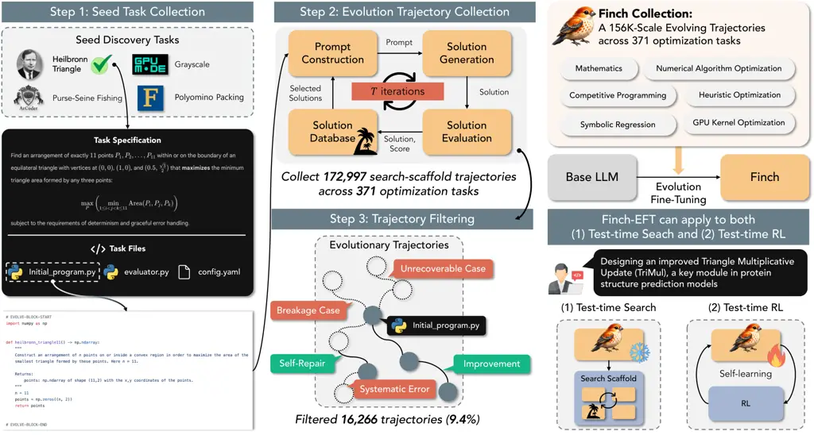
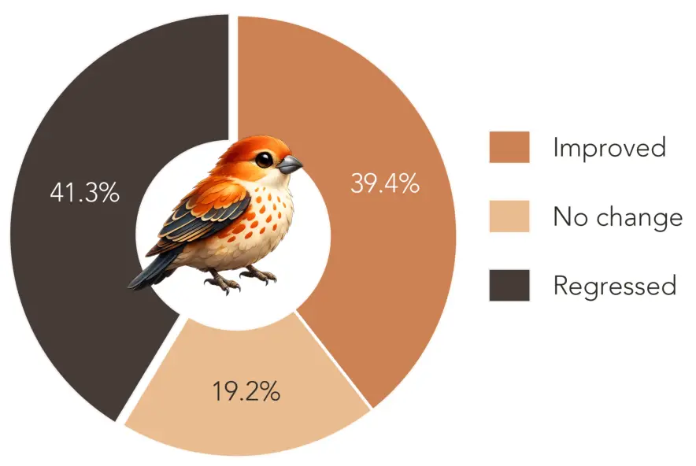
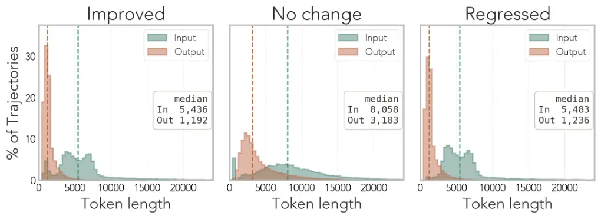
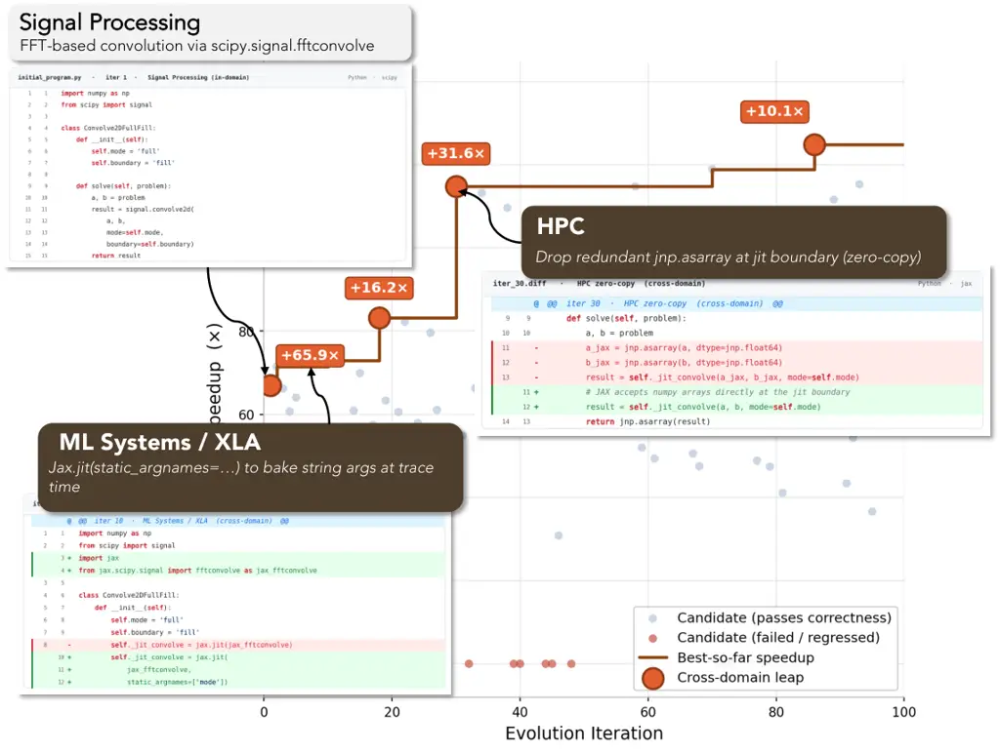

# Evolution Fine-Tuning: Learning to Discover Across 371 Optimization Tasks

Young-Jun Lee Affiliation: University of Minnesota    Seungone Kim
Affiliation: Carnegie Mellon University    Minki Kang Affiliation: KAIST
   Alistair Cheong Affiliation: Carnegie Mellon University    Zerui Chen
Affiliation: University of Cambridge    Seungho Han Affiliation: Hanyang
University    Taehee Jung ^(†)^(†)thanks: This work is independent of
the author’s position at Amazon and does not relate to any work
conducted at Amazon. Affiliation: Amazon    Dongyeop Kang
Affiliation: University of Minnesota

###### Abstract

Would experience designing faster GPU kernels also help close in on a
long-standing open mathematical conjecture? Large Language Models (LLMs)
integrated into evolutionary search have recently produced
state-of-the-art solutions on optimization tasks, including open
mathematical conjectures, GPU kernel design, scientific law discovery,
and combinatorial puzzles. To achieve this, prior work applied search
scaffolds to one target task at a time, so every new problem is
approached from scratch and the experience accumulated during search is
discarded once the model finishes its attempt. This leaves the
capability of iteratively evolving a solution (e.g., knowing which part
to mutate and how, deciding when to backtrack) entirely in the scaffold
rather than in the model itself. Whether the model itself could acquire
this capability and reuse it across different tasks has been largely
unexamined. To address this, we introduce Evolution Fine-Tuning (EFT), a
mid-training paradigm that teaches LLMs to evolve solutions across tasks
by converting evolutionary search trajectories into supervision. We
construct $`\mathcal{F}`$inch Collection, a 156K-trajectory dataset
spanning 10 domains and 371 optimization tasks, and fine-tune
open-source LLMs from 2B to 9B parameters. Empirically, EFT confers
cross-task generalization: across 22 held-out tasks, our models surpass
their base counterparts by 10.22% on average. Furthermore, when paired
with test-time RL, our model matches state-of-the-art performance on two
circle-packing tasks and outperforms its base-model counterpart on the
Erdős minimum-overlap problem. EFT thus serves as a “practice phase” for
general-purpose discovery agents that do not solve new problems from
scratch.



Figure 1: (Left) Evolution Fine-Tuning (EFT) serves as “mid-training”,
boosting $`\mathcal{F}`$inch’s discovery capability on the Erdős minimum
overlap problem under both test-time search and learning. (Right) On
NP-hard competitive programming (CALICO, UC Berkeley contest), EFT
enables cross-discovery transfer: $`\mathcal{F}`$inch solves problems by
combining strategies acquired from diverse domains, such as
combinatorial optimization, recommender systems, robust
statistics/computer vision, and numerical optimization. In contrast, the
base model without EFT relies on a single, repetitive strategy.

## 1 Introduction

Some of the most consequential problems in mathematics, algorithm
engineering, and the natural sciences are optimization tasks: problems
for which a candidate solution can be scored against an objective, but
for which the optimal solution is not directly computable \[1\].
Concrete examples include open mathematical conjectures such as the
Erdős minimum-overlap problem \[2, 3\], the design of high-performance
GPU kernels \[4\], and the discovery of new scientific laws from
data \[5\].

Recently, large language models (LLMs) combined with evolutionary search
methods have begun to produce state-of-the-art solutions across such
tasks: at each iteration, the LLM proposes new candidate solutions, a
scaffold scores them and updates a population of high-scoring
candidates, and the loop continues until a strong solution emerges \[6,
7, 8\]. Two methodological branches dominate this line of work: (1)
_Test-time search_ methods use a fixed, typically proprietary LLM as the
mutation operator and rely on the scaffold’s parent selection and
prompting logic to drive improvement \[9, 10, 11, 12\]. (2) _Test-time
learning_ methods additionally update the LLM’s weights during the
search process, allowing the model to specialize to the target task as
it explores \[13, 14\].

Despite empirical successes, both branches share a common limitation:
the discovery capability (i.e., the skill of iteratively improving a
solution, knowing what to mutate, what to keep, and when to backtrack)
is constructed during each search rather than internalized into the
model itself. Specifically,

1.  1.  Test-time search methods often rely on proprietary, frontier-scale
        LLMs as their mutation operator, because the scaffold demands
        consistent, high-quality proposals at every iteration. In our
        experiments, we observe that open-source models smaller than 9B
        parameters fail to follow evolutionary trajectories within such
        scaffolds and yield substantially weaker performance (Figure 1,
        left).
2.  2.  Test-time learning methods alleviate this by allowing smaller LLMs
        to adapt their weights based on their own search experience, and
        have produced new best-known solutions on several mathematical
        problems \[13, 14\]. However, these updates are tailored to a single
        search loop and a single task; the strategies the model discovers
        are not consolidated into reusable capability, so the model cannot
        compose strategies from prior tasks when tackling a new one
        (Figure 1, right).
3.  3.  More fundamentally, in neither branch does the model itself acquire
        the evolving capability. Test-time search-based methods do not
        update the model at all, leaving the capability in the search
        procedure by design. Test-time learning-based methods update the
        model through test-time RL, but the updates serve to find a solution
        within a single search loop rather than to internalize the discovery
        capability itself, and they are discarded once the task is solved.

One promising direction to address these limitations is to have the LLM
itself meta-learn the discovery capability (i.e., learning how to evolve
solutions across optimization tasks). The core challenge in doing so is
that optimization tasks are NP-hard and lack ground truth optimal
solutions, making the standard supervised learning recipe of collecting
(problem, answer) pairs unavailable. To circumvent this, we propose
Evolution Fine-Tuning (EFT), a mid-training paradigm that treats the
trajectories of search runs as the supervision signal, thereby
internalizing the discovery capability into the model itself. We
construct $`\mathcal{F}`$inch Collection, a large-scale dataset of 156K
such trajectories collected using a widely used search scaffold, i.e.,
OpenEvolve \[15\], and a recent large model, Qwen3.5-397B-A17B \[16\],
across 10 domains and 371 tasks. Using $`\mathcal{F}`$inch Collection,
we fine-tune open-source models from 2B to 9B, and obtain a new model
family, ![[Uncaptioned
image]](arxiv-2606-29082--0801015d4165.figures/figure-2.webp)$`\mathcal{F}`$inch-{2,
4, 8, 9}B.



Figure 2: A Concept of Evolution Fine-Tuning (EFT)

To demonstrate the cross-task generalization conferred by
$`\mathcal{F}`$inch Collection, we first employ $`\mathcal{F}`$inch as
mutation operators in test-time search scaffolds. $`\mathcal{F}`$inch
outperforms its base counterparts on 22 held-out tasks and achieves
performance comparable to best-known solutions previously obtained by a
proprietary model, despite using a much smaller open-source backbone.
Notably, as shown in Figure 1 (right), when solving a competitive
programming task, we observe that while base LLM tends to apply only
in-domain strategy (i.e., Gauss-Seidel uniform weight),
$`\mathcal{F}`$inch transfers strategies across domains (e.g., applying
log-domain alternating least squares from recommender system,
Levenberg-Marquardt from numerical optimization to solve a competitive
programming problem), suggesting that EFT gives rise to emergent
behaviors in discovery tasks. Furthermore, scaling the number of
training tasks in $`\mathcal{F}`$inch Collection from 15 to 355 improves
$`\mathcal{F}`$inch’s held-out performance by 14.1% on average across
held-out tasks. Finally, to assess whether $`\mathcal{F}`$inch can also
learn from its own search experience, we apply test-time learning to
both $`\mathcal{F}`$inch (i.e., w/ EFT) and base LLMs (i.e., w/o EFT) on
three tasks. We find that $`\mathcal{F}`$inch achieves state-of-the-art
performance on two circle packing tasks and outperforms its base-model
counterpart on the Erdős Minimum Overlap Problem.

## 2 Preliminaries

#### Optimization setup.

We consider an optimization task $`\tau\in\mathcal{T}`$ with an initial
candidate solution $`x_{0}`$ and an iteration budget $`T`$. The
candidate set generated during search is denoted by
$`\mathcal{X}=\{x_{0},\ldots,x_{T}\}`$, where $`x_{0}`$ may be a program
\[7\], math construction \[17\], or prompt \[15\], depending on the
task. At iteration $`t`$, an evolutionary scaffold $`\mathcal{S}`$ uses
a mutation operator $`\mathcal{M}_{\theta}`$, typically an LLM, to
produce a new candidate from the parent solution and search history:
$`x_{t}=\mathcal{S}(x_{t-1},I,\mathcal{H}_{t-1};\mathcal{M}_{\theta})`$,
where $`\mathcal{H}_{t-1}`$ contains selected prior candidates and
feedback. An evaluator $`\mathcal{E}`$ assigns a score and auxiliary
artifacts such as logs or natural-language feedback. The goal is

```math
x^{\star}=\argopt_{x\in\mathcal{X}}\mathcal{E}(x),\qquad\mathrm{opt}\in\{\max,\min\}, \tag{1}
```

where the optimization direction is determined by task: $`\max`$ for
accuracy and $`\min`$ for c5 bound in Erdos problem.

Table 1: Comparison of evolutionary methods. Scaffold indicates whether
the method provides search or learning support for evolution. Train and
Test denote scaffolding at training or test time, respectively. OS
denotes open sourcing.

Method Main Contribution Scaffold Training OS Search Learn Train Test
Paradigm \#Tasks AlphaEvolve \[7\] Search ✓ ✗ ✗ ✗ – – ✗
OpenEvolve \[15\] Search ✓ ✗ ✗ ✗ – – ✓ ShinkaEvolve \[8\] Search ✓ ✗ ✗ ✗
– – ✓ GEPA \[18\] Search ✓ ✗ ✗ ✗ – – ✓ PAC-Evolve \[10\] Search ✓ ✗ ✗ ✗
– – ✗ AdaEvolve \[11\] Search ✓ ✗ ✗ ✗ – – ✓ EvoX \[12\] Search ✓ ✗ ✗ ✗ –
– ✓ DGM \[19\] Search ✓ ✗ ✗ ✗ – – ✓ HyperAgent \[20\] Search ✓ ✗ ✗ ✗ – –
✓ CORAL \[21\] Search ✓ ✗ ✗ ✗ – – ✓ ThetaEvolve \[13\] Learning ✗ ✓ ✗ ✓
RL 1 ✓ TTT-Discover \[14\] Learning ✗ ✓ ✗ ✓ RL 1 ✓ EFT (Ours) Model,
data ✓ ✓ ✓ ✓ SFT, RL 371 ✓



Figure 3: An overview of the optimization task groups (a total of 371
tasks) in $`\mathcal{F}`$inch Collection, where bubble size indicates
the number of tasks in each group.

#### Discovery.

Following prior work \[14\], we call $`x^{\star}`$ a discovery if it
improves upon the previous best-known solution $`x_{\mathrm{sota}}`$
within budget $`T`$, i.e.,
$`\mathcal{E}(x^{\star})>\mathcal{E}(x_{\mathrm{sota}})`$ for
maximization tasks, with the inequality reversed for minimization tasks.

#### Evolutionary Search Scaffold.

To discover novel solutions $`\tau`$, existing LLM-based evolutionary
methods use either search-based or learning-based scaffolds.
Search-based scaffolds keep $`\theta`$ fixed and rely on external search
mechanisms, while learning-based scaffolds update $`\theta`$ at test
time. Both approaches are fundamentally built upon four core modular
components: (i) construct a prompt from the parent solution, task
instruction, history, and feedback; (ii) generate a candidate using
$`\mathcal{M}_{\theta}`$ through either diff-based edit or full rewrite;
(iii) evaluate the candidate with $`\mathcal{E}`$; and (iv) store
eligible candidates in a population database $`\mathcal{D}`$. The
updated database $`\mathcal{D}_{t}`$ then informs the next iteration
until the compute budget or target score is reached. We summarize
existing evolutionary methods in Tab 3.

## 3 Evolution Fine-Tuning

Evolutionary scaffolds can discover strong solutions at test time, but
the discovery procedure is typically external to the model. We introduce
Evolution Fine-Tuning (EFT), a mid-training procedure that transfers
this test-time discovery behavior into smaller open-source LLMs. EFT
converts evolutionary search trajectories into supervised training
examples, so that the model learns to act as a stronger mutation
operator before deployment. As summarized in Table 3, EFT is orthogonal
to the choice of test-time scaffold: the resulting model can be used
inside search-based scaffolds with frozen weights, or further adapted by
learning-based scaffolds such as test-time RL.



Figure 4: Overview of the $`\mathcal{F}`$inch Collection construction
pipeline, consisting of (1) seed optimization task collection, (2)
trajectory collection via an evolutionary search scaffold (i.e.,
OpenEvolve \[15\]), and (3) trajectory filtering for unrecoverable
cases, breakage cases, and candidate solutions that incur systematic
errors (e.g., timeout errors).

### 3.1 $`\mathcal{F}`$inch Collection Construction

#### Overview.

Figure 4 illustrates the construction of $`\mathcal{F}`$inch Collection.
Each task consists of a task specification, an initial candidate
solution, an evaluator, and configuration files. We run an evolutionary
scaffold over these task files to produce a sequence of parent-to-child
solution transitions. Each transition records the prompt, parent
solution, generated candidate, evaluator output, score change, and
execution artifacts. We then remove trajectories whose feedback is
unreliable or whose transitions would provide misleading supervision.
The final collection contains approximately 156K evolutionary
trajectories across 371 optimization tasks.

#### Step 1: Seed Optimization Task Collection.

Training data for optimization is difficult to synthesize because many
target problems are NL-hard, lack known global optima, and require
expert-designed evaluators (see Table 8 in Appendix B). Instead of
generating artificial tasks, we source seed tasks from existing
optimization benchmarks whose objectives are executable and externally
validated. We select tasks according to three criteria: (i) the task
should require nontrivial search, (ii) should not reduce to matching a
known ground-truth answer, and (iii) should provide a deterministic
evaluator that assigns a continuous or comparable score to candidate
solutions.

In total, as shown in Figure 3, we collect 371 seed tasks from 10
benchmarks, spanning from mathematical discovery, competitive
programming, heuristic optimization, numerical algorithm optimization,
symbolic regression, GPU kernel optimization, constructive search, and
biological denoising benchmarks. These include AlphaEvolve’s
mathematical discovery problems \[7\], FrontierCS \[22\],
ALE-Bench \[17\], AlgoTune \[23\], GPU Mode \[24\], LLM-SRBench \[5\],
Function Minimization and K-Module tasks from OpenEvolve \[15\],
scRNA-seq denoising \[25, 14\], and variants of Erdős problems \[26,
27\]. The full task list is provided in Appendix E.

#### Step 2: Evolutionary Trajectory Collection.

For each seed task $`\tau`$, we run an evolutionary scaffold
$`\mathcal{S}`$ for a fixed budget of iterations. At iteration $`t`$,
the scaffold selects a parent solution $`x_{t-1}`$ and constructs a
prompt from the task instruction $`I`$, the parent, the search history
$`\mathcal{H}_{t-1}`$, and evaluator artifacts. For each task,
$`N_{\tau}`$ trajectories are generated where $`N_{\tau}<T`$, where
trajectories flagged as errors are discarded. A teacher mutation
operator $`\mathcal{M}_{\theta}`$ then generates a candidate solution
$`x_{t}`$, which is executed by the task evaluator $`\mathcal{E}`$. The
resulting trajectory stores
$`(I,x_{t-1},\mathcal{H}_{t-1},x_{t},\mathcal{E}(x_{t}),\mathcal{F}_{t})`$,
where $`\mathcal{F}_{t}`$ includes execution logs, error traces, and
evaluator feedback.

We instantiate $`\mathcal{M}`$ with OpenEvolve \[15\] and use
Qwen3.5-397B-A17B \[16\] as the teacher mutation operator. To expose the
student model to both local refinement and global exploration, we
collect trajectories under two mutation strategies: diff-based edit and
full rewrite. The diff-based edit strategy asks the model to edit an
existing solution and therefore emphasizes exploitation, while full
rewrite asks the model to rewrite the solution and therefore encourages
broader exploration. For diversity, we run the scaffold multiple times
per task with stochastic decoding. Unless otherwise specified, we use
temperature $`0.7`$, top-$`p=0.95`$, and a maximum generation length of
30K tokens. In total, we obtain 172,997 trajectories.

#### Step 3: Trajectory Filtering.

Raw evolutionary traces contain failures that should not be imitated.
From 172,997 raw trajectories, we retain 156,731 (90.6%) by applying the
following criteria:

- •
  First, we remove systematic errors, where the evaluator output is
  unreliable or the score delta cannot be computed, removing 6,321
  trajectories (3.7%) in total. Examples include missing parent scores
  (57.5%), timeout errors (14.2%), syntax-check failures, import
  failures, and evaluator crashes. The complete list of systematic
  errors is provided in Table 9.
- •
  Second, we remove unrecoverable & breakage cases: Unrecoverable cases
  are both parent and child solutions are erroneous (294; 0.2%), and
  breakage cases are an error-free parent yields an erroneous child
  (1,281; 0.8%). Both constitute hard negatives, destabilizing the
  training signal.
- •
  Lastly, we remove excessively long inputs, to keep training stable and
  tractable. We dsicard responses longer than 16,384 tokens and examples
  whose total serialized input-output length exceeds 32,768 tokens,
  removing 8,370 (5.0%).

After filtering, $`\mathcal{F}`$inch Collection contains approximately
156K trajectories across 371 tasks.



Model Erdos ($`\downarrow`$) AC1 ($`\downarrow`$) AC2 ($`\uparrow`$)
Qwen3-8B 0.403585 1.5177 0.8980 +  Imp  0.381236 1.5154 0.9001 +
 Imp  +  NC  +  Reg  0.492126 1.5186 0.8789

Figure 5: Distribution of trajectory improvement in $`\mathcal{F}`$inch
Collection.

Table 2: Effect of improvement type on EFT.

Each retained trajectory is converted into a supervised fine-tuning
instance. The input consists of the same information available to the
mutation operator inside the scaffold: the task instruction, parent
solution, selected history, previous scores, and evaluator artifacts.
The target output is the teacher-generated candidate solution. This
format directly trains the model to map an evolutionary state to a
plausible next mutation:
$`(I,x_{t-1},\mathcal{H}_{t-1},\mathcal{F}_{t-1})\mapsto x_{t}`$.

When task scores are available, we classify each trajectory based on its
improvement outcome ($`\Delta`$), i.e.,
$`\Delta=\mathcal{E}(x_{t})-\mathcal{E}(x_{t-1})`$, into three
categories: $`\Delta>0`$ ( Imp ), $`\Delta=0`$ ( NC ), and $`\Delta<0`$
( Reg ). As shown in Figure 2, this yields 61,802 (39.4%)  Imp , 30,130
(19.2%)  NC , and 64,799 (41.3%)  Reg  trajectories. In this work, we
primarily use  Imp  trajectories for evolution fine-tuning to prevent
$`\mathcal{F}`$inch from imitating non-improving behaviors due to  Reg ,
as shown in Table 2. Furthermore, to enable $`\mathcal{F}`$inch to learn
how to evolve parent programs effectively within the solution space, we
leverage both  Imp  and  Reg  trajectories through a preference learning
algorithm (i.e., KTO \[28\]) ¹¹ 1 To maximize the contrastive signal
that guides $`\mathcal{F}`$inch toward self-judging which solutions are
promising and which fall short, we restrict KTO training to  Imp  and
 Reg  in this work. Nevertheless, we believe  NC  is also a valuable
resource for internalizing discovery capability, as suggested in
Table 8.. Consequently, our $`\mathcal{F}`$inch Collection provides a
comprehensive set of improvement trajectories, serving as a valuable
resource for internalizing discovery capabilities into LLMs.

| Task Group                       | \# Tasks | \# Traj. |
| -------------------------------- | -------- | -------- |
| Competitive Programming          | 172      | 43,469   |
| Numerical Algorithm Optimization | 47       | 4,835    |
| SR Physics Oscillation           | 44       | 51,210   |
| Heuristic Optimization           | 35       | 5,924    |
| Mathematical Discovery           | 28       | 6,508    |
| SR Bio Pop Growth                | 24       | 28,034   |
| SR Chem Reaction                 | 12       | 13,975   |
| GPU Kernel Optimization          | 4        | 1,088    |
| Single cell RNA Denoising        | 3        | 503      |
| Constructive Search              | 2        | 1,185    |
| Total                            | 371      | 156,731  |

(a) Tasks and trajectories by task group

| Language                                                         | Ratio | Mutation        | Ratio |
| ---------------------------------------------------------------- | ----- | --------------- | ----- |
|  Python | 68.5% | diff-based edit | 50.3% |
|  C++    | 31.5% | full rewrite    | 49.7% |

(b) Languages and mutation strategies



(c) Trajectory length distribution by improvement type

(d) Top 20% packages used in initial program

Figure 6: Dataset composition and trajectory characteristics. (a) Number
of tasks and trajectories for each task group. (b) Programming language
and mutation strategy proportions across trajectories. (c) Distribution
of trajectory lengths by improvement type ( Imp ,  NC , and  Reg ). (d)
Top-20% packages used in initial programs.

### 3.2 Analysis of $`\mathcal{F}`$inch Collection

Overall, $`\mathcal{F}`$inch Collection contains 156,731 (~156K)
evolutionary search trajectories, covering 371 tasks across 10 task
groups. As shown in Figure 6 (a), Competitive Programming occupies the
largest share with 172 individual tasks and is derived from
FrontierCS \[22\], followed by Numerical Algorithm Optimization, which
builds upon ALE-Bench \[17\]. In Figure 6 (b), 68.5% of trajectories in
$`\mathcal{F}`$inch Collection are based on Python, with a considerable
portion in C++ (31.5%). Regarding mutation strategy, $`\mathcal{F}`$inch
Collection exhibits a well-balanced distribution between diff-based edit
(50.3%) and full rewrite (49.7%). Together, these statistics suggest
that models trained on $`\mathcal{F}`$inch Collection acquire
optimization capabilities across both Python and C++, as well as
proficiency in both diff-based edit and full rewrite strategies.
Moreover, Figure 6 (c) shows that the input length (avg. 8,902 tokens)
is substantially longer than the output length (avg. 6,865 tokens,
1.3$`\times`$), indicating that $`\mathcal{F}`$inch learns to optimize
parent programs by selectively leveraging useful feedback signals from a
large context of prior programs. In addition, within  NC , the median
output length is 2.9$`\times`$ longer, suggesting that Qwen3.5-397B-A17B
tends to engage in more extensive reasoning even when no improvement is
achieved. Meanwhile, the output length in  Reg  trajectories is
comparable to that in  Imp  ones, implying that regressions arise not
from insufficient reasoning, but from misguided exploration within the
solution space. Moreover, in Figure 6 (d), $`\mathcal{F}`$inch
Collection most frequently utilizes numpy, followed by bits/stdc++,
suggesting that the dataset spans both numerical computing and
competitive programming workloads, thereby exposing models to diverse
optimization patterns across multiple domains.

### 3.3 ![[Uncaptioned image]](arxiv-2606-29082--0801015d4165.figures/figure-2.webp)$`\mathcal{F}`$inch: Evolution Fine-Tuned Language Model

We introduce a new family of evolution fine-tuned LLMs, ![[Uncaptioned
image]](arxiv-2606-29082--0801015d4165.figures/figure-2.webp)$`\mathcal{F}`$inch,
trained on $`\mathcal{F}`$inch Collection across 355 tasks, excluding 16
held-out tasks. As base models, we use the Qwen3.5 \[16\] series at
three model sizes—2B, 4B, and 9B—as well as the Qwen3-8B \[29\] for
$`\mathcal{F}`$inch-8B. As shown in Figure 3, the trajectory
distribution is highly imbalanced, with Symbolic Regression (SR)
trajectories constituting the majority, which could adversely affect
training. To mitigate this, we use only one trajectory per task during
training²² 2 Recall from Step 2 of dataset construction that three
trajectories are collected per task.. We fine-tune the base models using
only  Imp  trajectories from $`\mathcal{F}`$inch Collection via full
SFT, resulting in a total of 30,445 training trajectories. For
validation, we use 900 trajectories uniformly sampled across tasks. For
training, we employ the LLaMA-Factory \[30\] framework. All models are
trained for one epoch with a global batch size of 128 and a learning
rate of $`1\text{e-}5`$. All experiments are conducted on eight NVIDIA
H200 140GB GPUs.

## 4 Experiments

### 4.1 Experimental Setup

Mathematical Discovery Algorithm Engineering System Performance Model
Erdős($`\downarrow`$) AC1($`\downarrow`$) AC2($`\uparrow`$)
CP(n=26)($`\uparrow`$) Hadamard($`\uparrow`$) ahc039($`\uparrow`$)
ahc058($`\uparrow`$) EPLB($`\uparrow`$) PRISM($`\uparrow`$)
LLM-SQL($`\uparrow`$) Transaction($`\uparrow`$) Avg.($`\uparrow`$) Best
Human 0.380927 1.5097 0.9015 2.634000 0.935673 566,997 847,674,723
0.1265 21.89 0.6920 2724.80 – Initial Program 0.495056 1.5186 0.8558
0.959764 0.143275 534,850 0 0.1265 21.89 0.6856 2824.86 – OpenEvolve +
Proprietary Models Claude-Opus-4.6 ^(†) 0.381880 – – 2.629300 – – –
0.1270 26.26 0.7160 3774.00 – Gemini-3-Pro ^(‡) – – – 2.541400 – – –
0.1272 26.24 0.7258 4273.50 – GPT-5 ^(‡) – – – 2.541400 – – – 0.1272
26.23 0.7155 4237.30 – OpenEvolve + Open-source Models Qwen3.5-2B
0.381737 1.5186 0.8646 1.253056 0.478009 546,078 0 0.1265 21.89 0.6856
2832.86 – $`\mathcal{F}`$inch-2B 0.381346 1.5184 0.8920 1.535134
0.400476 545,256 329,359,253 0.1269 22.26 0.6860 2949.85 – $`\Delta`$
+0.10% +0.01% +3.17% +22.51% -16.22% -0.15% – +0.32% +1.69% +0.06%
+4.13% +1.56% Qwen3.5-4B 0.416924 1.5186 0.8802 1.680787 0.384332
542,077 0 0.1266 21.89 0.6856 2732.24 – $`\mathcal{F}`$inch-4B 0.386460
1.5173 0.8933 1.806808 0.146199 551,844 331,466,883 0.1267 22.87 0.6857
4761.90 – $`\Delta`$ +7.31% +0.09% +1.49% +7.50% -61.96% +1.80% – +0.08%
+4.48% +0.01% +74.30% +3.40% Qwen3-8B 0.403585 1.5177 0.8980 1.797576
0.452330 557,081 0 0.1269 23.81 0.6858 3174.60 – $`\mathcal{F}`$inch-8B
0.381236 1.5154 0.9001 1.822617 0.501743 557,168 135,184,684 0.1270
24.70 0.7341 3257.33 – $`\Delta`$ +5.54% +0.15% +0.23% +1.39% +10.92%
+0.02% – +0.08% +3.74% +7.04% +2.61% +3.17% Qwen3.5-9B 0.385512 1.5186
0.8801 1.172702 0.397184 553,582 134,486,700 0.1269 22.36 0.6858 3584.23
– $`\mathcal{F}`$inch-9B 0.381100 1.5141 0.9122 1.936000 0.480585
553,759 525,286,896 0.1265 23.93 0.7024 3636.36 – $`\Delta`$ +1.14%
+0.30% +3.65% +65.09% +21.00% +0.03% +290.59% -0.32% +7.02% +2.42%
+1.45% +10.24%

Table 3: Performance comparison of ![[Uncaptioned
image]](arxiv-2606-29082--0801015d4165.figures/figure-2.webp)$`\mathcal{F}`$inch
to base models across Mathematical Discovery, Algorithm Engineering, and
System Performance benchmarks. ^(†) Scores reported in \[21\]. ^(‡)
Scores reported in \[12\]. $`\Delta`$ denotes the relative improvement
(%) of $`\mathcal{F}`$inch over the corresponding same-size base model,
sign-adjusted so that positive values always indicate improvement
regardless of metric direction. Avg. Gain is the arithmetic mean of
available $`\Delta`$ values, excluding ahc058 where the base score is
near zero and yields a disproportionately large ratio.

#### Evaluation Tasks.

To evaluate the cross-task discovery generalization of
$`\mathcal{F}`$inch, we use a diverse set of optimization tasks that
are, to the extent possible, disjoint from those used to train
$`\mathcal{F}`$inch. These tasks are drawn from benchmarks widely
adopted in prior works \[11, 12, 31, 14, 32\]. In total, we evaluate
$`\mathcal{F}`$inch across five domains and 22 tasks: (1) Mathematical
Discovery, including the Erdős Minimum Overlap Problem (Erdos), First
Autocorrelation Inequality (AC1), Second Autocorrelation Inequality
(AC2), Circle Packing in a Unit Square with $`n=26`$ (CP), and Hadamard
Maximum Determinant (Hadamard); (2) Algorithm Engineering, including two
tasks, ahc039 and ahc048; (3) System Performance, including four tasks,
EPLB, PRISM, LLM-SQL, and Transaction; (4) Competitive Programming,
comprising six tasks, each scored on a scale from 0 to 100. These
include Problem 263 (P263) from CALICO³³ 3
[https://frontier-cs.org/blog/calico/](https://frontier-cs.org/blog/calico/),
UC Berkeley’s official programming contest featuring open-ended
optimization problems, and five newly added FrontierCS v1.1 problems,
Problem 301–305 (P301–305); and (5) Algorithmic Heuristics, including
five tasks, Convolve2D Full Fill (Convolve2D), PolynomialReal
(Polynomial), Positive Semidefinite Cone Projection (PSD), 2D Affine
Transform (Affine Transform), and FFT Convolution (FFT Conv.). Although
some tasks are drawn from the same benchmark suite, we treat them as
independent evaluation tasks because discovery tasks often differ
substantially in their objectives, search spaces, and solution forms.
For evaluation, following the definition of discovery, we report the
maximum task-specific score achieved within $`T`$ iterations. Each
optimization task uses its own task-specific metric, such as the
c5_bound for the Erdős overlap problem. Detailed descriptions of these
task-specific metrics are provided in Appendix E.

#### Baselines.

We evaluate $`\mathcal{F}`$inch’s capability as a mutation operator when
combined with a test-time search scaffold; throughout this work, we use
OpenEvolve \[15\] as the default scaffold unless otherwise noted.
Specifically, we measure the relative improvement of $`\mathcal{F}`$inch
over the initial program score and compare it against two baselines: (1)
the base model with a search scaffold; and (2) the base model with a
learning scaffold (e.g., TTT-Discover \[14\]). However, since running
the original TTT-Discover is prohibitively expensive---each task
requires up to 50 epochs to reproduce, costing approximately 500 USD on
average---we instead adopt nanodiscover⁴⁴ 4
[https://github.com/cheongalc/nanodiscover/](https://github.com/cheongalc/nanodiscover/),
an open-source reproduction of TTT-Discover that does not depend on the
Tinker API. A detailed description of nanodiscover is provided in
Appendix D.

#### Inference Details.

For the search-based scaffold, following prior work \[12\], we set
$`T=100`$ with a parallel evaluation size of 1, temperature 0.7,
top-$`p`$ 0.95, and a maximum of 30K tokens. For the remaining
scaffold-specific hyperparameters, such as the island size, we adopt the
default settings specified for each task. For the learning-based
scaffold, we follow the same configurations as the original
TTT-Discover, which is presented in Appendix D.

### 4.2 Impact of Evolution Fine-Tuning

#### EFT improves cross-task discovery generalization across all model scales.

Table 3 shows that $`\mathcal{F}`$inch, evolution fine-tuned on
$`\mathcal{F}`$inch Collection, achieves substantial relative
performance gains across 22 tasks, with the largest improvements
observed on ahc058 (+290.59%) and Transaction (+74.30%). In Table 7 and
Figure 7, we observe that EFT is also effective on complex
optimization-intensive tasks, including NP-hard competitive programming
and algorithmic heuristics. Moreover, larger models benefit more from
$`\mathcal{F}`$inch Collection: $`\mathcal{F}`$inch-9B obtains a larger
relative gain (+10.31%) than $`\mathcal{F}`$inch-4B (+3.40%). Our
findings further demonstrate that EFT enables smaller models to match or
even exceed the performance of non-EFT models twice their size; for
instance, $`\mathcal{F}`$inch-4B achieves 0.386460 on Erdos, comparable
to Qwen3-8B’s 0.403585. Taken together, these results suggest that
$`\mathcal{F}`$inch Collection enables LLMs to internalize discovery
capabilities, thereby exhibiting cross-task discovery generalization.

Table 4: Competitive Programming performance of
$`\mathcal{F}`$inch
compared to base models across six optimization tasks.

Model P263 ($`\uparrow`$) P301 ($`\uparrow`$) P302 ($`\uparrow`$) P303
($`\uparrow`$) P304 ($`\uparrow`$) P305 ($`\uparrow`$) Avg.
($`\uparrow`$) Qwen3.5-2B 0.00 0.00 0.00 0.00 0.00 0.00 0.00
$`\mathcal{F}`$inch-2B 0.38 1.63 0.12 3.16 0.00 31.43 6.12 Qwen3.5-4B
8.15 20.99 27.07 0.00 0.00 30.89 14.52 $`\mathcal{F}`$inch-4B 27.44
68.17 24.41 31.79 0.00 40.03 31.97 Qwen3-8B 23.72 44.67 36.78 10.84 0.00
29.23 24.21 $`\mathcal{F}`$inch-8B 38.12 39.41 36.68 10.84 0.00 22.34
24.56 Qwen3.5-9B 55.09 27.59 35.63 35.54 5.81 35.14 32.46
$`\mathcal{F}`$inch-9B 86.10 58.78 36.68 34.02 22.11 38.38 46.01

Figure 7: Algorithmic Heuristics performance of
$`\mathcal{F}`$inch
compared to Qwen3.5-9B.

Table 5: Effect of Offline RL (CP: avg. competitive programming score).

Model Erdős ($`\downarrow`$) AC1 ($`\downarrow`$) AC2 ($`\uparrow`$) CP
($`\uparrow`$) Best Human 0.380927 1.5097 0.9015 – Qwen3.5-4B 0.416924
1.5186 0.8802 14.52 $`\mathcal{F}`$inch-4B 0.386460 1.5173 0.8933 31.97
$`\mathcal{F}`$inch-4B + KTO 0.381809 1.5151 0.9121 36.30 Qwen3-8B
0.403585 1.5177 0.8980 24.21 $`\mathcal{F}`$inch-8B 0.381236 1.5154
0.9001 24.56 $`\mathcal{F}`$inch-8B + KTO 0.381596 1.5089 0.9146 37.30

Table 6: Performance of ![[Uncaptioned
image]](arxiv-2606-29082--0801015d4165.figures/figure-2.webp)$`\mathcal{F}`$inch
combined with online (test-time) RL scaffolds across math optimization
tasks.

Scaffold Model Erdős ($`\downarrow`$) CP (n=26) ($`\uparrow`$) CP (n=32)
($`\uparrow`$) ThetaEvolve R1-Qwen3-8B - 2.635983 - TTT-Discover
GPT-OSS-120B 0.380876 - - Qwen3-8B 0.380932 2.635983 2.939572
nanodiscover Qwen3-8B 0.380956 2.635983 2.939573 $`\mathcal{F}`$inch-8B
0.380948 2.635983 2.939573

#### Teaching $`\mathcal{F}`$inch to distinguish good from bad solutions further enhances cross-task discovery generalization.

After EFT, we further train $`\mathcal{F}`$inch using preference
learning (KTO \[28\]) on  Imp  and  Reg  jointly, in order to examine
whether discovery capability can be further internalized by enabling
$`\mathcal{F}`$inch to self-judge which solutions are good and which are
not. As shown in Table 4.2, offline RL consistently improves
$`\mathcal{F}`$inch’s discovery capability; notably,
$`\mathcal{F}`$inch-8B with KTO surpasses the best human score on both
the AC1 and AC2 tasks. These results suggest that (1)
$`\mathcal{F}`$inch Collection provides a useful and complementary
training signal beyond supervised fine-tuning, and (2) internalizing the
ability to discriminate good from bad solutions is a viable path toward
instilling discovery skills directly into the model’s parameters, rather
than relying solely on test-time search.

Figure 8: Scaling trends with increasing numbers of training tasks in
$`\mathcal{F}`$inch Collection, evaluated on AC2, CP ($`n=26`$), and
PRISM.

| Model           | Erdős ($`\downarrow`$) | AC2 ($`\uparrow`$) | CP ($`\uparrow`$) |
| --------------- | ---------------------- | ------------------ | ----------------- |
| Best Human      | 0.380927               | 0.9015             | \-                |
| Qwen3-8B        | 0.403585               | 0.8980             | 24.21             |
| \+  Imp         | 0.381236               | 0.9001             | 24.56             |
| \+  Imp  +  NC  | 0.381261               | 0.9052             | 19.56             |
| Qwen3.5-9B      | 0.385512               | 0.8801             | 32.46             |
| \+  Imp         | 0.381100               | 0.9122             | 46.01             |
| \+  Imp  +  NC  | 0.399486               | 0.9148             | 50.12             |

Table 7: Effect of improvement type on EFT (CP: avg. competitive
programming score)

#### EFT serves as mid-training for test-time RL.

We apply test-time RL to $`\mathcal{F}`$inch using nanodiscover.
Table 4.2 shows that $`\mathcal{F}`$inch achieves the best performance
on two circle-packing tests and improves performance on Erdős (+3.2%).
These results suggest that EFT can serve as a form of mid-training that
strengthens test-time RL. However, compared with the original
TTT-Discover using GPT-OSS-120B, $`\mathcal{F}`$inch still achieves
lower performance, indicating that it remains difficult for smaller
models (e.g., 8B-scale) to discover push-frontier solutions.

## 5 Analysis



Figure 9: Case Study on Convolve2D.

#### Scaling the number of tasks improves cross-task discovery transfer.

As shown in Figure 8, performance on AC2, CP ($`n=26`$), and PRISM
exhibits a clear positive scaling trend as the number of training tasks
in $`\mathcal{F}`$inch Collection increases. These results indicate that
$`\mathcal{F}`$inch Collection provides a scalable training signal:
increasing the amount of $`\mathcal{F}`$inch Collection consistently
improves discovery performance. This suggests that the gains from EFT
are not merely task-specific, but can further grow with larger task
collections, more trajectories, and increased model capacity.

#### $`\mathcal{F}`$inch can transfer discovery pattern by adopting different domain knowledge.

Figure 9 presents a case study on the Convolve2D task. In this example,
$`\mathcal{F}`$inch-9B modifies the implementation from scipy to jax to
improve computational efficiency. We hypothesize that this behavior
emerges because $`\mathcal{F}`$inch Collection contains a substantial
number of trajectories involving the jax library, particularly from
tasks such as uncertainty inequalities and matrix multiplication, as
shown in Figure 6 (d). These results suggest that $`\mathcal{F}`$inch
Collection enables LLMs to internalize transferable discovery patterns
across domains.

## 6 Related Work

#### LLM-driven Evolutionary Search Scaffolds.

Recent work shows that LLM-driven evolutionary search scaffolds can
produce novel solutions across diverse optimization tasks. These methods
can be broadly categorized into _search-based_ and _learning-based_
approaches. Search-based scaffolds primarily differ in how they archive
candidate solutions and select parents for mutation. For instance,
AlphaEvolve \[7\] employs MAP-Elites with island-based populations to
balance exploration and exploitation, while OpenEvolve adopts a similar
MAP-Elites framework with periodic migration. CodeEvolve \[9\]
integrates island-based genetic algorithms with inspiration-based
crossover and meta-prompting, and ShinkaEvolve \[8\] replaces fixed
quality–diversity grids with a sample-efficient regime combining
weighted sampling, novelty rejection, and bandit-based LLM selection.
Other methods explore alternative selection and adaptation strategies:
GEPA operates along Pareto frontiers; PACEvolve \[10\] and
AdaEvolve \[11\] emphasize long-horizon, progress-aware, and adaptive
proposal mechanisms; and EvoX \[12\] and SkyDiscover \[31\] study
meta-evolution and unified discovery frameworks. Application-specific
extensions include KernelEvolve \[33\] and Kernel-Smith \[34\] for GPU
kernel optimization, while the Darwin Gödel Machine \[19\],
HyperAgents \[20\], and CORAL \[21\] investigate open-ended
self-improvement and multi-agent evolution. Meta-Harness \[35\] further
shifts the optimization target from candidate solutions to the _harness_
itself. In contrast, learning-based approaches such as
ThetaEvolve \[13\] and TTT-Discover \[14\] demonstrate that combining
evolutionary search with test-time learning enables LLMs to internalize
discovery capabilities.

#### Benchmarks for Optimization and Scientific Discovery.

Progress in LLM-driven discovery has been driven by benchmarks that
emphasize long-horizon, open-ended problem solving under strong
baselines. KernelBench \[4\] and GSO \[36\] evaluate iterative
optimization of GPU kernels and programs, while AlgoTune \[23\] measures
performance gains in numerical routines. ALE-Bench \[17\] focuses on
long-horizon algorithm engineering tasks derived from programming
contests. FrontierCS \[22\] and AutoLab \[37\] introduce _living_
benchmarks that evolve alongside frontier models and support end-to-end
scientific–engineering loops. For scientific-law discovery,
LLM-SRBench \[5\] evaluates whether models can recover symbolic
equations from data, while \[38\] examine the rediscovery of empirical
scaling laws.

## 7 Conclusion

In this work, we show that evolution fine-tuning (EFT) — fine-tuning
LLMs on a large collection of evolutionary trajectories spanning 371
tasks — improves the model’s discovery capability on 22 held-out tasks,
demonstrating cross-task discovery generalization. Furthermore, we show
that $`\mathcal{F}`$inch exhibits a synergistic effect when combined
with test-time RL.

## Limitations

#### Mixed Test-Time Search Scaffolds.

In this work, we use only the OpenEvolve scaffold for both collecting
trajectories and evaluating $`\mathcal{F}`$inch. A concern is that a
model trained on OpenEvolve-style trajectories may not generalize well
when combined with stronger scaffolds, such as EvoX \[12\]. To mitigate
this issue in future work, collecting trajectories from mixed scaffolds
will be necessary as a form of template input variation \[39\] to
improve cross-scaffold generalization.

#### Extending Test-Time RL Experiments to Diverse and Realistic Tasks.

In this work, we demonstrate that $`\mathcal{F}`$inch exhibits a
positive synergistic effect with test-time RL only on mathematical
tasks. However, many practical tasks exist in the real world, such as
kernel engineering. It is therefore important to verify whether our
model also exhibits a positive synergistic effect with test-time RL on
these tasks in order to establish the broader effectiveness of our
approach.

#### Beyond Language Modality and Single-turn.

Scientific discovery is not limited to the language modality alone. In
many scientific domains, researchers must also interpret visual
observations from experiments \[40, 41\], making multi-modal reasoning
an essential component of the discovery process. Similar to how we
internalize discovery capabilities into LLMs in this work, our training
recipe can be naturally extended to the multi-modal setting. In
particular, recent advances in distillation techniques \[42, 43, 44, 45,
46, 47, 48, 49, 50, 51, 52, 53, 54, 55\] for Vision–Language Models are
highly complementary to our approach and could enable Evolution
Fine-Tuning for multi-modal scientific discovery. Furthermore, our
current framework trains the model to generate a child solution
conditioned on the evolutionary history and parent program in a single
turn. An important future direction is to extend this paradigm to
multi-turn interactions \[56, 57, 58, 59, 60, 61\], allowing the model
to continually reason over previously explored lineages and iteratively
learn to evolve solutions in more promising directions.

## Acknowledgement

This research was supported by the “Advanced GPU Utilization Support
Program” funded by the Government of the Republic of Korea (Ministry of
Science and ICT). We thank the SkyDiscover team for their valuable
feedback on the dataset construction process, the use of the SkyDiscover
framework, and the overall direction of this research. In particular, we
would like to thank Shu Liu, Shubham Agarwal, and Mert Cemri for their
insightful comments and discussions. We also thank the OpenEvolve team,
especially Ritik Vijayvergiya and Asankhaya Sharma, for their helpful
feedback on the use of the OpenEvolve framework and for their thoughtful
comments on this work. We are also grateful to the authors of ALE-Bench,
especially Yuki Imajuku, and the AtCoder team for authorizing the public
release of the evolutionary search trajectories derived from their CC
BY-ND 4.0 licensed dataset. We thank Minnesota NLP group members for
valuable feedback. In addition, we thank Byung-Kwan Lee, a Research
Scientist at NVIDIA, for providing valuable feedback during the early
stages of this project. Finally, we sincerely thank Tahee Jung from
Amazon for providing extensive and valuable feedback throughout this
project.

## References

- \[1\] S. Kirkpatrick, C. D. Gelatt Jr, and M. P. Vecchi (1983)
  Optimization by simulated annealing. science 220 (4598), pp. 671–680.
  Cited by: §1.
- \[2\] P. Erdős (1955) Some remarks on number theory. Riveon
  Lematematika 9, pp. 45–48. Cited by: §1.
- \[3\] E. P. White (2023) A new bound for erdős’ minimum overlap
  problem. Acta Arithmetica 208, pp. 235–255. Cited by: §1.
- \[4\] A. Ouyang, S. Guo, S. Arora, A. L. Zhang, W. Hu, C. Ré, and A.
  Mirhoseini (2025) Kernelbench: can llms write efficient gpu kernels?.
  arXiv preprint arXiv:2502.10517. Cited by: §1, §6.
- \[5\] P. Shojaee, N. Nguyen, K. Meidani, A. B. Farimani, K. D. Doan,
  and C. K. Reddy (2025) Llm-srbench: a new benchmark for scientific
  equation discovery with large language models. arXiv preprint
  arXiv:2504.10415. Cited by: Table 10, §1, §3.1, §6.
- \[6\] B. Romera-Paredes, M. Barekatain, A. Novikov, M. Balog, M. P.
  Kumar, E. Dupont, F. J. Ruiz, J. S. Ellenberg, P. Wang, O. Fawzi, et
  al. (2024) Mathematical discoveries from program search with large
  language models. Nature 625 (7995), pp. 468–475. Cited by: §1.
- \[7\] A. Novikov, N. Vũ, M. Eisenberger, E. Dupont, P. Huang, A. Z.
  Wagner, S. Shirobokov, B. Kozlovskii, F. J. Ruiz, A. Mehrabian, et
  al. (2025) Alphaevolve: a coding agent for scientific and algorithmic
  discovery. arXiv preprint arXiv:2506.13131. Cited by: Table 10, §1,
  Figure 3, §2, §3.1, §6.
- \[8\] R. T. Lange, Y. Imajuku, and E. Cetin (2025) Shinkaevolve:
  towards open-ended and sample-efficient program evolution. arXiv
  preprint arXiv:2509.19349. Cited by: §B.2, §1, Figure 3, §6.
- \[9\] H. Assumpção, D. Ferreira, L. Campos, and F. Murai (2025)
  Codeevolve: an open source evolutionary coding agent for algorithm
  discovery and optimization. arXiv preprint arXiv:2510.14150. Cited by:
  §1, §6.
- \[10\] M. Yan, B. Peng, B. Coleman, Z. Chen, Z. Xie, S. Chen, Z.
  He, N. Sachdeva, I. Ye, W. Wang, et al. (2026) Pacevolve: enabling
  long-horizon progress-aware consistent evolution. arXiv preprint
  arXiv:2601.10657. Cited by: §1, Figure 3, §6.
- \[11\] M. Cemri, S. Agrawal, A. Gupta, S. Liu, A. Cheng, Q. Mang, A.
  Naren, L. E. Erdogan, K. Sen, M. Zaharia, et al. (2026) AdaEvolve:
  adaptive llm driven zeroth-order optimization. arXiv preprint
  arXiv:2602.20133. Cited by: §B.2, §1, Figure 3, §4.1, §6.
- \[12\] S. Liu, S. Agarwal, M. Maheswaran, M. Cemri, Z. Li, Q. Mang, A.
  Naren, E. Boneh, A. Cheng, M. Z. Pan, et al. (2026) EvoX:
  meta-evolution for automated discovery. arXiv preprint
  arXiv:2602.23413. Cited by: §B.2, §1, Figure 3, §4.1, §4.1, Table 3,
  §6, Mixed Test-Time Search Scaffolds..
- \[13\] Y. Wang, S. Su, Z. Zeng, E. Xu, L. Ren, X. Yang, Z. Huang, X.
  He, L. Ma, B. Peng, et al. (2025) Thetaevolve: test-time learning on
  open problems. arXiv preprint arXiv:2511.23473. Cited by: §B.2,
  item 2, §1, Figure 3, §6.
- \[14\] M. Yuksekgonul, D. Koceja, X. Li, F. Bianchi, J. McCaleb, X.
  Wang, J. Kautz, Y. Choi, J. Zou, C. Guestrin, et al. (2026) Learning
  to discover at test time. arXiv preprint arXiv:2601.16175. Cited by:
  §B.2, item 2, §1, Figure 3, §2, §3.1, §4.1, §4.1, §6.
- \[15\] A. Sharma (2025) OpenEvolve: an open-source evolutionary coding
  agent. Note:
  [https://github.com/algorithmicsuperintelligence/openevolve](https://github.com/algorithmicsuperintelligence/openevolve)GitHub
  repository Cited by: §B.2, Table 10, §1, Figure 3, §2, Figure 4,
  Figure 4, §3.1, §3.1, §4.1.
- \[16\] Q. Team (2026) Qwen3.5: accelerating productivity with native
  multimodal agents. External Links:
  [Link](https://qwen.ai/blog?id=qwen3.5) Cited by: §1, §3.1, §3.3.
- \[17\] Y. Imajuku, K. Horie, Y. Iwata, K. Aoki, N. Takahashi, and T.
  Akiba (2025) Ale-bench: a benchmark for long-horizon objective-driven
  algorithm engineering. arXiv preprint arXiv:2506.09050. Cited by:
  §C.2, Table 10, §2, §3.1, §3.2, §6.
- \[18\] L. A. Agrawal, S. Tan, D. Soylu, N. Ziems, R. Khare, K.
  Opsahl-Ong, A. Singhvi, H. Shandilya, M. J. Ryan, M. Jiang, et
  al. (2025) Gepa: reflective prompt evolution can outperform
  reinforcement learning. arXiv preprint arXiv:2507.19457. Cited by:
  Figure 3.
- \[19\] J. Zhang, S. Hu, C. Lu, R. Lange, and J. Clune (2025) Darwin
  godel machine: open-ended evolution of self-improving agents. arXiv
  preprint arXiv:2505.22954. Cited by: Figure 3, §6.
- \[20\] J. Zhang, B. Zhao, W. Yang, J. Foerster, J. Clune, M. Jiang, S.
  Devlin, and T. Shavrina (2026) Hyperagents. arXiv preprint
  arXiv:2603.19461. Cited by: Figure 3, §6.
- \[21\] A. Qu, H. Zheng, Z. Zhou, Y. Yan, Y. Tang, S. Y. Ong, F.
  Hong, K. Zhou, C. Jiang, M. Kong, et al. (2026) CORAL: towards
  autonomous multi-agent evolution for open-ended discovery. arXiv
  preprint arXiv:2604.01658. Cited by: Figure 3, Table 3, §6.
- \[22\] Q. Mang, W. Chai, Z. Li, H. Mao, S. Zhou, A. Du, H. Li, S.
  Liu, E. Chen, Y. Wang, et al. (2025) FrontierCS: evolving challenges
  for evolving intelligence. arXiv preprint arXiv:2512.15699. Cited by:
  Table 10, §3.1, §3.2, §6.
- \[23\] O. Press, B. Amos, H. Zhao, Y. Wu, S. K. Ainsworth, D.
  Krupke, P. Kidger, T. Sajed, B. Stellato, J. Park, et al. (2025)
  AlgoTune: can language models speed up general-purpose numerical
  programs?. arXiv preprint arXiv:2507.15887. Cited by: Table 10, §3.1,
  §6.
- \[24\] GPU MODE (2026) GPU MODE. Note:
  [https://www.gpumode.com/home](https://www.gpumode.com/home)Accessed:
  2026-05-03 Cited by: §3.1.
- \[25\] M. D. Luecken, S. Gigante, D. B. Burkhardt, R. Cannoodt, D. C.
  Strobl, N. S. Markov, L. Zappia, G. Palla, W. Lewis, D. Dimitrov, et
  al. (2025) Defining and benchmarking open problems in single-cell
  analysis. Nature Biotechnology 43 (7), pp. 1035–1040. Cited by: §3.1.
- \[26\] T. Feng, T. Trinh, G. Bingham, J. Kang, S. Zhang, S. Kim, K.
  Barreto, C. Schildkraut, J. Jung, J. Seo, et al. (2026)
  Semi-autonomous mathematics discovery with gemini: a case study on the
  erd$`\backslash`$h $`\{`$o$`\}`$ s problems. arXiv preprint
  arXiv:2601.22401. Cited by: §3.1.
- \[27\] T. Bloom (2026) Erdos problems. Note:
  [https://www.erdosproblems.com/](https://www.erdosproblems.com/)Accessed:
  2026-05-03 Cited by: §3.1.
- \[28\] K. Ethayarajh, W. Xu, N. Muennighoff, D. Jurafsky, and D.
  Kiela (2024) Kto: model alignment as prospect theoretic optimization.
  arXiv preprint arXiv:2402.01306. Cited by: §3.1, §4.2.
- \[29\] A. Yang, A. Li, B. Yang, B. Zhang, B. Hui, B. Zheng, B. Yu, C.
  Gao, C. Huang, C. Lv, et al. (2025) Qwen3 technical report. arXiv
  preprint arXiv:2505.09388. Cited by: §3.3.
- \[30\] Y. Zheng, R. Zhang, J. Zhang, Y. Ye, and Z. Luo (2024)
  Llamafactory: unified efficient fine-tuning of 100+ language models.
  In Proceedings of the 62nd annual meeting of the association for
  computational linguistics (volume 3: system demonstrations),
  pp. 400–410. Cited by: §3.3.
- \[31\] S. Liu, M. Cemri, S. Agarwal, A. Krentsel, A. Naren, Q.
  Mang, Z. Li, A. Gupta, M. Maheswaran, A. Cheng, M. Pan, E. Boneh, K.
  Ramchandran, K. Sen, A. G. Dimakis, M. Zaharia, and I. Stoica (2026)
  SkyDiscover: a flexible framework for ai-driven scientific and
  algorithmic discovery. External Links:
  [Link](https://skydiscover-ai.github.io/blog.html) Cited by: §B.2,
  §4.1, §6.
- \[32\] H. Ye, H. Lin, J. Tang, Y. Luo, C. Yang, C. Su, R. Thapa, R.
  Yang, R. Liu, Z. Li, et al. (2026) Evaluation-driven scaling for
  scientific discovery. arXiv preprint arXiv:2604.19341. Cited by: §4.1.
- \[33\] G. Liao, H. Qin, Y. Wang, A. Golden, M. Kuchnik, Y.
  Yetim, J. J. Ang, C. Fu, Y. He, S. Hsia, et al. (2025) Kernelevolve:
  scaling agentic kernel coding for heterogeneous ai accelerators at
  meta. arXiv preprint arXiv:2512.23236. Cited by: §6.
- \[34\] H. Du, Q. Ge, J. Hu, A. Yang, Z. Cai, Z. Huang, S. Yuan, Q.
  Cheng, X. Xie, Y. Chen, et al. (2026) Kernel-smith: a unified recipe
  for evolutionary kernel optimization. arXiv preprint arXiv:2603.28342.
  Cited by: §6.
- \[35\] Y. Lee, R. Nair, Q. Zhang, K. Lee, O. Khattab, and C.
  Finn (2026) Meta-harness: end-to-end optimization of model harnesses.
  arXiv preprint arXiv:2603.28052. Cited by: §6.
- \[36\] M. Shetty, N. Jain, J. Liu, V. Kethanaboyina, K. Sen, and I.
  Stoica (2025) Gso: challenging software optimization tasks for
  evaluating swe-agents. arXiv preprint arXiv:2505.23671. Cited by: §6.
- \[37\] A. Team (2026) AutoLab: can models begin to participate in the
  loops that drive scientific and engineering progress?. External Links:
  [Link](https://github.com/autolabhq/autolab) Cited by: §6.
- \[38\] H. Lin, H. Ye, W. Feng, Q. Huang, Y. Li, H. Lim, Z. Li, X.
  Wang, J. Ma, Y. Liang, et al. (2025) Can language models discover
  scaling laws?. arXiv preprint arXiv:2507.21184. Cited by: §6.
- \[39\] S. Longpre, L. Hou, T. Vu, A. Webson, H. W. Chung, Y. Tay, D.
  Zhou, Q. V. Le, B. Zoph, J. Wei, et al. (2023) The flan collection:
  designing data and methods for effective instruction tuning. In
  International conference on machine learning, pp. 22631–22648. Cited
  by: Mixed Test-Time Search Scaffolds..
- \[40\] Q. Sun, Z. Liu, C. Ma, Z. Ding, F. Xu, Z. Yin, H. Zhao, Z.
  Wu, K. Cheng, Z. Liu, et al. (2025) Scienceboard: evaluating
  multimodal autonomous agents in realistic scientific workflows. arXiv
  preprint arXiv:2505.19897. Cited by: Beyond Language Modality and
  Single-turn..
- \[41\] C. Ma, L. Trinh, M. Bucci, A. Regev, and H. Wang (2026) Orion:
  towards lab automation with computer-using agents. bioRxiv,
  pp. 2026–06. Cited by: Beyond Language Modality and Single-turn..
- \[42\] B. Lee, B. Park, C. W. Kim, and Y. M. Ro (2024) Collavo: crayon
  large language and vision model. In Findings of the Association for
  Computational Linguistics: ACL 2024, pp. 1121–1138. Cited by: Beyond
  Language Modality and Single-turn..
- \[43\] B. Lee, B. Park, C. Won Kim, and Y. Man Ro (2024) Moai: mixture
  of all intelligence for large language and vision models. In European
  Conference on Computer Vision, pp. 273–302. Cited by: Beyond Language
  Modality and Single-turn..
- \[44\] B. Lee, C. W. Kim, B. Park, and Y. M. Ro (2024) Meteor:
  mamba-based traversal of rationale for large language and vision
  models. Advances in Neural Information Processing Systems 37,
  pp. 40278–40315. Cited by: Beyond Language Modality and Single-turn..
- \[45\] B. Lee, S. Chung, C. W. Kim, B. Park, and Y. M. Ro (2024)
  Phantom of latent for large language and vision models. arXiv preprint
  arXiv:2409.14713. Cited by: Beyond Language Modality and Single-turn..
- \[46\] B. Lee, S. Chung, C. W. Kim, B. Park, and Y. M. Ro (2024) Trol:
  traversal of layers for large language and vision models. arXiv
  preprint arXiv:2406.12246. Cited by: Beyond Language Modality and
  Single-turn..
- \[47\] B. Lee, R. Hachiuma, Y. M. Ro, Y. F. Wang, and Y. Wu (2025)
  Genrecal: generation after recalibration from large to small
  vision-language models. arXiv preprint arXiv:2506.15681. Cited by:
  Beyond Language Modality and Single-turn..
- \[48\] B. Lee, R. Hachiuma, Y. F. Wang, Y. M. Ro, and Y. Wu (2025)
  Vlsi: verbalized layers-to-interactions from large to small vision
  language models. In Proceedings of the IEEE/CVF Conference on Computer
  Vision and Pattern Recognition, pp. 29545–29557. Cited by: Beyond
  Language Modality and Single-turn..
- \[49\] B. Lee, R. Hachiuma, Y. M. Ro, F. Wang, and Y. Wu (2026)
  Unified reinforcement and imitation learning for vision-language
  models. Advances in Neural Information Processing Systems 38,
  pp. 156508–156534. Cited by: Beyond Language Modality and
  Single-turn..
- \[50\] M. Kang, S. Diao, R. Hachiuma, S. J. Hwang, P. Molchanov, Y. F.
  Wang, and B. Lee (2026) Agent explorative policy optimization for
  multimodal agentic reasoning. arXiv preprint arXiv:2605.28774. Cited
  by: Beyond Language Modality and Single-turn..
- \[51\] B. Lee, Y. F. Wang, and R. Hachiuma (2026) Masking teacher and
  reinforcing student for distilling vision-language models. In
  Proceedings of the IEEE/CVF Conference on Computer Vision and Pattern
  Recognition, pp. 10126–10141. Cited by: Beyond Language Modality and
  Single-turn..
- \[52\] B. Lee, Y. Chee, and Y. M. Ro (2026) Recursive think-answer
  process for llms and vlms. In Proceedings of the IEEE/CVF Conference
  on Computer Vision and Pattern Recognition, pp. 9608–9621. Cited by:
  Beyond Language Modality and Single-turn..
- \[53\] S. Cho, R. Hachiuma, A. Badki, H. Su, B. Lee, C. H. Song, S.
  Liu, S. Radhakrishnan, S. Kim, Y. F. Wang, et al. (2026) SpatialClaw:
  rethinking action interface for agentic spatial reasoning. arXiv
  preprint arXiv:2606.13673. Cited by: Beyond Language Modality and
  Single-turn..
- \[54\] S. Yu, D. Nam, B. Lee, and J. Son (2026) Hide to see:
  reasoning-prefix masking for visual-anchored thinking in vlm
  distillation. arXiv preprint arXiv:2605.11651. Cited by: Beyond
  Language Modality and Single-turn..
- \[55\] J. Kim, K. Kim, W. Kim, B. Lee, and C. Park (2026) Why and when
  visual token pruning fails? a study on relevant visual information
  shift in mllms decoding. arXiv preprint arXiv:2604.12358. Cited by:
  Beyond Language Modality and Single-turn..
- \[56\] Y. Lee, B. Ko, H. Kim, J. Hyeon, and H. Choi (2024) Dialogcc:
  an automated pipeline for creating high-quality multi-modal dialogue
  dataset. In Proceedings of the 2024 Conference of the North American
  Chapter of the Association for Computational Linguistics: Human
  Language Technologies (Volume 1: Long Papers), pp. 1938–1963. Cited
  by: Beyond Language Modality and Single-turn..
- \[57\] Y. Lee, D. Lee, J. Youn, K. Oh, B. Ko, J. Hyeon, and H.
  Choi (2024) Stark: social long-term multi-modal conversation with
  persona commonsense knowledge. In Findings of the Association for
  Computational Linguistics: EMNLP 2024, pp. 12137–12162. Cited by:
  Beyond Language Modality and Single-turn..
- \[58\] Y. Lee, D. Lee, J. Youn, K. Oh, and H. Choi (2024) Thanos:
  enhancing conversational agents with skill-of-mind-infused large
  language model. arXiv preprint arXiv:2411.04496. Cited by: Beyond
  Language Modality and Single-turn..
- \[59\] Y. Lee, D. Lee, J. Sung, J. Hyeon, and H. Choi (2024) Large
  language models can share images, too!. In Findings of the Association
  for Computational Linguistics: ACL 2024, pp. 692–713. Cited by: Beyond
  Language Modality and Single-turn..
- \[60\] Y. Lee, B. Lee, J. Zhang, Y. Hwang, B. Ko, H. Kim, D. Yao, X.
  Rong, E. Joo, S. Han, et al. (2025) Multiverse: a multi-turn
  conversation benchmark for evaluating large vision and language
  models. In Proceedings of the IEEE/CVF International Conference on
  Computer Vision, pp. 708–719. Cited by: Beyond Language Modality and
  Single-turn..
- \[61\] Y. Lee, S. Kim, B. Lee, M. Moon, Y. Hwang, J. M. Kim, G.
  Neubig, S. Welleck, and H. Choi (2025) RefineBench: evaluating
  refinement capability of language models via checklists. arXiv
  preprint arXiv:2511.22173. Cited by: Beyond Language Modality and
  Single-turn..
- \[62\] C. Darwin (2025) On the origin of species. In Scientific
  Methodology in Nineteenth Century Britain, pp. 133–181. Cited by:
  §B.1.
- \[63\] P. R. Grant and B. R. Grant (2002) Unpredictable evolution in a
  30-year study of darwin’s finches. science 296 (5568), pp. 707–711.
  Cited by: §B.1.
- \[64\] L. Vygotsky et al. (2011) Interaction between learning and
  development. Linköpings universitet Linköping, Sweden. Cited by: §B.2.

## Appendix A Broader Impacts

EFT democratizes LLM-driven discovery by transferring optimization
capabilities from expensive proprietary models to small open-weight
models, reducing search costs, enabling fully local discovery pipelines,
and providing $`\mathcal{F}`$inch Collection as a reusable resource for
future research. At the same time, these capabilities may be misused for
harmful optimization objectives, reward hacking, or over-reliance on
automatically generated discoveries without sufficient verification. To
mitigate these risks, we train only on public scientific and engineering
benchmarks, preserve the upstream safety properties of base models, and
recommend human oversight, scoring-function auditing, and trajectory
logging for downstream deployment.

## Appendix B Further Details and Discussion

### B.1 Why is the model named $`\mathcal{F}`$inch?

Darwin’s finches, despite belonging to the same species, have evolved
differently in response to the diverse ecological environments of the
Galápagos Islands \[62, 63\]. This observation illustrates their
remarkable ability to adapt to a wide range of environmental conditions
and to thrive within them.

Inspired by this phenomenon, we name our model $`\mathcal{F}`$inch.
Analogous to Darwin’s finches, our model is designed to adapt across
diverse environments—here corresponding to different optimization
tasks—and to effectively operate within them. In particular, it reflects
the model’s ability to flexibly adapt to various tasks (e.g.,
mathematics, kernel engineering, biology denoising) and to discover
better solutions within each task setting.

### B.2 Definition of Scaffolds

The term scaffold is borrowed from developmental psychology.
Vygotsky \[64\] characterizes scaffolding as external support that
elevates a learner’s assisted performance beyond their unaided reach,
and further distinguishes between progress driven by externally supplied
structure and progress driven by the learner’s internalization of past
experience. Following this distinction, we taxonomize evolutionary
search scaffolds into supervised and unsupervised scaffolds.

#### Definition: Supervised Scaffold.

A supervised scaffold (i.e.,, search-based) \[15, 8, 11, 12, 31\] keeps
the mutation operator’s parameters $`\theta`$ fixed and drives discovery
through a hand-engineered modular framework that compensates for the
LLM’s limited intrinsic capacity for discovery. It plays the role of an
external tutor, as the policies governing how candidate solutions are
selected and stored are typically designed by human experts.

#### Definition: Unsupervised Scaffold.

An unsupervised scaffold (i.e.,, learning-based) \[13, 14\] updates
$`\theta`$ at test time via reinforcement learning (RL) over the LLM’s
self-generated experiences. Prior works still retain a database and a
selection strategy (e.g.,, PUCT), but the surrounding framework is
comparatively lightweight, corresponding to Vygotsky’s internalization
phase.

Strong performance under a supervised scaffold is not evidence that
$`\mathcal{M}_{\theta}`$ has internalized discovery: since $`\theta`$ is
frozen, any gain is jointly attributable to the LLM and its external
framework, and corresponds to Vygotsky’s assisted performance. Genuine
internalization requires improvements to accrue to
$`\mathcal{M}_{\theta}`$ itself—persisting even after the scaffolding is
stripped away—which motivates the unsupervised regime. In this work, our
goal is to equip the LLM with internalized discovery capability,
enabling it to operate effectively under both supervised and
unsupervised scaffolds.

Characteristic Reasoning Agentic Optimization Problem Objective Solving
a specific, well-defined problem Complete real-world task Discovering
novel solutions, algorithms, or structures Ground Truth Known (Solution)
Known (Acceptance Criteria) Unknown Structure Closed-form problem
solving Constrained execution Open-ended problem solving Complexity P or
NP (decidable) Compositional NP-Hard Success Criterion Solve — match
ground truth Complete — satisfy acceptance criteria Improve — exceed
previous best-known Expertise Expert-curated exam problems designed with
known answers Real-world application Expert-verified open problems
Evaluation Verification Deterministic, Binary Deterministic, Binary
Deterministic, Continuous Metric Accuracy Resolve rate Relative
improvement Execution Env. Interaction ✗ ✓ ✓ Time Horizon Short Mid Long
Role of LLM Reasoning Engine Planner and Executor Mutation Operator
Search Space Discrete answer space Action trajectories over system state
Combinatorial / continuous program space

Table 8: Key differences across three standard tasks: Reasoning vs.
Agentic vs. Optimization.

### B.3 Distinguishing Optimization from Reasoning and Agentic Tasks

We position optimization (or discovery) tasks as fundamentally distinct
from both reasoning and agentic tasks, as summarized in Table 8.

Unlike reasoning tasks, which assume well-defined problems with known
ground-truth solutions, optimization tasks are inherently open-ended:
the objective is not to recover a known answer, but to discover improved
or entirely novel solutions. This lack of ground truth shifts the
success criterion from correctness to relative improvement over prior
best-known results.

Compared to agentic tasks, which emphasize executing sequences of
actions to satisfy predefined acceptance criteria in real-world
environments, optimization tasks require searching over a substantially
larger and more abstract solution space (e.g., programs, algorithms, or
mathematical constructions). As a result, they exhibit longer time
horizons and demand iterative refinement rather than single-pass
execution.

These differences lead to a distinct evaluation paradigm. While
reasoning and agentic tasks are typically evaluated using binary success
signals, optimization tasks rely on deterministic but continuous metrics
that enable partial progress to be measured and accumulated over time.

Taken together, optimization tasks necessitate a different role for
language models: instead of acting purely as a reasoning engine or a
planner, the model serves as a mutation operator within an evolutionary
search process, iteratively proposing candidate solutions that can be
evaluated and improved. This distinction motivates the design of
$`\mathcal{F}`$inch, which is specifically tailored to support
discovery-driven optimization.

## Appendix C Additional Details of Dataset Construction Method

### C.1 Systematic Error Breakdown Analysis

Error category Count % Description parent_missing_combined_score 3,641
57.60 Parent program itself never produced a combined_score, so the
parent$`\to`$child improvement delta is undefined regardless of what the
child did. artifact_error_type:timeout 0,901 14.25 Evaluator wall-clock
timeout: child program ran past its time budget (artifacts.timeout =
True, error_type = "timeout"). failure_stage:correctness 0,794 12.56
Child program ran to completion but produced numerically incorrect
outputs (the evaluator’s correctness check rejected the result).
child_metrics_error_string 0,605 09.57 child_metrics.error holds a
human-readable failure message (e.g. "C1 mismatch: reported X, computed
Y") rather than a clean numeric metric. artifact_error_type:TimeoutError
0,164 02.59 Async TimeoutError raised from the evaluator’s task wrapper
(typically during cascade_setup, stage1, or stage2).
failure_stage:benchmark 0,147 02.33 Failure inside the benchmark/timing
harness _after_ the correctness check passed (e.g. a crash during the
performance-measurement loop). artifact_error_string 00,61 00.97
artifacts.error contains a runtime exception string + traceback (e.g.
NameError, syntax error, JAX trace error) with no structured error_type
or failure_stage. failure_stage:syntax_check 000,5 00.08 Generated code
failed the pre-execution syntax check (could not be parsed or compiled).
failure_stage:import 000,2 00.03 Generated module failed to import
(missing symbol, ImportError, or top-level exception during import).
failure_stage:validation 000,1 00.02 Generated solution failed
schema/shape validation before execution. Total 6,321 100.00

Table 9: Breakdown of system-level errors filtered out (6,321
trajectories). Counts and percentages are calculated over the total of
6,321 trajectories.

### C.2 Benchmark Licenses

We construct our seed tasks from publicly available benchmarks, all of
which are released under permissive open-source licenses (e.g., MIT,
Apache 2.0, or CC-BY 4.0). Table 10 summarizes the license terms for the
corresponding GitHub repositories and associated datasets for each
benchmark. Our use of these resources is limited to non-commercial
academic research and complies with the terms of their respective
licenses, including all attribution requirements. Accordingly,
$`\mathcal{F}`$inch Collection is released under the CC-BY 4.0 license,
while our code and $`\mathcal{F}`$inch weights are released under the
Apache 2.0 license. Both are compatible with the licenses of all
upstream benchmarks listed above. In particular, the tasks sourced from
ALE-Bench \[17\] are derived from a dataset released under the CC BY-ND
4.0 license. We sincerely thank the AtCoder team for granting permission
to publicly release the evolutionary search trajectories derived from
their CC BY-ND 4.0 licensed dataset.

| Benchmark                         | Github             | Dataset            |
| --------------------------------- | ------------------ | ------------------ |
| LLM-SRBench \[5\]                 | MIT License        | \-                 |
| FrontierCS \[22\]                 | MIT License        | Apache 2.0         |
| ALE-Bench \[17\]                  | Apache 2.0         | CC BY-ND 4.0       |
| GPU Mode                          | \-                 | \-                 |
| AlgoTune \[23\]                   | MIT License        | MIT License        |
| AlphaEvolve’s Math Problems \[7\] | Apache License 2.0 | CC-BY 4.0          |
| Function Minimization \[15\]      | Apache License 2.0 | Apache License 2.0 |

Table 10: Benchmark Licenses

## Appendix D Additional Implementation Details

#### Implementation details for $`\mathcal{F}`$inch-8B nanodiscover runs.

nanodiscover is an open-source reproduction of TTT-Discover that does
not depend on the Tinker API. It is publicly available at
[https://github.com/cheongalc/nanodiscover](https://github.com/cheongalc/nanodiscover).
Each search epoch in nanodiscover consists of five stages mirroring the
TTT-Discover pipeline: (1) sampling parent solutions from the archive,
(2) generating child solutions from parent solutions, (3) evaluating
child solutions, (4) updating the archive, and (5) test-time training.
Ray Data LLM (which orchestrates vLLM under the hood) is used for step
(2), while DeepSpeed is used for step (5). Unless otherwise noted, all
hyperparameters were matched to TTT-Discover as closely as possible.

All runs were conducted for 50 epochs on a single node with 4 GPUs and
96 logical CPU cores. For the Erdős task, the prompt informed the model
that the evaluation budget was 1000 seconds, while the actual timeout
was set to 1100 seconds. For both circle-packing tasks, the model was
not informed of the evaluation budget, and the actual timeout was 530
seconds. These timing configurations follow the TTT-Discover setup.

## Appendix E Full List of Optimization Tasks in $`\mathcal{F}`$inch Collection

| Task Name                 | Objective                   | Description                                                                                                                                           |
| ------------------------- | --------------------------- | ----------------------------------------------------------------------------------------------------------------------------------------------------- | --- | ----- | --- | -------------------------------------------------------------------------------------------------------------------------------------------- |
| circle_packing_rect       | $`\max\sum r_{i}`$          | Pack equal-radius circles inside an axis-aligned rectangle without overlap; maximize the common radius under boundary and non-overlap constraints.    |
| erdos_min_overlap         | $`\min M(n)`$               | Construct a witness function (step function on $`[-1,1]`$) that gives a constructive upper bound on Erdős’s minimum-overlap constant $`M(n)`$.        |
| first_autocorr_ineq       | $`\min C_{1}`$              | First autocorrelation inequality: minimize $`\lVert f*f\rVert_{\infty}`$ over functions $`f\geq 0`$ supported on $`[-1/4,1/4]`$ with $`\int f=1`$.    |
| second_autocorr_ineq      | $`\max C_{2}`$              | Second autocorrelation inequality: extremal $`\lVert f*f\rVert`$ under prescribed support and mass constraints.                                       |
| third_autocorr_ineq       | $`\min C_{3}`$              | Third autocorrelation inequality: tighten the upper bound on the third autocorrelation constant arising in additive combinatorics.                    |
| heilbronn_triangle        | $`\max\min`$ area           | Place $`n`$ points in the unit square $`[0,1]^{2}`$; maximize the area of the smallest triangle formed by any three points.                           |
| heilbronn_convex_13       | $`\max\min`$ area           | Heilbronn-on-a-convex-region variant with $`n{=}13`$ points: maximize the minimum convex-hull area over all subsets of $`k>3`$ points.                |
| heilbronn_convex_14       | $`\max\min`$ area           | Heilbronn-on-a-convex-region variant with $`n{=}14`$ points (otherwise as above).                                                                     |
| hexagon_packing_11        | $`\min`$ enclosing          | Pack $`n{=}11`$ unit regular hexagons inside the smallest enclosing regular hexagon.                                                                  |
| hexagon_packing_12        | $`\min`$ enclosing          | Pack $`n{=}12`$ unit regular hexagons inside the smallest enclosing regular hexagon.                                                                  |
| minimizing_max_min_dist_2 | $`\max\,d_{\min}/d_{\max}`$ | Place points in $`[0,1]^{2}`$ so that the ratio of minimum to maximum pairwise distance is as close to 1 as possible (uniform 2D point distribution). |
| minimizing_max_min_dist_3 | $`\max\,d_{\min}/d_{\max}`$ | Same as above but for points in $`[0,1]^{3}`$ (uniform 3D point distribution).                                                                        |
| signal_processing         | multi-objective             | Design a causal real-time filter for a noisy non-stationary time series, balancing fidelity, smoothness, lag, and false-trend detection.              |
| sums_diffs_finite_sets    | $`\min                      | A{+}A                                                                                                                                                 | /   | A{-}A | `$  | Construct a finite set $`A\subset\mathbb{Z}`$ minimizing the ratio between sumset and difference-set cardinalities (additive combinatorics). |

Table 11: Per-task descriptions for the Mathematical Discovery task
group (14 tasks) evaluated under $`\mathcal{F}`$inch Collection.

| Task Name                        | Objective   | Description                                                                                                                 |
| -------------------------------- | ----------- | --------------------------------------------------------------------------------------------------------------------------- | --- | ----------------------------------------------- |
| aes_gcm_encryption               | max speedup | Speed up AES-GCM authenticated encryption against a cryptography-library reference.                                         |
| affine_transform_2d              | max speedup | Speed up 2D affine image warping with cubic-spline interpolation against a SciPy reference.                                 |
| aircraft_wing_design             | max speedup | Speed up the geometric-programming aircraft-wing design problem (drag minimization under aerodynamic constraints).          |
| articulation_points              | max speedup | Find all articulation points in an undirected graph (cut vertices whose removal disconnects the graph).                     |
| base64_encoding                  | max speedup | Speed up Base64 encoding of binary data against a base64 stdlib reference.                                                  |
| battery_scheduling               | max speedup | Convex battery charge/discharge scheduling under price, capacity, and ramp constraints (CVXPY reference).                   |
| chacha_encryption                | max speedup | Speed up ChaCha20 stream-cipher encryption against a cryptography-library reference.                                        |
| channel_capacity                 | max speedup | Compute the channel capacity of a discrete memoryless channel by maximizing mutual information (CVXPY reference).           |
| chebyshev_center                 | max speedup | Find the center of the largest inscribed ball of a polyhedron $`P=\{x\mid a_{i}^{\top}x\leq b_{i}\}`$ via an LP.            |
| cholesky_factorization           | max speedup | Speed up dense Cholesky factorization of a symmetric positive-definite matrix.                                              |
| clustering_outliers              | max speedup | Outlier-robust clustering of points in multidimensional space (HDBSCAN-style reference).                                    |
| communicability                  | max speedup | Compute communicability $`C(u,v)`$ between all node pairs in an undirected graph (NetworkX reference).                      |
| convex_hull                      | max speedup | Compute the convex hull of a 2D point set (smallest convex polygon containing all points).                                  |
| convolve2d_full_fill             | max speedup | Speed up 2D convolution with full-output, fill boundary against scipy.signal.convolve2d.                                    |
| convolve_1d                      | max speedup | Speed up 1D convolution over a list of array pairs against a SciPy reference.                                               |
| correlate_1d                     | max speedup | Speed up 1D cross-correlation over a list of array pairs against a SciPy reference.                                         |
| count_connected_components       | max speedup | Count connected components of an undirected edge-list graph.                                                                |
| count_riemann_zeta_zeros         | max speedup | Count nontrivial zeros of the Riemann zeta function with imaginary part in $`(0,t]`$.                                       |
| cumulative_simpson_1d            | max speedup | Cumulative integral of a 1D function via Simpson’s rule (SciPy reference).                                                  |
| cumulative_simpson_multid        | max speedup | Cumulative integral along the last axis of a multidimensional array via Simpson’s rule.                                     |
| dct_type_I_scipy_fftpack         | max speedup | Speed up Type-I Discrete Cosine Transform against scipy.fftpack.                                                            |
| delaunay                         | max speedup | Compute Delaunay triangulation of a 2D point set (SciPy reference).                                                         |
| dijkstra_from_indices            | max speedup | Shortest paths from a subset of source nodes to all others on a weighted undirected CSR graph.                              |
| dst_type_II_scipy_fftpack        | max speedup | Speed up Type-II Discrete Sine Transform on a 2D array against scipy.fftpack.                                               |
| dynamic_assortment_planning      | max speedup | Dynamic assortment planning over $`T`$ periods with $`N`$ products under per-product capacities; maximize expected revenue. |
| earth_movers_distance            | max speedup | Solve the optimal-transport problem between two histograms with a given cost matrix (POT reference).                        |
| edge_expansion                   | max speedup | Compute the edge expansion $`\partial S/                                                                                    | S   | `$ for a node subset $`S`$ in a directed graph. |
| eigenvalues_complex              | max speedup | Eigenvalues of a real square matrix that may have complex eigenvalues (LAPACK reference).                                   |
| eigenvalues_real                 | max speedup | Eigenvalues of a symmetric real matrix (LAPACK reference).                                                                  |
| eigenvectors_complex             | max speedup | Eigenpairs of a real square matrix (complex eigenvalues/eigenvectors).                                                      |
| eigenvectors_real                | max speedup | Eigenpairs of a real symmetric matrix (orthonormal eigenvectors).                                                           |
| elementwise_integration          | max speedup | Elementwise definite integration of Wright’s Bessel function across an array of arguments.                                  |
| fft_cmplx_scipy_fftpack          | max speedup | $`N`$-dimensional complex FFT of a complex matrix against scipy.fftpack.                                                    |
| fft_convolution                  | max speedup | FFT-based convolution of two signals (overlap-add / circular-FFT reference).                                                |
| fft_real_scipy_fftpack           | max speedup | $`N`$-dimensional FFT of a real-valued matrix against scipy.fftpack.                                                        |
| firls                            | max speedup | Design a least-squares FIR filter for given frequency-band edges (SciPy firls reference).                                   |
| generalized_eigenvalues_complex  | max speedup | Generalized eigenvalues of $`(A,B)`$ where $`A,B`$ are real and the spectrum may be complex.                                |
| generalized_eigenvalues_real     | max speedup | Generalized eigenvalues of $`(A,B)`$ with real spectrum (symmetric/positive-definite case).                                 |
| generalized_eigenvectors_complex | max speedup | Generalized eigenpairs of $`(A,B)`$ with complex spectrum.                                                                  |
| generalized_eigenvectors_real    | max speedup | Generalized eigenpairs of $`(A,B)`$ with real spectrum.                                                                     |
| graph_global_efficiency          | max speedup | Average inverse shortest-path length over all node pairs of an undirected graph (NetworkX reference).                       |
| graph_isomorphism                | max speedup | Find a node mapping between two isomorphic undirected graphs (NetworkX VF2 reference).                                      |
| graph_laplacian                  | max speedup | Compute the combinatorial or symmetric-normalized Laplacian of a sparse undirected graph.                                   |
| group_lasso                      | max speedup | Logistic regression with group-lasso penalty over $`J`$ feature groups (CVXPY reference).                                   |
| gzip_compression                 | max speedup | Speed up Gzip compression of binary data against the gzip stdlib reference.                                                 |
| lu_factorization                 | max speedup | Speed up dense LU factorization with partial pivoting against a LAPACK reference.                                           |

Table 12: Per-task descriptions for the Numerical Algorithm Optimization
task group (46 tasks) evaluated under $`\mathcal{F}`$inch Collection.

| Task Name                                             | Objective          | Description                                                                                                                                                                                                        |
| ----------------------------------------------------- | ------------------ | ------------------------------------------------------------------------------------------------------------------------------------------------------------------------------------------------------------------ |
| ahc001 (Ad Placement)                                 | max score          | Place axis-parallel rectangular ads on a $`10000{\times}10000`$ canvas, each containing a fixed query point and matching a target area; maximize the sum of advertiser-satisfaction scores.                        |
| ahc002 (Walking on Tiles)                             | max score          | From start cell on a $`50{\times}50`$ tiled grid, walk a self-avoiding path (no tile reused); maximize the sum of cell scores along the path.                                                                      |
| ahc003 (Shortest Path Queries)                        | max score          | On a $`30{\times}30`$ grid graph with unknown edge lengths, answer 1000 online shortest-path queries while learning edge lengths from noisy feedback.                                                              |
| ahc004 (Cyclic Substring Cover)                       | max score          | Pack given strings as horizontal/vertical cyclic substrings of an $`N{\times}N`$ matrix; maximize the number of strings covered while minimizing matrix usage.                                                     |
| ahc005 (Patrol Route)                                 | min time           | On an $`N{\times}N`$ obstacle map with weighted road squares, design a closed walk from the start so that every road square is line-of-sight visible; minimize total travel time.                                  |
| ahc006 (Food Delivery)                                | min length         | Out of 1000 delivery orders on an $`801{\times}801`$ grid, select 50 and produce a closed tour from the office that visits each pickup before its drop-off; minimize tour length.                                  |
| ahc007 (Online MST)                                   | min cost           | Online Steiner-MST: edges of an embedded graph arrive one by one with revealed length $`\in[d_{i},3d_{i}]`$; decide on the fly whether to include each edge to ultimately span all terminals at minimum cost.      |
| ahc008 (Pet Herding)                                  | max satisfaction   | Control $`M`$ humans on a $`30{\times}30`$ grid for 300 turns, placing fences to isolate $`N`$ pets into pet-free regions; maximize the per-human area-isolation reward.                                           |
| ahc009 (Maze Walk)                                    | max P(reach)       | Output a single fixed action sequence $`\in\{U,D,L,R\}^{*}`$ that, under random execution slippage, maximizes the probability of reaching the goal in a $`20{\times}20`$ walled maze.                              |
| ahc010 (Loop Tiles)                                   | max length         | Rotate $`30{\times}30`$ railroad-pattern tiles to form one closed loop of maximum total length.                                                                                                                    |
| ahc011 (Sliding Tree Puzzle)                          | max connectivity   | Slide tiles on an $`N{\times}N`$ board so the line patterns form one large connected tree; maximize tree size while staying within the move budget.                                                                |
| ahc012 (Strawberry Cake)                              | max satisfaction   | Cut a circular cake of radius $`10^{4}`$ with at most $`K`$ straight lines so that the strawberry counts in resulting pieces match a target multiset.                                                              |
| ahc014 (RectJoin)                                     | max score          | In the RectJoin grid game, place dots and draw axis-aligned/diagonal rectangles repeatedly; maximize the weighted score of placed dots.                                                                            |
| ahc015 (Halloween Candy)                              | max clusters       | In a $`10{\times}10`$ box where 100 candies of three flavors fall in a known order to random empty cells, choose a tilt direction before each candy to maximize same-flavor connected-component sizes.             |
| ahc016 (Graph Encoding)                               | min error          | Given target $`M`$ and noise rate $`\varepsilon`$, design $`M`$ reference graphs $`G_{0},\dots,G_{M-1}`$ that remain pairwise distinguishable after random edge flipping and label permutation.                    |
| ahc017 (Edge Repair Schedule)                         | min disruption     | Schedule the one-time repair of each edge of a planar weighted graph across $`D`$ days (at most $`K`$ repairs/day); minimize the total inflation in shortest-path distances during repairs.                        |
| ahc019 (Polycube Silhouette)                          | max match          | Combine polycube blocks into a single 3D object whose front and right silhouettes match two given 2D monochrome targets.                                                                                           |
| ahc020 (Antenna Placement)                            | max coverage       | Choose a connected subgraph and per-vertex broadcast power on a planar graph with weighted edges so that all $`K`$ residents are covered; minimize total power+edge cost.                                          |
| ahc021 (Pyramid Sort)                                 | min swaps          | Reorder balls in an $`N`$-tier pyramid via adjacent swaps so that the value at each position is at least its parent; minimize swap count.                                                                          |
| ahc024 (Map Compression)                              | min size           | Re-tile an $`n{\times}n`$ multi-ward city map onto a smaller grid while preserving every ward’s connectivity and inter-ward adjacency; minimize the resulting grid size.                                           |
| ahc025 (Weight Balancing)                             | min imbalance      | Using only balance-scale comparisons of item subsets, partition $`N`$ items of unknown weight into $`D`$ groups of equal total weight within $`Q`$ queries.                                                        |
| ahc026 (Cardboard Boxes)                              | min cost           | Carry out $`n`$ uniquely-numbered boxes from $`m`$ stacks in ascending order using up to 5000 stack-relocation moves; minimize total move cost.                                                                    |
| ahc027 (Cleaning Robot)                               | min dirt           | Design a closed cleaning route on an $`N{\times}N`$ walled grid; minimize the steady-state average dirtiness across cells with cell-specific dirt-accumulation rates.                                              |
| ahc028 (Keyboard Typing)                              | min strokes        | Given an $`N{\times}N`$ keyboard with letters in cells and $`M`$ target words to type, output a finger trajectory whose visited letters contain every target word as a contiguous substring; minimize total moves. |
| ahc030 (Polyomino Detection)                          | min queries        | On an $`N{\times}N`$ island hiding $`M`$ polyomino oil-fields of known shape, locate every field via interactive cell/region drilling queries with noisy feedback.                                                 |
| ahc031 (Event Hall Reservation)                       | min penalty        | Partition a $`W{\times}W`$ hall into $`N`$ axis-aligned rectangles per day for $`D`$ days, each rectangle satisfying a daily area request; minimize unmet-area + cross-day partition-change penalties.             |
| ahc032 (Stamp Pressing)                               | max sum            | On an $`N{\times}N`$ integer board, repeatedly press $`3{\times}3`$ stamps from $`M`$ stamp templates (mod $`10^{9}{+}7`$); maximize the final cell-sum.                                                           |
| ahc034 (Dump Truck Leveling)                          | min cost           | Drive a dump truck on an $`N{\times}N`$ height-grid (total height zero), loading and unloading dirt to flatten the field; minimize total transport cost.                                                           |
| ahc035 (Seed Crossing)                                | max yield          | Over a sequence of crossing rounds, schedule pairings of $`2N(N{-}1)`$ multi-trait seeds to evolve a high-quality final population.                                                                                |
| ahc039 (Purse-Seine Fishing)                          | max catch          | Construct a rectilinear polygon in the plane that encloses as many mackerels and excludes as many sardines as possible, subject to a perimeter budget.                                                             |
| ahc041 (Rooted Tree Forest)                           | max attractiveness | Partition a planar graph into rooted trees so that the weighted sum $`\sum_{v}(h_{v}{+}1)A_{v}`$ over depths and beauty values is maximized.                                                                       |
| ahc042 (Oni-Fukunokami Push)                          | max remaining      | On an $`N{\times}N`$ board with Oni and Fukunokami tokens, repeatedly push entire rows/columns to drive Oni off the board while keeping as many Fukunokami as possible.                                            |
| ahc044 (Cleaning Schedule Automaton)                  | min error          | Choose a per-employee finite-state-automaton transition $`(a_{i},b_{i})`$ so that, after a long simulated week sequence, employee $`i`$’s cleaning count converges to a target $`T_{i}`$.                          |
| ahc045 (Group Exploration with Uncertain Coordinates) | min length         | Cluster $`N`$ cities into tour groups of fixed sizes when each city’s coordinates are only known up to a rectangular range, using a limited number of true-distance queries.                                       |
| ahc046 (Skating with Blocks)                          | min actions        | On an $`N{\times}N`$ skating rink, visit target squares in order using Move, Slide, and block-placement actions; minimize total action count.                                                                      |

Table 13: Per-task descriptions for the Heuristic Optimization task
group (35 tasks) evaluated under $`\mathcal{F}`$inch Collection.

| Task Name  | Objective      | Description                                                                       |
| ---------- | -------------- | --------------------------------------------------------------------------------- |
| grayscale  | max throughput | Triton/PyTorch kernel for RGB$`\to`$grayscale image conversion on H100/H200 GPUs. |
| mla_decode | max throughput | Triton kernel for DeepSeek-V2/V3 multi-head latent-attention decoding.            |
| trimul     | max throughput | Triton kernel for the AlphaFold-3 triangle multiplicative update.                 |
| vecadd     | max throughput | Triton/PyTorch kernel for FP16 vector addition on H100/H200 GPUs.                 |

Table 14: Per-task descriptions for the GPU Kernel Optimization task
group (4 tasks) evaluated under $`\mathcal{F}`$inch Collection.

| Task Name             | Objective   | Description                                                                                                                                                                              |
| --------------------- | ----------- | ---------------------------------------------------------------------------------------------------------------------------------------------------------------------------------------- |
| function_minimization | $`\min f`$  | Black-box minimization of $`f(x,y)=\sin(x)\cos(y)+\sin(xy)+(x^{2}{+}y^{2})/20`$ on $`[-5,5]^{2}`$; evolve a random-search seed into an adaptive optimizer.                               |
| k_module_problem      | max correct | Discover the correct 4-component pipeline configuration ($`5^{4}{=}625`$ possibilities) when the only feedback per query is the count of correctly placed modules (deceptive landscape). |

Table 15: Per-task descriptions for the Constructive Search task group
(2 tasks) evaluated under $`\mathcal{F}`$inch Collection.

| Task Name | Objective     | Description                                                                                                        |
| --------- | ------------- | ------------------------------------------------------------------------------------------------------------------ |
| BPG0      | min fit error | Ground-truth: $`\displaystyle 0.954\,(1-P/96.9)\,P+0.954\,P^{0.333}`$.                                             |
| BPG1      | min fit error | Ground-truth: $`\displaystyle 0.316\,P\,e^{-0.0541t}+0.316\,P^{2}/(9.87\,P+1)`$.                                   |
| BPG2      | min fit error | Ground-truth: $`\displaystyle 0.257\,P\sin(0.722\,t)+0.115\,P\,e^{-0.0304t}`$.                                     |
| BPG3      | min fit error | Ground-truth: $`\displaystyle 0.845\,(-1+P/5.12)(1-P/34.4)\,P+0.845\,(1-e^{-0.0969P})\,P`$.                        |
| BPG4      | min fit error | Ground-truth: $`\displaystyle 0.173\,(1-P/48.5)\,P+0.173\,P/(1+e^{-1.52(-0.924+P)})`$.                             |
| BPG5      | min fit error | Ground-truth: $`\displaystyle 0.92\,(1-P/84)\,P+0.92\,P^{2}/(7.53\,P+1)`$.                                         |
| BPG6      | min fit error | Ground-truth: $`\displaystyle-6.22\cdot 1.41\,P+0.858\,(1-P/79.2)\,P+0.858\,P^{0.333}+0.858\,P`$.                  |
| BPG7      | min fit error | Ground-truth: $`\displaystyle 0.721\,(-1+P/6.65)(1-P/13.5)\,P+0.721\,(1-P/13.5)\,P+0.721\,P^{0.333}`$.             |
| BPG8      | min fit error | Ground-truth: $`\displaystyle 0.991\,(1-P/39)\,P+0.991\,P^{0.333}+0.991\,P`$.                                      |
| BPG9      | min fit error | Ground-truth: $`\displaystyle 0.17\,(-1+P/1.05)(1-P/10.2)\,P+0.17\,(1-P/10.2)\,P+0.17\,(1-e^{-0.0971P})\,P`$.      |
| BPG10     | min fit error | Ground-truth: $`\displaystyle 0.101\,P^{0.333}+0.101\,P`$.                                                         |
| BPG11     | min fit error | Ground-truth: $`\displaystyle 0.712\,(1-P/68.9)\,P+0.712\,P^{0.333}+0.712\,P\,e^{-0.0346t}`$.                      |
| BPG12     | min fit error | Ground-truth: $`\displaystyle 0.877\,P\sin(0.567\,t)+0.701\,(1-P/65.8)\,P`$.                                       |
| BPG13     | min fit error | Ground-truth: $`\displaystyle 0.201\,(-1+P/5.64)(1-P/10.2)\,P+0.201\,P+0.201\,P/(1+e^{-5.64(-0.634+P)})`$.         |
| BPG14     | min fit error | Ground-truth: $`\displaystyle 0.114\,(1-P/40.7)\,P+0.114\,(1-e^{-0.0837P})\,P+0.114\,P\,e^{-0.0837t}`$.            |
| BPG15     | min fit error | Ground-truth: $`\displaystyle 0.487\,P^{0.333}+0.487\,P\,e^{-0.0858t}`$.                                           |
| BPG16     | min fit error | Ground-truth: $`\displaystyle 0.868\,(-1+P/6.06)(1-P/14.2)\,P+0.868\,P^{0.333}+0.868\,P`$.                         |
| BPG17     | min fit error | Ground-truth: $`\displaystyle 0.769\,(-1+P/8.67)(1-P/14.3)\,P+0.769\,P^{0.333}`$.                                  |
| BPG18     | min fit error | Ground-truth: $`\displaystyle 0.477\,P\sin(0.776\,t)+0.445\,(1-P/51.1)\,P+0.445\,P`$.                              |
| BPG19     | min fit error | Ground-truth: $`\displaystyle 0.421\,(1-P/84.4)\,P+0.421\,P/t^{2.59}`$.                                            |
| BPG20     | min fit error | Ground-truth: $`\displaystyle 0.139\,(-1+P/8.04)(1-P/70)\,P+0.139\,(1-P/70)\,P+0.139\,P/(1+e^{-8.04(-0.589+P)})`$. |
| BPG21     | min fit error | Ground-truth: $`\displaystyle 0.14\,(-1+P/4.53)(1-P/78.5)\,P+0.14\,P/t^{4.53}`$.                                   |
| BPG22     | min fit error | Ground-truth: $`\displaystyle 0.118\,(1-e^{-0.0272P})\,P+0.118\,P\,e^{-0.0272t}`$.                                 |
| BPG23     | min fit error | Ground-truth: $`\displaystyle 0.598\,(1-P/32.9)\,P+0.598\,(1-e^{-0.0768P})\,P`$.                                   |

Table 16: Per-task descriptions for the SR – Bio Pop Growth task group
(24 tasks) evaluated under $`\mathcal{F}`$inch Collection.

| Task Name | Objective     | Description                                                                                |
| --------- | ------------- | ------------------------------------------------------------------------------------------ |
| CRK0      | min fit error | Ground-truth: $`\displaystyle-0.19\,A^{2}+0.19\,A^{2}/(0.75\,A^{4}+1)`$.                   |
| CRK1      | min fit error | Ground-truth: $`\displaystyle-0.773\,A^{2}-0.773\,A+0.773\,\cos(\log(A+1))`$.              |
| CRK2      | min fit error | Ground-truth: $`\displaystyle-0.195\,A+0.195\,\cos(\log(A+1))`$.                           |
| CRK3      | min fit error | Ground-truth: $`\displaystyle-0.548\,A^{2}-0.548\,A\,e^{-0.548t}+0.548\,\cos(\log(A+1))`$. |
| CRK4      | min fit error | Ground-truth: $`\displaystyle-0.115\,A^{2}+0.115\,A\,\log(0.257\,t+1)`$.                   |
| CRK5      | min fit error | Ground-truth: $`\displaystyle-0.325\,\sqrt{A}+0.325\,A^{0.333}`$.                          |
| CRK6      | min fit error | Ground-truth: $`\displaystyle-0.447\,A\,e^{-0.447t}+0.447\,\sin(\sqrt{A})`$.               |
| CRK7      | min fit error | Ground-truth: $`\displaystyle-0.732\,A\,e^{-0.732t}+0.732\,\cos(\log(A+1))`$.              |
| CRK8      | min fit error | Ground-truth: $`\displaystyle-0.679\,A^{2}-0.679\,A+0.679\,\sin(\log(A+1))`$.              |
| CRK9      | min fit error | Ground-truth: $`\displaystyle-0.26\,\sqrt{A}+0.26\,\cos(\log(A+1))`$.                      |
| CRK10     | min fit error | Ground-truth: $`\displaystyle-0.175\,A^{2}+0.175\,\sin(\log(A+1))`$.                       |
| CRK11     | min fit error | Ground-truth: $`\displaystyle-0.882\,A^{2}+0.882\,\sin(\sqrt{A})`$.                        |

Table 17: Per-task descriptions for the SR – Chem Reaction task group
(12 tasks) evaluated under $`\mathcal{F}`$inch Collection.

| Task Name | Objective     | Description                                                                                                  |
| --------- | ------------- | ------------------------------------------------------------------------------------------------------------ | --- | ------------------------------------------------------- | --- | --------------------------------------------------- |
| PO0       | min fit error | Ground-truth: $`\displaystyle F*{0}\sin t-\beta\sin v-\omega*{0}^{2}x^{3}-\omega\_{0}^{2}x\,e^{-             | x   | }`$.                                                    |
| PO1       | min fit error | Ground-truth: $`\displaystyle F*{0}\sin t-\omega*{0}^{2}x-\omega\_{0}^{2}x\,e^{-                             | x   | }`$.                                                    |
| PO2       | min fit error | Ground-truth: $`\displaystyle-\alpha v^{3}-\mu(1-x^{2})v-\omega*{0}^{2}x-\omega*{0}^{2}x\,e^{-               | x   | }`$.                                                    |
| PO3       | min fit error | Ground-truth: $`\displaystyle F_{0}\sin t-\beta\sin v-2\beta v`$.                                            |
| PO4       | min fit error | Ground-truth: $`\displaystyle F*{0}\sin t-\alpha v^{3}-\omega*{0}^{2}(\gamma                                 | v   | ^{0.333}+1)x-\omega\_{0}^{2}x`$.                        |
| PO5       | min fit error | Ground-truth: $`\displaystyle-\beta\sin v-2\beta v-\omega\_{0}^{2}(\gamma                                    | v   | ^{0.333}+1)x-\omega*{0}^{2}x^{3}-\omega*{0}^{2}x`$.     |
| PO6       | min fit error | Ground-truth: $`\displaystyle-\beta\log(                                                                     | v   | +1)-2\beta v-\omega\_{0}^{2}x^{3}`$.                    |
| PO7       | min fit error | Ground-truth: $`\displaystyle-\alpha v^{3}-\beta                                                             | v   | ^{0.333}-\omega\_{0}^{2}x^{3}`$.                        |
| PO8       | min fit error | Ground-truth: $`\displaystyle-\beta                                                                          | v   | ^{0.333}-\omega\_{0}^{2}x^{3}`$.                        |
| PO9       | min fit error | Ground-truth: $`\displaystyle F*{0}\sin t-\mu(1-x^{2})v-\omega*{0}^{2}(\gamma                                | v   | ^{0.333}+1)x-\omega\_{0}^{2}x`$.                        |
| PO10      | min fit error | Ground-truth: $`\displaystyle F_{0}\sin t-\omega_{0}^{2}(\gamma t+1)x-\omega_{0}^{2}x^{3}-\omega_{0}^{2}x`$. |
| PO11      | min fit error | Ground-truth: $`\displaystyle-\beta\sin v-\omega_{0}^{2}(\gamma t+1)x-\omega_{0}^{2}x^{3}`$.                 |
| PO12      | min fit error | Ground-truth: $`\displaystyle F\_{0}\sin t-\alpha v^{3}-\beta                                                | v   | ^{0.333}-\omega*{0}^{2}(\gamma t+1)x-\omega*{0}^{2}x`$. |
| PO13      | min fit error | Ground-truth: $`\displaystyle F*{0}\sin t-\mu(1-x^{2})v-\omega*{0}^{2}(\gamma                                | v   | ^{0.333}+1)x`$.                                         |
| PO14      | min fit error | Ground-truth: $`\displaystyle F\_{0}\sin t-\beta\log(                                                        | v   | +1)-\beta\sin v-2\beta v-\mu(1-x^{2})v`$.               |
| PO15      | min fit error | Ground-truth: $`\displaystyle F*{0}\sin t-\omega*{0}^{2}(\gamma                                              | v   | ^{0.333}+1)x-\omega*{0}^{2}x-\omega*{0}^{2}x\,e^{-      | x   | }`$.                                                |
| PO16      | min fit error | Ground-truth: $`\displaystyle F_{0}\sin t-\beta\sin(x)\,v-\beta\sin v-\omega_{0}^{2}x^{3}`$.                 |
| PO17      | min fit error | Ground-truth: $`\displaystyle F_{0}\sin t-\beta\sin(x)\,v-2\beta v-\omega_{0}^{2}x`$.                        |
| PO18      | min fit error | Ground-truth: $`\displaystyle-\beta\sin(x)\,v-\omega_{0}^{2}x`$.                                             |
| PO19      | min fit error | Ground-truth: $`\displaystyle-2\beta v-\omega\_{0}^{2}x\,e^{-                                                | x   | }`$.                                                    |
| PO20      | min fit error | Ground-truth: $`\displaystyle-\alpha v^{3}-\beta\log(                                                        | v   | +1)-2\beta v-\mu(1-v^{2})v-\omega\_{0}^{2}(\gamma       | v   | ^{0.333}+1)x`$.                                     |
| PO21      | min fit error | Ground-truth: $`\displaystyle F_{0}\sin t-\beta\sin(x)\,v`$.                                                 |
| PO22      | min fit error | Ground-truth: $`\displaystyle-2\beta v-\beta e^{-                                                            | x   | }v-\mu(1-x^{2})v-\omega\_{0}^{2}x^{3}`$.                |
| PO23      | min fit error | Ground-truth: $`\displaystyle F\_{0}\sin t-\beta\log(                                                        | v   | +1)-\omega\_{0}^{2}x\,e^{-                              | x   | }`$.                                                |
| PO24      | min fit error | Ground-truth: $`\displaystyle F\_{0}\sin t-\alpha v^{3}-\beta\log(                                           | v   | +1)`$.                                                  |
| PO25      | min fit error | Ground-truth: $`\displaystyle F_{0}\sin t-\beta\sin v`$.                                                     |
| PO26      | min fit error | Ground-truth: $`\displaystyle F\_{0}\sin t-\beta\log(                                                        | v   | +1)-2\beta v-\omega\_{0}^{2}x^{3}`$.                    |
| PO27      | min fit error | Ground-truth: $`\displaystyle F\_{0}\sin t-\alpha v^{3}-2\beta v-\beta e^{-                                  | v   | }v`$.                                                   |
| PO28      | min fit error | Ground-truth: $`\displaystyle-2\beta v-\omega\_{0}^{2}(\gamma                                                | v   | ^{0.333}+1)x-\omega*{0}^{2}x^{3}-\omega*{0}^{2}x`$.     |
| PO29      | min fit error | Ground-truth: $`\displaystyle-\mu(1-x^{2})v-\omega_{0}^{2}(\gamma t+1)x-\omega_{0}^{2}x^{3}`$.               |
| PO30      | min fit error | Ground-truth: $`\displaystyle-\alpha v^{3}-\beta\sin(x)\,v-\beta\sin v-\omega_{0}^{2}x^{3}`$.                |
| PO31      | min fit error | Ground-truth: $`\displaystyle-\omega\_{0}^{2}(\gamma                                                         | v   | ^{0.333}+1)x-\omega\_{0}^{2}x^{3}`$.                    |
| PO32      | min fit error | Ground-truth: $`\displaystyle F\_{0}\sin t-\alpha v^{3}-\beta e^{-                                           | v   | }v-\omega\_{0}^{2}x^{3}`$.                              |
| PO33      | min fit error | Ground-truth: $`\displaystyle-2\beta v-\mu(1-v^{2})v-\omega_{0}^{2}(\gamma t+1)x-\omega_{0}^{2}x`$.          |
| PO34      | min fit error | Ground-truth: $`\displaystyle-2\beta v-\mu(1-v^{2})v-\omega\_{0}^{2}(\gamma                                  | v   | ^{0.333}+1)x`$.                                         |
| PO35      | min fit error | Ground-truth: $`\displaystyle F*{0}\sin t-\beta\sin v-\omega*{0}^{2}(\gamma                                  | v   | ^{0.333}+1)x`$.                                         |
| PO36      | min fit error | Ground-truth: $`\displaystyle F\_{0}\sin t-\beta e^{-                                                        | x   | }v`$.                                                   |
| PO37      | min fit error | Ground-truth: $`\displaystyle F_{0}\sin t-\alpha v^{3}-2\beta v-\omega_{0}^{2}(\gamma t+1)x`$.               |
| PO38      | min fit error | Ground-truth: $`\displaystyle-\beta\sin v-\mu(1-x^{2})v-\omega\_{0}^{2}x\,e^{-                               | x   | }`$.                                                    |
| PO39      | min fit error | Ground-truth: $`\displaystyle F\_{0}\sin t-\alpha v^{3}-\beta e^{-                                           | x   | }v-\mu(1-v^{2})v`$.                                     |
| PO40      | min fit error | Ground-truth: $`\displaystyle F\_{0}\sin t-\beta                                                             | v   | ^{0.333}-\omega\_{0}^{2}(\gamma                         | v   | ^{0.333}+1)x-\omega*{0}^{2}x^{3}-\omega*{0}^{2}x`$. |
| PO41      | min fit error | Ground-truth: $`\displaystyle-\mu(1-x^{2})v-\omega\_{0}^{2}x\,e^{-                                           | x   | }`$.                                                    |
| PO42      | min fit error | Ground-truth: $`\displaystyle F_{0}\sin t-\alpha v^{3}-\beta\sin(x)\,v-2\beta v`$.                           |
| PO43      | min fit error | Ground-truth: $`\displaystyle F*{0}\sin t-\beta\sin(x)\,v-2\beta v-\mu(1-x^{2})v-\omega*{0}^{2}x\,e^{-       | x   | }`$.                                                    |

Table 18: Per-task descriptions for the SR – Physics Oscillation task
group (44 tasks) evaluated under $`\mathcal{F}`$inch Collection.

| Task Name                                                             | Objective            | Description                                                                                                    |
| --------------------------------------------------------------------- | -------------------- | -------------------------------------------------------------------------------------------------------------- | ------------------- | ------ | ----------- | ------------------------------------------------------------ |
| FCS-0: Pack the Polyominoes (Reflections Allowed)                     | $`\min`$ area        | Minimize the bounding-rectangle area for a polyomino-packing instance allowing rotations and reflections.      |
| FCS-1: Treasure Packing                                               | judge score          | Treasure-packing constructive optimization.                                                                    |
| FCS-2: Permutation                                                    | judge score          | Construct a permutation satisfying problem-specific constraints.                                               |
| FCS-3: Ring Lamp Permutation Recovery (interactive)                   | $`\min`$ queries     | Recover a hidden cyclic permutation via lamp-toggle queries with adjacency feedback.                           |
| FCS-4: Matrix $`k`$-th Smallest (interactive)                         | $`\min`$ queries     | Identify the $`k`$-th smallest element of a hidden matrix through interactive queries.                         |
| FCS-5: Hamiltonian Path Challenge                                     | judge score          | Construct or approximate a Hamiltonian path on a given graph instance.                                         |
| FCS-6: World Map                                                      | judge score          | Constructive world-map design.                                                                                 |
| FCS-7: Build a Computer                                               | judge score          | Combinatorial construction problem (“Build a Computer”).                                                       |
| FCS-8: The Empress                                                    | judge score          | “The Empress” constructive optimization problem.                                                               |
| FCS-9: Tree Permutation Sort via Matchings                            | $`\min`$ swaps       | Sort a tree-labeled permutation to identity using minimum-matching swaps.                                      |
| FCS-10: Tree Distance                                                 | judge score          | Tree-distance computation problem.                                                                             |
| FCS-11: Palindrome Path                                               | judge score          | Find a palindromic path in a graph or grid.                                                                    |
| FCS-13: Robot Explosion on Grid (interactive)                         | $`\leq 3000`$ steps  | Detonate a grid robot in $`\leq 3000`$ steps using interactive cell-marking queries.                           |
| FCS-14: Hidden Cycle Length (interactive)                             | $`\min`$ queries     | Determine the length of a hidden cycle through interactive queries.                                            |
| FCS-15: Permutation Minimization via 3-Part Cut/Swap                  | $`\min`$ lex order   | Minimize lexicographic permutation order using $`\leq 4n`$ cut-and-swap operations.                            |
| FCS-16: Identify Chord                                                | judge score          | Identify a hidden chord on a circle through queries.                                                           |
| FCS-17: Permutation (Interactive)                                     | judge score          | Interactive permutation-recovery variant.                                                                      |
| FCS-22: A+B Problem (Hard)                                            | judge score          | Hard variant of the A+B problem (high-precision / large-input).                                                |
| FCS-23: A = B (Sequence Transformation)                               | judge score          | Transform sequence $`A`$ into $`B`$ via constrained operations.                                                |
| FCS-24: Almost Monochromatic Permutation                              | judge score          | Construct an “almost monochromatic” permutation.                                                               |
| FCS-25: Graph Connectivity via Neighborhood Queries (interactive)     | $`\min`$ queries     | Decide graph connectivity using only neighborhood queries.                                                     |
| FCS-26: OgreSort                                                      | judge score          | Custom comparison-sort variant (“OgreSort”).                                                                   |
| FCS-27: No-Axis-Rectangle Point Placement                             | $`\max`$ points      | Place the maximum number of points in an $`n{\times}m`$ grid with no axis-parallel rectangle of any 4 of them. |
| FCS-28: Hacking the Project                                           | judge score          | “Hacking the Project” constructive problem.                                                                    |
| FCS-30: Hidden Mole in Tree (interactive)                             | $`\min`$ queries     | Locate a hidden mole on a tree via interactive vertex queries.                                                 |
| FCS-33: Permutation (Modified Version)                                | judge score          | Modified-version of an interactive permutation problem.                                                        |
| FCS-35: Unique Element in Doubled Array (interactive)                 | $`\min`$ queries     | Identify the unique element in a doubled array via comparison queries.                                         |
| FCS-36: Hack!                                                         | judge score          | “Hack!” constructive challenge.                                                                                |
| FCS-40: Interactive RBS                                               | judge score          | Recover a hidden balanced-bracket sequence interactively.                                                      |
| FCS-41: Brilliant Umbrella Sequence                                   | judge score          | Construct a strictly increasing sequence whose consecutive GCDs are also strictly increasing.                  |
| FCS-42: Unit Square Packing with Rotations                            | $`\min`$ area        | Pack $`n`$ unit squares allowing arbitrary rotation in the smallest enclosing square.                          |
| FCS-43: Bigger Sokoban 40k                                            | judge score          | Larger-scale Sokoban-style puzzle (40k cells).                                                                 |
| FCS-44: Traveling Santa with Carrot Constraint                        | judge score          | Tour problem with carrot-pickup constraints.                                                                   |
| FCS-45: Balanced Graph Partitioning (DIMACS10)                        | $`\min`$ cut         | Balanced partitioning of DIMACS10 graphs minimizing edge cut.                                                  |
| FCS-46: Job Shop Scheduling (JSPLIB)                                  | $`\min`$ makespan    | Classical job-shop scheduling on JSPLIB instances.                                                             |
| FCS-47: 2D Rectangular Knapsack with 90° Rotations                    | $`\max`$ value       | 2D rectangle knapsack with 90^(∘) rotations allowed.                                                           |
| FCS-48: Sphere Packing in a Cube                                      | $`\min`$ cube        | Pack $`n`$ unit spheres inside the smallest enclosing cube.                                                    |
| FCS-50: Weighted Set Cover                                            | $`\min`$ cost        | Minimum-cost weighted set cover.                                                                               |
| FCS-52: Geemu                                                         | judge score          | Game-state constructive problem (“Geemu”).                                                                     |
| FCS-53: G2. Inter Active (Hard Version)                               | judge score          | Hard interactive variant “G2. Inter Active”.                                                                   |
| FCS-54: Centroid Guess                                                | $`\min`$ queries     | Interactive centroid-guessing on a tree.                                                                       |
| FCS-57: Rooted Tree Identification via Path-Sum Queries (interactive) | $`\min`$ queries     | Identify a rooted tree using path-sum queries.                                                                 |
| FCS-58: Inverse Counting Path                                         | judge score          | Inverse-counting path-construction problem.                                                                    |
| FCS-59: Limited Shuffle Restoring                                     | judge score          | Restore an array using a limited number of shuffles.                                                           |
| FCS-60: Probing the Disk (interactive)                                | $`\min`$ queries     | Detect a hidden disk’s center and radius via line-segment light probes.                                        |
| FCS-61: Let’s Go! New Adventure                                       | judge score          | “Let’s Go! New Adventure” constructive problem.                                                                |
| FCS-62: Ball Moving Game                                              | judge score          | Constructive ball-moving puzzle.                                                                               |
| FCS-63: Space Thief                                                   | judge score          | “Space Thief” constructive problem.                                                                            |
| FCS-64: Subset Sum Closest to Target                                  | $`\min`$ gap         | Subset-sum closest to a target value.                                                                          |
| FCS-68: Pen Ink Selection (interactive)                               | $`\min`$ queries     | Interactive pen-ink-selection problem.                                                                         |
| FCS-69: Distinct Magic Words (Spell Power)                            | $`\max`$ distinct    | Maximize the number of distinct substrings (“magic words”) in a string.                                        |
| FCS-70: Treasure Hunt                                                 | judge score          | “Treasure Hunt” constructive problem.                                                                          |
| FCS-72: Rush-Hour Puzzle                                              | $`\max`$ steps       | On a $`6{\times}6`$ Rush-Hour puzzle, maximize the minimum steps required for any solution.                    |
| FCS-73: Inversion                                                     | judge score          | “Inversion” constructive problem.                                                                              |
| FCS-75: Black and White                                               | judge score          | “Black and White” constructive problem.                                                                        |
| FCS-77: Izzy Wager Predictions                                        | $`\min`$ wrong       | Minimize wrong guesses across 10,000 interactive prediction rounds.                                            |
| FCS-79: H. Hack                                                       | judge score          | “H. Hack” constructive problem.                                                                                |
| FCS-80: Indiana Jones and the Uniform Cave                            | judge score          | “Indiana Jones” interactive cave-traversal problem.                                                            |
| FCS-81: Stone Slate String Recovery                                   | judge score          | Recover a hidden string written on a stone slate.                                                              |
| FCS-82: Permutation Recovery via OR Queries                           | $`\min`$ queries     | Recover a hidden permutation in $`\leq 4269`$ bitwise-OR queries.                                              |
| FCS-83: Completely Multiplicative Function Partial-Sum Minimization   | $`\min`$ partial sum | For a completely multiplicative $`f(\cdot)`$, minimize $`\max\_{k}                                             | \sum\_{i\leq k}f(i) | `$.    |
| FCS-85: Maze                                                          | judge score          | “Maze” constructive problem.                                                                                   |
| FCS-86: Hidden Tree                                                   | judge score          | Recover a hidden tree via queries.                                                                             |
| FCS-87: Graph Coloring                                                | judge score          | Graph-coloring decision/optimization.                                                                          |
| FCS-89: Tree Reconstruction via Steiner-Membership Queries            | $`\min`$ queries     | Reconstruct a tree using Steiner-set membership queries.                                                       |
| FCS-93: Greedy                                                        | judge score          | “Greedy” constructive problem.                                                                                 |
| FCS-101: Circuit                                                      | judge score          | “Circuit” constructive problem.                                                                                |
| FCS-104: Dishonest Student Attendance (interactive)                   | $`\min`$ queries     | Interactive “dishonest-student attendance” problem.                                                            |
| FCS-106: Hidden Bipartite Graph                                       | judge score          | Recover a hidden bipartite graph.                                                                              |
| FCS-107: F. Guess Divisors Count                                      | $`\min`$ queries     | Guess a number’s divisor count using interactive queries.                                                      |
| FCS-108: Ring Lock with Arc Alignment (interactive)                   | $`\min`$ ops         | Open a ring lock by aligning arcs with the fewest interactive operations.                                      |
| FCS-109: Knight’s Longest Tour                                        | $`\max`$ length      | Find the longest knight’s tour on a chess sub-board.                                                           |
| FCS-110: 8x14 Digit Grid (Maximize Readable Numbers)                  | $`\max`$ count       | Fill an $`8{\times}14`$ digit grid to maximize the number of 8-directional readable numerals.                  |
| FCS-111: Distinct Pairwise XOR Set                                    | $`\max`$ size        | Construct a set whose pairwise XORs are all distinct.                                                          |
| FCS-112: SphereSpread                                                 | judge score          | “SphereSpread” constructive problem.                                                                           |
| FCS-113: Three Baskets Center-Ball Moves                              | judge score          | Constructive ball-distribution between three baskets.                                                          |
| FCS-117: Line                                                         | judge score          | “Line” constructive problem.                                                                                   |
| FCS-119: Operators                                                    | judge score          | Constructive operator-insertion puzzle.                                                                        |
| FCS-120: Da Bai (interactive)                                         | $`\min`$ queries     | “Da Bai” interactive problem.                                                                                  |
| FCS-121: DNA Matching                                                 | judge score          | DNA-matching constructive problem.                                                                             |
| FCS-122: Hidden Editor Line-Width Discovery (interactive)             | $`\min`$ queries     | Discover a hidden editor’s line width via interactive queries.                                                 |
| FCS-123: Hidden Integer via Set-Membership Queries                    | $`\min`$ queries     | Recover a hidden integer through set-membership queries.                                                       |
| FCS-124: AveragePermutation                                           | judge score          | “AveragePermutation” constructive problem.                                                                     |
| FCS-125: Hidden Mineral Pair Discovery (Device Query)                 | $`\min`$ queries     | Discover a hidden mineral pair via device queries.                                                             |
| FCS-127: Hidden Diamond Box (interactive)                             | $`\min`$ queries     | Locate a hidden diamond inside a box through interactive probes.                                               |
| FCS-132: Robot-based Chairman Location Finder (interactive)           | $`\min`$ queries     | Locate a hidden chairman on a graph using a movable robot.                                                     |
| FCS-133: Line Segment Brush Area                                      | $`\max`$ area        | Maximize the brush-stroke area covered by a set of line segments.                                              |
| FCS-134: Guess Number                                                 | $`\min`$ queries     | Interactive number-guessing variant.                                                                           |
| FCS-135: Interactive Problem (Standard Solutions Won’t Work)          | judge score          | Adversarial interactive problem requiring non-standard strategy.                                               |
| FCS-137: Kangaroos                                                    | judge score          | “Kangaroos” constructive problem.                                                                              |
| FCS-138: Fabulous Fungus Frenzy                                       | judge score          | “Fabulous Fungus Frenzy” constructive problem.                                                                 |
| FCS-140: Mineral Deposits (interactive)                               | $`\min`$ queries     | Interactive mineral-deposit identification problem.                                                            |
| FCS-141: Bakery Survey                                                | judge score          | “Bakery Survey” constructive problem.                                                                          |
| FCS-142: Ball Game                                                    | judge score          | “Ball Game” constructive problem.                                                                              |
| FCS-143: Texas Hold’em Training (interactive)                         | judge score          | Interactive Texas-Hold’em training problem.                                                                    |
| FCS-144: Find Median                                                  | $`\min`$ queries     | Interactively find the median of a hidden array.                                                               |
| FCS-145: Meituan Cup: Number Loop                                     | judge score          | Meituan Cup “Number Loop” constructive problem.                                                                |
| FCS-147: Ad Rectangle Placement                                       | max score            | $`10000{\times}10000`$ ad-rectangle placement (AHC001-style).                                                  |
| FCS-148: Tile Path Score Maximization                                 | max score            | $`50{\times}50`$ tile-path score maximization (AHC002-style).                                                  |
| FCS-149: Grid Shortest Path with Unknown Edges                        | max score            | Online shortest-path queries on a grid with unknown edge weights.                                              |
| FCS-150: Torus Matrix Recovery from Substrings                        | judge score          | Recover a torus-matrix matching given cyclic substrings.                                                       |
| FCS-151: Patrol Route Minimization                                    | $`\min`$ time        | Patrol-route minimization on weighted road grid (AHC005-style).                                                |
| FCS-152: Food Delivery Route with 50 Orders                           | $`\min`$ length      | Select 50 of 1000 orders on a cyclic delivery route (AHC006-style).                                            |
| FCS-153: Online MST with Edge Length Uncertainty                      | $`\min`$ cost        | Online MST under edge-length uncertainty (AHC003-style).                                                       |
| FCS-154: Pet Herding via Partitions                                   | max score            | Pet herding on a $`30{\times}30`$ grid via partitions (AHC008-style).                                          |
| FCS-155: Robust Commute String                                        | max score            | Robust action-sequence design under stochastic execution (AHC004-style).                                       |
| FCS-156: Loop Line Toy Train                                          | max score            | Toy-train loop-line track-laying (AHC009-style).                                                               |
| FCS-157: Sliding Puzzle Tree Target                                   | max score            | Sliding-tile puzzle to form a target spanning tree (AHC011-style).                                             |
| FCS-158: Cake Cutting with Strawberries                               | judge score          | Cut a circular cake with $`\leq K`$ lines to match a strawberry-count target (AHC012-style).                   |
| FCS-159: RectJoin Grid Puzzle                                         | max score            | RectJoin grid-puzzle constructive problem (AHC014-style).                                                      |
| FCS-160: Halloween Candy Tilt (10x10)                                 | max clusters         | Tilt-controlled candy-clustering on a $`10{\times}10`$ box (AHC015-style).                                     |
| FCS-161: TV Network (Planar Graph)                                    | judge score          | Planar-graph TV-network construction (AHC010-style).                                                           |
| FCS-162: Pyramid Ball Swap                                            | $`\min`$ swaps       | Pyramid-ball reorder via adjacent swaps (AHC021-style).                                                        |
| FCS-163: Map Tile Coloring Minimization                               | $`\min`$ size        | Map-tile coloring/compression preserving adjacencies (AHC024-style).                                           |
| FCS-164: Cardboard Box Carry-Out                                      | $`\min`$ cost        | Cardboard-box carry-out with minimum lifting energy (AHC026-style).                                            |
| FCS-165: Lucky String Keyboard                                        | judge score          | Keyboard-layout design for lucky-string typing.                                                                |
| FCS-166: Dump Truck Ground Leveling                                   | $`\min`$ cost        | Dump-truck ground leveling on an $`N{\times}N`$ grid (AHC034-style).                                           |
| FCS-167: Purse Seine Fishing                                          | max score            | Rectilinear-polygon mackerel/sardine separation (AHC039-style).                                                |
| FCS-168: Rooted Christmas Tree Beauty                                 | max score            | Rooted-tree beauty maximization.                                                                               |
| FCS-169: Oni wa Soto, Fuku wa Uchi (Setsubun board game)              | max score            | Setsubun-themed Oni/Fuku push-board game.                                                                      |
| FCS-170: Cleaning Duty Assignment                                     | judge score          | Cleaning-duty assignment under per-employee targets.                                                           |
| FCS-171: Skating Rink Block Placement                                 | $`\min`$ ops         | Skating-rink block-placement order-of-visit problem (AHC046-style).                                            |
| FCS-174: Graph 3-Coloring                                             | judge score          | 3-coloring of a given graph.                                                                                   |
| FCS-175: 3-SAT                                                        | judge score          | 3-SAT instance (Frontier-CS variant).                                                                          |
| FCS-176: 3-SAT                                                        | judge score          | 3-SAT instance (different size class).                                                                         |
| FCS-177: Graph 3-Coloring                                             | judge score          | 3-coloring instance (different size class).                                                                    |
| FCS-178: 3-SAT                                                        | judge score          | 3-SAT instance (third size class).                                                                             |
| FCS-179: Subset Sum                                                   | judge score          | Subset-sum instance.                                                                                           |
| FCS-180: Graph Isomorphism                                            | judge score          | Graph-isomorphism instance.                                                                                    |
| FCS-181: Binary Quadratic Assignment Problem                          | judge score          | Binary-QAP instance.                                                                                           |
| FCS-182: Vertex Cover Challenge                                       | judge score          | Vertex-cover challenge.                                                                                        |
| FCS-183: Maximum Independent Set Challenge                            | judge score          | Maximum-independent-set challenge.                                                                             |
| FCS-184: Maximum Independent Set Challenge                            | judge score          | Maximum-independent-set challenge (different instance).                                                        |
| FCS-185: Maximum Clique Challenge                                     | judge score          | Maximum-clique challenge.                                                                                      |
| FCS-186: Graph Coloring Challenge                                     | judge score          | Graph-coloring challenge.                                                                                      |
| FCS-187: Clique Cover Challenge                                       | judge score          | Clique-cover challenge.                                                                                        |
| FCS-188: LCS Challenge (Approximation)                                | judge score          | Approximate longest-common-subsequence challenge.                                                              |
| FCS-189: Edit Distance Challenge (Approximation)                      | judge score          | Approximate edit-distance challenge.                                                                           |
| FCS-192: Max-Cut                                                      | judge score          | Max-cut instance.                                                                                              |
| FCS-193: Max-2-SAT                                                    | judge score          | Max-2-SAT instance.                                                                                            |
| FCS-203: Chameleon                                                    | judge score          | “Chameleon” constructive problem.                                                                              |
| FCS-205: Sequence Transformation                                      | judge score          | Constrained sequence-transformation problem.                                                                   |
| FCS-207: Efficient Sorting                                            | judge score          | Cost-bounded sorting variant.                                                                                  |
| FCS-209: Hidden Weights                                               | judge score          | Recover hidden item weights via comparison queries.                                                            |
| FCS-210: Military Exercise: Fighter Scheduling & Base Strikes         | judge score          | Joint fighter scheduling and base-strike planning.                                                             |
| FCS-211: Communication Robots                                         | judge score          | “Communication Robots” constructive problem.                                                                   |
| FCS-212: I Wanna Cross the Grid                                       | judge score          | “I Wanna Cross the Grid” constructive problem.                                                                 |
| FCS-213: Sequence Shift (Moqueve)                                     | judge score          | “moqueve” sequence-shift problem.                                                                              |
| FCS-214: Sequence Reversal (Requese)                                  | judge score          | “requese” sequence-reversal problem.                                                                           |
| FCS-217: Super Dango Maker                                            | judge score          | “Super Dango Maker” constructive problem.                                                                      |
| FCS-220: Playing Around the Table                                     | judge score          | “Playing Around the Table” constructive problem.                                                               |
| FCS-222: Hedgehog Graph                                               | judge score          | “Hedgehog” graph-construction problem.                                                                         |
| FCS-225: Permutation Set Merging                                      | judge score          | Permutation-set merging problem.                                                                               |
| FCS-227: 4-Way Partition: max LIS+LDS+LIS+LDS                         | $`\max`$ sum         | 4-way partition maximizing the combined LIS$`+`$LDS$`+`$LIS$`+`$LDS lengths.                                   |
| FCS-228: 01-String: Substrings with $`                                | 0                    | =                                                                                                              | 1                   | ^{2}`$ | judge score | Count $`\{0,1\}`$-string substrings where $`\#0=(\#1)^{2}`$. |
| FCS-229: LIS after Interval Shifts (Cheated LIS)                      | $`\max`$ LIS         | Maximize LIS after $`\leq 10`$ interval shifts.                                                                |
| FCS-231: Differentiating Games                                        | judge score          | “Differentiating Games” constructive problem.                                                                  |
| FCS-233: Snake                                                        | judge score          | “Snake” constructive problem.                                                                                  |
| FCS-239: Shortest 3-Hop DAG Augmentation                              | $`\min`$ edges       | Add minimum edges to a $`0{\to}n`$ chain so every $`v{<}u`$ has a $`\leq 3`$-edge path.                        |
| FCS-241: Boolean Expression Construction (AND/OR from Truth Table)    | judge score          | Construct an AND/OR Boolean expression matching a given truth table.                                           |
| FCS-243: Hidden Position Determination on Grid Map (interactive)      | $`\min`$ queries     | Locate a hidden position on a grid map via interactive queries.                                                |
| FCS-245: Asesino                                                      | judge score          | “Asesino” constructive problem.                                                                                |
| FCS-247: Sequence Swap to Reach $`B`$                                 | judge score          | Transform $`A`$ into $`B`$ via swap-and-adjust ops $`(A_{i},A_{j})\to(A_{j}{-}1,A_{i}{+}1)`$.                  |
| FCS-248: Drone Delivery                                               | judge score          | “Drone Delivery” constructive problem.                                                                         |
| FCS-249: X-OR                                                         | judge score          | “X-OR” constructive problem.                                                                                   |
| FCS-252: Hotel                                                        | judge score          | “Hotel” constructive problem.                                                                                  |
| FCS-253: Roads                                                        | judge score          | “Roads” constructive problem.                                                                                  |
| FCS-254: Pepe Racing                                                  | judge score          | “Pepe Racing” constructive problem.                                                                            |
| FCS-255: Magnets                                                      | judge score          | “Magnets” constructive problem.                                                                                |
| FCS-256: Palindromic Paths                                            | judge score          | “Palindromic Paths” constructive problem.                                                                      |
| FCS-257: Omkar and Modes                                              | judge score          | “Omkar and Modes” constructive problem.                                                                        |
| FCS-258: Network Synchronization: Finding Dual Anomalies              | judge score          | Network-synchronization dual-anomaly detection.                                                                |

Table 19: Per-task descriptions for the Competitive Programming
(Frontier-CS) task group (172 tasks) evaluated under $`\mathcal{F}`$inch
Collection.
