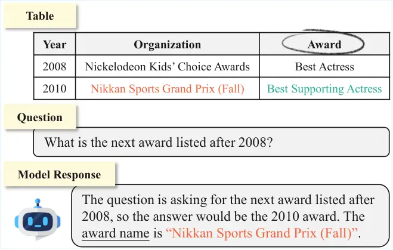
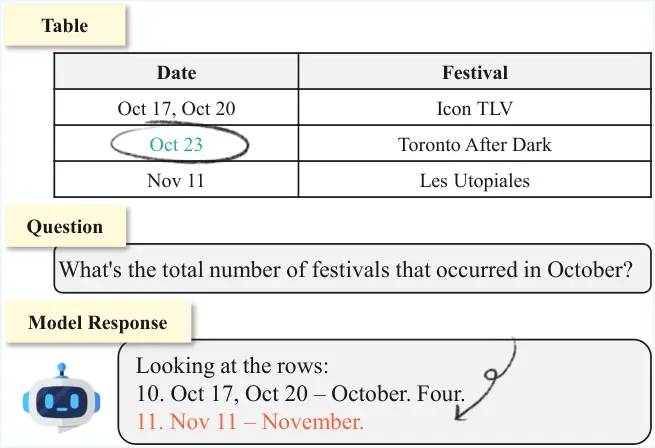

# When LLMs Read Tables Carelessly: Measuring and Reducing Data Referencing Errors

Yuqing Yang ^(†)^(†)thanks: Work done during an internship at Amazon.
Email: [yyang063@usc.edu](mailto:yyang063@usc.edu).
Affiliation: University of Southern California    Qi Zhu ^(†)^(†)thanks:
Corresponding author. Email:
[qzhuamzn@amazon.com](mailti:qzhuamzn@amazon.com). Affiliation: AWS AI
Labs    Zhen Han Affiliation: AWS AI Labs    Boran Han Affiliation: AWS
AI Labs    Zhengyuan Shen Affiliation: AWS AI Labs    Shuai Wang
Affiliation: AWS AI Labs    Vassilis N. Ioannidis Affiliation: AWS AI
Labs    Huzefa Rangwala Affiliation: AWS AI Labs

###### Abstract

While large language models (LLMs) perform well on table tasks, they
still make data referencing errors (DREs), i.e., incorrectly citing or
omitting table values, despite understanding the table structure. Beyond
final-answer accuracy, DREs directly compromise the correctness and
reliability of intermediate reasoning steps. Yet prior studies have only
offered limited, small-scale analyses. In this work, we present the
first systematic evaluation of tabular data referencing errors across
different models and tasks. Our results show that DREs occur across all
tested models (1.7B to 20B parameters). Furthermore, we demonstrate that
incorporating data referencing as a critic significantly improves answer
accuracy up to 12.0%, through critic-based filtering and rejection
sampling. Finally, we trained a lightweight 4B-parameter critic model
that achieves an average F1 score of 78.2% in detecting both
in-distribution and out-of-distribution DREs, and effectively assists
inference for larger models.

## 1 Introduction

Tables are one of the most common ways to represent information,
providing a structured format for organizing data. They are widely used
across real-world domains such as finance (Chen et al., 2021),
healthcare (Yan et al., 2025), and scientific reporting (Moosavi et al.,
2021; Zhang et al., 2025b), making the ability to effectively perform
tasks over tabular data essential. Solving table-related tasks requires
several capabilities: understanding tables presented in textual formats,
accurately locating and citing relevant values, and reasoning over
critical values to derive correct answers. Large Language Models (LLMs)
are increasingly applied to these tasks and often achieve strong
performance (Yang et al., 2025b; Wu et al., 2025b; Lei et al., 2025),
yet they still commit surprisingly basic mistakes even when the table
format is correctly parsed, by referencing table content incorrectly, as
illustrated in Figure 1.



(a) Incorrect Citation: Model confuses the “Organization” column with
the “Award” column.



(b) Omitted Information: Model omits the row of “Oct 23”.

Figure 1: Illustration of Tabular DREs.

A primary source of such errors is the dense and similar structure of
tables, which makes it hard for models to reliably locate and cite
values. For example, answering “Which country had the highest GDP growth
between 2020 and 2022?” requires aligning multiple year columns across
rows, where, analogous to human oversight, a slip can lead to mistakes.
We refer to such failures to faithfully retrieve and cite information
from the input as _Data Referencing Errors_ (DREs). These errors can
degrade response quality and sometimes final-answer accuracy, yet they
are not fully captured by final accuracy metrics alone. Although prior
work (Zhang et al., 2025c; Cao, 2025) has observed DREs, analyses remain
narrow, typically limited to a single model and a small set of
human-annotated cases. In this work, we systematically investigate how
prevalent DREs are, how they can be effectively mitigated, and how
mitigating them influences final-answer accuracy.

We first categorize tabular DREs into two types: Incorrect Citation,
involving individual values, and Omitted Information, involving entire
relevant portions, as illustrated in Figure 1. We then employ
LLM-as-a-Judge framework (Zheng et al., 2023) to automatically detect
DREs given a table and a generation model’s response. Upon evaluation,
We find that DREs are ubiquitous across different models (from 1.7B to
20B parameters) and across diverse table-related tasks (including
Question Answering, Claim Verification, and Table-to-Text). They are not
effectively eliminated by either reasoning models’ self-reflection
mechanisms (Snell et al., 2024; Muennighoff et al., 2025; Ye et al., 2025) or by prompting-based approaches. For instance, Qwen3-8B (Yang et
al., 2025a), even with extended self-reflection, exhibits a 14.04% DRE
rate (i.e., the proportion of responses containing DREs) on the WTQ
(Pasupat and Liang, 2015) dataset, and still 12.50% when further
prompted not to miscite or omit table content.

Incorporating DRE detection as a critic not only improves the quality of
intermediate reasoning steps beyond what is captured by final-answer
accuracy rewards, but also noticeably enhances overall performance. We
explore two approaches. First, critic-based filtering, which selects the
subset of sampled responses with minimal DREs, yields substantially
higher accuracy than using all sampled responses, and can further
enhance majority voting when combined. Second, rejection sampling, which
repeatedly resamples response segments until the critic accepts it,
obtains consistent gains and can improve accuracy by up to 11.96%.
Notably, DREs are largely avoidable rather than fundamental limitations,
yet rejection sampling with the critic offers a more robust way to
reduce their occurrence.

Finally, given the high cost and black-box nature of using larger models
as critics, we investigate the potential of small-scale LLMs (i.e.,
Qwen3-4B-Instruct, Yang et al., 2025a) for detecting DREs. To this end,
we construct training data from Qwen3-8B responses on the WTQ training
set and adopt a two-stage training procedure: supervised fine-tuning for
warm-up, followed by RLVR (reinforcement learning with verified reward,
Lambert et al., 2024; DeepSeek-AI et al., 2025) to enhance robustness in
DRE detection without constraining the Chain-of-Thought (CoT) format.
Our experiments show that the trained Critic-4B consistently outperforms
the untrained baseline both in-distribution and out-of-distribution,
achieving an average improvement of 8.65% F1. Moreover, we demonstrate
that this lightweight critic can mitigate DREs across different models
and improve final accuracy more effectively than prompting-based
methods.¹¹ 1 Our code is available at
[https://github.com/ayyyq/table-referencing](https://github.com/ayyyq/table-referencing).

Our work shed light on the overlooked issue of data referencing errors,
a unique error pattern that, while particularly common in table-related
tasks, also appears in other domains. Although these broader cases are
beyond the scope of this paper, we aim to inspire follow-up work to
improve both critic and generation models by enhancing their data
referencing capabilities.

## 2 Related Work

#### Table LLMs

Solving tabular tasks using LMs has been a long-standing research topic.
Early work relied on table pre-training with specialized architectures,
such as TaPas (Herzig et al., 2020) and TaBERT (Yin et al., 2020). With
the scaling of general-purpose LLMs, recent methods adapt them to
tabular settings through prompting (Ye et al., 2023; Jiang et al.,
2023), supervised fine-tuning (Zhang et al., 2024; Su et al., 2024;
Zhang et al., 2025a), and reinforcement learning (Yang et al., 2025b; Wu
et al., 2025b; Lei et al., 2025). As LLMs become increasingly powerful,
particularly with the emergence of reasoning models that demonstrate
strong problem-solving capabilities through extended thinking processes
(DeepSeek-AI et al., 2025; Yang et al., 2025a; OpenAI, 2025), they can
already exhibit strong baseline performance on table tasks without
task-specific training, as evidenced by Yang et al. (2025b); Wu et al.
(2025b) and our experiments in Table 1. These developments call for
moving beyond final-answer accuracy toward more fine-grained
limitations.

#### Evaluation Beyond Accuracy

Most evaluation benchmarks emphasize final accuracy for simplicity,
overlooking the quality of intermediate reasoning. To address this,
prior work has proposed process-level reward models (PRMs, Lightman et
al., 2024; Zhang et al., 2025d), which evaluate reasoning steps rather
than only outcomes. Related efforts further decompose evaluation into
dimensions: e.g., validity and redundancy in mathematical reasoning (Xia
et al., 2025), instruction-following and truthfulness in alignment (Cui
et al., 2024), and relevance and completeness in long-form QA (Wu et
al., 2023). In table reasoning, however, benchmarks still focus almost
exclusively on final correctness (Wu et al., 2025a; Pasupat and Liang,
2015). We introduce data referencing errors as a complementary dimension
that captures how reliably models use table values, reflecting both
intermediate reasoning quality and final performance.

#### Existing Work on DREs

Table-related tasks, especially Table QA, require models to use table
values both completely and accurately. Prior work has recognized this
need. For example, Zhang et al. (2025c) analyzed 50 WTQ samples from
Distill-Llama-8B (DeepSeek-AI et al., 2025) and found that more than 80%
of errors came from incorrect locating and citation. Yet such studies do
not systematically characterize DREs. Other work (Wu et al., 2025b; Lei
et al., 2025) introduces auxiliary rewards to improve table referencing,
but relies on supervised fine-tuning with annotated table regions. For
instance, models are trained to generate special tags such as \<\|cell
content\|\>\<\|column name\|\> when using the specific table values
needed to answer a question. In contrast, we evaluate models’ overall
accuracy in referencing any table values and analyze how DREs affect
performance. Our framework further supports critic-based detection that
can be seamlessly integrated into existing LLMs, improving both response
quality and final-answer accuracy without requiring special annotations
or disrupting reasoning chains (Tang et al., 2025).

## 3 Characterizing DREs

### 3.1 Definition and Taxonomy

When answering a table-based question, LLMs are generally required to
comprehend the table structure (e.g., distinguish between rows,
understand column headers, and interpret each cell’s meaning within its
row-column context), use table values to support reasoning, and reason
over critical ones to derive the correct answer.

Recent LLMs overcome long-standing challenges in tabular data by
handling diverse textual formats with large-scale pre-training (Touvron
et al., 2023) and enhancing logical and numerical reasoning through
targeted post-training (Liu et al., 2025; Wang et al., 2025). However,
our analysis reveals that these models, especially smaller ones, still
make basic mistakes, which resemble human oversights that could have
been avoided with careful attention. As shown in Figure 1, the model
confuses columns or overlooks an entire row. In CoT responses, we define
_data referencing_ as the ability to correctly locate and cite
information from inputs. Accordingly, errors or hallucinations in this
process constitute _data referencing errors_ (DREs).

While DREs can be found in different domains and modalities (Mirzadeh et
al., 2025; Huang et al., 2025), in this work, we focus specifically on
table-related tasks. Tables are highly data-intensive and often contain
many similar rows and columns (Cao, 2025), which makes models
particularly prone to referencing incorrect data. Formally, we
categorize tabular DREs based on granularity of referenced content as
follows:

- •
  Incorrect Citation: The response cites individual table content (e.g.,
  values or metadata) that does not match the actual table. This
  includes citing the wrong value, confusing rows or columns, or
  fabricating table-based content. As illustrated in Figure 1(a), the
  model mistakenly took “Nikkan Sports Grand Prix (Fall)” as from the
  “Award” column, whereas the correct value should have been “Best
  Supporting Actress”. This mix-up led to an incorrect final answer.
- •
  Omitted Information: The response omits table values that belong to a
  required subset of the table, such as listing all rows or identifying
  “all teams with more than 5 wins.” As shown in Figure 1(b), the model
  correctly listed every row but missed the single row “Oct 23”. This
  suggests that while the model can parse the table format, it still
  makes avoidable omissions.

In this work, we systematically investigate the occurrence and impact of
DREs and propose a plug-in critic module to mitigate them.

|                                |              |              |                      |                    |
| ------------------------------ | ------------ | ------------ | -------------------- | ------------------ |
|                                | Accuracy (%) | DRE Rate (%) | DRE-in-Incorrect (%) | Correct-in-DRE (%) |
| Qwen3-8B on different datasets |              |              |                      |                    |
| WTQ                            | 77.14        | 14.04        | 32.63                | 46.89              |
| WTQ + prompting                | 77.51        | 12.50        | 28.76                | 48.25              |
| WTQ (CSV)                      | 75.94        | 17.54        | 37.32                | 48.82              |
| WTQ (Markdown)                 | 77.26        | 14.34        | 32.69                | 48.15              |
| TableBench                     | 77.48        | 10.55        | 30.63                | 13.43              |
| FinQA                          | 63.21        | 33.57        | 39.34                | 56.88              |
| SciTab                         | 77.53        | 14.06        | 21.54                | 65.57              |
| ToTTo\*                        | 14.06        | 18.45        | –                    | –                  |
| Different models on WTQ        |              |              |                      |                    |
| Qwen3-1.7B                     | 57.76        | 35.52        | 56.35                | 32.99              |
| Qwen3-4B                       | 75.69        | 16.18        | 35.51                | 46.66              |
| Qwen3-8B                       | 77.14        | 14.04        | 32.63                | 46.89              |
| Qwen2.5-7B-Instruct            | 43.32        | 17.56        | 23.60                | 23.85              |
| Table-R1-Zero-7B               | 76.10        | 19.29        | 52.41                | 35.08              |
| Distill-Qwen-7B                | 49.47        | 46.04        | 66.61                | 26.90              |
| Distill-Llama-8B               | 59.78        | 37.96        | 60.45                | 35.96              |
| Llama4-Scout                   | 55.71        | 46.48        | 72.77                | 30.66              |
| gpt-oss-20b                    | 78.38        | 5.71         | 16.29                | 38.31              |

Table 1: DRE Evaluation Results judged by Sonnet-3.7+gt. \*: No binary
correctness labels for ToTTo.

### 3.2 Evaluation via LLM-as-a-Judge

To reduce human effort and enable automatic evaluation of DREs, we adopt
LLM-as-a-Judge (Zheng et al., 2023; Wolff and Hulsebos, 2025),
leveraging a powerful LLM (i.e. Sonnet-3.7, Anthropic, 2025) to detect
DREs in model responses. To match human-level annotation quality, we
address the following challenges by careful designs:

1.  1.  Long&Verbose Response: Recent reasoning models often generate
        lengthy thinking processes (Sui et al., 2025). To cope with this
        issue, we split the response at each occurrence of reflection tokens
        (e.g. “Wait”) and let the judge model evaluate one segment at a
        time.
2.  2.  Detection Reliability: Even strong models like Sonnet-3.7 can be
        swayed by the given response and fail to identify DREs, leading to
        false negatives (see Figure 7, 8). To counter this, we provide the
        ground truth to the table-based question in the judge prompt. This
        helps the judge, especially when the final answer is wrong, to
        cross-check against the table more carefully and decide whether the
        error comes from a DRE.

In practice, the judge model is instructed to check whether a
model-generated response uses table information accurately by examining
the aforementioned two types of DREs—Incorrect Citations and Omitted
Information. Manual inspection indicates that Sonnet-3.7 with ground
truth (i.e. Sonnet-3.7+gt) achieves an accuracy of 92.67% with high
consistency. Details and the full judge prompt are provided in
Appendix A.

#### Evaluation Metrics

To holistically evaluate the occurrence of DREs in model responses to
table questions, we calculate the following metrics:

```math
\text{DRE Rate}=\frac{|\text{DRE}|}{|\text{Total}|},
```

where $`|\text{DRE}|`$ is the number of model responses containing at
least one DRE. This metric measures the overall frequency of DREs.

```math
\text{Correct-in-DRE Ratio}=\frac{|\text{Correct}\cap\text{DRE}|}{|\text{DRE}|},
```

where $`|\text{Correct}\cap\text{DRE}|`$ is the number of responses
whose final answer is correct despite containing DREs. This metric
captures DREs that cannot be detected by evaluating final-answer
accuracy alone.

```math
\text{DRE-in-Incorrect Ratio}=\frac{|\text{Incorrect}\cap\text{DRE}|}{|\text{Incorrect}|},
```

which provides an approximation of the correlation between DREs and
final answer accuracy.

### 3.3 Prevalence and Analysis

Now, we examine the severity of DREs. We focus on three types of table
tasks: Question Answering, including WTQ (Pasupat and Liang, 2015),
TableBench (Wu et al., 2025a), and FinQA (Chen et al., 2021); Claim
Verification, represented by SciTab (Lu et al., 2023), where the model
is asked to determine whether a given claim is supported by the table;
and Table-to-Text, represented by ToTTo (Parikh et al., 2020), which
requires generating a textual description conditioned on the table.

We evaluate a range of popular LLMs, spanning sizes from 1.7B to 20B and
covering different model families: reasoning models that characterize
extended thinking processes, such as Qwen3-8B (Yang et al., 2025a);
mixture-of-experts (MoE) models such as Llama4-Scout (Meta AI, 2025);
and standard LLMs such as Qwen2.5-7B-Instruct (Yang et al., 2024).
Following Wu et al. (2025a), we present tables in the JSON format, but
we also experiment with CSV and Markdown formats. We further test a
prompting-based method that explicitly instructs the model: Use only the
table. Do not omit, miscite, or fabricate information. Ensure all cited
values exactly match the table. Model responses are then evaluated using
Sonnet-3.7+gt, and the results are summarized in Table 1. We have the
following observations:

(1) Data referencing errors are prevalent across different models, table
formats, and table-related tasks. For models, we observe that within a
single model family such as Qwen3, data referencing capability improves
with model size: larger models tend to produce fewer DREs. However,
across different model families, this trend does not necessarily hold,
as overall model capability also matters. For example, Llama4-Scout, as
a non-reasoning model, shows relatively high rates of DREs (46.48%)
despite its size. Additionally, results across different table formats
(JSON, CSV, and Markdown) and table-related tasks demonstrate that DREs
cannot be attributed to specific formats or tasks, but instead represent
a general and widespread challenge.

(2) DREs persist under common mitigation strategies. First, reasoning
models including Qwen3 series, Distill series, and gpt-oss-20b are
featured by self-reflection (DeepSeek-AI et al., 2025; Snell et al.,
2024), yet they still exhibit DREs (5.71%-46.04%); in fact, once the
first error is made, the model often repeats it, relying more on its own
generation than on the original table (see Appendix Figure 4 for an
example). Second, even explicitly prompting the model to focus on data
referencing accuracy, i.e. WTQ + prompt setting, does not resolve DREs
or improve final-answer accuracy. Third, Table-R1-Zero-7B (Yang et al.,
2025b) was trained on table-related datasets from Qwen2.5-7B-Instruct
using RLVR (Lambert et al., 2024). While this specialized training
improves answer accuracy, it does not effectively translate into fewer
DREs, highlighting that data referencing is a separate capability that
warrants further attention.

(3) DREs may also occur during the reasoning process, even when the
final answer is correct. The Correct-in-DRE Ratio captures cases where
the response contains DREs but still arrives at the correct final
answer. This means that final-answer accuracy alone cannot guarantee the
correctness of intermediate steps and the overall quality of the
response. Besides, the Correct-in-DRE Ratio visibly varies across tasks.
For example, SciTab shows a relatively high ratio (65.57%), because its
answers are binary labels (True or False). In such cases, numerical
citation errors in reasoning process may not affect the final judgment,
as illustrated in Figure 5.

## 4 Reducing DREs with Critics

We observe that DREs do occur in incorrect cases and can negatively
impact final accuracy, as shown quantitatively in Table 1 and
qualitatively in Figure 1. Nevertheless, the DRE-in-Incorrect ratio
should not be interpreted as indicating that this portion of incorrect
answers is directly caused by DREs. This raises an important question:
to what extent do DREs actually harm final accuracy? In this section, we
apply Sonnet-3.7+gt²² 2 Although provided with ground truth answers,
Sonnet-3.7 does not directly judge final-answer correctness (see
Appendix A). We use Sonnet-3.7+gt to approximate the upper bound of a
DRE detection critic. as a high-quality critic to reduce DREs and
explore whether this reduction translates into improvements in
final-answer accuracy. We focus on three question answering datasets
(WTQ, TableBench, FinQA) and three representative models (Qwen3-8B,
Distill-Qwen-7B, Llama4-Scout).

|                 |             |            |            |                 |          |
| --------------- | ----------- | ---------- | ---------- | --------------- | -------- |
| Dataset         | Avg Acc (%) | CF Acc (%) | MV Acc (%) | CF + MV Acc (%) | \# Total |
| Qwen3-8B        |             |            |            |                 |          |
| WTQ             | 64.59       | 70.44      | 70.84      | 73.49           | 1509     |
| TableBench      | 63.12       | 67.42      | 70.17      | 71.82           | 181      |
| FinQA           | 54.58       | 56.48      | 56.92      | 57.54           | 325      |
| Distill-Qwen-7B |             |            |            |                 |          |
| WTQ             | 49.47       | 61.83      | 62.05      | 65.80           | 2851     |
| TableBench      | 55.06       | 69.62      | 67.60      | 71.65           | 321      |
| FinQA           | 41.12       | 46.37      | 46.82      | 48.16           | 598      |
| Llama4-Scout    |             |            |            |                 |          |
| WTQ             | 57.02       | 69.89      | 64.06      | 73.11           | 2265     |
| TableBench      | 50.67       | 58.93      | 57.40      | 63.23           | 223      |
| FinQA           | 39.53       | 42.32      | 44.91      | 46.76           | 216      |

Table 2: Critic-based Filtering (CF) Results on the DRE subset. Avg Acc
denotes the average accuracy over $`N=8`$ sampled responses per
question. MV denotes Majority Voting, and CF + MV denotes
majority-voting on critic-filtered subset.

### 4.1 Critic-Based Filtering

#### Method

A common application of a critic model is the Best-of-N (BoN) strategy,
where an LLM generates multiple candidate responses and the critic
selects the best one as the final output (Snell et al., 2024; Bai et
al., 2022; Touvron et al., 2023). While effective in some contexts, this
approach assumes that the critic is able to fully judge the correctness
of each response (Cobbe et al., 2021b) or assign highly discriminative
scores across the set of responses (Lightman et al., 2024; Uesato et
al., 2022). Our critic, however, is designed specifically to detect DREs
and thus cannot directly determine which single response is best
overall. For example, multiple responses may contain no DREs yet still
produce different final answers if mistakes occur later in the reasoning
stage after retrieving the correct table values.

To address this limitation, we adopt a critic-based filtering approach.
Specifically, for a generation model (e.g., Qwen3-8B), we sample $`N=8`$
responses per question and use the critic to select the subset of
responses with the fewest data referencing errors instead of selecting
only one “best” response. This design improves the overall quality of
the candidate pool and enables inference-time strategies such as
majority voting to operate on a higher-quality set of responses, thereby
further improving final accuracy.

#### Metrics

We report the average accuracy of all generated responses versus that of
the subset selected by the critic. We also compare these results with
majority voting. Our primary focus is the _DRE subset_, which includes
questions for which at least one response contains a data referencing
error and at least one does not. This subset emphasizes
data-referencing-challenging cases. To illustrate: if all sampled
responses are free of referencing errors, then critic-based filtering
will naturally show little or no improvement. Conversely, if all
responses contain referencing errors, no selection strategy can
guarantee correctness. Results on the full evaluation set are also
reported in Appendix Table 5 but may underestimate the critic’s impact.

#### Results

From Table 2, we can observe that critic-based filtering steadily
outperforms the average accuracy of all sampled responses by selecting
those with fewer data referencing errors. This indicates that reducing
DREs not only improves the quality of intermediate reasoning with fewer
hallucinations but also translates into higher final accuracy. More
encouragingly, it complements majority voting as an inference-time
strategy: applying majority voting within the critic-filtered subset
achieves the best performance, consistently surpassing majority voting
alone. In some cases like Llama4-Scout on WTQ, even randomly selecting a
response from the critic-filtered subset yields higher average accuracy
than majority voting.

### 4.2 Rejection Sampling

#### Method

Another application of the critic model is rejection sampling. In
standard LLMs, rejection sampling resembles BoN (Bai et al., 2022;
Touvron et al., 2023). In the context of reasoning models, this approach
can be inefficient, as the responses of reasoning models are often very
long (Chen et al., 2024; Sui et al., 2025) and thus costly to generate
when sampling $`N`$ full completions. Moreover, repeated sampling
increases computational expense.

We adapt rejection sampling for reasoning models by working at the
segment level. Similar to Section 3.2, for a generation model such as
Qwen3-8B, we split a response into segments using the delimiter “Wait”.
Instead of regenerating an entire response, we selectively resample only
the segment (or, when necessary, the entire response) until it passes
the critic or reaches a maximum retry limit $`N=8`$ is reached. The
model then continues with the next segment, repeating this process until
the final answer is produced. This design reduces the cost of rejection
sampling while preventing error propagation across the reasoning
process.

#### Metrics

We report accuracy using rejection sampling on the DRE subset and the
full set.

| Dataset         | Acc in DRE (%) | Acc in Full (%) |
| --------------- | -------------- | --------------- |
| Qwen3-8B        |                |                 |
| WTQ             | 63.88          | 77.14           |
|    + RS         | 68.46 (+4.58)  | 78.94 (+1.80)   |
| TableBench      | 63.54          | 77.48           |
|    + RS         | 69.09 (+5.55)  | 79.31 (+1.83)   |
| FinQA           | 53.85          | 63.21           |
|    + RS         | 54.46 (+0.61)  | 63.64 (+0.43)   |
| Distill-Qwen-7B |                |                 |
| WTQ             | 48.58          | 49.47           |
|    + RS         | 57.14 (+8.56)  | 55.99 (+6.52)   |
| TableBench      | 53.58          | 54.77           |
|    + RS         | 68.85 (+15.27) | 66.73 (+11.96)  |
| FinQA           | 41.14          | 46.90           |
|    + RS         | 44.82 (+3.68)  | 49.52 (+2.62)   |
| Llama4-Scout    |                |                 |
| WTQ             | 56.16          | 55.71           |
|    + RS         | 65.39 (+9.23)  | 61.92 (+6.21)   |
| TableBench      | 52.47          | 54.56           |
|    + RS         | 56.95 (+4.48)  | 57.20 (+2.64)   |
| FinQA           | 40.74          | 58.94           |
|    + RS         | 43.52 (+2.78)  | 59.72 (+0.78)   |

Table 3: Rejection Sampling Results. “Acc in DRE” denotes the results on
the DRE subset, which we use as the primary evaluation setting.

#### Results

As shown in Table 3, rejection sampling with the critic effectively
improves final accuracy for both reasoning and non-reasoning models. As
expected, the improvement is larger on the DRE subset than on the full
set, since data referencing errors are more likely to appear in the DRE
subset. It is important to note that the rejection sampling process does
not alter the generation model itself. A DRE-free response can be
obtained by simply resampling. This highlights that DREs are largely
avoidable errors rather than fundamental limitations of the model’s
knowledge or reasoning ability. However, how to reliably reduce the
frequency of DREs remains an open problem, and rejection sampling with a
DRE detection critic provides a promising and practical solution.

## 5 Training a Small-Scale Critic

In practice, ground-truth answers are often unavailable to the critic
particularly during inference, and Sonnet-3.7 is both a black-box and
costly to use. Therefore, in this section, we explore the feasibility of
training a smaller-scale LLM (e.g. Qwen3-4B-Instruct) to perform the
critic task.

### 5.1 Small Critic Training

Figure 2: F1 scores across different model-dataset pairs for critic
evaluation.

For the critic model, similar to Section 3.2, its task is as follows:
given a table, a question based on the table, and a model’s response
segment, determine whether the response contains DREs (See Appendix
Figure 6 for the complete critic prompt). The output is either True
(contains DREs, treated as positive samples) or False (does not contain
DREs, including cases where no table values are cited, treated as
negative samples). Beyond directly using Qwen3-4B-Instruct, we introduce
a two-stage training pipeline to further enhance its ability to detect
DREs.

#### (1) SFT.

We begin with supervised fine-tuning (SFT) as a warm-up stage to adapt
Qwen3-4B-Instruct more effectively to the critic task. Although it
already demonstrates strong instruction-following ability, we observe
that training with RL directly, that is, without an SFT warm-up, causes
the model to produce malformed outputs such as repeated
\<judgment\>\</judgment\> tags. To solve this, we use judgments from
Sonnet-3.7 as distillation data in the first stage. This not only
teaches Qwen3-4B-Instruct the expected output format but also transfers
potentially useful “critic heuristics” from a stronger model, thereby
stabilizing subsequent RL training.

#### (2) RLVR.

In the second stage, we employ reinforcement learning to enhance the
critic model’s robustness and generalization. Building on SFT
foundation, RL enables exploration beyond the limitations of fixed
supervision. We apply Reinforcement Learning with Verified Reward (RLVR,
Lambert et al., 2024; DeepSeek-AI et al., 2025), which is well suited to
our setting: it leverages verified binary labels as reward signals and
does not require constraining the CoT. This allows the critic to better
detect DREs across diverse tasks.

For training data, we build on Qwen3-8B’s responses to the WTQ training
set. We use Sonnet-3.7 to label all response segments, yielding a
balanced dataset of 2,000 positive and negative samples for SFT, and
5,712 samples for RL training. The critic model trained using this data
is called Critic-4B. In addition, we construct synthetic positives by
inserting four types of DREs with rule-based heuristics (Appendix C),
which reduces reliance on larger models and improves efficiency in both
speed and cost. The critic model trained using the synthetic data is
called Critic-4B-Synthetic.

### 5.2 Critic Evaluation

To evaluate a critic’s performance on the DRE detection task, we
construct a critic evaluation dataset. In details, we collect real
positive and negative response segments, judged by Sonnet-3.7+gt, from
the three models (Qwen3-8B, Distill-Qwen-7B, Llama4-Scout) across the
three datasets (WTQ, TableBench, FinQA). This setup allows us to cover
both reasoning (Qwen3-8B, Distill-Qwen-7B) and non-reasoning models
(Llama4-Scout), as well as a diverse range of table-related question
answering tasks spanning general-domain benchmarks and financial
reasoning. For each model-dataset pair, we randomly sample 400 response
segment with a balanced number of positive and negative examples,
resulting in a total of 3,600 samples. We report the standard F1 score
for this binary classification task, which balances precision (how often
predicted DREs are correct) and recall (how many true DREs are
identified).

#### Results

We compare the critic performance of Qwen3-4B-Instruct,
Critic-4B-Synthetic, Critic-4B. The evaluation results are presented in
Figure 2. We have the following findings:

Critic-4B consistently outperforms the untrained baseline
Qwen3-4B-Instruct across all scenarios, achieving 78.16% overall F1
compared to 69.51%. Although it is trained only on the responses of
Qwen3-8B on the WTQ training set, Critic-4B generalizes well to the same
model’s responses on other table-related tasks. This is particularly
notable because TableBench and FinQA’s tables differ significantly from
those in WTQ. In addition, Critic-4B achieves high F1 in identifying
DREs in the responses of other models as well.

However, Critic-4B-Synthetic, trained on synthetic data, shows larger
gains on in-distribution data, i.e. on the same model or the same
dataset. Yet, for settings with larger differences, such as FinQA (a
different domain) and Llama4-Scout (non-reasoning model), critic
performance actually declines. This suggests that the model may have
overfit to biases specific to the synthetic data rather than learning to
generalize to real-world errors.

### 5.3 Rejection Sampling

We also examine whether our trained small-scale critic, Critic-4B, can
assist inference, using rejection sampling as described in Section 4.2.
We report both accuracy and DRE rate (on the full set) with and without
rejection sampling.

| Dataset         | Acc in DRE $`\uparrow`$ | Acc in Full $`\uparrow`$ | DRE Rate $`\downarrow`$ |
| --------------- | ----------------------- | ------------------------ | ----------------------- |
| Qwen3-8B        |                         |                          |                         |
| WTQ             | 63.88                   | 77.14                    | 14.04                   |
|    + RS         | 66.37 (+2.49)           | 78.25 (+1.11)            | 10.08 (-3.96)           |
| TableBench      | 63.54                   | 77.48                    | 10.55                   |
|    + RS         | 66.85 (+3.31)           | 78.50 (+1.02)            | 9.33 (-1.22)            |
| FinQA           | 53.85                   | 63.21                    | 33.57                   |
|    + RS         | 54.46 (+0.61)           | 63.47 (+0.26)            | 31.21 (-2.36)           |
| Distill-Qwen-7B |                         |                          |                         |
| WTQ             | 48.58                   | 49.47                    | 46.04                   |
|    + RS         | 55.00 (+6.42)           | 54.01 (+4.54)            | 30.59 (-15.45)          |
| TableBench      | 53.58                   | 54.77                    | 46.86                   |
|    + RS         | 63.24 (+9.66)           | 61.66 (+6.89)            | 32.45 (-14.41)          |
| FinQA           | 41.14                   | 46.90                    | 43.94                   |
|    + RS         | 45.82 (+4.68)           | 50.04 (+3.14)            | 34.52 (-9.42)           |
| Llama4-Scout    |                         |                          |                         |
| WTQ             | 56.16                   | 55.71                    | 46.48                   |
|    + RS         | 60.75 (+4.59)           | 58.45 (+2.74)            | 36.90 (-9.58)           |
| TableBench      | 52.47                   | 54.56                    | 38.54                   |
|    + RS         | 55.16 (+2.69)           | 56.39 (+1.83)            | 33.87 (-4.67)           |
| FinQA           | 40.74                   | 58.94                    | 30.69                   |
|    + RS         | 43.06 (+2.32)           | 59.46 (+0.52)            | 28.68 (-2.01)           |

Table 4: Rejection Sampling Results (%) using Critic-4B.

As shown in Table 4, rejection sampling with Critic-4B consistently
achieves higher accuracy compared to the setting without rejection
sampling. Although it is less effective than the stronger critic,
Sonnet-3.7+gt (refer to Table 3), Critic-4B offers a lightweight and
cost-effective alternative. Encouragingly, Critic-4B is smaller than all
three generation models and does not benefit from the extended thinking
processes as reasoning models like Qwen3-8B and Distill-Qwen-7B, yet it
is still able to improve their accuracy. In addition, the DRE rate
decreases when using rejection sampling, indicating that the critic not
only enhances final-answer accuracy but also improves the overall
quality of the model responses by reducing DREs.

## 6 Conclusions

We show that data referencing errors (DREs) are a pervasive weakness of
LLMs on table reasoning tasks, undermining both response quality and
final accuracy. By systematically analyzing DREs via LLM-as-a-Judge, we
demonstrated their prevalence and propose inference-time strategies and
lightweight critics to mitigate them. Our findings establish data
referencing as a key evaluation dimension beyond final-answer accuracy
for developing more reliable table reasoning systems.

## Limitations

Several limitations remain that warrant future study. First, we focus
solely on DREs in table-related tasks, as they are a common and
non-negligible issue. However, we recognize that DREs also arise in
other domains and modalities. For instance, Cobbe et al. (2021a);
Mirzadeh et al. (2025) describe the case: He makes 48 total ice cubes,
including 10 giant cubes, 14 small cubes, 12 medium cubes, and some tiny
cubes. Qwen3-8B sometimes mistakenly interprets the order as giant,
medium, small, tiny, which leads to errors. We hope future work can
generalize to such broader domains.

Second, we did not examine the causes of DREs from an interpretability
perspective. In preliminary experiments, we did observe that when the
model prepared to reference a table value, increasing its attention to
the entire table helped reduce subsequent errors, suggesting that DREs
are linked to insufficient attention. However, due to resource
constraints, we did not scale up attention analyses or steering
experiments. Future work could build on this direction.

## Acknowledgments

We are grateful to Robin Jia, He Wang, and Zelin He for their insightful
feedback and discussions throughout this work. We also thank the
anonymous reviewers for their constructive comments.

## References

- Anthropic (2025) Anthropic Claude 3.7 sonnet and claude code. Note:
  [https://www.anthropic.com/news/claude-3-7-sonnet](https://www.anthropic.com/news/claude-3-7-sonnet)
  Cited by: §3.2.
- Bai et al. (2022) Y. Bai, S. Kadavath, S. Kundu, A. Askell, J.
  Kernion, A. Jones, A. Chen, A. Goldie, A. Mirhoseini, C. McKinnon, C.
  Chen, C. Olsson, C. Olah, D. Hernandez, D. Drain, D. Ganguli, D.
  Li, E. Tran-Johnson, E. Perez, J. Kerr, J. Mueller, J. Ladish, J.
  Landau, K. Ndousse, K. Lukosiute, L. Lovitt, M. Sellitto, N.
  Elhage, N. Schiefer, N. Mercado, N. DasSarma, R. Lasenby, R.
  Larson, S. Ringer, S. Johnston, S. Kravec, S. E. Showk, S. Fort, T.
  Lanham, T. Telleen-Lawton, T. Conerly, T. Henighan, T. Hume, S. R.
  Bowman, Z. Hatfield-Dodds, B. Mann, D. Amodei, N. Joseph, S.
  McCandlish, T. Brown, and J. Kaplan Constitutional AI: harmlessness
  from AI feedback. CoRR abs/2212.08073. External Links:
  [Link](https://doi.org/10.48550/arXiv.2212.08073),
  [Document](https://dx.doi.org/10.48550/ARXIV.2212.08073), 2212.08073
  Cited by: §4.1, §4.2.
- Cao (2025) L. Cao TableMaster: A recipe to advance table understanding
  with language models. CoRR abs/2501.19378. External Links:
  [Link](https://doi.org/10.48550/arXiv.2501.19378),
  [Document](https://dx.doi.org/10.48550/ARXIV.2501.19378), 2501.19378
  Cited by: §1, §3.1.
- Chen et al. (2024) X. Chen, J. Xu, T. Liang, Z. He, J. Pang, D. Yu, L.
  Song, Q. Liu, M. Zhou, Z. Zhang, R. Wang, Z. Tu, H. Mi, and D. Yu Do
  NOT think that much for 2+3=? on the overthinking of o1-like llms.
  CoRR abs/2412.21187. External Links:
  [Link](https://doi.org/10.48550/arXiv.2412.21187),
  [Document](https://dx.doi.org/10.48550/ARXIV.2412.21187), 2412.21187
  Cited by: §4.2.
- Chen et al. (2021) Z. Chen, W. Chen, C. Smiley, S. Shah, I. Borova, D.
  Langdon, R. Moussa, M. Beane, T. K. Huang, B. R. Routledge, and W. Y.
  Wang FinQA: A dataset of numerical reasoning over financial data. In
  Proceedings of the 2021 Conference on Empirical Methods in Natural
  Language Processing, EMNLP 2021, Virtual Event / Punta Cana, Dominican
  Republic, 7-11 November, 2021, M. Moens, X. Huang, L. Specia,
  and S. W. Yih (Eds.), pp. 3697–3711. External Links:
  [Link](https://doi.org/10.18653/v1/2021.emnlp-main.300),
  [Document](https://dx.doi.org/10.18653/V1/2021.EMNLP-MAIN.300) Cited
  by: §1, §3.3.
- Cobbe et al. (2021a) K. Cobbe, V. Kosaraju, M. Bavarian, M. Chen, H.
  Jun, L. Kaiser, M. Plappert, J. Tworek, J. Hilton, R. Nakano, C.
  Hesse, and J. Schulman Training verifiers to solve math word problems.
  arXiv preprint arXiv:2110.14168. Cited by: Limitations.
- Cobbe et al. (2021b) K. Cobbe, V. Kosaraju, M. Bavarian, M. Chen, H.
  Jun, L. Kaiser, M. Plappert, J. Tworek, J. Hilton, R. Nakano, C.
  Hesse, and J. Schulman Training verifiers to solve math word problems.
  CoRR abs/2110.14168. External Links:
  [Link](https://arxiv.org/abs/2110.14168), 2110.14168 Cited by: §4.1.
- Cui et al. (2024) G. Cui, L. Yuan, N. Ding, G. Yao, B. He, W. Zhu, Y.
  Ni, G. Xie, R. Xie, Y. Lin, Z. Liu, and M. Sun ULTRAFEEDBACK: boosting
  language models with scaled AI feedback. In Forty-first International
  Conference on Machine Learning, ICML 2024, Vienna, Austria, July
  21-27, 2024, External Links:
  [Link](https://openreview.net/forum?id=BOorDpKHiJ) Cited by: §2.
- DeepSeek-AI et al. (2025) DeepSeek-AI, D. Guo, D. Yang, H. Zhang, J.
  Song, R. Zhang, R. Xu, Q. Zhu, S. Ma, P. Wang, X. Bi, X. Zhang, X.
  Yu, Y. Wu, Z. F. Wu, Z. Gou, Z. Shao, Z. Li, Z. Gao, A. Liu, B.
  Xue, B. Wang, B. Wu, B. Feng, C. Lu, C. Zhao, C. Deng, C. Zhang, C.
  Ruan, D. Dai, D. Chen, D. Ji, E. Li, F. Lin, F. Dai, F. Luo, G.
  Hao, G. Chen, G. Li, H. Zhang, H. Bao, H. Xu, H. Wang, H. Ding, H.
  Xin, H. Gao, H. Qu, H. Li, J. Guo, J. Li, J. Wang, J. Chen, J.
  Yuan, J. Qiu, J. Li, J. L. Cai, J. Ni, J. Liang, J. Chen, K. Dong, K.
  Hu, K. Gao, K. Guan, K. Huang, K. Yu, L. Wang, L. Zhang, L. Zhao, L.
  Wang, L. Zhang, L. Xu, L. Xia, M. Zhang, M. Zhang, M. Tang, M. Li, M.
  Wang, M. Li, N. Tian, P. Huang, P. Zhang, Q. Wang, Q. Chen, Q. Du, R.
  Ge, R. Zhang, R. Pan, R. Wang, R. J. Chen, R. L. Jin, R. Chen, S.
  Lu, S. Zhou, S. Chen, S. Ye, S. Wang, S. Yu, S. Zhou, S. Pan,
  and S. S. Li DeepSeek-r1: incentivizing reasoning capability in llms
  via reinforcement learning. CoRR abs/2501.12948. External Links:
  [Link](https://doi.org/10.48550/arXiv.2501.12948),
  [Document](https://dx.doi.org/10.48550/ARXIV.2501.12948), 2501.12948
  Cited by: §1, §2, §2, §3.3, §5.1.
- Herzig et al. (2020) J. Herzig, P. K. Nowak, T. Müller, F. Piccinno,
  and J. M. Eisenschlos TaPas: weakly supervised table parsing via
  pre-training. In Proceedings of the 58th Annual Meeting of the
  Association for Computational Linguistics, ACL 2020, Online, July
  5-10, 2020, D. Jurafsky, J. Chai, N. Schluter, and J. R. Tetreault
  (Eds.), pp. 4320–4333. External Links:
  [Link](https://doi.org/10.18653/v1/2020.acl-main.398),
  [Document](https://dx.doi.org/10.18653/V1/2020.ACL-MAIN.398) Cited by:
  §2.
- Huang et al. (2025) L. Huang, X. Feng, W. Ma, Y. Fan, X. Feng, Y.
  Ye, W. Zhong, Y. Gu, B. Wang, D. Wu, G. Hu, and B. Qin Improving
  contextual faithfulness of large language models via retrieval
  heads-induced optimization. In Proceedings of the 63rd Annual Meeting
  of the Association for Computational Linguistics (Volume 1: Long
  Papers), ACL 2025, Vienna, Austria, July 27 - August 1, 2025, W.
  Che, J. Nabende, E. Shutova, and M. T. Pilehvar (Eds.),
  pp. 16896–16913. External Links:
  [Link](https://aclanthology.org/2025.acl-long.826/) Cited by: §3.1.
- Jiang et al. (2023) J. Jiang, K. Zhou, Z. Dong, K. Ye, X. Zhao, and J.
  Wen StructGPT: A general framework for large language model to reason
  over structured data. In Proceedings of the 2023 Conference on
  Empirical Methods in Natural Language Processing, EMNLP 2023,
  Singapore, December 6-10, 2023, H. Bouamor, J. Pino, and K. Bali
  (Eds.), pp. 9237–9251. External Links:
  [Link](https://doi.org/10.18653/v1/2023.emnlp-main.574),
  [Document](https://dx.doi.org/10.18653/V1/2023.EMNLP-MAIN.574) Cited
  by: §2.
- Lambert et al. (2024) N. Lambert, J. Morrison, V. Pyatkin, S.
  Huang, H. Ivison, F. Brahman, L. J. V. Miranda, A. Liu, N. Dziri, S.
  Lyu, Y. Gu, S. Malik, V. Graf, J. D. Hwang, J. Yang, R. L. Bras, O.
  Tafjord, C. Wilhelm, L. Soldaini, N. A. Smith, Y. Wang, P. Dasigi,
  and H. Hajishirzi TÜlu 3: pushing frontiers in open language model
  post-training. CoRR abs/2411.15124. External Links:
  [Link](https://doi.org/10.48550/arXiv.2411.15124),
  [Document](https://dx.doi.org/10.48550/ARXIV.2411.15124), 2411.15124
  Cited by: §1, §3.3, §5.1.
- Lei et al. (2025) F. Lei, J. Meng, Y. Huang, T. Chen, Y. Zhang, S.
  He, J. Zhao, and K. Liu Reasoning-table: exploring reinforcement
  learning for table reasoning. CoRR abs/2506.01710. External Links:
  [Link](https://doi.org/10.48550/arXiv.2506.01710),
  [Document](https://dx.doi.org/10.48550/ARXIV.2506.01710), 2506.01710
  Cited by: §1, §2, §2.
- Lightman et al. (2024) H. Lightman, V. Kosaraju, Y. Burda, H.
  Edwards, B. Baker, T. Lee, J. Leike, J. Schulman, I. Sutskever, and K.
  Cobbe Let’s verify step by step. In The Twelfth International
  Conference on Learning Representations, ICLR 2024, Vienna, Austria,
  May 7-11, 2024, External Links:
  [Link](https://openreview.net/forum?id=v8L0pN6EOi) Cited by: §2, §4.1.
- Liu et al. (2025) Z. Liu, C. Chen, W. Li, P. Qi, T. Pang, C. Du, W. S.
  Lee, and M. Lin Understanding r1-zero-like training: A critical
  perspective. CoRR abs/2503.20783. External Links:
  [Link](https://doi.org/10.48550/arXiv.2503.20783),
  [Document](https://dx.doi.org/10.48550/ARXIV.2503.20783), 2503.20783
  Cited by: §3.1.
- Lu et al. (2023) X. Lu, L. Pan, Q. Liu, P. Nakov, and M. Kan SCITAB: A
  challenging benchmark for compositional reasoning and claim
  verification on scientific tables. In Proceedings of the 2023
  Conference on Empirical Methods in Natural Language Processing, EMNLP
  2023, Singapore, December 6-10, 2023, H. Bouamor, J. Pino, and K. Bali
  (Eds.), pp. 7787–7813. External Links:
  [Link](https://doi.org/10.18653/v1/2023.emnlp-main.483),
  [Document](https://dx.doi.org/10.18653/V1/2023.EMNLP-MAIN.483) Cited
  by: §3.3.
- Meta AI (2025) Meta AI LLaMA 4: multimodal intelligence. Note:
  [https://ai.meta.com/blog/llama-4-multimodal-intelligence/](https://ai.meta.com/blog/llama-4-multimodal-intelligence/)
  Cited by: §3.3.
- Mirzadeh et al. (2025) I. Mirzadeh, K. Alizadeh, H. Shahrokhi, O.
  Tuzel, S. Bengio, and M. Farajtabar GSM-symbolic: understanding the
  limitations of mathematical reasoning in large language models. In The
  Thirteenth International Conference on Learning Representations, ICLR
  2025, Singapore, April 24-28, 2025, External Links:
  [Link](https://openreview.net/forum?id=AjXkRZIvjB) Cited by: §3.1,
  Limitations.
- Moosavi et al. (2021) N. S. Moosavi, A. Rücklé, D. Roth, and I.
  Gurevych SciGen: a dataset for reasoning-aware text generation from
  scientific tables. In Proceedings of the Neural Information Processing
  Systems Track on Datasets and Benchmarks 1, NeurIPS Datasets and
  Benchmarks 2021, December 2021, virtual, J. Vanschoren and S. Yeung
  (Eds.), External Links:
  [Link](https://datasets-benchmarks-proceedings.neurips.cc/paper/2021/hash/149e9677a5989fd342ae44213df68868-Abstract-round2.html)
  Cited by: §1.
- Muennighoff et al. (2025) N. Muennighoff, Z. Yang, W. Shi, X. L.
  Li, L. Fei-Fei, H. Hajishirzi, L. Zettlemoyer, P. Liang, E. J. Candès,
  and T. Hashimoto S1: simple test-time scaling. CoRR abs/2501.19393.
  External Links: [Link](https://doi.org/10.48550/arXiv.2501.19393),
  [Document](https://dx.doi.org/10.48550/ARXIV.2501.19393), 2501.19393
  Cited by: §1.
- OpenAI (2025) OpenAI Gpt-oss-120b & gpt-oss-20b model card. External
  Links: 2508.10925, [Link](https://arxiv.org/abs/2508.10925) Cited by:
  §2.
- Parikh et al. (2020) A. P. Parikh, X. Wang, S. Gehrmann, M.
  Faruqui, B. Dhingra, D. Yang, and D. Das ToTTo: A controlled
  table-to-text generation dataset. In Proceedings of the 2020
  Conference on Empirical Methods in Natural Language Processing, EMNLP
  2020, Online, November 16-20, 2020, B. Webber, T. Cohn, Y. He, and Y.
  Liu (Eds.), pp. 1173–1186. External Links:
  [Link](https://doi.org/10.18653/v1/2020.emnlp-main.89),
  [Document](https://dx.doi.org/10.18653/V1/2020.EMNLP-MAIN.89) Cited
  by: §3.3.
- Pasupat and Liang (2015) P. Pasupat and P. Liang Compositional
  semantic parsing on semi-structured tables. In Proceedings of the 53rd
  Annual Meeting of the Association for Computational Linguistics and
  the 7th International Joint Conference on Natural Language Processing
  of the Asian Federation of Natural Language Processing, ACL 2015, July
  26-31, 2015, Beijing, China, Volume 1: Long Papers, pp. 1470–1480.
  External Links: [Link](https://doi.org/10.3115/v1/p15-1142),
  [Document](https://dx.doi.org/10.3115/V1/P15-1142) Cited by: §1, §2,
  §3.3.
- Shao et al. (2024) Z. Shao, P. Wang, Q. Zhu, R. Xu, J. Song, M.
  Zhang, Y. K. Li, Y. Wu, and D. Guo DeepSeekMath: pushing the limits of
  mathematical reasoning in open language models. CoRR abs/2402.03300.
  External Links: [Link](https://doi.org/10.48550/arXiv.2402.03300),
  [Document](https://dx.doi.org/10.48550/ARXIV.2402.03300), 2402.03300
  Cited by: Appendix D.
- Sheng et al. (2024) G. Sheng, C. Zhang, Z. Ye, X. Wu, W. Zhang, R.
  Zhang, Y. Peng, H. Lin, and C. Wu HybridFlow: a flexible and efficient
  rlhf framework. arXiv preprint arXiv: 2409.19256. Cited by: Appendix
  D.
- Snell et al. (2024) C. Snell, J. Lee, K. Xu, and A. Kumar Scaling LLM
  test-time compute optimally can be more effective than scaling model
  parameters. CoRR abs/2408.03314. External Links:
  [Link](https://doi.org/10.48550/arXiv.2408.03314),
  [Document](https://dx.doi.org/10.48550/ARXIV.2408.03314), 2408.03314
  Cited by: §1, §3.3, §4.1.
- Su et al. (2024) A. Su, A. Wang, C. Ye, C. Zhou, G. Zhang, G. Chen, G.
  Zhu, H. Wang, H. Xu, H. Chen, H. Li, H. Lan, J. Tian, J. Yuan, J.
  Zhao, J. Zhou, K. Shou, L. Zha, L. Long, L. Li, P. Wu, Q. Zhang, Q.
  Huang, S. Yang, T. Zhang, W. Ye, W. Zhu, X. Hu, X. Gu, X. Sun, X.
  Li, Y. Yang, and Z. Xiao TableGPT2: A large multimodal model with
  tabular data integration. CoRR abs/2411.02059. External Links:
  [Link](https://doi.org/10.48550/arXiv.2411.02059),
  [Document](https://dx.doi.org/10.48550/ARXIV.2411.02059), 2411.02059
  Cited by: §2.
- Sui et al. (2025) Y. Sui, Y. Chuang, G. Wang, J. Zhang, T. Zhang, J.
  Yuan, H. Liu, A. Wen, S. Zhong, N. Zou, H. Chen, and X. Hu Stop
  overthinking: A survey on efficient reasoning for large language
  models. Trans. Mach. Learn. Res. 2025. External Links:
  [Link](https://openreview.net/forum?id=HvoG8SxggZ) Cited by: item 1,
  §4.2.
- Tang et al. (2025) X. Tang, W. Xu, Y. Wang, Z. Guo, D. Shao, J.
  Chen, C. Zhang, Z. Wang, L. Zhang, G. Wan, W. Zhang, L. Bai, Z.
  Yin, P. Torr, H. Wang, and D. Jin Eigen-1: adaptive multi-agent
  refinement with monitor-based rag for scientific reasoning. External
  Links: 2509.21193, [Link](https://arxiv.org/abs/2509.21193) Cited by:
  §2.
- Touvron et al. (2023) H. Touvron, L. Martin, K. Stone, P. Albert, A.
  Almahairi, Y. Babaei, N. Bashlykov, S. Batra, P. Bhargava, S.
  Bhosale, D. Bikel, L. Blecher, C. Canton-Ferrer, M. Chen, G.
  Cucurull, D. Esiobu, J. Fernandes, J. Fu, W. Fu, B. Fuller, C. Gao, V.
  Goswami, N. Goyal, A. Hartshorn, S. Hosseini, R. Hou, H. Inan, M.
  Kardas, V. Kerkez, M. Khabsa, I. Kloumann, A. Korenev, P. S. Koura, M.
  Lachaux, T. Lavril, J. Lee, D. Liskovich, Y. Lu, Y. Mao, X.
  Martinet, T. Mihaylov, P. Mishra, I. Molybog, Y. Nie, A. Poulton, J.
  Reizenstein, R. Rungta, K. Saladi, A. Schelten, R. Silva, E. M.
  Smith, R. Subramanian, X. E. Tan, B. Tang, R. Taylor, A.
  Williams, J. X. Kuan, P. Xu, Z. Yan, I. Zarov, Y. Zhang, A. Fan, M.
  Kambadur, S. Narang, A. Rodriguez, R. Stojnic, S. Edunov, and T.
  Scialom Llama 2: open foundation and fine-tuned chat models. CoRR
  abs/2307.09288. External Links:
  [Link](https://doi.org/10.48550/arXiv.2307.09288),
  [Document](https://dx.doi.org/10.48550/ARXIV.2307.09288), 2307.09288
  Cited by: §3.1, §4.1, §4.2.
- Uesato et al. (2022) J. Uesato, N. Kushman, R. Kumar, H. F.
  Song, N. Y. Siegel, L. Wang, A. Creswell, G. Irving, and I. Higgins
  Solving math word problems with process- and outcome-based feedback.
  CoRR abs/2211.14275. External Links:
  [Link](https://doi.org/10.48550/arXiv.2211.14275),
  [Document](https://dx.doi.org/10.48550/ARXIV.2211.14275), 2211.14275
  Cited by: §4.1.
- Wang et al. (2025) Z. Wang, F. Zhou, X. Li, and P. Liu OctoThinker:
  mid-training incentivizes reinforcement learning scaling. CoRR
  abs/2506.20512. External Links:
  [Link](https://doi.org/10.48550/arXiv.2506.20512),
  [Document](https://dx.doi.org/10.48550/ARXIV.2506.20512), 2506.20512
  Cited by: §3.1.
- Wolff and Hulsebos (2025) C. Wolff and M. Hulsebos How well do llms
  reason over tabular data, really?. CoRR abs/2505.07453. External
  Links: [Link](https://doi.org/10.48550/arXiv.2505.07453),
  [Document](https://dx.doi.org/10.48550/ARXIV.2505.07453), 2505.07453
  Cited by: §3.2.
- Wu et al. (2025a) X. Wu, J. Yang, L. Chai, G. Zhang, J. Liu, X. Du, D.
  Liang, D. Shu, X. Cheng, T. Sun, T. Li, Z. Li, and G. Niu TableBench:
  A comprehensive and complex benchmark for table question answering. In
  AAAI-25, Sponsored by the Association for the Advancement of
  Artificial Intelligence, February 25 - March 4, 2025, Philadelphia,
  PA, USA, T. Walsh, J. Shah, and Z. Kolter (Eds.), pp. 25497–25506.
  External Links: [Link](https://doi.org/10.1609/aaai.v39i24.34739),
  [Document](https://dx.doi.org/10.1609/AAAI.V39I24.34739) Cited by: §2,
  §3.3, §3.3.
- Wu et al. (2023) Z. Wu, Y. Hu, W. Shi, N. Dziri, A. Suhr, P.
  Ammanabrolu, N. A. Smith, M. Ostendorf, and H. Hajishirzi Fine-grained
  human feedback gives better rewards for language model training. In
  Advances in Neural Information Processing Systems 36: Annual
  Conference on Neural Information Processing Systems 2023, NeurIPS
  2023, New Orleans, LA, USA, December 10 - 16, 2023, A. Oh, T.
  Naumann, A. Globerson, K. Saenko, M. Hardt, and S. Levine (Eds.),
  External Links:
  [Link](http://papers.nips.cc/paper%5C_files/paper/2023/hash/b8c90b65739ae8417e61eadb521f63d5-Abstract-Conference.html)
  Cited by: §2.
- Wu et al. (2025b) Z. Wu, J. Yang, J. Liu, X. Wu, C. Pan, J. Zhang, Y.
  Zhao, S. Song, Y. Li, and Z. Li Table-r1: region-based reinforcement
  learning for table understanding. CoRR abs/2505.12415. External Links:
  [Link](https://doi.org/10.48550/arXiv.2505.12415),
  [Document](https://dx.doi.org/10.48550/ARXIV.2505.12415), 2505.12415
  Cited by: §1, §2, §2.
- Xia et al. (2025) S. Xia, X. Li, Y. Liu, T. Wu, and P. Liu Evaluating
  mathematical reasoning beyond accuracy. In AAAI-25, Sponsored by the
  Association for the Advancement of Artificial Intelligence, February
  25 - March 4, 2025, Philadelphia, PA, USA, T. Walsh, J. Shah, and Z.
  Kolter (Eds.), pp. 27723–27730. External Links:
  [Link](https://doi.org/10.1609/aaai.v39i26.34987),
  [Document](https://dx.doi.org/10.1609/AAAI.V39I26.34987) Cited by: §2.
- Yan et al. (2025) J. Yan, J. Chen, C. Hu, B. Zheng, Y. Hu, J. Sun,
  and J. Wu Small models are LLM knowledge triggers for medical tabular
  prediction. In The Thirteenth International Conference on Learning
  Representations, ICLR 2025, Singapore, April 24-28, 2025, External
  Links: [Link](https://openreview.net/forum?id=WoPovNkM5h) Cited by:
  §1.
- Yang et al. (2025a) A. Yang, A. Li, B. Yang, B. Zhang, B. Hui, B.
  Zheng, B. Yu, C. Gao, C. Huang, C. Lv, C. Zheng, D. Liu, F. Zhou, F.
  Huang, F. Hu, H. Ge, H. Wei, H. Lin, J. Tang, J. Yang, J. Tu, J.
  Zhang, J. Yang, J. Yang, J. Zhou, J. Lin, K. Dang, K. Bao, K. Yang, L.
  Yu, L. Deng, M. Li, M. Xue, M. Li, P. Zhang, P. Wang, Q. Zhu, R.
  Men, R. Gao, S. Liu, S. Luo, T. Li, T. Tang, W. Yin, X. Ren, X.
  Wang, X. Zhang, X. Ren, Y. Fan, Y. Su, Y. Zhang, Y. Zhang, Y. Wan, Y.
  Liu, Z. Wang, Z. Cui, Z. Zhang, Z. Zhou, and Z. Qiu Qwen3 technical
  report. CoRR abs/2505.09388. External Links:
  [Link](https://doi.org/10.48550/arXiv.2505.09388),
  [Document](https://dx.doi.org/10.48550/ARXIV.2505.09388), 2505.09388
  Cited by: §1, §1, §2, §3.3.
- Yang et al. (2024) A. Yang, B. Yang, B. Zhang, B. Hui, B. Zheng, B.
  Yu, C. Li, D. Liu, F. Huang, H. Wei, H. Lin, J. Yang, J. Tu, J.
  Zhang, J. Yang, J. Yang, J. Zhou, J. Lin, K. Dang, K. Lu, K. Bao, K.
  Yang, L. Yu, M. Li, M. Xue, P. Zhang, Q. Zhu, R. Men, R. Lin, T.
  Li, T. Xia, X. Ren, X. Ren, Y. Fan, Y. Su, Y. Zhang, Y. Wan, Y.
  Liu, Z. Cui, Z. Zhang, and Z. Qiu Qwen2.5 technical report. CoRR
  abs/2412.15115. External Links:
  [Link](https://doi.org/10.48550/arXiv.2412.15115),
  [Document](https://dx.doi.org/10.48550/ARXIV.2412.15115), 2412.15115
  Cited by: §3.3.
- Yang et al. (2025b) Z. Yang, L. Chen, A. Cohan, and Y. Zhao Table-r1:
  inference-time scaling for table reasoning. CoRR abs/2505.23621.
  External Links: [Link](https://doi.org/10.48550/arXiv.2505.23621),
  [Document](https://dx.doi.org/10.48550/ARXIV.2505.23621), 2505.23621
  Cited by: Appendix E, §1, §2, §3.3.
- Ye et al. (2025) Y. Ye, Z. Huang, Y. Xiao, E. Chern, S. Xia, and P.
  Liu LIMO: less is more for reasoning. CoRR abs/2502.03387. External
  Links: [Link](https://doi.org/10.48550/arXiv.2502.03387),
  [Document](https://dx.doi.org/10.48550/ARXIV.2502.03387), 2502.03387
  Cited by: §1.
- Ye et al. (2023) Y. Ye, B. Hui, M. Yang, B. Li, F. Huang, and Y. Li
  Large language models are versatile decomposers: decomposing evidence
  and questions for table-based reasoning. In Proceedings of the 46th
  International ACM SIGIR Conference on Research and Development in
  Information Retrieval, SIGIR 2023, Taipei, Taiwan, July 23-27,
  2023, H. Chen, W. (. Duh, H. Huang, M. P. Kato, J. Mothe, and B.
  Poblete (Eds.), pp. 174–184. External Links:
  [Link](https://doi.org/10.1145/3539618.3591708),
  [Document](https://dx.doi.org/10.1145/3539618.3591708) Cited by: §2.
- Yin et al. (2020) P. Yin, G. Neubig, W. Yih, and S. Riedel TaBERT:
  pretraining for joint understanding of textual and tabular data. In
  Proceedings of the 58th Annual Meeting of the Association for
  Computational Linguistics, ACL 2020, Online, July 5-10, 2020, D.
  Jurafsky, J. Chai, N. Schluter, and J. R. Tetreault (Eds.),
  pp. 8413–8426. External Links:
  [Link](https://doi.org/10.18653/v1/2020.acl-main.745),
  [Document](https://dx.doi.org/10.18653/V1/2020.ACL-MAIN.745) Cited by:
  §2.
- Zhang et al. (2024) T. Zhang, X. Yue, Y. Li, and H. Sun TableLlama:
  towards open large generalist models for tables. In Proceedings of the
  2024 Conference of the North American Chapter of the Association for
  Computational Linguistics: Human Language Technologies (Volume 1: Long
  Papers), NAACL 2024, Mexico City, Mexico, June 16-21, 2024, K. Duh, H.
  Gómez-Adorno, and S. Bethard (Eds.), pp. 6024–6044. External Links:
  [Link](https://doi.org/10.18653/v1/2024.naacl-long.335),
  [Document](https://dx.doi.org/10.18653/V1/2024.NAACL-LONG.335) Cited
  by: §2.
- Zhang et al. (2025a) X. Zhang, S. Luo, B. Zhang, Z. Ma, J. Zhang, Y.
  Li, G. Li, Z. Yao, K. Xu, J. Zhou, D. Zhang-Li, J. Yu, S. Zhao, J. Li,
  and J. Tang TableLLM: enabling tabular data manipulation by llms in
  real office usage scenarios. In Findings of the Association for
  Computational Linguistics, ACL 2025, Vienna, Austria, July 27 - August
  1, 2025, W. Che, J. Nabende, E. Shutova, and M. T. Pilehvar (Eds.),
  pp. 10315–10344. External Links:
  [Link](https://aclanthology.org/2025.findings-acl.538/) Cited by: §2.
- Zhang et al. (2025b) X. Zhang, D. Wang, B. Wang, L. Dou, X. Lu, K.
  Xu, D. Wu, and Q. Zhu SCITAT: A question answering benchmark for
  scientific tables and text covering diverse reasoning types. In
  Findings of the Association for Computational Linguistics, ACL 2025,
  Vienna, Austria, July 27 - August 1, 2025, W. Che, J. Nabende, E.
  Shutova, and M. T. Pilehvar (Eds.), pp. 3859–3881. External Links:
  [Link](https://aclanthology.org/2025.findings-acl.199/) Cited by: §1.
- Zhang et al. (2025c) X. Zhang, D. Wang, K. Xu, Q. Zhu, and W. Che RoT:
  enhancing table reasoning with iterative row-wise traversals. CoRR
  abs/2505.15110. External Links:
  [Link](https://doi.org/10.48550/arXiv.2505.15110),
  [Document](https://dx.doi.org/10.48550/ARXIV.2505.15110), 2505.15110
  Cited by: §1, §2.
- Zhang et al. (2025d) Z. Zhang, C. Zheng, Y. Wu, B. Zhang, R. Lin, B.
  Yu, D. Liu, J. Zhou, and J. Lin The lessons of developing process
  reward models in mathematical reasoning. In Findings of the
  Association for Computational Linguistics, ACL 2025, Vienna, Austria,
  July 27 - August 1, 2025, W. Che, J. Nabende, E. Shutova, and M. T.
  Pilehvar (Eds.), pp. 10495–10516. External Links:
  [Link](https://aclanthology.org/2025.findings-acl.547/) Cited by: §2.
- Zheng et al. (2023) L. Zheng, W. Chiang, Y. Sheng, S. Zhuang, Z.
  Wu, Y. Zhuang, Z. Lin, Z. Li, D. Li, E. P. Xing, H. Zhang, J. E.
  Gonzalez, and I. Stoica Judging llm-as-a-judge with mt-bench and
  chatbot arena. In Advances in Neural Information Processing Systems
  36: Annual Conference on Neural Information Processing Systems 2023,
  NeurIPS 2023, New Orleans, LA, USA, December 10 - 16, 2023, A. Oh, T.
  Naumann, A. Globerson, K. Saenko, M. Hardt, and S. Levine (Eds.),
  External Links:
  [Link](http://papers.nips.cc/paper%5C_files/paper/2023/hash/91f18a1287b398d378ef22505bf41832-Abstract-Datasets%5C_and%5C_Benchmarks.html)
  Cited by: §1, §3.2.
- Zheng et al. (2024) Y. Zheng, R. Zhang, J. Zhang, Y. Ye, Z. Luo, Z.
  Feng, and Y. Ma LlamaFactory: unified efficient fine-tuning of 100+
  language models. In Proceedings of the 62nd Annual Meeting of the
  Association for Computational Linguistics (Volume 3: System
  Demonstrations), Bangkok, Thailand. External Links:
  [Link](http://arxiv.org/abs/2403.13372) Cited by: Appendix D.

## Appendix A LLM-as-a-Judge

The complete judge prompt for Sonnet-3.7+gt is shown in Figure 3. Note
that we provide ground-truth answers to mitigate false negatives, as
explained in Section 3.2. We also explicitly instruct the judge to
_focus solely on comparing the model response with the table data in
order to assess table-referencing accuracy_. With this explicit
instruction, we find that Sonnet-3.7+gt remains unbiased: it
distinguishes reasoning mistakes from genuine DREs rather than assuming
that every wrong final answer reflects a DRE. A case of Sonnet-3.7+gt’s
judgment is shown below:

While the final answer differs from the reference answer, this appears
to be a calculation error rather than a table referencing error. The
model accurately extracted and cited all relevant values from the table.

We randomly sampled 100 instances from the critic evaluation dataset and
three annotators at the PhD level independently assessed whether
Sonnet-3.7+gt’s judgments were correct. Their assessments yielded an
average accuracy of 92.67%, indicating near-human reliability.

## Appendix B Critic-based Filtering

| Dataset         | Avg Acc (%) | CF Acc (%) | \# Total |
| --------------- | ----------- | ---------- | -------- |
| Qwen3-8B        |             |            |          |
| WTQ             | 77.55       | 79.65      | 4344     |
| TableBench      | 76.27       | 78.05      | 493      |
| FinQA           | 64.01       | 64.74      | 1147     |
| Distill-Qwen-7B |             |            |          |
| WTQ             | 49.60       | 58.43      | 4344     |
| TableBench      | 55.17       | 65.87      | 493      |
| FinQA           | 47.56       | 50.68      | 1147     |
| Llama4-Scout    |             |            |          |
| WTQ             | 56.22       | 62.93      | 4344     |
| TableBench      | 53.80       | 57.54      | 493      |
| FinQA           | 57.96       | 58.48      | 1147     |

Table 5: Accuracy comparison between all-sample average and
critic-selected subset on the full set.

## Appendix C Synthetic Positives Construction

We use four strategies to insert DREs given a table and a model’s
response with correct final answers:

1.  1.  Mix up rows: Swap the identified value with a value from the same
        column but a different row.
2.  2.  Mix up columns: Swap the value with another value from the same row
        but a different column.
3.  3.  Remove row: Delete the entire row that contains the used value.
4.  4.  Remove a listed row: Keep the table unchanged, but if the response
        enumerates all rows, randomly remove one row from the response and
        re-index.

We then use Qwen3-8B to perform inference for three times again to see
whether the answer changes, and only save the cases where the final
answer differs. For each saved case, this indicates that the modified
table with the original model response, or the original table with the
modified response, do not fully match—i.e. there are DREs.

## Appendix D Training Details

For SFT, we use Llama-Factory (Zheng et al., 2024) with a learning rate
of 1e-5, a batch size of 8, 2,000 training examples, and train for 2
epochs. For RLVR, we use verl (Sheng et al., 2024), adopting GRPO (Shao
et al., 2024), with a batch size of 256 and 8 rollouts per prompt at a
temperature of 1.0. The learning rate is fixed at 1e-6, and we train for
20 epochs. During inference, we apply greedy decoding for the trained
critic.

## Appendix E Generation Details

Except for ToTTO, we use string matching to compare accuracy across
different table-related tasks. For ToTTO, following Yang et al. (2025b),
we use $`(\text{BLEU}+\text{ROUGE-L})/2`$. For TableBench, we focus only
on the Fact Checking and Numerical Reasoning subsets (493 in total), as
the other two subsets, Data Analysis and Visualization, are beyond the
tested models’ capabilities.

All generation models perform inference with their recommended decoding
hyperparameters, as detailed in Table 6. For Llama4-Scout, we use the
fp4 quantized version.³³ 3
https://huggingface.co/nvidia/Llama-4-Scout-17B-16E-Instruct-FP4

| Model               | Temperature | Top-P | Top-K |
| ------------------- | ----------- | ----- | ----- |
| Qwen3 Series        | 0.6         | 0.95  | 20    |
| Distill Series      | 0.6         | 0.95  | -1    |
| Llama4-Scout        | 0.8         | 0.95  | -1    |
| Qwen2.5-7B-Instruct | 0.6         | 0.95  | -1    |
| Table-R1-Zero-7B    | 0.6         | 0.96  | -1    |
| gpt-oss-20b         | 1.0         | 1.0   | -1    |

Table 6: Decoding hyperparamters used for generation models.

## Appendix F Code of Ethics

All datasets and models we use are public. No ethical, safety, or
privacy risks are involved in this study.

The licenses of the datasets and models we use are listed in Table 7.

|                     | License                           |
| ------------------- | --------------------------------- |
| WTQ                 | CC-BY-SA-4.0                      |
| TableBench          | Apache 2.0                        |
| FinQA               | MIT                               |
| SciTab              | MIT                               |
| ToTTo               | Creative Commons Share-Alike 3.0  |
| Qwen3 Series        | Apache 2.0                        |
| Distill Series      | MIT                               |
| Llama4-Scout        | llama4, nvidia-open-model-license |
| Qwen2.5-7B-Instruct | Apache 2.0                        |
| Table-R1-Zero-7B    | Apache 2.0                        |
| gpt-oss-20b         | Apache 2.0                        |

Table 7: Licenses for datasets and models used in this paper.

This paper used LLMs to polish writing. All original content came from
the authors themselves.


Figure 3: Judge prompt for Sonnet-3.7+gt. Both “Failed Copied Values
Consistency Check” and “Failed Omission Check” represents there are
DREs.


Figure 4: This is an example of Qwen3-8B on the WTQ test set. The table
contains 20 rows in total, but Qwen3-8B identifies only 19, missing the
actual 16th row (Placing: 1). Even after repeated checks and attempts
with different numbering schemes (starting from 1 or from 0), it
consistently reproduced this DRE, ultimately leading to an incorrect
answer.


Figure 5: This is an example of Qwen3-8B on the SciTab test set.
Qwen3-8B misquoted 0.714 as 0.704, but this does not affect the
subsequent conclusion that Wmd-2 (0.763) is higher. Therefore,
final-answer accuracy cannot fully reflect the presence of a DRE.


Figure 6: Critic Prompt for small-scale LLMs. We do not provide
ground-truth answers in this prompt.


Figure 7: An input example for the judge prompt. In this case, the
generation model correctly cites the “Silver” value, except for the
first row, “Soviet Union.”


Sonnet-3.7 with ground truth I’ll carefully evaluate the model response
for table referencing accuracy by checking how it uses values from the
provided table.

First, let me examine the actual silver medal counts in the table:

- Soviet Union: 3 silver medals (not 7)
- Austria: 3 silver medals
- Finland: 3 silver medals
- Switzerland: 2 silver medals
- Sweden: 4 silver medals
- United States: 3 silver medals
- Norway: 1 silver medal
- Italy: 2 silver medals
- Germany: 0 silver medals
- Canada: 1 silver medal

The model response makes a critical table referencing error. It
incorrectly states that the Soviet Union has 7 silver medals when
looking at the row: \["1", "Soviet Union", "\*7\*", "3", "6", "16"\].
The model misinterpreted the data, as the "\*7\*" appears in the Gold
column, not the Silver column. The Soviet Union actually has 3 silver
medals according to the table.

The model lists all silver medal counts but assigns the wrong value (7)
to the Soviet Union. Based on this incorrect value, it concludes that
the Soviet Union has the most silver medals, when in reality Sweden has
the most with 4.

\<judgment\>Failed Copied Values Consistency Check.\</judgment\>

Figure 8: The judge output of Sonnet-3.7 without and with ground truth.
Without a ground-truth answer, Sonnet-3.7 is misled by the model
response; with a ground-truth answer, it checks the consistency between
the model response and the table more carefully.
