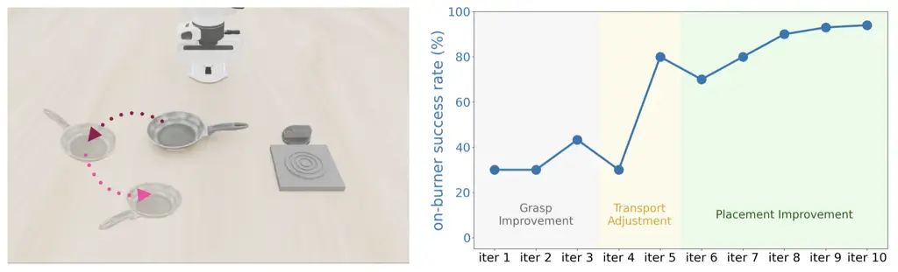
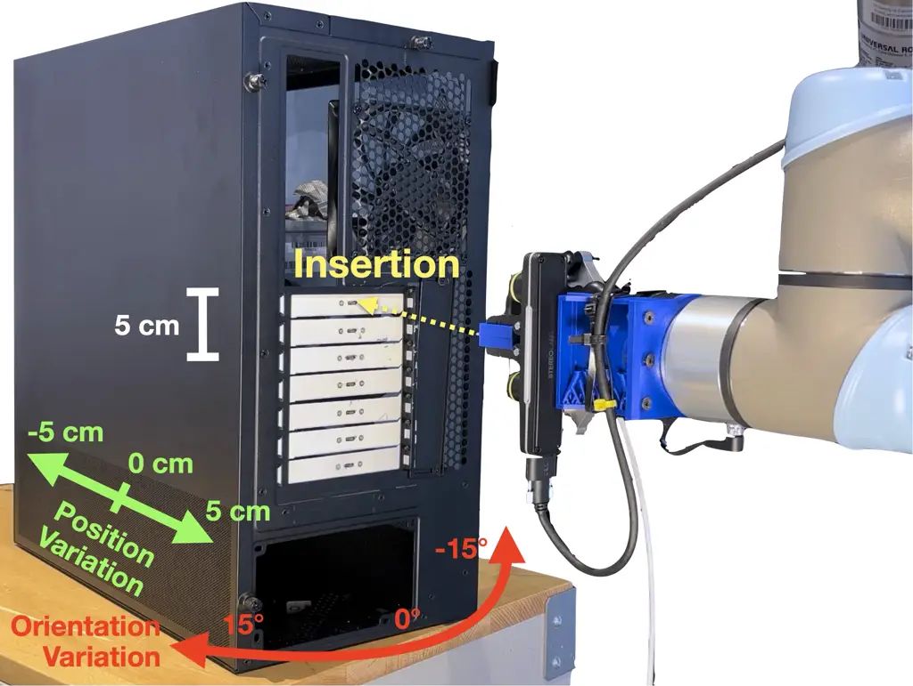
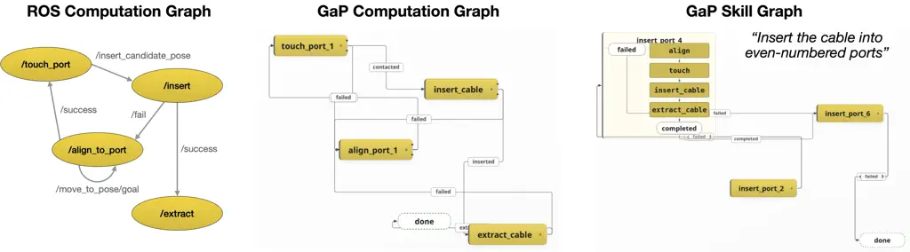
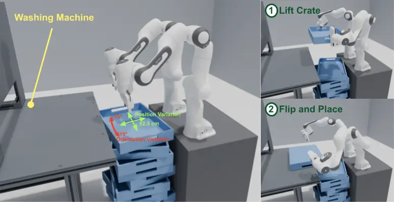

# GaP: A Graph-as-Policy Multi-Agent Self-Learning Harness For Variational Automation (VA) Tasks

Kaiyuan Chen Affiliation:  University of California, Berkeley^(\*) equal
contribution    Shuangyu Xie Affiliation:  University of California,
Berkeley^(\*) equal contribution    Letian Fu Affiliation:  University
of California, Berkeley^(\*) equal contribution    Justin Yu
Affiliation:  University of California, Berkeley^(\*) equal contribution
   William Pacini Affiliation:  University of California, Berkeley^(\*)
equal contribution    Sandeep Bajamahal Affiliation:  University of
California, Berkeley^(\*) equal contribution    Hudson Kim Affiliation: 
University of California, Berkeley^(\*) equal contribution    Jaimyn
Drake Affiliation:  University of California, Berkeley^(\*) equal
contribution    Daehwa Kim Affiliation:  University of California,
Berkeley^(\*) equal contribution    Haoru Xue Affiliation:  University
of California, Berkeley^(\*) equal contribution    Jonathan Francis
Affiliation:  Bosch    Christian Juette Affiliation:  Bosch    Peter
Schaldenbrand Affiliation:  Bosch    Muhammet Yunus Seker Affiliation: 
Bosch    Ruwan Wickramarachchi Affiliation:  Bosch    Uksang Yoo
Affiliation:  University of California, Berkeley^(\*) equal contribution
   Guanzhi Wang Affiliation:  NVIDIA    Adithyavairavan Murali
Affiliation:  NVIDIA    Balakumar Sundaralingam Affiliation:  NVIDIA   
S. Shankar Sastry Affiliation:  University of California, Berkeley^(\*)
equal contribution    Spencer Huang Affiliation:  NVIDIA    Yuke Zhu
Affiliation:  NVIDIA    Linxi “Jim” Fan Affiliation:  NVIDIA    Ken
Goldberg Affiliation:  University of California, Berkeley^(\*) equal
contribution

###### Abstract

For robots to work reliably in commercial and industrial applications,
can recent advances in agentic coding systems combine interpretable
robot programming with the open-world adaptability of model-free
policies? We focus on “Variational Automation” (VA), a class of tasks
that have larger variations in object geometry and pose than fixed
automation. Model-free policies often struggle to close the reliability
gap for VA tasks, which must be executed persistently and reliably in
commercial and industrial applications. Motivated by prior work on Task
and Motion Planning (TAMP) and the Robot Operating System (ROS), we
introduce Graph-as-Policy (GaP), a multi-agent coding harness that
generates directed computation graphs with perception, planning, and
control nodes from a Modular Open Robot Skill Library (MORSL). GaP then
generates an internal simulation environment to rehearse task instances
with different graphs in parallel to iteratively refine the graph
structure and parameters to improve success rates and throughput.
Evaluation with 8 new open VA task benchmarks, 4 in simulation and 4 in
real-world, suggests that GaP can achieve success rates that
significantly outperform baselines. Details, code, and data will be
posted online:
[https://graph-robots.github.io/gap](https://graph-robots.github.io/gap)

|     |
| --- |
|     |

![[Uncaptioned
image]](arxiv-2607-05369--90176136bd98.figures/figure-1.webp)

Figure 1: GaP system architecture. Given a “Variational Automation (VA)”
task specification, GaP uses a multi-agent harness for coding tools such
as Claude \[1\] and Gemini \[2\] to automatically generate computation
graphs that include “skill” nodes from a Modular Open Robot Skill
Library (MORSL), which includes model-based procedures (e.g. ROS \[3\])
and model-free policies (e.g. GraspGen \[4\]). GaP then orchestrates
self-learning using simulation (e.g. RoboSimStudio \[5\]) to iteratively
refine the graph, which can then be interpreted without the agents on an
edge device for persistent execution over time. Bottom: 8 Variational
Automation Benchmark Tasks (4 Sim and 4 Real).

> Keywords: Agentic Coding, Automation, Self-Learning

## 1 Introduction

A majority of robot learning research focuses on generalist robotics,
where a robot must perform a broad variety of tasks. Most of this
research has focused on model-free end-to-end Vision-Language-Action
(VLA) models  \[6, 7, 8, 9, 10, 11\]. However, fully generalist robots
struggle to achieve commercial / industrial levels of reliability \[12\]
and there is increasing interest in how robot learning could be useful
for more specialized task classes \[13\]. In this paper, we identify a
class of “Variational Automation (VA)” tasks that differ from “fixed
automation” (which blindly repeats the same motions, e.g., spot welding
or spray painting). In VA tasks, a robot persistently performs varying
instances of a task with non-trivial variation in the geometry and pose
of objects (e.g., to sort packages, make coffee in a cafe, or build
sandwiches in a commercial kitchen). Today, fixed automation in
logistics, service, agriculture, and manufacturing \[14, 15, 16, 17\] is
set up and tuned by humans using rigorous, classical engineering
methods. This provides high reliability and throughput, and human effort
can be justified when amortized over years of repetitive performance.
However, even more human effort is required to set up and tune VA
systems for reliable performance.

Recent advances in Large Language Models (LLM) \[18, 19, 20\] and
Vision-Language Models (VLM) \[21, 22, 23, 24, 25\] are rapidly
improving agentic coding \[26\], semantic reasoning \[27\] and zero-shot
generalization \[28\]. Agentic coding for robotics has the potential to
integrate model-based and model-free paradigms to rapidly generate
interpretable and reliable robot control systems. Agentic coding is new
and advancing rapidly, but remains prone to hallucinations and
constraint violations. Thus, a primary challenge is to develop effective
methods for “steering” coding agents to produce desired outputs. Coding
agents are controlled with a “harness” – a body of text provided as a
prompt to the agents that describe available software resources,
constraints, and performance metrics \[29\]. The harness also provides
interfaces that allow the LLM to compile, execute, and manage
generate-execute-observe-evaluate loops.

The use of LLM coding agents for robotics was explored as early as 2022
with a series of papers on Code-as-Policy (CaP)  \[30, 31\]. General
coding agents have improved dramatically since then by training on
increasingly large coding datasets. The recent CaP-X paper provides an
open suite of CaP benchmarks, agents, and encouraging results using
coding agents that were state-of-the-art as of January 2026  \[32\].
These single-agent CaP approaches are somewhat unstructured, prompting
the coding agent to generate free-form python code. For more complex
tasks, the context window can grow sufficiently large so that it is
difficult for the agent to obey constraints and converge on reliable
code. Individual agents are also prone to hallucinations and “cheating”,
where they make up nonexistent skills or create trivial success metrics
to artificially ”solve” robot coding tasks. These challenges are
exacerbated with _multi-agent_ coding systems, where multiple agents
operate in parallel.

To address these issues, we propose Graph-as-Policy (GaP), a harness
structure that encapsulates modular robot functions into independent
“nodes” in a directed graph that can be managed by a hierarchical
multi-agent system where optimizing each node can be assigned to a
specific agent. This structure also helps limit the size of each agent’s
context window and separates the graph generation from the graph testing
to reduce incentives for individual coding agents to “cheat” in order to
achieve requested objectives. GaP is inspired in part by the
architecture of robot Task and Motion Planning (TAMP) systems \[33, 34,
35\] which use graphical hierarchies to ensure safety and the Robot
Operating System (ROS)\[3\] which is based on a computation graph
structure. Graphical models support modularity, reuse, and composability
of functions in non-robotic and robotic applications. In GaP, a robot
policy is a computation graph composed of atomic “skill” nodes, such as
retrieving a camera frame, running inference on a perception model, or
planning and executing a motion trajectory.

Given a VA task description, GaP starts with an Orchestration Agent that
partitions a VA task into functional segments and instructs appropriate
Skill Agents to synthesize localized, functional subgraphs of atomic
nodes for its assigned segment. The orchestrator then aggregates and
wires these subgraphs together into an executable computation graph. GaP
then initiates a multi-agent self-learning harness that coordinates LLM
and VLM agents to autonomously generate, simulate, evaluate, robot
computation graphs in a loop with sampled task instances to increase a
weighted combination of success rate and throughput until the
combination reaches a plateau. The resulting computation graph is then
sent to an edge-based graph interpreter for repeated execution on the
robot.

To evaluate GaP, we present 8 new open VA benchmarks. The first 6 –
based loosely on persistent commercial applications – are (I-a,b)
Fulfill Grocery Orders, (II-a,b) Pack Grocery Items, and (III-a,b) Make
Popcorn, where ‘a’ is in sim and ‘b’ is in real. These 6 ongoing tasks
use common kitchen items and one Franka robot arm from the LIBERO \[36\]
benchmark. The other two VA benchmarks – based loosely on datacenter and
industrial applications – are (IV) Insert USB-C Cables, and (V) Wash
Crates. Results suggest that GaP can achieve success rates that
significantly outperform baselines, including $`\pi_{0.5}`$ \[10\] and
MolmoAct2 \[9\].

This paper makes the following contributions: (1) the VA task class for
robot learning with 8 open VA benchmarks; (2) a computation graph
structure for agentic robotics; (3) GaP, an implemented multi-agent
harness that autonomously decomposes natural language specifications to
collaboratively generate robot computation graphs; (4) an open, evolving
Modular Open Robot Skill Library (MORSL) with 51 initial skills; (5) a
self-learning approach to graph rehearsal and optimization using
internal simulations built with RoboSimStudio \[5\]; and (6)
Experimental data comparing GaP with TAMP, model-free, and other
baselines and simulations on the first 6 VA benchmarks, and performance
results from GaP on the other 2 VA benchmarks.

## 2 Related Work

Variational Automation. The term “automation” is commonly used to
describe robot systems that persistently perform repetitive tasks over
hours, weeks, months, or years for logistics, manufacturing, healthcare,
service, agriculture, and other applications. To be successful,
commercial and industrial automation must achieve desired throughput
(units per hour: success rate divided by cycle time) at a cost that will
provide a desired return on investment. Accordingly, research in
automation extends research in robotics by focusing on reliability,
cost, safety, ease of use, and other factors required for successful
production deployment.

In this paper, we propose “Variational Automation (VA)” as a class of
tasks that differ from Generalist Robotics (GR) and Fixed Automation
(FA). In FA, a robot persistently performs identical instances of a task
with objects of identical geometry. In box stacking, for example, FA
would consist of moving identical boxes from a common initial pose on a
conveyor belt into a fixed pallet arrangement. In FA, variations in the
environment and object shape and pose are minimal.

For GR, a robot performs a variety of different tasks (e.g., placing
groceries into a refrigerator, or domestic cleaning, folding, kitchen
pick-and-place) in different homes, where environments vary considerably
and objects have variable geometry and highly variable initial poses.
Recent robot learning research predominantly targets highly unstructured
Generalist Robotics (GR), such as household robots executing diverse
chores across novel environments using a single generalist model-free
VLA policies \[37, 38, 6, 7, 10\].

In VA, by contrast, a robot persistently performs varying instances of
the task: the boxes have variable geometry (different SKUs), arrive in a
distribution of varying initial poses, and must be densely packed into
varying pallet arrangements. As most robot learning research focuses on
GR, and robot learning may not be required for FA, we focus on robot
learning for VA, aiming to reduce the human effort required to set up VA
systems.

Modular Robot Control Methods. Early robotic systems programmed policies
using classical modular components. The Shakey robot \[39\] in the late
1960s decomposed its architecture into 3 functional components: sensing,
planning, and execution \[40\]. System architectures like the Robot
Operating System (ROS) \[3\] utilize explicit directed graphs to route
data, manage dependencies, and ensure reliable execution. Concurrently,
Task and Motion Planning (TAMP) \[33, 34\] approaches jointly solve
discrete task planning and continuous motion planning problems, enabling
the satisfaction of constraints involving both high-level action
sequencing and low-level geometric feasibility. Behavior Trees
(BTs) \[41\] encode reactive task logic and failure recovery, and recent
work shows LLMs can generate BTs with high success rates \[42\]. GaP
combines the typed dataflow topology of the ROS computation graph with
the reactive task logic and failure recovery of BTs, enabling (a) static
type checking and verification, (b) explicit failure recovery loops, and
(c) simulation-guided graph optimization.

Code-as-Policy (CaP) uses agents to write robot control code, suggesting
an alternative to manual coding of model-based methods and pure
end-to-end learning of model-free policies \[30\]. Extensions such as
ALGARA \[43\], CaP-X \[32\], CodeDiffuser \[44\], GRAPPA \[45\], and
Maestro \[46\] use more recent LLMs to generate robot code. Similarly,
systems like TiPToP \[35\] incorporate LLMs with classical robot
TAMP \[47, 48, 49, 50\]; TAMP can achieve general open-vocabulary
manipulation and transfer to new tasks with minimal tuning, and TiPToP
integrates Gemini perception, M2T2 grasp planning, and cuTAMP. GaP
explores an alternative modular architecture that specializes a
persistent graph to a VA task class.

Code-as-Policy (CaP) is an alternative to manual coding of model-based
methods and pure end-to-end learning of model-free policies \[30\],
ALGARA \[43\], and CodeDiffuser \[44\] utilized LLMs for open-vocabulary
script generation to generate robot code. GaP tempers the flexibility of
CaP approaches by introducing a graph structure, allowing GaP to harness
the open-world adaptivity of pretrained LLM coding agents while
maintaining a structured, interpretable graph structure to support
persistent Variational Automation.

Self-Improving Agentic Workflows For Robotic Control. Outside of
robotics, Large Language Models (LLMs) have demonstrated exceptional
capabilities in dynamic coding, complex software integration, and API
orchestration \[51, 18, 52, 53, 1, 2\]. By embedding these capabilities
into structured agentic workflows, LLMs can autonomously synthesize
solutions for open-ended tasks \[54\]. A foundational example is Voyager
\[55\], which uses LLMs to iteratively write, refine, and execute
Minecraft game playing skills to continually expand a curated library of
reusable skills. In these frameworks, a “skill” is typically defined as
a discrete function with strict semantic contracts. Recent literature
has begun to explore the iterative optimization of agentic systems
through language-based failure reasoning \[56\] and multi-agent prompt
optimization frameworks \[57, 58\].

To improve code generation quality and performance, CaP-X \[32\] used a
VLM to provide feedback before and after execution (i.e. Visual
Differencing), but the VLM can suffer from hallucinations and cannot
handle geometric and numerical information such as motion feasibility.
Building on the structure of Blox-Net \[59\], which uses physical
experiments to improve LLM-generated task plans, GaP uses multiple LLM
agents to generate a robot computation graph and iteratively improve it
using simulation experiments.

## 3 Problem Formulation

##### Assumptions

For Variational Automation tasks that will be repeated over extended
periods, we assume the workcell environment, robot, and sensors are
known and fixed. Furthermore, we assume the range of potential objects
and the range of initial object poses are known. These assumptions are
part of the VA setting rather than oracle information: unlike generalist
robotics, VA tasks are defined by a known workcell and bounded operating
envelope, allowing systems to use object models, calibrated sensors, and
reusable automation skills when available. Because object meshes and
pose ranges are part of the task input, the internal simulation is
instantiated directly from them without scene reconstruction, system
identification, or domain randomization.

##### Variational Automation Task Class

We formalize a Variational Automation (VA) Task using the tuple
$`\mathcal{T}=\langle\mathcal{L},\mathcal{E},\mathcal{R},\mathcal{O},\mathcal{X},\mathcal{B},\mathcal{J}\rangle`$:

- •
  $`\mathcal{L}`$, Language Space: Natural language instructions and
  semantic descriptors that describe desired task behavior, providing
  high-level context for decomposing the task into segments.
- •
  $`\mathcal{E}`$, is a known stationary workspace environment (e.g.,
  workcell) that establishes world frame $`\mathcal{W}`$ and occupancy
  map $`\mathcal{M}_{E}`$, providing the support surfaces that constrain
  the feasible pose space of all entities to the non-colliding subset of
  $`SE(3)`$.
- •
  $`\mathcal{R}`$, is the robot and sensor configuration, specifying the
  robot URDF, joint limits, gripper configuration, camera spec, and
  camera placement.
- •
  $`\mathcal{O}`$, Object Set: The set of all possible objects in the
  task, comprising both rigid objects $`\{o_{i}\}`$ with 3D models
  $`\mathcal{M}_{i}`$ and articulated entities $`\{\kappa_{j}\}`$ (e.g.,
  drawers, knobs) with defined kinematic joint limits
  $`[\theta_{\min},\theta_{\max}]`$.
- •
  $`\mathcal{X}`$, State Space: The product space of the robot joint
  configurations, the $`SE(3)`$ poses of all rigid objects, and the
  kinematic states of articulated entities:
  $`\mathcal{X}=\mathcal{C}_{robot}\times SE(3)^{n}\times\mathbb{R}^{m}`$.
- •
  $`\mathcal{B}`$, Belief Space: Describes the distribution of objects
  and poses in instances of the task. A specific instance is sampled
  $`\mathbf{x}_{i}\sim p(\mathbf{x}\mid\mathcal{X})`$, introducing
  variations such as: (i) Structured Priors: Position sampled uniformly
  over a volume $`\mathcal{V}`$
  ($`\mathbf{x}_{i}\sim\text{Uniform}(\mathcal{V})`$) and orientation
  ranges, and (ii) Empirical Distributions: Multi-modal distributions
  estimated from real-world demonstrations or perception (e.g., point
  cloud registration).
- •
  $`\mathcal{J}`$, Reward function: A multi-objective reward function
  used to evaluate success and efficiency, defined
  as:$`\mathcal{J}=w_{s}\cdot\mathbb{I}(\text{success})+w_{t}\cdot\Phi`$
  where $`\mathbb{I}(\cdot)`$ is the success indicator, $`\Phi`$ is the
  throughput (success rate / cycle time), and $`w_{s},w_{t}`$ are
  weighting factors.

Given a task $`\mathcal{T}`$, a task instance
$`\tau_{i}=\langle o_{i},x_{i}\rangle`$ is drawn from $`\mathcal{O}`$
and $`\mathcal{B}`$ respectively.

##### Policy Representation via Directed Execution Graphs

Graph-as-policy (GaP) represents a robot policy
$`\pi(a\mid\mathbf{x},\mathcal{T})`$ as a directed computation graph
$`\mathcal{G}=(V,E)`$ to complete all task instances
$`\forall\tau_{i}=\langle o_{i}\subseteq\mathcal{O},x_{i}\sim\mathcal{B}\rangle\in\mathcal{T}`$.
The graph $`\mathcal{G}`$ consists of modular, atomic functional units
called _nodes_, connected by edges that dictate both data flow and
execution logic. The components are defined as follows: Nodes ($`V`$):
Each node $`n\in V`$ represents a functional primitive for manipulation,
perception, or a segment of executable code. Each node encapsulates a
single, well-defined robotic operation with a typed input/output
signature. Nodes can be grouped into skills, a natural-language
specification that instructs an LLM agent how to configure and compose a
set of atomic nodes on the execution graph for a defined sub-task. Edges
($`E`$): A directed edge $`e=(n_{i},n_{j})\in E`$ represents a data or
logic dependency. Data edges route a producer node’s output to a
consumer node’s input (e.g., feeding the output of an object-centering
node into a planar-surface-orienting node) and implicitly induce
execution order through their dependencies; independent branches may
execute concurrently. Control edges are condition branches and carry a
predicate over node outputs.

##### Problem Definition

Given a task class
$`\mathcal{T}=\langle\mathcal{L},\mathcal{E},\mathcal{R},\mathcal{O},\mathcal{X},\mathcal{B},\mathcal{J}\rangle`$,
GaP must synthesize a robust execution graph $`\mathcal{G}^{*}`$ that
generalizes across the entire belief space $`\mathcal{B}`$. Formally,
for any task instance $`\tau_{i}\in\mathcal{T}`$ and given a real-time
scene observation $`\mathcal{I}`$ (comprising multi-view image sets from
static and wrist cameras), the graph executor interprets the computation
graph $`\mathcal{G}^{*}`$ by invoking its skill nodes and following its
data and control edges. This execution induces a closed-loop robot
policy $`\pi_{G}(a\mid\mathcal{I})`$, which maps observations and graph
state to robot actions in order to achieve the goal state specified by
$`\mathcal{L}`$. We define the optimized graph $`\mathcal{G}^{*}`$ as
one that maximizes performance across all instances in the variational
class: $`\mathcal{G}^{*}=\arg\max_{\mathcal{G}}\mathbb{E}_{x_{i}\sim\mathcal{B}}\left[\mathcal{J}(\pi(a\mid\mathcal{I},\mathcal{G}))\right]`$.

The optimized graph is then sent to an edge-based interpreter for
repeated execution on the robot.

## 4 Graph-as-Policy

The GaP architecture is illustrated in Figure 1. As an example, consider
the Make Popcorn VA task. Given a natural language specification and
geometric object models, the multi-agent GaP harness first partitions
the high-level objective into semantic segments such as ‘turn on the
knob’, ‘pick up the popcorn pan’, etc. Next, drawing from the Modular
Open Robot Skill Library (MORSL), GaP maps these segments into atomic
robotic skills to synthesize an initial computation graph
$`\mathcal{G}`$. During self-learning, the computation graph is
evaluated using an internal simulation to iteratively refine the
execution graph topology and node parameters prior to deployment. The
optimized robot computation graph is then sent to an external
interpreter for repeated execution on the physical robot.

### 4.1 Modular Open Robot Skill Library (MORSL)

The MORSL library uses agentic tool-use conventions (e.g., Anthropic’s
Skill.md \[60\]) with extensions for graph declarations. Each skill
declares its inputs, outputs, semantic parameters, and pre-conditions,
so the agent can decide both when to invoke it and how to wire it into
the graph. Examples of the 51 initial MORSL skills include perception
(SAM2 \[61\]/3 \[62\], Grounding DINO \[63\], OWL-ViT \[64\],
Molmo \[65\], general-purpose VLM \[23, 66\]; 15 skills), grasp planning
(Contact GraspNet \[67\], GraspGen \[4\], M2T2 \[68\]; 5 skills), motion
planning (cuRobo \[69\] and cuRobov2 \[70\]; 8 skills), 2D and 3D vision
utilities with NumPy and OpenCV (e.g., DBSCAN for point cloud
processing; 15 skills), and 8 additional verification and control
primitives including (\*) Cartesian Linear Motion Planning with CuRobo;
(\*) Robot Operating System (ROS) Translator ; (\*) Visuomotor
Interactive Perception Policies. The full catalog can be found in the
Appendix A.

### 4.2 Self-Learning through Internal Simulation Rehearsal

Input:
$`\mathcal{T}=\langle\mathcal{L},\mathcal{E},\mathcal{R},\mathcal{O},\mathcal{X},\mathcal{B},\mathcal{J}\rangle`$,
Iterations $`M`$, Parallel Rollouts $`N`$ Output: Optimized Task Graph
$`\mathcal{G}^{*}`$

Initialization: 
$`\mathcal{G}_{0}\leftarrow\mathrm{Graph\_Init}(\mathcal{L})`$    //
Initial graph from language

$`\mathcal{S}\leftarrow\mathrm{Build\_Scene}(\mathcal{G},\{\mathcal{G}_{i}\})`$ 
  // Instantiate sim environment

for _$`j\leftarrow 1`$ to $`M`$_ do

   // Step 1: Scene Variational Sampling
$`\{\hat{s}_{i}\}_{i=1}^{N}\sim\mathcal{B}`$ 3     // Sample $`N`$
instances// Step 2: Parallel Rehearsal 4 for _$`i\leftarrow 1`$ to
$`N`$_ do in parallel

7        5
$`\tau_{i}\leftarrow\mathrm{Rehearsal}(\hat{s}_{i},\mathcal{G}_{j-1})`$ 
  // Rollout
policy$`F_{i}\leftarrow\mathrm{Analyze_{\_}Failure}(\tau_{i},\mathcal{G},\{\mathcal{G}_{i}\})`$
6  

9    // Step 3: Graph Refinement
$`\mathcal{G}_{j}\leftarrow\mathrm{Graph\_Update}(\{F_{1},\dots,F_{N}\})`$
8     // Optimize via LLM

10 return $`\mathcal{G}^{*}\leftarrow\mathcal{G}_{M}`$ 

Algorithm 1 Rehearsal-based Graph Optimization

To iteratively learn to improve a graph using task instances, we execute
the computation graph, provide feedback, update the graph, and iterate.
As described in self-learning Algorithm 12, GaP uses
RoboSimStudio \[5\], an agentic toolkit for physics-based simulation of
robot manipulation tasks, to instantiate the internal simulation that
renders the visualization for the perception nodes, simulates physics,
and computes contacts. To generate feedback, GaP registers the robot and
object state before and after each rehearsing node, together with
contact queries between the robot and objects, to compute differences
and infer the motion outcome. The optimization process begins with task
instance sampling, where the system generates $`N`$ parallel task
instances $`\{{\tau}_{i}\}_{i=1}^{N}`$. These task instances are
instantiated by sampling from the belief space $`\mathcal{B}`$, which
represents the probability distribution over potential object poses,
initial states, and kinematic configurations within the workspace
$`\mathcal{E}`$. GaP generates the initial graph $`\mathcal{G}_{0}`$
through multi-agent harness. Then, a parallel rehearsal starts across
these $`N`$ scenes to evaluate graph performance. In instances where the
rollout fails to meet success criteria, GaP analyzes the physical
execution data to isolate geometric root causes within the occupancy or
articulated entities. The graph is updated by the agents with Graph
Update using a typed action set: (1) set a node’s declared inputs, such
as perception prompts; (2) rewire node inputs and outputs; (3) rewrite
an inline Python script, such as format transformations and arithmetic;
(4) swap skill nodes; and (5) verify the result with static type
checking and simulation. Proposed updates that degrade success rate or
cycle time on 100 fresh task instances are rejected, and the loop
iterates until performance reaches a plateau or terminates with failure
reasons.

## 5 Experiments

### 5.1 Simulation and Real-World Variational Automation Benchmarks

We present 8 VA benchmark tasks, including 4 in simulation and 4 in
real-world. Six of these are inspired by LIBERO \[36\], the de facto
standard for evaluating VLA policies in simulation.

Benchmark (I-a,b): Fulfill Grocery Orders (Sim and Real) Each instance
of this task involves locating a designated target item and placing it
into the basket. The original LIBERO \[36\] benchmark did not vary the
position of the (objects) which allows for overfitting to the
demonstration examples. To address this, the LIBERO-Pro \[71\]
evaluation suite swaps target and basket object positions at test time
(object_swap). We introduce four extensions for our VA Benchmarks: 1)
X-Y 20$`\times`$20 $`cm^{2}`$, where the position of each object varies
uniformly within a 20$`\times`$20 $`cm^{2}`$ zone centered around the
original LIBERO object pose; 2) basket_swap, which swaps the target item
and basket location; 3) permutation, which swaps target item and
distractor item positions; and mixed_all including all three variation
types. The physical benchmark directly mirrors this setup. To avoid
object collisions during task instance generation, we utilize Minkowski
sum \[72\] operations to ensure item singulation. The real version of
this benchmarks uses a Franka arm with wrist camera and real items from
a grocery store.

Benchmark (II-a,b): Pack Grocery Items (Sim and Real) We modify
Benchmark I-a,b to create multi-object pick-and-place tasks, as in a
grocery checkout line, where the robot is assigned to pack 6 objects
into a container without needing to identify or select any specific
items. We quantify the success rate as the number of items (out of 6)
placed into the basket after 6 grasping attempts.

Benchmark (III-a,b): Make Popcorn (Sim and Real) We use the LIBERO
frypan, stove, and knob assets to create a manipulation task that
requires the robot to sequentially turn on a stove, pick up the pan
handle, place it on the stove, remove the pan, and turn off the stove.
For the real version of this benchmark, we use the Franka Robot arm with
wrist-camera, a portable stove from Amazon and Jiffy-Pop popcorn.

Benchmark (IV): Insert USB-C Cables (Real) This benchmark task requires
a UR5 robot arm with the ZED Mini wrist camera to execute a series of
USB-C cable insertions and extractions in a bank of 7 sockets. The robot
uses internal force torque feedback to probe the insertion when the
target port goes beyond the camera’s field of view. The benchmark
includes two varying conditions. First, we vary the pose of the cable
ports, testing three distances in 5 $`cm`$ increments and three angles
in 15° increments. Second, we vary the text prompt to specify five
distinct goals: targeting individual ports, inserting in ascending
order, descending order, odd-indexed ports, and even-indexed ports.

Benchmark (V): Wash Crates (Sim) This simulation benchmark simulates a
real industrial crate-washing use case where two Franka robot arms must
cooperatively grasp a crate by narrow slits on its sides, lift it off a
stack, flip it, and place it onto a washing machine table. Each instance
varies the initial pose of the crate, varying yaw rotations of up to
$`\pm 15^{\circ}`$ and horizontal displacements of up to $`\pm 2.5`$
$`cm`$. The benchmark provides a language instruction “Cooperatively
lift the top crate off the stack with both Franka arms, flip it over,
and place it on the washing machine table,”. (Fig. 6).

### 5.2 Baselines

Each cell in Table 1 represents the outcome from trials with 100 task
instances of Benchmarks I-a and II-a (in simulation) for a total of over
5000 simulation trials. We run CaP-X \[32\] which uses a single agent
and is given only an image of the initial task instance and natural
language instructions. We note that this is not a fair comparison as GaP
is designed for Variational Automation where environment geometry is
known (but object location is unknown), so the performance of CaP-X
serves as an ablation of GaP with a single agent and without
self-learning. We evaluate VLA models $`\pi_{0.5}`$ \[10\] and
MolmoAct2 \[9\] with official checkpoints finetuned on the LIBERO
training dataset. We also evaluate TipTop \[35\], a modular
open-vocabulary planning system for robotic manipulation based on TAMP.
We configure this from the github code with the default configuration of
128 particles for cuTAMP \[73\] with a 60-second planning timeout. We
warm up the cuTAMP cache before measuring the execution time. Rows 5 and
6 represent combinations of GaP with VLA models, where GaP generates an
initial robot motion to center the wrist camera over the target object
(bringing the VLA into distribution).

For GaP and CaP-X, we use Gemini-3.1-Flash-Lite for LLM agents and VLM
with a temperature of 0.1. For Benchmarks I and II, GaP does not perform
self-learning because the first graph generated achieves high
performance.

### 5.3 Benchmarks I and II: Fulfill Grocery Orders and Pack Grocery Items

|                     |        |             |                               |             |             |           |                    |        |
| ------------------- | ------ | ----------- | ----------------------------- | ----------- | ----------- | --------- | ------------------ | ------ |
|                     | LIBERO | LIBERO-Pro  | Fulfill Grocery Orders        |             |             |           | Pack Grocery Items |        |
| Method              | object | object_swap | X-Y 20$`\times`$20 $`cm^{2}`$ | basket_swap | permutation | mixed_all | fixed              | varied |
| CaP-X               | \-     | 0.22        | 0.07                          | 0.05        | 0.11        | 0.10      | 0.01               | 0.01   |
| $`\pi_{0.5}`$       | 0.96   | 0.24        | 0.78                          | 0.15        | 0.20        | 0.20      | 0.17               | 0.18   |
| MolmoAct2           | 0.97   | 0.43        | 0.90                          | 0.26        | 0.10        | 0.20      | 0.18               | 0.18   |
| TipTop              | 0.22   | 0.22        | 0.29                          | 0.24        | 0.31        | 0.24      | 0.34               | 0.46   |
| $`\pi_{0.5}`$ w/GaP | 0.85   | 0.60        | 0.79                          | 0.32        | 0.50        | 0.39      | 0.67               | 0.66   |
| MolmoAct2 w/GaP     | 0.70   | 0.62        | 0.84                          | 0.58        | 0.39        | 0.66      | 0.59               | 0.59   |
| GaP                 | 0.95   | 0.95        | 0.95                          | 0.97        | 0.93        | 0.97      | 0.99               | 0.98   |

Table 1: Success Rates for 5500 trials, 100 task instances per table
cell. Results on Benchmarks I-a and II-a: Fulfill Grocery Orders and
Pack Grocery Items. The first two columns are the original LIBERO \[36\]
with negligible pose variation, and LIBERO-PRO with slightly larger pose
variation \[71\] . We introduce the VA Grocery Order Fulfillment
benchmark that includes larger object positional variance (X-Y
20$`\times`$20 $`cm^{2}`$), swapping target and basket positions
(basket*swap), permuting all item locations, and everything combined
(mixed_all). We also introduce the Grocery Packing benchmark that
requires picking all objects and placing them in the basket. In rows 5
and 6, GaP navigates the robot wrist camera above the target object and
then switches to MolmoAct2 and $`\pi*{0.5}`$ VLA policies.

#### 5.3.1 Simulation Results

GaP achieves significantly better positional robustness compared to
baselines. As shown in Table 1, while baseline VLA models
($`\pi_{0.5}`$, MolmoAct2) achieve high success rates on LIBERO-object
without pose variation, their performance drops as low as 0.20 for
LIBERO-PRO with positional variance. In contrast, GaP maintains robust
success rates across all variations. We find that TipTop \[35\] cannot
generate motion plans for many of these benchmark task instances because
M2T2 \[68\], cuRobo \[69\], and cuTAMP \[73\] cannot plan feasible
solutions.

|                                |        |       |
| ------------------------------ | ------ | ----- |
| Success Rate                   | TipTop | GaP   |
| Fulfill Grocery Orders         | 8/25   | 25/25 |
|    $`\rightarrow`$ object      | 3/5    | 5/5   |
|    $`\rightarrow`$ 20x20       | 2/5    | 5/5   |
|    $`\rightarrow`$ basket swap | 1/5    | 5/5   |
|    $`\rightarrow`$ tall basket | 0/5    | 5/5   |
|    $`\rightarrow`$ permutation | 2/5    | 5/5   |
| Pack Grocery Items             | 10/30  | 28/30 |
| Make Popcorn                   | 0/20   | 18/20 |

Table 2: Physical Benchmark on Benchmarks I-b, II-b, and III-b. We
report success rate and completion time. Sub-tasks ($`\rightarrow`$) are
reported per benchmark. On average, the completion time of single
pick-and-place for TipTop is 95 seconds, and GaP is 67 seconds.

VLA policies can benefit from GaP. Performance for $`\pi_{0.5}`$ w/GaP
and MolmoAct2 w/GaP suggest that GaP can enhance robustness of existing
VLA models as shown in rows 5 and 6 of Table 1. As VLA policies struggle
with positional perturbation of target objects, GaP uses the wrist
camera and interactive perception skills to reliably identify the target
object and uses linear cartesian motion skills to navigate the arm and
wrist camera to a pre-grasp pose above the target object. The GaP
computation graph then hands over execution to the VLA policy, staging
it from a more favorable observation and producing more than a twofold
improvement in success rates.

#### 5.3.2 Real Physical Experiment Results

GaP transfers well from Sim to Real. As shown in Table 2, for the
Fulfill Grocery Orders benchmark, GaP achieves a perfect success rate of
25/25 (100%), while TipTop succeeds in only 8/25 trials. Both GaP and
TipTop accurately identify the objects. However, TipTop \[35\] fails
because M2T2 \[68\], cuRobo \[69\], and cuTAMP \[73\] combined cannot
find feasible motion plans for cubic-shaped objects, tall baskets, or
varied object orientations. In terms of execution time, GaP perceives
the item and basket in parallel using 14.1 seconds to generate oriented
bounding boxes, and 36.4 seconds for descending, grasping, and
transporting the items.

### 5.4 Ablation Studies

For Fulfilling Grocery Orders and Packing Grocery Items, the full GaP
system achieves robust success rates (0.93–0.99). We ablate as follows:
(1) Graphless generation forces the LLM to perfectly inline low-level
service interfaces, such as method names and request schemas, from
memory. Consequently, even when the high-level logic is correct, minor
syntax or interface mismatch errors inevitably terminate the trial. So
replacing the structured graph output with a single LLM that generates
raw Python scripts collapses the success rate to zero. (2) Condensing
GaP’s specialized authoring agents into a single LLM also drops success
rates to zero, with all trials failing static structural verification
prior to execution, because a single LLM agent struggles to
simultaneously manage global data flow, local logic, and verification,
frequently introducing dangling references or node collisions.
Furthermore, even with iterative feedback, a single LLM tends to
oscillate between mistake classes without converging. (3) Graph
validation improves graph connectivity. For each configuration in
Fulfill Grocery Orders, some task segmentation agents emit a
first-attempt subgraph that fails static type/edge checks and would
crash at runtime, for example, some graphs wire the input and output of
the transport phase in drop-pose computation to the release phase and
other is in checkpoint verification. GaP’s graph validation verifies the
wiring and effectively ensures the graph edge connectivity.

### 5.5 Benchmark III a, b: Make Popcorn in sim and real

Figure 2: Self-Learning for Making Popcorn Benchmark. Pan pose
variations (left) drive a 10-iteration sequence of graph updates; (blue,
left axis) iteration phases shaded by class of edit.

The Make Popcorn task requires the robot to grasps the stove knob and
rotate it to turn on the burner, then the robot must find and pick up
the handle of the JiffyPop popcorn pan, place it on the stove burner,
wait, and then turn off the stove.

GaP generates a graph using GraspGen \[4\], knob turning skills and
other object localization and grasping skills from Benchmark 1 and 2.
The initial graph is able to turn on and off the knob but unable to pick
and place the pan properly with only a 33% success rate.

Self-Learning significantly increases success rate. As shown in the
Fig. 2, self-learning proceeds through three stages: (1) from iteration
1 to 3, the majority of failures come from pan grasping failure, where
the simulator feedback reports that the Franka gripper is not in contact
with the object pan, so GaP replaces the GraspGen grasp skill with a
skill that mixes GraspGen with an oriented bounding box grasp planner.
(2) In iteration 4, GaP recognizes that the pan should be grasped by the
handle, thereby adjusting the perception algorithm prompts to localize
the pan handle. (3) In iterations 4-8, GaP finetunes the offset of pan
placement due to the changed grasping strategy to align the pan with the
stove surface.

The resulting policy achieves 94% in simulation with variations in pan
position and orientation, and achieves a 90% (18/20) success rate in
real physical trials as shown in Table 2. The two physical failures
resulted from one inverse kinematics (IK) error during linear Cartesian
motion, and one misgrasp caused by accumulated kinematic error.

### 5.6 Self-Learning to Reduce Cycle Time

Figure 3: Self-Learning for Cycle Time on Benchmarks I–III.
Per-iteration cycle time (left axis) and success rate (right axis).
Accepted graph updates are colored by edit class: perception (blue),
motion parameters (green), and graph topology (purple); updates that
degrade success rate or cycle time on 100 fresh task instances are
rejected.

|                           |                           |                 |               |               |                                     |               |
| ------------------------- | ------------------------- | --------------- | ------------- | ------------- | ----------------------------------- | ------------- |
|                           | Success Rate $`\uparrow`$ |                 |               |               | Throughput (cycles/hr) $`\uparrow`$ |               |
| Benchmark                 | TiPToP                    | TiPToP w/ MORSL | GaP (Initial) | GaP (Learned) | GaP (Initial)                       | GaP (Learned) |
| I. Fulfill Grocery Orders | 0.24                      | 0.53            | 0.97          | 0.97          | 49.7                                | 124.1         |
| II\. Pack Grocery Items   | 0.34                      | 0.60            | 0.97          | 0.97          | 7.3                                 | 16.2          |
| III\. Make Popcorn        | 0.00                      | 0.00            | 0.33          | 0.94          | 30.5                                | 76.6          |

Table 3: Success rate and throughput before and after self-learning on
Benchmarks I–III (simulation). TiPToP w/ MORSL replaces TiPToP’s
perception and grasp planning with MORSL skills.

Since GaP saturates the success rate on Benchmarks I–III, we
additionally run self-learning with the throughput term of
$`\mathcal{J}`$ to reduce cycle time. As shown in Fig. 3 and Table 3,
the LLM agent reduces cycle time by up to 57% with no success rate
trade-off. It adjusts perception algorithms (e.g., using a cheaper
detector for the basket), tunes motion parameters (e.g., control
settling steps), and modifies graph topology (e.g., reusing perception
results across nodes); proposals that degrade success rate or cycle time
on 100 fresh task instances are rejected by the internal simulation.
Table 3 also reports TiPToP equipped with MORSL perception and grasp
planning skills: TAMP benefits from the higher-quality MORSL skills,
while GaP further improves performance with flexible motion primitives
and self-learning. In terms of practical cost, graph generation takes
fewer than 30 LLM calls to Gemini (about \$0.01 and 1 s latency);
self-learning wall-clock time is dominated by simulation (about 15
minutes per iteration and up to 150 minutes in total for Make Popcorn);
and no agent is involved once the graph is deployed.

### 5.7 Benchmark IV: Insert USB-C Cables (Real)

Figure 4: Seven-ports cable insertion setup.

|                          |                |          |          |
| ------------------------ | -------------- | -------- | -------- |
| Variation                | SR (Per trial) | SR (All) | ET (All) |
| Insertion Goal Condition |                |          |          |
| Individual port^(∗)      | 5/5            | \-       | 26.0     |
| Ascending order          | 32/35          | 2/5      | 247.0    |
| Descending order         | 32/35          | 4/5      | 223.2    |
| Odd index port           | 20/20          | 5/5      | 136.8    |
| Even index port          | 14/15          | 4/5      | 104.6    |
| Position/Orientation     |                |          |          |
| \-$`15^{\circ}`$^(∗)     | 4/5            | \-       | 24.0     |
| $`15^{\circ}`$^(∗)       | 5/5            | \-       | 25.6     |
| \-$`5`$ cm^(∗)           | 5/5            | \-       | 29.4     |
| $`5`$ cm^(∗)             | 4/5            | \-       | 28.0     |

Table 4: USB-C Cable insertion variations and results over 130 total
insertion trials. Success rates (SR) and execution time in seconds (ET).
^(∗)Excludes extraction phase.

For cable insertion benchmark evaluation, we utilize the computation
graph generated by GaP, which operates via four modular ROS execution
nodes: align to port, touch port, insert, extract. The robot first
aligns to establish contact, generating a 1 $`\times`$1 $`cm^{2}`$ grid
of insertion candidates. The insert node then evaluates these positions,
requiring $`>`$3 mm of progress at $`<`$10.0 N of force, and confirms
successful insertion when the depth exceeds 6 mm at 30.0 N. Finally, the
extract node safely pulls the cable using a 2.0 Hz wiggling motion while
maintaining lateral forces below 20.0 N. This entire policy requires
approximately 30 seconds per insertion.

Figure 5: Left: ROS computation graph that is hand-engineered using
traditional ROS nodes and topics. Middle: GaP can leverage nodes in ROS
and generate a compatible graph using atomic skill sets, align to port,
touch port, insert, and extract. Right: GaP can also use these nodes
inside a subgraph for a long-horizon task, such as inserting the cable
into even-numbered ports.

GaP provides flexibility to integrate with ROS nodes for robust,
accurate task completion. Across 130 insertion trials, GaP achieved a
0.93 success rate (121/130). A detailed breakdown is provided in
Table 4. GaP generated the correct workflows for all five text prompts,
successfully handling long-horizon tasks with variations in position and
orientation. Through this integration with ROS, GaP ensures both robust
task execution and strong generalization across diverse positional
variations and goal conditions. Some of the corresponding graphs
generated by GaP are shown in Figure B.1.

### 5.8 Benchmark V: Wash Crates (Simulation)

Table 5: Wash Crates benchmark, 150 trials. Success rate (SR), average
cycle duration (s), and sustained throughput (successes/hr) over a
3-hour continuous run.

|                 |      |          |            |
| --------------- | ---- | -------- | ---------- |
| Method          | SR   | Avg(Dur) | Throughput |
| Hand-Engineered | 0.99 | 176      | 19         |
| GaP             | 0.95 | 179      | 18         |

Figure 6: Industrial crate-washing setup.

We compare GaP with a hand-engineered execution graph authored by an
expert, representing the conventional manual engineering effort required
in such settings. We run both policies over 150 trials sampled from the
pose distribution, and additionally measure sustained throughput over a
3-hour continuous execution window.

GaP closely matches an expert hand-engineered solution. As reported in
Table 5, GaP achieves a $`0.953`$ ($`143/150`$) success rate against the
hand-engineered graph’s $`0.987`$ ($`148/150`$), with similar average
cycle times ($`179.13`$ s vs. $`176.47`$ s). Over the 3-hour throughput
run both policies attempted $`59`$ trials, of which GaP completed $`55`$
and the hand-engineered graph $`58`$, corresponding to $`18.33`$ and
$`19.33`$ successes per hour, respectively. These results suggest that
GaP can autonomously produce coordinated bimanual policies whose
reliability and throughput approach those of a manually hand-tuned
baseline.

## 6 Conclusion

Agentic robotics has potential to build on rapidly-advancing LLM models
to provide a bridge between Good Old Fashioned Engineering (GOFE) and
model-free VLA policies. As shown in the Ablation experiments, GaP’s
graph-structured agentic robotics facilitates modularity, multi-agent
integration, and self-learning. As robot applications become more
complex and skill libraries grow, more sophisticated agent harnessing
will be required.

Limitations. Although in experiments, GaP improves success rates
significantly over baselines, execution reliability is not yet at
industry levels and additional self-learning and parameter tuning is
required. Similarly, GaP execution times are still well below industry
standards of 500 units per hour (7 seconds per instance); more work is
required to reduce VLM inference requests and IK motion planning time
during execution. Also, the 8 VA benchmarks focus on quasi-static
pick-and-place operations – only Cable Insertion (IV) requires force
sensing. More work is required to apply GaP to tasks with deformable
objects, dynamic forces, and moving targets.

## References

- \[1\] Anthropic. Claude 3.5 Sonnet.
  [https://www.anthropic.com/news/claude-3-5-sonnet](https://www.anthropic.com/news/claude-3-5-sonnet),
  June 2024.
- \[2\] K. Kavukcuoglu. Gemini 2.5: Our most intelligent AI model.
  [https://blog.google/technology/google-deepmind/gemini-model-thinking-updates-march-2025/](https://blog.google/technology/google-deepmind/gemini-model-thinking-updates-march-2025/),
  Mar. 2025.
- \[3\] S. Macenski, T. Foote, B. Gerkey, C. Lalancette, and W. Woodall.
  Robot operating system 2: Design, architecture, and uses in the wild.
  _Science robotics_, 7(66):eabm6074, 2022.
- \[4\] A. Murali, B. Sundaralingam, Y.-W. Chao, J. Yamada, W. Yuan,
  M. Carlson, F. Ramos, S. Birchfield, D. Fox, and C. Eppner. Graspgen:
  A diffusion-based framework for 6-dof grasping with on-generator
  training. In _Proceedings of the IEEE International Conference on
  Robotics and Automation (ICRA)_. IEEE, 2026.
- \[5\] K. Chen, S. Xie, U. Yoo, X. Zhu, C. Magner, A. Zhu, D. Kim,
  E. Heiden, E. Coumans, M. Macklin, S. Huang, and K. Goldberg.
  RoboSimStudio: An interactive toolkit for rapid Real2Sim of robot
  manipulation tasks. _arXiv preprint arXiv:2610.18835_, 2026. URL
  [https://arxiv.org/abs/2610.18835](https://arxiv.org/abs/2610.18835).
- \[6\] M. Kim, K. Pertsch, S. Karamcheti, T. Xiao, A. Balakrishna,
  S. Nair, R. Rafailov, E. Foster, G. Lam, P. Sanketi, Q. Vuong,
  T. Kollar, B. Burchfiel, R. Tedrake, D. Sadigh, S. Levine, P. Liang,
  and C. Finn. Openvla: An open-source vision-language-action model.
  _arXiv preprint arXiv:2406.09246_, 2024.
- \[7\] P. I. Team. $`\pi_{0}`$: A vision-language-action flow model for
  general robot control. _arXiv preprint arXiv:2410.24164_, 2024.
- \[8\] O. X.-E. Co-Authors. Open X-Embodiment: Robotic learning
  datasets and RT-X models. In _2024 IEEE International Conference on
  Robotics and Automation (ICRA)_, pages 6892–6903. IEEE, 2024.
- \[9\] H. Fang, J. Duan, D. Clay, S. Wang, S. Liu, W. Huang, X. Fan,
  W.-C. Tsai, S. Chen, Y. R. Wang, et al. Molmoact2: Action reasoning
  models for real-world deployment. _arXiv preprint
  arXiv:2605.02881_, 2026.
- \[10\] K. Black, N. Brown, J. Darpinian, K. Dhabalia, D. Driess,
  A. Esmail, M. R. Equi, C. Finn, N. Fusai, M. Y. Galliker, et al.
  $`\pi_{0.5}`$: a vision-language-action model with open-world
  generalization. In _9th Annual Conference on Robot Learning_, 2025.
- \[11\] M. Zawalski, W. Chen, K. Pertsch, O. Mees, C. Finn, and
  S. Levine. Robotic control via embodied chain-of-thought reasoning. In
  _Conference on Robot Learning_, pages 3157–3181. PMLR, 2025.
- \[12\] J. Gao, S. Belkhale, S. Dasari, A. Balakrishna, D. Shah, and
  D. Sadigh. A taxonomy for evaluating generalist robot manipulation
  policies. _IEEE Robotics and Automation Letters (RA-L)_, 2026.
- \[13\] K. Goldberg. Should robot generalists get off their high
  horse?, 2026. Available online.
- \[14\] E. Solowjow, I. Ugalde, Y. Shahapurkar, J. Aparicio, J. Mahler,
  V. Satish, K. Goldberg, and H. Claussen. Industrial robot grasping
  with deep learning using a programmable logic controller (plc). In
  _2020 IEEE 16th International Conference on Automation Science and
  Engineering (CASE)_, pages 97–103, 2020.
  [doi:10.1109/CASE48305.2020.9216902](http://dx.doi.org/10.1109/CASE48305.2020.9216902).
- \[15\] S. Adebola, T. Sadjadpour, K. El-Refai, W. Panitch, Z. Ma,
  R. Lin, T. Qiu, S. Ganti, C. Le, J. Drake, and K. Goldberg. Automating
  deformable gasket assembly. In _2024 IEEE 20th International
  Conference on Automation Science and Engineering (CASE)_, pages
  4146–4153. IEEE, 2024.
- \[16\] S. Xie, K. Goldberg, and D. Song. Energy efficient planning for
  repetitive heterogeneous tasks in precision agriculture. In _2025 IEEE
  International Conference on Robotics and Automation (ICRA)_, pages
  7139–7145, 2025.
  [doi:10.1109/ICRA55743.2025.11128083](http://dx.doi.org/10.1109/ICRA55743.2025.11128083).
- \[17\] S. Adebola, R. Parikh, M. Presten, S. Sharma, S. Aeron, A. Rao,
  S. Mukherjee, T. Qu, C. Wistrom, E. Solowjow, and K. Goldberg. Can
  machines garden? systematically comparing the alphagarden vs.
  professional horticulturalists. In _2023 IEEE International Conference
  on Robotics and Automation (ICRA)_, pages 11779–11785, 2023.
  [doi:10.1109/ICRA48891.2023.10161497](http://dx.doi.org/10.1109/ICRA48891.2023.10161497).
- \[18\] Q. Team. Qwen3. 5-omni technical report. _arXiv preprint
  arXiv:2604.15804_, 2026.
- \[19\] A. Yang, A. Li, B. Yang, B. Zhang, B. Hui, B. Zheng, B. Yu,
  C. Gao, C. Huang, C. Lv, et al. Qwen3 technical report. _arXiv
  preprint arXiv:2505.09388_, 2025.
- \[20\] D. Guo, D. Yang, H. Zhang, J. Song, P. Wang, Q. Zhu, R. Xu,
  R. Zhang, S. Ma, X. Bi, et al. Deepseek-r1: Incentivizing reasoning
  capability in llms via reinforcement learning. _arXiv preprint
  arXiv:2501.12948_, 2025.
- \[21\] A. Radford, J. W. Kim, C. Hallacy, A. Ramesh, G. Goh,
  S. Agarwal, G. Sastry, A. Askell, P. Mishkin, J. Clark, G. Krueger,
  and I. Sutskever. Learning transferable visual models from natural
  language supervision. In M. Meila and T. Zhang, editors, _Proceedings
  of the 38th International Conference on Machine Learning_, volume 139
  of _Proceedings of Machine Learning Research_, pages 8748–8763. PMLR,
  18–24 Jul 2021.
- \[22\] F. Bordes, R. Y. Pang, A. Ajay, A. C. Li, A. Bardes, S. Petryk,
  O. Mañas, Z. Lin, A. Mahmoud, B. Jayaraman, et al. An introduction to
  vision-language modeling. _arXiv preprint arXiv:2405.17247_, 2024.
- \[23\] G. R. Team, S. Abeyruwan, et al. Gemini robotics: Bringing ai
  into the physical world, 2025. URL
  [https://arxiv.org/abs/2503.20020](https://arxiv.org/abs/2503.20020).
- \[24\] W. Huang, C. Wang, R. Zhang, Y. Li, J. Wu, and L. Fei-Fei.
  Voxposer: Composable 3d value maps for robotic manipulation with
  language models. In _Conference on Robot Learning_, pages 540–562.
  PMLR, 2023.
- \[25\] C. Ning, K. Fang, and W.-C. Ma. Prompting with the future:
  Open-world model predictive control with interactive digital twins. In
  _Proceedings of Robotics: Science and Systems (RSS)_, 2025.
- \[26\] Anthropic. Claude 3.5 Sonnet.
  [https://www.anthropic.com/product/claude-code](https://www.anthropic.com/product/claude-code),
  June 2024.
- \[27\] K. Chen, S. Xie, Z. Ma, P. R. Sanketi, and K. Goldberg.
  Robo2vlm: Improving visual question answering using large-scale robot
  manipulation data. In _The Thirty-ninth Annual Conference on Neural
  Information Processing Systems Datasets and Benchmarks Track_, 2025.
- \[28\] Y. Ji, H. Tan, J. Shi, X. Hao, Y. Zhang, H. Zhang, P. Wang,
  M. Zhao, Y. Mu, P. An, et al. Robobrain: A unified brain model for
  robotic manipulation from abstract to concrete. _CVPR_, 2025.
- \[29\] Anthropic. Harness design for long-running application
  development.
  [https://www.anthropic.com/engineering/harness-design-long-running-apps](https://www.anthropic.com/engineering/harness-design-long-running-apps),
  Mar. 2026.
- \[30\] J. Liang, W. Huang, F. Xia, P. Xu, K. Hausman, B. Ichter,
  P. Florence, and A. Zeng. Code as policies: Language model programs
  for embodied control. In _2023 IEEE International conference on
  robotics and automation (ICRA)_, pages 9493–9500. IEEE, 2023.
- \[31\] G. Yin, Y. Li, Y. Wang, D. Mcconachie, P. Shah, K. Hashimoto,
  H. Zhang, K. Liu, and Y. Li. CodeDiffuser: Attention-Enhanced
  Diffusion Policy via VLM-Generated Code for Instruction Ambiguity. In
  _Proceedings of Robotics: Science and Systems_, LosAngeles, CA, USA,
  June 2025.
  [doi:10.15607/RSS.2025.XXI.072](http://dx.doi.org/10.15607/RSS.2025.XXI.072).
- \[32\] M. Fu, J. Yu, K. El-Refai, E. Kou, H. Xue, H. Huang, W. Xiao,
  G. Wang, F.-F. Li, G. Shi, et al. Cap-x: A framework for benchmarking
  and improving coding agents for robot manipulation. _arXiv preprint
  arXiv:2603.22435_, 2026.
- \[33\] L. P. Kaelbling and T. Lozano-Pérez. Hierarchical task and
  motion planning in the now. In _2011 IEEE international conference on
  robotics and automation_, pages 1470–1477. IEEE, 2011.
- \[34\] C. R. Garrett, R. Chitnis, R. Holladay, B. Kim, T. Silver,
  L. P. Kaelbling, and T. Lozano-Pérez. Integrated task and motion
  planning. _Annual review of control, robotics, and autonomous
  systems_, 4(1):265–293, 2021.
- \[35\] W. Shen, N. Kumar, S. Chintalapudi, J. Wang, C. Watson, E. S.
  Hu, J. Cao, D. Jayaraman, L. P. Kaelbling, and T. Lozano-Pérez.
  TiPToP: A modular open-vocabulary planning system for robotic
  manipulation. _arXiv preprint arXiv:2603.09971_, 2026.
- \[36\] B. Liu, Y. Zhu, C. Gao, Y. Feng, Q. Liu, Y. Zhu, and P. Stone.
  Libero: Benchmarking knowledge transfer for lifelong robot learning.
  _Advances in Neural Information Processing Systems_,
  36:44776–44791, 2023.
- \[37\] S. Levine, C. Finn, T. Darrell, and P. Abbeel. End-to-end
  training of deep visuomotor policies. _Journal of Machine Learning
  Research_, 17(39):1–40, 2016.
- \[38\] C. Chi, Z. Xu, S. Feng, E. Cousineau, Y. Du, B. Burchfiel,
  R. Tedrake, and S. Song. Diffusion policy: Visuomotor policy learning
  via action diffusion. _The International Journal of Robotics
  Research_, 44(10-11):1684–1704, 2025.
- \[39\] N. J. Nilsson. _Artificial intelligence: a new synthesis_.
  Elsevier, 1998.
- \[40\] N. J. Nilsson. _Principles of artificial intelligence_. Morgan
  Kaufmann, 2014.
- \[41\] M. Colledanchise and P. Ögren. _Behavior Trees in Robotics and
  AI: An Introduction_. CRC Press, 2018.
- \[42\] R. A. Izzo, G. Bardaro, and M. Matteucci. BTGenBot: Behavior
  tree generation for robotic tasks with lightweight LLMs. _arXiv
  preprint arXiv:2403.12761_, 2024.
- \[43\] N. Cote, J. Drake, and S. Chitta. Agentic language-grounded
  adaptive robotic assembly. In _The first CVPR workshop on 3D Vision
  Language Models (VLMs) for Robotics Manipulation: Opportunities and
  Challenges_, 2024.
- \[44\] G. Yin, Y. Li, Y. Wang, D. Mcconachie, P. Shah, K. Hashimoto,
  H. Zhang, K. Liu, and Y. Li. CodeDiffuser: Attention-Enhanced
  Diffusion Policy via VLM-Generated Code for Instruction Ambiguity. In
  _Proceedings of Robotics: Science and Systems_, LosAngeles, CA, USA,
  June 2025.
  [doi:10.15607/RSS.2025.XXI.072](http://dx.doi.org/10.15607/RSS.2025.XXI.072).
- \[45\] A. Bucker, P. Ortega-Kral, J. Francis, and J. Oh. Grappa:
  Generalizing and adapting robot policies via online agentic guidance.
  _IEEE Robotics and Automation Letters_, 2026.
- \[46\] J. Shi, R. Yang, K. Chao, B. S. Wan, Y. S. Shao, J. Lei,
  J. Qian, L. Le, P. Chaudhari, K. Daniilidis, et al. Maestro:
  Orchestrating robotics modules with vision-language models for
  zero-shot generalist robots. In _NeurIPS 2025 Workshop on Space in
  Vision, Language, and Embodied AI_, 2025.
- \[47\] S. Wang, M. Han, Z. Jiao, Z. Zhang, Y. N. Wu, S.-C. Zhu, and
  H. Liu. LLM3: Large Language Model-based Task and Motion Planning with
  Motion Failure Reasoning. In _2024 IEEE/RSJ international conference
  on intelligent robots and systems (IROS)_, pages 12086–12092.
  IEEE, 2024.
- \[48\] A. Curtis, N. Kumar, J. Cao, T. Lozano-Pérez, and L. P.
  Kaelbling. Trust the proc3s: Solving long-horizon robotics problems
  with llms and constraint satisfaction. In _Conference on Robot
  Learning_, pages 1362–1383. PMLR, 2025.
- \[49\] Z. Yang, C. Garrett, D. Fox, T. Lozano-Pérez, and L. P.
  Kaelbling. Guiding long-horizon task and motion planning with vision
  language models. In _2025 IEEE International Conference on Robotics
  and Automation (ICRA)_, pages 16847–16853. IEEE, 2025.
- \[50\] N. Kumar, W. Shen, F. Ramos, D. Fox, T. Lozano-Pérez, L. P.
  Kaelbling, and C. R. Garrett. Open-world task and motion planning via
  vision-language model generated constraints. _IEEE Robotics and
  Automation Letters_, 2026.
- \[51\] B. Wu, A. Jones, A. Renault, H. Tay, J. Noble, N. Picard,
  S. Jiang, et al. Introducing advanced tool use on the claude developer
  platform, 2024.
- \[52\] X. Hou, Y. Zhao, S. Wang, and H. Wang. Model context protocol
  (mcp): Landscape, security threats, and future research directions.
  _ACM Transactions on Software Engineering and Methodology_, 2025.
- \[53\] OpenAI. GPT-4o System Card.
  [https://openai.com/index/gpt-4o-system-card/](https://openai.com/index/gpt-4o-system-card/),
  Aug. 2024.
- \[54\] J. Zhang, J. Xiang, Z. Yu, F. Teng, X. Chen, J. Chen, M. Zhuge,
  X. Cheng, S. Hong, J. Wang, et al. Aflow: Automating agentic workflow
  generation. In _International Conference on Learning Representations_,
  volume 2025, pages 34040–34077, 2025.
- \[55\] G. Wang, Y. Xie, Y. Jiang, A. Mandlekar, C. Xiao, Y. Zhu,
  L. Fan, and A. Anandkumar. Voyager: An open-ended embodied agent with
  large language models. _Transactions on Machine Learning
  Research_, 2024.
- \[56\] T. Zehle, T. Heiß, M. Schlager, M. Aßenmacher, and M. Feurer.
  promptolution: A unified, modular framework for prompt optimization.
  In _Proceedings of the 19th Conference of the European Chapter of the
  Association for Computational Linguistics (Volume 3: System
  Demonstrations)_, pages 282–296, 2026.
- \[57\] L. A. Agrawal, S. Tan, D. Soylu, N. Ziems, R. Khare,
  K. Opsahl-Ong, A. Singhvi, H. Shandilya, M. J. Ryan, M. Jiang, et al.
  Gepa: Reflective prompt evolution can outperform reinforcement
  learning. In _First Workshop on Foundations of Reasoning in Language
  Models_, 2025.
- \[58\] Y. Lee, J. Boen, and C. Finn. Feedback descent: Open-ended text
  optimization via pairwise comparison. _arXiv preprint
  arXiv:2511.07919_, 2025.
- \[59\] A. Goldberg, K. Kondap, T. Qiu, Z. Ma, L. Fu, J. Kerr,
  H. Huang, K. Chen, K. Fang, and K. Goldberg. Blox-net: Generative
  design-for-robot-assembly using vlm supervision, physics, simulation,
  and a robot with reset. In _2025 International Conference on Robotics
  and Automation (ICRA)_. IEEE, 2025.
- \[60\] Anthropic. Equipping agents for the real world with Agent
  Skills.
  [https://www.anthropic.com/engineering/equipping-agents-for-the-real-world-with-agent-skills](https://www.anthropic.com/engineering/equipping-agents-for-the-real-world-with-agent-skills),
  Oct. 2025.
- \[61\] N. Ravi, V. Gabeur, Y.-T. Hu, R. Hu, C. Ryali, T. Ma, H. Khedr,
  R. Rädle, C. Rolland, L. Gustafson, et al. Sam 2: Segment anything in
  images and videos. In _International Conference on Learning
  Representations_, volume 2025, pages 28085–28128, 2025.
- \[62\] N. Carion, L. Gustafson, Y.-T. Hu, S. Debnath, R. Hu, D. Suris,
  C. Ryali, K. V. Alwala, H. Khedr, A. Huang, J. Lei, T. Ma, B. Guo,
  A. Kalla, M. Marks, J. Greer, M. Wang, P. Sun, R. Rädle, T. Afouras,
  E. Mavroudi, K. Xu, T.-H. Wu, Y. Zhou, L. Momeni, R. Hazra, S. Ding,
  S. Vaze, F. Porcher, F. Li, S. Li, A. Kamath, H. K. Cheng, P. Dollár,
  N. Ravi, K. Saenko, P. Zhang, and C. Feichtenhofer. Sam 3: Segment
  anything with concepts, 2025. URL
  [https://arxiv.org/abs/2511.16719](https://arxiv.org/abs/2511.16719).
- \[63\] S. Liu, Z. Zeng, T. Ren, F. Li, H. Zhang, J. Yang, Q. Jiang,
  C. Li, J. Yang, H. Su, et al. Grounding dino: Marrying dino with
  grounded pre-training for open-set object detection. In _European
  Conference on Computer Vision_, pages 38–55. Springer, 2024.
- \[64\] M. Minderer, A. Gritsenko, A. Stone, M. Neumann,
  D. Weissenborn, A. Dosovitskiy, A. Mahendran, A. Arnab, M. Dehghani,
  Z. Shen, et al. Simple open-vocabulary object detection. In _European
  conference on computer vision_, pages 728–755. Springer, 2022.
- \[65\] M. Deitke, C. Clark, S. Lee, R. Tripathi, Y. Yang, J. S. Park,
  M. Salehi, N. Muennighoff, K. Lo, L. Soldaini, et al. Molmo and pixmo:
  Open weights and open data for state-of-the-art vision-language
  models. In _2025 IEEE/CVF Conference on Computer Vision and Pattern
  Recognition (CVPR)_, pages 91–104. IEEE, 2025.
- \[66\] A. Kamath, J. Ferret, S. Pathak, N. Vieillard, R. Merhej,
  S. Perrin, T. Matejovicova, A. Ramé, M. Rivière, L. Rouillard, et al.
  Gemma 3 technical report. _arXiv preprint arXiv:2503.19786_, 4, 2025.
- \[67\] M. Sundermeyer, A. Mousavian, R. Triebel, and D. Fox.
  Contact-graspnet: Efficient 6-dof grasp generation in cluttered
  scenes. In _2021 IEEE international conference on robotics and
  automation (ICRA)_, pages 13438–13444. IEEE, 2021.
- \[68\] W. Yuan, A. Murali, A. Mousavian, and D. Fox. M2t2: Multi-task
  masked transformer for object-centric pick and place. In _7th Annual
  Conference on Robot Learning_, 2023.
- \[69\] B. Sundaralingam, S. K. S. Hari, A. Fishman, C. Garrett,
  K. Van Wyk, V. Blukis, A. Millane, H. Oleynikova, A. Handa, F. Ramos,
  et al. Curobo: Parallelized collision-free robot motion generation. In
  _2023 IEEE International Conference on Robotics and Automation
  (ICRA)_, pages 8112–8119. IEEE, 2023.
- \[70\] B. Sundaralingam, A. Murali, and S. Birchfield. curobov2:
  Dynamics-aware motion generation with depth-fused distance fields for
  high-dof robots. _arXiv preprint arXiv:2603.05493_, 2026.
- \[71\] X. Zhou, Y. Xu, G. Tie, Y. Chen, G. Zhang, D. Chu, P. Zhou, and
  L. Sun. Libero-pro: Towards robust and fair evaluation of
  vision-language-action models beyond memorization. _\[arXiv preprint
  arXiv:2510.03827\]_, 2025.
- \[72\] H. Minkowski. _Geometrie der Zahlen_. B.G. Teubner,
  Leipzig, 1896.
- \[73\] W. Shen, C. Garrett, N. Kumar, A. Goyal, T. Hermans, L. P.
  Kaelbling, T. Lozano-Pérez, and F. Ramos. Differentiable
  gpu-parallelized task and motion planning. In _Robotics science and
  systems_. Robotics; Science and Systems, 2025.
- \[74\] A. Pun, K. Deng, R. Liu, D. Ramanan, C. Liu, and J.-Y. Zhu.
  Generating physically stable and buildable brick structures from text.
  In _ICCV_, 2025.

## Appendix

## Contents

## Appendix A More Related Work

Definition for Generalist Robotics (GR) In FA, variations in the
environment and object shape and pose are minimal. For GR, on the other
hand, a robot performs a variety of different tasks (e.g., placing
groceries into a refrigerator, or domestic cleaning, folding, kitchen
pick-and-place) in different homes, where environments vary considerably
and objects have variable geometry and highly variable initial poses.
Recent robot learning research predominantly targets highly unstructured
Generalist Robotics (GR), such as household robots executing diverse
chores across novel environments using a single generalist model-free
VLA policies \[37, 38, 6, 7, 10\].

Self-Improving Agentic Workflows. Outside of robotics, Large Language
Models (LLMs) have demonstrated exceptional capabilities in dynamic
coding, complex software integration, and API orchestration \[51, 18,
52, 53, 1, 2\]. By embedding these capabilities into structured agentic
workflows, LLMs can autonomously synthesize solutions for open-ended
tasks \[54\]. A foundational example is Voyager \[55\], which uses LLMs
to iteratively write, refine, and execute Minecraft game playing skills
to continually expand a curated library of reusable skills. In these
frameworks, a “skill” is typically defined as a discrete function with
strict semantic contracts. Recent literature has begun to explore the
iterative optimization of agentic systems through language-based failure
reasoning \[56\] and multi-agent prompt optimization frameworks \[57,
58\]. To improve code generation quality and performance, CaP-X \[32\]
used a VLM to provide feedback before and after execution (i.e. Visual
Differencing), but the VLM can suffer from hallucinations and cannot
handle geometric and numerical information such as motion feasibility.
Building on the structure of Blox-Net \[59\] and BrickGPT \[74\], which
uses physical experiments to improve LLM-generated task plans, GaP uses
multiple LLM agents to generate a robot computation graph and
iteratively improve it using simulation experiments.

## Appendix B Integrating ROS with GaP in Cable Insertion Benchmark

We demonstrate how GaP can integrate the ROS through a cable insertion
benchmark. Four nodes (align to port, touch port, insert, extract) are
exposed to GaP through an intermediate skill interface that manages and
triggers the ROS nodes sequentially. Upon receiving a call from the
Behavior Graph, the skill interface instantiates a temporary
“orchestrator” node to handle communication with the target ROS node,
waiting until it receives a success, failure, or data signal. This
execution status is then returned to the Behavior Graph, which
determines the next workflow step and triggers subsequent ROS nodes
accordingly.

Figure B.1: Left: ROS computation graph that is hand-engineered using
traditional ROS nodes and topics. Middle: GaP can leverage nodes in ROS
and generate a compatible graph using atomic skill sets, align to port,
touch port, insert, and extract. Right: GaP can also use these nodes
inside a subgraph for a long-horizon task, such as inserting the cable
into even-numbered ports.

GaP provides flexibility to integrate with ROS nodes for robust,
accurate task completion. In our experiment, we create a computation
graph using GaP with five different prompts: 1. individual port
insertion “Insert the cable into port X.” (X: 1,2,4,5,7), 2. “Insert the
cable into ports in ascending order”, 3. “Insert the cable into ports in
descending order”, 4. “Insert the cable into odd-indexed ports”, 5.
“Insert the cable into even-indexed ports”. Across 130 insertion trials,
GaP achieved a 0.93 success rate (121/130). A detailed breakdown is
provided in Table 4. Some of the corresponding graphs generated by GaP
are shown in Figure B.1. The framework successfully connected atomic
skills to complete the core insertion task and demonstrated the capacity
to generate subgraphs using these skills to handle extended long-horizon
tasks. The GaP-created graph is comparable to an expert-engineered
baseline graph built using traditional ROS nodes and topics (see the
side-by-side comparison in Figure B.1 left and middle).

We identified three main failure modes in our insertion policy. First,
when the initial vision-based insertion candidate fails, the system
falls back to a contact-based search within a 1 $`\times`$ 1 $`cm^{2}`$
area in 2 mm steps. If the initial vision estimate falls outside this
search zone, the brute-force probing ultimately fails. Second,
successful insertion requires precise alignment with the housing;
inaccurate depth estimation occasionally results in only a partial
insertion. Lastly, variable lighting conditions or shadows cast by the
robot and housing can cause the initial port detection to fail.

## Appendix C Sample Generated Graphs

### C.1 Fulfill Grocery Orders

### C.2 Pack Grocery Items

### C.3 Fulfill Grocery Orders with VLA Policy

### C.4 Wash Crates

### C.5 Make Popcorn

## Appendix D MORSL Library

The system is built from a single kind of component, the _skill_. Every
skill is declared by the same metadata schema — a name, a description,
and its typed inputs and outputs. Higher-level _composite_ skills are
materializable subgraphs authored by composing other skills; _atomic_
skills are single classes; and _primitive_ skills are individual gRPC
methods, each wrapping one model invocation or geometric routine. All
skills share a common type system (Se3Pose, OrientedBoundingBox,
PointCloud, Mask, Image, Trajectory, JointState, $`\dots`$), which is
what lets them compose freely. In the input lists below, defaults are
given in parentheses and the universal caller-context field is omitted.

### D.1 Composite and atomic skills

##### Perception.

##### Grasping.

##### Transport, policy, and bimanual.

### D.2 Primitive skills (one per gRPC method)

##### Detection and segmentation.

##### Vision–language.

##### Grasp generation.

##### Motion planning and IK.

##### Geometry.

##### Robot and environment control.

## Appendix E Self-Learning

### E.1 Pseudo-code

Input:
$`\mathcal{T}=\langle\mathcal{L},\mathcal{E},\mathcal{R},\mathcal{O},\mathcal{X},\mathcal{B},\mathcal{J}\rangle`$,
Iterations $`M`$, Parallel Rollouts $`N`$  
Output: Optimized Task Graph $`\mathcal{G}^{*}`$

Initialization: 
$`\mathcal{G}_{0}\leftarrow\mathrm{Graph\_Init}(\mathcal{L})`$    //
Initial graph from language

$`\mathcal{S}\leftarrow\mathrm{Build\_Scene}(\mathcal{G},\{\mathcal{G}_{i}\})`$ 
  // Instantiate sim environment

for _$`j\leftarrow 1`$ to $`M`$_ do

   // Step 1: Scene Variational Sampling
$`\{\hat{s}_{i}\}_{i=1}^{N}\sim\mathcal{B}`$ 13     // Sample $`N`$
instances// Step 2: Parallel Rehearsal 14 for _$`i\leftarrow 1`$ to
$`N`$_ do in parallel

17        15
$`\tau_{i}\leftarrow\mathrm{Rehearsal}(\hat{s}_{i},\mathcal{G}_{j-1})`$ 
  // Rollout
policy$`F_{i}\leftarrow\mathrm{Analyze_{\_}Failure}(\tau_{i},\mathcal{G},\{\mathcal{G}_{i}\})`$
16  

19    // Step 3: Graph Refinement
$`\mathcal{G}_{j}\leftarrow\mathrm{Graph\_Update}(\{F_{1},\dots,F_{N}\})`$
18     // Optimize via LLM

20 return $`\mathcal{G}^{*}\leftarrow\mathcal{G}_{M}`$ 

Algorithm 2 Rehearsal-based Graph Optimization

### E.2 Sample Feedback

Below is a sample feedback from running pan of 30 concurrent
environment. At each phase, the difference between simulated object
states and contacts. The differences before and after each phase is
recorded and provided to LLM agent to iteratively improve the graph. For
example, if the oriented bounding box of pan is not overlapped with the
oriented bounding box of the stove, and they are not in contact, the LLM
can reason and infer as a failure.

## Appendix F Sample LLM Prompts and Outputs

### F.1 Behavior Agent Prompt

You are a robotics task planner. Given a manipulation task description,

you produce \*\*only the workflow topology\*\* --- the top-level node
graph

(subgraph nodes + end nodes), the edges and conditional_edges connecting

them, and each
subgraph’s␣inputs/outputs/exit-values/skill␣choice.␣You␣do

\*\*not\*\*␣generate␣internal␣nodes/edges␣of␣any␣subgraph.␣The␣universal

‘subgraph_agent‘␣is␣invoked␣separately␣per␣subgraph␣to␣fill␣in␣its␣inner

state␣machine.

\##␣Output␣format

A␣single␣‘␣‘‘‘python‘␣fenced␣block␣(no␣file␣path)␣that␣builds␣the␣workflow

scaffold␣with␣‘vos.builder.WorkflowSpec‘␣and␣binds␣it␣to␣a␣module-level

variable␣named␣‘‘spec‘‘:

‘‘‘python

from␣vos.builder␣import␣WorkflowSpec,␣START

from␣vos.runtime.workflow␣import␣ServiceCall

spec␣=␣WorkflowSpec(name="\<task\>",␣description="\<task␣prompt\>")

\#␣1.␣Declare␣every␣subgraph␣(metadata␣only␣---␣nodes/edges␣get␣filled␣in␣later).

spec.declare_subgraph(

␣␣␣␣"\<sg_def_name\>",␣␣␣␣␣␣␣␣␣␣␣␣␣␣␣␣␣␣\#␣e.g.␣"target_sg"

␣␣␣␣skill="\<MORSL␣skill␣name␣from␣the␣Available␣Skills␣list\>",

␣␣␣␣description="\<natural-language␣goal␣for␣this␣subgraph␣instance\>",

␣␣␣␣inputs=,

␣␣␣␣outputs=,

␣␣␣␣exit_success_values=\["\<success_exit\>"\],

␣␣␣␣on_error="\<failure_exit\>",

␣␣␣␣stage="\<grasp\|transport\|place\>",␣␣\#␣OPTIONAL;␣see␣"Stage␣tag"␣below.

)

\#␣2.␣Place␣the␣top-level␣subgraph␣nodes␣that␣reference␣those␣declarations.

spec.add_subgraph_node("\<sg_node_name\>",␣ref="\<sg_def_name\>")

\#␣3.␣Add␣end␣nodes␣---␣typically␣one␣success␣("done")␣and␣one␣failure␣("abort").

spec.add_end("done",␣status="success")

spec.add_end(

␣␣␣␣"abort",

␣␣␣␣status="failure",

␣␣␣␣recovery=\[

␣␣␣␣␣␣␣␣ServiceCall("gripper.v1.Gripper",␣"Open",␣{}),

␣␣␣␣␣␣␣␣ServiceCall("robot_control.v1.RobotControl",␣"GoHome",␣{}),

␣␣␣␣\],

)

\#␣4.␣Wire␣the␣entry␣edge␣and␣conditional␣dispatch␣per␣subgraph␣node.

spec.add_edge(START,␣"\<entry_subgraph_node\>")

spec.add_conditional_edges(

␣␣␣␣"\<sg_node_name\>",

␣␣␣␣{"\<exit_value\>":␣"\<next_node\>",␣...},

␣␣␣␣router_field="exit",

)

‘‘‘

The␣pipeline␣imports␣‘vos.builder‘␣(already␣available;␣do␣not␣pip

install),␣executes␣the␣block␣in␣a␣sandbox,␣picks␣up␣the␣module-level

‘spec‘␣variable,␣serializes␣it␣to␣a␣workflow-spec␣dict,␣and␣forwards␣it

to␣the␣per-subgraph␣generators.

Use␣a␣1:1␣naming␣convention␣between␣the␣outer␣node␣name␣(passed␣to

‘add_subgraph_node‘)␣and␣the␣inner␣subgraph␣def␣name␣(passed␣to

‘declare_subgraph‘),␣or␣use␣the␣same␣name␣for␣both␣---␣both␣work.

\###␣Hard␣rules␣for␣the␣Python␣block

1.␣The␣block␣MUST␣end␣with␣a␣module-level␣variable␣named␣‘‘spec‘‘␣bound

␣␣␣to␣a␣‘‘WorkflowSpec‘‘␣instance.

2.␣Imports:␣‘‘from␣vos.builder␣import␣WorkflowSpec,␣START‘‘␣and

␣␣␣‘‘from␣vos.runtime.workflow␣import␣ServiceCall‘‘␣are␣pre-provided␣in

␣␣␣the␣sandbox.

3.␣No␣I/O,␣no␣other␣imports.

4.␣Subgraph␣‘inputs‘␣/␣‘outputs‘␣MUST␣be␣dicts␣of␣‘{name:␣proto_type_str}‘.

␣␣␣Each␣value␣is␣a␣\*\*bare␣proto␣type␣string\*\*␣(e.g.␣‘‘"OrientedBoundingBox"‘‘,

␣␣␣‘‘"Mask"‘‘,␣‘‘"PointCloud"‘‘)␣---␣never␣a␣‘‘Ref‘‘␣and␣never␣a␣nested␣dict.

␣␣␣Cross-subgraph␣data␣flow␣is␣established␣implicitly␣by␣‘add_edge‘␣/

␣␣␣‘add_conditional_edges‘␣plus␣matching␣input/output␣\*\*names\*\*␣between

␣␣␣subgraphs␣---␣you␣do␣NOT␣wire␣it␣here.

5.␣Every␣‘declare_subgraph(...)‘␣call␣MUST␣pass␣BOTH␣‘exit_success_values=‘

␣␣␣AND␣‘on_error=‘␣as␣keyword␣arguments␣---␣they␣are␣required␣and␣have␣no

␣␣␣defaults.␣Omitting␣either␣raises

␣␣␣‘declare_subgraph()␣missing␣2␣required␣keyword-only␣arguments‘␣and

␣␣␣the␣whole␣spec␣rejects.␣Conventional␣values:␣‘exit_success_values=\["done"\]‘

␣␣␣and␣‘on_error="abort"‘,␣paired␣with␣‘spec.add_end("done",␣status="success")‘

␣␣␣and␣‘spec.add_end("abort",␣status="failure",␣recovery=\[...\])‘.

\###␣Stage␣tag␣(optional␣but␣recommended)

Set␣‘‘stage="grasp"‘‘,␣‘‘"transport"‘‘,␣or␣‘‘"place"‘‘␣on␣every

‘‘declare_subgraph‘‘␣that␣participates␣in␣the␣pick-and-place␣pipeline.

The␣iter-1␣mechanical-swap␣engine

(‘‘vos/refine/iter1_swap.py‘‘)␣groups␣per-env␣checkpoint␣outcomes␣by

‘‘stage‘‘␣to␣compute␣per-stage␣pass-rates␣and␣decide␣which␣canonical

swap␣(graspgen$`\leftrightarrow`$OBB,␣free-space$`\leftrightarrow`$collision-aware␣transport,␣subpart$`\leftrightarrow`$parent

drop␣anchor)␣to␣apply␣for␣the␣next␣iter.

-␣‘‘grasp‘‘␣---␣any␣subgraph␣whose␣exit␣is␣"object␣held␣in␣gripper"

␣␣(skills␣‘‘grasp_moe‘‘,␣‘‘grasp_multi‘‘,␣‘‘grasp_curobo_obb‘‘).

-␣‘‘transport‘‘␣---␣moves␣the␣held␣object␣from␣grasp␣pose␣to␣above␣the

␣␣drop␣zone␣(‘‘transport_to_drop‘‘␣when␣modeled␣as␣its␣own␣subgraph).

-␣‘‘place‘‘␣---␣the␣release␣leg:␣compute␣drop␣pose␣+␣drop-offset

␣␣correction␣+␣descend/release␣(‘‘transport_to_drop‘‘␣when␣modeled

␣␣end-to-end,␣or␣a␣dedicated␣placement␣subgraph).

When␣a␣subgraph␣does␣not␣belong␣to␣the␣canonical␣taxonomy␣(e.g.␣a

perception␣or␣pre-grasp␣staging␣subgraph),␣omit␣‘‘stage‘‘.␣The

iter-1␣engine␣skips␣unstaged␣subgraphs␣during␣stage␣rollups;␣explicit

‘‘None‘‘␣is␣fine.

\##␣Hard␣rules

1.␣\*\*Edges␣and␣conditional_edges.\*\*␣For␣each␣subgraph␣node,␣every␣one␣of

␣␣␣its␣‘exit_success_values‘␣PLUS␣its␣‘on_error‘␣symbol␣must␣appear␣as␣a

␣␣␣key␣in␣the␣corresponding␣‘add_conditional_edges‘␣mapping,␣and␣every

␣␣␣mapping␣target␣must␣be␣a␣node␣declared␣at␣the␣top␣level.␣Every␣end

␣␣␣node␣must␣be␣reachable␣from␣‘START‘.

2.␣\*\*The␣entry␣node␣must␣be␣a␣subgraph␣node\*\*␣(not␣an␣end␣node).

3.␣\*\*No␣internal␣nodes␣/␣edges␣/␣on_error\*\*␣for␣any␣subgraph␣in␣your

␣␣␣output.␣The␣universal␣subgraph_agent␣fills␣those␣in␣per␣subgraph.

4.␣\*\*Inputs␣and␣outputs.\*\*␣A␣subgraph’s declared ‘inputs‘ must equal
its

skill’s␣‘required_inputs‘␣after␣‘\<name\>‘␣substitution,␣and␣every

␣␣␣input␣must␣have␣an␣upstream␣subgraph␣on␣some␣path␣to␣it␣that␣produces

␣␣␣a␣matching␣output␣name␣with␣a␣matching␣proto␣type.␣Declared␣‘outputs‘

␣␣␣must␣be␣a␣subset␣of␣the␣skill’s ‘produces_outputs‘ (omit outputs

nothing downstream consumes).

5. \*\*Pick the right specialized variant.\*\* When multiple variants of
   a

role appear in Available Skills (e.g. ‘perception_multi‘ vs

‘perception_single‘, ‘grasp_curobo_obb‘ vs ‘grasp_direct_ik‘), read

each skill’s␣\*When␣to␣use\*␣guidance␣and␣pick␣the␣best␣fit␣---␣default

␣␣␣to␣the␣more␣robust␣/␣collision-aware␣variant␣when␣both␣are␣listed.

␣␣␣Skills␣whose␣required␣services␣are␣not␣deployed␣do␣not␣appear␣in

␣␣␣Available␣Skills.

\##␣Discovery␣via␣tools

You␣may␣call:

-␣‘read_skill_reference(skill_name,␣doc_name)‘␣to␣load␣the␣long-form

␣␣rationale␣for␣a␣skill␣(the␣references␣listed␣in␣the␣skill’s
frontmatter).

- ‘read_skill_example(skill_name, example_name)‘ to load a sample

subgraph the per-skill subgraph_agent will start from.

- ‘report_missing_capability(name, why)‘ if no skill in the catalog

covers a step the task requires. The build aborts with a structured

report.

Use these sparingly --- the always-loaded catalog already shows skill

descriptions, tags, exit_conditions, and produces_outputs.

\# Workflow v3 spec --- shared core

This is the structural spec every codegen subagent shares. It defines
the

top-level workflow shape, the SubgraphDef shape, node types, edge

semantics, ‘\$ref‘ syntax, and validation rules.

\## Top-level workflow

‘‘‘json

{

"version": 3,

"meta": { "name": "...", "description": "..." },

"nodes": {

"\<sg_node_name\>": { "type": "subgraph", "ref": "\<sg_def_name\>" },

"done": { "type": "end", "status": "success" },

"abort": { "type": "end", "status": "failure",

"recovery": \[ { "service": "...", "method": "...", "inputs": {} } \] }

},

"edges": \[\["START", "\<first_subgraph_node\>"\]\],

"conditional_edges": {

"\<sg_node_name\>": {

"router_field": "exit",

"mapping": { "\<exit_value\>": "\<next_node\>", ... }

}

},

"subgraphs": { "\<sg_def_name\>": { /\* SubgraphDef \*/ } }

}

‘‘‘

‘START‘ and ‘END‘ are virtual node names. The top level orchestrates

subgraph nodes and end nodes; cross-subgraph routing is via the

‘conditional_edges‘ block reading each subgraph’s␣‘exit‘␣value.

‘meta‘␣is␣an␣open␣string$`\rightarrow`$string␣map;␣recognized␣keys␣include␣‘name‘,

‘description‘,␣‘runtime‘␣(‘direct_real‘),␣‘observation_stream_hz‘,␣and

‘validate_checkpoints‘␣(‘"true"‘␣opts␣the␣executor␣into␣enforcing␣each

subgraph’s ‘validate=True‘ postcondition checkpoints at real-execution

time --- \*\*currently a no-op\*\*; reserved seam).

\## SubgraphDef shape

‘‘‘json

{

"skill": "\<MORSL␣skill␣name;␣echoed␣from␣your␣spec\>",

"inputs": { "\<name\>": "\<proto.type.string\>" },

"outputs": { "\<name\>": { "\$ref": "\<node\>.\<field\>" } },

"nodes": {

"\<node_name\>": { /\* NodeDef \*/ },

"\<terminal_marker\>": { "type": "noop" }

},

"edges": \[

\["START", "\<first_node\>"\],

\["\<first_node\>", "\<second_node\>"\],

\["\<terminal_marker\>", "END"\]

\],

"conditional_edges": { },

"exit": { "router_field": null, "success_values": \["\<success_exit\>"\]
},

"on_error": "\<failure_exit_value\>"

}

‘‘‘

Scripts go in separate fenced blocks, namespaced under

‘scripts/\<subgraph_name\>/‘:

‘‘‘‘python:scripts/\<subgraph_name\>/\<script\>.py

...

‘‘‘‘

\## Node types

The two production dispatch types are ‘tool‘ and ‘script‘. ‘noop‘ and

‘router‘ are control-flow markers. ‘subgraph‘ and ‘end‘ only appear at

the top level of the workflow (not inside subgraphs).

‘‘‘json

{ "type": "tool", "tool": "gripper.Open",

"inputs": { "settle_steps": 40 } } /\* gRPC method \*/

{ "type": "tool", "tool": "sam3.SegmentBox",

"inputs": { "image": { "\$ref": "obs.rgb" }, "box": { "\$ref":
"perceive.box" } } }

{ "type": "tool", "tool": "run_policy",

"inputs": { "observation_stream": { "\$ref": "in.observation_stream" } }
} /\* atomic MORSL skill \*/

{ "type": "tool", "tool": "libero_pi05",

"inputs": { "prompt": "...", "max_windows": 25 } } /\* learned policy
\*/

{ "type": "tool", "tool": "track_object", "streaming": true,

"inputs": { "observation_stream": { "\$ref": "in.observation_stream" } }
}

{ "type": "script", "script": "scripts/\<subgraph_name\>/foo.py",

"inputs": { ... } } /\* canonical bundle script

or rare inline helper \*/

{ "type": "noop" } /\* named terminal marker \*/

{ "type": "router", "script": "scripts/\<sg\>/route.py", "inputs": { ...
} }

‘‘‘

- \*\*‘tool‘\*\* --- the canonical dispatch for \*\*anything\*\*: gRPC
  service

methods (auto-registered as ‘\<package\>.\<MethodName\>‘, e.g.

‘observation.GetObservation‘, ‘gripper.Open‘,

‘geometry_svc.FilterAndComputeOBB‘), MORSL skills (registered by skill

name, e.g. ‘run_policy‘, ‘track_object‘), and learned policies

(registered by policy name). ‘tool:‘ is always a flat name; never write

‘\<package\>.v1.\<Service\>‘ or include a separate ‘method:‘ field. The

runtime resolves the proto FQN internally.

- \*\*‘script‘\*\* --- local Python file in the workflow folder. Prefer
  to

point at a canonical bundle script (listed in the chosen skill’s

␣␣"Canonical␣scripts"␣table);␣only␣emit␣your␣own␣inline␣Python␣for

␣␣ad-hoc␣helpers␣that␣no␣canonical␣and␣no␣tool␣covers.

-␣\*\*‘noop‘\*\*␣---␣empty␣body.␣Used␣as␣a␣named␣subgraph␣terminal␣so␣the␣node

␣␣name␣becomes␣the␣subgraph’s exit value when ‘exit.router_field=null‘.

- \*\*‘router‘\*\* --- Send dispatch. Function returns either a string
  target

for static routing or a list of ‘{"to": "...", "inputs": {...}}‘ dicts

for dynamic fan-out.

\*Legacy node types (‘type: service‘, ‘type: skill‘, ‘type: policy‘)

have been retired. The validator rejects them with a precise migration

message. Always emit ‘type: tool‘ with the flat name instead.\*

‘streaming: true‘ is only valid on ‘tool‘ and ‘script‘ nodes. A

streaming node has \*\*no outgoing edges\*\* ---
it’s␣a␣pure␣source.␣Consumers

read␣its␣latest␣published␣value␣via␣‘{"\$ref":␣"\<node\>"}‘.␣The␣chosen

tool’s bundle contract must declare ‘contract.streaming: true‘.

\## Edge semantics

- \*\*Static edges\*\*: ‘\["src", "dst"\]‘ pairs.

- \*\*Multiple outgoing edges from one node = parallel super-step.\*\*

- \*\*‘conditional_edges‘\*\* dispatches on a router field. From a

non-router source the field is on the source’s␣output␣(set

␣␣‘router_field‘␣to␣its␣name).␣From␣a␣router␣source␣set

␣␣‘router_field:␣null‘.

-␣\*\*‘exit.router_field:␣null‘\*\*␣means␣the␣subgraph’s exit value is
the

name of the terminal node (the one whose edge points to ‘END‘). For

this to work, declare your terminals as ‘noop‘ nodes named after the

exit values (e.g. ‘"found": {"type": "noop"}‘ with edge

‘\["found", "END"\]‘).

- \*\*‘exit.router_field: "\<field\>"‘\*\* reads the field on the
  terminal

node’s␣output␣as␣the␣exit␣value.

-␣\*\*‘on_error‘\*\*␣is␣an␣optional␣subgraph-level␣catch:␣when␣any␣node

␣␣raises,␣the␣runtime␣emits␣this␣string␣as␣the␣subgraph’s exit value

(bypassing the terminal-node read). The ‘on_error‘ symbol is the

subgraph’s␣single␣failure␣exit.␣It␣is␣\*\*never\*\*␣a␣declared␣node␣and

␣␣\*\*never\*\*␣a␣‘conditional_edges‘␣mapping␣target␣---␣failures␣surface

␣␣only␣by␣raising.

\###␣‘perception_multi‘

Molmo␣point-prompt␣+␣SAM3␣point/text␣segmentation␣+␣depth-to-3D␣fusion,␣ending␣in␣a␣FilterAndComputeOBB␣to␣produce␣a␣clean␣OBB␣and␣mask.␣Single␣path;␣molmo-only␣perception␣(no␣DINO/VLM).

\###␣‘perception_single‘

Fast␣single-path␣object␣detection:␣DINO␣broad␣detect␣+␣VLM␣disambiguation␣+␣SAM3␣segmentation␣+␣depth-to-3D␣fusion,␣ending␣in␣a␣FilterAndComputeOBB␣to␣produce␣a␣clean␣OBB␣and␣mask.␣Best␣for␣uncluttered␣scenes␣with␣visually␣distinct␣targets,␣or␣platforms␣where␣only␣DINO/VLM/SAM␣are␣deployed.

...

\##␣Available␣Tools␣(flat␣catalog)

\|␣Tool␣\|␣Transport␣\|␣Tags␣\|␣Summary␣\|

\|------\|-----------\|------\|---------\|

\|␣‘curobo.PlanDirectedLinear‘␣\|␣grpc␣\|␣curobo␣\|␣CuRobo.PlanDirectedLinear␣::␣PlanDirectedLinearRequest␣$`\rightarrow`$␣PlanDirectedLinearResponse␣\|

\|␣‘curobo.PlanGraspMotion‘␣\|␣grpc␣\|␣curobo␣\|␣CuRobo.PlanGraspMotion␣::␣PlanGraspMotionRequest␣$`\rightarrow`$␣PlanGraspMotionResponse␣\|

\|␣‘curobo.PlanLinear‘␣\|␣grpc␣\|␣curobo␣\|␣CuRobo.PlanLinear␣::␣CuRoboPlanLinearRequest␣$`\rightarrow`$␣CuRoboPlanLinearResponse␣\|

\|␣‘curobo.PlanToGraspPoses‘␣\|␣grpc␣\|␣curobo␣\|␣CuRobo.PlanToGraspPoses␣::␣CuRoboPlanGraspRequest␣$`\rightarrow`$␣CuRoboPlanGraspResponse␣\|

\|␣‘curobo.PlanToPose‘␣\|␣grpc␣\|␣curobo␣\|␣CuRobo.PlanToPose␣::␣CuRoboPlanToPoseRequest␣$`\rightarrow`$␣CuRoboPlanToPoseResponse␣\|

\|␣‘curobo.PlanWithGraspedObject‘␣\|␣grpc␣\|␣curobo␣\|␣CuRobo.PlanWithGraspedObject␣::␣CuRoboPlanGraspedRequest␣$`\rightarrow`$␣CuRoboPlanGraspedResponse␣\|

...

\##␣Task

Pick␣up␣the␣object␣on␣the␣table␣and␣place␣it␣at␣the␣designated␣target␣location.␣Perceive␣the␣scene␣to␣locate␣the␣object,␣grasp␣it,␣transport␣it␣above␣the␣target,␣and␣release␣it␣so␣it␣rests␣stably␣at␣the␣target.’

### F.2 Behavior Agent Output

‘‘‘python

from vos.builder import WorkflowSpec, START

from vos.runtime.workflow import ServiceCall

spec = WorkflowSpec(name="pick_and_place",
description="Pick␣up␣the␣object␣on␣the␣table␣and␣place␣it␣at␣the␣designated␣target␣location.")

\# 1. Declare subgraphs

spec.declare_subgraph(

"target_sg",

skill="perception_single",

description="Locate␣the␣object␣on␣the␣table",

inputs={},

outputs={

"target_obb": "OrientedBoundingBox",

"target_mask": "Mask",

"target_cloud": "PointCloud",

},

exit_success_values=\["found"\],

on_error="abort",

)

spec.declare_subgraph(

"container_sg",

skill="perception_single",

description="Locate␣the␣target␣location",

inputs={},

outputs={

"container_obb": "OrientedBoundingBox",

"container_mask": "Mask",

"container_cloud": "PointCloud",

},

exit_success_values=\["found"\],

on_error="abort",

)

spec.declare_subgraph(

"grasp_sg",

skill="grasp_multi",

description="Grasp␣the␣object␣on␣the␣table",

inputs={

"target_obb": "OrientedBoundingBox",

"target_mask": "Mask",

"target_cloud": "PointCloud",

},

outputs={"ee_pose_at_grasp": "Se3Pose"},

exit_success_values=\["grasped"\],

on_error="abort",

stage="grasp",

)

spec.declare_subgraph(

"transport_sg",

skill="transport_to_drop",

description="Transport␣the␣object␣to␣the␣target␣location",

inputs={

"target_obb": "OrientedBoundingBox",

"target_mask": "Mask",

"container_obb": "OrientedBoundingBox",

"container_mask": "Mask",

"ee_pose_at_grasp": "Se3Pose",

},

outputs={},

exit_success_values=\["placed"\],

on_error="abort",

stage="place",

)

\# 2. Place subgraph nodes

spec.add_subgraph_node("target_sg", ref="target_sg")

spec.add_subgraph_node("container_sg", ref="container_sg")

spec.add_subgraph_node("grasp_sg", ref="grasp_sg")

spec.add_subgraph_node("transport_sg", ref="transport_sg")

\# 3. Add end nodes

spec.add_end("done", status="success")

spec.add_end(

"abort",

status="failure",

recovery=\[

ServiceCall("gripper.v1.Gripper", "Open", {}),

ServiceCall("robot_control.v1.RobotControl", "GoHome", {}),

\],

)

\# 4. Wire edges

spec.add_edge(START, "target_sg")

spec.add_conditional_edges(

"target_sg",

{"found": "container_sg", "not_found": "abort"},

router_field="exit",

)

spec.add_conditional_edges(

"container_sg",

{"found": "grasp_sg", "not_found": "abort"},

router_field="exit",

)

spec.add_conditional_edges(

"grasp_sg",

{"grasped": "transport_sg", "failed": "abort"},

router_field="exit",

)

spec.add_conditional_edges(

"transport_sg",

{"placed": "done", "blocked": "abort"},

router_field="exit",

)

‘‘‘

### F.3 Skill Agent Prompt

\# Subgraph agent

You generate \*\*one subgraph\*\* for a v3 robotics workflow. The

coordinator chose your input spec (subgraph name, declared

inputs/outputs/exit-values, and the MORSL skill this subgraph should

use). Your output is a Python script that builds the subgraph with

the ‘vos.builder‘ library, plus any inline Python scripts referenced

by ‘type="script"‘ nodes.

\## Your context window contains

1. The shared workflow spec (top-level shape, node types, edge

semantics, ‘\$ref‘ syntax, validation rules) --- see

‘\_workflow_spec.md‘.

2. The chosen skill’s␣SKILL.md␣body␣(this␣is␣the␣per-skill␣guidance␣---

␣␣␣recommended␣node␣sequence,␣hard␣rules,␣exit-value␣semantics,␣and

␣␣␣contract␣---␣including␣whether␣the␣skill␣is␣‘streaming:␣true‘).

3.␣The␣filtered␣tool␣catalog:␣only␣the␣tools␣listed␣in␣the␣skill’s

‘allowed-tools‘ frontmatter, intersected with what is deployed.

4. The chosen
   skill’s␣‘canonical_scripts‘␣list␣(for␣composite␣skills)␣---

␣␣␣file␣references␣the␣subgraph␣may␣use␣as␣‘type="script"‘␣nodes.

5.␣The␣coordinator-supplied␣subgraph␣spec␣(name,␣inputs,␣outputs,

␣␣␣exit␣values,␣context).

\##␣Your␣job

Compose␣the␣minimal␣sequence␣of␣nodes␣and␣edges␣that:

1.␣Consumes␣declared␣inputs␣(referenced␣as␣‘Ref(f"in.{name}")‘).

2.␣Produces␣values␣bound␣to␣the␣declared␣outputs␣via␣‘sg.set_outputs(...)‘.

3.␣Names␣every␣success-path␣exit␣via␣‘sg.add_exit(name)‘␣(creates␣the

␣␣␣terminal␣‘noop‘␣marker),␣and␣names␣the␣single␣failure-path␣exit␣via

␣␣␣‘sg.set_on_error(value)‘.

4.␣Reaches␣each␣success-exit␣marker␣on␣its␣own␣path␣with␣an␣explicit

␣␣␣edge␣to␣‘END‘.

5.␣Calls␣only␣tools␣in␣the␣filtered␣catalog␣and␣scripts␣in␣the␣skill’s

‘canonical_scripts‘ list. If you need a primitive that’s␣missing,

␣␣␣call␣‘report_missing_capability(name,␣why)‘.

Postcondition␣checkpoints␣(‘sg.add_checkpoint(...)‘)␣are␣authored␣by␣a

separate␣‘checkpoint_agent‘␣in␣a␣follow-on␣pass.␣\*\*Do␣not\*\*␣declare

any␣checkpoints␣yourself␣---␣emit␣structure␣(nodes,␣edges,

‘set_outputs(...)‘,␣‘set_on_error(...)‘)␣only.

\###␣Exit-value␣rule␣(HARD,␣single␣rule)

There␣is␣\*\*one␣and␣only␣one\*\*␣namespace␣collision␣question,␣and␣it’s

answered by which field the exit value lives in:

\| Form \| Is it a node? \| Where in code \|

\|---\|---\|---\|

\| Success exit (default ‘set_exit_router‘ is unset) \| \*\*YES\*\* ---
call ‘sg.add_exit(name)‘ (creates a ‘noop‘ and edges to ‘END‘ are your
responsibility) \| ‘sg.add_exit("found")‘ + ‘sg.add_edge("found", END)‘
\|

\| Success exit when ‘set_exit_router(router_field=...,
success_values=\[...\])‘ is used \| \*\*NO\*\* --- string field-values
returned by the terminal node, never node names \|
‘sg.set_exit_router(router_field="exit", success_values=\["ok"\])‘ \|

\| ‘on_error‘ \| \*\*NO\*\* --- single failure symbol; never declare a
node with that name \| ‘sg.set_on_error("not_found")‘ \|

Wrong patterns the validator rejects (with rule IDs):

- \*\*S9\*\*: ‘sg.set_on_error("failed")‘ plus ‘sg.add_node("failed",
  type="noop")‘ --- the ‘failed‘ node is forbidden.

- \*\*S10\*\*: routing ‘"false" -\> "failed"‘ in a
  ‘sg.add_conditional_edges(...)‘ mapping --- ‘failed‘ cannot be a
  conditional-edge target. Failure is surfaced by raising, not routing.

- \*\*S11\*\*: ‘sg.set_exit_router(..., success_values=\["grasped"\])‘
  then no terminal node returns ‘grasped‘ in its ‘exit‘ field --- every
  success value must be producible.

\### Conditional-edge rules (HARD)

\*\*Source rule:\*\* the first argument to
‘sg.add_conditional_edges(src, ...)‘ is the source node --- that node
must be a real producer of the field named in ‘router_field‘. Terminal
‘noop‘ markers (created via ‘add_exit‘) are NOT routers; they have a
single outgoing edge to ‘END‘ and must NOT be a source.

\*\*Target rule:\*\* every value in a ‘mapping‘ must be a \*\*declared
node name\*\* (or ‘START‘ / ‘END‘) AND must not equal ‘on_error‘. The
single failure exit lives only via ‘set_on_error‘ and is reached by
raising, never by routing.

\*\*How to express "this␣subgraph’s␣postcondition␣must␣hold"\*\* (e.g.
"the␣gripper␣is␣actually␣holding␣the␣target␣after␣‘close‘"): do NOT add
a node that re-checks the end state and raises, and do NOT route to
‘on_error‘. The follow-on ‘checkpoint_agent‘ will declare the
postcondition via ‘sg.add_checkpoint(...)‘ against privileged state.

\*\*Mid-subgraph preconditions\*\* (a check whose failure means
\*subsequent nodes in this subgraph cannot run\*) are different --- for
those, insert a ‘type="script"‘ guard that raises; the raise propagates
to ‘on_error‘:

‘‘‘python

\# scripts/\<sg\>/require_cloud.py

def run(ctx, found: bool) -\> None:

if not found:

raise RuntimeError("target␣not␣detected;␣cannot␣plan␣a␣grasp")

return None

‘‘‘

‘‘‘python

sg.add_node("require_cloud", type="script",
script="scripts/\<sg\>/require_cloud.py",

inputs={"found": Ref("perceive.found")})

sg.add_edge("perceive", "require_cloud")

sg.add_edge("require_cloud", "compute_grasp")

sg.set_on_error("not_found")

‘‘‘

Use a raising guard only for genuine mid-flow preconditions. For
\*postconditions\* --- the end-state promise of the subgraph --- leave
them to the ‘checkpoint_agent‘ follow-on pass; do not declare them here.

If the chosen
skill’s␣contract␣has␣‘streaming:␣true‘,␣the␣node␣invoking␣it␣must␣declare␣‘streaming=True‘␣and␣have␣\*\*no␣outgoing␣edges\*\*␣---␣it’s
a pure source. Other nodes consume its latest snapshot via
‘Ref("\<this_node_name\>")‘. A streaming node must still be declared as
an edge target from ‘START‘ (or another super-step source) so the
runtime spawns it.

If an ad-hoc Python step is needed that no canonical script covers, call
‘request_inline_script(name, signature, purpose, body_hint)‘ --- the
coder subagent will emit the script and return its path. Reference the
returned path in a ‘type="script"‘ node.

\## Output format

A single ‘ ‘‘‘python‘ fenced block (no file path) that builds the

subgraph by assigning to a module-level variable named ‘‘sg‘‘:

‘‘‘python

from vos.builder import Subgraph, Ref, START, END

sg = Subgraph(name="\<the␣subgraph␣name␣from␣your␣spec\>",
skill="\<the␣chosen␣skill␣name\>")

\# Declare cross-subgraph inputs (from your spec):

sg.add_input("target_obb", proto_type="OrientedBoundingBox")

\# Add the nodes that make up the state machine:

sg.add_node("observe", type="tool", tool="observation.GetObservation")

sg.add_node("perceive", type="script",
script="scripts/\<sg\>/perceive.py",

inputs={"cameras": Ref("observe.cameras"), "object": "{{target_full}}"})

\# Declare success markers --- these create ‘noop‘ nodes whose names
equal

\# the exit value. They MUST appear in the edge list with an edge to
END.

sg.add_exit("found")

\# Wire the edges.

sg.add_edge(START, "observe")

sg.add_edge("observe", "perceive")

sg.add_edge("perceive", "found")

sg.add_edge("found", END)

\# Bind subgraph-level outputs declared by your spec, if any.

sg.set_outputs(target_obb=Ref("perceive.obb"),
target_mask=Ref("perceive.mask"))

\# Declare the failure-path exit symbol.

sg.set_on_error("not_found")

\# Do NOT call sg.add_checkpoint(...) --- the checkpoint_agent runs
after

\# you and authors all postconditions for the whole workflow at once.

‘‘‘

The pipeline imports ‘vos.builder‘ (already available; do not pip

install), executes the block in a sandbox, picks up the module-level

‘sg‘ variable, runs the v3 structural validator (S1--S11) against it,

and serializes to JSON.

\### Hard rules for the Python block

1. The block MUST end with a module-level variable named ‘‘sg‘‘ bound to

a ‘‘Subgraph‘‘ instance. Anything else (including stray top-level

‘‘print‘‘ calls or ‘‘Workflow‘‘ instances) is rejected.

2. Imports: ‘‘from vos.builder import Subgraph, Ref, START, END‘‘ is

provided in the sandbox --- you may re-import it (idempotent) but no

other imports are needed.

3. No I/O: do not open files, call ‘‘requests‘‘, spawn threads, or

import packages beyond ‘‘vos.builder‘‘. Imports outside the allow

list are rejected.

4. No mutation of nodes/edges after they’re␣added␣(the␣builder␣has␣no

␣␣␣‘remove‘/‘rename‘/‘replace‘␣---␣re-author␣from␣scratch␣instead).

\###␣Inline-script␣blocks␣(unchanged)

Optional␣‘␣‘‘‘python:scripts/\<sg\>/\<file\>.py‘␣blocks␣for␣inline␣scripts␣---

\*\*only␣for␣paths␣whose␣stem␣is␣NOT␣in␣the␣chosen␣skill’s "Canonical

scripts" table above\*\*. If a ‘type="script"‘ node points to

‘scripts/\<sg\>/foo.py‘ and ‘foo‘ is a canonical-script stem, the
bundle’s

canonical␣implementation␣is␣materialized␣into␣the␣workflow␣directory

automatically;␣emitting␣your␣own␣‘‘‘␣‘‘‘python:scripts/\<sg\>/foo.py‘‘‘␣‘‘‘

block␣\*\*overrides\*\*␣the␣canonical␣with␣whatever␣Python␣you␣write,␣which

is␣the␣leading␣cause␣of␣correctness␣regressions␣in␣this␣pipeline

(wrong␣proto␣imports,␣simplified␣math,␣dropped␣parameters).

Re-emit␣a␣canonical-stem␣script␣only␣after␣calling

‘request_inline_script‘␣to␣get␣explicit␣approval␣---␣and␣prefer␣to␣leave

the␣canonical␣alone.

Inline-script␣blocks␣are␣distinguished␣from␣the␣subgraph-builder␣block

by␣their␣fence␣info:␣‘‘‘␣‘‘‘python:scripts/...␣‘‘‘␣(with␣a␣path)␣is␣an

inline␣script,␣‘‘‘␣‘‘‘python␣‘‘‘␣(no␣path)␣is␣the␣subgraph␣builder.

\##␣Patterns

\*\*Linear␣pipeline\*\*␣(most␣common):␣only␣the␣success␣exit␣is␣a␣node;

the␣failure␣exit␣lives␣in␣‘on_error‘␣and␣is␣NOT␣a␣node.

‘‘‘python

sg.add_node("a",␣type="tool",␣tool="...")

sg.add_node("b",␣type="script",␣script="scripts/\<sg\>/b.py",␣inputs={...})

sg.add_node("c",␣type="tool",␣tool="...")

sg.add_exit("found")

for␣u,␣v␣in␣\[(START,␣"a"),␣("a",␣"b"),␣("b",␣"c"),␣("c",␣"found"),␣("found",␣END)\]:

␣␣␣␣sg.add_edge(u,␣v)

sg.set_on_error("not_found")

‘‘‘

\*\*Streaming␣side-car\*\*␣(when␣one␣of␣your␣nodes␣is␣a␣streaming-skill

producer␣that␣other␣nodes␣need␣to␣read␣continuously):

‘‘‘python

sg.add_node("tracker",␣type="tool",␣tool="track_object",␣streaming=True,

␣␣␣␣␣␣␣␣␣␣␣␣inputs={...})

sg.add_node("consumer",␣type="tool",␣tool="...",

␣␣␣␣␣␣␣␣␣␣␣␣inputs={"pose":␣Ref("tracker")})

sg.add_exit("done")

sg.add_edge(START,␣"tracker")␣␣␣␣\#␣spawned;␣never␣blocks␣downstream

sg.add_edge(START,␣"consumer")

sg.add_edge("consumer",␣"done")

sg.add_edge("done",␣END)

sg.set_on_error("failed")

‘‘‘

\*\*Conditional␣branch\*\*␣(router_field␣on␣a␣non-router␣source).␣Both

mapping␣targets␣must␣be␣\*\*declared␣nodes\*\*␣---␣never␣‘on_error‘:

‘‘‘python

sg.add_node("branch",␣type="tool",␣tool="...",␣inputs={...})␣␣␣\#␣emits␣a␣routing␣field

sg.add_node("retry_step",␣type="tool",␣tool="...",␣inputs={...})

sg.add_exit("alt_done")

sg.add_exit("done")

sg.add_conditional_edges("branch",

␣␣␣␣{"true":␣"done",␣"false":␣"retry_step"},␣router_field="ok")

sg.add_edge("retry_step",␣"alt_done")

sg.add_edge("done",␣END)

sg.add_edge("alt_done",␣END)

sg.set_on_error("failed")

‘‘‘

If␣the␣false␣branch␣should␣bail␣to␣the␣failure␣exit,␣raise␣instead

(see␣the␣raising-guard␣pattern␣above)␣---␣do␣NOT␣make␣‘on_error‘␣a␣mapping

target.␣(Postconditions␣go␣in␣‘add_checkpoint‘,␣not␣in␣a␣routing␣branch

or␣a␣node␣that␣re-checks-and-raises.)

\*\*Send␣(dynamic␣fan-out)\*\*:␣declare␣a␣‘type="router"‘␣node␣whose␣script

returns␣‘\[{"to":␣"process",␣"inputs":␣{"item":␣x}},␣...\]‘.␣Each␣Send

spawns␣one␣copy;␣outputs␣collect␣as␣a␣list␣under␣the␣router’s name.

\## What changes vs. legacy

In the legacy system there was a separate Python class per subagent

(perception_multi, grasp_curobo, motion, …). In MORSL, \*\*you are

universal\*\*: the per-skill node-flow guidance comes from the chosen

skill’s␣SKILL.md,␣not␣from␣a␣domain-specific␣subagent␣class.␣Read␣the

SKILL.md␣body␣(it’s in your context) --- that’s␣where␣the␣recommended

node␣flow,␣hard␣rules,␣and␣exit-value␣mappings␣live.

\##␣Discovery␣tools

-␣‘read_skill_reference(skill_name,␣doc_name)‘␣---␣load␣a␣long-form

␣␣reference␣doc␣bundled␣with␣the␣skill.␣Use␣this␣when␣the␣SKILL.md

␣␣body’s "See␣also" links the doc and you want the deeper rationale.

- ‘read_skill_example(skill_name, example_name)‘ --- load a sample

subgraph the bundle ships, useful as a starting point. (Examples

may still be in JSON form; convert them to ‘vos.builder‘ calls when

you reuse them.)

- ‘report_missing_capability(name, why)‘ --- flag a gap; the build

surfaces it instead of producing broken output.

- ‘request_inline_script(name, signature, purpose, body_hint)‘ ---

delegate ad-hoc Python to the coder subagent.

\## Postconditions

Every subgraph MUST declare \*\*$`\geq`$ 1 ‘validate=True‘
checkpoint\*\* (with a

non-empty ‘rationale‘) via

‘sg.add_checkpoint(name, predicate, \*, diagnostics=None, rationale="",

validate=True, weight=1.0)‘. \*\*The parser rejects a subgraph with zero

‘validate=True‘ checkpoints and re-prompts you.\*\* Keep the total
$`\leq`$ 6.

The rehearsal harness evaluates each predicate against a
privileged-state

‘World‘ snapshot at subgraph exit and feeds the results back into the

next iter’s␣prompt␣---␣without␣checkpoints␣the␣refine␣loop␣has␣no

localized␣signal␣and␣cannot␣improve␣anything␣beyond␣the␣binary␣terminal

verdict.

Granularity␣is␣\*\*subgraph-or-coarser\*\*.␣A␣typical␣subgraph␣declares

ONE␣‘validate=True‘␣checkpoint␣(the␣postcondition␣the␣subgraph␣promised

to␣satisfy␣---␣e.g.␣‘target_held‘,␣‘ee_above_target‘,␣‘target_in_container‘)

plus␣0-3␣‘validate=False‘␣probes␣(‘object_lifted‘,␣‘gripper_open_fraction‘,

etc.)␣that␣add␣diagnostic␣richness␣without␣blocking␣downstream␣evaluation.

A␣‘validate=True‘␣checkpoint␣is␣also␣\*\*where␣runtime␣postcondition

verification␣lives\*\*:␣never␣add␣a␣node␣that␣re-checks␣the␣subgraph’s
end

state and raises --- declare the postcondition as a ‘validate=True‘

checkpoint on the subgraph that produced the state.

Anchor predicates to privileged quantities only --- positions, contacts,

joint state, AABBs, cavity bounds. NEVER reference camera-derived

features (mask IoU, detection confidence); those are what we’re␣trying

to␣validate,␣so␣using␣them␣in␣the␣predicate␣makes␣the␣checkpoint

circular.␣Use␣\*\*scene-spec␣object␣ids\*\*␣as␣literal␣name␣strings␣---␣the

‘id‘␣from␣‘scene_spec.json‘␣(e.g.␣‘w.body("alphabet␣soup")‘)␣is␣the

canonical␣name␣that␣flows␣through␣perception␣inputs,␣the␣rehearsal

‘World‘,␣and␣these␣checkpoint␣predicates.␣Never␣use␣the␣original␣noun

phrase,␣a␣free␣abbreviation,␣‘{{...}}‘,␣or␣‘Ref(...)‘.

\*\*Important\*\*:␣the␣‘description‘␣field␣of␣your␣subgraph␣spec␣may␣use␣a

paraphrased␣name␣(the␣coordinator␣should␣match␣scene-spec␣ids␣verbatim,

but␣treat␣that␣as␣best-effort␣context).␣The␣scene-spec␣ids␣list␣in␣your

context␣is␣the␣ground␣truth␣for␣body␣names.␣When␣you␣write␣a

‘w.body("...")‘␣literal␣in␣a␣checkpoint␣predicate,␣\*\*pick␣the␣exact␣spec

id␣from␣the␣scene-spec␣context,␣not␣the␣word␣from␣the␣description\*\*.

For␣example,␣if␣the␣description␣says␣\*"Place␣the␣soup␣can␣in␣the␣basket"\*

but␣the␣spec␣ids␣are␣‘{"alphabet␣soup",␣"basket"}‘,␣the␣predicate␣MUST

be␣‘w.body("alphabet␣soup").is_in(w.body("basket"))‘␣---␣using␣‘"soup␣can"‘

would␣raise␣‘BodyNotFoundError‘␣at␣runtime␣and␣the␣checkpoint␣would

silently␣fail.

If␣the␣chosen␣skill’s SKILL.md has a ‘\## Checkpoints‘ section, start

from the canonical checkpoint(s) it lists for that skill kind. For the

full reference --- ‘Checkpoint‘ semantics, the ‘World‘ API surface

(‘world.body(...)‘, ‘body.is_grasped()‘, ‘body.is_in(...)‘, temporal

helpers, history), ‘validate‘-vs-probe rules, and worked predicate

examples for each subgraph kind --- see the loaded
‘\_checkpoints_api.md‘

include.

The checkpoints are emitted as part of the same Python builder block

that builds the subgraph; they are NOT serialized into ‘workflow.json‘

and they do NOT change the state machine. The pipeline writes them to a

sidecar ‘\<workflow_dir\>/checkpoints/\<sg\>.py‘ module that the
rehearsal

harness loads at refine time.

\# Workflow v3 spec --- shared core

This is the structural spec every codegen subagent shares. It defines
the

top-level workflow shape, the SubgraphDef shape, node types, edge

semantics, ‘\$ref‘ syntax, and validation rules.

\## Top-level workflow

‘‘‘json

{

"version": 3,

"meta": { "name": "...", "description": "..." },

"nodes": {

"\<sg_node_name\>": { "type": "subgraph", "ref": "\<sg_def_name\>" },

"done": { "type": "end", "status": "success" },

"abort": { "type": "end", "status": "failure",

"recovery": \[ { "service": "...", "method": "...", "inputs": {} } \] }

},

"edges": \[\["START", "\<first_subgraph_node\>"\]\],

"conditional_edges": {

"\<sg_node_name\>": {

"router_field": "exit",

"mapping": { "\<exit_value\>": "\<next_node\>", ... }

}

},

"subgraphs": { "\<sg_def_name\>": { /\* SubgraphDef \*/ } }

}

‘‘‘

‘START‘ and ‘END‘ are virtual node names. The top level orchestrates

subgraph nodes and end nodes; cross-subgraph routing is via the

‘conditional_edges‘ block reading each subgraph’s␣‘exit‘␣value.

‘meta‘␣is␣an␣open␣string$`\rightarrow`$string␣map;␣recognized␣keys␣include␣‘name‘,

‘description‘,␣‘runtime‘␣(‘direct_real‘),␣‘observation_stream_hz‘,␣and

‘validate_checkpoints‘␣(‘"true"‘␣opts␣the␣executor␣into␣enforcing␣each

subgraph’s ‘validate=True‘ postcondition checkpoints at real-execution

time --- \*\*currently a no-op\*\*; reserved seam).

\## SubgraphDef shape

‘‘‘json

{

"skill": "\<MORSL␣skill␣name;␣echoed␣from␣your␣spec\>",

"inputs": { "\<name\>": "\<proto.type.string\>" },

"outputs": { "\<name\>": { "\$ref": "\<node\>.\<field\>" } },

"nodes": {

"\<node_name\>": { /\* NodeDef \*/ },

"\<terminal_marker\>": { "type": "noop" }

},

"edges": \[

\["START", "\<first_node\>"\],

\["\<first_node\>", "\<second_node\>"\],

\["\<terminal_marker\>", "END"\]

\],

"conditional_edges": { },

"exit": { "router_field": null, "success_values": \["\<success_exit\>"\]
},

"on_error": "\<failure_exit_value\>"

}

‘‘‘

Scripts go in separate fenced blocks, namespaced under

‘scripts/\<subgraph_name\>/‘:

‘‘‘‘python:scripts/\<subgraph_name\>/\<script\>.py

...

‘‘‘‘

\## Node types

The two production dispatch types are ‘tool‘ and ‘script‘. ‘noop‘ and

‘router‘ are control-flow markers. ‘subgraph‘ and ‘end‘ only appear at

the top level of the workflow (not inside subgraphs).

‘‘‘json

{ "type": "tool", "tool": "gripper.Open",

"inputs": { "settle_steps": 40 } } /\* gRPC method \*/

{ "type": "tool", "tool": "sam3.SegmentBox",

"inputs": { "image": { "\$ref": "obs.rgb" }, "box": { "\$ref":
"perceive.box" } } }

{ "type": "tool", "tool": "run_policy",

"inputs": { "observation_stream": { "\$ref": "in.observation_stream" } }
} /\* atomic MORSL skill \*/

{ "type": "tool", "tool": "libero_pi05",

"inputs": { "prompt": "...", "max_windows": 25 } } /\* learned policy
\*/

{ "type": "tool", "tool": "track_object", "streaming": true,

"inputs": { "observation_stream": { "\$ref": "in.observation_stream" } }
}

{ "type": "script", "script": "scripts/\<subgraph_name\>/foo.py",

"inputs": { ... } } /\* canonical bundle script

or rare inline helper \*/

{ "type": "noop" } /\* named terminal marker \*/

{ "type": "router", "script": "scripts/\<sg\>/route.py", "inputs": { ...
} }

‘‘‘

- \*\*‘tool‘\*\* --- the canonical dispatch for \*\*anything\*\*: gRPC
  service

methods (auto-registered as ‘\<package\>.\<MethodName\>‘, e.g.

‘observation.GetObservation‘, ‘gripper.Open‘,

‘geometry_svc.FilterAndComputeOBB‘), MORSL skills (registered by skill

name, e.g. ‘run_policy‘, ‘track_object‘), and learned policies

(registered by policy name). ‘tool:‘ is always a flat name; never write

‘\<package\>.v1.\<Service\>‘ or include a separate ‘method:‘ field. The

runtime resolves the proto FQN internally.

- \*\*‘script‘\*\* --- local Python file in the workflow folder. Prefer
  to

point at a canonical bundle script (listed in the chosen skill’s

␣␣"Canonical␣scripts"␣table);␣only␣emit␣your␣own␣inline␣Python␣for

␣␣ad-hoc␣helpers␣that␣no␣canonical␣and␣no␣tool␣covers.

-␣\*\*‘noop‘\*\*␣---␣empty␣body.␣Used␣as␣a␣named␣subgraph␣terminal␣so␣the␣node

␣␣name␣becomes␣the␣subgraph’s exit value when ‘exit.router_field=null‘.

- \*\*‘router‘\*\* --- Send dispatch. Function returns either a string
  target

for static routing or a list of ‘{"to": "...", "inputs": {...}}‘ dicts

for dynamic fan-out.

\*Legacy node types (‘type: service‘, ‘type: skill‘, ‘type: policy‘)

have been retired. The validator rejects them with a precise migration

message. Always emit ‘type: tool‘ with the flat name instead.\*

‘streaming: true‘ is only valid on ‘tool‘ and ‘script‘ nodes. A

streaming node has \*\*no outgoing edges\*\* ---
it’s␣a␣pure␣source.␣Consumers

read␣its␣latest␣published␣value␣via␣‘{"\$ref":␣"\<node\>"}‘.␣The␣chosen

tool’s bundle contract must declare ‘contract.streaming: true‘.

\## Edge semantics

- \*\*Static edges\*\*: ‘\["src", "dst"\]‘ pairs.

- \*\*Multiple outgoing edges from one node = parallel super-step.\*\*

- \*\*‘conditional_edges‘\*\* dispatches on a router field. From a

non-router source the field is on the source’s␣output␣(set

␣␣‘router_field‘␣to␣its␣name).␣From␣a␣router␣source␣set

␣␣‘router_field:␣null‘.

-␣\*\*‘exit.router_field:␣null‘\*\*␣means␣the␣subgraph’s exit value is
the

name of the terminal node (the one whose edge points to ‘END‘). For

this to work, declare your terminals as ‘noop‘ nodes named after the

exit values (e.g. ‘"found": {"type": "noop"}‘ with edge

‘\["found", "END"\]‘).

- \*\*‘exit.router_field: "\<field\>"‘\*\* reads the field on the
  terminal

node’s␣output␣as␣the␣exit␣value.

-␣\*\*‘on_error‘\*\*␣is␣an␣optional␣subgraph-level␣catch:␣when␣any␣node

␣␣raises,␣the␣runtime␣emits␣this␣string␣as␣the␣subgraph’s exit value

(bypassing the terminal-node read). The ‘on_error‘ symbol is the

subgraph’s␣single␣failure␣exit.␣It␣is␣\*\*never\*\*␣a␣declared␣node␣and

␣␣\*\*never\*\*␣a␣‘conditional_edges‘␣mapping␣target␣---␣failures␣surface

␣␣only␣by␣raising.

\##␣Reference␣syntax

\|␣Form␣\|␣Meaning␣\|

\|---\|---\|

\|␣‘{"\$ref":␣"observe"}‘␣\|␣Full␣output␣of␣the␣‘observe‘␣node.␣\|

\|␣‘{"\$ref":␣"observe.cameras"}‘␣\|␣Nested␣field␣walk␣on␣the␣output.␣\|

\|␣‘{"\$ref":␣"tracker"}‘␣\|␣Snapshot␣of␣the␣latest␣published␣value␣of␣the␣streaming␣‘tracker‘␣node.␣\|

\|␣‘{"\$ref":␣"in.\<name\>"}‘␣\|␣Cross-subgraph␣input␣from␣your␣declared␣‘inputs‘␣schema.␣\|

\##␣Validation␣rules

Your␣subgraph␣fails␣validation␣if:

1.␣Any␣node␣referenced␣by␣an␣edge␣or␣conditional-edge␣mapping␣is␣not

␣␣␣declared␣in␣‘nodes‘␣(and␣is␣not␣‘START‘/‘END‘).

2.␣Any␣non-‘END‘␣node␣is␣unreachable␣from␣‘START‘.

3.␣Any␣non-streaming,␣non-end␣node␣has␣no␣outgoing␣edge␣or

␣␣␣conditional-edges␣entry.

4.␣A␣streaming␣node␣has␣any␣outgoing␣edge␣or␣conditional-edges␣entry.

5.␣A␣node␣with␣‘streaming:␣true‘␣invokes␣a␣skill␣whose␣contract␣has

␣␣␣‘streaming:␣false‘␣(or␣vice␣versa)␣---␣when␣the␣skill␣registry␣is

␣␣␣available.

6.␣‘conditional_edges‘␣from␣a␣non-router␣source␣omits␣‘router_field‘.

7.␣‘conditional_edges‘␣from␣a␣router␣source␣sets␣‘router_field‘␣to

␣␣␣non-null␣(router␣scripts␣return␣the␣target␣directly).

8.␣‘outputs‘␣binding␣references␣an␣unknown␣node␣or␣an␣end␣node.

9.␣‘exit.success_values‘␣is␣empty␣(S7).

10.␣‘on_error‘␣collides␣with␣a␣declared␣node␣(S9)␣or␣appears␣as␣a

␣␣␣␣‘conditional_edges‘␣mapping␣target␣(S10).

11.␣With␣‘router_field:␣null‘,␣any␣name␣in␣‘exit.success_values‘␣is

␣␣␣␣not␣declared␣as␣a␣‘noop‘␣node;␣OR␣with␣‘router_field‘␣set,␣any

␣␣␣␣name␣in␣‘exit.success_values‘␣collides␣with␣a␣node␣name␣(S11).

12.␣Any␣‘{"\$ref":␣"in.\<name\>"}‘␣references␣an␣input␣name␣not␣declared

␣␣␣␣in␣your␣‘inputs‘␣schema␣(the␣executor-injected

␣␣␣␣‘observation_stream‘␣is␣exempt).

13.␣‘inputs.\<name\>‘␣declared␣on␣a␣reachable␣subgraph␣has␣no␣upstream

␣␣␣␣producer␣subgraph␣that␣declares␣an␣output␣of␣the␣same␣name.

Errors␣are␣fed␣back;␣fix␣every␣error␣and␣re-emit␣the␣full␣subgraph␣JSON.

\##␣v2␣$`\rightarrow`$␣v3␣mapping␣(for␣migration)

\|␣v2␣concept␣\|␣v3␣replacement␣\|

\|---\|---\|

\|␣‘begin:␣\<state_name\>‘␣\|␣‘\["START",␣node\]‘␣edge␣\|

\|␣EndState␣marker␣(‘{"type":␣"end"}‘␣inside␣states)␣\|␣‘noop‘␣node␣+␣edge␣to␣‘END‘␣\|

\|␣‘on_success‘␣\|␣static␣edge␣to␣next␣node␣\|

\|␣‘on_failure‘␣\|␣subgraph-level␣‘on_error:␣"\<exit\>"‘␣catch␣(or␣per-node␣‘conditional_edges‘)␣\|

\|␣‘parallel‘␣state␣with␣‘branches‘␣\|␣multiple␣outgoing␣edges␣from␣one␣node␣\|

\|␣‘join_policy:␣first_success‘␣(race)␣\|␣NOT␣in␣graph␣---␣long-running␣concurrent␣participants␣become␣‘streaming:␣true‘␣skill␣nodes␣(consumed␣via␣‘\$ref‘␣snapshots)␣\|

\|␣‘transitions:␣{␣exit_cond:␣target_sg␣}‘␣\|␣top-level␣‘conditional_edges‘␣on␣the␣subgraph␣node,␣‘router_field:␣"exit"‘␣\|

\|␣EndSubgraph␣\|␣top-level␣‘end‘-type␣node␣with␣‘status‘␣and␣‘recovery‘␣\|

\##␣Type␣mapping

\|␣Python␣\|␣Proto␣\|

\|---\|---\|

\|␣‘Vec3‘,␣‘Se3Pose‘,␣‘Quaternion‘␣\|␣‘common.Vec3‘,␣etc.␣\|

\|␣‘list\[Se3Pose\]‘␣\|␣‘repeated␣common.Se3Pose‘␣\|

\|␣‘PointCloud␣\\␣None‘␣\|␣optional␣‘common.PointCloud‘␣\|

\|␣‘float‘␣\|␣‘double‘␣\|

\|␣‘int‘␣\|␣‘int64‘␣\|

Proto␣imports␣---␣the␣two␣‘common‘␣modules␣split␣as␣follows.

\*\*‘OrientedBoundingBox‘␣lives␣in␣‘geometry_pb2‘,␣not␣‘sensor_pb2‘\*\*␣---

mis-importing␣it␣from␣‘sensor_pb2‘␣is␣the␣leading␣cause␣of␣script-load

‘ImportError‘s␣in␣this␣codebase:

‘‘‘python

\#␣vos.proto.common.geometry_pb2␣---␣pure␣geometry␣types

from␣vos.proto.common.geometry_pb2␣import␣(

␣␣␣␣Vec3,␣Quaternion,␣Se3Pose,␣OrientedBoundingBox,

)

\#␣vos.proto.common.sensor_pb2␣---␣sensor␣/␣perception␣payload␣types

from␣vos.proto.common.sensor_pb2␣import␣CameraObservation,␣Mask,␣PointCloud

\#␣Per-service␣request/response␣messages

from␣vos.proto.observation.v1␣import␣observation_pb2

from␣vos.proto.geometry_svc.v1␣import␣geometry_svc_pb2

from␣vos.proto.curobo.v1␣import␣curobo_pb2

from␣vos.proto.robot_control.v1␣import␣robot_control_pb2

from␣vos.proto.gripper.v1␣import␣gripper_pb2

‘‘‘

\##␣Proto␣field␣reference

Exact␣field␣names␣---␣these␣trip␣up␣LLMs:

\|␣Message␣\|␣Fields␣\|

\|---\|---\|

\|␣‘Vec3‘␣\|␣‘x‘,␣‘y‘,␣‘z‘␣(all␣‘double‘)␣\|

\|␣‘Quaternion‘␣\|␣‘w‘,␣‘x‘,␣‘y‘,␣‘z‘␣(WXYZ␣convention).␣Top-down␣gripper␣is␣‘Quaternion(w=0,␣x=1,␣y=0,␣z=0)‘.␣\|

\|␣‘Se3Pose‘␣\|␣‘position:␣Vec3‘,␣\*\*‘rotation:␣Quaternion‘\*\*␣(NOT␣‘orientation‘)␣\|

\|␣‘OrientedBoundingBox‘␣\|␣‘center:␣Vec3‘,␣‘extent:␣Vec3‘␣(half-extents),␣\*\*‘orientation:␣Quaternion‘\*\*␣(NOT␣‘rotation‘)␣\|

Note␣the␣asymmetry:␣‘Se3Pose.rotation‘␣vs␣‘OrientedBoundingBox.orientation‘.

\##␣Skill␣in␣scope:␣‘perception_single‘

\#␣perception_single

Single-path␣perception:␣detect␣$`\rightarrow`$␣disambiguate␣$`\rightarrow`$␣segment␣$`\rightarrow`$␣fuse␣to␣3D␣$`\rightarrow`$

extract␣OBB.␣The␣full␣pipeline␣runs␣once␣per␣camera;␣results␣across␣cameras

are␣merged␣via␣KD-tree␣intersection␣inside␣‘perceive_dino_vlm.py‘.

\##␣When␣to␣use

-␣Uncluttered␣scenes␣with␣visually␣distinct␣targets.

-␣Platforms␣where␣only␣DINO␣+␣VLM␣+␣SAM3␣+␣Geometry␣are␣deployed.

-␣When␣‘perception_multi‘␣is␣not␣in␣the␣available␣skill␣catalog.

\##␣When␣NOT␣to␣use

-␣Cluttered␣scenes␣with␣similar␣nearby␣distractors.␣Prefer␣‘perception_multi‘.

\##␣Recommended␣subgraph␣state␣flow

3␣states:

‘‘‘text

observe␣$`\rightarrow`$␣perceive␣$`\rightarrow`$␣filter_obb

‘‘‘

State␣details:

\>␣\*\*About␣‘object_name‘␣below:\*\*␣it␣is␣a␣literal␣Python␣string␣---␣the␣natural

\>␣noun␣phrase␣for␣the␣object␣you␣are␣perceiving,␣drawn␣from␣this␣subgraph’s

\> description (e.g. ‘"alphabet␣soup␣can"‘, ‘"basket"‘, ‘"red␣bowl"‘).
It is

\> a constant per subgraph instance, NOT a binding. \*\*DO NOT\*\* write

\> ‘Ref("in.object_name")‘ or any other ‘Ref(...)‘; the coordinator does

\> not declare ‘object_name‘ as a subgraph input. Write the string
directly,

\> e.g. ‘"object_name": "basket"‘.

1. \*\*‘observe‘\*\* --- ‘type: tool‘, ‘tool:
   "observation.GetObservation"‘,

‘inputs: {}‘. Auto-registered gRPC method; flat name only.

2. \*\*‘perceive‘\*\* --- ‘type: script‘, file
   ‘scripts/\<sg\>/perceive_dino_vlm.py‘

from this bundle. Inputs:

‘cameras=Ref("observe.cameras")‘,

‘object_name="basket"‘ (replace with the actual target noun phrase

from this subgraph’s␣description),

␣␣␣plus␣any␣optional␣fields␣(‘object_description‘,␣‘dino_prompt‘,␣etc.).

␣␣␣Returns␣‘{found,␣cloud,␣mask,␣score}‘.

3.␣\*\*‘filter_obb‘\*\*␣---␣‘type:␣tool‘,

␣␣␣‘tool:␣"geometry_svc.FilterAndComputeOBB"‘,

␣␣␣‘inputs={"point_cloud":␣Ref("perceive.cloud")}‘.␣Returns␣a␣bare

␣␣␣‘OrientedBoundingBox‘.

\###␣Wiring␣the␣exit␣(HARD)

Use␣the␣linear␣edge␣‘filter_obb␣$`\rightarrow`$␣found␣$`\rightarrow`$␣END‘.␣The␣‘perceive‘␣script

already␣raises␣if␣the␣target␣isn’t found, so the subgraph’s

‘on_error:␣"not_found"‘␣catches␣that␣path␣automatically.␣Do␣\*\*NOT\*\*

add␣any␣conditional␣edges␣on␣‘perceive‘␣---␣the␣linear␣path␣plus

‘set_on_error‘␣is␣sufficient.

$`\checkmark`$␣Correct␣(the␣literal␣‘vos.builder‘␣calls␣you␣should␣emit):

‘‘‘python

sg.add_node("filter_obb",␣type="tool",

␣␣␣␣␣␣␣␣␣␣␣␣tool="geometry_svc.FilterAndComputeOBB",

␣␣␣␣␣␣␣␣␣␣␣␣inputs={"point_cloud":␣Ref("perceive.cloud")})

\#␣add_exit()␣creates␣the␣success-marker␣noop␣node␣AND␣registers␣the

\#␣exit␣value.␣Do␣NOT␣also␣call␣sg.add_node("found",␣type="noop")␣---␣that

\#␣would␣conflict␣with␣the␣node␣add_exit␣created.

sg.add_exit("found")

sg.add_edge("perceive",␣"filter_obb")

sg.add_edge("filter_obb",␣"found")

sg.add_edge("found",␣END)

sg.set_on_error("not_found")

‘‘‘

Bind␣the␣subgraph␣outputs␣(ALL␣THREE␣---␣required,␣no␣exceptions):

‘‘‘python

sg.set_outputs(

␣␣␣␣target_obb=Ref("filter_obb"),

␣␣␣␣target_mask=Ref("perceive.mask"),

␣␣␣␣target_cloud=Ref("perceive.cloud"),

)

‘‘‘

(Replace␣‘target\_\*‘␣with␣this␣subgraph’s actual name prefix --- e.g.

‘container_obb‘, ‘container_mask‘, ‘container_cloud‘ when authoring

the container subgraph.)

Note the asymmetry: ‘\<name\>\_obb‘ references ‘filter_obb‘ with no

trailing field (FilterAndComputeOBB returns a bare OBB), while

‘\<name\>\_mask‘ and ‘\<name\>\_cloud‘ walk into fields of ‘perceive‘’s

output␣dict.␣‘perceive_dino_vlm.py‘␣already␣produces␣all␣three;

emitting␣them␣unconditionally␣lets␣downstream␣subgraphs␣that␣need␣any

of␣them␣(e.g.␣‘grasp_moe‘␣requires␣‘\<name\>\_cloud‘)␣wire␣up␣without␣you

having␣to␣anticipate␣which␣skill␣they’ll use.

\## Hard rules

1. Subgraph-level outputs MUST emit ALL THREE: ‘\<name\>\_obb‘,

‘\<name\>\_mask‘, AND ‘\<name\>\_cloud‘. The cloud is the fused
world-frame

point cloud needed by learned-grasp skills (e.g. ‘grasp_moe‘); emit

it unconditionally so the downstream agent can wire it without

round-tripping. See ‘references/perception_pipeline_invariants.md‘.

2. ‘geometry_svc.FilterAndComputeOBB‘ returns a bare
   ‘OrientedBoundingBox‘;

bind via ‘Ref("filter_obb")‘ (no trailing field).

See ‘references/geometry_calling_conventions.md‘.

\## Required end states

\| End state \| Meaning \|

\|---\|---\|

\| ‘found‘ \| OBB + mask bound; route to next subgraph (typically
‘grasp\_\*‘). \|

\| ‘not_found‘ \| Route to ‘abort‘ (or to ‘done‘ in clean-all-items
loops). \|

\## See also

- ‘references/single_vs_multi.md‘ --- the choice between single- and
  multi-

method perception.

- ‘prompts/vlm_select_box.md‘ --- the inline VLM prompt template.

- ‘scripts/perceive_dino_vlm.py‘ --- the canonical perception script.

\### Canonical scripts (you may emit as ‘type: script‘ states)

\| Logical name \| Path \| Inputs \| Outputs \|

\|--------------\|------\|--------\|---------\|

\| ‘perceive_dino_vlm‘ \| ‘scripts/perceive_dino_vlm.py‘ \| cameras:
list\[CameraObservation\], object_name: str, text_prompts: list\[str\]
\| None, min_points: int, min_score: float, use_multiview: bool,
box_threshold: float, text_threshold: float, dino_prompt: str,
object_description: str \| found: bool, cloud: PointCloud, mask: Mask,
score: float \|

\## Tools available in this subgraph

\| Tool \| Transport \| Summary \|

\|------\|-----------\|---------\|

\| ‘geometry_svc.FilterAndComputeOBB‘ \| grpc \|
Geometry.FilterAndComputeOBB :: FilterAndComputeOBBRequest
$`\rightarrow`$ OrientedBoundingBox \|

\| ‘geometry_svc.MaskToWorldPoints‘ \| grpc \|
Geometry.MaskToWorldPoints :: MaskToWorldRequest $`\rightarrow`$
PointCloud \|

\| ‘grounding_dino.Detect‘ \| grpc \| GroundingDino.Detect ::
GroundingDinoDetectRequest $`\rightarrow`$ GroundingDinoDetectResponse
\|

\| ‘observation.GetObservation‘ \| grpc \| Observation.GetObservation ::
Empty $`\rightarrow`$ ObservationResponse \|

\| ‘sam3.SegmentBox‘ \| grpc \| Sam3.SegmentBox :: Sam3SegmentBoxRequest
$`\rightarrow`$ SegmentResponse \|

\| ‘sam3.SegmentText‘ \| grpc \| Sam3.SegmentText ::
Sam3SegmentTextRequest $`\rightarrow`$ SegmentResponse \|

\| ‘vlm.Query‘ \| grpc \| Vlm.Query :: VlmQueryRequest $`\rightarrow`$
VlmQueryResponse \|

\## Your subgraph: ‘container_sg‘

Locate the target location

\### Required outputs

Bind these from internal state fields via ‘{"\$ref":
"\<state\>.\<field\>"}‘ (or ‘{"\$ref": "\<state\>"}‘ for bare-message
returns):

\| Name \| Type \|

\|------\|------\|

\| container_obb \| ‘OrientedBoundingBox‘ \|

\| container_mask \| ‘Mask‘ \|

\| container_cloud \| ‘PointCloud‘ \|

\### Required end states

Your subgraph must contain exactly these end states. Each is a ‘{"type":
"end"}‘ marker reached via some ‘on_success‘/‘on_failure‘ chain.

\| End state \| Meaning \|

\|-----------\|---------\|

\| ‘found‘ \| Target detected; OBB and mask bound in subgraph outputs.
\|

\| ‘not_found‘ \| Target not visible in any view. In clean-all-items
loops route to done; in normal pick-and-place, route to abort. \|

\### Upstream outputs (already produced by earlier subgraphs)

\| Subgraph \| Output \| Type \|

\|----------\|--------\|------\|

\| target_sg \| target_obb \| ‘OrientedBoundingBox‘ \|

\| target_sg \| target_mask \| ‘Mask‘ \|

\| target_sg \| target_cloud \| ‘PointCloud‘ \|

## Appendix G Sample Generation Outputs

‘‘‘python

from vos.builder import Subgraph, Ref, START, END

sg = Subgraph(name="container_sg", skill="perception_single")

\# Add nodes for the perception pipeline

sg.add_node("observe", type="tool", tool="observation.GetObservation")

sg.add_node("perceive", type="script",

script="scripts/perceive_dino_vlm.py",

inputs={

"cameras": Ref("observe.cameras"),

"object_name": "container"

})

sg.add_node("filter_obb", type="tool",

tool="geometry_svc.FilterAndComputeOBB",

inputs={"point_cloud": Ref("perceive.cloud")})

\# Success marker

sg.add_exit("found")

\# Wiring

sg.add_edge(START, "observe")

sg.add_edge("observe", "perceive")

sg.add_edge("perceive", "filter_obb")

sg.add_edge("filter_obb", "found")

sg.add_edge("found", END)

\# Bind outputs

sg.set_outputs(

container_obb=Ref("filter_obb"),

container_mask=Ref("perceive.mask"),

container_cloud=Ref("perceive.cloud")

)

\# Failure path

sg.set_on_error("not_found")

‘‘‘
