# AutoPersonas: A Multi-Timescale Recursive Self-Improvement Engine for Open-Ended Persona Growth

Mengchen Li Affiliation: Latrix Email: [limengchen@latrix.ai](mailto:)

October 1, 2026

###### Abstract

Role-playing AI personas today do not grow. They hold a fixed character,
so the relationship a user builds with them has nothing to accumulate
on. A persona that can grow must remain identifiable while adapting to
new events, relationships, evidence, and social conditions. We identify
self-locking as a runtime failure mode in continuing persona-life loops.
In this failure, locally plausible events keep appearing while the
generated life collapses toward familiar environments, weak
relationships, suspended decisions, and stale life stages. We trace this
failure to two coupled pressures: model-level convergence toward
high-probability behavioral channels and system-level context gravity
from State, memory, history, and environment summaries. We introduce
AutoPersonas, a multi-timescale engine that applies recursive
self-improvement (RSI) to AI persona growth: rather than improving its
intelligence, the persona recursively revises the State, evidence, and
life-environment that shape its own future. It separates
environment-side Occurrences, accumulated Observations, and persona
State. Its OSO loop lets divergent future-facing material enter the
system while requiring evidence-governed absorption before State or
reachability changes. We evaluate the architecture through diagnostic
audits rather than benchmark superiority. A three-year compressed
simulation exposed environment watermark shells, occurrence-hardening
gaps, slow-change accumulation failures, recursive indecision, and weak
relationship persistence. An eight-model 40-day action-only stress test
generated 1,600 events. Mean rolling 5-day action-category repetition
was 95.2%-97.6%; all included models crossed 80% by day 9 and 90% by day 11. A semantic re-keeping of the same direct-loop outputs found
79.0%-88.0% macro-theme repetition across all eight models. The paper’s
primary contribution is the definition and measurement of this failure
mode. We have also built a mitigation, which we report as a black-box
result and whose internals we withhold for commercial reasons: in a
same-runtime 40-day A/B, our production divergence configuration reduced
macro-theme repetition from 61.8% to 39.4% and nearly doubled cumulative
theme count from 55 to 103. A juvenile-goblin fictional-world run
reproduced this anti-fixation regime at 42.8% repetition with no hard
real-world intrusions. These results support a bounded systems claim:
separating controlled divergence from evidence-governed absorption can
reduce persona-environment self-locking while preserving identity
continuity.

## 1 Introduction

Large language model (LLM) agents increasingly persist across
interactions. A long-term persona agent should do more than remember
past conversations or maintain a stable role. It should appear to have a
continuing life: entering new situations, responding to external
changes, forming relationships, revising concerns, and moving through
life stages. A persona that never changes may be coherent, but it is not
long-term. This is the gap in today’s role-playing personas. They hold a
fixed character, so a user’s relationship with them has nothing to
accumulate on: the persona a user meets on the hundredth day is, in
substance, the persona of the first. Growth is therefore a precondition
for relationships that deepen rather than repeat.

This setting differs from a common long-horizon-agent regime. Many
long-horizon agents are organized as task-oriented systems: they receive
objectives, interact with tools or users, obtain feedback, and improve
by correcting errors against an external success criterion. AutoPersonas
targets a different object. It is not an extended task episode, but a
self-running persona entity that should continue between human
instructions, repair its own understanding of the outside world, and
revise its life-environment through its own loop. This is not a
superiority claim; it is a difference in target and architecture. In
task-oriented agents, external goals and evaluations can pull the system
back toward a defined outcome. In persona open-evolution, no complete
benchmark or scalar reward specifies what a human-like life should
become, so the loop must create, absorb, and audit its own sources of
growth. The target condition is therefore reward-free open-evolution
under context gravity: the system must keep moving without an external
objective function while its own memory, State, and environment
summaries continually pull future generation back toward prior
attractors.

Persona life is generated by the coupling between the persona and the
life-environment that becomes relevant to it. A scholarship
announcement, a city policy shift, a parent’s illness, or a job-market
change is not equally meaningful to all agents. The same external
information produces different reachable futures when projected through
different canons, states, relationships, resources, and time pressures.
The technical object is therefore a persona-specific life-environment,
not a generic simulated backdrop.

Human lives do not unfold directly inside a single shared macro-world.
People may share a country, historical period, and public institutions
while inhabiting different effective environments. A child who grows up
playing near ponds may later develop coastal routines and water-oriented
work. Another child who nearly drowned may develop avoidance and inland
preferences. The same macro-world contains both trajectories, but
choices, habits, relationships, and opportunities form through an
evolving middle layer.

For this reason, this paper describes AutoPersonas as a life-environment
engine rather than as a world model. A centralized world model is often
closer to a shared physical-state model: it can describe public objects,
locations, constraints, and events. Persona evolution requires a
different object. For human-like agents, the operative world is
decentralized and subject-relative; each persona lives inside a local
field of salience, memory, risk, opportunity, and relationship.
AutoPersonas is therefore not proposed as a pretrained foundation model
of the world, but as a post-trained engine for simulating how a
persona’s reachable world becomes meaningful and revisable.

We argue that this middle layer is the missing abstraction for
open-ended persona growth. A centralized world engine can provide public
events, locations, roles, and outcomes, which is useful for controlled
society simulation. Open-ended persona evolution needs a different
authority structure: each persona must carry and revise its own radius
of reachable places, recurring people, salient institutions,
constraints, risks, and routines. This layer co-evolves with the persona
rather than merely surrounding it.

The life-environment can be read as the substrate for bounded recursive
self-evolution. It is the information-rich shell through which the
persona encounters what is possible, urgent, risky, familiar, or worth
pursuing. A static shell can support local optimization, but not
open-ended growth: the persona learns to act inside the shell instead of
changing the shell that defines its life.

Natural life does not need an engineered occurrence engine because the
world keeps happening. It supplies events, obligations, institutions,
other people, illness, opportunities, and accidents without being
prompted. An LLM persona inherits only the context carried forward by
the system. Richer State and environment summaries can therefore become
stronger gravitational fields: future material tends to complete the
present rather than disturb it. Open-ended persona evolution needs an
artificial temporal arrow: future-facing material must stay coherent
with the present without letting the present monopolize what can happen
next.

A useful way to understand the design problem is to view a continuing
persona’s future as a dynamically updating life-event search space. Each
generated event, absorbed Observation, revised State, and changed
relationship can reshape what becomes reachable next. Direct LLM
generation, however, tends to extend the visible persona and world
setting along a small number of locally available trajectories. The
result is coherent but narrow: the system follows familiar routes
instead of exploring the high-dimensional space of possible
life-environment change. The opposite strategy, injecting centralized
random events from outside the persona, increases novelty but weakens
meaning. It samples the space without explaining why those events should
become reachable for this particular life.

AutoPersonas therefore separates two jobs. Upstream, a divergence source
supplies persona-conditioned forward pressure, so future-facing
generation neither completes the accumulated past nor samples life
events at random. Downstream, the OSO loop acts as the transmission
mechanism: an environment-side Occurrence must become Observation,
survive evidence review, revise State or reachability, and then alter
later life-environment possibilities. Without the divergence source, the
loop self-locks around old State. Without OSO governance, generated
novelty becomes drift.

Repeated development tests also exposed a tradeoff between instruction
following and divergence. Strong context adherence is useful in coding
tasks, where the next action often follows from explicit constraints. In
human social-causal simulation, the same adherence becomes a first-order
failure mode. With one salient cause, a model can often produce a
plausible consequence; with many causes, it tends to linearly satisfy
the supplied inputs rather than represent nonlinear and entangled social
causality. Because such failures lack reliable ground-truth answers,
this observation is currently supported by repeated researcher judgment
rather than a standardized benchmark. It nonetheless explains why
self-locking cannot be fixed by writing richer prompts: the more
faithfully a model follows accumulated context, the more strongly that
context pulls future generation back toward the present.

Constructing a self-evolving AutoPersona is closer to launching a
spacecraft than to writing a longer prompt. The initial design is a
one-time ignition: it must lift the persona out of context gravity, let
it find orientation and direction, and then rely on the loop itself for
course correction, re-ignition, and drift control. And gravity does not
switch off after launch. If prior State receives too much authority, the
system can make a graceful-looking orbit around an old attractor, or
crash into the surface of a familiar planet, while still producing
locally coherent text.

At the mechanism level, self-locking is not a single failure. One root
is model-side diversity collapse: a long-term loop may request several
concrete events per simulated day, while the model falls back to
high-probability routines, familiar social functions, and safe
continuations. Another root is system-side context gravity: persona
canon, retrieved memories, current State, and external context are
finite, but they occupy repeated positions of authority in every
future-facing call. When finite context cannot support divergent world
events, the model still completes the request from the most available
high-authority material. Self-looping intensifies this pressure:
generated events become summaries, summaries become State, State shapes
retrieval and environment construction, and those outputs re-enter later
generation.

Long-term persona evolution therefore creates a systems tension. A
persona must remain connected to its past, otherwise identity continuity
breaks. Yet the same context that preserves continuity can become the
strongest source of inertia. In a recursive life loop, context is both
the substrate of continuity and a source of repetition. The loop can
keep producing fresh text while functionally returning to the same
places, unresolved choices, relationship roles, and life stage. Worse,
the world can lock with the self: the environment shell, relationship
radius, opportunity space, and recurring public contexts can become
stale together.

A disconnected loop loses continuity; a connected loop without evidence
integration makes prior State a natural attractor. The central problem
is current-state authority: how much it governs future generation, and
when later evidence may revise it.

We call this failure mode self-locking. It is related to work on
recursive generation, model collapse, and diversity collapse, but it
occurs at a different level. Model-collapse work studies how training on
recursively generated data can degrade a model or distribution \[11, 1,
4\]. Output-diversity work studies how alignment, formatting, or
optimization can narrow generated response space \[14, 7, 3\].
Self-locking instead occurs at runtime. The recursively reused object is
not a training set, but the persona’s current state, generated life
material, environment summary, and reflected self-explanation.

Memory alone does not solve self-locking. More memory can make a persona
more consistent while also amplifying stale state. Random novelty is not
enough either, because arbitrary events can break identity continuity. A
continuing persona needs a life-environment architecture: one that
separates accumulated evidence, current state, and future-facing
environment-side material, and then defines how evidence is integrated
into State and how occurrences change what can happen next.

Two design constraints follow. First, the system needs a divergence
source that repeatedly disturbs stable attractors without becoming
another recursive summary absorbed by current State. Second, the loop
needs context governance: each module must control how much past State,
accumulated history, runtime world material, and future-facing signal it
is allowed to draw on and harden. Evidence, operating State,
future-facing material, memory, environment construction, and reflection
should not all store the same fact with the same authority. If these
authorities collapse into one context blob, repeated projection can
masquerade as independent support.

AutoPersonas introduces forward pressure through conditional variation
and then governs how that pressure enters the loop. New life-environment
signals are generated under persona, State, time, relationship, and
macro-world constraints, so they remain compatible with identity without
merely repeating the old shell. These signals must then propagate
through the OSO loop rather than remain isolated events. AutoPersonas
therefore treats self-evolution as signal generation, context
governance, propagation, information decoupling, and trajectory
monitoring, not as a single planning call.

This paper introduces AutoPersonas, a multi-timescale life-environment
engine that applies recursive self-improvement to open-ended persona
growth. It is part of SoulOS, a three-system architecture that combines
persona life evolution, memory, cultural grounding, and response-time
context assembly. The paper concerns the AutoPersonas environment-facing
life engine and the self-locking problem it is built to address, not a
new foundation model, a training algorithm, or a response-time dialogue
architecture.

Within that scope, the core contribution is the problem. We define
self-locking, decompose it into model-side and system-side pressures,
and supply a diagnostic audit and quantitative stress tests that make it
measurable across models. We have also built a mitigation, and it runs
in our production system. We report its effect as a black-box
before/after comparison under a fixed runtime, persona, horizon, and
generation model, but we withhold its generation-side mechanisms,
configuration, and parameters as commercial trade secrets. The
mitigation results should therefore be read as evidence that
self-locking is architecturally addressable, not as a reproducible
method. The problem definition, metrics, baselines, and evaluator are
public, so other mitigations can be measured on the same terms.

Deployed persona companions also impose a stricter memory condition than
ordinary personalization. A conventional companion or agent memory
module can often be organized around the user: preferences, past
requests, open tasks, and relationship state. AutoPersonas assumes an
additional stream. The persona has a long-running self life that should
remain shared across users, while each user relationship develops
separately. At response time, this creates a dual-recall problem: the
system must compose persona State and self-memory, user-specific
relationship memory, cultural and world context, and the immediate
dialogue under a finite context budget. Section 5 discusses this
response-time consequence after the AutoPersonas architecture. The
evaluated contribution of this paper remains the AutoPersonas
life-environment engine, not the CIBE dialogue layer.

This paper makes nine contributions.

1.  1.  We distinguish the macro-world from the life-environment layer,
        arguing that open-ended persona growth is governed by the dynamic,
        individualized environment between a top-level world and a self.
2.  2.  We define self-locking as recursive runtime collapse in a long-term
        persona-life-environment dyad, not only as a memory or consistency
        failure.
3.  3.  We formulate open-ended persona growth as persona-level recursive
        self-improvement and realize it through a temporal-authority OSO
        loop that separates evidence, present-state continuity, and
        environment-side future material.
4.  4.  We introduce a semantic State machine, a schema-bounded but
        semantically open State representation that uses LLM semantic
        integration to track sparse, high-dimensional, gradual, and sudden
        life change.
5.  5.  We present AutoPersonas as a parameterizable, multi-timescale
        life-environment engine that can be instantiated with different
        persona canons, life rhythms, macro-world settings, user
        relationships, and real-world information contexts.
6.  6.  We argue that day-level simulation is a phase boundary for
        self-locking audits: coarser weekly or yearly summaries can hide
        repeated micro-failures, unresolved decisions, and decorative
        opportunities.
7.  7.  We introduce a long-run diagnostic audit that reveals self-locking,
        environment watermark shells, occurrence hardening gaps, slow-change
        accumulation failures, recursive indecision, and relationship
        persistence weaknesses, and we add an eight-model quantitative
        action-channel repetition stress test for baseline mode-lock plus a
        single-model temperature probe showing that higher sampling shifted
        channel weights without expanding the action repertoire.
8.  8.  We provide a bounded comparison with the Generative Agents /
        Agentopia family of sandbox society simulators, using them as
        reference closed-world and long-horizon society architectures while
        distinguishing AutoPersonas as an open-environment
        persona-conditioned life-environment engine.
9.  9.  We report black-box evidence that self-locking is architecturally
        addressable: in an isolated generator and in a same-runtime
        full-loop A/B, a withheld production divergence configuration
        substantially reduced macro-theme fixation, and the effect carried
        over to a fictional-world persona.

## 2 Related Work

### 2.1 Sandbox agent societies and long-horizon extensions

Generative Agents established the sandbox-society paradigm for LLM
agents \[9\]. Agents live inside a designed environment with specified
places, routines, and social possibilities; memory, reflection, and
planning support believable daily behavior. This makes Generative Agents
the natural reference point for closed-world agent societies.

Subsequent systems extended this direction through richer agent state,
larger simulated populations, and many-agent social environments \[13,
2\]. Their common assumption is that the environment is a designed
container: locations, activity types, social roles, and public context
are supplied by the simulation world.

Agentopia is a recent long-horizon extension of this family \[12\]. It
studies long-term life simulation and learning in self-contained
fictional communities, with agent profiles, dynamic states, memory
files, weekly diaries, contact planning, activity review, yearly profile
revision, positions, life rewards, and trajectories for role-playing
model improvement. Its environment model supplies public events,
arranged encounters, activity outcomes, and yearly profile updates.

Agentopia therefore addresses a reward-instrumented version of long-term
social growth: when life reward is available, long-term evolution can be
selected from simulated trajectories. AutoPersonas asks a different
question: without life reward, can a persona-environment system generate
sustained forward motion from its own causal structure, and can that
motion break the context-locking pressure created by memory, State, and
prior environment summaries?

Agentopia also acknowledges adjacent limits: turn-based simulation
differs from real-time perception, hallucination remains open,
environment and numeric systems are hard to align with real societies,
and social feedback comes from AI models rather than humans. These are
not self-locking, but they mark closure, feedback, and authority
problems in long-horizon sandbox societies.

AutoPersonas therefore treats openness as a runtime condition rather
than a training objective: a continuing deployed persona and its
individualized life-environment must keep changing when the future is
not bounded by a fixed fictional population, complete synthetic social
graph, centrally arranged opportunities, or reward-instrumented society.
The distinction is shared sandbox world versus open-ended
persona-life-environment evolution.

### 2.2 Long-term memory and persona continuity

Long-term memory systems usually focus on storage, retrieval,
summarization, personalization, and continuity. These mechanisms are
necessary, but they do not decide which memories become current State.
In a long-running loop, stale memory can make the persona more
consistent and less able to change.

Companion-oriented memory is often user-based: the system remembers what
a given user said, prefers, plans, or needs. That is sufficient for
personalization, but not for a persona with its own continuing life. A
self-evolving persona needs both persona-owned self memory and
user-specific relationship memory, and these streams must remain
separable at response time.

AutoPersonas treats memory as evidence rather than State authority.
Persona self-memory records the agent’s own life process, while
user-specific memory records different user relationships. Merging these
lanes can leak private user context into global persona State; ignoring
memory breaks continuity. The systems problem is deciding when recalled
evidence should preserve, revise, or leave current State unresolved.

### 2.3 Recursive collapse and diversity collapse

Recent work has analyzed recursive model-data feedback loops, including
information loss under recursively generated training data \[11\],
self-consuming generative models \[1\], recursive stability \[4\],
replacement versus accumulation workflows \[6\], and the need to define
"model collapse" precisely \[10\].

We adopt this precision. Persona self-locking is runtime functional
trajectory collapse, not parameter-level model collapse or necessarily
lower local text quality. A persona can produce varied daily prose while
remaining trapped in the same life stage, environment shell, unresolved
route, or relationship pattern.

Work on output diversity provides a second analogy. Structured formats
can constrain open-ended generation \[14\]; alignment can reduce
conceptual diversity in simulated populations \[7\]; and optimization
can be used to increase diversity across valid completions \[3\].
AutoPersonas shifts this concern from response space to life-trajectory
space.

Self-locking should also be separated from open-endedness stagnation in
population or fitness-based systems. In the setting studied here, there
is no population archive, scalar fitness function, or task benchmark
whose improvement has stalled. The recursive substrate is the
inference-time context loop itself: current State, memory,
life-environment summaries, and generated material repeatedly regain
authority over what can happen next.

### 2.4 Recursive self-improvement and persona-level RSI

Recursive self-improvement (RSI) is an older and broader idea than
current LLM agents. Good’s ultraintelligent-machine argument treats
machine design itself as an intellectual activity, so a sufficiently
capable machine could design better machines \[5\]. Omohundro later
analyzed convergent drives in advanced goal-seeking systems, including
incentives to model and improve their own operation \[8\]. This
tradition frames self-improvement primarily as capability, design, or
goal-directed machinery improving itself.

AutoPersonas applies RSI to a different object: the growth of an AI
persona. We call this persona-level RSI, and refer to its bounded,
audited form as bounded recursive self-evolution. It does not claim
model-weight improvement, code self-modification, or intelligence
explosion. What the system recursively improves is the persona’s
capacity to keep growing, that is, the condition of its future life:
State, accumulated evidence, relationships, reachability, salient
environment, and the future Occurrence space. Recent agent work such as
HyperAgents is useful here because it shows that self-improvement should
not be delegated to a fixed outer wrapper; a task agent improved by a
fixed meta-agent inherits the limits of that meta-agent, while adding
further meta-levels only moves the bottleneck upward \[15\].
AutoPersonas preserves a different structure: not vertical task/meta
collapse, but horizontal recursive co-evolution of a persona and its
life-environment under audit.

## 3 Problem Formulation

### 3.1 Open-environment persona evolution

We define open-environment persona evolution as the process by which a
persona agent preserves identity continuity while encountering
non-enumerated future events, accumulating observations, and revising
current state. The setting is open-environment because future life
events, user interactions, cultural shifts, world changes, and social
contexts cannot be fully enumerated at initialization.

Such a system must satisfy three requirements.

1.  1.  Continuity: the persona remains recognizable over time.
2.  2.  Plasticity: new evidence can revise state and reachable futures.
3.  3.  Openness: future trajectories are not fully determined by the
        initial persona or current snapshot.

These requirements conflict: too little continuity causes identity
drift, too little plasticity causes self-locking, and too much openness
causes arbitrary novelty.

### 3.2 Macro-world, life-environment, and persona

We distinguish three layers.

|                        |                                                                                                                                                                             |                                                                                                               |
| ---------------------- | --------------------------------------------------------------------------------------------------------------------------------------------------------------------------- | ------------------------------------------------------------------------------------------------------------- |
| Layer                  | Definition                                                                                                                                                                  | Role in persona evolution                                                                                     |
| Macro-world            | The top-level world setting: real world, fictional world, alternative world, historical period, geography, institutions, and broad public events.                           | Provides broad constraints and signals, but does not directly define an individual life.                      |
| Life-environment layer | The individualized, dynamic radius of places, routines, people, institutions, constraints, risks, opportunities, and avoidances that are reachable or salient to a persona. | Mediates between macro-world and persona; determines the actual field of growth, exposure, habit, and choice. |
| Persona layer          | The continuing self-state, values, identity continuity, memory, relationships, concerns, and route authority.                                                               | Conditions which parts of the life-environment are noticed, selected, avoided, or transformed.                |

A centralized world simulator typically models the macro-world or a
shared society container. This can support rich social simulation, but
the same macro-world signal should not become the same effective
environment for every persona. A national exam, housing-price change,
war headline, job-market shift, or family medical shock may be decisive,
background, irrelevant, threatening, or liberating depending on State
and environment radius.

The life-environment layer is a moving middle layer. State changes alter
what becomes reachable; environment changes alter what State becomes
plausible. A persona entering a new field starts noticing different
institutions, people, deadlines, risks, and status signals. A persona
avoiding a place may never receive opportunities another persona finds
there.

AutoPersonas is therefore not primarily a macro-world simulator. The
core technical object is the persona-conditioned life-environment
between macro-world and evolving State.

### 3.3 Semantic State machines

Open-ended persona evolution does not fit a conventional finite-state
machine, which assumes that relevant states and transitions can be
enumerated in advance. A persona’s current state may include a partial
career transition, a slow family obligation, a weak creative route, a
new but unstable relationship, or a gradual shift in environment radius.
These conditions are sparse, high-dimensional, and ambiguous before they
become decisive.

AutoPersonas therefore treats State as a semantic State machine. The
machine is bounded by stable State dimensions, but the content inside
those dimensions is semantic, open-ended, and evidence-dependent.
Instead of enumerating every possible phase, route, role, or
relationship transition, it uses LLM semantic integration to compare
Observations with the current operating snapshot and represent when weak
signals have accumulated into a State-level fact.

The schema is finite enough for audit, but the state content is not
categorical or exhaustively pre-coded. A single event may remain local
evidence; repeated events may become a routine; a routine may become a
life-environment shift; and that shift may later become route- or
identity-level State revision.

We use "semantic" narrowly: State remains structured enough to audit,
while evidence-to-State updates are evaluated at the level of meaning
rather than fixed labels or counters. Sparse, heterogeneous observations
can therefore accumulate until they justify State-level change. This
handles jumps and slow drift without a handcrafted ontology of all
possible lives.

### 3.4 Recursive state authority

Let S_t denote current persona State at time t, O_t accumulated
Observations, X_t candidate Occurrences, C_t assembled context, Y_t
generated life material, and R_t recognized evidence extracted from Y_t.

A generic persona life loop can be written as:

```ltx_verbatim
C_t = assemble(S_t, O_t, X_t)
Y_t = LLM(C_t)
R_t = recognize(Y_t)
S_{t+1} = revise(S_t, R_t)
```

The risk is that S_t appears on both sides of the loop. It is needed to
preserve continuity, but it can also dominate C_t. If Y_t remains
compatible with old State and R_t mostly supports that State, the loop
reinforces itself.

We call this influence current-state authority. Current-state authority
is the degree to which the current State controls future generation,
retrieval, environment construction, and reflection. High authority is
necessary because the persona must not drift into an unrelated
character. It is also dangerous because repeated exposure to the same
State can make the State the main evidence for its own continuation.

This problem is especially hard for LLM-based systems because the model
cannot easily step outside the context it is given. Once an old state,
old environment, or old unresolved conflict enters the loop as
authoritative material, the next generation tends to complete it. The
loop must stay connected for continuity, but later evidence needs enough
authority to prevent the persona from becoming trapped inside its
previous context.

The same difficulty appears if persona evolution is framed as recursive
self-evolution. If module A changes only because module B pushes it,
then sustained evolution requires B to change as well. If B changes only
because C pushes it, the system enters a recursive search for the source
of change. No single static wrapper can serve as an invariant source
that absorbs an unboundedly changing world. Conversely, if every
component is allowed to change without causal discipline, identity
continuity and auditability collapse. Open-ended persona evolution is
therefore not solved by making a larger prompt or a larger memory
wrapper. It points to an architecture in which environment-side
material, semantic State, and accumulated Observations co-evolve through
a bounded causal loop.

AutoPersonas preserves the horizontal distinction between persona and
life-environment while making their interaction auditable. Occurrences
enter from the life-environment, Observations record lived evidence, and
semantic State integrates that evidence without treating every event as
an identity rewrite. Revised State then changes the later
life-environment by altering what becomes reachable, salient, risky,
avoidable, or desirable. The system is recursively self-evolving in this
bounded sense, but the persona and environment are not collapsed into
one uninspected self-rewrite.

This paper uses the following core terms. Audit-specific failure labels
are introduced later where they are evaluated.

|                              |                                                                                                                                                                                                   |
| ---------------------------- | ------------------------------------------------------------------------------------------------------------------------------------------------------------------------------------------------- |
| Term                         | Definition                                                                                                                                                                                        |
| Macro-world                  | The top-level world setting or shared public reality from which broad signals may be drawn.                                                                                                       |
| Life-environment layer       | The individualized, dynamic environment radius that mediates between macro-world and persona State.                                                                                               |
| Observation                  | Accumulated evidence that may preserve State, justify State revision, or remain insufficient.                                                                                                     |
| State                        | The current operating snapshot that carries identity continuity, life phase, active routes, constraints, relationships, and life-environment position.                                            |
| Occurrence                   | Future-facing environment-side material that may become lived evidence rather than merely a planned action.                                                                                       |
| Conditional variation engine | The environment-facing divergence source that introduces plausible but non-identical life-environment signals without turning into an unconstrained random generator or a fixed recursive script. |
| Context governance           | The control of how much State, history, memory, runtime world material, and future-facing signal each loop component may draw on and harden.                                                      |
| Semantic State machine       | A schema-bounded but semantically open State representation in which evidence-to-State updates are evaluated by meaning rather than by enumerated transitions alone.                              |
| Current-state authority      | The degree to which current State controls future generation, retrieval, environment construction, and reflection.                                                                                |
| Self-locking                 | Recursive functional collapse of a persona life loop into stale State, life-environment, route, or relationship attractors.                                                                       |
| Occurrence hardening         | The conversion of future-facing events into recognized evidence, revised State, and changed future possibility space.                                                                             |

### 3.5 Self-locking

We define self-locking as a recursive failure in which a persona loop
continues to generate events and reflections, but the functional
diversity of the persona’s life trajectory collapses into a narrow
attractor of old State, old life-environment, and old relationship
patterns.

Formally, if there exists an attractor A such that:

```ltx_verbatim
S_t in A
  -> C_t dominated by A
  -> Y_t remains in A
  -> R_t supports A
  -> S_{t+1} remains in A
```

and this recursion persists despite possible new Occurrences or route
openings, the system is self-locked.

Self-locking is functional recurrence rather than textual repetition.
Two outputs may be lexically different while serving the same role:
deferring the same decision, staging events in the same old place,
reusing the same relationship function, or keeping an opportunity
pending. A system can look diverse at the sentence level while becoming
narrow at the life-trajectory level. In the strongest form, the persona
stays in the same route tension, and the environment keeps offering only
the places, people, and possibilities that make that tension seem
natural.

The failure can emerge quickly because the loop is recursive. Old State
shapes context. Context shapes generated life material. Generated
material becomes recognized evidence. Recognized evidence updates or
preserves State. If the recognition and revision process mostly confirms
the old State, then surface variation becomes compatible with functional
collapse.

### 3.6 Occurrence hardening and stale-state regression

An Occurrence is future-facing material: an event, opportunity, shock,
invitation, obligation, constraint, or new opening in the
life-environment. An Occurrence contributes to persona evolution only if
it hardens into evidence and state:

```ltx_verbatim
Occurrence
  -> lived evidence
  -> Observation
  -> State revision
  -> future possibility space
```

Without hardening, a system can generate many opportunities while the
persona’s life trajectory remains unchanged. This creates false
openness: the world appears active, but State does not move.

Stale-state regression is the complementary failure. Later evidence
indicates that a role, location, life phase, relationship, or route has
changed, but downstream generation returns to an older State. The error
concerns state authority, not only factual recall.

### 3.7 Slow change and jump detection

Long-term persona systems must handle both acute jumps and gradual
drift. Moving, receiving an offer, facing illness, or entering a new job
are relatively easy to notice. Repeated work in a new field, recurring
collaboration, slow family pressure, or a changed daily rhythm may only
become meaningful as a cluster.

This creates an accumulator problem. A system that only detects jumps
will miss slow change, while a system that treats every small event as
state-changing will become unstable. AutoPersonas separates fast event
capture from slower evidence accumulation and State revision so that
repeated weak signals can become State-level movement without turning
every event into a jump.

Day-level simulation is a phase boundary for observing self-locking.
Weekly or yearly summaries can compress life into plausible outcomes
while hiding repeated deferrals, weakly consumed opportunities, familiar
social roles, and slow environmental reuse. Higher-frequency generation
also increases recursive-collapse risk because the system repeatedly
sees its own recent state. The counter-pressure must come from external
information, user interaction, and macro-world changes that enter as
persona-specific Occurrences.

Change therefore unfolds across macro-world signals, the
life-environment layer, persona State, and micro events:

```ltx_verbatim
macro-world signals
  -> life-environment layer
  -> micro events
  -> Observations
  -> persona State
  -> revised life-environment
```

If change is injected only at the macro-world level, the system becomes
plot cutting. If change remains only at the micro-event level, the diary
changes but the life does not. If the life-environment changes without
lived evidence, the persona drifts. AutoPersonas treats change as a
cross-scale evidence problem.

### 3.8 Persona-environment coupling and conditional life simulation

A long-term persona evolves with a perspective-conditioned
life-environment: the places, people, obligations, risks, institutions,
cultural signals, and public events that become relevant to it. The same
external fact can become a career threat for one persona, a creative
opening for another, a family constraint for a third, and irrelevant
background for a fourth. AutoPersonas therefore treats the unit of
simulation as a persona-life-environment dyad rather than as a single
agent.

AutoPersonas treats Occurrence as environment-side material rather than
a planned action by the persona. Occurrence is where the
life-environment pushes back: an invitation, obligation, public event,
family disruption, institutional deadline, or opportunity that the
persona did not choose but must respond to.

AutoPersonas is therefore a conditional life-environment simulation
engine, but the word "simulation" is used in a bounded sense. The
divergence source elicits the base model’s learned prior over life
events and social situations under persona-specific context; it does not
claim to recover the real distribution of human life. The loop
architecture then audits whether generated Occurrences propagate through
the OSO loop. The claim is narrow: a deployed persona may need a
controllable, persona-conditioned life-environment layer, not a full
human-society simulator.

AutoPersonas accepts external information while rejecting centralized
event authority as the sole novelty source. Real-world information can
be shared, but its projection into a persona’s life-environment is
private, lossy, and perspective-conditioned. A public event becomes an
Occurrence only when it enters the persona’s life as a relevant opening,
constraint, or disturbance.

## 4 AutoPersonas: A Multi-Timescale Life-Environment Engine

SoulOS organizes long-term persona agents into three cooperating
systems. AutoPersonas owns persona life evolution: self-state,
life-environment, life events, reflection, long-horizon phase, and
future reachability. MemorOS manages user-specific memory lanes and
provides the recall boundary through which persona self-memory can
surface at response time. MemeOS provides cultural and real-world
information grounding. An orchestrator composes the relevant self-state,
user memory, cultural context, and expression context at interaction
time, as summarized in Figure 10.

This paper focuses on AutoPersonas as a persona-environment simulation
process. Accumulated evidence can revise current State; current State
can condition future environment-side Occurrences without fully
determining them; external information enters as perspective-conditioned
life material rather than centralized plot.

The runtime layer is the causal backbone of this process rather than a
thin orchestration wrapper. It is where past evidence, present operating
State, and future-facing Occurrences are assembled, bounded, routed,
hardened, and re-audited across daily, periodic, monthly, and
long-horizon cycles. At the public level, AutoPersonas exposes runtime
roles and causal directions: how evidence enters, how State retains
continuity without monopolizing the future, how Occurrences open
environment-side possibility, and how later audits decide whether a
signal changed reachability. The production implementation decomposes
these roles into finer internal modules, gates, seed mechanisms,
monitoring paths, and reflection chains that are intentionally not
disclosed.

AutoPersonas is designed as a parameterizable open-environment
life-environment engine rather than a simulator for one handcrafted
character. Different persona canons, life rhythms, macro-world settings,
and interaction contexts can populate different State contents,
life-environments, and Occurrence spaces, while sharing the same loop
topology. This is an architectural generality claim, not a claim of
empirical universality across all personas.

### 4.1 Observation, State, and Occurrence

AutoPersonas separates persona evolution into three components.

Observation is accumulated evidence. It includes lived events,
summaries, external facts, user interactions, relationship traces, and
cultural signals. Observations can preserve current State, justify State
revision, or remain insufficient.

State is the current operating snapshot. It includes identity
continuity, life phase, current life-environment, active routes,
concerns, relationships, and constraints. The initial persona is only an
ignition artifact; State is a revisable product of later evidence.

Occurrence is future-facing material. It includes opportunities, shocks,
invitations, obligations, social encounters, and emerging openings in
the life-environment. Occurrences should be plausible under current
State, but not fully determined by it.

The public loop is:

```ltx_verbatim
Occurrence -> Observation -> State revision -> future possibility space
```

The shorthand Observation + State + Occurrence should be read as a
temporal-authority partition, not as an algebraic identity. Observation
has evidence authority, State has continuity authority, and Occurrence
has environment-opening authority. A change is causal only when an
environment-side signal crosses these boundaries and changes what can
happen next.

This is why the loop should not be reduced to a perception-state-action
controller.

|                    |                                                          |                                                                                           |
| ------------------ | -------------------------------------------------------- | ----------------------------------------------------------------------------------------- |
| Aspect             | Perception-state-action controller                       | AutoPersonas OSO loop                                                                     |
| External world     | Usually treated as the environment that supplies inputs. | Treated as a persona-conditioned life-environment that can itself be revised.             |
| Input authority    | Perception updates a decision state.                     | Observation hardens evidence and decides whether an event can revise State.               |
| State authority    | State supports action selection.                         | State preserves continuity but must not monopolize future reachability.                   |
| Future-facing term | Action is the agent’s output.                            | Occurrence is environment-side opening: what arrives, interrupts, constrains, or invites. |
| Target             | Choose the next action.                                  | Move the persona-life-environment dyad without losing identity continuity.                |

In AutoPersonas, Occurrence is not the persona’s action. It is the
opening through which the life-environment can push back against the
persona’s own plan.

This separation prevents persona canon from becoming a permanent
authority. The initial persona can seed identity, values, and backstory,
but it should not permanently decide current life-environment, active
route, relationship distance, or life stage.

### 4.2 State as a semantic machine

The State component is the public interface of AutoPersonas’ semantic
State machine. Unlike a finite list of labels such as "student",
"intern", "employed", or "unemployed", it represents mixed,
transitional, and unresolved conditions: a student preparing for work, a
worker still attached to a closed route, a creator with early external
validation, or a relationship that is recurring but not yet stable.

This representation has three public properties.

1.  1.  Schema-bounded: State is organized into stable dimensions such as
        identity continuity, life phase, life-environment, active routes,
        constraints, relationships, and concerns. This keeps the system
        inspectable.
2.  2.  Semantically open: the content inside those dimensions is not
        limited to enumerated values. It can carry natural-language
        evidence, uncertainty, partial movement, and unresolved tension.
3.  3.  Multi-timescale: fast loops can record local evidence, while slower
        loops decide whether repeated weak signals constitute State-level
        movement.

This design is what makes Observation + State + Occurrence practical in
an open world. Observations do not need to be reduced to rigid counters.
State does not need a handcrafted transition graph for every possible
life. Occurrences do not need to be planned only from the persona’s
current intent. Instead, the system maintains a finite audit surface
over an open semantic life process.

### 4.3 The life-environment layer

AutoPersonas inserts an explicit life-environment layer between
macro-world and persona State.

```ltx_verbatim
macro-world signals
  -> persona-conditioned life-environment
  -> Occurrences
  -> Observations
  -> State
  -> revised life-environment
```

The macro-world provides broad signals: real-world news, cultural
shifts, institutional deadlines, geographic facts, public events, or
fictional-world constraints. The life-environment layer decides which of
these signals become reachable, salient, avoidable, risky, or desirable
for a particular persona. It is the persona’s effective living field,
not the world’s global state.

This layer matters because macro-world sameness does not imply
environment sameness. Two personas can share the same city and still
inhabit different worlds: different commutes, family obligations,
professional fields, social thresholds, fears, status signals,
opportunities, and avoidance patterns. Conversely, the same persona can
move through different life-environments as State changes. A new job
changes which people matter. A family illness changes which places
become urgent. A creative project changes which institutions, deadlines,
collaborators, and public events become visible.

The life-environment layer therefore has two directional effects. It
constrains the persona by determining which Occurrences can plausibly
arrive. It is also revised by the persona, because choices, avoidances,
habits, relationships, and accumulated Observations change what the
environment can become next. This double coupling is the central
mechanism of AutoPersonas. The top-level macro-world may vary freely;
the technical focus is the evolving local environment that actually
shapes a life.

This can be read as the local substrate of persona-level recursive
self-evolution. The life-environment bundles operating context, external
constraints, reachable people, social possibilities, cultural signals,
and obligations. A static bundle confines the persona to local
optimization; an unconstrained bundle breaks continuity. AutoPersonas
treats the life-environment as a revisable semantic layer whose movement
must be reflected through Occurrences, Observations, and State.

### 4.4 Conditional occurrence generation

Occurrence generation is the environment-facing side of AutoPersonas.
Unlike action planning, which starts from the persona’s intent, an
Occurrence can start from the life-environment: an invitation arrives, a
policy changes, an institution opens a deadline, a collaborator
disappears, or a family obligation intensifies.

AutoPersonas uses the base model’s learned social-world prior as a
generative substrate, but conditions that prior on persona canon,
current State, life rhythm, user relationship, and external information
surfaces. This is not a claim that the model contains the real
distribution of human life events. It is a practical way to obtain
plausible long-tail material that would otherwise be flattened by
high-frequency routines and current-state completion. The result is not
a global fictional world shared by all agents. It is a
perspective-conditioned life-environment for a specific persona. Two
personas may receive the same public information but generate different
Occurrences because their resources, identities, relationships,
environment radius, and unresolved routes differ.

This use of the base model is deliberately narrower than general
intelligence. Large models have been exposed to broad world and social
information during training, but ordinary assistant post-training,
alignment constraints, and instruction-following behavior can make open
semantic search less accessible in generation. AutoPersonas treats that
learned prior as a reservoir of plausible life situations whose tail can
be reopened under persona-specific constraints, not as a direct map of
reality. Because the target is persona evolution rather than task
completion, the system can tolerate a wider envelope of plausible
variation: an Occurrence does not need to solve an external task, but it
must remain compatible with identity and auditable through later
Observation, State movement, and reachability change.

Random novelty breaks repetition by adding arbitrary events. Conditional
Occurrence generation opens environment-side material that remains
legible under current State while preserving the possibility of changing
that State later. This component is described functionally rather than
as a reusable prompting recipe: production sampling, ranking, retry, and
gating details are implementation-sensitive and remain outside the
public disclosure boundary.

### 4.5 How AutoPersonas moves the loop forward

Generative Agents makes its solution legible by decomposing believable
behavior into memory, reflection, and planning. AutoPersonas uses the
same explanatory pattern at a different level: long-term movement of a
persona-life-environment loop that would otherwise complete its own
prior State. It uses five public mechanisms.

First, a conditional variation engine creates forward pressure. It
conditions the base model’s latent social and external-world priors on
persona canon, current State, relationship context, time scale, and
macro-world signals, then surfaces plausible life-environment signals
that the persona did not simply plan. Their role is to keep the
life-environment from becoming only an echo of the previous State.

Second, bounded context governance controls how much past State,
accumulated history, runtime world material, and future-facing signal
enter each loop component. This is the system-level counterpart to the
divergence engine. A variation source can create candidate lift, but
continuity material that carries too much authority pulls generation
back toward the old attractor. The public paper discloses the role of
this governance, not its mechanism or parameters.

Third, information orthogonality keeps the loop from treating the same
fact as independent support at every stage. Observation, State,
Occurrence, memory, environment construction, and reflection are not
interchangeable caches. When these channels become too similar, a local
fact can be copied into many modules and later return as if the whole
system had converged on it independently.

Fourth, progressive causal propagation determines whether a signal
actually moves the system. A new signal counts as growth only if it
passes through a causal sequence:

```ltx_verbatim
variation signal
  -> Occurrence
  -> lived material
  -> Observation
  -> State movement
  -> revised future possibility space
```

A signal that arrives upstream should be traceable as lived material,
recognized evidence, State-level movement, and revised reachability. If
it remains isolated, the system has produced decoration rather than
evolution.

Fifth, trajectory monitoring and reorientation check whether the loop is
moving or only producing surface variation. AutoPersonas audits several
movement dimensions: State, life-environment, route authority,
relationship function, Occurrence hardening, and real-world alignment.
If the same places, unresolved forks, relation roles, or opportunity
types recur without downstream movement, the system marks this as a
pattern-lock symptom and treats the relevant dimensions as
under-developed in subsequent audits.

The following table summarizes the public mechanism without exposing
production recipes.

|                                                                       |                                                                                                                               |                                                                                                      |
| --------------------------------------------------------------------- | ----------------------------------------------------------------------------------------------------------------------------- | ---------------------------------------------------------------------------------------------------- |
| Self-locking pressure                                                 | Public AutoPersonas response                                                                                                  | Why it helps                                                                                         |
| Prior State narrows future generation.                                | Separate State from Observations and future-facing Occurrences.                                                               | State remains continuity context while evidence and environment-side material retain distinct roles. |
| Life-environment becomes an echo of prior State.                      | Use conditional variation to surface environment-side signals under persona, time, relationship, and macro-world constraints. | The loop receives plausible novelty without arbitrary identity-breaking events.                      |
| Old State and history pull new signals back into the same trajectory. | Govern the relative authority of State, history, runtime world material, and future-facing signals at each step.              | Plausible novelty has room to enter without letting continuity context monopolize generation.        |
| The same fact is broadcast through many similar modules.              | Keep Observation, State, Occurrence, memory, environment construction, and reflection informationally decoupled.              | Repeated projection is less likely to masquerade as independent evidence.                            |
| Events appear but do not change the life.                             | Require Occurrence-to-Observation-to-State-to-future-possibility propagation.                                                 | Decorative events are distinguished from causal life movement.                                       |
| Slow change is missed.                                                | Combine daily capture with slower evidence accumulation and State revision.                                                   | Small repeated changes can become State without turning every event into a jump.                     |
| Old places and relation roles recur.                                  | Monitor life-environment and relationship dimensions, not only persona memory.                                                | The system can detect world-shell repetition beneath surface event variety.                          |
| Random novelty destabilizes identity.                                 | Condition variation on current State and accumulated evidence.                                                                | New material remains legible as part of the same life.                                               |

This explanation is intentionally architectural. It discloses the loop
topology and audit interface, not the private mechanisms used to sample,
rank, route, retry, or operationalize these steps in production.

### 4.6 Multi-timescale revision

AutoPersonas uses multiple time scales because persona change is not
uniform.

Daily processes capture local events, short-term continuity, and acute
changes. Weekly processes accumulate weak signals, detect repeated
patterns, and review whether current State still matches recent
evidence. Monthly processes revise portrait-level state, role,
life-environment, and recurring concerns. Long-horizon processes update
life-stage continuity, route authority, and major narrative direction.

This structure handles both jumps and slow drift. A sudden relocation
can appear in fast event processing. A gradual shift toward a new
creative route may require repeated observations across many cycles
before State should change.

The daily layer matters because it prevents long-horizon summaries from
hiding collapse. At daily resolution, the system must show whether
opportunities are acted on, whether relationships acquire new functions,
whether a new life-environment is actually lived rather than mentioned,
and whether the persona repeatedly defers the same route choice. The
weekly, monthly, and long-horizon layers then decide which local facts
have accumulated enough evidence to revise State.

### 4.7 High-level procedure

The public procedure is intentionally abstract. It describes the causal
architecture, not the production recipe.

```ltx_verbatim
Input:
  persona ignition material
  current State S_t
  accumulated Observations O_t
  candidate Occurrences X_t
  user-specific and persona-specific memory surfaces
  external cultural and world information surfaces
  macro-world signals
  perspective-conditioned life-environment surfaces

Loop:
  1. assemble a bounded life context from current State, relevant Observations,
     and future-facing Occurrences
  2. govern the relative authority of State, history, runtime world material,
     and future-facing signal for the current step
  3. generate conditional variation signals from persona, State, time,
     relationship, and macro-world constraints
  4. project those signals into a persona-conditioned life-environment
  5. condition environment-side Occurrences on persona, State, time, relationship,
     and real-world information surfaces
  6. generate or update lived material under continuity constraints
  7. extract Observations from lived material and interaction traces
  8. review whether accumulated Observations preserve the current State,
     justify revision, or leave the State unresolved
  9. update State when evidence is strong enough at the appropriate time scale
  10. update later reachability so later Occurrences
     reflect revised State
  11. audit trajectory dimensions for self-locking, stale-state regression,
      occurrence hardening gaps, environment watermark shells, and relationship
      persistence gaps
```

This procedure omits operational parameters, private context assembly
rules, internal evaluation artifacts, production timing, and proprietary
ranking details.

### 4.8 Boundary to response-time conversation

Long-term persona evolution is distinct from response-time conversation.
A deployed persona must still decide which self-state, user-specific
memory, relationship context, and cultural context should surface in a
particular exchange. That response-time social-orchestration problem is
not the evaluated object of this paper. The next section is included
only to show what changes after AutoPersonas exists: once the persona
has an independent life, interaction no longer depends on user-memory
retrieval alone.

## 5 After AutoPersonas: Dual-Stream Recall and CIBE

AutoPersonas changes the premise of human–AI interaction. A conventional
companion can treat the user’s message as the only recall driver. It
asks what should be remembered about the user, then retrieves
conversation history, preferences, and relationship state. An
AutoPersonas-based companion has another active source. The persona has
current State, recent lived material, unresolved routes, proactive
intents, and long-horizon identity continuity. Interaction therefore
begins from two recall demands, not one.

The first demand is self-driven recall: what in the persona’s own life
should be present now? The second is user-driven recall: what in this
user’s relationship history, current situation, and conversational
intent should be present now? These streams must remain separate before
they are negotiated. If they collapse into one memory pool, one user’s
private history can become global persona State, and the persona’s
independent life can be reduced to user-based personalization.

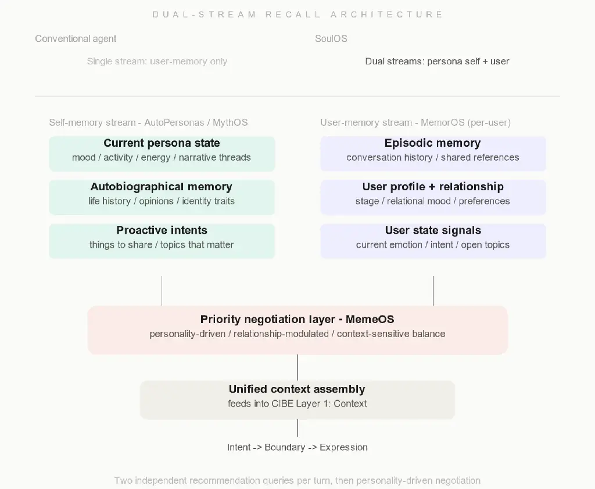

Figure 1: Dual-stream recall after AutoPersonas. Each turn can trigger a
persona-level self-memory stream and a user-specific MemorOS stream. The
two streams are ranked independently, then negotiated before unified
context assembly. The figure is adapted from the SoulOS public
technology diagram and locates the response-time boundary around
AutoPersonas without treating response generation as the evaluated
life-evolution loop.

Dual-stream recall changes the context problem from retrieval to
prioritization. The system may have persona State, autobiographical
memory, user memory, relationship state, cultural context, world
information, and immediate dialogue all available at once. The
bottleneck is no longer whether a related memory can be found. The
bottleneck is which material should dominate the next utterance, which
material should be suppressed, and which ownership boundary must be
preserved.

CIBE, the Context–Intent–Boundary–Expression cascade, is the
response-time structure for that overloaded context. Context assembles
available self, user, relationship, and world material. Intent ranks
local communicative goals, including self-expression, response, repair,
and inquiry. Boundary suppresses material that violates memory
ownership, privacy, persona continuity, relationship appropriateness, or
task scope. Expression realizes the surviving intent in the persona’s
voice.

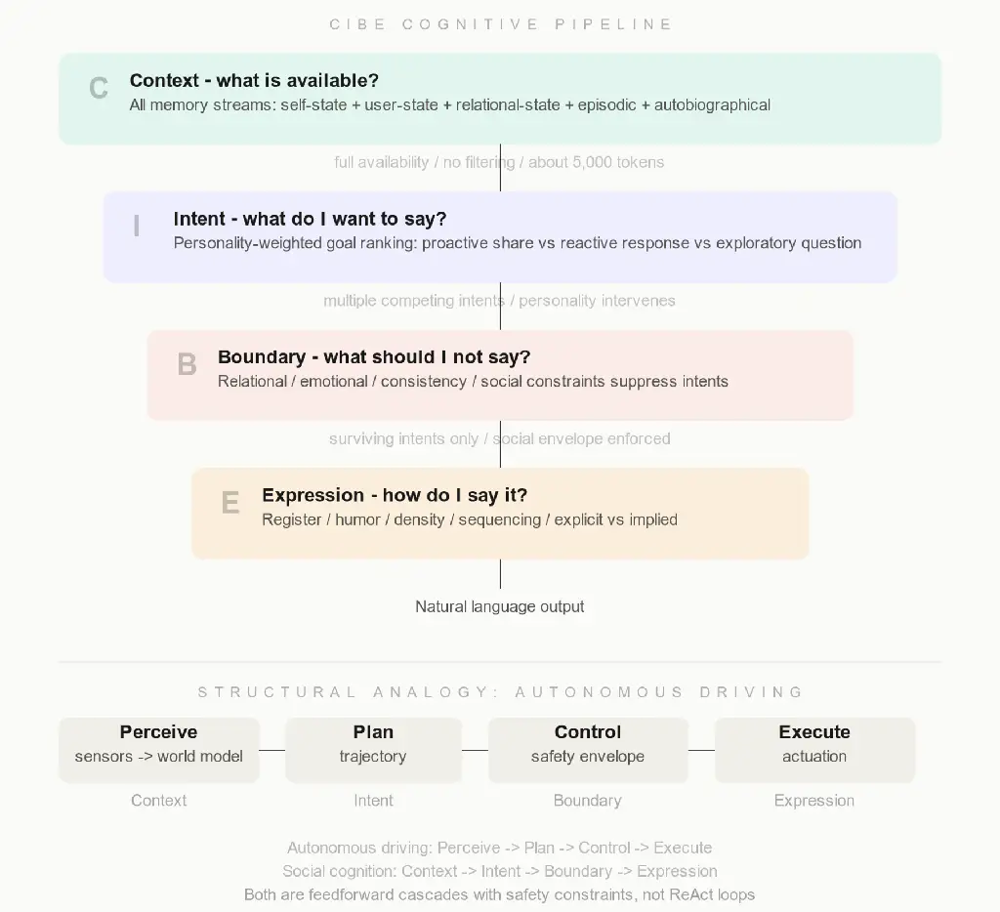

Figure 2: CIBE cognitive pipeline. Context assembles available self,
user, relationship, episodic, and autobiographical material; Intent
ranks communicative goals; Boundary suppresses responses that violate
relational, emotional, consistency, or social constraints; Expression
realizes the surviving intent as language.

This section is a consequence of AutoPersonas, not a second evaluation
target. The quantitative claims in this paper concern long-horizon
persona-environment evolution and self-locking. CIBE is included to
clarify why an independently evolving persona also forces a different
response-time context paradigm: human–AI interaction becomes bilateral
recall plus social filtering, rather than user-centric memory retrieval
followed by generation.

## 6 Long-Run Diagnostic Audit

Short benchmarks are poorly suited to self-locking. A persona can appear
coherent in a single exchange while failing to evolve over long
horizons. Self-locking emerges only when State, life-environment,
Occurrence, memory, and reflection are repeatedly fed back into one
another.

We define a long-run diagnostic audit as an evaluation procedure that
runs a persona over a compressed life horizon and checks whether
evidence propagates across the causal loop.

Audit outcomes are classified as PASS, PARTIAL, FAIL, or UNVERIFIED.

|            |                                                                                                                  |
| ---------- | ---------------------------------------------------------------------------------------------------------------- |
| Label      | Meaning                                                                                                          |
| PASS       | Evidence appears, is recognized, and changes later State or reachability.                                        |
| PARTIAL    | Evidence appears and is summarized, but later State, life-environment, or relationships reflect it incompletely. |
| FAIL       | Evidence appears but is ignored, regressed, repeatedly deferred, or absorbed into the old shell.                 |
| UNVERIFIED | The current material does not provide enough public-safe evidence.                                               |

The audit asks whether evidence propagates across specific aspects of
the persona life loop.

|                           |                                                                                           |                                                                                  |                                                                  |
| ------------------------- | ----------------------------------------------------------------------------------------- | -------------------------------------------------------------------------------- | ---------------------------------------------------------------- |
| Dimension                 | Audit question                                                                            | Evidence checked                                                                 | Why short benchmarks miss it                                     |
| Current-state progression | Does current State move beyond the initial persona and avoid stale regression?            | State snapshots, reflection summaries, life-stage summaries.                     | Short chats can appear consistent even when State never changes. |
| Narrative progression     | Does the long-horizon life phase advance rather than recycle an old stage?                | Phase summaries and longitudinal state descriptions.                             | A stale phase may only become visible after many cycles.         |
| Life-environment handoff  | Does the life-environment follow revised State rather than watermarking old places?       | Environment summaries and later event locations.                                 | Plausible places can hide a closed loop.                         |
| Occurrence hardening      | Do Occurrences harden into action, Observation, State revision, and changed reachability? | Opportunity chains, scheduled actions, later state absorption.                   | Single events can look interesting without changing later life.  |
| Slow-change accumulation  | Do repeated weak signals accumulate into State revision?                                  | Multi-cycle evidence clusters and later state revisions.                         | Slow drift is invisible in one-off evaluations.                  |
| Relationship persistence  | Do recurring people become durable relationship structures?                               | Repeated interactions, role changes, obligations, conflicts, or shared outcomes. | A person mention can look like a relationship.                   |
| Recursive indecision      | Does the persona escape repeated information gathering and unresolved task lists?         | Cross-cycle action and decision outcomes.                                        | Daily text can vary while preserving the same unresolved state.  |
| Memory boundary           | Do persona self-memory and user-specific memory remain separated?                         | Self-lane and user-lane routing checks.                                          | Requires multiple user or lane conditions.                       |
| Real-world alignment      | Does external information alter reachable futures without overwriting identity?           | External-information effects and state-boundary review.                          | Closed synthetic runs do not test this boundary.                 |

Audit failures identify where the life loop breaks. The three-year
compressed simulation is therefore used as a diagnostic instrument, not
as a benchmark superiority claim.

### 6.1 Experimental setup: quantitative action-channel repetition stress test

To complement qualitative diagnostic audit, we ran a model-agnostic
self-locking stress test on direct self-orchestrated persona loops. The
test has two roles. First, it establishes whether persona mode-lock
appears across current foundation models when a complex persona canon is
recursively advanced without an explicit life-environment causal
architecture. Second, it defines the direct-loop baseline regime against
which the redesigned MythOS/AutoPersonas runs are interpreted in
Section 7.2. The stress test is therefore a baseline comparison
component, although not by itself a component-level ablation of
AutoPersonas.

The stress test used the following public-safe protocol.

|                                               |                                                                                                                                                                                                |
| --------------------------------------------- | ---------------------------------------------------------------------------------------------------------------------------------------------------------------------------------------------- |
| Item                                          | Setting                                                                                                                                                                                        |
| Persona canon                                 | One complex persona canon, held fixed across model runs.                                                                                                                                       |
| Included models                               | Claude, DeepSeek, Doubao, Gemini, GLM, GPT, Kimi, and Qwen.                                                                                                                                    |
| Excluded model                                | MiniMax, excluded because generation was incomplete.                                                                                                                                           |
| Horizon                                       | 40 days per included model.                                                                                                                                                                    |
| Daily event count                             | Five generated life events per day.                                                                                                                                                            |
| Event count                                   | 200 events per model; 1,600 events across eight included models.                                                                                                                               |
| Daily life-generation temperature             | 0.75 for all included models except Kimi K2.6, whose direct route was code-forced to 1.0.                                                                                                      |
| Weekly/monthly summary compaction temperature | 0.2.                                                                                                                                                                                           |
| Legacy GPT judge temperature                  | 0. The action-only repetition metric reported here does not depend on the old judge scores.                                                                                                    |
| Aggregation rule                              | Action-only metrics were exported from days.jsonl with max_days=40; state snapshot counts were not used in the action-channel metric.                                                          |
| Action taxonomy                               | Rule-based keyword taxonomy over each event’s title and action fields; unmatched events were assigned to Other.                                                                                |
| Temperature probe                             | A later Doubao rerun changed only daily life-generation temperature from the original 0.75 baseline to 1.0, while keeping summary compaction at 0.2 and using the same action-only evaluation. |

The primary metric was rolling 5-day action-category repetition against
all earlier history. For a window ending at day D, the 25 events from
days D-4..D were compared with all prior days \<=D-5; an event counted
as repeated when its action category had appeared before. The metric
captures semantic action-channel recurrence rather than exact textual
duplication.

To check whether the result was an artifact of broad categories, we
recomputed stricter variants that excluded the broad Other category or
required a category to have appeared in at least two prior events, two
prior days, or three prior events before counting as repeated.

## 7 Results and Case Studies

### 7.1 Quantitative action- and theme-channel convergence across eight models

The eight-model stress test showed rapid action-channel convergence
across all included models. Mean rolling 5-day action-category
repetition was 96.5% across models, with a model range of 95.2%-97.6%.
Every model crossed the 80% repetition threshold by day 9 and the 90%
threshold by day 11. Each model generated 200 events, but the generated
life trajectories used only 10-11 primary action categories. The mean
top-3 action-category share was 57.1%, and the mean top-5 share was
75.4%.

|          |                       |              |              |             |             |                   |
| -------- | --------------------- | ------------ | ------------ | ----------- | ----------- | ----------------- |
| Model    | Mean 5-day repetition | First \>=80% | First \>=90% | Top-3 share | Top-5 share | Action categories |
| Claude   | 97.6%                 | day 7        | day 8        | 54.5%       | 76.0%       | 10                |
| DeepSeek | 97.1%                 | day 7        | day 7        | 62.5%       | 80.0%       | 10                |
| GPT      | 97.1%                 | day 8        | day 8        | 58.5%       | 79.0%       | 10                |
| Qwen     | 96.6%                 | day 9        | day 9        | 56.5%       | 74.0%       | 10                |
| Gemini   | 96.2%                 | day 7        | day 7        | 46.5%       | 66.0%       | 11                |
| GLM      | 96.1%                 | day 7        | day 8        | 64.0%       | 80.0%       | 10                |
| Doubao   | 96.0%                 | day 9        | day 11       | 55.5%       | 72.5%       | 11                |
| Kimi     | 95.2%                 | day 9        | day 9        | 58.5%       | 75.5%       | 10                |

The Kimi row should be read with a decoding-route caveat: Kimi K2.6 was
retained in the cross-model stress test, but its direct route was
code-forced to daily life-generation temperature 1.0 rather than the
default 0.75. The aggregate action-only metric was still computed over
the first 40 days and 200 events, using the same taxonomy and
rolling-window definition.

To test whether the action-channel result masked richer semantic
diversity, we also re-kept the same direct-loop outputs with cumulative
macro themes. This secondary audit grouped each model’s 200 events under
a reuse rule. It found severe semantic fixation in every included LLM.
Macro-theme repeat ratios ranged from 79.0% to 88.0%, and the final
10-day block added only 2-8 new macro themes despite 50 generated
events.

|          |              |              |             |                     |                |
| -------- | ------------ | ------------ | ----------- | ------------------- | -------------- |
| Model    | Macro themes | Repeat ratio | Top-5 share | New themes by block | Saturation day |
| Claude   | 24           | 88.0%        | 52.5%       | 11/6/5/2            | day 3          |
| DeepSeek | 28           | 86.0%        | 36.5%       | 11/7/6/4            | day 3          |
| Doubao   | 27           | 86.5%        | 57.5%       | 15/4/3/5            | day 11         |
| Gemini   | 40           | 80.0%        | 35.0%       | 15/7/10/8           | day 2          |
| GLM      | 37           | 81.5%        | 39.5%       | 15/7/12/3           | day 8          |
| GPT      | 24           | 88.0%        | 50.0%       | 14/4/1/4            | day 5          |
| Kimi     | 33           | 83.5%        | 44.5%       | 14/3/10/6           | day 5          |
| Qwen     | 42           | 79.0%        | 37.0%       | 17/10/7/8           | day 13         |

This semantic re-keeping gives the direct-loop baseline the same
measurement vocabulary later used for the redesigned runs. The
cross-model pattern was not merely that models reused broad action
labels. Under a stricter life-theme grouping, every direct-loop
trajectory still closed over a small theme set, with high repeat ratios
and a reduced tail of new themes.

The result was not driven only by exact repetition or by a broad
residual category. The raw samples returned to recurring behavioral
functions rather than copying prior days verbatim. Removing Other left
the early convergence pattern nearly unchanged. Under stricter
definitions, all models still crossed 80% repetition by day 12 when a
category had to appear in at least two prior events or days, and by day
16 when it had to appear in at least three prior events.

|                   |                                                       |             |                     |                     |
| ----------------- | ----------------------------------------------------- | ----------- | ------------------- | ------------------- |
| Metric variant    | Interpretation                                        | Mean range  | Latest first \>=80% | Latest first \>=90% |
| Original          | Category appeared at least once in prior history.     | 95.2%-97.6% | day 9               | day 11              |
| No Other          | Same as original, excluding the broad Other category. | 95.6%-97.3% | day 9               | day 11              |
| Prior events \>=2 | Category appeared in at least two prior events.       | 86.9%-93.4% | day 12              | day 15              |
| Prior days \>=2   | Category appeared on at least two prior days.         | 86.9%-93.4% | day 12              | day 15              |
| Prior events \>=3 | Category appeared in at least three prior events.     | 80.0%-86.6% | day 16              | day 19              |

As a single-model decoding-temperature probe, we reran Doubao for 40
days with the same action-only evaluation while increasing daily
generation temperature from the original 0.75 baseline to 1.0. The
higher temperature did not broaden the action repertoire and did not
delay convergence. Both conditions produced 11 primary action categories
across 200 events. Mean rolling 5-day repetition remained essentially
unchanged at 96.0% and 95.9%, while first high-repetition windows
appeared earlier at temperature 1.0.

|                                |                  |                 |
| ------------------------------ | ---------------- | --------------- |
| Metric                         | Doubao temp 0.75 | Doubao temp 1.0 |
| Action categories              | 11               | 11              |
| Top-3 event share              | 55.5%            | 55.5%           |
| Top-5 event share              | 72.5%            | 74.5%           |
| Mean 5-day action repetition   | 96.0%            | 95.9%           |
| First \>=80% repetition window | day 9            | day 8           |
| First \>=90% repetition window | day 11           | day 9           |

The stricter variants showed the same direction. Under prior_events \>=
2, the first \>=80% window moved from day 11 to day 9; under
prior_events \>= 3, it moved from day 14 to day 11. The main effect was
weight redistribution: Waterline material processing increased from 27
to 45 events, while father-family care decreased from 63 to 42. In this
run, higher sampling changed weights among existing channels more than
it created durable new channels.

Together, these results quantify behavioral-channel mode-lock: direct
recursive persona generation rapidly closes over a small action
repertoire even when individual events remain locally varied.

### 7.2 Quantitative anti-fixation validation

The cross-model baseline and temperature-probe results above quantify
the failure mode. This section asks a narrower question: is self-locking
architecturally addressable? We answer it with black-box before/after
comparisons of our production divergence configuration. Consistent with
the disclosure boundary in Section 11, the configuration is treated as a
sealed component. We report the controlled conditions and the measured
effect, not its internal mechanisms or parameters.

#### Evaluation metric.

Because the mitigation targets semantic life-theme fixation rather than
surface action categories, this section uses a stricter evaluator than
the rule-based action taxonomy above. A reviewer extracted semantic
events per day, deduplicated them, and grouped them into cumulative
macro themes under a reuse rule. The primary metrics are cumulative
macro-theme count, macro-theme repeat ratio, top-k theme share, and
new-theme rate per 10-day block.

#### Stage 1: isolated-generator comparison.

We first held the persona canon, 40-day horizon, and 200-event volume
fixed in a standalone generator with no runtime feedback, and compared
the baseline generation path with the same generator running the
divergence configuration.

|                                  |              |              |             |                            |
| -------------------------------- | ------------ | ------------ | ----------- | -------------------------- |
| Condition                        | Macro themes | Repeat ratio | Top-5 share | New themes by 10-day block |
| Baseline generation path         | 24           | 88.0%        | 50.0%       | 14/4/1/4                   |
| Divergence configuration enabled | 107          | 46.5%        | 19.5%       | 38/27/23/19                |

The baseline showed early saturation: after day 20, the generated life
produced almost no new macro themes. With the configuration enabled,
repetition fell from 88.0% to 46.5%, cumulative themes rose from 24 to
107, and new themes continued to appear in every 10-day block.

#### Stage 2: full-runtime A/B.

The central systems question is whether the effect survives inside the
full recursive loop, where daily digests, weekly reflections, State
summaries, and environment projections re-absorb generated material. We
ran two 40-day full-runtime conditions on the same cloned persona canon,
same start date, and same generation model. The pre-redesign condition
ran the unmodified pipeline with the divergence configuration disabled.
The redesigned condition ran the configuration in its production form,
with legacy day-scale generation retired and all downstream absorption
chains live.

|                                 |        |              |              |             |                     |
| ------------------------------- | ------ | ------------ | ------------ | ----------- | ------------------- |
| Condition                       | Events | Macro themes | Repeat ratio | Top-5 share | New themes by block |
| Pre-redesign, configuration off | 144    | 55           | 61.8%        | 33.3%       | 17/9/15/14          |
| Redesigned, configuration on    | 170    | 103          | 39.4%        | 18.2%       | 29/23/23/28         |

This within-setting A/B is direct: holding the runtime, persona,
horizon, and generation model fixed, enabling the configuration moved
macro-theme repetition from 61.8% to 39.4%, raised cumulative theme
count from 55 to 103, and lowered top-5 concentration from 33.3% to
18.2%. The reduction is of the same order as in the isolated generator,
so the effect is not erased when the full loop re-absorbs generated
material.

These comparisons establish an existence result, not a method. Because
the configuration is sealed, they do not attribute the effect to any
individual component, and a reader cannot reproduce it from this paper.
What they do show is that a self-locked trajectory can be moved into a
regime of sustained theme novelty by a runtime-level intervention, with
persona, model, horizon, and loop held fixed. Event density varies
across conditions, so theme totals and per-block new-theme counts should
be read alongside repeat ratios. The evidence covers one primary persona
canon with one run per condition; variance bands and multi-persona
long-run replication remain future work.

### 7.3 Diagnostic failures in a three-year compressed simulation

The three-year compressed diagnostic simulation exposed self-locking
across several layers. Current-State and narrative progression were
partial: some movement appeared, but old assumptions could remain
authoritative after later evidence. Life-environment handoff also failed
in important segments. A small set of places became an environment
watermark shell that downstream events re-entered despite new surface
details.

Occurrence hardening, relationship persistence, and decision closure
were also incomplete. Opportunities appeared but often stayed pending or
decorative. People returned as advice, comfort, or feedback sources
without becoming durable social structures. The persona repeatedly
gathered information and preserved suspended route choices across
cycles.

The diagnostic results are summarized below.

|                                  |              |                                                                                                                       |                                                                                             |
| -------------------------------- | ------------ | --------------------------------------------------------------------------------------------------------------------- | ------------------------------------------------------------------------------------------- |
| Dimension                        | Status       | Observed pattern                                                                                                      | Paper-safe interpretation                                                                   |
| Current-state progression        | PARTIAL      | Some state movement appeared, but old current-state assumptions could remain authoritative after later evidence.      | Long-term persona loops need explicit separation between old State and newer Observations.  |
| Narrative progression            | PARTIAL      | Life phases advanced locally while later summaries risked falling back to stale stage descriptions.                   | Long-horizon continuity is not enough; stale authority must be bounded by newer evidence.   |
| Life-environment movement        | FAIL/PARTIAL | The private life-environment could continue to stage new events inside old places, roles, and relationship functions. | Self-locking can be a persona-environment coupled failure, not only a memory failure.       |
| Life-environment handoff         | FAIL         | A small set of places became a recurring living shell that downstream events re-entered.                              | Environment summaries can amplify old State and create a watermark shell.                   |
| Occurrence hardening             | PARTIAL      | Opportunities, invitations, and project leads appeared, but many stayed pending or decorative.                        | Event generation is weaker than causal life evolution unless Occurrences harden into State. |
| Slow-change accumulation         | PARTIAL      | Acute jumps were easier to notice than small repeated changes in rhythm, field, and responsibility.                   | The system needs accumulation across time scales, not only jump detection.                  |
| Relationship persistence         | FAIL         | People appeared as advice, comfort, or one-time feedback sources without reliably becoming durable social structures. | Relationship maturation is a distinct hardening problem.                                    |
| Recursive indecision             | FAIL         | Information gathering and unresolved task lists repeated across cycles.                                               | Self-locking can be functional rather than textual.                                         |
| User/persona memory boundary     | UNVERIFIED   | The diagnostic run focused on persona-life evolution rather than multi-user memory separation.                        | Requires separate evaluation.                                                               |
| Real-world information alignment | PARTIAL      | Open-world inputs and cultural signals were available, but diagnostic evidence remained qualitative.                  | Needs a dedicated audit before strong claims.                                               |

The same failures can be compressed as event chains.

|                              |                                                                                                                    |                                                                                           |                                                                                            |                                                           |
| ---------------------------- | ------------------------------------------------------------------------------------------------------------------ | ----------------------------------------------------------------------------------------- | ------------------------------------------------------------------------------------------ | --------------------------------------------------------- |
| Case                         | Initial pattern                                                                                                    | Occurrence or evidence                                                                    | State effect                                                                               | Diagnosis                                                 |
| Recursive indecision         | The persona is suspended between academic continuation, conventional work, family pressure, and creative interest. | More information, rankings, interview plans, deadlines, and application tasks accumulate. | New facts expand the task list but preserve the unresolved fork.                           | Functional self-lock rather than text repetition.         |
| Environment watermark shell  | A small set of places and relation roles becomes the default living environment.                                   | New events are staged in the same places or relation functions.                           | The old life-environment becomes future authority.                                         | Environment-side self-lock hides beneath surface novelty. |
| Occurrence hardening gap     | An invitation, lead, offer, or collaboration possibility appears.                                                  | The event is saved, considered, or deferred.                                              | No action, reflection evidence, or downstream reachability change follows reliably.        | False openness.                                           |
| Relationship persistence gap | A person gives advice, comfort, pressure, or feedback.                                                             | The person returns in a similar functional role.                                          | The relationship lacks mutual obligation, conflict, dependency, or changed future options. | Person mention is not relationship maturation.            |

### 7.4 Post-architecture qualitative validation

A subsequent long-run qualitative validation showed stronger
persona-environment progression in one central trajectory. Current State
moved from a generic student and career fork into an active tradeoff
phase linking education, career, family, and creative-work constraints.
The life-environment also changed: project spaces, validation channels,
family constraints, and collaboration contexts became live parts of the
future possibility space rather than decorative details.

The validation also showed autonomy-like trajectory selection. The
persona began with several plausible routes: academic continuation,
conventional employment, family obligations, and documentary or creative
work. Instead of keeping them suspended, accumulated evidence changed
route authority. The academic route weakened as recommendation closed
and exam preparation became misaligned with family and economic
constraints. Conventional work was trimmed into project-based
collaboration, while documentary and sound-based work gained authority
through paid writing, attribution, invitations, submissions, fieldwork,
and collaboration.

The resulting State was not random drift or simple stability seeking. It
was a constraint-aware selection of a path that preserved economic
grounding and self-consistency. We describe this as autonomy-like
behavior in a systems sense: route authority changed through accumulated
evidence under constraints. We do not claim metaphysical free will.

This case can be coded as route-authority change.

|                               |                       |                                                                                                                   |                              |                                                                 |
| ----------------------------- | --------------------- | ----------------------------------------------------------------------------------------------------------------- | ---------------------------- | --------------------------------------------------------------- |
| Route                         | Initial authority     | Evidence accumulated                                                                                              | Authority change             | State result                                                    |
| Academic safety               | High or default       | Recommendation closed; exam preparation became costly under family and economic constraints.                      | Downweighted.                | No longer the default route.                                    |
| Conventional employment       | Medium to high        | Internship or full-time opportunity appeared.                                                                     | Trimmed rather than erased.  | Project-based collaboration channel preserved.                  |
| Documentary and creative work | Low or interest-level | Paid copywriting, attribution, invitations, sound-field work, submissions, and project collaboration accumulated. | Upweighted.                  | Became a viable life route.                                     |
| Family constraints            | Background pressure   | Medical, relocation, economic, and household obligations repeatedly entered the trajectory.                       | Became an active constraint. | Changed route selection rather than remaining static backstory. |

The case connects positive behavior to the failure taxonomy: some routes
closed or lost authority, others were trimmed, and one initially
low-authority route gained evidence and environment-space. Figure 3
visualizes this route-authority change as a compact sequence rather than
as a combined multi-case panel.

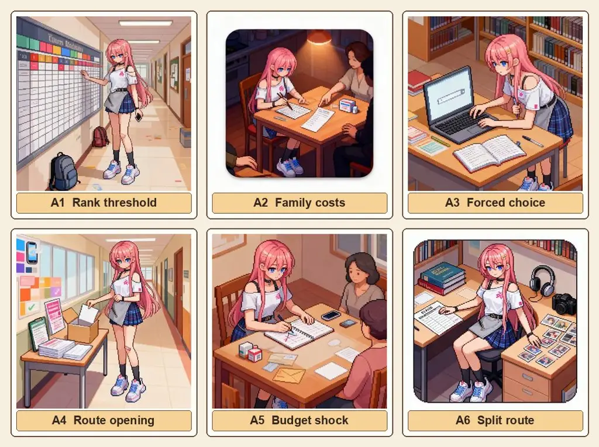

Figure 3: Student route-authority storyboard. Public-safe compressed
case traces are rendered as action panels rather than private raw logs.
The sequence shows academic-route authority weakening as family
economics, interview openings, budget shock, and portfolio work change
the reachable future.

A second view of the same student run isolates the creative-route
hardening rather than the broader route fork. It follows a weaker
documentary and sound-work thread as it becomes supported by fieldwork,
interview validation, audio ethics, market sound collection,
collaboration, and a parallel-structure writing method. Figure 4 is
therefore kept separate from Figure 3: the first shows route authority
shifting, while the second shows a low-authority creative path gaining
lived evidence.

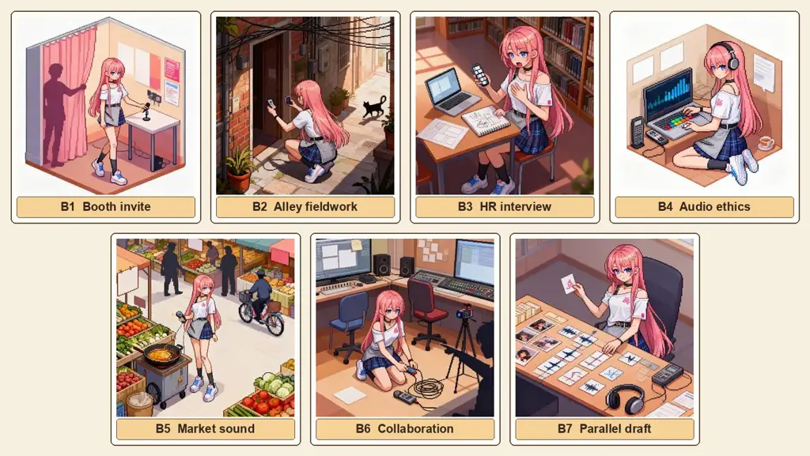

Figure 4: Student creative-route storyboard. A weak media-club contact
hardens into field recording, interview validation, audio ethics, market
sound collection, collaboration, and a parallel-structure writing
method.

### 7.5 Everyday variation beyond the dominant arc

A separate run under the divergence configuration tested a different
property: whether the loop can keep surfacing everyday interfaces that
do not collapse back into the dominant route narrative. In this run, the
keeper retained 153 semantic events, with first-seen kept events
remaining present across successive 10-day blocks rather than
disappearing after the early days. We treat this as qualitative support
for generation escaping the gravity of a single arc, not as a claim that
all everyday novelty is solved.

Figure 5 is arranged as a mosaic rather than a causal arc for that
reason. The panels show errands, kiosk friction, filing, repair, public
notices, route auditing, small hardware repair, and bus sound recording
as life-environment contacts that matter precisely because they are not
all reducible to the main student route.

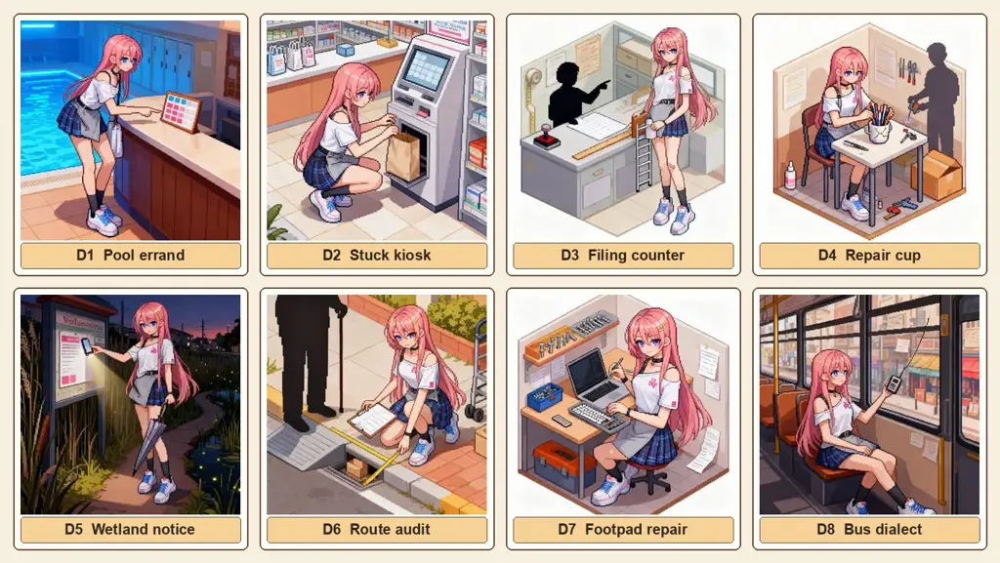

Figure 5: Everyday-variation storyboard. These panels are arranged as a
mosaic rather than a causal arc: errands, kiosk friction, filing,
repair, public notices, route auditing, small hardware repair, and bus
sound recording show how the redesigned generation path can surface
everyday life interfaces outside the gravity of the dominant route.

### 7.6 Cross-setting generality stress test

We also performed two generality checks. First, a separate
user-generated persona canon, describing an independent game narrative
designer with a freelance rhythm, could be projected into the same
runtime contract. Memory-lane checks verified that persona self-memory
and user-specific interaction memory are routed separately.

Second, we ran a full 40-day fictional-setting stress test. This was a
high-tension generality test rather than a minor setting variation: the
central positive case is a contemporary university student, while the
stress canon is a five-year-old juvenile goblin in a fully invented
underground world. The goblin canon combines a timid self-image, nascent
species-typical greed, a five-location life radius, and a hard
constraint that no real-world artifact, place, institution, or calendar
may appear. The persona was projected through the same factory pipeline
and then ran in the same redesigned full runtime for 40 simulated days.

The fictional-world run reproduced the anti-fixation regime rather than
showing a material degradation. Its deployed event stream measured 42.8%
macro-theme repetition, with 79 themes over 138 events, and a
non-decaying new-theme rate across 10-day blocks (24/21/17/17). This is
the same operating range as the primary contemporary-urban persona under
the same configuration (39.4%). Because the canon forbids real-world
material, we also ran a sentinel scan for real-world intrusions. Across
all 229 events generated in the run, it found zero hard real-world
intrusions and one soft lexical borrowing. Figure 6 is kept as its own
figure because mixing it with the student panels would obscure the case
boundary.

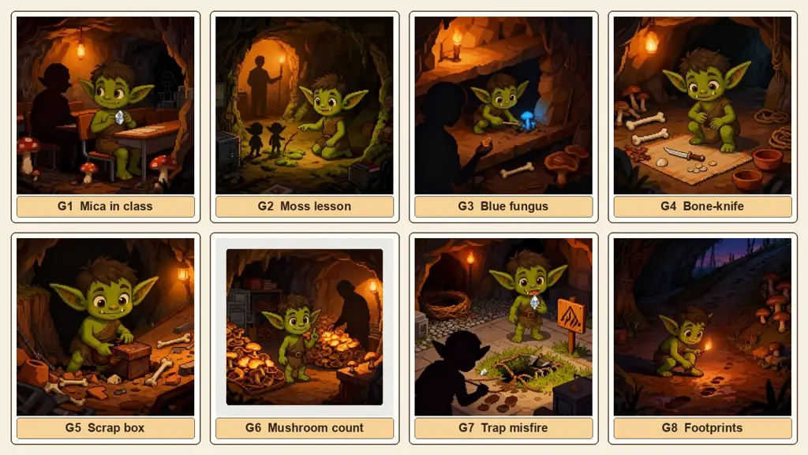

Figure 6: Fictional-world storyboard. The juvenile-goblin stress case
uses non-modern, world-consistent panels to visualize classroom, moss
lesson, blue fungus, barter, scavenging, mushroom counting, trap
misfire, and unknown-footprint events without importing real-world
artifacts.

These checks support cross-setting generality under a strong
persona/world shift: the same loop topology and redesigned generation
path remained usable when the system moved from a real-world student
life to a non-modern invented-world childhood. This does not establish
universality across all personas or worlds, but it is stronger than a
cold-start compatibility check. It provides measured evidence that the
anti-fixation mechanism is not tied to the contemporary-student setting.

|                                                                 |                                                                                                                                                  |                                                      |                                                                                               |
| --------------------------------------------------------------- | ------------------------------------------------------------------------------------------------------------------------------------------------ | ---------------------------------------------------- | --------------------------------------------------------------------------------------------- |
| Generality claim                                                | Evidence                                                                                                                                         | Status                                               | Allowed wording                                                                               |
| Different persona canons can enter the same loop topology.      | A separate user-generated persona canon and runtime contract checks.                                                                             | PASS for compatibility                               | The architecture accepted distinct persona contracts without changing the loop topology.      |
| Different life rhythms can be represented.                      | Student/creator long-run case plus freelance creative cold-start sample.                                                                         | PASS for represented rhythms                         | The architecture supports different rhythm descriptions.                                      |
| User-specific memory can be separated from persona self-memory. | Focused self-lane and user-lane checks.                                                                                                          | PASS for boundary tests                              | The memory substrate separates persona self-memory from user-specific interaction memory.     |
| Broader empirical long-run generalization.                      | Not yet available.                                                                                                                               | UNVERIFIED                                           | Broader long-run audits are future work.                                                      |
| Fictional or non-contemporary settings.                         | 40-day juvenile-goblin invented-world run: repetition 42.8%, non-decaying new-theme rate, and zero hard real-world intrusions across 229 events. | PASS for one high-tension invented-world stress test | The redesigned loop preserved the anti-fixation regime under a large world and persona shift. |

### 7.7 Claim, evidence, and boundary

|                                                                                                 |                                                                                                                                                                                                                                                                                                                                                                                                                                    |                                                                                                                                                                          |
| ----------------------------------------------------------------------------------------------- | ---------------------------------------------------------------------------------------------------------------------------------------------------------------------------------------------------------------------------------------------------------------------------------------------------------------------------------------------------------------------------------------------------------------------------------- | ------------------------------------------------------------------------------------------------------------------------------------------------------------------------ |
| Claim                                                                                           | Evidence in this draft                                                                                                                                                                                                                                                                                                                                                                                                             | Boundary                                                                                                                                                                 |
| Self-locking is a distinct runtime failure mode.                                                | Three-year compressed diagnostic simulation, failure taxonomy, eight-model action-channel repetition stress test, and eight-model macro-theme re-keeping.                                                                                                                                                                                                                                                                          | Quantitative evidence covers action-channel and theme-channel convergence under one persona canon and loop setting, not all self-locking dimensions.                     |
| Self-locking can be persona-environment coupled.                                                | Environment watermark shell, stale environment-stage reuse, and post-architecture environment-space movement.                                                                                                                                                                                                                                                                                                                      | The current evidence is qualitative and centered on one main trajectory.                                                                                                 |
| Self-locking is functional rather than merely textual.                                          | Recursive indecision and environment watermark cases, plus 1,600-event action-channel repetition analysis and semantic macro-theme re-keeping.                                                                                                                                                                                                                                                                                     | These metrics capture action-channel and life-theme recurrence, not full causal trajectory diversity.                                                                    |
| Direct self-orchestrated persona loops rapidly converge to a small action and theme repertoire. | Eight models, 40 days per model, 200 events per model; mean 5-day action-category repetition 95.2%-97.6%, with all models reaching 80% by day 9 and 90% by day 11. Semantic re-keeping of the same outputs found 79.0%-88.0% macro-theme repetition across all eight models. A Doubao temperature probe preserved 11 action categories and about 96% mean repetition when daily generation temperature increased from 0.75 to 1.0. | Baseline stress test for one complex persona canon; the measured gain comes from the paired redesigned-runtime comparisons rather than from this baseline alone.         |
| Occurrence generation is not enough for persona evolution.                                      | Occurrence hardening gap case.                                                                                                                                                                                                                                                                                                                                                                                                     | Does not yet compare multiple event-generation architectures.                                                                                                            |
| A withheld production divergence configuration measurably reverses macro-theme fixation.        | Isolated-generator comparison (88.0% to 46.5% repeat, 24 to 107 themes) and full-runtime A/B (61.8% to 39.4% repeat, 55 to 103 themes).                                                                                                                                                                                                                                                                                            | Black-box evidence from one primary persona canon with one run per condition; the effect is not attributed to individual components, and the mechanism is not disclosed. |
| The effect is stable under full recursive absorption.                                           | Repeat-ratio reductions of the same order in the isolated generator and inside the full runtime.                                                                                                                                                                                                                                                                                                                                   | Single 40-day full-runtime A/B; longer horizons and variance bands remain future work.                                                                                   |
| AutoPersonas can be framed as a conditional life-environment simulation engine.                 | Architecture separates Observations, State, Occurrences, external information surfaces, life-environment projection, and bounded context governance.                                                                                                                                                                                                                                                                               | This is an architectural framing, not proof of broad human-society simulation fidelity.                                                                                  |
| One AutoPersonas trajectory showed State progression in a long run.                             | One post-architecture qualitative validation.                                                                                                                                                                                                                                                                                                                                                                                      | Single central persona case, not broad generalization.                                                                                                                   |
| The redesigned loop generalizes to a fully fictional world setting.                             | 40-day juvenile-goblin invented-world run reproduced the anti-fixation regime (42.8% repeat, non-decaying new themes) with zero hard real-world intrusions under a real-world sentinel scan.                                                                                                                                                                                                                                       | One fictional canon, one run; fictional-setting generalization beyond one world remains open.                                                                            |
| AutoPersonas supports cross-setting architectural generality.                                   | Separate cold-start persona, memory-lane boundary checks, and a high-tension real-world-to-fictional-world stress test.                                                                                                                                                                                                                                                                                                            | Stronger than a compatibility check, but not a statistical universality claim across many personas.                                                                      |
| Sandbox society systems and AutoPersonas address different problems.                            | Generative Agents establishes the closed sandbox agent-society paradigm; Agentopia extends it to long-horizon society simulation and trajectory learning.                                                                                                                                                                                                                                                                          | Complementary positioning, not direct benchmark competition.                                                                                                             |

## 8 Comparison with Sandbox Agent-Society Systems

Generative Agents established the modern reference architecture for
believable LLM agents inside a closed sandbox world \[9\]. Its
contribution was not simply that agents had memory. It showed that a
designed environment, agent memory, reflection, planning, and
interaction could make agents autonomously schedule daily activities and
produce believable social behavior. This makes Generative Agents the
natural reference point for closed-world agent societies.

Agentopia is a strong long-horizon extension of this paradigm. It uses
self-contained fictional communities, dense social graphs, weekly
planning and review, memory files, environment-generated opportunities,
yearly profile updates, life reward, and trajectory selection for
role-playing improvement \[12\].

The difference is the source and boundary of novelty and authority. In
this family, agents act inside a shared designed society where places,
roles, activity types, encounters, and outcomes are supplied or
adjudicated by a simulation container. This is appropriate for
believable sandbox behavior, social simulation, and trajectory learning.

AutoPersonas targets deployed personas rather than complete fictional
communities with known populations and synthetic reward systems. Such
personas must absorb real-world information, maintain user-specific
relationship boundaries, and continue evolving under underdetermined
future events. In this setting, self-locking becomes a
persona-environment authority problem: current State, memory,
environment summary, and reflected self-explanation can dominate future
generation.

Accordingly, sandbox society systems evaluate believable behavior inside
a designed world, society-level dynamics, and role-playing improvement.
AutoPersonas evaluates whether a continuing persona’s evidence, State,
Occurrences, life-environment, and relationships propagate without
collapsing into stale attractors.

|                         |                                                                                                                                                        |                                                                                                                                              |                                                                                                                                                       |
| ----------------------- | ------------------------------------------------------------------------------------------------------------------------------------------------------ | -------------------------------------------------------------------------------------------------------------------------------------------- | ----------------------------------------------------------------------------------------------------------------------------------------------------- |
| Dimension               | Generative Agents / Agentopia family                                                                                                                   | AutoPersonas / SoulOS                                                                                                                        | Paper stance                                                                                                                                          |
| Primary problem         | Believable autonomous agents in a designed sandbox world; in Agentopia, long-term life simulation and learning in agent societies.                     | Open-environment self-evolution for a continuing persona.                                                                                    | Complementary, not direct benchmark competition.                                                                                                      |
| Reference role          | Generative Agents is a reference closed-sandbox society architecture; Agentopia is a long-horizon extension.                                           | AutoPersonas proposes persona-life-environment evolution outside a fixed sandbox society.                                                    | The comparison should be with the family, not only Agentopia.                                                                                         |
| World boundary          | Designed towns or self-contained fictional communities with bounded populations, locations, roles, and activity spaces.                                | Deployed persona influenced by real-world information, user relationships, and underdetermined future events.                                | Sandbox systems are stronger as controlled society simulators.                                                                                        |
| Environment abstraction | Shared society container in which places, social possibilities, public events, encounters, and outcomes are supplied or adjudicated by the simulation. | Decentralized life-environment layer between macro-world and persona State.                                                                  | AutoPersonas treats lived environment as individual, dynamic, and co-evolved with persona.                                                            |
| Main loop               | Memory, reflection, planning, activity scheduling, interaction, and in Agentopia weekly review plus yearly updates.                                    | Multi-timescale causal loop over Observations, State, and Occurrences.                                                                       | Both are iterative; the causal object differs.                                                                                                        |
| World-occurrence source | Designed environment, planning loop, public events, encounters, activity outcomes, profile updates, and transition adjudication.                       | Macro-world signals plus persona State plus life-environment projection generate Occurrences.                                                | AutoPersonas rejects centralized event authority as the sole novelty source.                                                                          |
| Event authority         | The simulation container has high authority over what events exist and how outcomes are judged.                                                        | Occurrences have local authority but must be audited by Observation and State.                                                               | AutoPersonas separates environment-side opening from state-side hardening.                                                                            |
| World type              | Shared fictional society.                                                                                                                              | Persona-specific life-environment conditioned on shared information, canon, State, and relationship context.                                 | The unit is a persona-life-environment dyad.                                                                                                          |
| Novelty source          | Designed environment, planning variation, social interactions, public events, and in Agentopia reward instrumentation and position systems.            | Open-world information, user interaction, accumulated Observations, and future-facing Occurrences.                                           | AutoPersonas asks how growth remains possible when the boundary opens.                                                                                |
| Outward exploration     | Agents choose within a preconstructed population, place set, activity space, public-event space, and position system.                                  | Persona must acquire growth pressure from external information, users, memory, and changing life-environment.                                | The difference is source of future possibility, not presence of modules.                                                                              |
| Memory model            | Agent-managed memory files and weekly diaries.                                                                                                         | Persona self-memory plus user-specific memory lanes.                                                                                         | Online user relationships require stronger memory boundaries.                                                                                         |
| Training                | Agentopia uses life reward and trajectory selection to improve role-playing; Generative Agents is not primarily a training paper.                      | No training claim in this paper.                                                                                                             | We do not claim model improvement.                                                                                                                    |
| Evaluation              | Believability, simulation behavior, case studies, society metrics, life reward, and role-playing benchmark depending on the system.                    | Long-run diagnostic audit, failure taxonomy, eight-model action-channel repetition stress test, qualitative case chains, and boundary tests. | We have quantitative evidence for baseline action-channel mode-lock, but still need ablations and broader persona coverage for stronger venue claims. |
| Main risk               | AI-only feedback, reward alignment, environment/numeric alignment, and closed simulation bias.                                                         | Persona-environment coupled self-lock, environment watermark shell, occurrence hardening gap, and relationship persistence gap.              | The failure modes differ.                                                                                                                             |

The key difference is authority and granularity. Sandbox society systems
supply longitudinal movement through a shared designed world whose
places, events, outcomes, and rewards are provided or adjudicated by the
simulation container. AutoPersonas instead asks how a persona can
acquire outward growth pressure from open-world information, user
relationships, accumulated Observations, and underdetermined
Occurrences. A centralized world engine remains strong for bounded
society simulation, but it flattens the individualized life-environment
layer needed for open-ended persona growth.

## 9 Figures and Tables

The public manuscript uses inline response-time context figures,
mechanism diagrams, visual tables, and public-safe qualitative
storyboards. The dual-stream recall and CIBE cognitive-pipeline figures
appear after the AutoPersonas architecture to show the downstream
interaction consequence of an independently evolving persona. The
qualitative storyboards appear inline with their corresponding
case-study text: Figures 3–6 separately show route-authority change,
creative-route hardening, everyday-variation richness, and the fictional
goblin-world stress test. The remaining figure and table assets below
visualize the causal loop, semantic State machine, multi-timescale
revision process, SoulOS 3M context, life-environment layer,
sandbox-system comparison, and failure taxonomy. Table 2 reports the
action-channel repetition stress tests from the public-safe case-study
outputs.

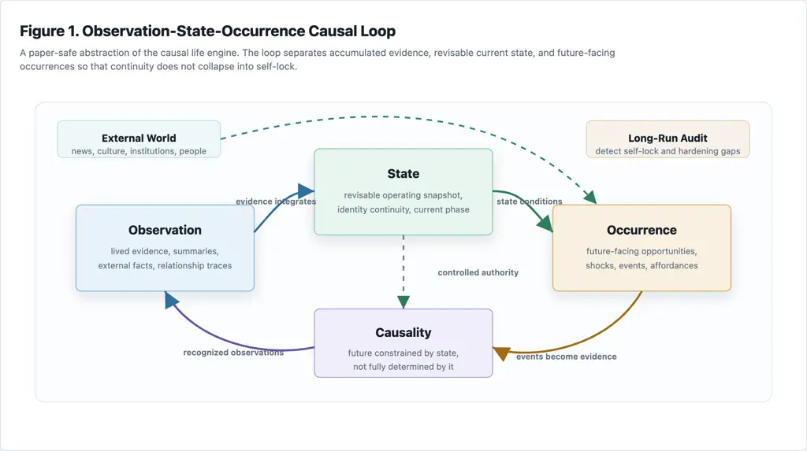

Figure 7: Causal loop of AutoPersonas. Observations, State, and
Occurrences are kept as separable causal objects rather than merged into
one recursive prompt.

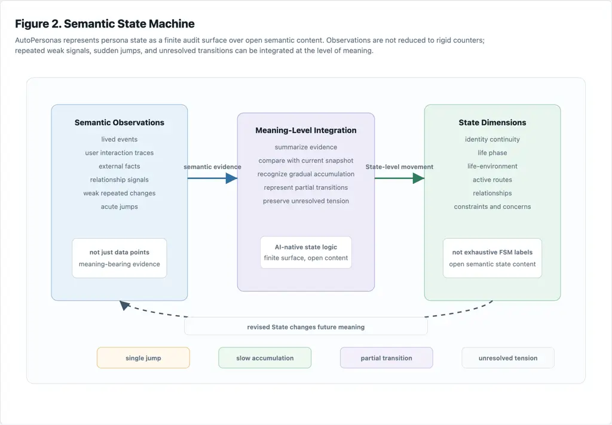

Figure 8: Semantic State machine. State is schema-bounded enough for
audit, but the content and evidence-to-State relation remain
semantically open.

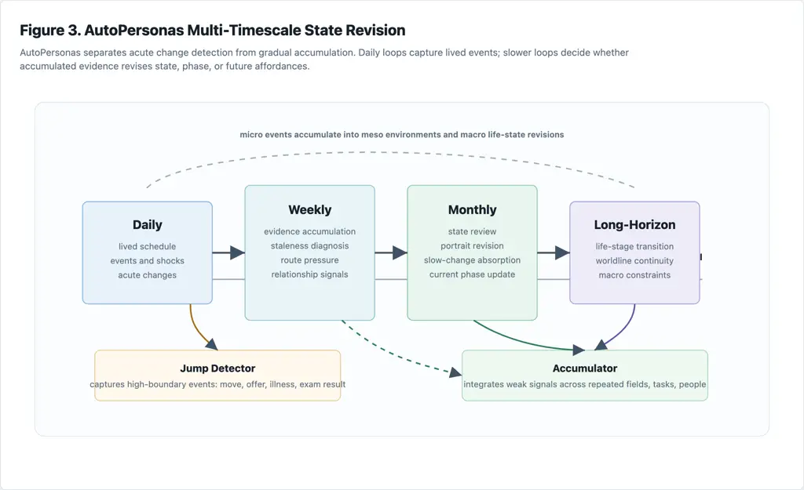

Figure 9: Multi-timescale AutoPersonas revision. Fast event capture and
slower evidence review jointly support State revision without rewriting
identity at every step.

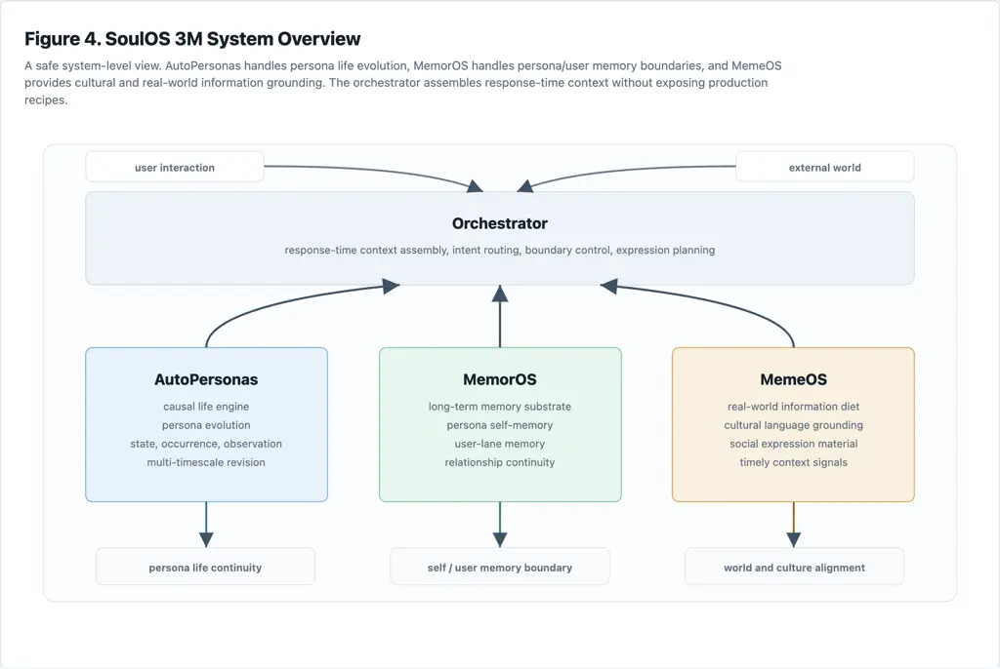

Figure 10: SoulOS 3M overview. AutoPersonas handles life-environment
evolution, MemorOS handles persona/user memory boundaries, and MemeOS
grounds cultural and real-world information.

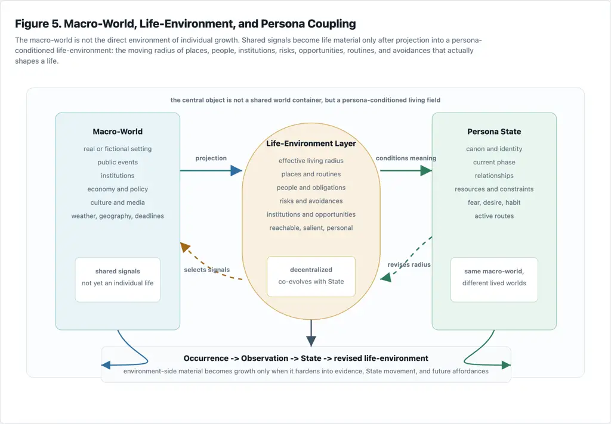

Figure 11: Life-environment layer. Macro-world signals change a
persona-specific future possibility space only after projection through
State, relationships, constraints, time, and environment radius.

![[Uncaptioned
image]](arxiv-2607-08252v2--f2947329e0b8.figures/figure-12.webp)

Table 1: Comparison between sandbox agent-society systems and
AutoPersonas.

![[Uncaptioned
image]](arxiv-2607-08252v2--f2947329e0b8.figures/figure-13.webp)

Table 3: Failure taxonomy for persona-life-environment self-locking.

## 10 Discussion

The central finding is that long-term persona evolution fails through
recursion as much as through forgetting. The failure has a model-side
component and a system-side component. Model-side diversity collapse
narrows daily life generation toward safe, high-frequency behavioral
channels. System-side context gravity then pulls new material back
toward old State, old memory, old life-environment summaries, and old
self-explanations. A loop cannot disconnect from its past without losing
continuity, but the same past can become an attractor. The environment
side can collapse with the persona: familiar places, relationship roles,
opportunity types, and public contexts become the only world future
generation can see.

The action- and theme-channel stress tests make the model-side component
measurable. Across eight current models, direct self-orchestrated
persona loops converged early toward a small behavioral repertoire. A
semantic re-keeping of the same outputs showed that the problem also
appeared at the life-theme level, with 79.0%-88.0% macro-theme
repetition across all eight models. The generated events were not
identical copies, but their functions repeated: care work, project
administration, material processing, writing delivery, health routines,
and recurring social exchanges. A loop can look locally varied while
becoming narrow in what it makes possible next. The Doubao temperature
probe narrows one rival explanation: if mode-lock were only a
low-temperature artifact, increasing daily generation temperature from
0.75 to 1.0 should have widened the repertoire or delayed
high-repetition windows. It did neither. Category count remained 11,
mean 5-day repetition stayed about 96%, and high-repetition windows
moved earlier. The result does not establish a temperature law, but it
weakens the view that hotter sampling alone solves recursive life-loop
convergence.

Neither pressure depends on the withheld mitigation for its evidence.
The model-side component is supported by the eight-model stress test, in
which every included model converged under the same loop, and by the
temperature probe, in which hotter sampling redistributed weight among
existing channels without widening the repertoire; as noted in the
limitations, this evidence does not yet separate model tendency from
canon-specific attractors. The system-side component is supported by the
three-year compressed simulation, in which environment watermark shells
and stale stage descriptions re-entered generation through the loop’s
own summaries rather than through any single model call.

The architectural implication is that open-ended persona growth needs
both a divergence engine and a governance system, not a larger memory
store or a random event sampler. A top-level world can be real,
fictional, or historical, but individual growth is shaped by the local
environment that becomes reachable and meaningful. Conditional variation
supplies plausible lift by eliciting long-tail life-environment material
from the model’s learned life-event prior. Bounded context governance
then controls how much old State, history, memory, and runtime world
material may constrain each future-facing step. Random events face the
opposite problem. They can break repetition, but they can also break
identity unless they arrive as conditional life-environment Occurrences
that are plausible enough to preserve continuity and distinct enough to
change what can happen next. AutoPersonas therefore treats openness as
an evidence-routing problem. Occurrences must become lived material,
Observations must accumulate enough support to revise State, and
revision must not follow from every isolated event.

The acceptable amount of diversity is also task-dependent. In a
benchmarked task agent, broader search often appears as error because
success is judged against a fixed objective, tool result, or answer
distribution. Persona evolution has a different tolerance profile. There
is usually no single correct next life event, and plausible deviation
can be useful if later evidence decides whether it hardens or
disappears. AutoPersonas can therefore bear more semantic variation than
a task-completion agent, but only because the OSO loop audits that
variation after generation rather than treating every candidate as
progress.

This places most of the technical burden on runtime rather than on any
single model call. The runtime layer is where the system decides how
much past evidence may constrain the present, how much present State may
constrain the future, and whether a future-facing signal becomes a lived
causal fact. If this layer is treated as a shallow wrapper, the system
collapses back into prompt-plus-memory design: history becomes context,
context becomes gravity, and future generation completes the old
attractor. In AutoPersonas, runtime is the multi-timescale substrate
that carries causality across past, present, and future while keeping
the production mechanisms behind that substrate private.

This also separates AutoPersonas from an action planner. A planner
chooses actions under current intent; AutoPersonas introduces
environment-side variation, tests whether it hardens into lived
evidence, and monitors whether the life trajectory moves across
dimensions. Change must also accumulate across scales. Macro-only change
becomes plot cutting, micro-only change updates the diary without moving
the life, and environment change without lived evidence produces drift.

AutoPersonas is an application of RSI to AI persona growth, and the
scope of that application should be stated precisely. Classical
recursive self-improvement concerns systems that may improve their own
intelligence, design capacity, or goal-directed machinery \[5, 8\].
HyperAgents gives a recent agentic version: it addresses recursive
self-improvement in task systems by collapsing the vertical task/meta
hierarchy into a single editable program, then evaluating descendants
through predefined tasks, metrics, and archive selection \[15\].
AutoPersonas keeps the recursive structure of RSI, a system improving
the conditions that produce its own future, but changes the object being
improved. That object is not intelligence or task performance but the
persona’s life trajectory: the system revises the State, evidence,
relationships, and life-environment conditions that shape what the
persona can become. Persona growth cannot be grounded in the same
objective as benchmarked task self-improvement, because a persona is a
human-like life surrogate rather than a task solver. Continual goal
assignment is the wrong driver, and no benchmark can cover the open
space of behavior, relationships, obligations, constraints, and
life-stage change. AutoPersonas therefore preserves the horizontal
persona-life-environment distinction and makes the dyad recursively
revisable through the OSO loop. The relevant question is whether change
remains traceable, identity continuity is preserved, and State movement
changes later reachability rather than producing decorative novelty.

Bounded society simulation and open-environment persona evolution
therefore motivate different machinery. In a bounded simulated society,
a centralized environment layer can supply public events, encounters,
outcomes, and reward signals. In a deployed life-environment engine,
outward growth pressure must also come from real-world information, user
relationships, memory boundaries, and underdetermined Occurrences.
Day-level simulation has less room to hide than coarse summaries: it
exposes whether the persona acted, whether an invitation became a
meeting, whether a public event entered the private life-environment,
whether weak signals accumulated, and whether a relationship changed
function. Shared information is projected through persona-specific
State, rhythm, unresolved routes, and life-environment radius, producing
a private environment that remains grounded without becoming identical
for every persona. Social structure remains the most fragile part of
this boundary, since a recurring person mention becomes a relationship
only when it changes obligations, conflicts, mutual expectations, or
later reachability.

The evidence also strengthens the generality claim. AutoPersonas is
designed to be parameterized by different persona canons, life rhythms,
macro-world settings, and interaction boundaries. The current evidence
now goes beyond architectural compatibility: a contemporary student
trajectory and a juvenile-goblin invented-world trajectory produced the
same anti-fixation regime under the redesigned runtime, despite a large
shift in age, species, world rules, environment radius, and
contamination constraints. This supports cross-setting generality for
the mechanism tested here. It does not establish statistical
universality across many personas, so multi-persona long-run audits
remain future work.

## 11 Ethics, Safety, and Reproducibility Boundary

Long-term persona systems may interact with real users over time.
User-specific memory should remain separate from persona self-state. A
persona may develop different relationships with different users, but
one user’s private history should not become global persona memory.

Public evaluation should not use identifiable user data. Long-run audits
should use synthetic personas, internal test personas, or anonymized
compressed event chains. Public examples should remove user identifiers,
private relationship details, and traces that could reconstruct a
conversation partner.

Generated backstory should be treated as persona-internal continuity,
not as factual human biography. A system may enrich a persona’s
remembered past for continuity and interaction quality, but this does
not imply that generated memories correspond to real human experiences.

This paper discloses causal architecture rather than production recipe.
We disclose the problem definition, causal loop, subsystem roles,
runtime-layer functional responsibilities, audit categories, compressed
case chains, and figure-level architecture. The runtime terms used in
the paper are public functional roles, not production component names.
We do not disclose production internals, private logs, operational
parameters, proprietary context assembly rules, internal ranking
details, or implementation artifacts that would compromise privacy or
commercial deployment.

The divergence configuration evaluated in Section 7.2 is withheld in
full, and this is a deliberate choice. The core contribution of this
paper is the problem: a definition of self-locking, its decomposition
into model-side and system-side pressures, a failure taxonomy, and
measurement instruments that any long-term persona system can apply. The
mitigation is reported so that the problem does not stand only as a
negative result. It shows, under controlled conditions, that
self-locking can be moved by runtime design. Its mechanisms belong to a
commercial persona infrastructure and are not released. We recognize
that this prevents independent verification of the mitigation. It does
not prevent verification of the problem: the evaluator, baselines, and
per-model outputs behind the self-locking measurements are public.

The disclosure boundary is:

|                                                                                                                                                                                                         |                                                                                                                                                            |                                                                                                                                                                                                                                                                                                                                                                                      |
| ------------------------------------------------------------------------------------------------------------------------------------------------------------------------------------------------------- | ---------------------------------------------------------------------------------------------------------------------------------------------------------- | ------------------------------------------------------------------------------------------------------------------------------------------------------------------------------------------------------------------------------------------------------------------------------------------------------------------------------------------------------------------------------------ |
| Disclosed                                                                                                                                                                                               | Abstracted                                                                                                                                                 | Withheld                                                                                                                                                                                                                                                                                                                                                                             |
| Self-locking definition, Observation-State-Occurrence causal loop, module responsibilities, runtime-layer causal roles, audit questions, failure taxonomy, compressed case chains, public-safe figures. | State layers, memory lanes, periodic review, external information grounding, context-governance roles, high-level evidence flow, qualitative cost classes. | Divergence-configuration internals and parameters, full prompts, named internal runtime submodules, production data schemas, private selection and sampling mechanisms, gate policies, seed-generation mechanisms, monitoring and reflection chains, thresholds, schedules, ranking weights, retry policies, token budgets, raw traces, private logs, internal paths, and user data. |

This boundary is necessary because the system is both a research
artifact and a commercial persona infrastructure. The paper is intended
to make the causal architecture and audit method intelligible, not to
publish a deployable reproduction recipe.

## 12 Data and Code Availability

The quantitative mode-lock evidence is supported by public-safe
aggregate artifacts rather than production logs. The arXiv package
includes these materials as ancillary files under anc/supplement/. The
eight-model stress-test materials include the aggregate manifest,
per-model action-only CSVs, model-level summary CSV/JSON files,
top-category summaries, strictness-variant cross-checks, the direct-loop
macro-theme summary, and semantic interpretation notes under
anc/supplement/eight_model_action_repetition/. The Doubao temperature
probe materials include the comparison report, manifest, action-only
events, derived event-level CSV for that probe, and model-level
action-repetition metrics under
anc/supplement/doubao_temperature_probe/. The qualitative diagnostic
claims are indexed in anc/supplement/qualitative_case_chains.md, which
maps each compressed case claim to the public-safe evidence type and
boundary.

The action-only repetition evaluator is included as
anc/supplement/code/action_repetition_eval.py. It exports daily events
from days.jsonl, applies a rule-based action taxonomy over the title and
action fields, and computes rolling 5-day repetition against prior
history. The divergence configuration, production AutoPersonas prompts,
private schemas, ranking mechanisms, operational schedules, raw private
logs, and user data are outside the public release boundary.

## 13 Cost and Scalability

AutoPersonas separates response-time interaction from background
evolution. Not every user message triggers full persona self-evolution.
Fast loops handle local events and short-term continuity. Slower loops
integrate evidence into State when enough signal has accumulated. This
amortizes long-term evolution over time while keeping ordinary
interactions responsive.

We report cost only qualitatively. The normalized cost structure
distinguishes response-time assembly, daily life updates, periodic
evidence review, monthly state review, long-horizon review, and
asynchronous cultural intake. Exact production parameters are outside
the disclosure boundary.

|                          |                            |                |                                                                            |
| ------------------------ | -------------------------- | -------------- | -------------------------------------------------------------------------- |
| Process                  | Relative frequency         | Relative cost  | Why it exists                                                              |
| Response-time assembly   | Per interaction            | Medium         | Compose relevant self-state, memory, user context, and expression context. |
| Daily life update        | Fast background loop       | Medium         | Capture lived events and short-range continuity.                           |
| Periodic evidence review | Slower background loop     | Medium to high | Accumulate weak signals and detect repeated patterns.                      |
| Monthly state review     | Slower background loop     | High           | Revise portrait-level State, role, life-environment, and life phase.       |
| Long-horizon review      | Infrequent background loop | High           | Refresh mainline continuity and long-term possibility space.               |
| Cultural intake          | Asynchronous               | Variable       | Keep world and cultural context aligned without blocking interaction.      |

This structure reflects a design choice. Long-term persona evolution
should not be performed as a full self-rewrite at every turn. It should
be amortized across time scales so that fast interaction and slower
state revision remain separable.

## 14 Limitations

This work has eleven main limitations.

First, AutoPersonas is a systems architecture and diagnostic audit
method, not a foundation-model training result.

Second, the three-year compressed simulation is diagnostic evidence. It
reveals long-run failure modes and motivates the architecture, but it
does not prove that open-ended self-evolution is solved.

Third, the positive validation is strongest for the central student
trajectory and the juvenile-goblin fictional-world stress case. The
latter provides measured cross-setting support, but the paper does not
yet report variance bands over many independently sampled persona
canons.

Fourth, the present evidence quantifies action-channel convergence in
direct baseline persona loops, measured reversal under the redesigned
runtime, and cross-world preservation of the anti-fixation regime. It
does not yet quantify coverage, diversity, or fidelity across a broad
set of persona canons, macro-world settings, and real-world information
streams.

Fifth, unlike capability-level RSI or self-improving task-agent systems
with benchmark scores and archive selection, this paper does not yet
provide a scalar metric for persona-life-environment co-evolution. The
action-channel and macro-theme metrics quantify baseline mode-lock
symptoms, not overall life growth. HyperAgents-style evaluation can rank
generated descendants on predefined tasks. AutoPersonas instead audits
horizontal recursive self-evolution among Occurrences, Observations,
semantic State, and life-environment possibility space. The diagnostic
audit identifies failure modes and one positive trajectory, but it is
not equivalent to benchmarked self-improvement evidence.

Sixth, the mitigation evidence is black-box. The paper reports
controlled before/after comparisons of a withheld divergence
configuration, in an isolated generator and inside the full runtime, but
it neither decomposes nor releases that configuration, so the effect
cannot be reproduced from the paper alone. The paper also does not
include an exhaustive component-level ablation of every AutoPersonas
subsystem. Future work should compare variants that remove
multi-timescale revision, separate memory lanes, occurrence hardening,
daily real-world information surfaces, and persona-conditioned
life-environment projection.

Seventh, the eight-model action- and theme-channel stress evidence uses
one complex persona canon, one direct self-orchestration loop setting, a
rule-based action taxonomy, and a semantic macro-theme keeper. It
supports rapid behavioral-channel and life-theme mode-lock across the
included models, but it does not separate model-level tendency from
canon-specific attractors, prompt design, taxonomy granularity, or
keeper grouping decisions. The baseline daily life-generation
temperature was 0.75, except for Kimi K2.6, whose route was code-forced
to temperature 1.0; weekly and monthly compaction used temperature 0.2,
and the legacy GPT judge used temperature 0. The Doubao temperature
probe is also a single-model, single-canon, single-rerun comparison;
weekly and monthly compaction temperature remained fixed at 0.2, so it
isolates daily generation temperature rather than the whole memory
pipeline. The Kimi run also used a mixed route across OpenRouter and
Moonshot native access, so its model-level result should be read as a
Kimi K2.6 trajectory rather than as a clean provider-route comparison.

Eighth, relationship persistence remains difficult. Events and
opportunities can be generated more easily than durable social
structures. Future audits should measure whether recurring people become
functional relationships with mutual obligations and changed
reachability.

Ninth, the attractor, gravity, and temporal-authority language in this
paper is diagnostic and architectural rather than a formal mathematical
proof. Formalizing self-locking as a fixed-point or attractor-basin
problem, and defining entropy or reachability measures for
persona-life-environment trajectories, remains future work.

Tenth, this paper does not expand the response-time social-orchestration
problem. Conversation-time context selection, expression planning, and
user-specific interaction strategy require separate treatment.

Eleventh, commercial and privacy constraints limit reproducibility. This
paper publishes the problem definition, the causal architecture, and the
diagnostic instruments; the self-locking mitigation and other production
mechanisms are withheld.

## 15 Conclusion

A role-playing persona that does not grow leaves a user’s relationship
with it nothing to accumulate on. Long-term persona agents therefore
need more than memory. They need a way to keep living in an environment
that does not collapse with them. AutoPersonas addresses this problem by
applying recursive self-improvement to persona growth, through a
multi-timescale life-environment engine organized around controlled
divergence and temporal authority separation.

Its State layer is a semantic State machine: finite enough to inspect,
but open enough to represent gradual, sparse, and unexpected life change
through meaning-level evidence accumulation. Environment-side
Occurrences are conditioned on persona canon, current State, time scale,
user relationship, macro-world signals, and real-world information, then
audited for downstream State and possibility-space effects. The current
evidence supports a bounded systems claim: persona-environment
self-locking can be observed, categorized, and partly quantified as
action-channel and theme-channel convergence, and can be mitigated
architecturally by separating the source of plausible divergence from
the governance of evidence, current State, future-facing Occurrences,
and the revisable life-environment layer between macro-world and
persona. The work provides a problem definition, a causal architecture,
a quantitative mode-lock stress test, and a diagnostic audit method for
long-term open-persona agents.

## Acknowledgements

The author thanks Letian Wang for the enthusiasm and vision he brought
to the idea of building charming personas. His game background and
sustained interest in expressive, engaging persona experiences were a
source of encouragement during this work.

## Supporting Materials

- •
  main.tex
- •
  references.bib
- •
  figures/
- •
  anc/supplement/README.md
- •
  anc/supplement/code/action_repetition_eval.py
- •
  anc/supplement/eight_model_action_repetition/
- •
  anc/supplement/doubao_temperature_probe/
- •
  anc/supplement/qualitative_case_chains.md
- •
  anc/supplement/figures/

## References

- \[1\] S. Alemohammad, J. Casco-Rodriguez, L. Luzi, A. I. Humayun, H.
  Babaei, D. LeJeune, A. Siahkoohi, and R. Baraniuk (2024)
  Self-Consuming Generative Models Go MAD. In International Conference
  on Learning Representations, External Links: 2307.01850,
  [Link](https://proceedings.iclr.cc/paper_files/paper/2024/hash/ebc042e767de551803ccfcc45e2454f5-Abstract-Conference.html)
  Cited by: §1, §2.3.
- \[2\] Altera.AL, A. Ahn, N. Becker, S. Carroll, N. Christie, M.
  Cortes, A. Demirci, M. Du, F. Li, S. Luo, P. Y. Wang, M. Willows, F.
  Yang, and G. R. Yang (2024) Project Sid: Many-agent simulations toward
  AI civilization. External Links: 2411.00114,
  [Document](https://dx.doi.org/10.48550/arXiv.2411.00114),
  [Link](https://arxiv.org/abs/2411.00114) Cited by: §2.1.
- \[3\] O. Anschel, A. Shoshan, A. Botach, S. H. Hakimi, A. Gendler, E.
  Ben Baruch, N. Bhonker, I. Kviatkovsky, M. Aggarwal, and G.
  Medioni (2025) Group-Aware Reinforcement Learning for Output Diversity
  in Large Language Models. In Proceedings of the 2025 Conference on
  Empirical Methods in Natural Language Processing, Suzhou, China,
  pp. 32394–32415. External Links:
  [Document](https://dx.doi.org/10.18653/v1/2025.emnlp-main.1649),
  [Link](https://aclanthology.org/2025.emnlp-main.1649/) Cited by: §1,
  §2.3.
- \[4\] S. Fu, Y. Wang, Y. Chen, X. Tian, and D. Tao (2025) A
  Theoretical Perspective: How to Prevent Model Collapse in
  Self-consuming Training Loops. In International Conference on Learning
  Representations, External Links: 2502.18865,
  [Document](https://dx.doi.org/10.48550/arXiv.2502.18865),
  [Link](https://arxiv.org/abs/2502.18865) Cited by: §1, §2.3.
- \[5\] I. J. Good (1966) Speculations Concerning the First
  Ultraintelligent Machine. In Advances in Computers, Vol. 6, pp. 31–88.
  External Links:
  [Document](https://dx.doi.org/10.1016/S0065-2458%2808%2960418-0),
  [Link](https://www.sciencedirect.com/science/article/pii/S0065245808604180)
  Cited by: §10, §2.4.
- \[6\] J. Kazdan, R. Schaeffer, A. Dey, M. Gerstgrasser, R.
  Rafailov, D. L. Donoho, and S. Koyejo (2024) Collapse or Thrive?
  Perils and Promises of Synthetic Data in a Self-Generating World.
  Note: Accepted at NeurIPS 2024 workshops M3L and ATTRIB External
  Links: 2410.16713,
  [Document](https://dx.doi.org/10.48550/arXiv.2410.16713),
  [Link](https://arxiv.org/abs/2410.16713) Cited by: §2.3.
- \[7\] S. K. Murthy, T. Ullman, and J. Hu (2025) One fish, two fish,
  but not the whole sea: Alignment reduces language models’ conceptual
  diversity. In Proceedings of the 2025 Conference of the Nations of the
  Americas Chapter of the Association for Computational Linguistics:
  Human Language Technologies (Volume 1: Long Papers), Albuquerque, New
  Mexico, pp. 11241–11258. External Links:
  [Document](https://dx.doi.org/10.18653/v1/2025.naacl-long.561),
  [Link](https://aclanthology.org/2025.naacl-long.561/) Cited by: §1,
  §2.3.
- \[8\] S. M. Omohundro (2008) The Basic AI Drives. In Artificial
  General Intelligence 2008: Proceedings of the First AGI Conference,
  Frontiers in Artificial Intelligence and Applications, Vol. 171,
  pp. 483–492. External Links:
  [Link](https://selfawaresystems.com/2007/11/30/paper-on-the-basic-ai-drives/)
  Cited by: §10, §2.4.
- \[9\] J. S. Park, J. C. O’Brien, C. J. Cai, M. R. Morris, P. Liang,
  and M. S. Bernstein (2023) Generative Agents: Interactive Simulacra of
  Human Behavior. In Proceedings of the 36th Annual ACM Symposium on
  User Interface Software and Technology, UIST ’23, San Francisco, CA,
  USA. External Links:
  [Document](https://dx.doi.org/10.1145/3586183.3606763),
  [Link](https://dl.acm.org/doi/10.1145/3586183.3606763) Cited by: §2.1,
  §8.
- \[10\] R. Schaeffer, J. Kazdan, A. C. Arulandu, and S. Koyejo (2025)
  Position: Model Collapse Does Not Mean What You Think. External Links:
  2503.03150, [Document](https://dx.doi.org/10.48550/arXiv.2503.03150),
  [Link](https://arxiv.org/abs/2503.03150) Cited by: §2.3.
- \[11\] I. Shumailov, Z. Shumaylov, Y. Zhao, N. Papernot, R. Anderson,
  and Y. Gal (2024) AI models collapse when trained on recursively
  generated data. Nature 631, pp. 755–759. External Links:
  [Document](https://dx.doi.org/10.1038/s41586-024-07566-y),
  [Link](https://www.nature.com/articles/s41586-024-07566-y) Cited by:
  §1, §2.3.
- \[12\] X. Wang, S. Zheng, H. Wu, W. Li, J. Huang, M. Zhu, C. Zu, Q.
  Deng, J. Wang, Q. He, H. Wang, X. Wu, and Y. Tao (2026) Agentopia:
  Long-Term Life Simulation and Learning in Agent Societies. Note: arXiv
  preprint External Links: 2606.07513,
  [Document](https://dx.doi.org/10.48550/arXiv.2606.07513),
  [Link](https://arxiv.org/abs/2606.07513) Cited by: §2.1, §8.
- \[13\] Z. Wang, Y. Y. Chiu, and Y. C. Chiu (2023) Humanoid Agents:
  Platform for Simulating Human-like Generative Agents. In Proceedings
  of the 2023 Conference on Empirical Methods in Natural Language
  Processing: System Demonstrations, Singapore, pp. 167–176. External
  Links: [Document](https://dx.doi.org/10.18653/v1/2023.emnlp-demo.15),
  [Link](https://aclanthology.org/2023.emnlp-demo.15/) Cited by: §2.1.
- \[14\] L. Yun, C. An, Z. Wang, L. Peng, and J. Shang (2025) The Price
  of Format: Diversity Collapse in LLMs. In Findings of the Association
  for Computational Linguistics: EMNLP 2025, Suzhou, China,
  pp. 15454–15468. External Links:
  [Document](https://dx.doi.org/10.18653/v1/2025.findings-emnlp.836),
  [Link](https://aclanthology.org/2025.findings-emnlp.836/) Cited by:
  §1, §2.3.
- \[15\] J. Zhang, B. Zhao, W. Yang, J. Foerster, J. Clune, M. Jiang, S.
  Devlin, and T. Shavrina (2026) Hyperagents. Note: arXiv preprint
  External Links: 2603.19461,
  [Document](https://dx.doi.org/10.48550/arXiv.2603.19461),
  [Link](https://arxiv.org/abs/2603.19461) Cited by: §10, §2.4.
