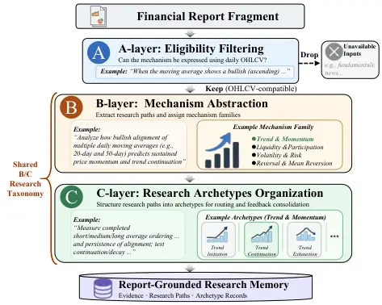
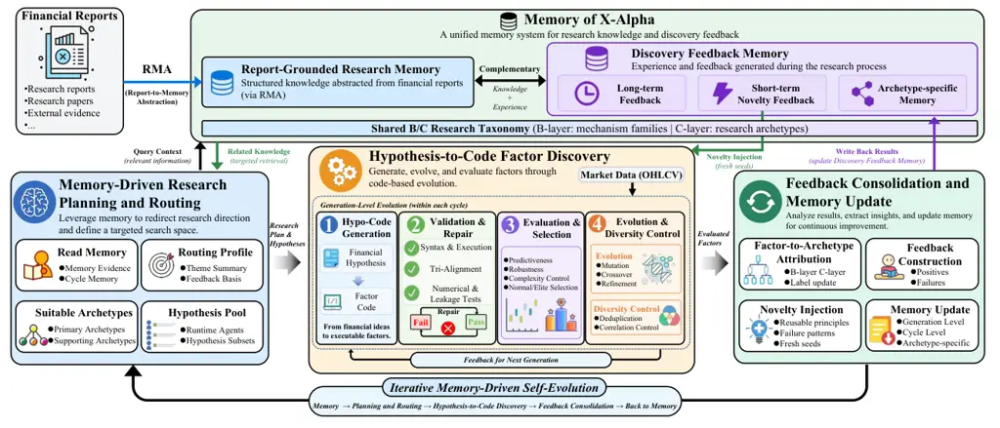
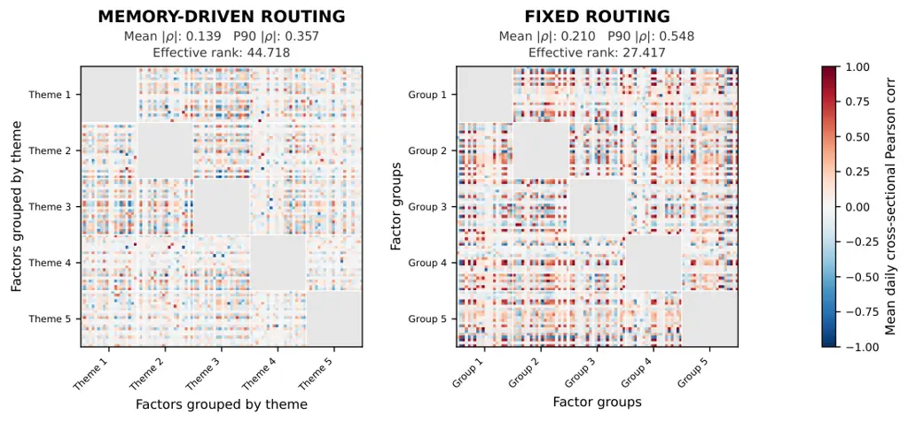
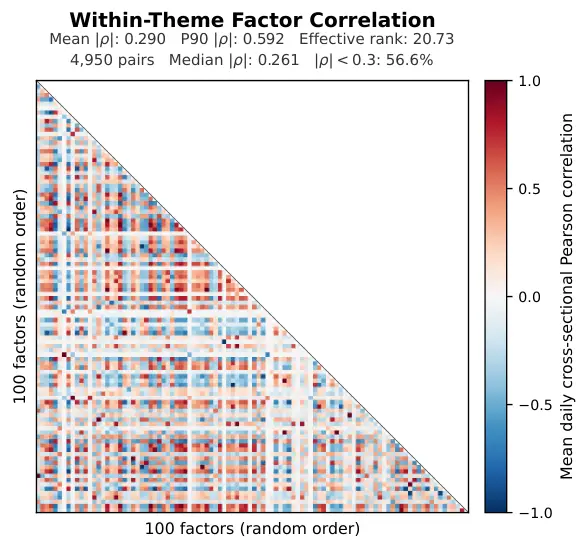

# X-Alpha: An AI Quant Researcher with Memory-Driven Self-Evolution

Fengyuan Liu    Yuchen Fu    Yuqi Wang    Fengyuan Liu    Mukai Li    Qi
Liu Affiliation: The University of Hong Kong Affiliation: Grace
Investment Machine Affiliation: Purdue University
Email: <oxfengyuan@gmail.com>

###### Abstract

Human quantitative researchers mine alpha through an iterative process:
they derive hypotheses from financial knowledge, implement and test them
as factors, and use the resulting evidence to guide subsequent research.
Yet automated alpha mining faces three key bottlenecks: noisy financial
knowledge is not directly actionable, exploration can remain confined to
similar mechanisms, and feedback may remain tied to individual mining
runs. To address these bottlenecks, we introduce X-Alpha, an AI Quant
Researcher that couples persistent research memory with continuous
hypothesis-to-code discovery. Report-to-Memory Abstraction (RMA) uses a
multi-layer filtering-and-abstraction process to convert financial
reports into actionable, data-compatible research paths. Memory-driven
routing uses accumulated experience to redirect exploration and define a
targeted search space for each cycle. Within each cycle, hypotheses are
implemented as executable factors and refined through empirical
validation and code-based evolution. Empirical outcomes are consolidated
into persistent research memory to guide subsequent exploration,
enabling memory-driven self-evolution across cycles. We evaluate X-Alpha
on five equity indices spanning mainland China, the United States, and
Hong Kong, with comprehensive experiments centered on CSI300.
Experiments show strong alpha discovery performance against baselines,
with improvements in factor quality and signal diversity and consistent
generation-level gains across multiple markets and prediction horizons.

## 1 Introduction

Alpha mining is the process of discovering financial factors that
predict future returns from historical market observations. This task is
challenging because the search space is vast, financial markets are
noisy and non-stationary (Engle, 1982), and effective discovery requires
more than formula search. Human quantitative researchers address this
challenge by drawing on financial knowledge to formulate hypotheses and
implementing them as factors for empirical testing. They use the
resulting evidence to refine their research directions and accumulate
experience for subsequent investigations. This iterative process
motivates our central question: how can an AI Quant Researcher sustain
hypothesis-to-code alpha discovery through accumulated research
experience?

Existing approaches include manually designed factors (Fama and French,
1992; Fama and French, 1993; Kakushadze, 2016), neural predictive
models (Duan et al., 2022; Xu et al., 2021a; Xu et al., 2021b), and
automated factor search using evolutionary algorithms or reinforcement
learning (Allen and Karjalainen, 1999; Zhang et al., 2020; Cui et al.,
2021; Yu et al., 2023). More recently, LLM-based systems have introduced
knowledge-guided factor construction and multi-agent research
workflows (Wang et al., 2023; Li et al., 2024; Tang et al., 2025; Shi et
al., 2025; Li et al., 2025; Wang et al., 2026; Liu et al., 2026).
Despite these advances, a continuous AI Quant Researcher still faces
three key bottlenecks. External financial knowledge often lacks
actionable abstraction, exploration can remain confined to similar
mechanisms, and feedback may not become reusable experience across
research cycles. Overcoming them requires reliable research abstraction,
adaptive search-space control, and persistent knowledge accumulation.

Knowledge abstraction bottleneck. External financial knowledge is
usually noisy and not directly structured for factor research. Reports
mix actionable market mechanisms with details that are irrelevant,
unavailable under the target data contract, or too coarse to guide
factor implementation. For example, analyst forecast revisions require
data beyond daily OHLCV, and a generic momentum narrative may not
specify an implementable research path. Using reports as raw context can
therefore misdirect exploration and obscure useful research clues. We
address this bottleneck with Report-to-Memory Abstraction (RMA), a
multi-layer filtering-and-abstraction process. RMA distills noisy
reports into actionable, data-compatible research paths without
prescribing factor formulas.

Search-space myopia. LLM-based factor generation can produce
superficially different candidates that rely on similar financial
mechanisms. For example, varying a momentum factor’s lookback window can
produce different formulas within the same trend-continuation mechanism.
Candidate-level feedback alone provides limited guidance on when to move
beyond an already explored research direction. We address this
bottleneck with memory-driven routing, a feedback-conditioned global
search abstraction with two complementary functions. First, it uses
accumulated experience to redirect exploration and formulate the next
cycle theme. Second, it defines a targeted search space around this
theme, retrieving relevant knowledge to guide hypothesis construction.

Non-cumulative research. Existing systems can use feedback from
successful and failed candidates to improve an ongoing mining process.
However, such feedback may remain tied to the current run rather than
become reusable experience for long-term research. We address this
bottleneck with a closed research loop that consolidates empirical
outcomes into persistent research memory. Subsequent cycles use this
memory to revise research directions and adapt search behavior. Here,
self-evolution refers to feedback-driven updates to memory and research
behavior, not changes to the underlying LLM parameters.

Inspired by CogAlpha (Liu et al., 2026), we translate financial
hypotheses into executable factors and refine them through code-based
evolution. We strengthen factor validation to assess whether
implementations match their hypotheses and remain robust across
evaluation periods. Correlation-based screening further limits
redundancy in the factor pool. Report-grounded memory and research
routing guide this discovery loop, and its empirical outcomes are
consolidated into experience for subsequent cycles. Together, these
components form X-Alpha, a memory-driven AI Quant Researcher for
continuous hypothesis-to-code discovery. Experiments support RMA’s
predictive gains and memory-driven routing’s improvement in cross-cycle
signal diversity and quality.

The main contributions of this paper are:

- •
  We develop Report-to-Memory Abstraction (RMA) to convert financial
  reports into actionable research paths and memory-driven routing to
  redirect exploration and define cycle-specific search spaces using
  accumulated experience.
- •
  We propose X-Alpha, an AI Quant Researcher that couples research
  memory with hypothesis-to-code discovery, enabling continuous research
  and memory-driven self-evolution across cycles.
- •
  We evaluate X-Alpha on five equity indices—CSI300, CSI500, CSI1000,
  SP500, and HSI90—across three markets, with comprehensive CSI300
  experiments assessing factor quality and the effectiveness of our
  methods.

## 2 Related Work

LLM-based alpha mining. LLM-based alpha mining uses language models to
interpret financial ideas and guide factor construction. AlphaGPT and
FAMA connect natural-language knowledge to interpretable alpha
generation (Wang et al., 2023; Li et al., 2024), while AlphaAgent and
AlphaJungle improve symbolic factor search through regularized
generation, tree search, and empirical feedback (Tang et al., 2025; Shi
et al., 2025). Beyond factor construction, several systems also retain
research experience to guide subsequent exploration. RD-Agent(Q)
organizes factor and model development within an iterative research
loop (Li et al., 2025). Its feedback primarily improves the research
workflow, rather than explicitly defining cycle-specific search spaces.
FactorMiner retains successful patterns and forbidden regions to guide
global formula search across mining sessions (Wang et al., 2026). Its
accumulated experience centers on formula search rather than the
abstraction of external reports into actionable research paths. CogAlpha
evolves executable Python factors and reuses candidate feedback across
generations and sub-cycles (Liu et al., 2026). It does not explicitly
connect report-grounded knowledge accumulation with cycle-level research
routing. In contrast, X-Alpha organizes report-grounded knowledge into
actionable research paths. Its memory-driven routing uses accumulated
experience to redirect exploration across cycles and define
theme-specific search spaces for hypothesis generation within each
cycle.

Autonomous and self-evolving research agents. Beyond alpha mining, LLM
agents are increasingly studied as autonomous scientific researchers.
The AI Scientist exemplifies end-to-end research automation, taking
scientific ideas through empirical investigation to a completed
report (Lu et al., 2024). Multi-agent systems also explore how research
is organized, from collaborative hypothesis development in AI
Co-Scientist to sustained research cycles in EvoScientist (Gottweis et
al., 2026; Lyu et al., 2026). Other work examines how research agents
learn from experience and acquired knowledge to adapt their behavior (Qu
et al., 2026; Yan et al., 2026; Lee et al., 2026). These systems
establish a broader paradigm of autonomous, iterative research. However,
alpha discovery requires financial hypotheses to be expressed as
data-compatible factor code and evaluated for predictive value. X-Alpha
connects hypothesis-to-code discovery with financial consistency checks
and empirical screening, providing a validated basis for subsequent
research.

## 3 Approach

X-Alpha is an AI Quant Researcher that couples persistent research
memory with a hypothesis-to-code discovery loop to support continuous
alpha research. As shown in Figure 2, RMA supplies report-grounded
research memory, complemented by discovery feedback from prior
generations and cycles. At the start of each cycle, memory-driven
routing uses accumulated experience to redirect exploration and define a
targeted search space. Relevant knowledge is retrieved within this space
to construct the hypothesis pool. Hypotheses are implemented as
executable factor code and refined through empirical validation and
code-based evolution. Factor-level outcomes are then consolidated into
discovery feedback memory under the shared research taxonomy. The
updated memory guides subsequent cycles, enabling memory-driven
self-evolution through changes in research directions and search
behavior.



Figure 1: RMA. The A-layer filters report evidence for OHLCV
compatibility. The B-layer extracts research paths by mechanism family.
The C-layer organizes and consolidates them under _Research Archetypes_,
forming reusable research memory.



Figure 2: Overall framework of X-Alpha. RMA-derived research knowledge
and discovery feedback guide routing to redirect exploration and define
cycle-specific search spaces. Within each cycle, hypotheses are
implemented and evolved as executable factors through empirical
evaluation. Research outcomes are consolidated into memory to guide
subsequent cycles, closing the memory-driven self-evolution loop.

### 3.1 Report-to-Memory Abstraction

When financial reports are used directly as research context, useful
clues remain mixed with information that depends on unavailable data.
Even data-compatible passages may be too broad to guide hypothesis
construction. To address this problem, inspired by structured-memory
construction in StructMem (Xu et al., 2026), we design Report-to-Memory
Abstraction (RMA) as a multi-layer process that distills report content
into actionable research memory under the daily OHLCV contract.

As shown in Figure 1 above, RMA comprises three processing layers. The
A-layer (eligibility filtering) determines whether a report fragment
contains a self-contained mechanism that can be studied using daily
OHLCV data. For example, the illustrated bullish moving-average
alignment can be examined using daily prices and is therefore eligible
for further processing. The B-layer (mechanism abstraction) extracts
concise, evidence-grounded research paths from eligible fragments. Each
path is assigned to a broad financial mechanism family. In the figure,
the moving-average discussion becomes a research question about whether
bullish alignment supports sustained price momentum, assigned to _Trend
& Momentum_. The C-layer (research archetype organization) assigns each
accepted path to a compatible archetype within its B-layer family.
Within each archetype, semantic de-duplication retains representative
paths, followed by curation that consolidates closely related paths into
more abstract research descriptions. In the example, the moving-average
path is assigned to the _Trend Continuation_ archetype. Its curated
memory record focuses on moving-average ordering and alignment
persistence, asking whether the trend continues or decays.

The resulting memory provides data-compatible research paths that guide
hypothesis construction within the selected research direction. The
predefined B-layer mechanism families and C-layer research archetypes
form a shared research taxonomy (Appendix D). Factor-to-archetype
attribution maps code-validated candidate mechanisms to the same
taxonomy for feedback construction (Section 3.4). Implementation details
and recorded LLM-call examples are provided in Appendix C.

### 3.2 Memory-Driven Routing

As shown in Figure 2, memory-driven routing controls research at the
cycle level: it redirects exploration using accumulated experience and
defines a targeted search space before hypotheses are constructed. For
research direction selection, the planner reviews recent cycle feedback
to assess which mechanisms have been explored and what the results
reveal. It uses this experience to identify an unresolved research
question and formulate the next cycle theme. For search-space
definition, the planner maps this theme to primary and supporting
mechanism families. Relevant _Research Archetypes_ and their retrieved
report-grounded paths provide the contexts for active research agents to
construct the hypothesis pool. A subset of these hypotheses is selected
for seed-factor generation.

For example, earlier themes examined liquidity recovery after volume
shocks. Feedback highlighted an unresolved question about the
relationship between post-spike volume-decay curvature and delayed price
drift. The planner redirected the next cycle theme toward this
relationship. The new search space was anchored in _Volume Level and
Structure_, with lagged-response archetypes connecting volume decay to
later price adjustment. Prior feedback guided the inclusion of
volatility and liquidity conditions in the supporting research paths.
Implementation details and recorded examples appear in Appendix E.

### 3.3 Hypothesis-to-Code Factor Discovery

As shown in Figure 2, the hypothesis-to-code factor discovery loop
begins by translating planned hypotheses into executable Python seed
factors using daily OHLCV data. Each candidate includes a financial
hypothesis, executable code, and an explanation of the implementation
logic. During validation and repair, static inspection first checks that
the implementation follows the data and code contract. Tri-alignment
then checks whether the hypothesis and implementation logic agree with
the executable code and whether both code and explanation are
financially coherent. Detected inconsistencies trigger targeted repair
and revalidation, keeping the research record consistent with the
implemented mechanism for subsequent attribution and feedback.
Candidates that pass these checks are executed to assess output validity
and screen for future-information leakage. Recoverable problems trigger
targeted repair followed by revalidation; persistent failures are
discarded before empirical evaluation.

During empirical evaluation and selection, valid candidates are assessed
for cross-sectional predictive quality using IC and RankIC, with factor
direction fixed from training data. ICIR and RankICIR summarize
predictive stability. A hard rolling out-of-sample (OOS) filter screens
candidates for reliable performance across successive evaluation
windows. Normal selection uses train-only evidence to maintain a broad
parent pool for further evolution. A complexity discount adjusts its
predictive score to favor simpler implementations with comparable
predictive quality. Elite selection additionally uses validation-period
evidence in train–validation scoring and applies stricter quality and
rolling-OOS requirements. Selected elites are preserved across
generations in an archive that supports feedback construction and final
portfolio evaluation. Held-out test results do not inform research
selection or feedback. The scoring and selection rules are detailed in
Appendix G. Section 4.1 specifies the final portfolio reporting
protocol.

Retained factors serve as parents for code-based evolution. Mutation
introduces variants of a parent mechanism, and crossover combines parent
hypotheses into a joint mechanism. Refinement simplifies an
implementation while preserving its core intent. Generated children
return to validation and empirical evaluation, closing the
generation-level loop. Diversity control removes duplicate
implementations and filters candidates that are highly correlated with
existing elite factors before selection. Within each cycle, periodic
novelty injection uses the cycle theme and recent success/failure
feedback to recompose research agents and generate fresh seeds beyond
variants of the current parents. These seeds enter the parent pool after
redundancy screening, and their descendants undergo the same validation,
evaluation, and selection process as other evolved candidates. Details
are in Appendix F.

### 3.4 Feedback and Memory Update

As shown in Figure 2, feedback consolidation turns factor-evaluation
outcomes into reusable research experience. For factor-to-archetype
attribution, code-validated candidates are mapped to mechanism families
and _Research Archetypes_ under the shared taxonomy used by RMA.
Attribution follows the implemented mechanism, which may change during
repair or evolution. During feedback construction, elite-selected
factors contribute GOOD records that capture supported mechanisms and
conditions for reuse. Normal-gate failures contribute BAD records that
explain failed assumptions and provide avoidance or repair guidance.
Recent GOOD/BAD summaries guide fresh-seed generation during
within-cycle novelty injection. For memory update, only elite-factor
hypotheses are written to archetype-specific memory under their
attributed _Research Archetypes_. Cycle-level findings are consolidated
into persistent summaries within the explored research scope, retaining
the remaining information gaps. Subsequent routing uses this experience
to identify the next information gap and revise the research direction
and search space, enabling memory-driven self-evolution across cycles.
Attribution and feedback-construction details are provided in
Appendix H.

|                  |                |         |        |                    |        |        |          |        |        |                     |
| ---------------- | -------------- | ------- | ------ | ------------------ | ------ | ------ | -------- | ------ | ------ | ------------------- |
| Models           |                | Dataset | Target | Evaluation Metrics |        |        |          |        |        |                     |
| Type             | Model          |         |        | IC                 | RankIC | ICIR   | RankICIR | AR     | AER    | IR                  |
| Machine Learning | LightGBM       | CSI300  | 10-day | 0.0213             | 0.0291 | 0.2180 | 0.2454   | 0.0683 | 0.0612 | 0.9003$`\pm`$0.2259 |
|                  | AdaBoost       |         |        | 0.0161             | 0.0191 | 0.2051 | 0.2054   | 0.0536 | 0.0457 | 0.6714$`\pm`$0.1124 |
|                  | XGBoost        |         |        | 0.0161             | 0.0162 | 0.1942 | 0.1894   | 0.0564 | 0.0475 | 0.7167$`\pm`$0.0573 |
|                  | Random Forest  |         |        | 0.0117             | 0.0141 | 0.1391 | 0.1680   | 0.0553 | 0.0467 | 0.7010$`\pm`$0.0414 |
| Deep Learning    | Transformer    | CSI300  | 10-day | 0.0079             | 0.0150 | 0.0749 | 0.1365   | 0.0473 | 0.0383 | 0.5459$`\pm`$0.3059 |
|                  | LSTM           |         |        | 0.0112             | 0.0240 | 0.1308 | 0.2115   | 0.0517 | 0.0414 | 0.5261$`\pm`$0.0956 |
|                  | MLP            |         |        | 0.0156             | 0.0237 | 0.1415 | 0.2043   | 0.0419 | 0.0331 | 0.4305$`\pm`$0.2849 |
|                  | CNN            |         |        | 0.0152             | 0.0226 | 0.1380 | 0.1995   | 0.0481 | 0.0381 | 0.4886$`\pm`$0.1431 |
| Alpha Methods    | CogAlpha       | CSI300  | 10-day | 0.0297             | 0.0373 | 0.1796 | 0.2141   | 0.0649 | 0.0562 | 0.6088$`\pm`$0.4550 |
|                  | R&D-Agent(Q)   |         |        | 0.0261             | 0.0334 | 0.1801 | 0.2361   | 0.0756 | 0.0669 | 0.7790$`\pm`$0.2437 |
|                  | AlphaAgent     |         |        | 0.0198             | 0.0233 | 0.1389 | 0.1616   | 0.0534 | 0.0459 | 0.5222$`\pm`$0.0592 |
|                  | Alpha360       |         |        | 0.0129             | 0.0099 | 0.0855 | 0.0636   | 0.0317 | 0.0299 | 0.2793$`\pm`$0.0000 |
| Single LLM       | DeepSeek-v3.2  | CSI300  | 10-day | 0.0220             | 0.0225 | 0.1674 | 0.1642   | 0.0684 | 0.0599 | 0.7197$`\pm`$0.4235 |
|                  | GLM-5.2        |         |        | 0.0132             | 0.0136 | 0.1056 | 0.1039   | 0.0508 | 0.0441 | 0.5262$`\pm`$0.2238 |
|                  | GPT-OSS-120B   |         |        | 0.0243             | 0.0303 | 0.1583 | 0.2004   | 0.0600 | 0.0518 | 0.5476$`\pm`$0.3911 |
|                  | Kimi-K2.7-Code |         |        | 0.0240             | 0.0257 | 0.1891 | 0.1918   | 0.0636 | 0.0565 | 0.6336$`\pm`$0.1077 |
| Ours             | X-Alpha        | CSI300  | 10-day | 0.0448             | 0.0590 | 0.2602 | 0.3379   | 0.1379 | 0.1291 | 1.3472$`\pm`$0.3105 |

Table 1: CSI300 10-day rolling comparison. Metrics are averaged over all
five recorded seeds or factor groups; IR is reported as mean $`\pm`$
standard deviation. Shading ranks the displayed methods only, with the
best mean bolded and the second-best underlined. Complete results (mean
$`\pm`$ SD) and individual AER values are in Appendix K.

## 4 Experiments

### 4.1 Experimental Settings

Datasets and prediction task. We evaluate X-Alpha on five equity indices
across three different markets and two prediction horizons: CSI300 at 10
and 30 days, and CSI500, CSI1000, SP500, and HSI90 at 10 days. The main
experiments focus on CSI300 with a 10-day prediction horizon. All
settings use Qlib-compatible daily adjusted OHLCV data (Yang et al.,
2020). For $`h\in\{10,30\}`$, the target is the future adjusted
open-to-open return from the next trading day’s open:
$`y_{i,t}^{(h)}=\frac{O^{\mathrm{adj}}_{i,t+h+1}}{O^{\mathrm{adj}}_{i,t+1}}-1,`$
where $`O^{\mathrm{adj}}_{i,t}`$ denotes the adjusted open price. We use
2011–2020 for training, 2021 for validation, and 2022–2025 for testing.
Training and validation are used for discovery and selection; the test
period is reserved for final reporting.

Metrics. We measure predictive quality using the information coefficient
(IC) and rank information coefficient (RankIC). Their corresponding
mean-to-standard-deviation ratios, ICIR and RankICIR, measure temporal
stability. Held-out portfolio diagnostics include annualized return
(AR), annualized excess return (AER), and information ratio (IR). Factor
direction is fixed using training data. Additional definitions and
diagnostics are provided in Appendix I.

System and evaluation configuration. Unless otherwise specified, X-Alpha
uses gpt-oss-120b (OpenAI, 2025). By default, each cycle targets 64
initial factors and maintains up to 80 parents over 10 generations. In
the main comparison, all predictive and factor-based methods use
expanding-history rolling fitting, refitted every 128 trading days for
each non-overlapping prediction window, with an $`h+1`$-day embargo. For
portfolio reporting, elite factors are ranked by _library score_, a
train–validation predictive score combining normalized RankIC and IC. We
retain up to 40 factors with pairwise absolute correlation below
$`0.60`$ and combine them using Ridge regression (Hoerl and Kennard, 1970) with $`\alpha=10.0`$. Appendix J provides preprocessing,
backtesting, and runtime settings; Appendix G details factor ranking.

### 4.2 Comparison with Baselines

Table 1 compares X-Alpha with selected machine-learning (ML),
deep-learning (DL), alpha-method, and single-LLM baselines under the
common CSI300 10-day rolling setting. The full comparison of 23 methods
appears in Appendix K. ML and DL baselines are evaluated with five
different random seeds on the same OHLCV feature panel. The alpha-method
group includes the fixed Alpha360 library (Microsoft, 2025) and
automated mining systems (Tang et al., 2025; Li et al., 2025; Liu et
al., 2026). Single-LLM baselines, generative alpha methods, and X-Alpha
each generate 1,500 valid candidate factors. We select five 40-factor
groups in descending train–validation library-score order, excluding
factors already chosen for earlier groups. Within each group, a
candidate is retained only when its absolute correlation with every
selected factor is below $`0.60`$. The factors in each group are
combined using Ridge regression and evaluated under the rolling protocol
in Section 4.1. For every method, we average all seven metrics over its
five seed- or group-level outcomes.

X-Alpha achieves the highest mean on all seven metrics in the main
table. Its held-out RankIC is 0.0590, compared with 0.0373 for CogAlpha,
the strongest displayed baseline on this metric. In portfolio
evaluation, its AER reaches 0.1291, compared with 0.0669 for
R&D-Agent(Q). Its IR is $`1.3472\pm 0.3105`$, compared with
$`0.9003\pm 0.2259`$ for LightGBM. These results support the predictive
quality and portfolio usefulness of the discovered factor groups under
the shared evaluation protocol. We also evaluate X-Alpha with different
factor-group sizes and correlation thresholds; the combination results
are reported in Appendix K.2. Appendix K provides the complete rolling
and static comparisons, together with individual AER values and
cumulative-return curves.

### 4.3 Market and Horizon Generalization

Figure 3 examines whether generational improvement extends beyond CSI300
at the 10-day horizon, using four settings spanning horizon, equity
universe, and market. For each generation, we average RankIC over the
top 8 elite factors within each cycle, then average the cycle-level
means across 15 cycles. Approximately 100 elite factors contribute to
each generation-level estimate. Factor directions are fixed from
training data (Appendix I.2). Train–validation curves summarize evidence
available during research, whereas held-out curves summarize test-period
factor quality. The figure assesses how generation-level factor quality
generalizes across markets and horizons.

From the initial to the final generation, mean held-out RankIC increases
+106.9% on CSI300 at 10 days and +46.3% at 30 days. At the 10-day
horizon, it rises +114.0% on CSI500 and +87.2% on CSI1000. These
trajectories show that the improvement is not confined to one A-share
universe or one prediction horizon. HSI90 and SP500 also improve,
+181.4% and +295.1%, respectively. These substantial relative gains
across all evaluated markets support the cross-market generalization of
X-Alpha’s factor-discovery capability. Appendix Figure 4 presents all
six settings.

Figure 3: Generation-level RankIC in 4 settings. Thin lines show
individual cycles; bold curves and shading indicate the mean and
interquartile range.

### 4.4 Evaluating the Core Memory Mechanisms

Report-to-Memory Abstraction. We test whether RMA improves
research-input quality by comparing factor generation from
report-grounded research paths with _direct report_ input. Both
conditions use 2,120 reports and the same factor-discovery pipeline.
Table 2 shows relative gains in mean held-out metrics across all
accepted factors. RMA improves all four metrics, with RankIC and
RankICIR increasing by 6.40% and 29.76%, respectively. When these
factors are combined, RMA also improves RankIC and RankICIR in all 12
factor-count/correlation configurations. These results support the
effectiveness of RMA in providing more actionable research input and
improving the predictive quality of generated factors. Appendix
Tables 11 and 12 provide the complete single-factor and combination
results.

Memory-driven research routing. We compare memory-driven routing with
fixed and random routing under the same setting. Fixed routing retains
the same theme and archetype bundle across cycles. We run five
independent experiments per condition, each sampling 20 factors from the
initial generation of each of five cycles (100 factors total). Table 3
shows a 35.6% reduction in mean absolute cross-cycle factor correlation
under memory-driven routing. Effective rank increases by 67.4%. Random
routing yields intermediate diversity between fixed and memory-driven
routing. We further assess the quality of candidates selected by
Train–Val RankIC. Memory-driven routing achieves mean held-out RankIC of
0.02634 and 0.01843 for the top-10 and top-20 subsets, exceeding fixed
routing by 27.9% and 15.3%, respectively (Appendix Table 14). Together,
these results suggest that memory-driven routing reduces repeated
exploration across cycles and broadens signal diversity, yielding a
stronger upper tail of selectable high-quality factors. Appendix E.2
provides a feedback-to-routing trace, and Appendix Figure 6 visualizes
the diversity contrast.

|      |         |        |          |          |
| ---- | ------- | ------ | -------- | -------- |
|      | IC      | RankIC | ICIR     | RankICIR |
| Gain | +46.28% | +6.40% | +137.09% | +29.76%  |

Table 2: Relative gains over _direct report_ input in mean held-out
single-factor metrics on CSI300 (10-day).

| Metric                      | Fixed         | Random            | Memory-driven      |
| --------------------------- | ------------- | ----------------- | ------------------ | ---------- | ------------------- |
| Mean $`                     | \mathrm{corr} | `$ $`\downarrow`$ | $`0.2106`$         | $`0.1980`$ | $`\mathbf{0.1357}`$ |
| P90 $`                      | \mathrm{corr} | `$ $`\downarrow`$ | $`0.5374`$         | $`0.5210`$ | $`\mathbf{0.3489}`$ |
| Effective rank $`\uparrow`$ | $`27.01`$     | $`29.84`$         | $`\mathbf{45.22}`$ |

Table 3: Cross-cycle signal diversity across five independent
experiments.

### 4.5 Closed-Loop Process Evaluation

We next evaluate how the supporting operations of the closed-loop
research process affect factor quality and the reliability of
accumulated research experience. Study-specific protocols and complete
results appear in Appendix L.

Feedback-guided discovery. We compare real discovery feedback with no
feedback and randomly sampled feedback from the same candidate bank,
generating 100 candidates per condition in each experiment. We compare
equally sized candidate subsets selected by train–validation score at
$`K\in\{5,10,20,50\}`$ and also evaluate all accepted candidates.
Table 4 presents the top-5 comparison, where real feedback achieves the
highest mean held-out RankIC and RankICIR across the two experiments.
This advantage holds across the other selection sizes and the all-valid
pools. These results support the effectiveness of historical success and
failure feedback in guiding factor generation and improving the
predictive quality of subsequent factors. Appendix L provides the
complete results.

Reliable research records through tri-alignment. We randomly sample 167
factor records from 1,500 candidates for a paired comparison before and
after tri-alignment repair. Manual review assesses explanation–code
agreement and the financial soundness of both code and explanation. The
proportion passing all three checks increases from 12.57% to 89.82%
after repair. These results support improved consistency among
hypotheses, factor code, and financial explanations, strengthening the
quality of research-memory entries. Appendix L provides the repair-audit
details.

| Feedback | RankIC   | RankICIR |
| -------- | -------- | -------- |
| None     | 0.008456 | 0.063165 |
| Random   | 0.006767 | 0.057163 |
| Real     | 0.042562 | 0.261827 |

Table 4: Held-out quality of top-5 factors selected by train–validation
score, averaged across two experiments.

Diversity refresh through novelty injection. We select 10
novelty-injection events and compare the parent pool immediately before
and after injection. Mean absolute parent-pool correlation decreases in
all 10 events, with a 5.90% reduction in the average across events. The
event-averaged raw effective rank increases by 12.87%. Effective rank
normalized by factor count increases in 8 events, and its event-averaged
value rises by 2.68%. These results support the effectiveness of novelty
injection in reducing factor redundancy during within-cycle evolution.
Appendix Table 17 reports the complete event-level results.

Rolling OOS filtering. We compare factor selection with and without a
hard filter based on rolling OOS performance, using the same evaluated
candidate bank. The filter checks temporal robustness within the
train–validation period. At top-200 in the normal pool, hard filtering
improves mean held-out RankIC and RankICIR by 14.56% and 17.85%,
respectively, over selection without rolling OOS. These results support
the effectiveness of rolling OOS filtering in identifying more reliable
candidates and improving selection quality. Appendix Table 18 compares
selection with and without rolling OOS filtering in both pools.

Complexity discounting. We compare the four complexity-discount options
in X-Alpha by selecting 40 factors from the same fixed RMA candidate
pool. All four improve held-out predictive quality and reduce mean
factor complexity compared with selection without discounting. RankIC
improves by 5.07–7.98% and RankICIR by 2.77–5.32% across the four
functions. Mean complexity falls by 7.31–12.69%. These results suggest
that appropriate complexity control can improve factor quality. Appendix
Table 19 reports all four functions and the no-discount control.

### 4.6 Analysis of Generated Factors

Within-theme signal diversity. Once a research theme is fixed, we
examine whether factors generated within that search space retain signal
diversity. We analyze 100 factors from one volatility-regime breakout
cycle. Across the 4,950 factor pairs, the mean absolute signal
correlation is 0.290. Absolute correlation is below 0.3 for 56.6% of
pairs. The 100-factor correlation matrix has an effective rank of 20.73.
These results show variation in factor signals within a shared theme.
Appendix Figure 7 provides the correlation heatmap and full statistics.

Hypothesis-to-code case study. The following pseudocode summarizes an
elite CSI300 factor based on regime-dependent overshoot pressure.

ret = FILLNA(daily_return, 0)

cutoff = WHERE(high_vol, 0.90, 0.95)

overshoot = close \< cutoff \* MA20

pressure = SUM20(overshoot \* abs(ret))

fast = EWMA(pressure, span=5)

slow = EWMA(pressure, span=15)

signal = WHERE(high_vol, fast, slow)

factor = signal - HIST_Q75(signal)

Here, MA20 and SUM20 denote trailing 20-day mean and sum operations,
with missing returns set to zero. High volatility is identified when
20-day return volatility exceeds its 60-day rolling median. The two
fixed-span EWMAs maintain separate histories, and WHERE selects their
outputs at each date. Choosing the fast output in high-volatility states
expresses the hypothesis of faster reversal after downside overshoot.
Subtracting HIST_Q75, the expanding 75th percentile, centers the signal
relative to historical pressure levels. Appendix M.2 provides the
implementation and evaluation results.

## 5 Conclusion

We present X-Alpha, a memory-driven AI Quant Researcher for continuous
hypothesis-to-code alpha discovery. By combining report-grounded
knowledge with persistent discovery feedback, X-Alpha revises research
directions and search spaces across cycles, enabling memory-driven
self-evolution. Experiments across five different equity indices and
three distinct markets evaluate this framework, with comprehensive
comparisons on CSI300 supporting improvements in factor quality and
signal diversity. This work provides a foundation for cumulative,
experience-driven quantitative research, supporting the development of
AI researchers that learn from prior investigations and adapt their
exploration over time.

## Limitations

X-Alpha is intended for academic research and does not provide financial
advice. Factor discovery is restricted to daily OHLCV data, limiting the
financial mechanisms that can be investigated. Portfolio evaluation uses
historical Qlib backtests with fixed trading-cost assumptions, which
only approximate live trading conditions. Additionally, the stochastic
nature of LLM outputs makes exact reproduction of generated factors
difficult. Discovery quality also depends on the chosen language model
and evaluation configuration.

## Ethical Considerations

The market datasets used in this study were obtained from public sources
through Qlib (Yang et al., 2020) and Yahoo Finance (Aroussi, 2024).
Users should follow the applicable data-use terms and independently
verify generated factors and code before deployment. Any practical use
requires an assessment of the associated financial risks.

AI assistance in manuscript preparation was limited to grammar
correction and refinement of logical clarity. All edits were reviewed by
the authors, who take responsibility for the final manuscript.

## References

- Allen and Karjalainen (1999) F. Allen and R. Karjalainen Using genetic
  algorithms to find technical trading rules. Journal of financial
  Economics 51 (2), pp. 245–271. Cited by: §1.
- Aroussi (2024) R. Aroussi Yfinance: download market data from yahoo!
  finance’s api. Note:
  [https://pypi.org/project/yfinance/](https://pypi.org/project/yfinance/)Accessed:
  2026-7-01 Cited by: Appendix J, Ethical Considerations.
- Cui et al. (2021) C. Cui, W. Wang, M. Zhang, G. Chen, Z. Luo,
  and B. C. Ooi Alphaevolve: a learning framework to discover novel
  alphas in quantitative investment. In Proceedings of the 2021
  International conference on management of data, pp. 2208–2216. Cited
  by: §1.
- Duan et al. (2022) Y. Duan, L. Wang, Q. Zhang, and J. Li Factorvae: a
  probabilistic dynamic factor model based on variational autoencoder
  for predicting cross-sectional stock returns. In Proceedings of the
  AAAI conference on artificial intelligence, Vol. 36, pp. 4468–4476.
  Cited by: §1.
- Engle (1982) R. F. Engle Autoregressive conditional heteroscedasticity
  with estimates of the variance of united kingdom inflation.
  Econometrica: Journal of the econometric society, pp. 987–1007. Cited
  by: §1.
- Fama and French (1992) E. F. Fama and K. R. French The cross-section
  of expected stock returns. the Journal of Finance 47 (2), pp. 427–465.
  Cited by: §1.
- Fama and French (1993) E. F. Fama and K. R. French Common risk factors
  in the returns on stocks and bonds. Journal of financial economics 33
  (1), pp. 3–56. Cited by: §1.
- Gottweis et al. (2026) J. Gottweis, W. Weng, A. Daryin, T. Tu, P.
  Sirkovic, A. Myaskovsky, G. Glowaty, F. Weissenberger, A. Orlandi, D.
  Popovici, et al. Accelerating scientific discovery with co-scientist.
  Nature, pp. 1–3. Cited by: §2.
- Hoerl and Kennard (1970) A. E. Hoerl and R. W. Kennard Ridge
  regression: biased estimation for nonorthogonal problems.
  Technometrics 12 (1), pp. 55–67. Cited by: Appendix J, §4.1.
- Kakushadze (2016) Z. Kakushadze 101 formulaic alphas. Wilmott 2016
  (84), pp. 72–81. Cited by: §1.
- Lee et al. (2026) Y. Lee, R. Nair, Q. Zhang, K. Lee, O. Khattab,
  and C. Finn Meta-harness: end-to-end optimization of model harnesses.
  arXiv preprint arXiv:2603.28052. Cited by: §2.
- Li et al. (2025) Y. Li, X. Yang, X. Yang, M. Xu, X. Wang, W. Liu,
  and J. Bian R&D-agent-quant: a multi-agent framework for data-centric
  factors and model joint optimization. arXiv preprint arXiv:2505.15155.
  Cited by: §1, §2, §4.2.
- Li et al. (2024) Z. Li, R. Song, C. Sun, W. Xu, Z. Yu, and J. Wen Can
  large language models mine interpretable financial factors more
  effectively? a neural-symbolic factor mining agent model. In Findings
  of the Association for Computational Linguistics: ACL 2024,
  pp. 3891–3902. Cited by: §1, §2.
- Liu et al. (2026) F. Liu, Y. Huang, S. Luo, Y. Wang, Y. Yang, X.
  Li, Z. Hu, J. Feng, and Q. Liu Cognitive alpha mining via llm-driven
  code-based evolution. In Proceedings of the 64th Annual Meeting of the
  Association for Computational Linguistics (Volume 1: Long Papers),
  pp. 11715–11749. Cited by: §1, §1, §2, §4.2.
- Lu et al. (2024) C. Lu, C. Lu, R. T. Lange, J. Foerster, J. Clune,
  and D. Ha The ai scientist: towards fully automated open-ended
  scientific discovery. arXiv preprint arXiv:2408.06292. Cited by: §2.
- Lyu et al. (2026) Y. Lyu, X. Zhang, X. Yi, Y. Zhao, S. Guo, W. Hu, J.
  Piotrowski, J. Kaliski, J. Urbani, Z. Meng, et al. Evoscientist:
  towards multi-agent evolving ai scientists for end-to-end scientific
  discovery. arXiv preprint arXiv:2603.08127. Cited by: §2.
- Microsoft (2025) Microsoft Alpha 360 from microsoft qlib. Note:
  [https://github.com/microsoft/qlib/blob/85cc74846b5af2e3e6d18666a2f6e399396980b9/qlib/contrib/data/loader.py#L4](https://github.com/microsoft/qlib/blob/85cc74846b5af2e3e6d18666a2f6e399396980b9/qlib/contrib/data/loader.py#L4)Accessed:
  2025-05-12 Cited by: §4.2.
- OpenAI (2025) OpenAI GPT-OSS-120B & GPT-OSS-20B model card. arXiv
  preprint arXiv:2508.10925. External Links:
  [Link](https://arxiv.org/abs/2508.10925) Cited by: Appendix J, §4.1.
- Qu et al. (2026) A. Qu, H. Zheng, Z. Zhou, Y. Yan, Y. Tang, S. Y.
  Ong, F. Hong, K. Zhou, C. Jiang, M. Kong, et al. Coral: towards
  autonomous multi-agent evolution for open-ended discovery. arXiv
  preprint arXiv:2604.01658. Cited by: §2.
- Shi et al. (2025) Y. Shi, Y. Duan, and J. Li Navigating the alpha
  jungle: an llm-powered mcts framework for formulaic factor mining.
  arXiv preprint arXiv:2505.11122. Cited by: §1, §2.
- Tang et al. (2025) Z. Tang, Z. Chen, J. Yang, J. Mai, Y. Zheng, K.
  Wang, J. Chen, and L. Lin AlphaAgent: llm-driven alpha mining with
  regularized exploration to counteract alpha decay. arXiv preprint
  arXiv:2502.16789. Cited by: §1, §2, §4.2.
- Wang et al. (2023) S. Wang, H. Yuan, L. Zhou, L. M. Ni, H. Shum,
  and J. Guo Alpha-gpt: human-ai interactive alpha mining for
  quantitative investment. arXiv preprint arXiv:2308.00016. Cited by:
  §1, §2.
- Wang et al. (2026) Y. Wang, J. Xu, H. Zhang, S. Huang, D. D. Sun,
  and X. Zhang Factorminer: a self-evolving agent with skills and
  experience memory for financial alpha discovery. arXiv preprint
  arXiv:2602.14670. Cited by: §1, §2.
- Xu et al. (2026) B. Xu, Y. Chen, J. Fang, R. Zhong, Y. Yao, Y. Zhu, L.
  Du, and S. Deng StructMem: structured memory for long-horizon behavior
  in llms. In Proceedings of the 64th Annual Meeting of the Association
  for Computational Linguistics (Volume 2: Short Papers), pp. 122–146.
  Cited by: §3.1.
- Xu et al. (2021a) W. Xu, W. Liu, L. Wang, Y. Xia, J. Bian, J. Yin,
  and T. Liu Hist: a graph-based framework for stock trend forecasting
  via mining concept-oriented shared information. arXiv preprint
  arXiv:2110.13716. Cited by: §1.
- Xu et al. (2021b) W. Xu, W. Liu, C. Xu, J. Bian, J. Yin, and T. Liu
  Rest: relational event-driven stock trend forecasting. In Proceedings
  of the web conference 2021, pp. 1–10. Cited by: §1.
- Yan et al. (2026) Z. Yan, D. Song, H. Zhang, W. Liang, Y. Zhang, Y.
  Dai, L. He, P. S. Yu, R. Xu, X. Li, et al. OpenSkill: open-world
  self-evolution for llm agents. arXiv preprint arXiv:2606.06741. Cited
  by: §2.
- Yang et al. (2020) X. Yang, W. Liu, D. Zhou, J. Bian, and T. Liu Qlib:
  an ai-oriented quantitative investment platform. arXiv preprint
  arXiv:2009.11189. Cited by: Appendix J, Appendix J, §4.1, Ethical
  Considerations.
- Yu et al. (2023) S. Yu, H. Xue, X. Ao, F. Pan, J. He, D. Tu, and Q. He
  Generating synergistic formulaic alpha collections via reinforcement
  learning. In Proceedings of the 29th ACM SIGKDD Conference on
  Knowledge Discovery and Data Mining, pp. 5476–5486. Cited by: §1.
- Zhang et al. (2020) T. Zhang, Y. Li, Y. Jin, and J. Li Autoalpha: an
  efficient hierarchical evolutionary algorithm for mining alpha factors
  in quantitative investment. arXiv preprint arXiv:2002.08245. Cited by:
  §1.

## Appendix A Appendix Organization

The appendix follows the research workflow before presenting supporting
experiments. Appendix B summarizes the overall runtime loop. Appendix C
describes report-to-memory abstraction, and Appendix D defines the
shared research taxonomy. Appendix E explains research planning and
routing, with examples of routing decisions and cross-cycle
self-evolution. Appendix F details the hypothesis-to-code factor
discovery loop. Appendix G covers factor evaluation and selection.
Appendix H explains how factor attribution supports feedback
consolidation and memory update.

Appendix I provides metric definitions and scoring rules. Appendix J
specifies the experimental protocol. Appendix K reports complete rolling
and static baseline comparisons and factor-selection sensitivity
results. Appendix L provides component-study protocols and detailed
results.

Appendix M presents generated-factor diversity analysis and factor-code
case studies. Appendix N defines the primitive features, and Appendix O
presents selected key prompt excerpts.

## Appendix B Overall Runtime Pseudocode

The pseudocode summarizes the research loop, with selection and memory
updates guided by training and validation evidence.

Input:

report-grounded research memory and shared taxonomy

persistent cycle-feedback and archetype-specific hypothesis memory

daily OHLCV panels, primitive features, and prediction horizon h

train, validation, and held-out test periods

num_cycles, cycle_len, pool_size, fresh_seed_interval

Initialize:

base_pool \<- raw and primitive baseline factors

reporting_candidates \<- empty

retain existing research and feedback memories

EvaluateCandidates(candidates):

valid \<- validate_and_repair_code_and_factor_series(candidates)

valid \<- check_and_repair_tri_alignment(valid)

attributed \<- assign_mechanism_family_and_archetype(valid, taxonomy)

evaluated \<- compute_predictive_metrics(attributed, train, validation,

direction_fixed_from_train=True)

evaluated \<- compute_rolling_OOS_diagnostics(evaluated)

record_test_diagnostics(evaluated, direction_fixed_from_train)

return evaluated

SelectCandidates(evaluated):

normal_pass, normal_fail \<- apply_normal_gate(evaluated, split=train)

normal_pool \<- select_parent_pool(normal_pass, capacity=pool_size,

score=train_alpha_score \* complexity_discount)

elite_pass \<- apply_stricter_elite_gate(evaluated,
split=train+validation)

current_elites \<- select_elite_pool(elite_pass,

score=train_validation_alpha_score)

\# Both gates apply rolling OOS hard filtering.

return normal_pool, current_elites, normal_fail

For each research cycle c = 1 ... num_cycles:

normal_parent_pool \<- empty

elite_archive \<- empty

novelty_feedback \<- empty

cycle_feedback \<- empty

\# Cycle-level research planning and routing.

cycle_theme \<- select_next_theme(recent_cycle_feedback_memory)

families \<- select_primary_and_supporting_families(cycle_theme)

archetypes \<- select_relevant_archetypes(families, cycle_theme)

paths \<- retrieve_report_grounded_paths(archetypes, cycle_theme)

active_agents \<- compose_research_agents(archetypes, paths)

hypothesis_pool \<- construct_hypothesis_pool(active_agents)

cycle_scope \<- archetypes

\# Generation 0: seed discovery.

subsets \<- plan_hypothesis_subsets(hypothesis_pool)

seeds \<- generate_factor_code(active_agents, subsets)

evaluated_seeds \<- EvaluateCandidates(seeds)

normal_seeds, seed_elites, \_ \<- SelectCandidates(evaluated_seeds)

normal_parent_pool \<- select_parent_pool(normal_seeds + base_pool)

elite_archive \<- seed_elites

update_archetype_hypothesis_memory(elite_archive)

\# Generations 1 ... cycle_len - 1; finalization is a separate step.

For generation g = 1 ... cycle_len - 1:

parents \<- deduplicate(elite_archive + normal_parent_pool)

\# Injection precedes evolution at G3 and G7 in the 10-generation
setting.

If (g + 1) is divisible by fresh_seed_interval:

novelty_context \<- summarize_GOOD_BAD(novelty_feedback)

active_agents \<- recompose_agents_within_theme(cycle_theme)

cycle_scope \<- union(cycle_scope, active_agents.archetypes)

fresh_hypotheses \<- plan_fresh_hypotheses(active_agents,

archetype_hypothesis_memory, elite_archive)

fresh_seeds \<- generate_factor_code(active_agents,

fresh_hypotheses, novelty_context)

fresh_evaluated \<- EvaluateCandidates(fresh_seeds)

fresh_pass \<- screen_redundancy_and_novelty_gate(fresh_evaluated,

anchors=parents)

parents \<- deduplicate(parents + fresh_pass)

clear(novelty_feedback) \# Retain cycle-level feedback.

children \<- evolve_factor_code(parents,

operators={mutation, crossover, refinement})

evaluated \<- EvaluateCandidates(children)

evaluated \<- screen_duplicates_and_signal_correlation(evaluated,

anchors=elite_archive)

normal_parent_pool, current_elites, normal_fail \<-
SelectCandidates(evaluated)

elite_archive \<- merge_and_select_archive(elite_archive,
current_elites)

update_archetype_hypothesis_memory(elite_archive) \# Elite hypotheses
only.

records \<- collect_GOOD_BAD(current_elites, normal_fail,

evidence=train_and_validation_metrics)

update_feedback_buffers(novelty_feedback, cycle_feedback, records)

\# Cycle-level feedback consolidation and memory update.

reporting_candidates \<- merge_elite_records(reporting_candidates,
elite_archive)

summary \<- consolidate_cycle_feedback(cycle_theme, cycle_scope,

elite_archive, cycle_feedback, evidence=train_and_validation_metrics)

persist_cycle_feedback_memory(summary)

\# Post-run portfolio evaluation: factor membership is fixed before
testing.

groups, portfolio_results \<- evaluate_reporting_portfolios(

reporting_candidates, selection_evidence=train+validation)

Output:

archived elite factors and generation-level diagnostics

updated archetype-specific hypotheses and persistent cycle feedback

fixed reporting groups and portfolio evaluation results

## Appendix C Report-to-Memory Abstraction Details

The pipeline and examples below expand the RMA overview in Figure 1.

### C.1 Pipeline Implementation

#### Document ingestion and A-layer filtering.

PDF reports are converted to Markdown and split into evidence units. The
A-layer checks whether each unit contains a self-contained mechanism
that can be studied using daily OHLCV, including stable proxies derived
from these data. Mixed passages are retained when they contain at least
one eligible mechanism. Failed or invalid screening calls use a
conservative KEEP fallback to reduce false negatives. Data compatibility
is screened again during research-path extraction.

#### B-layer extraction and classification.

The B-layer extracts specific research paths from screened chunks or
report segments. Each accepted path must be expressible with daily OHLCV
and is assigned to one B-layer mechanism family. A single evidence unit
may yield multiple paths, potentially belonging to different families.
Accepted paths retain report evidence and undergo output validation
before archetype assignment.

#### C-layer routing and memory construction.

Each accepted B-layer path is routed to one compatible C-layer archetype
within its B-family. The LLM returns a C-layer identifier, which is
checked against the allowed B-family. Valid paths are grouped by
archetype for embedding-based similarity de-duplication. A path joins a
similarity group only if it meets the similarity threshold against every
existing member. The path with the highest mean within-group similarity
is retained as the representative. Subsequent memory curation
consolidates closely related paths into more abstract research
descriptions. The resulting records associate each archetype with its
mechanism description and curated research paths.

#### Shared research taxonomy.

The predefined B/C taxonomy is shared with factor-to-archetype
attribution (Appendix H).

### C.2 Report-Based Examples

The examples show LLM-call excerpts within the pipeline and a curated
memory entry after consolidation. Excerpts preserve the original wording
with typographic normalization; ... marks omissions.

#### A/B/C continuation example.

The example follows bullish moving-average alignment from a report on
pullback and oversold rebound through A-layer screening, B1 extraction,
and C102 routing. The A-layer screens the full passage, which also
discusses rebound mechanisms.

\[system\]

You are applying Layer A of the OHLCV report taxonomy.

...

Layer A question:

Can this report fragment enter the daily Level-1 OHLCV research workflow
at all?

...

Important:

- Follow Layer A exactly; do not invent a separate screening standard.

- This is an eligibility decision, not a mechanism-family classification
  task.

- Focus on the core mechanism, not on surface vocabulary alone.

- Do not summarize the whole chunk.

- Do not propose factor implementations.

\[user\]

CHUNK (Markdown):

\# Moving-Average Pullback Oversold Rebound Stock-Selection Strategy

...

Moving-average trends at different frequencies reflect market trend
changes and give rise to various trend-following strategies. The
trajectory of a moving average represents the market’s transaction cost
and chip distribution over the corresponding period, and to some extent
reflects investor sentiment. When the moving average shows a bullish
(ascending) arrangement, market cost gradually rises and investors’
greed to chase the rally intensifies with the trend.

...

{

"decision": "KEEP",

"why": "the core mechanism (moving-average pullback and oversold
rebound) can be expressed using daily price data alone"

}

\[system\]

Mine daily-OHLCV research paths from ONE report chunk, then assign each
path to one Layer-B family.

Input assumptions:

- The chunk already passed Layer A.

- Available data is daily open/high/low/close/volume only.

- Do not output formulas, indicators, backtests, portfolios, risk rules,
  C-layer ids, or agent names.

...

Definition: Studies continuation, trend formation, momentum
reinforcement, and momentum decay.

...

{

"status": "accepted",

"research_path": "Analyze how concurrent bullish alignment of multiple
daily moving averages (e.g., 20-day and 50-day) predicts sustained price
momentum and trend continuation",

"b_id": "B1",

"b_layer_reason": "Studies trend formation and momentum reinforcement
via bullish moving-average alignment, fitting B1’s trend and momentum
category",

...

"evidence_quote": "When the moving average shows a bullish (ascending)
arrangement, market cost gradually rises and investors’ greed to chase
the rally intensifies",

...

}

#### C-layer common prompt and three B1 examples.

The C-layer examples use the three _Trend & Momentum_ archetypes defined
in Appendix D. In the quoted prompt, _Layer-C agent_ denotes a research
archetype.

\[system\]

Route ONE research-path atom to exactly one Layer-C agent from the
allowed catalog.

...

Available c_id options:

C101, C102, C103

...

Rules:

- Choose exactly one c_id from the provided Layer-C catalog.

...

Return ONLY valid JSON:

{

"c_id": "\<one c_id from Available c_id options\>"

}

Input excerpt:

Research Path: Analyze how concurrent bullish alignment of multiple
daily moving averages (e.g., 20-day and 50-day) predicts sustained price
momentum and trend continuation

...

Response:

{

"c_id": "C102"

}

Measure completed short/medium/long average ordering and normalized
separation, time since a crossover and persistence of alignment; test
continuation/decay beyond return and a single cross, treating SMA/EMA as
defined alternatives.

#### Complementary archetype examples.

Two complementary examples from other report passages illustrate the
remaining archetypes: a short-term moving average crossing above a
long-term average suggests early trend initiation, whereas declining
moving-average slope and volume after a rally suggest momentum
weakening.

Input excerpt:

Research Path: Study daily short-term MA crossing above long-term MA as
an early uptrend momentum signal, requiring 1-3 consecutive days of
cross persistence and an open-close average higher than two days prior.

Keywords: short-term MA, long-term MA cross, early uptrend, 1-3 day
persistence, open-close average rise

Supporting Logic: The pattern consists of three moving averages-short,
medium, and long. \| The short-term moving average crosses above the
long-term moving average and can form within a single day or over 2-3
consecutive days. \| The average of open and close on day T must exceed
the same average on day T-2.

Response:

{

"c_id": "C101"

}

Input excerpt:

Research Path: Analyze daily trend slowdown after a modest market rally
(\<=10% rise) by measuring 20-day moving-average slope and volume
contraction as proxies for weakening momentum

Keywords: modest rally, momentum decay, 20-day slope, volume
contraction, cross-sectional reversal

Supporting Logic: Scenario 2 is triggered when the market rises \<=10%
and the 12-month average gain declines for two consecutive months,
indicating weakening momentum. \| In the month after such triggers, the
high-momentum portfolio underperforms by 33.7% and suffers a 92.9% loss
occurrence, showing a clear reversal effect. \| A daily-level slowdown
in price slope combined with shrinking volume should capture the same
weakening momentum signal.

Response:

{

"c_id": "C103"

}

## Appendix D C-layer Research Archetype Taxonomy

Table 5 lists the 48 C-layer research archetypes in the shared research
taxonomy. Each archetype belongs to a B-layer mechanism family and
groups research paths around a specific financial mechanism. These
labels link report-grounded knowledge with discovery feedback and guide
knowledge retrieval during hypothesis planning.

| Archetype ID | Name                                           | Role                                                                                                      |
| ------------ | ---------------------------------------------- | --------------------------------------------------------------------------------------------------------- |
| B1/C101      | Trend Initiation and Early Diffusion           | Price escapes a local equilibrium and begins early directional diffusion.                                 |
| B1/C102      | Trend Continuation and Momentum Reinforcement  | An existing trend becomes stronger and more persistent.                                                   |
| B1/C103      | Trend Exhaustion and Momentum Failure          | Continuation weakens and momentum begins to fail.                                                         |
| B2/C201      | Short-Horizon Overreaction Reversal            | A sharp local overreaction is followed by short-horizon repair.                                           |
| B2/C202      | Post-Capitulation Repair                       | Concentrated selling pressure becomes exhausted and price starts to recover.                              |
| B2/C203      | Failed Breakout and Rejection Reversal         | A directional attempt fails and price reverses after rejection.                                           |
| B3/C301      | Upper-Bound Breakout Hold                      | Price breaks resistance and successfully holds the new level.                                             |
| B3/C302      | Lower-Bound Breakdown Continuation             | Price loses support and continues weakening.                                                              |
| B3/C303      | Retest Confirmation and Relaunch               | A post-breakout retest succeeds and the move resumes.                                                     |
| B4/C401      | Body Strength and Close Location               | Body size and close location capture local directional strength.                                          |
| B4/C402      | Shadow Pressure and Support                    | Upper and lower shadows reveal intraday rejection or absorption.                                          |
| B4/C403      | Multi-Bar Turning Pattern                      | Multiple bars jointly form a local turning or confirmation structure.                                     |
| B5/C501      | Gap Continuation and Overnight Diffusion       | The overnight move continues to diffuse in the same direction.                                            |
| B5/C502      | Gap Fill and Overnight Overreaction            | Overnight pricing overshoots and is corrected intraday.                                                   |
| B5/C503      | Overnight-Intraday Role Switch                 | Overnight and intraday legs switch roles between weakness and recovery.                                   |
| B6/C601      | Volatility Compression Setup                   | Volatility contracts and creates a setup for later directional release.                                   |
| B6/C602      | Post-Expansion Volatility Repair               | Volatility and price expand sharply and then cool down or repair.                                         |
| B6/C603      | Range Energy Build-Up and Release              | The range structure builds and releases directional energy.                                               |
| B7/C701      | High-Volatility Regime Signal                  | The signal is primarily active in high-volatility or high-shock environments.                             |
| B7/C702      | Low-Volatility Regime Signal                   | The signal is primarily active in low-noise or low-volatility environments.                               |
| B7/C703      | Regime Transition Trigger                      | The transition between regimes becomes the predictive signal.                                             |
| B8/C801      | Downside Volatility Bias                       | Volatility responds more strongly to downside moves than to upside moves.                                 |
| B8/C802      | Tail-Risk Accumulation                         | Small fragility signals accumulate into tail-risk pressure over time.                                     |
| B8/C803      | Pre-Crash Fragility and Acceleration           | Market fragility accelerates into instability.                                                            |
| B9/C901      | Abnormal Volume Expansion Confirmation         | A sudden rise in participation confirms a price-state change.                                             |
| B9/C902      | Volume Dry-Up and Consolidation                | Participation shrinks and price enters consolidation or selling exhaustion.                               |
| B9/C903      | Volume Structure Shift and Activity Repricing  | The center of trading activity shifts before price structure reprices.                                    |
| B10/C1001    | Price-Volume Confirmation                      | Price direction is reinforced by aligned volume behavior.                                                 |
| B10/C1002    | Price-Volume Divergence Reversal               | Price direction and volume support diverge, weakening continuation quality.                               |
| B10/C1003    | Volatility-Volume Resonance                    | Volatility expansion and volume expansion reinforce each other during risk release.                       |
| B11/C1101    | Illiquidity Reversal                           | Low liquidity pushes price too far and increases reversal pressure.                                       |
| B11/C1102    | Liquidity-Stress Trend Distortion              | Deteriorating liquidity amplifies or distorts an existing trend.                                          |
| B11/C1103    | Impact Decay and Liquidity Recovery            | Price impact is absorbed, liquidity recovers, and price rebalances.                                       |
| B12/C1201    | Persistent Buying Pressure Proxy               | A slow upward path with shallow pullbacks indicates persistent buying pressure.                           |
| B12/C1202    | Persistent Selling Pressure Proxy              | Persistent weakness and weak rebounds indicate selling pressure.                                          |
| B12/C1203    | Pressure Absorption and Reversal               | Visible pressure is absorbed over time and the path reverses.                                             |
| B13/C1301    | Progressive Drawdown Accumulation              | Drawdown accumulates through persistent weakness rather than a single crash.                              |
| B13/C1302    | Post-Drawdown Recovery                         | Recovery quality after a deep drawdown contains predictive information.                                   |
| B13/C1303    | Failed Recovery and Second-Leg Down            | An apparent recovery fails and weakness returns in a second leg.                                          |
| B14/C1401    | Lagged Price Response to Volume                | Volume shifts occur first and price responds later.                                                       |
| B14/C1402    | Post-Shock Delayed Drift                       | Price continues drifting after the initial shock rather than repricing immediately.                       |
| B14/C1403    | Underreaction and Slow Adjustment              | The market initially underreacts and adjusts gradually afterward.                                         |
| B15/C1501    | Crowding-Driven Continuation                   | Synchronized behavior reinforces an existing direction.                                                   |
| B15/C1502    | Crowding Unwind Reversal                       | Crowded behavior unwinds and creates sharp reversal pressure.                                             |
| B15/C1503    | Herding-Amplified Fragility                    | Herding amplifies volatility, liquidity stress, and tail fragility.                                       |
| B16/C1601    | Market Phase Transition                        | Different market phases are governed by different dominant mechanisms.                                    |
| B16/C1602    | Compression-Expansion-Resolution Path          | Predictive content comes from the ordered sequence of compression, expansion, and directional resolution. |
| B16/C1603    | Fractal Consistency and Multi-Scale Complexity | Consistency or rupture across time scales is itself informative.                                          |

Table 5: C-layer Research Archetype definitions.

## Appendix E Research Planning and Routing Details

### E.1 Routing Procedure

#### Research direction selection.

In memory-driven cycles, the planner reads compact feedback summaries
from the four most recent completed cycles together with the
mechanism-family taxonomy. Each summary describes the research question
explored and the scope covered by the selected archetypes. Positive and
negative memory relate that coverage to the mechanisms supported and
assumptions challenged by empirical evaluation. The planner identifies
an unresolved information gap and jointly proposes a cycle theme and
mechanism-family profile to investigate it.

#### Search-space definition.

The routing profile selects one primary mechanism family and either
three or four supporting families from the shared taxonomy. The primary
family anchors the research question. Each supporting family has an
explicit role in addressing the same information gap, such as supplying
a complementary mechanism or a validity condition. The selected families
determine the candidate archetype pool.

#### Theme-conditioned knowledge retrieval.

The planner uses theme-specific research directions to retrieve
semantically relevant report-grounded paths for selected _Research
Archetypes_. Additional paths are sampled within each archetype to
preserve variation.

#### Hypothesis planning.

Each active agent constructs a hypothesis pool from its selected
archetype and retrieved research paths. An LLM-based subset planner
selects hypotheses for seed-factor generation. During within-cycle
novelty injection, archetype-level memory supplements the pool with
previously validated hypothesis ideas. Feedback construction is detailed
in Appendix H.

### E.2 Routing Decision Example

This case shows how accumulated cycle-level feedback both redirects
exploration and defines the next search space. The following excerpts
summarize the routing decision.

Previously explored directions:

- hidden-liquidity decay under market stress;

- volatility transitions through range compression;

- post-spike reversal decay; and

- tail-pressure buildup during low-volume consolidation.

Reusable findings (GOOD memory):

- Condition liquidity and pressure mechanisms on the market regime.

- Preserve continuous price-volume and pressure information.

- Use responsive decay to represent persistence after compression or
  shocks.

- Treat low-volume structure as context rather than a standalone signal.

Recurring failures (BAD memory):

- Rare binary triggers and isolated single-day volume flags.

- Intraday proxies whose horizons do not match the prediction target.

- Stacks of individually weak components without marginal validation.

- Added complexity without a clear mechanism-level contribution.

Selected information gap:

How do volume dry-up, expansion, and re-accumulation interact with the
buildup and

decay of directional pressure before a volatility-regime transition?

Cycle theme:

volume_structure_pressure_regime_gap

Primary B-layer:

B12 \| Directional Pressure and Order Imbalance

supporting_function: primary_line

Supporting B-layers:

B9 \| Volume Level and Structure

supporting_function: complement

B7 \| Volatility Regime

supporting_function: contrast

B14 \| Lagged Response and Delayed Adjustment

supporting_function: boundary_condition

B2 \| Reversal and Mean Reversion

supporting_function: failure_avoidance

C-layer path-planning cues:

- Track pressure accumulation and decay across a
  dry-up--spike--re-accumulation path.

- Contrast persistent regime transitions with transient volatility
  spikes.

- Measure the delay between volume-pressure changes and subsequent price
  adjustment.

- Use rejected breakouts and rapid reversals as counterexamples to
  pressure triggers.

The router redirects research from isolated mechanisms toward their
unresolved temporal interaction. It defines the search space around
directional pressure, with the supporting families providing volume
sequence, regime discrimination, and transition-validity conditions. The
planner translates these roles into research paths, using avoidance
rules to guide hypothesis construction.

### E.3 Cross-Cycle Research Self-Evolution

This CSI300 10-day case traces feedback-driven research redirection and
the resulting memory update.

#### Prior research: cycles 6–9.

The preceding research themes were:

- •
  Cycle 6: _Directional pressure and volatility-regime shifts_.
- •
  Cycle 7: _Liquidity-driven downside regime transitions_.
- •
  Cycle 8: _Pressure decay and asymmetric range compression_.
- •
  Cycle 9: _Lagged pressure absorption under excess liquidity_.

Accumulated feedback supported liquidity-aware, volatility-conditioned
signals and identified weak standalone shape proxies. These findings
motivated testing candlestick signals under explicit liquidity
conditions.

#### Research redirection: cycle 10.

- •
  Theme: _Candlestick–liquidity signals for regime transitions_.
- •
  Research question: Under what liquidity conditions can candlestick
  geometry distinguish early volatility-regime transition signals from
  shape noise?

The planner shifted to liquidity-conditioned candlestick signals. One
planned path examined whether long upper shadows with elevated daily
volume signal volatility-regime transitions.

#### New memory after cycle 10.

The cycle added:

- •
  Positive memory: Retain volume- or volatility-conditioned signals and
  adaptive thresholds for isolating high-impact liquidity events.
- •
  Negative memory: Avoid raw shadow or volume measures as standalone
  predictors and unvalidated stacks of heterogeneous signals.

These findings guide subsequent research toward context-conditioned
signals and away from unsupported shape-only constructions.

## Appendix F Hypothesis-to-Code Factor Discovery

#### Hypothesis-to-code generation.

At cycle initialization, active research agents use planned hypothesis
subsets and retrieved research paths to generate Python seed factors.
The generation context specifies the prediction horizon; implementations
are restricted to approved daily OHLCV-derived inputs and
transformations. Each candidate provides a financial hypothesis
(hypothesis_idea), implementation logic (logic), and factor code. The
factor function receives one ticker’s time-series slice with a (date,
ticker) MultiIndex and returns an index-aligned pd.Series. The returned
series name must match the function name. Available primitive features
are listed in Appendix N.

#### Validation and repair.

Static AST inspection checks the function interface, permitted
operations, and implementation complexity. It also screens for lookahead
patterns, including negative shifts and backfilled signals.
Tri-alignment checks whether the explanatory text accurately describes
the code after docstrings and comments are removed. It separately
reviews the financial coherence of the code and the explanation. When
only the explanatory text fails, repair preserves financially coherent
code and revises the text. Recoverable implementation errors trigger
code repair using the failed checks and execution context.

Executable candidates produce ticker-wise factor series that are
assembled into a panel. The runtime checks index alignment and numerical
validity, masking infinite or extreme values. In the main setting,
candidates are discarded when the global invalid-value ratio exceeds
nan_thr=0.30. Invalid or uninformative cross-sectional dates are
filtered separately. Ticker-level truncation and future-noise
perturbation tests provide additional leakage checks. Repaired
candidates repeat the validation pipeline; persistent failures are
discarded before empirical scoring. A recorded tri-alignment revision is
presented in Appendix M.

#### Empirical evaluation and selection.

Validated factor series enter the evaluation and selection procedure in
Appendix G.

#### Evolution and diversity control.

Evolution uses retained parent code and hypotheses together with
evaluation feedback. Mutation creates a mechanism-level variant of a
single parent factor. Crossover combines two parent hypotheses into a
joint mechanism implemented as code. Refinement simplifies an
implementation while preserving its core mechanism. Score-aware parent
sampling gives elite parents higher priority and retains normal parents
for continued exploration. Children return to validation and empirical
evaluation before selection. Deduplication and factor-correlation
screening limit repeated implementations and redundant signals; the
correlation criterion is defined in Appendix I.6.

Novelty injection supplements parent-based evolution with fresh seeds
for the current cycle theme. After generation-level selection, a
short-lived buffer collects GOOD records from current-generation elites
and BAD records from normal-gate failures. It retains at most eight
records of each type, with at most two per attributed agent and two per
mechanism family. Before injection, the LLM summarizes these records
into reusable principles and avoidance or repair guidance, as described
in Appendix H.

Injection occurs when $`(g+1)`$ is divisible by four, where $`g`$ is the
zero-based generation index, excluding the final cycle step. For a
ten-generation cycle, this gives injection at generations 3 and 7.
Recomposed research agents generate fresh seeds using current-cycle
hypothesis memory, the elite pool, and the summarized feedback. The
target batch size is half the initialization target: 32 fresh seeds for
64 initial factors. Fresh seeds undergo the same validation and
empirical evaluation as initial factors.

Fresh seeds are screened against leading previous elites and current
parents with a correlation threshold of $`0.95`$. The
correlation-screened batch then passes an internal gate: train-aligned
winsorized ICIR and RankICIR must both reach the batch’s 65th
percentile. Surviving seeds enter the current parent pool as normal-tier
parents. The feedback buffer is cleared after injection so that the next
step uses newly accumulated experience.

## Appendix G Factor Evaluation and Selection

#### Evaluation inputs.

Validated factor series are evaluated using direction-aligned IC and
RankIC, with ICIR and RankICIR as stability diagnostics. Direction is
fixed from training RankIC and applied to the subsequent evaluation
splits. Let $`\alpha_{s}`$ denote the split-level predictive score
defined in Appendix I.3. Metric definitions and rolling-OOS summaries
are provided in Appendix I. The main setting uses rolling OOS as a hard
filter, with its contribution to ranking scores disabled. Before
selection, child factors are deduplicated and dependent factors are
removed. Both static gates require aligned RankIC to meet the larger of
the percentile threshold and fixed floor.

#### Normal selection.

Normal selection maintains candidates for further evolution using the
train-only score

```math
s_{\mathrm{normal}}=\alpha_{\mathrm{train}}\cdot d_{\mathrm{complexity}},
```

where $`d_{\mathrm{complexity}}`$ is the implementation complexity
discount (Appendix I.4). The static gate uses the 60th percentile for
RankIC with a floor of $`0.005`$, and requires a positive-day ratio of
at least $`0.50`$. At least one secondary metric among aligned
winsorized IC, ICIR, and RankICIR must reach its 50th percentile.
Warm-up replaces static gating with top-$`45\%`$ score selection,
keeping the rolling gate active. After warm-up, gate-passed candidates
proceed to parent-pool selection without score truncation.

#### Elite selection.

Elite selection preserves stronger candidates across generations using
train–validation predictive quality without a complexity discount:

```math
s_{\mathrm{elite}}=\alpha_{\mathrm{train+val}},
```

The static gate uses the 80th percentile for RankIC with a floor of
$`0.01`$, a positive-day ratio of at least $`0.55`$, and the 70th
percentile for secondary metrics. Candidates must also pass the elite
rolling gate and benchmark-covered train–validation return checks
requiring positive top-quantile benchmark-excess and long-short returns.
Warm-up retains the top $`15\%`$ by elite score in place of static
gating, with rolling and return checks still active. Gate-passed
candidates are truncated to a high-scoring prefix before archive
selection.

#### Rolling gate requirements.

OOS quality is summarized over all complete windows, with the local
training-pass rate checked separately. Table 6 lists the CSI300
thresholds.

| Minimum requirement      | Normal     | Elite    |
| ------------------------ | ---------- | -------- |
| Total windows            | 4          | –        |
| OOS windows              | 3          | 5        |
| Training-pass rate       | 0.25       | 0.55     |
| Mean aligned OOS RankIC  | $`-0.005`$ | $`0.01`$ |
| OOS positive-window rate | 0.45       | 0.60     |
| Rolling RankICIR         | $`-0.05`$  | $`0.10`$ |

Table 6: CSI300 rolling-OOS gate thresholds. A dash indicates no
separate total-window requirement.

#### Parent and elite pools.

At initialization, the parent pool combines normal-selected seeds with
raw and primitive baseline factors. Each subsequent generation uses the
previous elite archive together with a normal pool rebuilt from selected
children and capped at 80 factors. Pool selection retains a top-ranked
head and fills the remaining slots through tournament selection. Archive
updates merge and deduplicate new elites within the configured capacity,
reserving a quota for newly discovered factors.

#### Library score for portfolio evaluation.

For final portfolio evaluation, elite factors are ranked by their
train–validation predictive score, referred to as the library score:

```math
s_{\mathrm{library}}=0.70\cdot\operatorname{Norm}(\mathrm{RankIC}^{\mathrm{aligned,winsor}}_{\mathrm{train+val}})+0.30\cdot\operatorname{Norm}(\mathrm{IC}^{\mathrm{aligned,winsor}}_{\mathrm{train+val}}).
```

The library score orders elite factors for correlation-constrained
portfolio selection without a complexity discount or rolling-OOS term.
The selected subset and held-out reporting protocol are specified in
Section 4.1.

#### Interfaces to discovery and feedback.

Discovery-stage redundancy screening follows Appendix F, with its
correlation criterion defined in Appendix I.6. Final portfolio selection
applies a separate correlation constraint to the archived elites without
changing archive membership.

## Appendix H Feedback and Memory Update

#### Factor-to-Archetype Attribution.

Code-validated candidates are assigned mechanism labels before empirical
selection. Attribution uses the factor’s code and explanatory fields to
identify its mechanism family in the shared B/C taxonomy. A second
classification call selects a compatible _Research Archetype_ within
that family.

#### Feedback Construction.

Elite-selected factors supply GOOD records that connect their mechanisms
to predictive evidence. The LLM extracts a reusable mechanism principle
and an avoid-copying constraint to guide new implementations of the
underlying idea. Normal-gate failures supply BAD records with the
recorded rejection reasons. These records explain the failed assumption
and specify an avoidance rule or possible repair condition.

#### Memory Update and Reuse.

Only elite-factor hypotheses are written to archetype-specific memory
under their attributed _Research Archetypes_ to supplement fresh-seed
planning. Within the current cycle, short-lived GOOD/BAD summaries guide
periodic novelty injection. Its generation and screening procedure is
described in Appendix F. Cycle finalization consolidates positive and
negative evidence under the cycle theme and explored archetypes into a
persistent summary. Later routing uses recent summaries to identify an
unresolved information gap and formulate the next cycle theme
(Appendix E).

## Appendix I Metric Definitions

Evaluation and selection procedures are described in Appendix G;
generation and novelty injection are described in Appendix F.

### I.1 Single-Factor Predictive Metrics

For each generated factor $`f`$, let $`x_{i,t}^{(f)}`$ denote the factor
value of stock $`i`$ on day $`t`$, and let $`r_{i,t+h}`$ denote the
future return at horizon $`h`$. On each trading day $`t`$, X-Alpha
computes cross-sectional predictive diagnostics over all valid stocks in
the universe. The default evaluation requires at least 20 valid stocks
per day and nonconstant factor and return values.

The daily Information Coefficient (IC) is the Pearson correlation
between factor values and future returns:

```math
\mathrm{IC}_{t}^{(f)}=\mathrm{Corr}\left(x_{\cdot,t}^{(f)},r_{\cdot,t+h}\right). \tag{1}
```

The daily Rank Information Coefficient (RankIC) is the Spearman rank
correlation:

```math
\mathrm{RankIC}_{t}^{(f)}=\mathrm{Corr}\left(\mathrm{rank}(x_{\cdot,t}^{(f)}),\mathrm{rank}(r_{\cdot,t+h})\right). \tag{2}
```

For an evaluation split $`s`$, such as train, validation, or
train–validation, the split-level IC and RankIC are the time-series
averages:

```math
\mathcal{T}_{s}^{(f)}=\{t\in T_{s}:\mathrm{IC}_{t}^{(f)}\text{ and }\mathrm{RankIC}_{t}^{(f)}\text{ are valid}\}. \tag{3}
```

```math
\mathrm{IC}_{s}^{(f)}=\frac{1}{|\mathcal{T}_{s}^{(f)}|}\sum_{t\in\mathcal{T}_{s}^{(f)}}\mathrm{IC}_{t}^{(f)}. \tag{4}
```

```math
\mathrm{RankIC}_{s}^{(f)}=\frac{1}{|\mathcal{T}_{s}^{(f)}|}\sum_{t\in\mathcal{T}_{s}^{(f)}}\mathrm{RankIC}_{t}^{(f)}. \tag{5}
```

The corresponding information ratios are defined as mean divided by
standard deviation:

```math
\mathrm{ICIR}_{s}^{(f)}=\frac{\mathrm{mean}_{t\in\mathcal{T}_{s}^{(f)}}\left(\mathrm{IC}_{t}^{(f)}\right)}{\mathrm{std}_{t\in\mathcal{T}_{s}^{(f)}}\left(\mathrm{IC}_{t}^{(f)}\right)}. \tag{6}
```

```math
\mathrm{RankICIR}_{s}^{(f)}=\frac{\mathrm{mean}_{t\in\mathcal{T}_{s}^{(f)}}\left(\mathrm{RankIC}_{t}^{(f)}\right)}{\mathrm{std}_{t\in\mathcal{T}_{s}^{(f)}}\left(\mathrm{RankIC}_{t}^{(f)}\right)}. \tag{7}
```

Information ratios use sample standard deviations over valid dates and
are defined for at least two dates with nonzero variance. Winsorization
clips factor values to the daily cross-sectional 0.5th and 99.5th
percentiles and fills missing values with the cross-sectional median.
Selection uses direction-aligned winsorized metrics, with direction
determined from raw training RankIC.

### I.2 Direction Alignment

A useful factor may be either positively or negatively associated with
future returns. To compare long and short signals under a single
positive-is-better convention, X-Alpha fixes a factor direction using
the raw training RankIC:

```math
d_{f}=\mathrm{sign}\left(\mathrm{RankIC}^{\mathrm{raw}}_{\mathrm{train}}(f)\right),\qquad\mathrm{sign}(0)=1. \tag{8}
```

For any metric
$`m\in\{\mathrm{IC},\mathrm{RankIC},\mathrm{ICIR},\mathrm{RankICIR}\}`$
and split $`s`$, the direction-aligned metric is:

```math
\widetilde{m}_{s}^{(f)}=d_{f}\cdot m^{\mathrm{winsor}}_{s}(f). \tag{9}
```

After alignment, larger values consistently indicate stronger predictive
quality in the selected direction.

### I.3 Alpha Score

The evaluator rescales aligned IC and RankIC before computing the alpha
score:

```math
\operatorname{Norm}(\widetilde{m}_{s}^{(f)})=15\widetilde{m}_{s}^{(f)},\qquad m\in\{\mathrm{IC},\mathrm{RankIC}\}. \tag{10}
```

The default alpha score gives RankIC a weight of 0.70 and IC a weight of
0.30:

```math
S_{\alpha,s}^{(f)}=15\left(0.70\widetilde{\mathrm{RankIC}}_{s}^{(f)}+0.30\widetilde{\mathrm{IC}}_{s}^{(f)}\right). \tag{11}
```

ICIR and RankICIR support separate stability checks, with temporal
robustness assessed by rolling-OOS gates.

### I.4 Complexity Discount

X-Alpha scores the generated function’s AST to control structural
complexity. The analyzer groups structural features into the following
component scores:

```math
\displaystyle C_{\mathrm{expr}} \displaystyle:\text{expression and intermediate-variable complexity}, \tag{12}
```

```math
\displaystyle C_{\mathrm{flow}} \displaystyle:\text{branching and loop complexity},
```

```math
\displaystyle C_{\mathrm{ts}} \displaystyle:\text{rolling, expanding, EWM, and nested time-series structure},
```

```math
\displaystyle C_{\mathrm{param}} \displaystyle:\text{numeric-threshold and window-parameter risk},
```

```math
\displaystyle C_{\mathrm{stat}} \displaystyle:\text{statistical-operator risk},
```

```math
\displaystyle C_{\mathrm{chain}} \displaystyle:\text{long transformation-chain complexity}.
```

The component scores are aggregated into an implementation-burden score
and an overfit-risk score:

```math
\displaystyle C_{\mathrm{impl}}^{(f)} \displaystyle=C_{\mathrm{expr}}^{(f)}+C_{\mathrm{flow}}^{(f)}+0.25C_{\mathrm{ts}}^{(f)}+0.45C_{\mathrm{chain}}^{(f)}+C_{\mathrm{impl,stat}}^{(f)}, \tag{13}
```

```math
\displaystyle C_{\mathrm{risk}}^{(f)} \displaystyle=C_{\mathrm{param}}^{(f)}+C_{\mathrm{stat}}^{(f)}+0.75C_{\mathrm{ts}}^{(f)}+0.65C_{\mathrm{chain}}^{(f)}+C_{\mathrm{risk,flow}}^{(f)}.
```

Here $`C_{\mathrm{impl,stat}}^{(f)}`$ contains the implementation burden
of medium-risk statistical operators, while
$`C_{\mathrm{risk,flow}}^{(f)}`$ contains additional overfit-risk
penalties for explicit branches and loops. The raw total complexity
reported in factor examples is then:

```math
C^{(f)}=0.40C_{\mathrm{impl}}^{(f)}+0.60C_{\mathrm{risk}}^{(f)}. \tag{14}
```

The score is converted into a multiplicative piecewise discount:

```math
D_{\mathrm{raw}}^{(f)}=\begin{cases}0.9+0.1(10.8-C^{(f)})/10.8,&C^{(f)}\leq 10.8,\\
0.9-0.15(C^{(f)}-10.8)/(15.0-10.8),&10.8<C^{(f)}\leq 15.0,\\
0.75\exp[-0.25(C^{(f)}-15.0)],&C^{(f)}>15.0.\end{cases} \tag{15}
```

The final complexity discount is floored at $`0.70`$:

```math
D_{\mathrm{cmp}}^{(f)}=\max\left(0.70,D_{\mathrm{raw}}^{(f)}\right). \tag{16}
```

In the main setting, the discount multiplies the normal-selection score
as defined in Appendix G. Elite selection and the final library score
use predictive quality without an additional complexity discount
(Appendix G).

### I.5 Rolling Out-of-Sample Gate

Static split performance can overstate factor quality. X-Alpha therefore
evaluates each factor with rolling out-of-sample windows. Each rolling
window $`j`$ contains a training segment $`T_{j}^{\mathrm{train}}`$
followed by an out-of-sample segment $`T_{j}^{\mathrm{oos}}`$. The
window uses a five-year training segment, a six-month OOS segment, and a
three-month step. Screening windows are constructed within the
train–validation period, excluding held-out test dates. Only complete
windows with nonempty training and OOS segments are included.

For each rolling training segment, the evaluator computes local aligned
RankIC, aligned RankICIR, and positive-day ratio. Let $`\rho_{j}^{+}`$
denote the fraction of positive values among finite aligned RankIC
observations whose absolute magnitude exceeds $`\epsilon=10^{-8}`$. The
rolling training segment passes the local stability gate if:

```math
\overline{\widetilde{\mathrm{RankIC}}}_{j,\mathrm{train}}\geq\tau_{\mathrm{rankic}}^{\mathrm{train}}. \tag{17}
```

```math
\widetilde{\mathrm{RankICIR}}_{j,\mathrm{train}}\geq\tau_{\mathrm{rankicir}}^{\mathrm{train}}. \tag{18}
```

```math
\rho_{j,\mathrm{train}}^{+}\geq\tau_{\rho}^{\mathrm{train}}. \tag{19}
```

The default local thresholds are $`0.005`$ for mean aligned RankIC,
$`0.05`$ for RankICIR, and $`0.55`$ for the positive-day ratio.

Let $`\mathcal{J}_{\mathrm{all}}`$ denote all complete rolling windows
with non-empty OOS observations, and let $`\mathcal{J}_{\mathrm{pass}}`$
denote the subset whose preceding training segments pass the local
stability gate. The train-pass rate is

```math
\rho_{\mathrm{train}}^{\mathrm{pass}}=\frac{|\mathcal{J}_{\mathrm{pass}}|}{|\mathcal{J}_{\mathrm{all}}|}. \tag{20}
```

The factor-level hard gate uses OOS summaries over
$`\mathcal{J}_{\mathrm{all}}`$ and checks the training-pass rate
separately. OOS summaries over $`\mathcal{J}_{\mathrm{pass}}`$ are
retained as additional diagnostics. The mean aligned OOS RankIC is

```math
\overline{\widetilde{\mathrm{RankIC}}}_{\mathrm{oos}}=\frac{1}{|\mathcal{J}_{\mathrm{all}}|}\sum_{j\in\mathcal{J}_{\mathrm{all}}}\overline{\widetilde{\mathrm{RankIC}}}_{j,\mathrm{oos}}. \tag{21}
```

Let $`\mathcal{J}_{\mathrm{nz}}`$ contain the windows in
$`\mathcal{J}_{\mathrm{all}}`$ whose absolute mean aligned OOS RankIC
exceeds $`\epsilon`$. The positive-window rate excludes near-zero window
means:

```math
\rho_{\mathrm{oos}}^{+}=\frac{1}{|\mathcal{J}_{\mathrm{nz}}|}\sum_{j\in\mathcal{J}_{\mathrm{nz}}}\mathbf{1}\left[\overline{\widetilde{\mathrm{RankIC}}}_{j,\mathrm{oos}}>0\right]. \tag{22}
```

The rate is zero when $`\mathcal{J}_{\mathrm{nz}}`$ is empty.

Rolling RankICIR summarizes variation across all window means:

```math
\widetilde{\mathrm{RankICIR}}_{\mathrm{oos}}=\frac{\mathrm{mean}_{j\in\mathcal{J}_{\mathrm{all}}}\left(\overline{\widetilde{\mathrm{RankIC}}}_{j,\mathrm{oos}}\right)}{\mathrm{std}_{j\in\mathcal{J}_{\mathrm{all}}}\left(\overline{\widetilde{\mathrm{RankIC}}}_{j,\mathrm{oos}}\right)+\epsilon}. \tag{23}
```

The standard deviation uses the sample convention, and the ratio is
clipped to $`[-10,10]`$. It is set to zero when OOS coverage falls below
the normal gate’s minimum window count.

In the main setting, rolling diagnostics determine eligibility through
the normal and elite hard gates in Appendix G. These factor-screening
windows are separate from the rolling portfolio-model fitting protocol
in Section 4.1.

### I.6 Factor-Correlation Criterion

Generation-level redundancy screening uses training-period factor
values, winsorized within each daily cross-section. For factors
$`f_{a}`$ and $`f_{b}`$, let $`\mathcal{T}_{a,b}`$ contain dates with
valid cross-sectional Pearson correlations. Their correlation is the
signed daily mean:

```math
\rho(f_{a},f_{b})=\frac{1}{|\mathcal{T}_{a,b}|}\sum_{t\in\mathcal{T}_{a,b}}\operatorname{Corr}_{i}\left(x_{i,t}^{(f_{a})},x_{i,t}^{(f_{b})}\right). \tag{24}
```

For a comparison pool $`\mathcal{S}`$, a candidate passes when:

```math
\max_{f^{\prime}\in\mathcal{S}}\left|\rho(f,f^{\prime})\right|<\tau_{\mathrm{corr}}. \tag{25}
```

In the default setting, the generation-level correlation threshold is
$`\tau_{\mathrm{corr}}=0.95`$. The absolute value is taken after
averaging the daily correlations. For a nonempty comparison pool,
candidates with fewer than 120 valid comparison days or less than 30%
date coverage are rejected conservatively. Its use during discovery is
described in Appendix F; portfolio-factor selection follows Section 4.1.

### I.7 Portfolio and Backtest Metrics

We compute annualized return (AR), annualized excess return (AER), and
information ratio (IR) using Qlib’s TopK-Dropout backtest and
risk-analysis routine. Let $`r_{t}^{\mathrm{port}}`$ denote the daily
portfolio return, $`r_{t}^{\mathrm{bench}}`$ the benchmark return, and
$`c_{t}`$ the transaction cost on day $`t`$. Following the Qlib backtest
convention, the cost-adjusted daily excess return is

```math
r_{t}^{\mathrm{excess}}=r_{t}^{\mathrm{port}}-r_{t}^{\mathrm{bench}}-c_{t}. \tag{26}
```

For daily backtests, Qlib’s day-frequency annualization scaler $`N`$ is
used, which is 238 under the day-frequency default used by
risk_analysis. Under the product-mode risk-analysis routine used in our
implementation, the compounded curves are

```math
\Pi_{T}^{\mathrm{port}}=\prod_{t=1}^{T}\left(1+r_{t}^{\mathrm{port}}\right),\qquad\Pi_{T}^{\mathrm{excess}}=\prod_{t=1}^{T}\left(1+r_{t}^{\mathrm{excess}}\right). \tag{27}
```

AR and AER are then reported as the corresponding compounded annualized
returns:

```math
\mathrm{AR}=\left(\Pi_{T}^{\mathrm{port}}\right)^{N/T}-1,\qquad\mathrm{AER}=\left(\Pi_{T}^{\mathrm{excess}}\right)^{N/T}-1. \tag{28}
```

AR uses portfolio returns before transaction costs; AER uses
cost-adjusted excess returns. In Qlib’s product mode, IR uses the
geometric mean daily excess return and sample standard deviation of log
excess returns:

```math
\mathrm{IR}=\frac{\left(\Pi_{T}^{\mathrm{excess}}\right)^{1/T}-1}{\mathrm{std}_{t}\left[\log\left(1+r_{t}^{\mathrm{excess}}\right)\right]}\sqrt{N}. \tag{29}
```

## Appendix J Experimental Protocol Details

Figure 4: Complete generation-level direction-aligned RankIC across all
six settings. Visual encoding follows Figure 3; vertical scales are
panel-specific.

|                  |                |                               |                               |                               |                               |                               |                               |                               |
| ---------------- | -------------- | ----------------------------- | ----------------------------- | ----------------------------- | ----------------------------- | ----------------------------- | ----------------------------- | ----------------------------- |
| Type             | Model          | IC                            | RankIC                        | ICIR                          | RankICIR                      | AR                            | AER                           | IR                            |
| Machine Learning | AdaBoost       | $`0.0161\pm 0.0007`$          | $`0.0191\pm 0.0011`$          | $`0.2051\pm 0.0080`$          | $`0.2054\pm 0.0111`$          | $`0.0536\pm 0.0079`$          | $`0.0457\pm 0.0077`$          | $`0.6714\pm 0.1124`$          |
|                  | CatBoost       | $`0.0086\pm 0.0009`$          | $`0.0111\pm 0.0006`$          | $`0.0963\pm 0.0102`$          | $`0.1393\pm 0.0080`$          | $`0.0554\pm 0.0094`$          | $`0.0468\pm 0.0094`$          | $`0.7391\pm 0.1580`$          |
|                  | LightGBM       | $`0.0213\pm 0.0011`$          | $`0.0291\pm 0.0007`$          | $`0.2180\pm 0.0109`$          | $`0.2454\pm 0.0056`$          | $`0.0683\pm 0.0168`$          | $`0.0612\pm 0.0165`$          | $`0.9003\pm 0.2259`$          |
|                  | Random Forest  | $`0.0117\pm 0.0002`$          | $`0.0141\pm 0.0003`$          | $`0.1391\pm 0.0022`$          | $`0.1680\pm 0.0032`$          | $`0.0553\pm 0.0032`$          | $`0.0467\pm 0.0032`$          | $`0.7010\pm 0.0414`$          |
|                  | Ridge          | $`0.0118\pm 0.0000`$          | $`0.0157\pm 0.0000`$          | $`0.1249\pm 0.0000`$          | $`0.1318\pm 0.0000`$          | $`0.0004\pm 0.0000`$          | $`-0.0070\pm 0.0000`$         | $`-0.0978\pm 0.0000`$         |
|                  | XGBoost        | $`0.0161\pm 0.0001`$          | $`0.0162\pm 0.0001`$          | $`0.1942\pm 0.0018`$          | $`0.1894\pm 0.0013`$          | $`0.0564\pm 0.0035`$          | $`0.0475\pm 0.0035`$          | $`0.7167\pm 0.0573`$          |
| Deep Learning    | CNN            | $`0.0152\pm 0.0032`$          | $`0.0226\pm 0.0022`$          | $`0.1380\pm 0.0278`$          | $`0.1995\pm 0.0199`$          | $`0.0481\pm 0.0119`$          | $`0.0381\pm 0.0120`$          | $`0.4886\pm 0.1431`$          |
|                  | GRU            | $`0.0107\pm 0.0051`$          | $`0.0225\pm 0.0042`$          | $`0.1256\pm 0.0605`$          | $`0.1983\pm 0.0325`$          | $`0.0544\pm 0.0068`$          | $`0.0442\pm 0.0061`$          | $`0.5647\pm 0.0728`$          |
|                  | LSTM           | $`0.0112\pm 0.0033`$          | $`0.0240\pm 0.0030`$          | $`0.1308\pm 0.0380`$          | $`0.2115\pm 0.0249`$          | $`0.0517\pm 0.0066`$          | $`0.0414\pm 0.0072`$          | $`0.5261\pm 0.0956`$          |
|                  | MLP            | $`0.0156\pm 0.0068`$          | $`0.0237\pm 0.0078`$          | $`0.1415\pm 0.0596`$          | $`0.2043\pm 0.0587`$          | $`0.0419\pm 0.0226`$          | $`0.0331\pm 0.0220`$          | $`0.4305\pm 0.2849`$          |
|                  | Transformer    | $`0.0079\pm 0.0099`$          | $`0.0150\pm 0.0083`$          | $`0.0749\pm 0.0924`$          | $`0.1365\pm 0.0721`$          | $`0.0473\pm 0.0215`$          | $`0.0383\pm 0.0214`$          | $`0.5459\pm 0.3059`$          |
| Alpha Methods    | Alpha360       | $`0.0129\pm 0.0000`$          | $`0.0099\pm 0.0000`$          | $`0.0855\pm 0.0000`$          | $`0.0636\pm 0.0000`$          | $`0.0317\pm 0.0000`$          | $`0.0299\pm 0.0000`$          | $`0.2793\pm 0.0000`$          |
|                  | AlphaAgent     | $`0.0198\pm 0.0034`$          | $`0.0233\pm 0.0037`$          | $`0.1389\pm 0.0262`$          | $`0.1616\pm 0.0264`$          | $`0.0534\pm 0.0063`$          | $`0.0459\pm 0.0062`$          | $`0.5222\pm 0.0592`$          |
|                  | AutoAgent      | $`0.0240\pm 0.0035`$          | $`0.0301\pm 0.0054`$          | $`0.1514\pm 0.0187`$          | $`0.1843\pm 0.0313`$          | $`0.0827\pm 0.0116`$          | $`0.0756\pm 0.0111`$          | $`0.6961\pm 0.1032`$          |
|                  | CogAlpha       | $`0.0297\pm 0.0075`$          | $`0.0373\pm 0.0080`$          | $`0.1796\pm 0.0414`$          | $`0.2141\pm 0.0419`$          | $`0.0649\pm 0.0356`$          | $`0.0562\pm 0.0357`$          | $`0.6088\pm 0.4550`$          |
|                  | R&D-Agent(Q)   | $`0.0261\pm 0.0037`$          | $`0.0334\pm 0.0045`$          | $`0.1801\pm 0.0332`$          | $`0.2361\pm 0.0289`$          | $`0.0756\pm 0.0205`$          | $`0.0669\pm 0.0209`$          | $`0.7790\pm 0.2437`$          |
| Single LLM       | DeepSeek-v3.2  | $`0.0220\pm 0.0132`$          | $`0.0225\pm 0.0175`$          | $`0.1674\pm 0.0901`$          | $`0.1642\pm 0.1195`$          | $`0.0684\pm 0.0355`$          | $`0.0599\pm 0.0339`$          | $`0.7197\pm 0.4235`$          |
|                  | Gemma-4-31B    | $`0.0328\pm 0.0077`$          | $`0.0367\pm 0.0098`$          | $`0.2440\pm 0.0652`$          | $`0.2586\pm 0.0731`$          | $`0.0826\pm 0.0257`$          | $`0.0736\pm 0.0260`$          | $`0.8587\pm 0.3024`$          |
|                  | GLM-5.2        | $`0.0132\pm 0.0081`$          | $`0.0136\pm 0.0081`$          | $`0.1056\pm 0.0652`$          | $`0.1039\pm 0.0622`$          | $`0.0508\pm 0.0180`$          | $`0.0441\pm 0.0171`$          | $`0.5262\pm 0.2238`$          |
|                  | GPT-OSS-120B   | $`0.0243\pm 0.0115`$          | $`0.0303\pm 0.0141`$          | $`0.1583\pm 0.0737`$          | $`0.2004\pm 0.0924`$          | $`0.0600\pm 0.0369`$          | $`0.0518\pm 0.0370`$          | $`0.5476\pm 0.3911`$          |
|                  | Kimi-K2.7-Code | $`0.0240\pm 0.0029`$          | $`0.0257\pm 0.0040`$          | $`0.1891\pm 0.0172`$          | $`0.1918\pm 0.0199`$          | $`0.0636\pm 0.0097`$          | $`0.0565\pm 0.0097`$          | $`0.6336\pm 0.1077`$          |
|                  | MiniMax-M2.5   | $`0.0270\pm 0.0045`$          | $`0.0278\pm 0.0062`$          | $`0.2069\pm 0.0311`$          | $`0.2002\pm 0.0331`$          | $`0.0741\pm 0.0260`$          | $`0.0663\pm 0.0240`$          | $`0.7689\pm 0.2861`$          |
| Ours             | X-Alpha        | $`\mathbf{0.0448}\pm 0.0118`$ | $`\mathbf{0.0590}\pm 0.0113`$ | $`\mathbf{0.2602}\pm 0.0515`$ | $`\mathbf{0.3379}\pm 0.0303`$ | $`\mathbf{0.1379}\pm 0.0345`$ | $`\mathbf{0.1291}\pm 0.0328`$ | $`\mathbf{1.3472}\pm 0.3105`$ |

Table 7: Complete CSI300 10-day rolling comparison. Values are mean
$`\pm`$ SD across five outcomes per method. The best mean for each
metric is bolded.

#### Data source and universe.

The CSI300, CSI500, and CSI1000 adjusted daily OHLCV datasets are
obtained from Qlib (Yang et al., 2020). SP500 and HSI90 data are
obtained from Yahoo Finance (Aroussi, 2024) and organized in the same
Qlib-compatible format. We evaluate CSI300 at 10 and 30 days and the
remaining indices at 10 days, with baseline comparisons and component
studies focused on CSI300 at 10 days. Financial reports used by RMA are
collected primarily from FXBaogao
([https://www.fxbaogao.com/](https://www.fxbaogao.com/)).

#### Calendar splits.

We use 2011-01-01–2020-12-31 for training, 2021-01-01–2021-12-31 for
validation, and 2022-01-01–2025-12-31 for testing. During factor
discovery, training and validation provide selection evidence; test
metrics are reserved for reporting.

#### Target construction and preprocessing.

All methods share a (date,ticker) OHLCV panel with targets defined in
Section 4.1. Duplicates retain their last observation, and rows with
missing identifiers, targets, or OHLCV values are dropped after
non-finite values are marked missing. A 540-calendar-day buffer before
training supplies historical observations for factor computation. We
require positive prices, volume of at least 1, and a close-price–volume
product of at least 1,000 before dividing volume by $`10^{6}`$. Each
ticker must provide at least
$`\min\{300,\max\{120,\lceil 0.20D\rceil\}\}`$ valid observations
between training start and evaluation end, where $`D`$ counts available
trading dates in that period.

#### Model fitting.

All methods in the main comparison use expanding-history models refitted
every 128 trading days to predict successive non-overlapping windows.
The static comparison in Appendix K.1 fits each model once on pre-test
history and keeps it fixed throughout the test period. Both protocols
apply an $`h+1`$-trading-day embargo before each prediction window,
excluding those dates from fitting (11 days for the 10-day target).
Rolling fits may include earlier test-period observations once their
forward-return labels are available. Generated-factor groups are fixed
before testing and fitted with Ridge regression (Hoerl and Kennard, 1970) using $`\alpha=10.0`$.

#### Portfolio backtesting.

We use Qlib (Yang et al., 2020) with an initial capital of CNY 100
million for the CSI300 portfolio comparison. The top-$`50`$/drop-$`5`$
strategy targets 50 stocks ranked by predicted return, with up to 5
daily replacements executed at the opening price. Fixed buy and sell
cost rates of 0.026% and 0.076% combine a 0.025% brokerage commission
and a 0.001% transfer fee on each side, plus a 0.05% stamp duty on
sales. Qlib applies a minimum transaction cost of CNY 5 per order to
approximate minimum brokerage charges. AR uses gross portfolio returns,
and excess-return metrics use the CSI300 benchmark after transaction
costs (Appendix I.7).

#### Main runtime configuration.

The default LLM is gpt-oss-120b (OpenAI, 2025), with LLM-based
hypothesis-subset planning enabled. Each research cycle targets 64
initial factors and retains up to 80 normal-selected parents across 10
generations. The novelty-injection schedule and validation settings are
specified in Appendix F. Normal and elite screening thresholds and
pool-selection rules are given in Appendix G.

#### Cross-market generation analysis.

Figure 3 presents four representative settings, and Figure 4 includes
all six settings under the ten-generation research schedule. For each
generation, we average RankIC over the top 8 elite factors within each
cycle, then average the cycle-level means across 15 cycles.
Approximately 100 elite factors contribute to each generation-level
estimate. These substantial relative gains across all evaluated markets
support the cross-market generalization of X-Alpha’s factor-discovery
capability.

|                  |                |         |         |         |         |         |                        |
| ---------------- | -------------- | ------- | ------- | ------- | ------- | ------- | ---------------------- |
| Type             | Model          | 01      | 02      | 03      | 04      | 05      | Mean AER               |
| Machine Learning | AdaBoost       | 0.0491  | 0.0349  | 0.0405  | 0.0516  | 0.0525  | 0.0457 $`\pm`$ 0.0077  |
|                  | CatBoost       | 0.0543  | 0.0398  | 0.0349  | 0.0569  | 0.0479  | 0.0468 $`\pm`$ 0.0094  |
|                  | LightGBM       | 0.0522  | 0.0900  | 0.0529  | 0.0509  | 0.0598  | 0.0612 $`\pm`$ 0.0165  |
|                  | Random Forest  | 0.0460  | 0.0508  | 0.0420  | 0.0483  | 0.0467  | 0.0467 $`\pm`$ 0.0032  |
|                  | Ridge          | -0.0070 | -0.0070 | -0.0070 | -0.0070 | -0.0070 | -0.0070 $`\pm`$ 0.0000 |
|                  | XGBoost        | 0.0513  | 0.0468  | 0.0440  | 0.0509  | 0.0445  | 0.0475 $`\pm`$ 0.0035  |
| Deep Learning    | CNN            | 0.0464  | 0.0402  | 0.0196  | 0.0503  | 0.0342  | 0.0381 $`\pm`$ 0.0120  |
|                  | GRU            | 0.0439  | 0.0438  | 0.0538  | 0.0422  | 0.0370  | 0.0442 $`\pm`$ 0.0061  |
|                  | LSTM           | 0.0321  | 0.0416  | 0.0524  | 0.0402  | 0.0406  | 0.0414 $`\pm`$ 0.0072  |
|                  | MLP            | 0.0463  | -0.0042 | 0.0516  | 0.0335  | 0.0383  | 0.0331 $`\pm`$ 0.0220  |
|                  | Transformer    | 0.0008  | 0.0414  | 0.0500  | 0.0531  | 0.0463  | 0.0383 $`\pm`$ 0.0214  |
| Alpha Methods    | Alpha360       | 0.0299  | 0.0299  | 0.0299  | 0.0299  | 0.0299  | 0.0299 $`\pm`$ 0.0000  |
|                  | AlphaAgent     | 0.0430  | 0.0499  | 0.0370  | 0.0464  | 0.0529  | 0.0459 $`\pm`$ 0.0062  |
|                  | AutoAgent      | 0.0811  | 0.0578  | 0.0875  | 0.0752  | 0.0764  | 0.0756 $`\pm`$ 0.0111  |
|                  | CogAlpha       | 0.0060  | 0.1021  | 0.0489  | 0.0752  | 0.0490  | 0.0562 $`\pm`$ 0.0357  |
|                  | R&D-Agent(Q)   | 0.0460  | 0.0722  | 0.0477  | 0.0715  | 0.0969  | 0.0669 $`\pm`$ 0.0209  |
| Single LLM       | DeepSeek-v3.2  | 0.0930  | 0.0719  | 0.0866  | 0.0177  | 0.0302  | 0.0599 $`\pm`$ 0.0339  |
|                  | Gemma-4-31B    | 0.0797  | 0.0777  | 0.0525  | 0.1119  | 0.0463  | 0.0736 $`\pm`$ 0.0260  |
|                  | GLM-5.2        | 0.0341  | 0.0623  | 0.0463  | 0.0205  | 0.0575  | 0.0441 $`\pm`$ 0.0171  |
|                  | GPT-OSS-120B   | 0.0768  | 0.0003  | 0.0809  | 0.0244  | 0.0765  | 0.0518 $`\pm`$ 0.0370  |
|                  | Kimi-K2.7-Code | 0.0518  | 0.0548  | 0.0588  | 0.0714  | 0.0455  | 0.0565 $`\pm`$ 0.0097  |
|                  | MiniMax-M2.5   | 0.0904  | 0.0689  | 0.0282  | 0.0616  | 0.0822  | 0.0663 $`\pm`$ 0.0240  |
| Ours             | X-Alpha        | 0.1599  | 0.1096  | 0.0906  | 0.1662  | 0.1191  | 0.1291 $`\pm`$ 0.0328  |

Table 8: Individual rolling-AER outcomes for all evaluated methods.
Columns 01–05 report the five seed- or group-level values; the final
column reports their mean $`\pm`$ sample standard deviation. The highest
mean AER is bolded.

## Appendix K Complete Baseline Results

#### Aggregation rule.

We report means and sample standard deviations of all seven metrics
across five outcomes per method. The outcomes are random seeds for ML/DL
models and Alpha360, or non-overlapping 40-factor groups for
generated-factor methods, including X-Alpha. Table 7 provides the
complete rolling comparison, and Table 8 lists the individual AER
values.

#### Factor-group construction.

Each generated-factor method provides 1,500 valid candidates, with the
X-Alpha pool consisting of elite factors. Before test evaluation,
train–validation library-score ranking (Appendix G) forms five
non-overlapping 40-factor groups with pairwise absolute correlation
below $`0.60`$. Each group is built by scanning candidates in descending
score order and excluding factors selected for earlier groups. Ridge
fitting follows the rolling and static protocols in Appendix J. Alpha360
is deterministic in this setting, so its five seed-level outcomes are
identical.

|                  |                |                               |                               |                               |                               |                               |                               |                               |
| ---------------- | -------------- | ----------------------------- | ----------------------------- | ----------------------------- | ----------------------------- | ----------------------------- | ----------------------------- | ----------------------------- |
| Type             | Model          | IC                            | RankIC                        | ICIR                          | RankICIR                      | AR                            | AER                           | IR                            |
| Machine Learning | AdaBoost       | $`0.0142\pm 0.0005`$          | $`0.0153\pm 0.0004`$          | $`0.1778\pm 0.0066`$          | $`0.1774\pm 0.0037`$          | $`0.0436\pm 0.0099`$          | $`0.0350\pm 0.0100`$          | $`0.5767\pm 0.1555`$          |
|                  | CatBoost       | $`0.0008\pm 0.0005`$          | $`0.0034\pm 0.0006`$          | $`0.0089\pm 0.0054`$          | $`0.0445\pm 0.0075`$          | $`0.0340\pm 0.0159`$          | $`0.0260\pm 0.0157`$          | $`0.4569\pm 0.2668`$          |
|                  | LightGBM       | $`0.0167\pm 0.0005`$          | $`0.0320\pm 0.0015`$          | $`0.1853\pm 0.0072`$          | $`0.2673\pm 0.0035`$          | $`0.0666\pm 0.0101`$          | $`0.0607\pm 0.0100`$          | $`0.8825\pm 0.1341`$          |
|                  | Random Forest  | $`0.0060\pm 0.0003`$          | $`0.0054\pm 0.0001`$          | $`0.0777\pm 0.0039`$          | $`0.0790\pm 0.0020`$          | $`0.0259\pm 0.0094`$          | $`0.0186\pm 0.0095`$          | $`0.3226\pm 0.1585`$          |
|                  | Ridge          | $`0.0013\pm 0.0000`$          | $`0.0053\pm 0.0000`$          | $`0.0121\pm 0.0000`$          | $`0.0396\pm 0.0000`$          | $`0.0041\pm 0.0000`$          | $`-0.0039\pm 0.0000`$         | $`-0.0600\pm 0.0000`$         |
|                  | XGBoost        | $`0.0052\pm 0.0001`$          | $`0.0060\pm 0.0003`$          | $`0.0661\pm 0.0019`$          | $`0.0861\pm 0.0037`$          | $`0.0319\pm 0.0022`$          | $`0.0237\pm 0.0021`$          | $`0.4338\pm 0.0380`$          |
| Deep Learning    | CNN            | $`0.0137\pm 0.0077`$          | $`0.0202\pm 0.0099`$          | $`0.1252\pm 0.0812`$          | $`0.1759\pm 0.0804`$          | $`0.0566\pm 0.0158`$          | $`0.0464\pm 0.0166`$          | $`0.6055\pm 0.1855`$          |
|                  | GRU            | $`0.0132\pm 0.0013`$          | $`0.0268\pm 0.0024`$          | $`0.1569\pm 0.0132`$          | $`0.2242\pm 0.0075`$          | $`0.0538\pm 0.0118`$          | $`0.0434\pm 0.0127`$          | $`0.5476\pm 0.1549`$          |
|                  | LSTM           | $`0.0116\pm 0.0004`$          | $`0.0242\pm 0.0006`$          | $`0.1406\pm 0.0045`$          | $`0.2146\pm 0.0027`$          | $`0.0475\pm 0.0031`$          | $`0.0365\pm 0.0031`$          | $`0.4653\pm 0.0387`$          |
|                  | MLP            | $`0.0142\pm 0.0040`$          | $`0.0214\pm 0.0058`$          | $`0.1350\pm 0.0279`$          | $`0.1982\pm 0.0476`$          | $`0.0468\pm 0.0054`$          | $`0.0369\pm 0.0055`$          | $`0.5449\pm 0.1018`$          |
|                  | Transformer    | $`-0.0010\pm 0.0067`$         | $`0.0110\pm 0.0057`$          | $`-0.0077\pm 0.0554`$         | $`0.0974\pm 0.0516`$          | $`0.0292\pm 0.0127`$          | $`0.0191\pm 0.0112`$          | $`0.3046\pm 0.1739`$          |
| Alpha Methods    | Alpha360       | $`0.0129\pm 0.0000`$          | $`0.0070\pm 0.0000`$          | $`0.0837\pm 0.0000`$          | $`0.0433\pm 0.0000`$          | $`0.0221\pm 0.0000`$          | $`0.0226\pm 0.0000`$          | $`0.1935\pm 0.0000`$          |
|                  | AlphaAgent     | $`0.0189\pm 0.0035`$          | $`0.0237\pm 0.0034`$          | $`0.1277\pm 0.0241`$          | $`0.1585\pm 0.0215`$          | $`0.0560\pm 0.0070`$          | $`0.0484\pm 0.0074`$          | $`0.5459\pm 0.0633`$          |
|                  | AutoAgent      | $`0.0167\pm 0.0034`$          | $`0.0201\pm 0.0053`$          | $`0.1013\pm 0.0193`$          | $`0.1165\pm 0.0310`$          | $`0.0659\pm 0.0130`$          | $`0.0591\pm 0.0124`$          | $`0.5406\pm 0.1140`$          |
|                  | CogAlpha       | $`0.0315\pm 0.0062`$          | $`0.0406\pm 0.0060`$          | $`0.1916\pm 0.0347`$          | $`0.2309\pm 0.0329`$          | $`0.0380\pm 0.0241`$          | $`0.0256\pm 0.0228`$          | $`0.3049\pm 0.2728`$          |
|                  | R&D-Agent(Q)   | $`0.0255\pm 0.0029`$          | $`0.0334\pm 0.0035`$          | $`0.1713\pm 0.0252`$          | $`0.2280\pm 0.0186`$          | $`0.0769\pm 0.0201`$          | $`0.0683\pm 0.0210`$          | $`0.7943\pm 0.2423`$          |
| Single LLM       | DeepSeek-v3.2  | $`0.0215\pm 0.0122`$          | $`0.0218\pm 0.0162`$          | $`0.1642\pm 0.0856`$          | $`0.1602\pm 0.1140`$          | $`0.0577\pm 0.0317`$          | $`0.0498\pm 0.0304`$          | $`0.5999\pm 0.3811`$          |
|                  | Gemma-4-31B    | $`0.0295\pm 0.0085`$          | $`0.0328\pm 0.0094`$          | $`0.2268\pm 0.0765`$          | $`0.2379\pm 0.0729`$          | $`0.0864\pm 0.0244`$          | $`0.0783\pm 0.0251`$          | $`0.9110\pm 0.2907`$          |
|                  | GLM-5.2        | $`0.0129\pm 0.0074`$          | $`0.0130\pm 0.0073`$          | $`0.1035\pm 0.0602`$          | $`0.0999\pm 0.0574`$          | $`0.0474\pm 0.0200`$          | $`0.0413\pm 0.0196`$          | $`0.4722\pm 0.2283`$          |
|                  | GPT-OSS-120B   | $`0.0214\pm 0.0118`$          | $`0.0267\pm 0.0150`$          | $`0.1398\pm 0.0773`$          | $`0.1755\pm 0.0991`$          | $`0.0445\pm 0.0311`$          | $`0.0362\pm 0.0314`$          | $`0.3862\pm 0.3412`$          |
|                  | Kimi-K2.7-Code | $`0.0216\pm 0.0026`$          | $`0.0226\pm 0.0036`$          | $`0.1731\pm 0.0135`$          | $`0.1712\pm 0.0165`$          | $`0.0603\pm 0.0156`$          | $`0.0536\pm 0.0159`$          | $`0.5996\pm 0.1749`$          |
|                  | MiniMax-M2.5   | $`0.0261\pm 0.0052`$          | $`0.0276\pm 0.0070`$          | $`0.2007\pm 0.0370`$          | $`0.1988\pm 0.0409`$          | $`0.0642\pm 0.0307`$          | $`0.0563\pm 0.0290`$          | $`0.6709\pm 0.3819`$          |
| Ours             | X-Alpha        | $`\mathbf{0.0458}\pm 0.0119`$ | $`\mathbf{0.0584}\pm 0.0119`$ | $`\mathbf{0.2794}\pm 0.0620`$ | $`\mathbf{0.3466}\pm 0.0364`$ | $`\mathbf{0.1233}\pm 0.0420`$ | $`\mathbf{0.1146}\pm 0.0404`$ | $`\mathbf{1.2097}\pm 0.4014`$ |

Table 9: Complete CSI300 10-day static-fit comparison. Values are mean
$`\pm`$ SD across five outcomes per method. The best mean for each
metric is bolded.

Figure 5: CSI300 10-day static-fit cumulative gross returns. Curves
average the separately compounded gross returns of five outcomes per
method.

### K.1 Static-Fit Comparison

Table 9 uses the same methods, seeds, factor groups, and aggregation
rule as the rolling comparison. Model fitting follows the static
protocol in Appendix J. Figure 5 shows the corresponding cumulative
gross returns.

### K.2 Factor-Selection Sensitivity

We evaluate X-Alpha factor combinations with factor-count limits of 10,
20, 30, 40, and 50 and absolute correlation thresholds of 0.6, 0.7, 0.8,
and 0.9. Each configuration uses one library-score-ranked factor group
fitted with Ridge under the static protocol. Table 10 reports its
predictive and portfolio metrics.

| Max. factors | Corr. threshold | IC     | RankIC | ICIR   | RankICIR | AR     | AER    | IR     |
| ------------ | --------------- | ------ | ------ | ------ | -------- | ------ | ------ | ------ |
| 10           | 0.6             | 0.0596 | 0.0754 | 0.3072 | 0.3630   | 0.1328 | 0.1268 | 1.1481 |
|              | 0.7             | 0.0550 | 0.0652 | 0.3105 | 0.3383   | 0.1297 | 0.1274 | 1.2089 |
|              | 0.8             | 0.0481 | 0.0621 | 0.2616 | 0.3150   | 0.0886 | 0.0861 | 0.8201 |
|              | 0.9             | 0.0504 | 0.0692 | 0.2490 | 0.3278   | 0.1065 | 0.1076 | 0.9231 |
| 20           | 0.6             | 0.0664 | 0.0829 | 0.3337 | 0.3975   | 0.1969 | 0.1903 | 1.7611 |
|              | 0.7             | 0.0546 | 0.0702 | 0.3079 | 0.3770   | 0.1717 | 0.1679 | 1.6058 |
|              | 0.8             | 0.0532 | 0.0689 | 0.2894 | 0.3495   | 0.1323 | 0.1276 | 1.2002 |
|              | 0.9             | 0.0525 | 0.0680 | 0.2844 | 0.3431   | 0.1322 | 0.1288 | 1.1738 |
| 30           | 0.6             | 0.0636 | 0.0749 | 0.3417 | 0.3931   | 0.1621 | 0.1547 | 1.5144 |
|              | 0.7             | 0.0584 | 0.0759 | 0.3111 | 0.3857   | 0.1685 | 0.1643 | 1.5670 |
|              | 0.8             | 0.0572 | 0.0759 | 0.3059 | 0.3881   | 0.1628 | 0.1571 | 1.5571 |
|              | 0.9             | 0.0497 | 0.0630 | 0.2677 | 0.3207   | 0.1224 | 0.1163 | 1.0834 |
| 40           | 0.6             | 0.0608 | 0.0719 | 0.3723 | 0.4016   | 0.1752 | 0.1667 | 1.7455 |
|              | 0.7             | 0.0526 | 0.0673 | 0.2779 | 0.3407   | 0.1403 | 0.1333 | 1.2416 |
|              | 0.8             | 0.0581 | 0.0774 | 0.3036 | 0.3886   | 0.1618 | 0.1545 | 1.5127 |
|              | 0.9             | 0.0489 | 0.0608 | 0.2730 | 0.3255   | 0.1029 | 0.0977 | 0.9232 |
| 50           | 0.6             | 0.0526 | 0.0646 | 0.3244 | 0.3680   | 0.1497 | 0.1411 | 1.4860 |
|              | 0.7             | 0.0552 | 0.0689 | 0.3315 | 0.3717   | 0.1764 | 0.1677 | 1.6745 |
|              | 0.8             | 0.0506 | 0.0702 | 0.2664 | 0.3585   | 0.1622 | 0.1545 | 1.5878 |
|              | 0.9             | 0.0532 | 0.0687 | 0.2872 | 0.3601   | 0.1479 | 0.1415 | 1.3767 |

Table 10: X-Alpha static-fit factor-selection results on CSI300 with a
10-day horizon. Rows vary the factor-count limit and maximum absolute
pairwise correlation. The best values within each factor-count group are
bolded.

## Appendix L Mechanism Evaluation Protocols

The seven CSI300 10-day studies cover generation quality,
research-record consistency, signal diversity, and candidate selection.
Each study specifies its comparison design and candidate pool. Selection
uses training and validation evidence, with test metrics reserved for
evaluation. Relative gains use unrounded means and are computed as
$`100(m_{\mathrm{condition}}-m_{\mathrm{reference}})/m_{\mathrm{reference}}`$.
The reference is the corresponding control or pre-injection pool.

#### RMA research-input comparison.

The RMA condition uses C-layer report-grounded research paths; the
control uses _direct report_ input. Both conditions use 2,120 financial
reports and follow the same downstream factor-discovery pipeline. The
accepted pools contain 1,417 _direct report_ factors and 1,329
RMA-derived factors. Table 11 reports mean test metrics over all
accepted factors within each condition, with relative gains summarized
in Table 2.

| Input           | IC       | RankIC   | ICIR     | RankICIR |
| --------------- | -------- | -------- | -------- | -------- |
| _Direct report_ | 0.002625 | 0.007485 | 0.009677 | 0.035220 |
| RMA             | 0.003840 | 0.007964 | 0.022943 | 0.045701 |
| Gain            | +46.28%  | +6.40%   | +137.09% | +29.76%  |

Table 11: Mean held-out metrics over all accepted single factors on
CSI300 (10-day). Gain is relative to _direct report_ input. Better
metric values are bolded.

The complementary reporting comparison uses correlation limits
$`\{0.6,0.7,0.8\}`$ and maximum subset sizes $`\{20,40,60,100\}`$. Each
condition’s factors are ranked by train–validation library score and
selected under the corresponding correlation constraint before Ridge
fitting and test evaluation. Table 12 reports both conditions for all 12
configurations. RMA improves RankIC and RankICIR in every configuration,
and AER and IR in nine configurations. The single-factor results support
the effectiveness of RMA in providing more actionable research input and
improving the predictive quality of generated factors. The combination
results provide complementary evidence across reporting configurations.

| Corr. | Max. factors | Input           | IC       | RankIC   | ICIR     | RankICIR | AR       | AER       | IR        |
| ----- | ------------ | --------------- | -------- | -------- | -------- | -------- | -------- | --------- | --------- |
| 0.6   | 20           | _Direct report_ | 0.033551 | 0.051606 | 0.177874 | 0.268481 | 0.049572 | 0.012558  | 0.150578  |
|       |              | RMA             | 0.030086 | 0.053347 | 0.155788 | 0.275888 | 0.086369 | 0.048092  | 0.569516  |
|       | 40           | _Direct report_ | 0.022373 | 0.025778 | 0.152036 | 0.173405 | 0.059989 | 0.024816  | 0.305317  |
|       |              | RMA             | 0.020777 | 0.041034 | 0.118777 | 0.235949 | 0.089253 | 0.053146  | 0.638341  |
|       | 60           | _Direct report_ | 0.028656 | 0.033951 | 0.207075 | 0.242515 | 0.082233 | 0.048511  | 0.548055  |
|       |              | RMA             | 0.027513 | 0.046491 | 0.161036 | 0.278506 | 0.114096 | 0.077034  | 0.917147  |
|       | 100          | _Direct report_ | 0.031253 | 0.041784 | 0.213044 | 0.281944 | 0.099416 | 0.063346  | 0.806859  |
|       |              | RMA             | 0.032644 | 0.046451 | 0.199467 | 0.296462 | 0.141460 | 0.103274  | 1.266657  |
| 0.7   | 20           | _Direct report_ | 0.022878 | 0.043783 | 0.123366 | 0.233620 | 0.029083 | -0.006121 | -0.076823 |
|       |              | RMA             | 0.030111 | 0.049686 | 0.157518 | 0.252591 | 0.072972 | 0.035166  | 0.420238  |
|       | 40           | _Direct report_ | 0.014056 | 0.021992 | 0.078423 | 0.124186 | 0.016120 | -0.016062 | -0.174827 |
|       |              | RMA             | 0.023079 | 0.032744 | 0.143165 | 0.195073 | 0.060588 | 0.025925  | 0.298020  |
|       | 60           | _Direct report_ | 0.019730 | 0.025168 | 0.131158 | 0.168662 | 0.049925 | 0.017258  | 0.199919  |
|       |              | RMA             | 0.021535 | 0.028516 | 0.137680 | 0.176927 | 0.032009 | -0.000555 | -0.006607 |
|       | 100          | _Direct report_ | 0.028958 | 0.040744 | 0.188367 | 0.270818 | 0.114189 | 0.080042  | 0.941506  |
|       |              | RMA             | 0.031147 | 0.046074 | 0.194445 | 0.284019 | 0.106891 | 0.069994  | 0.844855  |
| 0.8   | 20           | _Direct report_ | 0.009610 | 0.016570 | 0.054774 | 0.090645 | 0.025946 | -0.006976 | -0.082587 |
|       |              | RMA             | 0.014900 | 0.031652 | 0.088443 | 0.180385 | 0.050245 | 0.016910  | 0.183040  |
|       | 40           | _Direct report_ | 0.016663 | 0.020957 | 0.098289 | 0.123664 | 0.033025 | -0.000208 | -0.002353 |
|       |              | RMA             | 0.024551 | 0.039057 | 0.148838 | 0.235010 | 0.072030 | 0.036736  | 0.440234  |
|       | 60           | _Direct report_ | 0.015911 | 0.021741 | 0.094121 | 0.129776 | 0.033373 | 0.000255  | 0.002898  |
|       |              | RMA             | 0.027665 | 0.036318 | 0.193519 | 0.250355 | 0.055414 | 0.021593  | 0.264948  |
|       | 100          | _Direct report_ | 0.021955 | 0.031515 | 0.141907 | 0.205587 | 0.081367 | 0.046277  | 0.569437  |
|       |              | RMA             | 0.030254 | 0.038246 | 0.208483 | 0.264841 | 0.073918 | 0.039533  | 0.528491  |

Table 12: RMA research-input comparison across 12
factor-count/correlation configurations on CSI300 (10-day). Each row
reports test metrics for one correlation-constrained Ridge combination.
Better values within each configuration are bolded.

#### Cross-cycle routing comparison.

We compare memory-driven, fixed, and random routing under the same
setting. Memory-driven routing adapts themes using accumulated feedback,
and fixed routing retains one theme and archetype bundle across cycles.
Five independent experiments per condition each sample 20
normal-selected factors from the initial generation of each of five
cycles (100 factors and 4,000 cross-cycle pairs). Cross-cycle statistics
average daily cross-sectional Pearson signal correlations for pairs from
different cycles. Effective rank is the entropy-based rank of the full
100-factor correlation matrix. Table 13 reports means and sample
standard deviations across the five experiments. Memory-driven routing
reduces mean absolute cross-cycle correlation by 35.6% and increases
effective rank by 67.4% relative to fixed routing. Random routing yields
intermediate diversity between fixed and memory-driven routing. Figure 6
visualizes the cross-cycle correlation contrast. For predictive quality,
we select top-10 and top-20 factors by train–validation RankIC and
evaluate their mean held-out RankIC with training-fixed factor
directions. Table 14 reports the mean and sample standard deviation
across the five independent experiments. Memory-driven routing improves
the top-10 and top-20 test RankIC by 27.9% and 15.3%, respectively.
Together, these results support reduced repeated exploration across
cycles and greater factor-signal diversity, with broader search yielding
a stronger upper tail of selectable high-quality factors.

| Metric                      | Fixed             | Random               | Memory-driven              |
| --------------------------- | ----------------- | -------------------- | -------------------------- | -------------------- | ----------------------------- |
| Mean $`                     | \mathrm{corr}     | `$ $`\downarrow`$    | $`0.2106\pm 0.0127`$       | $`0.1980\pm 0.0134`$ | $`\mathbf{0.1357\pm 0.0128}`$ |
| P90 $`                      | \mathrm{corr}     | `$ $`\downarrow`$    | $`0.5374\pm 0.0192`$       | $`0.5210\pm 0.0216`$ | $`\mathbf{0.3489\pm 0.0289}`$ |
| Effective rank $`\uparrow`$ | $`27.01\pm 1.66`$ | $`29.836\pm 0.0235`$ | $`\mathbf{45.22\pm 3.44}`$ |

Table 13: Cross-cycle routing comparison across five independent
experiments. Values are mean $`\pm`$ sample standard deviation; the best
mean is bolded.

| Subset | Fixed                  | Memory-driven                   |
| ------ | ---------------------- | ------------------------------- |
| Top-10 | $`0.02059\pm 0.00225`$ | $`\mathbf{0.02634\pm 0.00372}`$ |
| Top-20 | $`0.01599\pm 0.00179`$ | $`\mathbf{0.01843\pm 0.00157}`$ |

Table 14: Test RankIC of candidates selected by train–validation RankIC.
Values are mean $`\pm`$ sample SD across five independent experiments;
the better mean is bolded.



Figure 6: Representative cross-cycle signed-correlation matrices for
memory-driven and fixed routing. Same-cycle blocks are masked in gray.
Table 13 reports the mean and standard deviation across five independent
experiments.

#### Discovery feedback controls.

We conduct two experiments with 100 generation requests per condition,
comparing no feedback, real feedback, and random feedback from the same
candidate bank. Real GOOD/BAD feedback is selected by empirical
performance and selection scores. Random feedback samples
GOOD/BAD-shaped records from the bank. Candidates are ranked by
train–validation alpha score for equally sized top-$`K`$ comparisons at
$`K\in\{5,10,20,50\}`$, with test metrics used only for evaluation. All
accepted candidates are also evaluated without top-$`K`$ truncation.
Table 4 presents the top-5 test metrics averaged across both
experiments. Table 15 supplements the main result with all-valid metrics
for each experiment. Real feedback leads both controls on both all-valid
metrics in each experiment.

Table 16 averages both experiments and shows that real feedback obtains
the highest test RankIC and RankICIR at every scope. These results
support the effectiveness of historical success and failure feedback in
guiding factor generation and improving the predictive quality of
subsequent candidates.

|          |              |          |          |              |          |          |
| -------- | ------------ | -------- | -------- | ------------ | -------- | -------- |
|          | Experiment 1 |          |          | Experiment 2 |          |          |
| Feedback | Valid        | RankIC   | RankICIR | Valid        | RankIC   | RankICIR |
| None     | 79           | 0.001560 | 0.015202 | 87           | 0.001031 | 0.010239 |
| Random   | 62           | 0.001748 | 0.016291 | 65           | 0.002425 | 0.022129 |
| Real     | 66           | 0.010285 | 0.072807 | 54           | 0.004837 | 0.038108 |

Table 15: All-valid discovery-feedback results in two experiments. Valid
denotes the accepted-factor count; RankIC and RankICIR are mean held-out
test metrics.

| Scope     | Feedback | RankIC   | RankICIR |
| --------- | -------- | -------- | -------- |
| Top-5     | None     | 0.008456 | 0.063165 |
|           | Random   | 0.006767 | 0.057163 |
|           | Real     | 0.042562 | 0.261827 |
| Top-10    | None     | 0.004225 | 0.033604 |
|           | Random   | 0.005683 | 0.049424 |
|           | Real     | 0.028572 | 0.185949 |
| Top-20    | None     | 0.003149 | 0.026367 |
|           | Random   | 0.003988 | 0.035187 |
|           | Real     | 0.017750 | 0.123952 |
| Top-50    | None     | 0.000753 | 0.009693 |
|           | Random   | 0.002684 | 0.024347 |
|           | Real     | 0.009415 | 0.069520 |
| All-valid | None     | 0.001295 | 0.012721 |
|           | Random   | 0.002087 | 0.019210 |
|           | Real     | 0.007561 | 0.055458 |

Table 16: Discovery feedback across selection sizes, averaged over two
experiments. Top-$`K`$ factors are selected using train–validation
scores; all-valid uses each condition’s accepted pool. Values are mean
single-factor test metrics.

#### Tri-alignment repair audit.

We randomly sample 167 factor records from 1,500 candidates and compare
the same records before and after tri-alignment repair. Each pair
contains the original code and financial explanation and their repaired
versions. Manual review checks whether the explanation agrees with the
code. It also assesses the financial soundness of the code and
explanation separately. A record passes the joint criterion only if all
three checks pass. The number of passing records increases from 21/167
(12.57%) before repair to 150/167 (89.82%) after repair. The comparison
supports improved consistency among hypotheses, factor code, and
financial explanations, improving the quality of research-memory
entries.

#### Novelty-injection diagnostic.

We compare parent pools before and after adding screened novelty factors
and deduplicating in 10 CSI300 10-day injection events (Table 17). Mean
and P90 absolute pairwise correlations measure pool redundancy, and
normalized effective rank divides the signal correlation matrix’s
effective rank by pool size. Novelty–parent mean maximum averages each
injected factor’s highest absolute correlation with the original
parents. P90 is the 90th percentile across all absolute novelty–parent
correlations. The mean row reports event-averaged metrics and relative
changes between the before/after averages. Both parent-pool correlation
measures decrease in all 10 events, while normalized effective rank
increases in eight. These results support the effectiveness of novelty
injection in reducing factor redundancy during within-cycle evolution.

(a) Parent-pool size and normalized diversity

| Event | Injected | Pool size |       | Mean $` | \mathrm{corr} | `$ $`\downarrow`$ |        |        | P90 $` | \mathrm{corr} | `$ $`\downarrow`$ |         |     | Normalized effective rank $`\uparrow`$ |     |     |
| ----- | -------- | --------- | ----- | ------- | ------------- | ----------------- | ------ | ------ | ------ | ------------- | ----------------- | ------- | --- | -------------------------------------- | --- | --- |
|       |          | Before    | After | Before  | After         | Change            | Before | After  | Change | Before        | After             | Change  |
| 1     | 3        | 39        | 42    | 0.3746  | 0.3346        | -10.67%           | 0.6601 | 0.6316 | -4.33% | 0.2647        | 0.2844            | +7.44%  |
| 2     | 4        | 43        | 47    | 0.4831  | 0.4352        | -9.92%            | 0.7498 | 0.7373 | -1.67% | 0.1868        | 0.2046            | +9.50%  |
| 3     | 3        | 45        | 48    | 0.2290  | 0.2237        | -2.31%            | 0.4450 | 0.4249 | -4.51% | 0.3388        | 0.3419            | +0.91%  |
| 4     | 6        | 38        | 44    | 0.2787  | 0.2777        | -0.35%            | 0.5088 | 0.4949 | -2.73% | 0.3858        | 0.3738            | -3.11%  |
| 5     | 3        | 40        | 43    | 0.2669  | 0.2474        | -7.31%            | 0.6539 | 0.6154 | -5.89% | 0.3200        | 0.3377            | +5.54%  |
| 6     | 4        | 46        | 50    | 0.2557  | 0.2479        | -3.06%            | 0.5720 | 0.5542 | -3.11% | 0.3411        | 0.3476            | +1.90%  |
| 7     | 5        | 44        | 49    | 0.2566  | 0.2456        | -4.26%            | 0.4981 | 0.4654 | -6.56% | 0.3736        | 0.3828            | +2.47%  |
| 8     | 4        | 32        | 36    | 0.3371  | 0.3359        | -0.38%            | 0.6810 | 0.6663 | -2.15% | 0.3428        | 0.3294            | -3.90%  |
| 9     | 3        | 40        | 43    | 0.3888  | 0.3704        | -4.73%            | 0.7593 | 0.7279 | -4.13% | 0.2447        | 0.2537            | +3.71%  |
| 10    | 4        | 40        | 44    | 0.3811  | 0.3415        | -10.40%           | 0.7208 | 0.6874 | -4.63% | 0.2340        | 0.2576            | +10.06% |
| Mean  | –        | –         | –     | 0.3252  | 0.3060        | -5.90%            | 0.6249 | 0.6005 | -3.90% | 0.3032        | 0.3113            | +2.68%  |

(b) Raw effective rank and injected-factor redundancy

| Event | Effective rank $`\uparrow`$ |         |         | Novelty–parent $` | \mathrm{corr} | `$ $`\downarrow`$ |     |
| ----- | --------------------------- | ------- | ------- | ----------------- | ------------- | ----------------- | --- |
|       | Before                      | After   | Change  | Mean maximum      | P90           |
| 1     | 10.3242                     | 11.9450 | +15.70% | 0.3298            | 0.1873        |
| 2     | 8.0340                      | 9.6155  | +19.68% | 0.3471            | 0.4761        |
| 3     | 15.2460                     | 16.4106 | +7.64%  | 0.5095            | 0.3906        |
| 4     | 14.6590                     | 16.4455 | +12.19% | 0.5220            | 0.4601        |
| 5     | 12.7990                     | 14.5207 | +13.45% | 0.3310            | 0.2396        |
| 6     | 15.6887                     | 17.3775 | +10.76% | 0.4815            | 0.3983        |
| 7     | 16.4369                     | 18.7573 | +14.12% | 0.4177            | 0.3398        |
| 8     | 10.9685                     | 11.8586 | +8.11%  | 0.6330            | 0.5920        |
| 9     | 9.7867                      | 10.9112 | +11.49% | 0.4780            | 0.4547        |
| 10    | 9.3612                      | 11.3333 | +21.07% | 0.3509            | 0.3029        |
| Mean  | 12.3304                     | 13.9175 | +12.87% | 0.4401            | 0.3841        |

Table 17: Complete novelty-injection results for 10 selected events on
CSI300 (10-day). Before and after refer to the parent pool immediately
surrounding injection. Changes are relative percentages; normalized
effective rank divides effective rank by pool size. Better values within
each before–after pair are bolded.

#### Rolling OOS selection study.

We compare selection with and without rolling OOS hard filtering on a
fixed bank of 1,417 evaluated CSI300 10-day candidates. The filter
checks rolling-window robustness. The elite pool contains candidates
passing elite selection, and the normal pool contains the remaining
normal-selected candidates. Screening and ranking use train–validation
evidence in this fixed-bank study, and held-out test metrics assess the
selected single factors. Table 18 compares None and Filter only in both
pools at selection limits $`K\in\{40,100,200\}`$.

Hard filtering improves both test metrics in the normal and elite pools
at all tested selection limits. At top-200 in the normal pool, mean
held-out RankIC and RankICIR improve by 14.56% and 17.85%, respectively,
relative to None. These results support the effectiveness of rolling OOS
hard filtering in identifying more reliable candidates and improving
selection quality.

| $`K`$ | Pool   | Policy      | Test RankIC |         | Test RankICIR |         |
| ----- | ------ | ----------- | ----------- | ------- | ------------- | ------- |
|       |        |             | Mean        | Gain    | Mean          | Gain    |
| 40    | Normal | None        | 0.019831    | –       | 0.124032      | –       |
|       |        | Filter only | 0.021059    | +6.19%  | 0.132862      | +7.12%  |
|       | Elite  | None        | 0.063033    | –       | 0.268282      | –       |
|       |        | Filter only | 0.064237    | +1.91%  | 0.272735      | +1.66%  |
| 100   | Normal | None        | 0.019177    | –       | 0.111157      | –       |
|       |        | Filter only | 0.020143    | +5.04%  | 0.120885      | +8.75%  |
|       | Elite  | None        | 0.056411    | –       | 0.239765      | –       |
|       |        | Filter only | 0.056670    | +0.46%  | 0.241951      | +0.91%  |
| 200   | Normal | None        | 0.014482    | –       | 0.078548      | –       |
|       |        | Filter only | 0.016590    | +14.56% | 0.092568      | +17.85% |
|       | Elite  | None        | 0.051710    | –       | 0.229050      | –       |
|       |        | Filter only | 0.055133    | +6.62%  | 0.237014      | +3.48%  |

Table 18: Rolling OOS selection results on a fixed CSI300 10-day
candidate bank. Metrics are mean held-out single-factor values. Gains
are relative to None within the same pool and selection limit $`K`$.
Better means within each pool and selection limit are bolded.

#### Complexity-discount selection study.

We compare the four complexity-discount options in X-Alpha—piecewise,
linear, exponential, and sigmoid—with no score discount. All conditions
select 40 factors from the same fixed pool of 480 RMA-derived
candidates. Each discount multiplies the ranking score by a
complexity-dependent weight bounded below by 0.70. This limits the
complexity penalty to at most a 30% reduction in the score. Mean test
RankIC and RankICIR and mean AST-based complexity are computed over the
selected factors. All four options improve held-out predictive quality
while reducing mean factor complexity (Table 19). These results suggest
that appropriate complexity control can improve factor quality.

| Discount    | RankIC $`\uparrow`$ | RankICIR $`\uparrow`$ | Complexity $`\downarrow`$ |
| ----------- | ------------------- | --------------------- | ------------------------- |
| None        | 0.055600            | 0.247191              | 4.4798                    |
| Piecewise   | 0.058420            | 0.254035              | 4.1525                    |
| Linear      | 0.058907            | 0.257369              | 3.9111                    |
| Exponential | 0.058828            | 0.257452              | 4.0417                    |
| Sigmoid     | 0.060039            | 0.260331              | 3.9453                    |

Table 19: Complexity discounting on a fixed RMA candidate pool: top-40
selection with multiplier floor 0.70. Predictive metrics are selected
single-factor test means; complexity is the mean AST-based complexity
score.

### L.1 Computational Cost Aggregation

| Measurement             | Mean               |
| ----------------------- | ------------------ |
| Initialization          | 17.52 min          |
| Evolutionary generation | 20.69 min          |
| Finalization            | 35.95 min          |
| Mining loop per cycle   | $`4.00\pm 0.18`$ h |
| LLM calls per cycle     | 8,351              |
| Tokens per cycle        | 23.85 million      |

Table 20: Representative computational cost from six completed research
cycles. Stage means use 6 initialization stages, 54 evolutionary
generations, and 6 finalization stages. Calls and tokens include all
cycle-attributed requests; wall-clock timing covers the mining loop.

Table 20 summarizes six completed CSI300 10-day cycles using locally
deployed gpt-oss-120b.

## Appendix M Generated-Factor Analysis and Case Studies

### M.1 Within-Theme Factor Diversity

We examine whether hypothesis-to-code discovery collapses into
near-duplicate constructions when the research theme is fixed. Figure 7
reports correlations among 100 factors sampled from one
volatility-regime breakout interaction cycle.



Figure 7: Within-theme factor diversity. Signed mean daily
cross-sectional Pearson correlations among 100 generated factor signals
sampled with a fixed seed. Factors retain their random sample order;
only the off-diagonal lower triangle is shown.

Across the 4,950 factor pairs, mean and median absolute correlations are
0.290 and 0.261, respectively; the 90th percentile is 0.592, and 56.6%
of pairs are below 0.3. The full correlation matrix has an effective
rank of 20.73. These results indicate meaningful variation in signal
construction within a shared theme.

### M.2 Representative Factor Code

The representative elite CSI300 factor encodes the hypothesis that
reversal following downside overshoot occurs faster in high-volatility
regimes. Its implementation measures downside overshoot relative to a
20-day moving-average anchor and accumulates pressure weighted by
absolute returns. It uses an EWMA span of 5 in high-volatility states
and 15 otherwise to represent regime-dependent decay of this pressure.
The factor achieves Train–Val RankIC $`=0.0564`$ and held-out RankIC
$`=0.0634`$. Listing 1 provides the code.

def regime_overshoot_pressure_decay_20d_ma20_vol20(df):

"""Idea: Downside overshoot pressure decays at a regime-dependent speed,

capturing faster reversal after capitulation in high-volatility markets.

Logic: Build a 20-day moving-average anchor and a volatility regime,
flag

downside overshoots with regime-specific thresholds, weight overshoots
by

absolute returns, smooth pressure with fast/slow EWMA decay, and center
the

result by an expanding historical benchmark.

Sub-mechanism tags: post_capitulation_repair; volatility_regime;

dynamic_decay; overshoot_weighted.

"""

close = df\["close"\]

\# Price anchor and volatility regime.

ma20 = close.rolling(20, min_periods=10).mean()

ret = close.pct_change()

vol20 = ret.rolling(20, min_periods=10).std()

vol_median = vol20.rolling(60, min_periods=30).median()

high_vol = (vol20 \> vol_median).astype(float)

\# Downside overshoot is stricter in high-volatility states.

threshold = ma20 \* (0.90 \* high_vol + 0.95 \* (1.0 - high_vol))

overshoot = (close \< threshold).astype(float)

\# Accumulate overshoot pressure and decay it by regime.

pressure = (overshoot \* ret.abs().fillna(0.0)).rolling(20,
min_periods=1).sum()

slow_decay = pressure.ewm(span=15, adjust=False, min_periods=1).mean()

fast_decay = pressure.ewm(span=5, adjust=False, min_periods=1).mean()

decayed = high_vol \* fast_decay + (1.0 - high_vol) \* slow_decay

return decayed - decayed.expanding().quantile(0.75)

Listing 1: Implementation excerpt for the regime-dependent
overshoot-pressure factor

The factor in Listing 2 combines a dynamic range-burst trigger with
turnover excess relative to a median baseline, then smooths the
resulting event intensity. With direction fixed from training data, the
factor achieves Train–Val RankIC $`=0.0547`$ and held-out RankIC
$`=0.0652`$ on CSI300 at the 10-day horizon.

def dynamic_range_turnover_excess_ewm10_factor(df):

"""Idea: Adaptive range-burst detection combined with turnover excess

relative to a robust median baseline.

Logic: Measure intraday range against prior close, set a
volatility-adaptive

burst threshold from 30-day log-return volatility, compute log
dollar-volume

excess over a 60-day rolling median, multiply burst intensity by
turnover

excess, and smooth the signal with a 10-day EMA.

Sub-mechanism tags: range_burst; turnover_excess; volatility_regime;

ema_smoothing.

"""

\# Range burst threshold adapts to recent close-to-close volatility.

range_pct = (df\["high"\] - df\["low"\]) / df\["prev_close"\]

log_ret = np.log(df\["close"\] / df\["prev_close"\])

vol30 = log_ret.rolling(30, min_periods=15).std()

burst = (range_pct \>= 0.05 + 0.5 \* vol30).astype(float)

\# Turnover is measured relative to a robust 60-day median baseline.

turnover_med = df\["log_dollar_volume"\].rolling(60,
min_periods=20).median()

turnover_excess = (df\["log_dollar_volume"\] - turnover_med).fillna(0.0)

\# Smooth range bursts confirmed by unusually high turnover.

signal = burst \* turnover_excess

return signal.ewm(span=10, adjust=False).mean()

Listing 2: Implementation excerpt for the dynamic range-turnover factor

### M.3 Tri-Alignment and Revision

We illustrate the ex-ante alignment pipeline using a generated factor:
signflip_volume_spike_lowvol_bodysign_30d_20d. The original hypothesis
stated that, after a candle-body direction flip, a volume surge in a
low-volatility regime predicts continuation in the new direction. The
executable code implemented the same idea by multiplying the body-sign
direction, a sign-flip indicator, a low-volatility indicator, and a raw
volume ratio:

```math
\mathrm{signal}_{t}=\mathrm{sign}(\mathrm{body}_{t})\cdot\mathbf{1}\{\mathrm{flip}_{t}\}\cdot\frac{\mathrm{volume}_{t}}{\mathrm{median}_{30}(\mathrm{volume})_{t}}\cdot\mathbf{1}\{\mathrm{TR}_{t}<0.8\,\mathrm{median}_{20}(\mathrm{TR})_{t}\}. \tag{30}
```

The first alignment review accepted the text-code correspondence and the
explanatory financial rationale, but rejected the stripped executable
code as financially unsound. The uncapped volume ratio can let extreme
volume observations dominate the signal, undermining the intended
“volume surge under low volatility” mechanism.

| Alignment check                      | Before revision | After revision |
| ------------------------------------ | --------------- | -------------- |
| Explanatory text–code alignment      | Accept          | Accept         |
| Stripped-code financial soundness    | Reject          | Accept         |
| Explanatory-text financial soundness | Accept          | Accept         |

The revision preserved the same event structure, but replaced the raw
volume multiplier with a capped relative-volume term and updated the
hypothesis and logic text accordingly. The before/after fragments below
show only the mechanism-changing lines:

volume_ratio = df_copy\["volume"\] / df_copy\["volume"\].rolling(30,
min_periods=10).median()

volume_ratio = volume_ratio.replace(\[np.inf, -np.inf\],
np.nan).fillna(1.0)

factor = body_sign \* volume_ratio \* low_vol_regime

factor = factor.where(sign_flip, other=0.0)

Listing 3: Before alignment revision: uncapped volume term

volume_ratio = df_copy\["volume"\] / df_copy\["volume"\].rolling(30,
min_periods=10).median()

volume_ratio = volume_ratio.replace(\[np.inf, -np.inf\],
np.nan).fillna(1.0)

volume_ratio = np.minimum(volume_ratio, 3.0)

factor = body_sign \* volume_ratio \* low_vol_regime

factor = factor.where(sign_flip, other=0.0)

Listing 4: After alignment revision: capped volume term

The hypothesis and logic were updated to describe the capped volume
multiplier. A second alignment review then accepted all three checks.
This case illustrates how tri-alignment identifies a financially
unstable implementation and guides a revision that preserves the
intended mechanism.

### M.4 Single-Factor Evolution

The following mutation illustrates a change in a factor’s financial
mechanism. The parent factor, volstress_intraday_ewm5_vol20, expressed
same-day volume stress: current volume was divided by its 20-day mean,
multiplied by same-day intraday return, and smoothed with a 5-day EWMA.
The mutation operator preserved the volume-stress and intraday-momentum
mechanism, but changed the behavioral assumption from same-day stress
amplification to lagged pressure response. It also replaced the 20-day
mean volume baseline with a 20-day median baseline to make the stress
proxy less sensitive to extreme volume observations.

volume_stress = df\["volume"\] / df\["volume"\].rolling(20,
min_periods=20).mean()

same_day_pressure = volume_stress \* df\["intra_1"\]

factor = same_day_pressure.ewm(span=5, adjust=False).mean()

Listing 5: Parent factor before mutation: same-day volume stress

volume_stress = df\["volume"\] / df\["volume"\].rolling(20,
min_periods=20).median()

lagged_pressure = volume_stress.shift(1) \* df\["intra_1"\]

factor = lagged_pressure.ewm(span=5, adjust=False).mean()

Listing 6: Mutated child factor: lagged median-based volume stress

The resulting child factor has the hypothesis: prior-day median-based
volume stress modulates same-day intraday returns, capturing lagged
directional pressure. The child passed all three tri-alignment checks.

## Appendix N Primitive Feature Definitions

Table 21 defines the five daily OHLCV fields and 20 derived features
available to factor code. Derived features are computed separately for
each stock in chronological order using current and historical
observations. Let $`O_{t}`$, $`H_{t}`$, $`L_{t}`$, $`C_{t}`$, and
$`V_{t}`$ denote the preprocessed OHLCV values, with
$`R_{t}=H_{t}-L_{t}`$. Volume scaling and preprocessing are specified in
Appendix J.

| Feature                          | Definition                                                                                        |
| -------------------------------- | ------------------------------------------------------------------------------------------------- | ------------- | ------------ | ------------- | ----- |
| Daily OHLCV fields               |                                                                                                   |
| open                             | Adjusted opening price, $`O_{t}`$.                                                                |
| high                             | Adjusted daily high, $`H_{t}`$.                                                                   |
| low                              | Adjusted daily low, $`L_{t}`$.                                                                    |
| close                            | Adjusted closing price, $`C_{t}`$.                                                                |
| volume                           | Preprocessed daily trading volume, $`V_{t}`$.                                                     |
| Derived OHLCV primitive features |                                                                                                   |
| prev_close                       | Previous trading-session close, $`C_{t-1}`$.                                                      |
| log_close                        | Log closing price, $`\log C_{t}`$.                                                                |
| ret_1                            | Daily log return, $`\log C_{t}-\log C_{t-1}`$.                                                    |
| gap_1                            | Overnight log return, $`\log(O_{t}/C_{t-1})`$.                                                    |
| intra_1                          | Intraday log return, $`\log(C_{t}/O_{t})`$.                                                       |
| bar_range                        | Daily high–low range, $`R_{t}=H_{t}-L_{t}`$.                                                      |
| true_range                       | True range, $`\mathrm{TR}_{t}=\max\{R_{t},\allowbreak                                             | H*{t}-C*{t-1} | ,\allowbreak | L*{t}-C*{t-1} | \}`$. |
| dollar_volume                    | Turnover proxy, $`C_{t}V_{t}`$, in preprocessed price–volume units.                               |
| range_pct_1d_prev_close          | Relative daily range, $`R_{t}/C_{t-1}`$.                                                          |
| true_range_pct_1d_prev_close     | Relative true range, $`\mathrm{TR}_{t}/C_{t-1}`$.                                                 |
| close_location_range_1d_ohlc     | Close location, $`(2C_{t}-H_{t}-L_{t})/R_{t}`$, ranging from $`-1`$ to $`1`$ for valid OHLC bars. |
| body_to_range_1d_ohlc            | Signed candle-body fraction, $`(C_{t}-O_{t})/R_{t}`$.                                             |
| upper_shadow_to_range_1d_ohlc    | Upper-shadow fraction, $`S_{t}^{U}/R_{t}`$, where $`S_{t}^{U}=H_{t}-\max\{O_{t},C_{t}\}`$.        |
| lower_shadow_to_range_1d_ohlc    | Lower-shadow fraction, $`S_{t}^{L}/R_{t}`$, where $`S_{t}^{L}=\min\{O_{t},C_{t}\}-L_{t}`$.        |
| shadow_imbalance_1d_ohlc         | Lower-minus-upper shadow fraction, $`(S_{t}^{L}-S_{t}^{U})/R_{t}`$.                               |
| log_volume                       | Log-scaled volume, $`\log(1+\max\{V_{t},0\})`$.                                                   |
| log_dollar_volume                | Log-scaled turnover proxy, $`\log(1+\max\{C_{t}V_{t},0\})`$.                                      |
| hl_mid_price                     | High–low midpoint, $`(H_{t}+L_{t})/2`$.                                                           |
| oc_mid_price                     | Open–close midpoint, $`(O_{t}+C_{t})/2`$.                                                         |
| close_to_open_ratio              | Intraday simple return, $`C_{t}/O_{t}-1`$.                                                        |

Table 21: Primitive feature definitions.

Zero denominators are treated as missing, and lagged features are
undefined when the required prior observation is unavailable. Log-price
and log-return calculations clip input prices below at
$`\epsilon=10^{-12}`$.

## Appendix O Selected Agent Prompt Excerpts

This appendix presents key prompt excerpts for research routing, factor
discovery, and feedback consolidation. Uppercase placeholders denote
runtime inputs; ellipses mark omitted content. Report-abstraction
prompts and responses are presented in Appendix C. We will publicly
release the complete prompt templates upon acceptance.

### O.1 Research Planning and Routing

#### Research direction selection.

The routing prompt uses accumulated cycle feedback to identify an
information gap and define the next theme with its relevant mechanism
families.

Act as an evidence-based research router.

{ROUTING_TASK_BLOCK}

{RECENT_AGENT_CYCLE_SUMMARIES_BLOCK}

Core task:

1. Follow the routing task to identify one concrete mechanism-level
   information gap.

2. Create a concise cycle theme around that gap.

3. Select one primary B-layer for the main mechanism line.

4. Select {SUPPORTING_B_LAYER_MIN_COUNT}-{SUPPORTING_B_LAYER_MAX_COUNT}
   supporting B-layers that serve the same gap.

Information-gap rules:

- ‘feedback_basis.selected_information_gap‘ must justify
  ‘cycle_theme_name‘, ‘cycle_theme_summary‘, and every selected B-layer.

- Do not locally polish recent positive mechanisms.

- Do not revisit failed mechanism families unless the theme explicitly
  avoids their failed assumptions.

B-layer rules:

...

- Choose only documented B-layer ids from: {B_ID_OPTIONS}

- Each supporting B-layer must serve the selected information gap with
  one distinct function:

- complement: adds another information dimension

- contrast: provides an opposing or discriminating view

- boundary_condition: supplies state conditions or validity boundaries

- failure_avoidance: avoids failed assumptions from BAD memory

- extension: extends the primary mechanism into adjacent but different
  space

...

Required JSON schema:

{

{ROUTING_THEME_SCHEMA_FIELDS}

"feedback_basis": {

"well_explored_mechanisms": "mechanism families already explored",

"failure_patterns_to_avoid": "failed assumptions or dead-end patterns",

"selected_information_gap": "specific underexplored mechanism-level gap"

},

"b_layers": \[

{

"layer": "\<one b_id from Available b_id options\>",

"role": "primary",

"supporting_function": "primary_line",

"b_layer_selection_logic": "why this B-layer is the main line for the
selected gap"

},

...

\]

}

Documented B-Layer Taxonomy:

{B_LAYER_TAXONOMY}

#### Theme-conditioned hypothesis planning.

The following excerpts show separate calls for research-path planning
and hypothesis generation, with retrieval described in Appendix E.

Research-path planning call (excerpt):

Generate C-layer research directions after B-layer allocation.

For every provided candidate C-layer Research Archetype record, return
exactly 2 target_research_paths.

Each target_research_path must:

- align with the cycle theme

- align with the archetype’s B-layer allocation

- reflect the B-layer ‘supporting_function‘

- align with the archetype’s own core mechanism

- describe a mechanism-level information gap or market behavior
  direction

- be expressible using daily OHLCV information

- be a one-sentence mechanism direction, not a factor blueprint

...

Cycle theme:

- cycle_theme_name: {CYCLE_THEME_NAME}

- cycle_theme_summary: {CYCLE_THEME_SUMMARY}

Selected B-layer plans:

{B_LAYER_PLANS}

Candidate C-layer Research Archetype records:

{CANDIDATE_AGENTS}

Hypothesis generation call (specific-mode excerpt):

Generate ‘factor_hypotheses‘ for the provided agent specification.

Rules:

...

- Use only daily OHLCV-observable information.

- Use sub_mechanism_tags to keep hypotheses mutually different; avoid
  near-duplicate phrasings.

...

- Each hypothesis_idea must be specific, testable, and
  implementation-leaning.

...

Return ONLY valid JSON:

{

"factor_hypotheses": \[

{

"hypothesis_idea": "...",

"sub_mechanism_tags": \["...", "..."\]

}

\]

}

Input:

\<agent_spec\>

Agent Name:

{AGENT_NAME}

Core Mechanism:

{CORE_MECHANISM}

Research Paths:

{RESEARCH_PATHS}

\</agent_spec\>

### O.2 Hypothesis-to-Code Factor Discovery

#### Factor generation.

\### Factor Design Guidance: {AGENT_NAME}

- Stay within the assigned C-layer mechanism: {MECHANISM}.

\[HYPOTHESES\]

...

Generation Task:

- Generate exactly one new factor function in this response.

- The hypotheses above are optional inspiration, not a hard
  specification.

...

- If the final implementation departs from the input hypotheses, that is
  acceptable. In that case, make sure ‘hypothesis_idea‘ and ‘logic‘
  describe the final implemented mechanism rather than restating the input
  wording verbatim.

...

Complexity control (excerpt):

Keep the factor simple, inspectable, and mechanism-driven.

...

- Use one coherent mechanism only.

...

- Every component must have a clear mechanism role.

...

Output Format:

Return exactly one valid JSON object and nothing else.

Required keys:

- ‘hypothesis_idea‘: one concise sentence describing the implemented
  mechanism.

- ‘sub_mechanism_tags‘: 1-4 concise tags consistent with the final code.

- ‘logic‘: concise explanation of how the code realizes the idea.

- ‘code‘: exactly one Python function.

...

#### Tri-alignment review.

Evaluate whether the factor’s explanatory text and executable
implementation are aligned and financially sound.

Definitions:

- Explanatory text includes the function docstring and inline comments.

- Stripped code means executable code after removing docstring and
  comments.

Judge three things:

1. explanatory_text_code_alignment:

Accept only if the explanatory text accurately describes what the
stripped code actually computes.

2. stripped_code_financial_soundness:

Accept only if the executable code expresses a coherent, causal,
daily-OHLCV alpha mechanism and is free of obvious leakage or
pseudo-signal construction.

3. explanatory_text_financial_soundness:

Accept only if the explanatory text describes a financially coherent
mechanism without overclaiming or adding mechanisms absent from the
code.

\### Stripped Code

{STRIPPED_CODE}

\### Explanatory Text

{DOCSTRING}

{COMMENTS}

...

Required JSON schema:

{

"explanatory_text_code_alignment": "Accept/Reject",

"stripped_code_financial_soundness": "Accept/Reject",

"explanatory_text_financial_soundness": "Accept/Reject"

}’

#### Novelty injection.

The fresh-seed brief adds recent GOOD/BAD feedback to the
factor-generation context.

\### Fresh Seed Brief

Use this feedback as mechanism guidance, not as formula templates.

\#### Reusable Mechanism Principles

{GOOD_FEEDBACK_ROWS}

\#### Failure Patterns To Avoid

{BAD_FEEDBACK_ROWS}

\### Fresh Seed Design Task

Generate a fresh seed factor within the assigned C-layer mechanism.

Constraints:

- Main novelty must be mechanism-level, not formula-level.

- Prefer a new event definition, conditioning context, response regime,
  or horizon proxy.

- Avoid obvious local variants of known failed patterns.

- Reuse OHLCV columns only if they serve a different causal role.

- Use only columns listed in the schema.

- Do not invent unavailable external data or fake OHLCV proxies.

...

### O.3 Feedback and Memory Update

The following excerpts show separate GOOD/BAD feedback calls and
cycle-level consolidation.

GOOD feedback call (excerpt):

Analyze GOOD feedback records as positive mechanism memory.

For each GOOD feedback record, extract:

- mechanism_family: concise snake_case mechanism-family label

- positive_evidence: mechanism hypothesis supported by the metrics,
  stated without formulas, exact windows, thresholds, or parameterized
  transforms

- reusable_principle: causal mechanism lesson that can guide a different
  factor design without copying implementation details

- avoid_copying: abstract surface pattern not to copy; describe the
  wrapper or construction class without exact parameters, spans,
  thresholds, operators, or function names

...

BAD feedback call (excerpt):

Analyze BAD feedback records as negative mechanism memory.

For each BAD feedback record, extract:

- mechanism_family: concise snake_case mechanism-family label

- failure_type: one of weak_standalone_proxy, noisy_binary_event,
  horizon_mismatch, over_complex_stack, redundant_duplicate,
  unstable_regime, bad_transform

- failed_assumption: mechanism assumption that likely failed, stated
  without formulas, exact windows, thresholds, or parameterized transforms

- avoidance_rule: mechanism class or design assumption future generation
  should avoid, not a parameter-tuning instruction

- repair_condition: mechanism-level evidence or structure required
  before retrying; otherwise exactly "not worth retrying without a clear
  repair"

...

Factor feedback records:

{FEEDBACK_RECORDS}

Cycle-summary call (excerpt):

Summarize one completed evolve cycle as compact cycle-level routing
memory.

You are given:

- cycle_theme_name

- cycle_theme_summary

- selected_agent_names

- Good feedback positive mechanism memory

- Bad feedback negative mechanism memory

...

Goal:

Produce cycle-level memory for future routing.

Do not explain individual factors.

Do not replace record-level Good/Bad memory.

Use Good memory only to infer successful cycle-level patterns.

Use Bad memory only to infer failed assumptions and dead ends.

...

Required JSON schema:

{

"cycle_theme_memory": "what mechanism-level information gap this cycle
explored",

"cycle_agent_coverage_memory": "what the selected C-layer Research
Archetype records were structurally positioned to cover",

"cycle_positive_memory": "cycle-level successful mechanism principles
inferred from Good memory; do not list factors",

"cycle_negative_memory": "cycle-level failed assumptions or dead ends
inferred from Bad memory; do not list factors"

}

Cycle memory input:

{FACTOR_INFO_PAYLOAD}
