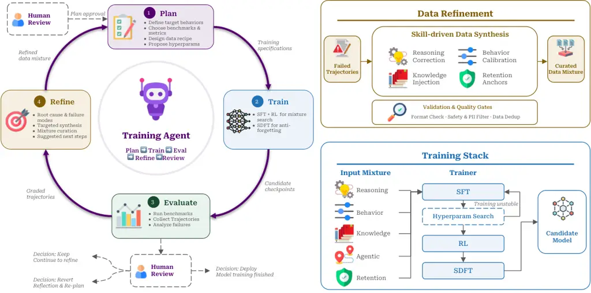
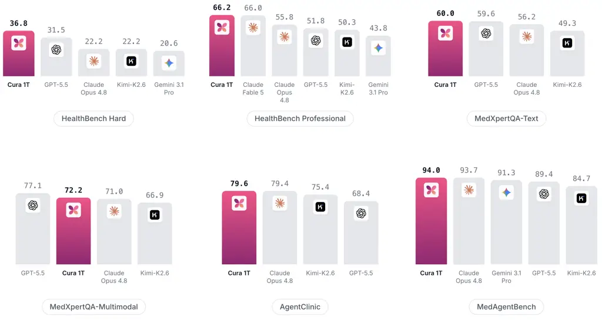
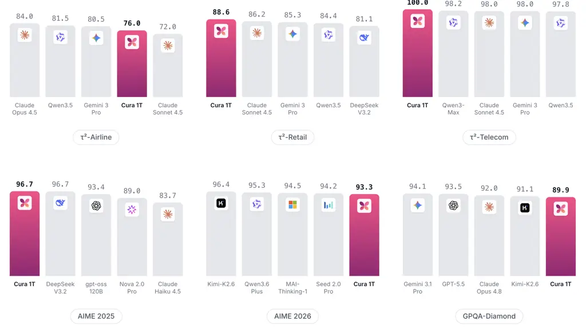

\workshoptitle

The Third Workshop on GenAI for Health: Agentic Systems, Clinical Trust,
and Future Potential (GenAI4Health)

# Cura 1T: Healthcare Foundation Model via Recursive Self-Improvement

Haolin Chen    Leon Qi    Steve Brown    Deon Metelski Affiliation: Tao
Xia, Joonyul Lee, Qixuan Wang, Kevin Riley Affiliation: Frank Wang,
Weiran Yao Affiliation: Actava AI

###### Abstract

Healthcare spans high-stakes communication, expert reasoning, and
workflow execution, yet specialized language models that cover these use
cases together remain limited. A healthcare model must handle patient
consultation, clinical reasoning over text and images, interactive
diagnosis, and electronic health record (EHR) tool use. These
capabilities fail in different ways, and a narrow update for one task
can degrade another. We present Cura 1T, a healthcare foundation model
trained through recursive self-improvement (RSI). In each RSI round, the
RSI harness runs the current model on healthcare benchmarks, evaluates
the trajectories to locate capability gaps, and refines the training
mixture by synthesizing training data. On 6 healthcare benchmarks, Cura
1T scores highest on MedAgentBench, HealthBench Professional,
HealthBench Hard, MedXpertQA text, and AgentClinic, and second on
MedXpertQA multimodal. It preserves performances on out-of-domain
reasoning and agentic benchmarks including AIME, GPQA-Diamond, and
$`\tau^{2}`$-Bench.

## 1 Introduction

Frontier language models now answer difficult clinical
questions (Singhal et al., 2023), but healthcare deployment needs a
wider range of skills and tolerates fewer mistakes. We focus on three
use cases. _Patient care_ requires clinician- and patient-facing
responses that follow physician guidelines (Singhal et al., 2023; Arora
et al., 2025; OpenAI, 2026). _Clinical reasoning_ requires solving
expert medical questions across text and images (Jin et al., 2020; Pal
et al., 2022; Zuo et al., 2025). _Healthcare agentic tasks_ require
multi-turn diagnostic workups, electronic-health-record (EHR) tool use,
and long-horizon workflows under strict task protocols (Schmidgall
et al., 2024; Jiang et al., 2025; Chen et al., 2026; Liu et al., 2026b;
Liu et al., 2026a; HL7 International, 2019). These tasks are related,
but they fail in different ways: rubric omissions, missing facts,
brittle reasoning, premature diagnoses, and malformed tool calls – each
call for different training signals. Each piece has advanced separately:
expert QA (Jin et al., 2020; Pal et al., 2022; Zuo et al., 2025),
rubric-graded clinical conversations (Arora et al., 2025; OpenAI, 2026),
diagnosis and EHR-tool benchmarks (Schmidgall et al., 2024; Jiang
et al., 2025; Chen et al., 2026; Liu et al., 2026b; Liu et al., 2026a),
and continuous-care systems (Baichuan AI and THUBPM Group, Tsinghua
University, 2026). Few specialized models cover all three together.

Building such a model is a data-construction problem as much as a
model-training problem. Compared with coding or mathematics, healthcare
has less abundant training signal, and its sensitivity makes
high-quality supervision harder to obtain. Useful examples are
fragmented across guidelines, exams, patient interactions, images, and
EHR workflows, and many outcomes cannot be graded by a simple executor
or answer key. Because failure modes are unevenly distributed across
task categories, adding examples for one behavior can improve that
behavior while eroding behavior that was already correct elsewhere. The
training algorithm and the hyperparameters are not the bottleneck. The
work is to identify the missing data in the recipe, add publicly
available or synthetic surrogates, and curate mixtures that transfer
across tasks without unnecessary forgetting.

We build Cura 1T, a healthcare foundation model post-trained on the
one-trillion-parameter Kimi-K2.6 base (Moonshot AI, 2026) through
recursive self-improvement. Running the full post-training cycle by hand
(planning a run, launching training, evaluating the result, reading
trajectories, diagnosing failures, and rebuilding the mixture) costs
substantial expert time and slows iteration; recent work delegates
comparable cycles to agents (autoresearch contributors, 2026; Yamada
et al., 2025; Novikov et al., 2025). In each round, the agent evaluates
the current model on the relevant benchmarks, reads the graded
trajectories to locate a capability gap, sets the target behavior and
acceptance criteria, and synthesizes training data with specialized
data-construction skills. Section 3.2 describes how candidates are
scored and accepted or reverted.

Table 1 summarizes the main result: the same consolidated model improves
over its base across patient-care, clinical-reasoning, and
healthcare-agentic evaluations. Against frontier comparators, Cura 1T is
the strongest model on five of the six healthcare benchmarks and ranks
second on MedXpertQA multimodal (Section 4). On out-of-domain benchmarks
in mathematics, scientific reasoning, and general agentic tasks, Cura 1T
holds the base model’s performance (See Figure 4).

Our contributions are: (i) Cura 1T, a single model covering patient
care, clinical reasoning over text and images, and healthcare agentic
tasks, which scores highest on five of the six healthcare benchmarks and
holds its base model’s out-of-domain performance; (ii) the recursive
self-improvement loop that produced it, whose search object is the
post-training data mixture rather than prompts, code, or
hyperparameters, reported round by round including the reverted
candidates; and (iii) reusable data-construction skills—reasoning
correction, knowledge injection, behavior calibration, and retention
anchoring—that map graded failure modes to targeted synthetic data.

|                          |       |         |            |
| ------------------------ | ----- | ------- | ---------- |
| Benchmark                | Base  | Cura 1T | $`\Delta`$ |
| MedAgentBench            | 0.847 | 0.940   | $`+0.093`$ |
| HealthBench Professional | 0.503 | 0.662   | $`+0.159`$ |
| HealthBench Hard         | 0.222 | 0.368   | $`+0.146`$ |
| MedXpertQA               | 0.569 | 0.655   | $`+0.086`$ |
| AgentClinic              | 0.754 | 0.796   | $`+0.042`$ |

Table 1: Improvement of Cura 1T over its base model. Metrics differ by
benchmark (rubric score for HealthBench, exact-letter pass@1 for
MedXpertQA, task success for AgentClinic and MedAgentBench).

## 2 Related Work

#### Healthcare AI.

Med-PaLM showed that large models can encode enough medical knowledge to
answer licensing-exam questions (Singhal et al., 2023), and the Baichuan
series, in particular Baichuan-M4, extends medical modeling toward
continuous care with tool use, patient memory, action constraints,
evidence retrieval, and multimodal perception (Baichuan AI and THUBPM
Group, Tsinghua University, 2026). Benchmarks broadened too. HealthBench
grades open-ended clinical responses against physician-written
rubrics (Arora et al., 2025), and HealthBench Professional extends this
setting to real clinician chats (OpenAI, 2026). Clinical-reasoning
benchmarks began with medical-exam question answering (Jin et al., 2020;
Pal et al., 2022); MedXpertQA increases difficulty and adds multimodal
cases with real clinical images and context (Zuo et al., 2025). Agentic
benchmarks evaluate whether models can act over time: AgentClinic tests
multi-turn diagnosis in a simulated clinic (Schmidgall et al., 2024),
MedAgentBench evaluates clinically derived EHR tasks against a
standards-compliant record (Jiang et al., 2025; HL7 International,
2019), and CHI-Bench, PhysicianBench, and HealthAgentBench extend
evaluation toward long-horizon, role-composed, policy-driven healthcare
workflows (Chen et al., 2026; Liu et al., 2026b; Liu et al., 2026a). We
use these benchmark families to evaluate Cura 1T across the three use
cases of Section 1.

#### Post-training.

Post-training commonly combines supervised adaptation, reinforcement
learning, self-training, and parameter-efficient updates. Rejection
sampling fine-tuning trains on a model’s own highest-scoring
generations (Yuan et al., 2023; Touvron et al., 2023), and STaR
bootstraps reasoning by retaining sampled rationales that reach the
correct answer (Zelikman et al., 2022). Self-distillation fine-tuning
(SDFT) uses the model’s own samples as the student distribution and a
teacher conditioned on additional context as the target, keeping updates
close to the base model’s generation policy (Shenfeld et al., 2026).
These methods are often combined with reasoning-aware data formats that
preserve chain-of-thought behavior (Wei et al., 2022; DeepSeek-AI,
2025).

#### Recursive self-improvement and automated research.

Self-Refine and Reflexion use natural-language critique or task feedback
to improve subsequent attempts, while OPRO, DSPy, and TextGrad treat
prompts, programs, or pipeline components as objects to optimize against
a metric (Madaan et al., 2023; Shinn et al., 2023; Yang et al., 2023;
Khattab et al., 2023; Yuksekgonul et al., 2024). The public autoresearch
repository applies this to a coding agent that edits a real training
loop, runs fixed-budget experiments, and keeps or discards each
change (autoresearch contributors, 2026). AI Scientist, AI Scientist-v2,
and AlphaEvolve extend the pattern to scientific workflows and algorithm
discovery, while ResearchGym and recent surveys note that reliability,
provenance, and reproducibility remain central bottlenecks (Lu et al.,
2024; Yamada et al., 2025; Novikov et al., 2025; Garikaparthi et al.,
2026; Tie et al., 2026). Cura keeps the closed loop and changes what is
searched. Instead of prompts, code, or hyperparameters, the loop curates
the post-training data mixture that is then trained into the model, and
each accepted round supplies the starting point for the next.

## 3 Cura 1T

Cura 1T is post-trained on top of Kimi-K2.6 (Moonshot AI, 2026) for
patient care, clinical reasoning, and healthcare agentic tasks. The
released model uses a 256K context window and native text and vision
input. Patient care covers clinician- and patient-facing responses that
must follow physician rubrics while remaining clear and safe. Clinical
reasoning covers expert medical question answering across text and
images, where the model must combine factual recall, differential
reasoning, and answer selection. Healthcare agentic tasks cover
multi-turn clinical workflows, where the model must gather evidence, use
tools, and complete diagnosis or EHR tasks before producing a final
answer. Training uses a lightweight training stack (Section 3.1) driven
by the recursive self-improvement loop (Section 3.2).

### 3.1 Training

Supervised fine-tuning (SFT) is the low-cost prerequisite step inside
each round. Before launching a more time-consuming RL or SDFT run, the
agent uses SFT to verify that the proposed data mixture and
hyperparameters are well formed, train stably, and move the target
metrics in the intended direction. Once this screen passes, the round
proceeds through reinforcement learning (RL), followed by
self-distillation fine-tuning (SDFT) (Shenfeld et al., 2026) as the
final step.

SDFT trains the model from its own on-policy samples toward a teacher
distribution conditioned on additional information. For a prompt $`x`$,
privileged context $`c`$, and student sample
$`y\sim\pi_{\theta}(\cdot\mid x)`$,

```math
\mathcal{L}(\theta)=D_{\mathrm{KL}}\!\left(\pi_{\theta}(\cdot\mid x)\,\middle\|\,\pi(\cdot\mid x,c)\right)=\mathbb{E}_{y\sim\pi_{\theta}(\cdot\mid x)}\left[\log\frac{\pi_{\theta}(y\mid x)}{\pi(y\mid x,c)}\right], \tag{1}
```

where $`\pi_{\theta}(\cdot\mid x)`$ is the student and
$`\pi(\cdot\mid x,c)`$ the privileged-context teacher. In Cura, $`c`$ is
the extra information used to generate a clean teacher trajectory: an
intervened or augmented trajectory, a reference behavior, or verified
knowledge used to ground teacher generation. The student sees only the
original prompt after this context is removed. The update is therefore
anchored to trajectories the model can itself produce. In long medical
reasoning traces, copying an off-policy chain of thought damages the
model’s native reasoning behavior.

All experiments follow the same protocol. With optional human guidance,
the training agent writes a plan, trains candidate models through the
SFT-to-RL-to-SDFT stack, evaluates the model, and reports the evidence
for a keep-or-revise decision. We run the loop separately for
capabilities that need improvement. The loop is recursive in that a kept
round becomes the continuation point for the next iteration and
contributes its validated data refinement to the growing mixture. A
reverted round remains in the experimental record but is not used as the
basis for later improvement, because the intervention caused severe side
effects or was not favored. Cura 1T is trained from the consolidated
mixture accumulated across completed capability loops, rather than from
a single benchmark-specific update. Final hyperparameters are reported
in Appendix B.



Figure 1: Left: recursive self-improvement loop for Cura 1T. A reviewer
approves the plan before training and makes the keep, revert, or deploy
decision after evaluation. Right: data refinement pipeline and training
stack.

### 3.2 Recursive self-improvement loop

In healthcare post-training the limiting resource is scarce and uneven
domain data for the use cases above, not a fixed benchmark dataset with
a nearly finished recipe. Recent self-improvement and automated-research
workflows search over hypotheses, programs, skills, experiment trees, or
training configurations (Yang et al., 2023; Khattab et al., 2023;
Yuksekgonul et al., 2024; autoresearch contributors, 2026; Yamada
et al., 2025; Novikov et al., 2025). The agent writes configurations and
monitors training, but its central task is to analyze failures,
synthesize targeted data, and curate a mixture that preserves previously
solved behavior.

Figure 1 shows the loop. _Plan_ defines target behaviors, benchmarks,
metrics, data recipe, and candidate hyperparameters, then passes through
human plan approval. _Train_ runs model training, using SFT as the
mixture and hyperparameter screen, RL as the reward-driven improvement
stage, and SDFT as the final trainer of the round. _Evaluate_ runs the
benchmarks, collects trajectories, and analyzes failures. _Refine_ uses
failed trajectories as evidence for root-cause analysis, converts the
resulting failure modes into targeted data, curates the next mixture,
and validates the candidate rows. In _Review_, a person inspects both
the validated data refinement and the candidate model, then issues a
keep, revert, continue-to-refine, or deploy decision before the next
round begins. Appendix A details the role and output of each component.

The agent first categorizes benchmark failures, then uses the resulting
failure patterns to create new training examples that target the same
missing capability while preserving retained behavior. The benchmark
examples remain held out from training; their scores guide the
keep-or-revise decision at the end of each round. Data synthesis is
driven by the following agent skills:

- •
  Retention anchor. Add a small set of examples for capabilities the
  current model already handles, so a targeted update does not overwrite
  them.
- •
  Reasoning correction. Identify the failed reasoning step, obtain a
  corrected explanation from a frontier model, and use the resulting
  pattern to synthesize new cases in different clinical contexts. The
  corrected explanation supplies the privileged context $`c`$ in
  Equation 1.
- •
  Knowledge injection. Identify missing clinical knowledge, ground it
  with retrieved documents, and synthesize new closed-book QA rows with
  explicit reasoning.
- •
  Behavior calibration. Compare desired and observed answer behavior,
  then use a rubric, fix guidance, or a reference response to generate
  new cases that exercise the desired response.
- •
  Data mixture curation. Merge synthesized correction rows with
  retention anchors, then deduplicate, cap, and reweight the candidate
  training set.

Curation changes one mixture decision at a time: add retention anchors
when an update causes forgetting, increase targeted synthetic
trajectories when a failure mode remains underrepresented, or remove
rows that dilute the target distribution. The agent handles
task-specific failures outside these skills, such as agentic workflow
errors, case by case.

## 4 Evaluation

### 4.1 Setup

We evaluate Cura 1T on healthcare benchmarks covering patient-facing
response quality, clinical reasoning, interactive diagnosis, and EHR
tool use. MedAgentBench measures task success on clinically derived FHIR
tool-use tasks (Jiang et al., 2025). HealthBench Professional and
HealthBench Hard score open-ended answers with physician-authored
rubrics (Arora et al., 2025; OpenAI, 2026). MedXpertQA is exact-letter
graded and reported as text, multimodal, and overall pass@1 (Zuo et al.,
2025). AgentClinic evaluates interactive diagnosis in a simulated
clinic; we use the tool-based harness of Appendix C and report per
subset and overall pass@1 (Schmidgall et al., 2024). All benchmarks are
evaluated at $`T{=}1.0`$, except that the MedAgentBench development path
in Figure 3 uses $`T{=}0.6`$. In every table, rows labelled Round $`k`$
are candidate models produced by one round, shown with the accept or
revert decision; the Cura 1T row is the released model trained from the
consolidated mixture after each evolution path saturates.



Figure 2: Cura 1T against frontier models and the Kimi-K2.6 base across
six healthcare benchmarks: MedAgentBench (Jiang et al., 2025),
HealthBench Professional and Hard (Arora et al., 2025; OpenAI, 2026),
MedXpertQA text and multimodal (Zuo et al., 2025), and
AgentClinic (Schmidgall et al., 2024).

### 4.2 MedAgentBench

MedAgentBench tests whether a model can execute clinically derived EHR
workflows through FHIR tool calls. We evaluate the model as a native
tool-caller against a running FHIR server, using renderer-native
function calling with read, write, and finish actions. The principal
failure mode is brittle execution of EHR writes. The base model often
identifies the intended clinical action but emits a resource that is
rejected because a required field is missing, a coded value is wrong, or
the payload is inconsistent with the request. _Behavior calibration_
targets these errors with synthetic trajectories that exercise the same
FHIR write patterns in new patient contexts. _Behavior calibration +
retention_ adds successful trajectories from surrounding tool behaviors
so that a narrow update does not degrade the rest of the workflow.
_Harness bug fix_ corrects the evaluation configuration and restores the
intended prompt. Table 2 shows that the rounds raise task success from
0.847 to 0.973. The round-3 checkpoint targets this capability alone,
whereas the released model folds the corresponding synthetic examples
into the consolidated mixture and has to hold its scores on the other
benchmarks at the same time, which costs 0.033 here; at 0.940 it still
exceeds the strongest frontier reference at 0.937.

|                 |                                  |         |          |
| --------------- | -------------------------------- | ------- | -------- |
| Model           | Intervention                     | Overall | Decision |
| Kimi-K2.6       | $`-`$                            | 0.847   | $`-`$    |
| Round 1         | Behavior calibration             | 0.943   | keep     |
| Round 2         | Behavior calibration + retention | 0.967   | keep     |
| Round 3         | Harness bug fix                  | 0.973   | keep     |
| Cura 1T         | Consolidated data mixture        | 0.940   | release  |
| Claude Opus 4.8 | $`-`$                            | 0.937   | $`-`$    |
| GPT-5.5         | $`-`$                            | 0.894   | $`-`$    |
| Gemini 3.1 Pro  | $`-`$                            | 0.913   | $`-`$    |

Table 2: MedAgentBench task success. Bold marks the best score and
underline the second-best distinct score.

### 4.3 HealthBench

HealthBench evaluates whether a model gives clinically appropriate
open-ended answers rather than only selecting a multiple-choice option.
The base model scores 0.503 on Professional and 0.222 on Hard. Failures
are dominated by omitted required points rather than explicit penalty
violations, and rejection sampling saturates quickly. The best score
among multiple rollouts is close to the average, so the behavior itself
needs correction. _Behavior calibration_ uses a broad behavior-fix
mixture for omitted rubric points, following the ClinAlign
rubric-and-principle synthesis pattern (Lyu et al., 2026). It raises
full-set scores to 0.601 and 0.332, but the degraded subset falls by
0.252 on Professional and 0.508 on Hard relative to the base model, so
the round is reverted despite its aggregate gains. _Behavior
calibration, cleaned_ keeps the same target while removing
chart-template boilerplate, adding cleaner principle-rubric examples,
and shortening training; it reaches 0.634 and 0.372. After
cross-benchmark consolidation, Cura 1T reaches the strongest
Professional score at 0.662 while remaining close to the
HealthBench-specific round on Hard at 0.368.

|           |                               |              |       |          |
| --------- | ----------------------------- | ------------ | ----- | -------- |
| Model     | Intervention                  | Professional | Hard  | Decision |
| Kimi-K2.6 | $`-`$                         | 0.503        | 0.222 | $`-`$    |
| Round 1   | Behavior calibration          | 0.601        | 0.332 | revert   |
| Round 2   | Behavior calibration, cleaned | 0.634        | 0.372 | keep     |
| Cura 1T   | Consolidated data mixture     | 0.662        | 0.368 | release  |

Table 3: HealthBench rubric scores at $`T{=}1.0`$. Bold marks the best
score and underline the second-best distinct score in each column.

### 4.4 MedXpertQA

MedXpertQA tests expert medical reasoning across text and multimodal
questions. The base model shows both recoverable reasoning gaps and
missing clinical knowledge. Reasoning-only correction helps some local
reasoning patterns but reduces overall accuracy. _Reasoning correction_
and _Reasoning correction, extended_ target the diagnosed reasoning gaps
with newly synthesized examples, but lack sufficient factual coverage
and are reverted, trailing the base model. _Knowledge injection +
retention_ adds closed-book clinical knowledge while mixing in examples
the model already answers correctly, raising overall pass@1 to 0.603,
and _Data mixture curation_ further balances the retained examples to
reach 0.636. _Data mixture curation, capped_ is reverted because
overlong traces cause non-termination. The consolidated model reaches
0.655 overall, improving over the base and Claude Opus 4.8 while
remaining second to GPT-5.5.

|                 |                                 |       |            |         |          |
| --------------- | ------------------------------- | ----- | ---------- | ------- | -------- |
| Model           | Intervention                    | Text  | Multimodal | Overall | Decision |
| Kimi-K2.6       | $`-`$                           | 0.484 | 0.672      | 0.569   | $`-`$    |
| Round 1         | Reasoning correction            | 0.447 | 0.656      | 0.541   | revert   |
| Round 2         | Reasoning correction, extended  | 0.454 | 0.657      | 0.545   | revert   |
| Round 3         | Knowledge injection + retention | 0.521 | 0.703      | 0.603   | keep     |
| Round 4         | Data mixture curation           | 0.560 | 0.728      | 0.636   | keep     |
| Round 5         | Data mixture curation, capped   | $`-`$ | $`-`$      | 0.440   | revert   |
| Cura 1T         | Consolidated data mixture       | 0.600 | 0.722      | 0.655   | release  |
| Claude Opus 4.8 | $`-`$                           | 0.562 | 0.710      | 0.628   | $`-`$    |
| GPT-5.5         | $`-`$                           | 0.596 | 0.771      | 0.675   | $`-`$    |

Table 4: MedXpertQA split and overall pass@1 at $`T{=}1.0`$. The overall
score weights 2,450 text questions and 2,000 multimodal questions. Bold
marks the best score and underline the second-best distinct score in
each column.

### 4.5 AgentClinic

AgentClinic evaluates whether a model can gather evidence and diagnose
through a simulated multi-turn clinical encounter. We adapt the harness
into a tool-native format with explicit structured tools for clinical
interaction, so the model acts through structured calls rather than a
text-only dialogue protocol; all rows in Table 5 use this harness at
$`T{=}1.0`$ on MedQA, MedQA-Ext, NEJM, and NEJM-Ext. The main failure
mode is premature diagnosis before completing the clinical workup,
especially on NEJM-style subsets. _Single-turn reasoning_ is reverted
because isolated answer rationales do not preserve clinical conduct.
_Behavior calibration + retention_ instead teaches the model to elicit
evidence before committing to a diagnosis, while mixing new interactive
workup examples with retention examples covering behaviors the model
already handles; it improves overall pass@1 from 0.754 to 0.807, with
the largest gains on NEJM and NEJM-Ext. Cura 1T preserves most of this
gain after consolidation, reaching 0.796.

|                 |                                  |       |           |       |          |         |          |
| --------------- | -------------------------------- | ----- | --------- | ----- | -------- | ------- | -------- |
| Model           | Intervention                     | MedQA | MedQA Ext | NEJM  | NEJM Ext | Overall | Decision |
| Kimi-K2.6       | $`-`$                            | 0.869 | 0.827     | 0.400 | 0.567    | 0.754   | $`-`$    |
| Round 2         | Behavior calibration + retention | 0.841 | 0.841     | 0.800 | 0.717    | 0.807   | keep     |
| Cura 1T         | Consolidated data mixture        | 0.879 | 0.850     | 0.800 | 0.625    | 0.796   | release  |
| Claude Opus 4.8 | $`-`$                            | 0.841 | 0.874     | 0.800 | 0.608    | 0.794   | $`-`$    |
| GPT-5.5         | $`-`$                            | 0.832 | 0.808     | 0.467 | 0.358    | 0.684   | $`-`$    |

Table 5: AgentClinic pass@1 by subset under the tool-native protocol.
Bold marks the best score and underline the second-best distinct score
in each column.

### 4.6 Improvement across benchmarks

These round-by-round results are development measurements: healthcare
benchmark scores guide the keep-or-revise decisions, while the released
model is evaluated after consolidation.

Figure 3 places the four development paths on a common axis. Two
patterns recur. The intervention that helps is capability-specific, and
reverted rounds are a regular part of the record. In three of the four
paths, the first attempt at a capability was reverted before a working
refinement was found.

Figure 3: Improvement map from the base model to Cura 1T. Values are
changes from benchmark-specific bases; solid and dashed red arrows mark
retained and reverted interventions.

### 4.7 Continual Learning: Out-of-domain Evaluation

We evaluate out-of-domain benchmarks to see whether Cura 1T preserves
general capability after healthcare specialization. These benchmarks
were not used to guide the healthcare refinement loops and provide a
separate check of retained general capability. Figure 4 groups them into
two families: _reasoning_ covers AIME 2025, AIME 2026, and
GPQA-Diamond (Mathematical Association of America, 2026; Rein et al.,
2023), and _agentic_ covers the airline, retail, and telecom domains of
$`\tau^{2}`$-Bench (Barres et al., 2025). Cura 1T is on par with
frontier comparators on each reasoning benchmark and on
$`\tau^{2}`$-airline, and exceeds the models with publicly reported
scores on $`\tau^{2}`$-retail and $`\tau^{2}`$-telecom.



Figure 4: Out-of-domain evaluation results for Cura 1T.

## 5 Discussion

Post-training, especially in specialized domains, was a data-mixture
problem more than a hyperparameter-search problem. The loop treated
evaluation failures as evidence for what data was missing, then used SFT
to screen candidate mixtures, RL to improve the policy, and SDFT to
consolidate the round. A model may need more rubric-following behavior
for patient care, more factual coverage for expert questions, or more
workflow-specific examples for agentic tool use, and searching the
training stack alone would not identify which.

The benchmark traces also show why a single generic medical-data update
is insufficient. HealthBench failures were dominated by omitted rubric
items and verbosity-driven grading failures, which behavior calibration
with cleaner principle-rubric data addressed. MedXpertQA mixed
reasoning-pattern failures with missing knowledge, which made reasoning
correction alone unstable until knowledge injection and retention were
added. MedAgentBench exposed brittle FHIR writes, while AgentClinic
required interactive trajectories that changed how the model gathered
evidence before answering. Because the failure modes differ, the
refinement step categorizes failures before synthesizing data
(Section 3.2).

## 6 Conclusion

Cura 1T is a healthcare foundation model built by recursive
self-improvement. Starting from Kimi-K2.6, the loop turns graded
benchmark failures into targeted data construction: the agent plans a
round, trains candidate models, evaluates the model, analyzes failed
trajectories, and curates the next mixture, and each accepted round
becomes the starting point of the next. The contribution is a repeatable
loop that searches the data mixture.

Across the clinical suite, Cura 1T improves over its base on
patient-care, clinical-reasoning, and healthcare-agentic evaluations,
and different settings required different data actions: tool-use
trajectories for MedAgentBench, cleaner behavior data for HealthBench,
knowledge injection and reasoning correction with retention for
MedXpertQA, and interactive trajectories for AgentClinic. Out of domain,
Cura 1T matches its comparators on AIME, GPQA-Diamond, and
$`\tau^{2}`$-airline, and exceeds the models with published scores on
$`\tau^{2}`$-retail and $`\tau^{2}`$-telecom.

#### Limitations.

We report the trajectory the loop followed. At trillion-parameter scale,
the cost of isolating the contribution or more ablations is beyond our
capabilities.

#### Safety and clinical use.

Cura 1T is a research model, not a medical service, and is not a
substitute for a clinician. The benchmarks measure narrow competencies
under fixed harnesses, and strong scores do not establish safety for
unsupervised clinical use.

## References

- Arora et al. \[2025\] Rahul K. Arora et al. Healthbench: Evaluating
  large language models towards improved human health. _arXiv preprint
  arXiv:2505.08775_, 2025.
- autoresearch contributors \[2026\] autoresearch contributors.
  autoresearch: AI agents running research on single-GPU nanochat
  training automatically. GitHub repository, 2026.
- Baichuan AI and THUBPM Group, Tsinghua University \[2026\] Baichuan AI
  and THUBPM Group, Tsinghua University. Baichuan-m4: A clinical-grade
  medical agent system for continuous care. _arXiv preprint
  arXiv:2606.08982_, 2026.
- Barres et al. \[2025\] Victor Barres, Honghua Dong, Soham Ray, Xujie
  Si, and Karthik Narasimhan. $`\tau^{2}`$-bench: Evaluating
  conversational agents in a dual-control environment. _arXiv preprint
  arXiv:2506.07982_, 2025.
- Chen et al. \[2026\] Haolin Chen, Deon Metelski, Leon Qi, Tao Xia,
  Joonyul Lee, Steve Brown, Kevin Riley, Frank Wang, T. Y. Alvin Liu,
  Hank Capps, et al. $`\chi`$-Bench: Can AI agents automate end-to-end,
  long-horizon, policy-rich healthcare workflows? _arXiv preprint
  arXiv:2605.16679_, 2026.
- DeepSeek-AI \[2025\] DeepSeek-AI. Deepseek-r1: Incentivizing reasoning
  capability in llms via reinforcement learning. _arXiv preprint
  arXiv:2501.12948_, 2025.
- Garikaparthi et al. \[2026\] Aniketh Garikaparthi, Manasi Patwardhan,
  and Arman Cohan. ResearchGym: Evaluating language model agents on
  real-world ai research. _arXiv preprint arXiv:2602.15112_, 2026.
- HL7 International \[2019\] HL7 International. Fast healthcare
  interoperability resources (fhir).
  [https://www.hl7.org/fhir/](https://www.hl7.org/fhir/), 2019.
- Jiang et al. \[2025\] Yixing Jiang, Kameron C. Black, Gloria Geng,
  Danny Park, James Zou, Andrew Y. Ng, and Jonathan H. Chen.
  MedAgentBench: A realistic virtual EHR environment to benchmark
  medical LLM agents. _arXiv preprint arXiv:2501.14654_, 2025.
- Jin et al. \[2020\] Di Jin, Eileen Pan, Nassim Oufattole, Wei-Hung
  Weng, Hanyi Fang, and Peter Szolovits. What disease does this patient
  have? a large-scale open domain question answering dataset from
  medical exams. _arXiv preprint arXiv:2009.13081_, 2020.
- Khattab et al. \[2023\] Omar Khattab, Arnav Singhvi, Paridhi
  Maheshwari, Zhiyuan Zhang, Keshav Santhanam, Sri Vardhamanan, Saiful
  Haq, Ashutosh Sharma, Thomas T. Joshi, Hanna Moazam, Heather Miller,
  Matei Zaharia, and Christopher Potts. DSPy: Compiling declarative
  language model calls into self-improving pipelines. _arXiv preprint
  arXiv:2310.03714_, 2023.
- Liu et al. \[2026a\] Qianchu Liu, Sheng Zhang, Guanghui Qin, Jeya
  Maria Jose Valanarasu, Maximilian Rokuss, Mingyu Lu, Timothy Ossowski,
  Juan Manuel Zambrano Chaves, Cliff Wong, Peniel Argaw, et al.
  HealthAgentBench: A unified benchmark suite of realistic agentic
  healthcare environments for challenging frontier AI agents. _arXiv
  preprint arXiv:2606.31179_, 2026a.
- Liu et al. \[2026b\] Ruoqi Liu, Imran Q. Mohiuddin, Austin J.
  Schoeffler, Kavita Renduchintala, Ashwin Nayak, Prasantha L. Vemu,
  Shivam C. Vedak, Kameron C. Black, John L. Havlik, Isaac Ogunmola,
  et al. PhysicianBench: Evaluating LLM agents in real-world EHR
  environments. _arXiv preprint arXiv:2605.02240_, 2026b.
- Lu et al. \[2024\] Chris Lu, Cong Lu, Robert Tjarko Lange, Jakob
  Foerster, Jeff Clune, and David Ha. The AI scientist: Towards fully
  automated open-ended scientific discovery. _arXiv preprint
  arXiv:2408.06292_, 2024.
- Lyu et al. \[2026\] Shiwei Lyu, Xidong Wang, Lei Liu, Hao Zhu, Chaohe
  Zhang, Jian Wang, Jinjie Gu, Benyou Wang, and Yue Shen. Clinalign:
  Scaling healthcare alignment from clinician preference. _arXiv
  preprint arXiv:2602.09653_, 2026.
- Madaan et al. \[2023\] Aman Madaan, Niket Tandon, Prakhar Gupta,
  Skyler Hallinan, Luyu Gao, Sarah Wiegreffe, Uri Alon, Nouha Dziri,
  Shrimai Prabhumoye, Yiming Yang, Shashank Gupta, Bodhisattwa Prasad
  Majumder, Katherine Hermann, Sean Welleck, Amir Yazdanbakhsh, and
  Peter Clark. Self-refine: Iterative refinement with self-feedback.
  _arXiv preprint arXiv:2303.17651_, 2023.
- Mathematical Association of America \[2026\] Mathematical Association
  of America. American invitational mathematics examination (aime).
  [https://maa.org/maa-invitational-competitions/](https://maa.org/maa-invitational-competitions/), 2026.
- Moonshot AI \[2026\] Moonshot AI. Kimi K2.6.
  [https://huggingface.co/moonshotai/Kimi-K2.6](https://huggingface.co/moonshotai/Kimi-K2.6), 2026.
  Hugging Face model card, accessed July 15, 2026.
- Novikov et al. \[2025\] Alexander Novikov, Ngan Vu, Marvin
  Eisenberger, Emilien Dupont, Po-Sen Huang, Adam Zsolt Wagner, Sergey
  Shirobokov, Borislav Kozlovskii, Francisco J. R. Ruiz, Abbas
  Mehrabian, M. Pawan Kumar, Abigail See, Swarat Chaudhuri, George
  Holland, Alex Davies, Sebastian Nowozin, Pushmeet Kohli, and Matej
  Balog. AlphaEvolve: A coding agent for scientific and algorithmic
  discovery. _arXiv preprint arXiv:2506.13131_, 2025.
- OpenAI \[2026\] OpenAI. Healthbench professional: Evaluating large
  language models on real clinician chats. _arXiv preprint
  arXiv:2604.27470_, 2026.
- Pal et al. \[2022\] Ankit Pal, Logesh Kumar Umapathi, and Malaikannan
  Sankarasubbu. MedMCQA: A large-scale multi-subject multi-choice
  dataset for medical domain question answering. _arXiv preprint
  arXiv:2203.14371_, 2022.
- Rein et al. \[2023\] David Rein, Betty Li Hou, Asa Cooper Stickland,
  Jackson Petty, Richard Yuanzhe Pang, Julien Dirani, Julian Michael,
  and Samuel R. Bowman. Gpqa: A graduate-level google-proof q&a
  benchmark. _arXiv preprint arXiv:2311.12022_, 2023.
- Schmidgall et al. \[2024\] Samuel Schmidgall, Rojin Ziaei, Carl
  Harris, Eduardo Reis, Jeffrey Jopling, and Michael Moor. Agentclinic:
  A multimodal agent benchmark to evaluate ai in simulated clinical
  environments. _arXiv preprint arXiv:2405.07960_, 2024.
- Shenfeld et al. \[2026\] Idan Shenfeld, Mehul Damani, Jonas Hübotter,
  and Pulkit Agrawal. Self-distillation enables continual learning.
  _arXiv preprint arXiv:2601.19897_, 2026.
- Shinn et al. \[2023\] Noah Shinn, Federico Cassano, Edward Berman,
  Ashwin Gopinath, Karthik Narasimhan, and Shunyu Yao. Reflexion:
  Language agents with verbal reinforcement learning. _arXiv preprint
  arXiv:2303.11366_, 2023.
- Singhal et al. \[2023\] Karan Singhal, Shekoofeh Azizi, Tao Tu,
  S. Sara Mahdavi, et al. Large language models encode clinical
  knowledge. _Nature_, 620:172–180, 2023.
- Tie et al. \[2026\] Guiyao Tie, Jiawen Shi, Dingjie Song, Yixiao
  Huang, Ziji Sheng, Xueyang Zhou, Daizong Liu, Pan Zhou, Yongchao Chen,
  Ran Xu, Lifang He, Qingsong Wen, Manling Li, Cong Lu, Shuai Li,
  Pengtao Xie, Yixuan Yuan, Rui Meng, Lei Xing, Lichao Sun, Caiming
  Xiong, Philip S. Yu, and Jianfeng Gao. AutoResearch AI: Towards
  ai-powered research automation for scientific discovery. _arXiv
  preprint arXiv:2605.23204_, 2026.
- Touvron et al. \[2023\] Hugo Touvron, Louis Martin, Kevin Stone,
  et al. Llama 2: Open foundation and fine-tuned chat models. _arXiv
  preprint arXiv:2307.09288_, 2023.
- Wei et al. \[2022\] Jason Wei, Xuezhi Wang, Dale Schuurmans, Maarten
  Bosma, Brian Ichter, Fei Xia, Ed Chi, Quoc Le, and Denny Zhou.
  Chain-of-thought prompting elicits reasoning in large language models.
  _arXiv preprint arXiv:2201.11903_, 2022.
- Yamada et al. \[2025\] Yutaro Yamada, Robert Tjarko Lange, Cong Lu,
  Shengran Hu, Chris Lu, Jakob Foerster, Jeff Clune, and David Ha. The
  AI scientist-v2: Workshop-level automated scientific discovery via
  agentic tree search. _arXiv preprint arXiv:2504.08066_, 2025.
- Yang et al. \[2023\] Chengrun Yang, Xuezhi Wang, Yifeng Lu, Hanxiao
  Liu, Quoc V. Le, Denny Zhou, and Xinyun Chen. Large language models as
  optimizers. _arXiv preprint arXiv:2309.03409_, 2023.
- Yuan et al. \[2023\] Zheng Yuan, Hongyi Yuan, Chengpeng Li, Guanting
  Dong, Keming Lu, Chuanqi Tan, Chang Zhou, and Jingren Zhou. Scaling
  relationship on learning mathematical reasoning with large language
  models. _arXiv preprint arXiv:2308.01825_, 2023.
- Yuksekgonul et al. \[2024\] Mert Yuksekgonul, Federico Bianchi, Joseph
  Boen, Sheng Liu, Zhi Huang, Carlos Guestrin, and James Zou. TextGrad:
  Automatic “differentiation” via text. _arXiv preprint
  arXiv:2406.07496_, 2024.
- Zelikman et al. \[2022\] Eric Zelikman, Yuhuai Wu, Jesse Mu, and
  Noah D. Goodman. Star: Bootstrapping reasoning with reasoning. _arXiv
  preprint arXiv:2203.14465_, 2022.
- Zuo et al. \[2025\] Yuxin Zuo, Shang Qu, Yifei Li, Zhangren Chen,
  Xuekai Zhu, Ermo Hua, Kaiyan Zhang, Ning Ding, and Bowen Zhou.
  Medxpertqa: Benchmarking expert-level medical reasoning and
  understanding. _arXiv preprint arXiv:2501.18362_, 2025.

## Appendix A Recursive Self-Improvement Loop Components

Table 6 lists the role and output of each block in Figure 1.

|                       |                                                                                                                                              |                                          |
| --------------------- | -------------------------------------------------------------------------------------------------------------------------------------------- | ---------------------------------------- |
| Component             | Role in the loop                                                                                                                             | Output                                   |
| Plan                  | Define target behavior, metrics, data recipe, and candidate hyperparameters.                                                                 | Training specifications                  |
| Train                 | Run SFT to verify the mixture and hyperparameters, RL to improve the policy against reward signals, and SDFT to consolidate the final model. | Candidate model                          |
| Evaluate              | Run benchmark harnesses and collect graded trajectories and failure summaries.                                                               | Failed trajectories and metrics          |
| Refine                | Categorize failures, synthesize targeted data, curate the next mixture, validate candidate rows, and suggest next steps.                     | Validated data refinement                |
| Reasoning Correction  | Use a corrected reasoning pattern to synthesize new cases in different clinical contexts.                                                    | Reasoning rows                           |
| Knowledge Injection   | Use verified knowledge to synthesize new questions that require the missing concept.                                                         | Source-grounded knowledge rows           |
| Behavior Calibration  | Use a rubric or reference behavior to synthesize new cases that exercise the desired response.                                               | Behavior rows                            |
| Retention Anchor      | Add examples for solved behavior that should be preserved when a correction is added.                                                        | Retention rows                           |
| Other                 | Cover task-specific failures outside the reusable reasoning, knowledge, and behavior categories.                                             | Task-specific rows                       |
| Data Mixture Curation | Merge, deduplicate, cap, and reweight correction rows with retention anchors.                                                                | Candidate training mixture               |
| Validation Gates      | Review newly synthesized examples before they enter the training mixture.                                                                    | Validated training mixture               |
| Human review          | Approve the plan, then inspect the validated refinement and candidate result before the next round.                                          | Keep, revert, refine, or deploy decision |

Table 6: Components of the recursive self-improvement loop in Figure 1.
The table summarizes how evaluation records are converted into refined
data mixtures and how SFT, RL, and SDFT divide the training step.

## Appendix B Training Hyperparameters

Table 7 reports the final training hyperparameters of Cura 1T.
Hyperparameters for these screening runs vary by capability; the table
reports the final consolidation rather than capability-specific
screening runs or mixture proportions.

|                 |                                             |
| --------------- | ------------------------------------------- |
| Configuration   | Cura 1T                                     |
| Algorithm       | SFT $`\rightarrow`$ RL $`\rightarrow`$ SDFT |
| Base model      | Kimi-K2.6                                   |
| Learning rate   | $`3\times 10^{-4}`$, linear schedule        |
| Batch size      | 128                                         |
| Sequence limit  | 256K tokens                                 |
| Training length | 6 epochs with early stopping                |

Table 7: Training hyperparameters for Cura 1T.

## Appendix C Harness Implementations

#### AgentClinic.

We replace the original free-text control protocol with two native
tools. The doctor calls order_test(test_name) to obtain an objective
finding and submit_diagnosis(diagnosis) to terminate the encounter.
History taking remains ordinary assistant dialogue, which is passed to
the patient simulator and returned as a user turn. A test result can
enter the trajectory only through an executed order_test call, removing
the free-text router’s ambiguity between a requested and a reported
finding. NEJM images are attached once in the opening turn, while MedQA
encounters remain text-only. The upstream diagnosis comparator grades
the terminal diagnosis, and all models in Table 5 use this interface.

#### MedAgentBench.

We expose three renderer-native operations—FHIR read, FHIR write, and
final submission—through fhir_get, fhir_post, and finish. Reads are
executed against the live FHIR server. Writes are recorded but do not
mutate the server; the grader instead inspects the URL and resource
payload in the tool-call history. The final-submission tool stores the
ordered answer values and terminates the episode. The environment
permits up to eight turns, preserves parse failures for recovery, and
scores the completed trajectory with the benchmark’s task-specific FHIR
graders.

## Appendix D Case Studies

The following selected evaluation traces illustrate changes in model
behavior across development rounds. The cases are held out from training
and are reported as qualitative companions to the aggregate results.

### D.1 MedAgentBench: Referral ServiceRequest

#### Task and criterion.

Task task8_1 asks for an orthopedic surgery referral ServiceRequest for
synthetic patient S2016972 at timestamp 2023-11-13T10:15:00+00:00. The
grader requires SNOMED 306181000000106, active status, order intent,
stat priority, the exact subject reference, and an SBAR note.

|                                            |                                                                                      |          |
| ------------------------------------------ | ------------------------------------------------------------------------------------ | -------- |
| Stage                                      | Response excerpt                                                                     | Result   |
| Base                                       | fhir_post(ServiceRequest, priority=routine, code=306181000000106, display=...)       | Reward 0 |
| Round 1 (Behavior calibration)             | fhir_post(ServiceRequest, priority=stat, code=306181000000106)                       | Reward 1 |
| Round 2 (Behavior calibration + retention) | priority=stat; exact SNOMED coding, subject, timestamp, and SBAR note are preserved. | Reward 1 |
| Round 3 (Harness bug fix)                  | Under the corrected harness: priority=stat with exact coding and finish(\[\]).       | Reward 1 |

#### Change.

The base model understands the referral intent but misses the exact FHIR
contract. Later responses satisfy the schema and content constraints,
and the harness bug fix confirms the correction under the intended
evaluation protocol.

### D.2 HealthBench Professional: EROSTIN 10MG

#### Task and criterion.

The prompt asks, “what medication is EROSTIN 10MG”. The criterion
requires identifying ebastine as the active ingredient and avoiding
confusion with estradiol or Elestrin.

|                      |                                                                                                                                                       |          |
| -------------------- | ----------------------------------------------------------------------------------------------------------------------------------------------------- | -------- |
| Stage                | Response excerpt                                                                                                                                      | Result   |
| Base                 | “I cannot definitively identify what drug ‘Erostin 10 mg’ is based on the brand name alone.”                                                          | Reward 0 |
| Behavior calibration | “EROSTIN 10 mg is an antihistamine medication containing ebastine.” The task is correct, although the round is reverted for subset-level degradation. | Reward 1 |
| Retention check      | “EROSTIN 10 mg is an antihistamine medication that contains ebastine as its active component.”                                                        | Reward 1 |
| Cura 1T              | “EROSTIN 10 mg is an antihistamine medication that contains ebastine as its active ingredient.”                                                       | Reward 1 |

#### Change.

This is a drug-identification failure rather than a reasoning failure.
Behavior calibration answers this example locally but is not retained
globally; the intermediate retention check and Cura 1T preserve the
corrected active ingredient. A matched trace for the cleaned round is
not available for this example, so it is not shown.

### D.3 HealthBench Professional: Sciatica Coding Regression

#### Task and criterion.

The prompt asks for the current ICD-10-CM coding for sciatica. A correct
answer must distinguish the billable laterality codes: M54.30 for
unspecified side, M54.31 for right, and M54.32 for left. The parent
category M54.3 is not the complete unspecified-side code.

|                      |                                                                                         |              |
| -------------------- | --------------------------------------------------------------------------------------- | ------------ |
| Stage                | Response excerpt                                                                        | Result       |
| Base                 | “M54.30—sciatica, unspecified side; M54.31—right; M54.32—left.”                         | Reward 1.000 |
| Behavior calibration | “M54.3—sciatica, unspecified side,” while retaining M54.31 and M54.32.                  | Reward 0.000 |
| Cura 1T              | Restores M54.30, M54.31, and M54.32, and distinguishes ICD-10-CM from the WHO category. | Reward 0.973 |

#### Change.

Behavior calibration preserves the correct code family but drops the
final digit for unspecified laterality, turning a correct base response
into an incomplete coding recommendation. Cura 1T restores the billable
code and the laterality distinction. This matched trace illustrates the
subset-level degradation that caused Round 1 to be reverted despite its
higher overall score.

### D.4 MedXpertQA Text-197: DCIS Radiotherapy Benefit

#### Task and criterion.

The question asks which ductal carcinoma in situ patient gains the
greatest local-control benefit from radiotherapy. The gold answer is D:
a 0.9 cm grade-3 DCIS after lumpectomy with a negative margin.

|                                           |                                                                                                                                                                     |          |
| ----------------------------------------- | ------------------------------------------------------------------------------------------------------------------------------------------------------------------- | -------- |
| Stage                                     | Response excerpt                                                                                                                                                    | Result   |
| Base                                      | “A positive surgical margin signifies likely residual disease and the highest baseline recurrence risk … $`\boxed{{\color[rgb]{0.7539,0.2227,0.168}\mathrm{F}}}`$.” | Reward 0 |
| Round 1 (Reasoning correction)            | “Option F combines … grade 3 histology and a positive margin. $`\boxed{\mathrm{F}}`$.”                                                                              | Reward 0 |
| Round 2 (extended)                        | “The highest-risk breast-conservation patient … $`\boxed{\mathrm{F}}`$.”                                                                                            | Reward 0 |
| Round 3 (Knowledge injection + retention) | “Positive-margin cases … are not rescued by RT alone … Option D … $`\boxed{\mathrm{D}}`$.”                                                                          | Reward 1 |
| Round 4 (Data mixture curation)           | “Positive-margin cases … are not rescued by RT alone … Option D … $`\boxed{\mathrm{D}}`$.”                                                                          | Reward 1 |
| Cura 1T                                   | “Positive margins … require further surgery … Option D … $`\boxed{\mathrm{D}}`$.”                                                                                   | Reward 1 |

#### Change.

The missing piece is a clinical constraint: positive margins change the
management problem instead of simply increasing radiotherapy benefit.
The retained rounds correct that constraint and preserve the answer
through consolidation.

### D.5 AgentClinic NEJM-Ext 21: Desquamative Interstitial Pneumonia

#### Task and criterion.

The case describes a 34-year-old woman with tobacco use, dyspnea and dry
cough, diffuse ground-glass opacities with peripheral consolidation,
nondiagnostic bronchoalveolar lavage, and biopsy showing pigment-laden
macrophages. The gold diagnosis is desquamative interstitial pneumonia.

|                                  |                                                                                                                                                |          |
| -------------------------------- | ---------------------------------------------------------------------------------------------------------------------------------------------- | -------- |
| Stage                            | Response excerpt                                                                                                                               | Result   |
| Base                             | “The most likely diagnosis is Chronic Eosinophilic Pneumonia.”                                                                                 | Reward 0 |
| Reverted diagnostic attempt      | “DIAGNOSIS READY: Pulmonary alveolar proteinosis,” despite normal anti-GM-CSF and nondiagnostic BAL/PAS results.                               | Reward 0 |
| Behavior calibration + retention | “The diffuse ground-glass opacities … and macrophages in the airspaces … \[are\] classic for Desquamative Interstitial Pneumonia.”             | Reward 1 |
| Cura 1T                          | Requests biopsy review, receives “Extensive alveolar filling with pigment-laden macrophages,” and submits desquamative interstitial pneumonia. | Reward 1 |

#### Change.

This multi-turn case depends on gathering and using discriminating
evidence before diagnosing. The retained intervention improves the
workup behavior, and Cura 1T preserves that evidence-led diagnosis.
