# Masked Self-Distillation: Internalizing the Chain-of-Thought in Language Models

Durgesh Kalwar ^(†)^(†)thanks: Equal contribution - Joint first Author
Affiliation: SCAI, Arizona State University
Email: [dkalwar@asu.edu](mailto:)    Vardhan Palod^(\*)
Affiliation: SCAI, Arizona State University
Email: [vpalod@asu.edu](mailto:)    Jaya Adithya Pavuluri
Affiliation: SCAI, Arizona State University
Email: [jpavulu2@asu.edu](mailto:)    Subbarao Kambhampati
Affiliation: SCAI, Arizona State University
Email: [rao@asu.edu](mailto:)

###### Abstract

Large Reasoning Models (LRMs) produce long, explicit chains of
intermediate steps before generating a final answer at inference time.
These intermediate traces dominate latency, memory usage, and serving
cost, even though the final answer correctness is not causally related
to the trace correctness and the trace length is not a reliable
indicator of the problem complexity. This raises an obvious question:
can the computation expressed in these intermediate tokens be
internalized into the parameters of a language model, enabling it to
produce answers with much shorter intermediate traces? We propose masked
self-distillation, a knowledge-distillation based post-training
framework in which copies of the same model are instantiated as teacher
and student, and the student model is trained to internalize all or part
of the intermediate trace, thus becoming more efficient at inference. We
vary the fraction of the intermediate trace the student is trained to
internalize, interpolating between full internalization (the student
emits only the solution) and no internalization (the student emits the
full trace before the answer). We conduct controlled experiments on two
reasoning domains: math and graph coloring. We use the masked
self-distillation framework to post-train Qwen3-4B and Qwen3-8B models.
Our results demonstrate that this method can be used to improve task
performance while increasing inference efficiency across various domains
and model sizes. We systematically analyze whether the improved
efficiency gains in the post-trained models generalize to
out-of-distribution (OOD) problems. We find that the masked
self-distillation models generalize well for in-domain OOD problems, and
the masked self-distillation training does not induce catastrophic
forgetting in the student model on out-of-domain problems. Furthermore,
our ablation study shows that supervised fine-tuning can train models to
produce shorter traces, but at the cost of generalization, highlighting
the importance of on-policy training in masked self-distillation.
Lastly, we show that this framework can also be used effectively in a
dual-model setting where a larger reasoning model teacher supervises a
smaller non-reasoning student model, resulting in improved task
performance and inference efficiency.

   

|     |
| --- |
|     |

## 1 Introduction

Large Reasoning Models (LRMs), post-trained with RL, achieve strong
performance on math, code, and planning benchmarks by generating long
chains of intermediate tokens before producing a final answer. While
these traces improve task performance, they also significantly increase
inference cost. LRMs spend most of their generation budget on
intermediate tokens rather than the answer, and inference latency,
KV-cache footprint, and energy consumption all grow roughly linearly
with trace length. At deployment, this is the main cost of serving them.

A broad line of work aims to reduce this cost for LRMs by adding trace
length-control objectives during RL post-training \[L1 \[2\], CoT-Valve
\[32\], O1-Pruner \[31\], Kimi-1.5-style length-penalty rewards \[47\],
GFPO \[44\], \[4\]\]. These methods reward shorter traces, however, the
trace length compression is dependent on the base model’s output
distribution to generate a shorter trace during training. While the fact
that performance increases with intermediate traces is well-known, the
reasons for it are less clear. Recent work has shown that there is no
causal connection between trace correctness and final-answer correctness
\[48, 6, 7, 3\], and the trace length is not connected to the
computational complexity of the problem instance being solved \[43,
34\]. These findings raise an obvious question: If the model’s reasoning
is not causally connected to its solution, is it necessary for the model
to explicitly produce these tokens? Can the computation expressed in
these intermediate tokens be internalized into the parameters of a
language model?

Building on \[21, 41, 22\], we study whether we can use knowledge
distillation to internalize the information carried by intermediate
tokens into the model’s parameters. We propose masked self-distillation,
a knowledge-distillation framework in which copies of the same model are
instantiated as teacher and student, where the teacher is conditioned on
the prompt and part of the reasoning trace, and the student is
conditioned only on the prompt. The training objective is to minimize
the reverse-KL divergence \[29\] between the teacher and student’s
probability distributions on responses generated by the student. This
methodology enables the student to receive dense token-level feedback
and leverage the benefits of RL on-policy exploration. Since the teacher
is conditioned on a prefix of the reasoning trace, the student is
incentivized to act as though the computations in that prefix were
already in its context, which in turn leads it to produce shorter
traces. We vary the percentage of trace provided to the teacher, thus
controlling the amount of information the student has to internalize.

We instantiate this framework for training Qwen3-4B and Qwen3-8B \[51\]
models across two reasoning domains: math and graph coloring. We first
investigate whether we can use this framework to post-train models to
internalize the information present in their reasoning tokens. In both
domains and across different models, our results demonstrate that masked
self-distillation improves task performance while reducing inference
cost. We extensively investigate whether the efficiency gains generalize
to out-of-distribution (OOD) problems. We conduct experiments in two OOD
settings: (1) in-domain but outside the training distribution, and (2)
out-of-domain - evaluating a model trained on graph coloring problems on
math problems and vice versa. We find that the masked self-distillation
models generalize well for in-domain OOD problems, and the masked
self-distillation training does not induce catastrophic forgetting in
the student model on out-of-domain problems. Furthermore, we perform an
ablation study to examine the role of reverse-KL on-policy training vs.
supervised fine-tuning (SFT) in token reduction. We find that while SFT
improves in-distribution performance, the masked self-distillation
variants consistently outperform the SFT variants on OOD test sets. This
suggests that the reverse-KL on-policy training incentivizes the models
to learn efficient reasoning behavior rather than just memorizing
shorter traces. Finally, we also instantiate this framework in a
dual-model setting where a larger reasoning model teacher supervises a
different smaller non-thinking student model. Our studies show that the
framework can also be effectively leveraged for training smaller models
to improve task performance with efficient intermediate token
generation.

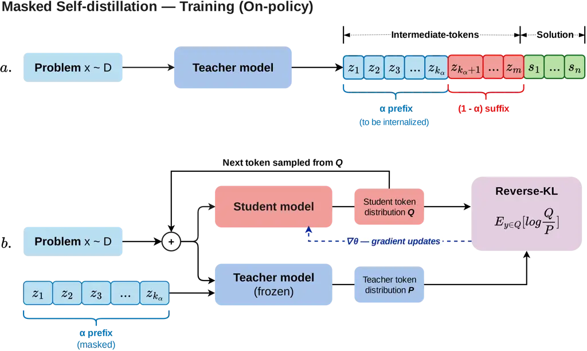

Figure 1: Overview of the masked self-distillation framework. a. For
each problem $`x\sim\mathcal{D}`$, we sample a response from the teacher
model. From each response, we extract the intermediate tokens $`z`$ and
the solution tokens $`s`$. b. The teacher $`\pi^{T}`$ and the student
$`\pi^{S}_{\theta}`$ are copies of the same model. The frozen teacher is
conditioned on $`x`$ and the first $`\alpha`$ fraction of $`z`$, while
the student is conditioned only on $`x`$, so it has to internalize this
$`\alpha`$ fraction into its parameters. The student’s distribution
$`Q`$ is matched to the teacher’s distribution $`P`$ with the on-policy
reverse-KL loss $`\mathbb{E}_{y\sim Q}[\log Q/P]`$, computed on
student-sampled responses; only the student is updated.

## 2 Related Work

Test-time compute and Inference cost reduction: \[50, 27\] showed that
LLMs perform significantly better on planning and reasoning tasks when
they are prompted to produce intermediate steps before generating the
final answer. Since then a new class of models called Large Reasoning
Models (LRMs) have emerged that are trained to generate reasoning traces
before giving the final answer \[23, 10, 17\]. While there has been a
significant performance increase in planning and reasoning domains, LRMs
spend most of their generation budget on intermediate tokens. A broad
line of token efficiency work has emerged that aims to reduce the
intermediate token length at inference. During inference, there have
been various prompting methods proposed to incentivize efficient
reasoning behavior in an LRM \[19, 53, 49\]. While they have shown some
success in reducing inference cost, prompting methods depend heavily on
the steerability of the LRM, and their efficacy is highly
task-dependent. To induce efficient reasoning behavior in the model,
there have been RL post-training methods that aim to reduce the length
of the traces \[2, 47, 44, 4, 31, 32\]. The general theme of these works
is that during RL training, they reward responses with shorter traces
and correct solutions sampled from the base model. These works have
shown promising reductions in trace lengths. However, the compression is
dependent on the base model’s output distribution to generate a shorter
trace during training for RL to reward them. In contrast, during the
masked self-distillation training, a portion of the reasoning trace is
masked from the student, and the student is trained to internalize the
information in the fraction of the reasoning trace. Thus, in our method,
there is a supervision signal that incentivizes the production of
shorter traces at inference.

Knowledge Distillation in LLMs: Knowledge distillation is widely studied
to transfer information from a larger, more capable teacher model to a
smaller student model \[21, 36, 25, 38\]. \[45, 16, 1\] showed that this
technique can be applied to LLM training as well. \[45\] introduced the
concept of context distillation in a setting similar to supervised
learning: the idea of sampling from a model provided with extra context
and training the same model to mimic these predictions without that
context. There have been works that used self-distillation to
internalize additional context such as factual information or
environmental feedback into the model’s parameters \[40, 14, 54, 28, 41,
22\]. While these works explore the internalization of additional
context, they do not study it for LRMs and reducing the intermediate
token length.

CoT compression and Latent reasoning: Prior to the emergence of LRMs,
some works investigated whether the Chain-of-Thought (CoT) tokens of an
LLM can be internalized into the model’s parameters \[45, 13, 12\].
These methods use an off-policy training objective, and while the
in-distribution accuracy can usually be matched with increased inference
efficiency, they do not investigate whether these gains are
generalizable. Recently, there is an additional line of work that
studies reasoning in latent space \[20, 39, 46\]. These works suggest
that the computations of the reasoning tokens can be compressed into the
model parameters and thus, the models do not need to explicitly generate
these tokens.

## 3 Masked Self-Distillation

We present a knowledge-distillation framework, which we call _masked
self-distillation_, in which two copies of the same model are
instantiated as a teacher and a student. The teacher copy of the model
operates in think mode, while the student copy is initialized in
no-think mode. The initial part (or all) of the trace is _masked_ from
the student during the distillation i.e., the teacher sees it, but the
student does not and the student model is trained to internalize the
masked portion into its parameters. The higher the amount of trace the
student internalizes, the shorter its outputs and the cheaper its
inference, because that computation has moved into the student’s
parameters during distillation.

Figure 1 shows an overview of the _masked self-distillation_ framework.
First, for each problem $`x\in\mathcal{D}`$, we sample a response from
the teacher and take the segment between the _\<think\>_ and
_\</think\>_ tags as the intermediate tokens $`z=(z_{1},\dots,z_{m})`$,
where $`m`$ is the length of the reasoning trace. The simplest way to do
masked distillation on the teacher response is to train the student with
SFT on the suffix part of the intermediate tokens followed by the
solution tokens. However, as SFT is an off-policy method, it is known to
suffer from exposure bias \[35, 37\] and does not generalize well \[8,
41\]. We therefore train the student using on-policy distillation. The
student is only conditioned on $`x`$ and is trained to match the
teacher’s next-token distribution, conditioned on $`x`$ and a fractional
prefix of $`z`$. We control what fraction of the trace is masked with a
parameter $`\alpha\in[0,1]`$. The teacher is conditioned on $`x`$ and
the first $`k_{\alpha}=\lfloor\alpha\,m\rfloor`$ tokens of the trace,
$`z_{\leq k_{\alpha}}`$, while the student is conditioned on $`x`$
alone. Since the teacher is now effectively going to produce only the
tokens after the $`\alpha`$ prefix, the student effectively has to
internalize the $`\alpha`$ prefix of the trace.

Let $`y=(y_{1},\dots,y_{L})`$ be a response sampled from the student,
where $`L`$ is the length of the response. The objective is to minimize
the reverse-KL divergence between the student and teacher next-token
distributions, computed on student-sampled responses:

```math
\mathcal{L}^{\alpha}_{\mathrm{MSD}}(\theta)=\mathbb{E}_{\,x\sim\mathcal{D},\;y\sim\pi^{S}_{\theta}(\cdot\mid x)}\left[\sum_{t=1}^{L}D_{\mathrm{KL}}\!\left(\pi^{S}_{\theta}(\,\cdot\mid x,y_{<t})\,\big\|\,\pi^{T}(\,\cdot\mid x,z_{\leq k_{\alpha}},y_{<t})\right)\right], \tag{1}
```

where, for next-token distributions $`p`$ and $`q`$ over the vocabulary
$`\mathcal{V}`$,

```math
D_{\mathrm{KL}}(q\parallel p)=\mathbb{E}_{v\sim q}\!\left[\log\frac{q(v)}{p(v)}\right]=\sum_{v\in\mathcal{V}}q(v)\log\frac{q(v)}{p(v)}. \tag{2}
```

Because $`y`$ is sampled from the student, the objective is on-policy:
the student learns from the responses it actually generates, and it
receives dense token-level feedback from the teacher at every position
instead of a single sparse reward.

As $`\alpha\in[0,1]`$, masked self-distillation has two extreme cases.
In the first case ($`\alpha=1`$ thus $`k_{\alpha}=m`$), the teacher is
conditioned on question $`x`$ and the full reasoning trace, while the
student is only conditioned on $`x`$. The student has to internalize the
entire reasoning process and, at inference, emit only the solution
tokens. We call this _fully masked_, and the loss becomes

```math
\mathcal{L}^{1}_{\mathrm{MSD}}(\theta)=\mathbb{E}_{x,\,y}\left[\sum_{t}D_{\mathrm{KL}}\!\left(\pi^{S}_{\theta}(\,\cdot\mid x,y_{<t})\,\big\|\,\pi^{T}(\,\cdot\mid x,z,y_{<t})\right)\right]. \tag{3}
```

In the second case ($`\alpha=0`$, $`k_{\alpha}=0`$), the teacher and the
student are both conditioned only on $`x`$. We call this _non-masked_,
and the loss becomes

```math
\mathcal{L}^{0}_{\mathrm{MSD}}(\theta)=\mathbb{E}_{x,\,y}\left[\sum_{t}D_{\mathrm{KL}}\!\left(\pi^{S}_{\theta}(\,\cdot\mid x,y_{<t})\,\big\|\,\pi^{T}(\,\cdot\mid x,y_{<t})\right)\right]. \tag{4}
```

## 4 Experimental Setup

Our broad aim is to study how the masked self-distillation training
affects inference cost and task performance. We conduct experiments in
the following domains -

1.  1.  Math - We used the popular GSM8K as our in-distribution dataset.
        This dataset, introduced by \[9\], consists of grade school math
        problems, and is designed to evaluate the reasoning capabilities of
        large language models. It contains 8.5K problems, each paired with a
        question and an answer. The dataset is divided into 7.5K training
        problems and 1K test problems. To test the out-of-distribution (OOD)
        generalization of models post-trained on GSM8K problems, we have
        in-domain OOD and out-of-domain test sets. We use AIME-25 \[33\] and
        MATH-500 \[30\] as in-domain OOD test sets as these datasets share
        the same arithmetic substrate but contain problems of higher
        difficulty. For the out-of-domain test, we use the graph coloring
        $`\mathrm{GC}`$-$`\mathrm{ER}_{\chi_{3-4}}`$ test set (described
        below).
2.  2.  Graph Coloring - Graph coloring is a canonical NP-complete reasoning
        problem that is related to both constraint satisfiability as well as
        practical problems like scheduling and allocation. In this domain,
        the model is given a graph, specified by vertices and edges, and the
        number of possible colors and the task is to return a configuration
        where no two connected vertices have the same color. For a graph
        $`G`$, the minimum number of colors required to properly color its
        vertices is the chromatic number, denoted $`\chi(G)`$. We construct
        a custom dataset using the networkx Python library \[18\],
        controlling problem difficulty by computing $`\chi(G)`$ for each
        sampled graph and retaining only those with the desired chromatic
        number. Our training set consists of $`10{,}000`$ problems on
        Erdős–Rényi graphs \[15\] with $`\chi(G)\in\{3,4\}`$. The
        in-distribution test set consists of $`500`$ held-out problems. We
        use the notation $`\mathrm{GC}`$-$`\mathrm{ER}_{\chi_{3-4}}`$ to
        denote this set. For evaluating generalization, we have in-domain
        OOD and out-of-domain test sets. For in-domain generalization, we
        have test sets with harder problems
        $`\mathrm{GC}`$-$`\mathrm{ER}_{\chi_{6}}`$ and
        $`\mathrm{GC}`$-$`\mathrm{BA}_{\chi_{6}}`$ generated using the
        Erdős–Rényi and Barabási–Albert algorithms \[5\] respectively (refer
        to appendix C for more details). For the out-of-domain test, we use
        the GSM8K test set.

Training details: Our implementation builds on the verl library \[42\].
We train Qwen3-4B and Qwen3-8B models \[51\] and perform $`\alpha`$
masked self-distillation post-training in math and graph coloring
domains. First, we generate responses from the teacher (base model in
think mode) on the training data and then keep only the problems that
the teacher solved correctly, i.e., rejection sampling (Figure 1a). We
perform the masked self-distillation training (Figure 1b) on the student
(base model in no-think mode) on the dataset created after rejection
sampling. We vary $`\alpha\in\{0.0,0.3,0.5,0.7,1.0\}`$ to control how
much of the trace the student internalizes and to study how this affects
its accuracy and trace length. We provide additional hyperparameter
details in the appendix section A.

## 5 Results and Discussion

### 5.1 Effect of Internalization on Task performance and inference efficiency

In this section, we study whether models post-trained using the masked
self-distillation framework internalize the information present in the
teacher’s reasoning tokens and achieve better task performance with
improved inference efficiency.

Figure 2 shows accuracy vs. average response length for _masked
self-distillation_ across different values of $`\alpha`$, together with
the base student and teacher models, averaged over 3 random seeds ¹¹ 1
We report the confidence intervals in appendix D.2 and D.3., on the
in-distribution and out-of-distribution datasets for the math and graph
coloring domains for the Qwen3-4B model. Figure 3 shows the same
comparison for the Qwen3-8B model.


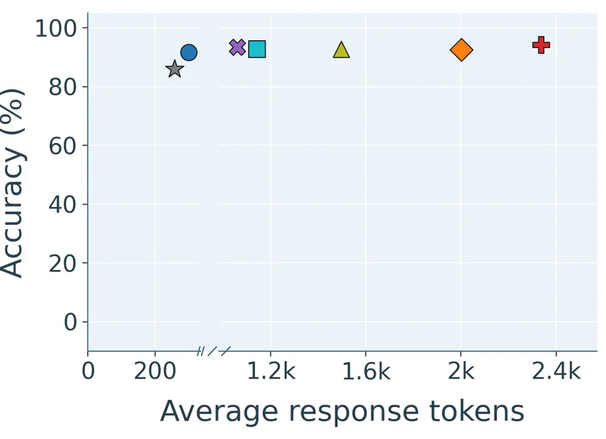

(a) GSM8K

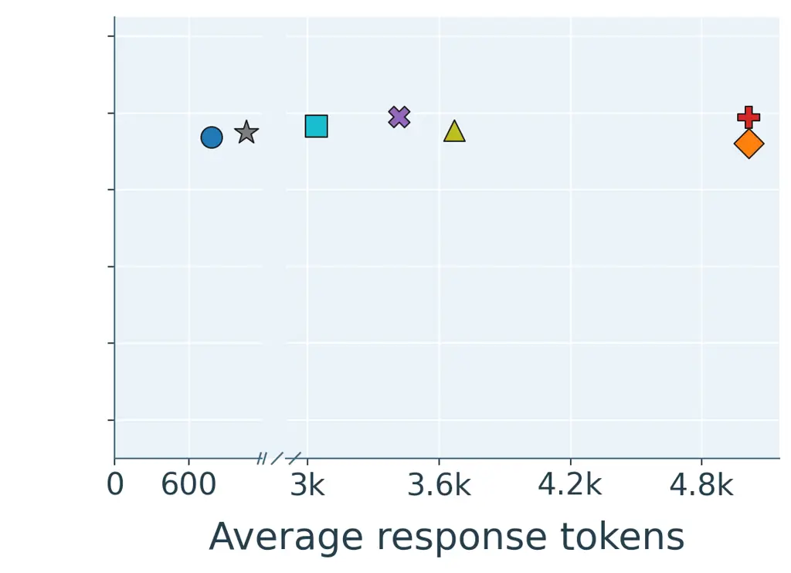

(b) MATH-500

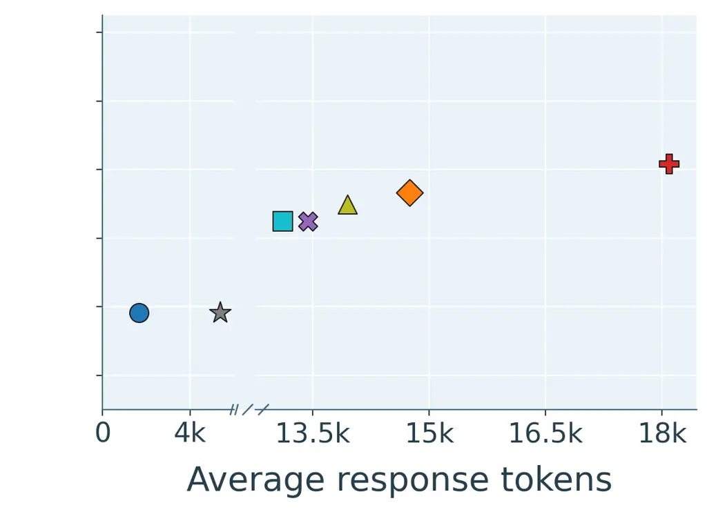

(c) AIME25

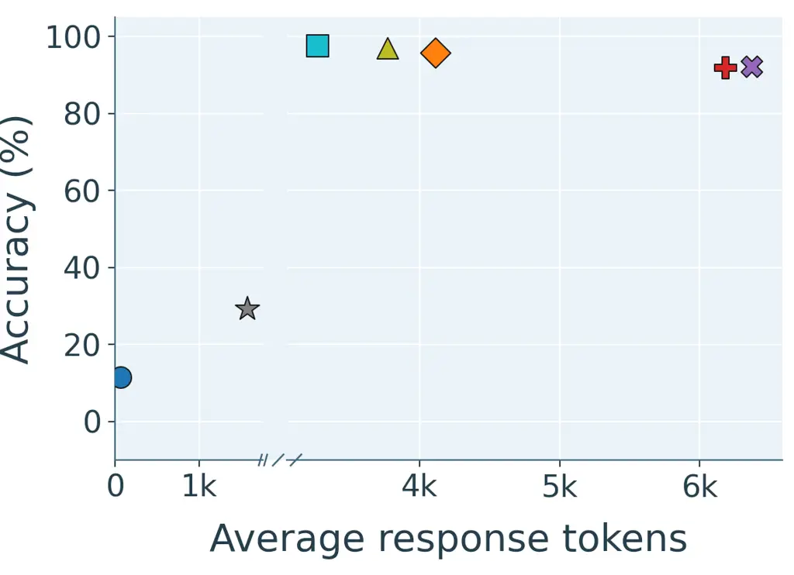

(d) $`\mathrm{GC}`$-$`\mathrm{ER}_{\chi_{3-4}}`$

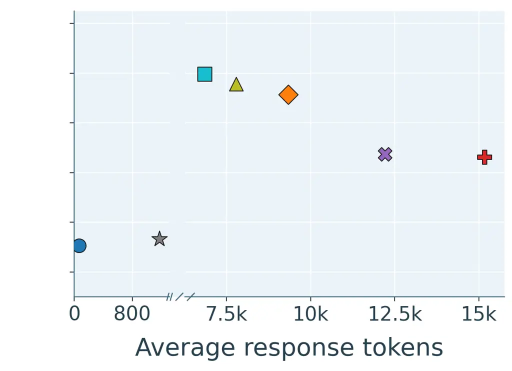

(e) $`\mathrm{GC}`$-$`\mathrm{ER}_{\chi_{6}}`$

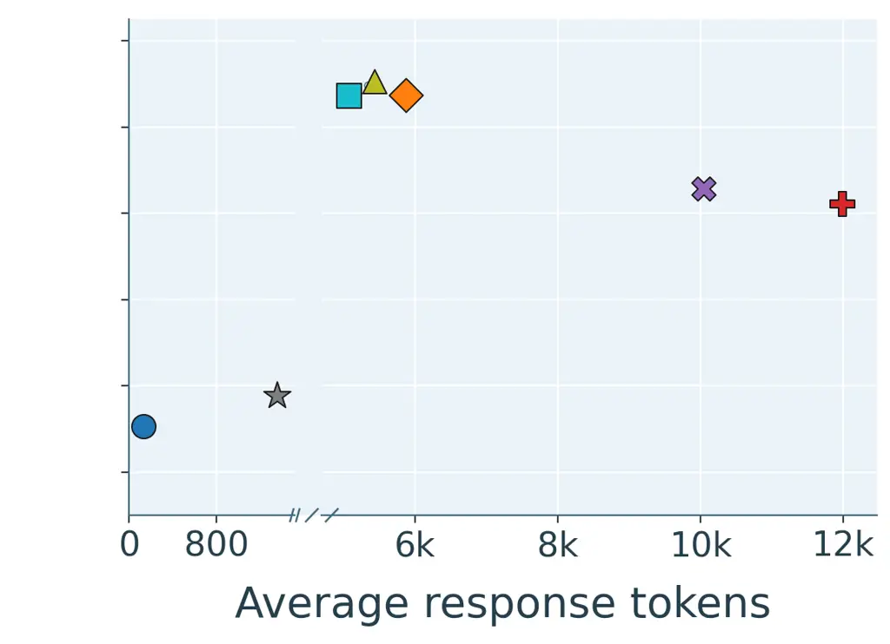

(f) $`\mathrm{GC}`$-$`\mathrm{BA}_{\chi_{6}}`$

Figure 2: Qwen3-4B Pareto plot: Accuracy vs. mean response length
comparison on math (top row) and graph-coloring (bottom row) domain
test-datasets for $`\alpha`$-masked variants, teacher (base think) and
student (base no-think). Note: Accuracy and mean response are averaged
over 3 random seeds.

As shown in Figure 2(a), the student (base no-think) accuracy is 86% on
the GSM8K test set while producing $`\sim`$260 tokens on average, while
the teacher’s (base think) accuracy is 94% and it produces $`\sim`$2.3k
tokens on average. After we train the student models on the GSM8K
training set with masked self-distillation for different values of
$`\alpha`$, they produce far fewer tokens than the teacher while keeping
similar performance. The fully masked variant ($`\alpha=1`$) gives the
best trade-off: it reaches $`\sim`$92% accuracy with about $`8\times`$
fewer tokens than the teacher.

On the graph coloring in-distribution test set (Figure 2(d)), the
student model accuracy is 29%, and it generates $`\sim`$1.5k tokens on
average, while the teacher reaches 92% with $`\sim`$6k tokens. After
training with masked self-distillation, the student produces shorter
outputs, and the variants with $`\alpha\in\{0.3,0.5,0.7\}`$ exceed the
teacher by 4–5 points, while producing 1.5-2x fewer tokens. Unlike on
GSM8K, the fully masked training is not effective here. The fully masked
model produces only $`\sim`$70 tokens, but its accuracy drops to 12%,
even less than the base student model. This suggests that fully
internalizing the reasoning process is not feasible for the
graph-coloring domain, and the student still requires a scaffold of
intermediate tokens to perform well.

We observe two patterns in the average response length across different
values of $`\alpha`$. (1) In the math domain, the trace generated by the
$`\alpha`$-masked variants becomes shorter as $`\alpha`$ increases, with
one exception: the non-masked variant ($`\alpha=0`$) produces about as
many tokens as the $`\alpha=0.7`$ variant. (2) In the graph coloring
domain, the variants with $`\alpha\in\{0.3,0.5,0.7\}`$ form a cluster
and produce nearly the same number of tokens, within a few hundred
tokens of each other, while the non-masked variant produces the most
tokens among the trained variants. We attribute this behavior to the
mode-seeking nature of the training objective \[16, 1\]. Since we train
the student with on-policy distillation, minimizing the reverse-KL
divergence between the student’s and the teacher’s token distributions,
the objective strongly penalizes the student for placing probability
mass where the teacher’s probability mass is small or zero. The student
therefore concentrates on the high-density regions (modes) of the
teacher and ignores its low-probability tails. The teacher can have
several such modes, and which one the student converges to depends on
the trajectories it samples during training. In masked
self-distillation, the student is trained to behave as though a fraction
of the reasoning trace were already in its context, and it tends to
generate the remaining part of the trace, but this may not correspond to
the exact trace the teacher would have generated. If the student happens
to generate shorter or longer traces during training, and the teacher
assigns high probability to them, the student can converge to a teacher
mode that favors traces of that length. We believe this is what happens
in both domains: for $`\alpha=0`$ in the math domain, the student
converges to a mode that produces traces almost as short as those of the
$`\alpha=0.7`$ variant, while for $`\alpha=0`$ in the graph coloring
domain, it converges to a mode that produces even more tokens than the
teacher on the in-distribution test set.


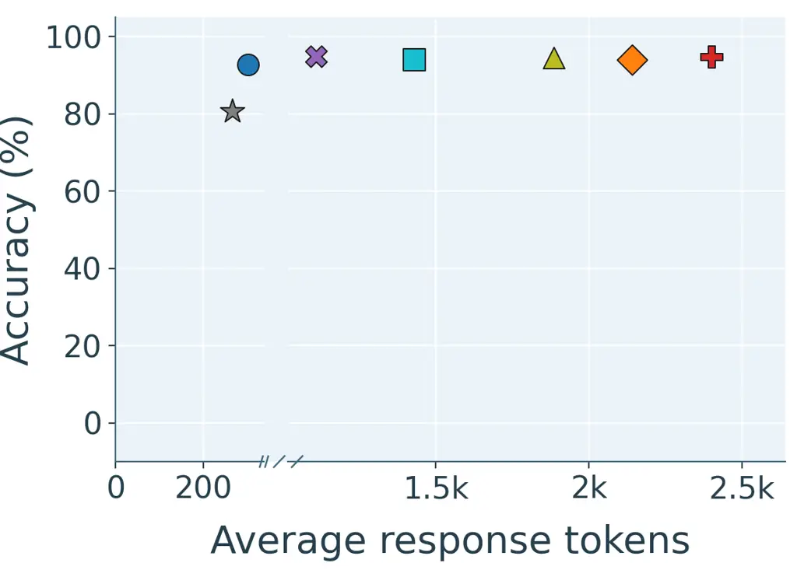

(a) GSM8K

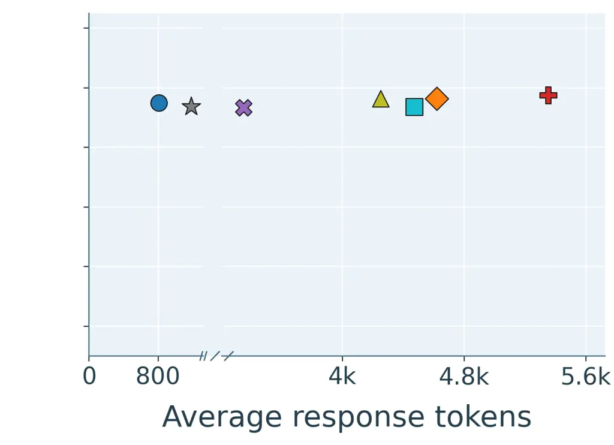

(b) MATH-500

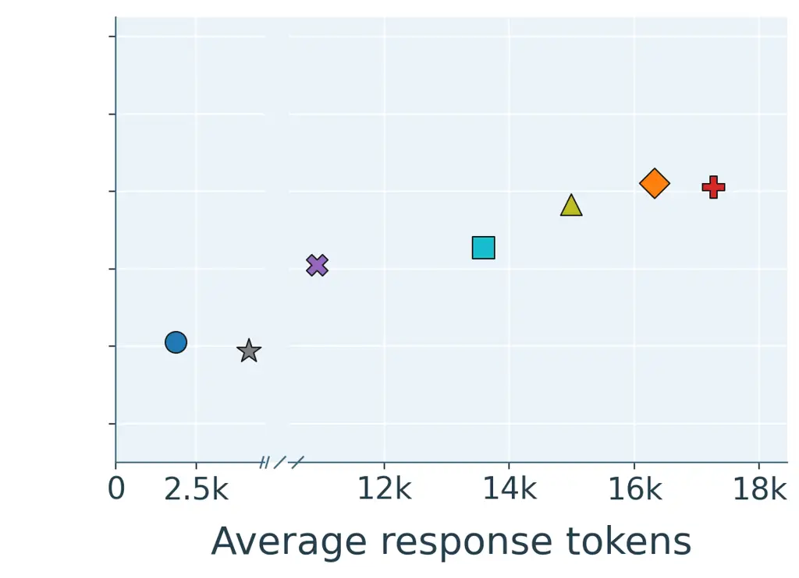

(c) AIME25

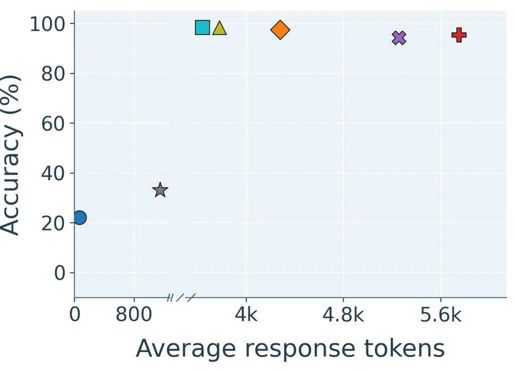

(d) $`\mathrm{GC}`$-$`\mathrm{ER}_{\chi_{3-4}}`$

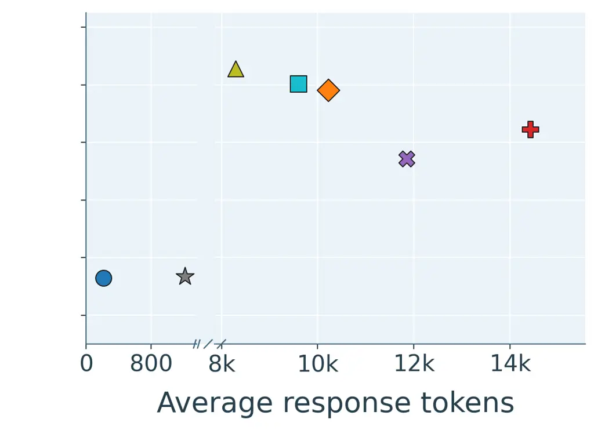

(e) $`\mathrm{GC}`$-$`\mathrm{ER}_{\chi_{6}}`$

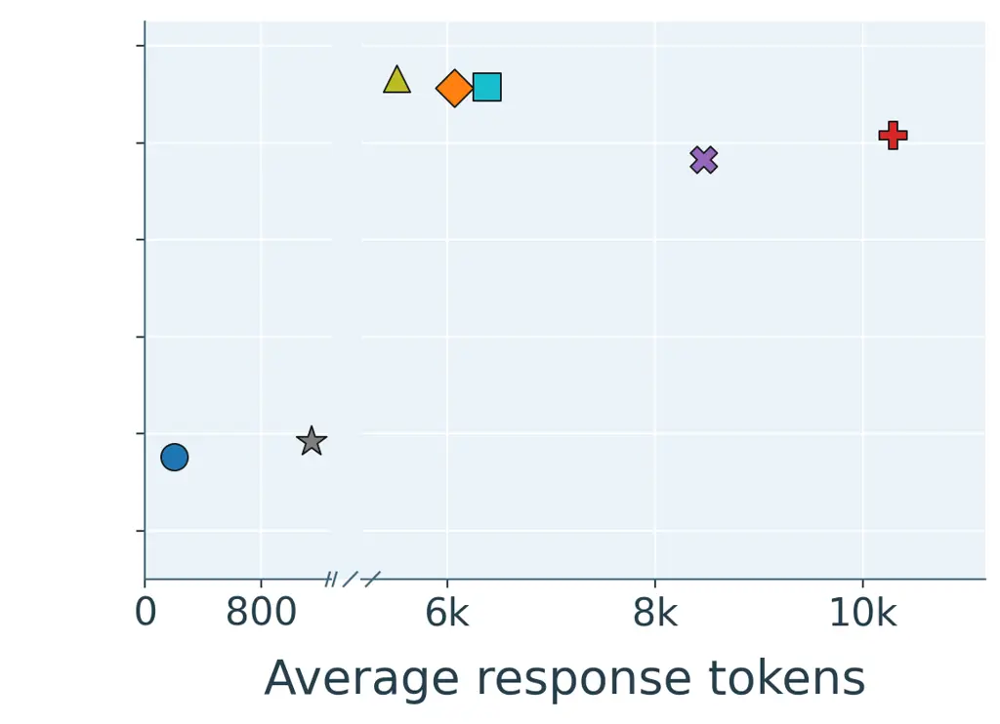

(f) $`\mathrm{GC}`$-$`\mathrm{BA}_{\chi_{6}}`$

Figure 3: Qwen3-8B Pareto plot: Accuracy vs. mean response length
comparison on math (top-row) and graph-coloring (bottom-row) domain
test-datasets for $`\alpha`$-masked variants, teacher (base think) and
student (base no-think). Note: Accuracy and mean response are averaged
over 3 random seeds.

The Qwen3-8B model shows the same pattern in both domains (Figures 3(a)
and 3(d)). On GSM8K, the fully masked variant reaches 93% accuracy,
close to the teacher’s 95%, with about $`8\times`$ fewer tokens. On
graph coloring, the variants with $`\alpha\in\{0.3,0.5,0.7\}`$ match the
teacher’s accuracy of 95% while producing about $`1.4`$–$`1.6\times`$
fewer tokens.

While it is extremely difficult to do a systematic study of the content
of the reasoning traces expressed in natural language, our qualitative
analysis results suggest that the traces produced by the
$`\alpha`$-masked variants seem disconnected, as if beginning from an
intermediate point in the reasoning (refer to appendix sections G and F
for more details). Taken together, these results suggest that the
student models indeed learn to internalize the computations present in
the $`\alpha`$ fraction of the teacher’s trace and thus become more
efficient at inference.

### 5.2 Analyzing the out-of-distribution effectiveness

We want to evaluate whether the masked self-distillation training leads
to memorization of shorter traces on in-distribution (ID) problems at
the expense of generalization. We extensively study the
out-of-distribution (OOD) performance in two OOD settings: (1) in-domain
but outside the training distribution, and (2) out-of-domain.

In-domain OOD: On the math-domain OOD datasets, MATH-500 and AIME-25
(Figures 2(b) and 2(c)), we observe the same trend as on GSM8K. On
MATH-500, all $`\alpha`$-masked variants match the teacher’s accuracy
while producing far fewer tokens. On AIME-25, the $`\alpha=0.3`$ variant
reaches about 55% accuracy, close to the teacher, while generating about
$`1.3\times`$ fewer tokens. The remaining $`\alpha`$-masked variants are
less accurate than the teacher but are more inference-efficient.

The graph coloring OOD results are extremely promising (Figures 2(e)
and 2(f)). The teacher reaches only 45% accuracy on
$`\mathrm{GC}`$-$`\mathrm{ER}_{\chi_{6}}`$ and 62% on
$`\mathrm{GC}`$-$`\mathrm{BA}_{\chi_{6}}`$, while the best
$`\alpha`$-masked variant ($`\alpha=0.7`$) reaches 80% on
$`\mathrm{GC}`$-$`\mathrm{ER}_{\chi_{6}}`$ and 89% on
$`\mathrm{GC}`$-$`\mathrm{BA}_{\chi_{6}}`$. This is $`\sim`$30
percentage points above the teacher, with about half as many tokens. We
attribute this to the on-policy nature of masked self-distillation: the
student is trained explicitly on this domain, on trajectories generated
by its own policy.

The in-domain OOD results for Qwen3-8B are consistent with those for
Qwen3-4B (Figure 3(b)–3(c) and Figure 3(e)–3(f)) on both domains. Taken
together, these results indicate that a student trained with masked
self-distillation generalizes robustly on in-domain OOD problems,
matching the teacher’s performance in the math domain and surpassing it
in the graph coloring domain, while being more inference-efficient.

Out-of-domain Generalization: Since we train the student models on a
single domain (math or graph coloring), a natural question is whether
the resulting gains in both accuracy and inference cost carry over to
other domains, or whether the models overspecialize to the training
domain and lose accuracy elsewhere. To test this, we perform
out-of-domain evaluation tests.


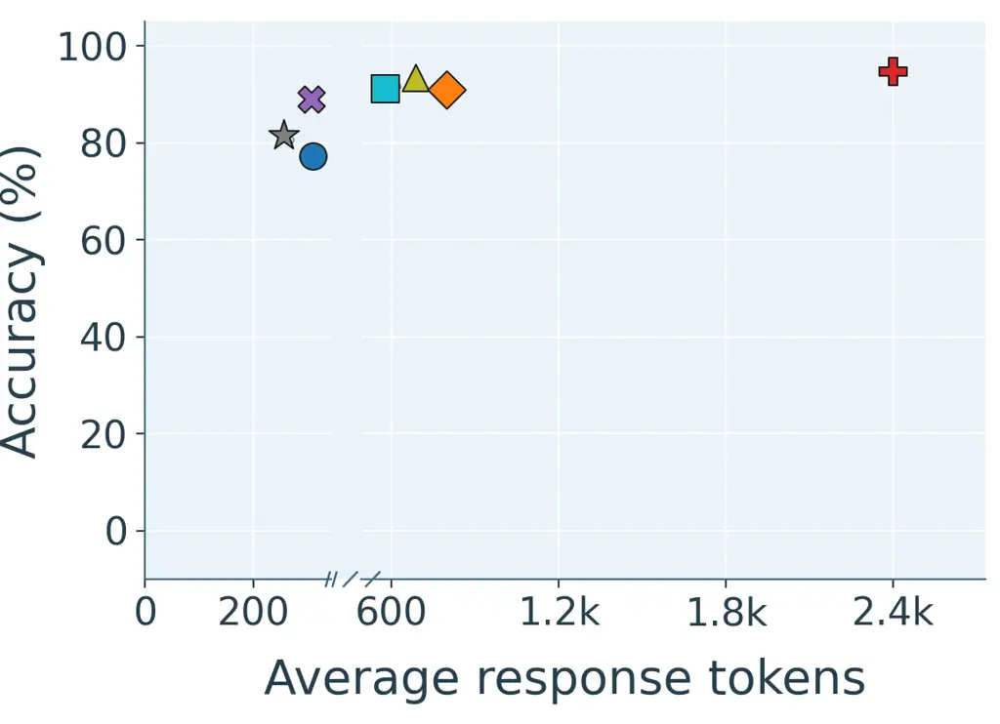

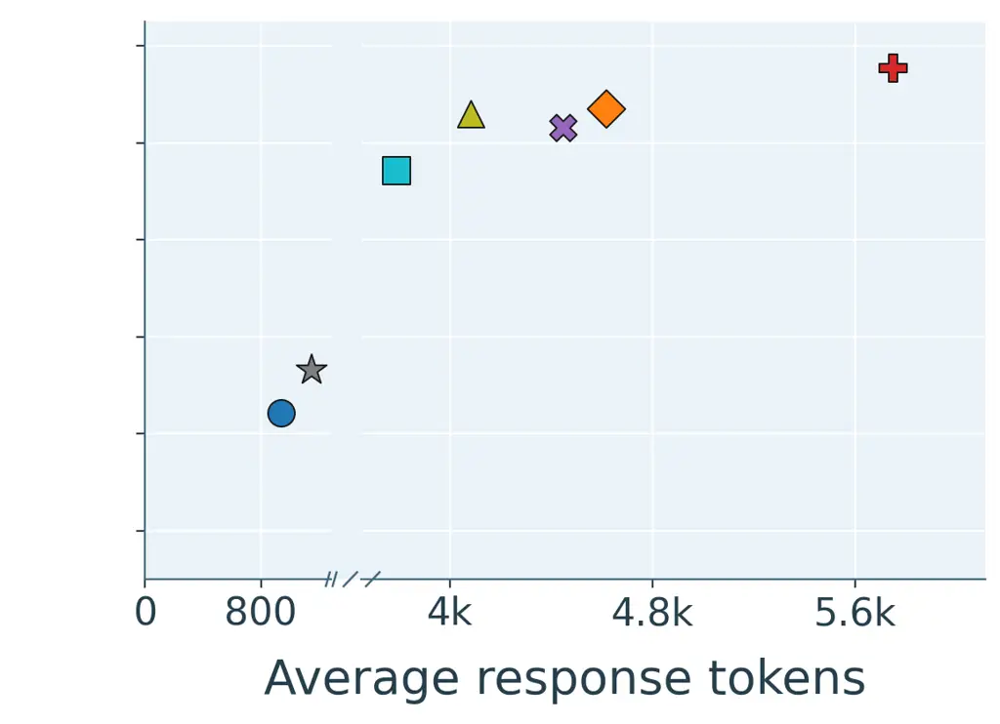

Figure 4: Out-of-domain Qwen3-8B Pareto plots: (left) graph coloring
models evaluated on the GSM8K test set and (right) GSM8K models
evaluated on $`\mathrm{GC}`$-$`\mathrm{ER}_{\chi_{3-4}}`$ test set.

Figure 4 shows out-of-domain evaluation analysis for $`\alpha`$-masked
Qwen3-8B models, together with the base student and teacher models. The
models trained on the graph coloring domain retain their inference cost
savings even on the GSM8K test dataset. However, the models trained on
the GSM8K dataset have slightly lower performance on
$`\mathrm{GC}`$-$`\mathrm{ER}_{\chi_{3-4}}`$ test set compared to the
base teacher model. On the $`\mathrm{GC}`$-$`\mathrm{ER}_{\chi_{3-4}}`$
test set, the teacher model reaches 95.5% accuracy with $`\sim`$5.7k
tokens, while the best masked self-distillation variant ($`\alpha=0.3`$)
reaches 87% with $`\sim`$4.6k tokens, and $`\alpha=0.5`$ reaches 85.5%
with $`\sim`$4.2k tokens. These variants remain far above the base
student model (33%), so the training still improves performance on this
harder task, but the token cost reduction is minimal. These results show
that while the inference cost gains are domain-dependent, the masked
self-distillation training does not induce catastrophic forgetting in
the student models. We report the out-of-domain analysis for
$`\alpha`$-masked Qwen3-4B model in Appendix figure 8.

### 5.3 Effect of the maximum token budget


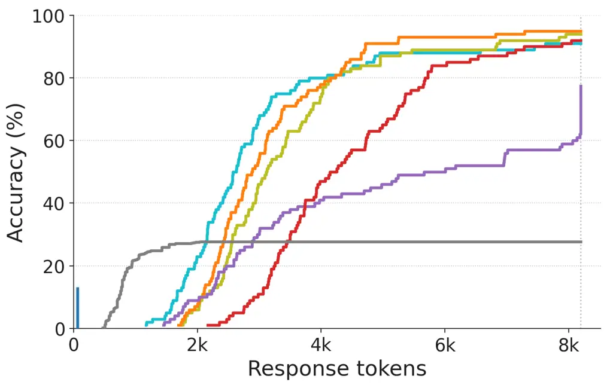

Figure 5: Qwen3-4B: Accuracy curve over max-token budget.

The Pareto plots report a single operating point per baseline, namely
its accuracy and mean token length ²² 2 The mean response length does
not provide a complete picture of the response-length distribution over
the test set. To examine how masked distillation changes the
response-length distribution and what distributions the
$`\alpha`$-masked variants follow, we report violin plots in Appendix E.
under a fixed cap. To see the full trade-off, we also plot the accuracy
curve over the token budget: for each budget $`b`$ on the $`x`$-axis,
the curve reports the accuracy the model would achieve if generation
were stopped at $`b`$ tokens. A problem counts as solved only if the
model produces a correct answer within $`b`$ tokens. Figure 5 shows
these curves for all baselines on the
$`\mathrm{GC}`$-$`\mathrm{ER}_{\chi_{3-4}}`$ test set under an 8k cap
for Qwen3-4B model. Masked self-distillation shifts the entire curve to
the left. The curves for $`\alpha\in\{0.3,0.5,0.7\}`$ lie above and to
the left of the teacher’s over the whole range. This demonstrates that
the $`\alpha`$-masked variants perform better than the base teacher at
every fixed token budget. Notably, at a budget of 4k tokens, the
$`\alpha=0.3`$ variant already solves about 80% of the problems, while
the teacher solves fewer than 50%.

### 5.4 Ablation Study: SFT vs on-policy distillation

We compare the $`\alpha`$-masked variants trained with SFT and masked
self-distillation to examine whether the effectiveness of our framework
comes from the internalization of the teacher’s reasoning traces
together with the student’s on-policy exploration for shorter reasoning
traces, or whether similar gains can be achieved simply through
over-training using SFT on a fraction of the teacher’s reasoning trace
and the final solution. We provide the details of the SFT training
procedure in the appendix A.3.

|        |                                              |            |                                            |            |                                            |            |         |            |
| ------ | -------------------------------------------- | ---------- | ------------------------------------------ | ---------- | ------------------------------------------ | ---------- | ------- | ---------- |
|        | $`\mathrm{GC}`$-$`\mathrm{ER}_{\chi_{3-4}}`$ |            | $`\mathrm{GC}`$-$`\mathrm{ER}_{\chi_{6}}`$ |            | $`\mathrm{GC}`$-$`\mathrm{BA}_{\chi_{6}}`$ |            | GSM8K   |            |
| Masked | SFT                                          | Reverse KL | SFT                                        | Reverse KL | SFT                                        | Reverse KL | SFT     | Reverse KL |
| 100%   | 88.7                                         | 11.5       | 11.4                                       | 10.5       | 26.2                                       | 10.6       | 0.0     | 87.0       |
|        | 68                                           | 67         | 68                                         | 66         | 68                                         | 115        | 32k^(∗) | 299        |
| 70%    | 94.2                                         | 97.5       | 52.7                                       | 79.5       | 72.1                                       | 88.3       | 68.5    | 87.7       |
|        | 2631                                         | 3274       | 5899                                       | 6906       | 4681                                       | 5185       | 4866    | 549        |
| 50%    | 95.1                                         | 97.0       | 60.2                                       | 75.5       | 82.3                                       | 89.9       | 77.0    | 90.8       |
|        | 3431                                         | 3772       | 7816                                       | 7986       | 5631                                       | 5410       | 9084    | 1051       |
| 30%    | 94.1                                         | 95.8       | 58.5                                       | 71.1       | 82.7                                       | 87.3       | 82.2    | 89.6       |
|        | 4211                                         | 4112       | 10299                                      | 9384       | 6661                                       | 5942       | 5501    | 933        |
| 0%     | 95.4                                         | 92.3       | 55.9                                       | 46.7       | 70.1                                       | 65.7       | 84.8    | 92.6       |
|        | 5433                                         | 6369       | 13369                                      | 12439      | 10248                                      | 10186      | 4606    | 1670       |

Table 1: Qwen3-4B variants : Accuracy and mean token length comparison
between SFT vs. on-policy trained $`\alpha`$-masked variants. Each cell
reports accuracy (%) on the first line and mean token length on the
second. Bold marks the highest accuracy; underline marks the shortest
mean response. "\*" denotes the model collapses and exhausts its token
generation budget.

Table 1 reports the accuracy and mean response length of the SFT and
masked self-distillation trained $`\alpha`$-masked variants. We
post-train the Qwen3-4B model in no-think mode on variants of the
graph-coloring training set where each variant has question, an
$`\alpha`$ fraction of the trace, and the solution. The models are
evaluated on the graph-coloring in-domain OOD test sets and on the
out-of-domain GSM8K test set. From the table, we observe that for
$`\alpha\in\{0.3,0.5,0.7\}`$, the variants trained with the on-policy
reverse-KL objective generalize better to both the in-domain OOD and
out-of-domain test sets than their SFT counterparts. For the fully
masked variant ($`\alpha=1`$), SFT appears to overfit to the training
distribution: although it performs well on the in-distribution test set,
its performance drops substantially on the OOD test sets. Moreover, on
the out-of-domain test set, the SFT-trained fully masked variant
collapses, whereas the reverse-KL-trained fully masked variant largely
maintains the performance of the base model. Furthermore, across all
values of $`\alpha`$, the SFT-trained variants generate substantially
longer responses on the cross-domain test set than their reverse-KL
counterparts. This suggests that simply training on shortened teacher
traces through SFT is not sufficient for the student to consistently
learn shorter reasoning behavior. In contrast, reverse-KL training
combines the internalization of the teacher’s reasoning trace with
on-policy trajectories generated by the student itself, leading to
shorter responses while better preserving generalization.

### 5.5 Ablation Study: Dual Model Setting

In our _masked self-distillation_ framework, we use copies of the same
model as student and teacher, where the student is in no-think mode and
teacher in think mode. But our framework can be instantiated in dual
model setting as well, in which a larger reasoning model operates as
teacher and supervises a smaller non-thinking student model. We evaluate
the _dual-model_ setting on graph coloring, where teacher is Qwen3-8B
(in think mode) and student is Qwen3-1.7B (in no-think mode).


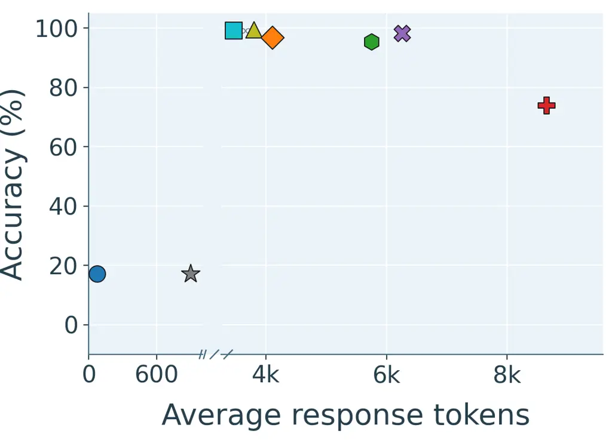

(a) $`\mathrm{GC}`$-$`\mathrm{ER}_{\chi_{3-4}}`$

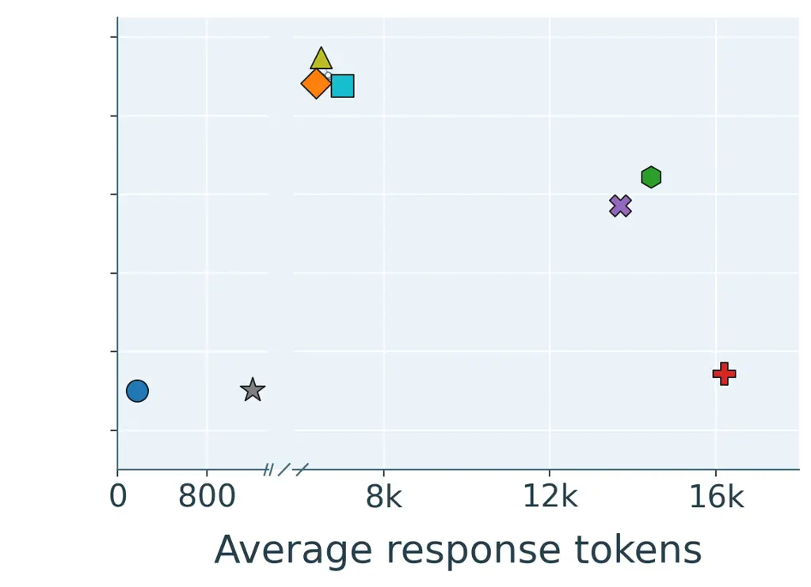

(b) $`\mathrm{GC}`$-$`\mathrm{ER}_{\chi_{6}}`$

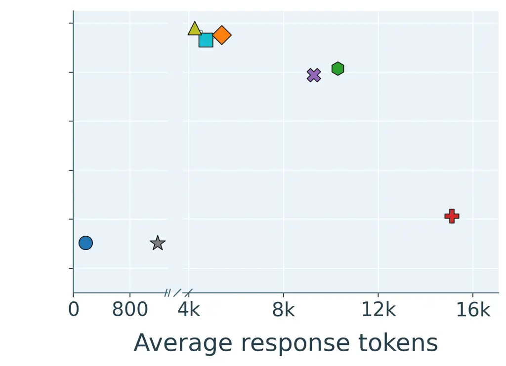

(c) $`\mathrm{GC}`$-$`\mathrm{BA}_{\chi_{6}}`$

Figure 6: Dual-model setting Pareto plot: accuracy vs. average response
length comparison on graph-coloring domain test datasets for
$`\alpha`$-masked variants, base think, student (base no-think) and
teacher (8B think).

Figure 6 shows accuracy vs. mean token length for _dual-model_ setting
across different values of $`\alpha`$, together with the base student
model, teacher model, and the base model in reasoning mode on the
in-distribution and out-of-distribution datasets. We observe a trend
similar to that in the self-distillation setting. The $`\alpha`$-masked
variants, $`\alpha\in\{0.3,0.5,0.7\}`$, internalize a fraction of the
teacher’s reasoning traces and generate substantially fewer tokens on
average compared to the base reasoning model while achieving accuracies
that are 30-40 percentage points higher on the in-distribution and both
out-of-distribution test datasets. These results demonstrate that the
_masked distillation_ framework can also be used to post-train smaller
models to reason more efficiently.

## 6 Conclusion

In this work, we study whether the computation expressed in the
intermediate tokens can be internalized into the parameters of a
language model. We proposed masked self-distillation, a
knowledge-distillation based post-training method that can be utilized
to induce token-efficient reasoning without any external feedback or
supervision. Our results across math and graph coloring demonstrate that
masked self-distillation consistently improves task performance while
reducing intermediate tokens. We also conducted experiments in the
countdown domain and find similar results (refer to Appendix D.1). We
extensively studied the generalization effectiveness of the masked
self-distillation training. Our findings demonstrate that models
post-trained using the framework generalize well on in-domain OOD
problems and do not suffer from catastrophic forgetting on out-of-domain
problems. We also compare with SFT trained models and show how the
on-policy reverse-KL objective trains the models to generate shorter
intermediate traces rather than just memorizing the shorter trace
completions. Finally, we show that the masked distillation training can
be effectively leveraged for training smaller models to improve task
performance with efficient intermediate token generation.

## Acknowledgments

This research is supported in part by grants from ONR grant
N00014-25-1-2301, ARO grant W911NF-26-1-A278, and gifts from Qualcomm
and Apple. We also thank ASU AIR (Gaudi2) platform for the compute.

## References

- \[1\] R. Agarwal, N. Vieillard, Y. Zhou, P. Stanczyk, S. Ramos
  Garea, M. Geist, and O. Bachem (2024) On-policy distillation of
  language models: learning from self-generated mistakes. In
  International Conference on Learning Representations, Vol. 2024,
  pp. 21246–21263. Cited by: 3rd item, 3rd item, §2, §5.1.
- \[2\] P. Aggarwal and S. Welleck (2025) L1: controlling how long a
  reasoning model thinks with reinforcement learning. arXiv preprint
  arXiv:2503.04697. Cited by: §1, §2.
- \[3\] I. Arcuschin, J. Janiak, R. Krzyzanowski, S. Rajamanoharan, N.
  Nanda, and A. Conmy (2025) Chain-of-thought reasoning in the wild is
  not always faithful. arXiv preprint arXiv:2503.08679. Cited by: §1.
- \[4\] D. Arora and A. Zanette (2025) Training language models to
  reason efficiently, 2025. URL https://arxiv. org/abs/2502.04463. Cited
  by: §1, §2.
- \[5\] A. Barabási and R. Albert (1999) Emergence of scaling in random
  networks. science 286 (5439), pp. 509–512. Cited by: Appendix C,
  item 2.
- \[6\] S. Bhambri, U. Biswas, and S. Kambhampati (2025) Interpretable
  traces, unexpected outcomes: investigating the disconnect in
  trace-based knowledge distillation. arXiv preprint arXiv:2505.13792.
  Cited by: §1.
- \[7\] Y. Chen, J. Benton, A. Radhakrishnan, J. Uesato, C. Denison, J.
  Schulman, A. Somani, P. Hase, M. Wagner, F. Roger, et al. (2025)
  Reasoning models don’t always say what they think. arXiv preprint
  arXiv:2505.05410. Cited by: §1.
- \[8\] T. Chu, Y. Zhai, J. Yang, S. Tong, S. Xie, D. Schuurmans, Q. V.
  Le, S. Levine, and Y. Ma (2025) Sft memorizes, rl generalizes: a
  comparative study of foundation model post-training. arXiv preprint
  arXiv:2501.17161. Cited by: §3.
- \[9\] K. Cobbe, V. Kosaraju, M. Bavarian, M. Chen, H. Jun, L.
  Kaiser, M. Plappert, J. Tworek, J. Hilton, R. Nakano, C. Hesse, and J.
  Schulman (2021) Training verifiers to solve math word problems. arXiv
  preprint arXiv:2110.14168. Cited by: item 1.
- \[10\] G. Comanici, E. Bieber, M. Schaekermann, I. Pasupat, N.
  Sachdeva, I. Dhillon, M. Blistein, O. Ram, D. Zhang, E. Rosen, et
  al. (2025) Gemini 2.5: pushing the frontier with advanced reasoning,
  multimodality, long context, and next generation agentic capabilities.
  arXiv preprint arXiv:2507.06261. Cited by: §2.
- \[11\] Countdown. () Countdown (game show).. Note:
  [https://en.wikipedia.org/wiki/Countdown\_(game_show)](<https://en.wikipedia.org/wiki/Countdown_(game_show)>)\[Accessed
  13-05-2025\] Cited by: Appendix C.
- \[12\] Y. Deng, Y. Choi, and S. Shieber (2024) From explicit cot to
  implicit cot: learning to internalize cot step by step. arXiv preprint
  arXiv:2405.14838. Cited by: §2.
- \[13\] Y. Deng, K. Prasad, R. Fernandez, P. Smolensky, V. Chaudhary,
  and S. Shieber (2023) Implicit chain of thought reasoning via
  knowledge distillation. arXiv preprint arXiv:2311.01460. Cited by: 4th
  item, §2.
- \[14\] Z. Dou, C. Yang, X. Wu, K. Chang, and N. Peng (2024) Re-rest:
  reflection-reinforced self-training for language agents. In
  Proceedings of the 2024 Conference on Empirical Methods in Natural
  Language Processing, pp. 15394–15411. Cited by: §2.
- \[15\] P. ERDdS and A. R&wi (1959) On random graphs i. Publ. math.
  debrecen 6 (290-297), pp. 18. Cited by: Appendix C, item 2.
- \[16\] Y. Gu, L. Dong, F. Wei, and M. Huang (2024) Minillm: knowledge
  distillation of large language models. In International Conference on
  Learning Representations, Vol. 2024, pp. 32694–32717. Cited by: 3rd
  item, §2, §5.1.
- \[17\] D. Guo, D. Yang, H. Zhang, J. Song, R. Zhang, R. Xu, Q. Zhu, S.
  Ma, P. Wang, X. Bi, et al. (2025) Deepseek-r1: incentivizing reasoning
  capability in llms via reinforcement learning. arXiv preprint
  arXiv:2501.12948. Cited by: §2.
- \[18\] A. A. Hagberg, D. A. Schult, and P. J. Swart (2008) Exploring
  network structure, dynamics, and function using networkx. In
  Proceedings of the 7th Python in Science Conference, G. Varoquaux, T.
  Vaught, and J. Millman (Eds.), Pasadena, CA USA, pp. 11 – 15. Cited
  by: Appendix C, item 2.
- \[19\] T. Han, Z. Wang, C. Fang, S. Zhao, S. Ma, and Z. Chen (2025)
  Token-budget-aware LLM reasoning. In Findings of the Association for
  Computational Linguistics: ACL 2025, W. Che, J. Nabende, E. Shutova,
  and M. T. Pilehvar (Eds.), Vienna, Austria, pp. 24842–24855. External
  Links: [Link](https://aclanthology.org/2025.findings-acl.1274/),
  [Document](https://dx.doi.org/10.18653/v1/2025.findings-acl.1274),
  ISBN 979-8-89176-256-5 Cited by: §2.
- \[20\] S. Hao, S. Sukhbaatar, D. Su, X. Li, Z. Hu, J. Weston, and Y.
  Tian (2024) Training large language models to reason in a continuous
  latent space. arXiv preprint arXiv:2412.06769. Cited by: §2.
- \[21\] G. Hinton, O. Vinyals, and J. Dean (2015) Distilling the
  knowledge in a neural network. arXiv preprint arXiv:1503.02531. Cited
  by: 2nd item, Appendix B, §1, §2.
- \[22\] J. Hübotter, F. Lübeck, L. Behric, A. Baumann, M. Bagatella, D.
  Marta, I. Hakimi, I. Shenfeld, T. K. Buening, C. Guestrin, et
  al. (2026) Reinforcement learning via self-distillation. arXiv
  preprint arXiv:2601.20802. Cited by: 4th item, §1, §2.
- \[23\] A. Jaech, A. Kalai, A. Lerer, A. Richardson, A. El-Kishky, A.
  Low, A. Helyar, A. Madry, A. Beutel, A. Carney, et al. (2024) Openai
  o1 system card. arXiv preprint arXiv:2412.16720. Cited by: §2.
- \[24\] D. Jennewein, A. Chapman, A. Chiquete, A. Carlson, G.
  Speyer, G. Otero, J. Choudhry, J. Lee, J. Burks, J. J. García Mesa, M.
  Brazil, N. Mendoza, N. Woodbury, N. T. Mu, R. Belshe, S. Dudley, T.
  Jennewein, T. Battelle, W. Dizon, and Y. Byun (2026) Provisioning a
  large-scale ai platform composed of intel gaudi2 accelerators at
  arizona state university. In Proceedings of the Practice and
  Experience in Advanced Research Computing 2026: Resilient Roots +
  Empowered Communities, PEARC ’26, New York, NY, USA. External Links:
  ISBN 9798400723773, [Link](https://doi.org/10.1145/3785462.3815814),
  [Document](https://dx.doi.org/10.1145/3785462.3815814) Cited by: §A.1,
  §A.2, §A.3.
- \[25\] Y. Kim and A. M. Rush (2016) Sequence-level knowledge
  distillation. In Proceedings of the 2016 Conference on Empirical
  Methods in Natural Language Processing, J. Su, K. Duh, and X. Carreras
  (Eds.), Austin, Texas, pp. 1317–1327. External Links:
  [Link](https://aclanthology.org/D16-1139/),
  [Document](https://dx.doi.org/10.18653/v1/D16-1139) Cited by: §2.
- \[26\] Y. Kim and A. M. Rush (2016) Sequence-level knowledge
  distillation. In Proceedings of the 2016 conference on empirical
  methods in natural language processing, pp. 1317–1327. Cited by: 1st
  item.
- \[27\] T. Kojima, S. S. Gu, M. Reid, Y. Matsuo, and Y. Iwasawa (2023)
  Large language models are zero-shot reasoners. External Links:
  2205.11916, [Link](https://arxiv.org/abs/2205.11916) Cited by: §2.
- \[28\] K. Kujanpää, P. Marttinen, H. Valpola, and A. Ilin (2024)
  Efficient knowledge injection in llms via self-distillation. arXiv
  preprint arXiv:2412.14964. Cited by: §2.
- \[29\] S. Kullback and R. A. Leibler (1951) On information and
  sufficiency. The annals of mathematical statistics 22 (1), pp. 79–86.
  Cited by: §1.
- \[30\] H. Lightman, V. Kosaraju, Y. Burda, H. Edwards, B. Baker, T.
  Lee, J. Leike, J. Schulman, I. Sutskever, and K. Cobbe (2024) Let’s
  verify step by step. In International Conference on Learning
  Representations, Vol. 2024, pp. 39578–39601. Cited by: item 1.
- \[31\] H. Luo, L. Shen, H. He, Y. Wang, S. Liu, W. Li, N. Tan, X. Cao,
  and D. Tao (2025) O1-pruner: length-harmonizing fine-tuning for
  o1-like reasoning pruning. arXiv preprint arXiv:2501.12570. Cited by:
  §1, §2.
- \[32\] X. Ma, G. Wan, R. Yu, G. Fang, and X. Wang (2025) Cot-valve:
  length-compressible chain-of-thought tuning. In Proceedings of the
  63rd Annual Meeting of the Association for Computational Linguistics
  (Volume 1: Long Papers), pp. 6025–6035. Cited by: §1, §2.
- \[33\] C. on Hugging Face (2025) American invitational mathematics
  examination 2025 (aime25) dataset. External Links:
  [Link](https://huggingface.co/datasets/math-ai/aime25) Cited by:
  item 1.
- \[34\] V. Palod, K. Valmeekam, K. Stechly, and S. Kambhampati (2025)
  Performative thinking? the brittle correlation between cot length and
  problem complexity. arXiv preprint arXiv:2509.07339. Cited by: §1.
- \[35\] D. A. Pomerleau (1991) Efficient training of artificial neural
  networks for autonomous navigation. Neural computation 3 (1),
  pp. 88–97. Cited by: §3.
- \[36\] A. Romero, N. Ballas, S. E. Kahou, A. Chassang, C. Gatta,
  and Y. Bengio (2014) FitNets: hints for thin deep nets. CoRR
  abs/1412.6550. External Links:
  [Link](https://api.semanticscholar.org/CorpusID:2723173) Cited by: §2.
- \[37\] S. Ross and D. Bagnell (2010) Efficient reductions for
  imitation learning. In Proceedings of the thirteenth international
  conference on artificial intelligence and statistics, pp. 661–668.
  Cited by: §3.
- \[38\] V. Sanh, L. Debut, J. Chaumond, and T. Wolf (2019) DistilBERT,
  a distilled version of bert: smaller, faster, cheaper and lighter.
  arXiv preprint arXiv:1910.01108. Cited by: 2nd item, §2.
- \[39\] N. Saunshi, N. Dikkala, Z. Li, S. Kumar, and S. J Reddi (2025)
  Reasoning with latent thoughts: on the power of looped transformers.
  In International Conference on Learning Representations, Vol. 2025,
  pp. 14855–14881. Cited by: §2.
- \[40\] J. Scheurer, J. A. Campos, T. Korbak, J. S. Chan, A. Chen, K.
  Cho, and E. Perez (2023) Training language models with language
  feedback at scale. arXiv preprint arXiv:2303.16755. Cited by: §2.
- \[41\] I. Shenfeld, M. Damani, J. Hübotter, and P. Agrawal (2026)
  Self-distillation enables continual learning. arXiv preprint
  arXiv:2601.19897. Cited by: 4th item, §1, §2, §3.
- \[42\] G. Sheng, C. Zhang, Z. Ye, X. Wu, W. Zhang, R. Zhang, Y.
  Peng, H. Lin, and C. Wu (2024) HybridFlow: a flexible and efficient
  rlhf framework. arXiv preprint arXiv: 2409.19256. Cited by: §4.
- \[43\] P. Shojaee\*, I. Mirzadeh\*, K. Alizadeh, M. Horton, S. Bengio,
  and M. Farajtabar (2025) The illusion of thinking: understanding the
  strengths and limitations of reasoning models via the lens of problem
  complexity. In NeurIPS, External Links:
  [Link](https://arxiv.org/abs/2506.06941) Cited by: §1.
- \[44\] V. Shrivastava, A. Awadallah, V. Balachandran, S. Garg, H.
  Behl, and D. Papailiopoulos (2025) Sample more to think less: group
  filtered policy optimization for concise reasoning. arXiv preprint
  arXiv:2508.09726. Cited by: §1, §2.
- \[45\] C. Snell, D. Klein, and R. Zhong (2022) Learning by distilling
  context. arXiv preprint arXiv:2209.15189. Cited by: §2, §2.
- \[46\] D. Su, H. Zhu, Y. Xu, J. Jiao, Y. Tian, and Q. Zheng (2025)
  Token assorted: mixing latent and text tokens for improved language
  model reasoning. arXiv preprint arXiv:2502.03275. Cited by: §2.
- \[47\] K. Team, A. Du, B. Gao, B. Xing, C. Jiang, C. Chen, C. Li, C.
  Xiao, C. Du, C. Liao, et al. (2025) Kimi k1. 5: scaling reinforcement
  learning with llms. arXiv preprint arXiv:2501.12599. Cited by: §1, §2.
- \[48\] K. Valmeekam, K. Stechly, V. Palod, A. Gundawar, and S.
  Kambhampati (2025) Beyond semantics: the unreasonable effectiveness of
  reasonless intermediate tokens. arXiv preprint arXiv:2505.13775. Cited
  by: §1.
- \[49\] C. Wang, Y. Feng, D. Chen, Z. Chu, R. Krishna, and T.
  Zhou (2025) Wait, we don’t need to “wait”! removing thinking tokens
  improves reasoning efficiency. In Findings of the Association for
  Computational Linguistics: EMNLP 2025, C. Christodoulopoulos, T.
  Chakraborty, C. Rose, and V. Peng (Eds.), Suzhou, China,
  pp. 7459–7482. External Links:
  [Link](https://aclanthology.org/2025.findings-emnlp.394/),
  [Document](https://dx.doi.org/10.18653/v1/2025.findings-emnlp.394),
  ISBN 979-8-89176-335-7 Cited by: §2.
- \[50\] J. Wei, X. Wang, D. Schuurmans, M. Bosma, E. H. Chi, Q. Le,
  and D. Zhou (2022) Chain of thought prompting elicits reasoning in
  large language models. CoRR abs/2201.11903. External Links:
  [Link](https://arxiv.org/abs/2201.11903), 2201.11903 Cited by: §2.
- \[51\] A. Yang, A. Li, B. Yang, B. Zhang, B. Hui, B. Zheng, B. Yu, C.
  Gao, C. Huang, C. Lv, et al. (2025) Qwen3 technical report. arXiv
  preprint arXiv:2505.09388. Cited by: §1, §4.
- \[52\] M. S. Yang, D. Schuurmans, P. Abbeel, and O. Nachum (2022)
  Chain of thought imitation with procedure cloning. Advances in Neural
  Information Processing Systems 35, pp. 36366–36381. Cited by: Appendix
  C.
- \[53\] G. Zhao, Q. Shi, X. Xiao, X. Zhang, T. Yang, and L. Sun (2026)
  Thinking with reasoning skills: fewer tokens, more accuracy. In
  Proceedings of the 64th Annual Meeting of the Association for
  Computational Linguistics (Volume 6: Industry Track), Y. Li, G. Rehm,
  and M. Tu (Eds.), San Diego, California, USA, pp. 2295–2308. External
  Links: [Link](https://aclanthology.org/2026.acl-industry.154/),
  [Document](https://dx.doi.org/10.18653/v1/2026.acl-industry.154), ISBN
  979-8-89176-394-4 Cited by: §2.
- \[54\] R. Zhou, S. Li, A. Zhang, and L. Leqi (2026) Expo: unlocking
  hard reasoning with self-explanation-guided reinforcement learning.
  Advances in Neural Information Processing Systems 38, pp. 90989–91016.
  Cited by: §2.

###### Contents

1.  1 Introduction
2.  2 Related Work
3.  3 Masked Self-Distillation
4.  4 Experimental Setup
5.  5 Results and Discussion
    1.  5.1 Effect of Internalization on Task performance and inference
        efficiency
    2.  5.2 Analyzing the out-of-distribution effectiveness
    3.  5.3 Effect of the maximum token budget
    4.  5.4 Ablation Study: SFT vs on-policy distillation
    5.  5.5 Ablation Study: Dual Model Setting
6.  6 Conclusion
7.  References
8.  A Hyperparameter details
    1.  A.1 Masked Self-Distillation
    2.  A.2 Dual-model setting
    3.  A.3 SFT
9.  B Background
10. C Dataset Details
11. D Additional Results
    1.  D.1 Countdown Results
    2.  D.2 Qwen3-4B Results
    3.  D.3 Qwen3-8B Results
    4.  D.4 Out-of-Domain Qwen3-4B Results
12. E Response length distributions
13. F Prompt format and the responses of masked self distilled models
14. G Qualitative analysis of masked-self distillation variants’ traces

## Appendix A Hyperparameter details

### A.1 Masked Self-Distillation

In our masked-self-distillation experiments, the student uses a maximum
prompt length of $`1{,}024`$ tokens and a maximum response length of
$`8{,}192`$ tokens. The teacher uses a longer context length of
$`10{,}240`$ tokens to accommodate the fraction of intermediate tokens
(ITs), collected in Phase 1 along with the question. Each training step
uses a question batch size of $`16`$. The total number of training steps
is 200. We observe that the models are trained to convergence. For the
4B models, we use a mini-batch size of $`1`$ and $`8`$ rollouts per
question. For the 8B models, we use $`5`$ rollouts per question. The
mini-batch size remains $`1`$ for GSM8K and is increased to $`2`$ for
the 8B graph-coloring experiments. We optimize with AdamW at a constant
learning rate of $`1\times 10^{-6}`$, with no warmup and weight decay
$`0.01`$. For all runs, we clip the actor gradient L2 norm at $`1`$.
Rollouts at training time are sampled with the vLLM inference engine at
temperature $`1.0`$, top-$`p=1.0`$, and top-$`k=-1`$. All experiments
are run on a single node using between $`2`$ and $`8`$ Intel Gaudi2 HPUs
\[24\], depending on the model size and task.

### A.2 Dual-model setting

The dual-model experiments use Qwen3-1.7B as the student and a frozen
Qwen3-8B teacher. We use a question batch size of $`16`$, a mini-batch
size of $`1`$, and $`5`$ rollouts per question. The optimizer, training
steps, sequence lengths, rollout sampling parameters, and gradient
clipping follow the masked self-distillation setting above. All
dual-model setting experiments are run on a single node with $`4`$ Intel
Gaudi2 HPUs \[24\].

### A.3 SFT

We additionally study a supervised fine-tuning (SFT) variant of masked
distillation, in which the student is trained on teacher collected
responses (Figure 1a) using the standard cross-entropy loss. For teacher
generated responses, let $`z`$ be the intermediate trace and $`s`$ the
solution tokens that follow it. The SFT target for a given $`\alpha`$ is
the suffix of the trace followed by the solution,
$`y^{\alpha}=(z_{k_{\alpha}+1},\dots,z_{m},s)`$, and the student is
conditioned only on $`x`$:

```math
\mathcal{L}^{\alpha}_{\mathrm{SFT}}(\theta)=-\,\mathbb{E}_{\,x\sim\mathcal{D},\;(z,s)\sim\pi^{T}(\cdot\mid x)}\left[\sum_{t=1}^{|y^{\alpha}|}\log\pi^{S}_{\theta}\!\left(y^{\alpha}_{t}\mid x,y^{\alpha}_{<t}\right)\right]. \tag{5}
```

For our graph-coloring $`\alpha`$-masked SFT experiments, we fine-tune
Qwen3-4B using a global batch size of $`16`$ and a micro-batch size of
$`1`$. We use 30k training steps. We optimize with AdamW at a learning
rate of $`1\times 10^{-5}`$, and no weight decay. We use a linear warmup
(10 steps) followed by cosine decay to zero, and clip the gradient L2
norm at $`1`$. The maximum sequence length is $`10{,}240`$ tokens, with
a maximum prompt length of $`1{,}024`$ tokens and a maximum response
length of $`8{,}192`$ tokens. All SFT experiments are run on a single
node with $`4`$ Intel Gaudi2 HPUs \[24\].

Note: During inference we keep the model temperature $`0.6`$,
top-$`p=0.95`$, top-$`k=20`$, and max response length $`=32k`$.

## Appendix B Background

Traditionally, Knowledge distillation is a framework where there is a
student-teacher pair and the student model is being trained to mimic the
behaviour of the teacher by minimizing the divergence between their
output distributions. This framework was first introduced by \[21\] for
transferring knowledge from an ensemble or from a large highly
regularized model into a smaller, distilled model. In the context of
autoregressive models, knowledge distillation has been extensively
studied for training a smaller Language model to mimic the outputs of a
larger teacher LLM. Let $`{\theta}`$ denote the student model’s
parameters, and $`\pi^{S}_{\theta}`$ denote the student model’s policy,
differentiable w.r.t $`{\theta}`$. Let us denote the dataset of
input-output pairs as $`(X,Y)`$. For a divergence $`D`$, we define the
discrepancy between token-level distributions of $`\pi^{T}`$ and
$`\pi^{S}_{\theta}`$ as

```math
D_{\pi^{T}\parallel\pi^{S}_{\theta}}(y\mid x):=\frac{1}{L_{y}}\sum_{n=1}^{L_{y}}D\!\left(\pi^{T}(\cdot\mid y_{<n},x)\;\middle\|\;\pi^{S}_{\theta}(\cdot\mid y_{<n},x)\right), \tag{6}
```

There are many variants of KD studied in the literature and the
distinction between the variants is based on whether the teacher’s
probability distribution $`\pi^{T}`$ is accessible during training and
from where the targets, $`Y`$, are obtained.

- •
  Sequence-level KD: \[26\] If $`\pi^{T}`$ is not accessible during
  training, and the outputs $`Y`$ are sampled from the teacher on inputs
  $`X`$, then with supervised finetuning, the student model is trained
  to maximize the likelihood of high-probability teacher sequences.
- •
  Supervised KD: \[21\], \[38\] The student model is trained to mimic
  the next-token probability distribution of the teacher model. The loss
  $`L_{\mathrm{SD}}(\theta)`$ over the dataset $`(X,Y)`$ is calculated
  as

  ```math
  \mathcal{L}_{\mathrm{SKD}}(\theta):=\mathbb{E}_{(x,y)\sim(X,Y)}\left[D_{\mathrm{KL}}\!\left(\pi^{T}\;\middle\|\;\pi^{S}_{\theta}\right)(y\mid x)\right]. \tag{7}
  ```

- •
  On-policy KD: MinilLM \[16\], GKD \[1\], performs on-policy knowledge
  distillation by generating responses from the student model.

  ```math
  \begin{split}\mathcal{L}_{\mathrm{GKD}}(\theta)&:=\mathbb{E}_{x\sim X,\;y\sim\pi^{S}_{\theta}(\cdot\mid x)}\left[D_{\mathrm{KL}}\!\left(\pi^{T}(\cdot\mid y_{<n},x)\;\middle\|\;\pi^{S}_{\theta}(\cdot\mid y_{<n},x)\right)\right]\end{split} \tag{8}
  ```

  In \[1\], authors have shown that on-policy KD works well with
  different variants of KL divergence such as forward KL, reverse KL and
  JSD. Sequence-level KD and Supervised KD have the problem of
  distribution mismatch between output sequences seen during training
  and those generated by the student during inference. The on-policy
  training in GKD addresses this drawback effectively.

- •
  Self-Distillation: \[13, 41, 22\] show that the same model can be used
  in 2 different roles - teacher and student thus
  $`\pi^{T}=\pi^{S}_{\theta}`$. The teacher is conditioned on additional
  information $`z`$ such as in-context examples, environment feedback or
  CoT tokens and the student trained to mimic the teacher.

  ```math
  \mathcal{L}_{\mathrm{SD}}(\theta):=\mathbb{E}_{x\sim X,\;y\sim\pi^{S}_{\theta}(\cdot\mid x)}\left[D_{\mathrm{KL}}\!\left(\pi^{T}(\cdot\mid y_{<n},z,x)\;\middle\|\;\pi^{S}_{\theta}(\cdot\mid y_{<n},x)\right)\right]. \tag{9}
  ```

## Appendix C Dataset Details

Graph Coloring: We generate graph instances using two standard random
graph algorithms to produce structurally distinct topologies. The
Erdős–Rényi (ER) algorithm \[15\] constructs a graph on $`n`$ vertices
by including each of the $`\binom{n}{2}`$ possible edges independently
with probability $`p`$. The resulting degree distribution is binomial
and concentrates sharply around its mean $`p(n-1)`$, so ER graphs are
approximately homogeneous: most vertices have a similar number of
neighbors. For our in-distribution datasets, we fix the number of
vertices to $`n=10`$ and edges to $`e=18`$ to control even the density
of the graph. For generating harder instances in the
$`\mathrm{GC}`$-$`\mathrm{ER}_{\chi_{6}}`$, we increase the density of
the graph by increasing number of edges to $`e=30`$ and filter the
generated instances to have a chromatic number of 6.

The Barabási–Albert (BA) algorithm \[5\] generates graphs through
preferential attachment. Starting from a small seed graph, vertices are
added one at a time, and each new vertex attaches $`m`$ edges to
existing vertices with probability proportional to their current degree.
This algorithm generates heterogeneous graphs with a small number of
high-degree hubs. In the $`\mathrm{GC}`$-$`\mathrm{BA}_{\chi_{6}}`$ test
set, we have fixed the number of vertices to $`n=10`$ and edges to
$`e=30`$ and filter the generated instances to have a chromatic number
of 6. All graphs are generated using NetworkX \[18\].

Countdown: This domain \[11\] is a generalized version of the classic 24
Game \[52\], where the objective is to combine a set of input numbers
using basic arithmetic operations (+, –, ×, ÷) to reach a specified
target number. In our ID dataset, each problem consists of 3 to 4
two-digit input numbers, with the target number also being a two-digit
number. The dataset contains 8.5K examples, split into 8K training
instances and 500 test instances. For OOD testing, we have three
datasets, each perturbing a different axis. _Target-range shift_ keeps
the input cardinality and digit count fixed but shifts the target to a
one-digit number ($`500`$ problems). _Search-depth shift_ keeps the
digit counts fixed but increases the input cardinality to $`5`$ numbers
respectively ($`500`$ problems).

## Appendix D Additional Results

### D.1 Countdown Results


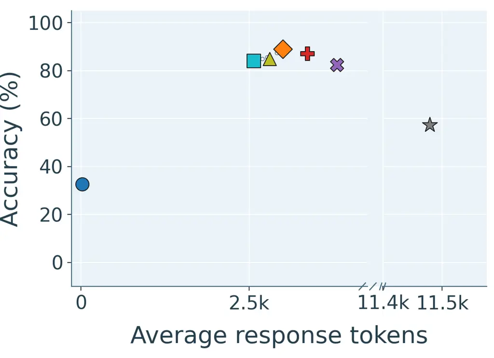

(a) ID

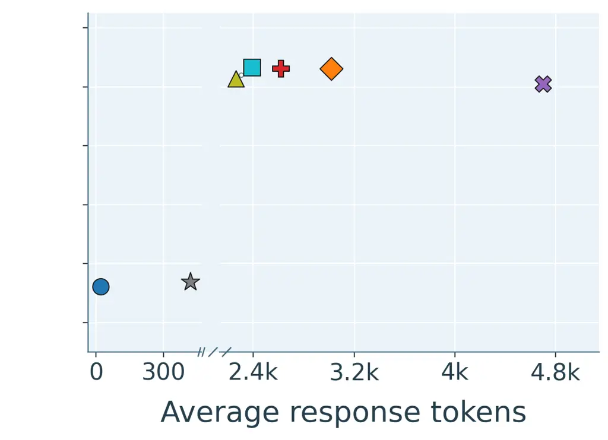

(b) Target-range shift

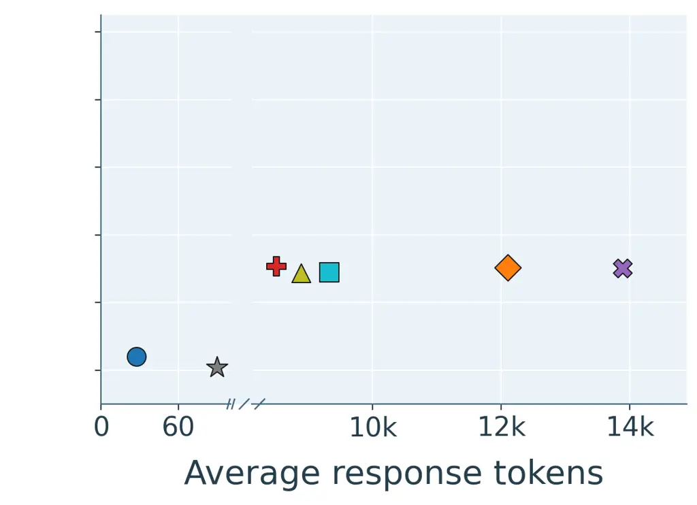

(c) Search-depth shift

Figure 7: Qwen3-4B Pareto plot: accuracy vs. mean response length
comparison on countdown domain test datasets for $`\alpha`$-masked
variants, teacher (base think) and student (base no-think).

Figure 7 shows the Pareto plot for Qwen3-4B on the countdown test sets
for all baselines. The $`\alpha`$-masked variants
($`\alpha\in\{0.3,0.5,0.7\}`$) reach the same level of accuracy as the
teacher on every countdown test set. On the in-distribution and
target-shift sets, however, they save only a few hundred tokens relative
to the teacher, and on the search-depth-shift set they produce more
tokens than the teacher. This may be due to the mode-seeking behavior of
the reverse-KL objective discussed in Section 5.1.

### D.2 Qwen3-4B Results

Tables 2 and 3 report the accuracy and mean response length for all
$`\alpha`$-masked variants, together with the base student and teacher
models, on the math and graph-coloring test datasets, respectively.

|         | Masked fraction |                |                |               |                | Base          |               |
| ------- | --------------- | -------------- | -------------- | ------------- | -------------- | ------------- | ------------- |
| Dataset | 100%            | 70%            | 50%            | 30%           | 0%             | think         | no-think      |
| GSM8K   | 91.4\_(±0.5)    | 92.9\_(±0.4)   | 92.8\_(±0.2)   | 92.7\_(±0.5)  | 93.5\_(±0.5)   | 94.2\_(±0.1)  | 86.1\_(±0.4)  |
|         | 302\_(±3)       | 1124\_(±12)    | 1536\_(±71)    | 1961\_(±78)   | 1061\_(±79)    | 2332\_(±27)   | 258\_(±2)     |
| MATH500 | 74.1\_(±1.0)    | 75.9\_(±1.0)   | 75.7\_(±0.1)   | 74.9\_(±1.1)  | 78.9\_(±0.1)   | 76.9\_(±0.3)  | 75.2\_(±0.7)  |
|         | 763\_(±29)      | 3080\_(±125)   | 3671\_(±61)    | 4722\_(±557)  | 3340\_(±146)   | 5137\_(±214)  | 1051\_(±34)   |
| AIME25  | 17.8\_(±1.9)    | 44.4\_(±1.9)   | 51.1\_(±1.9)   | 54.4\_(±6.9)  | 46.7\_(±3.3)   | 61.1\_(±5.1)  | 18.9\_(±1.9)  |
|         | 1609\_(±116)    | 13146\_(±1500) | 13730\_(±1206) | 14673\_(±154) | 12598\_(±2081) | 18190\_(±840) | 5552\_(±1560) |

Table 2: Qwen3-4B, math domain: accuracy and mean token length for each
masked fraction, trained on GSM8K. Each entry is the mean over 3 random
seeds, with the sample standard deviation in the subscript. Accuracy (%)
is on the first line; the smaller line is mean response length in
tokens. Bold marks the highest accuracy in each row; underline marks the
shortest mean response.

|                                                     | Masked fraction |              |              |              |               | Base          |              |
| --------------------------------------------------- | --------------- | ------------ | ------------ | ------------ | ------------- | ------------- | ------------ |
| Dataset                                             | 100%            | 70%          | 50%          | 30%          | 0%            | think         | no-think     |
| $`\mathrm{GC}`$-$`\mathrm{ER}_{\chi_{3\text{-}4}}`$ | 11.5\_(±0.3)    | 97.5\_(±1.0) | 97.0\_(±0.7) | 95.8\_(±1.1) | 92.3\_(±0.6)  | 91.9\_(±0.6)  | 29.2\_(±1.4) |
|                                                     | 67\_(±0)        | 3274\_(±129) | 3772\_(±115) | 4112\_(±129) | 6369\_(±120)  | 6185\_(±237)  | 1576\_(±85)  |
| $`\mathrm{GC}`$-$`\mathrm{ER}_{\chi_{6}}`$          | 10.5\_(±0.2)    | 79.5\_(±1.5) | 75.5\_(±0.7) | 71.1\_(±1.5) | 46.7\_(±1.6)  | 45.4\_(±2.5)  | 13.7\_(±2.1) |
|                                                     | 66\_(±3)        | 6906\_(±196) | 7986\_(±389) | 9384\_(±344) | 12439\_(±487) | 15489\_(±643) | 1254\_(±166) |
| $`\mathrm{GC}`$-$`\mathrm{BA}_{\chi_{6}}`$          | 10.6\_(±0.3)    | 88.3\_(±1.0) | 89.9\_(±1.3) | 87.3\_(±1.9) | 65.7\_(±1.8)  | 62.1\_(±2.6)  | 18.4\_(±1.9) |
|                                                     | 115\_(±36)      | 5185\_(±135) | 5410\_(±152) | 5942\_(±382) | 10186\_(±366) | 12134\_(±298) | 1566\_(±445) |

Table 3: Qwen3-4B, graph coloring domain: accuracy and mean token length
for each masked fraction, trained on
$`\mathrm{GC}`$-$`\mathrm{ER}_{\chi_{3\text{-}4}}`$. Each entry is the
mean over 3 random seeds, with the sample standard deviation in the
subscript. Accuracy (%) is on the first line; the smaller line is mean
response length in tokens. Bold marks the highest accuracy in each row;
underline marks the shortest mean response.

### D.3 Qwen3-8B Results

Tables 4 and 5 report the accuracy and mean response length for all
$`\alpha`$-masked variants, together with the base student and teacher
models, on the math and graph-coloring test datasets, respectively.

|         | Masked fraction |               |                |               |                | Base          |               |
| ------- | --------------- | ------------- | -------------- | ------------- | -------------- | ------------- | ------------- |
| Dataset | 100%            | 70%           | 50%            | 30%           | 0%             | think         | no-think      |
| GSM8K   | 92.8\_(±0.1)    | 94.0\_(±0.2)  | 94.5\_(±0.1)   | 93.9\_(±0.5)  | 95.0\_(±0.3)   | 94.6\_(±0.2)  | 80.7\_(±0.4)  |
|         | 302\_(±1)       | 1429\_(±30)   | 1884\_(±45)    | 2141\_(±91)   | 1109\_(±12)    | 2402\_(±6)    | 266\_(±2)     |
| MATH500 | 74.9\_(±0.2)    | 73.5\_(±0.8)  | 76.3\_(±0.4)   | 76.3\_(±0.1)  | 73.4\_(±1.4)   | 77.5\_(±0.1)  | 73.8\_(±2.5)  |
|         | 805\_(±37)      | 4472\_(±365)  | 4249\_(±77)    | 4619\_(±42)   | 3348\_(±64)    | 5355\_(±116)  | 1181\_(±120)  |
| AIME25  | 21.1\_(±1.9)    | 45.6\_(±8.4)  | 56.7\_(±3.3)   | 62.2\_(±3.8)  | 41.1\_(±13.5)  | 61.1\_(±1.9)  | 18.9\_(±1.9)  |
|         | 1848\_(±561)    | 13587\_(±746) | 14989\_(±1333) | 16322\_(±297) | 10924\_(±1271) | 17274\_(±752) | 4121\_(±1077) |

Table 4: Qwen3-8B, math domain: accuracy and mean token length for each
masked fraction, trained on GSM8K. Each entry is the mean over 3 random
seeds, with the sample standard deviation in the subscript. Accuracy (%)
is on the first line; the smaller line is mean response length in
tokens. Bold marks the highest accuracy in each row; underline marks the
shortest mean response.

|                                                     | Masked fraction |              |              |               |               | Base          |              |
| --------------------------------------------------- | --------------- | ------------ | ------------ | ------------- | ------------- | ------------- | ------------ |
| Dataset                                             | 100%            | 70%          | 50%          | 30%           | 0%            | think         | no-think     |
| $`\mathrm{GC}`$-$`\mathrm{ER}_{\chi_{3\text{-}4}}`$ | 22.1\_(±0.5)    | 98.5\_(±0.6) | 98.5\_(±0.8) | 97.6\_(±0.5)  | 94.3\_(±1.0)  | 95.5\_(±0.3)  | 33.2\_(±1.8) |
|                                                     | 62\_(±0)        | 3650\_(±123) | 3766\_(±233) | 4277\_(±196)  | 5253\_(±69)   | 5752\_(±131)  | 1149\_(±28)  |
| $`\mathrm{GC}`$-$`\mathrm{ER}_{\chi_{6}}`$          | 13.0\_(±0.1)    | 80.4\_(±1.0) | 85.6\_(±0.6) | 78.3\_(±2.2)  | 54.4\_(±1.9)  | 64.4\_(±2.5)  | 13.5\_(±0.5) |
|                                                     | 211\_(±25)      | 9598\_(±405) | 8289\_(±181) | 10224\_(±691) | 11855\_(±266) | 14434\_(±12)  | 1217\_(±23)  |
| $`\mathrm{GC}`$-$`\mathrm{BA}_{\chi_{6}}`$          | 15.2\_(±0.9)    | 91.4\_(±0.9) | 93.3\_(±1.0) | 91.3\_(±0.4)  | 76.5\_(±1.9)  | 81.5\_(±0.4)  | 18.4\_(±1.9) |
|                                                     | 198\_(±27)      | 6304\_(±227) | 5509\_(±164) | 6148\_(±241)  | 8470\_(±290)  | 10298\_(±288) | 1145\_(±22)  |

Table 5: Qwen3-8B, graph coloring domain: accuracy and mean token length
for each masked fraction, trained on
$`\mathrm{GC}`$-$`\mathrm{ER}_{\chi_{3\text{-}4}}`$. Each entry is the
mean over 3 random seeds, with the sample standard deviation in the
subscript. Accuracy (%) is on the first line; the smaller line is mean
response length in tokens. Bold marks the highest accuracy in each row;
underline marks the shortest mean response.

### D.4 Out-of-Domain Qwen3-4B Results


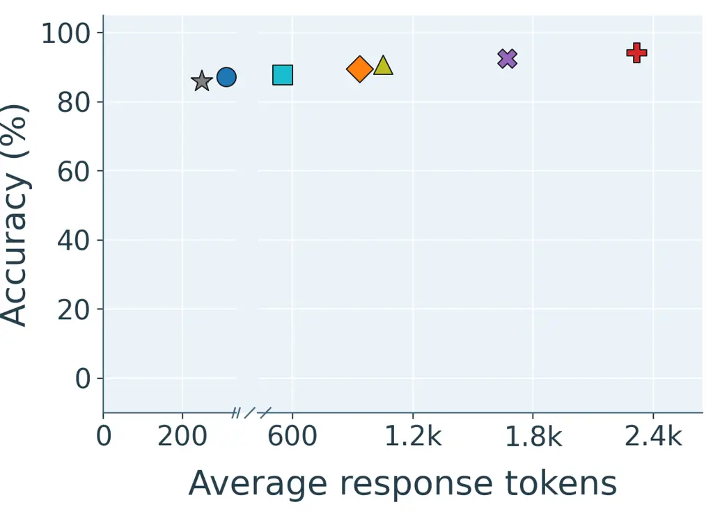

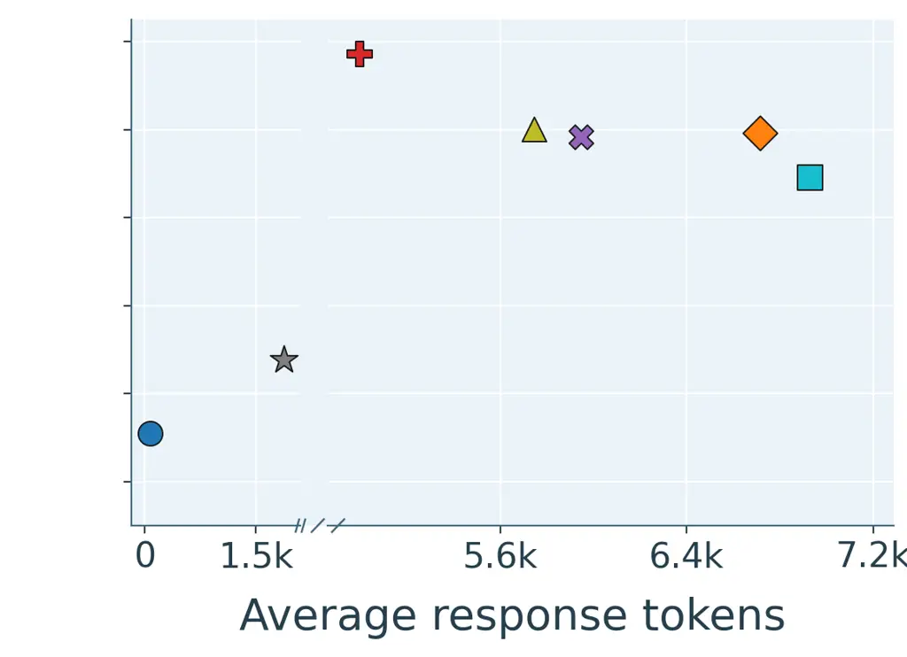

Figure 8: Out-of-domain Qwen3-4B Pareto plots: (left) graph coloring
models evaluated on the GSM8K test set and (right) GSM8K models
evaluated on $`\mathrm{GC}`$-$`\mathrm{ER}_{\chi_{3-4}}`$ test set.

Figure 8 shows out-of-domain evaluation for Qwen3-4B models, together
with the base student and teacher model. The results are pretty similar
to the Qwen3-8B out-of-domain results. The models trained on the graph
coloring domain retain their inference cost savings even on the GSM8K
test dataset. However, the models trained on the GSM8K dataset have
slightly lower performance on the
$`\mathrm{GC}`$-$`\mathrm{ER}_{\chi_{3-4}}`$ test set compared to the
base teacher model and also produce more tokens.

## Appendix E Response length distributions

In the Pareto plots, to compare the inference efficiency of each
baseline, we use the mean response length. However, the mean alone does
not provide the full picture of how the model’s response lengths are
distributed across the entire test set. A high mean response length can
arise either because the model consistently generates long responses
across the test set or because it generates very long responses for only
a small fraction of problems. In other words, the response-length
distribution can exhibit either unimodal or bimodal behavior. To examine
this, we plot violin plots, which combine a box plot with a kernel
density estimate and therefore show the overall shape of the
response-length distribution.

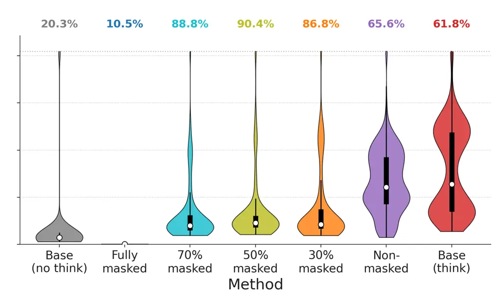

Figure 9: Violin Plot

Figure 9 shows the violin plots for all baselines on the graph-coloring
OOD-BA test set under a maximum token budget of 32k. From the figure, we
can see that the teacher and the non-masked variant exhibit clear
bimodal response-length distributions and produce responses with a
median length of approximately 10k tokens. In contrast, the
$`\alpha`$-masked variants ($`\alpha\in{0.3,0.5,0.7}`$) exhibit a
largely uni-modal distribution with a median response length of
approximately 3k tokens. This suggests that, by internalizing a fraction
of the reasoning trace, the masked variants learn to generate shorter
responses more consistently across the test set. Figures 10 and 11 show
the violin plots for all domain test datasets for Qwen3-4B and Qwen3-8B
respectively.


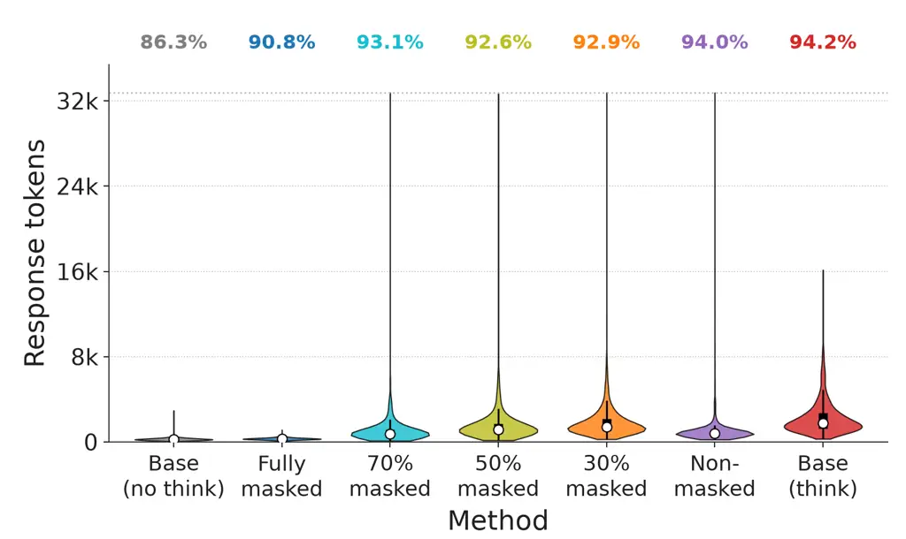

(a) GSM8K

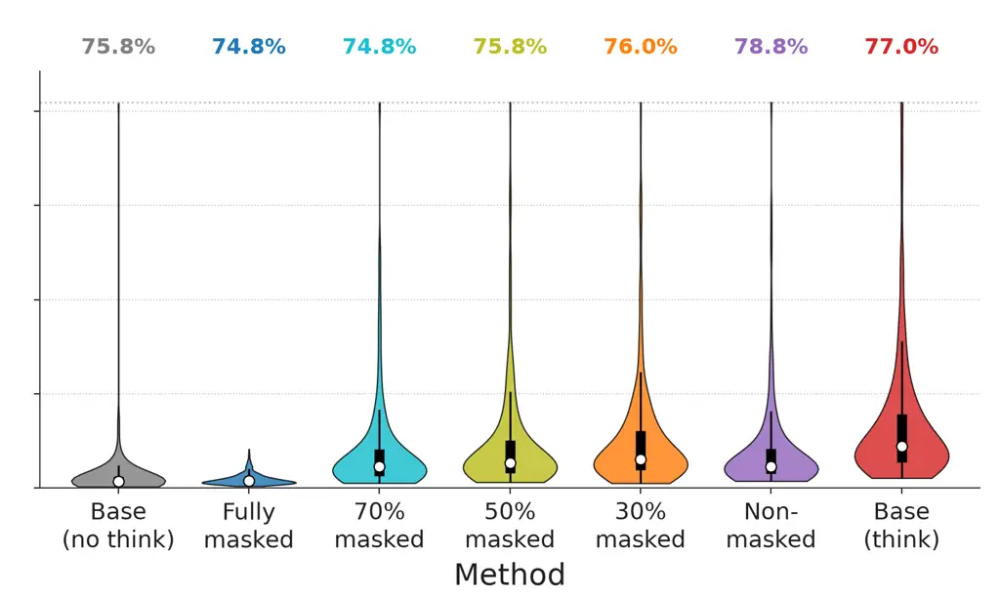

(b) MATH-500

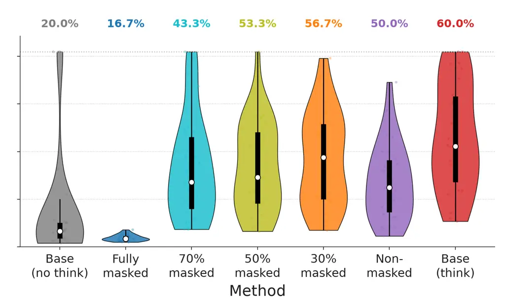

(c) AIME25

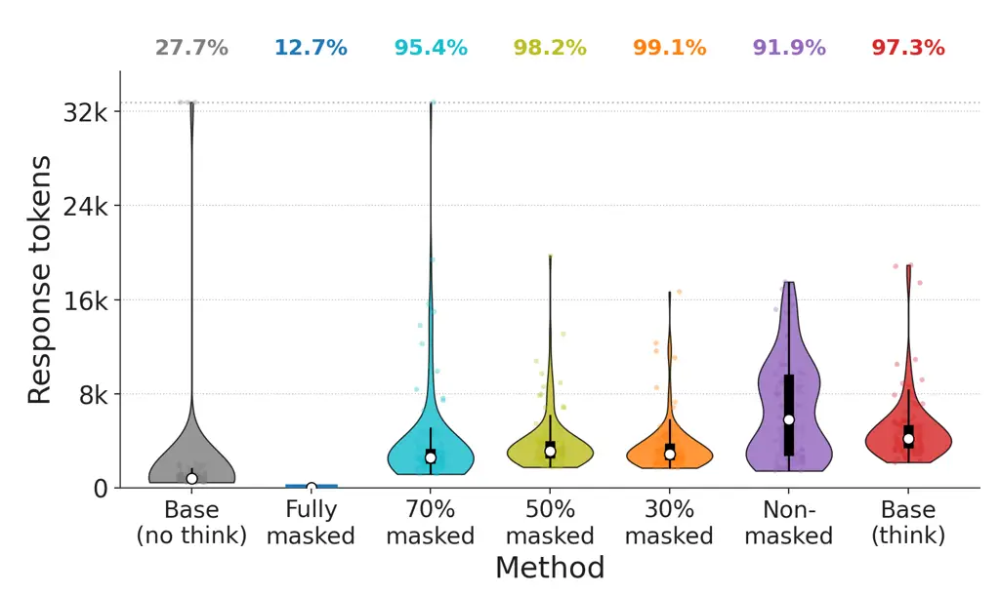

(d) $`\mathrm{GC}`$-$`\mathrm{ER}_{\chi_{3-4}}`$

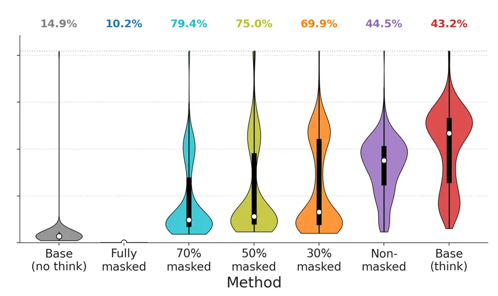

(e) $`\mathrm{GC}`$-$`\mathrm{ER}_{\chi_{6}}`$


(f) $`\mathrm{GC}`$-$`\mathrm{BA}_{\chi_{6}}`$

Figure 10: Qwen3-4B Violin plot: Token distribution comparison on math
(top row), graph-coloring (middle row) and countdown (bottom row) domain
test datasets for $`\alpha`$-masked variants, teacher (base think) and
student (base no-think).


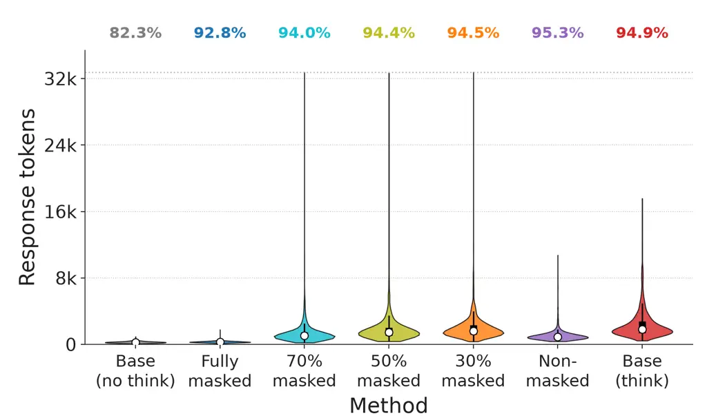

(a) GSM8K

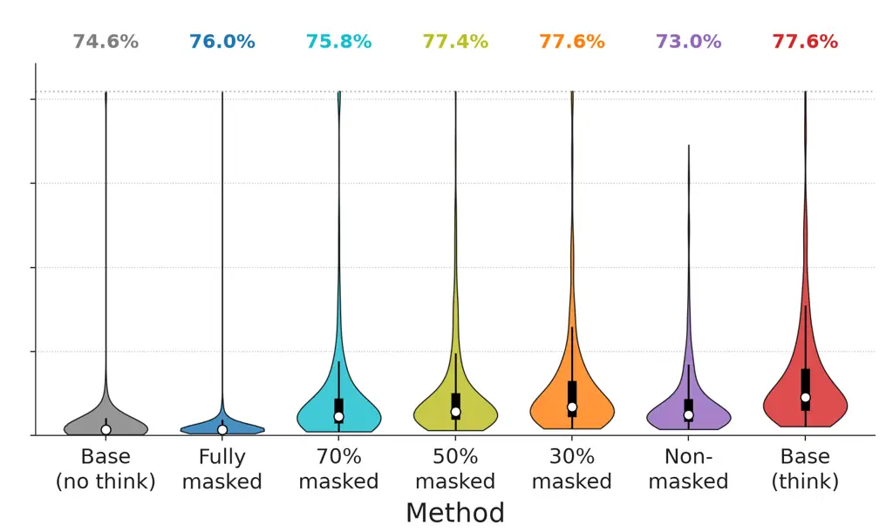

(b) MATH-500

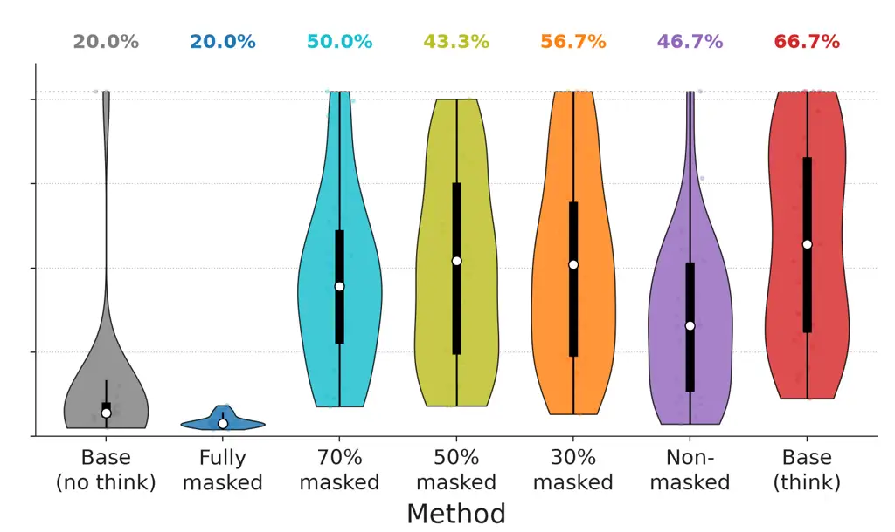

(c) AIME25

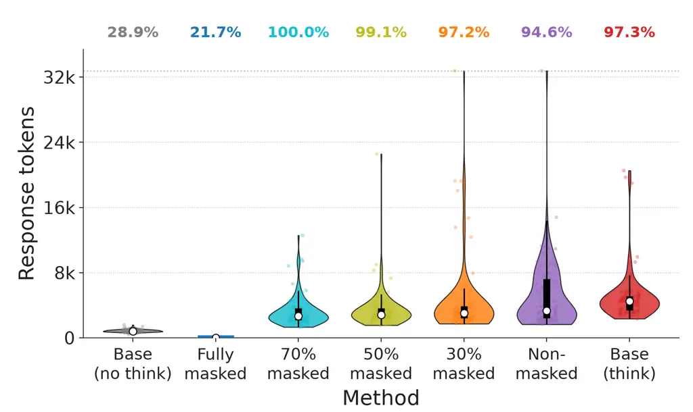

(d) $`\mathrm{GC}`$-$`\mathrm{ER}_{\chi_{3-4}}`$

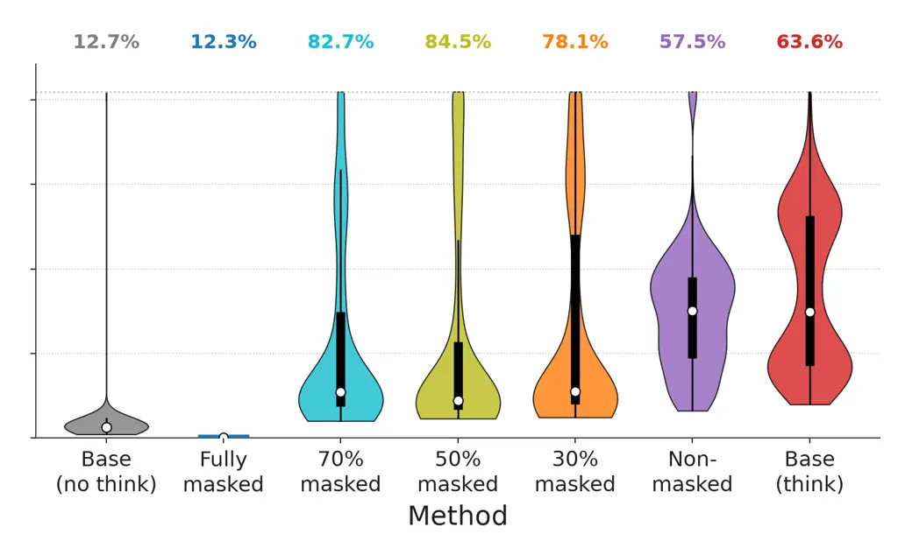

(e) $`\mathrm{GC}`$-$`\mathrm{ER}_{\chi_{6}}`$

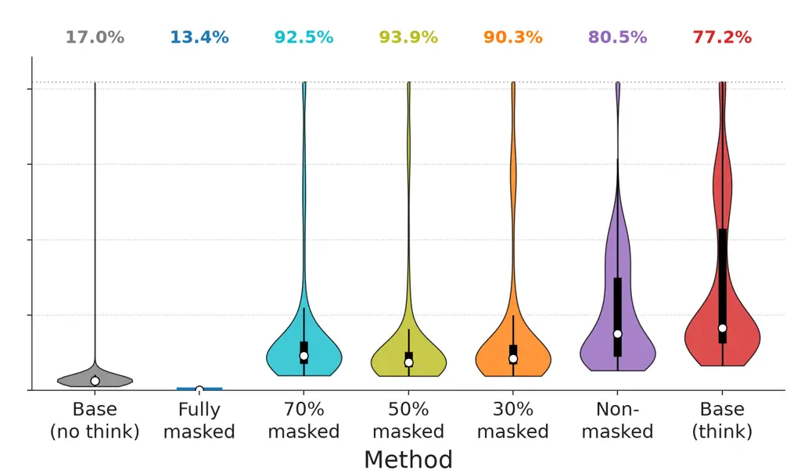

(f) $`\mathrm{GC}`$-$`\mathrm{BA}_{\chi_{6}}`$

Figure 11: Qwen3-8B Violin plot: Token distribution comparison on math
(top row), graph-coloring (middle row) and countdown (bottom row) domain
test datasets for $`\alpha`$-masked variants, teacher (base think) and
student (base no-think).

## Appendix F Prompt format and the responses of masked self distilled models

We show a $`\mathrm{GC}`$-$`\mathrm{ER}_{\chi_{3-4}}`$ test instance
prompt and responses of every masked self-distilled variant. We can see
that the non-masked variant produces a response that is very similar to
the teacher. However, the responses of models trained with
$`\alpha\in\{0.3,0.5,0.7\}`$ seem disconnected, as if beginning from an
intermediate point in the reasoning rather than from the start.

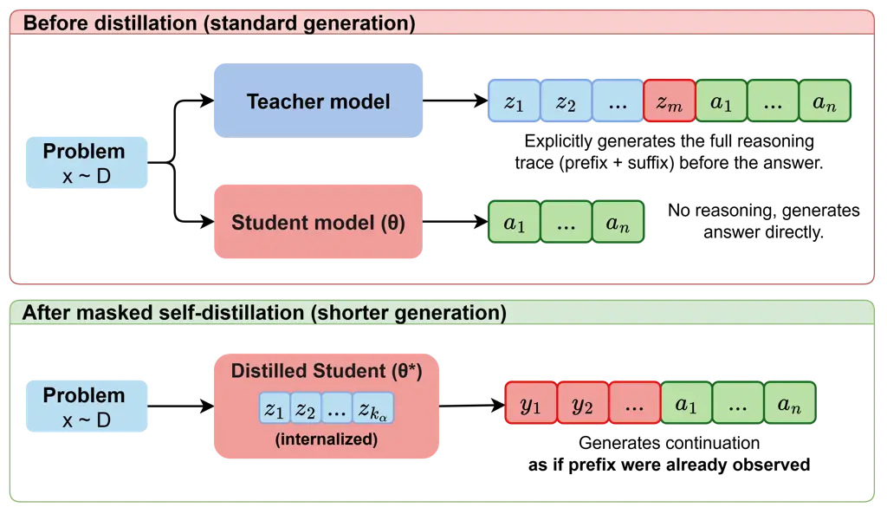

Figure 12: Illustration of standard generation before distillation and
shorter generation after masked self-distillation.


## Appendix G Qualitative analysis of masked-self distillation variants’ traces


Figure 13: Prompt used for the LLM-judge coherence audit. The judge is
shown only the question and the trace

We perform a qualitative analysis of traces generated by the Qwen3-8B
model and its $`\alpha`$-masked variants on the
$`\mathrm{GC}`$-$`\mathrm{ER}_{\chi_{3-4}}`$ test set. To check whether
the student-generated traces start abruptly, as if continuing a
partially done calculation, we perform an LLM-as-a-judge analysis where
we provide the question and the reasoning trace to a coherence audit
judge. The judge examines the trace and returns the following: (1)
Abrupt start: whether the opening sentence reads as a continuation of an
unstated thought rather than a self-contained start. (2) Coherence
score: Measuring the coherence of the entire trace. (3) Dangling
reference: whether in the opening sentences of the trace, there are
reference terms that have no prior antecedent within the trace. We
report the coherence audit judge prompt in Figure 13.

We use GPT-5-Mini in low reasoning mode as our coherence audit judge. We
report our results in Table 6. We see that the audit judge correctly
scores the teacher-generated responses and 0% masked model responses as
coherent, with no abrupt starts and dangling references. However, the
judge consistently flags the traces generated by the $`\alpha`$ masked
traces as abrupt, incoherent, and having missing references. These
preliminary qualitative results suggest that the student models
internalize the computations present in the $`\alpha`$ fraction of the
teacher’s trace and learn to generate a shorter trace.

| Metric                     | Base (think) | 0% masked | 30% masked | 50% masked | 70% masked |
| -------------------------- | ------------ | --------- | ---------- | ---------- | ---------- |
| Abrupt-start rate          | 0.00         | 0.00      | 0.94       | 1.00       | 1.00       |
| Mean coherence score (1–5) | 5.00         | 5.00      | 2.09       | 1.42       | 1.29       |
| Dangling-reference rate    | 0.00         | 0.00      | 0.24       | 0.91       | 0.90       |

Table 6: LLM-judge coherence analysis of traces generated by the
Qwen3-8B model (teacher) and its $`\alpha`$ masked variants trained on
the graph coloring ID test set
