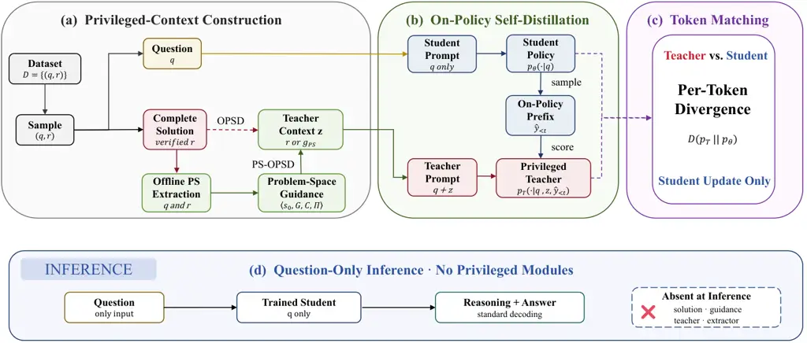

# Is More Privileged Information Better? From Solution Traces to Problem-Solving Structure in Self-Distilled Reasoning

Xuyang Zhao    Liting Zhang    Zichen Xu    Zhihu Wang    Xu Caiyue   
Shiwan Zhao\corresponding    Qicheng Li\corresponding

###### Abstract

On-policy self-distillation (OPSD) improves reasoning by using a
privileged view of a model conditioned on reference solutions to
supervise a student view that observes only the question. However, the
teacher-provided token-level targets may depend on reference-specific
information unavailable at inference time. We propose
Problem-Space-Guided OPSD (PS-OPSD), which replaces the complete
solution with trajectory-grounded guidance describing the initial state,
goal conditions, constraints, and a selected state-transition path. The
student rollout and OPSD objective remain unchanged. Across three
mathematical reasoning benchmarks and model scales ranging from 1.7B to
8B, PS-OPSD achieves the highest aggregate question-only accuracy among
the compared methods. Controlled experiments further indicate that
guidance relevance and path coherence contribute to these gains,
highlighting the representation of privileged information as an
important design choice in OPSD.

¹TMCC, College of Computer Science, Nankai University, Tianjin, China

²Huawei Technologies Ltd., Beijing, China

xychao@mail.nankai.edu.cn, liqicheng@nankai.edu.cn, zhaosw@gmail.com

## 1 Introduction

On-policy self-distillation offers an appealing approach to dense
supervision for reasoning. A student generates its own trajectory, while
a privileged view of the same model, conditioned on a verified reference
solution, provides next-token supervision along the student-generated
prefixes (Agarwal et al. 2024; Zhao et al. 2026a). Supervision is
therefore applied at states the student actually visits, reducing the
mismatch between training prefixes and those encountered during
question-only inference. Because the privileged teacher is another view
of the same model, this framework also avoids reliance on a separate,
permanently stronger external teacher.

However, its training and deployment interfaces are asymmetric. During
training, the privileged teacher has access to a complete reference
solution, whereas the deployed student must reason from the question
alone. A complete solution can make the teacher highly informative, but
informativeness does not necessarily imply transferability. The
reference solution ties reusable mathematical relations to a particular
final answer, reasoning order, wording, and set of instance-specific
calculations. Consequently, the teacher’s token-level targets may depend
on information that the student cannot recover from its question-only
input at inference time.

Recent analyses of on-policy and privileged self-distillation reinforce
this concern. Teacher choice, information asymmetry, and token-level
teachability can substantially affect what is transferred to a
question-only student (Zhu et al. 2026; Kaur et al. 2026; Kim et al.
2026; Shen et al. 2026). Recent work also reports a concrete behavioral
symptom: models trained with OPSD may explicitly refer to reference
solutions, answer keys, or hints that are unavailable in their
question-only input (Yang et al. 2026). Such behavior does not by itself
establish all forms of privileged-information dependence, but it
suggests that conditioning the teacher on a complete reference may
introduce reference-specific dependencies that do not transfer cleanly
to question-only inference. This raises a representation question that
precedes the design of the distillation loss:

> _What privileged information should the teacher observe?_

We address this question through the classical problem-space view of
problem solving, which characterizes a task in terms of an initial
state, goal conditions, applicable operators, and constraints on valid
state transitions (Newell and Simon 1972; Fikes and Nilsson 1971).
Theories of relational transfer further suggest that structural
relations are more reusable than the surface form through which a
particular solution instantiates them (Gentner 1983; Gick and Holyoak
1983). Together, these perspectives motivate representing privileged
information not as a complete reference trace, but as the
problem-solving structure realized along a verified solution trajectory.

We do not attempt to reconstruct the full problem space, which would
require enumerating all reachable states, admissible operators, and
alternative solution paths. Instead, for each problem–solution pair, we
extract the portion instantiated by the verified reference trajectory.
The resulting representation, which we call Problem-Space Guidance,
records the Initial State, Goal Conditions, Constraints, and a Selected
State-Transition Path. Each transition specifies an Operator, its
Preconditions, the induced Transformation, and the Resulting State. This
representation remains grounded in a valid solution while emphasizing
functional state changes over trace-specific wording, ordering, and
arithmetic details.

Based on this representation, we propose Problem-Space-Guided On-Policy
Self-Distillation (PS-OPSD). An offline extractor first transforms each
verified reference solution into Problem-Space Guidance. Within the OPSD
training loop, PS-OPSD modifies only the privileged teacher context: the
student continues to generate question-only on-policy trajectories, and
the token-level distillation objective remains unchanged. At inference
time, the trained student reasons from the question alone, without
access to the reference solution, extracted guidance, privileged
teacher, or extractor. Figure 1 summarizes the training and inference
interfaces.



Figure 1: PS-OPSD replaces a complete-solution teacher context with
explicit, trajectory-grounded problem-space guidance. OPSD conditions
the privileged teacher on the full reference solution, whereas PS-OPSD
extracts an initial state, goal conditions, constraints, and a selected
state-transition path whose steps specify operators, preconditions,
transformations, and resulting states. In both settings, the
question-only student generates on-policy prefixes and receives the same
token-level OPSD distribution-matching objective. At inference time, the
trained student observes only the question; the reference solution,
guidance, teacher, and extractor are absent.

We evaluate PS-OPSD using Qwen3 models at three scales, from 1.7B to 8B
parameters, on three competition-level mathematical reasoning
benchmarks. Across all three scales, PS-OPSD achieves the highest
aggregate question-only accuracy among the compared methods. Controlled
representation variants further investigate the roles of guidance
relevance, explicit field structure, and state-transition coherence. We
additionally analyze teacher-input exposure and downstream question-only
behavior to better understand how the representation of privileged
information affects self-distillation.

Our main contributions are:

- •
  We formulate privileged-context design in same-model on-policy
  self-distillation as a transfer problem and introduce
  trajectory-grounded Problem-Space Guidance.
- •
  We develop PS-OPSD, which replaces complete reference solutions in the
  privileged teacher context with structured guidance while leaving the
  student rollout and token-level distillation objective unchanged.
- •
  We evaluate PS-OPSD across three model scales and three mathematical
  reasoning benchmarks, and use representation controls and behavioral
  diagnostics to examine which properties of privileged guidance
  contribute to its effectiveness.

## 2 Related Work

#### On-policy distillation and self-distillation.

Knowledge distillation transfers teacher predictions through soft
targets or teacher-generated sequences (Hinton et al. 2015; Kim and Rush
2016). When those targets are evaluated only on fixed trajectories,
training prefixes can diverge from states visited by the student at
inference time, a general sequential-learning problem studied by
scheduled sampling and learner-state imitation (Bengio et al. 2015; Ross
et al. 2011). Generalized Knowledge Distillation moves supervision onto
student-generated sequences and supports forward- or reverse-KL targets
(Agarwal et al. 2024). For mathematical reasoning, GRPO instead supplies
sequence-level verifiable rewards on sampled trajectories (Shao et al.
2024). Process reward models provide denser feedback over intermediate
reasoning steps, but require separate step-level supervision or reward
modeling (Lightman et al. 2024). OPSD combines dense on-policy
supervision with a same-model teacher: the student generates from the
question, while a privileged teacher reads a verified solution and
scores the student’s prefixes (Zhao et al. 2026a). Our work keeps this
OPSD mechanism fixed and studies the representation of the privileged
context.

#### Privileged information and transferability.

Training-only privileged information can improve a deployment-time
predictor, and its connection to distillation has long been recognized
(Vapnik and Vashist 2009; Lopez-Paz et al. 2016); its utility
nevertheless depends on whether the learner can internalize what the
privileged view reveals (Penaloza et al. 2026). Recent analyses of
on-policy self-distillation sharpen this concern for reasoning models.
Instance-specific context, incompatible teacher behavior, and locally
unteachable token preferences can weaken or reverse transfer (Zhu et al.
2026; Kaur et al. 2026; Wang et al. 2026). Other work reports that rich
solution context may suppress useful epistemic behavior or inject
reference-specific shortcut signal (Kim et al. 2026; Shen et al. 2026).
AVSD addresses view dependence by combining full-solution,
partial-solution, and answer-only teachers into consensus and gated
residual signals (Nguyen et al. 2026). In contrast, we ask whether a
single teacher view can be redesigned around problem-solving relations
before distillation.

#### Solution-derived plans and scaffolds.

Several methods transform, filter, or operationalize solution traces.
Studies of chain-of-thought distillation similarly find that rationale
organization and compression affect transferred reasoning behavior (Chen
et al. 2025; Luo et al. 2025). PAINT adapts how much of a solution is
exposed and interpolates privileged energy at selected token positions
(Tan and Hong 2026). Adaptive Teacher Exposure learns a controller that
selects how much of a reference prefix to reveal during
self-distillation (Han et al. 2026). OPHSD uses a dynamic plan–solve
harness to generate assisted behavior and distills that behavior into an
unassisted model (Zhao et al. 2026b). SORT uses a reference-derived plan
to weight tokens in off-policy repair for all-wrong GRPO groups, while
HiLL learns failure-conditioned hints that alter the reasoner’s online
RL input (Le et al. 2026; Xia et al. 2026). Outside unchanged OPSD,
SuperCorrect extracts hierarchical thought templates for critique and
correction, while Reasoning Scaffolding predicts semantic reasoning
signals alongside solution steps (Yang et al. 2024; Wen et al. 2025).
These methods establish that solution abstraction and procedural
scaffolding are not new by themselves. Our narrower contribution is a
fixed offline state-transition representation, rather than an adaptive
reference-prefix exposure policy, used only as teacher context with the
student rollout and OPSD objective held unchanged.

## 3 Problem-Space-Guided OPSD

### OPSD Preliminaries

Let $`q`$ be a problem and $`r`$ a verified reference solution. A
question-only student samples a reasoning trajectory

```math
\hat{y}\sim p_{\theta}(\cdot\mid q). \tag{1}
```

At token $`t`$, OPSD queries a privileged view of the same model on the
student-generated prefix $`\hat{y}_{<t}`$. OPSD conditions that view on
the complete solution, $`p_{T}(\cdot\mid q,r,\hat{y}_{<t})`$, and
matches the student distribution to the resulting token-level target
(Zhao et al. 2026a). The student therefore remains on-policy even though
the teacher receives information unavailable at inference time.

### Explicit Problem-Space Guidance

Following classical problem-space accounts (Newell and Simon 1972; Fikes
and Nilsson 1971), we represent a mathematical problem $`q`$
conceptually as

```math
\mathfrak{P}(q)=\langle S,s_{0},O,G,C\rangle. \tag{2}
```

Here, $`S`$ is the state space, $`s_{0}`$ the Initial State, $`O`$ the
admissible operators, and $`G`$ the Goal Conditions; $`C`$ is a
mathematics-specific extension for domain restrictions, global
invariants, and validity conditions.

Equation 2 is conceptual and is not constructed by PS-OPSD. Because
enumerating $`S`$ and $`O`$ is generally impractical and one reference
solution $`r`$ reveals only a single realized trajectory, an offline
extractor serializes the teacher guidance as

```math
g_{\mathrm{PS}}(q,r)=\langle s_{0},G,C,\pi\rangle. \tag{3}
```

Figure 2: Offline Problem-Space Guidance extraction for a symbolic
rate-composition problem. The complete verified solution is abbreviated;
the four-field output records global problem information and a selected
transition path while omitting an instantiated final answer.

 

 

|     |                                                                                                                                                           |
| --- | --------------------------------------------------------------------------------------------------------------------------------------------------------- | ------- | ----- |
|     | Input: Dataset $`\mathcal{D}=\{(q_{i},r_{i})\}_{i=1}^{N}`$; fixed teacher $`p_{T}`$; student $`p_{\theta}`$; temperature $`T`$; clipping threshold $`c`$. |
| 1   | Offline extraction: Cache $`g_{i}\leftarrow g_{\mathrm{PS}}(q_{i},r_{i})`$ for every $`(q_{i},r_{i})\in\mathcal{D}`$.                                     |
| 2   | repeat                                                                                                                                                    |
| 3   | Sample a minibatch $`\mathcal{B}\subset\{(q_{i},g_{i})\}_{i=1}^{N}`$.                                                                                     |
| 4   | for each $`(q,g)\in\mathcal{B}`$ do                                                                                                                       |
| 5   | Sample an on-policy trajectory $`\hat{y}\sim p_{\theta}(\cdot\mid q)`$.                                                                                   |
| 6   | for $`t=1,\ldots,                                                                                                                                         | \hat{y} | `$ do |
| 7   | Evaluate $`p_{T,t}^{\mathrm{PS}}=p_{T}(\cdot\mid q,g,\hat{y}_{<t})`$.                                                                                     |
| 8   | Evaluate $`p_{\theta,t}=p_{\theta}(\cdot\mid q,\hat{y}_{<t})`$.                                                                                           |
| 9   | end for                                                                                                                                                   |
| 10  | Compute the mean clipped-KL loss $`\ell(q,g)`$ over the trajectory.                                                                                       |
| 11  | end for                                                                                                                                                   |
| 12  | Update only $`\theta`$ using the minibatch mean loss; keep $`p_{T}`$ and the cached guidance fixed.                                                       |
| 13  | until the training budget is exhausted.                                                                                                                   |
|     | Output: Trained question-only student $`p_{\theta}(\cdot\mid q)`$.                                                                                        |

 

List of algorithms 1 PS-OPSD Procedure

Leaving $`S`$ and $`O`$ implicit, the selected path
$`\pi=(\tau_{1},\ldots,\tau_{k})`$ contains only transition records
derived from $`r`$. Each transition is serialized as

```math
\tau_{i}=(o_{i},\mathrm{pre}_{i},\mathrm{transform}_{i},s_{i}). \tag{4}
```

Given the top-level Initial State $`s_{0}`$, each $`\tau_{i}`$ records
one subsequent transition: $`o_{i}`$ names the Operator selected from
the conceptual set $`O`$, $`\mathrm{pre}_{i}`$ states its local
Preconditions in $`s_{i-1}`$, $`\mathrm{transform}_{i}`$ describes the
induced change, and $`s_{i}`$ records the Resulting State. Under the
intended semantics, the states $`s_{0},\ldots,s_{k}`$ respect the global
Constraints $`C`$, and the terminal state $`s_{k}`$ meets the Goal
Conditions $`G`$.

Accordingly, Problem-Space Guidance uses four top-level fields:

> Initial State: variables, entities, givens, and relations.  
> Goal Conditions: target and verifiable success conditions.  
> Constraints: invariants, domains, and validity conditions.  
> Selected State-Transition Path: an ordered list of Operator,
> Preconditions, Transformation, and Resulting State records.

Figure 2 illustrates how a question and complete verified solution are
transformed into this serialization for a symbolic rate-composition
problem. The first three fields specify global problem information,
while the final field records a reference-derived sequence of local
transitions.

Algorithm 1 summarizes the complete procedure. The extraction stage is
performed once before training; the cached guidance is used only by the
teacher, which scores the same prefixes generated and evaluated by the
student.

### Training and Question-Only Inference

PS-OPSD replaces $`r`$ in the privileged teacher context with
$`g_{\mathrm{PS}}(q,r)`$ while leaving the question-only student
unchanged:

```math
\displaystyle p_{T,t}^{\mathrm{OPSD}} \displaystyle=p_{T}(\cdot\mid q,r,\hat{y}_{<t}), \tag{5}
```

```math
\displaystyle p_{T,t}^{\mathrm{PS}} \displaystyle=p_{T}(\cdot\mid q,g_{\mathrm{PS}}(q,r),\hat{y}_{<t}),
```

```math
\displaystyle p_{\theta,t} \displaystyle=p_{\theta}(\cdot\mid q,\hat{y}_{<t}).
```

We treat $`p_{T}`$ as a fixed target distribution and optimize only the
student parameters $`\theta`$. For distributions with logits $`z_{p}`$
and $`z_{q}`$, define the implemented coordinate-clipped KL-form
objective as

```math
\displaystyle p^{(T)} \displaystyle=\operatorname{softmax}(z_{p}/T), \tag{6}
```

```math
\displaystyle q^{(T)} \displaystyle=\operatorname{softmax}(z_{q}/T),
```

```math
\displaystyle d_{T}(p,q;v) \displaystyle=p^{(T)}(v)\log\frac{p^{(T)}(v)}{q^{(T)}(v)},
```

```math
\displaystyle\widetilde{D}_{c,T}(p\|q) \displaystyle=\sum_{v\in\mathcal{V}}\min\!\left\{d_{T}(p,q;v),c\right\}.
```

For the training distribution $`\mathcal{D}`$, the objective is then

```math
\displaystyle\mathcal{L}_{\mathrm{PS\text{-}OPSD}} \displaystyle=\mathbb{E}_{\begin{subarray}{c}(q,r)\sim\mathcal{D}\\
\hat{y}\sim p_{\theta}(\cdot\mid q)\end{subarray}}\left[\frac{1}{|\hat{y}|}\sum_{t}\widetilde{D}_{c,T}\!\left(p_{T,t}^{\mathrm{PS}}\,\|\,p_{\theta,t}\right)\right]. \tag{7}
```

The vocabulary sum is computed in full, and clipping is applied to each
vocabulary-coordinate contribution before summation and averaging over
non-padding sequence positions. Thus, $`\widetilde{D}_{c,T}`$ is not the
unmodified mathematical KL divergence. The exact temperature and
clipping threshold remain bound to each run manifest because the
clipping configuration differs across scales and runs.

No guidance is appended to the student prompt. At inference time,
generation follows $`p_{\theta}(\cdot\mid q)`$ without the reference,
extractor, teacher, or any planning module.

## 4 Experimental Setup

#### Models and training data.

We evaluate Qwen3-1.7B, Qwen3-4B, and Qwen3-8B (Yang et al. 2025).
Teacher and student use the same model family and initialization within
each condition. In all OPSD variants, the teacher is the initial Qwen3
checkpoint evaluated with LoRA adapters disabled and without gradient
tracking, while optimization updates only the student’s LoRA parameters.
Training uses the mathematical-reasoning subset of OpenThoughts (Guha et
al. 2025).

#### Guidance extractor.

We use Qwen3.6-35B-A3B (Qwen Team 2026) as an offline extractor to
transform each question and verified reference solution into
Problem-Space Guidance. The resulting guidance is cached before
training, and the extractor is not used during optimization or
question-only inference.

|            |                            |                            |                            |                            |
| ---------- | -------------------------- | -------------------------- | -------------------------- | -------------------------- |
| Method     | AIME24                     | AIME25                     | HMMT25                     | Avg                        |
| Qwen3-1.7B |                            |                            |                            |                            |
| Base       | 48.89                      | 38.33                      | 22.78                      | 36.67                      |
| SFT        | $`51.11\pm 0.28`$          | $`38.70\pm 0.70`$          | $`26.76\pm 0.70`$          | $`38.86\pm 0.39`$          |
| GRPO       | $`49.44\pm 0.56`$          | $`40.19\pm 0.32`$          | $`23.43\pm 0.98`$          | $`37.69\pm 0.09`$          |
| OPSD       | $`53.80\pm 0.89`$          | $`\mathbf{41.67\pm 0.83}`$ | $`27.78\pm 0.56`$          | $`41.08\pm 0.28`$          |
| AVSD       | $`51.85\pm 0.16`$          | $`38.61\pm 0.73`$          | $`26.57\pm 1.53`$          | $`39.01\pm 0.57`$          |
| PS-OPSD    | $`\mathbf{55.37\pm 1.53}`$ | $`41.48\pm 2.89`$          | $`\mathbf{32.50\pm 1.94}`$ | $`\mathbf{43.12\pm 2.00}`$ |
| Qwen3-4B   |                            |                            |                            |                            |
| Base       | 75.28                      | 66.39                      | 43.61                      | 61.76                      |
| SFT        | $`74.35\pm 0.42`$          | $`66.30\pm 1.53`$          | $`44.17\pm 1.00`$          | $`61.60\pm 0.79`$          |
| GRPO       | $`75.74\pm 0.85`$          | $`66.57\pm 1.40`$          | $`44.81\pm 0.70`$          | $`62.38\pm 0.84`$          |
| OPSD       | $`73.06\pm 0.73`$          | $`68.06\pm 1.00`$          | $`43.98\pm 0.70`$          | $`61.70\pm 0.79`$          |
| AVSD       | $`75.46\pm 0.70`$          | $`66.67\pm 0.28`$          | $`\mathbf{46.20\pm 0.42}`$ | $`62.78\pm 0.19`$          |
| PS-OPSD    | $`\mathbf{76.57\pm 0.85}`$ | $`\mathbf{70.56\pm 0.73}`$ | $`45.83\pm 1.21`$          | $`\mathbf{64.32\pm 0.33}`$ |
| Qwen3-8B   |                            |                            |                            |                            |
| Base       | 75.00                      | 66.94                      | 45.00                      | 62.31                      |
| SFT        | $`76.02\pm 0.58`$          | $`67.78\pm 1.69`$          | $`43.80\pm 1.63`$          | $`62.53\pm 1.02`$          |
| GRPO       | $`75.83\pm 0.48`$          | $`69.35\pm 0.58`$          | $`44.72\pm 1.00`$          | $`63.30\pm 0.46`$          |
| OPSD       | $`75.74\pm 0.98`$          | $`70.09\pm 0.89`$          | $`44.91\pm 0.98`$          | $`63.58\pm 0.62`$          |
| AVSD       | $`\mathbf{77.78\pm 0.73}`$ | $`66.67\pm 1.00`$          | $`46.48\pm 1.25`$          | $`63.64\pm 0.96`$          |
| PS-OPSD    | $`77.13\pm 0.85`$          | $`\mathbf{71.30\pm 0.58}`$ | $`\mathbf{47.78\pm 0.28}`$ | $`\mathbf{65.40\pm 0.21}`$ |

Table 1: Question-only generation accuracy across model scales (%). All
scores use 12 stored generations per problem. For each post-training
method and benchmark, the checkpoint with the highest accuracy averaged
across three independent training seeds is selected; entries report the
mean $`\pm`$ sample standard deviation across those seeds. Avg is the
unweighted mean across the three benchmarks and may therefore combine
checkpoints. Bold marks the highest mean in each scale and column.

#### Benchmarks and metrics.

We evaluate competition-level mathematical reasoning on AIME24, AIME25,
and HMMT25. All tabulated accuracy results use $`K=12`$ stored
question-only generations per problem, produced under common decoding
settings and generation limits. For a benchmark with $`N`$ problems,
accuracy is reported as a percentage,

```math
\mathrm{Accuracy}=\frac{100}{KN}\sum_{i=1}^{N}c_{i}, \tag{8}
```

where $`K=12`$ and $`c_{i}`$ is the number of correct generations among
the $`K`$ generations for problem $`i`$. For each scale, Avg is the
unweighted mean of the three benchmark accuracies.

#### Compared methods.

The main comparison includes the unadapted post-trained Qwen3 checkpoint
(Base), supervised fine-tuning (SFT), GRPO (Shao et al. 2024), OPSD
(Zhao et al. 2026a), AVSD (Nguyen et al. 2026), and PS-OPSD. OPSD
exposes the complete verified solution to the privileged teacher. AVSD
combines multiple privileged views and reconstructs a
consensus-plus-residual target, so it is a method-level baseline rather
than a representation control.

#### Representation controls.

At the 4B primary setting, we compare Problem-Space Guidance with three
controlled variants. Flattened PS removes field names, hierarchy, and
step delimiters while preserving content, order, and token budget under
a deterministic serialization rule. Mismatched PS replaces the target
guidance with a donor from another problem, matched by problem family,
difficulty bin, and guidance length. Path-Corrupted PS retains the
semantics inside every transition but breaks global path coherence by
reordering or incompatibly composing transitions. The corruption audit
verifies local-content retention and cross-step dependency breakage.

#### Correct-path token entropy.

We examine whether the accuracy gains of OPSD and PS-OPSD are merely
associated with a sharper predictive distribution along correct
responses. Each method and scale contributes the checkpoint with the
highest Avg across the three benchmarks, with ties broken by the earlier
step. We replay each checkpoint’s 12 question-only generations under
teacher forcing and compute
$`H_{t}=-\sum_{v}p_{\theta}(v\mid q,y_{<t})\log p_{\theta}(v\mid q,y_{<t})`$
over the raw full-vocabulary distribution at temperature one. We average
over non-structural response tokens within each path, then micro-average
over all, correct, or failed paths. Confidence intervals resample
matched problems with all 12 paths and are stratified by benchmark.

## 5 Results and Analysis

### Main Question-Only Performance

Table 1 implements the paper’s consistency criterion. For each scale, we
first average accuracy over AIME24, AIME25, and HMMT25; PS-OPSD counts
as consistently highest within the oracle envelope only if its Avg
strictly exceeds every compared method at all three scales. The observed
oracle-envelope Avg scores are 43.12, 64.32, and 65.40 for PS-OPSD at
1.7B, 4B, and 8B, exceeding the strongest baseline at every scale by
1.54–2.04 percentage points. Across the nine scale–benchmark cells,
PS-OPSD is strictly highest in six. The three exceptions are OPSD on
AIME25 at 1.7B and AVSD on HMMT25 at 4B and AIME24 at 8B, where the
respective gaps over PS-OPSD are 0.19, 0.37, and 0.65 points; the
headline result is therefore cross-benchmark consistency, not uniform
per-benchmark dominance. We report every benchmark even when its
direction differs from the aggregate result, and we treat exact ties as
co-highest rather than uniquely highest.

Figure 3: Question-only accuracy (%) across checkpoints 20–100 for OPSD,
AVSD, and PS-OPSD at Qwen3-4B. The panels report AIME24, AIME25, and
HMMT25, respectively.

Figure 3 complements the oracle envelope with matched-checkpoint
trajectories at the 4B primary setting. At checkpoint 100, PS-OPSD
exceeds OPSD on all three benchmarks. It also has the highest endpoint
accuracy among the three methods on all three benchmarks. The
trajectories also show that the endpoint advantage emerges late rather
than holding uniformly throughout training.

Following Yang et al. (2026), who characterize explicit appeals to an
invisible reference solution at inference time as privileged information
leakage, Figure 4 measures this behavioral manifestation. A completion
is positive if it explicitly invokes an unavailable reference solution,
answer key, hint, or guidance. On the training problems, the invocation
rate at the final checkpoint is 3.0% for OPSD and 0.5% for PS-OPSD; on
held-out validation problems, it is 2.2% and 0.4%, respectively. The
lower rates for PS-OPSD on both splits are consistent with reduced
reliance on unavailable reference-specific information, including beyond
the problems encountered during optimization.

Figure 4: Measured explicit PI-invocation rates for OPSD and PS-OPSD
over normalized training progress on (a) training problems and (b)
held-out validation problems.

### What Matters in Problem-Space Guidance

| Condition         | AIME24 | AIME25 | HMMT25 | Avg   |
| ----------------- | ------ | ------ | ------ | ----- |
| PS-OPSD           | 76.57  | 70.56  | 45.83  | 64.32 |
| Flattened PS      | 75.37  | 68.24  | 47.22  | 63.61 |
| Mismatched PS     | 74.63  | 67.31  | 43.33  | 61.76 |
| Path-Corrupted PS | 73.06  | 68.89  | 44.63  | 62.19 |

Table 2: Controlled guidance comparison at Qwen3-4B (accuracy, %). Each
score is the per-benchmark oracle-best checkpoint selected on the same
benchmark being reported. Avg is the unweighted mean of the three
displayed scores. Bold marks the highest value in each column.

Table 2 probes three representation hypotheses at the 4B primary
setting. PS-OPSD reaches an Avg of 64.32, compared with 63.61 for
Flattened PS, 61.76 for Mismatched PS, and 62.19 for Path-Corrupted PS.
The 0.71-point Avg gap over Flattened PS, computed from unrounded
values, is consistent with an incremental role for visible fields and
boundaries in aggregate, but Flattened PS is 1.39 points higher on
HMMT25, so the pattern is not uniform across benchmarks. The 2.56-point
gap over Mismatched PS appears on all three benchmarks and is consistent
with the importance of target-relevant guidance. The 2.13-point gap over
Path-Corrupted PS also appears on all three benchmarks and is consistent
with sensitivity to globally coherent transition order.

### Problem-Level Behavior

Aggregate accuracy does not distinguish general post-training gains from
the incremental effect of changing the privileged representation.
Comparisons with Base measure the overall effect of post-training. OPSD
and PS-OPSD use the same OPSD objective and differ only in the
privileged teacher context: OPSD receives the complete reference
solution, whereas PS-OPSD receives Problem-Space Guidance. Their
comparison therefore focuses on the choice of privileged representation.

| Method  | $`\Delta`$Base | Better | Worse | Tied |
| ------- | -------------- | ------ | ----- | ---- |
| Base    | $`+0.00`$      | 0      | 0     | 90   |
| SFT     | $`-0.15`$      | 13     | 15    | 62   |
| GRPO    | $`+0.62`$      | 17     | 13    | 60   |
| OPSD    | $`-0.06`$      | 13     | 11    | 66   |
| AVSD    | $`+1.02`$      | 13     | 11    | 66   |
| PS-OPSD | $`+2.56`$      | 18     | 7     | 65   |

Table 3: Problem-level capability changes relative to Base for Qwen3-4B
over 90 benchmark problems. $`\Delta`$Base is the aggregate accuracy
difference in percentage points. Better, Worse, and Tied count problems
on which a method produces more, fewer, or the same number of correct
generations as Base.

Table 3 first asks whether each training method improves over the
unadapted model. PS-OPSD has the largest aggregate gain at $`+2.56`$
points, improving the per-problem correct count on 18 problems and
regressing on 7. AVSD and GRPO improve by $`+1.02`$ and $`+0.62`$
points, respectively, while OPSD and SFT decline by $`0.06`$ and
$`0.15`$ points.

The direct comparison between PS-OPSD and OPSD asks a narrower
representation question. PS-OPSD has a $`+2.62`$-point aggregate
difference, with 23 problems favoring PS-OPSD, 9 favoring OPSD, and 58
tied.

| Method  | Hard Avg | Hard Pass | Ret.   | Net Exp. |
| ------- | -------- | --------- | ------ | -------- |
| Base    | 0.00     | 0.00      | 100.00 | 0        |
| SFT     | 0.85     | 4.35      | 97.01  | $`-1`$   |
| GRPO    | 6.04     | 13.04     | 98.51  | $`+2`$   |
| OPSD    | 1.69     | 8.70      | 97.01  | 0        |
| AVSD    | 2.66     | 4.35      | 98.51  | 0        |
| PS-OPSD | 4.35     | 13.04     | 98.51  | $`+2`$   |

Table 4: Base-defined hard-case rescue at Qwen3-4B (%).

Table 4 separates new capability from retention of problems that Base
already solves. Relative to OPSD, PS-OPSD raises hard-case accuracy from
$`1.69`$ to $`4.35`$, hard-case pass rate from $`8.70\%`$ to
$`13.04\%`$, and retention from $`97.01\%`$ to $`98.51\%`$. Its net
expansion is $`+2`$, compared with 0 for OPSD, showing that its
aggregate gain is accompanied by broader coverage of the Base-hard
subset while retaining $`98.51\%`$ of Base-solved problems.

### Correct-Path Token Entropy

| Scale | Reference | $`\Delta`$Avg | $`\Delta`$pass@12 | $`\Delta H_{C}`$ |
| ----- | --------- | ------------- | ----------------- | ---------------- |
| 1.7B  | Base      | $`+5.34`$     | $`-1.11`$         | $`+0.0697`$      |
| 1.7B  | OPSD      | $`-0.68`$     | $`-4.44`$         | $`-0.0185`$      |
| 4B    | Base      | $`+0.43`$     | $`+0.00`$         | $`+0.0763`$      |
| 4B    | OPSD      | $`+0.00`$     | $`+1.11`$         | $`+0.0321`$      |
| 8B    | Base      | $`+1.11`$     | $`+2.22`$         | $`+0.0453`$      |
| 8B    | OPSD      | $`+0.68`$     | $`+4.44`$         | $`+0.0319`$      |

Table 5: Paired best-checkpoint differences, PS-OPSD minus the
reference. Accuracy columns are percentage points; $`H_{C}`$ is
correct-path token entropy in nats. Positive $`\Delta H_{C}`$ indicates
a less concentrated token distribution along each method’s own correct
paths, not greater semantic strategy diversity or better reasoning by
itself.

Table 5 uses Base to calibrate how OPSD training changes predictive
concentration. At the selected checkpoints, both OPSD and PS-OPSD
improve Avg over Base at all three scales, and neither exhibits lower
correct-path token entropy. The implied OPSD–Base entropy differences
are $`+0.0882`$, $`+0.0442`$, and $`+0.0134`$ at 1.7B, 4B, and 8B,
respectively. Thus, the observed Avg gains are not obtained through a
uniformly sharper correct-path distribution; pass@12 relative to Base
remains mixed.

The direct comparison between PS-OPSD and OPSD is capacity dependent. At
1.7B, PS-OPSD has lower Avg, pass@12, and correct-path entropy. At 4B,
Avg is unchanged, while pass@12 and entropy increase by $`1.11`$ points
and $`0.0321`$ nats. At 8B, Avg, pass@12, and entropy increase by
$`0.68`$, $`4.44`$, and $`0.0319`$, respectively. The 4B and 8B results
show that PS-OPSD’s coverage gains do not rely on a more concentrated
predictive distribution.

## 6 Conclusion and Limitations

PS-OPSD achieves the highest Avg among the compared methods at every
model scale, exceeding the strongest baseline by 1.54–2.04 percentage
points. The representation controls further support the importance of
target-relevant guidance and globally coherent transition paths, while
the explicit PI-invocation rate is lower than OPSD on both training and
held-out problems. Together, these results show that more privileged
information is not automatically more transferable: structuring the
teacher context around problem-solving relations provides a stronger
interface for question-only self-distillation than exposing the complete
reference solution.

Our evaluation is limited to competition mathematics, three Qwen3
scales. Problem-Space Guidance captures a selected trajectory derived
from one verified solution rather than the complete problem space, and
the offline extractor adds preprocessing cost. Future work should test
other model families and domains, alternative verified paths, recovery
from intermediate errors. The teacher-input exposure and PI-invocation
analyses are surface and behavioral diagnostics rather than causal
identification of privileged information leakage, while correct-path
token entropy measures local predictive concentration rather than
semantic strategy diversity.

## References

- Agarwal et al. (2024) R. Agarwal, N. Vieillard, Y. Zhou, P.
  Stanczyk, S. Ramos Garea, M. Geist, and O. Bachem On-policy
  distillation of language models: learning from self-generated
  mistakes. In The Twelfth International Conference on Learning
  Representations, External Links:
  [Link](https://openreview.net/forum?id=3zKtaqxLhW) Cited by: §1, §2.
- Bengio et al. (2015) S. Bengio, O. Vinyals, N. Jaitly, and N. Shazeer
  Scheduled sampling for sequence prediction with recurrent neural
  networks. In Advances in Neural Information Processing Systems, Vol. 28. Cited by: §2.
- Chen et al. (2025) X. Chen, Z. Sun, W. Guo, M. Zhang, Y. Chen, Y.
  Sun, H. Su, Y. Pan, D. Klakow, W. Li, and X. Shen Unveiling the key
  factors for distilling chain-of-thought reasoning. In Findings of the
  Association for Computational Linguistics: ACL 2025, External Links:
  [Document](https://dx.doi.org/10.18653/v1/2025.findings-acl.782) Cited
  by: §2.
- Fikes and Nilsson (1971) R. E. Fikes and N. J. Nilsson STRIPS: a new
  approach to the application of theorem proving to problem solving.
  Artificial Intelligence 2 (3–4), pp. 189–208. External Links:
  [Document](https://dx.doi.org/10.1016/0004-3702%2871%2990010-5) Cited
  by: §1, §3.
- Gentner (1983) D. Gentner Structure-mapping: a theoretical framework
  for analogy. Cognitive Science 7 (2), pp. 155–170. External Links:
  [Document](https://dx.doi.org/10.1016/S0364-0213%2883%2980009-3) Cited
  by: §1.
- Gick and Holyoak (1983) M. L. Gick and K. J. Holyoak Schema induction
  and analogical transfer. Cognitive Psychology 15 (1), pp. 1–38.
  External Links:
  [Document](https://dx.doi.org/10.1016/0010-0285%2883%2990002-6) Cited
  by: §1.
- Guha et al. (2025) E. Guha, R. Marten, S. Keh, N. Raoof, G.
  Smyrnis, H. Bansal, M. Nezhurina, J. Mercat, T. Vu, Z. Sprague, et al.
  OpenThoughts: data recipes for reasoning models. External Links:
  2506.04178, [Document](https://dx.doi.org/10.48550/arXiv.2506.04178)
  Cited by: §4.
- Han et al. (2026) Z. Han, T. Zhang, H. Wang, and Y. Sun Adaptive
  teacher exposure for self-distillation in LLM reasoning. Note: arXiv
  preprint arXiv:2605.11458 External Links: 2605.11458,
  [Document](https://dx.doi.org/10.48550/arXiv.2605.11458) Cited by: §2.
- Hinton et al. (2015) G. Hinton, O. Vinyals, and J. Dean Distilling the
  knowledge in a neural network. Note: arXiv preprint arXiv:1503.02531
  External Links: 1503.02531 Cited by: §2.
- Kaur et al. (2026) S. Kaur, N. Ri, Y. He, L. Fowl, and S. Arora
  Rethinking on-policy self-distillation for thinking models. Note:
  arXiv preprint arXiv:2607.05184 External Links: 2607.05184 Cited by:
  §1, §2.
- Kim et al. (2026) J. Kim, X. Luo, M. Kim, S. Lee, D. Kim, J. Jeon, D.
  Li, and Y. Yang Why does self-distillation (sometimes) degrade the
  reasoning capability of LLMs?. Note: arXiv preprint arXiv:2603.24472
  External Links: 2603.24472,
  [Document](https://dx.doi.org/10.48550/arXiv.2603.24472) Cited by: §1,
  §2.
- Kim and Rush (2016) Y. Kim and A. M. Rush Sequence-level knowledge
  distillation. In Proceedings of the 2016 Conference on Empirical
  Methods in Natural Language Processing, pp. 1317–1327. External Links:
  [Document](https://dx.doi.org/10.18653/v1/D16-1139) Cited by: §2.
- Le et al. (2026) D. A. Le, T. Nguyen, T. H. Nguyen, L. N. Van, and T.
  Le Selective off-policy reference tuning with plan guidance. Note:
  arXiv preprint arXiv:2605.11505 External Links: 2605.11505 Cited by:
  §2.
- Lightman et al. (2024) H. Lightman, V. Kosaraju, Y. Burda, H.
  Edwards, B. Baker, T. Lee, J. Leike, J. Schulman, I. Sutskever, and K.
  Cobbe Let’s verify step by step. In The Twelfth International
  Conference on Learning Representations, External Links:
  [Link](https://openreview.net/forum?id=v8L0pN6EOi) Cited by: §2.
- Lopez-Paz et al. (2016) D. Lopez-Paz, L. Bottou, B. Schölkopf, and V.
  Vapnik Unifying distillation and privileged information. In
  International Conference on Learning Representations, External Links:
  [Link](https://arxiv.org/abs/1511.03643) Cited by: §2.
- Luo et al. (2025) Y. Luo, Y. Song, X. Zhang, J. Liu, W. Wang, G.
  Chen, W. Su, and B. Zheng Deconstructing long chain-of-thought: a
  structured reasoning optimization framework for long CoT distillation.
  External Links: 2503.16385,
  [Document](https://dx.doi.org/10.48550/arXiv.2503.16385) Cited by: §2.
- Newell and Simon (1972) A. Newell and H. A. Simon Human problem
  solving. Prentice-Hall. Cited by: §1, §3.
- Nguyen et al. (2026) D. Nguyen, H. Xiao, A. Prasad, Z. Khan, A.
  Das, A. Zhang, S. Sahu, H. Lee, E. Stengel-Eskin, and M. Bansal AVSD:
  adaptive-view self-distillation by balancing consensus and
  teacher-specific privileged signals. Note: arXiv preprint
  arXiv:2605.20643 External Links: 2605.20643 Cited by: §2, §4.
- Penaloza et al. (2026) E. Penaloza, D. Vattikonda, N. Gontier, A.
  Lacoste, L. Charlin, and M. Caccia Privileged information distillation
  for language models. Note: arXiv preprint arXiv:2602.04942 External
  Links: 2602.04942,
  [Document](https://dx.doi.org/10.48550/arXiv.2602.04942) Cited by: §2.
- Qwen Team (2026) Qwen Team Qwen3.6-35B-A3B: agentic coding power, now
  open to all. Note: Official model release External Links:
  [Link](https://qwen.ai/blog?id=qwen3.6-35b-a3b) Cited by: §4.
- Ross et al. (2011) S. Ross, G. J. Gordon, and J. A. Bagnell A
  reduction of imitation learning and structured prediction to no-regret
  online learning. In Proceedings of the Fourteenth International
  Conference on Artificial Intelligence and Statistics, Vol. 15,
  pp. 627–635. Cited by: §2.
- Shao et al. (2024) Z. Shao, P. Wang, Q. Zhu, R. Xu, J. Song, X. Bi, H.
  Zhang, M. Zhang, Y. K. Li, Y. Wu, et al. DeepSeekMath: pushing the
  limits of mathematical reasoning in open language models. Note: arXiv
  preprint arXiv:2402.03300 External Links: 2402.03300,
  [Document](https://dx.doi.org/10.48550/arXiv.2402.03300) Cited by: §2,
  §4.
- Shen et al. (2026) Z. Shen, J. Tong, S. Yan, C. Shen, H. Chen, W.
  Ye, X. Hu, R. Miao, H. Wang, J. Zhao, G. Chen, and J. Ye Purified
  OPSD: on-policy self-distillation without losing how to think. Note:
  arXiv preprint arXiv:2607.02234 External Links: 2607.02234 Cited by:
  §1, §2.
- Tan and Hong (2026) Z. Tan and Y. Hong PAINT: partial-solution
  adaptive interpolated training for self-distilled reasoners. Note:
  arXiv preprint arXiv:2604.26573 External Links: 2604.26573 Cited by:
  §2.
- Vapnik and Vashist (2009) V. Vapnik and A. Vashist A new learning
  paradigm: learning using privileged information. Neural Networks 22
  (5–6), pp. 544–557. External Links:
  [Document](https://dx.doi.org/10.1016/j.neunet.2009.06.042) Cited by:
  §2.
- Wang et al. (2026) Y. Wang, S. Lu, Y. Gu, P. Wang, Y. Yang, Z. Yan, C.
  Xie, J. Wu, and H. Yang Not all disagreement is learnable: token
  teachability in on-policy distillation. Note: arXiv preprint
  arXiv:2605.26844 External Links: 2605.26844,
  [Document](https://dx.doi.org/10.48550/arXiv.2605.26844) Cited by: §2.
- Wen et al. (2025) X. Wen, J. Huang, Z. Li, M. Li, J. Zhong, Z. Xu, M.
  Yuan, Y. Huang, and Q. Xu Reasoning scaffolding: distilling the flow
  of thought from LLMs. Note: arXiv preprint arXiv:2509.23619 External
  Links: 2509.23619,
  [Document](https://dx.doi.org/10.48550/arXiv.2509.23619) Cited by: §2.
- Xia et al. (2026) Y. Xia, C. Xu, Z. Yao, J. McAuley, and Y. He
  Learning to hint for reinforcement learning. Note: arXiv preprint
  arXiv:2604.00698 External Links: 2604.00698 Cited by: §2.
- Yang et al. (2025) A. Yang, A. Li, B. Yang, B. Zhang, B. Hui, B.
  Zheng, B. Yu, C. Gao, C. Huang, C. Lv, et al. Qwen3 technical report.
  Note: arXiv preprint arXiv:2505.09388 External Links: 2505.09388 Cited
  by: §4.
- Yang et al. (2026) C. Yang, C. Qin, Q. Si, M. Chen, N. Gu, D. Yao, Z.
  Lin, W. Wang, J. Wang, and N. Duan Self-distilled RLVR. arXiv preprint
  arXiv:2604.03128. Cited by: §1, §5.
- Yang et al. (2024) L. Yang, Z. Yu, T. Zhang, M. Xu, J. E. Gonzalez, B.
  Cui, and S. Yan SuperCorrect: advancing small LLM reasoning with
  thought template distillation and self-correction. Note: arXiv
  preprint arXiv:2410.09008 External Links: 2410.09008,
  [Document](https://dx.doi.org/10.48550/arXiv.2410.09008) Cited by: §2.
- Zhao et al. (2026a) S. Zhao, Z. Xie, M. Liu, J. Huang, G. Pang, F.
  Chen, and A. Grover Self-distilled reasoner: on-policy
  self-distillation for large language models. Note: arXiv preprint
  arXiv:2601.18734 External Links: 2601.18734 Cited by: §1, §2, §3, §4.
- Zhao et al. (2026b) Z. Zhao, L. Ma, and W. Zhang Training with
  harnesses: on-policy harness self-distillation for complex reasoning.
  Note: arXiv preprint arXiv:2605.08741 External Links: 2605.08741 Cited
  by: §2.
- Zhu et al. (2026) S. Zhu, X. Ye, H. Lu, W. Shi, and G. Liu The many
  faces of on-policy distillation: pitfalls, mechanisms, and fixes.
  Note: arXiv preprint arXiv:2605.11182 External Links: 2605.11182 Cited
  by: §1, §2.
