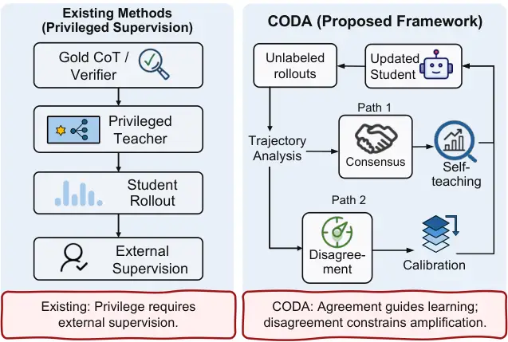
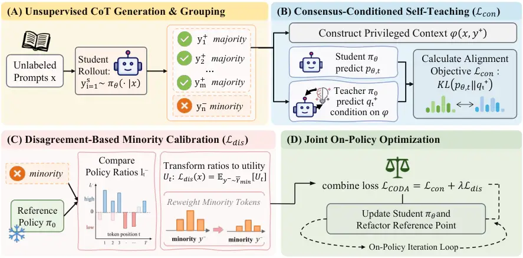
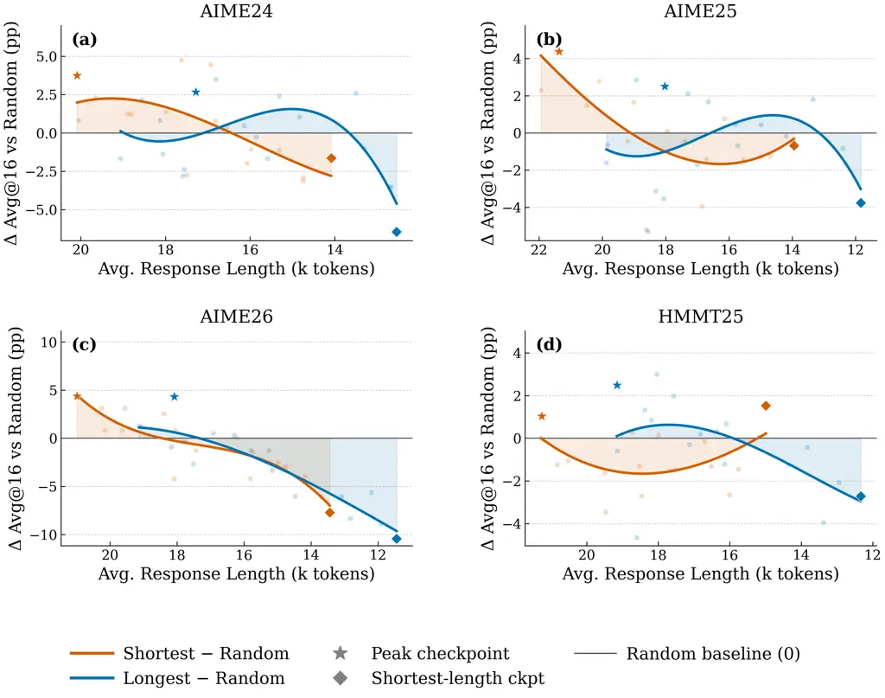
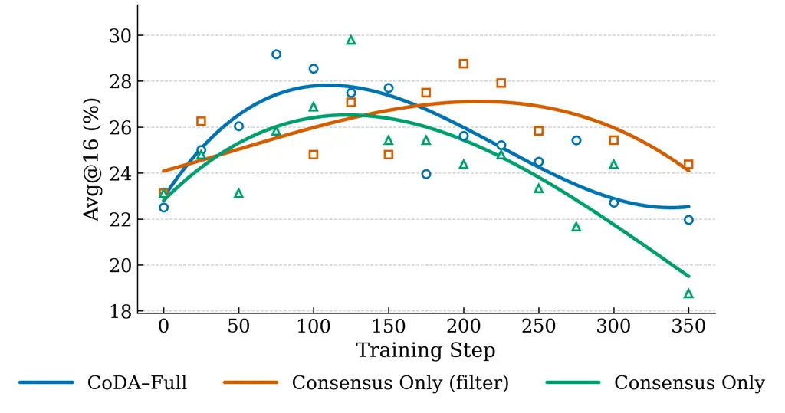
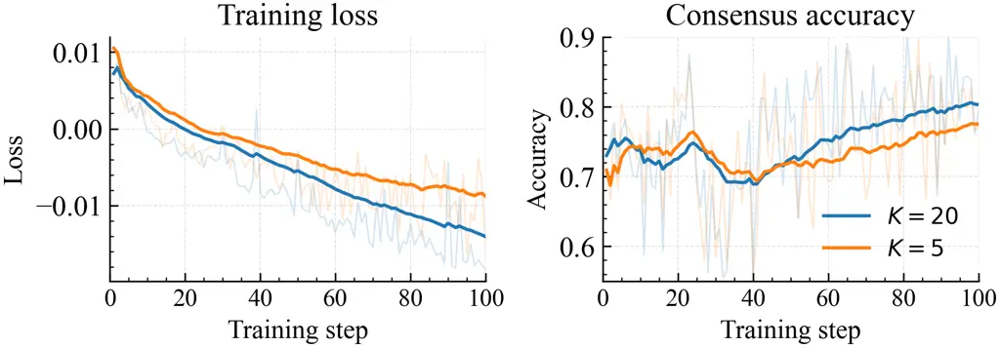

# Learning from Consensus and Disagreement: Unsupervised On-Policy Self-Distillation with Minority-Trajectory Contrast

Jiaxin Guo    Yanwei Yue    Xuanbo Fan    Chunyu Yang    Yan Zhang
^(†)^(†)thanks: Corresponding author

###### Abstract

On-policy self-distillation improves language-model reasoning by
querying a teacher on states actually visited by the student. Recent
methods create a powerful information asymmetry by exposing the teacher
to privileged context, yet they fundamentally rely on external
supervision—such as gold solutions or verifiers—to construct this
advantage. We introduce CoDA (Consensus and Disagreement Alignment), a
fully unsupervised framework that creates reliable privileged
information entirely from the latent uncertainty structure of a model’s
own unlabeled rollouts. CoDA extracts two complementary signals. In the
positive branch, answer-level consensus identifies a stable reasoning
mode, which conditions a frozen self-teacher to provide dense
distributional guidance on fresh student trajectories. However, because
agreement does not guarantee correctness, positive-only distillation
risks amplifying correlated errors into a false consensus. To break this
harmful feedback loop, CoDA incorporates a negative branch that exploits
disagreement: minority trajectories are treated as unstable alternatives
and gently penalized via a reference-anchored, KTO-style calibration
objective. This unpaired binary feedback provides robust regularization
without requiring the strong assumption that the consensus is the
absolute ground truth. Empirical evaluations on competition-level
mathematical benchmarks demonstrate that CoDA significantly improves
reasoning, outperforming self-generated baselines and effectively
stabilizing training against erroneous consensus.

¹School of Intelligence Science and Technology, Peking University

²State Key Laboratory of General Artificial Intelligence, Peking
University, Beijing, China

³Ucap Cloud



Figure 1: Contrast of two knowledge-amplification paradigms: existing
privilege-based learning relies on externally supplied supervision,
whereas CoDA constructs privileged context from agreement and uses
disagreement calibration for robust unsupervised self-distillation.

## 1 Introduction

Long chains of thought have substantially improved language-model
reasoning, but they also sharpen a fundamental train–test mismatch(Wei
et al. 2022; Agarwal et al. 2024). A model trained on fixed expert
traces learns under clean prefixes, yet at inference time must continue
from its own imperfect decisions; a single early deviation can move it
into states that offline supervision never covers. On-policy
distillation mitigates this exposure gap by querying a teacher on
trajectories sampled from the current student (Ross, Gordon, and Bagnell
2011; Agarwal et al. 2024; Gu et al. 2024; Ko et al. 2024). Recent
on-policy self-distillation further shows that the same model can teach
itself when the teacher receives _privileged information_ hidden from
the student (Zhao et al. 2026; Penaloza et al. 2026; Stein, Huang, and
Goldstein 2026). The resulting capability gap is not created by a larger
teacher, but by an information asymmetry: conditioned on a solution or
other task-specific evidence, a copy of the model can provide more
informative token-level targets along the states actually visited by the
student.

This perspective, however, exposes a critical supervision bottleneck.
Existing privileged-information methods typically obtain their asymmetry
from a reference chain of thought, a gold final answer, or a
verifier-approved trajectory. Their apparent self-distillation therefore
still fundamentally depends on an externally supplied object that tells
the teacher what to know. Removing labels does more than remove a
training target: it removes the source of the teacher’s advantage. We
ask a more basic question than how to distill without labels: _can a
reasoning model create reliable privileged information entirely from the
uncertainty structure of its own unlabeled rollouts?_

Self-consistency offers a starting point for endogenous asymmetry. When
independently sampled reasoning paths converge, their agreement reveals
a stable policy mode (Wang et al. 2023). Exposing a representative
consensus trajectory exclusively to a self-teacher creates privileged
context, enabling dense distributional guidance on fresh student
rollouts. However, agreement is not correctness. Correlated model errors
can produce a _false consensus_, and conditioning the teacher on this
erroneous context rationalizes and propagates its bias(Xu et al. 2026b;
Zheng et al. 2026). Positive-only self-distillation thus closes a
harmful feedback loop: it promotes mistakes to privileged information,
converting sampling error into flawed-prefix self-amplification (Fu
et al. 2026; Guo et al. 2026a; Press et al. 2023).

Figure 1 contrasts existing paradigms with our approach. While prior
methods rely on external supervision, we replace it with
agreement-derived context and introduce disagreement calibration to
constrain the amplification of unstable modes. Crucially, the same
rollout set exposes not only agreement but also _disagreement_. While
consensus identifies stable reasoning modes, minority trajectories
expose isolated, unstable alternatives. Exploiting this negative
evidence does not require assuming the consensus is the absolute ground
truth—a necessary concession when the model exhibits systematic biases.
Instead, we impose a weaker, policy-relative constraint: an isolated
alternative should not become more likely than it was under the initial
policy. This parallels the “lucky hit” phenomenon in test-time
reinforcement learning, where negative outcomes remain informative
without absolute correctness guarantees (Zuo et al. 2026).

Based on this insight, we introduce CoDA (_Consensus and Disagreement
Alignment_), a fully unsupervised framework with two complementary
branches. Given an unlabeled question, CoDA infers consensus by sampling
diverse reasoning paths and grouping them by terminal answer. In the
positive branch, a representative consensus trajectory conditions a
privileged self-teacher, whose token distributions guide a fresh
on-policy student rollout. In the negative branch, minority trajectories
receive a reference-anchored, KTO-style undesirable-response objective
relative to the frozen initial policy (Ethayarajh et al. 2024). KTO is
ideal here because its unpaired binary feedback gently discourages
minority trajectories without constructing preference pairs or
certifying the consensus as a correct winner. By bounding this
penalization, the disagreement branch acts as a robust regularizer
rather than a claim of semantic falsity, mitigating the risk of
penalizing true answers under a biased policy. Together, consensus
creates an endogenous teacher–student information asymmetry, while
disagreement prevents unstable self-generated modes from gaining
probability unchecked.

Our contributions are threefold:

- •
  We formulate _fully unsupervised privileged on-policy
  self-distillation_: a model constructs self-teaching information
  asymmetry solely from the agreement structure of its unlabeled
  rollouts, requiring no gold solutions, reward models, or verifiers.
- •
  We identify _false-consensus amplification_ as a failure mode of
  positive-only self-distillation and propose dual-signal alignment,
  combining consensus-conditioned distribution matching with
  reference-anchored calibration of disagreeing trajectories to suppress
  this bias.
- •
  We empirically demonstrate that CoDA significantly improves reasoning,
  outperforming self-generated baselines. Extensive analysis validates
  our design effectively stabilizes training against noisy or erroneous
  consensus.

## 2 Related Work

#### On-policy distillation and privileged self-distillation.

Traditional knowledge distillation suffers from exposure bias in
autoregressive generation (Hinton, Vinyals, and Dean 2015; Ross, Gordon,
and Bagnell 2011). On-policy distillation mitigates this by aligning
teacher and student distributions on student-generated sequences using
various divergence metrics (Agarwal et al. 2024; Gu et al. 2024; Ko
et al. 2024) or adaptive objectives to handle noisy feedback (Jia et al.
2026; Xu et al. 2026b; Zheng et al. 2026; Xu et al. 2026a). Recently,
privileged self-distillation removes the external teacher entirely by
conditioning a frozen self-teacher on privileged context, such as gold
solutions or externally validated consensus (Zhao et al. 2026; Penaloza
et al. 2026; Ye et al. 2026; Stein, Huang, and Goldstein 2026; Jin
et al. 2026). However, these methods fundamentally assume the privileged
context is externally provided. We instead construct this asymmetry from
unlabeled rollouts and address the robustness challenges of
self-generated, noisy context.

#### Self-improvement from model-generated feedback.

Models can self-improve using signals derived from their own
generations, such as inference-time self-consistency (Wang et al. 2023),
reward-guided self-training (Zuo et al. 2026; Hubotter et al. 2026; Yang
et al. 2026), or preference optimization via paired (Rafailov et al.
2023; Guo et al. 2026b) and unpaired (Ethayarajh et al. 2024)
objectives. In on-policy distillation, unreliable student prefixes are
typically addressed via filtering or credit assignment (Fu et al. 2026;
Xu et al. 2026b; Zheng et al. 2026; Shen et al. 2026a; Shen et al.
2026b). Most closely related to our work is Multi-rollout OPD (Yu et al.
2026), which exploits cross-rollout relationships to form
peer-conditioned teacher signals. However, it relies on ground-truth
correctness to partition successful and failed trajectories. Our setting
is orthogonal: we operate entirely without ground-truth labels or
verifiers, inferring supervision—and regularizing errors—solely from the
uncertainty structure of unlabeled generations.

## 3 Method

### 3.1 Problem Setup

Let $`\mathcal{D}_{x}=\{x_{i}\}_{i=1}^{N}`$ be a collection of questions
without solutions, final answers, preference labels, or executable
rewards. We seek to improve an autoregressive reasoning policy
$`\pi_{\theta}`$ using only text sampled from the policy itself. A
completion $`y=(y_{1},\ldots,y_{T})`$ contains an unconstrained
reasoning trace followed by a final answer. Its sequence probability
factorizes as

```math
P_{\theta}(y\mid x)=\prod_{t=1}^{T}\pi_{\theta}(y_{t}\mid x,y_{<t}). \tag{1}
```

At every update, the current policy generates two kinds of on-policy
data. First, an _evidence set_
$`\mathcal{Y}_{\theta}(x)=\{y^{(1)},\ldots,y^{(s)}\}`$ is sampled to
infer the latent agreement structure of the model’s solutions. Second,
after constructing privileged context from that set, the student
independently samples a training trajectory
$`r\sim P_{\theta}(\cdot\mid x)`$. Separating these roles is important:
the evidence trajectories decide what information the teacher receives,
whereas the fresh trajectory determines the prefixes on which teacher
and student distributions are aligned.

The training signal must satisfy two constraints. It must be _fully
unsupervised_: no ground-truth answer may be used to accept, reject, or
weight a training prompt. It must also be _on-policy_: both the evidence
set and the aligned trajectory are regenerated as $`\pi_{\theta}`$
evolves. The answer extractor $`a(y)`$ is used only to canonicalize the
final answer for grouping; it does not judge correctness. Invalid or
missing answers receive the special symbol $`\bot`$ and do not vote.



Figure 2: Overview of CoDA. (A) Unlabeled student rollouts are grouped
by normalized final answer to identify consensus and disagreement
trajectories. (B) A representative consensus trajectory provides
privileged context for token-level teacher–student alignment on a fresh
student rollout. (C) Minority trajectories are calibrated against the
frozen reference policy, and (D) the two signals are combined in an
on-policy update.

### 3.2 From Self-Consistency to Privileged Context

For every valid normalized answer $`z`$, we estimate its empirical
support under the current policy,

```math
\widehat{p}_{\theta}(z\mid x)=\frac{1}{s}\sum_{j=1}^{s}\mathbb{I}\!\left[a(y^{(j)})=z\right]. \tag{2}
```

Let $`c(z)=s\widehat{p}_{\theta}(z\mid x)`$. We retain a prompt only
when the largest answer group contains at least two trajectories, and
define the possibly tied modal answer set

```math
\mathcal{Z}_{\mathrm{maj}}=\arg\max_{z}c(z),\qquad\max_{z}c(z)\geq 2. \tag{3}
```

The modal and minority trajectory pools are then

```math
Y_{\mathrm{maj}}=\{y_{i}\mid a(y_{i})\in\mathcal{Z}_{\mathrm{maj}}\}, \tag{4}
```

```math
Y_{\mathrm{min}}=\{y_{i}\mid a(y_{i})\notin\mathcal{Z}_{\mathrm{maj}}\}. \tag{5}
```

We select a representative $`y^{+}\in Y_{\mathrm{maj}}`$ using a
label-free selector $`g`$, without certifying its absolute correctness.
To resolve ties in answer support, $`g`$ operates across the union of
all tied modal pools. Since sequence length proxies the amount of
reasoning exposed to the teacher, we empirically evaluate three
selection rules for $`g`$: uniform random, shortest, and longest
trajectory.

The resulting privileged context, $`c^{+}=\phi(x,y^{+})`$, presents
$`y^{+}`$ as a reference and prompts the teacher to solve the problem
independently. This distinction prevents direct token imitation; while
$`y^{+}`$ conditions the teacher’s distribution, the alignment loss is
strictly evaluated on the separately generated student trajectory $`r`$.
We term this mechanism _consensus-conditioned self-teaching_.

### 3.3 Consensus-Conditioned Distribution Alignment

The student samples an on-policy trajectory
$`r\sim P_{\theta}(\cdot\mid x)`$ without observing $`y^{+}`$. At each
prefix $`r_{<t}`$, the trainable student and the frozen privileged
teacher yield next-token distributions under asymmetric information:

```math
p_{\theta,t}(v)=\pi_{\theta}(v\mid x,r_{<t}),\quad q^{+}_{t}(v)=\pi_{0}(v\mid\phi(x,y^{+}),r_{<t}). \tag{6}
```

This formulation ensures the teacher’s advantage stems solely from the
consensus context while maintaining on-policy correction along
student-visited states.

To align these distributions, we define a _consensus-conditioned_
objective using a generalized divergence $`D_{\alpha}`$:

```math
\mathcal{L}_{\mathrm{con}}(x)=\frac{1}{|M_{r}|}\sum_{t\in M_{r}}\min\!\left\{D_{\alpha}(q^{+}_{t},p_{\theta,t}),\tau\right\}, \tag{7}
```

where $`M_{r}`$ masks non-response tokens and $`\tau`$ clips excessive
divergences to prevent formatting tokens from dominating the loss. The
parameter $`\alpha\in[0,1]`$ interpolates between forward KL
($`\alpha=0`$), generalized Jensen–Shannon ($`0<\alpha<1`$), and reverse
KL ($`\alpha=1`$). In our experiments, we set $`\alpha=0`$ (forward KL)
to transfer the teacher’s full distribution.

While this positive branch provides dense guidance even from imperfect
derivations, a false consensus can systematically bias $`q^{+}_{t}`$.
This vulnerability necessitates a complementary mechanism whose validity
does not rely on assuming $`y^{+}`$ is strictly correct.

### 3.4 Reference-Anchored Disagreement Calibration

For a minority trajectory $`y^{-}\in Y_{\mathrm{min}}`$, consensus
alignment provides no explicit reason to suppress the behavior that
produced it. Directly forming a preference pair $`(y^{+},y^{-})`$ would
be overly strong, as modal membership does not guarantee $`y^{+}`$ is
correct. We instead assign an unpaired undesirable label to $`y^{-}`$
using a reference-anchored, KTO-style objective (Ouyang et al. 2022;
Ethayarajh et al. 2024).

For a response token $`y^{-}_{t}`$, define the student–reference
log-ratio:

```math
\ell_{t}^{-}(\theta)=\log\frac{\pi_{\theta}(y^{-}_{t}\mid x,y^{-}_{<t})}{\pi_{0}(y^{-}_{t}\mid x,y^{-}_{<t})}. \tag{8}
```

Since our negative branch operates at the token level against a fixed
reference policy, we fix the KTO reference point to zero and directly
minimize the centered objective:

```math
\mathcal{L}_{\mathrm{dis}}(x)=\mathbb{E}_{\begin{subarray}{c}y^{-}\sim\widetilde{Y}_{\mathrm{min}}\\
t\sim M_{y^{-}}\end{subarray}}\left[\operatorname{softplus}\!\left(\beta\ell_{t}^{-}(\theta)\right)-\log 2\right], \tag{9}
```

where $`\widetilde{Y}_{\mathrm{min}}\subseteq Y_{\mathrm{min}}`$
contains at most $`K`$ selected minority trajectories.

By penalizing positive log-ratios, this objective reduces the relative
likelihood of minority tokens. Crucially, the frozen $`\pi_{0}`$ anchor
prevents indiscriminate likelihood minimization; it merely ensures that
observed disagreement modes are not amplified beyond their initial
probability.

Because minority membership is a weak signal—a minority trajectory might
contain correct reasoning if the consensus is false— we strictly treat
this branch as a regularizer rather than a claim of semantic falsity,
enforced via valid-answer filtering, length capping, and a small
coefficient $`\lambda`$.

Figure 2 summarizes the resulting two-branch on-policy training loop,
integrating consensus-conditioned self-teaching with reference-anchored
disagreement calibration.

### 3.5 Joint Objective and On-Policy Update

The complete per-question objective combines the two complementary
signals:

```math
\mathcal{L}_{\mathrm{CoDA}}(x)=\mathcal{L}_{\mathrm{con}}(x)+\lambda\mathcal{L}_{\mathrm{dis}}(x). \tag{10}
```

Here, $`\mathcal{L}_{\mathrm{con}}`$ extracts privileged guidance from
repeated evidence, while $`\mathcal{L}_{\mathrm{dis}}`$ mitigates the
risk of false consensus by regularizing isolated modes.

Because all rollouts are continuously sampled from the active student
$`\pi_{\theta}`$, both the constructed consensus context and the
penalized minority modes dynamically evolve as the policy improves. To
maintain signal quality, prompts lacking a repeated valid answer skip
the update entirely. Crucially, this joint on-policy loop operates
strictly without ground-truth labels, extracting both learning and
regularization signals purely from the model’s internal rollout
structure.

## 4 Experiments

### 4.1 Datasets and Metrics

We train on mathematical reasoning problems from OpenThoughts (Guha
et al. 2025). While supervised baselines utilize the provided expert
solutions, CoDA constructs its training signal entirely from the problem
prompts and its own on-policy rollouts. We evaluate on five
competition-level benchmarks: AIME 2024, 2025, 2026, HMMT 2025, and
AMO-Bench. For evaluation, we report avg@16 (sample-average accuracy
across 16 generations).

### 4.2 Baselines

We compare CoDA against the unmodified base model and two groups of
post-training baselines: (1) Supervised methods using expert
trajectories or gold labels: SFT (off-policy imitation), OPSD (Zhao
et al. 2026) (on-policy self-distillation conditioned on gold
solutions), and GRPO (Shao et al. 2024) (optimizing group-relative
advantages via binary correctness rewards). (2) Self-Generated methods:
SFT-Self (oracle-filtered)(Wang et al. 2023) (SFT on self-generated
trajectories filtered by ground truth), TTRL(Zuo et al. 2026) (rewarding
answer agreement without gold labels), CoDA–Consensus Only (our positive
branch alone), and CoDA–Full. Notably, CoDA–Full operates entirely
without external supervision or oracle filtering.

| Model      | Setting        | Method                     | AIME24 | AIME25 | AIME26 | AMO   | HMMT25 | Avg.  |
| ---------- | -------------- | -------------------------- | ------ | ------ | ------ | ----- | ------ | ----- |
| Qwen3-4B   |                | Base Model                 | 74.38  | 65.83  | 65.21  | 12.12 | 42.29  | 51.97 |
|            | Supervised     | SFT                        | 72.71  | 68.12  | 67.29  | 11.38 | 40.00  | 51.90 |
|            |                | OPSD                       | 75.42  | 68.75  | 69.58  | 14.50 | 45.83  | 54.82 |
|            |                | GRPO                       | 75.21  | 70.00  | 67.71  | 13.88 | 45.21  | 54.40 |
|            | Self-Generated | SFT-Self (oracle-filtered) | 75.00  | 66.46  | 66.88  | 13.62 | 45.21  | 53.43 |
|            |                | TTRL                       | 74.38  | 66.25  | 66.04  | 13.00 | 43.96  | 52.73 |
|            |                | CoDA–Consensus Only        | 74.58  | 67.08  | 67.92  | 12.88 | 46.04  | 53.70 |
|            |                | CoDA–Full                  | 74.58  | 68.96  | 70.21  | 14.50 | 44.58  | 54.57 |
| Qwen3-1.7B |                | Base Model                 | 48.33  | 37.08  | 36.67  | 3.50  | 23.12  | 29.74 |
|            | Supervised     | SFT                        | 51.25  | 37.92  | 40.83  | 4.38  | 26.25  | 32.13 |
|            |                | OPSD                       | 57.29  | 42.29  | 46.88  | 4.88  | 27.71  | 35.81 |
|            |                | GRPO                       | 51.10  | 39.58  | 40.83  | 5.50  | 26.46  | 32.69 |
|            | Self-Generated | SFT-Self (oracle-filtered) | 52.08  | 38.75  | 38.33  | 4.50  | 25.00  | 31.73 |
|            |                | TTRL                       | 50.00  | 38.33  | 37.92  | 5.00  | 25.83  | 31.42 |
|            |                | CoDA–Consensus Only        | 53.33  | 42.08  | 44.38  | 3.75  | 28.33  | 34.37 |
|            |                | CoDA–Full                  | 56.67  | 41.67  | 47.29  | 4.75  | 30.21  | 36.12 |

Table 1: Main reasoning results on Qwen3-4B and Qwen3-1.7B (accuracy,
%). “Avg.” is the unweighted average over the five benchmarks. Bold
indicates the best result within each setting (Supervised vs.
Self-Generated). SFT-Self uses oracle correctness filtering and is
included as a diagnostic self-imitation reference, not as a fully
unsupervised method.

| Selector | AIME24 | AIME25 | AIME26 | AMO  | HMMT25 | Avg.  |
| -------- | ------ | ------ | ------ | ---- | ------ | ----- |
| Random   | 55.00  | 41.46  | 46.67  | 4.00 | 29.17  | 35.26 |
| Shortest | 56.67  | 41.67  | 47.29  | 4.75 | 30.21  | 36.12 |
| Longest  | 54.79  | 41.04  | 46.25  | 3.88 | 30.42  | 35.28 |

Table 2: Comparison of trajectory selectors from the modal answer pool
on Qwen3-1.7B (accuracy, %). Selecting the shortest trajectory
consistently yields the best overall performance (best values in bold).

### 4.3 Implementation Details

Experiments use instruction-tuned Qwen3-1.7B and Qwen3-4B (Yang et al.
2025). We apply LoRA (Hu et al. 2022) ($`r=64`$, $`\alpha=128`$) to all
linear projection modules. Training runs for one epoch using bfloat16,
FlashAttention-2, and vLLM on 8 NVIDIA H100 GPUs, with a
$`5\times 10^{-6}`$ learning rate and 0.1 gradient clipping.

For CoDA, each prompt generates $`s=10`$ candidate trajectories
(temperature 1.3, top-$`p=0.95`$). Prompts require at least two valid
responses sharing a modal answer to proceed. To construct the privileged
context, Qwen3-1.7B selects the shortest modal trajectory (analyzed in
Section 5.2), while Qwen3-4B samples one randomly.

The adapter-disabled initial policy serves as both the frozen teacher
and reference anchor. The consensus branch aligns forward KL on a fresh
student rollout (max 2,048 tokens), clipping token-level divergences at
0.05. The disagreement calibration branch ($`\beta=0.1`$) limits
training to at most one minority trajectory (max 1,024 tokens) per
prompt.

## 5 Results

### 5.1 Overall Performance

Table 1 evaluates post-training methods on Qwen3-4B and Qwen3-1.7B. We
compare fully unsupervised approaches (CoDA, TTRL) against supervised
references (SFT, OPSD, GRPO) and an oracle-filtered diagnostic
(SFT-Self) to determine the efficacy of unlabeled rollout structures.

#### CoDA improves reasoning without correctness supervision.

CoDA–Full achieves the strongest average performance among fully
unsupervised methods across both model scales. On Qwen3-4B, it improves
the base model by 2.60 points and outperforms TTRL by 1.84 points,
reaching 54.57%—only 0.25 points behind supervised OPSD. On Qwen3-1.7B,
the trend amplifies: CoDA improves the base model by 6.38 points,
exceeding supervised OPSD by 0.31 points. These broad improvements
across multiple benchmarks confirm that repeated answer agreement
supplies highly effective privileged context, even without reference
solutions or ground-truth labels.

#### Minority calibration complements consensus alignment.

Comparing CoDA–Consensus Only with CoDA–Full isolates the contribution
of disagreement calibration. At 1.7B, the minority-trajectory objective
increases average accuracy from 34.37% to 36.12%, improving four out of
five benchmarks. The 4B model shows a consistent average gain (53.70% to
54.57%), particularly on more challenging evaluations like AIME 2025,
AIME 2026, and AMO. While heuristic negative supervision naturally
introduces minor trade-offs (e.g., on HMMT 2025), the aggregate gains
across both scales demonstrate that penalizing isolated modes
effectively counteracts the self-amplification risks of positive-only
distillation.

#### Relation to oracle-filtered self-imitation and supervised references.

CoDA–Full significantly surpasses the oracle-filtered SFT-Self baseline.
This gap indicates that our improvements stem from dense,
consensus-conditioned teacher guidance and disagreement regularization,
rather than merely filtering plausible solutions. By approaching (at 4B)
or exceeding (at 1.7B) the aggregate accuracy of supervised methods, the
results demonstrate that jointly exploiting endogenous agreement and
disagreement is a highly competitive alternative to correctness-filtered
self-training.

### 5.2 Selecting Privileged Context from Consensus

Answer-level self-consistency identifies a modal pool, but the positive
branch still requires a representative trajectory to instantiate the
teacher’s privileged context. We therefore ask whether this choice
should be random or should favor a particular response length.

#### Final performance.

Answer-level agreement identifies a set of candidate trajectories, but
it does not specify which member should be revealed to the teacher. We
evaluate uniform random selection against two deterministic, label-free
alternatives: the shortest and longest trajectories in
$`Y_{\mathrm{maj}}`$. Table 2 reports final sample-average accuracy for
Qwen3-1.7B. Selecting the shortest modal trajectory produces the highest
average accuracy, improving over random selection by 0.86 points and
over the longest selector by 0.84 points. The improvement appears on
four of five benchmarks, including all three AIME evaluations and AMO.
Thus, the gain from consensus-conditioned self-teaching does not require
exposing the teacher to the longest available derivation; a concise
representative is at least as informative and is less likely to
introduce superfluous reasoning into the privileged context.

#### Response length and accuracy.

Figure 3 further traces the performance difference relative to uniform
random selection as the average response length changes over training.
The horizontal zero line represents the random-selector baseline.
Notably, the shortest selector yields the most substantial positive
gains when the overall average response length is long. However, as the
model’s responses naturally become shorter over training, this advantage
diminishes and occasionally turns negative.

This dynamic reveals a clear structural trade-off. When the policy
generates verbose trajectories, selecting the most concise consensus
effectively strips away redundant exploration and correlated errors.
Conversely, once outputs are already concise, strictly enforcing the
shortest selection may inadvertently discard necessary reasoning steps.
This observation rules out a simple “more tokens is better” hypothesis:
the ideal privileged context must capture the stable solution mode while
minimizing noisy verbosity.



Figure 3: Accuracy difference of shortest vs. longest modal-trajectory
selection relative to a random baseline. Notably, the shortest selector
yields robust positive gains when the overall average response length is
long (left side of panels), but this advantage diminishes as responses
become shorter.



Figure 4: The sample-average accuracy over training steps. Consensus
Only improves early but undergoes the largest late-stage decline. Oracle
filtering does not yield the highest peak, yet produces the most stable
trajectory. CoDA–Full displays an intermediate pattern: disagreement
calibration reduces the collapse.

### 5.3 False Consensus and Training Stability

Consensus provides accessible privilege, but modal membership does not
guarantee correctness. We investigate whether erroneous consensus
accumulates during training and whether disagreement calibration
mitigates this failure mode by comparing CoDA–Full against
consensus-only alignment, both with and without an oracle quality filter
(used strictly as a diagnostic using gold answers).

| Model      | Variant                        | AIME24 | AIME25 | AIME26 | AMO   | HMMT25 | Avg.  |
| ---------- | ------------------------------ | ------ | ------ | ------ | ----- | ------ | ----- |
| Qwen3-4B   | CoDA–Full                      | 74.58  | 68.96  | 70.21  | 14.50 | 44.58  | 54.57 |
|            | Consensus Only                 | 74.58  | 67.08  | 67.92  | 12.88 | 46.04  | 53.70 |
|            | Consensus Only + Oracle Filter | 74.79  | 66.25  | 69.58  | 13.25 | 45.62  | 53.90 |
| Qwen3-1.7B | CoDA–Full                      | 56.67  | 41.67  | 47.29  | 4.75  | 30.21  | 36.12 |
|            | Consensus Only                 | 54.79  | 41.04  | 46.25  | 3.88  | 30.42  | 35.28 |
|            | Consensus Only + Oracle Filter | 54.37  | 40.62  | 48.12  | 4.00  | 28.75  | 35.17 |

Table 3: False-consensus analysis (sample-average accuracy, %).
“Consensus Only” uses $`\mathcal{L}_{\mathrm{con}}`$ without
disagreement calibration. “+ Oracle Filter” additionally discards
prompts whose modal answer is incorrect, using gold answers only for
this diagnostic. Bold indicates the best value within each model block.

#### Final performance.

To isolate the effect of modal uncertainty, Table 3 compares CoDA–Full,
Consensus Only, and its oracle-filtered variant (which removes prompts
with incorrect modal answers). Interestingly, perfect filtering does not
consistently improve final average accuracy, shifting it from 53.70% to
53.90% at 4B and 35.28% to 35.17% at 1.7B. Thus, oracle filtering alone
is insufficient to boost peak performance; its primary value is
revealing how noisy consensus impacts optimization dynamics.

#### Training dynamics.

Figure 4 tracks HMMT25 accuracy over training steps. While all variants
initially improve, unfiltered Consensus Only suffers a severe late-stage
decline. Conversely, oracle filtering maintains a smooth trajectory.
This comparison confirms the false-consensus hazard: repeatedly
conditioning the teacher on incorrect modal trajectories propagates
misleading distributional targets, whereas removing them prevents error
feedback.

#### Effect of disagreement calibration.

CoDA–Full exhibits an intermediate behavior: its performance declines
more gradually than unfiltered Consensus Only rather than collapsing.
This matches our expectation that the KTO-style disagreement loss
constrains the amplification of unstable modes despite imperfect modal
contexts. While it does not fully match the stability of the
gold-standard oracle filter, disagreement calibration successfully
recovers a major share of this robustness without requiring any
correctness labels.

### 5.4 Effect of Consensus Sample Size

The consensus estimator depends on the number of trajectories sampled
per prompt. A larger evidence set can reduce sampling variance and make
the modal answer more representative of the policy distribution, but its
generation cost grows linearly with the sample count. We study this
trade-off on Qwen3-1.7B using random selection from the modal pool and
vary $`s\in\{5,10,20\}`$ while keeping the remaining training
configuration fixed.

| Consensus samples $`s`$ | Avg. (%) |
| ----------------------- | -------- |
| 5                       | 35.05    |
| 10                      | 35.26    |
| 20                      | 35.41    |

Table 4: Effect of the consensus sample using random modal-trajectory
selection. The $`s=20`$ final evaluation is still in progress and is not
estimated from training metrics.

#### Optimization behavior.

Figure 5 compares the two endpoints, $`s=5`$ and $`s=20`$. As training
proceeds, the larger evidence set increasingly separates from $`s=5`$:
it reaches a lower consensus-alignment loss and a higher consensus
accuracy. The widening gap suggests that additional rollouts reduce
finite-sample noise in the modal-answer estimate. Consequently, the
privileged teacher is conditioned on a more stable consensus signal,
producing more coherent distributional targets and allowing the student
to fit the training prompts more rapidly. This result supports
increasing $`s`$ when optimization stability is the primary concern.

#### Diminishing returns and capability limits.

The available final evaluations nevertheless show only a modest
improvement from $`s=5`$ to $`s=10`$ (35.05% to 35.26%). This small gain
is consistent with _consensus saturation_. A moderate sample count
already resolves many prompts for which the correct answer is the
dominant policy mode; additional samples mainly affect borderline cases
or suppress a small number of sampling outliers. More samples cannot
correct a systematic error when the model repeatedly follows the same
incorrect reasoning pattern, because the wrong answer remains the modal
outcome even under a more accurate estimate. Thus, increasing $`s`$
improves estimation of the model’s current answer distribution, but does
not remove the capability bound of that distribution.

#### Accuracy–efficiency trade-off.

Increasing $`s`$ from 5 to 20 requires four times as many generated
reasoning trajectories per prompt. The curves indicate a cleaner
training signal, but the completed final results do not yet establish a
commensurate generalization gain. We therefore use $`s=10`$ as the
default: it provides a stronger consensus estimate than $`s=5`$ while
avoiding the full generation cost of $`s=20`$. The takeaway is that
larger evidence sets accelerate and stabilize consensus-conditioned
optimization, whereas moderate $`s`$ offers a more favorable
accuracy–compute trade-off.



Figure 5: Effect of consensus sample count ($`s`$) on Qwen3-1.7B
training dynamics (legend $`K`$ denotes $`s`$). A larger evidence set
($`s=20`$) yields lower training loss and higher consensus accuracy,
reflecting a less noisy privileged signal.

## 6 Conclusion

We introduced CoDA, a fully unsupervised on-policy self-distillation
framework that enhances language model reasoning without gold labels or
oracle filtering. Rather than blindly trusting the most frequent
generation, CoDA constructs privileged context from answer-level
consensus while regularizing false consensus by penalizing minority
trajectories via a reference-anchored objective. Evaluations on
competition-level mathematical benchmarks demonstrate that this
dual-signal alignment significantly outperforms positive-only baselines,
prevents late-stage training collapse, and rivals fully supervised
methods. Ultimately, CoDA establishes that the internal uncertainty
structure of unlabeled rollouts provides a robust foundation for
self-improvement.

## References

- Agarwal et al. (2024) Agarwal, R.; Vieillard, N.; Zhou, Y.; Stanczyk,
  P.; Ramos Garea, S.; Geist, M.; and Bachem, O. 2024. On-policy
  distillation of language models: Learning from self-generated
  mistakes. In _International Conference on Learning Representations_,
  volume 2024, 21246–21263.
- Ethayarajh et al. (2024) Ethayarajh, K.; Xu, W.; Muennighoff, N.;
  Jurafsky, D.; and Kiela, D. 2024. Kto: Model alignment as prospect
  theoretic optimization. _arXiv preprint arXiv:2402.01306_.
- Fu et al. (2026) Fu, Y.; Huang, H.; Jiang, K.; Liu, J.; Jiang, Z.;
  Zhu, Y.; and Zhao, D. 2026. Revisiting on-policy distillation:
  Empirical failure modes and simple fixes. _arXiv preprint
  arXiv:2603.25562_.
- Gu et al. (2024) Gu, Y.; Dong, L.; Wei, F.; and Huang, M. 2024.
  Minillm: Knowledge distillation of large language models. In _The
  twelfth international conference on learning representations_.
- Guha et al. (2025) Guha, E.; Marten, R.; Keh, S.; Raoof, N.; Smyrnis,
  G.; Bansal, H.; Nezhurina, M.; Mercat, J.; Vu, T.; Sprague, Z.;
  et al. 2025. OpenThoughts: Data Recipes for Reasoning Models. _arXiv
  preprint arXiv:2506.04178_.
- Guo et al. (2026a) Guo, J.; Sun, H.; Zhang, W.; Fan, X.; and Zhang, Y.
  2026a. Mitigating error accumulation in knowledge editing for
  multi-hop question answering. In _Proceedings of the AAAI Conference
  on Artificial Intelligence_, volume 40, 30862–30870.
- Guo et al. (2026b) Guo, J.; Sun, H.; Zhang, W.; Yang, C.; and
  Zhang, Y. 2026b. Failures are Treasures: Constructing a Pedagogical
  Bridge for Agentic Strategy Distillation. In _Findings of the
  Association for Computational Linguistics: ACL 2026_, 18808–18823.
- Hinton, Vinyals, and Dean (2015) Hinton, G.; Vinyals, O.; and
  Dean, J. 2015. Distilling the knowledge in a neural network. _arXiv
  preprint arXiv:1503.02531_.
- Hu et al. (2022) Hu, E. J.; Shen, Y.; Wallis, P.; Allen-Zhu, Z.; Li,
  Y.; Wang, S.; Wang, L.; Chen, W.; et al. 2022. Lora: Low-rank
  adaptation of large language models. _Iclr_, 1(2): 3.
- Hubotter et al. (2026) Hubotter, J.; Lubeck, F.; Behric, L.; Baumann,
  A.; Bagatella, M.; Marta, D.; Hakimi, I.; Shenfeld, I.;
  Kleine Buening, T.; Guestrin, C.; and Krause, A. 2026. Reinforcement
  Learning via Self-Distillation. _arXiv preprint arXiv:2601.20802_.
- Jia et al. (2026) Jia, N.; Yang, H.; Ma, X.; Lian, J.; Zhang, S.;
  Zhang, W.; Zeng, K.; Cai, X.; and Sun, Z. 2026. Asymmetric on-policy
  distillation: Bridging exploitation and imitation at the token level.
  _arXiv preprint arXiv:2605.06387_.
- Jin et al. (2026) Jin, Y.; Wang, Y.; Fu, L.; Xiao, Y.; Luo, Y.; Liu,
  H.; Prakash, B. A.; Hester, J.; Wang, J.; and Kumar, S. 2026. UniSD:
  Towards a Unified Self-Distillation Framework for Large Language
  Models. _arXiv preprint arXiv:2605.06597_.
- Ko et al. (2024) Ko, J.; Kim, S.; Chen, T.; and Yun, S.-Y. 2024.
  Distillm: Towards streamlined distillation for large language models.
  _arXiv preprint arXiv:2402.03898_.
- Ouyang et al. (2022) Ouyang, L.; Wu, J.; Jiang, X.; Almeida, D.;
  Wainwright, C. L.; Mishkin, P.; Zhang, C.; Agarwal, S.; Slama, K.;
  Ray, A.; et al. 2022. Training language models to follow instructions
  with human feedback. _arXiv preprint arXiv:2203.02155_.
- Penaloza et al. (2026) Penaloza, E.; Vattikonda, D.; Gontier, N.;
  Lacoste, A.; Charlin, L.; and Caccia, M. 2026. Privileged Information
  Distillation for Language Models. _arXiv preprint arXiv:2602.04942_.
- Press et al. (2023) Press, O.; Zhang, M.; Min, S.; Schmidt, L.; Smith,
  N. A.; and Lewis, M. 2023. Measuring and narrowing the
  compositionality gap in language models. In _Findings of the
  Association for Computational Linguistics: EMNLP 2023_, 5687–5711.
- Rafailov et al. (2023) Rafailov, R.; Sharma, A.; Mitchell, E.; Ermon,
  S.; Manning, C. D.; and Finn, C. 2023. Direct preference optimization:
  Your language model is secretly a reward model. _arXiv preprint
  arXiv:2305.18290_.
- Ross, Gordon, and Bagnell (2011) Ross, S.; Gordon, G.; and
  Bagnell, D. 2011. A reduction of imitation learning and structured
  prediction to no-regret online learning. In _Proceedings of the
  fourteenth international conference on artificial intelligence and
  statistics_, 627–635. JMLR Workshop and Conference Proceedings.
- Shao et al. (2024) Shao, Z.; Wang, P.; Zhu, Q.; Xu, R.; Song, J.; Bi,
  X.; Zhang, H.; Zhang, M.; Li, Y. K.; Wu, Y.; et al. 2024.
  DeepSeekMath: Pushing the Limits of Mathematical Reasoning in Open
  Language Models. _arXiv preprint arXiv:2402.03300_.
- Shen et al. (2026a) Shen, G.; Cheng, X.; Zhao, C.; Huang, L.; Li, J.;
  Zhao, D.; and Yu, X. 2026a. Anti-Self-Distillation for Reasoning RL
  via Pointwise Mutual Information. _arXiv preprint arXiv:2605.11609_.
- Shen et al. (2026b) Shen, G.; Huang, L.; Cheng, X.; Zhao, C.; Li, J.;
  Zhao, D.; and Yu, X. 2026b. From Generic Correlation to Input-Specific
  Credit in On-Policy Self Distillation. _arXiv preprint
  arXiv:2605.11613_.
- Stein, Huang, and Goldstein (2026) Stein, A.; Huang, F.; and
  Goldstein, T. 2026. GATES: Self-distillation under privileged context
  with consensus gating. _arXiv preprint arXiv:2602.20574_.
- Wang et al. (2023) Wang, Y.; Kordi, Y.; Mishra, S.; Liu, A.; Smith,
  N. A.; Khashabi, D.; and Hajishirzi, H. 2023. Self-instruct: Aligning
  language models with self-generated instructions. In _Proceedings of
  the 61st annual meeting of the association for computational
  linguistics (volume 1: long papers)_, 13484–13508.
- Wei et al. (2022) Wei, J.; Wang, X.; Schuurmans, D.; Bosma, M.; Xia,
  F.; Chi, E.; Le, Q. V.; Zhou, D.; et al. 2022. Chain-of-thought
  prompting elicits reasoning in large language models. _Advances in
  neural information processing systems_, 35: 24824–24837.
- Xu et al. (2026a) Xu, Y.; Sang, H.; Zhou, Z.; He, R.; and Wang, Z.
  2026a. PACED: Distillation and On-Policy Self-Distillation at the
  Frontier of Student Competence. _arXiv preprint arXiv:2603.11178_.
- Xu et al. (2026b) Xu, Y.; Sang, H.; Zhou, Z.; He, R.; Wang, Z.; and
  Geramifard, A. 2026b. Tip: Token importance in on-policy distillation.
  _arXiv preprint arXiv:2604.14084_.
- Yang et al. (2025) Yang, A.; Li, A.; Yang, B.; Zhang, B.; Hui, B.;
  Zheng, B.; Yu, B.; Gao, C.; Huang, C.; Lv, C.; et al. 2025. Qwen3
  technical report. _arXiv preprint arXiv:2505.09388_.
- Yang et al. (2026) Yang, C.; Qin, C.; Si, Q.; Chen, M.; Gu, N.; Yao,
  D.; Lin, Z.; Wang, W.; Wang, J.; and Duan, N. 2026. Self-Distilled
  RLVR. _arXiv preprint arXiv:2604.03128_.
- Ye et al. (2026) Ye, T.; Dong, L.; Wu, X.; Huang, S.; and
  Wei, F. 2026. On-Policy Context Distillation for Language Models.
  _arXiv preprint arXiv:2602.12275_.
- Yu et al. (2026) Yu, W.; Li, X.; Zhao, Y.; Liu, X.; Zhang, R.; Wang,
  H.; Luo, Y.; Wu, C. H.; Mittal, G.; Fredrikson, M.; and Hu, Y. 2026.
  Multi-Rollout On-Policy Distillation via Peer Successes and Failures.
  _arXiv preprint arXiv:2605.12652_.
- Zhao et al. (2026) Zhao, S.; Xie, Z.; Liu, M.; Huang, J.; Pang, G.;
  Chen, F.; and Grover, A. 2026. Self-Distilled Reasoner: On-Policy
  Self-Distillation for Large Language Models. _arXiv preprint
  arXiv:2601.18734_.
- Zheng et al. (2026) Zheng, B.; Ma, X.; Liang, Y.; Ruan, J.; Fu, X.;
  Lin, K.; Zhu, B.; Zeng, K.; and Cai, X. 2026. Scope: Signal-calibrated
  on-policy distillation enhancement with dual-path adaptive weighting.
  _arXiv preprint arXiv:2604.10688_.
- Zuo et al. (2026) Zuo, Y.; Zhang, K.; Sheng, L.; Qu, S.; Cui, G.; Zhu,
  X.; Li, H.; Long, X.; Hua, E.; Qi, B.; et al. 2026. Ttrl: Test-time
  reinforcement learning. _Advances in Neural Information Processing
  Systems_, 38: 131459–131483.
