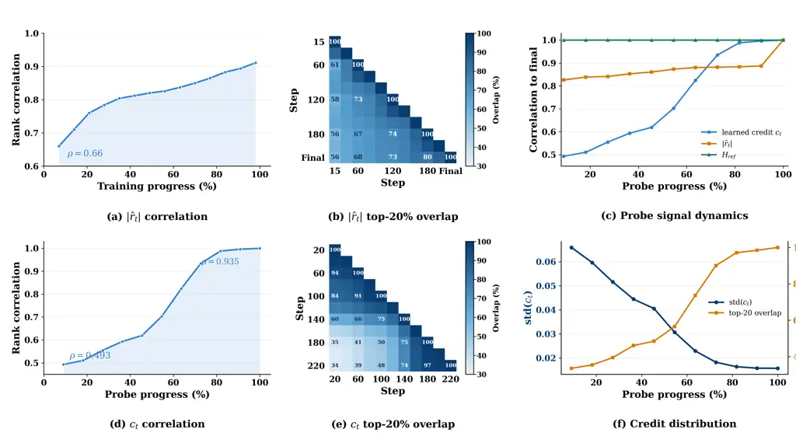
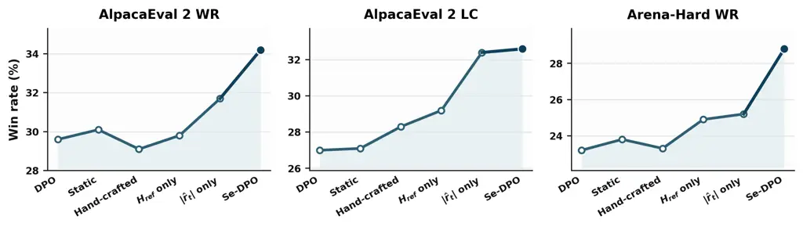

# Se-DPO: Self-Evolving Token Credit for Direct Preference Optimization

Wenxiao Zhao Affiliation: University of California, Los Angeles
Affiliation: Shanghai AI Laboratory    Shu Wang Affiliation: University
of California, Los Angeles    Ying Nian Wu Affiliation: University of
California, Los Angeles

###### Abstract

Direct Preference Optimization (DPO) aggregates token-level
log-probability ratios via uniform summation, implicitly treating all
tokens as contributing equally to the preference signal. However, the
contribution of individual tokens to the preference signal varies. We
introduce token credit, which modulates each token’s KL regularization
based on its contribution to the preference outcome. We derive that
effective token credit is proportional to the magnitude of each token’s
implicit reward, and observe that this quantity evolves substantially
during training. This implies that static token credit becomes
increasingly misaligned as training progresses. In this work, we propose
Se-DPO (Self-Evolving Token Credit for DPO), a live mechanism that
derives token credit from the model’s own evolving internal signals
during DPO training. Since the reward signal varies in reliability
across positions, Se-DPO calibrates token credit based on both the
strength and the confidence of each token’s contribution. Se-DPO
requires no external models, adding only a lightweight calibration
network with minimal computational overhead. Experiments show that
Se-DPO improves over DPO by up to 9.8 points on AlpacaEval 2 and 12.2
points on Arena-Hard.

|     |
| --- |
|     |

## 1 Introduction

Direct Preference Optimization (Rafailov et al., 2023) has emerged as a
widely adopted method for aligning large language models with human
preferences. By reparameterizing the reward function in the
reinforcement learning from human feedback (RLHF) objective (Christiano
et al., 2017; Ziegler et al., 2019; Ouyang et al., 2022; Stiennon et
al., 2020; Bai et al., 2022; Touvron et al., 2023; Schulman et al.,
2017), DPO enables direct policy optimization from preference data
without training a separate reward model. In the standard formulation,
DPO aggregates token-level log-probability ratios via uniform summation,
implicitly treating all tokens as equally important to the preference
signal.

However, not all tokens contribute equally to the quality of a response.
A factual error in a single token can flip a preference label (Rafailov
et al., 2024), while filler words rarely affect human judgment. Recent
methods have sought to address this mismatch by introducing token-level
importance signals into the preference optimization objective, drawing
on external sources such as pre-trained teacher models (Zhu et al.,
2025; Chen et al., 2025b; Zhong et al., 2025), contrastive language
model pairs (Liu et al., 2024), learned sparse masks (Christopoulou et
al., 2024), optimal transport matching (Li et al., 2025), per-token KL
constraints (Zeng et al., 2024), prompted self-evaluation (Zhou et al.,
2025), or oracle-based token selection (Yang et al., 2025a). While these
approaches differ in their signal sources, they share a common pattern:
token importance is computed prior to or outside the training loop and
treated as approximately fixed throughout optimization. A natural
alternative is to derive token credit from DPO’s own implicit reward
(Rafailov et al., 2024), but recent work observed that this signal can
assign disproportionate importance to non-critical tokens such as
punctuation and line breaks (Chen et al., 2025b), leaving its direct use
largely unexplored.

In this work, we study the implicit reward not at a single snapshot but
across the full trajectory of DPO training. Our analysis reveals that
the token-level implicit reward undergoes substantial evolution during
training: the set of tokens deemed important shifts considerably between
early and late stages, and the importance ranking stabilizes only
gradually over the course of optimization. Crucially, this gradual
stabilization suggests that the noisy importance estimates observed by
prior work (Chen et al., 2025b) reflect the early training state rather
than an inherent limitation of the implicit reward. Since token
importance continues to shift until convergence, any static credit
assignment becomes increasingly stale as optimization progresses. This
temporal perspective distinguishes our approach from methods that adapt
KL regularization at the sample level (Lee et al., 2025; Zhou et al.,
2024; Ivison et al., 2024) or bootstrap implicit rewards at the sequence
level (Chen et al., 2025a)—neither of which captures the within-training
evolution of token-level importance.

Based on these observations, we show that relaxing DPO’s uniform KL
coefficient to be token-specific yields an objective where each token’s
contribution is scaled by a credit term. We derive that, under a
variance-minimization criterion on the preference logit, the credit at
each position should be proportional to the magnitude of the token’s
implicit reward. Intuitively, tokens with larger implicit rewards carry
more preference-relevant information and should be allowed to deviate
further from the reference policy, while tokens with near-zero implicit
rewards contribute little to the preference signal and benefit from
tighter regularization. Since the implicit reward evolves during
training, the credit should also evolve—any static approach uses an
increasingly stale signal by design.

We propose Se-DPO (Self-Evolving Token Credit for DPO), a live mechanism
that periodically extracts implicit reward magnitudes as token credit
during DPO training. Se-DPO adds no external models and only a
lightweight calibration network with minimal computational overhead.

Our contributions are as follows:

- •
  We observe that DPO’s token-level implicit reward shifts considerably
  over the course of training, with limited overlap between
  top-$`|\hat{r}_{t}|`$ tokens at early and late stages.
- •
  We introduce token credit to modulate per-token KL regularization
  strength, and analyze how it can be informed by implicit reward
  magnitude and estimation confidence.
- •
  We propose Se-DPO, which derives token credit online from the model’s
  own evolving internal signals via a lightweight calibration network,
  requiring no external models and achieving up to 50.6% win rate on
  AlpacaEval 2 and 43.3% on Arena-Hard.

## 2 Preliminaries

### 2.1 DPO and Implicit Reward

The standard RLHF objective maximizes expected reward subject to a KL
divergence constraint against a reference policy $`\pi_{\text{ref}}`$:

```math
\max_{\pi_{\theta}}\mathbb{E}_{x\sim\mathcal{D},y\sim\pi_{\theta}}\left[r(x,y)\right]-\beta\,D_{\text{KL}}\!\left[\pi_{\theta}(\cdot|x)\,\|\,\pi_{\text{ref}}(\cdot|x)\right], \tag{1}
```

where $`\beta>0`$ controls the strength of regularization. DPO (Rafailov
et al., 2023) reparameterizes the reward in terms of the optimal policy,
yielding a supervised loss over preference pairs $`(x,y^{c},y^{r})`$:

```math
\mathcal{L}_{\text{DPO}}=-\mathbb{E}_{(x,y^{c},y^{r})}\!\left[\log\sigma\!\left(\beta\log\frac{\pi_{\theta}(y^{c}|x)}{\pi_{\text{ref}}(y^{c}|x)}-\beta\log\frac{\pi_{\theta}(y^{r}|x)}{\pi_{\text{ref}}(y^{r}|x)}\right)\right]. \tag{2}
```

Since language models generate tokens autoregressively, the
sequence-level log-ratio decomposes as a sum of token-level terms.
Rafailov et al. (2024) showed that DPO implicitly learns a token-level
reward:

```math
\hat{r}_{t}=\beta\!\left(\log\pi_{\theta}(y_{t}|x,y_{<t})-\log\pi_{\text{ref}}(y_{t}|x,y_{<t})\right). \tag{3}
```



Figure 1: Token importance and learned credit evolve during training.
(a,b) Implicit-reward magnitude $`|\hat{r}_{t}|`$ in the original
training run: rank correlation to the final checkpoint increases over
time, while top-20% token overlap remains limited. (c–f) Learned credit
$`c_{t}`$ in a separate Se-DPO LoRA credit-dynamics probe: credit
correlation increases from 0.493 to 1.0, early-to-final top-20% overlap
is 33.6%, and the credit distribution gradually stabilizes.

### 2.2 Token-Specific KL Regularization

Standard DPO applies a uniform KL coefficient $`\beta`$ to all token
positions. Prior work has explored token-level KL decompositions (Zeng
et al., 2024) and learned masks over token-level KL
contributions (Christopoulou et al., 2024). In this work, we consider a
generalization where the KL strength varies across positions:

```math
\max_{\pi}\mathbb{E}_{y\sim\pi}\!\left[\sum_{t=1}^{T}r_{t}-\beta_{t}\log\frac{\pi(y_{t}|x,y_{<t})}{\pi_{\text{ref}}(y_{t}|x,y_{<t})}\right], \tag{4}
```

where $`\beta_{t}`$ controls the KL penalty at position $`t`$. At each
position, the optimization problem is:

```math
\max_{\pi(\cdot|x,y_{<t})}\sum_{y_{t}}\pi(y_{t}|x,y_{<t})\!\left[r_{t}(y_{t})-\beta_{t}\log\frac{\pi(y_{t}|x,y_{<t})}{\pi_{\text{ref}}(y_{t}|x,y_{<t})}\right]. \tag{5}
```

This is a KL-regularized optimization whose closed-form solution is:

```math
\pi^{*}(y_{t}|x,y_{<t})=\frac{1}{Z_{t}}\pi_{\text{ref}}(y_{t}|x,y_{<t})\exp\!\left(\frac{r_{t}(y_{t})}{\beta_{t}}\right), \tag{6}
```

where
$`Z_{t}=\sum_{y_{t}^{\prime}}\pi_{\text{ref}}(y_{t}^{\prime}|x,y_{<t})\exp(r_{t}(y_{t}^{\prime})/\beta_{t})`$
is a position-specific partition function. Rearranging yields the
implicit reward:

```math
r_{t}(y_{t})=\beta_{t}\!\left(\log\pi^{*}(y_{t}|x,y_{<t})-\log\pi_{\text{ref}}(y_{t}|x,y_{<t})\right)+\beta_{t}\log Z_{t}. \tag{7}
```

Since $`Z_{t}`$ depends only on the context $`(x,y_{<t})`$ and not on
the sampled token $`y_{t}`$, it does not affect the relative
contribution of different tokens within a response.¹¹ 1 With
position-dependent $`\beta_{t}`$, the per-position partition functions
generally do not cancel between chosen and rejected responses, even when
$`\beta_{t}`$ is fixed: the two continuations induce different contexts
after their first divergence, and therefore different $`Z_{t}`$ values.
Eq. 8 should thus be understood as a principled approximation to the
token-specific KL objective. The uncancelled term acts as a
context-dependent value offset; because Se-DPO mean-normalizes credits
within each response and keeps them bounded, this residual cannot grow
by uniformly scaling token-credit values. Similar approximations are
also used by other token-level objectives that modify the per-token KL
structure. Define $`c_{t}=\beta/\beta_{t}`$ and recall the token-level
implicit reward
$`\hat{r}_{t}^{(s)}=\beta(\log\pi_{\theta}(y_{t}^{(s)}|x,y_{<t}^{(s)})-\log\pi_{\text{ref}}(y_{t}^{(s)}|x,y_{<t}^{(s)}))`$
from Eq. 3. The resulting preference logit is:

```math
\hat{\Delta}=\sum_{t=1}^{T_{c}}c_{t}^{(c)}\,\hat{r}_{t}^{(c)}-\sum_{t=1}^{T_{r}}c_{t}^{(r)}\,\hat{r}_{t}^{(r)}, \tag{8}
```

where standard DPO is recovered when $`\beta_{t}=\beta`$ (i.e.,
$`c_{t}=1`$) for all $`t`$. A smaller $`\beta_{t}`$ at position $`t`$
yields a larger credit $`c_{t}`$, reducing the KL penalty and allowing
the policy to deviate further from the reference at that position. The
central question is how to set $`\beta_{t}`$—equivalently, how to
allocate per-token KL budgets.

(a) Noise autocorrelation decay.

(b) $`H_{\mathrm{ref},t}`$ vs. $`\hat{\sigma}_{t}^{2}`$.

(c) Variance by entropy decile.

Figure 2: Empirical validation of Proposition 1 assumptions. (a) Noise
autocorrelation of $`\hat{r}_{t}`$ drops below 0.05 within lag 1 at all
training stages ($`m/T<0.004`$), confirming near-independence across
positions. (b) Log-log scatter of reference entropy vs. empirical reward
variance (Spearman $`\rho=0.86`$); binned means (red) show a clear
monotonic trend. (c) Boxplot of $`\hat{\sigma}_{t}^{2}`$ by entropy
decile confirms that higher-entropy positions produce less reliable
implicit rewards.

## 3 Method

### 3.1 Token Credit Dynamics During Training

Existing token-level methods compute importance prior to or outside the
training loop, treating it as approximately fixed. However, it remains
unclear how token importance behaves as training progresses. To
investigate, we track the implicit reward (Eq. 3) across the trajectory
of standard DPO training (details in Appendix C).

#### Token importance evolves continuously during training.

Figure 1 provides empirical motivation for our self-evolving credit
design. We first revisit the implicit reward magnitude
$`|\hat{r}_{t}|`$, which reflects token-level preference signals. As
shown in Figure 1(a,b), top-$`|\hat{r}_{t}|`$ tokens change continuously
during the original training run: their rank correlation with the final
checkpoint increases over time, while the early-to-final top-20% overlap
remains limited.

To verify that this phenomenon also appears in the actual credit used by
Se-DPO, we run a separate Se-DPO LoRA credit-dynamics probe on fixed
evaluation samples. As shown in Figure 1(c–f), the learned credit
$`c_{t}`$ used for per-token KL-budget allocation is also dynamic. Its
correlation with the final checkpoint starts from 0.493 and gradually
reaches 1.0, while the early-to-final top-20% overlap is only 33.6%. In
contrast, the reference entropy $`H_{\mathrm{ref}}`$ remains static.
These observations suggest that token credit is shaped by the evolving
model state, motivating our online credit update rather than a static
per-token KL-budget allocation. We formalize this intuition in
Section 3.2 and propose the complete Se-DPO algorithm in Section 3.4.

0:  Data $`\mathcal{D}`$, policy $`\pi_{\theta}`$, reference
$`\pi_{\text{ref}}`$, calibration network $`f_{\phi}`$, warmup steps
$`W`$

1:  for each training step with batch $`(x,y^{c},y^{r})\sim\mathcal{D}`$
do

2:   // Token-level implicit rewards

3:   for $`s\in\{c,r\}`$, $`t=1,\ldots,T_{s}`$ do

4:
   $`\hat{r}_{t}^{(s)}\leftarrow\beta\!\left(\log\pi_{\theta}(y_{t}^{(s)}\mid x,y_{<t}^{(s)})-\log\pi_{\text{ref}}(y_{t}^{(s)}\mid x,y_{<t}^{(s)})\right)`$

5:   end for

6:   // Token credit assignment

7:   if step $`\leq W`$ then

8:    $`c_{t}^{(s)}\leftarrow 1`$ for all $`t,s`$

9:   else

10:
   $`H_{\text{ref},t}^{(s)}\leftarrow-\sum_{v}\pi_{\text{ref}}(v\mid x,y_{<t}^{(s)})\log\pi_{\text{ref}}(v\mid x,y_{<t}^{(s)})`$

11:
   $`\tilde{c}_{t}^{(s)}\leftarrow f_{\phi}\!\left(|\hat{r}_{t}^{(s)}|,\;H_{\text{ref},t}^{(s)}\right)`$

12:
   $`c_{t}^{(s)}\leftarrow\tilde{c}_{t}^{(s)}\,/\,\text{mean}_{t^{\prime}}(\tilde{c}_{t^{\prime}}^{(s)})`$

13:   end if

14:   // Token-specific KL-regularized preference loss

15:
  $`\mathcal{L}\leftarrow-\log\sigma\!\left(\sum_{t}c_{t}^{(c)}\,\hat{r}_{t}^{(c)}-\sum_{t}c_{t}^{(r)}\,\hat{r}_{t}^{(r)}\right)`$

16:   Update $`\theta`$ and $`\phi`$ via
$`\nabla_{\theta,\phi}\mathcal{L}`$

17:  end for

Algorithm 1 Se-DPO: Self-Evolving Token Credit Direct Preference
Optimization

### 3.2 Two Complementary Signals for Token Credit

The analysis above establishes that token credit should be extracted
online. We now ask: what signals should inform the credit assignment?

The implicit reward $`\hat{r}_{t}`$ (Eq. 3) provides a natural
candidate. However, a high $`|\hat{r}_{t}|`$ can arise from multiple
causes: the model may have learned a meaningful preference at that
position, or the reference model may simply be uncertain there, making
the log-ratio noisy. Using $`|\hat{r}_{t}|`$ alone conflates signal and
noise.

We observe that the reference model’s token-level entropy provides a
complementary signal:

```math
H_{\text{ref},t}=-\sum_{v\in\mathcal{V}}\pi_{\text{ref}}(v\mid x,y_{<t})\log\pi_{\text{ref}}(v\mid x,y_{<t}), \tag{9}
```

where $`\mathcal{V}`$ is the vocabulary. At positions where
$`H_{\text{ref},t}`$ is high, the reference model is uncertain, and the
implicit reward is inherently noisier; at positions where
$`H_{\text{ref},t}`$ is low, the reference model is confident, and
deviations from it carry stronger signal.

This decomposition connects to the following result on optimal credit:

###### Proposition 1.

Consider the preference logit $`\hat{\Delta}=\sum_{t}c_{t}\hat{r}_{t}`$,
where each $`\hat{r}_{t}=r_{t}^{*}+\epsilon_{t}`$ is a noisy estimate of
the true token reward with
$`\mathrm{Var}[\epsilon_{t}]=\sigma_{t}^{2}`$. Since
$`c_{t}=\beta/\beta_{t}>0`$ by construction, we require $`c_{t}\geq 0`$.
Assume the noise is $`m`$-dependent:
$`\mathrm{Cov}[\epsilon_{t},\epsilon_{t^{\prime}}]=0`$ for
$`|t-t^{\prime}|>m`$.

(a) Under independent noise ($`m=0`$), the non-negative credits that
minimize $`\mathrm{Var}[\hat{\Delta}]`$ subject to
$`\sum_{t}c_{t}|r_{t}^{*}|=C`$ satisfy:

```math
c_{t}^{*}\;\propto\;\frac{|r_{t}^{*}|}{\sigma_{t}^{2}}. \tag{10}
```

(b) For $`m`$-dependent noise with bounded credits
$`c_{t}\in[c_{\min},c_{\max}]`$, the cross-covariance contribution to
$`\mathrm{Var}[\hat{\Delta}]`$ is at most $`O(m)`$ times the diagonal
term $`\sum_{t}c_{t}^{2}\sigma_{t}^{2}`$. The solution from (a) thus
remains a valid first-order approximation when $`m\ll T`$.

###### Proof sketch.

For Part (a), we minimize
$`\mathrm{Var}[\hat{\Delta}]=\sum_{t}c_{t}^{2}\sigma_{t}^{2}`$ subject
to the signal-preservation constraint $`\sum_{t}c_{t}|r_{t}^{*}|=C`$
with $`c_{t}\geq 0`$. The Lagrangian first-order condition
$`\partial\mathcal{L}/\partial c_{t}=2c_{t}\sigma_{t}^{2}-\lambda|r_{t}^{*}|=0`$
directly yields
$`c_{t}^{*}=\lambda|r_{t}^{*}|/(2\sigma_{t}^{2})\propto|r_{t}^{*}|/\sigma_{t}^{2}`$,
which is automatically non-negative. For Part (b), with bounded credits
and $`m`$-dependent noise, the cross-covariance contribution to
$`\mathrm{Var}[\hat{\Delta}]`$ scales as
$`O(m\cdot c_{\max}^{2}\rho_{\max})`$ relative to the diagonal term,
remaining a bounded perturbation when $`m\ll T`$. The full proof is in
Appendix A. ∎

Part (b) ensures that the conclusion is robust to the local correlations
inherent in autoregressive generation, provided the credit values remain
bounded—a property guaranteed by the mean normalization. We verify
empirically that the noise autocorrelation drops below 0.05 within
lag 1, yielding $`m/T<0.004`$ (Figure 2a), confirming that the
independent-noise solution from Part (a) is itself a close
approximation.

We use $`|\hat{r}_{t}|`$ as a proxy for $`|r_{t}^{*}|`$. For
$`\sigma_{t}^{2}`$, we observe that reference entropy
$`H_{\text{ref},t}`$ provides an informative proxy: at high-entropy
positions the reference model distributes probability mass across many
tokens, so the log-ratio $`\log\pi_{\theta}/\pi_{\text{ref}}`$ is
inherently more sensitive to small changes in $`\pi_{\theta}`$,
increasing the estimation noise of $`\hat{r}_{t}`$. Empirically, we
estimate $`\sigma_{t}^{2}`$ as the variance of $`\hat{r}_{t}`$ across
the latter half of training checkpoints and find Spearman $`\rho=0.86`$
between $`H_{\text{ref},t}`$ and $`\hat{\sigma}_{t}^{2}`$ (Figure 2b–c),
confirming this relationship. However, a binned analysis controlling for
$`|\hat{r}_{t}|`$ reveals that the correlation is strongest at
low-reward positions and diminishes at high-reward positions, indicating
a nonlinear interaction between the two signals. This motivates a
calibration network that learns the mapping jointly (Section 3.3),
rather than fixing the functional form
$`c_{t}\propto|\hat{r}_{t}|/H_{\text{ref},t}`$.

#### On potential-based shaping.

The token-level implicit reward is not unique under arbitrary
potential-based shaping (Rafailov et al., 2024). Se-DPO does not claim
invariance to all such decompositions. Instead, it operates under the
canonical token decomposition induced by the DPO log-ratio in Eq. 3,
which is reproducible for a fixed policy–reference pair and provides a
practical credit signal. Our ablations in Section 4.3 support this
convention empirically: using $`|\hat{r}_{t}|`$ alone already improves
over uniform DPO, while the large gap between Static-Credit and Se-DPO
shows that tracking the evolution of this canonical signal is more
important than merely using a fixed token-level decomposition.

### 3.3 Credit Calibration Network

Proposition 1 suggests credit of the form
$`c_{t}\propto|\hat{r}_{t}|/H_{\text{ref},t}`$, but the proxy
relationships $`|r_{t}^{*}|\approx|\hat{r}_{t}|`$ and
$`\sigma_{t}^{2}\approx H_{\text{ref},t}`$ are approximate and interact
nonlinearly (Section 3.2). Moreover, the closed-form ratio is
numerically unstable at low-entropy positions where
$`\sigma_{t}^{2}\to 0`$, producing arbitrarily large credits for tokens
with negligible reward. To account for these issues, we parameterize the
credit function as a lightweight MLP $`f_{\phi}`$ that maps the two
signals to a scalar credit:

```math
\tilde{c}_{t}^{(s)}=f_{\phi}\!\left(|\hat{r}_{t}^{(s)}|,\;H_{\text{ref},t}^{(s)}\right),\quad s\in\{c,r\}, \tag{11}
```

where $`\phi`$ is shared across all token positions and both response
sides (architecture details in Appendix C).

Without constraint, the credit function could degenerately shrink all
credits toward zero, which would trivially reduce the DPO loss. To
prevent this, we normalize credits to have unit mean within each
response, matching the total credit of standard DPO while allowing
redistribution across tokens.

### 3.4 Se-DPO: Complete Algorithm

We now describe the complete Se-DPO algorithm, which integrates the
components above. During the first $`W`$ steps (the _warmup phase_),
Se-DPO uses standard DPO with uniform credit ($`c_{t}=1`$), avoiding
amplification of early noise when $`|\hat{r}_{t}|\approx 0`$ for all
tokens. From step $`W{+}1`$ onward (the _guided phase_), at each
training step Se-DPO computes $`|\hat{r}_{t}^{(s)}|`$ and
$`H_{\text{ref},t}^{(s)}`$ from the current forward pass through the
policy and reference models. Since DPO already evaluates both models on
each batch, these quantities can be derived from the existing forward
pass with minimal overhead. The calibration network $`f_{\phi}`$ then
maps $`|\hat{r}_{t}^{(s)}|`$ and $`H_{\text{ref},t}^{(s)}`$ to token
credit via Eqs. 11.

#### Loss.

The token credit modulates each token’s contribution to the preference
loss:

```math
\mathcal{L}_{\text{Se-DPO}}=-\log\sigma\!\left(\sum_{t}c_{t}^{(c)}\,\hat{r}_{t}^{(c)}-\sum_{t}c_{t}^{(r)}\,\hat{r}_{t}^{(r)}\right), \tag{12}
```

Se-DPO adds only the forward and backward pass of the calibration
network per training step. Both input signals—$`|\hat{r}_{t}|`$ and
$`H_{\text{ref},t}`$—are derived from the standard DPO forward pass,
requiring no additional model evaluations.

|               | Llama-3-8B-Instruct (PairRM)   |            |          |        | Llama-3-8B-Instruct (ArmoRM) |            |          |        |
| ------------- | ------------------------------ | ---------- | -------- | ------ | ---------------------------- | ---------- | -------- | ------ |
| Method        | AlpacaEval 2                   | Arena-Hard | MT-Bench |        | AlpacaEval 2                 | Arena-Hard | MT-Bench |        |
|               | WR (%)                         | WR (%)     | Score    | WR (%) | WR (%)                       | WR (%)     | Score    | WR (%) |
| SFT           | 30.6                           | 21.4       | 7.9      | 27.5   | 30.6                         | 21.4       | 7.9      | 27.5   |
| DPO           | 41.7                           | 30.4       | 8.0      | 37.5   | 40.8                         | 36.2       | 8.2      | 46.3   |
| SimPO         | 39.8                           | 28.7       | 7.8      | 32.5   | 37.0                         | 28.1       | 7.8      | 42.5   |
| Static-Credit | 42.3                           | 31.2       | 8.0      | 37.4   | 41.2                         | 38.3       | 8.1      | 45.6   |
| TGDPO         | 43.9                           | 34.3       | 8.0      | 41.9   | 42.5                         | 40.5       | 7.9      | 45.0   |
| Se-DPO        | 47.2                           | 42.6       | 7.4      | 41.9   | 50.6                         | 43.3       | 6.9      | 40.0   |
|               | Llama-3.2-3B-Instruct (ArmoRM) |            |          |        | Gemma-2-2B-it (ArmoRM)       |            |          |        |
| Method        | AlpacaEval 2                   | Arena-Hard | MT-Bench |        | AlpacaEval 2                 | Arena-Hard | MT-Bench |        |
|               | WR (%)                         | WR (%)     | Score    | WR (%) | WR (%)                       | WR (%)     | Score    | WR (%) |
| SFT           | 23.8                           | 17.1       | 7.0      | 16.3   | 32.8                         | 20.1       | 7.9      | 37.5   |
| DPO           | 29.6                           | 23.2       | 7.9      | 29.4   | 40.8                         | 26.4       | 8.0      | 43.1   |
| SimPO         | 26.2                           | 22.6       | 7.4      | 15.7   | 34.8                         | 21.1       | 7.8      | 40.0   |
| Static-Credit | 30.1                           | 23.8       | 7.8      | 28.8   | 41.2                         | 27.3       | 7.9      | 42.5   |
| TGDPO         | 35.8                           | 25.4       | 8.1      | 36.9   | 43.0                         | 30.7       | 8.1      | 46.9   |
| Se-DPO(LoRA)  | 34.2                           | 28.8       | 8.3      | 42.5   | 44.4                         | 29.6       | 7.9      | 42.3   |

Table 1: Experiment results on AlpacaEval 2 (Li et al., 2023),
Arena-Hard (Li et al., 2024), and MT-Bench benchmarks. Best results in
each setting are bolded.

## 4 Experiments

### 4.1 Setup

#### Models and data.

We conduct experiments on three models: Llama-3.2-3B-Instruct,
Llama-3-8B-Instruct (Grattafiori et al., 2024), and Gemma-2-2B-it (Gemma
Team, 2024). Following Zhu et al. (2025) and Meng et al. (2024), we use
prompts from the UltraFeedback dataset (Cui et al., 2023) and let each
model generate 5 responses with a temperature of 0.8. These responses
are then ranked using ArmoRM (Wang et al., 2024), with the highest and
lowest-ranked responses selected as the chosen and rejected samples,
respectively. For Llama-3-8B-Instruct, we additionally use PairRM (Jiang
et al., 2023) for preference annotation to evaluate robustness across
different annotators. The data construction protocol is summarized in
Appendix Table 7. Each dataset contains approximately 60K preference
pairs. We compare against DPO (Rafailov et al., 2023), SimPO (Meng et
al., 2024), TGDPO (Zhu et al., 2025), and Static-Credit, using the
original method-specific settings whenever applicable. The SFT row
refers to the original instruction-tuned model evaluated directly,
without additional supervised fine-tuning. All methods are trained for 1
epoch with the AdamW optimizer and a cosine learning rate schedule with
10% warmup. Hyperparameter settings are presented in Appendix C.

#### Evaluation benchmarks.

We use three prominent instruction-following benchmarks for evaluation:
AlpacaEval 2 (Li et al., 2023), Arena-Hard (Li et al., 2024), and
MT-Bench. For AlpacaEval 2, we report the win rate against GPT-4 Turbo.
For Arena-Hard, we report the win rate against GPT-4-0314. For MT-Bench,
we report the score and win rate against GPT-4.

| Variant             | AlpacaEval 2 WR (%) | AlpacaEval 2 LC WR (%) | Arena-Hard WR (%) |
| ------------------- | ------------------- | ---------------------- | ----------------- |
| No warmup           | 32.57               | 33.03                  | 22.1              |
| 20% warmup          | 31.15               | 31.50                  | 22.8              |
| 50% warmup          | 32.08               | 32.53                  | 25.2              |
| 4% warmup (default) | 34.20               | 32.60                  | 28.8              |

Table 2: Warmup sensitivity on Llama-3.2-3B-Instruct with ArmoRM
annotation.

### 4.2 Main Results

Table 1 summarizes the results across three base models and two
preference annotators. Se-DPO achieves the strongest or near-strongest
performance on AlpacaEval 2 and Arena-Hard across most settings. On
Llama-3-8B-Instruct with ArmoRM annotation, Se-DPO achieves 50.6% win
rate on AlpacaEval 2 and 43.3% on Arena-Hard, surpassing the strongest
prior baseline in Table 1 by +8.1 and +2.8 points; with PairRM
annotation, Se-DPO similarly leads with 47.2% and 42.6%, improving over
the strongest prior baseline in Table 1 by +3.3 and +8.3 points.
Notably, these gains are achieved without any external model. Se-DPO
also shows consistent improvements on AlpacaEval 2 and Arena-Hard under
both PairRM and ArmoRM annotations, suggesting that the self-evolving
credit mechanism is robust to the choice of preference annotator, as it
derives importance signals entirely from the model’s own internal
states.

On smaller models (Llama-3.2-3B-Instruct and Gemma-2-2B-it), Se-DPO is
trained with LoRA in the main table. Se-DPO (LoRA) consistently improves
over standard DPO on AlpacaEval 2 and Arena-Hard, while remaining
competitive with TGDPO across smaller-model settings. The margins are
narrower than in the Llama-3-8B full fine-tuning setting, which suggests
that parameter-efficient training may limit how precisely the policy can
realize fine-grained, position-dependent deviations from the reference
policy.

### 4.3 Ablation Studies

We conduct component ablations on Llama-3.2-3B-Instruct with ArmoRM
annotation to isolate the contribution of online updating, the two input
signals, warmup, and learned calibration (Figure 3). Static-Credit
computes token credit once at the end of warmup and then keeps it
frozen. It improves only modestly over DPO, confirming that a fixed
per-token credit signal is useful but insufficient. In contrast, Se-DPO
substantially outperforms Static-Credit, directly supporting our central
claim that token credit should evolve with the policy during training.



Figure 3: Ablation results on Llama-3.2-3B-Instruct. We compare DPO,
Static-Credit, hand-crafted credit, single-signal variants, and Se-DPO
across AlpacaEval 2 raw win rate, AlpacaEval 2 length-controlled win
rate, and Arena-Hard win rate.

The input ablations show that both implicit reward magnitude and
reference entropy carry useful information. The hand-crafted ratio does
not consistently improve over the single-signal variants, indicating
that a fixed functional form is insufficient for capturing the
relationship between reward strength and noise. This is consistent with
our analysis in Section 3.2: reference entropy is most informative at
low-reward positions, while high-reward positions require a more
regime-dependent mapping. We also find that high-credit tokens at
convergence have near-zero rank correlation with the variance of
$`\hat{r}_{t}`$ across the final checkpoints, suggesting that the
calibration network does not simply amplify noisy tokens.

#### Warmup sensitivity.

The Se-DPO credit warmup $`W`$ is independent of the optimizer
learning-rate warmup. During the first $`W`$ steps, training uses the
standard DPO loss and the calibration network is inactive; after $`W`$
steps, credit-based KL allocation is enabled and $`f_{\phi}`$ is updated
jointly with the policy. Table 2 shows that the default short warmup
performs best on AlpacaEval 2 raw win rate and Arena-Hard, while
remaining comparable on length-controlled AlpacaEval 2. Removing warmup
or delaying credit activation reduces performance on these primary
win-rate benchmarks, suggesting that Se-DPO benefits from a brief
stabilization phase before online credit updates begin, while overly
long warmups reduce the benefit of online credit adaptation.

Because LLM-as-a-judge benchmarks can be sensitive to response length,
we report length-controlled AlpacaEval 2 scores and mean generation
lengths in Appendix Table 5. On Llama-3-8B-Instruct, Se-DPO’s average
length is higher than DPO, but it retains a large length-controlled
advantage over DPO and TGDPO, indicating that the gains are not
explained by verbosity alone. We also observe that Se-DPO’s MT-Bench
score is lower than DPO in the Llama-3-8B full fine-tuning settings, and
its MT-Bench win rate varies across annotators. Since MT-Bench score
averages absolute ratings while win rate counts pairwise victories,
improvements on pairwise instruction-following benchmarks may not always
translate directly to MT-Bench scores; we leave this trade-off for
future investigation.

## 5 Related Work

#### Reinforcement learning from human feedback.

RLHF has become the dominant paradigm for aligning large language models
with human preferences (Ouyang et al., 2022; Stiennon et al., 2020;
Schulman et al., 2017). The standard pipeline first trains a reward
model from human comparisons, then optimizes the policy via PPO. DPO
(Rafailov et al., 2023) simplifies this pipeline by reparameterizing the
reward into a supervised loss over preference pairs, eliminating the
need for a separate reward model. This formulation has inspired a family
of variants that modify the optimization objective along different axes:
removing the reference model in favor of length-normalized implicit
rewards (Meng et al., 2024), replacing pairwise preferences with
prospect-theoretic pointwise feedback (Ethayarajh et al., 2024),
adopting alternative divergence constraints (Azar et al., 2024),
decomposing optimization to the reasoning-step level (Wang et al., 2025;
Lai et al., 2024), or refining the optimization under autoregressive or
small-margin settings (Oi et al., 2026; Pang et al., 2026).
Orthogonally, the KL penalty coefficient $`\beta`$ has been made
adaptive at the sample level—via per-pair perturbation (Lee et al.,
2025), batch-level adjustment based on data quality (Wu et al., 2024),
instance-level weighting of preference pairs (Zhou et al., 2024), or
adaptive batch-wise scheduling (Huang et al., 2025)—but these methods
modulate regularization per sample rather than per token. Se-DPO extends
adaptive regularization to token granularity by deriving per-token KL
budgets from the model’s own evolving signals.

|                     |             |                      |               |                      |
| ------------------- | ----------- | -------------------- | ------------- | -------------------- |
| Method              | Granularity | Signal Source        | Extra Models? | Extra Cost           |
| TGDPO               | Token       | Teacher model        | Yes           | Teacher training     |
| TIS-DPO             | Token       | Contrastive LLMs     | Yes           | 2 extra LLMs         |
| SparsePO            | Token       | Loss-driven masks    | No            | $`O(T)`$ mask params |
| OTPO                | Token       | OT on embeddings     | No            | OT solver            |
| Q-RM                | Token       | Discriminative model | Yes           | Full model training  |
| $`\varepsilon`$-DPO | Instance    | Logit perturbation   | No            | Negligible           |
| DICE                | Sequence    | Implicit reward      | No            | Multi-round training |
| Se-DPO (ours)       | Token       | Implicit reward      | No            | Minimal              |

Table 3: Comparison of fine-grained preference optimization methods.

#### Token-level rewards for preference optimization.

Standard DPO aggregates token-level log-ratios via uniform summation,
yet human judgments often hinge on a small subset of tokens. A growing
body of work addresses this mismatch by introducing token-level
importance signals into the preference loss. Several approaches estimate
token importance from external models such as pre-trained teachers,
contrastive LLM pairs, or discriminative Q-function models (Zhu et al.,
2025; Liu et al., 2024; Zhou et al., 2025; Chen et al., 2025b). Others
avoid external models but introduce auxiliary mechanisms—learned sparse
masks, optimal transport, per-token KL constraints, gradient
attribution, or token-adaptive barriers (Christopoulou et al., 2024; Li
et al., 2025; Zeng et al., 2024; Yang et al., 2025b; Fodeh et al.,
2026). Separately, DPO’s implicit reward has been exploited at the
sequence level for iterative self-alignment, token selection, PPO-based
fine-tuning, process rewards, and token-level distillation (Chen et al.,
2025a; Yang et al., 2025a; Zhong et al., 2025; Cui et al., 2025; Zhang
et al., 2025). More broadly, iterative and feedback-driven optimization
has been studied in both language-model alignment and scientific
discovery settings (Chen et al., 2025a; Cui et al., 2025; Zhao et al.,
2026; Li et al., 2026). Learning from ranking or preference signals also
connects to broader work on robust optimization under noisy or
imbalanced supervision (Azar et al., 2024; Ethayarajh et al., 2024; Yu
et al., 2026). Across these directions, token importance is generally
computed outside the training loop or extracted from a fixed checkpoint.
Table 3 summarizes this comparison. Se-DPO differs in that it tracks the
implicit reward online as it evolves during training and calibrates it
with reference entropy for noise robustness, without requiring any
external models.

## 6 Conclusion

We have identified a previously overlooked temporal dimension of
token-level preference optimization: the implicit reward learned by DPO
evolves substantially during training, with only 56% overlap between
top-$`|\hat{r}_{t}|`$ tokens at early and late stages. This finding
challenges the static importance assumption shared by existing
token-level methods, which compute token-level importance signals prior
to or outside the training loop. We formalized the notion of token
credit as per-token KL budget allocation, and showed via a
variance-minimization analysis that optimal credit should be
proportional to implicit reward magnitude and inversely related to
estimation noise. Since both quantities change as the model trains,
effective credit must evolve with the model.

Based on this analysis, we proposed Se-DPO, which derives token credit
online from two complementary signals—implicit reward magnitude and
reference entropy—through a lightweight calibration network. Se-DPO
requires no external models, no pre-trained teachers, no contrastive LLM
pairs, and no complex solvers, adding only minimal computational
overhead to standard DPO training. Experiments across three base models
and two preference annotators demonstrate consistent improvements on
AlpacaEval 2 and Arena-Hard, with Se-DPO achieving up to 50.6% win rate
on AlpacaEval 2 and 43.3% on Arena-Hard, surpassing most baselines
without external models.

Our analysis builds on two proxy relationships: $`|\hat{r}_{t}|`$ as a
stand-in for the true reward magnitude and $`H_{\text{ref},t}`$ as an
indicator of estimation noise. The two design choices in Se-DPO—the
warmup phase and the calibration network—are specifically introduced to
account for their approximate nature: the warmup phase ensures that
$`|\hat{r}_{t}|`$ has stabilized before being used as credit, while the
calibration network learns to handle the nonlinear interaction between
the two signals rather than relying on a fixed functional form.
Incorporating richer representations from the model’s hidden states
could potentially improve credit estimation.

## References

- Azar et al. (2024) M. G. Azar, M. Rowland, B. Piot, D. Guo, D.
  Calandriello, M. Valko, and R. Munos A general theoretical paradigm to
  understand learning from human preferences. In International
  Conference on Artificial Intelligence and Statistics, Cited by: §5,
  §5.
- Bai et al. (2022) Y. Bai, A. Jones, K. Ndousse, A. Askell, A. Chen, N.
  DasSarma, D. Drain, S. Fort, D. Ganguli, T. Henighan, et al. Training
  a helpful and harmless assistant with reinforcement learning from
  human feedback. arXiv preprint arXiv:2204.05862. Cited by: §1.
- Chen et al. (2025a) C. Chen, Z. Liu, C. Du, T. Pang, Q. Liu, A.
  Sinha, P. Varakantham, and M. Lin Bootstrapping language models with
  DPO implicit rewards. In ICLR, Cited by: §1, §5.
- Chen et al. (2025b) H. Chen, T. Yang, S. Gao, R. Chen, X. Quan, H.
  Tian, and T. Yao Discriminative policy optimization for token-level
  reward models. arXiv preprint arXiv:2505.23363. Cited by: §1, §1, §5.
- Christiano et al. (2017) P. F. Christiano, J. Leike, T. B. Brown, M.
  Martic, S. Legg, and D. Amodei Deep reinforcement learning from human
  preferences. NeurIPS. Cited by: §1.
- Christopoulou et al. (2024) F. Christopoulou, R. Cardenas, G.
  Lampouras, H. Bou-Ammar, and J. Wang Sparsepo: controlling preference
  alignment of llms via sparse token masks. arXiv preprint
  arXiv:2410.05102. Cited by: §1, §2.2, §5.
- Cui et al. (2023) G. Cui, L. Yuan, N. Ding, G. Yao, W. Zhu, Y. Ni, G.
  Xie, Z. Liu, and M. Sun Ultrafeedback: boosting language models with
  high-quality feedback. Cited by: §4.1.
- Cui et al. (2025) G. Cui, L. Yuan, Z. Wang, H. Wang, Y. Zhang, J.
  Chen, W. Li, B. He, Y. Fan, T. Yu, Q. Xu, W. Chen, J. Yuan, H.
  Chen, K. Zhang, X. Lv, S. Wang, Y. Yao, X. Han, H. Peng, Y. Cheng, Z.
  Liu, M. Sun, B. Zhou, and N. Ding Process reinforcement through
  implicit rewards. External Links: 2502.01456,
  [Link](https://arxiv.org/abs/2502.01456) Cited by: §5.
- Ethayarajh et al. (2024) K. Ethayarajh, W. Xu, N. Muennighoff, D.
  Jurafsky, and D. Kiela KTO: model alignment as prospect theoretic
  optimization. arXiv preprint arXiv:2402.01306. Cited by: §5, §5.
- Fodeh et al. (2026) S. Fodeh, L. Ma, G. Puthiaraju, S. Talakokkul, A.
  Khan, A. Hagaman, S. R. Lowe, and A. K. Roundtree TAB-po: preference
  optimization with a token-level adaptive barrier for token-critical
  structured generation. arXiv preprint arXiv:2603.00025. Cited by: §5.
- Gemma Team (2024) Gemma Team Gemma 2: improving open language models
  at a practical size. arXiv preprint arXiv:2408.00118. Cited by: §4.1.
- Grattafiori et al. (2024) A. Grattafiori, A. Dubey, A. Jauhri, A.
  Pandey, A. Kadian, A. Al-Dahle, A. Letman, A. Mathur, A. Schelten, A.
  Vaughan, et al. The llama 3 herd of models. arXiv preprint
  arXiv:2407.21783. Cited by: §4.1.
- Huang et al. (2025) Z. Huang, Y. Ban, L. Fu, X. Li, Z. Dai, J. Li,
  and D. Wang Adaptive batch-wise sample scheduling for direct
  preference optimization. arXiv preprint arXiv:2506.17252. Cited by:
  §5.
- Ivison et al. (2024) H. Ivison, Y. Wang, J. Liu, Z. Wu, V. Pyatkin, N.
  Lambert, N. A. Smith, Y. Choi, and H. Hajishirzi Unpacking dpo and
  ppo: disentangling best practices for learning from preference
  feedback. Advances in neural information processing systems 37,
  pp. 36602–36633. Cited by: §1.
- Jiang et al. (2023) D. Jiang, X. Ren, and B. Y. Lin Llm-blender:
  ensembling large language models with pairwise ranking and generative
  fusion. In Proceedings of the 61st Annual Meeting of the Association
  for Computational Linguistics (Volume 1: Long Papers),
  pp. 14165–14178. Cited by: §4.1.
- Lai et al. (2024) X. Lai, Z. Tian, Y. Chen, S. Yang, X. Peng, and J.
  Jia Step-dpo: step-wise preference optimization for long-chain
  reasoning of llms. arXiv preprint arXiv:2406.18629. Cited by: §5.
- Lee et al. (2025) S. Lee, J. Han, H. Song, S. J. Choi, H. Lee, and Y.
  Yu KL penalty control via perturbation for direct preference
  optimization. arXiv preprint arXiv:2502.13177. Cited by: §1, §5.
- Li et al. (2026) H. Li, E. Jung, W. Zhao, F. Liu, J. Wang, K. Xu, Z.
  Guo, Z. Chen, B. Fei, F. Ling, and L. Bai AutoSupervision: closing the
  feedback loop in scientific workflows with grounded revision
  verification. External Links: 2607.27845,
  [Link](https://arxiv.org/abs/2607.27845) Cited by: §5.
- Li et al. (2025) M. Li, G. Huzhang, H. Zhang, X. Wang, and A. Zeng
  Optimal transport-based token weighting scheme for enhanced preference
  optimization. In Proceedings of the 63rd Annual Meeting of the
  Association for Computational Linguistics (Volume 1: Long Papers),
  pp. 21311–21334. Cited by: §1, §5.
- Li et al. (2024) T. Li, W. Chiang, E. Frick, L. Dunlap, T. Wu, B.
  Zhu, J. E. Gonzalez, and I. Stoica From crowdsourced data to
  high-quality benchmarks: arena-hard and benchbuilder pipeline. arXiv
  preprint arXiv:2406.11939. Cited by: Table 1, §4.1.
- Li et al. (2023) X. Li, T. Zhang, Y. Dubois, R. Taori, I.
  Gulrajani, C. Guestrin, P. Liang, and T. B. Hashimoto Alpacaeval: an
  automatic evaluator of instruction-following models. Cited by: Table
  1, §4.1.
- Liu et al. (2024) A. Liu, H. Bai, Z. Lu, Y. Sun, X. Kong, S. Wang, J.
  Shan, A. M. Jose, X. Liu, L. Wen, et al. Tis-dpo: token-level
  importance sampling for direct preference optimization with estimated
  weights. arXiv preprint arXiv:2410.04350. Cited by: §1, §5.
- Meng et al. (2024) Y. Meng, M. Xia, and D. Chen SimPO: simple
  preference optimization with a reference-free reward. In Advances in
  Neural Information Processing Systems, Cited by: §4.1, §5.
- Oi et al. (2026) M. Oi, M. Ukai, M. Kaneko, N. Okazaki, and N. Inoue
  Autoregressive direct preference optimization. arXiv preprint
  arXiv:2602.09533. Cited by: §5.
- Ouyang et al. (2022) L. Ouyang, J. Wu, X. Jiang, D. Almeida, C.
  Wainwright, P. Mishkin, C. Zhang, S. Agarwal, K. Slama, A. Ray, et al.
  Training language models to follow instructions with human feedback.
  NeurIPS. Cited by: §1, §5.
- Pang et al. (2026) J. Pang, Z. Zhu, N. Di, Y. Zhang, Y. Wang, C. Qian,
  and Y. Liu Small-margin preferences still matter—if you train them
  right. arXiv preprint arXiv:2602.00954. Cited by: §5.
- Rafailov et al. (2024) R. Rafailov, J. Hejna, R. Park, and C. Finn
  From $`r`$ to $`q^{*}`$: your language model is secretly a q-function.
  arXiv preprint arXiv:2404.12358. Cited by: §1, §2.1, §3.2.
- Rafailov et al. (2023) R. Rafailov, A. Sharma, E. Mitchell, C. D.
  Manning, S. Ermon, and C. Finn Direct preference optimization: your
  language model is secretly a reward model. In NeurIPS, Cited by: §1,
  §2.1, §4.1, §5.
- Schulman et al. (2017) J. Schulman, F. Wolski, P. Dhariwal, A.
  Radford, and O. Klimov Proximal policy optimization algorithms. arXiv
  preprint arXiv:1707.06347. Cited by: §1, §5.
- Stiennon et al. (2020) N. Stiennon, L. Ouyang, J. Wu, D. M.
  Ziegler, R. Lowe, C. Voss, A. Radford, D. Amodei, and P. F. Christiano
  Learning to summarize with human feedback. NeurIPS. Cited by: §1, §5.
- Touvron et al. (2023) H. Touvron, L. Martin, K. Stone, P. Albert, A.
  Almahairi, Y. Babaei, N. Bashlykov, S. Batra, P. Bhargava, S. Bhosale,
  et al. Llama 2: open foundation and fine-tuned chat models. arXiv
  preprint arXiv:2307.09288. Cited by: §1.
- Wang et al. (2024) H. Wang, W. Xiong, T. Xie, H. Zhao, and T. Zhang
  Interpretable preferences via multi-objective reward modeling and
  mixture-of-experts. In Findings of the Association for Computational
  Linguistics: EMNLP 2024, pp. 10582–10592. Cited by: §4.1.
- Wang et al. (2025) S. Wang, L. Ji, R. Wang, W. Zhao, H. Liu, Y. Hou,
  and Y. N. Wu Explore the reasoning capability of LLMs in the chess
  testbed. In Proceedings of the 2025 Conference of the Nations of the
  Americas Chapter of the Association for Computational Linguistics:
  Human Language Technologies (Volume 2: Short Papers), External Links:
  [Link](https://aclanthology.org/2025.naacl-short.52/),
  [Document](https://dx.doi.org/10.18653/v1/2025.naacl-short.52) Cited
  by: §5.
- Wu et al. (2024) J. Wu, Y. Xie, Z. Yang, J. Wu, J. Gao, B. Ding, X.
  Wang, and X. He $`\beta`$-DPO: direct preference optimization with
  dynamic $`\beta`$. Cited by: §5.
- Yang et al. (2025a) K. Yang, Z. Liu, Q. Xie, J. Huang, E. Min, and S.
  Ananiadou Selective preference optimization via token-level reward
  function estimation. In Proceedings of the 2025 Conference on
  Empirical Methods in Natural Language Processing, pp. 7043–7067. Cited
  by: §1, §5.
- Yang et al. (2025b) N. Yang, H. Lin, Y. Liu, B. Tian, G. Liu, and H.
  Zhang Token-importance guided direct preference optimization. arXiv
  preprint arXiv:2505.19653. Cited by: §5.
- Yu et al. (2026) Y. Yu, D. Liu, E. Jiang, S. Wang, W. Zhao, J. Yu, S.
  Lu, H. Pan, R. Borovica-Gajic, and Y. N. Wu RUBRIC: realism–utility
  balanced ranking for imbalanced classification. External Links:
  2607.09816, [Link](https://arxiv.org/abs/2607.09816) Cited by: §5.
- Zeng et al. (2024) Y. Zeng, G. Liu, W. Ma, N. Yang, H. Zhang, and J.
  Wang Token-level direct preference optimization. In ICML, Cited by:
  §1, §2.2, §5.
- Zhang et al. (2025) S. Zhang, X. Zhang, T. Zhang, B. Hu, Y. Chen,
  and J. Xu Aligndistil: token-level language model alignment as
  adaptive policy distillation. In Proceedings of the 63rd Annual
  Meeting of the Association for Computational Linguistics (Volume 1:
  Long Papers), pp. 19791–19807. Cited by: §5.
- Zhao et al. (2026) W. Zhao, D. Liu, K. Xu, F. Liu, Z. Zhao, F. Ben, S.
  Wang, W. Li, Y. N. Wu, F. Ling, H. Li, and L. Bai A-sr: self-evolving
  agentic llms for symbolic regression via hierarchical coordination.
  External Links: 2608.04872, [Link](https://arxiv.org/abs/2608.04872)
  Cited by: §5.
- Zhong et al. (2025) H. Zhong, Z. Shan, G. Feng, W. Xiong, X. Cheng, L.
  Zhao, D. He, J. Bian, and L. Wang DPO meets ppo: reinforced token
  optimization for rlhf. In International Conference on Machine
  Learning, pp. 78498–78521. Cited by: §1, §5.
- Zhou et al. (2024) W. Zhou, R. Agrawal, S. Zhang, S. R. Indurthi, S.
  Zhao, K. Song, S. Xu, and C. Zhu Wpo: enhancing rlhf with weighted
  preference optimization. In Proceedings of the 2024 Conference on
  Empirical Methods in Natural Language Processing, pp. 8328–8340. Cited
  by: §1, §5.
- Zhou et al. (2025) W. Zhou, S. Zhang, L. Zhao, and T. Meng T-reg:
  preference optimization with token-level reward regularization. In
  Proceedings of the 63rd Annual Meeting of the Association for
  Computational Linguistics (Volume 1: Long Papers), pp. 27876–27889.
  Cited by: §1, §5.
- Zhu et al. (2025) M. Zhu, X. Chen, Z. Wang, B. Yu, H. Zhao, and J. Jia
  TGDPO: harnessing token-level reward guidance for enhancing direct
  preference optimization. arXiv preprint arXiv:2506.14574. Cited by:
  Appendix C, §1, §4.1, §5.
- Ziegler et al. (2019) D. M. Ziegler, N. Stiennon, J. Wu, T. B.
  Brown, A. Radford, D. Amodei, P. Christiano, and G. Irving Fine-tuning
  language models from human preferences. arXiv preprint
  arXiv:1909.08593. Cited by: §1.

## Appendix A Proof of Proposition 1

#### Part (a).

Since $`c_{t}=\beta/\beta_{t}>0`$, we restrict to non-negative credits.
Under independent noise,
$`\text{Var}[\hat{\Delta}]=\sum_{t}c_{t}^{2}\sigma_{t}^{2}`$. We
minimize this subject to $`\sum_{t}c_{t}|r_{t}^{*}|=C`$ with
$`c_{t}\geq 0`$. The Lagrangian is

```math
\mathcal{L}=\sum_{t}c_{t}^{2}\sigma_{t}^{2}-\lambda\!\left(\sum_{t}c_{t}|r_{t}^{*}|-C\right).
```

Setting $`\partial\mathcal{L}/\partial c_{t}=0`$ yields
$`2c_{t}\sigma_{t}^{2}=\lambda|r_{t}^{*}|`$, so

```math
c_{t}^{*}=\frac{\lambda\,|r_{t}^{*}|}{2\sigma_{t}^{2}}\;\geq\;0,
```

which is automatically non-negative. Since credits are normalized to
unit mean, the proportionality constant cancels:
$`c_{t}^{*}\propto|r_{t}^{*}|/\sigma_{t}^{2}`$.

#### Part (b).

For $`m`$-dependent noise, the full variance is

```math
\text{Var}[\hat{\Delta}]=\underbrace{\sum_{t}c_{t}^{2}\sigma_{t}^{2}}_{V_{\text{diag}}}+\underbrace{\sum_{t}\sum_{\begin{subarray}{c}t^{\prime}:\,0<|t-t^{\prime}|\leq m\end{subarray}}c_{t}c_{t^{\prime}}\text{Cov}[\epsilon_{t},\epsilon_{t^{\prime}}]}_{V_{\text{cross}}}.
```

With bounded credits $`c_{t}\in[c_{\min},c_{\max}]`$ and writing
$`\rho_{\max}=\max_{|t-t^{\prime}|\leq m}|\text{Corr}[\epsilon_{t},\epsilon_{t^{\prime}}]|`$,
the cross term satisfies

```math
|V_{\text{cross}}|\leq 2m\cdot c_{\max}^{2}\cdot\rho_{\max}\sum_{t}\sigma_{t}^{2}.
```

Meanwhile $`V_{\text{diag}}\geq c_{\min}^{2}\sum_{t}\sigma_{t}^{2}`$.
Hence
$`|V_{\text{cross}}|/V_{\text{diag}}\leq 2m\,\rho_{\max}\,(c_{\max}/c_{\min})^{2}`$.
When $`m\ll T`$ and the credit ratio $`c_{\max}/c_{\min}`$ is moderate
(as enforced by mean normalization), the cross term is a bounded
perturbation and the solution from Part (a) remains a valid first-order
approximation.

## Appendix B Additional Experimental Results

### B.1 Training Cost

Se-DPO adds only a lightweight calibration network and reference-entropy
computation on top of the standard DPO forward pass. Table 4 reports the
wall-clock training time on Llama-3.2-3B-Instruct with ArmoRM
annotation.

| Method | Training Time | Relative Overhead |
| ------ | ------------- | ----------------- |
| DPO    | 97.1 min      | –                 |
| Se-DPO | 103.7 min     | +6.85%            |

Table 4: Wall-clock training time on Llama-3.2-3B-Instruct with ArmoRM
annotation.

The overhead comes from the lightweight calibration network and
reference entropy computation. Since both $`|\hat{r}_{t}|`$ and
$`H_{\mathrm{ref},t}`$ are derived from the standard DPO forward pass
without additional model evaluations, this cost is substantially lower
than methods requiring teacher, contrastive, or separate discriminative
reward models.

| Model                 | Method      | AE2 WR (%) | AE2 LC (%) | AE2 Avg. L | AH Avg. L |
| --------------------- | ----------- | ---------- | ---------- | ---------- | --------- |
| Llama-3-8B-Instruct   | DPO         | 40.8       | 38.2       | 1837       | 621       |
| Llama-3-8B-Instruct   | SimPO       | 37.0       | 41.2       | 1825       | 583       |
| Llama-3-8B-Instruct   | TGDPO       | 42.5       | 40.1       | 1882       | 638       |
| Llama-3-8B-Instruct   | Se-DPO      | 50.6       | 47.4       | 2215       | 661       |
| Llama-3.2-3B-Instruct | Se-DPO LoRA | 34.2       | 32.6       | 2005       | 414       |

Table 5: Length analysis across Llama-3-8B-Instruct and
Llama-3.2-3B-Instruct with ArmoRM annotation. AE2 LC is the
length-controlled AlpacaEval 2 win rate.

### B.2 MT-Bench Category Breakdown

Table 6 reports the category-level MT-Bench scores for Se-DPO on
Llama-3-8B-Instruct with PairRM annotation. Se-DPO performs strongly on
open-ended generation categories, while the lower overall mean is driven
by Reasoning, Coding, and Math. This explains why MT-Bench score and
MT-Bench win rate can diverge: the score averages absolute ratings,
whereas win rate counts pairwise victories across questions.

| Category   | Score |
| ---------- | ----- |
| Writing    | 9.62  |
| Roleplay   | 9.40  |
| STEM       | 9.47  |
| Humanities | 9.57  |
| Extraction | 8.10  |
| Reasoning  | 4.50  |
| Coding     | 4.60  |
| Math       | 3.90  |

Table 6: MT-Bench category breakdown for Se-DPO on Llama-3-8B-Instruct
with PairRM annotation.

### B.3 Token-Credit Behavior

We examine representative evaluation samples to understand the behavior
of the learned credit. The resulting per-token KL budgets are
context-dependent: in code-related responses, instruction tokens and
variable names tend to receive larger credit than comment markers and
section labels; in creative writing, character names and
narrative-driving tokens tend to receive larger credit; in poetry, line
breaks can receive elevated credit because they carry structural
information. Quantitatively, the learned credit distribution is highly
non-uniform: top-credited positions account for a larger share of the
implicit-reward contribution and receive correspondingly larger KL
budgets, while low-credit positions contribute less to the preference
signal and are kept under tighter regularization. This supports the view
that the calibration network learns to allocate token-level KL budgets
according to informative implicit-reward patterns rather than applying
uniform token-level regularization.

## Appendix C Additional Experimental Details

| Component              | Setting                                                                |
| ---------------------- | ---------------------------------------------------------------------- |
| Prompt source          | UltraFeedback prompts                                                  |
| Candidate responses    | 5 responses per prompt generated by the target instruction-tuned model |
| Sampling temperature   | 0.8                                                                    |
| Preference annotator   | ArmoRM; PairRM additionally for Llama-3-8B-Instruct                    |
| Chosen / rejected pair | Highest-ranked response vs. lowest-ranked response                     |
| Training size          | Approximately 60K preference pairs per setting                         |

Table 7: Preference-data construction and annotation protocol.

#### Preliminary analysis (Section 3.1).

The token importance evolution analysis in Section 3.1 is conducted on
Qwen2.5-1.5B-Instruct with $`\beta=0.1`$, learning rate $`10^{-5}`$,
trained for 1 epoch on 2,000 samples from UltraFeedback. We track 200
diagnostic samples across 15 evenly spaced checkpoints. The Se-DPO LoRA
credit-dynamics probe in Figure 1(c–f) is conducted separately on fixed
evaluation samples and is used only as a mechanism analysis of learned
credit dynamics. The noise autocorrelation in Figure 2(a) is computed at
three training stages (7%, 56%, 99% progress). The empirical reward
variance $`\hat{\sigma}_{t}^{2}`$ in Figure 2(b–c) is estimated as the
variance of $`\hat{r}_{t}`$ across the latter half of training
checkpoints.

#### Credit calibration network.

The calibration network $`f_{\phi}`$ is a two-layer MLP: Linear(2, 16)
$`\to`$ ReLU $`\to`$ Linear(16, 1) $`\to`$ Softplus. The Softplus
activation ensures non-negative output. The learning rate for $`\phi`$
is set to $`10^{-3}`$, higher than the policy learning rate, to enable
fast adaptation to the evolving implicit reward signal.

#### Training hyperparameters.

All methods are trained for 1 epoch with the AdamW optimizer and a
cosine learning rate schedule with 10% warmup ratio. For
Llama-3-8B-Instruct, we use a learning rate of $`5\times 10^{-7}`$,
$`\beta=0.01`$. For Llama-3.2-3B-Instruct and Gemma-2-2B-it, Se-DPO is
trained with LoRA (rank 64, $`\alpha=128`$, applied to all linear
layers), with a learning rate of $`5\times 10^{-6}`$ and $`\beta=0.1`$.
The Se-DPO credit warmup $`W`$ is set to approximately 4% of total
training steps in the main experiments. DPO, SimPO, and TGDPO follow the
hyperparameters reported in Zhu et al. (2025); additional token-level
baselines use their original method-specific settings whenever
applicable.
