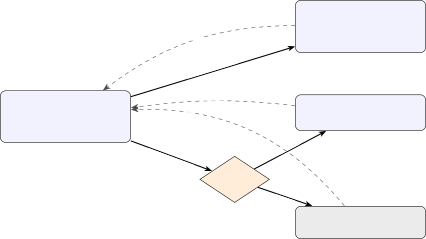
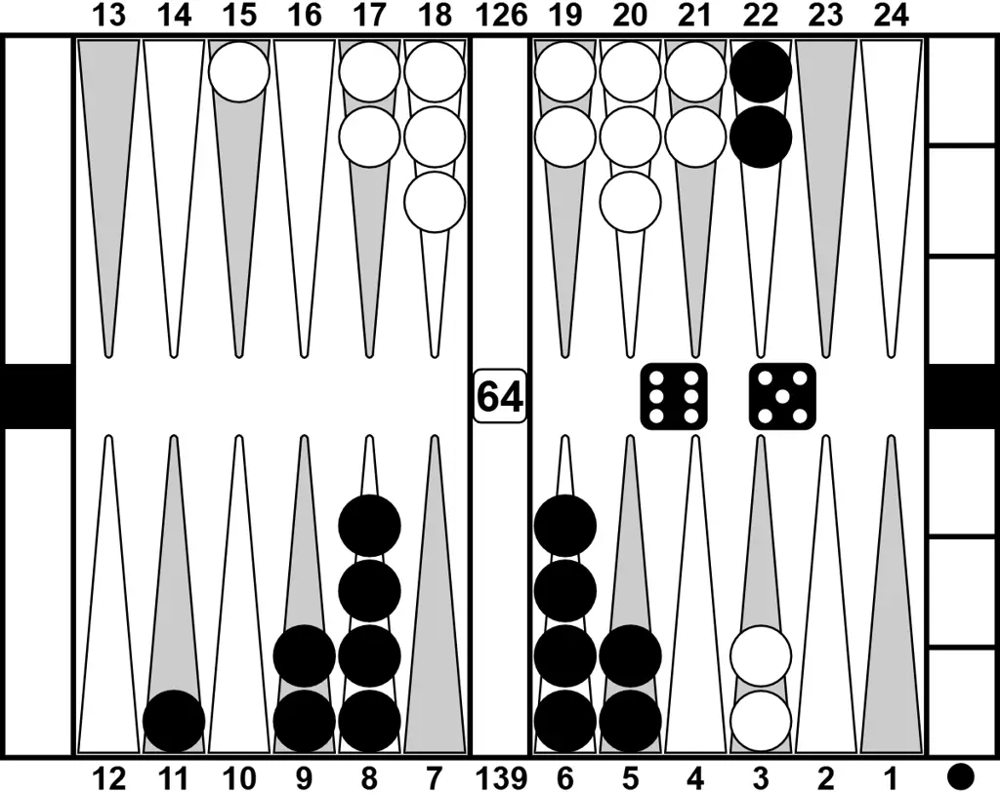
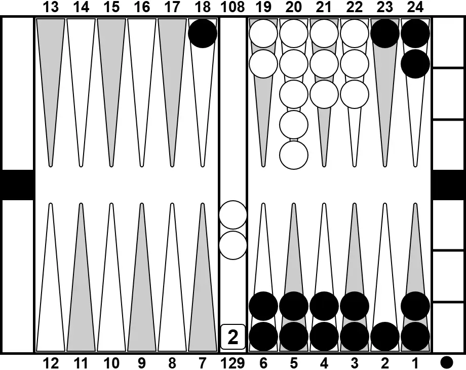
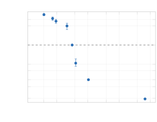
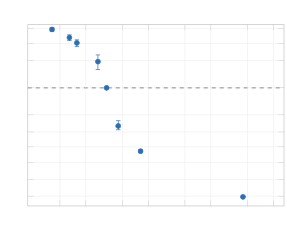
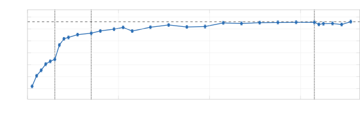
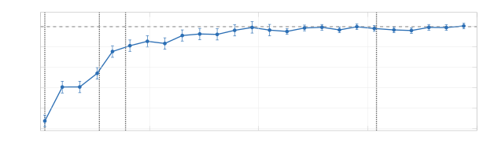
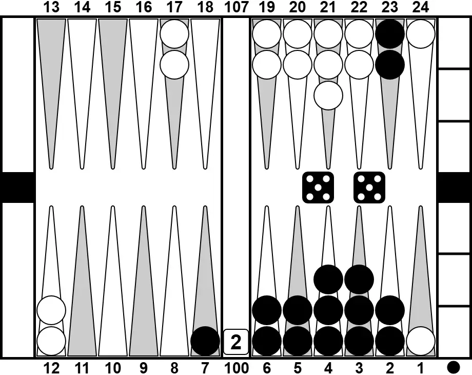

# PureTD: Reinforcement Learning for Backgammon Money Games with No Evaluation-time Search

Alexander Strehl astrehl@gmail.com Affiliation: Independent Researcher

###### Abstract

We revisit Tesauro’s TD-Gammon for backgammon money games in the setting
of no evaluation-time search. Both checker play and cube action (use of
the doubling cube) are learned from scratch via self-play reinforcement
learning (RL), with minimal hand-coded logic and no expert features. In
this setting, we demonstrate that pure self-play RL suffices to train
models that reach near-state-of-the-art playing strength. Specifically,
for cubeful money games, our search-free model evaluates faster and is
substantially stronger than the open-source engines GNU Backgammon and
Open Sage running a one-move (1-ply) look-ahead search. Our method of
training a cubeful model also outperforms the standard approach of
training a cubeless model and deriving cubeful equity with
Janowski-style formulas, when the two models are equally sized.

## 1 Introduction

Computer backgammon engines combine two components at decision time: a
learned _position evaluator_, typically a neural network that maps a
board state to an equity (we use _evaluator_, _model_, and _network_
interchangeably), and an _expectimax search_ that computes an
expectation of the evaluator’s scores over the game states reached after
$`n`$ further turns. In the shallowest possible search, for a given
board state, an action is selected by querying the evaluator on the
resulting position for each candidate move and picking the move that
maximizes the evaluator’s score. Throughout this paper we use the
terminology in which “0-ply” describes this procedure, where the
evaluator is consulted directly with no look-ahead, and “$`n`$-ply”
means a look-ahead expanding $`n`$ turns. We focus primarily on the
0-ply setting. Concretely, we ask: how strong can a backgammon agent be
made if its decisions are produced by a single forward pass of a neural
network per candidate move?

While the strength of an evaluator is worth studying in isolation,
maximizing it is not the objective for a backgammon engine, which must
optimize the full system (evaluator combined with search). Viable
engines such as GNU Backgammon (gnubg) (GNU Backgammon Developers, 2024)
must therefore balance stronger but larger networks against smaller ones
that evaluate faster during search. This paper, by contrast, optimizes a
single evaluator’s strength. However, our models do not simply trade
more computation for more strength: for both cubeless and cubeful money,
our models at 0-ply are both stronger and at least $`3.5\times`$ faster
than the open-source engines gnubg and Open Sage (Higgins, 2026a)
running a 1-ply search.

Despite its limitations, a study of the 0-ply setting remains valuable
for a couple of reasons. First, a stronger evaluator is broadly expected
to yield a stronger engine once combined with search, and capping
network size prematurely risks limiting what the full system can
ultimately achieve. Second, the 0-ply setting is of interest in its own
right, in the spirit of searchless chess (Ruoss et al., 2024), and
offers a useful data point on the ceiling reachable by self-play RL.

#### Money games and the doubling cube.

Backgammon money games and match play include the _doubling cube_, which
starts at a value of $`1`$. Initially the cube is “centered” and owned
by neither player. At the beginning of a turn and before the dice are
rolled, if the cube is centered or owned by the player on roll, they can
offer_double, proposing to double the cube value and with it the stakes.
The opponent must either accept (take), continuing the game at the
doubled value and taking ownership of the cube, or refuse (pass),
conceding the current cube value and ending the game. A money game ends
either when a double is passed or when a player bears off all of their
checkers. In the latter case, the game is scored as a normal win, a
gammon, or a backgammon, in which the winner gains $`c`$, $`2c`$, or
$`3c`$ respectively and the loser loses the same amount, where $`c`$ is
the current cube value. A passed double is worth $`c`$. In cubeless
play, $`c=1`$ throughout. The _equity_ of a position is a player’s
expected signed outcome from it. How a player chooses to handle the cube
in a given position is called the _cube action_. Finding optimal cube
actions is difficult, since they depend on win and gammon rates, on the
cube’s current ownership, and on the recube vigorish, the future value
of being able to redouble (Backgammon Galore, 2024). The inclusion of
the doubling cube also changes the optimal checker play in significant
ways (Schiemann, 2026, Ch. 13), and the required adjustments challenge
even the strongest players. For a specific example, see Appendix H,
where Zdenek Zizka, one of the world’s top players, chose a play that
dominates the optimal cubeful play on all six cubeless components (wins
and losses, gammons won and lost, backgammons won and lost), but is
nevertheless a major error.

#### Open-source pipeline and large-scale evaluation.

We release a complete training pipeline and evaluate the resulting
models in two complementary ways. The first is an offline error-rate
metric for cubeful money, eXtreme Gammon’s XG++ Performance Rating (PR,
lower is better). The second is head-to-head play against gnubg and Open
Sage at 0-ply and 1-ply, in both cubeless and cubeful money.

#### Code and reproducibility.

Code, trained models, and commands to reproduce the released models and
the main evaluations are released under the MIT license at
[https://github.com/alexstrehl/backgammon-ai-engine](https://github.com/alexstrehl/backgammon-ai-engine).
All results in this paper correspond to commit 18b0a80d258e. Training
code and preliminary results have been public since April 2026.

### 1.1 Contributions

Backgammon is a popular stochastic game with a large branching factor,
given that every turn passes through a chance node with 21 distinct
outcomes. It remains a natural testbed for RL methods, and discoveries
made on it may apply to similar games in the future. Modern backgammon
also includes the doubling cube, which increases the challenge and
complexity. As one indication of the added complexity, measured on a
game tree in which each edge is one complete turn of the player on roll,
the branching factor nearly doubles, from approximately 400 for cubeless
play to 750 for cubeful play (Appendix G).

Virtually all of the strongest modern engines, including eXtreme Gammon
(XG) (Dufaure de Citres, 2011a) and gnubg, use an evaluator trained on
cubeless money games and adapt it to cubeful money games (and match
play) by computing cubeful equity heuristically from Janowski’s
formulas (Janowski, 1993; Madsen, 2026a) (Appendix J). The main
contribution of this paper is to demonstrate that for money games, a
simple RL method suffices to train competitive evaluators that learn
cubeful play end-to-end.

To achieve a cubeful evaluator, we follow Lin (2020) and extend the
agent’s action space with the doubling decision (offer_double versus
no_double) at the start of a turn, treating it as an ordinary state
transition learned via self-play RL. Unlike Lin, we generate a TD update
for every cube decision, including no_double, and add an input flag that
lets the network distinguish a cube decision from the subsequent checker
play (Sec. 3.3). In Sec. 4.5 we find that this approach outperforms the
standard Janowski-style cube handling on similarly sized models.

While there has been significant prior work on RL for
backgammon (Tesauro, 1995; Antonoglou et al., 2022), studies that
measure computational cost against evaluator strength have been limited.
As a final engine will always combine the evaluator with a run-time
search, the computational cost is critical. We report playing strength
against evaluation cost for our models and two baselines (Sec. 4.3).

BGBlitz (Berger, 2025) and the author of Octopus (Sec. 2) report that
self-play RL alone suffices for extremely strong play, but to our
knowledge ours is the first such study to publish exact recipes and code
(Sec. 3). We show that with larger networks and a few modern changes to
the learning procedure, specifically ReLU instead of sigmoid
activations, batch training, and exact-Bellman updates, the TD-Gammon
procedure alone is sufficient to produce a near-state-of-the-art 0-ply
evaluation function for money games. This is not the route many recent
engines have taken. In 2026 alone, at least four new strong engines
appeared (Sec. 2). The three with documented training, Open
Sage (Higgins, 2026a), Raccoon (Madsen, 2026b), and Whittington’s
Backgammon-NN (Whittington, 2026), all use a mature engine, gnubg, to
compute the targets. All three report trying self-play RL first and
reaching a plateau significantly below the final model’s strength.

Finally, there is growing interest in applying more expensive methods to
backgammon, including larger models and more complex and expensive
self-play in the style of AlphaZero (Antonoglou et al., 2022; Madsen,
2026b). Our results give a baseline for what a relatively simple
learning strategy can achieve, and include preliminary findings on the
effect of model size on evaluator strength (Sec. 4.6).

## 2 Background and Related Work

#### Temporal-difference (TD) learning and the TD-Gammon formulation.

The standard approach to computer backgammon is to train a model,
typically a neural network of limited depth, that given a position $`s`$
outputs the approximate value $`V(s)`$ of the position for a given
player. At play time, games proceed by picking the action that the model
predicts is best from the current state. Formally, the game is a
two-player zero-sum alternating Markov game (Condon, 1992; Littman &
Szepesvári, 1996). Despite the name, the players need not strictly
alternate. For example, when the player on roll can double but chooses
not to (Sec. 3.3), that same player stays on roll and acts again.
Optimal play then satisfies a Bellman equation of the same form as for a
Markov decision process (MDP) (Sutton & Barto, 2018, §3.6), with
$`\max`$ at one player’s states and $`\min`$ at the other’s.

For ease of exposition, equations in this paper use the convention that
$`V(s)`$ is the value of state $`s`$ for a fixed reference player, the
_maximizer_, whose goal is to maximize $`V`$ at every state, while the
opponent correspondingly minimizes $`V`$ (equivalently, maximizes
$`-V`$). Because the reference player is fixed, no state transition
induces a sign change in $`V`$, whether or not the on-roll player
changes. This lets every displayed value equation use a single $`\max`$,
stated for a state with the maximizer on roll. When the opponent is on
roll, the same equations hold with $`\min_{a}`$ in place of
$`\max_{a}`$, which completes the recursion.¹¹ 1 For an action that ends
the current player’s turn, expanding one further ply makes the
suppressed minimization explicit:
$`V^{*}(s)=\max_{a}\mathbb{E}_{s^{\prime}\sim T(s,a)}\!\bigl[\min_{a^{\prime}}\mathbb{E}_{s^{\prime\prime}\sim T(s^{\prime},a^{\prime})}[\,V^{*}(s^{\prime\prime})\,]\bigr]`$,
where $`s^{\prime}`$ has the opponent on roll (hence the $`\min`$). An
equivalent way to express all cases in Eq. (1) is
$`V^{*}(s)=\sigma(s)\max_{a}\mathbb{E}_{s^{\prime}\sim T(s,a)}\bigl[\sigma(s)\,V^{*}(s^{\prime})\bigr]`$,
where $`\sigma(s)=+1`$ if the maximizer is on roll at $`s`$ and $`-1`$
otherwise.

For an optimal value function $`V^{*}`$, Bellman’s equation requires

```math
V^{*}(s)\;=\;\max_{a}\;\mathbb{E}_{s^{\prime}\sim T(s,a)}\bigl[\,V^{*}(s^{\prime})\,\bigr], \tag{1}
```

where $`T(s,a)`$ is the transition distribution over next states induced
by action $`a`$. The game is undiscounted and has no intermediate
rewards. At a terminal state, $`V^{*}`$ equals the signed outcome for
the maximizer (Sec. 1), so Eq. (1) has no reward term.

During self-play, the maximizer chooses actions greedily using the
current value estimate $`V`$,

```math
a^{\star}\;=\;\arg\max_{a}\;\mathbb{E}_{s^{\prime}\sim T(s,a)}\bigl[\,V(s^{\prime})\,\bigr], \tag{2}
```

and the opponent symmetrically takes $`\arg\min`$. The model is trained
incrementally to be consistent with Bellman’s equation. For backgammon
specifically, we found little benefit to any explicit exploration during
training, as natural variation is provided by the dice rolls and by the
many stages of training.

Tesauro’s TD-Gammon (Tesauro, 1995; Sutton & Barto, 2018, §§6.8, 16.1)
used a clever technique to reduce the variance of the TD training
targets, based on decomposing a state into a stochastic dice roll and a
deterministic part. Define a _pseudo-state_ $`x`$ as a backgammon
position _before_ the dice are rolled, closely related to the
afterstates of Sutton & Barto (2018, §6.8). Rolling $`d`$ from $`x`$
yields a state $`s_{x,d}`$, from which the player on roll selects a
checker play $`a`$. For any pseudo-state $`x`$,

```math
V^{*}(x)\;=\;\mathbb{E}_{d\sim\mathcal{D}}\bigl[\,V^{*}(s_{x,d})\,\bigr]\;=\;\mathbb{E}_{d\sim\mathcal{D}}\bigl[\,\textstyle\max_{a}Q^{*}(s_{x,d},a)\,\bigr]\;=\;\mathbb{E}_{d\sim\mathcal{D}}\bigl[\,\textstyle\max_{a}V^{*}\!\bigl(\tilde{T}(s_{x,d},a)\bigr)\,\bigr], \tag{3}
```

where $`\mathcal{D}`$ is the distribution over the 21 distinct dice
rolls, $`\tilde{T}(s,a)`$ is the deterministic next pseudo-state reached
by playing action $`a`$ in state $`s`$, and
$`Q^{*}(s,a)=V^{*}\!\bigl(\tilde{T}(s,a)\bigr)`$ is the value of playing
$`a`$ in state $`s`$, which equals the expectation
$`\mathbb{E}_{s^{\prime}\sim T(s,a)}[V^{*}(s^{\prime})]`$ of Eq. (1).
Evaluators are trained directly on pseudo-states, which cleanly reduces
input dimensionality and the complexity of learning by avoiding any
encoding of the dice.

The decomposition of Eq. (3) suggests two ways to form a regression
target for $`V(x)`$: a _sampled-Bellman target_ that samples a single
dice roll $`d\sim\mathcal{D}`$ and backs up the value of the greedy
continuation, and an _exact-Bellman target_ that instead averages over
all 21 rolls (the right-hand side of Eq. (3)), removing the dice
variance at the cost of enumerating every roll. We define both targets
formally in Sec. 3.2.

#### Cube normalization.

In practice, for a fixed state $`s`$, our model produces a value
$`V^{\text{model}}(s)`$ representing the equity of the position for the
player on roll per unit of the current cube value $`c(s)`$. Thus there
is a direct correspondence between the model and $`V`$ as used in the
equations: $`V(s)=c(s)\,V^{\text{model}}(s)`$ when the maximizer is on
roll and $`V(s)=-c(s)\,V^{\text{model}}(s)`$ otherwise. This
normalization keeps outputs in a stable numeric range across cube levels
and encodes the theoretical fact that money-game equity scales linearly
with the cube, and thus the optimal checker play and cube decisions are
identical at every cube value of $`2`$ or greater (Dufaure de Citres,
2011b; Lin, 2020).

#### TD-Gammon’s historical ceiling.

The canonical pure-self-play RL backgammon agent is Tesauro’s
TD-Gammon (Tesauro, 1992; Tesauro, 1995), which trained a shallow
feed-forward network with TD$`(\lambda)`$ (Sutton, 1988). It was the
strongest backgammon program of its time and a major breakthrough.
Subsequent engines surpassed TD-Gammon’s level, but typically only by
replacing self-play TD with more specialized training (see _RL vs SL
training for backgammon_ below). TD-Gammon included a $`\lambda`$
parameter that controlled the time-horizon used for training targets.
TD-Gammon with $`\lambda=0`$ is essentially the sampled-Bellman variant
of the above method where we train the model after every action during
self-play via online stochastic gradient descent. We did not experiment
with non-zero $`\lambda`$ values. Tesauro himself later found
$`\lambda=0`$ competitive with small non-zero values at roughly half the
computational cost per step, and used it for most subsequent TD-Gammon
training (Tesauro, 2002). Our exact-Bellman backups are conceptually
related to non-zero $`\lambda`$ values, enriching the target by
averaging over all 21 dice outcomes rather than by extending the
look-ahead along the sampled trajectory.

#### GNU Backgammon.

gnubg (GNU Backgammon Developers, 2024) is an open-source backgammon
engine that is a standard baseline. Its evaluator consists of three
specialized single-hidden-layer neural networks ($`\sim`$30k weights
each) for distinct game phases (contact, race, crashed) with
hand-engineered features.²² 2 A contact position is one in which future
hits are possible. A race is a non-contact position. A crashed position
is a technical subtype of contact position. The engine also uses a
precomputed bearoff database for common endgame positions. At run time
its networks are combined with $`n`$-ply expectimax search.

#### Open Sage.

Open Sage (bgsage) (Higgins, 2026a) is a recently released and actively
developed open-source engine. Its evaluator is an ensemble of 21
distinct neural networks specialized to different game phases. Each has
a single hidden layer, with roughly 100k parameters for the more common
contact positions and 20k for pure races. Its documented training
pipeline relies on gnubg’s published rollout databases, so unlike a pure
self-play system, its training methodology depends on an existing strong
engine. Like gnubg, it relies on multi-ply search and computes cube
decisions from a cubeless evaluator rather than learning them. Its
developer reports rough parity with XG, measured at 2-ply
truncated-rollout evaluation (Open Sage’s “3T” setting in its own ply
convention) (Higgins, 2026b). We caution, however, that strength
measured at a fixed search depth or rollout budget does not by itself
establish a stronger engine, since it omits the per-decision
computational cost.

#### RL vs SL training for backgammon.

Neither gnubg nor Open Sage is trained by self-play TD alone. The
technique, confirmed for Open Sage and, we believe, also used by gnubg,
is to first train an evaluator with TD self-play until performance
plateaus, then refine it on a selected set of positions whose targets
are computed by averaging repeated rollouts of an existing model. This
refinement is itself a form of RL: a Monte-Carlo value estimate whose
variance is reduced by averaging rollouts, though it is often referred
to as a supervised learning (SL) phase. Restricting refinement to a
selected set of positions is reminiscent of the emphasis on hard
examples in boosting-style training.

#### The doubling cube and Janowski’s formulas.

Janowski’s analytic formulas (Janowski, 1993; Madsen, 2026a) compute
approximate cubeful equity and double/take points from cubeless win
equity and gammon rates. They interpolate between a dead-cube model and
the continuous (live-cube) model of Keeler & Spencer (1975) via an
empirically tuned cube-life index $`x`$. Most engines learn evaluators
that model cubeless equity, including gnubg and XG (Dufaure de Citres,
2011b), and apply heuristics based on these formulas at inference time,
treating cube decisions as a post-hoc adjustment rather than something
the network itself learns. Specifically, gnubg computes cubeful equity
as a piecewise-linear function of the cubeless win probability, with
breakpoints determined by Janowski’s formulas (Appendix J). Note that
applying these heuristics to a cubeless money model yields an
approximation of the cubeful equity for any position, and thus provides
a method for determining both cube action and cube-aware checker play
from a cubeless model.

#### Prior RL-native cube work.

The closest prior work is Lin (2020), who first proposed integrating
cube actions into the agent’s action space and reported results for
match play. Our work differs in several ways. First, we fix a key
conceptual error in the formulation that leads to suboptimal play
(Sec. 3.3). Second, Lin’s results are not measured against a
Janowski-style baseline or a strong engine such as gnubg. Third, Lin
used networks with a single hidden layer of roughly 48k weights. Our
563k-parameter cubeful model is an order of magnitude larger, trained
with modern techniques including exact-Bellman backups, and evaluated
directly on cubeful money play against both gnubg and a Janowski-style
baseline.

#### Exact-Bellman updates.

Hilton (2019) experimented with exact-Bellman updates. He argued that
the technique is naturally situated between TD-Gammon’s sampled targets
and the much slower but more accurate targets used by AlphaZero’s MCTS
search (Silver et al., 2018). We use this technique as a refinement
phase in our training pipeline (Sec. 3.2).

#### Other modern backgammon RL.

XG is closed-source and widely regarded as one of the strongest
available backgammon engines. The details of its training are not
publicly documented. BGBlitz (Berger, 2025), a closed-source engine
whose performance is similar to gnubg, and Octopus
(Ø. Schønning-Johansen, personal communication, 2026), an unreleased
model, both report reaching super-human strength through _self-play RL
training_. Both train a cubeless model and extend to cubeful play with
Janowski’s formulas rather than learning cube decisions directly.

Stochastic MuZero (Antonoglou et al., 2022) extends MuZero’s
learned-model MCTS planning to stochastic environments. In backgammon it
matches an AlphaZero baseline that plans with a true simulator, and
exceeds gnubg 3-ply with large searches, though it stops short of a full
evaluation that accounts for run-time cost. It does not handle cubeful
money play, however, and its implementation is not publicly available.

Two other open-source projects are noteworthy: wildbg (Wenderdel, 2024)
(supervised plus search) and Hilton (2019) (RL, discussed above).
wildbg’s training-pipeline design informed our model architecture.

#### Recent engines.

Several extremely strong backgammon engines were released during the
preparation of our work and are under development. They all use cubeless
models and achieve cubeful play via Janowski-style methods.

Hedgehog (Lambooij, 2026a) is self-described as “an NNUE-style
neural-network evaluator with incremental accumulation and Highway
SIMD.” It was first published on May 21, 2026, and gained support for
the Jacoby rule on August 10, 2026. Hedgehog’s published
benchmarks (Lambooij, 2026b) report that, at 0-ply over $`10^{7}`$
cubeful money games against gnubg’s network running under Hedgehog’s own
search, Fox (version 0.2) wins 27.7 milli-equity per game (mEq/game) and
the premium Colossus model wins 67.3 mEq/game. No training code or
methodology is publicly available for Hedgehog. As a newer engine it is
not one of our primary baselines, but Appendix K reports strength and
evaluation cost of its two strongest publicly available models under the
benchmarks used throughout this paper.

Raccoon (Madsen, 2026b) is an ongoing research project and backgammon
engine built around a 10-block, 256-channel residual network. Its
developer reports that pure self-play from scratch plateaued well short
of gnubg, and that its published results instead come from distillation
of gnubg 2-ply (Madsen, 2026b). The resulting network shows very strong
0-ply performance at significant run-time cost, winning about 47
mEq/game against gnubg 0-ply over 18,000 cubeless money games (Madsen,
2026c) while evaluating roughly 3,500 times fewer positions per second
than gnubg (Madsen, 2026d). Cubeful play, without the Jacoby rule, was
added to the repository in September 2026.

Whittington’s Backgammon-NN (Whittington, 2026), released in July 2026,
trains its current network on 22.5 million positions labeled by gnubg’s
2-ply evaluation, after earlier self-play networks plateaued. The author
reports a loss of 113 mEq/game at 0-ply against gnubg 2-ply. It is
distributed as a free binary, with source available for viewing but not
under an open-source license.

Rather than benchmark every available engine, we compare against the
strongest open-source engines supporting cubeful money-game play with
the Jacoby rule as of July 15, 2026, our cutoff for selecting baselines.
To the best of our knowledge, these were gnubg and Open Sage. For both
we use the latest release available when we ran our experiments
(Appendix A).

## 3 Method

### 3.1 Board Encoding

For the feature representation, we adopt Tesauro’s per-point thermometer
board encoding (Tesauro, 1995; described in Sutton & Barto, 2018,
§16.1): four features per point per player, with separate binary units
for one-or-more, two-or-more, and three-or-more checkers, plus a fourth
feature encoding the number of additional checkers (the surplus beyond
three, halved), together with scalar features for the checkers on the
bar and borne off. We use a _perspective encoding_, always calling the
network from the perspective of the side to play and moving in a fixed
direction, for a total of 196 base features. Although a minor detail,
this choice encodes a basic symmetry of backgammon. For example, every
backgammon player knows to “make the 5-point” on a first roll of
$`(3,1)`$ regardless of whether they are moving clockwise or
counter-clockwise. The cubeful model has four additional cube-specific
features as described in Sec. 3.3.

### 3.2 Architecture and Training Pipeline

#### Architecture.

Our models are multilayer perceptrons (MLPs) implemented in PyTorch. The
cubeful money model has 200 inputs feeding four hidden layers of sizes
$`[512,512,256,256]`$, for a total of 563k parameters. All hidden layers
use ReLU activations, replacing the sigmoid units of the original
TD-Gammon. As expected, we found that increasing the network size
improves playing strength at a higher evaluation cost. The current
topology was chosen as a subjective balance between the two, and
Sec. 4.6 reports preliminary experiments with other sizes.

#### Output heads.

For cubeful money, the output is linear and interpreted as _equity per
unit cube value_, and realized equity is output $`\times`$
current_cube_value (see “Cube normalization” in Sec. 2).

#### Training loop.

TD-Gammon trained via online learning, interleaving self-play moves with
stochastic-gradient-descent updates. On modern hardware we found it more
practical to decouple self-play data collection from model training,
yielding a batch-style pipeline. At each round we play $`N`$ games
($`N=1{,}000`$ in all our reported results) with the current network as
both players, compute a regression target for every visited state, then
run one epoch of minibatch SGD with Adam (Kingma & Ba, 2015). Rounds
repeat with fresh self-play data. For reference, on a single
high-core-count AMD Ryzen Zen 5 workstation with a consumer GPU,
training runs at roughly $`3{,}800`$–$`4{,}000`$ games/s with
sampled-Bellman backups and $`750`$–$`880`$ games/s with exact-Bellman
backups. In total, retraining our production cubeful model (the
four-layer $`[512,512,256,256]`$ network) requires approximately 250M
self-play games ($`{\sim}`$60M sampled-Bellman, $`{\sim}`$190M
exact-Bellman), or about $`70`$ wall-clock hours on such a machine
(Appendix F).

#### Progressive expansion and cross-task transfer.

The final $`[512,512,256,256]`$ network was trained incrementally,
reusing weights across both architectures and tasks. Beginning from a
single hidden-layer network, we alternately _widened_ and _deepened_ the
network in stages
($`[80]\to[150]\to[150,150]\to[256,256]\to[256,256,256]\to[512,512,256]\to[512,512,256,256]`$),
each time transferring the existing parameters into the larger network.
Widening adds units whose connections into the existing units and the
output have zero-initialized weights, which preserves the function
exactly, and deepening inserts an identity-initialized layer in the
style of Net2Net (Chen et al., 2016), which preserves the function up to
a small symmetry-breaking perturbation. We also transferred across
tasks: a double-match-point (DMP, i.e. one-point matches) network
warm-started a four-layer cubeless base, reusing the hidden layers while
re-initializing the output head to predict equity, which in turn
warm-started the cubeful-money model by extending the input layer with
the cube features. A brief learning-rate warmup after each task
transition improved stability: rather than resuming at the full learning
rate, we linearly ramped it from roughly $`10\%`$ of its target value up
to the target over the first $`20`$ training rounds. All parameters
remained trainable at every stage (no weights were frozen). We found
that this simple form of transfer reused learned representations and
accelerated training relative to learning each task from scratch.

The production models were trained over a period of months, and their
exact per-stage settings were not preserved. In Appendix F we give exact
settings to train both the cubeful-money and cubeless (prob5, Sec. 4.2)
models from scratch, and Figure 4 tracks their playing strength over the
course of training. We ran each recipe twice and the resulting models
were similar in strength. In head-to-head play against our production
models over $`2\times 10^{7}`$ games per run, the 95% confidence
interval of equity (capped at $`\pm 128`$ for cubeful play) contained
$`0`$ for both cubeful reruns and one prob5 rerun, while the other prob5
rerun trailed production by $`1.0`$ $`[0.4,1.6]`$ mEq/game. All four
point estimates are within about $`1`$ mEq/game of production.

#### Training targets: sampled vs. exact backups.

Let $`x`$ be any pseudo-state (Sec. 2), and recall that rolling
$`d\sim\mathcal{D}`$ yields the state $`s_{x,d}`$, from which any action
$`a`$ leads deterministically to the next pseudo-state
$`\tilde{T}(s_{x,d},a)`$. We use one of two training targets, both
regressing $`V(x)`$. The _sampled-Bellman_ target estimates the value
from a single dice roll,

```math
y^{\text{sampled}}(x)\;=\;\textstyle\max_{a}V\!\bigl(\tilde{T}(s_{x,d},a)\bigr),\qquad d\sim\mathcal{D}, \tag{4}
```

i.e. it rolls once, plays greedily, and records the value of the
resulting pseudo-state. The _exact-Bellman_ target instead takes the
full expectation over all 21 rolls,

```math
y^{\text{exact}}(x)\;=\;\mathbb{E}_{d\sim\mathcal{D}}\bigl[\,\textstyle\max_{a}V\!\bigl(\tilde{T}(s_{x,d},a)\bigr)\,\bigr], \tag{5}
```

yielding an exact-Bellman backup equivalent to the “1-ply amplified
equity” target of Hilton (2019). We use sampled-Bellman backups for the
initial training (roughly $`5\times`$ faster per transition) until a
plateau is reached, then switch to exact-Bellman backups until a second
plateau is reached.

### 3.3 The Doubling Cube as an Action-Space Extension

Standard engines handle the cube with Janowski’s formulas applied on top
of a cubeless evaluator (Sec. 2). We instead treat _cube-offer
decisions_, in which the player on roll must decide whether to double,
as ordinary actions in the agent’s action space, which is arguably a
more natural RL formulation. These decisions occur at the beginning of
the side-to-move’s turn, provided the cube is centered or owned by the
mover. As no dice are rolled during a cube-offer decision, transitions
are deterministic and we can apply Eq. (1) directly, with the
maximization ranging over the cube actions
$`\{\texttt{no\_double},\texttt{offer\_double}\}`$. A cube-decision
state is a pre-roll position, but it is not a pseudo-state in the sense
of Eq. (3), which describes checker-play decisions.

For cubeful money play we extend the input to 200 features by adding
three one-hot cube-ownership features (cube_centered, cube_own,
cube_opp_own) and a binary is_cube_action flag marking cube-decision
positions. The flag is $`1`$ when the on-roll player faces a cube-offer
decision. It is $`0`$ when the on-roll player either has no access to
the cube or has already decided not to double, in which case the
position calls for a checker decision. Note that when is_cube_action is
$`0`$, the dice have not yet been rolled, so the position is a
pseudo-state (Sec. 2). Table 1 enumerates the combinations these four
features can take and the corresponding decision they encode.

| cube_centered | cube_own | cube_opp_own | is_cube_action | Decision for the player on roll |
| ------------- | -------- | ------------ | -------------- | ------------------------------- |
| 1             | 0        | 0            | 0              | checker decision                |
| 1             | 0        | 0            | 1              | cube offer (initial cube)       |
| 0             | 1        | 0            | 0              | checker decision                |
| 0             | 1        | 0            | 1              | cube offer (recube)             |
| 0             | 0        | 1            | 0              | checker decision                |
| 0             | 0        | 1            | 1              | not a legal configuration       |

Table 1: Cube-specific features.

Because these transitions are deterministic, the sampled and exact
targets of a cube-offer decision coincide:

```math
y^{\text{sampled}}(s)\;=\;y^{\text{exact}}(s)\;=\;\textstyle\max_{a}V\!\bigl(\tilde{T}(s,a)\bigr). \tag{6}
```

Thus, during exact-Bellman training, our code takes the more expensive
expectation over dice rolls for checker plays but uses the cheaper
update of Eq. (6) for cube-offer decisions.

When a cube is offered, the player faces a take/pass decision. We
resolve this greedily with respect to the learned value function $`V`$,
taking the cube when the resulting position is worth more than conceding
the current cube value and passing otherwise. Thus, the decision is
driven by the learned evaluator. Take and pass could instead be modeled
as explicit learned actions with their own input flag and TD sample, but
this cannot help at the Bellman fixed point. The take/pass node involves
no dice and, unlike the cube-offer state, is never reached directly
after a checker play. Its two successors are a terminal state worth
exactly the current cube value and the post-take pseudo-state, which the
network already evaluates. Its optimal value is therefore the
deterministic $`\min(V_{\mathrm{take}},V_{\mathrm{pass}})`$ of
Algorithm 1, and a separately learned estimate of it could only add
approximation error and extra computation.

Cubeful backgammon money games are most commonly played with the _Jacoby
rule_, under which a gammon or backgammon counts as more than a normal
win only after the cube has been turned (offered and accepted at least
once). During training, our code handles this directly for the on-roll
player during a cube-offer decision: when the cube is centered, it
offers a double whenever the opponent will pass.

Algorithm 1 provides pseudo-code for cube-offer decisions and their
subsequent TD update during self-play. The single $`\max`$ in Eq. (6)
and the explicit $`\min`$ in Algorithm 1 are consistent. In the
equation, the opponent’s take/pass response is folded into the successor
value $`V(\tilde{T}(s,\texttt{offer\_double}))`$, as the pseudo-state
reached after the _cube-offer_ is whatever the opponent’s
equity-minimizing response leads to. Algorithm 1 instead resolves that
response concretely as
$`V_{\mathrm{double}}=\min(V_{\mathrm{take}},V_{\mathrm{pass}})`$. The
factor of $`2`$ in the $`V_{\mathrm{take}}`$ calculation reflects that a
take doubles the stake. It appears as a constant rather than depending
on the current cube level because $`V^{\text{model}}(\cdot)`$ returns
equity from the mover’s view normalized by the current cube value (see
“Cube normalization” in Sec. 2).

 Input: the encoded board $`\mathit{board}`$ at a cube-offer decision,
the cube-ownership binary indicators cube_centered and cube_own (exactly
one of which is $`1`$), and the current evaluator $`V^{\text{model}}`$.

 Notation: a state concatenates the encoded board with a 4-tuple of
binary cube features
$`(\langle\text{cube centered}\rangle,\langle\text{cube owned by us}\rangle,\langle\text{cube owned by opponent}\rangle,\langle\text{is cube action}\rangle)`$,
in that order. $`V^{\text{model}}(\cdot)`$ is a forward pass of the
evaluator (equity from the mover’s view normalized by the cube’s value),
which $`\mathrm{TD\_update}`$ trains toward the target.

 

 $`\mathit{cube}\leftarrow(\texttt{cube\_centered},\texttt{cube\_own},0,1)`$
 // current decision is a cube action

 $`s\leftarrow\mathrm{concat}(\mathit{board},\mathit{cube})`$  //
current state

 

 // Value of not doubling (cube unchanged, next is a checker decision)

 $`\mathit{cube}_{\mathrm{nd}}\leftarrow(\texttt{cube\_centered},\texttt{cube\_own},0,0)`$

 $`V_{\mathrm{no\_double}}\leftarrow V^{\text{model}}(\mathrm{concat}(\mathit{board},\mathit{cube}_{\mathrm{nd}}))`$

 

 // Value if we double and the opponent takes (opponent now owns the
cube, stake doubles)

 $`\mathit{cube}_{\mathrm{dt}}\leftarrow(0,0,1,0)`$

 $`V_{\mathrm{take}}\leftarrow 2\cdot V^{\text{model}}(\mathrm{concat}(\mathit{board},\mathit{cube}_{\mathrm{dt}}))`$

 

 // If we double and the opponent passes, we win the current cube value
(normalized to 1)

 $`V_{\mathrm{pass}}\leftarrow 1`$

 

 // The opponent takes or passes to minimize our equity

 $`V_{\mathrm{double}}\leftarrow\min(V_{\mathrm{take}},V_{\mathrm{pass}})`$

 $`\mathit{opp\_passes}\leftarrow(V_{\mathrm{take}}>V_{\mathrm{pass}})`$

 

 // We pick the cube action that maximizes our equity under the Jacoby
rule

 if $`\texttt{cube\_centered}=1`$ and $`\mathit{opp\_passes}`$ then

  $`\mathit{cube\_decision}\leftarrow\texttt{double\_pass}`$,
 $`V_{\mathrm{target}}\leftarrow V_{\mathrm{pass}}`$  // Jacoby rule
logic

 else if ($`\mathit{opp\_passes}`$ and
$`V_{\mathrm{no\_double}}\leq 1`$) or (not $`\mathit{opp\_passes}`$ and
$`V_{\mathrm{take}}>V_{\mathrm{no\_double}}`$) then

  if $`\mathit{opp\_passes}`$ then

   $`\mathit{cube\_decision}\leftarrow\texttt{double\_pass}`$,
 $`V_{\mathrm{target}}\leftarrow V_{\mathrm{pass}}`$

  else

   $`\mathit{cube\_decision}\leftarrow\texttt{double\_take}`$,
 $`V_{\mathrm{target}}\leftarrow V_{\mathrm{double}}`$

  end if

 else

  $`\mathit{cube\_decision}\leftarrow\texttt{no\_double}`$,
 $`V_{\mathrm{target}}\leftarrow V_{\mathrm{no\_double}}`$

 end if

 

 // Trains model: TD update of the current state toward the chosen
successor value

 $`\mathrm{TD\_update}(\text{input}=s,\ \text{target}=V_{\mathrm{target}})`$

 

 if $`\mathit{cube\_decision}=\texttt{double\_pass}`$ then

  the game terminates and we win the current cube value

 else

  proceed to the checker decision for the same player and board (roll
the dice and choose action)

 end if

Algorithm 1 PureTD training for cube decisions

We work through two examples.

Example 1. Suppose the agent owns the doubling cube (having previously
taken a cube) and is on roll with board $`b`$, so it must decide whether
to redouble. The current state $`s`$ consists of $`b`$ together with the
cube-ownership one-hot vector
$`\mathbf{c}=(\texttt{cube\_centered},\texttt{cube\_own},\texttt{cube\_opp\_own})`$
and the flag is*cube_action. Here $`\mathbf{c}=(0,1,0)`$ (the agent owns
the cube) and $`\texttt{is\_cube\_action}=1`$ (the agent faces a cube
decision). To make a decision, the agent evaluates the possible next
pseudo-states, each of which is either terminal or shares the same board
$`b`$. Not redoubling leads to a pseudo-state $`s*{\text{no-recube}}`$
with $`\mathbf{c}=(0,1,0)`$ and $`\texttt{is_cube_action}=0`$. When
redoubling, the on-roll player computes whether the opponent will take
or pass, a decision that is itself greedy with respect to the model,³³ 3
The opponent passes precisely when
$`2V^{\text{model}}(s\_{\text{recube}})>1`$. and thereby identifies the
corresponding next pseudo-state from among the following:

- •
  Redoubling followed by a take leads to a pseudo-state
  $`s_{\text{recube}}`$ with $`\mathbf{c}=(0,0,1)`$ and
  $`\texttt{is\_cube\_action}=0`$ (after the redouble the opponent owns
  the cube, and the agent is back to a checker decision).
- •
  Redoubling followed by a pass leads to a terminal state in which the
  agent wins the current cube value.

Now suppose the agent redoubles and the opponent takes. The state
transitions from $`s`$ to $`s_{\text{recube}}`$, and we store a TD
update training $`V(s)`$ toward $`V(s_{\text{recube}})`$, that is,
$`V^{\text{model}}(s)`$ toward $`2V^{\text{model}}(s_{\text{recube}})`$
(the stake doubles after a take). If instead the opponent passes, the
game transitions to a terminal state in which the on-roll agent wins,
again triggering a TD update for $`s`$. Figure 1 diagrams this worked
example.



Figure 1: Example 1 as a sequence of state transitions. Dashed arrows
mark the TD update that backs the realized successor value up to
$`V(s)`$.

Example 2. Suppose the cube is centered and the agent on roll faces a
cube decision: $`\mathbf{c}=(1,0,0)`$ and
$`\texttt{is\_cube\_action}=1`$. Suppose the agent chooses no*double.
The state transitions to $`s*{\text{no-double}}`$ with the same board,
$`\mathbf{c}=(1,0,0)`$, and $`\texttt{is_cube_action}=0`$: the cube
remains centered, and the agent now makes its checker play. Even though
no offer was made, this is still a real state transition, and we
generate a TD update training $`V(s)`$ toward
$`V(s\_{\text{no-double}})`$. The cube-decision state and the subsequent
checker-play pseudo-state are distinct network inputs (where only the
is_cube_action flag differs).

Our treatment of cube decisions follows the same spirit as Lin (2020)
but corrects a key conceptual flaw. Lin’s network encodes cube ownership
but has no input indicating whether it is evaluating a cube decision or
a checker play. Thus Lin’s network cannot distinguish the state during a
cube-offer decision from the post-no-double pseudo-state. Lin generates
a training sample for the cube decision when an offered cube is taken or
passed. When the agent chooses not to double (as in Example 2), the
cube-decision state is trained only after the subsequent checker play,
and a sample for the no-double decision itself would be a no-op. We
instead generate a TD training sample for every cube-offer decision
(offer_double or no_double) and add is_cube_action, allowing the network
to distinguish a cube-decision query from a checker-play query at the
same board position.

In an early implementation, similar to Lin, we omitted is_cube_action,
forcing the cube-decision state and the post-no-double pseudo-state to
share a value. Play was strong, but the agent failed to double in clear
double/pass positions: the cube-decision value is exactly $`1`$ (double,
opponent passes), while the post-no-double value is the equity of
continued play, typically much less than $`1`$. The decision rule needs
both, but a single shared estimate cannot represent them. For a full
ablation study of our approach compared to Lin’s, see Sec. 4.5.

## 4 Experiments

### 4.1 Baselines and Metrics

#### Baselines.

We compare against two open-source engines, to our knowledge the
strongest available as of July 15, 2026 (see Sec. 2). Our primary
baseline is gnubg (GNU Backgammon Developers, 2024). For head-to-head
play we run the gnubg binary as a separate process and drive an agent
through its external-player socket interface, so every checker move and
cube decision is produced by gnubg itself. Also included is Open
Sage (Higgins, 2026a). For 1-ply, both baselines use their developers’
default move pruning throughout. Disabling it has a very minor impact on
results, and analysis settings and further details are in Appendix A. We
report head-to-head strength in mEq/game.

#### Metrics.

The ideal metric for comparing backgammon engines is head-to-head play
over many games. In the cubeful setting, we also report an offline
analysis of each engine’s play by XG. XG’s metric is _Performance
Rating_ (PR) with internal analysis level XG++ (Dufaure de Citres,
2011a). It is an error rate, with lower scores better and $`0`$ being
best. For human reference, the Backgammon Masters Awarding
Body (Backgammon Masters Awarding Body, 2026) awards its top titles by
XG’s PR: a PR of $`4`$ or lower earns “Grand Master” and a PR of $`2.5`$
or lower “Super Grand Master” (held by only two living players). Play
below a PR of roughly $`2`$ is generally regarded as super-human.

#### XG++ Performance Rating.

XG++ is eXtreme Gammon’s strongest standard analysis level, and we use
it to compute the Performance Rating,

```math
\mathrm{PR}\;=\;500\times\frac{\text{total equity lost}}{\text{number of unforced decisions}},
```

where equity lost is computed against the XG++ evaluation, a proprietary
truncated-rollout method. Thus a PR of $`1.0`$ corresponds to an average
loss of $`0.002`$ equity per decision, and a PR of $`0`$ means XG++
found no errors.

#### Confidence intervals.

All reported intervals are $`95\%`$. Head-to-head equity and XG++ PR use
game-level percentile bootstraps ($`B=10{,}000`$ for head-to-head equity
and $`B=100{,}000`$ for XG++ PR), and both players of a self-play game
enter a resample together, since the two sides of the same game are not
independent. The throughput intervals of Sec. 4.3 are not bootstraps.
Each is a $`t`$-interval over eight independent runs, because run-to-run
variation exceeds the within-run sampling error.

### 4.2 Experimental Results

#### Cubeless money.

Modern backgammon engines such as gnubg, Open Sage, BGBlitz (Berger,
2025), and XG (Dufaure de Citres, 2011a; Dufaure de Citres, 2011b) train
a cubeless money evaluator (for money games without a doubling cube)
that predicts a probability for each distinct game outcome. For a more
level comparison of the evaluator alone, we also train such a model,
which we call _prob5_. Cubeless results labeled PureTD use this prob5
model.

The prob5 model uses the same 196-feature board encoding as our cubeful
model and, following standard practice, has five probability outputs:
$`P(\mathrm{win})`$, $`P(\mathrm{win\ gammon})`$,
$`P(\mathrm{win\ backgammon})`$, $`P(\mathrm{lose\ gammon})`$, and
$`P(\mathrm{lose\ backgammon})`$, from the side-to-move’s perspective.
The five outputs are independent sigmoids, trained by a slight
modification of the TD procedure of Sec. 3.2. Action selection, in both
training and evaluation, uses the scalar equity

```math
\mathrm{Eq}=2\,P(\mathrm{win})-1+P(\mathrm{win\ gammon})+P(\mathrm{win\ backgammon})-P(\mathrm{lose\ gammon})-P(\mathrm{lose\ backgammon}).
```

Each output is then regressed toward its own bootstrapped value at the
position reached by this equity-greedy action, with a terminal reward of
$`1`$ for the corresponding outcome and $`0`$ otherwise. For example,
writing $`\hat{P}_{\mathrm{win}}`$ for the win-probability output
(converted, like $`V`$, to the maximizer’s perspective), its sampled-
and exact-Bellman targets are

```math
y^{\text{sampled}}_{\mathrm{win}}(x)=\hat{P}_{\mathrm{win}}\bigl(\tilde{T}(s_{x,d},a^{\star}_{d})\bigr),\qquad y^{\text{exact}}_{\mathrm{win}}(x)=\mathbb{E}_{d\sim\mathcal{D}}\Bigl[\hat{P}_{\mathrm{win}}\bigl(\tilde{T}(s_{x,d},a^{\star}_{d})\bigr)\Bigr],
```

where
$`a^{\star}_{d}=\arg\max_{a}\mathrm{Eq}\bigl(\tilde{T}(s_{x,d},a)\bigr)`$
and, for the sampled target, $`d\sim\mathcal{D}`$ is a single roll.

At matched 0-ply our prob5 model is substantially stronger than both
baselines (Table 2). PureTD’s advantage at 0-ply persists even when the
baselines are given an extra ply of search.

| Engine           | vs. PureTD 0-ply (mEq/game) |
| ---------------- | --------------------------- |
| gnubg, 0-ply     | $`-45.8`$ $`[-46.7,-45.0]`$ |
| gnubg, 1-ply     | $`-12.1`$ $`[-12.9,-11.2]`$ |
| Open Sage, 0-ply | $`-36.8`$ $`[-37.7,-35.9]`$ |
| Open Sage, 1-ply | $`-5.9`$ $`[-6.8,-5.1]`$    |

Table 2: Cubeless-money strength. Our prob5 model (four hidden layers,
$`[512{,}512{,}256{,}256]`$, 562k parameters) versus the baselines. Each
row gives that engine’s head-to-head equity against our prob5 model at
0-ply, over $`10^{7}`$ games (negative indicates a loss to our model).
Brackets give 95% confidence intervals.

#### Cubeful money.

We now turn to our main model, which learns to play end-to-end with the
doubling cube. In addition to head-to-head results we also perform
offline evaluation of our model and the baselines with XG analysis. The
offline analysis was performed on self-play games (same engine playing
both sides), but we found it to be generally robust when the analysis
was instead performed on games between separate (but strong) agents
(Appendix E). All cubeful money games in this paper, in training and
evaluation alike, use the Jacoby rule (Sec. 3.3).

During play, a game occasionally reaches a complicated back game that
neither engine understands, and both sides cube aggressively, leading to
runaway cube values. Such games are extremely rare, roughly two per
million, but have an outsized effect on the mean and variance. Thus to
obtain tight confidence intervals, per-game equity was capped at
$`\pm 128`$ in all head-to-head results in this paper. Note that in
money play, once the cube has been turned, optimal play is the same
regardless of the cube’s value. Capping the equity of these runaway
games therefore does not conceal a major deficiency in play, except
possibly in the complicated back games themselves. The uncapped mean for
our primary head-to-head results, along with higher equity caps, is in
Appendix D.

Similar to the cubeless-money results, our cubeful model is
substantially stronger than both baselines (Table 3) and remains
stronger even when opponents are allowed a narrow search: PureTD at
0-ply wins $`+27.2`$ mEq/game versus gnubg at 1-ply and $`+23.8`$ versus
Open Sage at 1-ply.

| Engine           | XG++ PR                  | vs. PureTD 0-ply (mEq/game) |
| ---------------- | ------------------------ | --------------------------- |
| PureTD, 0-ply    | $`0.80`$ $`[0.76,0.84]`$ | —                           |
| gnubg, 0-ply     | $`2.21`$ $`[2.12,2.30]`$ | $`-85.2`$ $`[-87.0,-83.5]`$ |
| gnubg, 1-ply     | $`1.25`$ $`[1.20,1.32]`$ | $`-27.2`$ $`[-29.0,-25.3]`$ |
| Open Sage, 0-ply | $`2.11`$ $`[2.02,2.20]`$ | $`-79.5`$ $`[-83.8,-75.2]`$ |
| Open Sage, 1-ply | $`1.24`$ $`[1.18,1.29]`$ | $`-23.8`$ $`[-28.2,-19.5]`$ |

Table 3: Cubeful-money strength. Our production model (four hidden
layers, $`[512{,}512{,}256{,}256]`$, 563k parameters) versus the
baselines. The XG++ PR column uses $`1{,}000`$ self-play games per row.
The last column is each engine’s head-to-head equity against our model
at 0-ply (negative indicates a loss to our model) over $`10^{7}`$ games
($`2\times 10^{6}`$ for the Open Sage rows).

### 4.3 Computational Cost

We report raw evaluation throughput, measured on the CPU (GPUs were used
during training but not for any results in this section). Our
implementation was not optimized for speed beyond calling PyTorch’s C++
library from our C game engine. In Appendix C, however, we provide
preliminary results from basic optimizations that give, at 0-ply, about
a $`3`$–$`8\times`$ speedup on checker decisions and $`8`$–$`11\times`$
on cube decisions. We use the fixed-position benchmark described below,
reporting throughput on two machines, an AMD Ryzen 7 9700X (Zen 5) and
an AMD Ryzen 9 5950X (Zen 3). Appendix A details each engine’s
evaluation path and the benchmark scripts that reproduce these numbers.
Each benchmarked configuration is run eight times (each run is termed a
sweep), and the results are averaged.

#### Fixed-position benchmark.

Each engine is run on a single thread over the same fixed pools of
decision points sampled from completed games ($`8{,}000`$ cubeless
positions, and $`10{,}000`$ checker and $`6{,}000`$ cube decisions for
cubeful play, with details in Appendix A).

Tables 4 (cubeless) and 5 (cubeful money) report cost and strength
together, with throughput rounded to three significant figures
(Appendix B gives the full values with confidence intervals). At 0-ply
our code is about $`3`$–$`8\times`$ slower than gnubg and Open Sage on
checker decisions, partly because our networks are larger and partly
because both baselines have optimized evaluation code. On AMD CPUs, MKL,
which PyTorch uses for matrix multiplication, does not select its
AVX-512 kernels, so the PyTorch checker-decision rows gain little from
the move to Zen 5.

At 1-ply the comparison is further complicated by move pruning. Each
engine runs with its developers’ default settings. In cubeless play,
Open Sage keeps the top five moves within $`0.08`$ equity by its 0-ply
evaluation. gnubg’s filter is looser (up to eight moves within
$`0.16`$), and it also selects opponent replies with dedicated pruning
networks. At 1-ply, Open Sage’s cubeful checker play has no pruning and
no option to enable it, while its cube decisions rank the opponent’s
replies to each roll with PubEval (Tesauro, 1993), a linear evaluator,
and keep the top $`15`$ when more than $`16`$ are legal. Pruning had a
very minor impact on playing strength (Appendix A). We also include a
row for gnubg at 2-ply under its default 2-ply pruning, the shallowest
search depth at which gnubg beats PureTD at 0-ply in cubeful play.

Taken together, these results point to a favorable cost versus strength
tradeoff for PureTD: our 0-ply network is stronger than both gnubg and
Open Sage even when they are granted a 1-ply search, yet evaluates at
least $`3.5\times`$ faster than that search.⁴⁴ 4 With the optimized
kernel of Appendix C, PureTD at 0-ply evaluates at least $`15\times`$
faster than any 1-ply search in Tables 4 and 5.

| Engine    | Depth | Equity vs. PureTD (mEq/game) | dec/s (Zen 5)                 | dec/s (Zen 3)                 |
| --------- | ----- | ---------------------------- | ----------------------------- | ----------------------------- |
| PureTD    | 0-ply | —                            | $`4{,}950`$                   | $`4{,}690`$                   |
| gnubg     | 0-ply | $`-45.8`$                    | $`41{,}300`$ ($`0.12\times`$) | $`32{,}800`$ ($`0.14\times`$) |
| Open Sage | 0-ply | $`-36.8`$                    | $`19{,}500`$ ($`0.25\times`$) | $`16{,}900`$ ($`0.28\times`$) |
| gnubg     | 1-ply | $`-12.1`$                    | $`1{,}390`$ ($`3.5\times`$)   | $`1{,}030`$ ($`4.6\times`$)   |
| Open Sage | 1-ply | $`-5.9`$                     | $`1{,}060`$ ($`4.7\times`$)   | $`793`$ ($`5.9\times`$)       |

Table 4: Cubeless-money cost versus strength. Strength is each
baseline’s head-to-head equity (mEq/game) against PureTD 0-ply. Cost is
single-thread checker-decision throughput (decisions/s) under the
fixed-position benchmark. After each dec/s we provide the per-decision
cost factor relative to PureTD ($`2\times`$ means half as fast as
PureTD).

|           |       |                              | Checker dec/s                 |                               | Cube dec/s                     |                                |
| --------- | ----- | ---------------------------- | ----------------------------- | ----------------------------- | ------------------------------ | ------------------------------ |
| Engine    | Depth | Equity vs. PureTD (mEq/game) | Zen 5                         | Zen 3                         | Zen 5                          | Zen 3                          |
| PureTD    | 0-ply | —                            | $`5{,}600`$                   | $`5{,}200`$                   | $`23{,}800`$                   | $`13{,}400`$                   |
| gnubg     | 0-ply | $`-85.2`$                    | $`40{,}300`$ ($`0.14\times`$) | $`32{,}600`$ ($`0.16\times`$) | $`736{,}000`$ ($`0.03\times`$) | $`606{,}000`$ ($`0.02\times`$) |
| Open Sage | 0-ply | $`-79.5`$                    | $`19{,}700`$ ($`0.28\times`$) | $`16{,}700`$ ($`0.31\times`$) | $`339{,}000`$ ($`0.07\times`$) | $`278{,}000`$ ($`0.05\times`$) |
| gnubg     | 1-ply | $`-27.2`$                    | $`1{,}480`$ ($`3.8\times`$)   | $`1{,}110`$ ($`4.7\times`$)   | $`4{,}260`$ ($`5.6\times`$)    | $`3{,}240`$ ($`4.1\times`$)    |
| Open Sage | 1-ply | $`-23.8`$                    | $`51.1`$ ($`109\times`$)      | $`40.1`$ ($`130\times`$)      | $`1{,}840`$ ($`13.0\times`$)   | $`1{,}430`$ ($`9.4\times`$)    |
| gnubg     | 2-ply | $`+20.7`$                    | $`77.8`$ ($`72\times`$)       | $`58.0`$ ($`90\times`$)       | $`256`$ ($`93\times`$)         | $`192`$ ($`70\times`$)         |

Table 5: Cubeful-money cost versus strength. Strength is each baseline’s
head-to-head equity (mEq/game) against our PureTD 0-ply model. Cost is
single-thread throughput (decisions/s) under the fixed-position
benchmark, for checker and cube decisions separately. The gnubg 2-ply
head-to-head uses $`2\times 10^{6}`$ games with result $`+20.7`$
$`[+16.6,+24.8]`$. Each dec/s entry is followed by the per-decision cost
factor relative to PureTD, as in Table 4.

### 4.4 Effect of Search

Although the main goal of this paper is to examine RL techniques in the
0-ply setting, it is natural to wonder how engines based on these models
improve with search. Under matched 1-ply and 2-ply look-ahead, our money
model’s offline error rate continues to fall as the search depth
increases (Table 6), and at every matched depth it is lower than both
baselines’. As in our previous strength comparisons, the baselines use
their default 1-ply move pruning. For the XG++ PR analysis, every engine
at 2-ply evaluates every legal root move, and only the opponent’s
replies are pruned: gnubg with its default pruning nets, Open Sage with
its own default reply selection, and PureTD by applying 1-ply analysis
only to the opponent’s top reply as ranked at 0-ply. This differs from
the 2-ply head-to-head and timing configuration of Sec. 4.3, which uses
gnubg’s default root move filter. Head-to-head play is slow at these
depths, so this section relies mainly on offline XG analysis, though
Table 5 reports a 2-ply head-to-head result against gnubg alongside its
per-decision cost.

| Engine    | 0-ply                    | 1-ply                    | 2-ply                    |
| --------- | ------------------------ | ------------------------ | ------------------------ |
| PureTD    | $`0.80`$ $`[0.76,0.84]`$ | $`0.40`$ $`[0.37,0.44]`$ | $`0.29`$ $`[0.26,0.33]`$ |
| gnubg     | $`2.21`$ $`[2.12,2.30]`$ | $`1.25`$ $`[1.20,1.32]`$ | $`0.51`$ $`[0.48,0.55]`$ |
| Open Sage | $`2.11`$ $`[2.02,2.20]`$ | $`1.24`$ $`[1.18,1.29]`$ | $`0.40`$ $`[0.37,0.43]`$ |

Table 6: Effect of look-ahead depth on cubeful money playing strength.
XG++ PR at matched search depth, with $`1{,}000`$ self-play games per
cell and 95% confidence intervals in brackets.

### 4.5 Comparison of Cube-Handling Approaches

This section compares our cube handling with two alternatives: standard
practice, a cubeless evaluator paired with Janowski’s formulas, and the
formulation of Lin (2020), the most closely related prior work.

Our implementation of the Janowski approach is outlined in Appendix J
and follows the logic of gnubg’s implementation closely, except for
bearoff positions, which are described below. For the cube-life index,
we compared several fixed values and found that $`x=0.76`$ was the best
of $`\{0.60,0.68,0.70,0.76\}`$ and its performance matched gnubg’s
default adaptive method, which at 0- and 1-ply uses $`0.76`$ for contact
positions and a pip-count-based heuristic value for race (non-contact)
positions. Since choosing $`x`$ properly in bearoff positions is a known
difficulty, both agents in this comparison use the same bearoff
databases (Appendix J).

In Table 7, PureTD’s strength is measured by head-to-head play against
Prob5Jan, our prob5 model combined with Janowski-style cube handling.
Prob5Jan uses gnubg’s adaptive method for $`x`$ in all reported results.
Since the two models are similar in size and training method, this
provides a direct comparison of our approach with standard practice. As
the table shows, learning cubeful play directly is superior, winning
about $`15`$ mEq/game. To understand where the advantage comes from, we
generated $`20{,}000`$ games of PureTD self-play, asked both engines for
their choice at every decision point, and used gnubg at 4-ply to
estimate the equity won or lost per game on the disagreements. Cube
actions account for more of the advantage than checker play ($`5.4`$
versus $`4.0`$ mEq/game as estimated by gnubg 4-ply, Appendix I), but
the considerable checker-play share is consistent with the cube’s
influence on checker play. Finally, Figure 2 shows one checker play and
one cube decision where PureTD and Prob5Jan disagree, with XG rollout
arbitration favoring PureTD in both.

|                             | PureTD, 0-ply            | Prob5Jan, 0-ply             |
| --------------------------- | ------------------------ | --------------------------- |
| vs. PureTD 0-ply (mEq/game) | —                        | $`-14.6`$ $`[-16.3,-12.8]`$ |
| XG++ PR                     | $`0.80`$ $`[0.76,0.84]`$ | $`1.13`$ $`[1.06,1.22]`$    |
|    Checker PR               | $`0.85`$ $`[0.80,0.89]`$ | $`1.05`$ $`[0.97,1.14]`$    |
|    Cube PR                  | $`0.56`$ $`[0.46,0.67]`$ | $`1.58`$ $`[1.36,1.83]`$    |

Table 7: Learned versus heuristic cube handling. PureTD versus Prob5Jan,
both at 0-ply. The two networks are trained separately but have the same
hidden-layer sizes, $`[512{,}512{,}256{,}256]`$. Their architectures
differ only in the four cube input features and the output head. The
head-to-head row uses $`10^{7}`$ games.



(a) Checker play, black to play 6-5.  
XGID=—bBCBCB-A—a-bd-db-B—:0:0:-1:65:0:0:1:0:10



(b) 2-cube held, redouble decision, black on roll.  
XGID=-baCCEBa———–bbbbabB:1:-1:-1:00:0:0:1:0:10

|            |                  |            |            |                       |            |              |
| ---------- | ---------------- | ---------- | ---------- | --------------------- | ---------- | ------------ |
|            | (a) Checker play |            |            | (b) Redouble decision |            |              |
|            | Chosen           | 11/5 6/1   | 22/11      | Chosen                | No redbl.  | Redbl., take |
| XG rollout | 11/5 6/1         | $`-0.227`$ | $`-0.304`$ | Redouble, take        | $`+0.786`$ | $`+0.828`$   |
| PureTD     | 11/5 6/1         | $`-0.249`$ | $`-0.270`$ | Redouble, take        | $`+0.747`$ | $`+0.794`$   |
| Prob5Jan   | 22/11            | $`-0.249`$ | $`-0.219`$ | No redouble           | $`+0.708`$ | $`+0.656`$   |

Figure 2: Two positions where learned and heuristic cube handling
differ. In (a) the choice is between playing safe with 11/5 6/1, the
best cubeful play, and running off the anchor with 22/11, the best DMP
play (winning about $`0.4`$ percentage points more games but losing
$`19`$ percentage points more gammons according to the rollout). In (b)
Prob5Jan declines to redouble despite the opponent’s two checkers on the
bar, costing $`0.042`$.

To measure the impact of our two changes to the formulation of Lin
(2020) (Sec. 3.3), we trained a variant of our cubeful money model with
both removed, using the exact recipe used to retrain our cubeful model
(Table 18 in Appendix F). As shown in Table 8, in head-to-head play at
matched 0-ply over $`2\times 10^{7}`$ games the production model wins
$`7.6`$ mEq/game against the ablation and cuts the XG++ PR by $`25\%`$,
with the main improvement in cube decisions.

| Model              | XG++ PR                  | Checker PR               | Cube PR                  | vs. PureTD, 0-ply (mEq/game) |
| ------------------ | ------------------------ | ------------------------ | ------------------------ | ---------------------------- |
| PureTD             | $`0.80`$ $`[0.76,0.84]`$ | $`0.85`$ $`[0.80,0.89]`$ | $`0.56`$ $`[0.46,0.67]`$ | —                            |
| Lin-style ablation | $`1.07`$ $`[1.01,1.13]`$ | $`1.01`$ $`[0.95,1.06]`$ | $`1.39`$ $`[1.19,1.60]`$ | $`-7.6`$ $`[-8.8,-6.4]`$     |

Table 8: Cube-handling ablation.

### 4.6 Impact of Network Size

We experimented with several network sizes and report their strength and
cost relative to the four-hidden-layer models used throughout the paper
(Table 9 and Figure 3). A complete engine would want to optimize the
network size jointly with the run-time (expectimax) search settings to
achieve maximum strength within a fixed time budget. All models were
trained to apparent convergence. Specifically, we stopped once a further
$`10`$M episodes of exact-Bellman training at a fixed learning rate
produced a model that differed from its parent (the checkpoint $`10`$M
episodes earlier) by less than $`0.5`$ mEq/game in head-to-head play
over $`1.2\times 10^{7}`$ games. Unlike the production models, however,
these were not trained with a tested recipe and a small further
improvement is likely possible.

|                          |                               |        |                           |                               |
| ------------------------ | ----------------------------- | ------ | ------------------------- | ----------------------------- |
| Model                    | Hidden layers                 | Params | vs. production (mEq/game) | Checker dec/s (Zen 5)         |
| _Cubeful money_          |                               |        |                           |                               |
| 1-layer                  | $`[512]`$                     | 103k   | $`-158`$ $`[-160,-155]`$  | $`28{,}500`$ ($`0.20\times`$) |
| 2-layer                  | $`[512,512]`$                 | 366k   | $`-25`$ $`[-27,-23]`$     | $`8{,}100`$ ($`0.70\times`$)  |
| 3-layer                  | $`[512,512,256]`$             | 497k   | $`-5`$ $`[-6,-3]`$        | $`6{,}100`$ ($`0.92\times`$)  |
| 4-layer (production)     | $`[512,512,256,256]`$         | 563k   | —                         | $`5{,}640`$                   |
| 5-layer                  | $`[512,512,256,256,256]`$     | 629k   | $`+5`$ $`[+3,+7]`$        | $`5{,}020`$ ($`1.12\times`$)  |
| 5-layer, 1 wide          | $`[768,512,256,256,256]`$     | 811k   | $`+8`$ $`[+7,+10]`$       | $`3{,}940`$ ($`1.43\times`$)  |
| 6-layer, 1 wide          | $`[768,512,256,256,256,256]`$ | 877k   | $`+11`$ $`[+9,+13]`$      | $`3{,}650`$ ($`1.54\times`$)  |
| 5-layer, 2 wide          | $`[768,768,256,256,256]`$     | 1,074k | $`+16`$ $`[+15,+18]`$     | $`3{,}010`$ ($`1.87\times`$)  |
| _Cubeless money (prob5)_ |                               |        |                           |                               |
| 1-layer                  | $`[512]`$                     | 103k   | $`-83`$ $`[-84,-82]`$     | $`22{,}800`$ ($`0.22\times`$) |
| 2-layer                  | $`[512,512]`$                 | 366k   | $`-12`$ $`[-13,-11]`$     | $`7{,}330`$ ($`0.69\times`$)  |
| 3-layer                  | $`[512,512,256]`$             | 496k   | $`-4`$ $`[-5,-3]`$        | $`5{,}730`$ ($`0.88\times`$)  |
| 4-layer (production)     | $`[512,512,256,256]`$         | 562k   | —                         | $`5{,}030`$                   |
| 5-layer                  | $`[512,512,256,256,256]`$     | 628k   | $`+2`$ $`[+1,+3]`$        | $`4{,}570`$ ($`1.10\times`$)  |
| 5-layer, 1 wide          | $`[768,512,256,256,256]`$     | 809k   | $`+5`$ $`[+4,+6]`$        | $`3{,}620`$ ($`1.39\times`$)  |
| 6-layer, 1 wide          | $`[768,512,256,256,256,256]`$ | 875k   | $`+7`$ $`[+6,+8]`$        | $`3{,}330`$ ($`1.51\times`$)  |
| 5-layer, 2 wide          | $`[768,768,256,256,256]`$     | 1,072k | $`+10`$ $`[+9,+11]`$      | $`2{,}750`$ ($`1.83\times`$)  |

Table 9: Strength across network sizes. Each row is one trained model,
with its hidden-layer widths and parameter count. Column “vs.
production” is the model’s head-to-head equity (mEq/game) at 0-ply
against the production model of the same family. Labels “1 wide” and “2
wide” indicate one or two leading hidden layers widened to $`768`$
units. Cubeful entries are capped ($`\pm 128`$) means with Jacoby on.
The last column gives single-thread checker decisions/s at 0-ply on
Zen 5 under the fixed-position benchmark of Sec. 4.3, followed by the
per-decision cost factor relative to the production model, as in
Table 4. Brackets give 95% confidence intervals. Each head-to-head uses
$`10^{7}`$ games.





Figure 3: Cost versus strength across network sizes. The rows of Table 9
plotted as head-to-head equity at 0-ply against the production model of
each family (dashed line) versus single-thread checker throughput on the
Zen 5 machine, so that faster models lie to the right. Labels give the
number of hidden layers, with “w” marking a first hidden layer widened
to $`768`$ units and “ww” the first two. The vertical axis uses a signed
logarithmic scale, $`\operatorname{sign}(y)\ln(1+|y|)`$.

## 5 Future Work

There are several natural directions for future work. First, while the
focus here has been on performance and capacity of the neural networks
at 0-ply, a systematic study of the models with search is an important
follow-up. Second, we restrict attention to money games (cubeless and
cubeful money) and do not evaluate on _match play_, where score-aware
cube strategy and the much longer horizon to a terminal state pose
additional challenges for an RL approach. Preliminary experiments
applying PureTD to match play are promising and in progress. Third, we
do not yet explore the kind of deep MCTS planning used by
AlphaZero (Silver et al., 2018) and Stochastic MuZero (Antonoglou
et al., 2022), which combine a learned evaluator with substantial
look-ahead and could plausibly push playing strength further still.

## 6 Conclusion

We presented PureTD, an open-source backgammon money-game engine trained
using a pure RL formulation similar to Tesauro’s original TD-Gammon.
With no look-ahead search, it achieves stronger play than our baselines,
Open Sage and gnubg, even when those baselines use a one-step look-ahead
search. For money games, the pure RL approach also proved superior to
the standard approach of approximating cubeful equity from a cubeless
model with Janowski-style heuristics. Relative to prior work, our
networks are larger, are trained in batches rather than online, and
learn cube action directly.

## Acknowledgments

I am grateful to Øystein Schønning-Johansen for extensive discussions,
proofreading of the paper, and help identifying bugs in early versions
of the code, to Frank Berger for valuable feedback on the project and
paper drafts, and to Carsten Wenderdel (author of wildbg) for
discussions that shaped the neural network architecture and training
settings used here. Jacob Hilton’s OCaml implementation clarified the
1-ply amplified-equity idea, and gnubg, from the GNU Backgammon
developers, served as the evaluation baseline throughout this work.
Board diagrams were rendered with Simon Woodhead’s bgLog NT (Woodhead,
2024).

## LLM Usage

Nearly all of the code was written by Claude (Anthropic) using Claude
Code, under the author’s direction. The author developed the methods and
designed the experiments. Claude designed and wrote the optimized
evaluation kernel of Appendix C and assisted with edits to the
manuscript.

## References

- Antonoglou et al. (2022) Ioannis Antonoglou, Julian Schrittwieser,
  Sherjil Ozair, Thomas K. Hubert, and David Silver. Planning in
  stochastic environments with a learned model. In _International
  Conference on Learning Representations (ICLR)_, 2022.
  [https://openreview.net/forum?id=X6D9bAHhBQ1](https://openreview.net/forum?id=X6D9bAHhBQ1).
- Backgammon Galore (2024) Backgammon Galore. Backgammon glossary:
  Recube vig.
  [https://bkgm.com/gloss/lookup.cgi?recube+vig](https://bkgm.com/gloss/lookup.cgi?recube+vig), 2024.
  Accessed October 2026.
- Backgammon Masters Awarding Body (2026) Backgammon Masters Awarding
  Body. Backgammon masters awarding body (BMAB).
  [https://usbgf.org/results/awards-recognition/backgammon-masters-awarding-body-bmab/](https://usbgf.org/results/awards-recognition/backgammon-masters-awarding-body-bmab/), 2026.
  Accessed May 2026.
- Berger (2025) Frank Berger. AI and backgammon.
  [https://bgblitz.com/download/blog/Aachen_BGBlitz.pdf](https://bgblitz.com/download/blog/Aachen_BGBlitz.pdf), 2025.
  Talk notes, Aachen, July 18, 2025. Accessed April 2026.
- Chen et al. (2016) Tianqi Chen, Ian Goodfellow, and Jonathon Shlens.
  Net2Net: Accelerating learning via knowledge transfer. In
  _International Conference on Learning Representations (ICLR)_, 2016.
  arXiv:1511.05641.
- Condon (1992) Anne Condon. The complexity of stochastic games.
  _Information and Computation_, 96(2):203–224, 1992. doi:
  10.1016/0890-5401(92)90048-K.
- Dufaure de Citres (2011a) Xavier Dufaure de Citres. eXtreme Gammon.
  [https://www.extremegammon.com/](https://www.extremegammon.com/),
  2011a. Version 2. Accessed April 2026.
- Dufaure de Citres (2011b) Xavier Dufaure de Citres. eXtreme Gammon 2
  Help.
  [https://www.extremegammon.com/extremegammon2.pdf](https://www.extremegammon.com/extremegammon2.pdf),
  2011b. Section “How eXtreme Gammon works”, pp. 139–140. Accessed
  October 2026.
- GNU Backgammon Developers (2024) GNU Backgammon Developers. GNU
  Backgammon.
  [https://www.gnu.org/software/gnubg/](https://www.gnu.org/software/gnubg/), 2024.
  Version 1.08.003. Accessed April 2026.
- Goto & van de Geijn (2008) Kazushige Goto and Robert A. van de Geijn.
  Anatomy of high-performance matrix multiplication. _ACM Transactions
  on Mathematical Software_, 34(3):12:1–12:25, 2008. doi:
  10.1145/1356052.1356053.
- Higgins (2026a) Mark Higgins. Open Sage (bgsage): an open-source
  backgammon engine.
  [https://github.com/markbgsage/bgsage](https://github.com/markbgsage/bgsage),
  2026a. Version 2.0.20260907 (commit 4b10c69). Accessed October 2026.
- Higgins (2026b) Mark Higgins. Open Sage versus eXtreme Gammon:
  comparison notes.
  [https://github.com/markbgsage/bgsage/blob/main/XG_COMPARISON.md](https://github.com/markbgsage/bgsage/blob/main/XG_COMPARISON.md),
  2026b. Accessed June 2026.
- Hilton (2019) Jacob Hilton. Backgammon: a self-play reinforcement
  learning implementation in OCaml.
  [https://github.com/jacobhilton/backgammon](https://github.com/jacobhilton/backgammon), 2019.
  Accessed April 2026.
- Janowski (1993) Rick Janowski. Take-points in money games. Das
  Backgammon Magazin and the Hoosier BG Club magazine.
  [https://bkgm.com/articles/Janowski/cubeformulae.pdf](https://bkgm.com/articles/Janowski/cubeformulae.pdf), 1993.
  Accessed October 2026.
- Keeler & Spencer (1975) Emmett B. Keeler and Joel Spencer. Optimal
  doubling in backgammon. _Operations Research_, 23(6):1063–1071, 1975.
  doi: 10.1287/opre.23.6.1063.
- Kingma & Ba (2015) Diederik P. Kingma and Jimmy Ba. Adam: A method for
  stochastic optimization. In _International Conference on Learning
  Representations (ICLR)_, 2015. arXiv:1412.6980.
- Lambooij (2026a) Eran Lambooij. Hedgehog: an NNUE-style backgammon
  evaluator.
  [https://gitlab.com/eranlambooij/hedgehog-public/](https://gitlab.com/eranlambooij/hedgehog-public/),
  2026a. MIT license. Engine commit e8847f4. Accessed October 2026.
- Lambooij (2026b) Eran Lambooij. Hedgehog benchmarks.
  [https://hedgehog-bg.com/benchmarks](https://hedgehog-bg.com/benchmarks),
  2026b. Benchmark data dated July 20, 2026. Accessed August 2026.
- Lin (2020) Andrew Lin. Learning cube strategy in backgammon with
  neural networks. In _2020 International Conference on Technologies and
  Applications of Artificial Intelligence (TAAI)_, pp. 29–34,
  December 2020. doi: 10.1109/TAAI51410.2020.00014.
- Littman & Szepesvári (1996) Michael L. Littman and Csaba Szepesvári. A
  generalized reinforcement-learning model: Convergence and
  applications. In _Proceedings of the Thirteenth International
  Conference on Machine Learning (ICML)_, pp. 310–318. Morgan
  Kaufmann, 1996.
- Madsen (2026a) Lasse Hjorth Madsen. Janowski formulas.
  [https://lassehjorthmadsen.github.io/bganalyses/analyses/janowski.html](https://lassehjorthmadsen.github.io/bganalyses/analyses/janowski.html),
  2026a. First published 2023, revised April 25, 2026. Accessed
  October 2026.
- Madsen (2026b) Lasse Hjorth Madsen. Raccoon: an AlphaZero-style
  backgammon engine.
  [https://github.com/lassehjorthmadsen/raccoon](https://github.com/lassehjorthmadsen/raccoon),
  2026b. Accessed October 2026.
- Madsen (2026c) Lasse Hjorth Madsen. Raccoon research notes.
  [https://research.raccoonbg.com/](https://research.raccoonbg.com/),
  2026c. Accessed October 2026.
- Madsen (2026d) Lasse Hjorth Madsen. Raccoon: evaluation speed.
  [https://research.raccoonbg.com/speed.html](https://research.raccoonbg.com/speed.html),
  2026d. Accessed October 2026.
- Mišina (2023) Ondřej Mišina. Use block sparse input for the first
  layer. Stockfish commit 38e6166, pull request \#4612,
  [https://github.com/official-stockfish/Stockfish/commit/38e61663d836e062af0bc002814ad5149c4b7729](https://github.com/official-stockfish/Stockfish/commit/38e61663d836e062af0bc002814ad5149c4b7729), 2023.
  Merged June 2023. Accessed October 2026.
- Nasu (2018) Yu Nasu. Efficiently updatable neural-network-based
  evaluation functions for computer shogi. Appeal document, 28th World
  Computer Shogi Championship, April 28, 2018.
  [https://github.com/ynasu87/nnue/blob/master/docs/nnue.pdf](https://github.com/ynasu87/nnue/blob/master/docs/nnue.pdf), 2018.
  In Japanese with an English abstract. Accessed October 2026.
- Noda (2020) Hisayori Noda. Add NNUE evaluation. Stockfish commit
  84f3e86,
  [https://github.com/official-stockfish/Stockfish/commit/84f3e867903f62480c33243dd0ecbffd342796fc](https://github.com/official-stockfish/Stockfish/commit/84f3e867903f62480c33243dd0ecbffd342796fc), 2020.
  Merged August 2020; released in Stockfish 12. Accessed October 2026.
- Ruoss et al. (2024) Anian Ruoss, Grégoire Delétang, Sourabh Medapati,
  Jordi Grau-Moya, Li Kevin Wenliang, Elliot Catt, John Reid, Cannada A.
  Lewis, Joel Veness, and Tim Genewein. Amortized planning with
  large-scale transformers: A case study on chess. In _Advances in
  Neural Information Processing Systems (NeurIPS)_, volume 37, 2024.
  arXiv:2402.04494.
- Schiemann (2026) Dirk Schiemann. _The Theory of Backgammon:
  Mathematics, Logic, and Intuition_. Sciwie Verlag, 2nd revised
  edition, 2026. ISBN 978-3-940707-13-0. Chapter 13, “The Impact of the
  Cube on Checker Play”.
- Silver et al. (2018) David Silver, Thomas Hubert, Julian
  Schrittwieser, Ioannis Antonoglou, Matthew Lai, Arthur Guez, Marc
  Lanctot, Laurent Sifre, Dharshan Kumaran, Thore Graepel, Timothy
  Lillicrap, Karen Simonyan, and Demis Hassabis. A general reinforcement
  learning algorithm that masters chess, shogi, and Go through
  self-play. _Science_, 362(6419):1140–1144, 2018. doi:
  10.1126/science.aar6404.
- Sobczyk (2021) Tomasz Sobczyk. On sparsity and the best way to compute
  indices of non zero elements. Cfish issue \#204,
  [https://github.com/syzygy1/Cfish/issues/204](https://github.com/syzygy1/Cfish/issues/204), 2021.
  Opened July 14, 2021. Accessed October 2026.
- Sobczyk et al. (2021) Tomasz Sobczyk et al. NNUE documentation.
  nnue-pytorch repository,
  [https://github.com/official-stockfish/nnue-pytorch/blob/master/docs/nnue.md](https://github.com/official-stockfish/nnue-pytorch/blob/master/docs/nnue.md), 2021.
  First version April 15, 2021. Sections “Linear layer with sparse
  inputs” and “Updating the accumulator”. Accessed October 2026.
- Sutton (1988) Richard S. Sutton. Learning to predict by the methods of
  temporal differences. _Machine Learning_, 3(1):9–44, 1988. doi:
  10.1007/BF00115009.
- Sutton & Barto (2018) Richard S. Sutton and Andrew G. Barto.
  _Reinforcement Learning: An Introduction_. MIT Press, 2nd
  edition, 2018.
  [http://incompleteideas.net/book/the-book-2nd.html](http://incompleteideas.net/book/the-book-2nd.html).
- Tesauro (1992) Gerald Tesauro. Practical issues in temporal difference
  learning. _Machine Learning_, 8(3–4):257–277, 1992. doi:
  10.1007/BF00992697.
- Tesauro (1993) Gerald Tesauro. Benchmark player “pubeval.c”. Posted to
  rec.games.backgammon, February 11, 1993. Archived at
  [https://www.bkgm.com/rgb/rgb.cgi?view+610](https://www.bkgm.com/rgb/rgb.cgi?view+610), 1993.
  Accessed October 2026.
- Tesauro (1995) Gerald Tesauro. Temporal difference learning and
  TD-Gammon. _Communications of the ACM_, 38(3):58–68, 1995. doi:
  10.1145/203330.203343.
- Tesauro (2002) Gerald Tesauro. Programming backgammon using
  self-teaching neural nets. _Artificial Intelligence_,
  134(1–2):181–199, 2002. doi: 10.1016/S0004-3702(01)00110-2.
- Van Zee & van de Geijn (2015) Field G. Van Zee and Robert A. van de
  Geijn. BLIS: A framework for rapidly instantiating BLAS functionality.
  _ACM Transactions on Mathematical Software_, 41(3):14:1–14:33, 2015.
  doi: 10.1145/2764454.
- Wenderdel (2024) Carsten Wenderdel. wildbg: a modern neural-network
  backgammon engine.
  [https://github.com/carsten-wenderdel/wildbg](https://github.com/carsten-wenderdel/wildbg), 2024.
  Accessed April 2026.
- Whittington (2026) Chris Whittington. Backgammon-NN: a neural
  backgammon engine that taught itself, then learned from a master.
  [https://github.com/Chris-Whittington-Chess/Backgammon-NN](https://github.com/Chris-Whittington-Chess/Backgammon-NN), 2026.
  Development report at
  [https://whittingtonchess.com/backgammon-report](https://whittingtonchess.com/backgammon-report).
  Accessed September 2026.
- Woodhead (2024) Simon Woodhead. bgLog NT: a browser-based backgammon
  board diagram generator.
  [https://bglog.org/bglogNT/NT.html](https://bglog.org/bglogNT/NT.html), 2024.
  Accessed September 2026.
- Zizka (2022) Zdenek Zizka. Backgammon grandmaster - blunder challenge:
  Day 2.
  [https://www.youtube.com/watch?v=DskSPnVGUa4](https://www.youtube.com/watch?v=DskSPnVGUa4), 2022.
  Backgammon Coaching YouTube channel, July 4, 2022. Accessed
  September 2026.

## Appendix A Reproducibility Details

This appendix records the settings needed to reproduce our results.
Scripts and exact commands are in the code repository.

#### Engine versions.

The specific versions we used were Open Sage v2.0.20260907 (commit
4b10c69318c3b80e2a7618232540b10a76217d20, production model stage11) and
GNU Backgammon 1.08.003 (network weights md5
14184acc9c60ef67be0fad88548fd51a). The exact commands used for all
head-to-head experiments are recorded in our repository, in
experiments/head_to_head.

#### gnubg configuration.

Head-to-head games drive the unmodified gnubg 1.08.003 binary through
its external-player interface. For an $`N`$-ply configuration, checker
and cube evaluation are set to the same depth $`N`$. All other
evaluation parameters are gnubg’s shipped defaults: noise $`0.0`$
(deterministic evaluation), the two-sided bearoff database
(gnubg_ts0.bd) loaded, and the default evaluation cache of $`2^{19}`$
entries. gnubg uses its pruning networks with the default “Normal” move
filter (up to eight moves within $`0.16`$ equity of the best). The
unpruned comparison under “1-ply move pruning” below instead disables
the pruning networks and uses a keep-all move filter.

#### Open Sage configuration.

Head-to-head runs use Open Sage through its two official interfaces: its
C analysis API (bgsage_mobile_analyze, which makes the same decisions as
BgBotAnalyzer) for cubeful play, and BgBotAnalyzer for cubeless play.
Both use Open Sage’s bearoff database. Its ply convention is offset from
ours by one, so what we report as $`N`$-ply is Open Sage’s
“$`(N{+}1)`$P” setting, and all other parameters are its shipped
defaults. For cubeless 1-ply evaluation, we use the default filter,
which retains the top five moves within $`0.08`$ equity as ranked by the
0-ply evaluation. The unpruned comparison under “1-ply move pruning”
below sets SAGE_UNPRUNED=1, widening it to $`1{,}000`$ moves within
$`10.0`$ equity and effectively expanding every legal move. This setting
affects cubeless play only, since Open Sage’s cubeful 1-ply has no
pruning setting: its checker play scores every legal move, and every
opponent reply to it, with the full network. Its cube decisions prune
replies as described in Sec. 4.3.

#### XG++ PR computation.

XG++ PR analyses use eXtreme Gammon’s per-game statistics export, which
contains two rows per game (one per player) with that player’s equity
lost and unforced-decision counts. The script
tools/analyze_xg_results.py in our repository sums equity lost over all
rows, divides by the total number of unforced decisions, and multiplies
by 500 (Sec. 4.1). The 95% interval comes from resampling whole games
(both players together) $`100{,}000`$ times and taking the 2.5th and
97.5th percentiles.

#### XG rollouts.

All rollouts in this paper (Figure 2 and Figure 5) use eXtreme Gammon’s
default rollout settings, $`1{,}296`$ games with variance reduction,
3-ply checker play and XG Roller cube decisions.

#### 1-ply move pruning.

All 1-ply results in the main text use each baseline’s developer-default
move pruning. To check that pruning does not handicap the baselines, we
repeated each 1-ply head-to-head and XG++ PR measurement with pruning
disabled, so that every legal move is expanded. Every result changed
only slightly, and none of the three pruned-versus-unpruned head-to-head
contrasts is statistically significant (Table 10).

| Engine    | 1-ply move filter | Cubeless (mEq/game)         | Cubeful (mEq/game)          | Cubeful XG++ PR          |
| --------- | ----------------- | --------------------------- | --------------------------- | ------------------------ |
| gnubg     | default pruning   | $`-12.1`$ $`[-12.9,-11.2]`$ | $`-27.2`$ $`[-29.0,-25.3]`$ | $`1.25`$ $`[1.20,1.32]`$ |
| gnubg     | unpruned          | $`-12.3`$ $`[-13.2,-11.5]`$ | $`-27.8`$ $`[-29.6,-25.9]`$ | $`1.27`$ $`[1.21,1.33]`$ |
| Open Sage | default pruning   | $`-5.9`$ $`[-6.8,-5.1]`$    | $`-23.8`$ $`[-28.2,-19.5]`$ | $`1.24`$ $`[1.18,1.29]`$ |
| Open Sage | unpruned          | $`-6.7`$ $`[-8.6,-4.8]`$    | —                           | —                        |

Table 10: Effect of the baselines’ 1-ply move filter. Each entry is the
engine’s head-to-head equity (mEq/game) against PureTD 0-ply (negative
indicates a loss to our model), with 95% confidence intervals, over
$`10^{7}`$ games per cell ($`2\times 10^{6}`$ for the Open Sage cubeful
cell and the unpruned Open Sage cubeless cell). Cubeful entries are
capped ($`\pm 128`$) means with Jacoby on. Open Sage’s cubeful 1-ply has
no pruning setting, so its single cubeful head-to-head and XG++ PR
appear in the default row. The last column gives each configuration’s
cubeful XG++ Performance Rating (lower is better) from $`1{,}000`$
self-play games.

#### Computational benchmark setup.

All numbers are reproducible in our git repository (see
experiments/benchmarks/README.md for command lines and the gnubg build
recipe). The machines are an AMD Ryzen 7 9700X (Zen 5, Linux 6.8.0-137)
and an AMD Ryzen 9 5950X (Zen 3, Linux 6.8.0-142), both running Ubuntu
22.04 with gcc 11.4, and every engine runs on the same pinned core.
Every benchmarked configuration (an evaluator at a given search depth
and game mode) uses the same protocol, whatever its cost.

The fixed-position benchmark (fixedpool_bench.py for the native engines,
fixedpool_bench_gnubg.py for gnubg) times each engine’s per-decision
engine call over pools of recorded decision points committed with the
repository. Every timed region is preceded by a $`5`$ s clock ramp.
gnubg is built from 1.08.003 sources with --disable-threads (the stock
threaded build waits on a $`{\sim}10`$ ms task-queue poll per
evaluation, which would otherwise swamp the true evaluation cost). To
avoid overhead in the fixed-position benchmark, gnubg is timed through a
185-line additive patch to its Python module that calls
FindnSaveBestMoves or GeneralCubeDecisionE per item in C. Open Sage is
timed by a C++ loop that calls its decision functions directly: for
cubeful play the checker and cube functions its C API runs, and for
cubeless play its move generation and best_move_index, with its bearoff
database attached. Every engine is timed inside native code around one
full decision, with no Python call in the timed region.

The cubeless rows replay a shared pool of $`8{,}000`$ positions
(fixedpool_positions.json), and the cubeful rows replay a shared pool of
$`10{,}000`$ checker and $`6{,}000`$ cube-offer decision points
(fixedpool_cubeful_positions.json) recorded from one seeded self-play
pass of an earlier production cubeful model ($`253`$ games). Every row
replays the full pool, so every engine replays identical positions under
identical per-position cube states. Among the cube-offer decisions,
about half are redouble decisions, with the cube already owned at $`2`$
or higher, matching the mix in the self-play that recorded them. Each
reported figure is the mean of eight sweeps, with $`95`$%
$`t`$-intervals over those eight.

PureTD 0-ply’s checker and cube decision throughputs are each at least
$`3.5\times`$ those of any 1-ply method, as claimed in Sec. 1 (the
closest case is gnubg 1-ply cubeless checker decisions on Zen 5, at
$`3.55\times`$).

## Appendix B Complete Benchmark Tables

Tables 11 and 12 report fixed-position throughput for both game types on
both machines. For cubeful play the benchmark measures the two decision
types separately (checker play and cube action).

| Engine    | Depth | Zen 5                                | Zen 3                                |
| --------- | ----- | ------------------------------------ | ------------------------------------ |
| PureTD    | 0-ply | $`4{,}946`$ $`[4{,}798,5{,}094]`$    | $`4{,}689`$ $`[4{,}679,4{,}700]`$    |
| gnubg     | 0-ply | $`41{,}268`$ $`[41{,}173,41{,}362]`$ | $`32{,}816`$ $`[32{,}629,33{,}004]`$ |
| Open Sage | 0-ply | $`19{,}498`$ $`[19{,}452,19{,}543]`$ | $`16{,}889`$ $`[16{,}851,16{,}927]`$ |
| PureTD    | 1-ply | $`80.9`$ $`[80.7,81.1]`$             | $`79.2`$ $`[79.2,79.3]`$             |
| gnubg     | 1-ply | $`1{,}394`$ $`[1{,}386,1{,}402]`$    | $`1{,}027`$ $`[1{,}025,1{,}030]`$    |
| Open Sage | 1-ply | $`1{,}055`$ $`[1{,}052,1{,}058]`$    | $`793`$ $`[750,836]`$                |
| gnubg     | 2-ply | $`75.9`$ $`[75.7,76.0]`$             | $`55.1`$ $`[54.9,55.3]`$             |

Table 11: Cubeless-money throughput. Single-thread checker-decision
throughput (decisions/s). Each figure is the mean of eight sweeps and
bracketed entries are $`95`$% $`t`$-intervals over those eight sweeps.
PureTD uses the PyTorch backend, and PureTD 1-ply uses the $`0.08`$ root
move filter (Appendix C).

|           |       | Checker dec/s                        |                                      | Cube dec/s                              |                                         |
| --------- | ----- | ------------------------------------ | ------------------------------------ | --------------------------------------- | --------------------------------------- |
| Engine    | Depth | Zen 5                                | Zen 3                                | Zen 5                                   | Zen 3                                   |
| PureTD    | 0-ply | $`5{,}596`$ $`[5{,}447,5{,}746]`$    | $`5{,}200`$ $`[5{,}190,5{,}210]`$    | $`23{,}835`$ $`[23{,}498,24{,}172]`$    | $`13{,}419`$ $`[13{,}347,13{,}490]`$    |
| gnubg     | 0-ply | $`40{,}341`$ $`[40{,}089,40{,}592]`$ | $`32{,}562`$ $`[32{,}370,32{,}755]`$ | $`736{,}019`$ $`[733{,}958,738{,}080]`$ | $`605{,}593`$ $`[601{,}011,610{,}174]`$ |
| Open Sage | 0-ply | $`19{,}696`$ $`[19{,}452,19{,}941]`$ | $`16{,}713`$ $`[16{,}529,16{,}897]`$ | $`339{,}400`$ $`[335{,}724,343{,}075]`$ | $`277{,}828`$ $`[275{,}278,280{,}377]`$ |
| PureTD    | 1-ply | $`64.3`$ $`[64.1,64.5]`$             | $`63.3`$ $`[63.2,63.3]`$             | $`138`$ $`[138,138]`$                   | $`137`$ $`[137,137]`$                   |
| gnubg     | 1-ply | $`1{,}483`$ $`[1{,}477,1{,}490]`$    | $`1{,}113`$ $`[1{,}109,1{,}118]`$    | $`4{,}263`$ $`[4{,}231,4{,}295]`$       | $`3{,}235`$ $`[3{,}217,3{,}253]`$       |
| Open Sage | 1-ply | $`51.1`$ $`[50.8,51.4]`$             | $`40.1`$ $`[39.8,40.4]`$             | $`1{,}835`$ $`[1{,}820,1{,}850]`$       | $`1{,}432`$ $`[1{,}423,1{,}442]`$       |
| gnubg     | 2-ply | $`77.8`$ $`[77.6,78.1]`$             | $`58.0`$ $`[57.9,58.2]`$             | $`256`$ $`[256,257]`$                   | $`192`$ $`[191,193]`$                   |

Table 12: Cubeful-money throughput. Single-thread throughput
(decisions/s), with checker and cube decisions reported separately. Each
figure is the mean of eight sweeps and bracketed entries are $`95`$%
$`t`$-intervals over those eight sweeps. PureTD uses the PyTorch
backend, and PureTD 1-ply uses the $`0.08`$ root move filter
(Appendix C). Open Sage’s cubeful 1-ply checker play has no pruning
setting and scores every legal move and every reply (Appendix A).

## Appendix C An Optimized Evaluation Kernel

We also provide throughput data for an initial optimized version of
PureTD. The optimized kernel was designed and written by Claude. We
instructed Claude Fable 5.1 to design a hand-written CPU kernel to
replace the network evaluation and to dispatch Claude Opus 5.5 agents to
implement it. Against the PyTorch path, the kernel is about
$`3`$–$`8\times`$ faster on 0-ply checker decisions, $`8`$–$`11\times`$
faster on 0-ply cube decisions, and $`3`$–$`8\times`$ faster at 1-ply
(Table 13). The main optimizations are as follows.

#### Batch the evaluations.

For each decision, the positions to evaluate (the candidate plays from
the current board, or the opponent’s replies at 1-ply) form one batch.
The kernel splits each batch into chunks of up to $`96`$ rows, and each
chunk into tiles of up to $`4`$ rows (AVX2) or $`6`$ (AVX-512). The rows
of a tile are successors of the same position, so their input vectors
are nearly identical.

#### Skip zero activations.

The board encoding is a per-point thermometer (plus a one-hot cube state
for cubeful networks), so about $`85\%`$ of the input entries are zero,
and $`70`$–$`95\%`$ of the ReLU hidden activations are zero, with the
first hidden layer being least sparse. For each tile, the kernel finds
the input indices $`k`$ at which every row’s activation is exactly zero
and skips them: all terms $`w_{jk}x_{k}`$ would be $`0`$, so the weights
for $`k`$ are never loaded or multiplied. Skipping zero inputs in the
first layer is a long-standing technique in backgammon engines (gnubg’s
evaluator does it; GNU Backgammon Developers, 2024) and is the core of
NNUE evaluation (Nasu, 2018; Noda, 2020). Applying the same skip to the
ReLU outputs of later layers follows Stockfish’s sparse-input affine
transform (Sobczyk, 2021; Mišina, 2023). Our kernel builds one nonzero
index list per tile of rows, so the weights for each listed input are
loaded once and applied to every row of the tile.

#### Incremental first layer.

The rows of a batch are successors of one position, so each differs from
the parent in the few inputs of the moved and hit checkers (about six
inputs per successor). The kernel computes the first layer’s linear
output $`z=W_{0}x+b_{0}`$, before the ReLU, once for the parent position
$`x`$, and obtains each successor’s as
$`z^{\prime}=z+W_{0}(x^{\prime}-x)`$, a sum over only the inputs that
differ. This technique is NNUE’s accumulator update (Nasu, 2018; Sobczyk
et al., 2021), which Hedgehog (Lambooij, 2026a) calls incremental
accumulation. gnubg’s non-SIMD evaluator has, since at least 2006,
scored each candidate move incrementally from the first candidate’s
hidden layer (GNU Backgammon Developers, 2024). Unlike a typical NNUE
engine, which carries the accumulator along the search path and
recomputes it only occasionally, our kernel, like Hedgehog, recomputes
the parent for every batch.

#### Register-blocked micro-kernel.

The dense arithmetic uses a register-blocked outer-product
micro-kernel (Goto & van de Geijn, 2008; Van Zee & van de Geijn, 2015).
The weights are packed once at load time into panels of $`16`$ output
units. For each input index, the kernel loads a few weight vectors and
applies them to every row of the tile, with the accumulators held in
registers, so one load from cache feeds $`4`$–$`6`$ rows of arithmetic.
The bias and ReLU are fused into the kernel.

#### Cache-aware computation order.

Within a layer, each group of output columns is loaded once and applied
to all tiles of a chunk before moving on, so the weights are reused from
the L2 cache.

Table 13 compares the two backends under the fixed-position benchmark of
Sec. 4.3, in the same sweeps as Appendix B.

#### 1-ply root move filter.

PureTD’s 1-ply throughput rows, here and in Appendix B, use a root move
filter. It screens every move at 0-ply and expands only those that end
the game or score within $`0.08`$ of the best move, about $`5`$–$`6`$ of
the roughly $`20`$ legal moves on average. Every reply to an expanded
move is scored. Cube decisions are unpruned. On $`10{,}000`$ positions
from self-play games, the filtered search chose the same move as
full-width 1-ply on over $`99.9\%`$ of decisions. All PureTD 1-ply
strength results in the paper are full width.

|           |       | Cubeless checker |              | Cubeful checker |              | Cubeful cube  |               |
| --------- | ----- | ---------------- | ------------ | --------------- | ------------ | ------------- | ------------- |
| Backend   | Depth | Zen 5            | Zen 3        | Zen 5           | Zen 3        | Zen 5         | Zen 3         |
| PyTorch   | 0-ply | $`4{,}946`$      | $`4{,}689`$  | $`5{,}596`$     | $`5{,}200`$  | $`23{,}835`$  | $`13{,}419`$  |
| Optimized | 0-ply | $`37{,}308`$     | $`15{,}838`$ | $`44{,}093`$    | $`18{,}477`$ | $`255{,}731`$ | $`114{,}110`$ |
| PyTorch   | 1-ply | $`80.9`$         | $`79.2`$     | $`64.3`$        | $`63.3`$     | $`138`$       | $`137`$       |
| Optimized | 1-ply | $`567`$          | $`226`$      | $`477`$         | $`185`$      | $`1{,}067`$   | $`426`$       |

Table 13: PyTorch versus the optimized kernel. Single-thread decisions/s
for PureTD with each backend, the mean of eight sweeps (full intervals
in experiments/benchmarks/README.md). 1-ply uses the $`0.08`$ root move
filter described above.

## Appendix D Sensitivity to the Equity Cap

Table 14 shows the raw mean and three equity-capped means. For gnubg at
1-ply, a single game won by PureTD at a stake of $`2^{27}`$
($`\approx 1.3\times 10^{8}`$) points accounts for $`84\%`$ of the total
absolute per-game equity across $`10^{7}`$ games and moves the uncapped
mean to about $`1.3\times 10^{4}`$ mEq/game. The head-to-heads against
Open Sage and the comparison of PureTD’s cubeful model against Prob5Jan
are unaffected, as no game in those sessions exceeded the cap.

| Matchup         | Games              | $`\pm 128`$       | $`\pm 256`$ | $`\pm 1024`$ | Uncapped             | $`>128`$ |
| --------------- | ------------------ | ----------------- | ----------- | ------------ | -------------------- | -------- |
| gnubg 0-ply     | $`10^{7}`$         | $`\mathbf{85.2}`$ | $`85.3`$    | $`85.6`$     | $`99.0`$             | $`13`$   |
| gnubg 1-ply     | $`10^{7}`$         | $`\mathbf{27.2}`$ | $`27.2`$    | $`27.4`$     | $`1.3\times 10^{4}`$ | $`30`$   |
| Open Sage 0-ply | $`2\times 10^{6}`$ | $`\mathbf{79.5}`$ | $`79.5`$    | $`79.5`$     | $`79.5`$             | $`0`$    |
| Open Sage 1-ply | $`2\times 10^{6}`$ | $`\mathbf{23.8}`$ | $`23.8`$    | $`23.8`$     | $`23.8`$             | $`0`$    |
| Prob5Jan        | $`10^{7}`$         | $`\mathbf{14.6}`$ | $`14.6`$    | $`14.6`$     | $`14.6`$             | $`0`$    |

Table 14: Head-to-head means under different equity caps. Values are in
mEq/game from PureTD’s side (every opponent lost). The 1-ply rows use
each baseline’s default move pruning, as in Table 3. “$`>128`$” counts
games whose uncapped equity exceeds the $`\pm 128`$ cap in absolute
value. Bold marks the cap used throughout the paper.

## Appendix E Offline Analysis on Mixed-Play Games

The offline XG++ PR analyses of Sec. 4.2 are computed from self-play
games (same engine playing both sides). As a robustness check, we also
analyzed $`1{,}000`$ head-to-head games between our cubeful money model
at 0-ply and gnubg at 1-ply (unpruned), scoring each engine’s decisions
separately. Table 15 compares the resulting PRs with the matching
self-play values (Tables 3 and 10). The confidence intervals of the two
estimates overlap.

| Engine                  | XG++ PR (self-play)      | XG++ PR (head-to-head)   |
| ----------------------- | ------------------------ | ------------------------ |
| PureTD, 0-ply           | $`0.80`$ $`[0.76,0.84]`$ | $`0.86`$ $`[0.81,0.93]`$ |
| gnubg, 1-ply (unpruned) | $`1.27`$ $`[1.21,1.33]`$ | $`1.21`$ $`[1.13,1.28]`$ |

Table 15: Offline analysis on mixed-play games (95% confidence
intervals).

## Appendix F Retraining the Released Models

The tables below record a full retraining run, executed end to end twice
with the same settings. Both retrained models share a common base
(Table 16), a DMP ladder that grows the network to its final shape
followed by a task transfer to a cubeless equity model. The cubeful and
prob5 models fork from the same final base checkpoint and then run
independently.

Each fork follows the same template of up to five stages: a warm-started
adaptation to the new task with sampled-Bellman backups, a
sampled-Bellman anneal, an exact-Bellman constant-rate stage, an
exact-Bellman anneal, and a final exact-Bellman anneal restarted at a
lower rate. We use at most one stage of each type per architecture.
Every stage uses $`1{,}000`$ episodes per training round.

Throughout, _type_ identifies the training target (S is the
sampled-Bellman backup and E is the exact-Bellman backup, as defined in
Sec. 3.2), _episodes_ counts self-play games in millions, and the two
learning-rate columns give the value at the start and end of the stage,
with “const” meaning it was held fixed. In the architecture-change
column, “wu$`n`$” marks a stage using an $`n`$-round (learning-rate)
warmup. The depth expansions of stages s3, s5, and s7 use an
initialization perturbation of $`10^{-4}`$.

| Stage      | Architecture Change                         | Type | Ep. (M)  | Start LR | End LR |
| ---------- | ------------------------------------------- | ---- | -------- | -------- | ------ |
| s1         | scratch $`\to[80]`$                         | S    | $`1.2`$  | 1e-3     | const  |
| s2         | width $`[80]\to[150]`$                      | S    | $`0.6`$  | 5e-5     | const  |
| s3         | depth $`[150]\to[150,150]`$                 | S    | $`0.6`$  | 5e-5     | const  |
| s4         | width $`[150,150]\to[256,256]`$             | S    | $`1.2`$  | 5e-5     | const  |
| s5         | depth $`[256,256]\to[256,256,256]`$         | S    | $`1.2`$  | 5e-5     | const  |
| s6         | width $`[256,256,256]\to[512,512,256]`$     | S    | $`3.5`$  | 5e-5     | 5e-6   |
| s7         | depth $`[512,512,256]\to[512,512,256,256]`$ | S    | $`9.0`$  | 5e-5     | 5e-6   |
| s8         | —                                           | E    | $`1.0`$  | 1e-4     | 1e-5   |
| cm_seed    | DMP $`\to`$ cubeless equity head (wu20)     | S    | $`16.0`$ | 5e-5     | 5e-6   |
| cm_const   | —                                           | E    | $`2.5`$  | 1e-5     | const  |
| cm_descent | —                                           | E    | $`12.0`$ | 1e-5     | 9e-7   |

Table 16: Shared base: DMP, then cubeless equity. Stages s1–s8 train the
double-match-point network through the progressive expansion of
Sec. 3.2, each stage resuming from the previous one’s output. The cm
stages use the DMP model to warm-start a cubeless equity model. The base
totals $`{\sim}49`$M episodes.

| Stage      | Architecture Change                                   | Type | Ep. (M)  | Start LR | End LR |
| ---------- | ----------------------------------------------------- | ---- | -------- | -------- | ------ |
| p5_seed    | cubeless equity $`\to`$ prob5 five-output head (wu20) | S    | $`6.0`$  | 1e-4     | 1e-5   |
| p5_const   | —                                                     | E    | $`8.0`$  | 1.8e-4   | const  |
| p5_descent | —                                                     | E    | $`49.0`$ | 1.8e-4   | 2e-6   |
| p5_restart | —                                                     | E    | $`8.0`$  | 9e-5     | 9e-6   |

Table 17: prob5 cubeless model. Starts from the output of cm_descent of
Table 16, a cubeless equity model at the shared final shape. The initial
stage copies all four of the base’s hidden layers while the five-output
probability head is initialized fresh. The fork totals $`{\sim}71`$M
episodes, $`6`$M sampled-Bellman and $`65`$M exact-Bellman.



(a) prob5 fork, against gnubg 0-ply.



(b) Cubeful fork, against production.

Figure 4: Strength during retraining. In (a), head-to-head equity
against gnubg at 0-ply, measured at checkpoints of the prob5 fork of
Table 17. The dotted lines mark the boundaries between the four stages,
and the dashed line marks the production prob5 model. In (b),
head-to-head equity against the production cubeful model through the
cubeful fork of Table 18, where zero marks parity and the dotted lines
mark the boundaries between its five stages. Both horizontal axes omit
the $`{\sim}49`$M episodes of the shared base (Table 16).

| Stage      | Architecture Change                                           | Type | Ep. (M)   | Start LR | End LR |
| ---------- | ------------------------------------------------------------- | ---- | --------- | -------- | ------ |
| cf_adapt   | cubeless equity $`\to`$ cubeful, $`196\to 200`$ inputs (wu20) | S    | $`2.0`$   | 1e-4     | const  |
| cf_seed    | —                                                             | S    | $`25.0`$  | 6e-5     | 5e-7   |
| cf_const   | —                                                             | E    | $`12.0`$  | 1.8e-5   | const  |
| cf_descent | —                                                             | E    | $`115.0`$ | 1.8e-5   | 3e-7   |
| cf_restart | —                                                             | E    | $`44.0`$  | 1.62e-5  | 2.7e-7 |

Table 18: Cubeful-money model. Starts from the result of cm_descent of
Table 16, a cubeless equity model. The initial stage widens the input
layer from $`196`$ to $`200`$ features, the four added features (three
cube-ownership indicators and is_cube_action) being initialized fresh,
while the hidden layers and the equity head are copied unchanged. The
fork totals $`{\sim}198`$M episodes, $`27`$M sampled-Bellman and
$`171`$M exact-Bellman.

## Appendix G Branching Factor

Table 19 reports the branching factor of PureTD self-play, each row
measured over $`100{,}000`$ games. The branching factor of a node is its
number of children, with the legal plays counted over the $`21`$
distinct dice rolls and a roll with no legal move counted as a single
forced no-move. The rows differ in what one step (edge) of the game tree
represents.

| Play     | Edge                                                                                      | Branching factor | 95% CI        |
| -------- | ----------------------------------------------------------------------------------------- | ---------------- | ------------- |
| Cubeless | The on-roll player’s full turn                                                            | $`397`$          | $`[396,397]`$ |
| Cubeful  | The on-roll player’s full turn, both the cube decision and the checker play               | $`752`$          | $`[751,753]`$ |
| Cubeful  | The on-roll player’s turn, decomposed into the cube-offer decision and the checker play   | $`312`$          | $`[312,313]`$ |
| Cubeful  | As above, and when a cube is offered, an added node for the opponent’s take/pass decision | $`242`$          | $`[242,242]`$ |

Table 19: Branching factor of backgammon money games under PureTD
self-play.

## Appendix H The Cube’s Effect on Checker Play

The position in Figure 5 arose in *Blunder Challenge* (Zizka, 2022), a
2022 series in which Zdenek Zizka, a two-time winner of the Ultimate
Backgammon Championship, played a money game against XG each day until
he made an error larger than $`0.05`$ in equity. The two candidate plays
are 23/18(2) 6/1\*(2), which hits and attacks, and 23/13(2), which runs
and is the play he chose. According to XG analysis, the running play
wins more often, wins more gammons and backgammons, and loses fewer
gammons and backgammons, which makes it better by $`0.103`$ in cubeless
equity, yet it is still a $`0.067`$ cubeful error. In the same position
played at DMP (one-point match) where the cube is dead and gammons do
not count, the ranking reverses and the running play is correct by
$`0.090`$. The table gives win and loss probabilities, including gammons
(g) and backgammons (bg), for both players.



XGID=-aBCCBBA—-b—-b-bbcbBa-:1:1:1:55:0:0:3:0:10 (money game)  
Win (%) Loss (%) Equity Play any g bg any g bg cubeless cubeful _Money
game, cube at 2 owned by Black_ 1 23/18(2) 6/1\*(2) 67.94 12.75 0.07
32.06 5.75 0.20 $`+0.428`$ $`\mathbf{+0.723}`$ 2 23/13(2) 70.94 16.23
0.20 29.06 5.08 0.18 $`\mathbf{+0.531}`$ $`+0.656`$ _One-point match,
cube dead and gammons not counted_ 1 23/18(2) 6/1\*(2) 67.55 9.93 0.00
32.45 4.46 0.13 $`+0.351`$ — 2 23/13(2) 72.05 13.03 0.42 27.95 3.51 0.04
$`\mathbf{+0.441}`$ —

Figure 5: The cube’s impact on a checker-play decision.

## Appendix I Analysis of Play Between PureTD and Janowski-Style Cubeful Play

Over $`20{,}000`$ games of PureTD self-play (eight seeds), both PureTD
and Prob5Jan were evaluated at every decision point. When the two
disagreed, gnubg at 4-ply scored the difference in equity between the
two preferred plays. Table 20 reports the resulting difference in
mEq/game, where a positive entry means Prob5Jan lost more equity than
PureTD. Cube actions account for more of the advantage than checker
play.

| Decision class                           | $`n`$        | Difference per game \[95% CI\] |
| ---------------------------------------- | ------------ | ------------------------------ |
| PureTD doubles, Prob5Jan does not double | $`2{,}378`$  | $`+3.11`$ $`[+2.79,+3.44]`$    |
| PureTD does not double, Prob5Jan doubles | $`4{,}637`$  | $`+3.06`$ $`[+2.80,+3.31]`$    |
| PureTD takes, Prob5Jan passes            | $`152`$      | $`+0.04`$ $`[-0.06,+0.13]`$    |
| PureTD passes, Prob5Jan takes            | $`750`$      | $`-0.83`$ $`[-1.06,-0.61]`$    |
| All cube decisions                       | $`7{,}917`$  | $`+5.38`$ $`[+4.90,+5.87]`$    |
| Checker play                             | $`97{,}358`$ | $`+4.02`$ $`[+3.32,+4.69]`$    |
| Total                                    |              | $`+9.40`$                      |

Table 20: Equity lost as scored by gnubg 4-ply, by class of
disagreement. Differences are in mEq/game.

## Appendix J Janowski-Style Cube Handling in Prob5Jan

Prob5Jan (Sec. 4.5) combines our prob5 cubeless model with an analytic
cube layer that follows gnubg’s implementation. For each position, the
network’s five outputs are converted into an approximate cubeful equity,
and both cube decisions and checker play are derived from these
equities.

#### Notation.

From the on-roll player’s perspective, prob5 outputs the nested
probabilities $`p`$ (win), $`p_{g}`$ (win a gammon or better), and
$`p_{bg}`$ (win a backgammon), together with $`l_{g}`$ and $`l_{bg}`$
for the corresponding losses. Following Janowski (1993), these are
expressed in terms of the expected equity conditioned on a win or a
loss:

```math
W=1+\frac{p_{g}+p_{bg}}{p},\qquad L=1+\frac{l_{g}+l_{bg}}{1-p},
```

so that the cubeless (dead-cube) equity is
$`E_{\mathrm{dead}}=pW-(1-p)L=p\,(W+L)-L`$. The live-cube take point and
cash point are defined as

```math
\mathrm{TP}=\frac{L-\tfrac{1}{2}}{W+L+\tfrac{1}{2}},\qquad\mathrm{CP}=\frac{L+1}{W+L+\tfrac{1}{2}}.
```

#### Cubeful equity.

Rather than evaluating Janowski’s closed-form equations directly, gnubg
blends the dead-cube equity with a piecewise-linear live-cube curve,

```math
E_{\mathrm{cubeful}}=(1-x)\,E_{\mathrm{dead}}+x\,E_{\mathrm{live}}, \tag{7}
```

where $`x\in[0,1]`$ is Janowski’s cube-life index and
$`E_{\mathrm{live}}`$ is the piecewise-linear function of $`p`$ that
connects the following anchor points with straight segments:

| Cube state    | Anchors of $`E_{\mathrm{live}}`$                          |
| ------------- | --------------------------------------------------------- |
| centered      | $`(0,-L),\ (\mathrm{TP},-1),\ (\mathrm{CP},+1),\ (1,+W)`$ |
| owned         | $`(0,-L),\ (\mathrm{CP},+1),\ (1,+W)`$                    |
| opponent owns | $`(0,-L),\ (\mathrm{TP},-1),\ (1,+W)`$                    |

Under the Jacoby rule with a centered cube, gammons do not count until
the cube is turned, so the endpoints (as well as $`E_{\mathrm{dead}}`$)
use $`W=L=1`$ while $`\mathrm{TP}`$ and $`\mathrm{CP}`$ retain the full
values.

#### Cube-life index.

Prob5Jan sets $`x`$ by position class, as gnubg does at 0- and 1-ply:
$`0.76`$ in contact, and $`0.60+0.0025\,n_{\mathrm{pip}}`$ clamped to
$`[0.60,0.80]`$ in races, where $`n_{\mathrm{pip}}`$ is the on-roll
player’s pip count. Bearoff positions without gammon chances take their
cubeful equity directly from the bearoff tables described below. Bearoff
positions where a gammon is still possible use the tables’ exact
probabilities with $`x=0.60`$, gnubg’s value for one-sided bearoffs. A
single fixed $`x=0.76`$ performs indistinguishably in our head-to-head
tests (Sec. 4.5).

#### Cube decisions.

Every cube action reduces to comparing three cubeful equities from the
perspective of the on-roll player facing a cube-offer decision, all
obtained from a single forward pass:
$`\mathrm{ND}=E_{\mathrm{cubeful}}`$ with the current cube state (no
double), $`\mathrm{DT}=2\,E_{\mathrm{cubeful}}`$ with the opponent
owning the cube (doubled and taken), and $`\mathrm{DP}=+1`$ (doubled and
passed), all in units of the current cube value. Both $`\mathrm{ND}`$
and $`\mathrm{DT}`$ are computed with Eq. (7) from the same network
outputs and differ only in the cube state, which enters through
$`E_{\mathrm{live}}`$ and the Jacoby endpoint adjustment. Given these
equities, the decisions to double, take and pass follow Algorithm 1
exactly, except that gnubg and Prob5Jan break exact ties
($`\mathrm{DT}=\mathrm{ND}`$) differently from Algorithm 1 and PureTD.

#### Checker play.

At 0-ply, all legal successor positions are evaluated in one batched
network call, each successor’s probabilities are converted with Eq. (7)
from the opponent’s on-roll perspective at the current cube state, and
the move minimizing the opponent’s cubeful equity is chosen. Moves are
therefore ranked by cubeful rather than cubeless equity, as in the
reference engines.

#### Bearoff positions.

In the comparison of Sec. 4.5, both PureTD and Prob5Jan use the same
bearoff databases once both sides have all their checkers in their home
boards. When each side has at most $`8`$ checkers left, cube decisions
come from an exact two-sided table, computed by full expectimax with a
doubling window before every roll. When either side has more than $`8`$
checkers left but neither side can be gammoned, cube and checker-play
decisions come from a cube calculation on bearoff distributions taken
from a one-sided table, in which each side bears off to minimize its
expected number of rolls (as in gnubg). While a gammon is still
possible, Prob5Jan converts the one-sided table’s exact outcome
probabilities to cubeful equity with $`x=0.60`$ by Eq. (7), and PureTD
uses its network.

## Appendix K Comparison with Hedgehog

Hedgehog (Lambooij, 2026a) (Sec. 2) is an open-source NNUE-style (Nasu, 2018) evaluator. We use its two strongest publicly available models, Fox
v0.34 and Aureus v0.12.

#### Versions.

The opponent is run from Hedgehog’s open-source engine hedgehog-public
(MIT license,
[https://gitlab.com/eranlambooij/hedgehog-public/](https://gitlab.com/eranlambooij/hedgehog-public/)),
commit e8847f4. The Fox v0.34 and Aureus v0.12 networks were downloaded
from [https://hedgehog-bg.com/models/](https://hedgehog-bg.com/models/)
in October 2026 and are used under Hedgehog’s non-commercial terms
([https://hedgehog-bg.com/community](https://hedgehog-bg.com/community)).
Full identifiers are in Table 21.

| Item              | Identifier                               |
| ----------------- | ---------------------------------------- |
| Engine commit     | e8847f498f7be8798c0b71314e83c8b4075f2043 |
| Fox v0.34 file    | fox_v0.34_2026-09-26.ogxf                |
|    MD5            | 240a6a1605d58c44decf4fc3db413559         |
| Aureus v0.12 file | aureus_v0.12_2026-09-26.ogxf             |
|    MD5            | 379f8f20dd2b0ce05f9e24f05098fb87         |

Table 21: Hedgehog engine and model identifiers.

#### Head-to-head harness.

Hedgehog ships an evaluation library without a game loop, so for
head-to-head play our move generator supplies the legal successors and
Hedgehog ranks every one of them. At 0-ply Hedgehog scores each
successor with a single network evaluation, and at 1-ply its own
full-width 1-ply expectimax is used. Cube decisions use Hedgehog’s
Janowski-style formulas with its fixed cube-life index $`x=0.68`$ and
its Jacoby-aware variant. Hedgehog’s cube logic never doubles above a
cube value of $`64`$, so the results below use a doubling cap of $`64`$,
and neither side uses a bearoff database.

#### Strength.

Table 22 reports head-to-head equity against our models at 0-ply.
Against both models at 0-ply, PureTD is stronger in both game types but,
with the PyTorch backend, slower to evaluate. For cubeful play, PureTD
is also stronger and evaluates faster than Fox at 1-ply, while Fox at
1-ply is tied or slightly better for cubeless play.

| Model        | Depth | Cubeless vs. prob5 (mEq/game) | Games              | Cubeful vs. PureTD (mEq/game) | Games              |
| ------------ | ----- | ----------------------------- | ------------------ | ----------------------------- | ------------------ |
| Fox v0.34    | 0-ply | $`-26.6`$ $`[-27.5,-25.7]`$   | $`10^{7}`$         | $`-68.5`$ $`[-70.4,-66.7]`$   | $`10^{7}`$         |
| Fox v0.34    | 1-ply | $`+0.8`$ $`[-0.6,+2.1]`$      | $`4\times 10^{6}`$ | $`-18.0`$ $`[-21.1,-15.2]`$   | $`4\times 10^{6}`$ |
| Aureus v0.12 | 0-ply | $`-13.0`$ $`[-13.9,-12.1]`$   | $`10^{7}`$         | $`-47.8`$ $`[-49.7,-46.0]`$   | $`10^{7}`$         |

Table 22: Head-to-head strength against Hedgehog. Each entry is the
Hedgehog model’s equity (mEq/game) against our model at 0-ply, prob5 for
cubeless money and the cubeful money model for cubeful money (negative
indicates a loss to our model). Cubeful entries are capped ($`\pm 128`$)
means with Jacoby on, as in Table 3, and with the cube capped at $`64`$
for both sides. Brackets give 95% confidence intervals.

#### Cost.

Table 23 reports single-thread throughput under the fixed-position
benchmark of Sec. 4.3. Hedgehog is timed through its own move generation
and evaluation in C. At 0-ply the successors of a decision are evaluated
in one batch with eval_ensemble_successors, which Hedgehog ships.
PureTD, re-timed in the same jobs, agrees with Tables 11 and 12 within
$`3.4\%`$.

|                              | Cubeless checker dec/s        |                               | Cubeful checker dec/s         |                               | Cube decision dec/s            |                                |
| ---------------------------- | ----------------------------- | ----------------------------- | ----------------------------- | ----------------------------- | ------------------------------ | ------------------------------ |
| Engine                       | Zen 5                         | Zen 3                         | Zen 5                         | Zen 3                         | Zen 5                          | Zen 3                          |
| PureTD, 0-ply (reference)    | $`4{,}946`$                   | $`4{,}689`$                   | $`5{,}596`$                   | $`5{,}200`$                   | $`23{,}835`$                   | $`13{,}419`$                   |
| gnubg, 0-ply                 | $`41{,}268`$ ($`0.12\times`$) | $`32{,}816`$ ($`0.14\times`$) | $`40{,}341`$ ($`0.14\times`$) | $`32{,}562`$ ($`0.16\times`$) | $`736{,}019`$ ($`0.03\times`$) | $`605{,}593`$ ($`0.02\times`$) |
| Hedgehog Fox v0.34, 0-ply    | $`23{,}007`$ ($`0.21\times`$) | $`20{,}830`$ ($`0.23\times`$) | $`24{,}647`$ ($`0.23\times`$) | $`21{,}840`$ ($`0.24\times`$) | $`316{,}091`$ ($`0.08\times`$) | $`290{,}153`$ ($`0.05\times`$) |
| Hedgehog Aureus v0.12, 0-ply | $`14{,}713`$ ($`0.34\times`$) | $`7{,}733`$ ($`0.61\times`$)  | $`15{,}473`$ ($`0.36\times`$) | $`8{,}325`$ ($`0.62\times`$)  | $`220{,}980`$ ($`0.11\times`$) | $`124{,}181`$ ($`0.11\times`$) |
| gnubg, 1-ply                 | $`1{,}394`$ ($`3.5\times`$)   | $`1{,}027`$ ($`4.6\times`$)   | $`1{,}483`$ ($`3.8\times`$)   | $`1{,}113`$ ($`4.7\times`$)   | $`4{,}263`$ ($`5.6\times`$)    | $`3{,}235`$ ($`4.1\times`$)    |
| Hedgehog Fox v0.34, 1-ply    | $`54.3`$ ($`91\times`$)       | $`45.3`$ ($`103\times`$)      | $`50.8`$ ($`110\times`$)      | $`42.7`$ ($`122\times`$)      | $`869`$ ($`27\times`$)         | $`734`$ ($`18.3\times`$)       |
| Hedgehog Aureus v0.12, 1-ply | $`30.6`$ ($`161\times`$)      | $`16.7`$ ($`281\times`$)      | $`29.7`$ ($`189\times`$)      | $`16.5`$ ($`314\times`$)      | $`487`$ ($`49\times`$)         | $`274`$ ($`49\times`$)         |

Table 23: Fixed-position throughput against Hedgehog. Each entry is the
mean of eight sweeps over the full pools. The PureTD and gnubg rows are
those of Tables 11 and 12. Entries other than PureTD are followed by the
per-decision cost factor relative to the PureTD 0-ply row, as in
Table 4.
