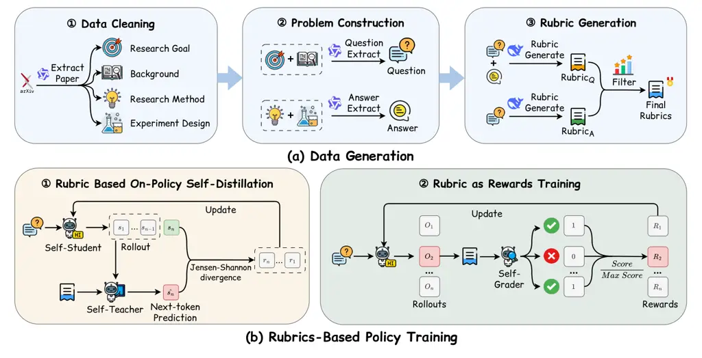
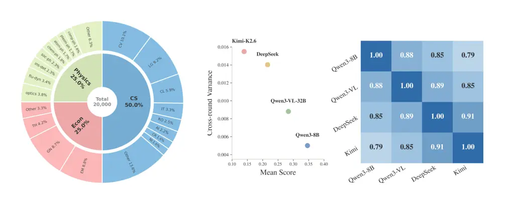

# PaperGym: Rubric-Centered Evolution for Research-Plan Generation

Yuhan Wang    Zhengxi Lu    Yuchen Yan Affiliation: Zhejiang University
   Kaitao Song Affiliation: Apple    Wenqi Zhang Affiliation: Zhejiang
University    Weiming Lu Affiliation: Zhejiang University    Jun Xiao
Affiliation: Zhejiang University    Yueting Zhuang Affiliation: Zhejiang
University    Yongliang Shen

###### Abstract

Research planning is the decisive capability of AI scientists. Yet a
research plan admits no verifiable answer, so reinforcement learning
lacks the environment it requires: tasks paired with a critic. Rubrics
extracted from scientific papers can supply the critic. Existing
pipelines, however, draw the question and the criteria from the same
content, so the reward can be earned by paraphrase. The rubric is
further compressed into a single scalar per rollout. We introduce
PaperGym, a unified framework that turns each research paper into a
complete training environment. PaperGym exploits the structure of a
paper: the question is synthesized from the research goal and
background, while the criteria are derived from the method and
experiments. The criteria span methodological innovation and
experimental design, and criterion leakage falls to 3.7%, versus 11.90%
to 34.10% in existing datasets. Training uses the rubric twice: first as
privileged context for OPSD’s self-teacher, then as the reward for GRPO.
Across Qwen3-1.7B/4B/8B, this schedule outperforms supervised
fine-tuning, either stage alone, and the reverse ordering, improving
five-benchmark averages by +5.6, +5.0, and +4.8 points. With the recipe
held fixed, models trained on PaperGym-20k win 58.1% of three-way
comparisons, against 28.2% for RubricHub Science. The trained Qwen3-8B
reaches 73.48 on ResearchQA, above the far larger Kimi K2.6. We release
the pipeline, the 20,000-instance corpus PaperGym-20k, and the
benchmarks PaperGym-Innov and PaperGym-Design.

^(†)^(†)date: August 31, 2026^(†)^(†)Project Page:
[https://zju-real.github.io/PaperGym](https://zju-real.github.io/PaperGym)^(†)^(†)Code:
[https://github.com/ZJU-REAL/PaperGym](https://github.com/ZJU-REAL/PaperGym)^(†)^(†)correspondence:
[{zjuwangyuhan,zhengxilu,syl}@zju.edu.cn](mailto:%7Bzjuwangyuhan,zhengxilu,syl%7D@zju.edu.cn)

## 1 Introduction

AI scientists have made rapid progress toward automating scientific
discovery, producing complete research papers and new findings in the
natural sciences (Lu et al., 2024; Mitchener et al., 2025; Weng et al.,
2025). Every such result begins with a research plan, which specifies
the hypotheses, methods, and experiments to be carried out; the quality
of the plan bounds what the system can ultimately achieve (Goel et al.,
2025). Unlike a mathematical answer or a program, however, a research
plan admits no automatic check: there is no ground truth to compare
against, and judging its quality requires expert review.

Reinforcement learning with verifiable rewards has driven remarkable
progress in mathematics and code generation, where every problem is
paired with an automatically checkable answer (Guo et al., 2025; Yu
et al., 2026). The paradigm relies on a training environment: a
collection of tasks, each accompanied by a critic that scores candidate
solutions. Research planning offers no such environment. Expert review
cannot provide feedback at the scale that training requires. The
scientific literature, however, already contains both components at
scale: millions of research papers record realistic problems together
with the solutions their authors developed. This knowledge is embedded
in unstructured text and cannot directly serve as training tasks or
reward signals.

Every paper poses a research problem, develops a solution, and reports
experiments that support it, so a realistic task can be drawn from the
problem and judging criteria from the solution. Recent studies follow
this route, converting papers into question-answer pairs for supervised
fine-tuning (Wang et al., 2025) or extracting research goals with
grading rubrics that serve as rewards for reinforcement learning (Goel
et al., 2025; Fan et al., 2026; Sauter et al., 2026). The environments
obtained in this way, however, suffer from two problems: the reward does
not faithfully measure the ability to plan, and the information it
carries is largely wasted during training.

Existing pipelines draw the question and the grading criteria from a
paper without regard to its structure, often from the same content (Goel
et al., 2025; Yifei et al., 2025). As a result, the criteria frequently
restate what the question already says: we find that 11.90% to 34.10% of
them can be inferred from the question alone (Table 4). A model can thus
raise its reward simply by paraphrasing the question. Moreover, a plan
is judged on both the method it proposes and the experiments that
validate it. Instance-specific criteria in existing datasets capture
almost only the method, while experimental design is checked by generic
guidelines shared across all instances (Goel et al., 2025; Sauter
et al., 2026).

Even when the criteria themselves are sound, current training exploits
only a small part of the supervision they provide. In rubric-as-reward
training, each criterion is checked by a separate judge call, yet the
verdicts reach the policy only as one aggregated scalar per
rollout (Gunjal et al., 2025; Goel et al., 2025). Supervised fine-tuning
sidesteps the rubric and imitates the single reference plan; because a
research question admits many valid plans, this reduces output diversity
and yields little gain in practice (Goel et al., 2025). Recent work
conditions a self-distillation teacher on the rubric to recover
token-level guidance (Gu et al., 2026; Rezaei et al., 2026), but
distillation alone never checks the generated plans against the
criteria, and we find that it overfits the privileged context
(Figure 3).

In this paper, we introduce PaperGym, a unified framework that turns
each research paper into a complete training environment. The pipeline
exploits the inherent structure of a paper to separate the sources of
the two components: the question is synthesized only from the research
goal and background, while the reference answer is derived only from the
method and experimental design. This single constraint cuts criterion
leakage to 3.7%, three to nine times lower than in existing datasets.
Each instance carries ten atomic binary criteria that examine both
methodological innovation and experimental design. Training then
extracts the full value of the rubric by using it twice in a
rubric-centered evolution of the plan distribution: as privileged
context for a self-distillation teacher, which converts the criteria
into dense token-level guidance and builds a broad prior over valid
plans, and as the reward for GRPO, which verifies complete plans against
the criteria and refines the policy. Applied to 20,000 papers across
computer science, physics, and economics, the pipeline yields
PaperGym-20k and two held-out benchmarks, PaperGym-Innov and
PaperGym-Design.

Extensive experiments support both sides of the framework. With the
training recipe held fixed, model trained on PaperGym-20k win 58.1% of
three-way comparisons, against 28.2% for the same model trained on
RubricHub Science: the margin comes from the data. The two-stage
schedule outperforms supervised fine-tuning, either stage alone, and the
reverse ordering at all three scales, improving the five-benchmark
averages of Qwen3-1.7B, 4B, and 8B by +5.6, +5.0, and +4.8 points. The
trained Qwen3-8B reaches 73.48 on ResearchQA, above the far larger Kimi
K2.6 at 73.19.

Our main contributions are summarized as follows:

- •
  We propose a pipeline that turns research papers into training
  environments, constructing tasks independently of the dual-dimension
  grading criteria; the resulting PaperGym-20k contains 20,000 instances
  across three domains, with 3.7% criterion leakage versus 11.90% to
  34.10% for existing datasets.
- •
  We construct PaperGym-Innov and PaperGym-Design, held-out benchmarks
  that separately evaluate the methodological innovation and the
  experimental design of generated research plans.
- •
  We develop a two-stage schedule that uses the same rubric first as
  privileged context for self-distillation and then as the GRPO reward;
  it outperforms supervised fine-tuning, either stage alone, and the
  reverse ordering, and Qwen3-8B reaches 73.48 on ResearchQA, above Kimi
  K2.6.

## 2 Related Work

### 2.1 LLMs for Scientific Research

Efforts to automate scientific research include _agent-based_ pipelines
that coordinate dedicated modules for each research stage (Lu et al.,
2024; Schmidgall et al., 2025) and _search-based_ methods that
iteratively refine candidates via evolutionary or Bayesian
operators (Novikov et al., 2025; Weng et al., 2025). Both keep the model
frozen, bounding output quality by the base model’s fixed capacity. A
third paradigm, _training-driven augmentation_, internalizes research
capabilities into model parameters (He et al., 2025; Zeng et al., 2025;
Lu et al., 2026b). For research-plan generation, Goel et al. (2025)
pioneered rubric-driven RL; DEEPINNOVATOR (Fan et al., 2026) and
EvoIdeator (Sauter et al., 2026) follow with variant reward designs. All
three, however, rely on sequence-level supervision. Our work addresses
this limitation by combining rubric-based OPSD with GRPO for dense
token-level guidance.

### 2.2 LLM Post-Training

Reinforcement learning from verifiable rewards (RLVR) has become the
dominant post-training paradigm for reasoning (Shao et al., 2024; Yu
et al., 2026). GRPO (Shao et al., 2024) estimates advantages from
group-level outcome rewards without a learned critic, yet its
sequence-level scalar treats all tokens uniformly. On-Policy
Self-Distillation (OPSD) (Zhao et al., 2026) provides a complementary,
denser signal: the same model serves as both teacher (conditioned on the
answer) and student (seeing only the problem), minimizing per-token KL
divergence along on-policy rollouts. Recent work combines the two, using
the teacher–student gap as a detached auxiliary loss (Lu et al., 2026a;
Li et al., 2026a; Han et al., 2026) or as reward-densifying
supervision (Yang et al., 2026). Our method adopts this combination,
applying rubric-conditioned OPSD followed by rubric-as-rewards GRPO for
both dense distributional guidance and outcome-driven optimization.

### 2.3 Rubric as Rewards

The Rubric-as-Rewards (RaR) paradigm (Gunjal et al., 2025) decomposes
response quality into prompt-specific criteria, offering more
interpretable supervision than holistic scalar rewards. RaR faces two
bottlenecks: the LLM-as-a-judge loop requires multiple calls per
rollout, and the policy can exploit verifier blind spots via reward
hacking (Mahmoud et al., 2026). Recent work converts sparse rubric
rewards into dense token-level supervision via OPSD (Gu et al., 2026;
Rezaei et al., 2026), but the rubric-conditioned teacher introduces
privileged information leakage that typically requires masking or gating
mechanisms. Our two-stage pipeline mitigates both issues: confining
rubric evaluation to the GRPO stage reduces verifier calls, while
careful separation of privileged information avoids leakage.

## 3 Method

We formalize research-plan generation as learning a policy
$`\pi_{\theta}(a\mid q)`$ that produces a coherent solution $`a`$ given
a research question $`q`$. We turn each paper into a complete training
environment whose task is the question and whose critic is the rubric.
To address the two weaknesses of existing rubric-based pipelines
identified in the introduction, our framework draws the question and the
criteria from disjoint paper sections to eliminate criterion leakage,
and consumes the rubric twice in a two-stage evolution, first as
privileged context for a self-distillation teacher and then as the
reward for GRPO, to recover the dense supervision that scalar rewards
discard. The framework thus decomposes quality into independently
verifiable criteria via a structured Rubric (Figure 1), comprising a
data generation stage and a rubric-based training stage.



Figure 1: Overview of the PaperGym framework. (a) Data Generation: arXiv
papers are parsed into four stages to synthesize questions and answers;
rubrics are generated, merged, ranked, and filtered. (b) Two-Stage
Policy Training: rubric-based OPSD followed by rubric-as-rewards GRPO.

### 3.1 Dataset Construction

#### 3.1.1 Data Preprocessing

We build our dataset from publicly available arXiv papers, extracting
plain-text LaTeX source for cleaner content than rendered PDFs. Each
paper is decomposed into four stages — Research Goal, Background,
Research Method, and Experimental Design — where the latter excludes
concrete numerical results to prevent spurious memorization. The
decomposition follows a map-reduce procedure. In the _map_ step, we
split the paper into its natural sections and call Qwen3-235B-A22B to
extract relevant information for each stage per section. In the _reduce_
step, we group extractions by stage and merge duplicates, yielding a
coherent four-stage summary per paper (Section D.1).

Given this representation, we frame the training task as open-ended
question answering: the research question is synthesized from the
Research Goal and Background, and the reference answer from the Research
Method and Experimental Design. Because question and answer are drawn
from disjoint paper sections, this construction prevents criterion
leakage at its source.

#### 3.1.2 Rubric Generation

The rubrics in our framework comprise two complementary parts. The
specialized rubrics $`\mathcal{R}_{\text{spec}}`$ are instance-specific
criteria tailored to each research question, measuring how well the
response addresses the particular scientific problem. The general
rubrics $`\mathcal{R}_{\text{gen}}`$ are fixed criteria applied
uniformly across all instances, enforcing the completeness, specificity,
and soundness of the proposed plan.

##### Specialized rubrics.

For each instance, we prompt DeepSeek-V4-Flash to generate $`m`$
criteria along two dimensions (methodological innovation and
experimental design) from two complementary sources:
question-conditioned rubrics $`\mathcal{R}_{Q}`$, derived from the
research question alone, and answer-grounded rubrics
$`\mathcal{R}_{A}`$, derived from both the question and the reference
answer (Section D.2). We merge $`\mathcal{R}_{Q}`$ and
$`\mathcal{R}_{A}`$, deduplicate semantically overlapping criteria, rank
the survivors by importance, and retain the top $`n`$ criteria per
instance ($`m{=}n{=}10`$). Because the reference answer is drawn from
disjoint sections, the answer-grounded candidates encode content the
question alone cannot reveal; ranking survivors by importance against
this answer retains their core methodological and experimental-design
decisions, grounding the final rubric in the method and experiments,
consistent with the low measured leakage (Table 4).

##### General rubrics.

For instance-agnostic criteria, we adopt the general rubric of Goel
et al. (2025), which draws on prior work on research idea assessment (Si
et al., 2025) and rubric-based benchmarks such as HealthBench (Arora
et al., 2025), covering completeness, specificity, soundness,
efficiency, and ethical safety (Section B.4). Reusing a validated rubric
avoids evaluation bias from ad-hoc design.

##### Data analysis.

The final dataset comprises 20,000 instances across three domains, with
CS the largest ($`\approx`$50%), followed by Physics ($`\approx`$25%)
and Econ ($`\approx`$25%). Among the specialized rubrics, 63.8% of
criteria target Method and 36.2% target Experiment (Section A.1). The
overall composition is illustrated in Figure 2.

To verify scorer reliability, we evaluate self-consistency and
inter-model agreement. Four models score across five runs at temperature 0. As shown in Figure 2, all models are highly self-consistent, with
stronger judges scoring more strictly. The small Qwen3-8B reaches nearly
80% agreement with Kimi K2.6.



Figure 2: Preliminary analysis. Left: Category breakdown of PaperGym-20k
across three domains. Middle: Mean score vs. across-round range for four
scoring models over five independent runs. Right: Pairwise inter-model
agreement on binary rubric verdicts.

With the question and the criteria in place, each paper constitutes a
complete training environment in which the question defines the task and
the rubric supplies the critic that scores any candidate plan.

### 3.2 Rubric-Centered Training

To validate the quality of the framework, we train policies on it for
research-plan generation. Both stages are supervised by the same rubrics
and together form a two-stage, rubric-centered evolution paradigm.

##### Rubric-Conditioned OPSD.

We apply On-Policy Self-Distillation (OPSD) (Zhao et al., 2026) to build
a broad prior for research-proposal generation. The student generates
on-policy rollouts, while the rubric-conditioned teacher evaluates the
same rollout prefixes with the rubrics as privileged information
withheld at inference; the student matches the teacher by minimizing
their KL divergence:

```math
\mathcal{L}_{\text{OPSD}}(\theta)=\mathbb{E}_{(x,\mathcal{R})\sim\mathcal{D}}\left[\mathbb{E}_{\hat{y}\sim\pi_{\theta}(\cdot\mid x)}\frac{1}{|\hat{y}|}\sum_{n=1}^{|\hat{y}|}\mathrm{JSD}_{\beta}\!\left(\mathrm{sg}\!\left(\pi_{\theta}(\cdot\mid x,\mathcal{R},\hat{y}_{<n})\right)\,\|\,\pi_{\theta}(\cdot\mid x,\hat{y}_{<n})\right)\right], \tag{1}
```

where $`\mathrm{sg}`$ denotes the stop-gradient operator. Moreover, the
rubric enumerates the full set of quality criteria rather than one
realized solution. Because it specifies evaluation principles rather
than a single target completion, the teacher preserves a broader set of
valid continuations than answer-conditioned distillation (Section B.1),
while supplying abstract principles aligned with the second-stage
reward.

##### GRPO with Rubric-as-Rewards.

In the second stage, we align the policy with Group Relative Policy
Optimization (GRPO) (Shao et al., 2024) against rubric-based rewards.
The reward is produced by a frozen copy of the base model, which
performs self-grading: conditioned on the research question, the
reference answer, and the rubric, it grades each candidate response
criterion by criterion and emits binary verdicts parsed into
per-criterion scores, eliminating the need for a separately trained
external reward model (Section B.4). The per-set scores
$`r_{i,\text{spec}}`$ and $`r_{i,\text{gen}}`$ average the binary
criterion verdicts over the specialized and general criterion sets
$`\mathcal{R}_{\text{spec}}`$ and $`\mathcal{R}_{\text{gen}}`$,
respectively, and the reward $`r_{i}`$ of a response $`o_{i}`$ combines
the two as

```math
r_{i}=\alpha\,r_{i,\text{spec}}+(1-\alpha)\,r_{i,\text{gen}}, \tag{2}
```

and we set $`\alpha=0.7`$ in all experiments to place greater emphasis
on task-specific scientific fit while maintaining nonzero pressure on
general proposal quality, a choice validated by the sensitivity analysis
in Section B.2. We then optimize the policy with the GRPO objective

```math
\mathcal{J}_{\text{GRPO}}(\theta)=\mathbb{E}_{\{o_{i}\}_{i=1}^{G}\sim\pi_{\theta_{\mathrm{old}}}(\cdot\mid x)}\left[\frac{1}{G}\sum_{i=1}^{G}\Big(\min\!\left(\rho_{i}A_{i},\;\operatorname{clip}(\rho_{i},\;1-\varepsilon,\;1+\varepsilon)\,A_{i}\right)\right.\\
\left.{}-\beta\,D_{\mathrm{KL}}\!\left(\pi_{\theta}(\cdot\mid x)\,\|\,\pi_{\mathrm{ref}}(\cdot\mid x)\right)\Big)\right], \tag{3}
```

where
$`\rho_{i}=\pi_{\theta}(o_{i}\mid x)/\pi_{\theta_{\mathrm{old}}}(o_{i}\mid x)`$
is the sequence-level probability ratio of the $`i`$-th response and
$`A_{i}`$ is its group-normalized advantage, obtained by standardizing
the rubric-based reward $`r_{i}`$ of equation 2 against the mean and
standard deviation of the group rewards; the KL penalty to the reference
policy $`\pi_{\mathrm{ref}}`$ prevents excessive drift.

|                             |            |              |             |            |            |            |
| --------------------------- | ---------- | ------------ | ----------- | ---------- | ---------- | ---------- |
|                             | RubricHub  | ResearchPlan | ResearchQA  | PaperGym   |            | Avg        |
|                             | Science    | -Gen ML      |             | Innov      | Design     |            |
| Proprietary Models          |            |              |             |            |            |            |
| Qwen3.5-Plus                | 63.74      | 47.32        | 75.12       | 27.28      | 27.07      | 48.11      |
| GLM-5.1                     | 63.93      | 51.89        | 78.69       | 30.44      | 28.73      | 50.74      |
| Kimi K2.6                   | 63.31      | 54.49        | 73.19       | 31.12      | 36.07      | 51.64      |
| Claude-Sonnet-5             | 60.10      | 60.03        | 66.04       | 36.17      | 39.63      | 52.39      |
| DeepSeek-V4-Flash           | 62.04      | 52.97        | 79.59       | 29.82      | 37.74      | 52.43      |
| GPT-5.1                     | 63.75      | 61.66        | 76.52       | 36.59      | 34.11      | 54.53      |
| Rubric-based Models         |            |              |             |            |            |            |
| Intern-S1-Mini              | 42.69      | 18.43        | 68.60       | 7.48       | 4.48       | 28.34      |
| Rebicon-Preview             | 56.83      | 25.40        | 76.59       | 20.88      | 20.42      | 40.02      |
| S1-VL-RL                    | 57.77      | 29.23        | 72.09       | 22.31      | 23.68      | 41.02      |
| PaperGym-20k Trained Models |            |              |             |            |            |            |
| Qwen3-1.7B                  | 31.84      | 4.89         | 55.14       | 10.76      | 8.58       | 22.24      |
|    w/ SFT                   | 31.95+0.11 | 5.85+0.96    | 57.36+2.22  | 11.88+1.12 | 8.50-0.08  | 23.11+0.87 |
|    w/ OPSD                  | 34.31+2.47 | 6.75+1.86    | 60.61+5.47  | 14.16+3.40 | 10.45+1.87 | 25.26+3.01 |
|    w/ GRPO                  | 31.62-0.22 | 5.34+0.45    | 55.67+0.53  | 11.47+0.71 | 8.60+0.02  | 22.54+0.30 |
|    w/ OPSD + GRPO           | 34.90+3.06 | 8.37+3.48    | 65.93+10.79 | 17.38+6.62 | 12.45+3.87 | 27.81+5.56 |
| Qwen3-4B                    | 41.97      | 13.48        | 63.15       | 16.12      | 13.89      | 29.72      |
|    w/ SFT                   | 41.57-0.40 | 12.14-1.34   | 64.87+1.72  | 17.90+1.78 | 15.04+1.15 | 30.30+0.58 |
|    w/ OPSD                  | 44.03+2.06 | 15.71+2.23   | 66.93+3.78  | 18.98+2.86 | 15.06+1.17 | 32.14+2.42 |
|    w/ GRPO                  | 43.64+1.67 | 13.60+0.12   | 66.97+3.82  | 18.57+2.45 | 15.95+2.06 | 31.75+2.02 |
|    w/ OPSD + GRPO           | 45.15+3.18 | 16.93+3.45   | 70.74+7.59  | 22.81+6.69 | 18.19+4.30 | 34.76+5.04 |
| Qwen3-8B                    | 46.07      | 20.28        | 66.65       | 18.69      | 17.03      | 33.74      |
|    w/ SFT                   | 45.29-0.78 | 17.91-2.37   | 67.53+0.88  | 17.52-1.17 | 15.68-1.35 | 32.79-0.96 |
|    w/ OPSD                  | 47.41+1.34 | 23.17+2.89   | 69.17+2.52  | 21.42+2.73 | 18.04+1.01 | 35.84+2.10 |
|    w/ GRPO                  | 48.09+2.02 | 20.76+0.48   | 71.02+4.37  | 20.26+1.57 | 19.17+2.14 | 35.86+2.12 |
|    w/ OPSD + GRPO           | 49.41+3.34 | 23.53+3.25   | 73.48+6.83  | 24.47+5.78 | 21.88+4.85 | 38.55+4.81 |

Table 1: Main results across model scales and training strategies.
Subscripts denote changes relative to the corresponding base model. The
best result in each section per column is in bold.

## 4 Experiments

### 4.1 Experimental Setup

##### Datasets and Benchmarks.

(1) Training data. We train on the computer-science subset of
PaperGym-20k, which comprises $`\sim`$10,000 instances derived from
arXiv papers published between January 2015 and December 2025. (2)
In-domain benchmarks. We construct held-out benchmarks from papers
released after January 2026 across three domains (cs, econ, physics),
sampling 400 papers per domain with two test instances each:
PaperGym-Innov derives the question from Research Goal and Background,
uses Research Method as the reference answer, and scores along the
innovation dimension; PaperGym-Design additionally incorporates Research
Method into the question, uses Experimental Design as the reference
answer, and scores along the design dimension (Section D.3). (3)
Out-of-domain benchmarks. Generalization is assessed on
ResearchQA (Yifei et al., 2025) (750 instances, 10 per field),
ResearchPlanGen-ML (Goel et al., 2025) (full test set), and RubricHub
Science (Li et al., 2026c) (800 instances). All responses are scored by
DeepSeek-V4-Flash via an LLM-as-a-judge protocol that rates rubric
coverage per criterion.

##### Baselines.

We compare against two categories of baselines. The first consists of
training-strategy baselines applied at every Qwen3 scale (Yang et al.,
2025): the untrained base model, supervised fine-tuning (SFT) on the
reference answers, and the single-stage OPSD and GRPO variants. The
second consists of reference models evaluated without any fine-tuning on
our data, spanning the general-purpose models Qwen3.5-Plus (Qwen, 2026),
DeepSeek-V4-Flash (Xu et al., 2026), GLM-5.1 (Zeng et al., 2026), Kimi
K2.6 (Kimi, 2026), GPT-5.1 (Singh et al., 2025) and
Claude-Sonnet-5 (Anthropic, 2026), together with three models
specialized for scientific tasks, Intern-S1-Mini (8B) (Bai et al.,
2025), Rebicon-Preview (30B-A3B) (Huang et al., 2025), and S1-VL-RL
(32B) (Li et al., 2026b).

##### Implementation Details.

We train three model scales from the Qwen3 family: Qwen3-1.7B and
Qwen3-4B on four NVIDIA A6000 GPUs with 48 GB each, and Qwen3-8B on four
NVIDIA Pro A6000 GPUs with 96 GB each. All models are used with thinking
mode enabled by default during both training and evaluation. Both
training stages use bf16 precision. In the OPSD stage, we fine-tune with
LoRA ($`r=64`$, $`\alpha=128`$) at a learning rate of
$`5\times 10^{-6}`$ and an effective batch size of 8, training for 200
steps on the 1.7B and 4B models and 400 steps on the 8B model. In the
GRPO stage, we train with the verl framework, sampling 8 responses per
prompt via vLLM with a KL penalty of 0.01 and a learning rate of
$`1\times 10^{-5}`$, for 200 steps on the 1.7B and 4B models and 100
steps on the 8B model. For rubric scoring, the 4B and 8B models serve as
their own verifiers, whereas the 1.7B model, whose scoring ability is
insufficient, is scored by the 4B model.

### 4.2 Main Results

We present the results in three parts: the gain of the two-stage
schedule within a fixed model family, the comparison with existing
specialized and general-purpose models, and a win-rate study that
isolates the contribution of the training data.

##### Within-Model Training Strategies.

Table 1 presents the main results across model scales and training
strategies. Relative to the untrained Qwen3 models, supervised
fine-tuning (SFT) on the reference answers yields only marginal or even
negative gains (dropping by $`-0.96`$ on average at the 8B scale). SFT
merely imitates the single reference answer, collapsing the output
distribution into a narrow mode and thereby failing to instill rubric
alignment. In contrast, OPSD aligns the model’s output distribution with
a rubric-conditioned teacher while preserving output diversity: at
minimal training cost, it matches single-stage GRPO performance (e.g.,
35.84 vs. 35.86 average at the 8B scale, Table 1), thereby providing a
stable initial strategy. Its entropy dynamics explain why this warm-up
helps (Figure 4): entropy rises steadily during OPSD as new knowledge is
absorbed, yielding a broad, well-structured prior on which the
second-stage GRPO converges sharply to complete the final policy
optimization. Accordingly, the OPSD+GRPO scheme achieves the highest
score on every test set at every scale, improving the average score by
$`+5.56`$, $`+5.04`$, and $`+4.81`$ on Qwen3-1.7B, 4B, and 8B,
respectively, confirming that the OPSD warm-up promotes rapid
convergence of the subsequent GRPO stage and that the two stages are
complementary.

##### Comparison with Existing Models.

Our rubric-centered training pipeline produces highly competitive models
against both specialized scientific-task models and mainstream
general-purpose LLMs. On the in-domain benchmarks, the fine-tuned
Qwen3-8B outperforms the scientific-task baselines Intern-S1-Mini and
Rebicon-Preview on both PaperGym-Innov (24.47 vs. 7.48 and 20.88) and
PaperGym-Design (21.88 vs. 4.48 and 20.42), and also surpasses S1-VL-RL
on ResearchQA (73.48 vs. 72.09). Among general-purpose LLMs, the same
model is highly competitive on ResearchQA, even surpassing Kimi K2.6
(73.48 vs. 73.19). These results demonstrate that our rubric-centered
data construction and the two-stage evolution training paradigm are
highly competitive across diverse scientific tasks.

##### Win Rate.

Table 2 reports the three-way win rates of the baseline trained on
PaperGym-20k, the baseline trained on RubricHub Science, and the
untrained base model on ResearchPlanGen-ML, a benchmark independent of
all training data, following the judge protocol in Section C.2. The
model trained on PaperGym-20k achieves the best performance across all
dimensions, winning 58.1% of Overall Score comparisons, compared with
28.2% for its RubricHub-trained counterpart and 13.7% for the base
model. Since all three models share the same training regimen, these
margins highlight the value of our rubric-centered data construction.

### 4.3 Analysis

| Criteria             | Description                                                                                                                                 | Win Rate                                                                     |
| -------------------- | ------------------------------------------------------------------------------------------------------------------------------------------- | ---------------------------------------------------------------------------- |
| Overall Score        | Overall scientific quality and practical usefulness as a research blueprint.                                                                | ![[Uncaptioned image]](arxiv-2608-31119--5a41d65cf367.figures/figure-3.webp) |
| Goal Alignment       | Understanding and addressing the core research goal, including identifying key challenges and formulating relevant hypotheses.              | ![[Uncaptioned image]](arxiv-2608-31119--5a41d65cf367.figures/figure-4.webp) |
| Novel Insight        | Originality and research insight, including novel hypotheses, perspectives, or methodologies connected to the research goal.                | ![[Uncaptioned image]](arxiv-2608-31119--5a41d65cf367.figures/figure-5.webp) |
| Scientific Soundness | Scientific rigor and coherence, from hypothesis to methodology to evidence, with consideration of baselines, controls, and validation.      | ![[Uncaptioned image]](arxiv-2608-31119--5a41d65cf367.figures/figure-6.webp) |
| Execution Quality    | Clarity, feasibility, and implementation structure, balancing ambition with practicality.                                                   | ![[Uncaptioned image]](arxiv-2608-31119--5a41d65cf367.figures/figure-7.webp) |
| Expected Impact      | Likelihood of generating meaningful and interpretable research outcomes that advance understanding or provide methodological contributions. | ![[Uncaptioned image]](arxiv-2608-31119--5a41d65cf367.figures/figure-8.webp) |

Table 2: Win Rate Results. For each criterion, we report the percentage
of comparisons in which each model is selected as the best among the
baseline trained on PaperGym-20k, the baseline trained on RubricHub
Science, and the untrained Qwen3-1.7B by an LLM judge.

#### 4.3.1 Scaling Laws

To further verify the quality of our framework, we examine how model
performance scales with the amount of training data. We train Qwen3-4B
with GRPO using a batch size of 50, a group size of 8, and a learning
rate of $`1\times 10^{-5}`$, and progressively increase the dataset from
0.5k to 15k instances by sampling evenly across the three domains of
PaperGym-20k (5k instances per domain at the largest scale). As shown in
Figure 3 (Left), performance improves with data scale: the trained model
advances from 16.12 to 19.21 on PaperGym-Innov and from 13.89 to 16.96
on PaperGym-Design, both exhibiting a clear growth trend. This confirms
a positive correlation between data quantity and model capability and
further attests to the quality of our framework.

Figure 3: Left: Data scaling law with GRPO training. Right: Training
dynamics across two-stage orderings of OPSD and GRPO on Qwen3-1.7B.

#### 4.3.2 Criterion Leakage

To quantify the criterion leakage of our decoupling pipeline, we present
DeepSeek-V4-Flash with each research question and its associated rubric
and ask whether each criterion can be directly inferred from the
question alone (Section A.2). As shown in Table 4, the four-stage
decomposition suppresses spurious correlations between the input and the
target, keeping the leakage rate at only 3.73%, 4.71%, and 4.97% on
PaperGym-20k, PaperGym-Innov, PaperGym-Design, respectively, compared
with 11.90%–34.10% for existing benchmarks. This roughly 3–9$`\times`$
reduction establishes a clean foundation for subsequent training.

### 4.4 Ablations

#### 4.4.1 Ablation on Rubric

To isolate the contribution of each design choice in our
data-construction pipeline, we evaluate six configurations that vary
rubric source, dimension, and model capability (Table 4), each trained
by fine-tuning Qwen3-1.7B with OPSD for 200 steps on the resulting
dataset. The full pipeline achieves the best overall performance,
confirming the value of combining both rubric sources and dimensions.

|                       | Leakage Rate |
| --------------------- | ------------ |
| PaperGym-20k          | 3.73%        |
| PaperGym-Innov        | 4.71%        |
| PaperGym-Design       | 4.97%        |
| HealthBench           | 11.90%       |
| RubricHub Science     | 17.39%       |
| ResearchPlanGen-ML    | 31.29%       |
| ResearchPlanGen-ArXiv | 34.10%       |
| ResearchQA            | 19.22%       |

Table 3: Criterion leakage comparison.

|                             |       |        |
| --------------------------- | ----- | ------ |
|                             | Innov | Design |
| Full Pipeline (Ours)        | 14.16 | 10.45  |
| Rubric Generation           |       |        |
|    $`R_{Q}`$-only           | 13.19 | 10.24  |
|    $`R_{A}`$-only           | 12.29 | 9.34   |
|    Innovation dim. only     | 14.13 | 9.93   |
| Model Scale                 |       |        |
|    Extract $`\to`$ Qwen3-8B | 13.19 | 9.78   |
|    Rubric $`\to`$ Qwen3-8B  | 12.16 | 9.27   |

Table 4: Ablation on data construction pipeline.

##### Rubric Generation.

The full pipeline outperforms all rubric-related variants. Both
single-source variants fall below the full pipeline: $`R_{Q}`$-only by
-0.97 / -0.21 and $`R_{A}`$-only by -1.87 / -1.11, confirming that
neither rubric source alone provides sufficient supervision and that
integrating the two is necessary. Restricting the rubric to the
innovation dimension alone (-0.03 / -0.52) likewise underperforms,
validating our complementary dual-dimensional design.

##### Model Scale.

Using Qwen3-8B for extraction causes moderate drops (-0.97 / -0.67),
while replacing the rubric generator causes sharper drops (-2.00 /
-1.18). This contrast indicates that rubric quality is the critical
bottleneck: high-quality rubrics demand nuanced scientific judgment
where the gap between strong and weak models is most consequential,
whereas the extraction pipeline is inherently robust.

#### 4.4.2 Ablation on Training Stage

To study the interplay between OPSD and GRPO, Figure 3 (Right) plots the
ResearchQA accuracy over 400 training steps for Qwen3-1.7B under four
strategies: OPSD alone, GRPO alone, OPSD+GRPO, and GRPO+OPSD. These runs
are separate from Table 1; each strategy is trained for 400 steps to
show the full trajectory, which is why the OPSD-only curve extends past
its peak.

##### Stage Ordering.

OPSD alone peaks around step 200 and then declines because its
privileged information drives rapid early progress but overfits, capping
performance without GRPO refinement. GRPO alone starts behind OPSD
because exploration from the base policy is unstable, an effect most
pronounced at smaller scales. In contrast, OPSD+GRPO consistently
outperforms all alternatives, including GRPO+OPSD, by converging faster
to a higher final accuracy. The key is the warm-up: OPSD structures the
initial distribution for GRPO to refine, whereas applying GRPO first on
random init yields unstable exploration and worse outcomes. This
advantage extends to all scales (Section B.3).

##### Entropy Dynamics.

The entropy trajectories during training explain the advantage of
OPSD+GRPO, as OPSD raises output entropy by injecting new knowledge,
whereas GRPO lowers it by converging toward high-reward regions.
Crucially, GRPO’s entropy drop is sharper after the OPSD warm-up,
confirming that OPSD provides a broader, better-structured prior for
GRPO to refine (Figure 4; details in Section B.5).

Figure 4: Entropy dynamics under different training strategies.

## 5 Conclusion

We presented PaperGym, a unified framework that turns each research
paper into a complete training environment for research-plan generation.
Its four-stage extraction pipeline synthesizes the research question
from the research goal and background, and the reference solution from
the research method and experimental design, decoupling inputs from
answers and eliminating criterion leakage at the source. The resulting
20,000-instance corpus PaperGym-20k exhibits a criterion-leakage rate of
3.7%, the lowest among open-source alternatives. Instance-specific
rubrics examine both methodological innovation and experimental design,
and training uses the same rubric twice: first as privileged context for
a self-distillation teacher, then as the reward for GRPO. Qwen3 models
trained with this rubric-centered evolution improve consistently on
in-domain and external benchmarks, and the trained 8B model surpasses
the far larger Kimi K2.6 on ResearchQA.

## References

- Anthropic (2026) Anthropic. System card: Claude sonnet 5, 2026. URL
  [https://anthropic.com/claude-sonnet-5-system-card](https://anthropic.com/claude-sonnet-5-system-card).
- Arora et al. (2025) Rahul K Arora, Jason Wei, Rebecca Soskin Hicks,
  Preston Bowman, Joaquin Quiñonero-Candela, Foivos Tsimpourlas, Michael
  Sharman, Meghan Shah, Andrea Vallone, Alex Beutel, et al. Healthbench:
  Evaluating large language models towards improved human health. _arXiv
  preprint arXiv:2505.08775_, 2025.
- Bai et al. (2025) Lei Bai, Zhongrui Cai, Yuhang Cao, Maosong Cao,
  Weihan Cao, Chiyu Chen, Haojiong Chen, Kai Chen, Pengcheng Chen, Ying
  Chen, et al. Intern-s1: A scientific multimodal foundation model.
  _arXiv preprint arXiv:2508.15763_, 2025.
- Fan et al. (2026) Tianyu Fan, Fengji Zhang, Yuxiang Zheng, Bei Chen,
  Xinyao Niu, Chengen Huang, Junyang Lin, and Chao Huang. Deepinnovator:
  Triggering the innovative capabilities of llms. _arXiv preprint
  arXiv:2602.18920_, 2026.
- Goel et al. (2025) Shashwat Goel, Rishi Hazra, Dulhan Jayalath, Timon
  Willi, Parag Jain, William F Shen, Ilias Leontiadis, Francesco
  Barbieri, Yoram Bachrach, Jonas Geiping, et al. Training ai
  co-scientists using rubric rewards. _arXiv preprint
  arXiv:2512.23707_, 2025.
- Gu et al. (2026) Siyi Gu, Jialin Chen, Sophia Zhou, Arman Cohan, and
  Rex Ying. Rethinking reward supervision: Rubric-conditioned
  self-distillation. _arXiv preprint arXiv:2606.19327_, 2026.
- Gunjal et al. (2025) Anisha Gunjal, Anthony Wang, Elaine Lau, Vaskar
  Nath, Yunzhong He, Bing Liu, and Sean Hendryx. Rubrics as rewards:
  Reinforcement learning beyond verifiable domains. _arXiv preprint
  arXiv:2507.17746_, 2025.
- Guo et al. (2025) Daya Guo, Dejian Yang, Haowei Zhang, Junxiao Song,
  Peiyi Wang, et al. Deepseek-r1 incentivizes reasoning in llms through
  reinforcement learning. _Nature_, 645(8081):633–638, September 2025.
  ISSN 1476-4687.
  [10.1038/s41586-025-09422-z](https://doi.org/10.1038/s41586-025-09422-z).
- Han et al. (2026) Zhuowen Han, Jinwei Xiao, Zhengxi Lu, Renren Jin,
  Zhiyuan Yao, Yuxin Liu, Hongyan Hao, Yueqing Sun, Yu Yang, Qi Gu,
  et al. Distill where you fail: Recovering learning signals of negative
  rl-groups from adaptive teacher guidance. _arXiv preprint
  arXiv:2608.00782_, 2026.
- He et al. (2025) Yichen He, Guanhua Huang, Peiyuan Feng, Yuan Lin,
  Yuchen Zhang, Hang Li, et al. Pasa: An llm agent for comprehensive
  academic paper search. In _Proceedings of the 63rd Annual Meeting of
  the Association for Computational Linguistics (Volume 1: Long
  Papers)_, pp. 11663–11679, 2025.
- Huang et al. (2025) Zenan Huang, Yihong Zhuang, Guoshan Lu, Zeyu Qin,
  Haokai Xu, Tianyu Zhao, Ru Peng, Jiaqi Hu, Zhanming Shen, Xiaomeng Hu,
  et al. Reinforcement learning with rubric anchors. _arXiv preprint
  arXiv:2508.12790_, 2025.
- Kimi (2026) Kimi. Kimi k2.6: Advancing open-source coding, 2026. URL
  [https://www.kimi.com/blog/kimi-k2-6](https://www.kimi.com/blog/kimi-k2-6).
- Li et al. (2026a) Gengsheng Li, Tianyu Yang, Junfeng Fang, Mingyang
  Song, Mao Zheng, Haiyun Guo, Dan Zhang, Jinqiao Wang, and Tat-Seng
  Chua. Unifying group-relative and self-distillation policy
  optimization via sample routing. _arXiv preprint arXiv:2604.02288_,
  2026a.
- Li et al. (2026b) Qingxiao Li, Lifeng Xu, QingLi Wang, Yudong Bai,
  Mingwei Ou, Shu Hu, and Nan Xu. S1-vl: Scientific multimodal reasoning
  model with thinking-with-images. _arXiv preprint arXiv:2604.21409_,
  2026b.
- Li et al. (2026c) Sunzhu Li, Jiale Zhao, Huimin Ren, Zhenlin Wei, Yang
  Zhou, Jingwen Yang, Shunyu Liu, Kaike Zhang, and Chen Wei. Rubrichub:
  A comprehensive and highly discriminative rubric dataset via automated
  coarse-to-fine generation. In _Proceedings of the 64th Annual Meeting
  of the Association for Computational Linguistics (Volume 1: Long
  Papers)_, pp. 31320–31344, 2026c.
- Lu et al. (2024) Chris Lu, Cong Lu, Robert Tjarko Lange, Jakob
  Foerster, Jeff Clune, and David Ha. The ai scientist: Towards fully
  automated open-ended scientific discovery. _arXiv preprint
  arXiv:2408.06292_, 2024.
- Lu et al. (2026a) Zhengxi Lu, Zhiyuan Yao, Zhuowen Han, Zi-Han Wang,
  Jinyang Wu, Qi Gu, Xunliang Cai, Weiming Lu, Jun Xiao, Yueting Zhuang,
  et al. Self-distilled agentic reinforcement learning. _arXiv preprint
  arXiv:2605.15155_, 2026a.
- Lu et al. (2026b) Zhengxi Lu, Zhiyuan Yao, Jinyang Wu, Chengcheng Han,
  Qi Gu, Xunliang Cai, Weiming Lu, Jun Xiao, Yueting Zhuang, and
  Yongliang Shen. Skill0: In-context agentic reinforcement learning for
  skill internalization. _arXiv preprint arXiv:2604.02268_, 2026b.
- Mahmoud et al. (2026) Anas Mahmoud, MohammadHossein Rezaei, Zihao
  Wang, Anisha Gunjal, Bing Liu, and Yunzhong He. Reward hacking in
  rubric-based reinforcement learning. _arXiv preprint
  arXiv:2605.12474_, 2026.
- Mitchener et al. (2025) Ludovico Mitchener, Angela Yiu, Benjamin
  Chang, Mathieu Bourdenx, Tyler Nadolski, Arvis Sulovari, Eric C
  Landsness, Daniel L Barabasi, Siddharth Narayanan, Nicky Evans, et al.
  Kosmos: An ai scientist for autonomous discovery. _arXiv preprint
  arXiv:2511.02824_, 2025.
- Novikov et al. (2025) Alexander Novikov, Ngân Vũ, Marvin Eisenberger,
  Emilien Dupont, Po-Sen Huang, Adam Zsolt Wagner, Sergey Shirobokov,
  Borislav Kozlovskii, Francisco JR Ruiz, Abbas Mehrabian, et al.
  Alphaevolve: A coding agent for scientific and algorithmic discovery.
  _arXiv preprint arXiv:2506.13131_, 2025.
- Qwen (2026) Qwen. Qwen3.5: Towards native multimodal agents, 2026. URL
  [https://qwen.ai/blog?id=qwen3.5](https://qwen.ai/blog?id=qwen3.5).
- Rezaei et al. (2026) MohammadHossein Rezaei, Anas Mahmoud, Zihao Wang,
  Utkarsh Tyagi, Advait Gosai, Razvan-Gabriel Dumitru, Aakash Sabharwal,
  Bing Liu, and Yunzhong He. Rubric-guided self-distillation:
  Post-training without rubric verifiers. _arXiv preprint
  arXiv:2606.12507_, 2026.
- Sauter et al. (2026) Andreas Sauter, Yuyue Zhao, Jacopo Urbani,
  Wenxiang Hu, Zaiqiao Meng, Lun Zhou, Xiaohui Yan, and Yougang Lyu.
  Evoideator: Evolving scientific ideas through checklist-grounded
  reinforcement learning. _arXiv preprint arXiv:2603.21728_, 2026.
- Schmidgall et al. (2025) Samuel Schmidgall, Yusheng Su, Ze Wang,
  Ximeng Sun, Jialian Wu, Xiaodong Yu, Jiang Liu, Michael Moor, Zicheng
  Liu, and Emad Barsoum. Agent laboratory: Using llm agents as research
  assistants. _Findings of the Association for Computational
  Linguistics: EMNLP 2025_, pp. 5977–6043, 2025.
- Shao et al. (2024) Zhihong Shao, Peiyi Wang, Qihao Zhu, Runxin Xu,
  Junxiao Song, Xiao Bi, Haowei Zhang, Mingchuan Zhang, YK Li, Yang Wu,
  et al. Deepseekmath: Pushing the limits of mathematical reasoning in
  open language models. _arXiv preprint arXiv:2402.03300_, 2024.
- Si et al. (2025) Chenglei Si, Diyi Yang, and Tatsunori Hashimoto. Can
  llms generate novel research ideas? a large-scale human study with
  100+ nlp researchers. In _International Conference on Learning
  Representations_, volume 2025, pp. 94003–94092, 2025.
- Singh et al. (2025) Aaditya Singh, Adam Fry, Adam Perelman, Adam Tart,
  Adi Ganesh, Ahmed El-Kishky, Aidan McLaughlin, Aiden Low, AJ Ostrow,
  Akhila Ananthram, et al. Openai gpt-5 system card. _arXiv preprint
  arXiv:2601.03267_, 2025.
- Wang et al. (2025) Penghao Wang, Yuhao Zhou, Mengxuan Wu, Ziheng Qin,
  Bangyuan Zhu, Shengbin Huang, Xuanlei Zhao, Panpan Zhang, Xiaojiang
  Peng, Yuzhang Shang, Jianfei Yang, Zheng Zhu, Tianlong Chen, Zhangyang
  Wang, and Kai Wang. ResearchGPT: Benchmarking and training LLMs for
  end-to-end computer science research workflows. _arXiv preprint
  arXiv:2510.20279_, 2025.
- Weng et al. (2025) Yixuan Weng, Minjun Zhu, Qiujie Xie, Qiyao Sun,
  Zhen Lin, Sifan Liu, and Yue Zhang. Deepscientist: Advancing
  frontier-pushing scientific findings progressively. _arXiv preprint
  arXiv:2509.26603_, 2025.
- Xu et al. (2026) Anyi Xu, Bangcai Lin, Bing Xue, Bingxuan Wang,
  Bingzheng Xu, Bochao Wu, Bowei Zhang, Chaofan Lin, Chen Dong, Chenchen
  Ling, et al. Deepseek-v4: Towards highly efficient million-token
  context intelligence. _arXiv preprint arXiv:2606.19348_, 2026.
- Yang et al. (2025) An Yang, Anfeng Li, Baosong Yang, Beichen Zhang,
  Binyuan Hui, Bo Zheng, Bowen Yu, Chang Gao, Chengen Huang, Chenxu Lv,
  et al. Qwen3 technical report. _arXiv preprint
  arXiv:2505.09388_, 2025.
- Yang et al. (2026) Wenkai Yang, Weijie Liu, Ruobing Xie, Kai Yang,
  Saiyong Yang, and Yankai Lin. Learning beyond teacher: Generalized
  on-policy distillation with reward extrapolation, 2026. URL
  [https://arxiv.org/abs/2602.12125](https://arxiv.org/abs/2602.12125).
- Yifei et al. (2025) Li S Yifei, Allen Chang, Chaitanya Malaviya, and
  Mark Yatskar. Researchqa: Evaluating scholarly question answering at
  scale across 75 fields with survey-mined questions and rubrics. _arXiv
  preprint arXiv:2509.00496_, 2025.
- Yu et al. (2026) Qiying Yu, Zheng Zhang, Ruofei Zhu, Yufeng Yuan,
  Xiaochen Zuo, Yu Yue, Weinan Dai, Tiantian Fan, Gaohong Liu, Lingjun
  Liu, et al. Dapo: An open-source llm reinforcement learning system at
  scale. _Advances in Neural Information Processing Systems_,
  38:113222–113244, 2026.
- Zeng et al. (2026) Aohan Zeng, Xin Lv, Zhenyu Hou, Zhengxiao Du,
  Qinkai Zheng, Bin Chen, Da Yin, Chendi Ge, Chenghua Huang, Chengxing
  Xie, et al. Glm-5: from vibe coding to agentic engineering. _arXiv
  preprint arXiv:2602.15763_, 2026.
- Zeng et al. (2025) Sihang Zeng, Kai Tian, Kaiyan Zhang, Yuru Wang,
  Junqi Gao, Runze Liu, Sa Yang, Jingxuan Li, Xinwei Long, Jiaheng Ma,
  et al. Reviewrl: Towards automated scientific review with rl. In
  _Proceedings of the 2025 Conference on Empirical Methods in Natural
  Language Processing_, pp. 16942–16954, 2025.
- Zhao et al. (2026) Siyan Zhao, Zhihui Xie, Mengchen Liu, Jing Huang,
  Guan Pang, Feiyu Chen, and Aditya Grover. Self-distilled reasoner:
  On-policy self-distillation for large language models. _arXiv preprint
  arXiv:2601.18734_, 2026.

###### Contents

1.  1 Introduction
2.  2 Related Work
    1.  2.1 LLMs for Scientific Research
    2.  2.2 LLM Post-Training
    3.  2.3 Rubric as Rewards
3.  3 Method
    1.  3.1 Dataset Construction
        1.  3.1.1 Data Preprocessing
        2.  3.1.2 Rubric Generation
    2.  3.2 Rubric-Centered Training
4.  4 Experiments
    1.  4.1 Experimental Setup
    2.  4.2 Main Results
    3.  4.3 Analysis
        1.  4.3.1 Scaling Laws
        2.  4.3.2 Criterion Leakage
    4.  4.4 Ablations
        1.  4.4.1 Ablation on Rubric
        2.  4.4.2 Ablation on Training Stage
5.  5 Conclusion
6.  References
7.  A Dataset Analysis
    1.  A.1 Rubric Type Distribution
    2.  A.2 Criterion Leakage Detection
8.  B Training Details and Additional Ablations
    1.  B.1 Privileged-Information Selection for OPSD
    2.  B.2 Parameter Sensitivity
    3.  B.3 Stage-Ordering Swap between OPSD and GRPO
    4.  B.4 Reward Scoring Protocol
    5.  B.5 Entropy Dynamics
9.  C Win Rate Comparison
    1.  C.1 Pairwise Win-Rate Evaluation Protocol
    2.  C.2 Three-Way Win-Rate Evaluation Protocol
10. D Data Construction Details
    1.  D.1 Four-Stage Knowledge Extraction
    2.  D.2 Question-Answer and Rubric Construction
    3.  D.3 Test Set Construction

Note on the main results. In Table 1, Claude-Sonnet-5 scores notably
lower on ResearchQA (66.04) than the other general-purpose models. This
underperformance stems from the model’s refusal behavior: on a subset of
ResearchQA questions, Claude-Sonnet-5 judges that the information it has
retrieved is insufficient to fully answer the question and therefore
declines to answer. Because unanswered questions receive a score of
zero, this behavior lowers the model’s final accuracy; the reported
number thus reflects this refusal behavior rather than a deficiency in
research-plan generation ability.

## Appendix A Dataset Analysis

### A.1 Rubric Type Distribution

To measure the distribution of Method-oriented and Experiment-oriented
criteria in our specialized rubrics, we randomly sample 1,000 questions
from the training set and ask DeepSeek-V4-Flash to classify every
criterion of the sampled instances as either _Method_ or _Experiment_.
_Method_ captures criteria concerning the novelty of the proposed
method, algorithm, model, or framework itself, whereas _Experiment_
captures criteria concerning experimental setup, evaluation metrics,
baseline comparisons, ablation studies, dataset selection, and other
experiment-related designs. Each criterion is classified independently
given the research question and the full rubric of that instance. The
classification prompt is as follows:


Across the 1,000 sampled instances, 9,999 criteria are classified in
total, of which 6,375 (63.76%) are _Method_ and 3,624 (36.24%) are
_Experiment_. This indicates that our specialized rubrics emphasize
methodological innovation while still devoting substantial weight to
experimental design.

### A.2 Criterion Leakage Detection

We quantify criterion leakage using an LLM-based judge. For each
instance, we feed the research question together with all of its rubric
criteria to DeepSeek-V4-Flash in a single call and ask it to output, for
every criterion, a binary verdict on whether that criterion can be
directly inferred from the question alone. The leakage rate of a dataset
is the fraction of criteria marked as directly inferable. The detection
prompt is as follows:


We apply this detection to both our in-domain benchmarks and a diverse
set of out-of-domain benchmarks, including HealthBench, RubricHub
Science, ResearchPlanGen-ML, ResearchPlanGen-ArXiv, and ResearchQA. The
resulting leakage rates, reported in Table 4, confirm that our
decoupling pipeline attains a substantially lower leakage rate than
existing benchmarks.

## Appendix B Training Details and Additional Ablations

### B.1 Privileged-Information Selection for OPSD

The OPSD teacher can be conditioned on different forms of privileged
information. To justify our choice of rubrics, we ablate the privileged
information while keeping all other settings fixed: starting from the
base model Qwen3-1.7B, we train with OPSD for 200 steps on PaperGym-20k
and compare three variants in which the teacher conditions on (i) the
rubric (our default), (ii) the reference answer, and (iii) the rubric
together with the reference answer. Table 5 reports the resulting rubric
scores on the two in-domain benchmarks PaperGym-Innov and
PaperGym-Design.

| Privileged Information    | Innov | Design |
| ------------------------- | ----- | ------ |
| Rubric (Ours)             | 14.16 | 10.45  |
| Reference Answer          | 13.08 | 9.57   |
| Rubric + Reference Answer | 13.81 | 9.17   |

Table 5: Ablation on the privileged information provided to the teacher
in the OPSD stage. Best results are in bold.

The rubric-conditioned teacher achieves the best score on both in-domain
benchmarks, outperforming the answer-conditioned teacher by +1.08 on
Innov and +0.88 on Design. Because the reference answer specifies a
single realized solution, answer-conditioned distillation narrows the
set of valid continuations that the teacher can preserve, so the
distilled prior transfers less to downstream research-plan generation.
Conditioning on the rubric in addition to the reference answer does not
recover this gap and even further degrades the Design score (9.17
vs. 10.45 with the rubric alone), indicating that the single realized
solution conflicts with the broader principle-level supervision. These
results confirm that, on the research-plan generation task, the rubric
provides better privileged information than the reference answer and
substantiate our choice of rubric-conditioned OPSD in Eq. equation 1.

### B.2 Parameter Sensitivity

To justify the mixing weight $`\alpha`$ in Eq. equation 2, we sweep the
ratio of the specialized to the general rubric term while keeping all
other settings fixed. Starting from the Qwen3-1.7B model trained with
200 OPSD steps, we run the GRPO stage for 100 steps with the
specialized-to-general ratio set to $`8{:}2`$, $`7{:}3`$, and $`6{:}4`$,
and evaluate the resulting policies on the two in-domain benchmarks
PaperGym-Innov and PaperGym-Design. Table 6 reports the rubric scores.
The $`7{:}3`$ configuration attains the highest score on both
benchmarks, $`17.17`$ on PaperGym-Innov and $`12.35`$ on
PaperGym-Design, confirming $`\alpha=0.7`$ as the optimal setting.

| Specialized : General | Innov | Design |
| --------------------- | ----- | ------ |
| $`8{:}2`$             | 14.63 | 10.86  |
| $`7{:}3`$             | 17.17 | 12.35  |
| $`6{:}4`$             | 16.40 | 11.54  |

Table 6: Sensitivity of the GRPO stage to the reward mixing ratio
(specialized : general). Best results are in bold.

### B.3 Stage-Ordering Swap between OPSD and GRPO

While the main-text ablation (Section 4.4.2) compares the two orderings
at the 1.7B scale, here we quantify the effect of the swap across all
three scales and five benchmarks. We train the reverse ordering
GRPO$`\rightarrow`$OPSD with all settings identical to the default
schedule except the stage order: the same data and hyperparameters, with
200 GRPO and 200 OPSD steps for the 1.7B and 4B models, and 100 GRPO and
400 OPSD steps for the 8B model.

Table 7 reports the benchmark scores of both orderings. The forward
ordering wins on _every_ benchmark at _every_ scale, improving the
five-benchmark average by $`+2.04`$, $`+0.99`$, and $`+1.31`$ points on
Qwen3-1.7B, 4B, and 8B; the penalty is largest at the 1.7B scale and
consistently concentrates on PaperGym-Innov ($`+2.97`$, $`+2.27`$,
$`+1.92`$), the benchmark that most depends on retaining a broad prior
over valid plans. Figure 5 shows the 4B training dynamics, which
replicate the 1.7B pattern.

We attribute the advantage of the forward ordering to two complementary
mechanisms.

##### Cold-start instability of GRPO.

Run from a cold start, GRPO’s on-policy rollouts are uniformly weak, so
its group-normalized advantages (Eq. equation 3) are dominated by
sampling noise rather than by meaningful differences in plan quality,
and the KL penalty simultaneously resists the large distribution shift
required to escape the low-reward region; a large fraction of the GRPO
budget is spent on unstable exploration. After an OPSD warm-up, the
policy already produces rubric-aligned plans, group rewards become
informative, and GRPO refines efficiently. Reversing the schedule forces
GRPO to grapple with the cold-start instability that OPSD bypasses,
while placing OPSD after GRPO yields little extra benefit—reward
optimization already injects the rubric knowledge, and ending on
distillation rather than on direct verification is inherently weaker.

##### A widen-then-narrow entropy curriculum.

Because OPSD broadens the output distribution while GRPO narrows it (see
Section B.5), the forward ordering realizes a beneficial
_broaden-then-optimize_ curriculum, whereas the reverse ordering
collapses entropy prematurely: GRPO narrows the distribution around
whatever the cold-start policy discovers early, and the subsequent
self-distillation cannot restore the lost diversity, since teacher and
student are the same already-collapsed policy and the pruned modes no
longer carry probability mass to be broadened.

|            |                         |            |              |            |            |            |            |
| ---------- | ----------------------- | ---------- | ------------ | ---------- | ---------- | ---------- | ---------- |
|            |                         | RubricHub  | ResearchPlan | ResearchQA | PaperGym   |            | Avg        |
|            |                         | Science    | -Gen ML      | Innov      | Design     |            |            |
| Qwen3-1.7B | OPSD$`\rightarrow`$GRPO | 34.90      | 8.37         | 65.93      | 17.38      | 12.45      | 27.81      |
|            | GRPO$`\rightarrow`$OPSD | 34.09-0.81 | 7.16-1.21    | 61.86-4.07 | 14.41-2.97 | 11.35-1.10 | 25.77-2.04 |
| Qwen3-4B   | OPSD$`\rightarrow`$GRPO | 45.15      | 16.93        | 70.74      | 22.81      | 18.19      | 34.76      |
|            | GRPO$`\rightarrow`$OPSD | 44.34-0.81 | 16.30-0.63   | 70.03-0.71 | 20.54-2.27 | 17.64-0.55 | 33.77-0.99 |
| Qwen3-8B   | OPSD$`\rightarrow`$GRPO | 49.41      | 23.53        | 73.48      | 24.47      | 21.88      | 38.55      |
|            | GRPO$`\rightarrow`$OPSD | 48.36-1.05 | 22.27-1.26   | 72.53-0.95 | 22.55-1.92 | 20.53-1.35 | 37.25-1.31 |

Table 7: Benchmark performance under the two stage orderings of the
two-stage schedule. _OPSD$`\rightarrow`$GRPO_ is the default ordering;
_GRPO$`\rightarrow`$OPSD_ swaps the two stages with all other settings
identical. Subscripts on the _GRPO$`\rightarrow`$OPSD_ row denote the
drop relative to _OPSD$`\rightarrow`$GRPO_. The default ordering wins on
every benchmark at every scale.

Figure 5: Training dynamics across the two stage orderings of OPSD and
GRPO on Qwen3-4B, the 4B counterpart of the right panel of Figure 3.
OPSD$`\rightarrow`$GRPO leads throughout training and converges to a
higher final accuracy than GRPO$`\rightarrow`$OPSD.

### B.4 Reward Scoring Protocol

During GRPO training, each candidate response is scored by a frozen copy
of the base policy model, which acts as its own verifier; for the 1.7B
model, whose self-scoring is unreliable, the 4B model serves as the
scorer. The scorer is conditioned on the research question, the
instance-specific rubric, and the reference answer, and grades each
response in two independent passes: once against the instance-specific
(specialized) rubric and once against seven general criteria that check
whether the plan handles all stated criteria, provides a detailed and
specific solution, leaves no overlooked flaws, is well justified, is
cost- and effort-efficient, raises no ethical issues, and remains
consistent with the overall plan. For every criterion the scorer emits a
strict binary verdict: 1 only if the answer completely satisfies the
criterion with quality comparable to or better than the reference
answer, and 0 otherwise, with zero leniency for partially correct or “on
the right track” responses. The binary verdicts are averaged with equal
weights to obtain a per-pass score in $`[0,1]`$, and the final reward
combines the specialized and general scores as
$`0.7\,R_{\text{spec}}+0.3\,R_{\text{gen}}`$, matching Eq. equation 2
with $`\alpha=0.7`$. All scorings are collected at temperature $`0`$ for
determinism.

The seven general criteria, applied verbatim and uniformly to every
instance, are listed in full below:

1.  1.  Handles All Criteria: Does the plan satisfy all criteria mentioned
        in the rubric item? An exception is if the criteria says ‘such as’,
        ‘for example’, or ‘including’, the response does not have to include
        the same examples listed to meet the criteria, but whatever is
        provided must be valid and reasonable.
2.  2.  Detailed, Specific Solution: Does the part of the plan relevant to
        satisfying this rubric item include fully specified details on HOW
        to implement it? There should be no self-proclaimed claims of
        handling something without doing so. There should be no vague terms,
        ambiguity, or lack of clarity. It should be described in simple to
        understand language.
3.  3.  No Overlooked Flaws or Weaknesses: Are there any important
        overlooked flaws or weaknesses in the part of the plan addressing
        this rubric item that invalidate its satisfaction of the rubric
        item?
4.  4.  Well Justified Rationale: Is the part of the plan relevant to this
        grading item well-motivated and justified? For example, are there
        convincing arguments provided for how the plan handles this grading
        item is better than simpler solutions or alternate hypotheses?
5.  5.  Cost and Effort Efficient: Does the plan handle this rubric item
        cost efficiently, without being unnecessarily complex? Check if a
        solution requiring less human effort or resources would be equally
        effective for this rubric item.
6.  6.  No Ethical Issues: Does this part of the plan have any potential for
        negative consequences, or is it ethically problematic?
7.  7.  Consistent with Overall Plan: Is this part of the plan consistent
        with the overall approach?

The scoring prompt is as follows:


### B.5 Entropy Dynamics

We attribute the consistent advantage of the two-stage ordering to the
entropy dynamics observed during training (Figure 4). During the OPSD
stage, entropy rises steadily, reflecting the injection of new knowledge
through self-distillation over the full output distribution. In
contrast, GRPO drives entropy reduction as the policy converges toward
high-reward regions by selecting relatively optimal trajectories within
each group. Crucially, the entropy drop during GRPO is substantially
more pronounced when the model has been pre-warmed with OPSD. This
indicates that OPSD establishes a broader and better-structured prior,
which enables GRPO to perform more focused and efficient policy
convergence.

## Appendix C Win Rate Comparison

### C.1 Pairwise Win-Rate Evaluation Protocol

To further verify the quality of our framework and the capability gains
from training, we conduct pairwise win-rate comparisons among four
Qwen3-1.7B settings: (i) the untrained base model; (ii) 200 OPSD steps
on the computer-science subset of PaperGym-20k; (iii) 200 OPSD steps on
RubricHub Science under identical OPSD hyperparameters; and (iv) the
full two-stage schedule, i.e., 200 OPSD steps followed by 200 GRPO steps
on the computer-science subset of PaperGym-20k.

Figure 6 reports the pairwise win rates on ResearchPlanGen-ML, a
benchmark independent of all training data, scored by three expert
judges (DeepSeek-V4-Flash, Kimi K2.6, and GLM-5.1). Our OPSD model
defeats the RubricHub-trained OPSD model by 68.0% overall, confirming
the higher quality of our benchmark, while both our OPSD and two-stage
models defeat the untrained base model (73.6% and 68.2% overall),
confirming genuine capability gains from training.

However, GRPO in the second stage improves the model unevenly across
criteria. Against the same base model, the two-stage model gains on goal
alignment (66.0% to 71.1%) and novel insight (63.2% to 80.0%), but loses
ground on scientific soundness (72.0% to 62.1%), execution quality
(71.9% to 66.3%), and expected research impact (73.5% to 71.6%). We
attribute this redistribution to two factors. First,
methodological-innovation rubrics dominate our dataset, so
innovation-oriented criteria receive both the densest reward signal and
the largest headroom, since the model starts lowest there, explaining
the gains on novel insight and goal alignment. Second, the model
exhibits reward hacking, producing longer responses to match more rubric
items, and the resulting increase in output complexity lowers the scores
on the remaining criteria.

Figure 6: Pairwise win rates of fine-tuned Qwen3-1.7B variants on
ResearchPlanGen-ML. Models trained on our data outperform the
RubricHub-trained counterpart, and both trained models defeat the
untrained base model, evidencing benchmark quality gains and genuine
training improvements.

The pairwise evaluation prompt is structurally identical to the
three-way prompt in Section C.2, except that only two plans (Plan A and
Plan B) are compared, and the judge selects the better plan or declares
a tie for each criterion rather than ranking three plans.

### C.2 Three-Way Win-Rate Evaluation Protocol

To isolate the contribution of the training data, all three models are
built from Qwen3-1.7B, and the two trained models share an identical
200-step OPSD recipe with the same hyperparameters as the main
experiments (Section 4.1): the untrained base model, the model trained
on the computer-science subset of PaperGym-20k, and the model trained on
RubricHub Science. The only difference between the two trained models is
the training corpus. These correspond to settings (i)–(iii) of the
pairwise study in Section C.1.

We score all 685 instances in ResearchPlanGen-ML through three-way
comparisons with an LLM-as-a-judge protocol under the supervision of
three expert judges: DeepSeek-V4-Flash, Kimi K2.6, and GLM-5.1. For each
research question, we collect one response from each of the three models
under comparison and present the question together with the three
responses to every judge. To eliminate positional bias, the three
responses are randomly assigned to the labels Plan A, Plan B, and Plan C
before being shown, and the judge is never told which label corresponds
to which model. Each judge independently evaluates the three plans along
five criteria (goal alignment, novel insight, scientific soundness,
execution quality, and expected research impact) and ranks them from
best to worst for each criterion. The judge also assigns each plan an
overall score from 1 to 10 that reflects its value as a research
blueprint.

Per-criterion rankings are aggregated across the three judges via
majority voting: for each criterion, the model that receives the most
votes (i.e., is ranked highest by the most judges) is declared the
winner. When the three judges split their votes (one vote for each
model), a fourth expert judge (Gemini 3.7 Flash) serves as a
tie-breaker. The overall score of each model is averaged across the
three judges. The win rate of a model is the fraction of questions on
which it achieves the highest averaged overall score among the three.
All judgments are collected at temperature 0 for determinism. The
evaluation prompt is as follows:


## Appendix D Data Construction Details

### D.1 Four-Stage Knowledge Extraction

We document the prompts behind the map-reduce decomposition of each
paper. In the map step, the LaTeX body is split along its section
boundaries, and Qwen3-235B-A22B is prompted to extract, from each
section and in a single call, the salient information pertaining to the
four stages, namely the research field, the research background, the
solution, and the experimental design. The prompt enforces strict
faithfulness: extracted content must appear verbatim in the source
section, categories with no sentence-level evidence are returned as
empty strings, and LaTeX symbols in the output are double-escaped so
that the JSON remains parseable. The map prompt, with {section_content}
denoting the current section, is as follows:


In the reduce step, the per-section extractions of each stage are
grouped and fed back to Qwen3-235B-A22B to be merged into a coherent,
non-redundant summary. Each stage uses a dedicated prompt, with
{combined_info} denoting the concatenated per-section extractions of
that stage. The four reduce prompts are as follows:

Research field.


Research background.


Solution.


Experimental design.


### D.2 Question-Answer and Rubric Construction

Given the four-stage summary, Qwen3-235B-A22B synthesizes the research
question from the research field and background, and the reference
answer from the solution and experimental-design stages, so that the
question and answer are drawn from disjoint paper sections and no
instance leaks its answer into its question. DeepSeek-V4-Flash then
generates the specialized rubrics from two complementary sources and
merges them. The question prompt is as follows:


The reference-answer prompt requires faithfulness to the source,
excludes concrete numerical results, and describes the method and
experimental design in formal academic prose:


The question-conditioned rubrics $`\mathcal{R}_{Q}`$ are derived from
the research question alone, whereas the answer-grounded rubrics
$`\mathcal{R}_{A}`$ additionally condition on the reference answer. In
both cases the model is asked for exactly ten binary criteria across the
two dimensions of methodological innovation and experimental design. The
answer-grounded rubric prompt is as follows:


The two rubric sets are merged by DeepSeek-V4-Flash, which deduplicates
semantically overlapping criteria and ranks the survivors by importance
against the reference answer, keeping the top ten as the final
specialized rubric. The merge prompt, with {rubric_set_a} and
{rubric_set_b} denoting the JSON-encoded description lists of the two
candidate sets, is as follows:


### D.3 Test Set Construction

The two in-domain benchmarks are produced by two variants of the same
pipeline that isolate a single dimension. For PaperGym-Innov, the
research-question prompt is identical to the one above, and only the
reference-answer and rubric prompts differ: the reference answer is
written from the Research Method stage alone, and all rubrics are
elicited along the methodological-innovation dimension only. The
method-only reference-answer prompt is as follows:


The method-only rubric prompt for PaperGym-Innov restricts the dimension
to method principles and implementation:


For PaperGym-Design, the question additionally incorporates the Research
Method as the proposed approach and instructs the reader to design a
verification experiment for it; the reference answer is written from the
Experimental Design stage alone, and all rubrics are elicited along the
experimental-design dimension only. The experimental-design task prompt
is as follows:


The experiment-only reference-answer prompt is as follows:


The experiment-only rubric prompt for PaperGym-Design restricts the
dimension to experimental design:


For both benchmarks, the merge-and-rank prompt is identical to the one
in Sec. D.2, except that for PaperGym-Design the task header is
relabeled as “Experimental Design Task”.
