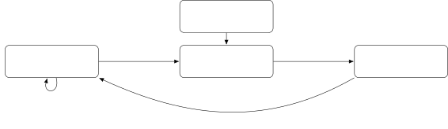

# Recursive Criticality of AI Self-Improvement

Mikhail Burtsev Affiliation: London Institute for Mathematical Sciences
Email: [mb@lims.ac.uk](mailto:)

###### Abstract

AI is increasingly used in the R&D process that produces future AI
systems. We study the conditions under which this feedback becomes
self-amplifying. Our model describes how the rate of AI capability
growth depends on baseline research productivity, recursive feedback,
and the increasing difficulty of making further research progress. We
derive a recursive reproduction number, $`\mathcal{R}_{\mathrm{AI}}`$,
that determines whether incremental improvements are amplified or damped
across development cycles. This quantity compares the strength of
recursive feedback with the rate at which further progress becomes more
difficult. When $`\mathcal{R}_{\mathrm{AI}}>1`$, the effects of
incremental improvements compound across development cycles, placing the
system in a self-amplifying regime. When
$`\mathcal{R}_{\mathrm{AI}}<1`$, their effects weaken across cycles. The
transition depends on the structure of the AI R&D feedback loop and need
not occur at any particular level of model capability. A system can
therefore enter a self-amplifying regime before acceleration becomes
visible, while rapid progress can also occur without self-amplification.
In the minimal model, higher baseline research productivity can
accelerate progress without changing whether the system is
self-amplifying. At high research throughput, the duration of the
development cycle becomes a limiting timescale for amplification.
Increasing research difficulty can subsequently end a period of
self-amplification. Extending the model to multiple research actors
shows that improvements shared across organizations can make the overall
research ecosystem self-amplifying even when no individual actor is. The
framework identifies measurable properties of AI R&D systems that can
help distinguish recursive amplification from rapid progress driven by
other sources, including the strength of recursive feedback, how
effectively improvements propagate into successor systems,
development-cycle duration, and the increasing difficulty of further
progress. ¹¹ 1 The code and computational notebook used to reproduce the
numerical results and figures are available at
[https://github.com/burtsev/recursive-criticality-ai](https://github.com/burtsev/recursive-criticality-ai).

## 1 Introduction

Recursive AI self-improvement (RSI) is usually understood as a positive
feedback loop in AI capabilities. AI research agents are beginning to
perform work that lies inside the process used to build future AI
systems. They write and debug code, propose experiments, analyse
results, reproduce papers, operate software tools, and increasingly
sustain technical work over longer horizons \[1, 2, 3, 4, 5\]. RSI is
therefore better viewed as a property of an AI–R&D system than of an
isolated, fully autonomous agent. The system may include human
researchers, laboratories, compute infrastructure, evaluation procedures
and organizations that integrate and deploy successor models.

This paper asks three questions. Under what conditions does AI
assistance to AI R&D cross from ordinary acceleration into a
self-amplifying regime? How do feedback delay and a hardening research
progress determine whether that regime produces a small transient
displacement or significantly compressed transition to artificial
general intelligence (AGI) and artificial super intelligence (ASI)? How
are these dynamics changed by physical resource limits, competition and
collaboration between research actors?

We use the term _recursive criticality_ for the condition at which an
incremental improvement in AI research capability generates enough
additional future R&D productivity to outweigh the increasing difficulty
of making further progress. This balance is defined by a recursive
reproduction number $`\mathcal{R}_{\mathrm{AI}}`$. When
$`\mathcal{R}_{\mathrm{AI}}>1`$, incremental gains amplify across
development cycles. When $`\mathcal{R}_{\mathrm{AI}}>1`$, their effects
weaken. This yields the following criterion:

Onset of self-amplifying RSI. The transition to self-amplifying
recursive improvement occurs when the AI system crosses a critical
stability boundary, not when it reaches a particular level of
intelligence. This boundary is crossed when
$`\mathcal{R}_{\mathrm{AI}}`$ rises above unity, so that gains in
research capability reproduce across development cycles faster than the
effective research frontier hardens.

The possibility of a machine-driven intelligence explosion dates to
Good \[6\], and subsequent work developed the conceptual foundations of
superintelligence and self-modifying agents \[7, 8, 9\]. More recent
economic models place AI directly inside the production of future
technological progress, treating it as an input to research whose
effects depend on automation, bottlenecks, diminishing returns and the
productivity of complementary resources \[10, 11, 12, 13, 14\]. Related
models examine resource-constrained growth and distinguish bounded
self-refinement from open-ended research loops \[15, 16\]. Cunningham et
al. \[17\] derive a closely related condition for self-sustaining
acceleration in terms of economic elasticities, while recent analyses of
the transition from AGI to ASI emphasize that scaling, paradigm change,
recursive improvement and collective AI systems may operate
simultaneously rather than as separate pathways \[18\].

At the same time, empirical work is making the underlying feedback
process increasingly measurable. General benchmarks provide increasingly
systematic comparisons of model capability across tasks and generations,
while human-calibrated task horizons estimate the duration and
complexity of work that AI agents can complete reliably \[19, 20, 1\].
Research-oriented evaluations such as MLE-bench, RE-Bench and PaperBench
move closer to the relevant setting by testing agents on extended
machine-learning engineering, experimentation and research-replication
tasks \[2, 3, 4, 5\]. These evaluations increasingly measure components
of the feedback loop, but they do not yet identify how an improvement in
AI research capability causally affects the productivity of subsequent
AI development. Proposed measures of AI-R&D automation extend this
perspective to the organizational level by tracking adoption, researcher
time and the effect of AI assistance on subsequent scientific and
engineering progress \[21\].

Taken together, existing work brings many of the ingredients of
recursive improvement into view, but not yet the dynamics that determine
whether the resulting feedback is stable. In particular, it leaves open
how the transition to self-amplifying improvement depends on the delay
between research and deployment, the progressive exhaustion or hardening
of research opportunities, and the coupling between multiple research
actors.

We develop a minimal model in which AI capability evolves through
baseline research productivity, delayed recursive gain and a
capability-dependent research frontier. We then extend the framework to
include physical deployment constraints and research networks through
which improvements propagate between laboratories, firms and nations.
The resulting model separates interventions that primarily alter the
pace of development from those that change the recursive dynamics
themselves or reshape the network through which recursive gains spread.
The numerical scenarios are conditional demonstrations and not
probabilistic forecasts. They show how alternative assumptions generate
qualitatively different trajectories and identify the measurements that
could distinguish among them.

We make four principal contributions.

First, we formulate recursive AI self-improvement as a local stability
transition in an AI-enabled R&D system. The resulting recursive
reproduction number,

```math
\mathcal{R}_{\mathrm{AI}}=\frac{\chi a}{\sigma},
```

compares realized recursive gain with the local hardening of the
research frontier. Incremental capability gains amplify across
development cycles when $`\mathcal{R}_{\mathrm{AI}}>1`$ and are damped
when $`\mathcal{R}_{\mathrm{AI}}<1`$. In the minimal model, the critical
boundary does not depend on baseline research throughput, so rapid
capability growth and recursive self-amplification are distinct
phenomena. A system can become supercritical before the resulting
acceleration becomes visible.

Second, we characterize how the duration and intensity of recursive
amplification depend on feedback delay and the available research
frontier. At high research throughput, the successor-development cycle
becomes a limiting timescale for amplification. As research
opportunities become harder to exploit, increasing frontier hardness can
return a supercritical system to a subcritical regime. Recursive
amplification can therefore be strong but transient within a fixed
research paradigm.

Third, we separate the recursive regime from both research scale and
physical deployment constraints. Greater compute, expenditure, or
researcher effort can accelerate capability growth without changing
recursive criticality, while changes in recursive gain, operational
closure, feedback delay, or transfer between actors alter the feedback
dynamics themselves. Physical infrastructure can additionally constrain
deployable capability without directly changing the recursive regime.

Fourth, we extend the framework to coupled research actors. Recursive
criticality is then determined by the spectral radius of a reproduction
matrix that captures both within-actor feedback and cross-actor
transfer. A research ecosystem can therefore become supercritical even
when every actor is individually subcritical. This formulation also
identifies quantities that can be estimated empirically, including
recursive gain, operational closure, development-cycle duration,
frontier hardening, and the transfer of improvements across
organizations.

## 2 A dynamical model of recursive self-improvement

### 2.1 Recursive loop in AI development

We model recursive self-improvement at the level of an AI–R&D system
rather than an isolated AI agent. The system includes the AI models used
for research together with the processes required to generate, evaluate,
train and deploy successor systems. Human researchers may remain inside
this system boundary.

Let $`x(t)`$ denote an AI capability. The model, illustrated in Fig. 1,
separates four elements of the development process.

1.  1.  Baseline progress is governed by an exogenous research-productivity
        scale $`r(t)`$.
2.  2.  Existing AI capability can increase the productivity of subsequent
        AI development. We represent this effect by recursive gain
        $`a(x,t)`$ and an end-to-end delay $`\tau(t)`$ between an
        improvement in capability and its return as greater research
        productivity.
3.  3.  Only part of the potential recursive gain may survive the full
        development pipeline. We denote this transmitted fraction by the
        operational closure $`\chi(x,t)`$.
4.  4.  Progress becomes increasingly difficult as capability approaches the
        research frontier defined by local hardening rate $`\sigma(x)`$.



Figure 1: Minimal AI self-improvement loop. Current AI capability
affects subsequent research productivity. A fraction of this potential
gain survives the development pipeline and returns after an end-to-end
delay as capability in a validated successor system. Frontier hardening
reduces the productivity of further improvement as capability advances.

To connect the abstract state variable $`x`$ to observable research
performance, let $`c_{t}(q,\epsilon;\mathbf{p})`$ denote the minimum
resource cost of completing task $`q`$ at tolerated loss $`\epsilon`$,
evaluated at a fixed vector of resource prices $`\mathbf{p}`$. For a
stable panel of tasks $`\mathcal{Q}`$ with weights $`\phi(q)`$, define

```math
x(t)=\int_{\mathcal{Q}}\phi(q)\ln\frac{c_{t_{0}}(q,\epsilon;\mathbf{p})}{c_{t}(q,\epsilon;\mathbf{p})}\,\mathrm{d}\mu(q). \tag{1}
```

Thus $`x`$ measures resource-adjusted improvement at fixed task
composition and performance. It is a local coordinate for research
capability, not a universal scalar measure of intelligence.

Let $`a(x,t)`$ denote the recursive gain from stronger AI research
capability to subsequent research productivity when downstream use is
unconstrained. Let $`0\leq\chi(x,t)\leq 1`$ denote the fraction
transmitted through the research pipeline. The realized recursive gain
is

```math
g(x,t)=\chi(x,t)a(x,t). \tag{2}
```

Operational closure $`\chi`$ is a property of the development process,
not simply of model autonomy. A system can have high closure while
retaining substantial human participation if AI-generated research
contributions are evaluated and integrated efficiently. Conversely, a
highly autonomous workflow can have low closure when its outputs fail
evaluation, cannot be executed safely, or do not propagate into
successor systems. Human review, experimental capacity, secure
execution, and other bottlenecks can bind as throughput rises, so
$`\chi`$ may depend on operating scale as well as capability.

Frontier hardness $`\sigma(x,t)`$ measures the decline in direct
improvement productivity as capability advances with recursive transfer
held fixed. The delay $`\tau`$ is the end-to-end interval before an
improvement returns as increased research capability. Together, $`g`$,
$`\sigma`$, and $`\tau`$ determine the local stability and manifestation
rate of recursive feedback.

### 2.2 A delayed model of recursive criticality

We model recursive AI self-improvement by combining baseline research
productivity, frontier difficulty and delayed recursive feedback:

```math
\boxed{\dot{x}(t)=r(t)f[x(t)]e^{\Phi(x[t-\tau(t)],t)}.} \tag{3}
```

Here $`r(t)>0`$ sets the baseline scale of research progress, $`f(x)>0`$
describes how the productivity of direct improvement changes as the
research frontier advances. The exponential term represents the
multiplicative effect of recursive feedback. In the absence of recursive
amplification, $`\Phi=0`$ and progress reduces to the baseline term
$`r(t)f(x)`$.

We define the feedback potential $`\Phi`$ so that its local derivative
equals the realized recursive gain,

```math
\frac{\partial\Phi(x,t)}{\partial x}=g(x,t)=\chi(x,t)a(x,t). \tag{4}
```

Thus $`g(x,t)`$ measures how strongly an incremental increase in
research capability raises the productivity returned through the
recursive loop.

We quantify frontier hardening by the rate at which direct improvement
productivity declines with capability,

```math
\boxed{\sigma(x)=-\frac{\mathrm{d}\ln f(x)}{\mathrm{d}x}.} \tag{5}
```

Positive $`\sigma`$ means that advancing the frontier reduce the
productivity of subsequent improvement.

Consider a reference trajectory $`\bar{x}(t)`$ during an interval in
which the coefficients change slowly relative to the perturbation
dynamics. Set $`v=\dot{\bar{x}}(t_{0})>0`$,
$`g=g[\bar{x}(t_{0}),t_{0}]`$, $`\sigma=\sigma[\bar{x}(t_{0})]`$, and
$`\tau=\tau(t_{0})`$. A small perturbation $`x=\bar{x}+\xi`$ then obeys

```math
\dot{\xi}(t)=-v\sigma\,\xi(t)+vg\,\xi(t-\tau), \tag{6}
```

with characteristic equation

```math
\lambda+v\sigma=vge^{-\lambda\tau}. \tag{7}
```

The local balance becomes transparent after defining

```math
\boxed{\mathcal{R}_{\mathrm{AI}}=\frac{g}{\sigma}=\frac{\chi a}{\sigma}.} \tag{8}
```

###### Proposition 1 (Local recursive criticality).

Suppose that $`v>0`$, $`\sigma>0`$, $`g\geq 0`$ and $`\tau\geq 0`$. All
characteristic roots of Eq. (6) have negative real part for
$`\mathcal{R}_{\mathrm{AI}}<1`$, $`\lambda=0`$ is a characteristic root
at $`\mathcal{R}_{\mathrm{AI}}=1`$, and a positive real characteristic
root exists for $`\mathcal{R}_{\mathrm{AI}}>1`$.

This result is a scalar instance of stability theory for positive delay
systems \[22\]. Cunningham et al. \[17\] independently obtain a closely
related unit-threshold condition for self-sustaining acceleration from
recursive elasticities. In the present model, the threshold marks a
stability boundary for perturbations around a delayed capability
trajectory. Locally, $`\mathcal{R}_{\mathrm{AI}}>1`$ implies
amplification of small recursive perturbations around the reference
trajectory, but does not by itself imply indefinite growth of total
capability.

The mechanism behind the threshold is simple. Recursive gain must offset
replace the marginal loss of research productivity created by the
hardening frontier before a capability perturbation can reproduce.
Baseline throughput $`v`$ controls how much development occurs per unit
time, but in the minimal model it scales both the damping and the
feedback terms. Greater compute, expenditure or researcher effort can
therefore accelerate capability growth without necessarily changing
whether the system is subcritical or supercritical.

Feedback delay instead determines how rapidly the local regime becomes
visible. Near the critical point, the dominant characteristic root is

```math
\lambda_{*}\simeq\frac{v\sigma\left(\mathcal{R}_{\mathrm{AI}}-1\right)}{1+v\sigma\mathcal{R}_{\mathrm{AI}}\tau}.
```

The dominant root passes smoothly through zero, which means that a newly
supercritical process may initially be difficult to distinguish from
ordinary acceleration. Its amplification rate becomes more apparent as
research throughput rises or as the successor-development cycle becomes
shorter.

As research throughput grows, the delay itself becomes limiting. For
fixed $`\mathcal{R}_{\mathrm{AI}}>1`$ and $`\tau>0`$,

```math
\lambda_{*}\longrightarrow\frac{\ln\mathcal{R}_{\mathrm{AI}}}{\tau}\qquad\text{as}\qquad v\sigma\tau\longrightarrow\infty.
```

Increasing research throughput can therefore accelerate an amplifying
mode, but cannot make it arbitrarily fast without shortening the
interval through which improvements return in a successor system. Other
limits on effective research throughput, including bounded
parallelizability and coordination, can bind before this delay-limited
regime is reached \[23\].

Rapid capability growth is therefore neither necessary nor sufficient
evidence of recursive criticality. A high baseline research rate,
greater compute availability or substantial human effort can produce
fast subcritical progress, while a supercritical system can initially
amplify too slowly to be distinguished from an ordinary acceleration.
Diagnosing the regime therefore requires estimates of recursive gain and
frontier hardening across successive development cycles, rather than the
slope of a benchmark trajectory considered in isolation.

### 2.3 Finite recursive runway

The local criticality condition determines whether capability
perturbations amplify at the current state, but it does not require the
same recursive mechanism to remain supercritical as capability advances.
A simple finite-frontier model is

```math
f(x)=\left(1-\frac{x}{X}\right)^{\beta},\qquad 0\leq x<X,\quad\beta>0, \tag{9}
```

which gives

```math
\sigma(x)=\frac{\beta}{X-x}. \tag{10}
```

The frontier becomes progressively harder as $`x`$ approaches the
effective limit $`X`$.

###### Proposition 2 (Finite-frontier termination).

Suppose that $`x(t)\to X<\infty`$, $`\sigma[x(t)]\to\infty`$, and
$`g[x(t)]`$ remains bounded. Then

```math
\mathcal{R}_{\mathrm{AI}}[x(t)]=\frac{g[x(t)]}{\sigma[x(t)]}\longrightarrow 0,
```

so the system is locally subcritical sufficiently close to the effective
frontier.

This result makes the duration of a supercritical regime depend on the
available recursive runway. Within a fixed research paradigm, the system
may cross into a supercritical region, amplify rapidly for some
interval, and return to a subcritical regime once frontier hardening
overtakes realized recursive gain. A major architectural or scientific
advance may extend the frontier $`X`$, change its shape through
$`\beta`$, or increase the realized gain $`g`$, so the result should not
be read as a claim about a final ceiling. It instead shows that
transient supercriticality is compatible with a finite research
opportunity set.

### 2.4 Coupled research-agent ecosystems

AI development does not occur inside a single closed loop. Research
agents operate within organizations that observe competitors, exchange
scientific information, reuse software, recruit from a common labour
market, depend on shared infrastructure, and sometimes obtain access to
the same models or tools. These channels allow an improvement produced
at one actor to change the future research productivity of another. Once
such transfer becomes comparable to within-actor recursive gain, the
relevant stability question concerns the network as a whole.

Let $`\xi_{i}(t)`$ be a perturbation to the research capability of actor
$`i`$. A local multi-actor approximation is

```math
\dot{\xi}_{i}(t)=-v_{i}\sigma_{i}\xi_{i}(t)+v_{i}\sum_{j=1}^{n}g_{ij}\xi_{j}(t-\tau_{ij}), \tag{11}
```

where $`g_{ii}`$ denotes gain generated within actor $`i`$ and
$`g_{ij}`$ denotes directed transfer from actor $`j`$ to actor $`i`$.
Normalizing each row by the receiving actor’s frontier hardness defines
the reproduction matrix

```math
K_{ij}=\frac{g_{ij}}{\sigma_{i}},\qquad\mathcal{R}_{\mathrm{net}}=\rho(\mathbf{K}), \tag{12}
```

where $`\rho(\mathbf{K})`$ is the spectral radius of the non-negative
matrix $`\mathbf{K}`$.

###### Proposition 3 (Collective criticality).

For the zero-delay system associated with Eq. (11), the locally stable
regime satisfies $`\rho(\mathbf{K})<1`$, while the system becomes
unstable when $`\rho(\mathbf{K})>1`$. Hence $`K_{ii}<1`$ for every actor
is not sufficient for network stability when cross-actor transfer is
strong enough.

This result extends recursive criticality from individual development
loops to the research ecosystem as a whole. Every actor may remain
individually subcritical while the coupled system becomes supercritical
through the circulation and recombination of improvements across
organizations. An advance originating in one laboratory may improve the
tools available to another, whose subsequent work raises research
productivity elsewhere before some of those gains diffuse back to the
original actor. The combined reproduction of capability across these
pathways can exceed the damping imposed by individual research frontiers
even though no actor has a within-organization reproduction number above
one.

## 3 Reference scenarios

### 3.1 Reference no-RSI parameterization

The numerical experiments are designed to compare dynamical mechanisms
rather than to forecast calendar dates. We normalize current capability
to $`x_{0}=0`$ and the effective frontier of the modeled research
paradigm to $`X=1`$. These values define the coordinate system and do
not imply that current AI has zero absolute capability or that $`X=1`$
represents a fundamental limit.

We represent AGI and ASI by externally specified thresholds
$`x_{\rm AGI}`$ and $`x_{\rm ASI}`$ on the capability coordinate, with
$`x_{\rm AGI}<x_{\rm ASI}`$. The lower threshold can represent broad
competence across a specified set of economically or scientifically
relevant tasks, while the upper threshold can represent substantially
greater performance under the same evaluation conditions. For any
threshold $`y`$, define the first-crossing time as
$`T(y)=\inf\{t\geq 0:x(t)\geq y\}`$, $`T_{\rm AGI}=T(x_{\rm AGI})`$,
$`T_{\rm ASI}=T(x_{\rm ASI})`$.

This construction separates the placement of AGI and ASI on a capability
scale from the dynamics that carry the system between them. Our results
concern the latter, conditional on the former. For the reference
scenarios we set

```math
x_{\rm AGI}=0.50,\qquad x_{\rm ASI}=0.80.
```

These values are illustrative. They place AGI midway between the
reference state and the effective frontier, while ASI lies substantially
closer to the frontier. The resulting separation is sufficient to
distinguish gradual progress, transient recursive amplification and
compression of the AGI-to-ASI interval within a common capability
coordinate.

We use the reference hardness value $`\beta=2`$ in the frontier
function (9) as a structural assumption. This choice makes direct
improvement productivity decline quadratically with the remaining
headroom while preserving an analytic baseline solution. Under the
normalization $`X=1`$, the corresponding frontier hardness is

```math
\sigma(x)=\frac{\beta}{X-x}=\frac{2}{1-x}.
```

Hardness therefore rises gradually at low capability and diverges as the
effective frontier is approached.

To construct the reference trajectory, we remove recursive feedback by
setting $`\Phi(x,t)=0`$, omit additional physical throughput
constraints, and hold baseline research productivity fixed at
$`r(t)=r_{\rm ref}`$. The dynamics reduce to

```math
\dot{x}^{(0)}(t)=r_{\rm ref}\left[1-x^{(0)}(t)\right]^{2},\qquad x^{(0)}(0)=0,
```

with solution

```math
x^{(0)}(t)=\frac{r_{\rm ref}t}{1+r_{\rm ref}t},\qquad T^{(0)}(x)=\frac{x}{r_{\rm ref}(1-x)}.
```

For the reference threshold positions:
$`T_{\rm AGI}^{(0)}=\frac{1}{r_{\rm ref}}`$ and
$`T_{\rm ASI}^{(0)}=\frac{4}{r_{\rm ref}}`$. Thus $`r_{\rm ref}`$ sets
the no-RSI AGI and ASI timescales. The single parameter $`r_{\rm ref}`$
therefore sets the timescale of the no-RSI trajectory.

We choose this timescale to place the reference AGI crossing broadly
within the range of recent expert elicitation. The 2023 Expert Survey on
Progress in AI, covering 2,778 authors from major AI venues, reported an
aggregate 50% date of 2047 for high-level machine intelligence \[24\]. A
later wave of the Longitudinal Expert AI Panel reported a conditional
median AGI date of 2050 among 205 experts, with 25% and 75% dates of
2039 and 2065 \[25\]. These surveys use different definitions and
exhibit substantial uncertainty, so we use them only to set an
illustrative timescale rather than as a probabilistic calibration.
Taking $`t=0`$ to correspond to 2026 and setting the reference AGI
crossing to 2050 gives a 24-year baseline timescale

```math
\boxed{r_{\rm ref}=\frac{1}{24}\simeq 0.0417~\mathrm{yr}^{-1}.} \tag{13}
```

The capability normalization, frontier shape and baseline rate together
fully specify the reference trajectory without recursive feedback.

### 3.2 Reference parameterization of the RSI part

Existing empirical evidence shows substantial algorithmic progress and
improving AI performance on increasingly demanding technical tasks, but
it does not separately identify the recursive gain $`a`$, the
operational-closure function $`\chi(x)`$ or the relevant frontier
hardness \[26, 27, 28\]. We therefore treat these quantities as
structural scenario parameters. Throughout the reference recursive
scenarios, we fix the feedback delay at $`\tau=0.5~\mathrm{yr}`$ as a
plausible interval between a capability improvement and its effect on
subsequent AI R&D productivity.

To isolate the central mechanism of the model, we construct a small
family of recursive scenarios in which the only varying parameter is the
recursive gain $`a`$. The operational-closure trajectory, the
frontier-hardening exponent and the feedback delay are held fixed across
the primary scenarios. Differences in the simulated trajectories can
therefore be attributed directly to differences in the strength of
recursive AI-to-AI-R&D feedback.

We model operational closure as a smooth increasing function of
capability,

```math
\chi(x)=\frac{1}{1+e^{-kx}}. \tag{14}
```

The steepness parameter $`k>0`$ determines how rapidly the AI–R&D loop
approaches closure as capability increases, with larger values
concentrating the transition within a narrower capability interval.
Because present capability is normalized to $`x_{0}=0`$, Eq. (14) gives
$`\chi(0)=0.5`$. Closure then rises toward unity, while remaining
strictly below one at any finite capability. The parameter $`a`$
therefore represents the recursive gain under ideal operational closure.

For the finite-frontier model with $`X=1`$, the local recursive
reproduction number is

```math
\mathcal{R}_{\rm AI}(x)=\frac{a\,\chi(x)(1-x)}{\beta}.
```

Operational closure rises with capability, while remaining frontier
headroom $`1-x`$ declines. Their product can therefore reach an interior
maximum. We define the peak recursive criticality of a parameter
combination by

```math
\mathcal{R}_{\rm peak}(a,\beta,k)=\max_{0\leq x<1}\mathcal{R}_{\rm AI}(x).
```

We choose four reference values of $`a`$ to represent distinct dynamical
regimes: subcritical smooth scaling, weak supercritical, transient
takeoff and rapid transition.

Figure 2: Recursive criticality across parameter space. a, Peak
recursive criticality $`\mathcal{R}_{\rm peak}`$ as a function of the
frontier-hardening exponent $`\beta`$ and recursive gain $`a`$, with
$`k=10`$. Diamonds mark the four reference scenarios: subcritical smooth
scaling, weak supercritical, transient takeoff, rapid transition at
$`\beta=2`$ and $`a\in\{0.5,3,6,15\}`$. b, Dependence of peak
criticality on $`\beta`$ and the operational-closure steepness $`k`$,
with $`a=3`$. The diamond marks the reference choice
$`(\beta,k)=(2,10)`$. The boundary $`\mathcal{R}_{\rm peak}=1`$
separates parameter combinations that remain subcritical from those that
enter a locally supercritical regime.

The reference value $`k=10`$ produces a relatively concentrated, but
still smooth, increase in operational closure. At $`a=3`$ and
$`\beta=2`$, corresponding to the weak-supercritical scenario, this
choice places the system only modestly above the peak critical boundary.
We hold $`k`$ fixed across all primary scenarios considered below.

### 3.3 Reference dynamical regimes

The phase maps in Fig. 2 identify parameter combinations that contain a
locally supercritical region. They do not show how long the trajectory
remains in that region, how much capability is accumulated there, or
where the supercritical episode falls relative to the AGI and ASI
thresholds. Figure 3 follows the four reference parameterizations
through time.

Recursive feedback can materially alter the capability trajectory even
when the system never becomes supercritical. In the smooth scaling
scenario, $`\mathcal{R}_{\rm AI}(t)<1`$ throughout (Fig. 3b), yet
recursive feedback advances both threshold crossings relative to the
no-RSI baseline. Subcriticality therefore rules out self-amplification
of local perturbations, but not a substantial cumulative contribution
from recursive feedback.

The weak supercritical scenario shows why crossing the critical boundary
need not coincide with an obvious takeoff. The reproduction number rises
only modestly above unity and falls below the boundary well before AGI
is reached. Nevertheless, the temporary period of amplification leaves
the system on a persistently advanced capability trajectory. Frontier
hardening subsequently suppresses further amplification, but it does not
undo the capability accumulated during the supercritical episode.

As recursive gain increases, a larger part of the AGI-to-ASI transition
occurs while the system is supercritical. In the rapid transition
scenario, both thresholds are crossed during the same amplification
episode and the interval between them becomes very short. The
reproduction number then declines rapidly as the trajectory approaches
the fixed frontier, where increasing hardness eventually dominates
recursive gain. Stronger recursive feedback can therefore change both
the timing and concentration of progress without changing the asymptotic
capability limit imposed by a fixed $`X`$.

Figure 3: Stronger recursive feedback progressively compresses the
transition from AGI to ASI, while frontier hardening ultimately suppress
supercriticality. a, Capability trajectories for recursive gains
$`a\in\{0.5,3,6,15\}`$ and the matched no-RSI baseline. Horizontal lines
mark the illustrative AGI and ASI thresholds at $`x_{\rm AGI}=0.50`$ and
$`x_{\rm ASI}=0.80`$. b, Corresponding recursive reproduction numbers
$`\mathcal{R}_{\rm AI}(t)`$. The dashed horizontal line marks the local
critical boundary $`\mathcal{R}_{\rm AI}=1`$. All scenarios use
$`x_{0}=0`$, $`X=1`$, $`\beta=2`$, $`k=10`$, $`\tau=0.5`$ yr and
$`r_{\rm ref}=1/24~{\rm yr}^{-1}`$.

Table 1 quantifies these differences. The effect of recursive feedback
becomes increasingly pronounced for thresholds farther from the initial
state. Relative to the no-RSI trajectory, the subcritical smooth scaling
scenario advances AGI by about $`2.7`$ years and ASI by about $`22`$
years. At the other extreme, the rapid transition scenario advances AGI
by about $`19.5`$ years and ASI by about $`91`$ years, while compressing
the AGI-to-ASI interval from $`72`$ years to less than half a year.

The asymmetry arises because recursive feedback compounds over the
capability interval. Its effect on the later ASI threshold can therefore
be much larger than its effect on the first AGI crossing. Relatively
modest differences in AGI timing can coexist with very large differences
in the duration of the subsequent transition.

Taken together, the reference trajectories show that the same initial
capability can support markedly different development paths. Subcritical
feedback can produce a meaningful acceleration, a brief supercritical
episode can leave a durable capability lead, and strong recursive
amplification can compress the AGI-to-ASI transition while remaining
self-limiting. The trajectory therefore depends on the evolving balance
between recursive gain, operational closure and frontier hardening, not
on capability level alone.

| Scenario              | $`a`$ | $`T_{\rm AGI}`$ (yr) | $`T_{\rm ASI}`$ (yr) | $`\Delta T_{\rm AGI\rightarrow ASI}`$ (yr) |
| --------------------- | ----- | -------------------- | -------------------- | ------------------------------------------ |
| No-RSI baseline       | 0     | 24.00                | 96.00                | 72.00                                      |
| Smooth scaling        | 0.5   | 21.35                | 74.13                | 52.79                                      |
| Weak supercriticality | 3     | 12.90                | 24.73                | 11.83                                      |
| Transient takeoff     | 6     | 8.40                 | 11.08                | 2.69                                       |
| Rapid AGI-to-ASI      | 15    | 4.50                 | 4.95                 | 0.45                                       |

Table 1: Threshold-crossing times for the four reference scenarios and
the matched no-RSI baseline. The AGI-to-ASI interval is
$`\Delta T_{\rm AGI\rightarrow ASI}=T_{\rm ASI}-T_{\rm AGI}`$.

In reference dynamical regimes the effective frontier $`X`$ is fixed and
frontier hardening dominates when capability advances faster than the
effective frontier moves. However, $`X`$ can change during AI
development. New model architectures, training methods or theoretical
insights can induce a sufficiently rapid outward movement of $`X(t)`$
and prolong the supercritical regime.

A discrete scientific or algorithmic breakthrough can instead produce a
jump $`X\longrightarrow X+\Delta X`$. The resulting increase in headroom
raises $`\mathcal{R}_{\mathrm{AI}}`$ immediately in the reduced model. A
trajectory can therefore undergo several separated recursive episodes as
successive paradigms create new opportunities and each opportunity set
is later exhausted. The finite-frontier result should accordingly be
interpreted as local to a research paradigm rather than as evidence for
a single final capability ceiling.

It should be emphasized, that the reference regimes are intended to
expose the qualitative consequences of alternative recursive-feedback
assumptions rather than to provide probabilistic forecasts. We calibrate
$`r_{\rm ref}`$ to recent expert expectations for AGI timing and choose
$`\tau`$ to represent a plausible AI-R&D cycle, although both remain
uncertain. The frontier-hardening exponent $`\beta`$, recursive gain
$`a`$ and operational-closure steepness $`k`$ are not presently
constrained by direct empirical estimates and are selected to span
distinct dynamical regimes. The periods reported in Fig. 3, Table 1 and
for other scenarios should therefore be interpreted only as conditional
outputs of the stated parameterization.

## 4 Strategic scenarios

### 4.1 Strategic competition and network organization

The coupled-agent framework in Sec. 2.4 allows strategic conditions to
affect AI development through several distinct channels. Competition can
mobilize additional investment, compute and research effort, while also
changing how much of the AI–R&D process is delegated to advanced models,
how quickly successor systems are developed, and how readily
improvements propagate between research actors \[29, 30, 31\]. These
effects act on different components of the recursive dynamics and need
not move together.

We represent changes in baseline research intensity by an effort
multiplier $`m_{r}`$. Increasing $`m_{r}`$ raises the rate at which
capability advances, but in the minimal model does not by itself change
the local recursive threshold. Changes in recursive gain, operational
closure or frontier hardening alter the actor-level reproduction number,
while cross-actor transfer changes the network reproduction number
$`\rho(\mathbf{K})`$. Strategic competition can consequently accelerate
development, alter recursive criticality, and reshape the network
through which improvements accumulate and spread.

Figure 4: Strategic organization changes both the timing and structure
of recursive AI development. a, Three illustrative AI-development
networks, nodes show within-actor reproduction numbers $`K_{ii}`$ and
directed links show cross-actor transfer $`K_{ij}`$. The spectral radius
$`\rho(\mathbf{K})`$ gives the corresponding network reproduction number
at the reference state. The effort multiplier $`m_{r}`$ rescales
baseline research productivity, while $`\tau`$ is the characteristic
feedback delay. Closed laboratories combine strong internal recursive
loops with weak exchange. The open ecosystem contains individually
subcritical actors connected by strong transfer. Global competition
combines elevated research effort with asymmetric cross-bloc spillovers
and a longer feedback delay. b, Nonlinear capability trajectories (top)
and recursive reproduction numbers (bottom) for the same configurations,
with the strategic network active from 2026. Coloured curves show
individual actors, the grey dashed curve shows the weak-supercritical
reference trajectory, and the black dashed curve shows the
time-dependent network reproduction number
$`\mathcal{R}_{\mathrm{net}}(t)`$. All strategic parameters are
illustrative.

We use the weak supercritical reference trajectory from Sec. 3.3 as a
common starting point and compare three illustrative research
environments (Fig. 4a). Each configuration specifies $`m_{r}`$,
$`\tau`$, and a matrix $`\mathbf{K}`$ describing within-actor recursive
gain and directed transfer between actors. The diagonal elements
$`K_{ii}`$ describe normalized recursive reproduction within actor
$`i`$, while the off-diagonal elements $`K_{ij}`$ describe the
contribution of actor $`j`$ to the future research productivity of actor
$`i`$. Their spectral radius gives the corresponding network-level
recursive criticality, as established in Sec. 2.4.

The reference trajectory defines $`m_{r}=1`$, so values above or below
unity represent greater or lower effective research throughput relative
to the same baseline. The three configurations are chosen to separate
the effects of strong internal recursion, broad cross-actor diffusion
and elevated competitive effort rather than to represent forecasts of
particular firms or nations. Figure 4 compares their network structure
and resulting capability dynamics, while Table 2 summarizes the
corresponding threshold-crossing times.

The closed laboratory scenario concentrates recursive gain within
individual organizations. The leading laboratory begins at the local
critical boundary, $`K_{AA}=1.00`$, while the other two remain
subcritical. Cross-laboratory transfer is weak, so coupling raises the
network reproduction number only modestly. We keep research effort at
the reference level, $`m_{r}=1`$, and use a short feedback delay of
$`\tau=0.30`$ yr to represent rapid internal development cycles.
Capability trajectories then diverge gradually as differences in
within-laboratory recursive gain accumulate over successive cycles.

The open ecosystem produces amplification through a different mechanism.
All three actors are individually subcritical, but strong off-diagonal
transfer allows improvements generated by one actor to raise the
subsequent research productivity of the others. Recursive feedback is
therefore distributed across the network rather than concentrated inside
a single organization. We set the effort multiplier below the reference
value, $`m_{r}=0.8`$, with a characteristic delay of $`\tau=0.50`$ yr.
Despite the lower baseline research intensity, network coupling produces
the shortest AGI-to-ASI transition of the three scenarios, approximately
$`2.8`$ years.

The global competition scenario combines higher research effort with a
more weakly and asymmetrically connected network. Each bloc is
individually subcritical at the reference state, but transfer between
the leading blocs raises the network reproduction number to
$`\rho(\mathbf{K})\simeq 1.15`$. We set $`m_{r}=1.2`$ to represent
additional resources mobilized by strategic competition and use a longer
delay of $`\tau=1.0`$ yr to represent slower transmission, replication
and integration of advances across competing actors. This scenario
reaches AGI first, after approximately $`9.0`$ years, but its AGI-to-ASI
interval remains about $`4.4`$ years, longer than in the open ecosystem
despite its greater research effort.

These scenarios are designed to separate mechanisms rather than to
estimate the behaviour of particular institutions or geopolitical
systems. Greater openness can increase the diffusion of useful advances,
while organizational separation can keep recursive gain concentrated
within individual actors. Competition can increase the overall rate of
research without producing a comparable increase in recursive coupling.
The resulting trajectories depend jointly on the reproduction matrix
$`\mathbf{K}`$, the research-effort multiplier $`m_{r}`$, and the
feedback delay $`\tau`$. Research-network structure should therefore be
treated as part of the dynamical state of advanced AI development.
Aggregate investment provides information about the speed of progress,
but it does not determine proximity to recursive criticality.

| Configuration                   | $`\boldsymbol{T_{\mathrm{AGI}}}`$ (yr) | $`\boldsymbol{T_{\mathrm{ASI}}}`$ (yr) | $`\boldsymbol{\Delta T_{\mathrm{AGI}\rightarrow\mathrm{ASI}}}`$ (yr) |
| ------------------------------- | -------------------------------------- | -------------------------------------- | -------------------------------------------------------------------- |
| Closed frontier-lab competition | 10.40                                  | 16.53                                  | 6.13                                                                 |
| Open competitive ecosystem      | 9.75                                   | 12.58                                  | 2.82                                                                 |
| Global competition              | 8.97                                   | 13.42                                  | 4.45                                                                 |

Table 2: Threshold-crossing times for the three strategic
configurations. $`T_{\mathrm{AGI}}`$ and $`T_{\mathrm{ASI}}`$ are the
first crossing times among actors in each network. The final column
gives the interval between the first AGI and ASI crossings.

### 4.2 Hardware and power limits

The reference trajectories assume that physical infrastructure can
expand as quickly as software-side capability demands. This may fail
well before fundamental computational limits become relevant, because
frontier systems also require power, cooling, networking and data-centre
infrastructure that expand on physical construction timescales \[32\].

Let $`C_{\mathrm{phys}}(t)`$ denote the effective compute capacity
supported by available infrastructure and $`C_{\mathrm{req}}(x,t)`$ the
compute required to instantiate capability $`x`$. Deployability requires

```math
C_{\mathrm{req}}[x(t),t]\leq C_{\mathrm{phys}}(t). \tag{15}
```

Algorithmic progress can reduce $`C_{\mathrm{req}}`$ at fixed capability
\[26, 27\], so this quantity represents the net compute requirement
under the assumptions of each scenario.

We approximate the requirement locally by

```math
C_{\mathrm{req}}(x)=C_{\mathrm{req}}(x_{\mathrm{AGI}})e^{\kappa(x-x_{\mathrm{AGI}})}, \tag{16}
```

and define physical headroom at the unconstrained AGI crossing as

```math
F_{\mathrm{AGI}}^{\mathrm{soft}}=\frac{C_{\mathrm{phys}}(T_{\mathrm{AGI}}^{\mathrm{soft}})}{C_{\mathrm{req}}(x_{\mathrm{AGI}})}. \tag{17}
```

The corresponding compute increase between the illustrative AGI and ASI
thresholds is

```math
Q=\frac{C_{\mathrm{req}}(x_{\mathrm{ASI}})}{C_{\mathrm{req}}(x_{\mathrm{AGI}})}=e^{\kappa(x_{\mathrm{ASI}}-x_{\mathrm{AGI}})}. \tag{18}
```

Figure 5: Physical headroom can separate software-side capability from
deployable capability. a, Weak supercritical reference trajectory for
$`F_{\mathrm{AGI}}^{\mathrm{soft}}\in\{8,2,0.75\}`$. b, Additional
AGI-to-ASI time as a function of physical headroom and effective compute
growth. Dotted and dashed boundaries mark where the physical constraint
first binds before AGI and before ASI. Diamonds correspond to panel a.

For illustration, we set $`Q=100`$ and let effective physical compute
grow at $`g_{\mathrm{phys}}=0.25~\mathrm{yr}^{-1}`$. These values are
scenario assumptions rather than estimates of the resource requirements
of AGI or ASI. Figure 5 shows three regimes. With
$`F_{\mathrm{AGI}}^{\mathrm{soft}}=8`$, infrastructure remains ahead of
the software trajectory. At $`F_{\mathrm{AGI}}^{\mathrm{soft}}=2`$,
capacity becomes limiting between AGI and ASI and lengthens the
transition. At $`F_{\mathrm{AGI}}^{\mathrm{soft}}=0.75`$, the constraint
already binds before the unconstrained AGI crossing and delays both
thresholds.

Physical compute has a different role from recursive gain. As a capacity
constraint, it limits which software-side capabilities can be deployed
without directly changing $`\mathcal{R}_{\mathrm{AI}}`$ at a given
capability. Compute can also alter recursive dynamics when it increases
operational closure, strengthens research gain or shortens development
cycles \[33\]. The scenarios here isolate the first effect.

## 5 Conclusion

Recursive self-improvement is best understood as a dynamical property of
an AI-enabled R&D system. In our model, the transition to
self-amplifying improvement occurs when realized recursive gain exceeds
the local hardening of the research frontier, so that
$`\mathcal{R}_{\mathrm{AI}}=\chi/a\sigma>1`$. Incremental improvements
then amplify across successive development cycles. This transition is
determined by the structure of the development process and need not
coincide with a particular capability threshold such as AGI. Crossing
$`\mathcal{R}_{\mathrm{AI}}=1`$ is a local condition for amplification
and does not by itself imply indefinite acceleration or unbounded
capability growth.

The framework separates the onset, speed, and persistence of recursive
amplification.$`\mathcal{R}_{\mathrm{AI}}=1`$ determines whether
incremental gains amplify, while development-cycle delay constrains how
rapidly that amplification unfolds. Increasing research difficulty can
subsequently return a supercritical system to a subcritical regime, so
strong recursive amplification can be transient within a fixed research
paradigm. Higher research throughput can produce rapid progress without
changing the recursive regime, and a newly supercritical system can
initially resemble ordinary acceleration. Recursive gain also depends on
operational closure, thus, AI-generated research affects future
capability only to the extent that it propagates through evaluation,
integration, training, and deployment into successor systems.

These distinctions extend beyond a single research actor. In coupled
research ecosystems, improvements can propagate between organizations
strongly enough to make the network supercritical even when every actor
is individually subcritical. Physical infrastructure introduces a
different constraint by limiting which software-side capabilities can be
deployed without necessarily changing recursive criticality itself. The
numerical scenarios illustrate how these mechanisms can generate
qualitatively different development trajectories under alternative
assumptions.

The main empirical challenge is therefore to measure the feedback
mechanisms directly. Relevant quantities include the causal effect of AI
research capability on subsequent R&D productivity, the fraction of
potential gains that propagate into successor systems, development-cycle
duration, resource-normalized research productivity, frontier hardening,
and the transfer of improvements across actors. Capability growth alone
is not sufficient to diagnose recursive criticality. The more
informative signal is whether each increment of AI research capability
is becoming increasingly effective at producing the next one. If
recursive self-improvement emerges, changes in this reproduction of
research capability may become detectable before the most visible phase
of acceleration.

## References

- \[1\] T. Kwa, B. West, J. Becker, A. Deng, K. Garcia, M. Hasin, S.
  Jawhar, M. Kinniment, N. Rush, S. Von Arx, R. Bloom, T. Broadley, H.
  Du, B. Goodrich, N. Jurkovic, L. Miles, S. Nix, T. Lin, N. Parikh, D.
  Rein, L. J. Koba Sato, H. Wijk, D. Ziegler, E. Barnes, and L.
  Chan (2025) Measuring AI ability to complete long software tasks. In
  Advances in Neural Information Processing Systems, Vol. 38. External
  Links: [Document](https://dx.doi.org/10.52202/085713-3086),
  [Link](https://proceedings.neurips.cc/paper_files/paper/2025/hash/85069585133c4c168c865e65d72e9775-Abstract-Conference.html)
  Cited by: §1, §1.
- \[2\] J. S. Chan, N. Chowdhury, O. Jaffe, J. Aung, D. Sherburn, E.
  Mays, G. Starace, K. Liu, L. Maksin, T. Patwardhan, et al. (2024)
  Mle-bench: evaluating machine learning agents on machine learning
  engineering, 2024. URL https://arxiv. org/abs/2410.07095 2410. Cited
  by: §1, §1.
- \[3\] H. Wijk, T. R. Lin, J. Becker, S. Jawhar, N. Parikh, T.
  Broadley, L. Chan, M. Chen, J. M. Clymer, J. Dhyani, E. Ericheva, K.
  Garcia, B. Goodrich, N. Jurkovic, M. Kinniment, A. Lajko, S.
  Nix, L. J. Koba Sato, W. Saunders, M. Taran, B. West, and E.
  Barnes (2025) RE-bench: evaluating frontier AI R&D capabilities of
  language model agents against human experts. In Proceedings of the
  42nd International Conference on Machine Learning, Proceedings of
  Machine Learning Research, Vol. 267, pp. 66772–66832. External Links:
  [Link](https://proceedings.mlr.press/v267/wijk25a.html) Cited by: §1,
  §1.
- \[4\] G. Starace, O. Jaffe, D. Sherburn, J. Aung, J. S. Chan, L.
  Maksin, R. Dias, E. Mays, B. Kinsella, W. Thompson, J. Heidecke, A.
  Glaese, and T. Patwardhan (2025) PaperBench: evaluating AI’s ability
  to replicate AI research. In Proceedings of the 42nd International
  Conference on Machine Learning, Proceedings of Machine Learning
  Research, Vol. 267, pp. 56843–56873. External Links:
  [Link](https://proceedings.mlr.press/v267/starace25a.html) Cited by:
  §1, §1.
- \[5\] E. Toledo, K. Hambardzumyan, M. Josifoski, R. Hazra, N.
  Baldwin, A. Audran-Reiss, M. Kuchnik, D. Magka, M. Jiang, A. Lupidi,
  et al. (2026) Ai research agents for machine learning: search,
  exploration, and generalization in mle-bench. Advances in Neural
  Information Processing Systems 38, pp. 35309–35348. Cited by: §1, §1.
- \[6\] I. J. Good (1966) Speculations concerning the first
  ultraintelligent machine. In Advances in Computers, F. L. Alt and M.
  Rubinoff (Eds.), Vol. 6, pp. 31–88. External Links:
  [Document](https://dx.doi.org/10.1016/S0065-2458%2808%2960418-0) Cited
  by: §1.
- \[7\] M. Hutter (2012) Can intelligence explode?. Journal of
  Consciousness Studies 19 (1–2), pp. 143–166. External Links:
  1202.6177, [Document](https://dx.doi.org/10.48550/arXiv.1202.6177)
  Cited by: §1.
- \[8\] J. Schmidhuber (2007) Gödel machines: fully self-referential
  optimal universal self-improvers. In Artificial General
  Intelligence, B. Goertzel and C. Pennachin (Eds.), Cognitive
  Technologies, pp. 199–226. Note: Originally circulated in 2006
  External Links:
  [Document](https://dx.doi.org/10.1007/978-3-540-68677-4%5F7) Cited by:
  §1.
- \[9\] T. Everitt, D. Filan, M. Daswani, and M. Hutter (2016)
  Self-modification of policy and utility function in rational agents.
  In Artificial General Intelligence, pp. 1–11. External Links:
  [Document](https://dx.doi.org/10.1007/978-3-319-41649-6%5F1),
  1605.03142 Cited by: §1.
- \[10\] P. Aghion, B. F. Jones, and C. I. Jones (2017) Artificial
  intelligence and economic growth. Working Paper Technical Report
  23928, National Bureau of Economic Research. External Links:
  [Document](https://dx.doi.org/10.3386/w23928),
  [Link](https://www.nber.org/papers/w23928) Cited by: §1.
- \[11\] T. Davidson (2023) What a compute-centric framework says about
  takeoff speeds. Technical report Open Philanthropy. Note: Originally
  published by Open Philanthropy External Links:
  [Link](https://coefficientgiving.org/research/what-a-compute-centric-framework-says-about-takeoff-speeds/)
  Cited by: §1.
- \[12\] T. Besiroglu, N. Emery-Xu, and N. Thompson (2024) Economic
  impacts of AI-augmented R&D. Research Policy 53 (7), pp. 105037. Note:
  First circulated in 2022 External Links:
  [Document](https://dx.doi.org/10.1016/j.respol.2024.105037),
  2212.08198 Cited by: §1.
- \[13\] B. F. Jones (2025) Artificial intelligence in research and
  development. Working Paper Technical Report 34312, National Bureau of
  Economic Research. External Links:
  [Document](https://dx.doi.org/10.3386/w34312) Cited by: §1.
- \[14\] T. Davidson, B. Halperin, T. Houlden, and A. Korinek (2026)
  When does automating AI research produce explosive growth? feedback
  loops in innovation networks. Working Paper Technical Report 35155,
  National Bureau of Economic Research. External Links:
  [Document](https://dx.doi.org/10.3386/w35155) Cited by: §1.
- \[15\] A. A. Jafari, C. Ozcinar, and G. Anbarjafari (2025) A
  mathematical framework for AI singularity: conditions, bounds, and
  control of recursive improvement. arXiv preprint arXiv:2511.10668.
  External Links: 2511.10668,
  [Document](https://dx.doi.org/10.48550/arXiv.2511.10668) Cited by: §1.
- \[16\] M. Chen, L. Wang, and B. Qu (2026) Recursive self-improvement
  in AI: from bounded self-refinement to autonomous research loops.
  arXiv preprint arXiv:2607.07663. External Links: 2607.07663,
  [Document](https://dx.doi.org/10.48550/arXiv.2607.07663) Cited by: §1.
- \[17\] T. Cunningham, L. Althoff, B. Halperin, B. Jabarian, A. Koh, A.
  Ramani, P. Trammell, P. Whitfill, and C. Wu (2026) The economics of
  recursive self-improvement. Technical report Elasticity Institute.
  External Links: [Link](https://elasticity.institute/rsi-paper.pdf)
  Cited by: §1, §2.2.
- \[18\] T. Genewein, M. Franklin, A. Lerchner, L. Orseau, S.
  Albanie, A. Bales, C. Wyeth, S. Chan, I. Gabriel, J. Z. Leibo, A.
  Dafoe, M. Hutter, T. Graepel, and S. Legg (2026) From AGI to ASI.
  arXiv preprint arXiv:2606.12683. External Links: 2606.12683,
  [Document](https://dx.doi.org/10.48550/arXiv.2606.12683),
  [Link](https://arxiv.org/abs/2606.12683) Cited by: §1.
- \[19\] M. Hardt (2026) The emerging science of machine learning
  benchmarks. Princeton University Press. Note: Forthcoming; hardcover
  publication scheduled for 6 October 2026 External Links:
  [Link](https://mlbenchmarks.org/) Cited by: §1.
- \[20\] A. Ho, J. Denain, D. Atanasov, S. Albanie, and R. Shah (2025) A
  rosetta stone for AI benchmarks. arXiv preprint arXiv:2512.00193.
  External Links: 2512.00193,
  [Document](https://dx.doi.org/10.48550/arXiv.2512.00193),
  [Link](https://arxiv.org/abs/2512.00193) Cited by: §1.
- \[21\] A. Chan, R. Padarath, J. Kwon, H. Greaves, and M.
  Anderljung (2026) Measuring AI R&D automation. arXiv preprint
  arXiv:2603.03992. External Links: 2603.03992,
  [Document](https://dx.doi.org/10.48550/arXiv.2603.03992) Cited by: §1.
- \[22\] C. Briat (2018) Stability and performance analysis of linear
  positive systems with delays using input–output methods. International
  Journal of Control 91 (7), pp. 1669–1692. External Links:
  [Document](https://dx.doi.org/10.1080/00207179.2017.1326628),
  1703.00405 Cited by: §2.2.
- \[23\] P. Trammell (2026) Even after R&D is automated, parallelization
  constraints could delay a technological singularity. Technical report
  Epoch AI. External Links:
  [Link](https://epoch.ai/publications/parallelization-constraints-could-delay-a-technological-singularity)
  Cited by: §2.2.
- \[24\] K. Grace, J. F. Sandkühler, H. Stewart, B. Weinstein-Raun, S.
  Thomas, Z. Stein-Perlman, J. Salvatier, J. Brauner, and R. C.
  Korzekwa (2025) Thousands of AI authors on the future of AI. Journal
  of Artificial Intelligence Research 84. External Links:
  [Document](https://dx.doi.org/10.1613/jair.1.19087), 2401.02843,
  [Link](https://arxiv.org/abs/2401.02843) Cited by: §3.1.
- \[25\] C. Murphy, J. Rosenberg, J. Canedy, Z. Jacobs, N. Flechner, R.
  Britt, A. Pan, C. Rogers-Smith, D. Mayland, C. Buffington, S.
  Kučinskas, A. Coston, H. Kerner, E. Pierson, R. Rabbany, M.
  Salganik, R. Seamans, Y. Su, F. Tramèr, T. Hashimoto, A.
  Narayanan, P. E. Tetlock, and E. Karger (2025) The longitudinal expert
  ai panel: understanding expert views on ai capabilities, adoption, and
  impact. Working paper Technical Report 5, Forecasting Research
  Institute. External Links:
  [Link](https://leap.forecastingresearch.org/reports/wave8) Cited by:
  §3.1.
- \[26\] A. Ho, T. Besiroglu, E. Erdil, D. Owen, R. Rahman, Z. C.
  Guo, D. Atkinson, N. Thompson, and J. Sevilla (2024) Algorithmic
  progress in language models. arXiv preprint arXiv:2403.05812. External
  Links: 2403.05812,
  [Document](https://dx.doi.org/10.48550/arXiv.2403.05812) Cited by:
  §3.2, §4.2.
- \[27\] H. Gundlach, A. Fogelson, J. Lynch, A. Trišović, J.
  Rosenfeld, A. Sandhu, and N. Thompson (2025) On the origin of
  algorithmic progress in AI. arXiv preprint arXiv:2511.21622. External
  Links: 2511.21622,
  [Document](https://dx.doi.org/10.48550/arXiv.2511.21622) Cited by:
  §3.2, §4.2.
- \[28\] T. Cunningham, M. Shetty, V. Cheng, and N. Rush (2026)
  Expenditure horizon: measuring optimization ability, with an
  application to NanoGPT. Note: Model Evaluation and Threat Research
  External Links:
  [Link](https://metr.org/blog/2026-07-21-expenditure-horizon/) Cited
  by: §3.2.
- \[29\] G. M. Grossman and C. Shapiro (1987) Dynamic R&D competition.
  The Economic Journal 97 (386), pp. 372–387. External Links:
  [Document](https://dx.doi.org/10.2307/2232884) Cited by: §4.1.
- \[30\] S. Armstrong, N. Bostrom, and C. Shulman (2016) Racing to the
  precipice: a model of artificial intelligence development. AI &
  Society 31 (2), pp. 201–206. External Links:
  [Document](https://dx.doi.org/10.1007/s00146-015-0590-y) Cited by:
  §4.1.
- \[31\] E. Bueno de Mesquita, W. Dziuda, and M. Polborn (2026) The AGI
  race and existential risk. Working Paper Technical Report 35276,
  National Bureau of Economic Research. External Links:
  [Document](https://dx.doi.org/10.3386/w35276) Cited by: §4.1.
- \[32\] International Energy Agency (2025) Energy and AI. Technical
  report International Energy Agency, Paris. External Links:
  [Link](https://www.iea.org/reports/energy-and-ai) Cited by: §4.2.
- \[33\] P. Whitfill and C. Wu (2025) Will compute bottlenecks prevent
  an intelligence explosion?. arXiv preprint arXiv:2507.23181. External
  Links: 2507.23181,
  [Document](https://dx.doi.org/10.48550/arXiv.2507.23181),
  [Link](https://arxiv.org/abs/2507.23181) Cited by: §4.2.
