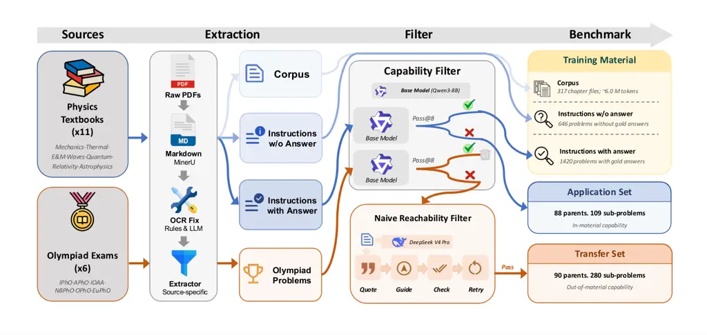

# StudyBench: Can Self-Evolution Squeeze Textbooks for Olympiad Capability?

Yinghao Chen    Zixi Chen    Bingxiang He    Ziqing Qiao    Huan-ang Gao
   Yinuo Xu    Yuxin Zuo    Zeyuan Liu    Yuhao Zhan
Affiliation: Tsinghua University  Zhejiang University    Chaojun Xiao

###### Abstract

Humans need to study only a handful of well-written textbooks to master
a discipline and attempt its hardest problems. We argue that an ideal
self-evolution method should share the same property, that is
autonomously learning from raw training material for transferable
problem-solving capability. However, we still lack a direct measurement
for it. We introduce StudyBench, a controlled physics benchmark that
directly measures how efficiently a self-evolution method converts
training material into capability. We organise the test set into an
Application Set, consisting of difficult textbook problems and
evaluating absorption ability, and a Transfer Set, consisting of
olympiad-level problems and evaluating transfer ability. Benchmarking
representative self-evolution methods across three base models, we find
that improvements on the Application Set rarely translate to the harder
Transfer Set. A guidance ablation exposes a Guidance Gap: even the
strongest method closes only a small fraction of what the same material
unlocks when supplied as in-context guidance. Besides, every method hits
a Compute Plateau, saturating well before exhausting its compute budget.
The remaining gap is therefore a method problem rather than a data or
compute problem. By offering a clean and controlled benchmark,
StudyBench turns self-evolution progress from an open-ended pursuit into
a measurable target for future research. Our code is released at
[https://github.com/thunlp/StudyBench](https://github.com/thunlp/StudyBench).

¹¹footnotetext: Equal contribution.²²footnotetext: Correspondence to:
Bingxiang He \<hebx24@mails.tsinghua.edu.cn\>, Chaojun Xiao
\<xcj@tsinghua.edu.cn\>.

## 1 Introduction

Self-evolution, the capacity for a model to keep improving on its own
without being capped by a limited supply of high-quality data, shows the
promise of true Artificial General Intelligence (Goertzel and Pennachin,
2007; Silver and Sutton, 2025). We argue that any system worthy of that
promise must succeed at two things at once. First, it should
continuously _absorb_ new knowledge from its environment (Yuan et al.,
2026). Second, and more critically, it should continuously _evolve_
absorbed knowledge into transferable problem-solving capability, instead
of merely memorizing or paraphrasing what it has seen (Mirzadeh et al.,
2025; Huang et al., 2025b; Huang et al., 2026). The second ability is
arguably the harder of the two: absorption alone is bounded by what the
training material already states; yet real-world problems seldom have
direct precedents in the training material, and addressing them
therefore demands _transferable_ problem-solving capability. Whether
self-evolution can scale beyond the data it consumes therefore turns on
how efficiently it performs this knowledge-to-capability conversion.

Despite a rapidly growing literature (Gao et al., 2025; Novikov et al.,
2025; Huang et al., 2025a) on self-evolution, we still lack a clear way
to measure how effectively a method performs this conversion. Static
high-difficulty exams such as AIME and Humanity’s Last Exam (Phan et
al., 2025) only give a final score, conflating the algorithm’s
contribution with that of the training data and the base model. Dynamic
and lifelong-learning benchmarks (Castillo-Bolado et al., 2024; Zheng et
al., 2025a; Wan and Ma, 2025; Dou et al., 2026) test whether a model
reuses earlier experiences to do better on later problems; they address
local adaptation, while we operate at a higher level, testing conversion
from experiences to transferable capability. The deeper reason these
existing evaluations fall short is that the conversion itself is hard to
measure directly: any such measurement faces three obstacles. First, the
vanishing capability gap: when the base model already passes the test
set on its own, any post-training score merely surfaces existing
capability rather than what the algorithm added. Second, unreachable
targets: when the training material is insufficient for any algorithm to
derive the test solutions. Third, confounded attribution: when the base
model, the training material, and the algorithm vary together, thus the
score conflates all three. To our knowledge, no existing evaluation
eliminates all three at once.

We close this gap with StudyBench, aiming to directly reveal the
enhancement brought by self-evolution methods. We instantiate the
setting in physics: 11 canonical physics textbooks serve as the training
material, factored into three layers to fit requirements of different
self-evolution methods: a Corpus of raw passages, Instructions with
Answer, and Instructions without Answer. The training material is paired
with two complementary test splits that form a built-in difficulty
progression. The Application Set consists of difficult end-of-chapter
exercises drawn from the textbooks themselves, retained only when
Qwen3-8B (Yang et al., 2025) does not solve them reliably; it probes
whether an algorithm has absorbed the training material. The Transfer
Set consists of olympiad-level theory problems, retained only when
Qwen3-8B alone fails but succeeds with the help of textbook-grounded
guidance, which is built from passages taken directly from the training
material; it probes whether the method has additionally converted that
material into capability transferable to problems harder than any in the
textbooks themselves. We filter with Qwen3-8B because it sits at mid
capability: strong enough that a failed parent is a genuine gap, yet not
so strong that the retained set collapses or fails the guidance-based
reachability check.

This construction guarantees three properties by design: (1) Capability
Gap, that retained test problems lie outside Qwen3-8B’s reliable
capability, so scores on that model reflect ability gained rather than
residual competence; (2) Reachability, that every retained test problem
is solvable by utilizing the training material, eliminating unreachable
targets; and (3) Controlled Attribution, that the training material, the
test items, and the evaluation protocol are identical across methods, so
that within each base model the score isolates the algorithm.
Llama-3.2-3B-Instruct (Grattafiori et al., 2024) and
Opus 4.7 (Anthropic, 2025) reuse the same items, so cross-model
comparison is on a shared problem set rather than on per-model filters.

On StudyBench, we benchmark multiple representative self-evolution
methods across three base models and find that (i) Application-Set gains
remain local to textbook exercises: on Qwen3-8B, GEPA lifts Application
$`\mathrm{Par}@8`$ from $`17.05`$ to $`34.85`$, yet Transfer
$`\mathrm{Par}@8`$ reaches only $`7.04`$; (ii) textbook-grounded
guidance already certifies that every Transfer-Set parent is fully
reachable from the training material, yet the strongest method raises
$`\mathrm{Par}@8`$ only from $`0.00`$ to $`7.04`$ on Qwen3-8B; and (iii)
on the self-evolution loops we profile, methods plateau well before
exhausting their compute budget. The remaining gap is therefore a method
problem rather than a data or compute problem, leaving substantial room
for future work.

## 2 StudyBench



Figure 1: Construction pipeline for StudyBench. Textbooks are extracted
into a _Corpus_, _Instructions with Answer_ , and _Instructions without
Answer_, which together form the training material; olympiad problems
are extracted along a separate, test-only stream. A _Capability Filter_
run on Qwen3-8B keeps items that model does not solve reliably;
Llama-3.2-3B-Instruct and Opus 4.7 reuse the same items. Failed textbook
problems become the Application Set; failed olympiad problems pass an
additional _Naive Reachability Filter_ and become the Transfer Set.

StudyBench is inspired by the way humans master a discipline: a
motivated student typically needs no more than a handful of well-chosen
textbooks and some deliberate practice to attempt the hardest problems
in the field. A self-evolution method, placed in an analogous setting,
ought to demonstrate comparable capability. StudyBench builds such a
setting and provides a means to measure it. We instantiate it in
physics, where final answers are verifiable, the set of standard
textbooks is small and widely shared across physics curricula of top
universities and olympiad training, and hard problems require both
textbook knowledge and the reasoning capability to use it. These
properties make physics an ideal setting for measuring capability rather
than knowledge alone.

### 2.1 Benchmark Construction

Figure 1 summarises the construction. Each textbook yields three nested
layers of training material: the Corpus of raw passages contains the
Instructions without Answer (every exercise as a problem statement),
which in turn contains the Instructions with Answer (the subset for
which a gold answer is available from the textbook or its official
solution manual). Each self-evolution method draws on whichever layer
fits its training paradigm.

The test set, in turn, draws from two complementary sources of
escalating difficulty: difficult end-of-chapter problems from these same
textbooks (Table 5) and problems from six international physics and
astronomy olympiads (Table 6). From both pools we keep only problems on
which Qwen3-8B does not succeed reliably, then subsample failed textbook
parents by sub-discipline so that no subject dominates; failed
competition parents all proceed. For the olympiad pool we additionally
retain only those Qwen3-8B can solve under a textbook-grounded guidance
trace, certifying that the answer is reachable from the training
material. Llama-3.2-3B-Instruct and Opus 4.7 are scored on this same
item set. The retained textbook problems form the Application Set, which
measures whether a method has absorbed the training material well enough
to apply it where it was first introduced; the retained olympiad
problems form the Transfer Set, which measures whether the method has
additionally converted that material into capability that transfers to
problems harder than any in the textbooks themselves. The remainder of
this subsection details each step.

Sources. The 11 textbooks (Table 5) are each currently adopted as a
course text at top universities and independently recommended either by
olympiad-training coaches or on the competitions’ own preparation pages.
By sub-discipline, the 11 textbooks jointly cover the syllabus of all
six olympiads.

Extraction. All source materials are PDFs. We convert every PDF to
Markdown via MinerU (Wang et al., 2026) and then fix common OCR errors
(broken super- and subscripts, malformed LaTEX, dropped figure captions)
by first applying deterministic rules and then using an LLM to handle
cases the rules cannot. With Claude Opus 4.7 as a coding assistant, we
then write a separate extractor for each textbook and each competition,
since each source has its own layout. From each textbook we extract its
worked examples and end-of-chapter exercises, and from each competition
we extract every theory problem of every past edition. For five
textbooks we take exercise answers and reference solutions from the
matching official solution manual; for the rest they come from in-book
answer keys or end-of-chapter solutions (Table 5). Physics problems are
commonly split into several sub-problems sharing a common setup, so each
extracted record stores both the full problem statement and a list of
per-sub-problem entries carrying the sub-problem text, the reference
solution where given, and the gold answer. The gold answer of every
sub-problem is further classified by DeepSeek V4 Flash (DeepSeek-AI, 2026) into one of nine answer types: NV (numeric value), EX (symbolic
expression), EQ (equation), TUP (ordered tuple), IN (interval), MC
(single multiple-choice letter), TF (boolean), QL (short qualitative
phrase), and ALT (alternative acceptable forms of one answer); composite
types (TUP and ALT) additionally carry a per-position sequence that
tells the verifier how to judge each slot. Appendix E gives the full
record schema and shows one example.

Capability Filter. We run Qwen3-8B with $`\mathrm{pass}@8`$ sampling on
both pools and treat a parent as failed if no attempt solves every
sub-problem. Solved textbook problems stay in the training material;
solved competition problems are discarded. Every failed competition
parent advances to the Naive Reachability Filter. Failed textbook
parents do not: we subsample them by sub-discipline so that hard
subjects do not dominate the Application Set, and send unselected failed
parents back to the training material. Subjects that would otherwise
empty under a strict zero-of-eight rule are kept in play by additionally
admitting $`15`$ parents that Qwen3-8B solved on exactly one of eight
attempts. These $`15`$ are the sole source of Qwen3-8B’s Application
$`\mathrm{Par}@8`$ ($`15/88=17.05\%`$); the other $`73`$ Application
parents, and every Transfer-Set parent, fail on all eight attempts.
Llama-3.2-3B-Instruct and Opus 4.7 reuse this set. Appendix C reports
the resulting sub-discipline distribution. Since the prerequisite
material lives in the same chapter, the Application Set is reachable by
construction.

Naive Reachability Filter. Since we cannot precisely characterise the
reachability boundary, we adopt a naive but auditable proxy: a
competition problem is admitted only if Qwen3-8B can solve it under
teacher-distilled, textbook-grounded guidance. The procedure is driven
by a strong teacher DeepSeek V4 Pro (DeepSeek-AI, 2026) and consists of
five steps:

- •
  Decompose. For each sub-problem the teacher enumerates a minimal set
  of named knowledge points—concepts, laws or equations, techniques, and
  assumptions—required by the gold solution. Near-duplicate names are
  then canonicalised across the corpus.
- •
  Retrieve. The training textbooks are first split into exposition and
  worked-example fragments. Each canonical knowledge point is matched to
  those fragments by a two-channel retriever: BM25 over normalised text
  and dense embeddings, fused by reciprocal rank fusion with a
  preference for in-domain books.
- •
  Verify. The teacher scores every candidate on a $`0`$–$`3`$ coverage
  rubric and copies a short verbatim quote as evidence. A server-side
  check demotes any quote that does not actually appear in the fragment;
  only scores of $`2`$ (applied/example) or $`3`$ (direct exposition)
  count as coverage.
- •
  Guide. Given the verified passages and, for the teacher’s own
  understanding, the gold solution, the teacher writes a methodological
  guidance that names which textbook concepts, formulae, and examples to
  use and in what order, without stating the answer or performing the
  key calculation. A dual leakage gate—deterministic redaction rules
  plus a separate teacher review—regenerates failing guidance up to
  twice and rule-sanitises the last attempt as a fallback.
- •
  Retry. We admit the problem into the Transfer Set if Qwen3-8B solves
  it at least once in eight attempts under this grounded guidance.

Together these five steps form an explicit, textbook-auditable witness
that the gold answer is reachable by recombining the training material.
To check that this witness is not tied to one teacher, we re-run the
same pipeline with GLM-5.1 and evaluate Qwen3-8B under the independently
written traces: $`56`$ of $`90`$ Transfer-Set parents ($`62.22`$
$`\mathrm{Par}@8`$) and $`242`$ of $`280`$ sub-problems ($`86.43`$
$`\mathrm{Sub}@8`$) remain solvable (Appendix D).

Properties. By construction, the resulting benchmark satisfies three
properties. (1) Capability Gap, that retained test problems lie outside
Qwen3-8B’s reliable capability; (2) Reachability, that every retained
test problem is solvable by recombining content from the training
material, eliminating unreachable targets; and (3) Controlled
Attribution, that the training material, the test items, and the
evaluation protocol are fixed across methods, so that within each base
model a method’s score reflects only what the method does between them.

### 2.2 Evaluation

Protocol. Each method is free to draw on any subset of the training
material to suit its training paradigm. We then evaluate every evolved
model on both test sets. Open-weight models use $`k{=}8`$ samples per
sub-problem; because of API cost, Opus 4.7 uses $`k{=}1`$. All runs
share temperature $`1.0`$, top-$`p`$ $`0.95`$, top-$`k`$ $`20`$, and a
$`32{,}768`$-token cap. From these samples we report two accuracies. Let
$`\mathcal{P}`$ denote the parent problems in a test set, $`n_{p}`$ the
number of sub-problems of parent $`p`$, and $`c_{p,j,a}\in\{0,1\}`$ the
verifier’s judgement on the $`j`$-th sub-problem of parent $`p`$ in
attempt $`a`$. Parent accuracy ($`\mathrm{Par}@k`$) counts a parent
correct only if some single attempt solves every one of its
sub-problems:

```math
\mathrm{Par}@k=\frac{1}{|\mathcal{P}|}\sum_{p\in\mathcal{P}}\max_{1\leq a\leq k}\prod_{j=1}^{n_{p}}c_{p,j,a}.
```

Sub-problem accuracy ($`\mathrm{Sub}@k`$) flattens parents into
sub-problems and marks each correct if any of the $`k`$ attempts solves
it:

```math
\mathrm{Sub}@k=\frac{1}{\sum_{p\in\mathcal{P}}n_{p}}\sum_{p\in\mathcal{P}}\sum_{j=1}^{n_{p}}\max_{1\leq a\leq k}c_{p,j,a}.
```

For open-weight models we repeat the $`\mathrm{pass}@8`$ evaluation
three times with independent sampling seeds and report the mean $`\pm`$
standard deviation. For Opus 4.7 we report a single $`\mathrm{pass}@1`$
run.

Sub-problem Evaluation. Multi-part problems are scored sub-problem by
sub-problem with conversational continuity: at sub-problem $`i`$, the
model sees the shared stem, the $`i-1`$ prior sub-problem statements,
and the _model’s own_ prior answers to them, but never the gold
solutions. When the model fails to produce a final answer for
sub-problem $`i`$, we insert a fixed placeholder stating the failure in
the assistant slot and continue with sub-problem $`i+1`$ rather than
discarding the rest of the parent. This isolates each sub-problem’s
correctness, so $`\mathrm{pass}@k`$ can be reported per sub-problem and
aggregated per parent.

Verifier. We build our verifier on the rule-based judger of
UG-Physics (Xu et al., 2025), adding one new primitive answer type QL
(short qualitative phrases such as “tidal forces”). We also introduce a
new field, type_sequence, which lets the verifier dispatch composite
answers (TUP and ALT) onto position-wise primitive judgers. The
resulting verifier applies a different judging rule for every one of the
nine answer types. For leaderboard evaluation we additionally route
failed problems to DeepSeek-V4-Flash-0731 as an LLM judger to enhance
correctness. Appendix G reports a consistency analysis of the two-stage
verifier. The full judge prompt is reproduced in Appendix F. When the
verifier is wired into an RL-based self-evolution method as a reward
signal, we expose only this rule-based part to avoid reward hacking.

### 2.3 Contamination

The $`11`$ textbooks and the Olympiad archives are public, so a
problem’s statement or answer can, in principle, leak into a method’s
pipeline at two stages: (a) the _pretraining_ of the base model, or (b)
_training material_ of a self-evolution method. StudyBench neutralises
both by design.

Pretraining leakage is screened out by the Capability Filter. A problem
enters either test set only if Qwen3-8B does not solve it reliably under
$`\mathrm{pass}@8`$ (zero successes, or, for $`15`$ Application parents,
a single success). Answers Qwen3-8B has memorised well enough to recover
consistently are therefore removed from the test sets, regardless of
whether the problem statement appears verbatim in pretraining. The same
items are reused for Llama-3.2-3B-Instruct and Opus 4.7, so this screen
is defined with respect to Qwen3-8B.

Training-material leakage is removed by redaction. Transfer Set problems
come from olympiad theory exams, which do not appear in any of the
eleven textbooks that constitute the training material. Application Set
problems do come from those textbooks, but for every retained parent we
excise both the problem statement and the reference solution (including
any back-of-book answer key or solution-manual entry) from the raw
markdown before assembling the training material, and we audit the
resulting corpus to confirm no verbatim residue remains; Appendix H
details the two-pass redaction pipeline and the audit procedure. A
method that memorises every page of its training material therefore
gains access to none of the answers it will be asked for.

### 2.4 Statistics

Test sets. The filters retain $`88`$ Application Set parents ($`109`$
sub-problems) and $`90`$ Transfer Set parents ($`280`$ sub-problems).
The Application Set is subsampled so that no sub-discipline dominates;
the Transfer Set keeps every competition parent that fails Qwen3-8B and
then passes the Naive Reachability Filter. Appendix C reports both
mixes. Together the two sets measure in-material and out-of-material
capability.

Training material. Table 1 reports the per-layer counts of the Corpus,
the Instructions without Answer, and the Instructions with Answer. The
three layers cover the supervision regimes of the major self-evolution
families.

| Layer                       | Count         |
| --------------------------- | ------------- |
| Corpus chapter files        | 317           |
| total size (MB)             | 18.19         |
| total tokens                | $`\sim 6.0`$M |
| Instructions without Answer | 646           |
| Instructions with Answer    | 1,420         |

Table 1: Statistics of the three nested training-material layers.
_Instructions with Answer_ means we successfully extracted the
instruction-answer pair from the textbook or its official solution
manual, while _Instructions without Answer_ means we failed to find the
corresponding answer.

|                               |                    |                    |                          |                    |                    |                          |
| ----------------------------- | ------------------ | ------------------ | ------------------------ | ------------------ | ------------------ | ------------------------ |
|                               | Application Set    |                    |                          | Transfer Set       |                    |                          |
|                               | $`\mathrm{Par}@8`$ | $`\mathrm{Sub}@8`$ | $`\Delta\mathrm{Sub}@8`$ | $`\mathrm{Par}@8`$ | $`\mathrm{Sub}@8`$ | $`\Delta\mathrm{Sub}@8`$ |
| Qwen3-8B                      | 17.05 $`\pm`$ 1.14 | 29.36 $`\pm`$ 2.75 | –                        | 0.00               | 56.43 $`\pm`$ 1.89 | –                        |
| _Corpus_                      |                    |                    |                          |                    |                    |                          |
| Bonito (Nayak et al., 2024)   | 21.21 $`\pm`$ 3.47 | 28.13 $`\pm`$ 3.47 | $`-1.23`$                | 4.44 $`\pm`$ 1.11  | 35.00 $`\pm`$ 0.36 | $`-21.43`$               |
| _Instructions with Answer_    |                    |                    |                          |                    |                    |                          |
| GRPO (Shao et al., 2024)      | 28.41 $`\pm`$ 1.97 | 38.84 $`\pm`$ 1.40 | $`+9.48`$                | 4.07 $`\pm`$ 1.70  | 57.02 $`\pm`$ 1.09 | $`+0.59`$                |
| GEPA (Agrawal et al., 2025)   | 34.85 $`\pm`$ 1.31 | 44.34 $`\pm`$ 1.40 | $`\mathbf{+14.98}`$      | 7.04 $`\pm`$ 2.80  | 58.57 $`\pm`$ 1.43 | $`\mathbf{+2.14}`$       |
| ACE (Zhang et al., 2025)      | 31.06 $`\pm`$ 1.74 | 41.90 $`\pm`$ 1.06 | $`+12.54`$               | 2.96 $`\pm`$ 2.31  | 57.26 $`\pm`$ 1.09 | $`+0.83`$                |
| _Instructions without Answer_ |                    |                    |                          |                    |                    |                          |
| TTRL (Zuo et al., 2025)       | 28.79 $`\pm`$ 3.65 | 38.84 $`\pm`$ 2.80 | $`+9.48`$                | 2.59 $`\pm`$ 1.70  | 58.57 $`\pm`$ 1.86 | $`\mathbf{+2.14}`$       |
| Intuitor (Zhao et al., 2025)  | 26.89 $`\pm`$ 2.37 | 38.23 $`\pm`$ 2.65 | $`+8.87`$                | 5.56 $`\pm`$ 1.92  | 58.21 $`\pm`$ 0.36 | $`+1.78`$                |
| _Data-free_                   |                    |                    |                          |                    |                    |                          |
| R-Zero (Huang et al., 2025a)  | 29.55 $`\pm`$ 5.90 | 39.14 $`\pm`$ 5.30 | $`+9.78`$                | 4.07 $`\pm`$ 2.80  | 58.10 $`\pm`$ 1.03 | $`+1.67`$                |
| _Guided (Corpus)_             |                    |                    |                          |                    |                    |                          |
| Naive Guidance                | –                  | –                  | –                        | $`100.00`$         | $`100.00`$         | $`+43.57`$               |
| Llama-3.2-3B-Instruct         | 9.47 $`\pm`$ 0.66  | 14.37 $`\pm`$ 0.53 | –                        | $`0.00`$           | $`14.88\pm 1.76`$  | –                        |
| _Corpus_                      |                    |                    |                          |                    |                    |                          |
| Bonito (Nayak et al., 2024)   | 10.98 $`\pm`$ 2.62 | 15.90 $`\pm`$ 2.31 | $`+1.53`$                | 1.85 $`\pm`$ 1.28  | 17.86 $`\pm`$ 1.86 | $`+2.98`$                |
| _Instructions with Answer_    |                    |                    |                          |                    |                    |                          |
| GRPO (Shao et al., 2024)      | 10.98 $`\pm`$ 1.31 | 14.07 $`\pm`$ 1.40 | $`-0.30`$                | 2.59 $`\pm`$ 1.28  | 22.74 $`\pm`$ 1.44 | $`\mathbf{+7.86}`$       |
| GEPA (Agrawal et al., 2025)   | 11.74 $`\pm`$ 1.31 | 14.98 $`\pm`$ 1.06 | $`+0.61`$                | 2.22 $`\pm`$ 2.94  | 17.26 $`\pm`$ 1.25 | $`+2.38`$                |
| ACE (Zhang et al., 2025)      | 9.85 $`\pm`$ 3.65  | 14.37 $`\pm`$ 2.95 | $`+0.00`$                | $`1.85\pm 0.02`$   | $`16.79\pm 1.29`$  | $`+1.91`$                |
| _Instructions without Answer_ |                    |                    |                          |                    |                    |                          |
| TTRL (Zuo et al., 2025)       | 9.85 $`\pm`$ 0.66  | 12.85 $`\pm`$ 0.92 | $`-1.52`$                | 2.59 $`\pm`$ 0.64  | 19.76 $`\pm`$ 1.49 | $`+4.88`$                |
| Intuitor (Zhao et al., 2025)  | 12.50 $`\pm`$ 2.27 | 16.82 $`\pm`$ 1.91 | $`\mathbf{+2.45}`$       | 0.74 $`\pm`$ 0.64  | 20.60 $`\pm`$ 0.82 | $`+5.72`$                |
| _Data-free_                   |                    |                    |                          |                    |                    |                          |
| R-Zero (Huang et al., 2025a)  | 5.68 $`\pm`$ 1.14  | 10.70 $`\pm`$ 1.06 | $`-3.67`$                | 0.74 $`\pm`$ 0.64  | 18.69 $`\pm`$ 1.15 | $`+3.81`$                |
| _Guided (Corpus)_             |                    |                    |                          |                    |                    |                          |
| Naive Guidance                | –                  | –                  | –                        | 10.74 $`\pm`$ 3.39 | 46.79 $`\pm`$ 0.36 | $`+31.91`$               |

Table 2: Main results on StudyBench for open-weight models ($`k{=}8`$),
grouped by training-material layer. Qwen3-8B’s Transfer
$`\mathrm{Par}@8`$ is $`0.00`$ by construction. $`\Delta\mathrm{Sub}@8`$
is relative to the same base model; $`\pm`$ is over three independent
$`\mathrm{pass}@8`$ evaluations. All numbers in %.

|                                |                    |                    |                          |                    |                    |                          |
| ------------------------------ | ------------------ | ------------------ | ------------------------ | ------------------ | ------------------ | ------------------------ |
|                                | Application Set    |                    |                          | Transfer Set       |                    |                          |
|                                | $`\mathrm{Par}@1`$ | $`\mathrm{Sub}@1`$ | $`\Delta\mathrm{Sub}@1`$ | $`\mathrm{Par}@1`$ | $`\mathrm{Sub}@1`$ | $`\Delta\mathrm{Sub}@1`$ |
| Opus 4.7 with Claude Code      | 59.09              | 66.06              | –                        | 40.00              | 72.14              | –                        |
| _Instructions with Answer_     |                    |                    |                          |                    |                    |                          |
| GEPA (Agrawal et al., 2025)    | 51.14              | 57.80              | $`-8.26`$                | 41.11              | 72.14              | $`+0.00`$                |
| ACE (Zhang et al., 2025)       | 60.23              | 63.30              | $`-2.76`$                | 33.33              | 66.79              | $`-5.35`$                |
| EvoSkill (Alzubi et al., 2026) | 52.27              | 58.72              | $`-7.34`$                | 43.33              | 73.57              | $`\mathbf{+1.43}`$       |
| _Guided (Corpus)_              |                    |                    |                          |                    |                    |                          |
| Naive Guidance                 | –                  | –                  | –                        | 63.33              | 84.64              | $`+12.50`$               |

Table 3: Results on StudyBench for Opus 4.7 with Claude Code
($`k{=}1`$), on the same item set as Table 2. A single
$`\mathrm{pass}@1`$ run. All numbers in %.

## 3 Experiments

Baselines. We benchmark a representative set of self-evolution methods
grouped by which layer of the training material each one consumes. (1)
Corpus. Bonito (Nayak et al., 2024) runs a task-conditioned generator
over textbook passages to synthesise question–answer pairs and performs
supervised fine-tuning on the base model with them. Naive Guidance is
not a training method: it injects textbook-grounded traces built from
the same Corpus at inference time, and serves as the reachability
ceiling on the Transfer Set. (2) Instructions with Answer. GRPO (Shao et
al., 2024) is a supervised RL reference: it trains on these labelled
problems with a gold outcome reward. GEPA (Agrawal et al., 2025) treats
them as a development set and evolves a system prompt via reflective
genetic search, while ACE (Zhang et al., 2025) distils them into an
in-context playbook of formulae, strategies, and common pitfalls; both
artefacts are injected into the system message at inference time without
any weight update. (3) Instructions without Answer. TTRL (Zuo et al., 2025) and Intuitor (Zhao et al., 2025) both run label-free RL on these
problems, rewarding majority-vote consistency and the policy’s own
self-certainty, respectively. (4) Data-free. R-Zero (Huang et al.,
2025a) bootstraps capability from Challenger-Solver self-play under
self-consistency rewards. We include it to see how well a method that
uses no training data at all can do on StudyBench.

Setup. The test set is filtered with Qwen3-8B (Yang et al., 2025)
(thinking mode enabled). We then evaluate the same items on three base
models of increasing capability: Llama-3.2-3B-Instruct (Grattafiori et
al., 2024), Qwen3-8B, and Opus 4.7 (Anthropic, 2025) with Claude Code.
For each method we reproduce from its official repository and make only
minimal modifications to fit StudyBench’s training material and
evaluation protocol. All open-weight self-evolution methods run on a
single $`8{\times}`$NVIDIA-A800-80GB node. Appendix J lists per-method
modifications and full configurations.

Results. Tables 2 and 3 report the main results. Because the item set is
filtered with Qwen3-8B, that model’s Transfer $`\mathrm{Par}@8`$ is
$`0.00`$ by construction, while its Application $`\mathrm{Par}@8`$ of
$`17.05`$ is the $`15`$ coverage parents admitted at one-of-eight;
Llama-3.2-3B-Instruct and Opus 4.7 are not guaranteed a zero parent
score on the same items. On Qwen3-8B, most methods absorb the textbooks:
Application $`\mathrm{Sub}@8`$ rises by $`+8.87`$ to $`+14.98`$, with
GEPA leading on both Application metrics ($`34.85`$ $`\mathrm{Par}@8`$,
$`+14.98`$ $`\Delta\mathrm{Sub}@8`$). Those gains stay local. Transfer
$`\mathrm{Sub}@8`$ moves by at most $`+2.14`$ (GEPA and TTRL), and the
best Transfer $`\mathrm{Par}@8`$ is only $`7.04`$ against a $`100\%`$
Corpus-grounded guidance ceiling. Bonito is the exception:
synthetic-data SFT erodes Qwen3-8B’s thinking behaviour, so problems the
base model already solved become unsolvable ($`-1.23`$ Application and
$`-21.43`$ Transfer $`\Delta\mathrm{Sub}@8`$). The other two models on
the same items confirm the pattern. Llama-3.2-3B-Instruct barely moves
on Application (peak $`+2.45`$ under Intuitor), while supervised GRPO
leads Transfer ($`+7.86`$); Opus 4.7 already solves much of the set, and
context-evolution methods mostly regress on Application. Section 4.1
attributes the remaining Transfer headroom to the Guidance Gap—the
accuracy a method recovers when textbook-grounded guidance is supplied
at inference but not internalised by training.

## 4 Analysis

We organise our analysis around two research questions: RQ1: _how much
of the corpus-reachable knowledge actually migrates into standalone
transfer capability?_ RQ2: _can the remaining gap be closed by simply
running each self-evolution loop longer?_

### 4.1 The Guidance Gap (RQ1)

The Application Set probes whether a method has _absorbed_ the training
material; the Transfer Set probes whether that material has
_transferred_ to problems strictly harder than any in the textbooks. The
two probes diverge in Table 2. On Qwen3-8B, Application
$`\Delta\mathrm{Sub}@8`$ ranges from $`+8.87`$ to $`+14.98`$ for every
method except Bonito, yet Transfer $`\Delta\mathrm{Sub}@8`$ is at most
$`+2.14`$ and Transfer $`\mathrm{Par}@8`$ stays in the single digits.
RQ1 asks how much of the corpus-reachable knowledge certified by our
Naive Reachability Filter has actually migrated into standalone transfer
capability, rather than remaining merely reachable.

Guidance ablation. To answer this, we re-run the Transfer Set under the
textbook-grounded guidance produced during construction (§2.1),
injecting them at inference. Table 4 reports the ablation for Qwen3-8B
and the five self-evolution methods we re-ran under guidance; We define
the Guidance Gap as the accuracy a method recovers when grounded
guidance is supplied at inference but not internalised by training:

```math
\text{Guidance Gap}=\text{Acc}_{\text{guided}}-\text{Acc}_{\text{solo}}, \tag{1}
```

where $`\text{Acc}_{\text{solo}}`$ is Transfer-Set accuracy under the
solo protocol of §2.2 and $`\text{Acc}_{\text{guided}}`$ uses the same
Naive Reachability Filter traces in the system prompt. Both quantities
are reported for $`\mathrm{Par}@8`$ and $`\mathrm{Sub}@8`$. Closing the
gap means the method has converted into standalone capability what, for
Qwen3-8B, only an in-context guidance trace could surface.

|          | $`\mathrm{Par}@8`$ |        |        | $`\mathrm{Sub}@8`$ |        |       |
| -------- | ------------------ | ------ | ------ | ------------------ | ------ | ----- |
| Method   | Solo               | Guided | Gap    | Solo               | Guided | Gap   |
| Qwen3-8B | 0.00               | 100.00 | 100.00 | 56.43              | 100.00 | 43.57 |
| Bonito   | 4.44               | 23.33  | 18.89  | 35.00              | 68.93  | 33.93 |
| GEPA     | 7.04               | 90.00  | 82.96  | 58.57              | 97.14  | 38.57 |
| ACE      | 2.96               | 88.89  | 85.93  | 57.26              | 97.14  | 39.88 |
| Intuitor | 5.56               | 90.00  | 84.44  | 58.21              | 98.21  | 40.00 |
| R-Zero   | 4.07               | 90.00  | 85.93  | 58.10              | 98.21  | 40.11 |

Table 4: Transfer-Set accuracy with textbook-grounded guidance on
Qwen3-8B. Solo accuracies repeat Table 2; guided accuracies inject the
Naive Reachability Filter traces at inference. Guidance Gap
$`=\text{Acc}_{\text{guided}}-\text{Acc}_{\text{solo}}`$. Qwen3-8B’s
guided scores are $`100`$ by construction of that filter. Appendix D
reports the same protocol with independently written GLM-5.1 traces.

A high, method-stable ceiling—except under SFT. By construction of the
Reachability Filter, Qwen3-8B under guidance solves every Transfer
parent ($`100`$ $`\mathrm{Par}@8`$ and $`\mathrm{Sub}@8`$). The same
traces remain highly effective after context evolution or label-free RL:
GEPA, ACE, Intuitor, and R-Zero all sit at $`88.89`$–$`90.00`$ guided
$`\mathrm{Par}@8`$ and $`97.14`$–$`98.21`$ guided $`\mathrm{Sub}@8`$.
Training therefore barely moves the ceiling. Bonito is the outlier:
after synthetic-data SFT its guided $`\mathrm{Par}@8`$ falls to
$`23.33`$ and guided $`\mathrm{Sub}@8`$ to $`68.93`$. The same collapse
of thinking behaviour that hurts solo accuracy also prevents the model
from following guidance that the untrained backbone can use.

Solo gains close almost none of the gap. Relative to Qwen3-8B’s original
headroom ($`100`$ $`\mathrm{Par}@8`$ points; $`43.57`$
$`\mathrm{Sub}@8`$ points), the strongest solo run is GEPA at $`7.04`$
$`\mathrm{Par}@8`$ and $`+2.14`$ $`\Delta\mathrm{Sub}@8`$—closing
$`\mathbf{7\%}`$ of the parent gap and $`\mathbf{5\%}`$ of the
sub-problem gap. Intuitor ($`5.56`$ / $`+1.78`$) and R-Zero ($`4.07`$ /
$`+1.67`$) close even less; ACE trails on parents ($`2.96`$). GRPO and
TTRL, which we did not re-run under guidance, have solo Transfer scores
in the same band ($`4.07`$ / $`+0.59`$ and $`2.59`$ / $`+2.14`$).
Bonito’s solo Transfer $`\mathrm{Sub}@8`$ falls below the base model, so
it widens rather than closes the sub-problem gap. The Application Set,
where the same methods (Bonito aside) gain $`+8.87`$ to $`+14.98`$
$`\mathrm{Sub}@8`$, cannot see this failure: absorption and transfer
remain complementary probes.

Substantial headroom remains. Because guidance still unlocks about
$`90\%`$ of Transfer parents for every method except Bonito, what
remains is an _internalisation_ problem rather than a _reachability_
problem: the textbooks already contain what is needed to solve the
retained olympiad parents, yet no method converts more than a sliver of
that into standalone capability. Llama-3.2-3B-Instruct and Opus 4.7
reuse the same items and the same traces (Tables 2 and 3); their
guidance ceilings are lower ($`10.74`$ and $`63.33`$ $`\mathrm{Par}@8`$)
because the filter was built for Qwen3-8B, but the qualitative gap is
unchanged—the strongest solo run still leaves most of the available
headroom on the table.

### 4.2 The Compute Plateau (RQ2)

RQ1 left most of the Guidance Gap unclosed: even GEPA, the strongest
method, recovers only $`7\%`$ of Qwen3-8B’s parent-level Transfer
headroom. RQ2 asks whether the remaining gap can be closed by simply
running each self-evolution loop longer.

Setup. For each of the five self-evolution loops we profile on Qwen3-8B,
we evaluate the model checkpoint (Bonito, Intuitor, R-Zero) or
inference-time artefact (GEPA, ACE) at intermediate snapshots and plot
Application-Set $`\mathrm{Sub}@8`$ against cumulative GPU-time on NVIDIA
A800 GPUs. Compute scales differ by nearly two orders of magnitude—from
$`8.12`$ GPU hour for Bonito to $`614`$ GPU hour for R-Zero—so the
curves cannot share an axis. We show ACE in the main text (Figure 2)
because we ran it under three random seeds, and place the other four
curves in Appendix I.

Figure 2: Application-Set $`\mathrm{Sub}@8`$ of ACE against cumulative
GPU-time (1$`\times`$A800). The solid line is the mean of three seeds;
the band is $`\pm 1`$ standard deviation. Accuracy jumps from the
Qwen3-8B baseline ($`\approx 29.4\%`$) to $`\approx 40\%`$ by the
$`8.50`$ GPU hour snapshot, then the mean stays in a $`38`$–$`41\%`$
band through the $`62.54`$ GPU hour endpoint. Late seed-to-seed scatter
does not resume a climb. The same early-plateau pattern holds for the
other four methods (Appendix I).

The plateau is not a single-run artefact. ACE’s three seeds all make the
same early jump and then stop improving: after the $`8.50`$ GPU hour
snapshot the mean never leaves a narrow band, even though the remaining
$`54.0`$ GPU hour are most of the $`62.54`$ GPU hour budget. Seed $`44`$
drops at the $`62.54`$ GPU hour snapshot and seed $`42`$ recovers;
neither trajectory looks like continued learning. The table’s ACE
$`\mathrm{Sub}@8`$ of $`41.90`$ sits inside this band.

The other four loops (Appendix I) saturate in the same way: GEPA climbs
then sits flat; Intuitor and R-Zero peak and decline; Bonito never
leaves the baseline band. In every case the late phase is a noisy
plateau or a decline, not a second climb.

Compute is not the bottleneck. The remaining headroom from RQ1 therefore
cannot be closed by running any of these loops longer. Extra GPU-time
past saturation moves Application accuracy by at most a few noisy
points, even though total compute spans $`76\times`$ ($`8.12`$ to
$`614`$ GPU hour) and the highest plateau (GEPA’s $`44.3\%`$) is not the
most expensive. Closing more of the gap will require a different
self-evolution loop, not a longer one.

## 5 Related Work

### 5.1 Self-Evolving Methods

Self-evolution methods differ mainly in where the improvement signal
comes from. Self-play and intrinsic-reward approaches such as
R-Zero (Huang et al., 2025a), Absolute Zero (Zhao et al., 2026),
SPICE (Liu et al., 2025), CPMobius (Li et al., 2026), and Intuitor (Zhao
et al., 2025) generate or score new practice without relying on a fixed
external answer set. Context-level methods such as GEPA (Agrawal et al., 2025) and ACE (Zhang et al., 2025) leave model weights unchanged and
instead evolve prompts or in-context playbooks. SEAL (Zweiger et al., 2026) occupies a third point in the design space: it trains a model to
emit self-edits that transform passages into finetuning data.

A related line studies improvement through memory, reflection, or
test-time search. Voyager (Wang et al., 2023), Reflexion (Shinn et al.,
2023), ExpEL (Zhao et al., 2024), and ReasoningBank (Ouyang et al., 2025) accumulate reusable experience across trajectories, while
AlphaEvolve (Novikov et al., 2025) applies evolutionary search at
inference time. These systems demonstrate many ways to make a model
adapt after deployment, but they are usually evaluated with implicit or
freely chosen training data. As a result, it is difficult to attribute
gains to a specific corpus or compare methods from different families on
equal footing.

### 5.2 Benchmarks for Self-Evolution

Dynamic and lifelong-learning benchmarks such as the LTM
Benchmark (Castillo-Bolado et al., 2024), LifelongAgentBench (Zheng et
al., 2025a), StoryBench (Wan and Ma, 2025), and EvaLearn (Dou et al., 2026) measure adaptation over interaction streams, but typically leave
the training material implicit or submitter-chosen. More targeted
benchmarks, including SE-Bench (Yuan et al., 2026), NewtonBench (Zheng
et al., 2025b), and Frontier-Eng (Chi et al., 2026), study knowledge
internalisation, scientific-law discovery, or engineering agents.

These benchmarks are closest to StudyBench in spirit, but their units of
comparison differ from ours. Some emphasise local adaptation within an
interaction stream; others evaluate open-ended agent improvement on
tasks whose useful training evidence is not fixed in advance. StudyBench
is complementary: it fixes the source corpus, enforces both a capability
gap and reachability, and provides a guidance ceiling for measuring how
much corpus-reachable capability a method internalises.

## 6 Conclusion

We introduce StudyBench, a controlled physics benchmark that measures
how efficiently a self-evolution method converts a fixed corpus into
transferable problem-solving capability. Pairing 11 textbooks with an
Application Set of unsolved textbook exercises and a Transfer Set of
olympiad problems certified reachable under textbook-grounded guidance,
it isolates knowledge-to-capability conversion from a vanishing
capability gap, unreachable targets, and confounded attribution.
Application-Set gains do not become olympiad capability: on Qwen3-8B,
GEPA lifts Application $`\mathrm{Par}@8`$ from $`17.05`$ to $`34.85`$,
yet Transfer $`\mathrm{Par}@8`$ reaches only $`7.04`$ against a
$`100\%`$ guidance ceiling, and the same local-gain pattern holds on
Llama-3.2-3B-Instruct and Opus 4.7. The profiled loops additionally hit
a Compute Plateau. The remaining gap is therefore a method problem
rather than a data or compute problem—a distinction StudyBench makes
directly measurable for future research.

## Acknowledgements

This work is supported by the China National Postdoctoral Program for
Innovative Talents (grant no. BX20250388), Tsinghua University
(Department of Computer Science and Technology)-Siemens Ltd., China
Joint Research Center for Industrial Intelligence and Internet of Things
(JCIIOT), Institute Guo Qiang at Tsinghua University.

## Limitations

The test set is filtered with Qwen3-8B, then reused for
Llama-3.2-3B-Instruct and Opus 4.7; a capability gap and a $`100\%`$
guidance ceiling are therefore guaranteed only for Qwen3-8B under the
DeepSeek V4 Pro traces, and Opus 4.7 already solves a substantial
fraction of both splits. Independently written GLM-5.1 traces recover
$`62.22`$ $`\mathrm{Par}@8`$ on the same Transfer-Set items
(Appendix D). The setting is instantiated in physics over 11 textbooks;
while the construction principles—Capability Filter, Naive Reachability
Filter, and two-level test design—are domain-agnostic, we have not
verified that they replicate in other disciplines. On the Application
Set we additionally admit $`15`$ parents that Qwen3-8B solved once in
eight attempts, a limited relaxation of the Capability Gap in order to
keep easier subjects represented. Compute constraints additionally limit
the guidance ablation (Table 4) and the compute-plateau curves; we do
not claim either result for every method–model pair. Verifier
consistency (Appendix G) is measured on Qwen3-8B Transfer-Set rollouts
only.

## References

- Agrawal et al. (2025) L. A. Agrawal, S. Tan, D. Soylu, N. Ziems, R.
  Khare, K. Opsahl-Ong, A. Singhvi, H. Shandilya, M. J. Ryan, M. Jiang,
  et al. Gepa: reflective prompt evolution can outperform reinforcement
  learning. arXiv preprint arXiv:2507.19457. Cited by: Table 2, Table 2,
  Table 3, §3, §5.1.
- Alzubi et al. (2026) S. Alzubi, N. Provenzano, J. Bingham, W. Chen,
  and T. Vu EvoSkill: automated skill discovery for multi-agent systems.
  External Links: 2603.02766, [Link](https://arxiv.org/abs/2603.02766)
  Cited by: Table 3.
- Anthropic (2025) Anthropic Claude opus 4.7. External Links:
  [Link](https://www.anthropic.com/news/claude-opus-4-7) Cited by: §1,
  §3.
- Castillo-Bolado et al. (2024) D. Castillo-Bolado, J. Davidson, F.
  Gray, and M. Rosa Beyond prompts: dynamic conversational benchmarking
  of large language models. Advances in Neural Information Processing
  Systems 37, pp. 42528–42565. Cited by: §1, §5.2.
- Chi et al. (2026) Y. Chi, D. Hong, D. Jiang, T. Luo, K. Yang, B.
  Zhang, Z. Cao, X. Fan, B. He, H. Hao, et al. Frontier-eng:
  benchmarking self-evolving agents on real-world engineering tasks with
  generative optimization. arXiv preprint arXiv:2604.12290. Cited by:
  §5.2.
- DeepSeek-AI (2026) DeepSeek-AI DeepSeek-v4: towards highly efficient
  million-token context intelligence. Cited by: §2.1, §2.1.
- Dou et al. (2026) S. Dou, M. Zhang, C. Huang, J. Chen, F. Chen, S.
  Liu, Y. Liu, C. Liu, C. Zhong, Z. Zhang, et al. Evalearn: quantifying
  the learning capability and efficiency of llms via sequential problem
  solving. Advances in Neural Information Processing Systems 38,
  pp. 125892–125945. Cited by: §1, §5.2.
- Gao et al. (2025) H. Gao, J. Geng, W. Hua, M. Hu, X. Juan, H. Liu, S.
  Liu, J. Qiu, X. Qi, Y. Wu, et al. A survey of self-evolving agents: on
  path to artificial super intelligence. arXiv preprint arXiv:2507.21046
  1. Cited by: §1.
- Goertzel and Pennachin (2007) B. Goertzel and C. Pennachin Artificial
  general intelligence. Vol. 2, Springer. Cited by: §1.
- Grattafiori et al. (2024) A. Grattafiori, A. Dubey, A. Jauhri, A.
  Pandey, A. Kadian, A. Al-Dahle, A. Letman, A. Mathur, A. Schelten, A.
  Vaughan, A. Yang, A. Fan, A. Goyal, A. Hartshorn, A. Yang, A.
  Mitra, A. Sravankumar, A. Korenev, A. Hinsvark, A. Rao, A. Zhang, A.
  Rodriguez, A. Gregerson, A. Spataru, B. Roziere, B. Biron, B. Tang, B.
  Chern, C. Caucheteux, C. Nayak, C. Bi, C. Marra, C. McConnell, C.
  Keller, C. Touret, C. Wu, C. Wong, C. C. Ferrer, C. Nikolaidis, D.
  Allonsius, D. Song, D. Pintz, D. Livshits, D. Wyatt, D. Esiobu, D.
  Choudhary, D. Mahajan, D. Garcia-Olano, D. Perino, D. Hupkes, E.
  Lakomkin, E. AlBadawy, E. Lobanova, E. Dinan, E. M. Smith, F.
  Radenovic, F. Guzmán, F. Zhang, G. Synnaeve, G. Lee, G. L.
  Anderson, G. Thattai, G. Nail, G. Mialon, G. Pang, G. Cucurell, H.
  Nguyen, H. Korevaar, H. Xu, H. Touvron, I. Zarov, I. A. Ibarra, I.
  Kloumann, I. Misra, I. Evtimov, J. Zhang, J. Copet, J. Lee, J.
  Geffert, J. Vranes, J. Park, J. Mahadeokar, J. Shah, J. van der
  Linde, J. Billock, J. Hong, J. Lee, J. Fu, J. Chi, J. Huang, J.
  Liu, J. Wang, J. Yu, J. Bitton, J. Spisak, J. Park, J. Rocca, J.
  Johnstun, J. Saxe, J. Jia, K. V. Alwala, K. Prasad, K. Upasani, K.
  Plawiak, K. Li, K. Heafield, K. Stone, K. El-Arini, K. Iyer, K.
  Malik, K. Chiu, K. Bhalla, K. Lakhotia, L. Rantala-Yeary, L. van der
  Maaten, L. Chen, L. Tan, L. Jenkins, L. Martin, L. Madaan, L. Malo, L.
  Blecher, L. Landzaat, L. de Oliveira, M. Muzzi, M. Pasupuleti, M.
  Singh, M. Paluri, M. Kardas, M. Tsimpoukelli, M. Oldham, M. Rita, M.
  Pavlova, M. Kambadur, M. Lewis, M. Si, M. K. Singh, M. Hassan, N.
  Goyal, N. Torabi, N. Bashlykov, N. Bogoychev, N. Chatterji, N.
  Zhang, O. Duchenne, O. Çelebi, P. Alrassy, P. Zhang, P. Li, P.
  Vasic, P. Weng, P. Bhargava, P. Dubal, P. Krishnan, P. S. Koura, P.
  Xu, Q. He, Q. Dong, R. Srinivasan, R. Ganapathy, R. Calderer, R. S.
  Cabral, R. Stojnic, R. Raileanu, R. Maheswari, R. Girdhar, R.
  Patel, R. Sauvestre, R. Polidoro, R. Sumbaly, R. Taylor, R. Silva, R.
  Hou, R. Wang, S. Hosseini, S. Chennabasappa, S. Singh, S. Bell, S. S.
  Kim, S. Edunov, S. Nie, S. Narang, S. Raparthy, S. Shen, S. Wan, S.
  Bhosale, S. Zhang, S. Vandenhende, S. Batra, S. Whitman, S. Sootla, S.
  Collot, S. Gururangan, S. Borodinsky, T. Herman, T. Fowler, T.
  Sheasha, T. Georgiou, T. Scialom, T. Speckbacher, T. Mihaylov, T.
  Xiao, U. Karn, V. Goswami, V. Gupta, V. Ramanathan, V. Kerkez, V.
  Gonguet, V. Do, V. Vogeti, V. Albiero, V. Petrovic, W. Chu, W.
  Xiong, W. Fu, W. Meers, X. Martinet, X. Wang, X. Wang, X. E. Tan, X.
  Xia, X. Xie, X. Jia, X. Wang, Y. Goldschlag, Y. Gaur, Y. Babaei, Y.
  Wen, Y. Song, Y. Zhang, Y. Li, Y. Mao, Z. D. Coudert, Z. Yan, Z.
  Chen, Z. Papakipos, A. Singh, A. Srivastava, A. Jain, A. Kelsey, A.
  Shajnfeld, A. Gangidi, A. Victoria, A. Goldstand, A. Menon, A.
  Sharma, A. Boesenberg, A. Baevski, A. Feinstein, A. Kallet, A.
  Sangani, A. Teo, A. Yunus, A. Lupu, A. Alvarado, A. Caples, A. Gu, A.
  Ho, A. Poulton, A. Ryan, A. Ramchandani, A. Dong, A. Franco, A.
  Goyal, A. Saraf, A. Chowdhury, A. Gabriel, A. Bharambe, A.
  Eisenman, A. Yazdan, B. James, B. Maurer, B. Leonhardi, B. Huang, B.
  Loyd, B. D. Paola, B. Paranjape, B. Liu, B. Wu, B. Ni, B. Hancock, B.
  Wasti, B. Spence, B. Stojkovic, B. Gamido, B. Montalvo, C. Parker, C.
  Burton, C. Mejia, C. Liu, C. Wang, C. Kim, C. Zhou, C. Hu, C. Chu, C.
  Cai, C. Tindal, C. Feichtenhofer, C. Gao, D. Civin, D. Beaty, D.
  Kreymer, D. Li, D. Adkins, D. Xu, D. Testuggine, D. David, D.
  Parikh, D. Liskovich, D. Foss, D. Wang, D. Le, D. Holland, E.
  Dowling, E. Jamil, E. Montgomery, E. Presani, E. Hahn, E. Wood, E.
  Le, E. Brinkman, E. Arcaute, E. Dunbar, E. Smothers, F. Sun, F.
  Kreuk, F. Tian, F. Kokkinos, F. Ozgenel, F. Caggioni, F. Kanayet, F.
  Seide, G. M. Florez, G. Schwarz, G. Badeer, G. Swee, G. Halpern, G.
  Herman, G. Sizov, Guangyi, Zhang, G. Lakshminarayanan, H. Inan, H.
  Shojanazeri, H. Zou, H. Wang, H. Zha, H. Habeeb, H. Rudolph, H.
  Suk, H. Aspegren, H. Goldman, H. Zhan, I. Damlaj, I. Molybog, I.
  Tufanov, I. Leontiadis, I. Veliche, I. Gat, J. Weissman, J.
  Geboski, J. Kohli, J. Lam, J. Asher, J. Gaya, J. Marcus, J. Tang, J.
  Chan, J. Zhen, J. Reizenstein, J. Teboul, J. Zhong, J. Jin, J.
  Yang, J. Cummings, J. Carvill, J. Shepard, J. McPhie, J. Torres, J.
  Ginsburg, J. Wang, K. Wu, K. H. U, K. Saxena, K. Khandelwal, K.
  Zand, K. Matosich, K. Veeraraghavan, K. Michelena, K. Li, K.
  Jagadeesh, K. Huang, K. Chawla, K. Huang, L. Chen, L. Garg, L. A, L.
  Silva, L. Bell, L. Zhang, L. Guo, L. Yu, L. Moshkovich, L.
  Wehrstedt, M. Khabsa, M. Avalani, M. Bhatt, M. Mankus, M. Hasson, M.
  Lennie, M. Reso, M. Groshev, M. Naumov, M. Lathi, M. Keneally, M.
  Liu, M. L. Seltzer, M. Valko, M. Restrepo, M. Patel, M. Vyatskov, M.
  Samvelyan, M. Clark, M. Macey, M. Wang, M. J. Hermoso, M. Metanat, M.
  Rastegari, M. Bansal, N. Santhanam, N. Parks, N. White, N. Bawa, N.
  Singhal, N. Egebo, N. Usunier, N. Mehta, N. P. Laptev, N. Dong, N.
  Cheng, O. Chernoguz, O. Hart, O. Salpekar, O. Kalinli, P. Kent, P.
  Parekh, P. Saab, P. Balaji, P. Rittner, P. Bontrager, P. Roux, P.
  Dollar, P. Zvyagina, P. Ratanchandani, P. Yuvraj, Q. Liang, R.
  Alao, R. Rodriguez, R. Ayub, R. Murthy, R. Nayani, R. Mitra, R.
  Parthasarathy, R. Li, R. Hogan, R. Battey, R. Wang, R. Howes, R.
  Rinott, S. Mehta, S. Siby, S. J. Bondu, S. Datta, S. Chugh, S.
  Hunt, S. Dhillon, S. Sidorov, S. Pan, S. Mahajan, S. Verma, S.
  Yamamoto, S. Ramaswamy, S. Lindsay, S. Lindsay, S. Feng, S. Lin, S. C.
  Zha, S. Patil, S. Shankar, S. Zhang, S. Zhang, S. Wang, S. Agarwal, S.
  Sajuyigbe, S. Chintala, S. Max, S. Chen, S. Kehoe, S. Satterfield, S.
  Govindaprasad, S. Gupta, S. Deng, S. Cho, S. Virk, S. Subramanian, S.
  Choudhury, S. Goldman, T. Remez, T. Glaser, T. Best, T. Koehler, T.
  Robinson, T. Li, T. Zhang, T. Matthews, T. Chou, T. Shaked, V.
  Vontimitta, V. Ajayi, V. Montanez, V. Mohan, V. S. Kumar, V.
  Mangla, V. Ionescu, V. Poenaru, V. T. Mihailescu, V. Ivanov, W. Li, W.
  Wang, W. Jiang, W. Bouaziz, W. Constable, X. Tang, X. Wu, X. Wang, X.
  Wu, X. Gao, Y. Kleinman, Y. Chen, Y. Hu, Y. Jia, Y. Qi, Y. Li, Y.
  Zhang, Y. Zhang, Y. Adi, Y. Nam, Yu, Wang, Y. Zhao, Y. Hao, Y.
  Qian, Y. Li, Y. He, Z. Rait, Z. DeVito, Z. Rosnbrick, Z. Wen, Z.
  Yang, Z. Zhao, and Z. Ma The llama 3 herd of models. External Links:
  2407.21783, [Link](https://arxiv.org/abs/2407.21783) Cited by: §1, §3.
- Huang et al. (2025a) C. Huang, W. Yu, X. Wang, H. Zhang, Z. Li, R.
  Li, J. Huang, H. Mi, and D. Yu R-zero: self-evolving reasoning LLM
  from zero data. External Links: 2508.05004,
  [Link](https://arxiv.org/abs/2508.05004) Cited by: Appendix J, §1,
  Table 2, Table 2, §3, §5.1.
- Huang et al. (2025b) K. Huang, J. Guo, Z. Li, X. Ji, J. Ge, W. Li, Y.
  Guo, T. Cai, H. Yuan, R. Wang, et al. MATH-perturb: benchmarking llms’
  math reasoning abilities against hard perturbations. arXiv preprint
  arXiv:2502.06453. Cited by: §1.
- Huang et al. (2026) S. Huang, M. Zhang, B. Hu, and M. Zhang ToolOmni:
  enabling open-world tool use via agentic learning with proactive
  retrieval and grounded execution. External Links: 2604.13787,
  [Link](https://arxiv.org/abs/2604.13787) Cited by: §1.
- Li et al. (2026) R. Li, Z. Liu, Y. Chen, B. He, J. Yuan, Z. Fu, W.
  Chen, J. Hu, C. Qian, Z. Liu, and M. Sun CPMobius: iterative
  coach-player reasoning for data-free reinforcement learning. External
  Links: 2602.02979, [Link](https://arxiv.org/abs/2602.02979) Cited by:
  §5.1.
- Liu et al. (2025) B. Liu, C. Jin, S. Kim, W. Yuan, W. Zhao, I.
  Kulikov, X. Li, S. Sukhbaatar, J. Lanchantin, and J. Weston Spice:
  self-play in corpus environments improves reasoning. arXiv preprint
  arXiv:2510.24684. Cited by: §5.1.
- Mirzadeh et al. (2025) I. Mirzadeh, K. Alizadeh-Vahid, H.
  Shahrokhi, O. Tuzel, S. Bengio, and M. Farajtabar Gsm-symbolic:
  understanding the limitations of mathematical reasoning in large
  language models. In International Conference on Learning
  Representations, Vol. 2025, pp. 94743–94765. Cited by: §1.
- Nayak et al. (2024) N. Nayak, Y. Nan, A. Trost, and S. Bach Learning
  to generate instruction tuning datasets for zero-shot task adaptation.
  In Findings of the Association for Computational Linguistics: ACL
  2024, pp. 12585–12611. Cited by: Table 2, Table 2, §3.
- Novikov et al. (2025) A. Novikov, N. Vũ, M. Eisenberger, E. Dupont, P.
  Huang, A. Z. Wagner, S. Shirobokov, B. Kozlovskii, F. J. Ruiz, A.
  Mehrabian, et al. Alphaevolve: a coding agent for scientific and
  algorithmic discovery. arXiv preprint arXiv:2506.13131. Cited by: §1,
  §5.1.
- Ouyang et al. (2025) S. Ouyang, J. Yan, I. Hsu, Y. Chen, K. Jiang, Z.
  Wang, R. Han, L. T. Le, S. Daruki, X. Tang, et al. Reasoningbank:
  scaling agent self-evolving with reasoning memory. arXiv preprint
  arXiv:2509.25140. Cited by: §5.1.
- Phan et al. (2025) L. Phan, A. Gatti, Z. Han, N. Li, J. Hu, H.
  Zhang, C. B. C. Zhang, M. Shaaban, J. Ling, S. Shi, et al. Humanity’s
  last exam. arXiv preprint arXiv:2501.14249. Cited by: §1.
- Shao et al. (2024) Z. Shao, P. Wang, Q. Zhu, R. Xu, J. Song, X. Bi, H.
  Zhang, M. Zhang, Y. K. Li, Y. Wu, and D. Guo DeepSeekMath: pushing the
  limits of mathematical reasoning in open language models. External
  Links: 2402.03300, [Link](https://arxiv.org/abs/2402.03300) Cited by:
  Table 2, Table 2, §3.
- Shinn et al. (2023) N. Shinn, F. Cassano, A. Gopinath, K. Narasimhan,
  and S. Yao Reflexion: language agents with verbal reinforcement
  learning. Advances in neural information processing systems 36,
  pp. 8634–8652. Cited by: §5.1.
- Silver and Sutton (2025) D. Silver and R. S. Sutton Welcome to the era
  of experience. Google AI 1, pp. 11. Cited by: §1.
- Wan and Ma (2025) L. Wan and W. Ma Storybench: a dynamic benchmark for
  evaluating long-term memory with multi turns. arXiv preprint
  arXiv:2506.13356. Cited by: §1, §5.2.
- Wang et al. (2026) B. Wang, T. He, L. Ouyang, F. Wu, Z. Zhao, T.
  Chu, Y. Qu, Z. Jin, W. Zeng, Z. Miao, et al. MinerU2. 5-pro: pushing
  the limits of data-centric document parsing at scale. arXiv preprint
  arXiv:2604.04771. Cited by: §2.1.
- Wang et al. (2023) G. Wang, Y. Xie, Y. Jiang, A. Mandlekar, C.
  Xiao, Y. Zhu, L. Fan, and A. Anandkumar Voyager: an open-ended
  embodied agent with large language models. arXiv preprint
  arXiv:2305.16291. Cited by: §5.1.
- Xu et al. (2025) X. Xu, Q. Xu, T. Xiao, T. Chen, Y. Yan, J. Zhang, S.
  Diao, C. Yang, and Y. Wang Ugphysics: a comprehensive benchmark for
  undergraduate physics reasoning with large language models. arXiv
  preprint arXiv:2502.00334. Cited by: §2.2.
- Yang et al. (2025) A. Yang, A. Li, B. Yang, B. Zhang, B. Hui, B.
  Zheng, B. Yu, C. Gao, C. Huang, C. Lv, C. Zheng, D. Liu, F. Zhou, F.
  Huang, F. Hu, H. Ge, H. Wei, H. Lin, J. Tang, J. Yang, J. Tu, J.
  Zhang, J. Yang, J. Yang, J. Zhou, J. Zhou, J. Lin, K. Dang, K. Bao, K.
  Yang, L. Yu, L. Deng, M. Li, M. Xue, M. Li, P. Zhang, P. Wang, Q.
  Zhu, R. Men, R. Gao, S. Liu, S. Luo, T. Li, T. Tang, W. Yin, X.
  Ren, X. Wang, X. Zhang, X. Ren, Y. Fan, Y. Su, Y. Zhang, Y. Zhang, Y.
  Wan, Y. Liu, Z. Wang, Z. Cui, Z. Zhang, Z. Zhou, and Z. Qiu Qwen3
  technical report. External Links: 2505.09388,
  [Link](https://arxiv.org/abs/2505.09388) Cited by: §1, §3.
- Yuan et al. (2026) J. Yuan, T. Jin, W. Chen, and Z. Liu SE-bench:
  benchmarking self-evolution with knowledge internalization. External
  Links: 2602.04811, [Link](https://arxiv.org/abs/2602.04811) Cited by:
  §1, §5.2.
- Zhang et al. (2025) Q. Zhang, C. Hu, S. Upasani, B. Ma, F. Hong, V.
  Kamanuru, J. Rainton, C. Wu, M. Ji, H. Li, et al. Agentic context
  engineering: evolving contexts for self-improving language models.
  arXiv preprint arXiv:2510.04618. Cited by: Table 2, Table 2, Table 3,
  §3, §5.1.
- Zhao et al. (2024) A. Zhao, D. Huang, Q. Xu, M. Lin, Y. Liu, and G.
  Huang Expel: llm agents are experiential learners. In Proceedings of
  the AAAI Conference on Artificial Intelligence, pp. 19632–19642. Cited
  by: §5.1.
- Zhao et al. (2026) A. Zhao, Y. Wu, T. Wu, Q. Xu, Y. Yue, M. Lin, S.
  Wang, Q. Wu, Z. Zheng, and G. Huang Absolute zero: reinforced
  self-play reasoning with zero data. Advances in Neural Information
  Processing Systems (17), pp. 105816–105879. Cited by: §5.1.
- Zhao et al. (2025) X. Zhao, Z. Kang, A. Feng, S. Levine, and D. Song
  Learning to reason without external rewards. External Links:
  2505.19590, [Link](https://arxiv.org/abs/2505.19590) Cited by: Table
  2, Table 2, §3, §5.1.
- Zheng et al. (2025a) J. Zheng, X. Cai, Q. Li, D. Zhang, Z. Li, Y.
  Zhang, L. Song, and Q. Ma Lifelongagentbench: evaluating llm agents as
  lifelong learners. arXiv preprint arXiv:2505.11942. Cited by: §1,
  §5.2.
- Zheng et al. (2025b) T. Zheng, K. K. Tam, N. H. K. Nguyen, B. Xu, Z.
  Wang, J. Cheng, H. T. Tsang, W. Wang, J. Bai, T. Fang, et al.
  Newtonbench: benchmarking generalizable scientific law discovery in
  llm agents. arXiv preprint arXiv:2510.07172. Cited by: §5.2.
- Zuo et al. (2025) Y. Zuo, K. Zhang, L. Sheng, S. Qu, G. Cui, X.
  Zhu, H. Li, Y. Zhang, X. Long, E. Hua, B. Qi, Y. Sun, Z. Ma, L.
  Yuan, N. Ding, and B. Zhou TTRL: test-time reinforcement learning.
  External Links: 2504.16084, [Link](https://arxiv.org/abs/2504.16084)
  Cited by: Table 2, Table 2, §3.
- Zweiger et al. (2026) A. Zweiger, J. Pari, H. Guo, Y. Kim, and P.
  Agrawal Self-adapting language models. Advances in Neural Information
  Processing Systems 38, pp. 74084–74115. Cited by: §5.1.

## Appendix A Source materials

Table 5 lists the eleven physics textbooks that make up the training
material $`\mathcal{C}`$, alongside the sub-discipline each one covers.
Table 6 lists the six international physics and astronomy olympiads that
contribute to the competition pool; for each contest we collected every
past edition. Together the two tables make explicit the syllabus-level
match between $`\mathcal{C}`$ and the test pool: every sub-discipline
labelled in Table 5 is also a sub-discipline tested by at least one
olympiad in Table 6.

| Textbook                                   | Sub-discipline   |
| ------------------------------------------ | ---------------- |
| _Introduction to Classical Mechanics_      | Mechanics        |
| _Introduction to Mechanics_†               | Mechanics        |
| _Electricity and Magnetism_†               | Electromagnetism |
| _Introduction to Electrodynamics_†         | Electromagnetism |
| _Concepts in Thermal Physics_†             | Thermal Physics  |
| _The Physics of Waves_†                    | Waves            |
| _Quantum Physics_                          | Quantum Physics  |
| _Special Relativity_                       | Relativity       |
| _Spacetime Physics_                        | Relativity       |
| _An Introduction to_ _Modern Astrophysics_ | Astrophysics     |
| _Schaum’s Outline of Astronomy_            | Astrophysics     |

Table 5: The 11 physics textbooks comprising StudyBench’s training
material. Textbooks marked † are paired with an official solution
manual, which we bundle alongside the textbook and use to extract
exercise answers.

| Acronym | Full name                                  |
| ------- | ------------------------------------------ |
| APhO    | Asian Physics Olympiad                     |
| EuPhO   | European Physics Olympiad                  |
| IPhO    | International Physics Olympiad             |
| IOAA    | Intl. Olympiad on Astronomy & Astrophysics |
| NBPhO   | Nordic-Baltic Physics Olympiad             |
| OPhO    | Online Physics Olympiad (Invitational)     |

Table 6: The six international physics olympiads we utilized.

## Appendix B Distribution of the training material

The eleven textbooks in Table 5 are in-copyright commercial works. We
therefore do not release their PDFs, nor the Corpus of raw passages
parsed from them. The public release contains only the instruction
layers that we extract and process—Instructions with Answer and
Instructions without Answer—together with the scripts that rebuild the
Corpus from a reader’s own legal copies of the books. Methods that
require the Corpus layer must run that pipeline locally; methods that
consume only the instruction layers can use the released files directly.
The extracted textbook instructions and the competition problems are
released for academic research only and must not be used for commercial
purposes.

## Appendix C Sub-discipline mix of the two test sets

Table 7 reports the parent and sub-problem counts of Application Set and
Transfer Set by sub-discipline.

|                  | Application Set |      | Transfer Set |      |
| ---------------- | --------------- | ---- | ------------ | ---- |
| Sub-discipline   | Parents         | Subs | Parents      | Subs |
| Mechanics        | 18              | 22   | 28           | 89   |
| Electromagnetism | 19              | 23   | 18           | 59   |
| Astrophysics     | 14              | 18   | 23           | 67   |
| Quantum Physics  | 15              | 17   | 4            | 15   |
| Thermal Physics  | 12              | 15   | 12           | 31   |
| Relativity       | 3               | 3    | 2            | 7    |
| Waves            | 7               | 11   | 3            | 12   |
| Total            | 88              | 109  | 90           | 280  |

Table 7: Sub-discipline mix of the Application Set ($`88`$ parents,
$`109`$ sub-problems) and the Transfer Set ($`90`$ parents, $`280`$
sub-problems).

## Appendix D Alternative-teacher guidance

The Naive Reachability Filter (§2.1) is driven by DeepSeek V4 Pro. To
test whether the retained Transfer Set is reachable only under that
teacher’s traces, we re-run the same five-step pipeline—decompose,
retrieve, verify, guide, retry—with GLM-5.1 as the teacher and evaluate
Qwen3-8B on the already-retained $`90`$ Transfer-Set parents under the
independently written traces. Admission is not re-applied: every parent
stays in the set, so the scores below are a teacher-swap ablation rather
than a new filter.

Table 8 reports the result. GLM-5.1 guidance unlocks $`56`$ of $`90`$
parents ($`62.22`$ $`\mathrm{Par}@8`$) and $`242`$ of $`280`$
sub-problems ($`86.43`$ $`\mathrm{Sub}@8`$). The DeepSeek V4 Pro traces
remain $`100`$ by construction of the filter. A majority of Transfer
parents are therefore reachable from the textbooks under two
independently written guidance traces, so the reachability witness is
not an artifact of a single teacher’s style.

| Teacher         | $`\mathrm{Par}@8`$ | $`\mathrm{Sub}@8`$ |
| --------------- | ------------------ | ------------------ |
| DeepSeek V4 Pro | 100.00             | 100.00             |
| GLM-5.1         | 62.22              | 86.43              |

Table 8: Transfer-Set accuracy of Qwen3-8B under textbook-grounded
guidance written by two teachers. DeepSeek V4 Pro scores are $`100`$ by
construction of the Naive Reachability Filter. All numbers in %.

Tables 9 and 10 break the parent-level result down by contest and by
sub-discipline. Coverage is broad rather than concentrated: every source
and every sub-discipline contributes at least one solved parent.

| Source | Parents | Passed | $`\mathrm{Par}@8`$ |
| ------ | ------- | ------ | ------------------ |
| OPhO   | 1       | 1      | 100.00             |
| APhO   | 14      | 10     | 71.43              |
| NBPhO  | 16      | 11     | 68.75              |
| IOAA   | 24      | 16     | 66.67              |
| IPhO   | 30      | 16     | 53.33              |
| EuPhO  | 5       | 2      | 40.00              |
| Total  | 90      | 56     | 62.22              |

Table 9: Qwen3-8B $`\mathrm{Par}@8`$ under GLM-5.1 guidance, by olympiad
source. All numbers in %.

| Sub-discipline   | Parents | Passed | $`\mathrm{Par}@8`$ |
| ---------------- | ------- | ------ | ------------------ |
| Relativity       | 2       | 2      | 100.00             |
| Thermal Physics  | 12      | 10     | 83.33              |
| Astrophysics     | 23      | 15     | 65.22              |
| Mechanics        | 28      | 17     | 60.71              |
| Electromagnetism | 18      | 9      | 50.00              |
| Quantum Physics  | 4       | 2      | 50.00              |
| Waves            | 3       | 1      | 33.33              |
| Total            | 90      | 56     | 62.22              |

Table 10: Qwen3-8B $`\mathrm{Par}@8`$ under GLM-5.1 guidance, by
sub-discipline, using the same labels as Table 7. All numbers in %.

## Appendix E An extracted record

Each extracted record represents one physics problem in a unified
schema. The top-level fields capture provenance (source,
source_problem_id, title, problem_type) and the full problem statement.
For multi-part problems, the record additionally holds a sub_problems
list with one entry per sub-question; each entry carries:

- •
  problem_id — a label such as (a) or T1(b) that disambiguates the
  sub-question within its parent;
- •
  problem — the sub-question text;
- •
  solution — the reference solution from the textbook or its official
  solution manual, where one is provided;
- •
  answer — the gold answer, with each final quantity wrapped in
  `\boxed{}`;
- •
  answer_type — one of the nine answer types listed in Section 2.1,
  drawn from {NV, EX, EQ, TUP, IN, MC, TF, QL, ALT};
- •
  type_sequence — for composite types (TUP and ALT), the inner answer
  type at each position; empty for the seven primitive types.

Solo problems lift these per-sub-problem fields to the top level and
leave sub_problems empty.

Below is one extracted record — exercise P1.3 (“Force from a cone”) from
Purcell’s _Electricity and Magnetism_ — whose two sub-problems carry
different answer types: sub-problem (a) yields a single equation (EQ),
and sub-problem (b) yields an ordered tuple of two equations (TUP with
type_sequence = "EQ,EQ").

{

"source": "Purcell_EM",

"source_problem_id": "P1.3",

"title": "Force from a cone",

"problem_type": "Electromagnetic Fields",

"problem": "(a) A charge \$q\$ is at the tip of a hollow cone with
surface charge density \$ \\sigma\$, slant height \$L\$, and half-angle
\$ \\theta\$. ... (b) If the top half of the cone is removed, what is
the force on \$q\$, and at what \$\\theta\$ is it maximum?",

"sub_problems": \[

{

"problem_id": "(a)",

"problem": "A charge \$q\$ is at the tip of a hollow cone with surface
charge density \$\\sigma\$, slant height \$L\$, and half-angle
\$\\theta\$. What can you say about the force on \$q\$ due to the
cone?",

"solution": "Integrating the per-ring vertical force over \$x \\in (0,
L\]\$ gives \$F \\propto \\int\_{0}^{L} dx/x\$, which diverges as \$x
\\to 0\$.",

"answer": "\\boxed{F = \\infty}",

"answer_type": "EQ",

"type_sequence": ""

},

{

"problem_id": "(b)",

"problem": "If the top half of the cone is removed, what is the force,
and at what \$\\theta\$ is it maximum?",

"solution": "The integral now runs from \$L /2\$ to \$L\$: \$F =
\\frac{q\\sigma\\ln 2} {4\\epsilon_0}\\sin 2\\theta\$, which is
maximised at \$2\\theta = 90^\\circ\$.",

"answer": "\\boxed{F = \\frac{q\\sigma\\ln 2} {4\\epsilon_0} \\sin
2\\theta}, \\boxed{\\theta\_{\\max} = 45^\\circ}",

"answer_type": "TUP",

"type_sequence": "EQ,EQ"

}

\]

}

## Appendix F LLM-judge prompt

For the verifier’s LLM-judge fallback (Section 2.2), we ask
DeepSeek-V4-Flash-0731 to compare a student-extracted answer against the
reference answer and return a binary verdict together with a short
justification. The full prompt template is reproduced below. The
placeholders `{{problem}}`, `{{RS}}`, `{{RA}}`, `{{SS}}`, `{{SA}}` are
filled in at run-time with the problem statement, the reference
solution, the reference final answer(s), the student’s full solution,
and the answer(s) extracted from the student’s solution, respectively.

You are an expert physics / astronomy grader. You will be given

1. The original problem statement.

2. The reference (official) step-by-step solution.

3. The reference final answer(s).

4. A student’s full solution.

5. The answer(s) extracted from the student’s solution.

Your job is ONLY to decide whether the student’s final answer is
mathematically and physically equivalent to the reference final answer,
taking into account acceptable tolerances (e.g. unit conversion,
reasonable rounding, equivalent algebraic forms, equivalent sign
conventions, equivalent multiple-choice letters, etc.).

You are not grading the derivation; if the final answer matches up to
acceptable numerical tolerance or algebraic equivalence, it is correct,
even if the reasoning was imperfect. Conversely, a correct derivation
that ends with an incorrect numerical value should be judged incorrect.

You MUST output your response in exactly the following format, with
nothing else before or after:

\## Equivalence Judgement

TRUE

\## Justification

\<one or two sentences explaining the decision\>

Where the line after "## Equivalence Judgement" is either the single
word TRUE or the single word FALSE (uppercase, no punctuation).

Guidelines for numerical answers:

- Accept answers within ~2% relative tolerance for "order of magnitude"
  / "estimate" style problems.

- Accept answers within the explicitly stated tolerance range given in
  the reference solution, if any.

- Different but equivalent units (e.g. "20 kT" vs "2e4 T", "90 m" vs "90
  meters") are equivalent.

- Different precisions that round to the same value at the reference’s
  stated precision are equivalent.

Guidelines for symbolic answers:

- Expressions that are algebraically equal after simplification are
  equivalent.

- Expressions differing only by a named physical constant that has been
  replaced with its symbol (e.g. "c" vs "3e8 m/s") are equivalent.

- Expressions differing only by dimensionally-trivial rearrangement
  (e.g. d \* sqrt(d/GM) vs sqrt(d^3/GM)) are equivalent.

Guidelines for tuples / multi-answer:

- Match element-wise; order matters unless the problem clearly says
  otherwise.

- For ALT answer types (alternative acceptable answers), matching ANY
  one of the listed acceptable answers is sufficient.

Guidelines for True/False / multiple choice:

- Normalize case and synonyms ("Yes" == "True" == "T", "No" == "False"
  == "F").

Guidelines for qualitative answers (short natural-language phrases such
as "tidal forces", "general relativity", "spectral line broadening"):

- Accept answers that name the same physical concept / mechanism /
  object as the reference, even if the wording differs (e.g. "tidal force"
  vs "tidal forces" vs "differential gravitational pull from the
  companion").

- Accept reasonable synonyms and equivalent technical terms used in the
  field.

- Reject answers that name a different concept, even if related (e.g.
  "radiation pressure" is NOT equivalent to "tidal forces").

- A correct answer buried inside a longer explanation is still correct
  as long as the named concept is unambiguously the reference one.

- Spelling, capitalization, pluralization and trivial word-order
  differences are immaterial.

Do not include any text outside the two required sections.

--- Problem ---

{{problem}}

--- Reference solution ---

{{RS}}

--- Reference final answer(s) ---

{{RA}}

--- Student’s full solution ---

{{SS}}

--- Answer(s) extracted from student’s solution ---

{{SA}}

## Appendix G Verifier consistency

Section 2.2 scores each sub-problem with a two-stage verifier: the
type-aware rule-based judger first, then DeepSeek-V4-Flash-0731 on every
residual the rules reject. We adopt the conservative assumption that
every rule-based accept would also be accepted by the judge model, and
measure consistency on the $`6{,}720`$ attempt-level sub-problem
judgements from Qwen3-8B’s $`24`$-sample Transfer-Set run ($`90`$
parents, $`280`$ unique sub-problems).

Table 11 reports the resulting $`2{\times}2`$. The two stages agree on
$`4{,}967`$ of $`6{,}720`$ judgements ($`73.91\%`$). The $`739`$
rule-based accepts ($`11.00\%`$) are treated as joint accepts. Of the
$`5{,}981`$ residuals routed to the LLM, $`4{,}228`$ ($`70.69\%`$)
remain incorrect and $`1{,}753`$ ($`29.31\%`$) are recovered as
equivalent. Treating the cascade—and the assumption above—as the
reference label, the rule-based judger therefore has precision $`1`$ and
recall $`29.65\%`$: it is a high-precision, low-recall filter. This is
why we expose only the rule-based stage as an RL reward and reserve the
LLM fallback for leaderboard evaluation.

|             | LLM accept | LLM reject   |
| ----------- | ---------- | ------------ |
| Rule accept | 739        | $`0^{\ast}`$ |
| Rule reject | 1,753      | 4,228        |
| Total       | 2,492      | 4,228        |

Table 11: Attempt-level agreement between the rule-based judger and the
LLM fallback on Qwen3-8B Transfer-Set rollouts. A rule-based accept is
assumed to be an LLM accept (starred cell, unobserved).

Disagreement is one-sided and type-dependent. Discrete types like MC and
TF agree almost perfectly. Recovered cases concentrate on EQ, IN, NV,
TUP, and QL, where the LLM accepts algebraically equivalent
rearrangements, unit or constant synonyms ($`k`$ vs. $`k_{B}`$),
interval-versus-inequality notation, numerical values within tolerance,
and short qualitative aliases that the symbolic matcher rejects.

## Appendix H Application Set redaction from the training material

Because Application Set problems are themselves end-of-chapter exercises
drawn from textbooks in $`\mathcal{C}`$, naively releasing those
textbooks as training material would leak every Application Set answer.
We therefore physically redact, from the raw markdown that becomes
$`\mathcal{C}`$, both the problem statement and the reference solution
of every retained Application Set parent. The process runs in two passes
followed by an audit.

Pass 1: problem statements. For each retained Application Set parent, we
locate its problem block in its source textbook and replace the block
with a single-line marker of the form \<!– \[TEST-SET REDACTION\]
source_problem_id=\<id\> source=\<src\> –\>.

Block boundaries are determined by source-specific layout rules, since
the eight contributing textbooks use heterogeneous exercise layouts.

Pass 2: solutions and answer keys. A second pass excises the
corresponding solutions and answer keys, which for several textbooks
live in entirely separate files: Purcell’s
electricity_and_magnetism/12_solutions/full.md aggregates every
chapter-end solution; Kleppner ships a parallel
introduction_to_mechanics_solution_manual_by_chapter directory; each
chapter of Morin ends with its own “X.5 Solutions” section; French’s
11_answers/full.md lists short answers chapter-by-chapter; Taylor &
Wheeler’s 10a_answers/full.md concatenates every chapter’s answers into
a single paragraph, from which we surgically remove only the spans
corresponding to redacted parents; Eisberg & Resnick’s inline
back-of-chapter answer paragraphs are trimmed similarly. For the
remaining contributors (Carroll & Ostlie and Palen’s _Schaum’s
Astronomy_), the textbook provides no separate solution section, so Pass
1 alone suffices.

Audit. After both passes, we walk every full.md in the corpus, extract
40-character normalised anchors from each retained parent’s problem and
solution texts, and search for verbatim matches. The assembled corpus
$`\mathcal{C}`$ contains zero such matches; the same audit additionally
confirms that every retained Application Set parent has at least one
redaction marker placed in the corpus. The full redaction and audit
scripts are released with the instruction layers; the Corpus itself is
not redistributed (Appendix B).

## Appendix I Convergence curves for the remaining methods

Figure 2 in the main text plots ACE’s Application-Set $`\mathrm{Sub}@8`$
against cumulative GPU-time, averaged over three seeds. The
corresponding curves for the other four profiled methods are reproduced
below (Figures 3–6). Each panel uses a method-specific GPU-time axis;
the accuracy axis is fixed at $`25`$–$`45\%`$ for visual comparison.
GEPA climbs then sits flat; Intuitor and R-Zero peak and decline; Bonito
never leaves the baseline band.

Figure 3: Application-Set $`\mathrm{Sub}@8`$ of Bonito against
cumulative GPU-time (4$`\times`$A800). The curve oscillates between
$`\approx 24\%`$ and $`\approx 30\%`$ over $`8.12`$ GPU hour and ends at
$`28.13`$, below the Qwen3-8B baseline, with no sustained climb.

Figure 4: Application-Set $`\mathrm{Sub}@8`$ of GEPA against cumulative
GPU-time (4$`\times`$A800). GEPA reaches $`44.3\%`$ by $`30.5`$ GPU hour
and remains there through the $`112.5`$ GPU hour endpoint, matching the
$`44.34`$ in Table 2.

Figure 5: Application-Set $`\mathrm{Sub}@8`$ of Intuitor against
cumulative GPU-time (8$`\times`$A800). Intuitor rises to
$`\approx 42\%`$ at $`75.3`$ GPU hour and then drops to $`38.23`$ at the
$`106.3`$ GPU hour endpoint.

Figure 6: Application-Set $`\mathrm{Sub}@8`$ of R-Zero against
cumulative GPU-time (8$`\times`$A800). R-Zero spends $`495`$ GPU hour to
peak near $`42\%`$, then drops and ends at $`39.14`$ after $`614`$ GPU
hour.

## Appendix J Replication detail

We reproduce each baseline from its official repository and adapt it to
StudyBench’s training-material layers and evaluation protocol. Unless
noted otherwise, all changes are implemented by subclassing upstream
base classes or adding thin wrapper scripts. Below we summarise the
adaptations for each method.

GEPA. GEPA consumes the _Instructions with Answer_ layer and evolves a
system prompt via reflective genetic search. We made four adaptations:

- •
  Train/validation split. We wrote a data loader that shuffles the
  instruction set and reserves $`32`$ items as a validation set, using
  the remainder for training. The validation set is kept small because
  GEPA re-evaluates it after every iteration; a larger set slows each
  rollout substantially and, in our runs, occasionally caused the
  evaluation loop to hang for unknown reasons.
- •
  StudyBench adapter. We subclass GEPA’s Adapter class, which is
  responsible for generation, scoring, and returning textual feedback.
  Our adapter mirrors the benchmark’s multi-turn generation protocol and
  its rule-plus-LLM verifier, and calls Qwen3-8B to produce the
  reflective feedback GEPA uses to mutate candidate system prompts.
- •
  Checkpoint callback. We register a callback that snapshots the best
  system prompt seen so far every $`100`$ rollouts. This is a
  bookkeeping convenience for post-hoc inspection and does not change
  the search objective or final result.
- •
  Non-invasive integration. All of the above are implemented through
  inheritance; the upstream GEPA package itself is left unmodified.

Bonito. Bonito consumes the _Corpus_ layer to synthesise instruction
data and fine-tunes the base model on it. We made three adaptations:

- •
  Corpus chunking. We wrote a data loader that splits each textbook in
  $`\mathcal{C}`$ into $`2{,}048`$-token chunks for downstream
  instruction extraction.
- •
  Physics-problem task type. We added a _physics-problem_ extraction
  category to Bonito’s task-conditioned generator. A dedicated prompt
  asks the model to mine standalone physics exercises from textbook
  passages.
- •
  Self-evolution loop. The original Bonito pipeline stops after
  instruction extraction. We add one further round: instructions
  produced by Qwen3-8B are fed back to train the same model, closing a
  single self-evolution cycle on the corpus.

ACE. We make three classes of changes to the open-sourced ACE codebase.
_(i) Backbone._ All three roles (Generator, Reflector, Curator) are
driven by a single locally-served Qwen3-8B; we strip \<think\> traces
between roles, disable thinking on Reflector/Curator (kept on the
Generator), and harden the JSON parser against LaTeX escape sequences.
_(ii) Playbook management._ We cap the playbook at $`12{,}000`$ tokens
and implement the token-budget Pruning Trigger described in the ACE
paper but absent from the released code, which drops the lowest-utility
bullets whenever the budget is exceeded; we additionally enable the
bulletpoint analyzer for embedding-based deduplication and LLM-driven
merging of near-duplicate entries. _(iii) Evaluation._ Rather than use
ACE’s built-in eval_only (whose prompt format, judge, and metric are not
aligned with StudyBench), we leave StudyBench’s evaluator untouched and
inject the playbook into its Generator system message, reducing the
ACE-vs-baseline comparison to a single controlled variable.

EvoSkill. EvoSkill consumes the _Instructions with Answer_ layer and
evolves a Claude Code agent program—a system prompt together with a
folder of reusable skills—via a failure-driven
proposer/generator/evaluator loop. Unlike GEPA, which revises a single
instruction in place, each iteration can add or edit skill files and is
accepted only if it improves held-out accuracy. We preserve the official
loop (skill-only mutations, a size-$`3`$ frontier) and make five
adaptations:

- •
  Instruction-pool loader. We convert the StudyBench verifiable
  instruction JSONs into EvoSkill’s CSV layout. Only items with a gold
  answer are kept; multi-turn parents are flattened into conversational
  prompts that match the benchmark protocol. Because the pool mixes two
  source files (single-ask and multi-sub), we partition _per source_ at
  $`20`$/$`10`$/$`70`$ train/val/held-out ($`283`$/$`141`$ train/val
  rows) rather than using EvoSkill’s built-in stratified split; the
  loader honours the pre-computed split column so the remaining labelled
  instructions are never seen during evolution, matching the original
  paper’s small-train convention.
- •
  Skill-category clustering. The official pipeline first clusters the
  dataset into $`K`$ skill categories with an LLM classifier and then
  round-robins failure samples by category. We keep that design but
  replace the OfficeQA taxonomy with eight physics-reasoning labels
  (conservation laws, force/dynamics, differential equations,
  fields/potentials, thermodynamics, waves/optics, quantum/modern, and
  estimation/dimensional analysis), assigned by a DSPy classifier.
  Sampling therefore rotates over reasoning skills rather than answer
  types or textbook topics.
- •
  Frontier parent selection. The released runtime defaults to greedy
  best selection, which never mutates the $`2`$nd/$`3`$rd-best lineages
  when the frontier has size greater than one. We expose the paper’s
  round_robin strategy in the project config so every frontier member
  gets equal mutation budget.
- •
  Rule-based physics verifier. We replace EvoSkill’s default
  multi_tolerance string/numeric scorer with the same type-aware,
  rule-only judger used by the benchmark (Section 2.2), with no
  LLM-judge fallback. Composite types (TUP/ALT) are graded slot-by-slot
  through the declared type_sequence. Because the scorer signature
  carries no type field, we rebuild a question-to-schema lookup from the
  CSV. Each judgment runs in a spawn subprocess with a hard timeout so a
  pathological sympy input cannot stall the event loop—the same
  isolation used for GRPO, TTRL, and R-Zero.
- •
  Prompt and evaluation. We rewrite the default OfficeQA system prompt
  as a physics-olympiad solver that must emit one `\boxed{}` per final
  answer in valid LaTEX, matching the grader’s extraction rule. Training
  uses Claude Code with a tool loop; StudyBench’s evaluator is a raw
  Messages API with no tools. Rather than use EvoSkill’s built-in eval
  (whose prompt format, judge, and metric are not aligned with
  StudyBench), we export the best frontier program by inlining the task
  description and the learned skills—filtering out Claude Code’s stock
  meta-skills—into a single system-prompt blob, and inject that blob as
  the entire system message. This reduces the EvoSkill-vs-baseline
  comparison to a single controlled variable, the same evaluation
  pattern used for GEPA and ACE. We run only on Opus 4.7 with Claude
  Code, budget $`\sim 1.5`$ epochs over the $`283`$-row train pool (the
  convention of the original paper), and stop after $`5`$ iterations
  without improvement. All of the above are thin wrappers (a preprocess
  script, a scorer hook, a split-honouring loader, and an export
  script); the upstream loop itself is left unmodified.

GRPO. GRPO consumes the _Instructions with Answer_ layer and trains with
group-relative policy optimisation under a gold outcome reward. We keep
verl’s official loop—group-normalised advantages over $`n`$ rollouts, a
low-variance KL penalty, and no learned critic—and make four
adaptations:

- •
  Instruction-pool loader. We convert the StudyBench instruction JSONs
  into verl parquet. Gold answers are stored as
  reward_model.ground_truth and enter the $`0/1`$ outcome reward on
  every actor update. Multi-turn parents are flattened into
  conversational histories that match the benchmark protocol, and a
  short suffix on the last user turn asks for one `\boxed{}` per final
  answer. We shuffle the $`1{,}420`$ labelled items and hold out $`5\%`$
  for validation.
- •
  Rule-based physics verifier. We replace verl’s GSM8K/MATH grader with
  the same type-aware, rule-only judger used by the benchmark
  (Section 2.2), with no LLM-judge fallback. Composite types (TUP/ALT)
  are graded slot-by-slot through the declared type_sequence. A worker
  subprocess stages an ANTLR 4.11 runtime for sympy.parsing.latex so the
  parent can keep the 4.9 runtime that Hydra/OmegaConf require—the same
  isolation used for TTRL and R-Zero. Each judgment is
  hard-timeout-bounded so a pathological sympy input cannot stall a
  training step.
- •
  Thinking-mode generation. Qwen3 thinking is required for the physics
  RL signal to be useful: we enable it and raise the response cap from
  verl’s default $`2{,}048`$ to $`16{,}384`$ tokens. A first run at
  $`8{,}192`$ truncated $`57\%`$ of completions, collapsing the reward.
- •
  Scale and evaluation. The labelled pool is small ($`\sim 1.3`$k train
  rows), so we use a train batch of $`128`$ ($`\sim 10`$ groups per
  epoch) and a group size of $`n{=}8`$ so that sparse $`0/1`$ physics
  rewards still yield a usable within-group baseline. We train Qwen3-8B
  and Llama-3.2-3B-Instruct for $`15`$ epochs on a single
  $`8{\times}`$A800-80GB node. Mid-training validation uses the held-out
  split under the rule-based verifier only; final evaluation uses
  StudyBench’s standard protocol, not verl’s built-in GSM8K/MATH eval.
  All of the above are thin wrappers (a preprocess script, a
  custom_reward_function hook, and a launch script); the upstream verl
  package itself is left unmodified.

Intuitor. Intuitor consumes the _Instructions without Answer_ layer and
trains with GRPO under the policy’s own self-certainty as reward. We
made two adaptations:

- •
  StudyBench training split. We load our own instruction set and
  partition it into training and validation splits for the GRPO run.
  Because Intuitor is designed to train without an external reward
  signal, no verifier is used during optimisation.
- •
  Validation-time monitoring. On the held-out validation split we attach
  the same rule-based verifier used in benchmark evaluation
  (Section 2.2) to track learning curves and guard against degenerate
  training trajectories. To keep validation lightweight, we expose only
  the rule-based component and omit the LLM-judge fallback.

TTRL. TTRL consumes the _Instructions without Answer_ layer and trains
with GRPO under majority-vote consistency as reward. We keep the
official loop—vote a pseudo-label over $`n_{\mathrm{votes}}`$ rollouts,
then update the actor on $`n_{\mathrm{samples}}`$ of them—and make four
adaptations:

- •
  Instruction-pool loader. We convert the StudyBench instruction JSONs
  into TTRL parquet. Gold answers, when present, are stored only for the
  offline label_accuracy metric; apply_ttrl_gt overwrites ground_truth
  with the majority-voted pseudo-label before every actor update, so
  labels never enter the loss. Multi-turn parents are flattened into
  conversational histories that match the benchmark protocol, and a
  short suffix on the last user turn asks for one `\boxed{}` per final
  answer.
- •
  Physics-aware majority vote. Upstream TTRL extracts the last
  `\boxed{}` and pre-simplifies it with sympy, which is appropriate for
  single-number math answers. Physics composites (TUP/ALT) carry several
  boxes; voting on only the last one collapses the answer so the
  pseudo-label is ungradable. We therefore vote on the full ordered
  tuple of normalised boxes for composite types and on the last box for
  atomic or unknown types, drop the inline sympy.simplify (fragile under
  units and scientific notation), and reconstruct a multi-box pseudo-GT
  that round-trips through the same extractor the reward uses.
- •
  Rule-based physics verifier. We replace ttrl_math’s mathd/sympy grader
  with the same type-aware, rule-only judger used by the benchmark
  (Section 2.2), with no LLM-judge fallback. A worker subprocess stages
  an ANTLR 4.11 runtime for sympy.parsing.latex so the parent can keep
  the 4.9 runtime that Hydra/OmegaConf require—the same isolation used
  for R-Zero. Each judgment is hard-timeout-bounded.
- •
  Scale and evaluation. Because the instruction pool is
  $`\sim 70\times`$ larger than AIME, we reduce the official
  $`64`$/$`32`$ vote/train split to $`16`$/$`8`$ so that rollouts per
  step stay comparable, and we raise the response cap to $`16{,}384`$
  tokens to leave room for Qwen3 thinking traces. We train Qwen3-8B and
  Llama-3.2-3B-Instruct for $`3`$ epochs on a single
  $`8\times`$A800-80GB node. Mid-training validation uses a held-out
  textbook split under the rule-based verifier only; final evaluation
  uses StudyBench’s standard protocol, not TTRL’s built-in AIME-style
  eval.

R-Zero. We adapt R-Zero (Huang et al., 2025a) to our setting without
altering its core algorithm: we preserve the Challenger/Solver GRPO
objectives, the uncertainty reward and BLEU diversity penalty,
majority-vote pseudo-labels with $`m=10`$ Solver samples per question,
the $`\hat{p}\in[0.3,0.8]`$ consistency band, and the co-evolution loop,
and only rewrite (i) the Challenger and Solver system prompts from math
problem setting/solving to physics-olympiad-style problem
setting/solving, enforcing a single boxed numerical, symbolic, or
equation answer with no units, no proofs, and no plots; (ii) the
verifier, replacing mathruler.grade_answer with the same rule-based,
type-aware judger used by our benchmark (no LLM fallback), with a
monkey-patch that routes sympy.parsing.latex.parse_latex through
latex2sympy2_extended to sidestep the omegaconf/sympy ANTLR version
conflict; and (iii) some pipeline plumbing (local Parquet instead of a
HuggingFace round-trip, dynamic checkpoint-path resolution that
tolerates mid-training crashes, and set -e propagation across stages).
We use Qwen3-8B as the base model and run 3 co-evolution iterations (the
saturating regime reported in the original paper), with 6 Challenger and
20 Solver GRPO steps per iteration and max_response_length$`{=}8192`$,
on a single 8$`\times`$A800-80GB node; one full run takes approximately
ten days of wall time. Final evaluation uses our benchmark’s standard
protocol, not R-Zero’s built-in evaluation.

## Appendix K LLM Usage

During preparation of this manuscript we used large language models
(LLMs) as editorial and data-processing tools to support the writing and
dataset preparation workflow. Their assistance included PDF-to-Markdown
conversion and automated correction of common OCR and formatting errors.
Also we use it with editorial help on the manuscript text such as
grammar and style polishing, sentence rephrasing, paragraph
restructuring, and drafting initial versions of descriptive passages.
Crucially, all LLM-assisted outputs were treated as drafts, every
suggestion was reviewed, edited, and approved by the authors before
incorporation. We disclose this use here and in the submission form in
accordance with community guidance.
