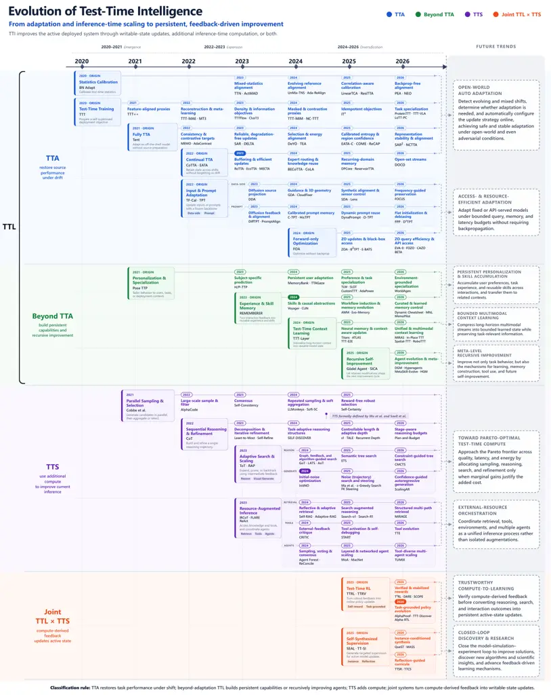
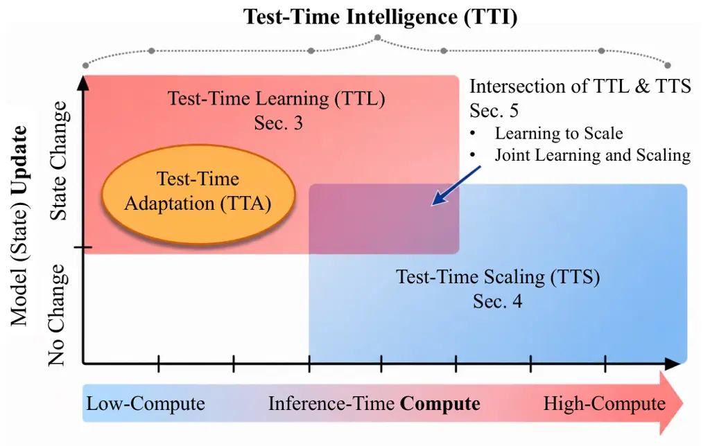
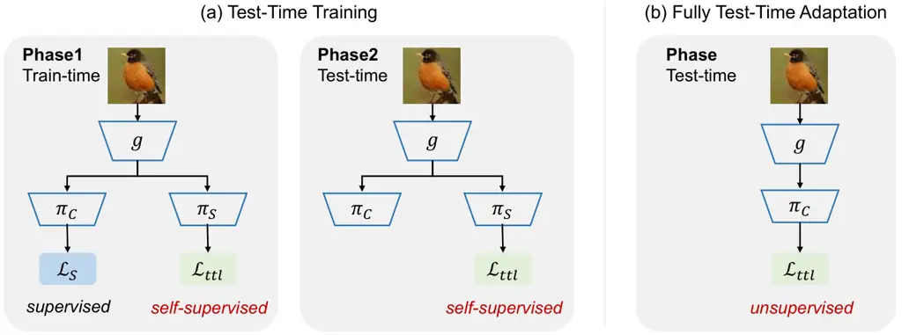
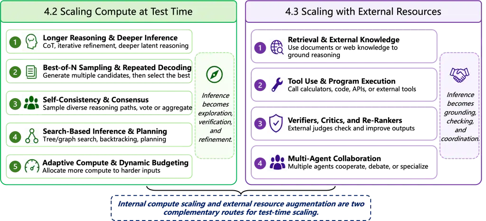
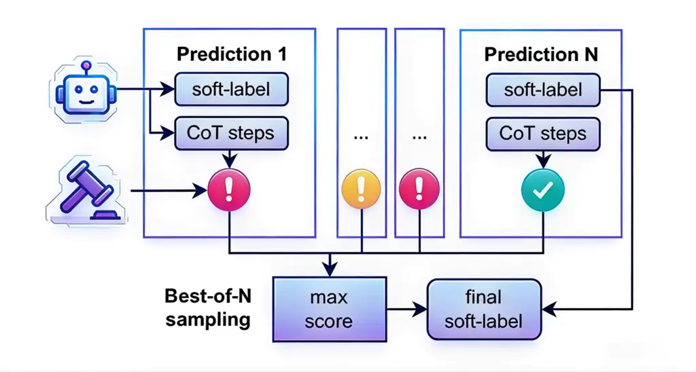
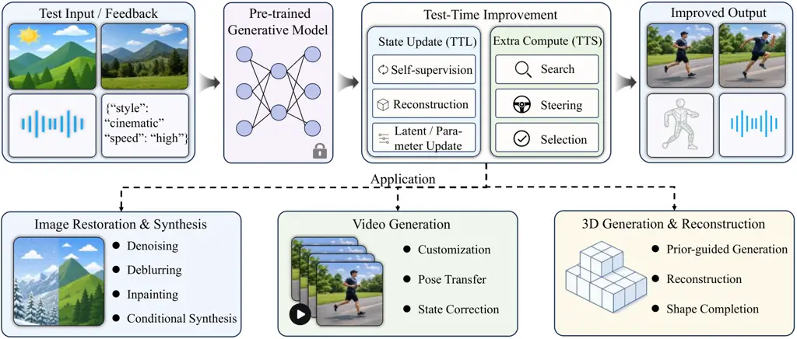
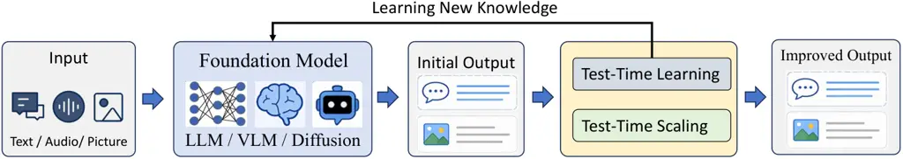
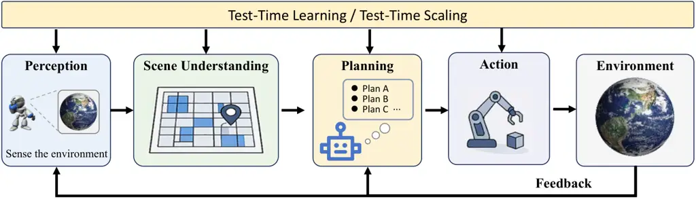

Test-Time Intelligence: A Survey

# A Survey on Self-Improving Test-Time Intelligence: Feedback-Driven Adapting, Learning, and Scaling at Inference

Shuaicheng Niu^(1,2,⋆), Guohao Chen^(1,2,⋆), Yaofo Chen¹, Zhiquan Wen¹,
Jinwu Hu¹, Zeshuai Deng¹, Deyu Chen¹, Shuhai Zhang¹, Renjie Chen¹, Zihao
Lian¹, Shoukai Xu¹, Gang Dai¹, Yunbei Zhang³,  
Wei Luo⁴, Yifan Zhang⁵, Mingkui Tan^(1,4,†), Cheng Deng^(6,†)  
¹South China University of Technology    ²Nanyang Technological
University    ³Tulane University     
⁴Pazhou Laboratory    ⁵National University of Singapore    ⁶Hohai
University  
^(⋆)Equal Contribution, ^(†)Corresponding Author

###### Abstract

The ability of AI systems to improve their behavior during deployment is
becoming increasingly important. As inference moves beyond the static
execution of a fixed trained model, a growing body of work studies how
models can refine their behavior on the fly by exploiting test-time
information and additional computation. These developments have largely
evolved along two directions: methods that modify the model’s state
using test-time signals, and methods that improve predictions through
extra inference-time resources such as more sampling and tool use.
However, these directions are often studied in separate communities with
different terminology, making their connections harder to see. In this
survey, we present feedback-driven _Test-Time Intelligence_ (TTI) as a
unified perspective for understanding such deployment-time improvement.
We use this view to relate test-time adaptation, test-time learning, and
test-time scaling, highlighting both their distinctions and their
growing overlap in hybrid systems. This unified framework helps connect
previously fragmented ideas and provides a clearer conceptual foundation
for studying inference-time self-improvement. We review major
methodological paradigms, representative applications, and open
challenges across vision, language, multimodal learning, generative
models, robotics, and healthcare. Our goal is to provide a coherent
foundation and research roadmap for the study of self-improving AI
systems at test time. A collection of related resources is available at
[https://github.com/mr-eggplant/awesome_test_time_intelligence](https://github.com/mr-eggplant/awesome_test_time_intelligence).

###### Contents

1.  1 Introduction
2.  2 Conceptual Foundations
    1.  2.1 Test-Time Intelligence
    2.  2.2 A Unified View: Update and Compute
3.  3 Test-Time Learning
    1.  3.1 Problem Settings and Design Dimensions
    2.  3.2 Feedback Signals for Test-Time Learning
        1.  3.2.1 Entropy and Confidence-Based Signals
        2.  3.2.2 Consistency and Augmentation-Based Signals
        3.  3.2.3 Reconstruction and Self-Supervision Signals
        4.  3.2.4 Pseudo-Label and Self-Training Signals
        5.  3.2.5 External Feedback from Tools, Environments, or Users
    3.  3.3 What Is Updated at Test Time?
        1.  3.3.1 Input Adaptation
        2.  3.3.2 Partial Parameter Updates
        3.  3.3.3 Auxiliary Parameter Updates
        4.  3.3.4 Backbone and Full-Parameter Updates
        5.  3.3.5 External Memory and Cache Updates
    4.  3.4 Temporal Horizons of Test-Time Learning
        1.  3.4.1 Supervision Horizon: Single- vs. Multi-Sample Learning
        2.  3.4.2 Persistence Horizon: Episodic and Continual Learning
    5.  3.5 Test-Time Learning for Adaptation
        1.  3.5.1 Domain Shift and Distribution Alignment
        2.  3.5.2 Test-Time Training and Fully Test-Time Adaptation
        3.  3.5.3 Source-Free, Online, and Continual Adaptation
        4.  3.5.4 Forward-only and Gradient-Free Adaptation
        5.  3.5.5 Theoretical Understanding of Test-Time Adaptation
    6.  3.6 Beyond Adaptation: Memory, Personalization, and
        Self-Improvement
        1.  3.6.1 Test-Time Learning with Evolving Memory
        2.  3.6.2 Recursive Self-Improvement
        3.  3.6.3 Personalization and User-Specific Learning
        4.  3.6.4 Environment-Specific and Task-Specific Specialization
        5.  3.6.5 Interactive Improvement from User Feedback
4.  4 Test-Time Scaling
    1.  4.1 Problem Formulation
    2.  4.2 Scaling Compute at Inference Time
        1.  4.2.1 Longer Reasoning and Deeper Inference
        2.  4.2.2 Best-of-N Sampling and Repeated Decoding
        3.  4.2.3 Self-Consistency and Consensus Mechanisms
        4.  4.2.4 Search-Based Inference and Planning
        5.  4.2.5 Adaptive Computation and Dynamic Budgeting
        6.  4.2.6 Theoretical Understanding of Test-Time Scaling
    3.  4.3 Scaling with External Resources
        1.  4.3.1 Retrieval and External Knowledge
        2.  4.3.2 Tool Use and Program Execution
        3.  4.3.3 Verifiers, Critics, and Re-Rankers
        4.  4.3.4 Multi-Agent Inference and Collaborative Reasoning
    4.  4.4 What Scaling Improves and Enables
        1.  4.4.1 Reasoning Quality
        2.  4.4.2 Reliability and Calibration
        3.  4.4.3 Decision Quality in Control and Planning
    5.  4.5 Limitations of Pure Scaling
        1.  4.5.1 High Computational Cost
        2.  4.5.2 No Persistent Improvement by Default
        3.  4.5.3 Diminishing Returns and Instability
5.  5 The Intersection of Learning and Scaling
    1.  5.1 Scaling for Learning
        1.  5.1.1 Consensus and Self-Generated Targets
        2.  5.1.2 Verifier-Derived Feedback
        3.  5.1.3 Search-Derived Supervision and Distillation
    2.  5.2 Learning to Scale
        1.  5.2.1 Adaptive Budget Allocation
        2.  5.2.2 Learning When to Reason, Retrieve, or Search
        3.  5.2.3 Learning Scaling Behaviors
    3.  5.3 Joint Learning-and-Scaling Systems
        1.  5.3.1 Test-Time Reinforcement Learning
        2.  5.3.2 Self-Synthesized Supervision
6.  6 Applications
    1.  6.1 Vision Perception
    2.  6.2 Generative Models
        1.  6.2.1 Image Restoration and Generation
        2.  6.2.2 Video Generation
        3.  6.2.3 3D Generation and Reconstruction
        4.  6.2.4 Inference-Time Scaling
    3.  6.3 Language and Multimodal Models
        1.  6.3.1 Spatial Reasoning
        2.  6.3.2 Speech Recognition and Audio Processing
    4.  6.4 Embodied AI and Robotics
        1.  6.4.1 Policy Adaptation to Unseen Conditions
        2.  6.4.2 Online Skill Improvement
        3.  6.4.3 Planning-Time Scaling
    5.  6.5 Agentic AI
    6.  6.6 Healthcare and Personalized AI
7.  7 Open Challenges and Future Directions
    1.  7.1 Open Challenges
    2.  7.2 Future Directions
8.  8 Conclusions
9.  References

## 1 Introduction

Artificial intelligence (AI) systems are traditionally developed under a
train-then-infer paradigm \[118\]: a model is optimized during training,
frozen after deployment, and then expected to perform reliably at
inference time without further modification. Yet real-world intelligence
is rarely so static: humans continue to adapt \[63\], draw on past
experience, and allocate more effort to difficult situations while
acting in the world. As AI systems are increasingly deployed in dynamic
open world \[457, 269, 16, 90, 184\] and personalized settings \[169,
351, 366\], the assumption that a fixed model can handle all test-time
scenarios is becoming less tenable. In real deployment, models are often
exposed to changing environments with potential distributional
shifts \[120, 177, 303, 389\], user-specific demands \[169, 320, 103\],
and tasks whose difficulty varies substantially across instances \[112,
146, 473\]. As a result, good performance at test time can no longer
always be achieved by simply executing a fixed model once and returning
its output.

Instead, inference is increasingly becoming a dynamic process. A
deployed system may need to exploit test-time feedback, update part of
its internal state \[380, 329\], retrieve external knowledge \[7\],
interact with tools \[45, 97\], allocate more computation to difficult
cases \[112, 473\], or refine its outputs through multi-step reasoning
and verification \[251\], *etc.* This shift is driving growing interest
in AI systems that are capable of self-improvement during deployment,
rather than remaining completely static after training.

##### What is Test-Time Intelligence?

One major route beyond static inference is Test-Time Learning (TTL),
introduced by Sun *et al.* \[356\], which shows that models can improve
at inference time by updating model states using unlabeled test data.
This idea has led to a large body of work on Test-Time Adaptation
(TTA) \[380, 267, 269, 185, 389, 15, 214\], where models adapt through
updating normalization layers \[380, 133\], prompts \[329, 487\],
low-rank adapters \[144, 470, 236\], inputs \[89, 440\], or full
parameters \[356, 240, 478, 389\] with objectives such as entropy
minimization \[380\], consistency regularization \[271\], or
reconstruction-based supervision \[88, 47\]. Although much of this
literature focuses on robustness under distribution shift, test-time
learning is not restricted to robustness alone. It can more broadly
serve as a general pipeline that uses test-time signals to improve
prediction quality or task capability \[268, 128, 115, 217\].

Figure 1: Comparison between feedback-driven self-improving test-time
intelligent AI and conventional static train-then-infer AI.

Another major route is Test-Time Scaling (TTS), where performance
improves through additional inference-time computation without
necessarily changing some model states. Examples include repeated
decoding \[27\], self-consistency \[399\], tool use \[45, 97\],
search-based inference \[444\], and inference-time optimization in
generative models \[249\]. Similar ideas also appear in robotics and
embodied systems, where planning and interaction can improve decision
quality even without persistent model parameter updates \[180, 181\].
These examples suggest that learning alone is a bit narrow to capture
the full range of inference-time intelligence.



Figure 2: Timeline of representative self-improving test-time
intelligence methods.

This motivates a broader concept, which we call feedback-driven
self-improving Test-Time Intelligence (TTI): the capability of a model
or system to improve its behavior during deployment by leveraging
test-time feedback for state updates or additional computation, as shown
in Fig. 1. Under this view, test-time learning and test-time scaling are
two major and complementary routes toward intelligent inference, as
illustrated in Fig. 3 and detailed in Section 2. Learning emphasizes
persistent or semi-persistent state change, while scaling emphasizes
performance gains from additional inference-time resources such as
search-based compute, often without state change. In practice, these two
routes also interact: a model may exploit scaling to produce reliable
pseudo-labels for better learning, namely Scaling for Learning (c.f.
Section 5.1), or one can learn a policy to guide the reasoning model for
when to scale, namely Learning to Scale (c.f. Section 5.2). Therefore,
TTI is best understood as a general paradigm for inference-time
self-improvement through additional computing and/or model state updates
based on test-time feedback signals.

Scope and Contributions This survey presents a unified view of TTA, TTL,
and TTS under the broader concept of TTI. The core contributions of this
survey are: 1) We introduce test-time model intelligence as a unifying
conceptual framework for understanding how modern AI systems improve
themselves during deployment through additional feedback with the joint
roles of compute and state update. 2) We clarify the conceptual
relationship among adaptation, learning, and scaling: adaptation is best
understood as a subset of test-time learning; scaling is not equivalent
to learning, but overlaps with it in important ways; and some emerging
systems lie precisely at their intersection. 3) We provide a
comprehensive review of the key paradigms, representative applications,
and open challenges in this rapidly growing area, with particular
emphasis on the emerging shift from isolated adaptation or scaling
techniques toward more general feedback-driven self-improving AI systems
at test time.

Comparison with Prior Surveys Existing literature often studies related
abilities under different names in separate communities with different
assumptions and vocabularies, making it difficult to see their common
structure and interaction. In this survey, we bring TTA, TTL, and TTS
together under a unified perspective that we call TTI. Compared to prior
TTA surveys \[214, 407, 423\] that are primarily organized around
distribution shift and adaptation, we broaden the scope from
shift-centric adaptation to a more general perspective of
deployment-time self-improvement. Compared to TTS surveys \[480, 59\],
which are often largely centered on LLMs and reasoning-time compute, our
treatment is broader in both methodology and application scope. We
position scaling as part of a larger landscape of test-time computation
and self-improvement, encompassing both learning-free and learning-based
mechanisms, as well as hybrid systems that combine the two.

This broader view allows us to connect ideas that are often studied
separately across communities, including adaptation algorithms in
machine learning, inference-time scaling strategies in foundation
models, search and planning in embodied systems, and optimization-based
test-time methods in generative models such as diffusion. We also review
applications beyond language models, covering vision, multimodal
learning, generative modeling, agentic AI, robotics, and healthcare.
Across these areas, the update–compute view distinguishes whether
improvement arises from state updates, additional inference-time
computation, or both, and provides a common language for describing
shared elements such as feedback signals. This places TTL and TTS within
the same design space and helps reveal transferable mechanisms, hybrid
design opportunities, and unresolved research gaps.

## 2 Conceptual Foundations



Figure 3: Taxonomy of feedback-driven self-improving test-time
intelligence. Representative model states include norm layers, hidden
states, prompts, adapters, and external memory.

### 2.1 Test-Time Intelligence

We define Test-Time Intelligence (TTI) as the capability of an AI system
to improve itself during deployment by exploiting test-time feedback. In
this sense, inference is not merely a fixed execution process, but a
dynamic stage in which the system can adapt, refine, or enhance its
behavior while operating in the real world. Under this view, as
demonstrated in Fig.  3, there are two major and complementary routes
toward intelligent inference, _i.e._, test-time learning (TTL) and
test-time scaling (TTS).

TTL and TTS: Distinction The core difference between TTL and TTS lies in
whether performance improvement arises from changing the model state,
such as norm layers, hidden states, prompts, adapters, and memory. TTL
improves predictions by acquiring information/feedback from test data
into the persistent or semi-persistent model state changes through
explicit learning. Test-time adaptation (TTA) falls within this paradigm
as a special case of TTL, primarily concerned with robustness under
distribution shift. TTS, by contrast, improves predictions by spending
more compute on search, verification, or tool-use resources during
inference, typically without leaving lasting changes to the model once
the current inference ends.

TTL and TTS: Interplay The boundary between the two, however, is not
strict. Scaling and learning may interact in both directions. On the one
hand, learning can enable more effective scaling: a model may learn when
to reason longer, how much computation to allocate, or which tools to
invoke. On the other hand, scaling can enable learning by providing
stronger supervision signals through consensus or verification, which
can then support self-training or policy updates. This interplay gives
rise to a rich design space of hybrid systems that combine persistent
self-improvement with dynamic inference-time computation. Accordingly, a
central argument of this survey is that TTL and TTS should not be
studied as isolated threads. Rather, they are best understood as two
fundamental and interacting axes within the broader paradigm of
feedback-driven self-improving test-time intelligence.

TTI and Training-Time Amortization TTI and training-time amortization
differ in when the resulting improvement becomes available. TTI
therefore denotes improvements realized within the active deployment
process—either immediately for the current instance or cumulatively
across the episode or deployment stream—through online state updates,
additional inference-time computation, or both. By contrast, some
pipelines retain deployment-time signals for a later offline learning
pipeline, such as fine-tuning, distillation, or training-data
construction, rather than using them to improve the active system. When
the improvement becomes available only through this separate, offline
pipeline, we attribute it to training-time amortization rather than TTI.

TTL and Ordinary Inference-Time State Evolution The key boundary is
whether test-time information triggers a feedback-driven update to a
designated writable state. TTL does not include ordinary transient
states that naturally evolve during inference, such as KV caches in
autoregressive decoding, hidden states in sequential models, or
diffusion latents along a predefined denoising trajectory. Although such
states may affect the current output, they are part of the standard
inference procedure and do not constitute TTL unless they are explicitly
optimized, written to memory, or otherwise updated using test-time
feedback. In this survey, we reserve TTL for cases where test-time data
or external feedback modifies a writable state, such as parameters or
memory, and the modified state is reused by the active deployed system.

### 2.2 A Unified View: Update and Compute

To unify the diverse methods in this area, we organize TTI around the
following two fundamental ingredients:

- •
  Update refers to whether a system changes its state with test-time
  feedback. This may involve updating internal parameters, tuning
  prompts, adjusting normalization statistics, optimizing latent
  variables, or writing to memory. Updating is the core mechanism
  underlying TTL, whereas most TTS methods do not modify the model
  state. Nevertheless, some TTS methods maintain and update external
  memory, thereby lying at the intersection of TTL and TTS, as indicated
  by the shaded area in Fig. 3.
- •
  Compute refers to the amount and structure of inference-time
  computation devoted to solving a test instance. Prior TTS studies have
  primarily focused on large models, such as LLMs and MLLMs, and improve
  performance by allocating additional computation through repeated
  decoding, extended reasoning, search, verification, or multi-agent
  interaction. Compute is therefore the key mechanism underlying TTS. In
  contrast, TTL has mainly been studied on relatively lightweight
  models, such as visual recognition models, and typically requires less
  overall computation. Nevertheless, some methods combine additional
  inference-time computation with model-state updates and thus lie in
  the intermediate region of the compute axis.

This view helps place different methods in a common space. As
illustrated in Fig. 3, classical TTL methods primarily rely on state
updates, typically with limited extra overall computation, and therefore
occupy the upper-left region. In contrast, TTS methods primarily rely on
additional inference-time computation, usually with no persistent state
update, and thus occupy the lower-right region. Hybrid methods combine
both mechanisms, for example, by using search or self-consistency to
produce better learning signals, or by learning when and how to allocate
additional inference-time resources. These methods lie in the shaded
intersection region. From this perspective, TTI arises not from learning
or scaling alone, but from different ways of coordinating state updates
and inference-time computation.

## 3 Test-Time Learning

Test-time learning (TTL) refers to any paradigm in which a deployed
model updates writable state using information derived from test inputs
and, when available, external feedback, and uses the updated state for
inference within the same deployment process. The central motivation
draws from the ubiquity of distribution shift: real-world data
encountered at deployment frequently departs from the distribution seen
during training due to sensor changes, environmental variation, domain
differences, or temporal drift, and a model frozen at training time
inevitably degrades \[214, 389\]. Beyond adaptation to distribution
shifts, there is also an emerging trend that extends the scope of TTL
for memorization, personalization, self-improvement, *etc.* We depict
them below.

### 3.1 Problem Settings and Design Dimensions

Let $`p(x,y)`$ define a joint distribution on the input-output space
$`\mathcal{X}\times\mathcal{Y}`$ and
$`\mathcal{D}_{\mathrm{tr}}=\{(x_{i},y_{i})\}_{i=1}^{n}`$ be a labeled
training dataset drawn from a source distribution
$`p_{\mathcal{S}}(x,y)`$. The training phase produces a model
$`f_{\theta}:\mathcal{X}\to\mathcal{Y}`$ with parameters
$`\theta^{*}=\arg\min_{\theta}\,\mathcal{L}_{\mathrm{tr}}(\theta;\mathcal{D}_{\mathrm{tr}})`$,
where $`\mathcal{L}_{\mathrm{tr}}`$ is a supervised objective (e.g.,
cross-entropy), and $`\theta^{*}`$ is fixed under the traditional
deployment assumption.

Definition 1 (Test-Time Learning) Let
$`\mathcal{D}_{\mathrm{te}}=\{x_{j}\}_{j=1}^{m}`$ denote the test inputs
encountered during deployment, and let $`\mathcal{F}_{\mathrm{te}}`$
denote any external feedback received at test time (_e.g._, from human
users, tools, or the environment), which may be empty. Test-time
learning (TTL) refers to any paradigm in which the active deployed model
updates writable state $`\phi`$ using information derived from
$`\mathcal{D}_{\mathrm{te}}`$ and, when available, external feedback
$`\mathcal{F}_{\mathrm{te}}`$, and uses the updated state for inference
within the same deployment process. The writable state $`\phi`$ may
include the input or its latent representation, model parameters or
statistics, auxiliary modules, and writable external memory such as
caches or prototype banks. Formally, TTL induces a deployment-time state
transition:

```math
\phi^{+}=\operatorname{Update}\!\left(\phi;\,\mathcal{D}_{\mathrm{te}},\mathcal{F}_{\mathrm{te}}\right) \tag{1}
```

Here, $`\operatorname{Update}`$ may represent optimization of a
test-time objective $`\mathcal{L}_{\mathrm{ttl}}`$, a closed-form or
running-statistics update, a memory insertion/replacement, or
input/latent refinement. The settings of TTL cover both: 1)
$`p_{\mathcal{S}}\neq p_{\mathcal{T}}`$, where TTL focuses on addressing
distribution shifts; and 2) $`p_{\mathcal{S}}=p_{\mathcal{T}}`$, which
extends TTL to adaptive memorization and self-improvement. According to
Eqn. 1, the design space of TTL methods can be organized along four
design dimensions:

1.  1.  Feedback signal (Section 3.2): the information that drives the
        update, ranging from entropy, consistency, and pseudo-labels to
        feedback from human users, tools, or the environment.
2.  2.  Update target $`\phi`$ (Section 3.3): the writable state that is
        modified, ranging from inputs and normalization statistics to
        auxiliary modules, full parameter sets, and external memory.
3.  3.  Temporal horizon (Section 3.4): the granularity at which updates
        occur, from single-sample to batch adaptation at the data level, and
        from episodic to continual learning across a deployment lifetime at
        the model level.
4.  4.  Objective scope (Sections 3.5–3.6): whether the primary goal is
        distributional alignment, memory augmentation, personalization, or
        iterative self-improvement.

This provides a multi-view description of the TTL design space.
Specifically, we describe each method along the four axes: which
feedback it uses, which state it updates, how information is accumulated
over time, and which objective it serves. A compound method may
therefore appear under multiple second-level headings, while the
third-level categories specify its role within each axis. For example,
pseudo-labels are classified as feedback even when used in continual,
source-free, or reinforcement-learning settings. For clarity,
Sections 3.2–3.4 describe methods along their feedback, update-target,
and temporal attributes, whereas Sections 3.5–3.6 situate them according
to their primary objectives. When a method spans multiple dimensions, we
discuss its mechanism where it is most informative and use
cross-references elsewhere to clarify its other roles.

### 3.2 Feedback Signals for Test-Time Learning

The choice of feedback signal—the internally derived or externally
provided information that drives writable-state updates—is arguably the
most consequential design decision in any TTL system. When ground-truth
labels are unavailable, a TTL method must construct a surrogate
objective that correlates with downstream task performance using the
available test-time information.

The five signal families surveyed below make different assumptions about
what constitutes reliable supervision at deployment. Entropy and
confidence objectives require the source model to remain sufficiently
calibrated on target inputs; they are inexpensive when applied to a
small parameter subset, but can reinforce confident mistakes or collapse
under severe or label-distribution shifts. Consistency and augmentation
trade additional forward passes and a validity assumption on the chosen
transformations for a less direct dependence on any single prediction.
Reconstruction and other self-supervised signals provide dense,
input-grounded feedback, yet often require a training-prepared auxiliary
objective or decoder and may optimize structure that is only weakly
related to the downstream task. Pseudo-label and self-training methods
exploit class structure and historical neighbors, but their gains depend
on reliable initial labels and can be reversed by confirmation bias.
External tool, environment, or user feedback can be more task-aligned,
while requiring interfaces, latency budgets, permissions, or human
effort. Consequently, lightweight internal signals are preferable for
modest shifts and autonomous low-cost deployment, whereas external
feedback is preferable when errors are consequential and reliable
feedback is available.

[TABLE]

Table 1: Taxonomy of feedback signals for test-time learning.

#### 3.2.1 Entropy and Confidence-Based Signals

Prediction sharpness provides a widely used signal for test-time
adaptation. We distinguish entropy minimization as a direct adaptation
signal from alternative confidence estimates used for filtering or
gating updates.

Entropy as an Adaptation Signal. Entropy-based methods directly minimize
the Shannon entropy of predictions on unlabeled test inputs.
Tent \[380\] updates only normalization-layer parameters, while
subsequent work improves the reliability and stability of entropy-driven
adaptation. This baseline is simple and inexpensive, but assumes that
confident target predictions are usually correct. One line improves
gradient reliability through sample selection and reweighting:
EATA \[267\] filters unreliable and redundant samples; SAR \[269\]
combines entropy-based filtering with sharpness-aware updates;
DeYO \[185\] reweights samples using a shape-based PLPD score, and
DELTA \[490\] dynamically reweights online updates to reduce their bias
toward dominant classes. Marsden *et al.* \[253\] further use weight
ensembling and diversity weighting. This strategy is preferable in noisy
streams, although its effectiveness depends on reliable selection
scores. Another line addresses uncertainty calibration and collapse
prevention: SHOT \[212\] combines per-sample entropy minimization with
batch-level marginal entropy maximization; COME \[479\] uses a Dirichlet
prior as a collapse-resistant surrogate; EATA-C \[360\] combines entropy
optimization with model uncertainty estimation and calibration; and
ZeroSiam \[37\] uses asymmetric stop-gradient optimization. These
safeguards are most useful when naive entropy minimization risks
collapse, but require additional calibration, diversity, or asymmetry
constraints. Feature-level regularization further limits representation
degradation: SAR² \[272\] regularizes feature redundancy and class
inequity over a centroid bank, while NCTTA \[48\] aligns features and
classifiers based on the neural collapse phenomenon. This strategy helps
preserve representation structure, but relies on suitable feature-level
priors.

Alternative Confidence Signals for Adaptation. Beyond direct entropy
minimization, methods also use alternative confidence signals either as
adaptation objectives or as reliability scores for gating updates.
Likelihood-ratio objectives avoid gradient saturation as predictions
become increasingly peaked: Mummadi *et al.* \[261\] and
LSCD-TTA \[216\] use such losses to maintain stable gradients at high
confidence. TEA \[460\] instead applies contrastive divergence to a
free-energy objective, while ReCAP \[133\] replaces sample-wise entropy
with a region-level confidence proxy. These objectives retain
informative gradients at high confidence, but their effectiveness
depends on the reliability of the chosen confidence proxy. A
complementary line uses confidence scores as a gating or filtering
mechanism, selecting reliable samples without changing the underlying
adaptation objective. SoTTA \[93\] and RoTTA \[457\] gate memory-bank
admission via MSP confidence and uncertainty scores, respectively, while
OSTTA \[184\] further filters out OOD samples via post-adaptation
confidence drop before gradient updates. This strategy is lightweight
and broadly compatible with existing objectives, but may discard useful
hard samples when confidence is poorly calibrated.

#### 3.2.2 Consistency and Augmentation-Based Signals

Consistency signals encourage agreement either across target views or
model branches, or between test-time features and retained reference
statistics. We therefore organize this subsection into prediction-level
consistency and feature-level alignment.

Prediction Consistency as a Signal. At the input level, augmentation
consistency assumes that semantics-preserving transformations should
yield stable predictions. MEMO \[478\] minimizes the entropy of
predictions marginalized over augmented views, while TPT \[329\] applies
the same objective to prompt tuning. CoTTA \[389\] uses averaged
teacher–student predictions over augmented views as pseudo-targets,
whereas MIC \[337\] minimizes the discrepancy between masked and
unmasked predictions. This strategy is most useful when reliable
semantics-preserving transformations are available, at the cost of
additional forward passes. Beyond input transformations, model/branch
consistency enforces agreement across models or network branches.
RMT \[74\] aligns an EMA teacher and student via symmetric
cross-entropy, while ZeroSiam \[37\] aligns a predictor branch with a
stop-gradient branch through asymmetric divergence. This strategy avoids
relying on hand-designed input transformations, but requires stable
model or branch targets. A related strategy, full-to-part consistency,
provides a self-bootstrapping signal by comparing a full-information
prediction with a partial-information counterpart. SPA \[271\] aligns
predictions from the original input and a Fourier-domain deteriorated
view, whereas EATA-C \[360\] measures model uncertainty through
consistency between the full network and stochastic-depth sub-networks.
REM \[111\] instead uses progressive masking to align prediction
distributions across difficulty levels while preserving their entropy
ranking. This strategy is effective when partial views preserve
task-relevant information, but can become unreliable when they remove
discriminative evidence.

Feature Consistency as a Signal. Beyond prediction-level agreement,
consistency can also be imposed on intermediate features by aligning
test-time activations with retained source statistics, including under
evolving streams. Source-statistics alignment matches test activations
to references retained from source training. TTT+ \[240\],
ActMAD \[258\], and ViTTA \[229\] align global statistics through moment
matching, per-layer activation alignment, and EMA, respectively, while
TTN \[222\] interpolates source and test BN statistics according to
shift sensitivity. Class-aware and covariance-level methods include
CAFe \[2\] and CAFA \[161\], while DA-TTA \[405\] and ResiTTA \[501\]
perform layer-wise or soft BN alignment. FOA \[270\] instead shifts
activations without backpropagation. These methods are effective when
retained source references remain representative, but can be brittle
under large or evolving shifts. For non-stationary streams,
evolving-reference alignment is represented by Ada-ReAlign \[489\],
which aligns evolving target representations to a source sketch using
adaptively combined base learners. Evolving references better track
non-stationary streams, although errors in the online reference may
accumulate over time.

#### 3.2.3 Reconstruction and Self-Supervision Signals

This family derives test-time objectives from the structure of unlabeled
inputs, often using auxiliary heads, transformations, or decoders
prepared during training. These signals either reconstruct observed or
masked content or apply other pretext objectives to guide adaptation.

Reconstruction Error as a Signal. Full-input reconstruction directly
provides the adaptation signal. TTA-AE \[119\] combines pixel-level and
multi-level feature reconstruction to update adaptor parameters, while
TTA-DAE \[165\] and DeTTA \[415\] use denoising residuals to capture
corruption-sensitive structure. It provides dense input-level feedback,
but depends on reconstruction error remaining aligned with downstream
performance. Beyond full-input reconstruction, masked prediction adapts
the encoder by reconstructing missing content. TTT-MAE \[88\] and
TTT-MIM \[252\] use masked-image objectives with different masking and
reconstruction designs, while Hybrid-TTA \[284\] couples masked
reconstruction with the primary segmentation objective.
Continual-MAE \[235\] further uses distribution-aware masking and
feature reconstruction for continual adaptation. Masked prediction also
extends beyond images: MATE \[257\] reconstructs masked 3D point-cloud
tokens, Wang *et al.* \[390\] apply per-frame MAE to video streams, and
T4P \[282\] masks temporal trajectory tokens under driving shifts. This
strategy is preferable when missing-content recovery captures
transferable structure, although it often requires a training-prepared
auxiliary objective or decoder.

Other Pretext Tasks as Signals. Beyond reconstructing observed or masked
content, other pretext objectives derive test-time gradients from
transformations, invariances, or learned relations. TTT \[356\] uses
four-way rotation prediction; IT³ \[81\] enforces test-time idempotence;
TLM \[128\] applies next-token prediction to input prompts; and
Clust3 \[110\] maximizes mutual information through per-layer
projectors. These objectives are useful when a suitable pretext task is
available, but their gains depend on its correlation with the primary
task. Contrastive and discriminative objectives provide
representation-level feedback: TTT++ \[240\] combines SimCLR with
source-statistics alignment, AdaContrast \[34\] combines MoCo-style
learning with pseudo-labeling, and MT3 \[15\] meta-learns a BYOL-style
objective. Rec-TTA \[61\] combines contrastive learning with feature
reconstruction, while NC-TTT \[278\] trains a noise-contrastive
discriminator over feature views. These objectives can better preserve
discriminative feature structure, but typically require multiple views
or training-prepared components. A likelihood-based alternative,
TTTFlow \[277\], adapts the encoder by maximizing likelihood under a
fixed normalizing-flow head. This alternative provides a direct density
signal, although its reliability depends on the fit of the fixed density
model. Another line performs auxiliary–main task alignment so that
self-supervised gradients are more likely to benefit the primary task.
SR-TTT \[247\] feeds segmentation outputs into the auxiliary
reconstruction branch; CTA \[14\] aligns self-supervised and supervised
encoders to encourage compatible gradients; and S4T \[151\] predicts
inter-task relations across multiple downstream tasks. Beyond vision,
this paradigm extends to graph \[472, 287\], speech \[17, 80\], and
time-series \[57\] settings. This strategy directly addresses
pretext–task mismatch, but requires additional source-time design or
known relations between tasks.

#### 3.2.4 Pseudo-Label and Self-Training Signals

Pseudo-label and self-training methods construct supervision from the
model’s own predictions or related test-time signals. This supervision
may take the form of discrete or soft targets for supervised updates, or
pseudo-rewards that identify preferable outputs within a
reinforcement-learning objective. We organize these methods according to
how such supervision is generated: from the adapted model itself,
prototypes or neighboring samples, consensus across multiple
predictions, or external models.

Predictions from the Adapted Model. The most direct strategy uses the
model’s own prediction as a self-generated target. Goyal *et al.* \[98\]
show theoretically that this recovers the optimal TTA loss for
cross-entropy-trained classifiers under a conjugate framework, unifying
pseudo-labeling with entropy minimization. This strategy requires no
external supervision, but can reinforce incorrect predictions through
confirmation bias. Because self-generated targets can be noisy, another
line develops pseudo-label correction. ECL \[465\] targets less probable
categories via complementary labels to reduce incorrect pseudo-labeling,
while IST \[248\] corrects pseudo-labels via feature-similarity graph
construction and stabilizes updates with parameter moving average.
Correction improves robustness to noisy targets, although its
effectiveness depends on reliable complementary or neighborhood
structure.

Prototypes and Nearest Neighbors. One strategy derives pseudo-labels
from class prototypes constructed online from high-confidence test
features. Representative methods include SHOT \[212\], which freezes the
source classifier for encoder alignment; T3A \[145\], which replaces the
linear classifier with backpropagation-free pseudo-prototypes; and more
recent works via decoupled learning \[383\] and prototypical contrastive
anchoring \[167\]. Prototype-based targets are effective when target
features form stable class clusters, but are sensitive to imbalance and
prototype contamination. When a single class center cannot capture local
target structure, nearest-neighbor targets instead draw supervision from
a memory bank: Yang *et al.* \[435\] exploit neighborhood structure for
source-free adaptation; AdaContrast \[34\] refines pseudo-labels by soft
voting among neighbors; DLTTA \[432\] extends this to medical imaging.
Neighbor-based targets preserve local structure, but require additional
memory and can propagate errors through unreliable neighbors.

Consensus and Majority Voting. A third line constructs self-generated
supervision by aggregating multiple predictions. At the view level,
MEMO \[478\] minimizes the entropy of predictions marginalized over
augmentations, while CoTTA \[389\] averages teacher predictions across
augmented views to form pseudo-targets. DPLOT \[453\] further uses
paired original and horizontally flipped views to avoid the distribution
gap introduced by stronger transformations. Consensus can also combine
complementary evidence: TeSLA \[370\] ensembles weakly augmented
predictions and refines them with nearest neighbors, whereas
MM-TTA \[326\] combines intra-modal pseudo-label generation with
cross-modal refinement for 3D segmentation. View-based consensus is
effective when transformations preserve semantics, while hybrid or
cross-modal consensus benefits from complementary errors across
information sources. Both remain vulnerable when their constituent
predictions share correlated biases. Consensus can also be converted
into rollout-derived rewards in joint learning-and-scaling systems,
whose update mechanisms are discussed in Section 5.3.1.

External Model for Pseudo-labels. External models can provide
pseudo-supervision beyond the adapted classifier. Through
foundation-model supervision, DINOv2 \[276\] and GPT-4o serve as
external teachers for test-time knowledge distillation into the adapted
model \[414, 94\]. External teachers provide richer supervision, but
require additional model access and may transfer teacher bias or domain
mismatch. Yang *et al.* \[440\] instead use diffusion-generated
references to support pseudo-label construction under distribution
shift. Such references can be useful under input corruption, but
introduce additional inference cost and depend on the quality of the
generative prior.

#### 3.2.5 External Feedback from Tools, Environments, or Users

The signals surveyed so far are self-contained within the model’s
computation. This section covers exogenous feedback that arises from the
model’s deployment context: rewards from an environment, outputs from
invoked tools, and corrections from human users. These closed-loop
interactions introduce a qualitatively different supervision structure
unavailable to purely self-supervised approaches.

Environment Interaction as a Signal. Environment interaction can provide
either self-supervised signals from observed transitions or explicit
task outcomes. When explicit rewards are unavailable,
interaction-derived self-supervision constructs adaptation objectives
from observed transitions or actions: PAD \[113\], AugWM \[11\], and
MoVie \[436\] adapt encoders or policies via inverse-dynamics
prediction, dynamics-augmentation context, and latent dynamics modeling,
respectively. AdaJEPA \[403\] instead executes an action chunk and uses
the observed next-state transition to adapt its latent world model.
These signals are frequent and label-free, but their auxiliary
objectives may not directly reflect task success. When task outcomes are
observable, outcome-based feedback provides more task-aligned
supervision. FeedTTA \[174\] adapts a navigation agent from episode
success or failure, whereas TT-VLA \[230\] uses step-wise task-progress
rewards to adapt a VLA policy. However, episode-level outcomes can be
sparse or delayed, while denser progress rewards require a reliable
measure of task advancement.

Tool-augmented Feedback as a Signal. External evaluators and executable
tools can assess the quality or validity of test-time outputs and turn
the resulting evidence into structured feedback. Through executable
feedback for active updates, T³RL \[217\] uses code execution to verify
sampled rollouts and correct consensus-derived rewards.
TTT-Discover \[461\] updates a policy from executable scientific
objectives, while Alpha-RTL \[500\] uses EDA feedback for per-design
optimization. Together, these methods show that executable feedback can
support test-time learning by validating self-generated supervision or
directly evaluating progress on the deployment task.. For tasks without
executable correctness criteria, model-based evaluation provides softer
feedback: RLCF \[493\] uses CLIP image–text similarity as a test-time
reward, while Reward-Adaptation \[343\] uses a reward model to assess
pseudo-label reliability before updating. Learned evaluators apply more
broadly, but inherit evaluator bias, calibration errors, and domain
mismatch.

Human-in-the-loop as a Signal. Human feedback varies in bandwidth and
specificity, ranging from binary evaluation to selectively queried
labels and pairwise preferences. Binary evaluative feedback indicates
whether a prediction is correct without providing a replacement label.
BiTTA \[191\] uses such judgments to correct uncertain predictions while
retaining self-adaptation on confident samples. Binary judgments reduce
feedback bandwidth, but do not specify the correct target when a
prediction is wrong. More informative supervision can instead be
acquired selectively. When a limited annotation budget is available,
active annotation queries labels only for samples or regions expected to
provide the greatest adaptation benefit: SimATTA \[106\] uses
entropy-diversity clustering, Li *et al.* \[207\] apply
uncertainty-diversity margin, EATTA \[381\] detects source-target border
samples, ATASeg \[456\] selects uncertain pixels within a click budget,
and CPATTA \[323\] applies conformal coverage scores. Queried labels
provide explicit correction, but incur human cost and depend on a
reliable acquisition criterion. For subjective or open-ended tasks where
exact labels are difficult to provide, preference-based feedback
expresses which output or behavior is preferred: Li *et al.* \[198\],
COPR \[469\], and Dueling RL \[301\] update policies online from
pairwise human preferences. Thus, binary judgments minimize feedback
bandwidth, queried labels provide more explicit correction, and
preferences support objectives without unique targets, but all three
depend on reliable users and careful feedback acquisition.

### 3.3 What Is Updated at Test Time?

The central question of this section is: during test-time learning
(TTL), which component or deployment state should be updated in order to
improve adaptability under distribution shift, task variation, or
environmental perturbation, while controlling computational cost,
avoiding catastrophic forgetting, and maintaining stable inference?
Although existing methods take diverse forms, they largely follow the
same high-level principle: they treat the modifiable component at test
time as the core design choice, and balance adaptation capacity,
stability, and efficiency by restricting or expanding the update scope.
From this perspective, current methods can be broadly divided into five
categories: input adaptation, partial parameter updates, auxiliary
parameter updates, backbone or full-parameter updates, and external
memory or cache updates. These categories represent different update
targets rather than a strict progression in adaptation strength.

Across these categories, the update target determines both adaptation
capacity and deployment burden, but a larger writable state does not
imply a universal empirical advantage. Input adaptation preserves a
frozen task model and is suitable when parameter access is unavailable,
although iterative restoration may add latency and can remove
task-relevant content. Partial-parameter updates usually offer a
favorable stability–efficiency compromise when gradients are available,
but may underfit large shifts or depend on fragile batch statistics.
Prompts and adapters keep the backbone frozen and reduce optimizer
state, making them attractive for large foundation models; nevertheless,
they still require suitable insertion points and often backpropagation,
and their restricted capacity can be sensitive to initialization or a
single sample. Backbone and full-parameter updates provide the greatest
flexibility for severe or task-level change, at the cost of peak memory,
latency, catastrophic forgetting, and collapse, and therefore require
reliable feedback and rollback controls. Memory and cache updates can be
forward-only and reuse recurring experience, but assume local feature or
temporal relevance and introduce contamination, staleness, privacy, and
storage-growth risks. Thus, deployments should prefer the smallest
update scope that captures the expected shift and avoid persistent,
high-capacity updates when feedback quality or recovery mechanisms are
weak.

[TABLE]

Table 2: Taxonomy of methods by what is updated at test time.

#### 3.3.1 Input Adaptation

Input adaptation methods address distribution shift by modifying the
test input itself rather than any model parameter, so that the input is
projected closer to the source domain before prediction. Lens \[10\]
moves this intervention before image capture by adapting camera-sensor
parameters to the current model and scene. Because input-level
adaptation can operate independently per sample, it avoids some
sensitivity to batch size and data order, although its stability still
depends on the restoration objective and optimization process. In
diffusion-based restoration, DDA \[89\] projects each target input
toward the source domain via a source-trained unconditional diffusion
model with image guidance and classifier self-ensembling. GDA \[373\]
extends this to broader OOD types by combining marginal entropy guidance
with style and content preservation during reverse sampling. FDD \[368\]
conditions diffusion on input-predicted high-pass and low-pass frequency
filters to preserve shape and color cues for dense prediction tasks.
FOCUS \[369\] instead guides reverse diffusion with learned spatially
adaptive frequency priors to better preserve task-relevant semantics.
Rather than modifying the restoration process itself, SDA \[107\] finds
that diffusion-restored inputs remain misaligned with the source model
and uses source-time fine-tuning on mixed-diffusion synthetic data to
prepare the model for this synthetic test domain. This strategy is
suitable when corruption can be projected toward a useful source-like
domain, but iterative sampling adds latency and may alter task-relevant
content. As a lighter frequency-domain calibration strategy,
TF-Cal \[494\] calibrates target-domain amplitude features using a
source-domain prototype at test time to reduce the style gap while
preserving semantic information. This avoids generative restoration, but
relies on suitable frequency-domain priors.

#### 3.3.2 Partial Parameter Updates

Partial parameter update methods address distribution shift by adapting
only a small, designated subset of model parameters at test time rather
than the full network. Their shared premise is that useful corrections
can often be achieved through localized updates, thereby preserving the
remaining weights, mitigating forgetting, and keeping adaptation cost
tractable. Existing work can be organized by how the update subset is
identified.

Normalization-based adaptation. Early methods such as AdaBN \[204\]
replace source BN statistics with target statistics, while Tent \[380\]
further updates affine parameters in BN layers through entropy
minimization. However, directly relying on target batch statistics can
be brittle in practice. To address this, $`\alpha`$-BN \[450\] mixes
source and target BN statistics with a fixed ratio to preserve
discriminative structure, while TTN \[222\] learns channel-wise
interpolating weights based on domain-shift sensitivity to balance
source and target statistics. Meanwhile, MixNorm \[131\], DCN \[155\],
and TEMA \[348\] are designed for arbitrary-batch-size, single-sample,
and realistic mini-batch BN adaptation settings, respectively.
UnMix-TNS \[371\], RoTTA \[457\], and CycleTTA \[152\] further improve
BN adaptation under temporally correlated, dynamic, and continuous
cyclic test-time shifts, respectively. Overall, normalization-based
adaptation is inexpensive, but its reliability depends on representative
target statistics and sufficiently stable test streams.

Selective updates on designated subsets. A channel selection
method \[376\] selectively adapts channels to improve robustness under
label distribution shift, while GALA \[302\] and AdaShadow \[84\]
identify beneficial or adaptation-critical layers for more reliable or
efficient test-time updates. More explicit parameter-level selection is
explored in FIESTA \[122\] and PSMT \[364\], where Fisher information is
used to identify adaptation-critical parameters in FIESTA and to
preserve crucial parameters during continual adaptation in PSMT. A
module-specific design, In-Place TTT \[86\], repurposes the final
projection matrix of MLP blocks as fast weights and updates it in place
during inference. Such localized updates provide a flexible
capacity–stability trade-off, but depend on reliably identifying which
parameters should adapt.

#### 3.3.3 Auxiliary Parameter Updates

Auxiliary parameter methods leave the pretrained backbone entirely
frozen and instead introduce a small set of newly added, trainable
parameters to absorb distribution shift at test time. This design
separates pretrained knowledge from task- or domain-specific
adjustments, making adaptation easier to reverse and store than
full-model updates. Existing methods can be grouped by the form of the
auxiliary parameters they introduce, namely prompts, adapters, or
low-rank modules, each offering a different trade-off between
expressivity, placement in the network, and adaptation cost.

Prompt tuning. TPT \[329\] introduces test-time prompt tuning for
vision-language models by optimizing prompts on a single test sample via
marginal entropy minimization over augmented views. Subsequent works
extend TPT to broader test-time settings: B2TPT \[256\] addresses the
black-box MaaS scenario by optimizing low-dimensional intrinsic prompts
with a derivative-free evolution algorithm, while Active TPT \[305\]
incorporates active learning by querying true labels for uncertain test
samples. Prompt tuning has also been extended beyond image
classification: DTS-TPT \[430\] performs temporal-synchronized prompt
tuning for zero-shot video activity recognition, while Shao et
al. \[318\] use CLIP-guided prompt representations as degradation fuzzy
sets and introduce test-time self-supervised prompt fine-tuning for
image restoration. Beyond extending prompt tuning to new access
conditions and application settings, recent work has also improved the
reliability of the prompt update itself. For each test instance,
DiffTPT \[85\] enriches the available evidence with filtered
diffusion-generated views, while PromptAlign \[304\] constrains
adaptation using source feature statistics. When samples arrive as a
stream, HisTPT \[471\] retrieves historical knowledge and
DynaPrompt \[424\] dynamically maintains a prompt buffer to reuse
information across related inputs. Other methods address calibration and
optimization bias: O-TPT \[319\] orthogonalizes textual features,
FPP \[148\] provides a data-free flatness-aware initialization, and
D²TPT \[340\] combines retrieved knowledge with reliability-aware
regularization. Together, these methods strengthen the evidence used for
each update, reuse information across test samples, or constrain
unreliable optimization while retaining the frozen backbone. However,
its limited capacity can constrain adaptation.

Adapters and low-rank modules. The central design choice is how
auxiliary adaptation capacity is parameterized and managed. Low-rank
parameterization constrains updates to a compact parameter subspace.
TTL \[144\] adapts low-rank parameters in transformer attention through
confidence maximization, LoTT-PC \[447\] updates low-rank modulation
parameters through decoder-free masked-feature alignment, and
VDS-TTT \[259\] uses verifier-selected pseudo-labels to update LoRA
parameters. This parameterization reduces optimization and storage
costs, but limits adaptation to a predefined update space.
Task-structured module design instead places writable state at a
functionally relevant point in the prediction pipeline. GOAT \[470\]
introduces low-rank node feature transformations for graph adaptation,
while PETSA \[254\] combines lightweight input and output calibration
modules with dynamic gating. These modules can target the part of the
prediction process affected by the shift, but their design is more
architecture- and task-dependent. Modular composition and routing
distributes adaptation capacity across multiple components when a single
auxiliary module cannot represent heterogeneous or recurring shifts.
ViDA \[236\] dynamically combines high- and low-rank adapters, whereas
BECoTTA \[183\] and MoE-TTA \[143\] route inputs across domain-specific
adapter experts. Composition increases adaptation capacity and routing
helps separate knowledge associated with different test conditions, but
both increase module-storage and selection requirements. Overall,
low-rank parameterization constrains the update space, task-structured
module design determines where adaptation acts, and modular composition
and routing determine how adaptation capacity is distributed across
reusable auxiliary states.

#### 3.3.4 Backbone and Full-Parameter Updates

These methods update much more of the model than the preceding
approaches. Backbone-only methods change the learned representation
while keeping the task head fixed, whereas full-model methods change
both. This difference determines what can be corrected and how widely an
erroneous update can affect later predictions.

Backbone-only updates. TTT \[356\] establishes the basic route by
preparing an auxiliary objective during source training and using it to
update the shared backbone at deployment. TTT++ \[240\] and
TTT-MAE \[88\] retain this update target but use contrastive learning
with feature alignment and masked reconstruction, respectively.
Source-time preparation is not always available. SHOT \[212\] instead
freezes the source classifier and updates the target feature extractor
through information maximization and pseudo-labeling. In both settings,
the adapted features must remain meaningful to the fixed task head or
improving the auxiliary objective can otherwise degrade task
predictions. To address this, SR-TTT \[247\] feeds segmentation outputs
into its auxiliary reconstruction branch, while CTA \[14\] aligns
self-supervised and supervised encoders to preserve this compatibility.
Continual-MAE \[235\] further extends encoder adaptation to continual
updates, illustrating that a fixed task head alone does not prevent
representation drift. Backbone-only adaptation is therefore more
expressive, but also more expensive and disruptive, than updating
selected layers, prompts, or adapters.

Full-model updates. Full-model adaptation also allows the task head to
change. MEMO \[478\] adapts all parameters by minimizing marginal
entropy across augmented views of the current sample, while
AdaContrast \[34\] combines contrastive learning and pseudo-label
learning on target data. Updating the entire model can correct a broader
range of errors, but unreliable feedback can now degrade both the
representation and the final decision boundary. The risk becomes more
consequential when these changes are retained across later inputs and
are accumulated. CoTTA \[389\] combines prediction and weight averaging
with stochastic restoration to preserve a stable reference. ABR \[404\]
and PLATO-TTA \[426\] use adaptive re-initialization and
consistency-based backtracking to undo harmful updates, while
AWMC \[187\] distributes adaptation across parameter-shared models to
reduce mode collapse. Thus, full-model adaptation removes the fixed-head
constraint, but requires feedback that can guide both representations
and decision boundaries. Its broader capacity also makes feedback errors
more destructive, so persistent updates should incorporate restoration
or rollback.

#### 3.3.5 External Memory and Cache Updates

External-memory methods update a model-external state from
deployment-time observations or feedback and directly reuse that state
for subsequent prediction or decision making. The memory itself
therefore carries acquired test-time knowledge and remains part of the
inference mechanism. Many such methods are gradient-free, although
compound systems may update memory together with other writable states.

Aggregated class-prototype memory. These methods compress incoming
evidence into compact class-level summaries. T3A \[145\] constructs
evolving class prototypes from test features and predicts by their
similarity to the current input. DPE \[466\] extends this idea by
jointly evolving visual and textual prototypes, while PTA \[139\]
integrates historical features directly into weighted class prototypes
to avoid retrieval over a growing exemplar cache. Prototype memory is
compact and efficient when class structure remains coherent, but
imbalance, multimodal classes, or incorrect assignments can distort a
summary that affects many later predictions.

Instance-retrieval memory. Rather than compressing each class into one
representative, these methods preserve individual entries and retrieve
locally relevant evidence. AdaNPC \[485\] stores feature–label pairs,
predicts by nearest-neighbor voting, and writes each test feature and
predicted label back to memory. TDA \[168\] instead maintains positive
and negative key–value caches whose retrieved scores refine
vision–language predictions, while BoostAdapter \[482\] combines
historical entries with samples generated around the current instance.
Recent designs make the stored evidence more structured: MCP \[46\]
coordinates entropy, alignment, and negative caches to construct more
reliable prototypes, whereas Point-Cache \[354\] preserves both global
and local-part information for point-cloud recognition. Instance
memories retain richer target structure than prototypes, but require
more storage and retrieval computation and remain sensitive to
irrelevant or noisy neighbors.

Semantic and structured memory. External memory can also retain
deployment experience in a form directly reusable for later reasoning or
action. MemoryBank \[496\] updates a retrievable interaction history
across sessions, Dynamic Cheatsheet \[358\] and ReasoningBank \[279\]
distill experience into reusable strategies, and PhysMem \[197\] stores
verified physical principles for later robot decisions. Their objectives
and long-term evolution are discussed in Section 3.6.1. These methods
illustrate that writable memory can improve capabilities beyond
distribution-shift adaptation.

### 3.4 Temporal Horizons of Test-Time Learning

Temporal design has two independent axes. The supervision horizon
specifies the range and structure of evidence used for one update, from
a single input, token, or interaction to a batch, history, or
trajectory. The persistence horizon specifies how long the resulting
writable state—parameters, statistics, prompts, fast weights, modules,
or memory—is retained. The former shapes signal reliability, latency,
and data requirements. The latter determines whether useful experience
and harmful errors remain local or accumulate. These axes should be
chosen separately: a method may update from one observation but retain
the result across a stream, or aggregate a trajectory within an episode
and then reset. The same temporal design therefore applies whether TTL
adapts to distribution shift, memorizes context, personalizes behavior,
or learns through interaction.

Figure 4: Comparison of episodic and continual persistence in TTL.
Episodic methods reset the updated state at a chosen boundary, whereas
continual methods retain it across the deployment stream. The
illustrated model state can also represent prompts, fast weights,
modules, or external memory.

#### 3.4.1 Supervision Horizon: Single- vs. Multi-Sample Learning

The supervision horizon concerns the evidence used for each update.
Single-sample supervision uses one local evidence unit and its derived
views or structure. MEMO \[478\] and TPT \[329\] seek confident or
augmentation-consistent predictions from one input. TTT \[356\] and
MAE-TTT \[88\] use prepared pretext tasks or reconstruction, whereas
TTT-Layer \[357\] uses each token’s self-supervision to update
fast-weight context memory. Thus, a local evidence unit may be an input
or a token, and may update parameters, prompts, or memory.
Prediction-derived signals require less task-specific preparation but
inherit model errors, whereas structure-derived signals require a
suitable auxiliary objective. A narrow horizon supports immediate,
low-buffer updates, but the signal can be noisy and repeated
optimization costly.

Multi-sample supervision uses relationships within an unordered batch,
rolling history, or structured sequence. Tent \[380\], TTT++ \[240\],
and ActMAD \[258\] aggregate batch-level predictions or feature
statistics. RoTTA \[457\] and SAR² \[272\] retain selected historical
features or predictions, whereas ViTTA \[229\] and BayesTTA \[66\] model
temporal evolution. In interactive TTL, the sequence instead comprises
actions, feedback, and outcomes: TT-VLA \[230\] learns from step-wise
environmental feedback, while ReflectivePlanning \[124\] uses execution
failures. Within these methods, batch aggregation requires a
sufficiently coherent group, rolling history improves coverage but
introduces buffering and staleness, and sequence modeling assumes that
order conveys useful dynamics. Multi-sample supervision is therefore
most useful when related observations jointly provide reliable evidence,
whether they are target samples or interaction steps.

#### 3.4.2 Persistence Horizon: Episodic and Continual Learning

The persistence horizon concerns the lifetime of an update,
independently of how its evidence is constructed. Episodic persistence
retains writable state only within a bounded deployment unit and resets
it afterward. TTT \[356\], MEMO \[478\], TPT \[329\], and MAE-TTT \[88\]
commonly restore the source state after each input. EFSA \[141\] resets
after a query-centered episode, while FCL \[462\] and FairTPT \[182\]
keep context or prompt updates task-local. For context memorization,
TTT-Layer \[357\] retains token-updated fast-weight memory throughout
the current sequence. For interactive generation, SplatPainter \[495\]
trains a Gaussian representation within one asset-editing episode.
Single-domain protocols instead reset before a new target domain \[269,
185, 133\]. Although their objectives differ, these protocols prevent
updated state from affecting unrelated deployment units. The reset
interval is also distinct from the supervision horizon: Tent \[380\]
updates batch by batch, while its state may be reset or retained
according to the deployment protocol. Parameter-based methods restore
source parameters, whereas prompt-, buffer-, or memory-based methods can
discard episode-local auxiliary state. Shorter intervals limit error
propagation, whereas longer episodes reuse more context but rely more
strongly on within-episode consistency \[22\].

Continual persistence carries writable state across the deployment
stream so later predictions or actions can reuse earlier experience. The
retained state may be parameters or statistics, modules, or external
memory. For model adaptation, CoTTA \[389\] and EATA \[267\] anchor
updates to stable source or teacher knowledge, while SAR \[269\] and
RoTTA \[457\] control which samples and updates are retained.
AETTA \[190\] instead estimates target accuracy without labels and can
support recovery when adaptation degrades. CoLA \[36\] and
BECoTTA \[183\] isolate adaptation in modular state. For longer-term
experience reuse, Cheatsheet \[358\], PhysMem \[197\], and
ReflectivePlanning \[124\] respectively retain strategies, physical
knowledge, and trial-and-error feedback. These mechanisms regulate
different aspects of persistence: anchoring limits change, reliability
control governs admission, and modular or memory-based designs determine
where experience is stored. Persistent parameters can drift or collapse,
whereas persistent memory can become stale, contaminated, or excessively
large. User-specific state may also leak across contexts. Episodic
persistence therefore isolates task-, user-, or asset-specific state,
while continual persistence supports adaptation, personalization, and
experience reuse. The appropriate horizon depends on how strongly
evidence is related across deployment units and how costly an erroneous
retained update would be. Figure 4 summarizes the distinction.

### 3.5 Test-Time Learning for Adaptation

This section discusses how test-time learning is instantiated to close
the gap between the source and target distributions. We begin by
formalizing domain shift and the goals of distribution alignment
(Section 3.5.1), and review two foundational TTL paradigms: test-time
training and fully test-time adaptation (Section 3.5.2). We then examine
practical constraints along the data and temporal protocols
(Section 3.5.3) and the optimization and access requirements
(Section 3.5.4). Finally, Section 3.5.5 summarizes what current theory
establishes about the reliability and limits of test-time adaptation.

#### 3.5.1 Domain Shift and Distribution Alignment

Formally, domain shift indicates that the target distribution
$`p_{\mathcal{T}}(x,y)`$ encountered at deployment departs from the
source distribution $`p_{\mathcal{S}}(x,y)`$ on which the model was
trained. Given that $`p(x,y)=p(x)\,p(y\mid x)=p(y)\,p(x\mid y)`$, domain
shift can be taxonomized by which factor changes.

Definition 2 (Covariate Shift). The marginal input distribution changes
while the labeling function is preserved:
$`p_{\mathcal{S}}(x)\neq p_{\mathcal{T}}(x)`$ and
$`p_{\mathcal{S}}(y\mid x)=p_{\mathcal{T}}(y\mid x)`$. This is the most
widely studied setting in test-time adaptation \[380, 214\] and covers
corruptions, sensor changes, and style variation.

Definition 3 (Label Shift / Prior Shift). The class prior changes while
the class-conditional input distribution is preserved:
$`p_{\mathcal{S}}(y)\neq p_{\mathcal{T}}(y)`$ and
$`p_{\mathcal{S}}(x\mid y)=p_{\mathcal{T}}(x\mid y)`$. Label shift
arises naturally in medical screening, fraud detection, and any
deployment where class prevalence varies over time \[269, 457\].

In practice, real-world distribution shifts are often compound,
combining covariate and label shifts simultaneously \[269, 491\]. The
principle behind TTL-based adaptation methods is to minimize the
divergence between the source and target representations. Let
$`g_{\phi}:\mathcal{X}\to\mathcal{Z}`$ denote the feature extractor
parameterized by the learnable subset $`\phi`$, and let
$`q_{\mathcal{S}}(z)`$, $`q_{\mathcal{T}}(z)`$ be the induced feature
distributions under source and target inputs, respectively. Distribution
alignment seeks:

```math
\phi^{*}=\arg\min_{\phi}\;\mathcal{D}\!\left(q_{\mathcal{T}}^{(\phi)}(z)\;\|\;q_{\mathcal{S}}(z)\right)+\lambda\,\mathcal{R}(\phi), \tag{2}
```

where $`\mathcal{D}`$ is a divergence measure (_e.g._, MMD \[101\], KL
divergence, or optimal-transport cost \[62\]), and $`\mathcal{R}(\phi)`$
is a regularizer that ensures a small change from $`\theta^{*}`$,
_i.e._, the frozen source model in the traditional deployment
assumption.

The following sections organize adaptation along three design choices.
The objective/preparation choice (Section 3.5.2) contrasts
training-prepared TTT, which adds a source-stage objective or
architecture and depends on pretext-task relevance, with fully test-time
adaptation, which uses test-accessible signals on off-the-shelf models
but faces unreliable self-supervision. The data/temporal protocol choice
(Section 3.5.3) spans source-retaining/source-free, offline/online, and
reset/continual adaptation: source access and offline processing provide
stronger anchors, whereas source-free, online, or continual protocols
fit privacy-constrained or streaming deployment but raise drift risk.
The optimization/access choice (Section 3.5.4) contrasts gradient
updates with forward-only, gradient-free, or black-box methods, which
fit restricted-access or memory-constrained deployment but sacrifice
update flexibility or require extra queries. These choices combine; a
method may be source-free, online, and forward-only, _e.g._,
EVA-0 \[38\].

#### 3.5.2 Test-Time Training and Fully Test-Time Adaptation

Test-time training (TTT) \[356\] and fully test-time adaptation
(FTTA) \[380\] are two foundational paradigms for adapting models under
distribution shift. Both update a model using unlabeled test data, but
differ in when the adaptation objective is prepared: TTT incorporates an
auxiliary objective or architecture during source training, whereas FTTA
constructs its objective directly from test-time signals available to an
off-the-shelf pretrained model (see Figure 5).



Figure 5: Two representative types of test-time learning for model
adaptation.

Test-Time Training. TTT uses a two-phase framework \[356\]. During
source training, a shared encoder $`g`$ supports both a supervised task
head $`\pi_{C}`$ and a self-supervised head $`\pi_{S}`$. At test time,
the auxiliary objective $`\mathcal{L}_{ttl}`$ updates the shared encoder
before the task prediction is produced. This preparation can provide
task-relevant test-time gradients, but successful adaptation still
depends on alignment between the auxiliary and primary tasks.

Subsequent work mainly improves TTT through auxiliary-objective design
and auxiliary–main task alignment. The former replaces the original
rotation objective with signals such as masked reconstruction \[88\] or
next-token prediction \[128\], whereas the latter improves the relevance
of test-time updates through feature-statistics alignment \[240\] or
meta-learning \[15, 104\]. These mechanisms are reviewed from the
feedback-signal perspective in Section 3.2.3. Overall, TTT is most
suitable when source-time preparation is possible and a task-relevant
auxiliary objective can be designed.

Fully Test-Time Adaptation. Unlike TTT, FTTA adapts an off-the-shelf
model without altering its source-training process. Tent \[380\]
provides a foundational example through _test-time entropy
minimization_:

```math
\mathcal{H}(\hat{y})=-\sum_{c}\hat{y}_{c}\log\hat{y}_{c} \tag{3}
```

where $`c`$ is the number of classes. Minimizing prediction entropy
encourages confident target predictions and pushes decision boundaries
toward low-density regions \[32\], but assumes that confidence remains
correlated with correctness. Subsequent work improves reliability
through sample selection, representation regularization, and calibration
or collapse-prevention mechanisms \[267, 269, 185, 479, 360\]; these
developments are detailed in Section 3.2.1.

Beyond entropy minimization, FTTA can construct objectives from
prediction consistency or pseudo-labels, whose mechanisms and
representative methods are reviewed in Sections 3.2.2 and 3.2.4. These
alternatives broaden the available test-time signals without requiring a
redesigned source-training pipeline, but still depend on the accuracy
and diversity of self-generated feedback. Overall, TTT is preferable
when source training can be modified to prepare an aligned auxiliary
objective, whereas FTTA is more practical when only an existing model is
available. This lower preparation cost, however, brings greater exposure
to confirmation bias, drift, and collapse under unreliable feedback.

#### 3.5.3 Source-Free, Online, and Continual Adaptation

A TTL algorithm is defined by three practical design dimensions: how
much source information it accesses, whether it adapts offline or
online, and whether the test stream contains a single domain or a
sequence of evolving domains.

From Source-Dependent to Source-Free. The amount of source information
used at test time ranges along a spectrum \[347, 214\]. On one
extreme, 1) Source-dependent methods retain labeled source data during
deployment to anchor adaptation, as in AR-TTA \[336\]. This deployment
protocol differs from TTT methods that use source data before deployment
to prepare an auxiliary objective or architecture but need not retain
the dataset at test time \[104, 88, 240\]. However, this incurs heavy
storage, computation, and privacy costs. Instead, 2) Source-light
methods leverage the unlabeled source data \[258, 267\], including to
estimate the statistics of the source distribution for domain
alignment \[258, 347, 270\], or identify important parameters for
anti-forget regularization \[267, 72\]. However, accessing source data
still raises privacy concerns and is not available for third-party
models. To adapt an arbitrary off-the-shelf model, 3) Source-free
methods use the pretrained model and current test data without retaining
source samples; many fully TTA methods operate in this setting \[380,
478, 269, 389\]. This is the most privacy-preserving and
deployment-friendly protocol, but the lack of source anchors makes
stable adaptation more challenging \[269, 92, 37\].

Offline vs. Online adaptation. 1) Offline TTA, sometimes called
source-free domain adaptation, assumes that the entire target test set
is collected in advance and the model is allowed multiple passes over
this data before producing final predictions \[212, 213, 201\]. This
setting benefits from dataset-level statistics, stable gradient
estimates, and the freedom to run longer optimization, but it
fundamentally requires storing and re-accessing test samples, which
conflicts with streaming real-world deployments \[214\]. 2) Online TTA,
by contrast, adapts on a per-batch or per-sample basis as data
arrives \[380, 267, 269\] and emits predictions immediately after a
single update step. This paradigm is necessary for latency-sensitive
applications such as autonomous driving \[389\] and embedded
perception \[73, 270\], and matches the data-access pattern of
production systems. However, with small batches or highly correlated
data streams \[269, 92, 37\], the design scope of test-time objectives
becomes more limited, and TTA suffers from a higher risk of collapse.

Single-Domain vs. Continual Adaptation. 1) In the single-domain setting,
adaptation targets a single, fixed OOD distribution \[380\], and resets
the model to its source weights before each new target domain \[269,
185, 133\]. This isolates domain interfaces but is unrealistic for
long-running deployments where the environment evolves
continuously \[389\], _e.g._, seasonal shifts. 2) Continual TTA \[389,
267, 253, 487\] addresses this by allowing a single model to adapt
across a sequence of evolving domains without resets. While arguably a
more realistic and high-potential protocol, continual TTA is also the
most challenging due to catastrophic forgetting \[253, 36\], where
adaptation to the current domain overwrites parameters needed for
previously encountered domains and degrades generalization, and error
accumulation \[389, 74\], where erroneous pseudo-label signals
accumulate and amplify during long-term adaptation. Existing works
address these jointly via: 1) Reliable test-time objective design,
including sample selection \[267, 269, 185\] to remove noisy learning
signals, uncertainty calibration \[360, 479\] to mitigate overfitting,
defining structures on predictions \[111\], features \[272, 266\], and
gradients \[327\] to enhance efficacy and robustness; 2) Stable update
mechanisms, including Fisher-informed regularization \[267, 72\] that
prevents drastic changes in important parameters, teacher-anchoring
restoration \[389, 253, 341, 31\] which aligns the
predictions/parameters with the stable anchor model, gradient
filterization \[186, 78\] which suppresses suspicious gradient updates
within a window. 3) Multi-modeling \[342, 36, 487\], which decouples and
maintains a set of learned knowledge to address catastrophic forgetting
and facilitates knowledge reuse, whereas knowledge reuse is guided by
loss minimization in CoLA \[36\], and by domain similarity in \[342,
487, 377\]. DOCO \[442\] further considers open-set continual streams by
dynamically separating likely in- and out-of-distribution samples and
learning a source-aligned compensation prompt.

#### 3.5.4 Forward-only and Gradient-Free Adaptation

A practically important constraint in many deployment scenarios is that
the model to be adapted is inaccessible for gradient computation,
_e.g._, it is a quantized model on an edge device. Even when the model
is technically accessible, the memory overhead of storing intermediate
activations for gradient computation can be several times larger than
inference alone (_e.g._, 5,165 MB for TENT *vs.* 832 MB for inference on
ViT-Base \[270\]), limiting their practicality. These constraints
motivate a family of methods that achieve TTL/TTA using only forward
passes, without relying on backpropagation. We organize these methods
into two categories: _forward-optimization TTL_ methods, which
iteratively optimize learnable parameters using derivative-free
optimizers, and _optimization-free TTA_ methods, which directly
calibrate statistics, adjust inputs or outputs without any iterative
optimization loop.

Forward-Optimization TTL Methods. The core idea is to replace the
gradient-based parameter updates with derivative-free optimization
strategies that require only forward passes through the model. This
reformulates TTA as: given a frozen model
$`f_{\boldsymbol{\theta}}(\cdot)`$ and an unsupervised objective
$`\mathcal{L}_{ttl}`$, find the optimal adaptation variable
$`\mathbf{z}^{*}`$ by evaluating $`\mathcal{L}_{ttl}`$ through forward
passes alone, without computing
$`\nabla_{\mathbf{z}}\mathcal{L}_{ttl}`$.

FOA \[270\] first pioneers this paradigm. FOA introduces a small set of
learnable prompts to reduce the solution space from millions to a few
thousand dimensions, and employs the Covariance Matrix Adaptation
Evolution Strategy (CMA-ES) \[9\] for prompt-based derivative-free
optimization, with a designed source-target alignment fitness function
$`\mathcal{L}`$ to stabilize the learning process. At each test batch
$`t`$, CMA-ES samples a population of $`K`$ candidate prompts from:

```math
\mathbf{p}_{k}^{(t)}\sim\mathbf{m}^{(t)}+\tau^{(t)}\mathcal{N}(\mathbf{0},\boldsymbol{\Sigma}^{(t)}),\hskip 10.00002ptk=1,\ldots,K, \tag{4}
```

where $`\mathbf{m}^{(t)}\in\mathbb{R}^{dN_{p}}`$ is the mean of the
search distribution (_i.e._, the parameters of the model),
$`\tau^{(t)}\in\mathbb{R}^{+}`$ is the step size, and
$`\boldsymbol{\Sigma}^{(t)}`$ is the covariance matrix that captures the
shape of the search ellipsoid. Each candidate prompt
$`\mathbf{p}_{k}^{(t)}`$ is evaluated on the test batch to compute a
fitness value. $`(\mathbf{m},\tau,\boldsymbol{\Sigma})`$ are then
updated based on the ranking of fitness values to favor successful
candidates \[9\]. ZOA \[73\] alternatively explores the Simultaneous
Perturbation Stochastic Approximation (SPSA) for gradient estimation:

```math
\hat{g}(\boldsymbol{\theta})=\frac{\mathcal{L}(\mathbf{x};\boldsymbol{\theta}+c\boldsymbol{\epsilon})-\mathcal{L}(\mathbf{x};\boldsymbol{\theta})}{c}\boldsymbol{\epsilon}^{-1}, \tag{5}
```

where $`c>0`$ is the perturbation scale and $`\boldsymbol{\epsilon}`$ is
a random perturbation vector sampled from a mean-zero distribution
(_e.g._, Rademacher). ZOA demonstrates that SPSA achieves higher
learning efficiency than CMA-ES when using only two forward passes per
sample, and further introduces a domain knowledge accumulation scheme
for zeroth-order continual learning. EVA-0 \[38\] further stabilizes
this strict two-forward setting through a scale-invariant objective,
anchor-guided optimization, and sample-wise symmetric perturbations.

Several works extend the forward-optimization paradigm along various
axes. 1) To enhance convergence, FOZO \[398\] exploits gradually
decaying perturbation scales based on SPSA, whereas PACE \[338\] and
ZOTTA \[481\] define subspaces to reduce the optimization
dimensionality. CAZO \[475\] complements these approaches by reducing
zeroth-order gradient variance through curvature-aware anisotropic
perturbation sampling. 2) To enhance efficiency, SepAMP \[416\]
introduces a mixed-precision forward calculation upon FOA. 3) Other
studies extend the application scope. B²TPT \[256\] applies black-box
prompt tuning to vision-language models by using pseudo-labeling and
evolutionary algorithms. E-BATs \[75\] and BFT \[200\] demonstrate that
the forward-optimization paradigm can also be applied to speech and EEG
models. Across most methods, the activation discrepancy regularizer
introduced by FOA has become a common ingredient for the loss function.

Optimization-Free TTA Methods. Another family adapts writable state
without iterative gradient-based optimization and is often categorized
into statistics calibration, input purification, and output adjustment.

For statistics calibration, 1) BN adaptation \[310\] pioneers replacing
the source mean and variance in BN layers with statistics computed from
test data. Subsequent methods explore strategies such as interpolating
source and test statistics \[450\], distribution-aware update \[123,
154\], augmentations \[171, 92\] to stabilize test-time statistics
calibration in diverse settings. Instead, 2) several methods explore
statistics calibration in the feature space. FOA \[270\] proposes a
back-to-source activation shifting method that replaces the mean of test
activations with the source. PEA \[250\] further calibrates the testing
mean and variance of each layer’s embeddings with source statistics.
NEO \[262\] removes the need for source statistics and iterative
optimization by re-centering target embeddings at the latent origin.

For input purification, 1) OST \[363\] and TAF-CAL \[494\] exploit the
Fast Fourier transform (FFT) \[26\] to decompose inputs into amplitude
and phase of frequencies, and replace the test amplitude with the source
before reconstruction. Instead, 2) DDA \[89\] explores the ability of
pre-trained diffusion models to iteratively denoise corrupted test
images for removing domain-shift artifacts. Decorruptor-CM \[274\]
further introduces with a latent diffusion model and trains a distilled
variant with consistency distillation to enable faster and fewer
denoising steps. CloudFixer \[325\] extends diffusion-driven input
adaptation to 3D point clouds via geometric transformations guided by a
diffusion prior. In contrast, 3) Purge-Gate \[446\] removes input tokens
most affected by domain shifts based on source statistics to ensure
robust inference.

Regarding output adjustment, prototype-based methods maintain
online-updated class prototypes and replace the original classifier head
with a nearest-prototype decision rule at test time \[145, 349, 486\].
In contrast, LAME \[25\] directly adjusts the output probability
distribution to ensure samples with similar features are assigned with
consistent pseudo labels.

#### 3.5.5 Theoretical Understanding of Test-Time Adaptation

Existing theory does not provide a universal guarantee for test-time
adaptation; instead, it characterizes its effectiveness and limitations
under specific objectives, feedback mechanisms, update rules, and
deployment streams.

Proxy–task alignment and objective design. The original TTT
analysis \[356\] gives a local sufficient condition: a small
self-supervised update reduces main-task loss when the auxiliary- and
main-loss gradients on shared parameters align. Conjugate
pseudo-labeling constructs an unlabeled objective from the source
loss \[98\]. In a binary Gaussian model, gradient descent with conjugate
pseudo-labels and the squared loss can approach an optimal predictor,
whereas hard pseudo-labels can fail \[387\]. TIPI \[265\] bounds target
loss through invariance to label-preserving transformations. Stronger
guarantees are possible when the test-time signal has task-specific
structure: data consistency recovers the optimal estimator under a
noise-variance shift in linear denoising \[70\], while
linear-transformer analysis links TTT gains and sample complexity to
pretraining–target alignment \[99\]. Together, these results show that a
useful proxy must align with the task, source objective, and deployment
shift.

Mechanism- and feedback-specific bounds. AdaNPC \[485\] derives
target-error bounds and shows that inserting online target instances
into memory can tighten them under locality and label-quality
assumptions. ATTA \[106\] studies limited labeled feedback: its VC-based
analysis shows that selected test labels can tighten the bound under
weighting and budget conditions. These guarantees apply to the analyzed
memory- and label-assisted mechanisms, not arbitrary memory updates or
unsupervised adaptation.

Failure, stability, and protection. Optimizing a plausible surrogate
need not improve task performance. DeYO \[185\] shows that entropy can
be unreliable under spurious latent factors, whereas the Entropy
Enigma \[290\] shows that prolonged entropy minimization can reverse
early gains and degrade accuracy. PeTTA \[121\] relates long-term
collapse to pseudo-label error, class structure, and update rate.
Complementary analyses use entropy lower bounds \[479\] or asymmetric
updates \[37\] to exclude overconfident or collapsed solutions. Another
line controls whether and when adaptation proceeds: Protected TTA \[13\]
provides a regret guarantee for the online betting update in its
entropy-shift detector, while risk monitoring \[309\] uses confidence
sequences to control false alarms over time under proxy-informativeness
assumptions. Together, these results show that reliable adaptation
requires informative signals, controlled updates, and mechanisms for
detecting harmful shifts.

Adaptation over non-stationary streams. Gradual-domain-adaptation theory
studies pseudo-label updates along ordered domains. Under small
consecutive shifts and regularity assumptions, gradual self-training
admits a target-error bound \[178\]; later analysis improves its
dependence on the number of domains through accumulated-shift
terms \[384\]. However, this ordered-domain assumption does not cover
general TTA streams. For less structured settings, Ada-ReAlign \[489\]
establishes dynamic regret governed by environment variation, while
recent work \[504\] formalizes post-shift recovery and long-term
reliability using recovery complexity and TTA learnability. These
stream-level results expose an adaptivity–information trade-off:
reliable recovery requires informative test-time signals and sufficient
proxy–task alignment.

### 3.6 Beyond Adaptation: Memory, Personalization, and Self-Improvement

Beyond-adaptation TTL uses deployment experience to improve future
behavior rather than only recover source-domain performance. Evolving
memory (Section 3.6.1) reuses context or experience for later inputs,
personalization (Section 3.6.3) adapts behavior for repeated individual
users, environment- or task-specific learning (Section 3.6.4)
specializes a model for recurring operating conditions, and interactive
improvement (Section 3.6.5) uses direct user feedback to correct outputs
and shape subsequent behavior. Recursive self-improvement
(Section 3.6.2) extends this progression by modifying the agent, its
scaffold, or part of the mechanism that produces subsequent
improvements. These families emphasize what persists, whose behavior or
context is specialized, and which external feedback is used.

#### 3.6.1 Test-Time Learning with Evolving Memory

This paradigm formulates TTL as the process of storing, organizing, and
retrieving information accumulated from test-time observations and
feedback signals during inference, so that later predictions or actions
can reuse information acquired during deployment. Relevant methods are
categorized by their design objectives: memorizing long context or
accumulating experience for future action refinement.

TTL for Efficient Context Memorization. Standard Transformers process
long contexts via self-attention with quadratic complexity
$`\mathcal{O}(n^{2})`$ in sequence length, which becomes prohibitive for
long documents and extended conversations \[422\]. TTT-Layer \[357\]
addresses this bottleneck through TTL by proposing that the hidden state
of a sequence model can itself be a _learnable model_ for context
memorization, updated as each new token arrives. Formally, at position
$`t`$, the hidden state $`W_{t}`$ is a parameterized model (e.g., a
linear model or a small MLP) that is updated by one gradient step:

```math
W_{t}=W_{t-1}-\eta\nabla_{W}\ell_{\text{ssl}}(x_{t};\,W_{t-1}) \tag{6}
```

where $`\ell_{\text{ssl}}`$ is a self-supervised reconstruction
objective over the current token $`x_{t}`$ for memorization. The
resulting recurrent update has linear sequence complexity
$`\mathcal{O}(n)`$. MIRAS \[19\] provides a broader view that
characterizes test-time memory through its architecture, internal
objective, retention mechanism, and learning algorithm. Recent neural
test-time memory architectures can accordingly be organized along four
design directions: 1) Memory objectives and update rules \[361, 142,
86\] that meta-learns initialization for end-to-end test-time
updates \[361\], replaces next-token with next-sequence prediction via
reinforcement learning \[142\], and redesigns fast-weight updates for
compatibility with existing LLM architectures such as LLaMA \[86\], 2)
Memory capacity and management \[20, 18, 359, 408\] that combines
surprise-driven updates and adaptive forgetting in Titans \[20\],
extends token-local optimization to a broader context window in
ATLAS \[18\], and integrates neural memory with exact or sliding-window
attention for more reliable local-global recall \[359, 408\], 3)
Plug-and-play memory \[211\] that distills long contexts into compact
portable buffer tokens via a disposable LoRA module \[127\], and 4)
Modality and policy extensions \[231\] that adapt TTT layers to
streaming video via 3D spatiotemporal self-supervision. RoboTTT \[156\]
further extends fast-weight context memory to robot policies by
compressing long visuomotor histories for long-horizon conditioning.

Evolving Memory for Experience Accumulation. A distinct paradigm updates
memory to accumulate reusable experience across a stream of tasks or
interactions, enabling the agent to improve over its deployment
lifetime. 1) For LLM agents \[358, 412, 55\], MemoryBank \[496\]
maintains a retrievable interaction history and updates it through time-
and recall-dependent forgetting, supporting memory reuse across
sessions. Dynamic Cheatsheet \[358\] endows a black-box language model
with a persistent, evolving cheatsheet of problem-solving strategies
that is distilled after each task, Evo-Memory \[412\] formalizes this
into a streaming benchmark revealing that most agents lack the dynamic
memory management needed for genuine test-time learning, and TAME \[55\]
introduces a dual-memory architecture with executor and evaluator to
prevent degradation. ReasoningBank \[279\] distills generalizable
strategies from self-judged successful and failed experiences, while
generating diverse interactions as contrastive signals for refining this
memory. 2) For embodied agents \[197, 138\], PhysMem \[197\] builds a
structured memory of physical principles from robotic interaction via
hypothesis generation and verification, while AdaPower \[138\] combines
temporal-spatial test-time training with memory persistence to retain
task-specific knowledge across episodes.

#### 3.6.2 Recursive Self-Improvement

Recursive self-improvement (RSI) extends TTL by making the agent, or the
process that produces later updates writable. Ordinary TTL may
repeatedly update memory, skills, or model parameters under a fixed
rule. RSI instead forms a closed loop: the system proposes a change,
evaluates it, retains successful modifications, and lets the modified
system participate in the next cycle. The defining question is whether a
retained modification changes how the next improvement is produced.
Existing work can be understood as a progression from evolving artifacts
under a fixed loop, to modifying the agent itself, and finally to
improving the process that generates future modifications.

Evolution under a fixed improvement loop. Evaluator-guided search
provides the practical starting point for RSI. FunSearch \[300\] and
AlphaEvolve \[273\] repeatedly generate, evaluate, and retain executable
programs. ADAS \[130\] expands the search target from task solutions to
agent code and workflows, while Frontis-MA1 \[433\] applies
execution-grounded program evolution to machine-learning engineering.
These systems progressively enlarge what can be improved, from a
solution to an agent design. However, the outer rules for proposing,
selecting, and evaluating changes remain largely fixed, making these
systems direct precursors to RSI rather than complete instances of it.

Self-modifying agents. Existing systems differ in how much of the
deployed agent becomes writable during the improvement cycle.
STOP \[464\] modifies an LM-based scaffold while leaving the underlying
language model fixed. Gödel Agent \[448\] and SICA \[299\] go further by
modifying their runtime logic or agent implementation. The Darwin Gödel
Machine (DGM) \[474\] validates self-modifications empirically and
maintains an archive of diverse agents, allowing promising changes to
continue along multiple evolutionary paths. The key transition is that
the retained result is no longer a solution or memory item, but a
modified agent that participates in the next improvement cycle. However,
these systems may still rely on a fixed procedure for generating and
evaluating modifications.

Improving the improvement process. A deeper form of RSI also modifies
how later changes are generated. Hyperagents \[476\] jointly evolve a
task agent and an editable meta-agent responsible for improving it.
MetaSkill-Evolve \[409\] similarly separates fast task-skill updates
from slower updates to the meta-skill that controls the improvement
pipeline. This creates a new evaluation problem: the best current agent
is not necessarily the one most capable of producing stronger
descendants. The Huxley–Gödel Machine \[396\] captures this distinction
through _metaproductivity_, evaluating an agent by the quality of its
future evolutionary lineage. Their central challenge is to verify that
self-modifications improve subsequent cycles without causing objective
drift or performance regression, which requires held-out evaluation,
regression testing, version isolation, and rollback.

#### 3.6.3 Personalization and User-Specific Learning

The adaptation methods in Section 3.5 address distribution shift, where
the model is degraded because the test distribution differs from
training. Personalization considers a different problem: the pretrained
model has been trained on diverse distributions and works well on
average, but still fails to model individual-specific characteristics of
a particular user, patient, or instance. Thus, the goal of test-time
personalization is to _specialize_ a generic model to an individual. We
organize existing methods by their target applications.

Language and Content Generation. These methods \[128, 24, 175, 132\]
personalize generative models to user-specified content or preferences.
TLM \[128\] and SLOT \[132\] perform next-token-prediction learning on
user input prompts to better understand complex instructions and capture
the user’s linguistic preferences. CustomTTT \[24\] jointly customizes
motion and appearance from a single reference for video generation.
TTT-Editor \[175\] personalizes speech editing models to better preserve
acoustic consistency and speaker identity.

Human-Centered Perception and Recognition. Human-centered perception and
recognition refers to tasks that infer human attributes, states, or
individual-specific signals, such as body pose \[205, 64\], gaze \[419,
234\], speech \[324\], lip movements \[320\], handwriting \[103\], and
daily activities \[391\]. Representative personalization strategies
include self-supervised personalization to individual body
proportions \[205, 64\], meta-learned initializations for rapid per-user
gaze and handwriting calibration \[419, 234, 103\], and
pseudo-label-driven speaker adaptation for ASR and lip reading \[324,
320\].

Biomedical Applications. Personalization is critical in biomedicine due
to inter-patient variability in anatomy, physiology, and pathology.
Existing works personalize medical models across diverse granularities,
including patient-specific segmentation via foundation-model
pseudo-labels and information-geometric adaptation \[297, 298\],
personalized brain-computer interfaces that eliminate costly per-subject
EEG calibration \[79, 285\], adaptation to individual protein samples
via masked protein reconstruction \[29\], and patient-aware clinical
time series modeling through test-time adaptive
mixture-of-experts \[508\].

#### 3.6.4 Environment-Specific and Task-Specific Specialization

Specialization aims to tailor a general-purpose model (_e.g._, a
foundation model) to a particular deployment context, unlocking the
potential that the general-purpose model already possesses, often with
limited environment/task-specific data.

Autonomous Systems and Robotics. Deploying general-purpose perception
and action models in specific physical environments requires
specialization to local geometry, dynamics, and task semantics.
Representative works include terrain-specific locomotion adaptation for
humanoid robots to unseen parkour obstacles via test-time training on
reconstructed geometry \[507\], world model specialization that trains
on the current scene to improve planning accuracy \[378, 138\],
policy-level adaptation that updates VLA models via step-by-step
environmental feedback with test-time reinforcement learning \[230\],
reflective trial-and-error planning that learns from execution failures
for embodied LLMs during testing \[124\], and learning object-specific
grasping skills at test time through embodied exploration \[237\].

Industrial and Scientific Environments. Industrial and scientific
deployments often involve unique equipment configurations, operating
conditions, or physical phenomena. Test-time specialization enables
models to self-calibrate to these contexts, including fault detection
under evolving operating conditions in industrial systems \[351, 366,
365, 95\], underwater acoustic source localization to unseen ocean
environments \[166\], semiconductor recipe generation adapted to
specific fabrication equipment \[102\], transient electromagnetic signal
denoising specialized to new geological sites \[434\], and geospatial
model adaptation across geographic regions through test-time multimodal
reconstruction \[96\].

Foundation Model Task Specialization. The rapid proliferation of
foundation models creates a new and dominant use case: specializing a
single general-purpose model to a specific downstream task at test time,
without task-specific fine-tuning data. For vision-language models,
test-time prompt tuning \[329\] and its variants \[449, 305\] specialize
CLIP-style models to target visual domains by optimizing continuous
prompts on unlabeled test data. For large language models, test-time
specialization adapts general LLMs to specific domains through
steering-vector-based activation manipulation \[163\],
retrieval-augmented TTT to better predict domain-specific
content \[355\], and next-token-prediction learning on inputs to
incentivize reasoning \[128, 132\].

#### 3.6.5 Interactive Improvement from User Feedback

Interactive improvement uses feedback supplied directly by human users
to correct the active system or align its behavior with
deployment-specific intent. Such feedback ranges from low-bandwidth
evaluations to structured corrections that indicate how an output should
change.

Evaluative feedback. Binary judgments or sparsely queried labels provide
a relatively inexpensive signal about whether an output is acceptable.
BiTTA \[191\] learns from binary correct/incorrect feedback while
balancing human-guided correction with self-adaptation on confident
predictions. Active TTA \[106\] and TAPS \[306\] instead query labels
for selected uncertain samples to increase the adaptation benefit of
each annotation. These signals reduce annotation effort, but provide
limited information about how an incorrect output should be revised.

Corrective and intent-bearing feedback. More structured interactions can
localize an error or specify the desired result. HiTTA \[129\] and
ITTA \[30\] incorporate clinician corrections into medical-image
adaptation, while SAM adaptation \[311\] learns from user scribbles and
clicks. SplatPainter \[495\] further uses user-provided 2D edits to
update a Gaussian representation within an interactive 3D editing
episode. Structured corrections provide more targeted supervision, but
require task-specific interfaces and greater user effort. User feedback
is one way to close the test-time learning loop. Other signals from
environments, tools, and verifiers are also reviewed in Section 3.2.5.
Their role depends on how they are used: verifier feedback that only
selects the current output belongs to TTS (Section 4.3.3), whereas
rollout-derived feedback that updates the active model is discussed
under test-time reinforcement learning (Section 5.3.1).

## 4 Test-Time Scaling

### 4.1 Problem Formulation

Test-time scaling (TTS) refers to inference-time methods that improve
model performance by allocating additional, controllable computation
while keeping the pretrained model parameters frozen. Formally, let
$`f_{\boldsymbol{\theta}}:\mathcal{X}\rightarrow\mathcal{Y}`$ denote a
pretrained model with fixed parameters $`\boldsymbol{\theta}`$, where
$`\mathcal{X}`$ and $`\mathcal{Y}`$ are the input and output spaces,
respectively. For an input $`x\in\mathcal{X}`$, standard inference
follows a fixed procedure $`\mathcal{I}_{0}(\cdot)`$:

```math
\hat{y}_{\text{std}}=\mathcal{I}_{0}(f_{\boldsymbol{\theta}},x), \tag{7}
```

Here, $`\mathcal{I}_{0}`$ uses a fixed decoding or decision rule at a
baseline inference budget. TTS extends this fixed-budget procedure to a
scalable inference function:

```math
\hat{y}_{\text{tts}}=\mathcal{F}(f_{\boldsymbol{\theta}},x;\mathbf{c}), \tag{8}
```

where $`\mathbf{c}\in\mathcal{C}`$ specifies a test-time compute budget
or resource configuration, such as the number of samples, reasoning
steps, search depth, verification rounds, or tool calls. Setting
$`\mathbf{c}=\mathbf{c}_{0}`$ recovers standard inference at the
baseline budget $`\mathbf{c}_{0}`$. In this survey, TTS concerns how
additional computation beyond this baseline is controlled to improve the
current inference process while $`\boldsymbol{\theta}`$ remains
unchanged.

This formulation makes inference-time compute an additional scaling axis
alongside model scaling. Empirical studies show that repeated sampling
and compute-optimal allocation can substantially improve reasoning
performance \[335, 27, 417\]; under matched or optimized
inference-compute settings, smaller models can sometimes outperform much
larger ones \[335, 238\]. These findings suggest that the value of TTS
depends not only on how much computation is added, but also on how it is
used. Throughout this section, the model parameters remain frozen and
the resulting improvement is realized within the active inference
process.



Figure 6: Two major test-time scaling axes for improving inference-time
performance without changing pretrained model parameters.

### 4.2 Scaling Compute at Inference Time

Additional inference-time computation can be used to extend one
reasoning trajectory, generate multiple complete candidates, or explore
a structured space of intermediate states. Adaptive methods complement
these mechanisms by controlling how much computation each input or
reasoning stage receives. Longer or iterative reasoning is natural when
a solution can be improved step by step, whereas repeated sampling is
useful when diverse complete answers can be generated and compared.
Consensus offers a simple selection rule when answers can be matched
reliably, while search is better suited to problems that support
meaningful evaluation of partial states, lookahead, or backtracking.
Adaptive control can further reduce average cost when input difficulty
or the marginal value of computation can be estimated reliably. Table 3
summarizes the resource requirements, applicable scenarios, and common
failure modes of these families.

|                        |                                                                                              |                                                                   |                                                           |                                                                      |                                                                          |
| ---------------------- | -------------------------------------------------------------------------------------------- | ----------------------------------------------------------------- | --------------------------------------------------------- | -------------------------------------------------------------------- | ------------------------------------------------------------------------ |
| Family                 | Representative Works                                                                         | Required Resources                                                | Cost                                                      | Applicable Scenarios                                                 | Failure Modes                                                            |
| Iterative Reasoning    | CoT \[410\]; Self-Refine \[251\]; Recurrent Depth \[91\]                                     | Long context or recurrent state; stopping/self-feedback policy    | Moderate–high tokens; sequential latency                  | Decomposable or open-ended tasks benefiting from stepwise refinement | Early errors propagate; excessive depth causes overthinking              |
| Best-of-$`N`$ Sampling | Verifier-guided BoN \[60\]; LLMonkeys \[27\]; PairJudge RM \[241\]; MBR-BoN \[160\]          | Parallel decoding and a reliable selector                         | High decoding/ranking cost, roughly proportional to $`N`$ | Parallelizable tasks with rankable outputs                           | Biased selectors or low diversity make additional samples unhelpful      |
| Consensus              | Self-Consistency \[399\]; CISC \[362\]; DSC \[401\]                                          | Multiple stochastic samples and an answer-equivalence rule        | Moderate–high decoding; low-cost aggregation              | Stable answer spaces with diverse reasoning paths                    | Correlated samples produce confident majority errors                     |
| Search and Planning    | ToT \[444\]; RAP \[114\]; LATS \[497\]; ETS \[125\]                                          | Intermediate-state representation, evaluator, and frontier memory | Very high, irregular compute, memory, and latency         | Planning or combinatorial tasks with evaluable partial states        | Noisy evaluators prune promising branches; branching exhausts the budget |
| Adaptive Computation   | Compute-optimal scaling \[335\]; Meta-Reasoner \[350\]; token-budget-aware reasoning \[112\] | Difficulty or uncertainty signal and budget controller            | Low control overhead; variable per-instance compute       | Mixed-difficulty or anytime workloads                                | Difficulty errors underallocate compute to hard inputs                   |

Table 3: Decision-oriented comparison of inference-time compute-scaling
families.

#### 4.2.1 Longer Reasoning and Deeper Inference

The most direct way to spend additional inference compute is to extend
the reasoning performed before an answer is produced. Although many
methods in this category, particularly CoT-style approaches, do not rely
on explicit feedback and thus fall outside our definition of
feedback-driven TTI, they represent an important paradigm of test-time
scaling (TTS) and are therefore briefly reviewed here. CoT
prompting \[410\] showed that intermediate reasoning steps can
substantially improve arithmetic, commonsense, and symbolic reasoning
without test-time parameter updates. Yeo et al. \[437\] further study
how long reasoning traces emerge, finding that reinforcement-learning
incentives can stabilize their growth and elicit error-correction
behaviors already present in the base model.

Beyond extending an initial trace, extra computation can be used to
revisit and improve an existing answer. Self-Refine \[251\] alternates
self-feedback with revision, turning a single response into a
multi-stage correction process. A related line increases effective depth
without requiring an equally long visible trace: looped
transformers \[307\] repeatedly apply a recurrent block, recurrent-depth
models \[91\] reason through latent iterations, and filler-token
experiments \[286\] show that transformers can use otherwise
uninformative tokens for hidden computation. Together, these approaches
are attractive when additional computation can productively refine a
single evolving solution, especially when generating and ranking many
alternatives is impractical. However, more depth is not invariably
beneficial. Wu et al. \[420\] observe an inverted U-shaped relation
between reasoning length and acc, showing that early mistakes can
propagate and excessive reasoning can lead to overthinking.

Beyond simply extending a single trace, structured prompting offers
complementary ways to organize additional inference-time computation:
Least-to-Most \[498\] solves a decomposition of simpler subproblems
sequentially, AoT \[315\] injects algorithmic search patterns in
in-context demonstrations, and SELF-DISCOVER \[499\] composes a
task-specific reasoning structure before decoding.

#### 4.2.2 Best-of-N Sampling and Repeated Decoding

Best-of-$`N`$ (BoN) sampling is a simple way to scale inference: it
generates $`N`$ candidate outputs and selects one according to a scoring
criterion. Cobbe et al. \[60\] established a canonical verifier-guided
form by generating multiple mathematical solutions and using a learned
outcome verifier to rank them. Brown et al. \[27\] show that the
fraction of problems solved by at least one sample scales approximately
log-linearly with the sampling budget across several verifiable domains.
Repeated sampling can therefore increase the chance that a correct
solution is available, but it does not by itself ensure that this
solution will be selected. An early code-generation example is
AlphaCode \[206\], which scales inference through large-scale program
sampling followed by behavior-based filtering and clustering to produce
a small submission set. The practical value of BoN therefore depends on
how candidates are compared. Self-certainty \[164\] estimates response
quality from the model’s output distribution without an external reward
model. PairJudge RM \[241\] instead uses pairwise judgments and a
knockout tournament, while MBR-BoN \[160\] regularizes reward-model
selection to reduce reward hacking. The accompanying decoding cost can
also be reduced: Speculative Rejection \[352\] terminates unpromising
candidates early while preserving high-reward selection. Overall,
increasing $`N`$ broadens candidate coverage, but turns that coverage
into final-answer accuracy only when the candidates are sufficiently
diverse and the selector is reliable.



Figure 7: An illustration of the Best-of-N sampling process, where
multiple predictions with reasoning chains are generated and the one
with the highest score is selected as the final output.

#### 4.2.3 Self-Consistency and Consensus Mechanisms

Whereas BoN explicitly ranks its candidates, consensus methods primarily
use agreement among sampled answers as the selection signal. The basic
form, self-consistency \[399\], marginalizes over diverse reasoning
paths and returns the most frequent answer. Subsequent variants soften
this hard voting mechanism: CISC \[362\] weights samples by
model-generated confidence, while Soft-SC \[385\] uses continuous
likelihood-based scores to better aggregate sparse agreement in
long-horizon agent tasks, both improving sampling efficiency.

Agreement, however, is not a universal proxy for correctness. Chen et
al. \[43\] show that majority-vote performance can first improve and
then decline as the number of calls grows, while Nguyen et al. \[264\]
find that reasoning length can be more informative than answer frequency
in some settings. Whereas these works examine how sampled answers should
be aggregated, difficulty-adaptive self-consistency (DSC) \[401\]
addresses the complementary question of how many samples to draw by
adjusting the sampling budget according to predicted difficulty.
Overall, consensus is attractive when answers can be matched reliably,
but correlated samples or ambiguous answer equivalence can turn
additional votes into a confident shared error.

#### 4.2.4 Search-Based Inference and Planning

Repeated sampling treats complete candidates separately, whereas search
retains the relations among partial states and uses intermediate
evaluation to decide what to explore next. This structure supports
deliberate lookahead, revision, and backtracking rather than selecting
only after complete solutions have been generated. ToT \[444\] organizes
alternatives as a tree, while GoT \[23\] allows more general graph
relations, including the aggregation, reuse, and refinement of earlier
thoughts.

Once a search space has been defined, an evaluator or constraint can
guide which states are expanded. RAP \[114\] evaluates MCTS branches
through an LM world model and task rewards, whereas LATS \[497\]
combines tree search with self-reflection and external environment
feedback for interactive decision making. TS-LLM \[379\] learns a value
function to guide tree-search decoding, while AlphaMath \[35\] couples
MCTS with a value model and uses the resulting search trajectories to
derive step-level supervision. CMCTS \[228\] instead restricts the
action space and imposes partial-order rules to stabilize deep
mathematical search. Maintaining and evaluating a search frontier can
itself be expensive. ETS \[125\] reduces this overhead by pruning
redundant trajectories and sharing KV caches while preserving semantic
diversity. Search is most useful for planning or combinatorial problems
whose partial states can be evaluated meaningfully. Its benefits can
nevertheless disappear when noisy evaluators discard promising branches,
or when branching, frontier memory, and sequential control exhaust the
available budget.

#### 4.2.5 Adaptive Computation and Dynamic Budgeting

Not all inputs require the same amount or form of inference compute.
Adaptive computation therefore acts as a control layer over the
preceding mechanisms, deciding how much reasoning depth, sampling, or
search each input receives rather than defining another way to generate
answers. Compute-optimal scaling \[335\] selects among search and
refinement strategies according to estimated prompt difficulty, and
Liu et al. \[238\] show that effective allocation can allow smaller
models to outperform substantially larger ones. DSC \[401\] similarly
uses prior and posterior difficulty estimates to avoid unnecessary
consensus samples on easier questions.

Allocation can also operate directly on the reasoning trajectory.
Meta-Reasoner \[350\] uses a contextual bandit to decide whether to
continue, backtrack, switch strategies, or restart. Other methods
control the length of the trajectory directly: s1 \[260\] introduces
budget forcing, truncating generation at a prescribed budget or
extending reasoning with repeated “Wait” tokens; LCPO \[3\] further
learns to satisfy user-specified reasoning-length constraints through
reinforcement learning, replacing heuristic budget forcing with learned
length control, while Han et al. \[112\] adjust reasoning-token budgets
according to problem complexity. Such controllers can reduce average
cost across mixed-difficulty workloads, but they depend on informative
difficulty or uncertainty estimates. When these estimates are poor, the
controller may waste computation on easy inputs and stop too early on
difficult ones.

#### 4.2.6 Theoretical Understanding of Test-Time Scaling

Additional inference-time computation does not by itself guarantee
better reasoning. Current theoretical analyses are concentrated on
language-model reasoning and provide conditional guarantees or empirical
scaling laws for three questions: how sampling changes reasoning error,
when verification converts candidate coverage into accuracy, and how
computation should be allocated across prompts or reasoning stages.

Sampling, confidence, and diversity. RPC \[503\] decomposes reasoning
error into estimation error from finite sampling and confidence
estimation, and model error from limitations of the base model that more
samples alone cannot remove. It shows that self-consistency has
relatively slow estimation-error convergence, whereas combining
consensus with internal probabilities can improve this convergence from
linear to exponential; pruning low-probability trajectories further
controls model error. Thus, sampling addresses only the estimation
component, and its gains can saturate when correct trajectories are
rare, effective diversity is low, or confidence is misaligned with
correctness.

Verification and selection. A complementary line asks when generated
candidates can be converted into reliable gains. Huang et al. \[135\]
analyze BoN under an imperfect reward model, showing that its optimality
requires strong policy coverage and that increasing $`N`$ can worsen
reward hacking; their pessimistic alternative restores scaling
monotonicity under the stated assumptions. Setlur et al. \[317\] analyze
the related question of training models to use additional test-time
computation. Under heterogeneous correct-trace distributions and reward
anti-concentration assumptions, they show that verifier-free imitation
can have worse asymptotic suboptimality than verification-based
reinforcement learning or search as the reasoning horizon and data
budget grow. These results do not imply that an arbitrary verifier
guarantees improvement: they rely on informative rewards and a policy
that can exploit them. They instead distinguish candidate generation
from reliable selection or reinforcement.

Compute-optimal allocation and scaling laws. Snell et al. \[335\]
empirically compare verifier-guided search and sequential revision under
fixed inference budgets. The preferred strategy depends on prompt
difficulty and base-model capability: easier problems may benefit from
sequential refinement, whereas harder but solvable problems may require
broader search. Complementing this evidence, Plan-and-Budget \[226\]
models reasoning as subproblems with different uncertainty levels and
explains how fixed token budgets can cause overthinking on easy steps
and underthinking on difficult ones. These results motivate difficulty-
and stage-aware allocation but depend on reliable difficulty estimates,
verifiers or revision policies, and a capable base model. Overall,
test-time scaling is conditional rather than monotonic: additional
computation helps only when the model produces useful candidates and the
system can evaluate and allocate them reliably. Comparable guarantees
for external-resource scaling, multi-agent inference, and non-language
modalities remain limited.

|                       |                                                                                       |                                                                   |                                                                   |                                                                                  |                                                                                      |
| --------------------- | ------------------------------------------------------------------------------------- | ----------------------------------------------------------------- | ----------------------------------------------------------------- | -------------------------------------------------------------------------------- | ------------------------------------------------------------------------------------ |
| Family                | Representative Works                                                                  | Required Resources                                                | Cost                                                              | Applicable Scenarios                                                             | Failure Modes                                                                        |
| Retrieval             | Self-RAG \[7\]; IRCoT \[372\]; Adaptive-RAG \[150\]; FLARE \[157\]; Search-R1 \[158\] | Retriever plus maintained corpus, index, or API                   | Retrieval and reranking calls, index memory, context, and latency | Knowledge-intensive or time-sensitive tasks with authoritative evidence          | Missing evidence leaves claims unsupported; poor evidence causes false grounding     |
| Tool Use              | ReAct \[445\]; CRITIC \[97\]; XoT \[239\]; TTE \[243\]                                | Tool schemas, execution access, permissions, and runtime feedback | Variable tool-call, execution, and debugging latency              | Executable verification, feedback-based correction, or dynamic tool construction | Wrong tools or arguments cause failures or unsafe side effects                       |
| Verifier Guidance     | Process reward models \[220\]; GenRM \[477\]; CLoud \[5\]; MAV \[219\]                | Candidate or intermediate-state access and a reliable evaluator   | Moderate–very high from repeated evaluator calls                  | Selection or guided search with externally assessable correctness                | Evaluator bias favors wrong candidates; verification cannot recover absent solutions |
| Multi-Agent Inference | MoA \[386\]; ReConcile \[41\]; MacNet \[292\]; MAD \[215\]                            | Multiple models or roles, communication, and an aggregator        | High–very high model-call, token, and coordination cost           | Decomposable or open-ended tasks benefiting from complementary expertise         | Correlated agents reinforce shared errors; coordination erases diversity gains       |

Table 4: Decision-oriented comparison of external-resource scaling
families.

### 4.3 Scaling with External Resources

The methods above improve inference by extending the model’s own
generation, sampling, or search. However, additional internal
computation cannot by itself supply unavailable evidence, execute exact
operations, or provide an independent assessment of candidate quality.
TTS can therefore also couple the frozen model with external resources
that broaden the information and capabilities available during
inference.

The appropriate resource depends on the bottleneck being addressed.
Retrieval and external knowledge provide missing, current, or
domain-specific evidence when an accessible corpus is available,
although irrelevant or conflicting evidence can mislead generation \[7,
372\]. Tool use and program execution support precise computation or
executable actions, but depend on reliable interfaces and correct tool
invocation \[45, 97\]. Verifiers, critics, and re-rankers improve
selection or refinement when their judgments correlate with correctness,
whereas biased evaluators may favor incorrect trajectories \[220, 477\].
Multi-agent inference introduces alternative proposals, interaction, or
specialized roles when diverse perspectives are useful, but correlated
errors and communication overhead can offset its gains \[386, 292\].
These families can be combined; in practice, missing evidence,
unreliable execution, weak evaluation, or insufficient reasoning
diversity should guide the resource choice. Table 4 provides a
deployment-oriented comparison.

#### 4.3.1 Retrieval and External Knowledge

Retrieval is relevant to feedback-driven TTI when it is invoked
adaptively or coupled iteratively with reasoning, rather than merely
supplying fixed context. Self-RAG \[7\] retrieves passages on demand and
uses reflection tokens to assess retrieved evidence and generated
responses, while FLARE \[157\] triggers retrieval from low-confidence
predictions of upcoming content. IRCoT \[372\] forms a more explicit
retrieval–reasoning loop, where intermediate reasoning steps generate
new queries and retrieved evidence informs subsequent reasoning.
Adaptive-RAG \[150\] instead controls retrieval depth by selecting among
no retrieval, single-step retrieval, and iterative retrieval according
to question complexity. Together, these methods illustrate
reflection-guided evidence use, uncertainty-triggered retrieval,
iterative retrieval–reasoning interaction, and adaptive allocation of
retrieval effort.

More recent methods extend this interaction toward agentic and
structured evidence search. Search-o1 \[202\] invokes search at
knowledge-uncertain points during reasoning and explicitly reasons over
retrieved documents, while Search-R1 \[158\] learns a multi-turn search
policy that interleaves retrieval with stepwise reasoning.
MIRAGE \[411\] further structures evidence acquisition through dynamic
knowledge-graph retrieval, parallel reasoning paths, and cross-path
verification for traceable medical question answering. These approaches
allow inference-time effort to scale through additional search rounds,
evidence paths, or verification, but remain sensitive to missing,
irrelevant, or conflicting evidence and may incur substantial retrieval
latency.

#### 4.3.2 Tool Use and Program Execution

Language models may reason about an operation yet still execute it
unreliably through generation alone. External tools address this gap by
delegating selected steps to external executors. They can also
participate throughout a trajectory: ReAct \[445\] interleaves
reasoning, actions, and observations so that tool or environment
feedback informs later decisions. Program of Thoughts (PoT) \[45\], for
example, generates a program whose execution produces the final answer,
separating semantic reasoning from numerical computation. START \[195\]
uses lightweight hints to elicit tool calls for long-chain reasoning,
computation, and self-debugging at inference time, although the full
method also includes a self-training stage.

Tool outputs can serve not only as final answers, but also as feedback
for checking and revising a model’s reasoning. CRITIC \[97\] uses search
engines or code interpreters to validate parts of an initial response
and revise it using execution feedback, while XoT \[239\] switches among
reasoning strategies such as CoT and PoT when an external executor
detects failure. Beyond fixed interfaces, Test-Time Tool Evolution
(TTE) \[243\] synthesizes, verifies, and refines executable tools during
inference for scientific reasoning. Unless explicitly written into
memory or model state, tool outputs and corrections remain local to the
current episode. Tool use is most effective when reliable executable
interfaces are available; incorrect tool selection or invocation can
otherwise offset its gains.

#### 4.3.3 Verifiers, Critics, and Re-Rankers

Generating several candidates and recognizing the best one are distinct
problems. Verifiers and critics address the latter by evaluating
complete outputs or intermediate reasoning states, allowing additional
candidates to support better selection, refinement, or search guidance.
They may score final outcomes, as in verifier-guided BoN \[60\], or
provide step-level feedback, as in process reward models \[220\], which
can rerank or guide reasoning paths. AlphaMath \[35\], discussed with
search-based inference above, illustrates how a learned value model can
supply such intermediate signals within Monte Carlo Tree Search.

The evaluator need not be a single scalar-scoring model; it can itself
reason or aggregate multiple judgments. GenRM \[477\] formulates
verification as next-token prediction and aggregates verifier reasoning
through majority voting, while Critique-out-Loud (CLoud) \[5\] produces
a textual critique before assigning a scalar score. Multi-Agent
Verification (MAV) \[219\] takes a complementary approach by combining
multiple off-the-shelf verifiers with best-of-$`N`$ sampling. These
mechanisms are useful when correctness can be assessed more reliably
than it can be generated. However, evaluation cannot recover a good
solution that is absent from the candidate set, and a misaligned
evaluator may still favor incorrect trajectories.

#### 4.3.4 Multi-Agent Inference and Collaborative Reasoning

When a single inference trajectory provides insufficient diversity or
expertise, multiple agents can contribute alternative proposals and
interact before producing a final answer. Agent Forest \[162\] samples
and votes across agents, while Mixture-of-Agents (MoA) \[386\] lets each
layer aggregate outputs from the preceding layer. Agents can also revise
their views after observing others: ReConcile \[41\] exchanges answers
and confidence scores to form a confidence-weighted consensus, whereas
Multi-Agent Debate (MAD) \[215\] uses adversarial discussion to preserve
divergent reasoning and mitigate degeneration of thought.

A complementary line structures how agents communicate, specialize, or
access external resources. MacNet \[292\] arranges agents in directed
acyclic graphs and observes saturating logistic scaling as the network
grows, while METAL \[194\] assigns specialized roles for chart
generation and improves with additional computational budget.
TUMIX \[49\] further combines agent specialization with tool diversity,
running heterogeneous tool-equipped agents in parallel and iteratively
sharing and refining their responses until sufficient confidence is
reached. Across these designs, gains arise from complementary
information, expertise, tools, or error patterns rather than agent count
alone. When agents make correlated errors, converge prematurely, or
incur excessive communication and aggregation costs, adding agents may
provide little benefit or even degrade performance.

### 4.4 What Scaling Improves and Enables

The preceding sections describe how additional compute and external
resources are used during inference. This section instead examines what
these mechanisms improve or enable beyond end-task accuracy. Stronger
reasoning \[399\], more reliable selection and uncertainty
assessment \[97\], and better decisions in control and planning \[54\]
are outcomes realized during active inference. In contrast, reasoning
traces and search results can also be retained as artifacts for
downstream learning \[316\], with the resulting benefits realized
through later amortization.

#### 4.4.1 Reasoning Quality

Reasoning quality is one of the most direct benefits of test-time
scaling. By moving beyond one-shot, single-path decoding, additional
computation can expose intermediate steps and explore alternative
reasoning trajectories. Chain-of-Thought prompting increases reasoning
depth \[410\], while self-consistency and repeated sampling increase
breadth by generating and aggregating multiple paths \[399, 27\].

Scaling can also improve how these trajectories are organized and
evaluated. Tree- and graph-based search methods structure the
alternatives and allow intermediate states to be revisited \[444, 23\],
while process supervision and verifier-guided reasoning help filter or
redirect them \[220, 406\]. Adaptive allocation further concentrates
computation on inputs or intermediate states where it is most
useful \[335\]. Together, these mechanisms turn inference into a process
that can be explored, compared, and selected.

The common lesson is that longer reasoning is not itself the source of
improvement. Scaling works best when extra computation produces diverse,
task-relevant trajectories and a sufficiently reliable mechanism can
evaluate or aggregate them; otherwise, greater depth and breadth may
only amplify redundant or incorrect reasoning.

#### 4.4.2 Reliability and Calibration

Additional inference-time computation can also help determine whether an
output should be accepted, revised, or withheld. This goal involves
three related but distinct roles: checking the reliability of an output,
selecting among candidate outputs, and assessing whether confidence
reflects actual correctness.

Verification and self-correction improve _output reliability_ by
checking evidence or revising a candidate. For example, CRITIC uses
external tools to examine and refine an output, while Self-RAG combines
retrieval with reflection to decide whether further evidence or revision
is needed \[97, 7\]. Confidence-aware aggregation improves _selection_
by weighting candidates, stopping early, or allocating samples according
to estimated confidence \[136, 362\]. Calibration and uncertainty
estimation instead ask whether confidence tracks correctness; agreement
across internal representations or query variations can provide useful
signals beyond a single prediction \[427, 87\].

These roles are related but not interchangeable. More samples or
stronger consensus may improve selection without calibrating confidence,
especially when reasoning paths share correlated errors or agree
confidently on an incorrect answer. Reliable scaling therefore requires
both effective checking or aggregation and uncertainty signals that
remain informative under such shared failures.

#### 4.4.3 Decision Quality in Control and Planning

In control and planning, a correct answer is not enough: the model must
construct an actionable path and revise it as new feedback arrives.
Additional computation can therefore be used not only to reason about a
task, but also to organize, compare, and update candidate decisions over
a longer horizon.

Several mechanisms contribute to this process. ADaPT decomposes a task
when execution fails, whereas Plan-and-Act separates high-level planning
from low-level execution \[289, 82\]. ARMAP evaluates candidate action
trajectories according to their longer-term value \[54\]. Other
approaches acquire new information through environment interaction or
construct world models that predict future states and support
replanning \[321, 455\].

Together, these mechanisms help determine what to solve next, which
trajectory to follow, and when the plan should change. They are most
useful when the task admits meaningful decomposition, trajectory-level
feedback, or sufficiently faithful environment models. When these
signals are inaccurate, however, additional search can optimize the
wrong action path rather than improve decision quality.

|                                      |                                                                                                                       |                                                                                                                                        |                                                                                               |
| ------------------------------------ | --------------------------------------------------------------------------------------------------------------------- | -------------------------------------------------------------------------------------------------------------------------------------- | --------------------------------------------------------------------------------------------- |
| Limitation                           | Why It Arises                                                                                                         | Deployment Consequence                                                                                                                 | Representative Evidence                                                                       |
| High Computational Cost              | Repeated generation, search, verification, and refinement multiply model calls and tokens.                            | Higher latency, memory use, and serving cost can outweigh modest accuracy gains.                                                       | Repeated/compound scaling \[27, 43\]; tree search \[53\]; compute-optimal allocation \[335\]. |
| No Persistent Improvement by Default | Pure scaling does not write episode-specific results into reusable model state.                                       | When reuse across queries is required, the same computation may be repeated unless gains are explicitly retained or amortized offline. | Self-improvement limits \[134\]; MiND \[345\]; SEAL \[512\]; offline amortization \[227\].    |
| Diminishing Returns and Instability  | Candidate diversity saturates, while long reasoning, unreliable critique, or poorly coordinated agents can add noise. | Additional budget yields little gain or can reduce accuracy and increase variance.                                                     | Compound scaling \[43\]; CoT length \[420\]; self-critique \[346\]; agent scaling \[203\].    |

Table 5: Main limitations of pure test-time scaling and their deployment
consequences.

### 4.5 Limitations of Pure Scaling

Despite its empirical benefits, pure test-time scaling is not
universally effective. The mechanisms that improve an inference result
also add latency and resource cost; their gains usually remain local to
the current episode; and additional computation may eventually become
redundant or unstable \[335, 134, 43\]. Table 5 traces these limitations
from their causes to their consequences for deployment.

#### 4.5.1 High Computational Cost

The same mechanisms that create scaling gains also create their cost.
Repeated sampling and aggregation require more model calls as additional
candidates are generated \[27, 43\]. Search and verification introduce
further overhead because they repeatedly expand, score, and revise
intermediate states. For example, tree-search procedures can be
substantially slower than simpler baselines while providing only limited
incremental gains in some settings \[53\].

This trade-off makes the marginal improvement per unit of computation
more important than the raw budget alone. Compute-optimal and adaptive
allocation can avoid assigning the same budget to every input \[335\],
but they cannot remove the underlying cost of generation and evaluation.
Practical deployment must therefore consider latency, memory use, and
serving cost jointly with accuracy.

#### 4.5.2 No Persistent Improvement by Default

Pure scaling usually improves the current inference episode without
changing reusable model state. It may help the model find a better
reasoning path or candidate for the current input, but the same search
or verification may need to be repeated for later queries because the
gain does not automatically accumulate \[134, 345\]. This episode-local
behavior is not problematic for every use case, but it becomes a
limitation when information or capability should be reused over time.

Cross-query persistence therefore requires an additional retention
mechanism. Test-time results can be written into parameters or memory,
as illustrated by SEAL \[512\], or transferred through a later offline
learning pipeline \[227\]. The latter is the training-time amortization
setting discussed in Section 5.1. Both routes can preserve useful
results, but pure scaling alone does not provide this persistence.

#### 4.5.3 Diminishing Returns and Instability

Additional computation may first encounter _saturation_. As candidate
coverage or diversity plateaus, more calls increasingly produce
redundant outputs and smaller marginal gains \[43\]. Longer reasoning
can likewise become counterproductive when additional steps add noise
rather than useful progress \[420\].

Scaling can also become unstable rather than merely saturate. Unreliable
self-critique may reinforce incorrect judgments, while poorly
coordinated agent scaling can increase variance and propagate shared
errors \[346, 203\]. Additional computation remains useful only while
generation is informative, evaluation can distinguish useful
trajectories, and allocation stops before marginal gains are exhausted.

Taken together, these limitations show that deployment value depends on
more than the available inference budget. Extra computation is
worthwhile when its reliable marginal benefit exceeds its latency and
resource cost, and when its episode-local or persistent effect matches
the intended use.

## 5 The Intersection of Learning and Scaling

Learning and scaling interact through two directional relationships and
one closed-loop composition. Scaling for learning uses additional
inference-time computation to produce stronger learning signals, whereas
learning to scale uses a learned controller to decide how much
computation to allocate or which inference mechanism to invoke. Joint
learning-and-scaling systems combine these directions by using
scaling-derived feedback to update writable state and thereby influence
subsequent inference within the same deployment process. We organize
this section according to these relationships and the timing of the
resulting improvement, as shown in Figure 8.


Figure 8: Taxonomy of the intersection between learning and scaling.
Scaling for learning converts additional inference into reusable
learning signals, learning to scale uses learned policies to control
inference-time computation, and joint systems close the loop by updating
the active system during deployment.

### 5.1 Scaling for Learning

_Scaling for learning_ concerns how additional inference or
inference-like computation generates signals for model learning, for
example through generation, verification, or search. Such methods are
typically performed during training or data construction, where their
outputs are converted into reusable supervision or distilled into
parametric capability. This corresponds to what we term _training-time
amortization_ in Section 2, and is therefore _outside the scope of TTI
under our definition_, which focuses on computation over test-time
inputs. Nevertheless, this paradigm offers a useful perspective on
converting inference computation into persistent model improvement, and
may offer useful mechanisms and insights for future TTI research. We
therefore briefly review this related line of work.

#### 5.1.1 Consensus and Self-Generated Targets

At the coarsest level, multiple generations can provide answer- or
rationale-level targets when direct rationale or process supervision is
unavailable.

Consensus targets aggregate multiple reasoning paths into a
pseudo-label, as in self-consistency \[399\], which is itself an
inference strategy. Rationale and sample bootstrapping reuse selected
generations for learning. STaR \[463\] retains rationales that lead to
correct answers, whereas ReST^(EM) \[332\] repeatedly generates samples,
filters them with binary feedback, and fine-tunes on the accepted set.
Related approaches reuse self-generated reasoning traces as
supervision \[209\] or expand prompts to construct additional
fine-tuning examples \[28\]. Consensus provides a cheap but coarse
signal, while iterative filtering produces reusable supervision at
higher generation and update cost. Both can reinforce systematic errors
when consensus or selection feedback is unreliable.

#### 5.1.2 Verifier-Derived Feedback

Verification converts candidate generation into judgments that can
filter, rank, or annotate self-generated outputs before they are reused
for learning.

Answer-level verification distinguishes correct from incorrect
solutions, as in V-STaR \[126\]. Process-level verification derives
denser step supervision from additional rollouts or intermediate
assessments. Math-Shepherd \[388\] labels steps through sampled
continuations, OmegaPRM \[246\] uses divide-and-conquer MCTS to locate
early errors, and AutoPSV \[242\] derives process labels from
verifier-confidence changes. Preference and self-judgment feedback
instead ranks self-generated candidates for optimization \[393\];
Self-Rewarding Language Models \[459\] use the model itself as a judge
in iterative DPO, and generation and verification can also be jointly
learned \[50\]. Finer feedback improves credit assignment but increases
evaluation cost and exposure to verifier bias, which later updates may
amplify.

#### 5.1.3 Search-Derived Supervision and Distillation

Search and interaction produce trajectories containing intermediate
decisions, action branches, and recovery paths. These structures are
useful in long-horizon settings, where a final outcome alone provides
weak credit assignment. The search-to-learning pattern predates LLM
agents: Expert Iteration \[6\] and AlphaGo Zero \[330\] generalize
tree-search improvements into policy or value networks that guide later
search. ReAct \[445\] illustrates the interleaved
thought–action–observation loop to retrieve useful information for
future reasoning and finetuning. These are, however, offline
search-to-learning precedents which reuses search feedback rather than
active TTL that updates state online.

Failure and recovery trajectories turn unsuccessful exploration into
contrastive or corrective supervision. ETO \[344\] pairs failed
environment trajectories with successful ones for iterative policy
optimization with DPO \[294\], A³T \[443\] constructs contrastive
ReAct-style data, and Agent-R \[458\] uses MCTS to recover correct
trajectories from erroneous attempts. Search-derived policy and value
supervision reuses tree-search experience more broadly:
ReST-MCTS\* \[468\] collects reasoning traces and step values, AlphaLLM
and AlphaLLM-CPL \[367, 400\] distill behavior or preferences from MCTS,
and rStar-Math \[105\] co-evolves a policy model and process preference
model from verified rollouts. WebRL \[291\] extends this principle to
web interaction through a self-evolving task curriculum and
outcome-reward-guided RL. Trajectory supervision provides richer credit
and broader exploration than answer-level targets, but depends on
reliable evaluation and sufficiently diverse search; otherwise, the
update can inherit the search process’s errors and biases.

Search-gain distillation compresses the benefit of expensive candidate
selection or search into model parameters. BOND \[316\] and related
work \[439, 137\] distill gains from Best-of-$`N`$ sampling, iterative
search, or explicit thought tokens, reducing future inference cost while
preserving much of the improvement. Overall, scaling for learning can
reduce annotation requirements and future inference costs by converting
expensive inference into reusable supervision or parametric capability.
In most existing methods, however, the improvement is realized only
after offline learning; Section 5.3 further considers the closed-loop
setting in which scaling-derived feedback updates the active system
during deployment.

### 5.2 Learning to Scale

The reverse relationship is _learning to scale_, where learning either
controls when, where, and how additional computation is used or trains
an inference behavior that can exploit it effectively. Adaptive
computation has earlier precedents in learned recurrent halting and
calibrated early exits \[100, 313\]; recent work extends this principle
to reasoning tokens, samples, planning, retrieval, tools, and search.
Here, a _learned controller_ denotes a predictor or policy trained
before deployment or updated online, whereas fixed confidence rules and
prompted difficulty estimates are adaptive heuristics. A fixed learned
controller supports TTS deployment, whereas updating the controller
during deployment constitutes TTL. Whereas Section 4 surveys how
inference can be scaled, this subsection focuses on how allocation,
routing, and scaling behaviors are learned.

#### 5.2.1 Adaptive Budget Allocation

A primary form of learning to scale is _adaptive budget allocation_,
which matches tokens, samples, or search effort to their expected
utility rather than applying the same budget to every input. This avoids
over-processing easy instances while retaining additional computation
for difficult ones.

Upfront allocation estimates the value or amount of compute before
solving an input. Learning How Hard to Think \[69\] learns the expected
benefit of additional samples or a more expensive decoder, and
SelfBudgeter \[210\] learns to predict and follow a token budget.
TALE \[112\] provides both a training-free prompted estimator and a
post-trained budget-aware variant. Sequential allocation instead reacts
to emerging evidence. TAB \[146\] learns turn-level budgets, while
Strategic Scaling \[510\] uses an online bandit to distribute samples
across queries under a shared budget. Selective sampling asks whether
one trajectory is already sufficient: Learning When to Sample \[429\]
trains such a gate from trajectory features. In contrast, CATTS \[188\]
assigns extra agentic samples from vote uncertainty without learning the
controller. Upfront policies have low control overhead but depend on
initial calibration; sequential policies exploit intermediate evidence
but incur monitoring or exploration costs.

#### 5.2.2 Learning When to Reason, Retrieve, or Search

Beyond deciding how much computation to allocate, a controller may
choose among qualitatively different inference mechanisms, such as
direct answering, extended reasoning, planning, retrieval, tool use, or
search. This turns test-time scaling into a routing problem rather than
only a token- or sample-budgeting problem.

Internal-computation routing determines how reasoning is organized.
AdaptThink \[473\] chooses between Thinking and NoThinking modes,
Adaptive Parallel Reasoning \[281\] learns when to branch into parallel
computation, and Learning When to Plan \[280\] teaches an agent when
explicit planning is useful. External-mechanism routing controls access
to knowledge and tools. Adaptive-RAG \[150\] selects among no,
single-step, and iterative retrieval, while Self-RAG \[7\] learns
retrieval and reflection tokens. Toolformer \[308\] learns when and how
to invoke APIs, and RouteRAG \[109\] jointly routes reasoning and text-
or graph-based retrieval. Internal routing trades reasoning depth or
organization against computation, whereas external routing must
additionally account for access cost and the reliability of retrieved
evidence or tool outputs. Both require calibrated utility estimates and
explicit cost objectives.

Model and cascade routing instead chooses the inference engine itself.
FrugalGPT \[44\] learns cascades over heterogeneous model APIs, while
RouteLLM \[275\] routes queries between stronger and weaker models from
preference data. Upfront routing avoids unnecessary expensive calls but
relies on query-level quality prediction; cascades can inspect earlier
outputs before escalation but incur additional latency and cost.

#### 5.2.3 Learning Scaling Behaviors

Learning can also prepare inference procedures that use additional
computation effectively, rather than only deciding when to invoke them.
SCoRe \[179\] trains a model to perform reliable multi-turn
self-correction, while Satori \[322\] internalizes autoregressive search
with reflection and exploration. These methods improve the scaling
behavior itself, whereas the preceding families control its budget or
selection. Here, learning prepares a fixed inference policy, while TTS
is realized at deployment when that policy uses additional steps of
correction, reflection, or search.

### 5.3 Joint Learning-and-Scaling Systems

_Joint learning-and-scaling systems_ use additional inference-time
computation to construct feedback and write the resulting update into
the active system’s parameters, modules, or state. The updated state is
then reused within the same deployment process. This distinguishes joint
systems from pure scaling, which leaves no learned state, and from later
offline training. We organize them by how the loop is closed:
rollout-derived rewards for online reinforcement learning and
self-generated adaptation data for parameter updates.

#### 5.3.1 Test-Time Reinforcement Learning

Test-time reinforcement learning is one of the clearest joint systems:
repeated inference explores candidate solutions and converts their
outcomes into an online reward for updating the active model on the same
test stream. Existing work differs mainly in how this reward is
constructed. 1) Consensus-derived rewards use agreement across sampled
outputs. TTRL \[511\] applies majority voting to unlabeled reasoning
data, while TTRV \[333\] extends frequency-based rewards to
vision–language models. 2) Verified and stabilized rewards seek to
prevent frequent but incorrect outputs from reinforcing themselves.
T³RL \[217\] adds tool verification, DARE \[77\] and SCOPE \[397\]
refine reward estimation using rollout distributions or step-wise
confidence, and DDRL \[454\] filters ambiguous samples and debiases
advantage estimation. 3) Task-grounded rewards become available when a
problem provides a task-grounded objective or executable evaluator.
TTT-Discover \[461\], for example, updates the model from search
experience on a single scientific or engineering problem while
prioritizing high-reward candidates. Alpha-RTL \[500\] closes the loop
for RTL optimization by sampling design variants, obtaining executable
EDA feedback, reusing high-reward candidates, and updating the
per-design LLM policy online. TTT-Discover thus exemplifies
search-derived task rewards, whereas Alpha-RTL/TTT-RTL represents
execution-derived task rewards.

Overall, test-time RL is most reliable when the induced reward remains
correlated with correctness. Consensus offers broad label-free coverage
but is vulnerable to shared errors, whereas tool- or task-based rewards
are stronger when executable feedback is available, at the cost of
additional access and computation.

#### 5.3.2 Self-Synthesized Supervision

Instead of compressing inference outcomes into a reward, this family
scales inference-time generation to construct self-synthesized
adaptation data and uses it to update the active model within
deployment. The methods differ in what controls this data construction.
Direct self-editing lets the model specify both what to learn and how to
update: SEAL \[512\] generates fine-tuning data, update directives, or
optimization settings before applying persistent weight updates.
Instance-conditioned synthesis generates a small set of training
examples relevant to the current query and uses them to adapt the model
before producing the final answer. TT-SI \[1\] applies this process to
uncertain inputs by generating similar examples for lightweight
fine-tuning. QueST \[339\] derives structurally related problem–solution
pairs from the query for query-specific adaptation. MASS \[170\] further
learns how to generate and weight a per-instance synthetic curriculum
according to how much it improves post-update performance.
Reflection-guided curricula instead use current failures or capability
to decide what should be generated next. TTSR \[117\] diagnoses failed
trajectories and synthesizes targeted variants, while TTCS \[431\]
co-evolves a question synthesizer and solver using self-consistency
rewards. Direct self-editing jointly specifies the generated data and
update configuration, targeted synthesis localizes supervision to the
current problem, and reflective curricula adapt the supervision as the
model changes. All three reduce dependence on external labels, but
require reliable filtering because errors in synthetic data can be
reinforced by the subsequent update.

## 6 Applications

|                       |                                |                                                                                                 |
| --------------------- | ------------------------------ | ----------------------------------------------------------------------------------------------- |
| Domain                | Category                       | Representative Methods                                                                          |
| Vision Perception     | Classification                 | CoTTA \[389\]; EATA \[360\]; SAR \[272\]; FOA \[270\]                                           |
|                       | Segmentation                   | AuxAdapt \[484\]; TeSLA \[370\]; DIGA \[394\]; PromptCAL \[193\]; VPTTA \[51\]; APCoTTA \[505\] |
|                       | Detection & Tracking           | DARTH \[314\]; MonoTTA \[225\]; DPO \[52\]                                                      |
|                       | Video Understanding            | ViTTA \[229\]; MC-TTA \[428\]; T3AL \[218\]                                                     |
| Generative Models     | Image Restoration & Synthesis  | DIP \[375\]; ZSSR \[328\]; SRTTA \[72\]; TTT-MIM \[252\]                                        |
|                       | Video Generation               | CustomTTT \[24\]; SETA \[40\]; TTOM \[293\]                                                     |
|                       | 3D Generation & Reconstruction | DreamFusion \[288\]; TTT3R \[47\]; CloudFixer \[325\]                                           |
|                       | Inference-Time Scaling         | Ma et al. \[249\]; SANA \[425\]; FK steering \[334\]                                            |
| Language & Multimodal | Large Language Models          | BoN \[60\]; Self-Consistency \[399\]; ToT \[444\]; TLM \[128\]; Self-RAG \[7\]                  |
|                       | Vision-Language Models         | TPT \[329\]; DN \[502\]; RA-TTA \[192\]; TTRV \[333\]; VisualPRM \[395\]                        |
|                       | Spatial Reasoning              | TangramSR \[509\]; MindJourney \[441\]; AVIC \[452\]                                            |
|                       | Speech & Audio                 | SUTA \[223\]; SGEM \[172\]; E-BATS \[75\]                                                       |
| Embodied AI           | Policy Adaptation              | PAD \[113\]; AdaptFly \[42\]; T4P \[282\]; BRIC \[221\]; TT-VLA \[230\]; Centaur \[331\]        |
|                       | Online Skill Improvement       | Voyager \[382\]; LRLL \[374\]; TAMP \[255\]; Hong et al. \[124\]                                |
|                       | Planning-Time Scaling          | RoboMonkey \[180\]; RoVer \[68\]; CoVer-VLA \[181\]; MG-Select \[149\]; TACO \[438\]            |
| Agentic AI            | Environment/System Adaptation  | GTTA \[33\]; MAS-on-the-Fly \[232\]                                                             |
|                       | Active Self-Improvement        | TT-SI \[1\]                                                                                     |
| Healthcare            | Clinical Adaptation            | TTA-DAE \[165\]; Zhao et al. \[492\]; CertainTTA \[76\]                                         |
|                       | Patient Adaptation             | Jang et al. \[147\]; Wang et al. \[392\]; Bi-TTA \[196\]; Karpowicz et al. \[169\]              |
|                       | Privacy-Aware Personalization  | ATP \[12\]; MSAFed \[159\]                                                                      |

Table 6: Representative methods for test-time intelligence across
application domains.

### 6.1 Vision Perception

Vision perception is a mature deployment setting for TTI because sensor,
weather, acquisition, and temporal shifts alter the observations
available to a fixed model while labels are usually unavailable.

Image classification, segmentation, and detection are the fundamental
tasks addressed by the conventional TTL methods reviewed in Section 3.
To avoid repetition, we summarize only the representative methods in
Table 6.

Video understanding. Video provides ordered test samples, allowing
adaptation signals to be constructed across frames or temporal segments
rather than treating each image independently. ViTTA \[229\] provides an
early video-tailored route by aligning online spatio-temporal statistics
with retained source statistics. ST2ST \[83\] uses self-supervision for
video action recognition, while MC-TTA \[428\] exploits modality
collaboration or temporally synchronized prompt tuning. For open-set or
zero-shot recognition and localization, T3AL \[218\] and
Skeleton-Cache \[506\] use temporal context or cached evidence. The
application-specific issue is therefore how to exploit ordered and
multimodal evidence without allowing errors to accumulate along the
stream.



Figure 9: Test-time intelligence for generative models. Signals
available at inference can refine image restoration and conditional
synthesis, correct video states over time, adapt 3D reconstruction or
completion, and guide search over stochastic generation trajectories.

### 6.2 Generative Models

Generative models also benefit from test-time refinement and scaling,
where extra computation is allocated at inference to iteratively improve
quality, alignment, and temporal consistency without retraining the
backbone.

#### 6.2.1 Image Restoration and Generation

Earlier instance-internal methods optimize directly at test time:
DIP \[375\] fits a randomly initialized generator so that its output
matches the observed corrupted image, whereas ZSSR \[328\] trains an
image-specific super-resolution model on self-supervised patch pairs
derived from that image. Following them, recent methods can be grouped
by where correction occurs. Model-side self-supervision or
reconstruction adapts to the current degradation, as in CauSiam \[65\],
SRTTA \[72\], and TTT-MIM \[252\]. Input- or degradation-side correction
instead adjusts the input representation, uses a CLIP prior, performs
collaborative model–data updates, or applies a diffusion corruption
editor \[318, 467, 274\].

#### 6.2.2 Video Generation

In video generation, models must maintain visual quality, temporal
coherence, motion consistency, and instance-specific control under
changing test conditions. Representative TTI methods include CustomTTT
for joint motion and appearance customization \[24\], SETA for
open-world pose transfer through sequential adaptation \[40\], TTC for
stabilizing long-video generation via reference-based calibration
\[421\], and TTOM for improving compositional alignment through
memory-guided optimization \[293\]. These methods demonstrate the
potential of TTI for controllable, stable, and adaptive video generation
without full model retraining.

#### 6.2.3 3D Generation and Reconstruction

Test-time 3D methods follow two distinct routes. Prior-guided generation
leverages pretrained generative priors to optimize an instance-specific
3D representation. A representative example is DreamFusion \[288\],
which distills knowledge from a frozen 2D diffusion model to optimize a
text-conditioned NeRF. Observation-guided reconstruction instead updates
the model or 3D representation directly from incomplete test
observations. Existing methods span human-body methods that refine a
test mesh \[245, 244\], shape-completion methods that adapt to observed
structure \[312, 153\], and point-cloud methods that correct inputs or
representations \[413, 325, 402\]. Moreover, TTT3R \[47\] explicitly
formulates 3D reconstruction as test-time training. While prior-guided
methods are constrained by the semantic alignment and geometric
consistency of 2D generative priors, observation-guided methods depend
heavily on the completeness and reliability of the available 3D
measurements.

#### 6.2.4 Inference-Time Scaling

Section 4 reviewed the general mechanisms of inference-time compute
scaling. Diffusion generation adds an application-specific search space:
the stochastic denoising trajectory itself. Extra computation can
compare initial noises, branch or resample intermediate states, and
evaluate or reflect on partial generations while model parameters remain
frozen. Representative methods use initial noise-space optimization,
where InitNO \[108\] evaluates and optimizes initial noise using
attention-derived scores and Ma et al. \[249\] optimize noise candidates
beyond simply increasing denoising steps, classical or evolutionary
search \[483, 116\], particle-based steering with intermediate
potentials (FK steering) \[334\], repeated sampling and
selection(SANA) \[425\], reflection-based refinement
(Reflect-DiT) \[199\], or $`\epsilon`$-greedy noise-trajectory
search \[296, 67\]. This diffusion-specific structure makes compute
actionable at several points along sampling, but its benefit depends on
the quality of the evaluator or steering potential and comes with
additional sampling cost. The same scaling principle also extends beyond
diffusion-based generation. ScalingAR \[39\] applies TTS to next-token
autoregressive image generation, using token-entropy confidence to
adaptively prune trajectories and schedule guidance.

### 6.3 Language and Multimodal Models

Many methods reviewed in previous sections already focus on conventional
LLM/VLM reasoning (Sections 4 and 5) or CLIP-style VLM recognition
(Section 3.5) tasks. To avoid repetition, we do not revisit them here,
and only summarize some representative works in Table 6. Instead, we
focus on more specialized scenarios, including spatial reasoning and
speech/audio processing.



Figure 10: Test-time intelligence in language and multimodal foundation
models. Given an input, a foundation model produces an initial output
and then acquires task- and instance-specific knowledge at inference
time through lightweight adaptation, such as prompt or external memory
updates. The adapted model subsequently generates an improved output.
The available feedback signals and adaptation objectives vary across
modalities, including textual verification for language tasks,
cross-modal alignment for vision–language tasks, and temporal
consistency for speech tasks.

#### 6.3.1 Spatial Reasoning

Spatial reasoning requires models to understand spatial relationships,
geometry, distances, and viewpoints from visual observations. It is
fundamental to understanding and interacting with the physical world,
yet remains challenging due to the need for precise visual grounding and
geometric reasoning. Moreover, reliable supervision is difficult to
obtain, as spatial relations and geometric quantities are often not
directly observable or verifiable without additional information.

To address this, TangramSR \[509\] uses a training-free verifier–refiner
loop to recursively improve geometric predictions through inference-time
feedback. MindJourney \[441\] formulates spatial reasoning as a
world-model-based test-time scaling problem, iteratively exploring
imagined viewpoints and reasoning over multi-view evidence. AVIC \[452\]
further treats visual imagination as an adaptive test-time resource,
controlling when and how much imagined evidence to generate. Together,
these works highlight spatial reasoning as a promising testbed for
test-time verification, self-correction, and adaptive scaling, while
explicit test-time updates remain under-explored.

#### 6.3.2 Speech Recognition and Audio Processing

Test-time adaptation has been extensively studied for speech recognition
to address acoustic domain shifts stemming from speaker variability,
background noise, and cross-corpus mismatches. While general-purpose
methods such as entropy minimization \[380\], sample-efficient
adaptation \[267, 269\], and CoTTA \[389\] have been applied to speech
tasks, their efficacy is often limited by the unique sequential
structure and temporal dynamics of audio data.

To better capture these characteristics, speech-specific approaches have
emerged. SUTA \[223\] pioneered single-utterance adaptation for ASR by
extending entropy minimization to CNN feature encoders with temperature
smoothing. Building upon this foundation, SGEM \[172\] introduced
sequence-level generalized entropy minimization with beam search-based
logit acquisition and negative sampling, while CEA \[233\] advanced
adaptation for wild acoustic environments through refined loss design.
Subsequent works have further addressed operational challenges: AWMC
\[187\] prevents mode collapse during continual adaptation, while Lin et
al. \[224\] propose CSUTA and DSUTA—continual and dynamic variants of
SUTA—to handle persistent noise through fast-slow model architectures.

Despite these advances, existing speech TTA methods predominantly rely
on backpropagation through the feature encoder, incurring substantial
memory overhead that limits scalability to large foundation models.
E-BATS \[75\] addresses this limitation by proposing a
backpropagation-free framework that optimizes lightweight prompt vectors
while keeping the backbone parameters frozen, achieving comparable
adaptation efficacy with significantly reduced memory footprint.

### 6.4 Embodied AI and Robotics

Embodied TTI operates inside a perception–planning–action loop:
deployment feedback is delayed, action-dependent, and often
safety-critical. We organize embodied TTI by three complementary
mechanisms: adapting the current policy, accumulating reusable skills
from interaction, and scaling computation for the current decision.
Figure 11 illustrates how learning and scaling intervene at different
points in this loop.



Figure 11: Test-time intelligence in embodied AI and robotics. Learning
and scaling can intervene across the perception–planning–action loop
through deployment feedback, persistent state updates, and additional
computation over grounded candidate actions or plans.

#### 6.4.1 Policy Adaptation to Unseen Conditions

Policy adaptation to unseen conditions assumes that the deployed system
already contains the required capability, but a change in observations,
environments, or dynamics makes that capability unreliable. These
methods differ primarily in which part of the decision process they
recalibrate.

1. Perception and representation adaptation corrects upstream
   information while leaving the downstream policy largely intact.
   AdaptFly \[42\] handles weather, lighting, and viewpoint drift by
   retrieving or optimizing lightweight prompts for a frozen segmentation
   model. T4P \[282\] instead uses a masked-autoencoder objective to update
   deeper trajectory representations and an actor-specific token memory to
   capture motion characteristics under driving distribution shifts. This
   route is suitable when performance degradation mainly arises from
   shifted observations or perception outputs, while the underlying policy
   remains capable; 2) Planner and controller adaptation localizes the
   update to a specific decision layer. BRIC \[221\] adapts a physics
   controller to noisy diffusion-generated motion plans while regularizing
   against forgetting previously acquired skills. Centaur \[331\] updates
   an autonomous-driving planner using prior test-time observations to
   minimize uncertainty measured by Cluster Entropy. Such localized updates
   preserve more of the original system, although their benefit is limited
   by the adapted component; 3) Direct policy adaptation changes the
   action-producing policy itself. PAD \[113\] continues a jointly trained
   inverse-dynamics objective during deployment, allowing the policy to
   adapt without test rewards or prior knowledge of the new environment.
   TT-VLA \[230\] instead exploits richer feedback by converting stepwise
   task progress into dense rewards for test-time reinforcement learning
   while preserving the pretrained policy prior. Direct policy updates can
   correct behavior more substantially, but depend on reliable
   self-supervision or environment feedback to prevent harmful drift. Thus,
   the three families intervene at different levels but share the
   assumption that an existing capability must be made reliable under
   unseen deployment conditions.

#### 6.4.2 Online Skill Improvement

Online skill improvement uses deployment experience not only to recover
an existing capability, but also to form reusable behaviors or improve
how later tasks are solved. Skill-library expansion stores successful
experience as reusable skills. Voyager \[382\] improves action programs
from environment feedback and execution errors, then retains successful
programs for increasingly complex tasks. LRLL \[374\] similarly combines
self-guided exploration, experience memory, and skill abstraction to
expand a composable robot skill library. These methods make improvement
explicit through an expanding set of reusable skills. Experience-driven
skill refinement instead updates the models or policies that generate
future behavior. Embodied Lifelong Learning for TAMP \[255\] transfers
planning experience across related tasks through shared and
task-specific generative models. Hong et al. \[124\] use failed trials
as feedback to update both the reflection model and action policy,
thereby improving subsequent behavior. Policy adaptation restores an
existing capability under changed conditions, whereas online skill
improvement uses deployment experience to expand or refine capabilities
for later tasks.

#### 6.4.3 Planning-Time Scaling

Unlike policy adaptation or skill improvement, planning-time scaling
does not require persistent updates to the agent, but improves the
current decision by allocating additional deployment-time compute to
search, refine, verify, or select grounded candidate actions and plans.
RoboMonkey \[180\] samples and verifies candidate actions; RoVer \[68\]
couples a robot process reward with candidate expansion; and
CoVer-VLA \[181\] extends scaling to hierarchical verification by
jointly diversifying instructions and actions before selecting aligned
behavior. Selection can also rely on internal confidence or a
lightweight verifier, as in MG-Select \[149\] and TACO \[438\].
Reflective Test-Time Planning further connects scaling with learning by
evaluating candidates before execution and learning from post-execution
reflection \[124\]. Together, these methods characterize embodied
planning-time scaling as additional deployment-time search,
verification, and selection over grounded behavior.

### 6.5 Agentic AI

Agentic systems provide a natural setting for feedback-driven TTI, as
interactions with environments, tools, and other agents continuously
produce feedback that can guide subsequent adaptation and improvement.
Unlike ordinary execution of fixed agentic workflows, we focus on
methods where such deployment-time feedback actively changes the agent
or system to improve its behavior.

GTTA \[33\] leverages environment-specific feedback for test-time
adaptation. It learns lightweight adaptation vectors from test-time
observations to align the agent with environment-specific syntax, and
further explores state transitions to ground environment dynamics for
subsequent decision making. MAS-on-the-Fly \[232\] extends adaptation to
multi-agent systems, where accumulated collaboration experience guides
system instantiation and a dedicated watcher monitors runtime behavior
to provide real-time interventions. Beyond environment-driven
adaptation, TT-SI \[1\] exploits self-assessed uncertainty as feedback:
it identifies challenging test cases, generates targeted examples, and
performs test-time updates for self-improvement. Together, these works
illustrate how diverse feedback arising during agentic interaction—from
environment observations and transitions to execution behavior and
self-assessed uncertainty—can drive test-time adaptation and
self-improvement.

### 6.6 Healthcare and Personalized AI

Healthcare models may face variation shared across a clinical
environment as well as variation specific to an individual patient. The
former can arise from hospitals, scanners, or acquisition protocols,
whereas the latter reflects physiological and behavioral differences
across patients. Environment-level evidence may support updates shared
across related cases, whereas updates that are patient-specific or
retained over time require stronger evidence, privacy protection, and
reliability controls.

Adapting to the clinical environment. Changes in scanners, protocols,
and image quality can degrade a model even when its clinical task
remains unchanged. When the change can be localized to the current case,
TTA-DAE \[165\] adapts image normalization under an anatomical prior.
When the same shift persists across cases, active continual adaptation
instead updates model state along a medical classification
stream \[492\]. In either setting, unreliable observations can misguide
adaptation. CertainTTA \[76\] therefore uses uncertainty to restrict
unreliable segmentation updates. Case-specific correction limits the
influence of an error, whereas a shared update is useful only when
related cases provide consistent evidence of an environmental shift.
Even after this environment is addressed, however, patients may differ
under the same acquisition conditions.

Adapting to the individual patient. Neural and physiological signals
vary across patients, sessions, and time, making repeated supervised
calibration impractical. Observations collected during deployment can
instead establish and refine patient-specific state. Calibration-free
EEG-based drowsiness detection reduces the need for newly labeled
session data \[147\], while methods for sEEG speech decoding \[392\] and
remote physiological measurement \[196\] track changes in neural and
physiological signals. Over longer periods, latent-dynamics alignment
compensates for neural drift without repeated labels \[169\]. Although
these methods reduce labeled calibration, they still require repeated
observations from the current patient to distinguish stable individual
characteristics from temporary measurement noise.

Privacy-aware personalization. Patient-specific adaptation relies on
sensitive deployment data, making where test-time updates occur and what
information is exchanged central deployment constraints. TTPFL \[12\]
performs unsupervised test-time personalization locally at federated
clients, while MSAFed \[159\] combines multi-center federated learning
with test-time adaptation at unseen medical clients. These approaches
reduce the need to centralize raw client or patient data while
supporting adaptation to client- or site-specific shifts. However,
federated execution alone does not provide a formal privacy guarantee
for information encoded in the updated model state.

## 7 Open Challenges and Future Directions

### 7.1 Open Challenges

The open challenges of test-time intelligence largely center around one
fundamental question: How can test-time learning and test-time scaling
be deployed in the real world at scale? In relation to this question,
several important dimensions still remain underexplored.

Long-Horizon Stability in the Wild The stability issue primarily arises
in learning-based methods. Their strong performance largely stems from
explicit learning that modifies the model’s internal states. However, in
open-world deployment, the environment can be arbitrary, and no
assumptions should be made about the incoming test data stream. Under
such conditions, the inherently noisy unsupervised signals used for TTL
become more unreliable and uncertain, which places the model at a
substantial risk of collapse \[269\]. This issue becomes even more
pronounced in long-horizon learning. To mitigate such collapse, prior
works have explored various strategies, including unreliable-sample
gradient filtering \[267, 185, 133\], sharpness-aware
optimization \[269\], feature-diversity regularization \[451, 272\],
online risk monitoring for model recovery \[309\], and so on. Relative
to the earliest TTL mechanisms \[380\], these advances have
significantly improved stability. Nevertheless, there is still a room
between current methods and the requirements of large-scale real-world
deployment, particularly in complex and novel scenarios. Addressing this
stability issue is important and in urgent demand since model collapse
can lead to unacceptable failures once it occurs.

Effective Learning and Evaluation Objectives TTI fundamentally relies on
an effective objective: learning-based methods require reliable
unsupervised signals for model updates, while scaling-based methods
require accurate criteria to assess, verify, or rank candidate outputs.
The quality of these objectives largely determines whether a TTI method
is effective in practice. However, despite the growing body of TTI
methods \[214\], most existing objectives are still designed for
specific tasks, models, or modalities, and thus may generalize poorly
beyond their original settings, _e.g._, applying Tent \[380\] to
segmentation \[189\]. As new tasks, models, and deployment scenarios
continue to emerge, developing test-time objectives that are not only
effective, but also easy-to-use, computationally efficient, and broadly
applicable, is still a central long-standing open challenge in the TTI
literature. Examples include anti-collapse objectives for stable online
test-time learning, versatile objectives that support various tasks, and
low-cost evaluation mechanisms for reliably estimating output quality
during test-time scaling.

Efficiency: Faster Convergence and Forward-Only As TTI introduces extra
compute at inference, it is inherently less efficient than conventional
“standard inference”. However, at test time, we hope the inference
should be as efficient as possible, especially for latency-sensitive
scenarios and resource-constrained edge devices. Prior works have made
progress in this direction, for example in TTL literature: 1) filtering
unreliable samples to reduce adaptation cost \[267, 185\], 2) replacing
standard optimization with learned optimizer for faster convergence,
such as MGTTA \[71\], thereby achieving better performance under a
limited computational budget, or 3) adopting forward-optimization
strategies such as FOA \[270\] and E-BATS \[75\] to reduce memory and
improve deployability. Nevertheless, these methods are still far from
the ideal goal of “achieving efficiency close to a single forward pass”,
which would greatly broaden the practicality of TTI in applications such
as autonomous driving and online systems. To this end, important future
trends include developing more efficient zeroth-order optimization
methods that consider the noisy nature of unsupervised learning, better
objectives tailored to such optimization, effective sampling or
verification strategies for LLM-based systems, applications to quantized
models, and so on.

Practical and Diverse Benchmarks Much of the current literature on TTI
still focuses on relatively narrow settings, such as synthetic
corruptions \[120\] for TTL, or benchmark-specific reasoning tasks for
TTS. While useful for controlled analysis, these settings only partially
reflect real deployment, where shifts can be mixed, evolving,
multimodal, personalized, and coupled with temporal or interaction
effects. More diverse and realistic benchmarks that capture these
complexities are still needed. Moreover, current evaluation protocols
often fail to jointly assess the key dimensions of TTI, including
accuracy, latency, memory, compute overhead, calibration, and stability.
Standardized evaluation under matched test-time budgets (_e.g._, \[4\])
and comparable feedback access is also still lacking. Although building
such benchmarks remains difficult, they are essential for advancing
deployable TTI.

Auto Hyperparameter Setup Many TTI methods rely on hyperparameters such
as thresholds, learning rates, and memory sizes that are manually
selected or tuned on validation data. In real deployment, however, a
representative validation set from the target environment is often
unavailable. Meanwhile, optimal setups may vary across models, domains,
users, tasks, and time, making these methods fragile and hard to
transfer. Auto hyperparameter setup is therefore crucial for making TTI
practical. Ideally, a deployable system should be able to calibrate
itself online, including its hyperparameters, based on available signals
such as proxy performance estimates \[173\] (an important tool),
uncertainty, and resource constraints. More broadly, this exposes a
deeper limitation of current TTI: many methods still depend heavily on
offline tuning, which weakens their claim of being truly adaptive and
deployment-ready. Despite its importance, automatic hyperparameter setup
remains long-neglected yet challenging.

Theoretical Foundation The current TTI literature remains largely
empirical. As discussed in Sections 3.5.5 and 4.2.6, existing theory
provides conditional results on proxy–task alignment, mechanism-specific
target risk, repeated-adaptation stability, non-stationary recovery,
sampling error, verification, and budget allocation \[356, 485, 121,
504, 503, 317, 226\]. However, these results analyze isolated mechanisms
under specific assumptions and do not yet provide a unified account of
how feedback, writable state, and additional computation jointly
determine deployment-time improvement. For TTL, theory should
characterize when deployment signals are sufficiently informative, when
proxy objectives align with task risk, and when updates to parameters,
statistics, or memory improve performance rather than accumulate errors.
For TTS, it should explain when additional sampling creates effective
diversity, when verifiers reliably identify better candidates, and how
finite compute should be allocated across generation, evaluation, and
reasoning stages. For hybrid and long-term TTI, a broader framework
should determine when to update state rather than spend additional
computation, whether short-term gains persist, and how stability,
regret, and risk evolve across deployment. Such a foundation would
clarify when TTI can and cannot be expected to improve.

### 7.2 Future Directions

Table 7 summarizes the expected impact, current gaps, and qualitative
near-term feasibility of the following research directions.

|                                            |                                                                                                                                                                                                                                                                |                                                                                                                                                                                                                                                                                   |             |
| ------------------------------------------ | -------------------------------------------------------------------------------------------------------------------------------------------------------------------------------------------------------------------------------------------------------------- | --------------------------------------------------------------------------------------------------------------------------------------------------------------------------------------------------------------------------------------------------------------------------------- | ----------- |
| Future Direction                           | Expected Impact                                                                                                                                                                                                                                                | Current Gap                                                                                                                                                                                                                                                                       | Feasibility |
| Test-Time Training for Long-Context Memory | • Enable TTI systems to operate over long-horizon interactions without unbounded context growth. • Retain relevant information across long-horizon interactions and multimodal streams.                                                                        | • Existing learnable-memory architectures have not demonstrated reliable long-term operation under bounded state and computation. • Trade-offs among retention, interference, memory capacity, update stability, and inference efficiency remain insufficiently understood.       | High        |
| Safety under Adversarial Attack            | • Make TTI systems deployable in open and adversarial real-world environments. • Protect adaptation and memory from persistent corruption while preserving reliable inference-time scaling under attack.                                                       | • TTI lacks a unified threat model and evaluation protocol spanning adaptation- and scaling-based attacks. • Mechanisms for detecting unreliable feedback, constraining harmful state changes, and recovering after compromise remain incomplete.                                 | High        |
| Black-Box Adaptation                       | • Extend TTI from internally accessible models to widely deployed closed model services. • Enable users to specialize general-purpose APIs online without access to parameters, gradients, or source-domain statistics.                                        | • Existing approaches often rely on supervised offline data, tunable prompts, source statistics, or other forms of internal access. • Evidence for online unsupervised adaptation remains largely limited to classification-based vision APIs.                                    | High        |
| Test-Time Intelligent Diffusion Models     | • Broaden TTI to iterative generative processes by enabling intervention throughout generation. • Improve output quality per unit compute through reliable trajectory feedback and adaptive computation allocation.                                            | • General test-time mechanisms that transfer across diffusion applications remain at an early stage. • Intermediate-state feedback remains noisy or misaligned, while computation allocation across trajectories and sampling stages remains underdeveloped.                      | High        |
| Human Interactive TTI                      | • Make TTI systems responsive to evolving user needs while preserving human control over adaptation. • Enable personalized and reliable behavior from lightweight corrections, preferences, and instructions.                                                  | • TTI lacks a general interaction framework that balances user control with autonomous adaptation over time. • Sparse feedback remains difficult to incorporate efficiently, while low interaction cost and stable improvement have not been jointly achieved.                    | High        |
| TTI for Scientific Discovery               | • Establish TTI as a domain-specific optimization framework for complex scientific and engineering problems. • Enable continuous search and refinement using problem-specific objectives and feedback from simulators, experiments, or scientific constraints. | • Existing evidence remains concentrated on LLM-based discovery, limiting support for a general scientific optimization framework. • Reliable integration of simulators, experimental measurements, scientific constraints, and non-LLM models has not been broadly demonstrated. | Medium      |
| TTI for Deep Research                      | • Extend TTI from problem-level solution optimization to workflow-level improvement across the research loop. • Enable auditable AI assistance for reproduction, debugging, experiment management, idea generation, and model discovery.                       | • Errors and invalid decisions can propagate across interdependent workflow stages, making end-to-end reliability difficult to establish. • Evidence remains limited to early prototypes, while validity control and responsible human oversight remain underdeveloped.           | Medium      |

Table 7: Summary of future directions in TTI, including their expected
impact, current gaps, and qualitative near-term feasibility.

Test-Time Training (TTT) for Long-Context Memory Sun *et al.* \[357\]
first introduced the TTT-Layer, which views the hidden state as a
test-time learnable layer to memorize long contexts. This idea has since
inspired a series of follow-up works that improve the training
objective, enhance memory capacity and reliability, enable plug-and-play
memory transfer, and extend to video modality \[361, 142, 86, 359, 408,
211, 231\]. MGTTA \[71\] also leverages a similar idea to memorize the
historical test-time learning gradients, and based on it to refine
current gradients for faster adaptation. Looking forward, since
long-context modeling is increasingly important while standard
attention-based Transformers scale poorly with sequence length,
extending this learnable hidden-state paradigm toward scalable long-term
memory architectures is a highly promising direction.

Safety under Adversarial Attack TTI can introduce security risks beyond
standard inference because test inputs may influence not only the
current prediction but also subsequent model behavior. In
adaptation-based methods, malicious samples can corrupt test-time
feedback and thereby poison updated parameters, statistics, or memory,
leading to error accumulation over time \[283, 418\]. In scaling-based
methods, attackers may instead constrain candidate diversity or
manipulate the evaluators used for selection, causing additional
computation to amplify unsafe or incorrectly scored outputs \[263,
295\]. An important future direction is therefore to develop a
systematic framework for evaluating and defending TTI systems under
adversarial attack. On the evaluation side, standardized protocols are
needed to specify attacker access, attack budget, and attack timing, and
to measure both immediate errors and persistent degradation after an
attack ends. On the defense side, future TTI systems should develop
robust mechanisms that identify unreliable feedback, limit harmful state
changes, and recover when test-time adaptation or selection is
compromised.

Black-Box Adaptation In practice, many models are deployed as a service
through closed APIs, such as GPT and Gemini, where parameters and
gradients are inaccessible due to privacy, security, or commercial
reasons. This makes black-box test-time adaptation both challenging and
highly practical, as it could help users better adapt general-purpose
APIs to their own tasks during deployment. Existing exploration: Some
LLM/VLM-based studies \[256, 353\] mainly focus on supervised offline
adaptation. Forward-optimization methods \[270, 75\] often rely on
prompt tuning or access to source domain statistics, which are actually
gray-box and not fully black-box. BETA \[488\] takes an initial step
toward online unsupervised black-box adaptation, but its scope still
focuses on classification-based vision APIs. Overall, black-box
adaptation remains largely underexplored and offers a promising
direction for future research.

Test-Time Intelligent Diffusion Models As discussed in Section 6.2.4,
diffusion models offer a distinctive setting for TTI because stochastic,
iterative sampling exposes intermediate states and alternative
trajectories, enabling intervention throughout generation \[334, 199\].
This structure opens two complementary directions: improving feedback
quality \[249, 176\] and allocating computation adaptively \[296, 58\].
Reliable feedback should assess not only final outputs but also whether
intermediate states are promising, while remaining robust to noisy or
misaligned signals. Adaptive allocation should then use this feedback to
focus extra exploration or refinement on the trajectories and stages
most likely to improve the output. These advances could enable more
general, efficient, and robust test-time mechanisms for diffusion models
while keeping the additional inference cost manageable. Overall, this
area remains at an early stage and offers broad potential for future
research.

Human Interactive TTI Another promising direction is human-interactive
TTI, where models improve at test time not only from self-generated
signals, but also from lightweight human feedback such as corrections,
preferences, or instructions. This can make TTI more personalized,
controllable, and reliable, especially for open-ended or user-specific
tasks. In this case, the open questions include how to efficiently
incorporate sparse human feedback (such as binary rewards \[191, 140\]),
how to balance user control with autonomous adaptation, and how to
maintain low interaction cost and stable improvement over time.

TTI for Scientific Discovery Many scientific problems, such as drug
discovery \[8\], material design \[56\], and combinatorial
optimization \[21\], have problem-specific objectives and can provide
test-time feedback through simulators, experimental measurements, or
scientific constraints. This makes them well suited to TTI. TTI can help
models explore large solution spaces, incorporate domain knowledge, use
external tools, and adapt inference to both the problem structure and
the evolving environment. A promising direction is therefore TTI + X,
where TTI is combined with simulators, retrieval systems, optimization
algorithms, or human expertise to build domain-specialized discovery
systems. Learning to Discover \[461\] provides an early example, showing
that models can continue learning during deployment to search for
exceptional solutions to specific scientific problems, rather than
merely improving average performance. However, it still focuses largely
on LLM-only discovery, while broad scientific workflows often involve a
wider range of models, such as diffusion models and VLMs. Advancing this
direction could enable AI systems not only to improve predefined tasks,
but also to assist with real scientific and engineering challenges under
scarce supervision and common domain shifts.

TTI for Deep Research While TTI for scientific discovery focuses on
improving candidate solutions within a predefined problem, deep research
extends the same test-time improvement process to the research workflow
itself. AutoSOTA \[208\] develops an auto-system that goes beyond
high-level text-format solution discovery to the full research loop,
including reproduction, debugging, experiment management, idea
generation, and validity control. Given a research paper and its SOTA
model, such a system could even discover models that outperform this
SOTA. Building such a system is highly challenging, and TTI is naturally
suited to support it by leveraging adaptive inference with additional
test-time computation and scaling. This points to a future where TTI is
used not only to improve outputs within a task, but also to discover
solutions for complex scientific problems and advance SOTA models for
system-level research challenges. However, we emphasize that this
direction should primarily serve as a tool to assist researchers and
engineers in solving problems, rather than a mechanism for automatically
generating papers for direct submission. We strongly discourage such
irresponsible misuse.

## 8 Conclusions

In this survey, we presented Test-Time Intelligence (TTI) as a unified
perspective for understanding how AI systems improve during deployment.
By organizing existing methods around state update and inference-time
compute, TTI connects test-time learning, test-time adaptation, and
test-time scaling under a common framework. We reviewed representative
methods across learning-based adaptation, inference-time scaling, and
their intersection, and discussed applications in vision, language,
multimodal learning, generative models, robotics, and healthcare.
Despite rapid progress, TTI remains an emerging area. Key challenges
remain in designing reliable test-time objectives, ensuring long-horizon
stability, improving efficiency, establishing realistic evaluation
protocols, developing theoretical foundations, addressing safety risks,
*etc.* We hope this survey provides a coherent foundation and useful
roadmap for future research toward adaptive, scalable, and
self-improving AI systems at test time.

## References

- \[1\] E. C. Acikgoz, C. Qian, H. Ji, D. Hakkani-Tür, and G. Tur.
  TT-SI: Self-improving LLM agents with test-time training. In _Findings
  of the Association for Computational Linguistics: ACL 2026_, pages
  9483–9508, 2026.
- \[2\] K. Adachi, S. Yamaguchi, and A. Kumagai. Covariance-aware
  feature alignment with pre-computed source statistics for test-time
  adaptation to multiple image corruptions. In _IEEE International
  Conference on Image Processing_, pages 800–804, 2023.
- \[3\] P. Aggarwal and S. Welleck. L1: Controlling how long a reasoning
  model thinks with reinforcement learning. In _Second Conference on
  Language Modeling_, pages 1–27, 2025.
- \[4\] M. Alfarra, H. Itani, A. Pardo, S. Y. Alhuwaider, M. Ramazanova,
  J. C. Perez, Z. Cai, M. Müller, and B. Ghanem. Evaluation of test-time
  adaptation under computational time constraints. In _ICML_, pages
  976–991. PMLR, 2024.
- \[5\] Z. Ankner, M. Paul, B. Cui, J. D. Chang, and P. Ammanabrolu.
  Critique-out-loud reward models. In _Pluralistic Alignment Workshop at
  NeurIPS_, pages 1–23, 2024.
- \[6\] T. Anthony, Z. Tian, and D. Barber. Thinking fast and slow with
  deep learning and tree search. In _NeurIPS_, volume 30, pages
  5360–5370, 2017.
- \[7\] A. Asai, Z. Wu, Y. Wang, A. Sil, and H. Hajishirzi. Self-rag:
  Learning to retrieve, generate, and critique through self-reflection.
  In _ICLR_, pages 1–30, 2024.
- \[8\] H. Askr, E. Elgeldawi, H. Aboul Ella, Y. A. Elshaier, M. M.
  Gomaa, and A. E. Hassanien. Deep learning in drug discovery: an
  integrative review and future challenges. _Artificial Intelligence
  Review_, 56(7):5975–6037, 2023.
- \[9\] A. Auger and N. Hansen. Tutorial CMA-ES: evolution strategies
  and covariance matrix adaptation. In _Proceedings of the 14th annual
  conference companion on Genetic and evolutionary computation_, pages
  827–848, 2012.
- \[10\] E. Baek, S.-h. Han, T. Gong, and H.-S. Kim. Adaptive camera
  sensor for vision models. In _ICLR_, pages 1–26, 2025.
- \[11\] P. J. Ball, C. Lu, J. Parker-Holder, and S. Roberts. Augmented
  world models facilitate zero-shot dynamics generalization from a
  single offline environment. In _ICML_, pages 619–629. PMLR, 2021.
- \[12\] W. Bao, T. Wei, H. Wang, and J. He. Adaptive test-time
  personalization for federated learning. In _NeurIPS_, volume 36, pages
  77882–77914, 2023.
- \[13\] Y. Bar, S. Shaer, and Y. Romano. Protected test-time adaptation
  via online entropy matching: A betting approach. In _NeurIPS_,
  volume 37, pages 85467–85499, 2024.
- \[14\] S. Barbeau, P. Fekri, D. Osowiechi, A. Bahri, M. Yazdanpanah,
  M. Aminbeidokhti, and C. Desrosiers. Cta: Cross-task alignment for
  better test time training. _arXiv preprint arXiv:2507.05221_, 2025.
- \[15\] A. Bartler, A. Bühler, F. Wiewel, M. Döbler, and B. Yang. Mt3:
  Meta test-time training for self-supervised test-time adaption. In
  _AISTATS_, pages 3080–3090. PMLR, 2022.
- \[16\] D. Bashkirova, D. Hendrycks, D. Kim, S. Mishra, K. Saenko,
  K. Saito, P. Teterwak, and B. Usman. Visda-2021 competition: Universal
  domain adaptation to improve performance on out-of-distribution data.
  In _NeurIPS 2021 Competitions and Demonstrations Track_, pages
  66–79, 2022.
- \[17\] A. Behera, R. A. Easow, V. Parvathala, and K. S. R. Murty.
  Test-time training for speech enhancement. In _INTERSPEECH_, pages
  2375–2379, 2025.
- \[18\] A. Behrouz, Z. Li, P. Kacham, M. Daliri, Y. Deng, P. Zhong,
  M. Razaviyayn, and V. Mirrokni. ATLAS: Learning to optimally memorize
  the context at test time. _arXiv preprint arXiv:2505.23735_, 2025a.
- \[19\] A. Behrouz, M. Razaviyayn, P. Zhong, and V. Mirrokni. It’s all
  connected: A journey through test-time memorization, attentional bias,
  retention, and online optimization. _arXiv preprint arXiv:2504.13173_,
  2025b.
- \[20\] A. Behrouz, P. Zhong, and V. Mirrokni. Titans: Learning to
  memorize at test time. In _NeurIPS_, volume 38, pages 125925–125962,
  2025c.
- \[21\] Y. Bengio, A. Lodi, and A. Prouvost. Machine learning for
  combinatorial optimization: a methodological tour d’horizon. _European
  Journal of Operational Research_, 290(2):405–421, 2021.
- \[22\] E. Bennequin, V. Bouvier, M. Tami, A. Toubhans, and C. Hudelot.
  Bridging few-shot learning and adaptation: new challenges of
  support-query shift. In _Lecture Notes in Computer Science; Machine
  Learning and Knowledge Discovery in Databases. Research Track_, pages
  554–569. Springer, 2021.
- \[23\] M. Besta, N. Blach, A. Kubicek, R. Gerstenberger,
  M. Podstawski, L. Gianinazzi, J. Gajda, T. Lehmann, H. Niewiadomski,
  P. Nyczyk, and T. Hoefler. Graph of thoughts: Solving elaborate
  problems with large language models. In _AAAI_, volume 38, pages
  17682–17690, 2024.
- \[24\] X. Bi, J. Lu, B. Liu, X. Cun, Y. Zhang, W. Li, and B. Xiao.
  Customttt: Motion and appearance customized video generation via
  test-time training. In _AAAI_, volume 39, pages 1871–1879, 2025.
- \[25\] M. Boudiaf, R. Mueller, I. Ben Ayed, and L. Bertinetto.
  Parameter-free online test-time adaptation. In _CVPR_, pages
  8334–8343, 2022.
- \[26\] E. O. Brigham and R. E. Morrow. The fast fourier transform.
  _IEEE spectrum_, 4(12):63–70, 1967.
- \[27\] B. Brown, J. Juravsky, R. Ehrlich, R. Clark, Q. V. Le, C. Ré,
  and A. Mirhoseini. Large language monkeys: Scaling inference compute
  with repeated sampling. _arXiv preprint arXiv:2407.21787_, 2024.
- \[28\] S. M. Bsharat and Z. Shen. Prompting test-time scaling is a
  strong llm reasoning data augmentation. In _Findings of the
  Association for Computational Linguistics: ACL 2026_, pages
  9752–9776, 2026.
- \[29\] A. Bushuiev, R. Bushuiev, O. Pimenova, N. Zadorozhny,
  R. Samusevich, E. Manaskova, R. S. Kim, H. Stark, J. Sedlar,
  M. Steinegger, T. Pluskal, and J. Sivic. One protein is all you need.
  In _ICLR_, pages 1–45, 2026.
- \[30\] H. Cao, Y. Xu, P. Yin, X. Ji, S. Yuan, J. Yang, and L. Xie.
  Interactive test-time adaptation with reliable spatial-temporal voxels
  for multi-modal segmentation. _arXiv preprint arXiv:2403.06461_, 2024.
- \[31\] G. Chakrabarty, M. Sreenivas, and S. Biswas. SANTA: Source
  anchoring network and target alignment for continual test time
  adaptation. _Transactions on Machine Learning Research_, 2023. ISSN
  2835-8856.
- \[32\] O. Chapelle and A. Zien. Semi-supervised classification by low
  density separation. In _International workshop on artificial
  intelligence and statistics_, pages 57–64. PMLR, 2005.
- \[33\] A. Chen, Z. Liu, J. Zhang, A. Prabhakar, Z. Liu, S. Heinecke,
  S. Savarese, V. Zhong, and C. Xiong. Test-time adaptation for llm
  agents via environment interaction. _arXiv preprint arXiv:2511.04847_,
  2025a.
- \[34\] D. Chen, D. Wang, T. Darrell, and S. Ebrahimi. Contrastive
  test-time adaptation. In _CVPR_, pages 295–305, 2022.
- \[35\] G. Chen, M. Liao, C. Li, and K. Fan. Alphamath almost zero:
  process supervision without process. In _NeurIPS_, volume 37, pages
  27689–27724, 2024a.
- \[36\] G. Chen, S. Niu, D. Chen, S. Zhang, C. Li, Y. Li, and M. Tan.
  Cross-device collaborative test-time adaptation. In _NeurIPS_,
  volume 37, pages 122917–122951, 2024b.
- \[37\] G. Chen, S. Niu, D. Chen, J. Yang, Z. Zhang, M. Tan, P. Wu, and
  Z. Shen. ZeroSiam: An efficient asymmetry for test-time entropy
  optimization without collapse. In _ICLR_, pages 1–33, 2026a.
- \[38\] G. Chen, S. Niu, G. Li, Y. Zhang, S. Shan, C. Miao, and
  J. Yang. EVA-0: Test-time model evolution with only two forward passes
  per sample. _arXiv preprint arXiv:2605.18867_, 2026b.
- \[39\] H. H. Chen, X. Wu, W.-J. Shu, R. Guo, D. Lan, H. Yang, and
  Y.-C. Chen. ScalingAR: Scaling confidence for autoregressive image
  generation. In _ICML_, 2026c.
- \[40\] J. Chen, X. Xian, Z. Yang, T. Chen, Y. Lu, Y. Shi, J. Pan, and
  L. Lin. Open-world pose transfer via sequential test-time adaption.
  _arXiv preprint arXiv:2303.10945_, 2023a.
- \[41\] J. Chen, S. Saha, and M. Bansal. Reconcile: Round-table
  conference improves reasoning via consensus among diverse llms. In
  _ACL_, pages 7066–7085, 2024c.
- \[42\] J. Chen, H. Wang, J. Tang, and J. Wang. AdaptFly: Prompt-guided
  adaptation of foundation models for low-altitude uav networks. _IEEE
  Transactions on Cognitive Communications and Networking_,
  12:5864–5877, 2026d.
- \[43\] L. Chen, J. Q. Davis, B. Hanin, P. Bailis, I. Stoica, M. A.
  Zaharia, and J. Y. Zou. Are more LLM calls all you need? towards the
  scaling properties of compound AI systems. In _NeurIPS_, pages
  45767–45790, 2024d.
- \[44\] L. Chen, M. Zaharia, and J. Zou. FrugalGPT: How to use large
  language models while reducing cost and improving performance.
  _Transactions on Machine Learning Research_, 2024e.
- \[45\] W. Chen, X. Ma, X. Wang, and W. W. Cohen. Program of thoughts
  prompting: Disentangling computation from reasoning for numerical
  reasoning tasks. _TMLR_, pages 1–20, 2023b. ISSN 2835-8856.
- \[46\] X. Chen, H. Zhai, C. Zhang, X. Shi, and R. Li. Multi-cache
  enhanced prototype learning for test-time generalization of
  vision-language models. In _ICCV_, pages 2281–2291, 2025b.
- \[47\] X. Chen, Y. Chen, Y. Xiu, A. Geiger, and A. Chen. Ttt3r: 3d
  reconstruction as test-time training. In _ICLR_, pages 1–25, 2026e.
- \[48\] X. Chen, Z. Du, J. Huang, X. Jiang, L. Lu, J. Jiang, and
  Z. Wang. Neural collapse in test-time adaptation. In _CVPR_, pages
  10567–10576, 2026f.
- \[49\] Y. Chen, J. Chen, R. Meng, J. Yin, N. Li, C. Fan, C. Wang,
  T. Pfister, and J. Yoon. TUMIX: Multi-agent test-time scaling with
  tool-use mixture. _arXiv preprint arXiv:2510.01279_, 2025c.
- \[50\] Y. Chen, Y. Wang, Y. Zhang, Z. Ye, Z. Cai, Y. Shi, Q. Gu,
  H. Su, X. Cai, X. Wang, A. Zhang, and T.-S. Chua. Learning to
  self-verify makes language models better reasoners. _arXiv preprint
  arXiv:2602.07594_, 2026g.
- \[51\] Z. Chen, Y. Pan, Y. Ye, M. Lu, and Y. Xia. Each test image
  deserves a specific prompt: Continual test-time adaptation for 2d
  medical image segmentation. In _CVPR_, pages 11184–11193, 2024f.
- \[52\] Z. Chen, Z. Wang, Y. Luo, S. Wang, and Z. Huang. DPO:
  Dual-perturbation optimization for test-time adaptation in 3d object
  detection. In _ACM MM_, pages 4138–4147, 2024g.
- \[53\] Z. Chen, M. White, R. Mooney, A. Payani, Y. Su, and H. Sun.
  When is tree search useful for llm planning? it depends on the
  discriminator. In _ACL_, pages 13659–13678, 2024h.
- \[54\] Z. Chen, D. Chen, R. Sun, W. Liu, and C. Gan. Scaling
  autonomous agents via automatic reward modeling and planning. In
  _ICLR_, volume 2025, pages 29237–29268, 2025d.
- \[55\] Y. Cheng, Y. Hu, J. Zhou, Y. Zhang, Y. Chen, H. Zhou, M. Chen,
  Z. Zhang, K. Shao, Y. Xie, and Z. Yin. TAME: A trustworthy test-time
  evolution of agent memory with systematic benchmarking. _arXiv
  preprint arXiv:2602.03224_, 2026.
- \[56\] K. Choudhary, B. DeCost, C. Chen, A. Jain, F. Tavazza, R. Cohn,
  C. W. Park, A. Choudhary, A. Agrawal, S. J. L. Billinge, E. Holm,
  S. P. Ong, and C. Wolverton. Recent advances and applications of deep
  learning methods in materials science. _NPJ Computational Materials_,
  8(1):59, 2022.
- \[57\] P. Christou, S. Chen, X. Chen, and P. Dube. Test time learning
  for time series forecasting. _arXiv preprint arXiv:2409.14012_, 2024.
- \[58\] I. Chun, S. Lee, M. S. Albergo, S. Xie, and E. Vanden-Eijnden.
  Dynamic test-time compute scaling in control policy: Difficulty-aware
  stochastic interpolant policy. In _NeurIPS_, volume 38, pages
  57249–57270, 2025.
- \[59\] H.-L. Chung, T.-Y. Hsiao, H.-Y. Huang, C. Cho, J.-R. Lin,
  Z. Ziwei, and Y.-N. Chen. Revisiting test-time scaling: A survey and a
  diversity-aware method for efficient reasoning. _arXiv preprint
  arXiv:2506.04611_, 2025.
- \[60\] K. Cobbe, V. Kosaraju, M. Bavarian, M. Chen, H. Jun, L. Kaiser,
  M. Plappert, J. Tworek, J. Hilton, R. Nakano, C. Hesse, and
  J. Schulman. Training verifiers to solve math word problems. _arXiv
  preprint arXiv:2110.14168_, 2021.
- \[61\] M. Colussi, S. Mascetti, J. Dolz, and C. Desrosiers. Rec-ttt:
  Contrastive feature reconstruction for test-time training. In _WACV_,
  pages 6699–6708, 2025.
- \[62\] N. Courty, R. Flamary, D. Tuia, and A. Rakotomamonjy. Optimal
  transport for domain adaptation. _TPAMI_, 39(9):1853–1865, 2016.
- \[63\] J. Cui and J. Trinkle. Toward next-generation learned robot
  manipulation. _Science Robotics_, 6(54):eabd9461, 2021.
- \[64\] Q. Cui, H. Sun, J. Lu, W. Li, B. Li, H. Yi, and H. Wang.
  Test-time personalizable forecasting of 3d human poses. In _ICCV_,
  pages 274–283, 2023.
- \[65\] S. Cui, Y. Li, J. Li, X. Tang, B. Su, F. Xu, and H. Xiong.
  Continual test-time adaptation for single image defocus deblurring via
  causal siamese networks. _IJCV_, 133(7):4134–4157, 2025a.
- \[66\] S. Cui, J. Xu, Y. Li, X. Tang, J. Li, J. Zhou, F. Xu, F. Sun,
  and H. Xiong. Bayestta: Continual-temporal test-time adaptation for
  vision-language models via gaussian discriminant analysis. _arXiv
  preprint arXiv:2507.08607_, 2025b.
- \[67\] G. Dai, Y. Huang, Y. Xia, G. Chen, and S. Niu. Guided
  trajectory optimization with sparse scaling for test-time diffusion.
  _arXiv preprint arXiv:2605.21907_, 2026.
- \[68\] M. Dai, L. Liu, Y. Bai, Y. Liu, Z. Wang, R. Su, C. Chen,
  L. Lin, and X. Wu. RoVer: Robot reward model as test-time verifier for
  vision-language-action model. _arXiv preprint arXiv:2510.10975_, 2025.
- \[69\] M. Damani, I. Shenfeld, A. Peng, A. Bobu, and J. Andreas.
  Learning how hard to think: Input-adaptive allocation of LM
  computation. In _ICLR_, pages 1–15, 2025.
- \[70\] M. Z. Darestani, J. Liu, and R. Heckel. Test-time training can
  close the natural distribution shift performance gap in deep learning
  based compressed sensing. In _ICML_, pages 4754–4776, 2022.
- \[71\] Q. Deng, S. Niu, R. Zhang, Y. Chen, R. Zeng, J. Chen, and
  X. Hu. Learning to generate gradients for test-time adaptation via
  test-time training layers. In _AAAI_, volume 39, pages 16235–16243,
  2025a.
- \[72\] Z. Deng, Z. Chen, S. Niu, T. Li, B. Zhuang, and M. Tan.
  Efficient test-time adaptation for super-resolution with second-order
  degradation and reconstruction. In _NeurIPS_, volume 36, pages
  74671–74701, 2023.
- \[73\] Z. Deng, G. Chen, S. Niu, H. Luo, S. Zhang, Y. Yang, R. Chen,
  W. Luo, and M. Tan. Test-time model adaptation for quantized neural
  networks. In _ACM MM_, pages 7258–7267, 2025b.
- \[74\] M. Döbler, R. A. Marsden, and B. Yang. Robust mean teacher for
  continual and gradual test-time adaptation. In _CVPR_, pages
  7704–7714, 2023.
- \[75\] J. Dong, H. Jia, S. Chatterjee, A. Ghosh, J. Bailey, and
  T. Dang. E-BATS: Efficient backpropagation-free test-time adaptation
  for speech foundation models. In _NeurIPS_, volume 38, pages
  156512–156539, 2025a.
- \[76\] X. Dong, L. Wang, X. Lv, X. Zhang, H. Zhang, B. Pu, Z. Gao,
  I. Y. Liao, and Z. Jin. CertainTTA: Estimating uncertainty for
  test-time adaptation on medical image segmentation. _Information
  Fusion_, 123:103300, 2025b.
- \[77\] B. Du, X. Huang, and X. Li. Distribution-aware reward
  estimation for test-time reinforcement learning. _arXiv preprint
  arXiv:2601.21804_, 2026.
- \[78\] D. Duan, R. Xu, P. Liu, and F. Wen. Lifelong test-time
  adaptation via online learning in tracked low-dimensional subspace. In
  _NeurIPS_, volume 38, pages 21577–21606, 2025a.
- \[79\] S.-B. Duan, T.-Y. Xiang, X.-H. Zhou, M.-J. Gui, X.-L. Xie,
  S.-Q. Liu, Z.-C. Lai, J.-L. Hao, and Z.-G. Hou. Test-time training for
  inter-subject generalization in ssvep-based bci. In _2025
  International Conference on Information and Automation (ICIA)_, pages
  502–507, 2025b.
- \[80\] S. H. Dumpala, C. S. Sastry, R. Uher, and S. Oore. Test-time
  training for speech-based depression detection. In _INTERSPEECH_,
  pages 479–483, 2025.
- \[81\] N. Durasov, A. Shocher, D. Öner, G. Chechik, A. A. Efros, and
  P. Fua. IT3: idempotent test-time training. In _ICML_, pages
  14867–14883, 2025.
- \[82\] L. E. Erdogan, H. Furuta, S. Kim, N. Lee, S. Moon,
  G. Anumanchipalli, K. Keutzer, and A. Gholami. Plan-and-act: Improving
  planning of agents for long-horizon tasks. In _ICML_, pages
  1–44, 2025.
- \[83\] M. A.-N. I. Fahim, M. Innat, and J. Boutellier. St2st:
  Self-supervised test-time adaptation for video action recognition. In
  _IEEE/CVF Conference on Computer Vision and Pattern Recognition
  Workshops_, pages 1057–1066, 2024.
- \[84\] C. Fang, S. Liu, Z. Zhou, B. Guo, J. Tang, K. Ma, and Z. Yu.
  Adashadow: Responsive test-time model adaptation in non-stationary
  mobile environments. In _Proceedings of the 22nd ACM Conference on
  Embedded Networked Sensor Systems_, pages 295–308, 2024.
- \[85\] C.-M. Feng, K. Yu, Y. Liu, S. Khan, and W. Zuo. Diverse data
  augmentation with diffusions for effective test-time prompt tuning. In
  _ICCV_, pages 2704–2714, 2023.
- \[86\] G. Feng, S. Luo, K. Hua, G. Zhang, W. Huang, D. He, and T. Cai.
  In-place test-time training. In _ICLR_, pages 1–21, 2026.
- \[87\] Y. Feng, P. M. Htut, Z. Qi, W. Xiao, M. Mager, N. Pappas,
  K. Halder, Y. Li, Y. Benajiba, and D. Roth. Rethinking LLM
  uncertainty: A multi-agent approach to estimating black-box model
  uncertainty. In _EMNLP_, pages 12349–12375, 2025.
- \[88\] Y. Gandelsman, Y. Sun, X. Chen, and A. Efros. Test-time
  training with masked autoencoders. In _NeurIPS_, volume 35, pages
  29374–29385, 2022.
- \[89\] J. Gao, J. Zhang, X. Liu, T. Darrell, E. Shelhamer, and
  D. Wang. Back to the source: Diffusion-driven adaptation to test-time
  corruption. In _CVPR_, pages 11786–11796, 2023.
- \[90\] Z. Gao, X.-Y. Zhang, and C.-L. Liu. Unified entropy
  optimization for open-set test-time adaptation. In _CVPR_, pages
  23975–23984, 2024.
- \[91\] J. Geiping, S. McLeish, N. Jain, J. Kirchenbauer, S. Singh,
  B. Bartoldson, B. Kailkhura, A. Bhatele, and T. Goldstein. Scaling up
  test-time compute with latent reasoning: A recurrent depth approach.
  In _NeurIPS_, pages 46242–46293, 2025.
- \[92\] T. Gong, J. Jeong, T. Kim, Y. Kim, J. Shin, and S.-J. Lee.
  Note: Robust continual test-time adaptation against temporal
  correlation. In _NeurIPS_, volume 35, pages 27253–27266, 2022.
- \[93\] T. Gong, Y. Kim, T. Lee, S. Chottananurak, and S.-J. Lee.
  SoTTA: Robust test-time adaptation on noisy data streams. In
  _NeurIPS_, volume 36, pages 14070–14093, 2023.
- \[94\] Y. Gong, S. Hu, and H. Zhang. Cross-domain rumor detection via
  test-time adaptation and large language models. In _EMNLP_, pages
  8062–8077, 2025.
- \[95\] P. Goodarzi and A. Schütze. Practical test-time domain
  adaptation for industrial condition monitoring by leveraging
  normal-class data. _Sensors_, 25(24):7614, 2025.
- \[96\] L. Gordon, S. Belongie, C. Igel, and N. Lang. Mmearth-bench:
  Global model adaptation via multimodal test-time training. In
  _ECCV_, 2026.
- \[97\] Z. Gou, Z. Shao, Y. Gong, Y. Shen, Y. Yang, N. Duan, and
  W. Chen. Critic: Large language models can self-correct with
  tool-interactive critiquing. In _ICLR_, pages 57734–57811, 2024.
- \[98\] S. Goyal, M. Sun, A. Raghunathan, and J. Z. Kolter. Test time
  adaptation via conjugate pseudo-labels. In _NeurIPS_, pages
  6204–6218, 2022.
- \[99\] H. A. Gozeten, M. E. Ildiz, X. Zhang, M. Soltanolkotabi,
  M. Mondelli, and S. Oymak. Test-time training provably improves
  transformers as in-context learners. In _ICML_, pages 20266–20295.
  PMLR, 2025.
- \[100\] A. Graves. Adaptive computation time for recurrent neural
  networks. _arXiv preprint arXiv:1603.08983_, 2016.
- \[101\] A. Gretton, K. M. Borgwardt, M. J. Rasch, B. Schölkopf, and
  A. Smola. A kernel two-sample test. _The journal of machine learning
  research_, 13(1):723–773, 2012.
- \[102\] S. Gu, D. Ying, M. Jin, Y. J. Lu, J. Wang, J. Lavaei, and
  C. Spanos. Few-shot test-time optimization without retraining for
  semiconductor recipe generation and beyond. _arXiv preprint
  arXiv:2505.16060_, 2025a.
- \[103\] W. Gu, L. Gu, C. Y. Suen, and Y. Wang. Metawriter:
  Personalized handwritten text recognition using meta-learned prompt
  tuning. In _CVPR_, pages 23494–23504, 2025b.
- \[104\] W. Gu, L. Gu, Z. Wang, C. Y. Suen, and Y. Wang. Docttt:
  Test-time training for handwritten document recognition using
  meta-auxiliary learning. In _WACV_, pages 1904–1913, 2025c.
- \[105\] X. Guan, L. L. Zhang, Y. Liu, N. Shang, Y. Sun, Y. Zhu,
  F. Yang, and M. Yang. rStar-math: Small LLMs can master math reasoning
  with self-evolved deep thinking. In _ICML_, volume 267, pages
  20640–20661, 2025.
- \[106\] S. Gui, X. Li, and S. Ji. Active test-time adaptation:
  Theoretical analyses and an algorithm. In _ICLR_, pages 1–49, 2024.
- \[107\] J. Guo, J. Zhao, C. Du, Y. Wang, C. Ge, Z. Ni, S. Song,
  H. Shi, and G. Huang. Everything to the synthetic: Diffusion-driven
  test-time adaptation via synthetic-domain alignment. In _CVPR_, pages
  30503–30513, 2025.
- \[108\] X. Guo, J. Liu, M. Cui, J. Li, H. Yang, and D. Huang. InitNO:
  Boosting text-to-image diffusion models via initial noise
  optimization. In _CVPR_, pages 9380–9389, 2024.
- \[109\] Y. Guo, M. Su, S. Guan, Z. Sun, X. Jin, J. Guo, and X. Cheng.
  RouteRAG: Efficient retrieval-augmented generation from text and graph
  via reinforcement learning. In _Findings of the Association for
  Computational Linguistics: ACL 2026_, pages 30042–30059, 2026.
- \[110\] G. A. V. Hakim, D. Osowiechi, M. Noori, M. Cheraghalikhani,
  A. Bahri, I. Ben Ayed, and C. Desrosiers. Clust3: Information
  invariant test-time training. In _ICCV_, pages 6136–6145, 2023.
- \[111\] J. Han, J. Na, and W. Hwang. Ranked entropy minimization for
  continual test-time adaptation. In _ICML_, pages 1–16, 2025a.
- \[112\] T. Han, Z. Wang, C. Fang, S. Zhao, S. Ma, and Z. Chen.
  Token-budget-aware llm reasoning. In _Findings of the Association for
  Computational Linguistics: ACL 2025_, pages 24842–24855, 2025b.
- \[113\] N. Hansen, R. Jangir, G. Alenyà Ribas, P. Abbeel, A. Efros A,
  L. Pinto, and X. Wang. Self-supervised policy adaptation during
  deployment. In _ICLR_, pages 1–18, 2021.
- \[114\] S. Hao, Y. Gu, H. Ma, J. Hong, Z. Wang, D. Wang, and Z. Hu.
  Reasoning with language model is planning with world model. In
  _EMNLP_, pages 8154–8173, 2023.
- \[115\] M. Hardt and Y. Sun. Test-time training on nearest neighbors
  for large language models. In _ICLR_, volume 2024, pages
  54625–54640, 2024.
- \[116\] H. He, J. Liang, X. Wang, P. Wan, D. Zhang, K. Gai, and
  L. Pan. Scaling image and video generation via test-time evolutionary
  search. _arXiv preprint arXiv:2505.17618_, 2025.
- \[117\] H. He, Z. Rong, Y. Zhao, L. Yang, J. Chang, and H. Zhang.
  TTSR: Test-time self-evolving via reflection. _arXiv preprint
  arXiv:2603.03297_, 2026.
- \[118\] K. He, X. Zhang, S. Ren, and J. Sun. Deep residual learning
  for image recognition. In _CVPR_, pages 770–778, 2016.
- \[119\] Y. He, A. Carass, L. Zuo, B. E. Dewey, and J. L. Prince.
  Autoencoder based self-supervised test-time adaptation for medical
  image analysis. _Medical image analysis_, 72:102136, 2021.
- \[120\] D. Hendrycks and T. Dietterich. Benchmarking neural network
  robustness to common corruptions and perturbations. In _ICLR_, pages
  1–16, 2019.
- \[121\] T.-H. Hoang, D. M. Vo, and M. N. Do. Persistent test-time
  adaptation in recurring testing scenarios. In _NeurIPS_, volume 37,
  pages 123402–123442, 2024.
- \[122\] M. Honarmand, O. C. Mutlu, P. Azizian, S. Surabhi, and D. P.
  Wall. FIESTA: Fisher information-based efficient selective test-time
  adaptation. _arXiv preprint arXiv:2503.23257_, 2025.
- \[123\] J. Hong, L. Lyu, J. Zhou, and M. Spranger. MECTA:
  Memory-economic continual test-time model adaptation. In _ICLR_, pages
  1–17, 2023.
- \[124\] Y. Hong, H. Huang, M. Li, L. Fei-Fei, L. Guibas, J. Wu, and
  Y. Choi. Learning from trials and errors: Reflective test-time
  planning for embodied llms. _arXiv preprint arXiv:2602.21198_, 2026.
- \[125\] C. Hooper, S. Kim, S. Moon, K. Dilmen, M. Maheswaran, N. Lee,
  M. W. Mahoney, S. Shao, K. Keutzer, and A. Gholami. ETS: Efficient
  tree search for inference-time scaling. _arXiv preprint
  arXiv:2502.13575_, 2025.
- \[126\] A. Hosseini, X. Yuan, N. Malkin, A. Courville, A. Sordoni, and
  R. Agarwal. V-STaR: Training verifiers for self-taught reasoners. In
  _First Conference on Language Modeling_, pages 1–16, 2024.
- \[127\] J. Hu, Y. Shen, P. Wallis, Z. Allen-Zhu, Y. Li, S. Wang, and
  W. Chen. LoRA: Low-rank adaptation of large language models. In
  _ICLR_, pages 1–13, 2022.
- \[128\] J. Hu, Z. Zhang, G. Chen, X. Wen, C. Shuai, W. Luo, B. Xiao,
  Y. Li, and M. Tan. Test-time learning for large language models. In
  _ICML_, volume 267, pages 24823–24849, 2025a.
- \[129\] S. Hu, Z. Liao, Z. Liu, and Y. Xia. Towards
  clinician-preferred segmentation: Leveraging human-in-the-loop for
  test time adaptation in medical image segmentation. _arXiv preprint
  arXiv:2405.08270_, 2024.
- \[130\] S. Hu, C. Lu, and J. Clune. Automated design of agentic
  systems. In _ICLR_, pages 1–34, 2025b.
- \[131\] X. Hu, G. Uzunbas, S. Chen, R. Wang, A. Shah, R. Nevatia, and
  S.-N. Lim. Mixnorm: Test-time adaptation through online normalization
  estimation, 2021. URL
  [https://openreview.net/forum?id=EPIeOo3ql96](https://openreview.net/forum?id=EPIeOo3ql96).
- \[132\] Y. Hu, X. Zhang, X. Fang, Z. Chen, X. Wang, H. Zhang, and
  G. Qi. SLOT: Sample-specific language model optimization at test-time.
  _arXiv preprint arXiv:2505.12392_, 2025c.
- \[133\] Z. Hu, Y. Hu, X. Li, S. Tang, and L. Duan. Beyond entropy:
  Region confidence proxy for wild test-time adaptation. In _ICML_,
  pages 24371–24390. PMLR, 2025d.
- \[134\] A. Huang, A. Block, D. Foster, D. Rohatgi, C. Zhang,
  M. Simchowitz, J. Ash, and A. Krishnamurthy. Self-improvement in
  language models: The sharpening mechanism. In _ICLR_, volume 2025,
  pages 76687–76739, 2025a.
- \[135\] A. Huang, A. Block, Q. Liu, N. Jiang, A. Krishnamurthy, and
  D. J. Foster. Is best-of-n the best of them? coverage, scaling, and
  optimality in inference-time alignment. In _ICML_, volume 267, pages
  25075–25126, 2025b.
- \[136\] C. Huang, L. Huang, J. Leng, J. Liu, and J. Huang. Efficient
  test-time scaling via self-calibration. In _NeurIPS Workshop on
  Efficient Reasoning_, pages 1–15, 2025c.
- \[137\] W. Huang, Y. Xiong, X. Ye, Z. Deng, H. Chen, Z. Lin, and
  G. Ding. Fast quiet-STaR: Thinking without thought tokens. In
  _Findings of the Association for Computational Linguistics: EMNLP
  2025_, pages 18771–18781, 2025d.
- \[138\] Y. Huang, S. Zou, J. Zhang, X. Liu, R. Hu, and K. Xu.
  AdaPower: Specializing world foundation models for predictive
  manipulation. _arXiv preprint arXiv:2512.03538_, 2025e.
- \[139\] Z. Huang, Y. Zhang, W. Liu, F. Chao, and R. Ji.
  Prototype-based test-time adaptation of vision-language models. In
  _ICML_, pages 1–17, 2026.
- \[140\] J. Hübotter, F. Lübeck, L. D. Behric, A. Baumann,
  M. Bagatella, D. Marta, I. Hakimi, I. Shenfeld, T. Kleine Buening,
  C. Guestrin, and A. Krause. Test-time self-distillation. In _Third
  Workshop on Test-Time Updates (Main Track)_, 2026.
- \[141\] M. Huzaifa and Y. Kementchedjhieva. Efsa: Episodic few-shot
  adaptation for text-to-image retrieval. _arXiv preprint
  arXiv:2412.00139_, 2024.
- \[142\] H. S. Hwang, X. Wu, S. Chun, and O. Russakovsky. Reinforced
  fast weights with next-sequence prediction. In _International
  Conference on Learning Representations Workshop on Test-Time Updates
  Main Track_, pages 1–20, 2026.
- \[143\] M. A. R. Iftee, W. Mahjabin, A. Ekka, and S. Das. MoE-TTA:
  Enhancing continual test-time adaptation for vision-language models
  through mixture of experts. In _2024 27th International Conference on
  Computer and Information Technology (ICCIT)_, pages 3278–3283.
  IEEE, 2024.
- \[144\] R. Imam, H. Gani, M. Huzaifa, and K. Nandakumar. Test-time low
  rank adaptation via confidence maximization for zero-shot
  generalization of vision-language models. In _WACV_, pages
  5449–5459, 2025.
- \[145\] Y. Iwasawa and Y. Matsuo. Test-time classifier adjustment
  module for model-agnostic domain generalization. In _NeurIPS_, pages
  2427–2440, 2021.
- \[146\] N. Jali, A. Nayak, and G. Joshi. Not all turns are equally
  hard: Adaptive thinking budgets for efficient multi-turn reasoning.
  _arXiv preprint arXiv:2604.05164_, 2026.
- \[147\] G.-D. Jang, D.-K. Han, S.-H. Park, and S.-W. Lee.
  Calibration-free eeg-based driver drowsiness detection with online
  test-time adaptation. _arXiv preprint arXiv:2511.22030_, 2025.
- \[148\] H. Jang, J. Jeon, J.-W. Hwang, and K. Lee. Improving
  calibration in test-time prompt tuning for vision-language models via
  data-free flatness-aware prompt pretraining. In _CVPR_, pages
  24300–24309, 2026a.
- \[149\] S. Jang, D. Kim, C. Kim, Y. Kim, and J. Shin. Verifier-free
  test-time sampling for vision language action models. In _ICLR_, pages
  1–21, 2026b.
- \[150\] S. Jeong, J. Baek, S. Cho, S. J. Hwang, and J. C. Park.
  Adaptive-rag: Learning to adapt retrieval-augmented large language
  models through question complexity. In _Proceedings of the 2024
  Conference of the North American Chapter of the Association for
  Computational Linguistics: Human Language Technologies (Volume 1: Long
  Papers)_, pages 7036–7050, 2024.
- \[151\] W. Jeong, J. Cho, Y. Yoon, and K.-J. Yoon. Synchronizing task
  behavior: Aligning multiple tasks during test-time training. In
  _ICCV_, pages 24340–24350, 2025.
- \[152\] J. Jiang, H. Yang, L. Yang, and Y. Zhou. Advancing model
  generalization in continuous cyclic test-time adaptation with matrix
  perturbation noise. _Mathematics_, 12(18):2800, 2024.
- \[153\] L. Jiang, R. Ma, L. Gu, Z. Wang, X. Zuo, and Y. Wang.
  Pointmac: Meta-learned adaptation for robust test-time point cloud
  completion. In _NeurIPS_, volume 38, pages 50260–50285, 2025a.
- \[154\] Q. Jiang, C. Ye, D. Wei, B. Wang, Y. Xue, J. Jiang, and
  Z. Wang. Feature-based instance neighbor discovery: Advanced stable
  test-time adaptation in dynamic world. In _NeurIPS_, volume 38, pages
  153220–153252, 2025b.
- \[155\] Y. Jiang, Y. Wang, R. Zhang, Q. Xu, Y. Zhang, X. Chen, and
  Q. Tian. Domain-conditioned normalization for test-time domain
  generalization. In _ECCV_, pages 291–307. Springer, 2023a.
- \[156\] Y. Jiang, Y. Chebotar, R. Zheng, F. Hu, Y. Ge, J. Wu, T. Dai,
  S. Reed, L. Fei-Fei, Y. Zhu, and L. J. Fan. RoboTTT: Context scaling
  for robot policies. _arXiv preprint arXiv:2607.15275_, 2026.
- \[157\] Z. Jiang, F. F. Xu, L. Gao, Z. Sun, Q. Liu, J. Dwivedi-Yu,
  Y. Yang, J. Callan, and G. Neubig. Active retrieval augmented
  generation. In _EMNLP_, pages 7969–7992, 2023b.
- \[158\] B. Jin, H. Zeng, Z. Yue, J. Yoon, S. Arik, D. Wang, H. Zamani,
  and J. Han. Search-R1: Training LLMs to reason and leverage search
  engines with reinforcement learning. _arXiv preprint
  arXiv:2503.09516_, 2025a.
- \[159\] J. Jin, X. Chen, L. Ma, S. Ying, G. Yang, and T. Zeng. Msafed:
  generalized multi-stage and adaptive federated learning for test-time
  medical segmentation. _IEEE Journal of Biomedical and Health
  Informatics_, 30(4):3000–3012, 2025b.
- \[160\] Y. Jinnai, T. Morimura, K. Ariu, and K. Abe. Regularized
  best-of-n sampling with minimum bayes risk objective for language
  model alignment. In _Proceedings of the 2025 Conference of the Nations
  of the Americas Chapter of the Association for Computational
  Linguistics: Human Language Technologies (Volume 1: Long Papers)_,
  pages 9321–9347, 2025.
- \[161\] S. Jung, J. Lee, N. Kim, A. Shaban, B. Boots, and J. Choo.
  Cafa: Class-aware feature alignment for test-time adaptation. In
  _ICCV_, pages 19014–19025, 2023.
- \[162\] junyou li, Q. Zhang, Y. Yu, Q. FU, and D. Ye. More agents is
  all you need. _TMLR_, pages 1–18, 2024. ISSN 2835-8856.
- \[163\] X. Kang, D. Shi, and L. Chen. Model whisper: Steering vectors
  unlock large language models’ potential in test-time. In _AAAI_,
  volume 40, pages 31392–31400, 2026.
- \[164\] Z. Kang, X. Zhao, and D. Song. Scalable best-of-n selection
  for large language models via self-certainty. In _NeurIPS_, pages
  22358–22383, 2025.
- \[165\] N. Karani, E. Erdil, K. Chaitanya, and E. Konukoglu. Test-time
  adaptable neural networks for robust medical image segmentation.
  _Medical Image Analysis_, 68:101907, 2021.
- \[166\] D. Kari, H. Vishnu, and A. C. Singer. Joint source-environment
  adaptation of data-driven underwater acoustic source ranging based on
  model uncertainty. _IEEE Journal of Oceanic Engineering_,
  51(2):1534–1549, 2026.
- \[167\] S. Karimi and H. Dibeklioglu. Adapac: Prototypical anchored
  contrastive test time adaptation for domain generalization.
  _Neurocomputing_, 650:130839, 2025.
- \[168\] A. Karmanov, D. Guan, S. Lu, A. El Saddik, and E. Xing.
  Efficient test-time adaptation of vision-language models. In _CVPR_,
  pages 14162–14171, 2024.
- \[169\] B. M. Karpowicz, Y. H. Ali, L. N. Wimalasena, A. R. Sedler,
  M. R. Keshtkaran, K. Bodkin, X. Ma, D. B. Rubin, Z. M. Williams, S. S.
  Cash, L. R. Hochberg, L. E. Miller, and C. Pandarinath. Stabilizing
  brain-computer interfaces through alignment of latent dynamics.
  _Nature Communications_, 16(1):4662, 2025.
- \[170\] Z. N. Kaya and N. Rui. Test-time meta-adaptation with
  self-synthesis. _arXiv preprint arXiv:2603.03524_, 2026.
- \[171\] A. Khurana, S. Paul, P. Rai, S. Biswas, and G. Aggarwal. Sita:
  Single image test-time adaptation. _arXiv preprint
  arXiv:2112.02355_, 2021.
- \[172\] C. Kim, J. Park, H. Shim, and E. Yang. SGEM: Test-Time
  Adaptation for Automatic Speech Recognition via Sequential-Level
  Generalized Entropy Minimization. In _INTERSPEECH_, pages 3367–3371,
  2023a.
- \[173\] E. Kim, M. Sun, A. Raghunathan, and J. Z. Kolter. Reliable
  test-time adaptation via agreement-on-the-line. In _NeurIPS 2023
  Workshop on Distribution Shifts: New Frontiers with Foundation
  Models_, pages 1–19, 2023b.
- \[174\] S. Kim, G. Oh, H. Ko, D. Ji, D. Lee, B.-J. Lee, S. Jang, and
  S. Kim. Test-time adaptation for online vision-language navigation
  with feedback-based reinforcement learning. In _ICML_, pages 1–18,
  2025a.
- \[175\] T. Kim, U. Lee, H. Park, C. Cho, N. I. Park, and Y. H. Lee.
  Instance-specific test-time training for speech editing in the wild.
  In _NeurIPS 2025 Workshop on GenProCC_, 2025b.
- \[176\] Y. Kim, D. Shin, B. Na, M. Park, R. L. Kim, and I.-C. Moon.
  Lookahead sample reward guidance for test-time scaling of diffusion
  models. In _ICML_, pages 1–27, 2026.
- \[177\] P. W. Koh, S. Sagawa, H. Marklund, S. Xie, M. Zhang,
  A. Balsubramani, W. Hu, M. Yasunaga, R. L. Phillips, I. Gao, T. Lee,
  E. David, I. Stavness, W. Guo, B. A. Earnshaw, I. Haque, S. Beery,
  J. Leskovec, A. B. Kundaje, E. Pierson, S. Levine, C. Finn, and
  P. Liang. Wilds: A benchmark of in-the-wild distribution shifts. In
  _ICML_, pages 5637–5664, 2021.
- \[178\] A. Kumar, T. Ma, and P. Liang. Understanding self-training for
  gradual domain adaptation. In _ICML_, pages 5468–5479, 2020.
- \[179\] A. Kumar, V. Zhuang, R. Agarwal, Y. Su, J. D. Co-Reyes,
  A. Singh, K. Baumli, S. Iqbal, C. Bishop, R. Roelofs, L. M. Zhang,
  K. McKinney, D. Shrivastava, C. Paduraru, G. Tucker, D. Precup,
  F. Behbahani, and A. Faust. Training language models to self-correct
  via reinforcement learning. In _ICLR_, pages 1–29, 2025.
- \[180\] J. Kwok, C. Agia, R. Sinha, M. Foutter, S. Li, I. Stoica,
  A. Mirhoseini, and M. Pavone. Robomonkey: Scaling test-time sampling
  and verification for vision-language-action models. In _Proceedings of
  the Conference on Robot Learning_, pages 3200–3217, 2025.
- \[181\] J. Kwok, X. Zhang, M. Xu, Y. Liu, A. Mirhoseini, C. Finn, and
  M. Pavone. Scaling verification can be more effective than scaling
  policy learning for vision-language-action alignment. _arXiv preprint
  arXiv:2602.12281_, 2026.
- \[182\] Y. Launay, P. Kamalaruban, T. Kempton, S. Burrell, and
  D. Sutton. Fairness-aware test-time prompt tuning. _arXiv preprint
  arXiv:2608.25707_, 2026.
- \[183\] D. Lee, J. Yoon, and S. J. Hwang. BECoTTA: Input-dependent
  online blending of experts for continual test-time adaptation. In
  _ICML_, pages 27072–27093. PMLR, 2024a.
- \[184\] J. Lee, D. Das, J. Choo, and S. Choi. Towards open-set
  test-time adaptation utilizing the wisdom of crowds in entropy
  minimization. In _ICCV_, pages 16334–16334, 2023a.
- \[185\] J. Lee, D. Jung, S. Lee, J. Park, J. Shin, U. Hwang, and
  S. Yoon. Entropy is not enough for test-time adaptation: From the
  perspective of disentangled factors. In _ICLR_, pages 1–26, 2024b.
- \[186\] J.-H. Lee and J.-H. Chang. Continual momentum filtering on
  parameter space for online test-time adaptation. In B. Kim, Y. Yue,
  S. Chaudhuri, K. Fragkiadaki, M. Khan, and Y. Sun, editors, _ICLR_,
  volume 2024, pages 53311–53343, 2024.
- \[187\] J.-H. Lee, D.-H. Kim, and J.-H. Chang. Awmc: Online test-time
  adaptation without mode collapse for continual adaptation. In _2023
  IEEE Automatic Speech Recognition and Understanding Workshop (ASRU)_,
  pages 1–8. IEEE, 2023b.
- \[188\] N. Lee, L. E. Erdogan, C. J. John, S. Krishnapillai, M. W.
  Mahoney, K. Keutzer, and A. Gholami. Agentic test-time scaling for
  webagents. _arXiv preprint arXiv:2602.12276_, 2026.
- \[189\] S. Lee, I. Jung, H. Lee, E. Park, and S. Hong. Instance-aware
  test-time segmentation for continual domain shifts. _arXiv preprint
  arXiv:2512.08569_, 2025a.
- \[190\] T. Lee, S. Chottananurak, T. Gong, and S.-J. Lee. Aetta:
  Label-free accuracy estimation for test-time adaptation. In _CVPR_,
  pages 28643–28652, June 2024c.
- \[191\] T. Lee, S. Chottananurak, J. Kim, J. Shin, T. Gong, and S.-J.
  Lee. Test-time adaptation with binary feedback. In _ICML_, pages
  33005–33024. PMLR, 2025b.
- \[192\] Y. Lee, D. Kim, J. Kang, J. Bang, H. Song, and J.-G. Lee.
  RA-TTA: Retrieval-augmented test-time adaptation for vision-language
  models. In _ICLR_, volume 2025, pages 100590–100614, 2025c.
- \[193\] J. Lei and F. Pernkopf. PromptCAL: Entropy-calibrated and
  prompt-tuned test-time adaptation for semantic segmentation. In _IEEE
  International Conference on Systems, Man, and Cybernetics_, pages
  862–869, 2025.
- \[194\] B. Li, Y. Wang, J. Gu, K.-W. Chang, and N. Peng. Metal: A
  multi-agent framework for chart generation with test-time scaling. In
  _ACL_, pages 30054–30069, 2025a.
- \[195\] C. Li, M. Xue, Z. Zhang, J. Yang, B. Zhang, B. Yu, B. Hui,
  J. Lin, X. Wang, and D. Liu. Start: Self-taught reasoner with tools.
  In _EMNLP_, pages 13523–13564, 2025b.
- \[196\] H. Li, H. Lu, and Y.-C. Chen. Bi-tta: Bidirectional test-time
  adapter for remote physiological measurement. In _Lecture Notes in
  Computer Science; Computer Vision – ECCV 2024_, pages 356–374, 2024a.
- \[197\] H. Li, Y. You, H. Su, and L. Guibas. Learning physical
  principles from interaction: Self-evolving embodied planning via
  test-time memory. In _ICLR_, pages 1–41, 2026a.
- \[198\] L.-F. Li, Y.-Y. Qian, P. Zhao, and Z.-H. Zhou. Provably
  efficient online rlhf with one-pass reward modeling. In _NeurIPS_,
  volume 38, pages 185115–185144, 2025c.
- \[199\] S. Li, K. Kallidromitis, A. Gokul, A. Koneru, Y. Kato,
  K. Kozuka, and A. Grover. Reflect-dit: Inference-time scaling for
  text-to-image diffusion transformers via in-context reflection. In
  _ICCV_, pages 15657–15668, 2025d.
- \[200\] S. Li, J. Ouyang, Z. Cui, Z. Wang, T. Jia, F. Wan, and D. Wu.
  Backpropagation-free test-time adaptation for lightweight eeg-based
  brain-computer interfaces. _IEEE Journal of Biomedical and Health
  Informatics_, pages 1–13, 2026b.
- \[201\] X. Li, J. Li, L. Zhu, G. Wang, and Z. Huang. Imbalanced
  source-free domain adaptation. In _ACM MM_, pages 3330–3339, 2021a.
- \[202\] X. Li, G. Dong, J. Jin, Y. Zhang, Y. Zhou, Y. Zhu, P. Zhang,
  and Z. Dou. Search-o1: Agentic search-enhanced large reasoning models.
  In _EMNLP_, pages 5420–5438, 2025e.
- \[203\] X. Li, R. Ming, P. Setlur, A. Paladugu, A. Tang, H. Kang,
  S. Shao, R. Jin, and C. Xiong. Benchmark test-time scaling of general
  llm agents. _arXiv preprint arXiv:2602.18998_, 2026c.
- \[204\] Y. Li, N. Wang, J. Shi, J. Liu, and X. Hou. Revisiting batch
  normalization for practical domain adaptation. _arXiv preprint
  arXiv:1603.04779_, 2016.
- \[205\] Y. Li, M. Hao, Z. Di, N. B. Gundavarapu, and X. Wang.
  Test-time personalization with a transformer for human pose
  estimation. In _NeurIPS_, volume 34, pages 2583–2597, 2021b.
- \[206\] Y. Li, D. Choi, J. Chung, N. Kushman, J. Schrittwieser,
  R. Leblond, T. Eccles, J. Keeling, F. Gimeno, A. Dal Lago, T. Hubert,
  P. Choy, C. de Masson d’Autume, I. Babuschkin, X. Chen, P.-S. Huang,
  J. Welbl, S. Gowal, A. Cherepanov, J. Molloy, D. J. Mankowitz, E. S.
  Robson, P. Kohli, N. de Freitas, K. Kavukcuoglu, and O. Vinyals.
  Competition-level code generation with AlphaCode. _Science_,
  378(6624):1092–1097, 2022.
- \[207\] Y. Li, Y. Su, X. Yang, K. Jia, and X. Xu. Exploring
  human-in-the-loop test-time adaptation by synergizing active learning
  and model selection. _TMLR_, pages 1–23, 2024b.
- \[208\] Y. Li, C. Shao, X. Liu, R. Zhao, P. Liu, H. Su, Z. Chen,
  Q. Yang, A. Xu, Y. Fang, Q. Zeng, T. Li, J. Xu, F. Xu, Y. Li, and
  T.-Y. Liu. AutoSOTA: An end-to-end automated research system for
  state-of-the-art ai model discovery. _arXiv preprint
  arXiv:2604.05550_, 2026d.
- \[209\] Z. Li, B. Tang, Y. Niu, B. Jin, Q. Shi, Y. Feng, Z. Li, J. Hu,
  M. Yang, and F. Xiong. Care-star: Constraint-aware self-taught
  reasoner. In _Findings of the Association for Computational
  Linguistics: ACL 2025_, pages 21689–21703, 2025f.
- \[210\] Z. Li, Q. Dong, J. Ma, D. Zhang, K. Jia, and Z. Sui.
  SelfBudgeter: Adaptive token allocation for efficient LLM reasoning.
  In _Findings of the Association for Computational Linguistics: ACL
  2026_, pages 21135–21156, 2026e.
- \[211\] Z. Li, Y. Zhou, and Q. Xu. Latent context compilation:
  Distilling long context into compact portable memory. _arXiv preprint
  arXiv:2602.21221_, 2026f.
- \[212\] J. Liang, D. Hu, and J. Feng. Do we really need to access the
  source data? source hypothesis transfer for unsupervised domain
  adaptation. In _ICML_, pages 6028–6039, 2020.
- \[213\] J. Liang, D. Hu, Y. Wang, R. He, and J. Feng. Source
  data-absent unsupervised domain adaptation through hypothesis transfer
  and labeling transfer. _TPAMI_, 44(11):8602–8617, 2022.
- \[214\] J. Liang, R. He, and T. Tan. A comprehensive survey on
  test-time adaptation under distribution shifts. _IJCV_, 133(1):31–64,
  2025a.
- \[215\] T. Liang, Z. He, W. Jiao, X. Wang, Y. Wang, R. Wang, Y. Yang,
  S. Shi, and Z. Tu. Encouraging divergent thinking in large language
  models through multi-agent debate. In _EMNLP_, pages
  17889–17904, 2024.
- \[216\] Y. Liang, S. Cao, J. Zheng, X. Zhang, J. Huang, and H. Fu. Low
  saturation confidence distribution-based test-time adaptation for
  cross-domain remote sensing image classification. _International
  Journal of Applied Earth Observation and Geoinformation_, 139:104463,
  2025b.
- \[217\] R. Liao, N. Röhrich, X. Wang, Y. Zhang, Y. Samadzadeh,
  V. Tresp, and S. Yeung-Levy. Tool verification for test-time
  reinforcement learning. _arXiv preprint arXiv:2603.02203_, 2026.
- \[218\] B. Liberatori, A. Conti, P. Rota, Y. Wang, and E. Ricci.
  Test-time zero-shot temporal action localization. In _CVPR_, pages
  18720–18729, 2024.
- \[219\] S. Lifshitz, S. A. McIlraith, and Y. Du. Multi-agent
  verification: Scaling test-time compute with multiple verifiers. In
  _COLM_, 2025.
- \[220\] H. Lightman, V. Kosaraju, Y. Burda, H. Edwards, B. Baker,
  T. Lee, J. Leike, J. Schulman, I. Sutskever, and K. Cobbe. Let’s
  verify step by step. In _ICLR_, volume 2024, pages 39578–39601, 2024.
- \[221\] D. Lim, M. Kim, J. Lim, and S. Kim. BRIC: Bridging kinematic
  plans and physical control at test time. In _AAAI_, volume 40, pages
  23505–23513, 2026.
- \[222\] H. Lim, B. Kim, J. Choo, and S. Choi. TTN: A domain-shift
  aware batch normalization in test-time adaptation. In _ICLR_, pages
  1–19, 2023.
- \[223\] G.-T. Lin, S.-W. Li, and H. yi Lee. Listen, adapt, better WER:
  Source-free single-utterance test-time adaptation for automatic speech
  recognition. In _INTERSPEECH_, pages 2198–2202, 2022.
- \[224\] G.-T. Lin, W. P. Huang, and H.-y. Lee. Continual test-time
  adaptation for end-to-end speech recognition on noisy speech. In
  _EMNLP_, pages 20003–20015, 2024a.
- \[225\] H. Lin, Y. Zhang, S. Niu, S. Cui, and Z. Li. MonoTTA: Fully
  test-time adaptation for monocular 3d object detection. In _ECCV_,
  pages 96–114, 2024b.
- \[226\] J. Lin, X. Zeng, J. Zhu, S. Wang, J. Shun, J. Wu, and D. Zhou.
  Plan and budget: Effective and efficient test-time scaling on
  reasoning large language models. In _ICLR_, pages 1–25, 2026a.
- \[227\] K. Lin, C. Snell, Y. Wang, C. Packer, S. Wooders, I. Stoica,
  and J. E. Gonzalez. Sleep-time compute: Beyond inference scaling at
  test-time. _arXiv preprint arXiv:2504.13171_, 2025.
- \[228\] Q. Lin, B. Xu, G. Hu, Z. Li, Z. Hao, K. Zhang, and R. Cai.
  CMCTS: A constrained monte carlo tree search framework for
  mathematical reasoning in large language model. _Applied
  Intelligence_, 56(1):13, 2026b.
- \[229\] W. Lin, M. J. Mirza, M. Kozinski, H. Possegger, H. Kuehne, and
  H. Bischof. Video test-time adaptation for action recognition. In
  _CVPR_, pages 22952–22961, 2023.
- \[230\] C. Liu, Y. Liu, T. Wang, Q. Zhuang, J. C. Liang, W. Yang,
  R. Xu, Q. Wang, D. Liu, and C. Han. On-the-fly VLA adaptation via
  test-time reinforcement learning. In _ACL_, pages 40107–40125, 2026a.
- \[231\] F. Liu, D. Wu, J. Chi, Y. Cai, Y.-H. Hung, X. Yu, H. Li,
  H. Hu, Y. Rao, and Y. Duan. Spatial-TTT: Streaming visual-based
  spatial intelligence with test-time training. _arXiv preprint
  arXiv:2603.12255_, 2026b.
- \[232\] G. Liu, H. Lin, H. Zeng, H. Wang, and Q. Yao. Mas-on-the-fly:
  Dynamic adaptation of llm-based multi-agent systems at test time.
  _arXiv preprint arXiv:2602.13671_, 2026c.
- \[233\] H. Liu, H. Huang, and Y. Wang. Advancing test-time adaptation
  in wild acoustic test settings. In _EMNLP_, pages 7138–7155, 2024a.
- \[234\] H. Liu, J. Qi, Z. Li, M. Hassanpour, Y. Wang, K. N.
  Plataniotis, and Y. Yu. Test-time personalization with meta prompt for
  gaze estimation. In _AAAI_, volume 38, pages 3621–3629, 2024b.
- \[235\] J. Liu, R. Xu, S. Yang, R. Zhang, Q. Zhang, Z. Chen, Y. Guo,
  and S. Zhang. Continual-mae: Adaptive distribution masked autoencoders
  for continual test-time adaptation. In _CVPR_, pages 28653–28663,
  2024c.
- \[236\] J. Liu, S. Yang, P. Jia, R. Zhang, M. Lu, Y. Guo, W. Xue, and
  S. Zhang. Vida: Homeostatic visual domain adapter for continual test
  time adaptation. In _ICLR_, pages 48396–48417, 2024d.
- \[237\] J. Liu, J. Xie, L. Xiao, C. Wang, and F. Zhou. Embodied
  perception for test-time grasping detection adaptation with knowledge
  infusion. _arXiv preprint arXiv:2504.04795_, 2025a.
- \[238\] R. Liu, J. Gao, J. Zhao, K. Zhang, X. Li, B. Qi, W. Ouyang,
  and B. Zhou. Can 1b LLM surpass 405b LLM? rethinking compute-optimal
  test-time scaling. In _ICLR Workshop on Reasoning and Planning for
  Large Language Models_, pages 1–29, 2025b.
- \[239\] T. Liu, Q. Guo, Y. Yang, X. Hu, Y. Zhang, X. Qiu, and
  Z. Zhang. Plan, verify and switch: Integrated reasoning with diverse
  x-of-thoughts. In _EMNLP_, pages 2807–2822, 2023.
- \[240\] Y. Liu, P. Kothari, B. van Delft, B. Bellot-Gurlet, T. Mordan,
  and A. Alahi. Ttt++: When does self-supervised test-time training fail
  or thrive? In _NeurIPS_, volume 34, pages 21808–21820, 2021.
- \[241\] Y. Liu, Z. Yao, R. Min, Y. Cao, L. Hou, and J. Li. Pairjudge
  rm: Perform best-of-n sampling with knockout tournament. _arXiv
  preprint arXiv:2501.13007_, 2025c.
- \[242\] J. Lu, Z. Dou, H. Wang, Z. Cao, J. Dai, Y. Wan, Y. Feng, and
  Z. Guo. Autopsv: Automated process-supervised verifier. In _NeurIPS_,
  volume 37, pages 79935–79962, 2024.
- \[243\] J. Lu, Z. Kong, Y. Wang, R. Fu, H. Wan, C. Yang, W. Lou,
  H. Sun, L. Wang, Y. Jiang, X. Wang, X. Sun, and D. Zhou. Beyond static
  tools: Test-time tool evolution for scientific reasoning. _arXiv
  preprint arXiv:2601.07641_, 2026.
- \[244\] J. S. Lumentut and K. M. Lee. 3DHR-Co: A collaborative
  test-time refinement framework for in-the-wild 3d human-body
  reconstruction task. _IEEE Access_, 11:145254–145263, 2023.
- \[245\] J. S. Lumentut and I. K. Park. 3d body reconstruction
  revisited: Exploring the test-time 3d body mesh refinement strategy
  via surrogate adaptation. In _ACM MM_, pages 5923–5933, 2022.
- \[246\] L. Luo, Y. Liu, R. Liu, S. Phatale, M. Guo, H. Lara, Y. Li,
  L. Shu, Y. Zhu, L. Meng, J. Sun, and A. Rastogi. Improve mathematical
  reasoning in language models by automated process supervision. _arXiv
  preprint arXiv:2406.06592_, 2024.
- \[247\] F. Lyu, M. Ye, A. J. Ma, T. C.-F. Yip, G. L.-H. Wong, and
  P. C. Yuen. Learning from synthetic ct images via test-time training
  for liver tumor segmentation. _IEEE TMI_, 41(9):2510–2520, 2022.
- \[248\] J. Ma. Improved self-training for test-time adaptation. In
  _CVPR_, pages 23701–23710, 2024.
- \[249\] N. Ma, S. Tong, H. Jia, H. Hu, Y.-C. Su, M. Zhang, X. Yang,
  Y. Li, T. Jaakkola, X. Jia, and S. Xie. Inference-time scaling for
  diffusion models beyond scaling denoising steps. _arXiv preprint
  arXiv:2501.09732_, 2025.
- \[250\] X. Ma, Y. D. Kwon, P. Zhou, and D. Ma. Architecture-agnostic
  test-time adaptation via backprop-free embedding alignment. In _ICLR_,
  pages 1–23, 2026.
- \[251\] A. Madaan, N. Tandon, P. Gupta, S. Hallinan, L. Gao,
  S. Wiegreffe, U. Alon, N. Dziri, S. Prabhumoye, Y. Yang, S. Gupta,
  B. P. Majumder, K. Hermann, S. Welleck, A. Yazdanbakhsh, and P. Clark.
  Self-refine: Iterative refinement with self-feedback. In _NeurIPS_,
  volume 36, pages 46534–46594, 2023.
- \[252\] Y. Mansour, X. Zhong, S. Caglar, and R. Heckel. Ttt-mim:
  test-time training with masked image modeling for denoising
  distribution shifts. In _ECCV_, pages 341–357, 2024.
- \[253\] R. A. Marsden, M. Döbler, and B. Yang. Universal test-time
  adaptation through weight ensembling, diversity weighting, and prior
  correction. In _WACV_, pages 2543–2553, 2024.
- \[254\] H. R. Medeiros, H. Sharifi-Noghabi, G. L. Oliveira, and
  S. Irandoust. Accurate parameter-efficient test-time adaptation for
  time series forecasting. In _Second Workshop on Test-Time Adaptation:
  Putting Updates to the Test! at ICML 2025_, pages 1–11, 2025.
- \[255\] J. Mendez-Mendez, L. P. Kaelbling, and T. Lozano-Pérez.
  Embodied lifelong learning for task and motion planning. In
  _Proceedings of the Conference on Robot Learning_, volume 229, pages
  2134–2150, 2023.
- \[256\] F. Meng, C. Cui, H. Dai, and S. Gong. Black-box test-time
  prompt tuning for vision-language models. In _AAAI_, volume 39, pages
  6099–6107, 2025.
- \[257\] M. J. Mirza, I. Shin, W. Lin, A. Schriebl, K. Sun, J. Choe,
  M. Kozinski, H. Possegger, I. S. Kweon, K.-J. Yoon, and H. Bischof.
  Mate: Masked autoencoders are online 3d test-time learners. In _ICCV_,
  pages 16663–16672, 2023a.
- \[258\] M. J. Mirza, P. J. Soneira, W. Lin, M. Kozinski, H. Possegger,
  and H. Bischof. Actmad: Activation matching to align distributions for
  test-time-training. In _CVPR_, pages 24152–24161, 2023b.
- \[259\] M. M. Moradi, H. Amer, S. Mudur, W. Zhang, Y. Liu, and
  W. Ahmed. Continuous self-improvement of large language models by
  test-time training with verifier-driven sample selection. In _AI That
  Keeps Up: NeurIPS 2025 Workshop on Continual and Compatible Foundation
  Model Updates_, pages 1–11, 2025.
- \[260\] N. Muennighoff, Z. Yang, W. Shi, X. L. Li, L. Fei-Fei,
  H. Hajishirzi, L. Zettlemoyer, P. Liang, E. Candès, and T. Hashimoto.
  s1: Simple test-time scaling. In _EMNLP_, pages 20286–20332, 2025.
- \[261\] C. K. Mummadi, R. Hutmacher, K. Rambach, E. Levinkov, T. Brox,
  and J. H. Metzen. Test-time adaptation to distribution shift by
  confidence maximization and input transformation. _arXiv preprint
  arXiv:2106.14999_, 2021.
- \[262\] A. Murphy, M. Danilowski, S. Chatterjee, and A. Ghosh.
  NEO—no-optimization test-time adaptation through latent re-centering.
  In _ICLR_, pages 1–28, 2026.
- \[263\] S. K. Nahin, H. Askari, M. Chen, and A. Chhabra. Less diverse,
  less safe: The indirect but pervasive risk of test-time scaling in
  large language models. In _ICML_, pages 1–20, 2026.
- \[264\] A. Nguyen, D. Mekala, C. Dong, and J. Shang. When is the
  consistent prediction likely to be a correct prediction? _arXiv
  preprint arXiv:2407.05778_, 2024.
- \[265\] A. T. Nguyen, T. Nguyen-Tang, S.-N. Lim, and P. H. Torr. Tipi:
  Test time adaptation with transformation invariance. In _CVPR_, pages
  24162–24171, 2023.
- \[266\] C. Ni, F. Lyu, J. Tan, F. Hu, R. Yao, and T. Zhou. Maintaining
  consistent inter-class topology in continual test-time adaptation. In
  _CVPR_, pages 15319–15328, 2025.
- \[267\] S. Niu, J. Wu, Y. Zhang, Y. Chen, S. Zheng, P. Zhao, and
  M. Tan. Efficient test-time model adaptation without forgetting. In
  _ICML_, pages 16888–16905. PMLR, 2022a.
- \[268\] S. Niu, J. Wu, Y. Zhang, G. Xu, H. Li, P. Zhao, J. Huang,
  Y. Wang, and M. Tan. Boost test-time performance with closed-loop
  inference. _arXiv preprint arXiv:2203.10853_, 2022b.
- \[269\] S. Niu, J. Wu, Y. Zhang, Z. Wen, Y. Chen, P. Zhao, and M. Tan.
  Towards stable test-time adaptation in dynamic wild world. In _ICLR_,
  pages 1–27, 2023.
- \[270\] S. Niu, C. Miao, G. Chen, P. Wu, and P. Zhao. Test-time model
  adaptation with only forward passes. In _ICML_, pages
  38298–38315, 2024.
- \[271\] S. Niu, G. Chen, P. Zhao, T. Wang, P. Wu, and Z. Shen.
  Self-bootstrapping for versatile test-time adaptation. In _ICML_,
  pages 46611–46628, 2025.
- \[272\] S. Niu, G. Chen, D. Chen, Y. Zhang, J. Wu, Z. Wen, Y. Chen,
  P. Zhao, C. Miao, and M. Tan. Adapt in the wild: Test-time entropy
  minimization with sharpness and feature regularization. _IEEE
  Transactions on Pattern Analysis and Machine Intelligence_, pages
  1–16, 2026.
- \[273\] A. Novikov, N. V. Vũ, M. Eisenberger, E. Dupont, P.-S. Huang,
  A. Z. Wagner, S. Shirobokov, B. Kozlovskii, F. J. R. Ruiz,
  A. Mehrabian, M. P. Kumar, A. See, S. Chaudhuri, G. Holland,
  A. Davies, S. Nowozin, P. Kohli, and M. Balog. AlphaEvolve: A coding
  agent for scientific and algorithmic discovery. _arXiv preprint
  arXiv:2506.13131_, 2025.
- \[274\] Y. Oh, J. Lee, J. Choi, D. Jung, U. Hwang, and S. Yoon.
  Efficient diffusion-driven corruption editor for test-time adaptation.
  In _ECCV_, pages 184–201, 2024.
- \[275\] I. Ong, A. Almahairi, V. Wu, W.-L. Chiang, T. Wu, J. E.
  Gonzalez, M. W. Kadous, and I. Stoica. RouteLLM: Learning to route
  LLMs from preference data. In _ICLR_, pages 1–16, 2025.
- \[276\] M. Oquab, T. Darcet, T. Moutakanni, H. V. Vo, M. Szafraniec,
  V. Khalidov, P. Fernandez, D. Haziza, F. Massa, A. El-Nouby,
  M. Assran, N. Ballas, W. Galuba, R. Howes, P.-Y. B. Huang, S.-W. Li,
  I. Misra, M. G. Rabbat, V. Sharma, G. Synnaeve, H. Xu, H. Jégou,
  J. Mairal, P. Labatut, A. Joulin, and P. Bojanowski. Dinov2: Learning
  robust visual features without supervision. _TMLR_, pages 1–32, 2024.
- \[277\] D. Osowiechi, G. A. V. Hakim, M. Noori, M. Cheraghalikhani,
  I. Ben Ayed, and C. Desrosiers. Tttflow: Unsupervised test-time
  training with normalizing flow. In _WACV_, pages 2125–2126, 2023.
- \[278\] D. Osowiechi, G. A. V. Hakim, M. Noori, M. Cheraghalikhani,
  A. Bahri, M. Yazdanpanah, I. Ben Ayed, and C. Desrosiers. Nc-ttt: A
  noise constrastive approach for test-time training. In _CVPR_, pages
  6078–6086, 2024.
- \[279\] S. Ouyang, J. Yan, I.-H. Hsu, Y. Chen, K. Jiang, Z. Wang,
  R. Han, L. T. Le, S. Daruki, X. Tang, V. Tirumalashetty, G. Lee,
  M. Rofouei, H. Lin, J. Han, C.-Y. Lee, and T. Pfister. ReasoningBank:
  Scaling agent self-evolving with reasoning memory. In _ICLR_, pages
  1–30, 2026.
- \[280\] D. Paglieri, B. Cupiał, J. Cook, U. Piterbarg, J. Tuyls,
  E. Grefenstette, J. N. Foerster, J. Parker-Holder, and T. Rocktäschel.
  Learning when to plan: Efficiently allocating test-time compute for
  LLM agents. _arXiv preprint arXiv:2509.03581_, 2025.
- \[281\] J. Pan, X. Li, L. Lian, C. V. Snell, Y. Zhou, A. Yala,
  T. Darrell, K. Keutzer, and A. Suhr. Learning adaptive parallel
  reasoning with language models. In _COLM_, pages 1–19, 2025.
- \[282\] D. Park, J. Jeong, S.-H. Yoon, J. Jeong, and K.-J. Yoon. T4p:
  Test-time training of trajectory prediction via masked autoencoder and
  actor-specific token memory. In _CVPR_, pages 15065–15076, 2024a.
- \[283\] H. Park, J. Hwang, S. Mun, S. Park, and J. Ok. Medbn: Robust
  test-time adaptation against malicious test samples. In _CVPR_, pages
  5997–6007, 2024b.
- \[284\] H. Park, H. Park, J. Ko, and D. Min. Hybrid-tta: Continual
  test-time adaptation via dynamic domain shift detection. In _ICCV_,
  pages 2877–2886, 2025.
- \[285\] Y. Peng, J. Luo, H. Wang, S. Guo, Y. Guo, D. Xu, and Y. Li.
  Test-time adaptation for cross-subject motor imagery EEG
  classification using information-aggregation and source-guided
  weighting. In _International Joint Conference on Neural Networks_,
  pages 1–10, 2025.
- \[286\] J. Pfau, W. Merrill, and S. R. Bowman. Let’s think dot by dot:
  Hidden computation in transformer language models. In _COLM_, pages
  1–17, 2024.
- \[287\] D. Pirhayatifard and A. Silva. Cross-domain graph anomaly
  detection via test-time training with homophily-guided
  self-supervision. _Transactions on Machine Learning Research_, pages
  1–18, 2025.
- \[288\] B. Poole, A. Jain, J. T. Barron, and B. Mildenhall.
  DreamFusion: Text-to-3d using 2d diffusion. In _ICLR_, pages
  1–18, 2023.
- \[289\] A. Prasad, A. Koller, M. Hartmann, P. Clark, A. Sabharwal,
  M. Bansal, and T. Khot. Adapt: As-needed decomposition and planning
  with language models. In _Findings of the Association for
  Computational Linguistics: NAACL 2024_, pages 4226–4252, 2024.
- \[290\] O. Press, R. Shwartz-Ziv, Y. LeCun, and M. Bethge. The entropy
  enigma: Success and failure of entropy minimization. In _ICML_, pages
  41064–41085, 2024.
- \[291\] Z. Qi, X. Liu, I. L. Iong, H. Lai, X. Sun, J. Sun, X. Yang,
  Y. Yang, S. Yao, W. Xu, J. Tang, and Y. Dong. WebRL: Training LLM web
  agents via self-evolving online curriculum reinforcement learning. In
  _ICLR_, pages 1–32, 2025.
- \[292\] C. Qian, Z. Xie, Y. Wang, W. Liu, Y. Dang, Z. Du, W. Chen,
  C. Yang, Z. Liu, and M. Sun. Scaling large language model-based
  multi-agent collaboration. In _ICLR_, volume 2025, pages
  41488–41505, 2025.
- \[293\] L. Qu, Z. Wang, N. Zheng, W. Wang, L. Nie, and T.-S. Chua.
  TTOM: Test-time optimization and memorization for compositional video
  generation. In _ICLR_, 2026.
- \[294\] R. Rafailov, A. Sharma, E. Mitchell, C. D. Manning, S. Ermon,
  and C. Finn. Direct preference optimization: Your language model is
  secretly a reward model. In _NeurIPS_, volume 36, pages
  53728–53741, 2023.
- \[295\] V. Raina, A. Liusie, and M. Gales. Is LLM-as-a-judge robust?
  investigating universal adversarial attacks on zero-shot LLM
  assessment. In _EMNLP_, pages 7499–7517, 2024.
- \[296\] V. Ramesh and M. Mardani. Test-time scaling of diffusion
  models via noise trajectory search. In _NeurIPS_, volume 38, pages
  96993–97026, 2025.
- \[297\] H. Ravishankar, P. Sudhakar, and P. K. Yalavarthy. TTA-FM:
  Patient-specific test-time adaptation using foundation models for
  improved prostate segmentation in magnetic resonance images. In _IEEE
  International Symposium on Biomedical Imaging_, pages 1–5, 2024.
- \[298\] H. Ravishankar, N. Paluru, P. Sudhakar, and P. K. Yalavarthy.
  Information geometric approaches for patient-specific test-time
  adaptation of deep learning models for semantic segmentation. _IEEE
  TMI_, 44(6):2553–2567, 2025.
- \[299\] M. Robeyns, M. Szummer, and L. Aitchison. A self-improving
  coding agent. _arXiv preprint arXiv:2504.15228_, 2025.
- \[300\] B. Romera-Paredes, M. Barekatain, A. Novikov, M. Balog, M. P.
  Kumar, E. Dupont, F. J. R. Ruiz, J. S. Ellenberg, P. Wang, O. Fawzi,
  P. Kohli, and A. Fawzi. Mathematical discoveries from program search
  with large language models. _Nature_, 625(7995):468–475, 2024.
- \[301\] A. Saha, A. Pacchiano, and J. Lee. Dueling rl: Reinforcement
  learning with trajectory preferences. In _AISTATS_, pages 6263–6289.
  PMLR, 2023.
- \[302\] S. Sahoo, M. ElAraby, J. Ngnawe, Y. B. Pequignot, F. Precioso,
  and C. Gagné. A layer selection approach to test time adaptation. In
  _AAAI_, volume 39, pages 20237–20245, 2025.
- \[303\] C. Sakaridis, D. Dai, and L. Van Gool. ACDC: The adverse
  conditions dataset with correspondences for semantic driving scene
  understanding. In _ICCV_, pages 10745–10755, 2021.
- \[304\] J. A. Samadh, H. Gani, N. Hussein, M. U. Khattak, M. Naseer,
  F. S. Khan, and S. H. Khan. Align your prompts: Test-time prompting
  with distribution alignment for zero-shot generalization. In
  _NeurIPS_, volume 36, pages 80396–80413, 2023.
- \[305\] D. Sarkar, A. Chakrabartty, B. Bhanja, and A. Das. Active test
  time prompt learning in vision-language models, 2024. URL
  [https://openreview.net/forum?id=pdzHpQbGrn](https://openreview.net/forum?id=pdzHpQbGrn).
- \[306\] D. Sarkar, A. Chakrabartty, and B. Bhanja. Taps: Frustratingly
  simple test time active learning for vlms. _arXiv preprint
  arXiv:2507.20028_, 2025.
- \[307\] N. Saunshi, N. Dikkala, Z. Li, S. Kumar, and S. J. Reddi.
  Reasoning with latent thoughts: On the power of looped transformers.
  In _ICLR_, pages 14855–14881, 2025.
- \[308\] T. Schick, J. Dwivedi-Yu, R. Dessì, R. Raileanu, M. Lomeli,
  E. Hambro, L. Zettlemoyer, N. Cancedda, and T. Scialom. Toolformer:
  Language models can teach themselves to use tools. In _NeurIPS_,
  volume 36, pages 68539–68551, 2023.
- \[309\] M. Schirmer, M. Jazbec, C. A. Naesseth, and E. Nalisnick.
  Monitoring risks in test-time adaptation. In _NeurIPS_, volume 38,
  pages 89783–89816, 2025.
- \[310\] S. Schneider, E. Rusak, L. Eck, O. Bringmann, W. Brendel, and
  M. Bethge. Improving robustness against common corruptions by
  covariate shift adaptation. In _NeurIPS_, volume 33, pages
  11539–11551, 2020.
- \[311\] R. Schön, J. Lorenz, K. Ludwig, and R. Lienhart. Adapting the
  segment anything model during usage in novel situations. In _CVPR_,
  pages 3616–3626, 2024.
- \[312\] M. Schopf-Kuester, Z. Lähner, and M. Moeller. 3d shape
  completion with test-time training. In _ICML 2024 Workshop on
  Geometry-grounded Representation Learning and Generative Modeling_,
  pages 92–102, 2024.
- \[313\] T. Schuster, A. Fisch, J. Gupta, M. Dehghani, D. Bahri, V. Q.
  Tran, Y. Tay, and D. Metzler. Confident adaptive language modeling. In
  _NeurIPS_, volume 35, pages 17456–17472, 2022.
- \[314\] M. Segu, B. Schiele, and F. Yu. DARTH: Holistic test-time
  adaptation for multiple object tracking. In _ICCV_, pages
  9683–9693, 2023.
- \[315\] B. Sel, A. Al-Tawaha, V. Khattar, R. Jia, and M. Jin.
  Algorithm of thoughts: Enhancing exploration of ideas in large
  language models. In _ICML_, volume 235 of _Proceedings of Machine
  Learning Research_, pages 44136–44189, 2024. URL
  [https://proceedings.mlr.press/v235/sel24a.html](https://proceedings.mlr.press/v235/sel24a.html).
- \[316\] P. G. Sessa, R. Dadashi, L. Hussenot, J. Ferret, N. Vieillard,
  A. Ram’e, B. Shariari, S. Perrin, A. Friesen, G. Cideron, S. Girgin,
  P. Stańczyk, A. Michi, D. Sinopalnikov, S. Ramos, A. Héliou,
  A. Severyn, M. Hoffman, N. Momchev, and O. Bachem. Bond: Aligning llms
  with best-of-n distillation. In _ICLR_, pages 59040–59060, 2025.
- \[317\] A. Setlur, N. Rajaraman, S. Levine, and A. Kumar. Scaling
  test-time compute without verification or RL is suboptimal. In _ICML_,
  volume 267, pages 54058–54094, 2025.
- \[318\] M. Shao, Y. Liu, Y. Cheng, Y. Wan, and C. Wang. Adaptive fuzzy
  degradation perception based on clip prior for all-in-one image
  restoration. _IEEE Transactions on Fuzzy Systems_,
  33(4):1219–1230, 2024.
- \[319\] A. Sharifdeen, M. A. Munir, S. Baliah, S. Khan, and M. H.
  Khan. O-TPT: Orthogonality constraints for calibrating test-time
  prompt tuning in vision-language models. In _CVPR_, pages
  19942–19951, 2025.
- \[320\] H. Shen, W. Jiang, and J. Huang. Speaker adaptation for lip
  reading with robust entropy minimization and adaptive pseudo labels.
  In _International Conference on Computing Machine Learning and Data
  Science_, pages 1–6, 2024.
- \[321\] J. Shen, H. Bai, L. Zhang, Y. Zhou, A. Setlur, P. Tong,
  D. Caples, N. Jiang, T. Zhang, A. Talwalkar, and A. Kumar. Thinking
  vs. doing: Improving agent reasoning by scaling test-time interaction.
  In _NeurIPS_, volume 38, pages 187840–187881, 2025a.
- \[322\] M. Shen, G. Zeng, Z. Qi, Z.-W. Hong, Z. Chen, W. Lu, G. W.
  Wornell, S. Das, D. D. Cox, and C. Gan. Satori: Reinforcement learning
  with chain-of-action-thought enhances LLM reasoning via autoregressive
  search. In _ICML_, volume 267, pages 54663–54700, 2025b.
- \[323\] T. Shi, F. Lyu, and S. Peng. Annotation-efficient active
  test-time adaptation with conformal prediction. _arXiv preprint
  arXiv:2509.25692_, 2025a.
- \[324\] Z. Shi, X. Shi, A. Xu, T. Feng, H. Srivastava, S. Narayanan,
  and M. J. Matarić. Examining test-time adaptation for personalized
  child speech recognition. In _INTERSPEECH_, pages 2820–2824, 2025b.
- \[325\] H. Shim, C. Kim, and E. Yang. Cloudfixer: Test-time adaptation
  for 3d point clouds via diffusion-guided geometric transformation. In
  _ECCV_, pages 454–471, 2024.
- \[326\] I. Shin, Y.-H. Tsai, B. Zhuang, S. Schulter, B. Liu, S. Garg,
  I. S. Kweon, and K.-J. Yoon. Mm-tta: multi-modal test-time adaptation
  for 3d semantic segmentation. In _CVPR_, pages 16907–16916, 2022.
- \[327\] J. Shin, Y. Oh, J. Lee, S. Lee, M. Park, D. Lee, U. Hwang, and
  S. Yoon. STAG: Structural test-time alignment of gradients for online
  adaptation. _arXiv preprint arXiv:2402.09004_, 2024.
- \[328\] A. Shocher, N. Cohen, and M. Irani. “Zero-Shot”
  Super-Resolution Using Deep Internal Learning. In _CVPR_, pages
  3118–3126, 2018.
- \[329\] M. Shu, W. Nie, D.-A. Huang, Z. Yu, T. Goldstein,
  A. Anandkumar, and C. Xiao. Test-time prompt tuning for zero-shot
  generalization in vision-language models. In _NeurIPS_, volume 35,
  pages 14274–14289, 2022.
- \[330\] D. Silver, J. Schrittwieser, K. Simonyan, I. Antonoglou,
  A. Huang, A. Guez, T. Hubert, L. Baker, M. Lai, A. Bolton, Y. Chen,
  T. Lillicrap, F. Hui, L. Sifre, G. van den Driessche, T. Graepel, and
  D. Hassabis. Mastering the game of go without human knowledge.
  _Nature_, 550(7676):354–359, 2017.
- \[331\] C. Sima, K. Chitta, Z. Yu, S. Lan, P. Luo, A. Geiger, H. Li,
  and J. M. Alvarez. Centaur: Robust end-to-end autonomous driving with
  test-time training. _arXiv preprint arXiv:2503.11650_, 2025.
- \[332\] A. Singh, J. D. Co-Reyes, R. Agarwal, A. Anand, P. Patil,
  P. J. Liu, J. Harrison, J. Lee, K. Xu, A. Parisi, A. Kumar, A. Alemi,
  A. Rizkowsky, A. Nova, B. Adlam, B. Bohnet, H. Sedghi, I. Mordatch,
  I. Simpson, I. Gur, J. Snoek, J. Pennington, J. Hron, K. Kenealy,
  K. Swersky, K. Mahajan, L. Culp, L. Xiao, M. Bileschi, N. Constant,
  R. Novak, R. Liu, T. Warkentin, Y. Qian, E. Dyer, B. Neyshabur, J. N.
  Sohl-Dickstein, and N. Fiedel. Beyond human data: Scaling
  self-training for problem-solving with language models. _Transactions
  on Machine Learning Research_, 2024.
- \[333\] A. Singh, S. Marjit, W. Lin, P. Gavrikov, S. Yeung-Levy,
  H. Kuehne, R. Feris, S. Doveh, J. Glass, and M. J. Mirza. TTRV:
  Test-time reinforcement learning for vision language models. _arXiv
  preprint arXiv:2510.06783_, 2025.
- \[334\] R. Singhal, Z. Horvitz, R. Teehan, M. Ren, Z. Yu, K. Mckeown,
  and R. Ranganath. A general framework for inference-time scaling and
  steering of diffusion models. In _ICML_, pages 55810–55827, 2025.
- \[335\] C. V. Snell, J. Lee, K. Xu, and A. Kumar. Scaling LLM
  test-time compute optimally can be more effective than scaling
  parameters for reasoning. In _ICLR_, pages 10131–10165, 2025.
- \[336\] D. Sójka, S. Cygert, B. Twardowski, and T. Trzciński. Ar-tta:
  A simple method for real-world continual test-time adaptation. In
  _ICCV_, pages 3483–3487, 2023.
- \[337\] D. Sójka, M. Masana, B. Twardowski, and S. Cygert. Adaptive
  monocular depth estimation with masked image consistency. In _Second
  Workshop on Test-Time Adaptation: Putting Updates to the Test! at ICML
  2025_, pages 1–13, 2025.
- \[338\] D. Sójka, S. Cygert, and M. Masana. Subspace optimization for
  backpropagation-free continual test-time adaptation. _arXiv preprint
  arXiv:2603.28678_, 2026.
- \[339\] C. Song, M. Seo, Y. Seong, D. Kim, and C. Kim.
  Query-conditioned test-time self-training for large language models.
  _arXiv preprint arXiv:2605.13369_, 2026a.
- \[340\] F. Song, Y. Li, R. Wang, J. Zhou, C. Zheng, and J. Li. Doubly
  debiased test-time prompt tuning for vision-language models. In
  _AAAI_, volume 40, pages 9069–9078, 2026b.
- \[341\] J. Song, J. Lee, I. S. Kweon, and S. Choi. Ecotta:
  Memory-efficient continual test-time adaptation via self-distilled
  regularization. In _CVPR_, pages 11920–11929, 2023a.
- \[342\] J. Song, K. Park, I. Shin, S. Woo, C. Zhang, and I. S. Kweon.
  Test-time adaptation in the dynamic world with compound domain
  knowledge management. _IEEE Robotics and Automation Letters_,
  8(11):7583–7590, 2023b.
- \[343\] T. Song, S. Wang, and R. Li. Reward-adaptation: A novel
  test-time adaptation method with reward model. In _IEEE International
  Conference on Image Processing_, pages 683–688, 2025a.
- \[344\] Y. Song, D. Yin, X. Yue, J. Huang, S. Li, and B. Y. Lin. Trial
  and error: Exploration-based trajectory optimization of LLM agents. In
  _ACL_, pages 7584–7600, 2024.
- \[345\] Y. Song, H. Zhang, C. Eisenach, S. Kakade, D. Foster, and
  U. Ghai. Mind the gap: Examining the self-improvement capabilities of
  large language models. In _ICLR_, volume 2025, pages 39894–39931,
  2025b.
- \[346\] K. Stechly, K. Valmeekam, and S. Kambhampati. On the
  self-verification limitations of large language models on reasoning
  and planning tasks. In _ICLR_, volume 2025, pages 98190–98243, 2025.
- \[347\] Y. Su, X. Xu, T. Li, and K. Jia. Revisiting realistic
  test-time training: Sequential inference and adaptation by anchored
  clustering regularized self-training. _TPAMI_, 46(8):5524–5540, 2024a.
- \[348\] Z. Su, J. Guo, K. Yao, X. Yang, Q. Wang, and K. Huang.
  Unraveling batch normalization for realistic test-time adaptation. In
  _AAAI_, volume 38, pages 15136–15144, 2024b.
- \[349\] E. Sui, X. Wang, and S. Yeung-Levy. Just shift it: Test-time
  prototype shifting for zero-shot generalization with vision-language
  models. In _WACV_, pages 825–835, 2025.
- \[350\] Y. Sui, Y. He, T. Cao, S. Han, Y. Chen, and B. Hooi.
  Meta-reasoner: Dynamic guidance for optimized inference-time reasoning
  in large language models. In _Findings of the Association for
  Computational Linguistics: ACL 2026_, pages 13268–13286, 2026.
- \[351\] H. Sun and O. Fink. Tard: Test-time domain adaptation for
  robust fault detection under evolving operating conditions.
  _Reliability Engineering & System Safety_, 271:112135, 2026.
- \[352\] H. Sun, M. Haider, R. Zhang, H. Yang, J. Qiu, M. Yin, M. Wang,
  P. Bartlett, and A. Zanette. Fast best-of-n decoding via speculative
  rejection. In _NeurIPS_, pages 32630–32652, 2024a.
- \[353\] H. Sun, Y. Zhuang, W. Wei, C. Zhang, and B. Dai. BBox-Adapter:
  Lightweight adapting for black-box large language models. In _ICML_,
  pages 47280–47304. PMLR, 2024b.
- \[354\] H. Sun, Q. Ke, M. Cheng, Y. Wang, D. Li, C. Gou, and J. Cai.
  Point-cache: Test-time dynamic and hierarchical cache for robust and
  generalizable point cloud analysis. In _CVPR_, pages 1263–1275, 2025a.
- \[355\] X. Sun, Z. Chen, Q. Liu, S. Wu, B. Song, W. Wang, Z. Wang, and
  L. Wang. Predict the retrieval! test time adaptation for retrieval
  augmented generation. In _ICASSP 2026 - 2026 IEEE International
  Conference on Acoustics, Speech and Signal Processing (ICASSP)_, pages
  18227–18231, 2026.
- \[356\] Y. Sun, X. Wang, Z. Liu, J. Miller, A. Efros, and M. Hardt.
  Test-time training with self-supervision for generalization under
  distribution shifts. In _ICML_, pages 9229–9248. PMLR, 2020.
- \[357\] Y. Sun, X. Li, K. Dalal, J. Xu, A. Vikram, G. Zhang,
  Y. Dubois, X. Chen, X. Wang, O. Koyejo, T. Hashimoto, and C. Guestrin.
  Learning to (learn at test time): Rnns with expressive hidden states.
  In _ICML_, pages 57503–57522. PMLR, 2025b.
- \[358\] M. Suzgun, M. Yuksekgonul, F. Bianchi, D. Jurafsky, and
  J. Zou. Dynamic cheatsheet: Test-time learning with adaptive memory.
  In _Proceedings of the 19th Conference of the European Chapter of the
  Association for Computational Linguistics (Volume 1: Long Papers)_,
  pages 7080–7106, 2026.
- \[359\] V. Swamynathan. SR-TTT does not learn retrieval: A correction
  and mechanistic post-mortem of surprisal-aware residual test-time
  training. _arXiv preprint arXiv:2603.06642_, 2026.
- \[360\] M. Tan, G. Chen, J. Wu, Y. Zhang, Y. Chen, P. Zhao, and
  S. Niu. Uncertainty-calibrated test-time model adaptation without
  forgetting. _TPAMI_, 47(8):6274–6289, 2025.
- \[361\] A. Tandon, K. Dalal, X. Li, D. Koceja, M. Rød, S. Buchanan,
  X. Wang, J. Leskovec, S. Koyejo, T. Hashimoto, C. Guestrin,
  J. McCaleb, Y. Choi, and Y. Sun. End-to-end test-time training for
  long context. _arXiv preprint arXiv:2512.23675_, 2025.
- \[362\] A. Taubenfeld, T. Sheffer, E. Ofek, A. Feder, A. Goldstein,
  Z. Gekhman, and G. Yona. Confidence improves self-consistency in llms.
  In _Findings of the Association for Computational Linguistics: ACL
  2025_, pages 20090–20111, 2025.
- \[363\] J.-A. Termöhlen, M. Klingner, L. J. Brettin, N. M. Schmidt,
  and T. Fingscheidt. Continual unsupervised domain adaptation for
  semantic segmentation by online frequency domain style transfer. In
  _2021 IEEE International Intelligent Transportation Systems Conference
  (ITSC)_, pages 2881–2888, 2021.
- \[364\] J. Tian and F. Lyu. Parameter-selective continual test-time
  adaptation. In _ACCV_, pages 315–331, 2024.
- \[365\] J. Tian, Y. Yu, H. R. Karimi, and J. Lin. A test-time
  adaptation method using evidential deep learning for online machinery
  fault diagnosis. _Knowledge-Based Systems_, 331:114831, 2025.
- \[366\] J. Tian, Y. Yu, H. R. Karimi, F. Gao, and J. Lin. A continual
  test-time domain adaptation method for online machinery fault
  diagnosis under dynamic operating conditions. _Neural Networks_,
  194:108192, 2026.
- \[367\] Y. Tian, B. Peng, L. Song, L. Jin, D. Yu, L. Han, H. Mi, and
  D. Yu. Toward self-improvement of LLMs via imagination, searching, and
  criticizing. In _NeurIPS_, volume 37, pages 52723–52748, 2024.
- \[368\] G. Tjio, N. Chung, Y. Xing, X. Cao, I. Tsang, C. Kwoh, and
  Q. Guo. Beautifying diffusion models: Learning context-aware filters
  for robust dense prediction on test-time corrupted images, 2025. URL
  [https://openreview.net/forum?id=dnp63LgTgc](https://openreview.net/forum?id=dnp63LgTgc).
- \[369\] G. Tjio, J. Zhang, X. Yang, Y. Xing, N. Chung, X. Cao, I. W.
  Tsang, C. K. Kwoh, and Q. Guo. FOCUS: Frequency-optimized conditioning
  of diffusion models for mitigating catastrophic forgetting during
  test-time adaptation. _Machine Vision and Applications_,
  37(2):40, 2026.
- \[370\] D. Tomar, G. Vray, B. Bozorgtabar, and J.-P. Thiran. Tesla:
  Test-time self-learning with automatic adversarial augmentation. In
  _CVPR_, pages 20341–20350, 2023.
- \[371\] D. Tomar, G. Vray, J.-P. Thiran, and B. Bozorgtabar. Un-mixing
  test-time normalization statistics: Combatting label temporal
  correlation. In _ICLR_, volume 2024, pages 50967–50988, 2024.
- \[372\] H. Trivedi, N. Balasubramanian, T. Khot, and A. Sabharwal.
  Interleaving retrieval with chain-of-thought reasoning for
  knowledge-intensive multi-step questions. In _ACL_, pages
  10014–10037, 2023.
- \[373\] Y.-Y. Tsai, F.-C. Chen, A. Y. Chen, J. Yang, C.-C. Su, M. Sun,
  and C.-H. Kuo. Gda: Generalized diffusion for robust test-time
  adaptation. In _CVPR_, pages 23242–23251, 2024.
- \[374\] G. Tziafas and H. Kasaei. Lifelong robot library learning:
  Bootstrapping composable and generalizable skills for embodied control
  with language models. In _2024 IEEE International Conference on
  Robotics and Automation (ICRA)_, pages 515–522, 2024.
- \[375\] D. Ulyanov, A. Vedaldi, and V. Lempitsky. Deep image prior. In
  _CVPR_, pages 9446–9454, 2018.
- \[376\] P. Vianna, M. S. Chaudhary, P. Mehrbod, A. Tang, G. Cloutier,
  G. Wolf, M. Eickenberg, and E. Belilovsky. Channel-selective
  normalization for label-shift robust test-time adaptation. In
  _Conference on Lifelong Learning Agents_, pages 514–533. PMLR, 2025.
- \[377\] G. Vray, D. Tomar, X. Gao, J.-P. Thiran, E. Shelhamer, and
  B. Bozorgtabar. Reservoirtta: Prolonged test-time adaptation for
  evolving and recurring domains. In _NeurIPS_, volume 38, pages
  70718–70764, 2025.
- \[378\] C. Wan, K. Wang, Y. Si, P. Zhang, and M. Li. Worldagen:
  Unified state-action prediction with test-time world model training.
  In _AAAI_, volume 40, pages 18584–18592, 2026.
- \[379\] Z. Wan, X. Feng, M. Wen, S. M. Mcaleer, Y. Wen, W. Zhang, and
  J. Wang. Alphazero-like tree-search can guide large language model
  decoding and training. In _ICML_, pages 49890–49920, 2024.
- \[380\] D. Wang, E. Shelhamer, S. Liu, B. Olshausen, and T. Darrell.
  Tent: Fully test-time adaptation by entropy minimization. In _ICLR_,
  pages 1–12, 2021.
- \[381\] G. Wang and C. Ding. Effortless active labeling for long-term
  test-time adaptation. In _CVPR_, pages 25633–25642, 2025.
- \[382\] G. Wang, Y. Xie, Y. Jiang, A. Mandlekar, C. Xiao, Y. Zhu,
  L. Fan, and A. Anandkumar. Voyager: An open-ended embodied agent with
  large language models. _Transactions on Machine Learning Research_,
  2024a.
- \[383\] G. Wang, C. Ding, W. Tan, and M. Tan. Decoupled prototype
  learning for reliable test-time adaptation. _IEEE Transactions on
  Multimedia_, 27:3585–3597, 2025a.
- \[384\] H. Wang, B. Li, and H. Zhao. Understanding gradual domain
  adaptation: Improved analysis, optimal path and beyond. In _ICML_,
  pages 22784–22801, 2022a.
- \[385\] H. Wang, A. Prasad, E. Stengel-Eskin, and M. Bansal. Soft
  self-consistency improves language model agents. In _Proceedings of
  the 62nd Annual Meeting of the Association for Computational
  Linguistics (Volume 2: Short Papers)_, pages 287–301, 2024b.
- \[386\] J. Wang, J. Wang, B. Athiwaratkun, C. Zhang, and J. Y. Zou.
  Mixture-of-agents enhances large language model capabilities. In
  _ICLR_, volume 2025, pages 33944–33963, 2025b.
- \[387\] J.-K. Wang and A. Wibisono. Towards understanding GD with hard
  and conjugate pseudo-labels for test-time adaptation. In _ICLR_, pages
  1–15, 2023.
- \[388\] P. Wang, L. Li, Z. Shao, R. Xu, D. Dai, Y. Li, D. Chen, Y. Wu,
  and Z. Sui. Math-shepherd: Verify and reinforce LLMs step-by-step
  without human annotations. In _ACL_, pages 9426–9439, 2024c.
- \[389\] Q. Wang, O. Fink, L. Van Gool, and D. Dai. Continual test-time
  domain adaptation. In _CVPR_, pages 7191–7201, 2022b.
- \[390\] R. Wang, Y. Sun, A. Tandon, Y. Gandelsman, X. Chen, A. A.
  Efros, and X. Wang. Test-time training on video streams. _Journal of
  Machine Learning Research_, 26(9):1–29, 2025c.
- \[391\] S. Wang, J. Wang, H. Xi, B. Zhang, L. Zhang, and H. Wei.
  Optimization-free test-time adaptation for cross-person activity
  recognition. _Proceedings of the ACM on Interactive, Mobile, Wearable
  and Ubiquitous Technologies_, 7(4):1–27, 2024d.
- \[392\] S. Wang, Y.-y. Li, S. Cai, and H. Li. A robust multi-scale
  framework with test-time adaptation for seeg-based speech decoding. In
  _ICASSP 2026 - 2026 IEEE International Conference on Acoustics, Speech
  and Signal Processing (ICASSP)_, pages 7286–7290, 2026a.
- \[393\] T. Wang, S. Li, and W. Lu. Self-training with direct
  preference optimization improves chain-of-thought reasoning. In _ACL_,
  pages 11917–11928, 2024e.
- \[394\] W. Wang, Z. Zhong, W. Wang, X. Chen, C. Ling, B. Wang, and
  N. Sebe. Dynamically instance-guided adaptation: A backward-free
  approach for test-time domain adaptive semantic segmentation. In
  _CVPR_, pages 24090–24099, 2023a.
- \[395\] W. Wang, Z. Gao, L. Chen, Z. Chen, J. Zhu, X. Zhao, Y. Liu,
  Y. Cao, S. Ye, X. Zhu, L. Lu, H. Duan, Y. Qiao, J. Dai, and W. Wang.
  Visualprm: An effective process reward model for multimodal reasoning.
  _arXiv preprint arXiv:2503.10291_, 2025d.
- \[396\] W. Wang, P. Piekos, L. Nanbo, F. Laakom, Y. Chen,
  M. Ostaszewski, M. Zhuge, and J. Schmidhuber. Huxley–gödel machine:
  Human-level coding agent development by an approximation of the
  optimal self-improving machine. In _ICLR_, pages 1–30, 2026b.
- \[397\] W. Wang, Y. Wang, K. Chen, and H. Huang. Beyond majority
  voting: Towards fine-grained and more reliable reward signal for
  test-time reinforcement learning. In _Proceedings of the 64th Annual
  Meeting of the Association for Computational Linguistics (Volume 1:
  Long Papers)_, pages 37251–37265, 2026c.
- \[398\] X. Wang and T. Wang. FOZO: Forward-only zeroth-order prompt
  optimization for test-time adaptation. In _CVPR_, pages 1–10, 2026.
- \[399\] X. Wang, J. Wei, D. Schuurmans, Q. V. Le, E. H. Chi,
  S. Narang, A. Chowdhery, and D. Zhou. Self-consistency improves chain
  of thought reasoning in language models. In _ICLR_, pages 1–24, 2023b.
- \[400\] X. Wang, L. Song, Y. Tian, D. Yu, B. Peng, H. Mi, F. Huang,
  and D. Yu. Towards self-improvement of LLMs via MCTS: Leveraging
  stepwise knowledge with curriculum preference learning. _arXiv
  preprint arXiv:2410.06508_, 2024f.
- \[401\] X. Wang, S. Feng, Y. Li, P. Yuan, Y. Zhang, C. Tan, B. Pan,
  Y. Hu, and K. Li. Make every penny count: Difficulty-adaptive
  self-consistency for cost-efficient reasoning. In _Findings of the
  Association for Computational Linguistics: NAACL 2025_, pages
  6904–6917, 2025e.
- \[402\] Y. Wang, A. Cheraghian, Z. Hayder, J. Hong, S. Ramasinghe,
  S. Rahman, D. Ahmedt-Aristizabal, X. Li, L. Petersson, and M. Harandi.
  Backpropagation-free network for 3d test-time adaptation. In _CVPR_,
  pages 23231–23241, 2024g.
- \[403\] Y. Wang, O. Bounou, Y. LeCun, and M. Ren. AdaJEPA: An adaptive
  latent world model. _arXiv preprint arXiv:2606.32026_, 2026d.
- \[404\] Y. Wang, J. Tong, J. Lan, W. Wang, H. Zhu, H. Chen, X. Li, and
  J. Hong. Adaptive and balanced re-initialization for long-timescale
  continual test-time domain adaptation. In _ICASSP 2026 - 2026 IEEE
  International Conference on Acoustics, Speech and Signal Processing
  (ICASSP)_, pages 5766–5770, 2026e.
- \[405\] Z. Wang, Z. Chi, Y. Wu, L. Gu, Z. Liu, K. Plataniotis, and
  Y. Wang. Distribution alignment for fully test-time adaptation with
  dynamic online data streams. In _ECCV_, pages 332–349, 2024h.
- \[406\] Z. Wang, Y. Li, Y. Wu, L. Luo, L. Hou, H. Yu, and J. Shang.
  Multi-step problem solving through a verifier: An empirical analysis
  on model-induced process supervision. In _Findings of the Association
  for Computational Linguistics: EMNLP 2024_, pages 7309–7319, 2024i.
- \[407\] Z. Wang, Y. Luo, L. Zheng, Z. Chen, S. Wang, and Z. Huang. In
  search of lost online test-time adaptation: A survey. _IJCV_,
  133(3):1106–1139, 2024j.
- \[408\] Z. Wang, X. Wang, K. Peng, L. Qin, J. G. Kostelec,
  C. Sourmpis, A. Laborieux, and Q. Guo. AllMem: A memory-centric recipe
  for efficient long-context modeling. _arXiv preprint
  arXiv:2602.13680_, 2026f.
- \[409\] Z. Wang, M. Yan, J. Bi, S. Yan, V. Tresp, and Y. Ma.
  MetaSkill-Evolve: Recursive self-improvement of LLM agents via
  two-timescale meta-skill evolution. _arXiv preprint arXiv:2607.05297_,
  2026g.
- \[410\] J. Wei, X. Wang, D. Schuurmans, M. Bosma, b. ichter, F. Xia,
  E. Chi, Q. V. Le, and D. Zhou. Chain-of-thought prompting elicits
  reasoning in large language models. In _NeurIPS_, pages
  24824–24837, 2022.
- \[411\] K. Wei, R. Shan, D. Zou, J. Yang, B. Zhao, J. Zhu, and
  J. Zhong. MIRAGE: Scaling test-time inference with parallel
  graph-retrieval-augmented reasoning chains. In _AAAI_, volume 40,
  pages 33818–33826, 2026.
- \[412\] T. Wei, N. Sachdeva, B. Coleman, Z. He, Y. Bei, X. Ning,
  M. Ai, Y. Li, J. He, E. Chi, C. Wang, S. Chen, F. Pereira, W.-C. Kang,
  and D. Cheng. Evo-Memory: Benchmarking llm agent test-time learning
  with self-evolving memory. _arXiv preprint arXiv:2511.20857_, 2025a.
- \[413\] X. Wei, Q. Yang, Y. Fang, M. Zhu, and N. Wang. 3D test-time
  adaptation via graph spectral driven point shift. In _ICCV_, pages
  26762–26771, 2025b.
- \[414\] L. Weijler, M. J. Mirza, L. Sick, C. Ekkazan, and
  P. Hermosilla. Ttt-kd: Test-time training for 3d semantic segmentation
  through knowledge distillation from foundation models. In _2025
  International Conference on 3D Vision (3DV)_, pages 1264–1274, 2025.
- \[415\] R. Wen, H. Yuan, D. Ni, W. Xiao, and Y. Wu. From denoising
  training to test-time adaptation: Enhancing domain generalization for
  medical image segmentation. In _WACV_, pages 453–463, 2024.
- \[416\] J. Wu. SepAMP: A scalable and efficient framework for
  forward-only test-time adaptation. In _2025 2nd International
  Conference on Intelligent Communication, Sensing and Electromagnetics
  (ICSE)_, pages 199–205, 2025.
- \[417\] S. Wu, Z. Peng, X. Du, T. Zheng, M. Liu, J. Wu, J. Ma, Y. Li,
  J. Yang, W. Zhou, Q. Lin, J. Zhao, Z. Zhang, W. Huang, G. Zhang,
  C. Lin, and J. H. Liu. A comparative study on reasoning patterns of
  openai’s o1 model. _arXiv preprint arXiv:2410.13639_, 2024a.
- \[418\] T. Wu, F. Jia, X. Qi, J. T. Wang, V. Sehwag, S. Mahloujifar,
  and P. Mittal. Uncovering adversarial risks of test-time adaptation.
  In _ICML_, pages 37456–37495. PMLR, 2023.
- \[419\] Y. Wu, G. Chen, L. Ye, Y. Jia, Z. Liu, and Y. Wang. Ttagaze:
  Self-supervised test-time adaptation for personalized gaze estimation.
  _IEEE TCSVT_, 34(11):10959–10971, 2024b.
- \[420\] Y. Wu, Y. Wang, Z. Ye, T. Du, S. Jegelka, and Y. Wang. When
  more is less: Understanding chain-of-thought length in llms. In
  _ICLR_, pages 1–21, 2026.
- \[421\] X. Xiang, Z. Duan, G. Zhang, H. Zhang, Z. Gao, J. Wu,
  S. Zhang, T. Wang, Q. Fan, and C. Guo. Pathwise test-time correction
  for autoregressive long video generation. _arXiv preprint
  arXiv:2602.05871_, 2026.
- \[422\] G. Xiao, Y. Tian, B. Chen, S. Han, and M. Lewis. Efficient
  streaming language models with attention sinks. In _ICLR_, volume
  2024, pages 21875–21895, 2024.
- \[423\] Z. Xiao and C. G. Snoek. Beyond model adaptation at test time:
  A survey. _arXiv preprint arXiv:2411.03687_, 2024.
- \[424\] Z. Xiao, S. Yan, J. Hong, J. Cai, X. Jiang, Y. Hu, J. Shen,
  C. Wang, and C. G. Snoek. Dynaprompt: Dynamic test-time prompt tuning.
  In _ICLR_, pages 1–17, 2025.
- \[425\] E. Xie, J. Chen, Y. Zhao, J. Yu, L. Zhu, Y. Lin, Z. Zhang,
  M. Li, J. Chen, H. Cai, B. Liu, D. Zhou, and S. Han. SANA 1.5:
  Efficient scaling of training-time and inference-time compute in
  linear diffusion transformer. In _ICML_, volume 267, pages
  68578–68598, 2025a.
- \[426\] J. Xie, Y. Wu, Y. Zhang, X. Zhang, Y. Xie, and Y. Qu.
  PLATO-TTA: Prototype-guided pseudo-labeling and adaptive tuning for
  multi-modal test-time adaptation of 3d segmentation. In _ACM MM_,
  pages 2226–2234, 2025b.
- \[427\] Z. Xie, J. Guo, T. Yu, and S. Li. Calibrating reasoning in
  language models with internal consistency. In _NeurIPS_, volume 37,
  pages 114872–114901, 2024.
- \[428\] B. Xiong, X. Yang, Y. Song, Y. Wang, and C. Xu.
  Modality-collaborative test-time adaptation for action recognition. In
  _CVPR_, pages 26722–26731, 2024.
- \[429\] J. Xiong, K. Guo, C. Ni, W. Liu, C. Yan, K. Brown, A. Baidya,
  X. Gao, B. Malin, and Z. Yin. Learning when to sample:
  Confidence-aware selective sampling for efficient chain-of-thought
  reasoning. _arXiv preprint arXiv:2603.08999_, 2026.
- \[430\] R. Yan, H. Qu, X. Shu, W. Li, J. Tang, and T. Tan. DTS-TPT:
  Dual temporal-sync test-time prompt tuning for zero-shot activity
  recognition. In _IJCAI_, pages 1534–1542, 2024.
- \[431\] C. Yang, Z. Xiang, Y. Tang, Z. Teng, C. Huang, F. Long,
  Y. Liu, and J. Su. TTCS: Test-time curriculum synthesis for
  self-evolving. _arXiv preprint arXiv:2601.22628_, 2026a.
- \[432\] H. Yang, C. Chen, M. Jiang, Q. Liu, J. Cao, P. A. Heng, and
  Q. Dou. Dltta: Dynamic learning rate for test-time adaptation on
  cross-domain medical images. _IEEE TMI_, 41(12):3575–3586, 2022.
- \[433\] J. Yang, C. Jiang, Y. Fu, T. Luo, C. Ren, W. Wang, K. Zhao,
  H. Liu, Y. Zuo, Y. Wang, Y. Fan, K. Tian, Z. Yuan, X. Lin, L. Sheng,
  R. Qiang, G. Jia, X. Lv, E. Hua, D. Lei, Y. Sun, N. Ding, B. Zhou, and
  K. Zhang. Frontis-MA1: Training an AI4AI model towards recursive
  self-improvement in machine learning engineering. _arXiv preprint
  arXiv:2607.28568_, 2026b.
- \[434\] M. Yang, K. Chen, W. Luo, X. Chen, Y. Jia, M. Wang, and
  F. Lin. Dp-tta: Test-time adaptation for transient electromagnetic
  signal denoising via dictionary-driven prior regularization. _IEEE
  Transactions on Geoscience and Remote Sensing_, 63:1–15, 2025a.
- \[435\] S. Yang, Y. Wang, J. van de Weijer, L. Herranz, and S. Jui.
  Exploiting the intrinsic neighborhood structure for source-free domain
  adaptation. In _NeurIPS_, volume 34, pages 29393–29405, 2021.
- \[436\] S. Yang, Y. Ze, and H. Xu. Movie: Visual model-based policy
  adaptation for view generalization. In _NeurIPS_, volume 36, pages
  21507–21523, 2023.
- \[437\] S. Yang, Y. Tong, X. Niu, G. Neubig, and X. Yue. Demystifying
  long chain-of-thought reasoning. In _ICML_, pages 71177–71209, 2025b.
- \[438\] S. Yang, Y. Zhang, H. He, L. Pan, X. Li, C. Bai, and X. Li.
  Steering vision-language-action models as anti-exploration: A
  test-time scaling approach. _arXiv preprint arXiv:2512.02834_, 2025c.
- \[439\] T. Yang, J. Mei, H. Dai, Z. Wen, S. Cen, D. Schuurmans,
  Y. Chi, and B. Dai. Faster WIND: accelerating iterative best-of-n
  distillation for LLM alignment. In _AISTATS_, pages 4537–4545, 2025d.
- \[440\] X. Yang, M. Li, and K. Wei. Diffusion-calibrated continual
  test-time adaptation. In _AAAI_, volume 40, pages 27684–27692, 2026c.
- \[441\] Y. Yang, J. Liu, Z. Zhang, S. Zhou, R. Tan, J. Yang, Y. Du,
  and C. Gan. MindJourney: Test-time scaling with world models for
  spatial reasoning. In _NeurIPS_, volume 38, pages 121747–121777,
  2025e.
- \[442\] Y. Yang, C. Chen, and H. Huang. Back to source: Open-set
  continual test-time adaptation via domain compensation. In _CVPR_,
  pages 7957–7966, 2026d.
- \[443\] Z. Yang, P. Li, M. Yan, J. Zhang, F. Huang, and Y. Liu. ReAct
  meets ActRe: Autonomous annotation of agent trajectories for
  contrastive self-training. In _COLM_, pages 1–22, 2024.
- \[444\] S. Yao, D. Yu, J. Zhao, I. Shafran, T. Griffiths, Y. Cao, and
  K. Narasimhan. Tree of thoughts: Deliberate problem solving with large
  language models. In _NeurIPS_, pages 11809–11822, 2023a.
- \[445\] S. Yao, J. Zhao, D. Yu, N. Du, I. Shafran, K. R. Narasimhan,
  and Y. Cao. ReAct: Synergizing reasoning and acting in language
  models. In _ICLR_, pages 1–33, 2023b.
- \[446\] M. Yazdanpanah, A. Bahri, M. Noori, S. Dastani, G. A. V.
  Hakim, D. Osowiechi, I. Ben Ayed, and C. Desrosiers. Purge-gate:
  Backpropagation-free test-time adaptation for point clouds
  classification via token purging. In _ICCV_, pages 27640–27649, 2025.
- \[447\] O. Ye, F. Shao, K. Li, Y. Luo, Z. Song, P. Liu, F. Zhang,
  H. Wang, and J. Xiao. Low-rank test-time training for pre-trained
  point cloud models. In _CVPR_, pages 31472–31481, 2026.
- \[448\] X. Yin, X. Wang, L. Pan, L. Lin, X. Wan, and W. Y. Wang. Gödel
  agent: A self-referential agent framework for recursive
  self-improvement. In _ACL_, pages 27890–27913, 2025.
- \[449\] H. S. Yoon, E. Yoon, J. T. J. Tee, M. Hasegawa-Johnson, Y. Li,
  and C. D. Yoo. C-tpt: Calibrated test-time prompt tuning for
  vision-language models via text feature dispersion. In _ICLR_, pages
  8636–8660, 2024.
- \[450\] F. You, J. Li, and Z. Zhao. Test-time batch statistics
  calibration for covariate shift, 2021. URL
  [https://openreview.net/forum?id=9gz8qakpyhG](https://openreview.net/forum?id=9gz8qakpyhG).
- \[451\] L. You, J. Lu, and X. Huang. Test-time correlation alignment.
  In _ICML_, pages 72700–72729. PMLR, 2025.
- \[452\] S. Yu, Y. Zhang, Z. Wang, J. Yoon, H. Yao, M. Ding, and
  M. Bansal. When and how much to imagine: Adaptive test-time scaling
  with world models for visual spatial reasoning. _arXiv preprint
  arXiv:2602.08236_, 2026a.
- \[453\] Y. Yu, S. Shin, S. Back, M. Ko, S. Noh, and K. Lee.
  Domain-specific block selection and paired-view pseudo-labeling for
  online test-time adaptation. In _CVPR_, pages 22723–22732, 2024.
- \[454\] Y. Yu, L. He, J. Liang, K. Guo, M. Wang, Q. Xie, X. Wang, and
  R. He. Understanding and mitigating spurious signal amplification in
  test-time reinforcement learning for math reasoning. In _Findings of
  the Association for Computational Linguistics: ACL 2026_, pages
  37424–37436, 2026b.
- \[455\] Z. Yu, Y. Yuan, T. Z. Xiao, F. F. Xia, J. Fu, G. Zhang,
  G. lin, and W. Liu. Generating symbolic world models via test-time
  scaling of large language models. _TMLR_, pages 1–13, 2025. ISSN
  2835-8856.
- \[456\] L. Yuan, S. Li, Z. He, and B. Xie. Few clicks suffice: Active
  test-time adaptation for semantic segmentation. _arXiv preprint
  arXiv:2312.01835_, 2023a.
- \[457\] L. Yuan, B. Xie, and S. Li. Robust test-time adaptation in
  dynamic scenarios. In _CVPR_, pages 15922–15932, 2023b.
- \[458\] S. Yuan, Z. Chen, Z. Xi, J. Ye, Z. Du, and J. Chen. Agent-R:
  Training language model agents to reflect via iterative self-training.
  _arXiv preprint arXiv:2501.11425_, 2025.
- \[459\] W. Yuan, R. Y. Pang, K. Cho, X. Li, S. Sukhbaatar, J. Xu, and
  J. E. Weston. Self-rewarding language models. In _ICML_, volume 235,
  pages 57905–57923, 2024a.
- \[460\] Y. Yuan, B. Xu, L. Hou, F. Sun, H. Shen, and X. Cheng. TEA:
  Test-time energy adaptation. In _CVPR_, pages 23901–23911, 2024b.
- \[461\] M. Yuksekgonul, D. Koceja, X. Li, F. Bianchi, J. McCaleb,
  X. Wang, J. Kautz, Y. Choi, J. Zou, C. Guestrin, and Y. Sun. Learning
  to discover at test time. _arXiv preprint arXiv:2601.16175_, 2026.
- \[462\] S. Yun, R. Masukawa, S. Jeong, W. Huang, H. Chen, and
  M. Imani. Fair context learning for evidence-balanced test-time
  adaptation in vision-language models. _arXiv preprint
  arXiv:2602.07027_, 2026.
- \[463\] E. Zelikman, Y. Wu, J. Mu, and N. Goodman. Star: Bootstrapping
  reasoning with reasoning. In _NeurIPS_, volume 35, pages
  15476–15488, 2022.
- \[464\] E. Zelikman, E. Lorch, L. Mackey, and A. T. Kalai. Self-taught
  optimizer (STOP): Recursively self-improving code generation. In
  _COLM_, 2024.
- \[465\] L. Zeng, J. Han, L. Du, and W. Ding. Rethinking precision of
  pseudo label: Test-time adaptation via complementary learning.
  _Pattern Recognition Letters_, 177:96–102, 2024.
- \[466\] C. Zhang, S. Stepputtis, K. Sycara, and Y. Xie. Dual prototype
  evolving for test-time generalization of vision-language models. In
  _NeurIPS_, volume 37, pages 32111–32136, 2024a.
- \[467\] C. Zhang, F. Yang, C. Cui, S. Gong, W. Wang, X. Lin, Y. Qi,
  and L. Zhu. Collaborative model and data adaptation at test time.
  _IEEE TCSVT_, 36(6):8980–8994, 2026a. Early Access.
- \[468\] D. Zhang, S. Zhoubian, Z. Hu, Y. Yue, Y. Dong, and J. Tang.
  Rest-mcts\*: Llm self-training via process reward guided tree search.
  In _NeurIPS_, volume 37, pages 64735–64772, 2024b.
- \[469\] H. Zhang, L. Gui, Y. Lei, Y. Zhai, Y. Zhang, Z. Zhang, Y. He,
  H. Wang, Y. Yu, K.-F. Wong, B. Liang, and R. Xu. Copr: Continual human
  preference learning via optimal policy regularization. In _ACL_, pages
  5377–5398, 2025a.
- \[470\] H. Zhang, Z. Li, Q. Zhang, Z. Kou, J. Li, and S. Pei. Avoiding
  structural pitfalls: Self-supervised low-rank feature tuning for graph
  test-time adaptation. _TMLR_, pages 1–27, 2025b.
- \[471\] J. Zhang, J. Huang, X. Zhang, L. Shao, and S. Lu. Historical
  test-time prompt tuning for vision foundation models. In _NeurIPS_,
  volume 37, pages 12872–12896, 2024c.
- \[472\] J. Zhang, Y. Wang, X. Yang, and E. Zhu. A fully test-time
  training framework for semi-supervised node classification on
  out-of-distribution graphs. _ACM Transactions on Knowledge Discovery
  from Data_, 18(7):1–19, 2024d.
- \[473\] J. Zhang, N. Lin, L. Hou, L. Feng, and J. Li. Adaptthink:
  Reasoning models can learn when to think. In _EMNLP_, pages 3716–3730,
  2025c.
- \[474\] J. Zhang, S. Hu, C. Lu, R. Lange, and J. Clune. Darwin gödel
  machine: Open-ended evolution of self-improving agents. In _ICLR_,
  pages 1–72, 2026b.
- \[475\] J. Zhang, S. Yin, P. Liu, R. Ying, and F. Wen. Curvature-aware
  zeroth-order optimization for memory-efficient test-time adaptation.
  In _CVPR_, pages 836–846, 2026c.
- \[476\] J. Zhang, B. Zhao, W. Yang, J. Foerster, J. Clune, M. Jiang,
  S. Devlin, and T. Shavrina. Hyperagents. _arXiv preprint
  arXiv:2603.19461_, 2026d.
- \[477\] L. Zhang, A. Hosseini, H. Bansal, S. M. Kazemi, A. Kumar, and
  R. Agarwal. Generative verifiers: Reward modeling as next-token
  prediction. In _ICLR_, volume 2025, pages 12476–12505, 2025d.
- \[478\] M. M. Zhang, S. Levine, and C. Finn. Memo: Test time
  robustness via adaptation and augmentation. In _NeurIPS_, pages
  38629–38642, 2022a.
- \[479\] Q. Zhang, Y. Bian, X. Kong, P. Zhao, and C. Zhang. Come:
  Test-time adaption by conservatively minimizing entropy. In _ICLR_,
  pages 1–30, 2025e.
- \[480\] Q. Zhang, F. Lyu, Z. Sun, L. Wang, W. Zhang, W. Hua, H. Wu,
  Z. Guo, Y. Wang, N. Muennighoff, I. King, X. Liu, and C. Ma. A survey
  on test-time scaling in large language models: What, how, where, and
  how well? _arXiv preprint arXiv:2503.24235_, 2025f.
- \[481\] R. Zhang, S. Niu, Q. Deng, Y. Dong, J. Chen, and R. Zeng.
  ZOTTA: Test-time adaptation with gradient-free zeroth-order
  optimization. _arXiv preprint arXiv:2603.14254_, 2026e.
- \[482\] T. Zhang, J. Wang, H. Guo, T. Dai, B. Chen, and S.-T. Xia.
  Boostadapter: Improving vision-language test-time adaptation via
  regional bootstrapping. In _NeurIPS_, volume 37, pages 67795–67825,
  2024e.
- \[483\] X. Zhang, H. Lin, H. Ye, J. Zou, J. Ma, Y. Liang, and Y. Du.
  Inference-time scaling of diffusion models through classical search.
  In _ICLR_, 2026f.
- \[484\] Y. Zhang, S. Borse, H. Cai, and F. Porikli. AuxAdapt: Stable
  and efficient test-time adaptation for temporally consistent video
  semantic segmentation. In _WACV_, pages 2633–2642, 2022b.
- \[485\] Y. Zhang, X. Wang, K. Jin, K. Yuan, Z. Zhang, L. Wang, R. Jin,
  and T. Tan. Adanpc: Exploring non-parametric classifier for test-time
  adaptation. In _ICML_, pages 41647–41676. PMLR, 2023.
- \[486\] Y. Zhang, Y. Kim, Y.-G. Choi, H. Kim, H. Liu, and S. Hong.
  Backpropagation-free test-time adaptation via probabilistic gaussian
  alignment. In _NeurIPS_, volume 38, pages 84921–84951, 2025g.
- \[487\] Y. Zhang, A. Mehra, S. Niu, and J. Hamm. Dpcore: Dynamic
  prompt coreset for continual test-time adaptation. In _ICML_, pages
  75757–75778. PMLR, 2025h.
- \[488\] Y. Zhang, S. Niu, C. Cai, F. Liu, and J. Hamm. Adapting in the
  dark: Efficient and stable test-time adaptation for black-box models.
  In _Third Workshop on Test-Time Updates (Main Track)_, pages 1–24,
  2026g.
- \[489\] Z.-Y. Zhang, Z. Xie, H. Yao, and M. Sugiyama. Test-time
  adaptation in non-stationary environments via adaptive representation
  alignment. In _NeurIPS_, volume 37, pages 94607–94632, 2024f.
- \[490\] B. Zhao, C. Chen, and S.-T. Xia. DELTA: Degradation-free fully
  test-time adaptation. In _ICLR_, pages 1–25, 2023a.
- \[491\] H. Zhao, Y. Liu, A. Alahi, and T. Lin. On pitfalls of
  test-time adaptation. In _ICML_, pages 42058–42080, 2023b.
- \[492\] K. Zhao, G. Song, C. Ge, W. Hu, and X. Liu. Active test-time
  adaptation for continual medical image classification. _Pattern
  Recognition_, 177:113288, 2026.
- \[493\] S. Zhao, X. Wang, L. Zhu, and Y. Yang. Test-time adaptation
  with clip reward for zero-shot generalization in vision-language
  models. In _ICLR_, pages 1–17, 2024.
- \[494\] X. Zhao, C. Liu, A. Sicilia, S. J. Hwang, and Y. Fu. Test-time
  fourier style calibration for domain generalization. In _IJCAI_, pages
  1721–1727, 2022.
- \[495\] Y. Zheng, H. Tan, K. Zhang, P. Wang, L. Guibas, G. Wetzstein,
  and W. Yifan. Splatpainter: Interactive authoring of 3d gaussians from
  2d edits via test-time training. _arXiv preprint
  arXiv:2512.05354_, 2025.
- \[496\] W. Zhong, L. Guo, Q. Gao, H. Ye, and Y. Wang. Memorybank:
  Enhancing large language models with long-term memory. In _AAAI_,
  volume 38, pages 19724–19731, 2024.
- \[497\] A. Zhou, K. Yan, M. Shlapentokh-Rothman, H. Wang, and Y.-X.
  Wang. Language agent tree search unifies reasoning, acting, and
  planning in language models. In _ICML_, volume 235 of _Proceedings of
  Machine Learning Research_, pages 62138–62160, 2024a.
- \[498\] D. Zhou, N. Schärli, L. Hou, J. Wei, N. Scales, X. Wang,
  D. Schuurmans, C. Cui, O. Bousquet, Q. Le, and E. Chi. Least-to-most
  prompting enables complex reasoning in large language models. In
  _ICLR_, pages 1–61, 2023a.
- \[499\] P. Zhou, J. Pujara, X. Ren, X. Chen, H.-T. Cheng, Q. V. Le,
  E. H. Chi, D. Zhou, S. Mishra, and H. S. Zheng. SELF-DISCOVER: Large
  language models self-compose reasoning structures. In _NeurIPS_, pages
  126032–126058, 2024b.
- \[500\] P. Zhou, Z. Chen, C. Li, H. Gao, K. Chang, Z. Qu, and Y. Wang.
  Alpha-RTL: Test-time training for RTL hardware optimization. _arXiv
  preprint arXiv:2606.05253_, 2026a.
- \[501\] X. Zhou, Z. Tian, K. C. Cheung, S. See, and N. L. Zhang.
  Resilient practical test-time adaptation: Soft batch normalization
  alignment and entropy-driven memory bank. _arXiv preprint
  arXiv:2401.14619_, 2024c.
- \[502\] Y. Zhou, J. Ren, F. Li, R. Zabih, and S. N. Lim. Test-time
  distribution normalization for contrastively learned visual-language
  models. In _NeurIPS_, volume 36, pages 47105–47123, 2023b.
- \[503\] Z. Zhou, Y. Tan, Z. Li, Y. Yao, L.-Z. Guo, Y.-F. Li, and
  X. Ma. A theoretical study on bridging internal probability and
  self-consistency for llm reasoning. In _NeurIPS_, volume 38, pages
  97089–97122, 2025.
- \[504\] Z. Zhou, M. Yang, S.-Y. Tian, K.-Y. Yu, L.-Z. Guo, and Y.-F.
  Li. On the learnability of test-time adaptation: A recovery complexity
  perspective. In _ICML_, pages 1–24, 2026b.
- \[505\] J. Zhu, B. Bolsterlee, B. V. Chow, Y. Song, and E. Meijering.
  Uncertainty and shape-aware continual test-time adaptation for
  cross-domain segmentation of medical images. In _MICCAI_, pages
  659–669. Springer, 2023.
- \[506\] J. Zhu, A. Zhu, H. Rahmani, J. Liu, M. Bennamoun, and Q. Ke.
  Boosting skeleton-based zero-shot action recognition with
  training-free test-time adaptation. In _NeurIPS_, volume 38, pages
  114623–114653, 2025a.
- \[507\] S. Zhu, B. Ye, J. Wang, J. Chen, Z. Zhuang, L. Mou, R. Huang,
  and H. Zhao. Ttt-parkour: Rapid test-time training for perceptive
  robot parkour. _arXiv preprint arXiv:2602.02331_, 2026.
- \[508\] Y. Zhu, X. Zheng, A. Allam, and M. Krauthammer. TAMER: A
  test-time adaptive moe-driven framework for ehr representation
  learning. _arXiv preprint arXiv:2501.05661_, 2025b.
- \[509\] Y. Zong and C. Tan. TangramSR: Can vision-language models
  reason in continuous geometric space? _arXiv preprint
  arXiv:2602.05570_, 2026.
- \[510\] B. Zuo and Y. Zhu. Strategic scaling of test-time compute: A
  bandit learning approach. In _ICLR_, pages 1–24, 2026.
- \[511\] Y. Zuo, K. Zhang, L. Sheng, S. Qu, G. Cui, X. Zhu, H. Li,
  Y. Zhang, X. Long, E. Hua, B. Qi, Y. Sun, Z. Ma, L. Yuan, N. Ding, and
  B. Zhou. TTRL: Test-time reinforcement learning. In _NeurIPS_, pages
  145667–145691, 2025.
- \[512\] A. Zweiger, J. Pari, H. Guo, Y. Kim, and P. Agrawal.
  Self-adapting language models. In _NeurIPS_, volume 38, pages
  82334–82365, 2025.
