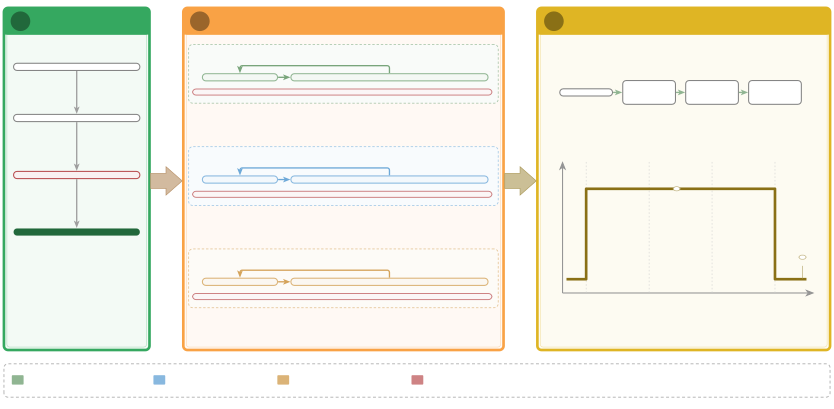
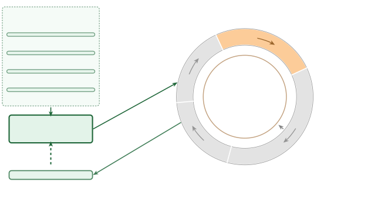
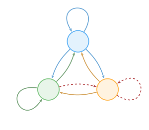

   [](https://huggingface.co/CosmosMind/RSI-Harness)


Figure 1: MetaRSI-v1 at a glance. _1_: loops close where verification is
machine-checkable. _2_: one kernel, three operators, one writable
surface each. _3_: five of six orderings admissible. _4_: three nested
improvement levels. _5_: horizontal composition, vertical policy
rewriting. The band runs from freely verifiable to unverifiable.


Figure 2: Overview of MetaRSI-v1. _1_: the binding constraint is
verification format, not subject domain. _2_: one loop kernel,
instantiated by every operator and scheduled across three nested levels:
the kernel cycle, the RSI² Agent-v1, and the MetaRSI² Agent-v1. _3_:
three operators with disjoint write surfaces, Data-RSI writing
$`\mathcal{D}`$, Harness-RSI writing $`\mathcal{H}`$ and Model-RSI
writing $`\theta`$, composed _horizontally_ by application order or
optimized _vertically_ by rewriting an operator’s proposal policy. The
central band traces one improvement term from learning signal through
scheduled composition to sealed evaluation and release, and the
recompilation arc returns to the signal after each capability-altering
step. The sealed evaluator is outside all three.

## 1.  Introduction

Recursive self-improvement, or RSI, asks whether a system can read its
own failures and improve the model-building machinery itself, so that
every model built thereafter inherits the gain. Recent systems show this
is no longer speculative: agents rewrite their own scaffolds \[1, 2, 3\]
and generate their own finetuning data \[4, 5\]. Yet RSI has so far been
validated almost exclusively on coding tasks and formal benchmarks such
as multiple-choice science QA, mathematical problem sets, and executable
test suites. In our survey of forty-five recent systems, $`69\%`$ close
their improvement loop against a target a machine can check for free,
and the systems reporting scientific benchmarks fall inside that
majority rather than outside it (Figure 4). This is a _format_ bound
rather than a subject bound. What such a loop certifies is restricted,
benchmark-bound capability, meaning competence inside a pre-specified,
machine-checkable slice of a discipline, not general capability in the
discipline itself, where the question is not given and correctness is
settled by argument, replication, or measurement. Nor can specialization
defer the problem: a deployed system’s behaviour is determined jointly
by its data, its weights, and its execution scaffold, and a change in
any one alters what the other two describe (Figure 3), so what is needed
is a unified paradigm over all three surfaces together with a meta-level
policy governing which change is made next.



Figure 3: Why single-surface improvement is insufficient. _I_: a
deficiency produces evidence that carries no label saying which of the
three surfaces is responsible. _II_: each single-surface operator closes
a valid loop on its own surface but incurs a cost it cannot see (red):
scaffold extensions are re-paid as context at every inference, data
amplification cannot reach capability the rollouts never exhibit, and
training may regress already-held behaviour. _III_: a composed sequence
pays neither. Extend the scaffold, amplify what it reveals, internalize
into weights, then retire the extension: this retains the capability
while returning the scaffold budget to baseline. The chart’s ordinate is
that budget, so the fall at station four is the cost returned. Colours
denote the three surfaces: data, harness, and the model; the scissors
mark licensed retirement.

We present MetaRSI-v1, a meta-recursive self-improving system built on
three typed operators that share one _loop kernel_ and consume the same
_learning signal_. Data-RSI synthesizes verified training records from
execution experience, amplifying what the model already does well and
marking where that competence ends. Harness-RSI edits the execution
scaffold through typed patches over five slots: the system prompt,
memory, built-in tools, skills, and tools and resources mounted through
MCP, taking effect at once with no training cost. Model-RSI modifies
model parameters and architecture under bounded training recipes,
internalizing capability into the weights so that it persists across
scaffolds and adds no inference cost. The operators are connected by
Transition Agent-v1 adapters, which pass the learning signal and their
outputs between them. Above them, the RSI² Agent-v1 optimizes on two
axes. Horizontally, it decides the sequence in which operators are
applied, since the order changes what each subsequent operator reads and
some orders are ill-posed; vertically, it rewrites each operator’s own
proposal policy, improving how that operator diagnoses failures and
proposes changes. The two axes are optimized jointly under one feedback
stream, since a composition inherits the quality of its weakest operator
and a fixed operator set passes its defects upward. Above that, the
MetaRSI² Agent-v1 revises the scheduling policy itself once an
improvement term completes. Three nested levels modify three different
objects: operators change the system, the RSI² Agent-v1 changes the
composition, and the MetaRSI² Agent-v1 changes the rule of composition.
These control roles are defined by what they may read and write rather
than by what occupies them. Any of the four can therefore be held by a
human expert instead of a model, on the same typed contracts and the
same audit: the scheduler, a sub-agent, the meta agent, or a transition
adapter. We validate MetaRSI-v1 on code execution and closed-form
scientific reasoning, where the community’s evidence standard is
highest. Throughout, the system improves itself using only itself: every
model-driven role in the loop is played by the target model, so no
stronger external model proposes, judges, or schedules, and the gain is
attributable to the mechanism rather than to a teacher.

The framework opens two complementary routes forward, one through
Harness-RSI and one through Model-RSI. We redefine Data-RSI as the
operator that turns execution experience into verified records and marks
the boundary of what that experience supports, and its output is
consumed by both Harness-RSI and Model-RSI; the results of their changes
flow back to Data-RSI as fresh evidence that rescales what the system
knows and drives the next round. This feedback across the three
operators makes the system self-reinforcing, with capability compounding
across rounds. The framework is designed for scientific and engineering
practice as it actually occurs. In any discipline, work decomposes into
stages, from hypothesis framing and experimental design to execution and
interpretation, and each stage already has the shape a loop expects: it
takes a typed input, produces an observable outcome, and leaves a record
the next stage can use. This means a domain need not close its entire
loop at once. A local loop at a single stage already produces records
that adjacent stages can build on, and the composition machinery extends
these local loops into pipeline-level ones. Crucially, the records a
loop leaves behind accumulate across rounds and transfer across domains
in a way that model checkpoints cannot. It is precisely this
accumulation and transfer of records that enables improvement to
compound beyond the narrow slice where it began. Building on this, the
framework states five structural laws concerning where loops exist, how
operators compose, and what external supervision can buy, each
formulated as a refutable claim (Section 6.7). These laws jointly
support a core position: the fundamental unit of progress is not the
model, but the loop. The productive question is therefore not “how to
make the model stronger,” but “how cheaply can a new loop be closed
where one has never been closed before” (Section 6.8).

## 2.  Related Work

### 2.1. Foundation Models

The capability that self-improvement now attempts to extend was itself
produced by a sequence of engineering regimes, and the shape of that
sequence explains where the remaining headroom lies. Scale was the first
regime: the Transformer \[6\] made compute the binding constraint, and
empirical scaling laws turned model size, data volume, and compute into
a predictable trade \[7, 8\], yielding models whose few-shot competence
emerged without task-specific training \[9\]. Alignment was the second:
instruction tuning and reinforcement learning from human feedback
converted raw next-token competence into a followable interface \[10,
11\], and open-weight families made that interface broadly
reproducible \[12, 13, 14\].

Inference-time computation was the third: chain-of-thought prompting
showed that additional serial computation buys accuracy at fixed
weights \[15\], a trade later made explicit by test-time scaling
analyses \[16\] and internalized by reasoning models trained with
verifiable rewards \[17, 18\]. The fourth regime, and the one that
current systems occupy, moved capability out of the weights entirely:
retrieval, tools, memory, and long-horizon agent loops \[19, 20, 21\]
now mediate most of what a deployed model can accomplish, and
standardized interfaces for tool and context provision have made this
scaffold a first-class engineering artifact. Read as a sequence, these
regimes show a steady migration of the effective locus of capability:
from parameters, to alignment data, to inference procedure, to the
surrounding execution structure. A self-improvement framework restricted
to any one of them therefore addresses only part of what determines a
model’s behavior. That same migration is why MetaRSI-v1 treats data,
scaffold, and the model as three writable surfaces of one system rather
than as three separate targets.

### 2.2. Recursive Self-Improvement

The idea is old, driving the classical intelligence-explosion
argument \[22\] and formalized in the Gödel machine \[23\], but only
recently buildable. What has been built sorts by which part of the
system it treats as mutable, and that sorting is what makes the field’s
concentration visible. The earliest work treats the _output_:
self-refinement and verbal reflection revise an answer within an
episode \[24, 25\], which is cheap to check but leaves nothing behind
and, without an external signal, corrects little \[26\]. A second family
treats the _scaffold_: STOP improves the program that improves
programs \[1\]; ADAS and AFlow search over architectures and workflow
graphs \[2, 27\]; Gödel Agent and the Darwin Gödel Machine rewrite their
own code under empirical selection \[28, 3\]; and Self-Harness,
DemoEvolve and MetaSkill-Evolve target harness evolution directly \[29,
30, 31\].

A third treats the _data_: STaR bootstraps rationales from correct
answers \[32\], self-rewarding models produce their own preference
signal \[33\], Self-Adapting LMs emit self-edits that become finetuning
data \[4\], and DataEnvGym, SEAL and RSIBench-Data place the data
generator, the environment and the post-training stack respectively
under control \[5, 34, 35\]. A fourth, much smaller, crosses these
boundaries: SIA updates harness and weights together and reports the
combination dominating harness-only improvement \[36\], while
Hyperagents and Escher-Loop optimize over several components at
once \[37, 38\] and AlphaEvolve evolves programs against a fixed
evaluator to improve algorithms and hardware designs \[39\]. Surveys
confirm the partition and its imbalance \[40, 41\], and complementary
work surveys the risks and structural limits persistent
self-modification introduces \[42, 43\].

Read by subject the taxonomy looks diverse; read by what closes each
loop it collapses. In $`69\%`$ of these systems the object of
verification is a key or a test (Table 6 gives the per-system
assignment), and the systems reporting scientific benchmarks are inside
that majority rather than outside it. What they improve is real, and
calling it a coding monoculture misdescribes it; what they certify is
_restricted, benchmark-bound_ capability, bounded by the closed format
that made the loop affordable. Two gaps persist. Systems crossing
substrate boundaries hard-wire a single order rather than deciding it
from evidence, though composition across substrates is exactly where
non-commutativity and redundancy appear; and the improvement operator is
almost always a fixed program, so the loop improves the system but
nothing improves the loop. MetaRSI-v1 takes up both, by making the
operator set typed and composable and by placing the scheduling policy
and each operator’s proposal policy under a shared meta-optimizer.

Figure 4: The binding constraint on RSI is verification format, not
subject. Of $`45`$ surveyed systems, 69% close their improvement loop
against a closed, machine-checkable target: a test suite, an exact-match
key, a numeric objective, or a multiple-choice label (a). Grouped by
subject (b), nearly every scientific system falls inside the closed
block, code and mathematics along with closed-form science suites such
as GPQA and AIME. The one exception is a code system closed by rubric
rather than by executable tests \[44\], and open targets otherwise
concentrate in embodied games, $`10`$ of the $`14`$, and professional
domains. Gains on scientific benchmarks therefore certify _restricted,
benchmark-bound_ capability rather than general capability in the
discipline. Per-system assignments, and the target each system verifies
against, in Table 6.

Figure 5: Improvement loops track verification format, not capability,
across $`22`$ domains and $`55`$ closed loops (Table 8). *(b)* Loop
count falls with the verifier rung of Table 5, read off each domain’s
_practice_ benchmark and named on (d)’s axis: Spearman $`\rho=-0.75`$,
$`p<0.001`$. $`53`$ of the $`55`$ close at rungs 1 to 3, and none of the
$`33`$ loops added in August 2026 landed above rung 2. *(c)* Capability
predicts loops too, at a zero-order $`r=+0.64`$ ($`p=0.006`$), but the
two are not interchangeable: controlling for the rung, capability falls
to a partial $`\mathbf{r=+0.45}`$ ($`p=0.08`$, n.s.), whereas
controlling for capability the rung holds at $`r=-0.67`$ ($`p=0.005`$).
*(d)* The standing loss is the five rung-5 domains above the threshold,
which capability’s non-monotonicity across rungs shows are not the
domains models are worst at. *(e)* Every domain scores 35 to 83 points
lower on practice than on recall, so the capability axis is an _upper
bound_. Hollow markers mark no closed loop, and eight domains have never
had one even after the census doubled. Section A.1 justifies every rung,
and why (c) and (d) plot only the $`17`$ domains carrying a recall
subject accuracy; Section A.2 sources (e).

### 2.3. Capability Boundaries

A third line of work measures where model capability actually ends, and
it is what makes the previous subsection’s concentration a problem
rather than a preference. Broad multi-subject suites established that
competence is highly uneven across disciplines \[45, 46, 47\], and
expert-authored evaluations sharpened the picture: GPQA isolates
graduate-level science that resists web search \[48\], FrontierMath
targets research-level mathematics \[49\], and Humanity’s Last Exam
spans classical languages, ancient history and philosophy alongside the
sciences \[50\]. The picture splits along verification format. Coding
and terminal benchmarks have driven a decade of scaffolding
progress \[51, 52, 53\], and closed-form science has been compressed,
GPQA-Diamond rising from $`38.8\%`$ for the best model at the
benchmark’s release to the low nineties in two years, above the $`65`$
to $`74\%`$ Rein et al. \[48\] report for PhD-level experts, while
open-ended and practice-based domains remain far from expert
performance.

A graduate-level multiple-choice item is a closed instrument: the
question is given, the answer set enumerated, correctness a lookup.
Saturating it shows the knowledge and the reasoning chain are present
under that framing, and leaves open how much of the discipline’s actual
work it covers, where the question is not given and correctness is
settled by argument, replication or measurement. On the open-ended side
the same models remain far from expert performance, the deficit
concentrated where cheap verifiers are missing \[50\], and benchmarks
built around practice rather than question answering reinforce the
asymmetry: replicating machine-learning research, reproducing papers and
executing laboratory protocols stay hard for systems that saturate
multiple-choice science \[54, 55, 56, 57, 58\]. Panel (e) of Figure 5
quantifies this on six paired benchmarks, whose endpoints and sources
are given in Section A.2, where the practice end scores 35 to 83 points
below the recall end on every pair, making the indicative capability
axis an upper bound rather than a measure. Only the MLE-bench pair is
measured _within_ one system; the other five compare each end’s best
published frontier score; and the humanities gap is widest partly
because its practice end is old, $`5.2`$ being the HLE paper’s own
Humanities row for o3-mini (high) \[50\] while frontier models now reach
about $`55`$ on HLE _overall_ closed-book and about $`65`$ with tools.
No per-category humanities number is published on any board reporting
the overall figure, so the earlier endpoint is kept and labelled, not
imputed.

Two regimes therefore have to be distinguished, and Figure 5 separates
them while Figure 4 shows where the effort went instead: domains whose
competence is largely present but around which no loop has closed, and
domains where it is absent and no scaffolding will manufacture it. We
place each domain on a rung of the verifier ladder (Table 5; defined in
Section 6.4.1): rung 1 for executable tests and exact match, rung 2 for
simulation, rung 3 for reproduction of a reported result, rung 4 for
protocol execution with an instrument, and rung 5 for an expert rubric
with no ground truth. The rung is assigned from the verification method
of the domain’s _practice_ benchmark rather than its recall benchmark,
so it is a property of that benchmark; Table 8 gives it per domain and
Section A.1 justifies every assignment. Of the $`55`$ closed loops in
the census, $`53`$ sit at rungs 1 to 3; the two exceptions are one loop
in robotic manipulation at rung 4 and one narrow charge-classification
loop in law at rung 5. That census doubled in August 2026, from $`22`$
loops over $`18`$ domains, and the doubling is what makes the zeros mean
something: the $`33`$ new loops include none at rung 4 or 5, and the
eight domains that had never had one still have none. The five domains
in the standing-loss region, economics, clinical decision support, law,
history and philosophy, all sit at rung 5 with capability between
$`67.8`$ and $`80.8`$, comparable to the rung-1 to rung-3 domains where
RSI has worked, but their practice admits no automatic target. The
reporting capability threshold is $`60`$, and the standing-loss set is
the same five domains for any threshold in $`(59.2,67.8]`$, whose lower
bound is wet-lab protocol at $`59.2`$ and upper bound is law at
$`67.8`$. Nor does a closed loop require capability above the line,
since robotic manipulation at $`12.8`$ and single-cell genomics at
$`52.8`$ have both closed one. The distinction is operational: the first
regime is addressable by amplification and external structure, the
second requires new knowledge to enter the system, and it is what our
Data-RSI operator is built to draw automatically.

## 3.  Preliminaries

This section fixes the objects that any self-improvement procedure
manipulates, the signal it is allowed to read, and the criterion against
which its output is judged. All notation introduced here is reused
unchanged in the remainder of the paper.

Target system The entity being improved is not a checkpoint but a triple

```math
S\;=\;(\mathcal{D},\;\theta,\;\mathcal{H}), \tag{1}
```

where $`\mathcal{D}`$ is the data state (the corpus, synthesized
records, and curriculum over which the model has been or will be
trained), $`\theta`$ is the model state (trainable parameters and
adapters, the bounded architectural choices that place them, and the
training configuration that produced them), and $`\mathcal{H}`$ is the
harness state, the execution scaffold that mediates every interaction
with the model, comprising the system prompt, a persistent memory, a
built-in tool set, a skill library, and the tools and resources mounted
through MCP. A deployed system is the composition of all three; a change
confined to any one of them changes what the deployed system does.

Tasks, rollouts, and verification Let $`\mathcal{T}`$ denote a task
family and $`t\sim\mathcal{T}`$ a task instance. Executing $`S`$ on
$`t`$ produces a trajectory $`\tau=(o_{1},a_{1},\dots,o_{n},a_{n})`$ of
observations and actions, terminating in an output that a verifier $`v`$
maps to a scalar outcome $`r=v(t,\tau)\in[0,1]`$. We deliberately do not
assume that $`v`$ is cheap: in executable domains it is a test suite, in
closed-form question answering a string comparison, and in open-ended
scientific work it is expensive, partial, or unavailable. This
variation, rather than any property of the underlying reasoning, is what
has historically determined where improvement loops could be closed.

Learning signal A self-improvement procedure never observes
$`\mathcal{T}`$ directly. It observes a learning signal

```math
\sigma\;=\;\Sigma(\mathcal{E}),\qquad\mathcal{E}\;=\;\big\{(t_{k},\;\tau_{k},\;y_{k})\big\}_{k=1}^{K}, \tag{2}
```

the deterministic compilation of an evidence set $`\mathcal{E}`$ drawn
from attempts made by the system in its current state, where $`y_{k}`$
is the outcome record of attempt $`k`$: in the code and QA tracks
evaluated here, simply the verifier scalar $`r_{k}`$ above, and in
general whatever the domain was able to establish about that attempt. We
define $`\sigma`$ by the role it plays rather than by the form it takes,
because across domains the form varies and the role does not. In
implementation $`\sigma`$ is the compiled evidence bundle carrying raw
trajectories and diagnoses; later references to trajectories or
experience denote components of this bundle.

What may enter the evidence set Four kinds of thing: verifier outcomes
of any fidelity, the system’s own trajectories (read for the competence
they exhibit, not only for whether they succeeded), external knowledge
admitted against a demonstrated gap, and the framework’s own decision
records. A source is admissible if it derives from the current system,
is readable by every operator, and carries no authority to decide
whether a change was good. What makes something a learning signal is its
position in the loop, not its modality.

What the compiler emits $`\Sigma`$ is deterministic and fixed: it
aggregates, attributes, and attaches provenance, emitting one typed
object in three layers (an outcome layer, an attribution layer, and a
model-attributed mechanism layer, whose schema is Equation 10), and it
does not decide what to change. Fixing the typing while leaving the
sources open is what lets a single operator set run over domains whose
evidence has nothing else in common.

Two properties of the signal It is the sole channel between the
environment and any improvement procedure, which is what allows
heterogeneous procedures to be compared, exchanged, and composed. And it
is perishable: a step that changes what the deployed system does
invalidates every signal compiled before it, because the attempts such a
signal summarizes were made by a system that no longer exists.

Improvement procedure and budget An improvement procedure is a map

```math
U:\;(S,\;\sigma,\;B)\;\longmapsto\;(\widetilde{S},\;A,\;E,\;c), \tag{3}
```

which consumes the current system, the learning signal, and a budget of
four non-fungible resources, the four bars of the ledger in Figure 1,

```math
B\;=\;\big(\,\underbrace{\beta_{\mathrm{tok}}}_{{\color[rgb]{0.2822,0.5137,0.6971}\text{\scriptsize tokens}}}\;,\;\;\underbrace{\beta_{\mathrm{clk}}}_{{\color[rgb]{0.3237,0.498,0.3312}\text{\scriptsize wall-clock}}}\;,\;\;\underbrace{\beta_{\mathrm{gpu}}}_{{\color[rgb]{0.68,0.4888,0.2045}\text{\scriptsize compute}}}\;,\;\;\underbrace{\beta_{\mathrm{qry}}}_{{\color[rgb]{0.2025,0.1063,0.415}\text{\scriptsize verifier queries}}}\,\big),
```

and returns a candidate successor $`\widetilde{S}`$, exportable
artifacts $`A`$ that other procedures may consume, the evidence $`E`$
supporting the change, and the realized cost $`c\preceq B`$. A procedure
produces candidates only; it does not promote them. Two procedures
$`U_{i},U_{j}`$ compose by applying one to the output of the other, and
in general

```math
U_{j}\circ U_{i}(S)\;\neq\;U_{i}\circ U_{j}(S), \tag{4}
```

because each modifies a different component of Equation 1 and thereby
changes the learning signal the next procedure will read.

Protected measurement Separately from $`S`$ we fix a sealed evaluator
$`Q^{\star}`$, a held-out task set $`\mathcal{T}^{\star}`$, a release
rule, and a resource ledger. None of these is part of $`S`$ and none may
be modified by any improvement procedure. This separation distinguishes
an improvement in capability from an improvement in the definition of
success; without it, the quantity being maximized can be increased by
editing the measurement.

Improvement episode An episode is a tuple
$`e=(S_{0},\ \mathcal{T}_{\mathrm{adapt}},\ \mathcal{T}^{\star},\ B_{\mathrm{tot}})`$:
a clean initial system, a set of tasks on which failures may be observed
and improvements attempted, a sealed set on which the final system is
scored once, and a total budget. Within an episode the procedure may be
invoked repeatedly, producing a sequence $`z=(u_{1},\dots,u_{T})`$ of
applied procedures and a corresponding chain of systems
$`S_{0}\to S_{1}\to\cdots\to S_{T}`$.

Notation $`U_{j}\circ U_{i}`$ denotes applying $`U_{i}`$ then $`U_{j}`$;
$`z_{1:t}=(u_{1},\dots,u_{t})`$ is a prefix of an operator sequence.
Calligraphic letters denote sets and policies, sans-serif letters
$`\mathsf{D},\mathsf{H},\mathsf{M}`$ denote the three operators of
Section 4.2, and starred quantities such as $`Q^{\star}`$ are protected:
fixed before an episode begins and not writable by any component at any
level.

### 3.1. Objective Formulation

Let $`\Pi`$ denote the internal strategy of the improvement procedures
(the way they diagnose, propose, and select), and let $`\phi`$ denote
the policy that produces the sequence $`z`$ within an episode. The
quantity we optimize is the deployed improvement productivity of an
episode, penalized by cost, by regression on previously held capability,
and by the gap between the working signal and the sealed measurement:

```math
J(\Pi,\phi)\;=\;\mathbb{E}_{e\sim\mathcal{E}}\Big[\;\underbrace{\tcbhighmath[colback=mGreen!10,colframe=mGreen!45,boxrule=0.4pt,arc=2pt,left=2pt,right=2pt,top=1pt,bottom=1pt]{Q^{\star}(S_{T})-Q^{\star}(S_{0})}}_{{\color[rgb]{0.4316,0.6641,0.4416}\text{\scriptsize realized gain}}}\;-\;\lambda\,\underbrace{\tcbhighmath[colback=mOrange!10,colframe=mOrange!45,boxrule=0.4pt,arc=2pt,left=2pt,right=2pt,top=1pt,bottom=1pt]{C(z)}}_{{\color[rgb]{0.85,0.6109,0.2557}\text{\scriptsize cost}}}\;-\;\mu\,\underbrace{\tcbhighmath[colback=mRed!10,colframe=mRed!45,boxrule=0.4pt,arc=2pt,left=2pt,right=2pt,top=1pt,bottom=1pt]{\mathrm{Reg}(S_{T},S_{0})}}_{{\color[rgb]{0.684,0.2889,0.2955}\text{\scriptsize regression}}}\;-\;\nu\,\underbrace{\tcbhighmath[colback=mPurple!10,colframe=mPurple!45,boxrule=0.4pt,arc=2pt,left=2pt,right=2pt,top=1pt,bottom=1pt]{\mathrm{Gap}(\sigma,Q^{\star})}}_{{\color[rgb]{0.6209,0.3453,0.6674}\text{\scriptsize evaluator gap}}}\;\Big], \tag{5}
```

subject to $`C(z)\preceq B_{\mathrm{tot}}`$, where $`C(z)`$ aggregates
the realized costs of the applied procedures, $`\mathrm{Reg}`$ measures
degradation on capabilities the initial system possessed, and
$`\mathrm{Gap}`$ penalizes optimization against a signal that diverges
from the sealed evaluator (Section 4.7).

- $`\bullet`$
  It is evaluated on the _released_ successor rather than the best
  candidate ever generated, so generation and selection are both
  accounted for (Section 4.1, Select/Export).
- $`\bullet`$
  It is evaluated under a _fixed_ budget, so an improvement that merely
  spends more is not an improvement (Section 4.4).
- $`\bullet`$
  It depends on the pair $`(\Pi,\phi)`$ rather than on either alone, so
  maximizing it requires deciding both what each procedure does
  internally and in which order procedures are applied (Section 4.4).

## 4.  Methodology

Overview. MetaRSI-v1 is built from the inside out. We first fix a single
unified execution paradigm (a cycle closed by a _learning signal_ and
cut once by an authority boundary) that every self-improvement operator
must instantiate, so that operators differ in what they write but not in
how they are run, validated, or audited (Section 4.1). Instantiating
that kernel on the three components of the target system in Equation 1
yields the three base operators: Data-RSI, which synthesizes verified
records from execution experience and emits the evidence the other two
consume; Harness-RSI, which edits a five-slot execution scaffold without
touching the model; and Model-RSI, which internalizes capability into
the model through bounded training recipes (Section 4.2). Because the
three share one artifact vocabulary, their adjacency becomes analyzable
rather than arbitrary: a single freshness condition on the learning
signal admits exactly five of the six ordered operator pairs, and each
admissible edge is realized by a typed Transition Agent-v1 adapter that
converts a producer’s output into a consumer’s input (Section 4.3). On
top of the operator layer, the RSI² Agent-v1 consumes the current
sequence and the latest signal and chooses between extending the
sequence _horizontally_ and rewriting an operator’s proposal policy
_vertically_, the latter constrained by an explicit contract of mutable,
action, and protected surfaces (Section 4.4). Finally, a meta agent
closes the outermost loop by revising the RSI² Agent-v1’s own scheduling
policy once an improvement term completes (Section 4.5). Figure 6 draws
the whole term, and its three regions correspond, left to right, to
Section 4.1, Section 4.2–4.3 and Section 4.4–4.5 respectively.


$`S`$

Figure 6: One improvement term of MetaRSI-v1. _I_: a target system
$`(\mathcal{D},\mathcal{H},\theta)`$ with a once-opened split compiles
rollouts into a typed learning signal and per-episode signatures. _II_:
one loop kernel, a mutable model arc with protected code arcs, is
instantiated by three operators ($`\mathsf{D}`$, $`\mathsf{H}`$,
$`\mathsf{M}`$) differing only in write surface; five of six ordered
transitions are admissible, each via a numbered Transition Agent-v1
adapter. _III_: the RSI² Agent schedules horizontally or rewrites
operator policies vertically under contract, and the MetaRSI² Agent
revises it once per term, while evaluator, gate and ledger stay outside
every write surface. The dashed arc is signal recompilation; colours
denote the data, harness and model surfaces (legend beneath).

### 4.1. The Loop Kernel: One Paradigm for Heterogeneous Operators

Operators that write different components of $`S`$ have almost nothing
in common at the level of implementation: one synthesizes training
records, one rewrites a system prompt, one submits a training job. What
they share is a _contract about authority_; pitching the paradigm at
that level, rather than at the level of a stage list, is what makes it
portable across domains whose implementations differ entirely.

###### Definition 4.1 (Self-improvement operator).

A self-improvement operator is any process satisfying three conditions:
_(i)_ its sole input is the compiled learning signal $`\sigma`$ of
Equation 2, never the environment directly; _(ii)_ the part of it that
decides _what to change_ is a policy $`\pi`$, and is mutable; _(iii)_
the part of it that decides _whether the change was good_ is fixed,
external to the operator, and outside its write surface. Formally,

```math
U:\;\mathcal{S}\times\Sigma\times\mathcal{B}\;\to\;\mathcal{S}\times\mathcal{A}\times\mathcal{E}\times\mathcal{C},\qquad U(S,\sigma,B)\;=\;(\widetilde{S},\,A,\,E,\,c). \tag{6}
```

Everything the definition does not mention is left to the domain: how
many stages the operator has, whether it searches or samples, whether it
is a language model or a solver or a piece of numerical code. An
operator is admitted to the framework solely by _surrendering
adjudication_, regardless of how it is built internally. Two structural
commitments follow, and they are the only ones the framework makes. The
first is cyclic closure. Condition *(i)* makes $`\sigma`$ the operator’s
sole input, and by the perishability property of Section 3 whatever the
operator exports is re-evaluated and recompiled into that same signal;
every output therefore returns to the object that drove it,

```math
\sigma^{\prime}\;=\;\Sigma(E\cup E^{\prime}),\qquad E^{\prime}\;=\;\mathrm{rollouts}(\widetilde{S},\,\mathcal{T}_{\mathrm{adapt}}), \tag{7}
```

so that what it exported is measured on the system it produced rather
than on the one it started from. The second is that the cycle carries
exactly one authority boundary, cutting it into an arc on which a model
proposes and an arc on which deterministic code adjudicates. Figure 7
draws both commitments: _where_ that cut falls is load-bearing, and how
finely either arc is subdivided is not.

Our reference instantiation of Definition 4.1 is the loop kernel
$`\mathcal{K}`$, instantiated by all three operators below. It refines
the two arcs into seven named stages:

```math
\mathcal{K}\;=\;\textsc{Observe}\!\to\!\textsc{Diagnose}\!\to\!\textsc{Propose}\!\to\!\textsc{Validate}\!\to\!\textsc{Execute}\!\to\!\textsc{Select}\!\to\!\textsc{Export}, \tag{8}
```

and exposes exactly one mutable object, its proposal policy $`\pi`$. An
operator is then fully specified by the triple:

```math
U\;=\;\langle\,\mathcal{K},\,\pi,\,w\,\rangle,\qquad w\in\{\mathcal{D},\,\mathcal{H},\,\theta\}, \tag{9}
```

which refines the generic procedure of Equation 3 by naming the part
that may be improved.

On the mutable arc, Diagnose and Propose are _model-driven_: a language
model reads the learning signal and the current component state,
attributes the observed failures, and emits a candidate modification
together with an expected effect and a risk statement. The remaining
five stages are _deterministic code_: Observe binds the typed inputs the
operator declared it consumes; Validate checks the proposal against a
schema and rejects any edit outside the operator’s declared write
surface; Execute applies the surviving proposal in an isolated
workspace; Select scores candidates with a fixed evaluator and promotion
rule; and Export emits a typed artifact carrying a content hash, its
parents, the supporting evidence, and the realized cost. Select and
Export run on protected code outside the operator’s write surface
(Section 4.7). The model carries the entire semantic burden of deciding
_what_ is wrong and _what_ to change, while deterministic code holds
every authority to decide whether the change was good; this division is
what makes an operator safe to place under an automatic scheduler.

The kernel consumes exactly one environmental input, the learning signal
$`\sigma`$ of Equation 2, whose sources are unconstrained and whose
three-layer typing is fixed. The concrete schema of that typing, for
every failed rollout, is a failure signature:

```math
\varphi(\tau)\;=\;\big(\,\underbrace{\chi(\tau)}_{{\color[rgb]{0.4051,0.4051,0.4051}\text{\scriptsize terminal cause}}}\;,\;\;\underbrace{\psi(\tau)}_{{\color[rgb]{0.4051,0.4051,0.4051}\text{\scriptsize causal role}}}\;,\;\;\underbrace{\tcbhighmath[colback=accent!10,colframe=accent!45,boxrule=0.4pt,arc=2pt,left=2pt,right=2pt,top=1pt,bottom=1pt]{\mu(\tau)}}_{{\color[rgb]{0.2025,0.1063,0.415}\text{\scriptsize reusable mechanism}}}\,\big), \tag{10}
```

where the tint is the authority boundary of Definition 4.1 carried into
the schema: $`\chi`$ and $`\psi`$ are set in grey because they are
grounded in the trace and the verifier report under schema and evidence
constraints, and only the boxed $`\mu`$ is the model’s own hypothesis.
The first two record what the evaluator reported and what the agent did:
an output-protocol violation, a tool-call mismatch, a derivation
inconsistent with the emitted answer; the third is the generalizable
mechanism behind the failure. The same signature vocabulary is shared by
all three operators, so a failure attributed to a missing procedural
habit can be routed to the harness while one attributed to absent
knowledge is routed to data and weights; the routing decision of
Section 4.4 is made on an object all operators can read.

Definition 4.1 fixes neither the signal compiler $`\Sigma`$ nor the
verifier $`v`$; promoting either to an operator’s write surface is
architecturally licensed but governed out here, since a system permitted
to improve what counts as success can raise its score without improving
capability, a failure mode catalogued for self-evolving agents under
deployment-time reward hacking \[42\]. The sealed measurement, its task
set, the release rule, and the ledger stay outside every write surface
at every level (Section 4.7); an evolving verifier is admitted only as a
way of widening coverage _between_ sealed evaluations.

The authority boundary of Definition 4.1 is uniform across every
model-driven component: the model supplies the semantics, and
deterministic code supplies every quantity that enters a promotion
decision. The same split holds for the scheduler itself: the RSI²
Agent-v1 supplies cross-layer diagnosis, operator choice, and axis
selection, while deterministic code supplies the admissibility filter,
the program type-check, and the contract and diff checks of Equation 27.



Figure 7: The loop kernel of Definition 4.1. The operator is a ring; the
hub is the write surface ($`\mathcal{D}`$, $`\mathcal{H}`$, $`\theta`$),
the one field that differs across the three operators. The ring carries
one authority boundary: a model proposes on the coloured arc,
deterministic code adjudicates, emits and reads on the grey ones. The
cut is load-bearing; the seven-stage refinement of Equation 8 is not
unique. The cycle closes _through the signal_: verifier outcomes,
trajectories, admitted knowledge and instrument readings all feed the
fixed $`\Sigma`$, and the dashed arc recompiles it after each
re-evaluation.

### 4.2. Three Base Operators

Instantiating Equation 8 on the three components of $`S`$ gives three
operators whose write surfaces are disjoint by construction. The
remainder of this subsection develops each in turn. The three follow
from Equation 1 once the target system is written down: a deployed
system _is_ a data state, a model state and a harness state, so an
operator that changes what the system does writes exactly one of the
three. The three also stand in a fixed cost order (model calls, then
model calls plus replay, then GPU-hours), and it is that ordering which
makes the scheduling problem of Section 4.4 non-trivial.


#### 4.2.1. Data-RSI: Verified Synthesis from Execution Experience

Data-RSI writes the data state $`\mathcal{D}`$. It consumes execution
trajectories from the kernel’s Execute stage and returns a Dataset
artifact of verified training records, which both of the other operators
consume. Its central principle is that synthesis is anchored to observed
execution rather than invented: every record descends from experience
distilled from actual rollouts, so synthesis stays within what observed
rollouts support. The operator presses out capability the model already
holds and marks where that capability ends. For each episode $`e`$ the
operator extracts a four-dimensional learning signature:

```math
\kappa(e)\;=\;\big(\,\underbrace{\kappa_{\mathrm{k}}(e)}_{{\color[rgb]{0.2822,0.5137,0.6971}\text{\scriptsize knowledge}}},\;\underbrace{\kappa_{\mathrm{r}}(e)}_{{\color[rgb]{0.3237,0.498,0.3312}\text{\scriptsize reasoning}}},\;\underbrace{\kappa_{\mathrm{v}}(e)}_{{\color[rgb]{0.2557,0.6076,0.5744}\text{\scriptsize verification}}},\;\underbrace{\kappa_{\mathrm{d}}(e)}_{{\color[rgb]{0.3553,0.2623,0.5877}\text{\scriptsize distractor}}}\,\big), \tag{11}
```

whose components diagnose, in order, a knowledge deficit, a reasoning
failure despite knowledge being present, a missing verification step,
and a susceptibility to distractors. Signatures are the primary
diagnosis carried by the Experience artifact and steer all downstream
synthesis; they are a structured expansion of the model-attributed field
$`\mu(\tau)`$ of Equation 10, and downstream stages read them as
directives about _what kind_ of record to build, not as scalar scores.

Synthesis pipeline Trajectories become verified records through four
stages: experience extraction, directive generation, adversarial
generation, and verification. Episodes are grouped by outcome and
domain, and each group is distilled into an Experience artifact that
persists across rounds, accumulating diagnoses that later synthesis
draws on. From each Experience artifact a QueryGen role emits
directives, each naming a target capability and an independent
verification approach. The pipeline composes as

```math
\mathcal{E}\;\xrightarrow{\;\textsc{Extract}\;}\;\mathcal{P}\;\xrightarrow{\;\textsc{Direct}\;}\;\Delta\;\xrightarrow{\;\textsc{AdvGen}\;}\;\mathcal{C}_{\mathrm{cand}}\;\xrightarrow{\;\textsc{Gate}\;}\;\mathcal{D}^{\prime}, \tag{12}
```

where $`\mathcal{E}`$ denotes the sharded episodes, $`\mathcal{P}`$ the
experience pool, $`\Delta`$ the directive set,
$`\mathcal{C}_{\mathrm{cand}}`$ the candidate records, and
$`\mathcal{D}^{\prime}`$ the accepted dataset. The stages are kept
separate so that the diagnosis of what is wrong, the decision of what to
teach, and the construction of a specific record are each auditable and
individually replaceable.

Adversarial generation The construction of a record separates authoring
from validation. An Operator role authors each record from a directive;
an Anchor role receives only the serialized item, solves it without
seeing the Operator’s answer, and approves only when its _blind
re-derivation_ agrees with the draft. Both roles are played by the same
target model (Section 5.1); the separation here is by _input isolation_,
not by model identity, which prevents the generator from feeding its
answer to the verifier while leaving shared model errors uncorrected:

```math
(q,a)\sim O(\delta,\varepsilon,\kappa),\qquad\hat{a}\sim A(q),\qquad\mathrm{acc}\;=\;\mathbb{1}\big[\hat{a}\equiv a\big]. \tag{13}
```

Rejection returns the item for revision up to a fixed bound, and items
that do not converge within it are discarded. A synthesized record is
thus certified by a blind re-derivation under input isolation rather
than by the generator’s own confidence, which is what lets Data-RSI
write records in domains with no machine-checkable key while keeping
certification decoupled from the generator. This certifies
self-consistency under a blind re-solve; it does not certify correctness
against knowledge the model itself lacks (Section 6.2, Section 6.7).

Verification Records that survive adversarial generation pass an
independent verifier conjoining a deterministic contract check with a
model-driven semantic check:

```math
G(r)\;=\;\underbrace{C_{\mathrm{contract}}(r)}_{{\color[rgb]{0.2822,0.5137,0.6971}\text{\scriptsize schema, deterministic}}}\;\wedge\;\underbrace{C_{\mathrm{verify}}(r)}_{{\color[rgb]{0.2557,0.6076,0.5744}\text{\scriptsize semantics, re-solved}}}. \tag{14}
```

The contract enforces the supervised-finetuning schema with exactly one
trainable target. The semantic check independently re-solves the item
and confirms self-containment, unambiguous options, a correct gold
answer, and supporting reasoning. Both are fail-closed. Accepted records
are deduplicated, screened against the sealed evaluation set, and
partitioned into train and validation splits with parent lineage to
their source Experience.

#### 4.2.2. Harness-RSI: Editing the Execution Scaffold

Harness-RSI writes the harness state $`\mathcal{H}`$ without touching
$`\theta`$. It changes how the model completes a task by editing the
execution scaffold, and its gains take effect at once with no training
cost. The harness is represented as a genome over five slots:

```math
\mathcal{H}\;=\;\big(\underbrace{I}_{\text{system prompt}},\;\;\underbrace{\mathcal{M}}_{\text{memory}},\;\;\underbrace{\mathcal{O}}_{\text{built-in tools}},\;\;\underbrace{\mathcal{S}}_{\text{skills}},\;\;\underbrace{\mathcal{T}}_{\text{MCP}}\big), \tag{15}
```

where $`I`$ is the system prompt carrying the task protocol and output
format, $`\mathcal{M}`$ a bounded memory of typed entries injected under
a retrieval policy, $`\mathcal{O}`$ the built-in tools and their
schemas, $`\mathcal{S}`$ named procedural content loaded on demand, and
$`\mathcal{T}`$ the tools and resources mounted through the Model
Context Protocol, whether local or remote. Context, tool, and scratchpad
policies govern how these slots are surfaced at inference. Each slot is
a distinct _edit granularity_, so a proposal can target one surface
without disturbing the others, which makes the edit surface enumerable
and a proposal a typed patch over named fields rather than a rewritten
program.

Structured patches The operator consumes a parent genome, the learning
signal, and distilled experience, and emits a typed HarnessPatch:

```math
\Pi\;=\;\big(\eta,\;\{o_{i}\},\;\varepsilon,\;\mathcal{R}\big),\qquad o_{i}=\big(\mathrm{slot}_{i},\;\mathrm{op}_{i},\;v_{i}\big), \tag{16}
```

where $`\eta`$ is the repair _hypothesis_ stating which failure the
patch addresses, each operation names a target slot, a mutation type and
a value, $`\varepsilon`$ is the _expected effect_, and $`\mathcal{R}`$
the _risk_ statement. Requiring the hypothesis and predicted effect
forces the model to state what it thinks is wrong and what it expects to
happen, in a form a later stage can check against the outcome.

Deterministic validation enforces the write surface: patches are
confined to the five declared slots, while the model provider, target
weights, evaluator, sandbox, and release rule lie outside it, and any
operation beyond the declared slot set is rejected mechanically. Memory
entries carry a fixed type (knowledge, positive pattern, anti-pattern),
and consolidation that removes or merges entries logs every displaced
entry and its reason, so the scaffold’s history is auditable.

Evaluation and promotion Search is organized around failure signatures
rather than aggregate score. Failures sharing a signature form bounded
shards, and each shard is diagnosed and patched independently.
Candidates are replayed against a frozen baseline on their own shard,
then combined into a single genome under deduplication and a hard
complexity bound, and evaluated on the full adaptation set:

```math
\mathcal{H}^{\star}=\operatorname*{arg\,max}_{\mathcal{H}\in\mathcal{H}_{\mathrm{merged}}}Q(\mathcal{H})\quad\text{s.t.}\quad Q(\mathcal{H}^{\star})>Q(\mathcal{H}_{\mathrm{best}}),\qquad\|\mathcal{H}^{\star}\|\leq B_{\mathcal{H}}. \tag{17}
```

Promotion requires _strict_ improvement over the historical best;
otherwise the incumbent is retained. The complexity budget
$`B_{\mathcal{H}}`$ constrains active context, memory count, and
serialized genome size, preventing the scaffold from growing without
bound. The operator also emits the trajectories that succeeded under the
candidate genome, which become the verified trajectories Data-RSI
consumes (the $`\mathsf{H}\!\to\!\mathsf{D}`$ adapter of Section 4.3).

#### 4.2.3. Model-RSI: Internalizing Capability into the Model

Model-RSI writes the model state $`\theta`$. It consumes the Dataset
artifact produced by Data-RSI and internalizes verified records into
parameters through a bounded training recipe. The operator spans both
trainable weights and model architecture within one bounded proposal
space: weight updates cover adapter parameters over selected target
modules, while architectural decisions cover adapter placement,
layer-level participation, and the trainable parameter set itself. Where
Harness-RSI adds capability to the scaffold at zero training cost and
re-pays it as context at every inference, Model-RSI pays a one-time
training cost that leaves the capability free at inference and
persistent across scaffolds. The proposal space is a bounded recipe,

```math
\mathcal{R}\;=\;\mathcal{R}_{\mathrm{arch}}\times\mathcal{R}_{\mathrm{adapt}}\times\mathcal{R}_{\mathrm{optim}}\times\mathcal{R}_{\mathrm{seq}}\times\mathcal{R}_{\mathrm{ckpt}}, \tag{18}
```

where $`\mathcal{R}_{\mathrm{arch}}`$ declares the trainable parameter
set and the bounded architectural choices (adapter placement,
target-module selection, and layer participation);
$`\mathcal{R}_{\mathrm{adapt}}`$ fixes the adaptation family and its
capacity, such as rank and scaling (low-rank adaptation \[59\] in the
configuration used here); $`\mathcal{R}_{\mathrm{optim}}`$ specifies
learning rate, schedule, batch size, and gradient accumulation;
$`\mathcal{R}_{\mathrm{seq}}`$ specifies sequence length; and
$`\mathcal{R}_{\mathrm{ckpt}}`$ specifies checkpoint interval and
early-stopping patience. Bounding the space over a declared, enumerable
set of knobs spanning architecture and parameter choices makes the
operator analyzable, and each recipe is checked against the training
backend’s capability declaration before submission. Given the fixed base
checkpoint $`\theta_{0}`$, the cumulative dataset
$`\mathcal{D}^{\prime}`$ from Data-RSI, and a recipe
$`r_{j}\in\mathcal{R}`$, the operator produces a candidate

```math
\theta_{j}\;=\;\mathrm{Train}\big(\theta_{0},\;\mathcal{D}^{\prime},\;r_{j}\big),\qquad j=1,\dots,k, \tag{19}
```

where $`k`$ is bounded by the training budget. Training always proceeds
from the same fixed base $`\theta_{0}`$ over the cumulative dataset
rather than continuing a previous round’s adapter, so successive
generations differ only in their data and their recipe and share one
optimization history, which keeps gains attributable and holds error
accumulation in check across rounds. The dataset is materialized with a
loss mask that credits only assistant-generated positions, and
optimization steps are bounded by dataset size, holding repeated
exposure within a fixed number of passes.

Evaluation and promotion sit outside the operator. An independent
evaluation layer scores each $`\theta_{j}`$ on the sealed adaptation set
under the same fixed evaluator $`Q`$ used for Harness-RSI, and a
protected release rule decides

```math
\theta^{\star}=\operatorname*{arg\,max}_{\theta_{j}}Q(\theta_{j})\quad\text{s.t.}\quad Q(\theta^{\star})>Q(\theta_{\mathrm{best}}). \tag{20}
```

A candidate that fails to strictly improve the historical best is
discarded and the incumbent retained; this is the same
strict-improvement discipline as Equation 17, with candidate cost the
only difference. Table 1 groups each operator’s action surface into
field classes. Two properties follow from it. The surfaces are disjoint,
so Validate settles write-surface membership mechanically rather than by
judgement, and enumerable, so every proposal takes the form of a typed
patch over named fields; an action surface of “arbitrary code” would
defeat both deterministic validation and automatic scheduling.

|                                              |                                                         |                                                  |
| -------------------------------------------- | ------------------------------------------------------- | ------------------------------------------------ |
| Data-RSI on $`\mathcal{D}`$                  | Harness-RSI on $`\mathcal{H}`$                          | Model-RSI on $`\theta`$                          |
| synthesis directives & generation quotas     | system prompt & prompt templates                        | trainable parameter set & module architecture    |
| capability targets & difficulty distribution | persistent memory & retrieval policy                    | adapter placement & layer participation          |
| per-record verification standards            | built-in tools & schemas; MCP-mounted tools & resources | adaptation family, rank & scaling                |
| curriculum stages & mixing ratios            | skill library                                           | optimizer, learning-rate schedule & batch budget |
| accumulation, consolidation & data splits    | context, tool-use & scratchpad policies                 | sequence length, checkpointing & seed            |

Table 1: Concrete action surfaces. The three operators act on disjoint
field sets of three different system components, the synthesized data
for Data-RSI, the task scaffold for Harness-RSI, and the trainable
parameters and architecture for Model-RSI, so every promoted change is
attributable to exactly one operator.

The cost structure complements Harness-RSI’s. Writing
$`\Delta_{\mathrm{ctx}}`$ for the change in context consumed per task,

```math
\underbrace{\Delta_{\mathrm{ctx}}(\mathsf{H})>0}_{{\color[rgb]{0.3237,0.498,0.3312}\text{\scriptsize re-paid every inference}}},\qquad\underbrace{\Delta_{\mathrm{ctx}}(\mathsf{M})=0}_{{\color[rgb]{0.68,0.4888,0.2045}\text{\scriptsize paid once, at training}}}, \tag{21}
```

this asymmetry makes the two operators complementary, and the
$`\mathsf{M}\!\to\!\mathsf{H}`$ adapter of Section 4.3 exploits it by
retiring scaffold extensions once their behaviour is internalized. The
operator emits a training report recording each recipe, its candidate
checkpoint, and the training metrics; a promoted checkpoint re-enters
the kernel’s Execute stage as the new base for subsequent rollouts.

### 4.3. Operator Composition: Five Admissible Transitions

Given three operators, an improvement sequence is a word
$`z=(u_{1},\dots,u_{T})`$ over $`\{\mathsf{D},\mathsf{H},\mathsf{M}\}`$.
Some words are ill-posed rather than merely inefficient: they ask an
operator to consume an artifact that no longer describes the system it
will be applied to. A single condition makes this precise.

###### Definition 4.2 (Capability-altering step).

A step $`u`$ is _capability-altering_ if executing it changes the
behavior of the deployed system. Under Equation 1, $`\mathsf{H}`$ and
$`\mathsf{M}`$ are capability-altering; $`\mathsf{D}`$ is not, since it
writes only the data state and emits artifacts for later consumption.

###### Definition 4.3 (Signal freshness).

An artifact is _fresh_ at step $`t{+}1`$ when the signal it derives from
was compiled no earlier than the most recent capability-altering step:

```math
\mathrm{fresh}(a,\,t+1)\iff\mathrm{compiled}(a)\;\geq\;\max\{\,t^{\prime}\leq t:u_{t^{\prime}}\text{ is capability-altering}\,\},\qquad\max\varnothing=0. \tag{22}
```

###### Principle 4.4 (Admissibility).

A step $`u_{t+1}`$ is admissible after $`z_{1:t}`$ if and only if every
artifact it consumes is fresh.

Data-RSI and Harness-RSI consume the learning signal itself, which the
kernel recompiles through a fixed evaluation pass after every
capability-altering step; they are therefore admissible after any
prefix. Model-RSI consumes a Dataset artifact, fresh only when produced
by a Data-RSI step with no capability-altering step in between.
Enumerating the six ordered pairs of distinct operators under
Principle 4.4, together with the three self-transitions, partitions the
nine into

```math
\displaystyle\mathcal{A}_{\mathrm{legal}} \displaystyle=\{\,\mathsf{D}\!\to\!\mathsf{H},\;\mathsf{D}\!\to\!\mathsf{M},\;\mathsf{H}\!\to\!\mathsf{D},\;\mathsf{M}\!\to\!\mathsf{D},\;\mathsf{M}\!\to\!\mathsf{H},\;\mathsf{D}\!\to\!\mathsf{D},\;\mathsf{H}\!\to\!\mathsf{H}\,\}, \tag{23}
```

```math
\displaystyle\mathcal{A}_{\mathrm{forbidden}} \displaystyle=\{\,\mathsf{H}\!\to\!\mathsf{M},\;\mathsf{M}\!\to\!\mathsf{M}\,\},
```

exactly five admissible cross-operator transitions and two admissible
self-transitions. The single cross-operator exclusion is
$`\mathsf{H}\!\to\!\mathsf{M}`$: a harness step changes what the
deployed system can do but produces no data, so the most recent dataset
necessarily predates that change, and training on it would internalize
behavior the system has already superseded. The same condition rules out
the self-transition $`\mathsf{M}\!\to\!\mathsf{M}`$, while
$`\mathsf{D}\!\to\!\mathsf{D}`$ and $`\mathsf{H}\!\to\!\mathsf{H}`$
remain admissible as the iterated-search regimes of the individual
operators. Figure 8 draws the resulting graph.



|                                                       |                                 |                           |                                                      |
| ----------------------------------------------------- | ------------------------------- | ------------------------- | ---------------------------------------------------- |
| \#                                                    | Edge                            | Transition adapter        | Type conversion                                      |
| 1                                                     | $`\mathsf{D}\!\to\!\mathsf{H}`$ | Experience Extraction     | Experience $`\to`$ HarnessPatch                      |
| 2                                                     | $`\mathsf{D}\!\to\!\mathsf{M}`$ | Dataset Materialization   | Dataset $`\to`$ masked shards $`+`$ recipe           |
| 3                                                     | $`\mathsf{H}\!\to\!\mathsf{D}`$ | Signal Recompilation      | Genome $`\to`$ recompiled $`\sigma`$                 |
| 4                                                     | $`\mathsf{M}\!\to\!\mathsf{D}`$ | Signal Recompilation      | Checkpoint $`\to`$ recompiled $`\sigma`$, $`\kappa`$ |
| 5                                                     | $`\mathsf{M}\!\to\!\mathsf{H}`$ | Redundancy Reconciliation | TrainingRpt. $`\to`$ HarnessPatch                    |
| self-transitions: iterated search inside one operator |                                 |                           |                                                      |
| $`\circlearrowleft`$                                  | $`\mathsf{D}\!\to\!\mathsf{D}`$ | none required             | directive re-issued on the same $`\sigma`$           |
| $`\circlearrowleft`$                                  | $`\mathsf{H}\!\to\!\mathsf{H}`$ | none required             | next shard replayed on the same $`\sigma`$           |
| ✗                                                     | $`\mathsf{H}\!\to\!\mathsf{M}`$ | inadmissible              | dataset predates the capability change               |
| ✗                                                     | $`\mathsf{M}\!\to\!\mathsf{M}`$ | inadmissible              | the same condition, on a self-loop                   |

Figure 8: Operator composition. Left: the transition graph over
$`\{\mathsf{D},\mathsf{H},\mathsf{M}\}`$. Five solid edges are
admissible under Principle 4.4, as are the self-loops
$`\mathsf{D}\!\to\!\mathsf{D}`$ and $`\mathsf{H}\!\to\!\mathsf{H}`$; two
red dashed edges ($`\mathsf{H}\!\to\!\mathsf{M}`$,
$`\mathsf{M}\!\to\!\mathsf{M}`$) violate signal freshness. Right: each
admissible edge is realized by a typed Transition Agent-v1 adapter, and
the last column gives that adapter’s _type_ signature rather than an
instance of its payload: a HarnessPatch may target any of the five slots
of Equation 15, and what a conversion carries inside a declared type is
unconstrained. Self-transitions require no adapter.

An admissible edge declares a composition well posed, not yet
executable: the producing operator’s output format still has to be
converted into the consumer’s input. Each admissible edge is therefore
realized by a Transition Agent-v1 adapter, a small typed program that
performs only this conversion,

```math
T_{i\to j}:\;\mathcal{A}_{i}\to\mathcal{A}_{j},\qquad T_{i\to j}(a_{i})=a_{j}\iff\mathrm{fresh}(a_{i})\,\wedge\,\mathrm{typecheck}(a_{j},\,\mathcal{A}_{j}), \tag{24}
```

which gives an adapter grounds to _reject_: an artifact stale by
Equation 22, or a conversion whose output fails the consumer’s declared
input type, is stopped before it reaches the consumer. _Experience
Extraction_ ($`\mathsf{D}\!\to\!\mathsf{H}`$) distils Experience
artifacts and verified trajectories into a typed HarnessPatch, whose
operations may target any of the five slots of Equation 15. _Dataset
Materialization_ ($`\mathsf{D}\!\to\!\mathsf{M}`$) resolves the
curriculum into physical shards and applies the loss mask. _Signal
Recompilation_ ($`\mathsf{H}\!\to\!\mathsf{D}`$) re-runs the fixed
evaluator under the new genome and recompiles $`\sigma`$, so that the
amplifier measures the system as it now is. The
$`\mathsf{M}\!\to\!\mathsf{D}`$ adapter performs the same _Signal
Recompilation_ under new weights rather than a new genome, recompiling
$`\sigma`$ and the learning signatures $`\kappa`$ of Equation 11 on the
released checkpoint; the two are one function, triggered by the two
different capability-altering steps. _Redundancy Reconciliation_
($`\mathsf{M}\!\to\!\mathsf{H}`$) reads the training report and proposes
deletions of scaffold entries whose behavior the new weights have
internalized, together with the additions those weights make worthwhile.
Adapters carry no authority over the target system: they reformat,
distill, or reject, and their outputs are typed artifacts with full
lineage like any other.

### 4.4. Two-Axis Scheduling

The operators and their adapters define what may be done; the RSI²
Agent-v1 decides what is done. At each decision point it reads the
executed prefix $`z_{1:t}`$, the latest signal $`\sigma_{t}`$, the
evidence accumulated per operator, and the remaining budget, and chooses
one of two axes.

Horizontal orchestration extends the sequence. The RSI² Agent-v1 draws
the next ordered block of operators as a typed _improvement program_,

```math
z_{t+1:t+m}\;\sim\;\pi^{\mathrm{h}}_{\phi}\big(\cdot\mid z_{1:t},\,\sigma_{t},\,B_{\mathrm{rem}}\big),\qquad\mathrm{supp}\big(\pi^{\mathrm{h}}_{\phi}\big)\subseteq\mathcal{A}(z_{1:t}), \tag{25}
```

whose support is the admissible set of Principle 4.4. Each step names
its operator and purpose, the edge that binds it to the previous step,
the evidence that justifies it, and its share of the budget; the block
as a whole names the evaluation and release criteria under which it will
be judged and the conditions under which it stops. Admissibility is
settled at planning time: the program is a valid word in the transition
graph of Section 4.3, with evidence and budget attached to each step.
Planning is thereby separated from execution: the RSI² Agent-v1 decides
what is done, and the runtime unfolds the declared order.

Vertical optimization improves an operator instead of invoking one. The
RSI² Agent-v1 issues an independent update-or-skip directive for each
operator,

```math
\displaystyle d_{t} \displaystyle=\;\pi^{\mathrm{v}}_{\phi}\big(\cdot\mid z_{1:t},\,\sigma_{t}\big) \tag{26}
```

```math
\displaystyle=\;\big(\,\underbrace{i}_{{\color[rgb]{0.2025,0.1063,0.415}\text{\scriptsize target}}}\;,\;\;\underbrace{\kappa}_{{\color[rgb]{0.2025,0.1063,0.415}\text{\scriptsize contract}}}\;,\;\;\underbrace{a}_{{\color[rgb]{0.4051,0.4051,0.4051}\text{\scriptsize attribution}}}\;,\;\;\underbrace{J_{i}}_{{\color[rgb]{0.4051,0.4051,0.4051}\text{\scriptsize objective}}}\;,\;\;\underbrace{\tcbhighmath[colback=accentlt!10,colframe=accentlt!45,boxrule=0.4pt,arc=2pt,left=2pt,right=2pt,top=1pt,bottom=1pt]{\Xi}}_{{\color[rgb]{0.3553,0.2623,0.5877}\text{\scriptsize requested surfaces}}}\,\big),
```

with $`\Xi`$ the only field the acceptance checks below constrain. Each
directive is routed to a dedicated RSI² Sub-Agent-v1 for its target
operator. The RSI² Sub-Agent-v1 reads the directive, the operator’s
current policy $`\pi_{i}`$, and the portion of recent trajectories
attributable to it, and returns a revised policy. The contract
$`\kappa`$ partitions every field of the operator into three classes.
Mutable surfaces are open to revision: the instructions governing how
the operator diagnoses, what it prioritizes when proposing, and how it
states its own applicability. Action surfaces are what the operator
writes on the target system, identical to the write surfaces of
Section 4.2. Protected surfaces stay fixed: the evaluator, sandbox,
release gate, artifact schemas, evidence chain, and the operator’s
identity and declared input–output types. A revised policy is installed
once it clears four checks:

```math
\mathrm{accept}(\pi_{i}^{\prime},\,\pi_{i},\,d_{t})\iff\begin{cases}\mathrm{id}(\Xi)=\mathrm{id}(\pi_{i}),&\text{(identity)}\\[2.0pt]
\mathrm{modified}(\pi_{i}^{\prime},\pi_{i})\subseteq\mathrm{mutable}(\Xi),&\text{(declared-surface containment)}\\[2.0pt]
\mathrm{diff}(\pi_{i}^{\prime},\pi_{i})=\mathrm{declared\_mod}(d_{t}),&\text{(declared-modification equality)}\\[2.0pt]
\mathrm{stop}(\pi_{i}^{\prime},\pi_{i},d_{t})=\mathrm{true}.&\text{(stop condition)}\end{cases} \tag{27}
```

The third is decisive in practice: requiring the actual diff to _equal_
the declared modification makes every change explicit, so vertical
optimization takes the form of a controlled edit to a named policy, with
the requested surfaces bounding both its scope and its audit trail.

The two axes consume the same evidence but act on different objects,
realizing the two-level separation of Equation 9: horizontal
orchestration produces _target deltas_ $`\Delta S`$, vertical
optimization produces _operator deltas_ $`\Delta\pi`$. Keeping them
distinct gives the empirical decomposition of Section 5 three explicit
objects of attribution: the sequence, the operator, and their
interaction.

### 4.5. MetaRSI: Improving the Scheduler

The RSI² Agent-v1 of Section 4.4 is itself a policy, and nothing so far
improves it. Its choices are as learnable as the operators’ proposal
policies: when to switch from orchestration to optimization, how much
budget to commit before the evidence justifies a training step, when to
stop, and how much confidence to place in a diagnosis. These are also
the choices that determine whether the operators are used well, so we
close one further loop. A complete improvement term is a sequence
executed to a stop intent, evaluated under the protected release gate,
and released or rejected (Section 4.6 states its lifecycle). After each
term, a MetaRSI² Agent-v1 reads the term as a whole and proposes an
update,

```math
\phi\;\leftarrow\;M_{\psi}\big(\phi,\ \mathcal{H}_{\mathrm{term}}\big),\qquad\mathcal{H}_{\mathrm{term}}=\big(z,\ \sigma_{1:T},\ \{\Delta\pi_{i}\},\ \underbrace{g}_{{\color[rgb]{0.4316,0.6641,0.4416}\text{\scriptsize gate verdict}}},\ \underbrace{c}_{{\color[rgb]{0.4051,0.4051,0.4051}\text{\scriptsize realized cost}}}\big), \tag{28}
```

restricted, like every other update in the framework, to the mutable
surfaces of a contract: the RSI² Agent-v1’s diagnostic instructions, its
operator-routing preferences, its budget and stopping policy, its choice
between the two axes, and the guidance attached to each transition
adapter. The RSI² Agent-v1’s decision space, the adapter endpoints, the
evaluator, and the release gate are protected, so the meta layer changes
how the RSI² Agent-v1 decides but not what it is permitted to decide.
The meta agent carries fixed parameters $`\psi`$: it revises $`\phi`$
but is not itself revised, so the hierarchy terminates at this outermost
level.

The perspective available to $`M_{\psi}`$ is what distinguishes it from
the vertical RSI² Sub-Agent-v1s. A RSI² Sub-Agent-v1 sees one operator’s
slice of one term and can only conclude that its operator should propose
differently. The MetaRSI² Agent-v1 sees, per completed term, which
sequences and vertical directives produced gains that survived the
release gate, which candidates were generated but never selected, and
how the budget was spent; on that basis it corrects systematic
misallocations, such as weight updates committed on evidence that has
historically not supported them, transitions attempted on insufficient
upstream data, and vertical directives issued where a horizontal
reordering would have been cheaper. This is the outermost of three
nested improvement levels, and together they are what the name records:
the framework applies recursive self-improvement _to_ recursive
self-improvement, and that composition is what the _Meta_ names. The
innermost is the base loop, ordinary rsi (un-squared self-improvement),
which modifies the target system; two-axis orchestration modifies the
operators and how they are composed; and the meta level modifies the
policy that governs both. The two deltas of the middle level are exactly
the two axes of Section 4.4: horizontal orchestration produces
$`\Delta z`$, vertical optimization produces $`\Delta\pi`$. What keeps
the levels apart is not convention but write surfaces, one per agent:

```math
\displaystyle\mbox{RSI\textsuperscript{2}}\ \mbox{Agent-v1} \displaystyle:\ \mathrm{write}(\phi), \displaystyle\qquad\text{Operator }i \displaystyle:\ \mathrm{write}(W_{i})\subseteq S, \tag{29}
```

```math
\displaystyle\mbox{RSI\textsuperscript{2}}\ \mbox{Sub-Agent-v1}_{i} \displaystyle:\ \mathrm{write}(\mathrm{mutable}(\Xi_{i}))\subseteq\pi_{i}, \displaystyle\qquad\mbox{MetaRSI\textsuperscript{2}}\ \mbox{Agent-v1} \displaystyle:\ \mathrm{write}(\mathrm{instruction}(\phi))\subseteq\phi,
```

where $`W_{i}`$ is operator $`i`$’s write surface from Section 4.2. No
agent reaches across its level: the RSI² Agent-v1 writes only the
scheduling policy, an operator only its assigned surface of $`S`$, a
RSI² Sub-Agent-v1 only the mutable surfaces of one operator’s policy,
and the MetaRSI² Agent-v1 only the instruction surface of $`\phi`$. This
is why the framework needs four agents rather than one: the write
surfaces are what make the levels compositional instead of merely
recursive.

Human in the loop Equation 29 names four _roles_, not four models. Each
is defined entirely by the evidence it reads, the surfaces it is
permitted to write, and the contract its output must satisfy, so its
occupant need not be a language model. Any of the four can therefore be
filled by a human expert, with the framework keeping the same shape: the
RSI² Agent-v1 choosing the next operator, a RSI² Sub-Agent-v1 rewriting
one operator’s proposal policy, the MetaRSI² Agent-v1 revising the
scheduler, or a Transition Agent-v1 converting one artifact into
another.

The authority boundary of Section 4.1 is indifferent to authorship:
proposal, validation, evaluation and release each run identically
whoever occupies the proposing role, so a human scheduler is audited on
exactly the same terms as a model scheduler, with the same typed
program, the same admissibility check of Principle 4.4, the same ledger
entry, and the same acceptance conditions of Equation 27. A domain
expert reading a learning signal is often, at present, a better judge
than any model of whether a failure is worth a training run.

The three operators are high-volume and mechanical, synthesizing
thousands of records and replaying candidate patches per shard, so a
human occupant would be the binding constraint rather than a source of
judgement. The four agents make comparatively few decisions per term,
and those decisions are exactly the ones that benefit from judgement.
This is what makes a partly-manual deployment practical rather than
merely possible, and it gives a spectrum: fully automatic at one end, a
human holding the scheduler while the operators run automatically in the
middle, and a human at every decision point at the other. In a new
domain, where the framework’s own evidence about what works is thin, the
middle of that spectrum is where we would expect a first deployment to
sit. The spectrum is also a trajectory rather than a fixed choice: early
on a human supplies a comparatively large share of the high-quality
guidance, framing the prompts and the calls at the agents’ few decision
points while the high-volume operators run automatically, and that share
is meant to decrease as compiled evidence and promoted genomes
accumulate, each role passing back to its agent once the framework’s own
record is strong enough, until the system reaches the fully automatic
end. Human-in-the-loop is a waypoint on the path to autonomy rather than
a permanent division of labour between person and machine. Table 2 names
the three levels with the agent and the object of improvement belonging
to each, since keeping them apart is what makes the composition
comparisons of Section 5.2 well defined.

|                        |                                                        |                                                                     |
| ---------------------- | ------------------------------------------------------ | ------------------------------------------------------------------- |
| Level                  | Agent                                                  | Improves                                                            |
| Base loop              | Data-RSI / Harness-RSI / Model-RSI operators           | the deployed system itself (data, harness, model)                   |
| Two-axis orchestration | RSI² Agent-v1, with one RSI² Sub-Agent-v1 per operator | how the operators are used: their order and their internal policies |
| Meta                   | MetaRSI² Agent-v1                                      | how the RSI² Agent-v1 orchestrates                                  |

Table 2: The three nested improvement levels. Each has its own agent,
object and cadence, from every operator step at the base to once per
term at the top, so every gain is attributable to exactly one level.

### 4.6. Overall Operation: The Lifecycle of an Improvement Term

The preceding subsections defined the kernel, the three operators, the
admissible transitions, the two scheduling axes and the meta level. This
one puts them together into a single improvement term as defined in
Section 4.5: an execution run from an initial system to a released
successor. Algorithm 1 states its lifecycle as pseudocode, and the shape
is the same each time. A term _initializes_ by compiling $`\sigma_{0}`$
from the fixed evaluator on $`S_{0}`$, the sealed set untouched. It then
_loops_ while budget remains, the RSI² Agent-v1 routing each decision
point to one of the two axes: horizontally, drawing an improvement
program restricted to $`\mathcal{A}(z_{1:t})`$, compiling it by binding
adapters, confirming artifact freshness under Equation 22, and reserving
budget, then running each step through the loop kernel; or vertically,
emitting a directive whose resulting policy is installed once it clears
Equation 27. After _every_ capability-altering step the evaluator
re-runs and $`\Sigma`$ recompiles the signal, which is what keeps
Equation 22 satisfied for the next decision. The term _closes_ at a stop
intent, whether budget exhausted, convergence declared, or a failure
intent, whereupon the MetaRSI² Agent-v1 reads the completed term and
proposes an update to $`\phi`$ under Equation 28. It _returns_ the
released successor, the updated operator policies, and the updated
scheduler, so that operator-level gains compound within a term and
meta-level gains compound across terms.

The pieces are easier to see in a concrete sequence. Suppose the initial
system fails a subset of executable tasks, and $`\Sigma`$ compiles a
signal in which the dominant deterministic terminal cause is
missing_validation: the system modifies state and declares completion
without ever running the check that would have revealed the error.

_Step 1 ($`\mathsf{D}`$)._ Data-RSI extracts learning signatures from
the failing trajectories. Across the shard $`\kappa_{\mathrm{v}}`$
dominates while $`\kappa_{\mathrm{k}}`$ is near zero: the traces contain
the knowledge that a check is required and do not run it, so the deficit
is a habit rather than a fact. The operator distils the shard into an
Experience artifact and synthesizes verified records demonstrating the
missing habit through the adversarial pipeline of Equation 13.

_Step 2 ($`\mathsf{D}\!\to\!\mathsf{H}`$)._ The RSI² Agent-v1 reads the
diagnosis, notes that a verification-gap signature is the cheapest kind
to address in the scaffold, and schedules Harness-RSI. Experience
Extraction distils the records into two memory entries and one skill
descriptor, deduplicated against the current genome.

_Step 3 ($`\mathsf{H}`$)._ Harness-RSI proposes candidate patches per
failure shard, replays each on its own shard, combines them into a
single genome under deduplication and a hard complexity bound, and
promotes it only after a strict improvement on the full adaptation
split. Executable capability rises, and a new signal is recompiled.

_Step 4 ($`\mathsf{H}\!\to\!\mathsf{D}`$)._ Signal Recompilation
re-scores under the promoted genome, and the failure pattern has
shifted. missing*validation is largely resolved, and the residue now
carries a $`\kappa*{\mathrm{k}}`$ signature: a knowledge deficit the
rollouts never exhibit, which lies beyond what Data-RSI can synthesize.
Note that $`\mathsf{H}\!\to\!\mathsf{M}`$ is inadmissible at this point,
because the dataset from Step 1 describes a system that no longer
exists.

_Step 5 ($`\mathsf{D}`$, then $`\mathsf{D}\!\to\!\mathsf{M}`$)._
Data-RSI runs again on the refreshed signal, this time drawing on the
trajectories the promoted genome produced. This second pass does not
synthesize the missing knowledge itself: it rebuilds a fresh dataset
that postdates the last capability change, and it is Model-RSI that
internalizes the $`\kappa_{\mathrm{k}}`$ residue through training. The
dataset is therefore fresh and Model-RSI becomes admissible. Dataset
Materialization stages the curriculum with a consolidation fraction
reserved for capabilities already mastered.

_Step 6 ($`\mathsf{M}`$, then $`\mathsf{M}\!\to\!\mathsf{D}`$ and
$`\mathsf{M}\!\to\!\mathsf{H}`$)._ Model-RSI trains bounded candidate
recipes from the fixed base; the independent evaluation layer scores
them and the release gate promotes one. Signal Recompilation then
re-scores under the new weights through the
$`\mathsf{M}\!\to\!\mathsf{D}`$ adapter, after which Redundancy
Reconciliation reads the training report, finds that
$`\kappa_{\mathrm{v}}`$ no longer fires on the episodes the Step 3
entries were added for, and proposes deleting those entries; the
deletion is replayed and, holding accuracy, kept.

_Vertical interleaving._ At any decision point the RSI² Agent-v1 may
substitute vertical optimization for the next horizontal step. If, for
example, Data-RSI keeps issuing directives that later show no evaluation
delta, the RSI² Agent-v1 issues a directive against data.policy rather
than scheduling another operator, and the operator’s proposal policy is
rewritten within its contract: which signature dimensions it
prioritizes, and how it turns a diagnosis into a directive.

_Term close._ The term ends at a stop intent. The MetaRSI² Agent-v1
reads the whole trace, which steps produced released gains, which
produced unselected candidates and how much budget each consumed, and
revises the RSI² Agent-v1’s routing and budget instructions. The next
term begins from the released successor with an updated $`\phi`$.

1: initial system $`S_{0}`$, operators
$`\{U_{i}=\langle\mathcal{K},\pi_{i},w_{i}\rangle\}`$, RSI² Agent-v1
policy $`\phi`$, budget $`B`$

2: $`\sigma_{0}\leftarrow\Sigma(\textsc{Evaluate}(S_{0}))`$
$`\triangleright`$ fixed evaluator; sealed set untouched

3: for $`t=0,1,2,\dots`$ while $`B_{\mathrm{rem}}>0`$ do

4:   $`a_{t}\leftarrow\textsc{Route}_{\phi}(z_{1:t},\sigma_{t})`$
$`\triangleright`$ horizontal or vertical

5:   if $`a_{t}=\textsc{Horizontal}`$ then

6:    draw program $`z_{t+1:t+m}\sim\pi^{\mathrm{h}}_{\phi}`$ restricted
to $`\mathcal{A}(z_{1:t})`$ $`\triangleright`$ Principle 4.4

7:    compile: bind adapters, confirm freshness under Equation 22,
reserve budget

8:    for each step $`u`$ in the program do

9:
     $`(\widetilde{S},A,E,c)\leftarrow U_{u}(S_{t},\sigma_{t},B_{u};\pi_{u})`$
$`\triangleright`$ loop kernel, Equation 8

10:      $`S_{t+1}\leftarrow\textsc{Gate}(S_{t},\widetilde{S})`$;  
publish $`A,E`$ to the lineage store

11:    end for

12:   else

13:    $`d_{t}\leftarrow\pi^{\mathrm{v}}_{\phi}(z_{1:t},\sigma_{t})`$;  
$`\pi_{\mathrm{target}}\leftarrow\textsc{SubAgent}(\pi_{\mathrm{target}},d_{t})`$

14:    install $`\pi^{\prime}`$ only if
$`\mathrm{accept}(\pi^{\prime},\pi,d_{t})`$ of Equation 27 holds
$`\triangleright`$ contract

15:   end if

16:   $`\sigma_{t+1}\leftarrow\Sigma(\textsc{Evaluate}(S_{t+1}))`$
$`\triangleright`$ signal recompiled after every step

17: end for

18: $`\phi\leftarrow M_{\psi}(\phi,\mathcal{H}_{\mathrm{term}})`$
$`\triangleright`$ meta update, Equation 28

19: return released successor $`S_{T}`$, updated $`\{\pi_{i}\}`$,
updated $`\phi`$

Algorithm 1 MetaRSI-v1: one improvement term

The invariant holding across all of it is that no component ever
evaluates its own output: operators propose, an independent evaluation
layer scores, and a protected release gate releases, while the RSI²
Agent-v1 chooses what to run without scoring it and the MetaRSI²
Agent-v1 revises how those choices are made without making them. This
end-to-end auditability is the subject of the next subsection.

### 4.7. What the Framework Protects

A system that edits its own improvement machinery can inflate any metric
it is also allowed to define, so three separations keep Equation 5
meaningful. _Proposal stays apart from validation and candidate
generation from release_: the model diagnoses and proposes, while
deterministic code validates, evaluates, and promotes at most one
successor, which is the only object ever scored (Sections 4.1, 4.2
and 4.6). Above both, _the sealed measurement lies outside every write
surface at every level_, the meta layer included:

```math
\{Q^{\star},\,\mathcal{T}_{\mathrm{seal}},\,\mathrm{release\_rule},\,\mathcal{L}\}\cap W_{i}=\varnothing\ \ (\forall i),\quad\{Q^{\star},\,\mathcal{T}_{\mathrm{seal}},\,\mathrm{release\_rule},\,\mathcal{L}\}\cap\big(\mathrm{write}(\phi)\cup\mathrm{write}(\phi_{\mathrm{meta}})\big)=\varnothing. \tag{30}
```

Together with the lineage carried by each artifact, these separations
make every in-term improvement auditable after the fact, the
prerequisite for carrying the framework into domains whose verifiers are
weaker than a test suite.

## 5.  Experiments

MetaRSI-v1 is defined over an arbitrary target system and admits any
signal source that closes the loop, and the experiments instantiate that
generality in the two regimes where capability is currently measured
most sharply, executable coding and closed-form scientific reasoning,
split into an _executable_ track in which a containerized test suite
decides correctness and a _closed-form_ track in which an exact-match or
numeric key does. In this section, we first fix the experimental setup,
including the two target lines, the sealed-split protocol, and the
closed-loop configuration in which every model-driven role is played by
the model under test (Section 5.1). We then study the self-hosted
open-weight target Qwen3.5-35B-A3B, where all three operators act, and
ask whether scheduled composition outperforms the strongest single
operator and the best hand-fixed pipeline under an equal budget
(Section 5.2). We then put leading frontier models, reached only through
their provider interfaces, through the harness route of Data-RSI and
Harness-RSI, and measure how much each gains by improving itself
(Section 5.3).

### 5.1. Experimental Setup

Target systems The evaluation uses two target lines that correspond to
two deployment regimes. The first is a self-hosted open-weight target,
Qwen3.5-35B-A3B, a mixture-of-experts model with $`35`$B total and
$`3`$B active parameters served through a fixed inference stack; its
weights are writable, so all three operators, including Model-RSI, act
on it (Section 5.2 and Section 5.4). The second is a line of frontier
open- and closed-weight systems reached only through their provider
interfaces, whose weights are not writable and on which improvement runs
through the Data-RSI and Harness-RSI route (Section 5.3). Runs on the
self-hosted target use a $`64`$K context window. Every condition starts
from the same clean initial system $`S_{0}`$, with the same base
checkpoint, seed genome, and empty data state, and executes through the
same harness runtime, tool set, and scoring path. State is reset between
conditions, which differ only in the genome they receive and in which
operators may write. Model-RSI instantiates the LoRA point of the
Table 1 surface, drawing from the recipe space of Equation 18 under the
contract of Appendix B.

Closed-loop self-evolution Every model-driven role is instantiated on
the target model itself: the Diagnose and Propose stages of all three
operators, the Operator and Anchor of adversarial generation, the
Harness-RSI diagnosis roles, and the RSI² Agent-v1 and MetaRSI² Agent-v1
policies. No stronger external model proposes, synthesizes, judges, or
schedules, and the training data contains no external model output; the
sole external signal is the verifier or execution oracle that decides
whether an attempt succeeded, which is the environment’s own judgement.
Keeping every proposer and judge seat on the target itself is what makes
the reported gain attributable to the framework rather than to a
stronger teacher, a sense in which an amplifier is nonetheless not a
source that Section 6.2 takes up; the same closed loop applies to every
frontier target in Section 5.3.

Benchmarks Executable capability is measured on
Terminal-Bench 2.1 \[52\] ($`89`$ tasks) and SWE-bench Pro \[60\] (the
$`731`$-task public test split), under a pinned dataset commit, a
containerized sandbox, and a hidden verifier. All benchmarks are driven
by our reference execution harness at a pinned release, one fixed
implementation shared by the baseline, every successor, and every
frontier target of Section 5.3; this implementation is open-sourced as
the standalone component RSI-Harness (Section 6.6). It runs in its full
agent configuration on the executable benchmarks and in a degenerate,
prompt-only configuration on the closed-form benchmarks, where the
built-in tool, skill, and MCP slots are disabled and edits are confined
to the system-prompt slot. The verifier, sandbox, and sealed split are
fixed and lie outside the write surface; the execution scaffold is what
Harness-RSI edits. Closed-form scientific and mathematical reasoning is
measured on GPQA-D-hard100 and a merged AIME set comprising the 2025 and
2026 AIME I and AIME II papers, four papers and $`60`$ problems.
GPQA-D-hard100 is a fixed set of $`100`$ harder items drawn from
GPQA-Diamond \[48\], chosen and frozen once before any improvement run
and held out of both Data-RSI synthesis and Model-RSI training; the
official GPQA Record ID of each item is listed in Table 10 of
Appendix F. Both are scored pass@1 by exact or numeric match under a
fixed decoding setting. Contamination is controlled by deterministic
deduplication and independent model-based verification. The framework is
verifier-agnostic and operates with any loop-closing signal source; the
experiments instantiate it with the strong verifiers these domains
provide.

Budget, baselines, and metrics All conditions receive identical totals
of model tokens, GPU-hours, wall-clock time, operator invocations,
candidates, and verifier queries, with the improvement budget $`B`$ and
the meta budget $`B_{M}`$ metered on separate ledgers. Baseline and
successor are scored under one identical pass@1 decoding setting, an
over-budget response is scored as a failure rather than truncated and
re-scored, and every reported number is the mean over five independent
outer seeds. We compare against the frozen initial system (_No
improvement_), each single operator run with the full budget, a
hand-fixed $`\mathsf{D}\!\to\!\mathsf{M}\!\to\!\mathsf{H}`$ schedule
(_Human fixed_), a uniform sample over admissible sequences (_Random
composition_), and a signature-conditioned router without cross-term
learning (_Static router_). The primary metric is the deployed
improvement productivity of Equation 5, reported on the released
successor rather than the best archived candidate and scored once on the
sealed split. Every result is reported per improvement term, and the
multi-term runs of Section 5.4 re-meter the same budget in each term, so
a term-5 number is a fifth application of one budget rather than one
application of five.

### 5.2. Main Results

Table 3 reports the released successor’s score on each sealed split. The
comparison the table is built to support is not against the frozen
system, which every condition beats, but against the best _single_
operator and the best _hand-fixed_ composition under the same budget.
MetaRSI-v1 is best on all four benchmarks, raising the average score by
$`10.9`$ points over the frozen initial system. The gain is not carried
by one operator: Data-RSI, Harness-RSI and Model-RSI each improve the
frozen system when run alone, by $`2.8`$, $`6.6`$ and $`3.9`$ average
points respectively, with Harness-RSI the strongest single operator, but
scheduled composition adds a further $`4.3`$ points on top of it. The
full system also beats both composition baselines, the hand-fixed
$`\mathsf{D}\!\to\!\mathsf{M}\!\to\!\mathsf{H}`$ pipeline and the static
router, which are level at $`+7.3`$, by $`3.6`$ points, even though all
three compose the same three operators over the same evidence and differ
only in who decides the order. Scheduled composition is therefore not
bookkeeping: the scheduling policy is itself a load-bearing component.
The gains are largest on the closed-form suites, AIME $`+13.3`$ and
GPQA-D-hard100 $`+12.6`$, and remain substantial on the executable
benchmarks, Terminal-Bench 2.1 $`+8.3`$ and SWE-bench Pro $`+9.2`$,
where the resolve rate nearly doubles from $`10.3`$ to $`19.5`$. Every
gain is produced by the target model improving itself: no external model
proposes, synthesizes, judges, or schedules, and the only external
signal is the environment’s own verifier. A $`3`$B-active model,
operating entirely without a teacher, is sufficient to drive
double-digit average self-improvement across both executable and
closed-form domains.

|                                                              |                    |                   |               |                   |                |                    |       |                    |                    |
| ------------------------------------------------------------ | ------------------ | ----------------- | ------------- | ----------------- | -------------- | ------------------ | ----- | ------------------ | ------------------ |
| Method                                                       | Terminal-Bench 2.1 |                   | SWE-bench Pro |                   | GPQA-D-hard100 |                    | AIME  |                    | Avg                |
|                                                              | score              | $`\Delta`$        | score         | $`\Delta`$        | score          | $`\Delta`$         | score | $`\Delta`$         | $`\Delta`$         |
| Frozen reference                                             |                    |                   |               |                   |                |                    |       |                    |                    |
| No improvement                                               | 23.6               | –                 | 10.3          | –                 | 71.2           | –                  | 55.0  | –                  | –                  |
| Single operator, full budget                                 |                    |                   |               |                   |                |                    |       |                    |                    |
| Data-RSI                                                     | 27.4               | $`+3.8`$          | 12.4          | $`+2.1`$          | 73.8           | $`+2.6`$           | 57.7  | $`+2.7`$           | $`+2.8`$           |
| Harness-RSI                                                  | 29.4               | $`+5.8`$          | 14.9          | $`+4.6`$          | 78.8           | $`+7.6`$           | 63.3  | $`+8.3`$           | $`+6.6`$           |
| Model-RSI                                                    | 27.0               | $`+3.4`$          | 14.0          | $`+3.7`$          | 75.4           | $`+4.2`$           | 59.3  | $`+4.3`$           | $`+3.9`$           |
| Composition baselines                                        |                    |                   |               |                   |                |                    |       |                    |                    |
| Human fixed $`\mathsf{D}\!\to\!\mathsf{M}\!\to\!\mathsf{H}`$ | 30.3               | $`+6.7`$          | 15.3          | $`+5.0`$          | 79.4           | $`+8.2`$           | 64.3  | $`+9.3`$           | $`+7.3`$           |
| Random admissible composition                                | 28.1               | $`+4.5`$          | 13.6          | $`+3.3`$          | 75.8           | $`+4.6`$           | 60.7  | $`+5.7`$           | $`+4.5`$           |
| Static router                                                | 30.8               | $`+7.2`$          | 14.9          | $`+4.6`$          | 79.6           | $`+8.4`$           | 64.0  | $`+9.0`$           | $`+7.3`$           |
| MetaRSI-v1 (ours)                                            | 31.9               | $`\mathbf{+8.3}`$ | 19.5          | $`\mathbf{+9.2}`$ | 83.8           | $`\mathbf{+12.6}`$ | 68.3  | $`\mathbf{+13.3}`$ | $`\mathbf{+10.9}`$ |

Table 3: Main results on the sealed splits of four benchmarks. The GPQA
column is GPQA-D-hard100, $`100`$ pre-frozen harder items scored pass@1,
every number is the mean over five outer seeds, and the item index is
given in Table 10. Target is Qwen3.5-35B-A3B, every condition under the
same budget. MetaRSI-v1 is best on all four: $`\mathbf{+10.9}`$ average
points over the frozen system, and $`\mathbf{+3.6}`$ over the strongest
fixed-order composition. Best in bold; $`\Delta`$ is the gain over the
frozen system.

Figure 9(a) plots the average gain of each condition. The three single
operators span a $`3.8`$-point range; the two strongest composition
baselines, which use all three operators, land level with each other at
$`+7.3`$, yet the full system sits $`3.6`$ points above them. The
composition gap is therefore not attributable to having more operators
in the loop. It is attributable to who decides the order.

Figure 9(b) decomposes the gain by benchmark. The operator ranking is
not stable across domains: Harness-RSI leads on the closed-form suites
while the three operators are closer together on Terminal-Bench 2.1 and
SWE-bench Pro, and no single operator dominates everywhere. The full
system exceeds the best single operator on every benchmark, by $`2.5`$
to $`5.0`$ points, confirming that the operators carry complementary
signals rather than redundant ones. Averaged by benchmark type,
MetaRSI-v1 adds $`+8.8`$ on the executable suites and $`+13.0`$ on the
closed-form suites, so the composition effect generalizes across
verification formats.

Figure 9: Where the gain comes from. _(a)_: mean gain by condition.
Scheduling is worth $`\mathbf{3.6}`$ points over the strongest fixed
order, which both fixed-order compositions reach at the same $`+7.3`$
while the three single operators span $`3.8`$ points. _(b)_: the same
gains by benchmark. The operator ranking changes across domains,
Harness-RSI leading on the closed-form suites and the three converging
on the executable ones, which is what makes them complementary rather
than redundant; the full system clears the best single operator
everywhere by $`2.5`$ to $`5.0`$ points. GPQA-h100 is GPQA-D-hard100,
the subset of Section 5.1, indexed in Table 10.

### 5.3. Frontier Models Under the Harness Route

Everything above improves a model whose weights are ours to write. The
harness route claims something the main results cannot show: because
Harness-RSI edits only the execution scaffold, the loop runs on a model
that can only be reached through an interface, which is the situation
for every frontier model. Figure 10 puts the strongest models currently
available into the loop and measures what they gain from improving
_themselves_ through it.

Figure 10: Frontier models improve themselves on Terminal-Bench 2.1.
Each pair is one model under the reference execution harness (grey) and
the same model after running the MetaRSI-v1 loop on itself (purple),
gain at the right. All six improve, by $`\mathbf{+5.6}`$ to
$`\mathbf{+9.2}`$ points, mean $`\mathbf{+7.3}`$, each model acting as
its own proposer and judge.

The setup is the same closed loop as everywhere else in this paper, and
it is worth being explicit about what that means here. Each frontier
model is its own proposer, its own synthesizer, and its own judge;
MetaRSI-v1 is not carried over from the deployment model and re-applied,
and no other model is in the loop. Model-RSI is unavailable by
construction, so the admissible set collapses to
$`\{\mathsf{D},\mathsf{H}\}`$ with the two transitions
$`\mathsf{D}\!\to\!\mathsf{H}`$ and $`\mathsf{H}\!\to\!\mathsf{D}`$, and
the RSI² Agent-v1 schedules within it. This is also the regime a
practitioner without training infrastructure would run.

The frontier comparison is presented on Terminal-Bench 2.1, the
executable benchmark on which the reference execution harness yields a
hidden-verified run for all six models under one implementation. AIME is
saturated for frontier models and offers no headroom; SWE-bench Pro
resolve rates are highly scaffold-sensitive, so a clean cross-model
comparison is not available there; and GPQA-D-hard100 runs in the
degenerate prompt-only configuration, which does not exercise the agent
route and adds little to this comparison.

The interesting question is whether the gain survives the strength of
the target. A scaffold edit that helps a mid-sized open-weight model may
be repairing a deficiency that a frontier model does not have, in which
case these bars go flat and the harness route is a small-model
technique. Figure 10 answers this on Terminal-Bench 2.1 under the
reference execution harness: all six frontier models improve themselves,
with gains from $`+5.6`$ (GLM-5.2) to $`+9.2`$ (Gemini 3.1 Pro) and a
mean of $`+7.3`$ points. The baselines are already high, $`83.4`$ for
GPT-5.6 Sol and $`84.5`$ for Claude Opus 5, so the gains are measured
against a strong scaffold rather than a weak one. The mean gain on
frontier models, $`+7.3`$, is comparable to the gain on the $`35`$B
target on the same benchmark, $`+8.3`$, which indicates that the harness
route is not repairing a deficiency specific to small models: frontier
models also leave material gains on the table that a self-directed loop
can recover without any weight update and without an external teacher.

### 5.4. Improving the Improver

Table 3 and Figure 10 both measure one term. The claim that makes the
meta layer worth a separate budget is a different one: that the released
successor is a better _improver_, not only a better system. Term 1 runs
one improver over $`S_{0}`$ and releases $`S_{1}`$. Term 2 forks that
release. One branch improves $`S_{1}`$ again with the original improver;
the other improves the same $`S_{1}`$ with the improver the meta layer
has since rewritten, under the same budget and against the same sealed
splits, so the only difference between the branches is which improver
ran.

Figure 11(c) gives the answer. The meta-updated improver adds $`7.2`$
average points where the original adds $`4.9`$: an advantage of $`2.3`$
points on one system under one budget. The advantage scales with the
gain a domain admits, $`+1.6`$ on Terminal-Bench 2.1, $`+1.7`$ on
SWE-bench Pro, $`+2.6`$ on GPQA-D-hard100 and $`+3.3`$ on AIME, and the
ranking of the four is the same under both improvers. What the
meta-update changed is the size of the step, not where the improver
looks.

Figure 11: The successor is a better improver. _(a)_: cumulative gain
over five terms, with the advantage of the meta-update shaded. The meta
path reaches $`\mathbf{+26.2}`$ against $`\mathbf{+20.7}`$, and the gap
widens every term. _(b)_: the same runs as gain per term. Both paths
decay; the ringed term is where each stops returning more than a point
and a half, term 4 without the meta-update and term 5 with it. _(c)_:
term 2 on one system under one budget, improved by the original improver
and by the meta-updated one. The meta-updated improver adds
$`\mathbf{7.2}`$ points against $`\mathbf{4.9}`$, and its advantage
grows with the gain the benchmark admits.

Five consecutive terms extend this. Figure 11(a) plots cumulative gain
on both paths: the meta path reaches $`+26.2`$ average points against
$`+20.7`$, and the gap between them widens every term to $`+5.5`$ at
term 5. Figure 11(b) plots the same runs as gain per term, which is
where the shape of self-improvement is visible. Both paths decay.
Without the meta-update, per-term gain falls from $`+4.9`$ at term 2 to
$`+0.7`$ at term 5; with it, from $`+7.2`$ to $`+1.4`$, so the meta path
is still paying twice as much at term 5 as the other path is. Averaged
over terms 2 to 5 that is $`+3.8`$ a term against $`+2.5`$. The plateau,
the term at which a path stops returning more than a point and a half,
arrives at term 4 without the meta-update and at term 5 with it.

Figure 13 reports what five terms show that a single term cannot.
Compounding is the headline, and the two loop-quality measurements
underneath it are the mechanism: the meta path carries $`68\%`$ of its
operator-policy edits into the following term against $`38\%`$, and its
scheduler leaves $`8.2\%`$ of the attainable gain on the table against
$`16.5\%`$. It also holds previously acquired capability, where the
other path gives back $`0.2`$ points on GPQA-D-hard100 at term 5, which
is the regression term of Equation 5 registering. Read together, the
meta-update buys a later plateau and a higher ceiling. Decay itself is
what a loop drawing on a fixed substrate does, and Section 6.7 is where
that belongs.

The frontier fleet compounds the same way. Figure 13 runs the
$`\{\mathsf{D},\mathsf{H}\}`$ loop for two further terms on each of the
six models of Figure 10, one improver per model and every seat still on
the model itself. All six keep gaining: the mean is $`+7.3`$ in term 1,
$`+2.8`$ in term 2 and $`+1.2`$ in term 3, for $`+11.3`$ cumulative, and
the fleet mean rises from $`80.0`$ to $`91.3`$, with the top four
finishing inside $`1.1`$ points of each other between $`93.6`$ and
$`94.7`$. What sets the rate is headroom rather than model strength: the
two lowest baselines, Gemini 3.1 Pro at $`66.3`$ and GLM-5.2 at
$`78.4`$, keep $`43\%`$ and $`63\%`$ of their term-1 gain in term 2,
while the four above them keep $`26\%`$ to $`39\%`$, and the two
quantities rank together at Spearman $`\rho=-0.84`$. The harness route
therefore compounds on frontier models too, at a rate set by how much of
the scaffold is still worth editing.

|                                 |                     |                   |
| ------------------------------- | ------------------- | ----------------- |
| Over five terms                 | without meta-update | with meta-update  |
| Gain per term, terms 2 to 5     | $`+2.5`$            | $`\mathbf{+3.8}`$ |
| Terms to reach $`+20`$ average  | $`4.0`$             | $`\mathbf{2.5}`$  |
| Plateau onset                   | term 4              | term 5            |
| Policy carried to the next term | $`38\%`$            | 68%               |
| Scheduler regret                | $`16.5\%`$          | 8.2%              |
| Regression on held capability   | $`-0.2`$ GPQA-h100  | none              |

Figure 12: What five terms show and one term cannot. Same target, same
per-term budget, the two paths of Figure 11. The meta path gains half
again as much per term and reaches $`\mathbf{+20}`$ in $`\mathbf{1.5}`$
fewer terms. _Policy carried_ is the share of accepted operator-policy
edits still in the released improver one term later; _scheduler regret_
is the shortfall of the realized sequence against the best admissible
sequence in hindsight. The regression is the term Equation 5 penalizes.

Figure 13: The harness route compounds on frontier models. Three terms
of the Data-RSI, Harness-RSI loop under the reference execution harness,
each model its own proposer and judge, and every gain the model’s own.
All six gain in every term, by $`+7.3`$, $`+2.8`$ and $`+1.2`$ on mean,
for $`+11.3`$ cumulative. Retention follows headroom rather than
strength: the two lowest baselines keep $`43\%`$ and $`63\%`$ of their
term-1 gain in term 2, the four above them $`26\%`$ to $`39\%`$.

## 6.  Discussion

Section 1 argued that the object self-improvement should act on is the
human labour that turns compute into a deployed model, and that current
systems automate the cheapest slice of it. This section returns to that
claim and asks what the framework actually buys against it: first for
one deployment (Section 6.1), then for the closed feedback loop the
three operators form and the two routes through it (Section 6.3), then
across scientific domains (Section 6.4), and finally at the boundary
where a loop stops being digital and starts touching apparatus
(Section 6.5).

### 6.1. What Composition Buys

Three things change when improvement is expressed as a scheduled
composition of typed operators rather than as a loop around one editable
surface, and each corresponds to one of the three mechanisms identified
in Section 1.

Against misattribution A single-surface operator’s diagnosis is
constrained by its write access; under the loop kernel it is constrained
by the evidence instead, since the failure signature of Equation 10 is
grounded before any operator sees it and its vocabulary is read by all
three. So a missing procedural habit routes to the harness and absent
knowledge routes to data and weights, on a shared object no operator can
rewrite in its own favour. The learning signature of Equation 11
sharpens this on the data side: only the capability the rollouts never
exhibit justifies spending external supervision.

Against non-composability The engineer’s answer from Section 1 (add the
rule, collect the corrected behaviour, internalize it, delete the rule)
is the path
$`\mathsf{H}\!\to\!\mathsf{D}\!\to\!\mathsf{M}\!\to\!\mathsf{H}`$ of
Figure 8, every arrow a typed adapter. What the framework adds is that
the path is _sayable_: a scheduler can propose it, a type-check can
accept it, and its final step can be replayed and reverted if the
deletion turns out to cost accuracy.

Against measurement in the cheapest regime The framework requires a
verifier of _some_ fidelity, plus the three separations of Section 4.7,
which are what let a loop be trusted when the verifier is weak: they
keep the loop from improving its own definition of success. A domain
with a partial verifier is therefore a harder instance of the same
problem rather than a different one, and Data-RSI supplies what such a
domain additionally needs, a bounded statement of where external
supervision is actually required (Section 6.4).

### 6.2. An Amplifier Is Not a Source

The composition of the three operators has a fixed upper bound. Data-RSI
renders explicit the competence latent in the model’s rollouts;
Model-RSI fixes that competence in parameters; Harness-RSI makes it
available at inference without training. Each redistributes ability the
model already holds. A record synthesized for a capability the model has
never exhibited is authored by the same model that lacks it
(Section 4.2.1), so the loop cannot bootstrap knowledge it does not
contain. The system composed of these operators alone is a _closed
amplifier_, whose ceiling is the best arrangement of what was already
present.

Every genuine gain requires information originating outside the loop.
The framework admits such information through the learning signal, which
is defined by its position in the loop and imposes no restriction on its
source (Section 3). A verifier’s ruling, a retrieved document, a curated
corpus, an instrument reading, and a commissioned expert note enter on
equal terms. Human supervision occupies the same footing: the labour
that self-improvement is said to displace is, in this accounting, one
information source distinguished primarily by its cost.

Data-RSI governs the expenditure of that cost. Its learning signatures
locate the boundary between competence the model holds and competence
the rollouts never exhibit, converting that boundary into a bounded
request for the specific information the loop cannot generate. External
supervision is allocated to genuine deficits, and the volume of that
allocation is reported as a measured quantity. An amplifier with such an
intake has an open boundary: it incorporates what it did not contain,
and it states how much it had to add.

### 6.3. Two Routes Through the Loop

The framework is a cycle before it is a set of routes, and the cycle is
what makes it compound. Data-RSI reads the compiled measurement of the
deployed system’s competence: the competence it holds, misapplies, or
lacks. Harness-RSI and Model-RSI consume that measurement and change the
system. The changed system then re-enters Data-RSI: the
$`\mathsf{H}\!\to\!\mathsf{D}`$ edge of Figure 8 re-scores the signal
under the new scaffold, and the $`\mathsf{M}\!\to\!\mathsf{D}`$ edge
re-probes the boundary under the new weights, so the next measurement is
taken of a system that has moved. Each turn of the loop scales the
competence the next turn can find and press on, which is the sense in
which the framework improves the machinery rather than the model.
Data-RSI’s role as an instrument of measurement matters here because it
is the loop’s point of re-entry, and the operators that act on what it
reads are what move the system.

Within that loop the measurement is consumable in two structurally
different ways, and which one a deployer can take is decided less by
which is stronger than by what they are permitted to touch. It can be
distilled into the execution scaffold, or it can be materialized into
training data and internalized into weights. These are two parallel
routes, and the rest of this subsection takes each in turn before
returning to what their composition adds.

#### 6.3.1. The Scaffold Route

The harness route is the cycle
$`\mathsf{D}\!\leftrightarrow\!\mathsf{H}`$, and it never writes
$`\theta`$. That makes it the _only_ available route for a closed-weight
model reached through an API, the situation of most deployments today,
and the more economical one even for open weights whenever a single
training round would consume the improvement budget.

Its unit of improvement is what makes it distinctive. The genome of
Equation 15 is small, declarative and inspectable, so a configuration
specialized to one narrow task family can be diffed, reviewed,
versioned, rolled back and handed to someone else at negligible cost. A
checkpoint is a large opaque artifact whose provenance is hard to audit
and whose licence usually restricts redistribution; a genome is a short
structured document that can be published, criticized and improved in
the open, which is the reasoning behind releasing RSI-Harness as a
standalone component (Section 6.6). Table 4 sets out what the route
costs; the one cost with a structural consequence is that capability
living only in the scaffold is lost the moment the scaffold is not
loaded, which is where third-party integration bites.

#### 6.3.2. The Model Route

The model route is the path $`\mathsf{D}\!\to\!\mathsf{M}`$, and it does
the opposite: internalized capability is free at inference, survives
outside any particular scaffold, and composes with the model’s other
competences rather than sitting beside them in a prompt. Where a domain
will be served at scale and for a long time, this is the route whose
economics improve with use.

Three of its costs shaped the framework’s design. Training rounds are
slow relative to the loop that produced their data, which is why the
RSI² Agent-v1 interleaves cheap operators while an expensive one is
pending rather than blocking on it. Gains are hard to attribute to a
specific edit, which is why every candidate trains from the same fixed
base over the cumulative dataset. And every update risks capability the
model already had, which is why the cumulative dataset reserves a
fraction for previously mastered capabilities and why regression is a
first-class penalty in Equation 5 rather than a diagnostic reported
afterwards.

#### 6.3.3. Composing the Routes

The routes are complementary; neither dominates the other. Table 4
states the conditions under which each route is the right instrument,
and the point of the framework is that when both are available, the
deployer should not have to choose once and in advance.

|                |                                                             |                                               |                                              |
| -------------- | ----------------------------------------------------------- | --------------------------------------------- | -------------------------------------------- |
|                | Harness route ($`\mathsf{D}\!\leftrightarrow\!\mathsf{H}`$) | Model route ($`\mathsf{D}\!\to\!\mathsf{M}`$) | Composed                                     |
| Requires       | API access only                                             | open weights $`+`$ trainer                    | both                                         |
| Cost shape     | recurring, per inference                                    | one-time, per generation                      | one-time, then amortized                     |
| Unit of change | a five-slot genome                                          | a checkpoint                                  | genome $`\to`$ weights $`\to`$ pruned genome |
| Transferable   | yes, as a document                                          | only as a large artifact                      | the genome carries the recipe                |
| Degrades by    | context inflation, rule conflict                            | forgetting, attribution loss                  | pruning bounds the first                     |
| Fails when     | scaffold not loaded                                         | data predates the change                      | Principle 4.4 rejects it                     |
| Best when      | closed weights, many domains, low volume                    | one domain, high volume, long horizon         | capability must persist _and_ stay cheap     |

Table 4: Route selection. The two routes out of Data-RSI differ in what
they require, what they cost and how they fail. The right-hand column is
what composing them adds, and every entry in it is an edge of Figure 8.

The productive interaction is the $`\mathsf{M}\!\to\!\mathsf{H}`$ edge.
After internalization, the scaffold entries that carried the
now-internalized behaviour are redundant, and Redundancy Reconciliation
proposes deleting them under replay. The two routes together therefore
_return_ context budget that either alone would spend: the harness buys
the behaviour cheaply and immediately, the weights absorb it, and the
scaffold gives the space back. Viewed in this direction, the same edge
prevents the scaffold from growing without bound: internalized entries
are pruned, so the harness route does not become a one-way ratchet. This
is the concrete sense in which composing operators differs from running
them side by side: only the composed loop returns the context budget
that internalization spends.

### 6.4. Loops Across Domains

The reason to build a framework rather than a better coding agent is
that the framework’s units are _pipeline stages_, not tasks. A domain
that wishes to close an improvement loop does not need to reproduce our
system; it needs to supply three things that the framework treats as
inputs.


Everything else (the learning signature of Equation 11, the
failure-signature vocabulary, the admissibility rule, the two scheduling
axes, the protected separations) is domain-independent, because none of
it inspects the content of a task. This is the practical content of the
claim that the framework generalizes: instantiating it somewhere new is
a matter of supplying three inputs rather than designing a new
improvement loop.

#### 6.4.1. What Changes Is the Verifier

The analysis of Section 2.3 says exactly what the variation in verifier
quality implies, and it is worth setting out as a ladder rather than a
binary. Table 5 lists the rungs we can identify, what each admits, and,
in the operationally important column, what Data-RSI is for at that
rung.

|      |                                       |                                         |                                       |
| ---- | ------------------------------------- | --------------------------------------- | ------------------------------------- |
| Rung | Verifier                              | Example domains                         | What Data-RSI is for                  |
| 1    | executable tests, exact match         | software, terminal, closed-form science | directing synthesis at the diagnosis  |
| 2    | numerical convergence, simulation     | fluid and structural design, circuits   | the same, at simulator cost           |
| 3    | reproduction of a reported result     | ML replication, computational biology   | separating method gaps from data gaps |
| 4    | protocol execution with an instrument | wet-lab chemistry, materials synthesis  | deciding which experiments to run     |
| 5    | expert rubric, no ground truth        | law, policy, historiography             | bounding the request for expert time  |

Table 5: The verifier ladder. The mechanics are the same at every rung;
what the rung decides is which operators are worth scheduling and what
Data-RSI’s boundary statement is used for. At the top rungs Data-RSI
mainly directs synthesis; at the bottom rungs its more valuable output
is a bounded statement of where human or corpus supervision is actually
required.

At rungs 1–2 the full framework applies unchanged, and the domain is
limited by how much capability the model already has rather than by
whether the loop can be closed, which is precisely the situation of the
unexploited region in Figure 5. At rungs 4–5 the framework’s most
valuable output is no longer the synthesized data but the boundary it
reports, because that converts an unbounded request for expert
supervision into a bounded one: only the residue the rollouts never
exhibit needs a human, an instrument or an external corpus, and the size
of that residue is measured rather than assumed. A laboratory that can
afford fifty experiments a month cares far more about _which_ fifty than
about a system that proposes five thousand.

#### 6.4.2. Decomposing a Scientific Production Line

The claim that the units are pipeline stages has a concrete reading. A
scientific or engineering programme is itself a production line, and its
stages are the places where a first-order operator can be dropped in
without redesigning anything upstream or downstream. In a materials
programme those stages are candidate generation, property prediction,
synthesis-route planning, characterization and interpretation; in a
computational-biology programme they are hypothesis framing, assay
design, pipeline construction, statistical analysis and writing; in a
hardware programme they are specification, architectural exploration,
implementation, verification and physical closure. Each of these stages
has the shape the loop kernel expects: it consumes a typed input, it can
be executed and observed, its failures have identifiable terminal
causes, and it produces an artifact the next stage consumes.

What follows is that a domain does not have to close its whole loop at
once. Instantiating the framework at a single stage yields a first-order
loop (one operator, one verifier, one diagnostic artifact), which is
already useful, and which produces exactly the typed artifacts a second
stage would need to be scheduled against it later. The composition
machinery is what turns a collection of stage-local loops into a
pipeline-level one, and the admissibility condition is what keeps that
composition well posed: a stage cannot consume a description of a system
that a previous stage has already changed.

#### 6.4.3. Why This Compounds

A term of Algorithm 1 produces one released successor and a handful of
typed artifacts, and the artifacts are the cumulative part. A
learning-signature report states, in a domain-independent format, where
a class of models’ competence ends; a genome is a small declarative
object that made one narrow task family work; a verified record carries
the failure signature it came from. All three are typed and carry
lineage, so a loop closed in one domain leaves material a loop in an
adjacent domain can read: the same failure vocabulary, the same artifact
schemas, sometimes the same scaffold entries.

A second effect compounds inside a single loop rather than across loops,
and it is the framework’s own answer to why any of this accelerates:
each of the loop’s costs is paid against a state the loop itself
improves. Probing a capability is cheaper once a learning-signature
report for a neighbouring subdomain exists, since the probe set can be
seeded rather than constructed. An adapter written once is reused by
every later term that schedules that edge. A scaffold already holding a
domain’s procedural habits makes the next round fail in more informative
ways, the remaining failures being the ones previously masked. Cycle
time is therefore not a constant of the domain but a quantity the
framework is also optimizing, which is what the vertical axis and the
meta layer are for, and why cost-to-threshold rather than end-state
accuracy alone is the quantity worth reporting as the framework matures.

Whether many such loops, exchanging artifacts across many disciplines,
aggregate into something resembling broad expert-level competence is an
open empirical question. What this report establishes is the mechanism
such an aggregate would run on, buildable from parts we have built.


### 6.5. Toward Loops That Touch the Physical World

Every loop in this report closes inside a computer: the rollouts are
processes, the verifier is a test suite or a scorer, and a rejected
candidate costs tokens. The domains with the largest standing gap in
Figure 5 (materials synthesis, wet-lab protocol execution, robotic
manipulation) are not like that: their verifier is an instrument, their
rollouts consume physical resources, and a bad action can be
unrecoverable. What follows states which parts of the framework carry
over, which break, and what would have to be added.

Carry-over The learning signal, the budget ledger and the protected
separations are indifferent to whether the verifier is a test runner or
a spectrometer, and the ledger simply gains rows for instrument hours,
consumables and sample stock. One mechanism gains force rather than
merely keeping it. Data-RSI’s boundary statement becomes an experiment
allocator: a laboratory’s binding constraint is instrument time, and the
residue Data-RSI cannot synthesize for is a measured, bounded statement
of which questions actually require the instrument.

Failure modes Two things, both structural. _Reversibility_: the
framework rests on candidates being cheap to generate and free to
discard, and a physical action has no sandbox, so consuming a sample or
damaging a manipulator cannot be rolled back. The admissibility
condition of Principle 4.4 asks only whether an operator’s inputs are
fresh, so a physical framework needs a second precondition asking
whether the action is _recoverable_, and a scheduler that treats
irrecoverable steps as commitments rather than candidates. _Loop
latency_: the economics assume the cheap operators are orders of
magnitude cheaper than the expensive one, and when the expensive one
takes days and consumes material, the ratio widens far enough that the
RSI² Agent-v1’s job changes from sequencing to deciding whether to act
at all.

Required additions Three additions follow. _Staged fidelity_:
simulation, then bench proxy, then instrument, with the same operator
set at each stage and promotion between stages gated as candidate
promotion is gated now, which makes the irreversible rung the last one
reached and lets the cheap rungs shrink the residue before any material
is consumed. An _irreversibility-aware action space_, in which an
operator declares not only what it writes but whether the write can be
undone, and Validate refuses irrecoverable proposals that lack an
explicit authorization. And _human authorization as a protected
surface_: the point at which a person signs off on an irreversible
action sits outside every write surface at every level, for the same
reason the sealed evaluator does.

The deeper problem: the environment, not the actor Every dimension of
Equation 11 presupposes a well-posed task: each attributes a failure to
a competence of the actor against a known environment, the setting of
every benchmark in Section 5. An open physical setting admits a failure
with no such attribution, in which the actor’s competence is not at
fault because the situation itself lies outside the environment model
the signature was compiled against. The distinction this forces is
internal to the write-surface algebra. A failure the environment model
can reproduce stays a candidate for the three existing operators; one it
cannot reproduce requires a fourth operator whose write surface is that
model \[61\]. That surface is the verifier Section 4.1 leaves unfixed,
met in its hardest form, and this operator’s products are revised
dynamics and the regression tests that pin them. The line between an
actor deficit and a model deficit therefore falls out of admissibility
rather than requiring a new mechanism. Rewriting the environment model
invalidates every diagnostic artifact compiled against the old one, so
this operator is capability-altering under Principle 4.4 and forces
downstream re-probing. The reported quantity changes with it: not
accuracy on a frozen task set, but the rate at which an unmodelled
situation is converted into a verified, reusable one.

Where the first physical loop closes The precondition is a programmable
surface on the apparatus, now being built independently of this work.
Agent-to-instrument protocols expose laboratory devices through a common
sensing-and-actuation interface: a signed card declares an instrument’s
capabilities and its physical limits, binding is discovery-first,
results carry units and calibration, and an irreversible operation is
gated behind a cryptographically bound operator confirmation \[62\]. A
heterogeneous fleet therefore presents a single typed action surface,
and that last provision is the protected human authorization of the
preceding paragraph, arrived at independently. Deployments already
exhibit the Section 6.7 substrate migration in physical form: an agent
operating an X-ray nanoprobe and a materials robot consolidates what it
works out online into reusable routines the instrument then runs on its
own, under human safety confirmation, with the instrument’s own reading
serving as verifier \[63\]. Our framework predicts the order of
maturation. By Section 6.7 a loop exists where verification is cheap; on
the ladder of Table 5 an automated laboratory occupies rungs 3 to 4,
where the programmable instrument is both actuator and verifier and
staged fidelity places the irreversible step last. Open-world embodiment
at rung 5, lacking a closed verifier, matures later, so the first
physical successors appear in automated laboratories before
unconstrained environments.

### 6.6. The Reusable Artifact

The genome of Equation 15 turns out to be useful independently of the
rest of the framework, and we open-source it as a standalone component.
RSI-Harness is the harness operator’s runtime and genome format packaged
for direct use, in which a task-specific configuration is a stored
genome loaded when the corresponding task family is detected. The
component ships with the genomes produced by our own runs, so a user
starts from configurations that were selected against a fixed evaluator
rather than written by hand, and it retains the operator’s typed patch
format, so a user’s own improvement loop can be run over their own
tasks. Because a genome is small, declarative and evaluable in
isolation, configurations are shareable in the way that model
checkpoints are not; RSI-Harness accepts contributed genomes, so the
community around it builds a public library of narrow, well-tested
scaffolds rather than a single general one. That library is also the
cheapest available test of the cross-domain claim in Section 6.4: if
genomes contributed for unrelated task families turn out to share
scaffold entries, the shared substrate is real; if they share nothing,
it is not.

### 6.7. Five Laws of Recursive Self-Improvement

Each regime of Section 2.1 left behind a law before it left behind a
system: scale left the compute–data–parameter trade as a predictable
relation rather than a set of checkpoints \[7\], and it is the relation,
not any model trained under it, that told the field what to build next.
Self-improvement has no such relation yet. We state five, in the form a
later result could contradict \[64\], each a claim, a mechanism, and the
observation that would refute it.


Verification, not capability, sets the frontier. Let $`N(d)`$ be the
loops ever closed in domain $`d`$, let $`R(d)\in\{1,\dots,5\}`$ be its
practice verification rung from Table 5, and let $`\mathrm{cap}(d)`$ be
the competence frontier models already show. Over the twenty-two domains
of Figure 5, and over the seventeen of them that have a capability,

```math
\rho\big(N,R\big)\;=\;-0.75,\qquad r\big(N,\mathrm{cap}\big)\;=\;+0.64,\qquad r\big(N,R\mid\mathrm{cap}\big)\;=\;-0.67\;\;\text{but}\;\;r\big(N,\mathrm{cap}\mid R\big)\;=\;+0.45^{\text{\,n.s.}}.
```

The partial correlations match Figure 5(c): the rung keeps its effect
after controlling for capability, while capability does not remain
significant after controlling for the rung. The domains self-improvement
can enter are the domains that can be checked; capability decides only
whether entering would pay. The census behind these numbers more than
doubled in August 2026, to $`55`$ loops, and the relation held: $`53`$
of the $`55`$ close at rungs 1 to 3, and the eight domains that had
never had a loop still have none. _Mechanism_: a loop is built where
closing it is cheap, and closing it is cheap where verification is free.
_Corollary_: to widen self-improvement, build verifiers. _Refuted if_
$`N`$ tracks $`\mathrm{cap}`$ once $`R`$ is controlled for.

Self-knowledge expires, so re-description is the rate limit. An operator
reads a description of the system, never the system. Any step that
changes what the system does invalidates every description compiled
before it. The binding cost of a self-improving architecture is
therefore re-describing the system, not changing it. Principle 4.4 is
this law’s local form: over $`\{\mathsf{D},\mathsf{H},\mathsf{M}\}`$ it
admits five of the six ordered pairs, and names which. _Mechanism_:
evidence about a state that no longer exists supports no inference about
the state that replaced it. _Corollary_: a larger operator alphabet
needs no new algebra, only the same condition again; an operator that
writes the verifier invalidates the whole history at once. _Refuted if_
a loop sustains gain on descriptions compiled before its own
capability-altering steps.

Competence is substrate-free; its cost is not. The same behaviour on the
scaffold and in the weights is one competence under two cost
functionals. One is re-paid at every inference, the other paid once.
Competence therefore belongs to the system rather than to a substrate,
and a mature loop spends most of its effort moving competence to where
it is cheap. _Mechanism_: only a loop with two writable substrates can
retire what the other has absorbed. A single-substrate loop accumulates
cost monotonically and stops on cost, not on capability. _Corollary_:
substrate plurality is necessary, not convenient. The one operation that
returns budget is the one a single-surface system cannot express.
_Refuted if_ a single-substrate loop improves without its per-inference
cost growing.

Trust is measured by what cannot be written. From inside a loop, better
capability and a better definition of success give the same number. This
is stronger than Goodhart: the divergence is not merely hard to detect,
it is unobservable from inside. No quantity of internal validation finds
it, and the remedy cannot be statistical. If $`Q^{\star}`$, its task
set, the release rule and the ledger lie outside every write surface at
every level, a reported gain is capability. To the extent that any of
them is writable, the same number is definition. _Mechanism_: an
optimizer allowed to move the target moves it, that being the cheapest
action available \[42\]. _Corollary_: improve the working signal, never
the anchor. The anchor is what licenses the claim. _Refuted if_ a
writable anchor yields gains that survive an unwritable one.

No loop creates capability; every gain is imported. A loop redistributes
and internalizes competence the system can already show. Equation 11
draws the line between that and what the rollouts never show.
Supervision on the first side buys nothing the system’s own outputs
would not supply. On the second it cannot be synthesized at all, because
the model writing the record is the one that lacks the knowledge. A
self-improvement result therefore has two numbers, not one: what it
amplified, and what it imported. _Mechanism_: a record for a never-shown
capability is schema-indistinguishable from a correct one, so it trains
like everything else. _Corollary_: the import is measurable, and worth
more as the verifier gets dearer, from directing synthesis at rung 1 to
allocating instrument time at rung 4. _Refuted if_ synthesis past the
boundary measurably helps.


### 6.8. Position: The Unit of Progress Is the Loop, Not the Model

This subsection argues a position, in the manner such arguments are
usually made \[61, 65, 66\]: a proposition about where effort should go,
supported by the measurements in this report and reaching past them.


Two measurements in this report point the same way. Counted by what
closes them rather than by subject, better than two thirds of surveyed
self-improvement systems verify against a closed, machine-checkable
target, so the field’s concentration is one of _affordance_ rather than
of interest. And over twenty-two domains, what decides whether a domain
gets a loop is whether it can be checked rather than whether models are
good at it, with the standing loss Section 6.7 identifies concentrated
in five domains that are already competent and have no machine-checkable
target. That region is capability that exists and is not being
harvested.

If the proposition holds, some avenues are far more likely to pay than
others, and it is more useful to say which than to be even-handed.
_Likely_: instantiating a first-order loop at a single pipeline stage,
since one operator, one verifier of whatever fidelity and one seed
scaffold already yield something useful and emit the typed artifacts a
neighbouring stage can later be scheduled against; the harness route
wherever weights cannot be touched, which is most deployments; and the
diagnostic boundary used as an allocation device rather than a data
generator, which is what it is for once a verifier costs instrument time
rather than milliseconds. _Unlikely_: synthesizing training data for
genuinely absent capability, for the reason given in Section 4.2.1: the
model writing the record is by construction the one that lacks the
knowledge; closing new loops by scaling a fixed verifier, since a fixed
verifier is a fixed ceiling and the policy will accumulate exactly in
its blind spot; and treating an unmodelled situation as a capability
gap, which mistakes a missing situation for a missing skill.

Three findings would refute it. Loop count tracking capability once the
verifier rung is controlled for would make the standing loss an artifact
of our placements. Diagnostic artifacts and genomes failing in practice
to seed the next loop would make the units tasks after all, and the
framework a well-organized pipeline. And operators improved in isolation
composing no better than they compose here would make the algebra
bookkeeping. Table 3’s composition baselines are the smallest experiment
bearing on the third; the second is the study we would run next.

The proposition covers settings whose situations are enumerable in
advance, which is every setting evaluated here; its extension to open
worlds, where the space of situations is itself an operand, is the
projection of Section 6.5 and Section 4.1. The closing claim is about
the mechanism: every part of the machinery required to try is buildable
from parts already built.

## 7.  Conclusion

This report set out to move recursive self-improvement from a single
editable surface to the production line that turns compute into a
deployed model. The field’s concentration is a bound on _format_ and not
on subject: better than two thirds of the systems we surveyed close
their loop against a machine-checkable target, which certifies
benchmark-bound capability rather than general capability in a
discipline.

Against that we introduced MetaRSI-v1, in which improvement is the
scheduled composition of typed operators over one unified execution
paradigm. Every operator instantiates one _loop kernel_, a cycle closed
by a compiled learning signal and cut once into a mutable arc where a
model proposes and a protected arc where deterministic code adjudicates.
Instantiated on a deployed system’s data, scaffold and model, it yields
Data-RSI, which amplifies existing competence and marks its boundary so
external supervision is spent only past it; Harness-RSI, which edits a
five-slot scaffold without touching the model; and Model-RSI, which
converts a recurring context cost into a one-time training cost. One
artifact vocabulary lets a single freshness condition admit five of the
six ordered transitions, one of them the edge on which internalization
licenses deleting the scaffold rule it subsumes. Above the operators,
one RSI² Agent-v1 chooses at each step between extending the sequence
and rewriting an operator’s proposal policy, and a meta layer revises
that scheduler once a term completes. Under a fixed budget, a sealed
measurement and no external teacher, MetaRSI-v1 improves the released
successor by $`3.6`$ points over the strongest fixed pipeline.

What we would most want to leave behind is not the system but the five
relations of Section 6.7: the reachable frontier of self-improvement is
the verification frontier and not the capability frontier; a system’s
description of itself expires when the system changes, so re-description
is the rate limit; competence is invariant across substrates while its
cost is not, making improvement relocation as much as acquisition; trust
has a measure rather than a degree, and the measure is what the system
cannot write; and no loop creates capability, so every genuine addition
is imported. Each is stated so a later result can contradict it, and
together they read the unit of progress as the loop rather than the
model: what binds the next stage is how cheaply a loop can be closed
where none has been. The harness runtime and genome format are released
as the open-sourced package RSI-Harness, together with the genomes
produced by our runs, to seed a community library of task-specific
scaffolds.

## References

- \[1\] Eric Zelikman, Eliana Lorch, Lester Mackey, and Adam Tauman
  Kalai. Self-taught optimizer (STOP): Recursively self-improving code
  generation. In _Conference on Language Modeling (COLM)_, 2024.
- \[2\] Shengran Hu, Cong Lu, and Jeff Clune. Automated design of
  agentic systems. In _International Conference on Learning
  Representations_, volume 2025, pages 21344–21377, 2025.
- \[3\] Jenny Zhang, Shengran Hu, Cong Lu, Robert Lange, and Jeff Clune.
  Darwin gödel machine: Open-ended evolution of self-improving agents.
  In _International Conference on Learning Representations_, volume
  2026, pages 104223–104294, 2026a.
- \[4\] Adam Zweiger, Jyo Pari, Han Guo, Yoon Kim, and Pulkit Agrawal.
  Self-adapting language models. _Advances in Neural Information
  Processing Systems_, 38:74084–74115, 2026.
- \[5\] Zaid Khan, Elias Stengel-Eskin, Jaemin Cho, and Mohit Bansal.
  DataEnvGym: Data generation agents in teacher environments with
  student feedback. In _International Conference on Learning
  Representations (ICLR)_, 2025.
- \[6\] Ashish Vaswani, Noam Shazeer, Niki Parmar, Jakob Uszkoreit,
  Llion Jones, Aidan N. Gomez, Łukasz Kaiser, and Illia Polosukhin.
  Attention is all you need. In _Advances in Neural Information
  Processing Systems (NeurIPS)_, 2017.
- \[7\] Jared Kaplan, Sam McCandlish, Tom Henighan, Tom B. Brown,
  Benjamin Chess, Rewon Child, Scott Gray, Alec Radford, Jeffrey Wu, and
  Dario Amodei. Scaling laws for neural language models. _arXiv preprint
  arXiv:2001.08361_, 2020.
- \[8\] Jordan Hoffmann, Sebastian Borgeaud, Arthur Mensch, Elena
  Buchatskaya, Trevor Cai, Eliza Rutherford, Diego de Las Casas,
  Lisa Anne Hendricks, Johannes Welbl, Aidan Clark, et al. Training
  compute-optimal large language models. In _Advances in Neural
  Information Processing Systems (NeurIPS)_, 2022.
- \[9\] Tom B. Brown, Benjamin Mann, Nick Ryder, Melanie Subbiah, Jared
  Kaplan, Prafulla Dhariwal, Arvind Neelakantan, Pranav Shyam, Girish
  Sastry, Amanda Askell, et al. Language models are few-shot learners.
  In _Advances in Neural Information Processing Systems
  (NeurIPS)_, 2020.
- \[10\] Long Ouyang, Jeffrey Wu, Xu Jiang, Diogo Almeida, Carroll
  Wainwright, Pamela Mishkin, Chong Zhang, Sandhini Agarwal, Katarina
  Slama, Alex Ray, et al. Training language models to follow
  instructions with human feedback. In _Advances in Neural Information
  Processing Systems (NeurIPS)_, 2022.
- \[11\] Yuntao Bai, Saurav Kadavath, Sandipan Kundu, Amanda Askell,
  Jackson Kernion, Andy Jones, Anna Chen, Anna Goldie, Azalia
  Mirhoseini, Cameron McKinnon, et al. Constitutional AI: Harmlessness
  from AI feedback. _arXiv preprint arXiv:2212.08073_, 2022.
- \[12\] Hugo Touvron, Thibaut Lavril, Gautier Izacard, Xavier Martinet,
  Marie-Anne Lachaux, Timothée Lacroix, Baptiste Rozière, Naman Goyal,
  Eric Hambro, Faisal Azhar, et al. LLaMA: Open and efficient foundation
  language models. _arXiv preprint arXiv:2302.13971_, 2023.
- \[13\] Aaron Grattafiori, Abhimanyu Dubey, Abhinav Jauhri, Abhinav
  Pandey, Abhishek Kadian, Ahmad Al-Dahle, Aiesha Letman, Akhil Mathur,
  Alan Schelten, Alex Vaughan, et al. The llama 3 herd of models. _arXiv
  preprint arXiv:2407.21783_, 2024.
- \[14\] An Yang, Anfeng Li, Baosong Yang, Beichen Zhang, Binyuan Hui,
  Bo Zheng, Bowen Yu, Chang Gao, Chengen Huang, Chenxu Lv, et al. Qwen3
  technical report. _arXiv preprint arXiv:2505.09388_, 2025.
- \[15\] Jason Wei, Xuezhi Wang, Dale Schuurmans, Maarten Bosma, Brian
  Ichter, Fei Xia, Ed H. Chi, Quoc V. Le, and Denny Zhou.
  Chain-of-thought prompting elicits reasoning in large language models.
  In _Advances in Neural Information Processing Systems
  (NeurIPS)_, 2022.
- \[16\] Charlie Snell, Jaehoon Lee, Kelvin Xu, and Aviral Kumar.
  Scaling LLM test-time compute optimally can be more effective than
  scaling model parameters. _arXiv preprint arXiv:2408.03314_, 2024.
- \[17\] Aaron Jaech, Adam Kalai, Adam Lerer, Adam Richardson, Ahmed
  El-Kishky, Aiden Low, Alec Helyar, Aleksander Madry, Alex Beutel, Alex
  Carney, et al. OpenAI o1 system card. _arXiv preprint
  arXiv:2412.16720_, 2024.
- \[18\] Daya Guo, Dejian Yang, Haowei Zhang, Junxiao Song, Ruoyu Zhang,
  Runxin Xu, Qihao Zhu, Shirong Ma, Peiyi Wang, Xiao Bi, et al.
  DeepSeek-R1: Incentivizing reasoning capability in LLMs via
  reinforcement learning. _arXiv preprint arXiv:2501.12948_, 2025.
- \[19\] Timo Schick, Jane Dwivedi-Yu, Roberto Dessì, Roberta Raileanu,
  Maria Lomeli, Luke Zettlemoyer, Nicola Cancedda, and Thomas Scialom.
  Toolformer: Language models can teach themselves to use tools. In
  _Advances in Neural Information Processing Systems (NeurIPS)_, 2023.
- \[20\] Shunyu Yao, Jeffrey Zhao, Dian Yu, Nan Du, Izhak Shafran,
  Karthik Narasimhan, and Yuan Cao. ReAct: Synergizing reasoning and
  acting in language models. In _International Conference on Learning
  Representations (ICLR)_, 2023.
- \[21\] Guanzhi Wang, Yuqi Xie, Yunfan Jiang, Ajay Mandlekar, Chaowei
  Xiao, Yuke Zhu, Linxi Fan, and Anima Anandkumar. Voyager: An
  open-ended embodied agent with large language models. _arXiv preprint
  arXiv:2305.16291_, 2023.
- \[22\] Irving John Good. Speculations concerning the first
  ultraintelligent machine. _Advances in Computers_, 6:31–88, 1966.
- \[23\] Jürgen Schmidhuber. Gödel machines: Fully self-referential
  optimal universal self-improvers. In _Artificial General
  Intelligence_, pages 199–226. Springer, 2007.
- \[24\] Aman Madaan, Niket Tandon, Prakhar Gupta, Skyler Hallinan, Luyu
  Gao, Sarah Wiegreffe, Uri Alon, Nouha Dziri, Shrimai Prabhumoye,
  Yiming Yang, et al. Self-refine: Iterative refinement with
  self-feedback. In _Advances in Neural Information Processing Systems
  (NeurIPS)_, 2023.
- \[25\] Noah Shinn, Federico Cassano, Ashwin Gopinath, Karthik
  Narasimhan, and Shunyu Yao. Reflexion: Language agents with verbal
  reinforcement learning. In _Advances in Neural Information Processing
  Systems (NeurIPS)_, 2023.
- \[26\] Jie Huang, Xinyun Chen, Swaroop Mishra, Huaixiu Steven Zheng,
  Adams Wei Yu, Xinying Song, and Denny Zhou. Large language models
  cannot self-correct reasoning yet. In _International Conference on
  Learning Representations (ICLR)_, 2024.
- \[27\] Jiayi Zhang, Jinyu Xiang, Zhaoyang Yu, Fengwei Teng, Xionghui
  Chen, Jiaqi Chen, Mingchen Zhuge, Xin Cheng, Sirui Hong, Jinlin Wang,
  et al. AFlow: Automating agentic workflow generation. In
  _International Conference on Learning Representations (ICLR)_, 2025.
- \[28\] Xunjian Yin, Xinyi Wang, Liangming Pan, Li Lin, Xiaojun Wan,
  and William Yang Wang. Gödel agent: A self-referential agent framework
  for recursive self-improvement. In _Proceedings of the 63rd Annual
  Meeting of the Association for Computational Linguistics (ACL)_, 2025.
- \[29\] Hangfan Zhang, Shao Zhang, Kangcong Li, Chen Zhang, Yang Chen,
  Yiqun Zhang, Lei Bai, and Shuyue Hu. Self-harness: Harnesses that
  improve themselves. _arXiv preprint arXiv:2606.09498_, 2026b.
- \[30\] Lirong Che, Yuzhe Yang, Peiwen Lin, Chuang Wang, Xueqian Wang,
  and Jian Su. DemoEvolve: Overcoming sparse feedback in agentic harness
  evolution with demonstrations. _arXiv preprint
  arXiv:2605.24539_, 2026.
- \[31\] Zefeng Wang, Minxi Yan, Jinhe Bi, Sikuan Yan, Volker Tresp, and
  Yunpu Ma. MetaSkill-Evolve: Recursive self-improvement of LLM agents
  via two-timescale meta-skill evolution. _arXiv preprint
  arXiv:2607.05297_, 2026.
- \[32\] Eric Zelikman, Yuhuai Wu, Jesse Mu, and Noah D. Goodman. STaR:
  Bootstrapping reasoning with reasoning. In _Advances in Neural
  Information Processing Systems (NeurIPS)_, 2022.
- \[33\] Weizhe Yuan, Richard Yuanzhe Pang, Kyunghyun Cho, Xian Li,
  Sainbayar Sukhbaatar, Jing Xu, and Jason Weston. Self-rewarding
  language models. In _International Conference on Machine Learning
  (ICML)_, 2024.
- \[34\] Yihao Hu, Zhihao Wen, Xiujin Liu, Pan Wang, Xin Zhang, and Wei
  Wu. SEAL: Synergistic co-evolution of agents and learning
  environments. _arXiv preprint arXiv:2605.24426_, 2026.
- \[35\] Fanqing Meng, Lingxiao Du, Qiguang Chen, Ziqi Zhao, Haocheng
  Lu, Mengkang Hu, and Michael Qizhe Shieh. RSIBench-Data: Benchmarking
  data-centric research for recursive self-improvement. _arXiv preprint
  arXiv:2607.25886_, 2026.
- \[36\] Prannay Hebbar, Yogendra Manawat, Samuel Verboomen, Alesia
  Ivanova, Selvam Palanimalai, Kunal Bhatia, and Vignesh Baskaran. SIA:
  Self improving AI with harness & weight updates. _arXiv preprint
  arXiv:2605.27276_, 2026.
- \[37\] Jenny Zhang, Bingchen Zhao, Wannan Yang, Jakob Foerster, Jeff
  Clune, Minqi Jiang, Sam Devlin, and Tatiana Shavrina. Hyperagents.
  _arXiv preprint arXiv:2603.19461_, 2026c.
- \[38\] Ziyang Liu, Xinyan Guo, Xuchen Wei, Han Hao, and Liu Yang.
  Escher-Loop: Mutual evolution by closed-loop self-referential
  optimization. _arXiv preprint arXiv:2604.23472_, 2026.
- \[39\] Alexander Novikov, Ngân Vũ, Marvin Eisenberger, Emilien Dupont,
  Po-Sen Huang, Adam Zsolt Wagner, Sergey Shirobokov, Borislav
  Kozlovskii, Francisco J. R. Ruiz, Abbas Mehrabian, M. Pawan Kumar,
  Abigail See, Swarat Chaudhuri, George Holland, Alex Davies, Sebastian
  Nowozin, Pushmeet Kohli, and Matej Balog. AlphaEvolve: A coding agent
  for scientific and algorithmic discovery. _arXiv preprint
  arXiv:2506.13131_, 2025.
- \[40\] Zhe Ren, Yimeng Chen, Dandan Guo, Guowei Rong, Tonghui Li,
  R. B. Xiong, Qingfeng Lan, Wenyi Wang, Nanbo Li, Yibo Yang, Mingchen
  Zhuge, and Jürgen Schmidhuber. Self-improvements in modern agentic
  systems: A survey. _arXiv preprint arXiv:2607.13104_, 2026.
- \[41\] Huan-ang Gao, Jiayi Geng, Wenyue Hua, Mengkang Hu, Xinzhe Juan,
  Hongzhang Liu, Shilong Liu, Jiahao Qiu, Xuan Qi, Yiran Wu, et al. A
  survey of self-evolving agents: What, when, how, and where to evolve
  on the path to artificial super intelligence. _arXiv preprint
  arXiv:2507.21046_, 2025.
- \[42\] Shuai Shao, Qihan Ren, Dongrui Liu, Chen Qian, Boyi Wei, Dadi
  Guo, Jingyi Yang, Xinhao Song, Linfeng Zhang, Weinan Zhang, et al.
  Your agent may misevolve: Emergent risks in self-evolving LLM agents.
  In _International Conference on Learning Representations_, volume
  2026, pages 99728–99793, 2026.
- \[43\] Jiang Zhang, Bing Yuan, and Qian Zhang. Self-reference in large
  language models: The introspection threshold for recursive
  self-improvement. _arXiv preprint arXiv:2607.04277_, 2026d.
- \[44\] Qianshu Cai, Yonggang Zhang, Xianzhang Jia, Huajiang Zheng, Wei
  Xue, Jun Song, Xinmei Tian, and Yike Guo. Moss: Self-evolution through
  source-level rewriting in autonomous agent systems. _arXiv preprint
  arXiv:2605.22794_, 2026.
- \[45\] Dan Hendrycks, Collin Burns, Steven Basart, Andy Zou, Mantas
  Mazeika, Dawn Song, and Jacob Steinhardt. Measuring massive multitask
  language understanding. In _International Conference on Learning
  Representations (ICLR)_, 2021.
- \[46\] Yubo Wang, Xueguang Ma, Ge Zhang, Yuansheng Ni, Abhranil
  Chandra, Shiguang Guo, Weiming Ren, Aaran Arulraj, Xuan He, Ziyan
  Jiang, et al. MMLU-Pro: A more robust and challenging multi-task
  language understanding benchmark. In _Advances in Neural Information
  Processing Systems (NeurIPS) Datasets and Benchmarks Track_, 2024.
- \[47\] Aarohi Srivastava, Abhinav Rastogi, Abhishek Rao, Abu Awal Md
  Shoeb, Abubakar Abid, Adam Fisch, Adam R. Brown, Adam Santoro, Aditya
  Gupta, Adrià Garriga-Alonso, et al. Beyond the imitation game:
  Quantifying and extrapolating the capabilities of language models.
  _Transactions on Machine Learning Research_, 2023.
- \[48\] David Rein, Betty Li Hou, Asa Cooper Stickland, Jackson Petty,
  Richard Yuanzhe Pang, Julien Dirani, Julian Michael, and Samuel R.
  Bowman. GPQA: A graduate-level google-proof q&a benchmark. In
  _Conference on Language Modeling (COLM)_, 2024.
- \[49\] Elliot Glazer, Ege Erdil, Tamay Besiroglu, Diego Chicharro,
  Evan Chen, Alex Gunning, Caroline Falkman Olsson, Jean-Stanislas
  Denain, Anson Ho, Emily de Oliveira Santos, et al. FrontierMath: A
  benchmark for evaluating advanced mathematical reasoning in AI. _arXiv
  preprint arXiv:2411.04872_, 2024.
- \[50\] Long Phan, Alice Gatti, Ziwen Han, Nathaniel Li, Josephina Hu,
  Hugh Zhang, Sean Shi, Michael Choi, Anish Agrawal, Arnav Chopra,
  et al. Humanity’s last exam. _arXiv preprint arXiv:2501.14249_, 2025.
- \[51\] Carlos E. Jimenez, John Yang, Alexander Wettig, Shunyu Yao,
  Kexin Pei, Ofir Press, and Karthik Narasimhan. SWE-bench: Can language
  models resolve real-world GitHub issues? In _International Conference
  on Learning Representations (ICLR)_, 2024.
- \[52\] Mike A. Merrill, Alexander G. Shaw, Nicholas Carlini, Boxuan
  Li, Harsh Raj, Ivan Bercovich, Lin Shi, Jeong Yeon Shin, Thomas
  Walshe, E. Kelly Buchanan, Junhong Shen, Guanghao Ye, Haowei Lin,
  Jason Poulos, Niklas Muennighoff, John Yang, Andy Konwinski, Ludwig
  Schmidt, et al. Terminal-bench: Benchmarking agents on hard, realistic
  tasks in command line interfaces. _arXiv preprint
  arXiv:2601.11868_, 2026.
- \[53\] Naman Jain, King Han, Alex Gu, Wen-Ding Li, Fanjia Yan, Tianjun
  Zhang, Sida Wang, Armando Solar-Lezama, Koushik Sen, and Ion Stoica.
  LiveCodeBench: Holistic and contamination free evaluation of large
  language models for code. In _International Conference on Learning
  Representations (ICLR)_, 2025.
- \[54\] Jun Shern Chan, Neil Chowdhury, Oliver Jaffe, James Aung, Dane
  Sherburn, Evan Mays, Giulio Starace, Kevin Liu, Leon Maksin, Tejal
  Patwardhan, et al. MLE-bench: Evaluating machine learning agents on
  machine learning engineering. In _International Conference on Learning
  Representations (ICLR)_, 2025.
- \[55\] Hjalmar Wijk, Tao Lin, Joel Becker, Sami Jawhar, Neev Parikh,
  Thomas Broadley, Lawrence Chan, Michael Chen, Josh Clymer, Jai Dhyani,
  et al. RE-Bench: Evaluating frontier AI r&d capabilities of language
  model agents against human experts. _arXiv preprint
  arXiv:2411.15114_, 2024.
- \[56\] Giulio Starace, Oliver Jaffe, Dane Sherburn, James Aung,
  Jun Shern Chan, Leon Maksin, Rachel Dias, Evan Mays, Benjamin
  Kinsella, Wyatt Thompson, et al. PaperBench: Evaluating AI’s ability
  to replicate AI research. _arXiv preprint arXiv:2504.01848_, 2025.
- \[57\] Jon M. Laurent, Joseph D. Janizek, Michael Ruzo, Michaela M.
  Hinks, Michael J. Hammerling, Siddharth Narayanan, Manvitha Ponnapati,
  Andrew D. White, and Samuel G. Rodriques. LAB-Bench: Measuring
  capabilities of language models for biology research. _arXiv preprint
  arXiv:2407.10362_, 2024.
- \[58\] Minyang Tian, Luyu Gao, Shizhuo Dylan Zhang, Xinan Chen, Cunwei
  Fan, Xuefei Guo, Roland Haas, Pan Ji, Kittithat Krongchon, Yao Li,
  et al. SciCode: A research coding benchmark curated by scientists. In
  _Advances in Neural Information Processing Systems (NeurIPS) Datasets
  and Benchmarks Track_, 2024.
- \[59\] Edward J. Hu, Yelong Shen, Phillip Wallis, Zeyuan Allen-Zhu,
  Yuanzhi Li, Shean Wang, Lu Wang, and Weizhu Chen. LoRA: Low-rank
  adaptation of large language models. In _International Conference on
  Learning Representations (ICLR)_, 2022.
- \[60\] Xiang Deng, Jeff Da, Edwin Pan, Yannis Yiming He, Charles Ide,
  Kanak Garg, Niklas Lauffer, Andrew Park, Nitin Pasari, Chetan Rane,
  Karmini Sampath, Maya Krishnan, Srivatsa Kundurthy, Sean Hendryx,
  Zifan Wang, Vijay Bharadwaj, Jeff Holm, Raja Aluri, Chen Bo Calvin
  Zhang, Noah Jacobson, Bing Liu, and Brad Kenstler. SWE-Bench Pro: Can
  AI agents solve long-horizon software engineering tasks? _arXiv
  preprint arXiv:2509.16941_, 2025.
- \[61\] Yann LeCun. A path towards autonomous machine intelligence.
  _Open Review, version 0.9.2_, 2022.
- \[62\] Linwu Zhu, Liqiang Gao, Yan Chen, Dan Zhu, and Jian Huang. LAP:
  An agent-to-instrument protocol for autonomous science. _arXiv
  preprint arXiv:2606.03755_, 2026.
- \[63\] Aikaterini Vriza, Michael H. Prince, Tao Zhou, Henry Chan, and
  Mathew J. Cherukara. Operating advanced scientific instruments with AI
  agents that learn on the job. _npj Computational Materials_,
  12:160, 2026. doi: 10.1038/s41524-026-02005-0.
- \[64\] Michela Paganini and Jessica Zosa Forde. The scientific method
  in the science of machine learning. In _ICLR 2019 Debugging Machine
  Learning Models Workshop_, 2019.
- \[65\] David Silver, Satinder Singh, Doina Precup, and Richard S.
  Sutton. Reward is enough. _Artificial Intelligence_, 299:103535, 2021.
- \[66\] Tom Zahavy. Position: LLMs can’t jump. In _International
  Conference on Machine Learning (ICML)_, 2026.
- \[67\] Huichi Zhou, Siyuan Guo, Anjie Liu, Zhongwei Yu, Ziqin Gong,
  Bowen Zhao, Zhixun Chen, Menglong Zhang, Yihang Chen, Jinsong Li,
  Runyu Yang, Qiangbin Liu, Xinlei Yu, Jianmin Zhou, Na Wang, Chunyang
  Sun, and Jun Wang. Memento-skills: Let agents design agents. _arXiv
  preprint arXiv:2603.18743_, 2026.
- \[68\] Huichi Zhou, Yihang Chen, Siyuan Guo, Xue Yan, Kin Hei Lee,
  Zihan Wang, Ka Yiu Lee, Guchun Zhang, Kun Shao, Linyi Yang, and Jun
  Wang. Memento: Fine-tuning llm agents without fine-tuning llms. _arXiv
  preprint arXiv:2508.16153_, 2025.
- \[69\] Lakshya A. Agrawal, Shangyin Tan, Dilara Soylu, Noah Ziems,
  Rishi Khare, Krista Opsahl-Ong, Arnav Singhvi, Herumb Shandilya,
  Michael J. Ryan, Meng Jiang, et al. GEPA: Reflective prompt evolution
  can outperform reinforcement learning. In _International Conference on
  Learning Representations_, volume 2026, pages 8479–8565, 2026.
- \[70\] Omar Khattab, Arnav Singhvi, Paridhi Maheshwari, Zhiyuan Zhang,
  Keshav Santhanam, Sri Vardhamanan, Saiful Haq, Ashutosh Sharma,
  Thomas T. Joshi, Hanna Moazam, et al. DSPy: Compiling declarative
  language model calls into self-improving pipelines. In _International
  Conference on Learning Representations (ICLR)_, 2024.
- \[71\] Chris Lu, Cong Lu, Robert Tjarko Lange, Jakob Foerster, Jeff
  Clune, and David Ha. The AI scientist: Towards fully automated
  open-ended scientific discovery. _arXiv preprint
  arXiv:2408.06292_, 2024.
- \[72\] Yoonho Lee, Roshen Nair, Qizheng Zhang, Kangwook Lee, Omar
  Khattab, and Chelsea Finn. Meta-harness: End-to-end optimization of
  model harnesses. _arXiv preprint arXiv:2603.28052_, 2026.
- \[73\] Xinyu Zhang. Reliable self-improvement training by verifying
  reasoning, not just answers. _arXiv preprint arXiv:2603.21558_, 2026.
- \[74\] Yunpeng Zhai, Shuchang Tao, Cheng Chen, Anni Zou, Ziqian Chen,
  Qingxu Fu, Shinji Mai, Li Yu, Jiaji Deng, Zouying Cao, Zhaoyang Liu,
  Bolin Ding, and Jingren Zhou. Agentevolver: Towards efficient
  self-evolving agent system. _arXiv preprint arXiv:2511.10395_, 2025.
- \[75\] Wentao Zhang, Zhe Zhao, Haibin Wen, Yingcheng Wu, Cankun Guo,
  Ming Yin, and Bo An. Autogenesis: A self-evolving agent protocol.
  _arXiv preprint arXiv:2604.15034_, 2026e.
- \[76\] Yulin Peng, Xinxin Zhu, Chenxing Wei, Nianbo Zeng, Leilei Wang,
  Ying Tiffany He, and F. Richard Yu. Sage: Multi-agent self-evolution
  for llm reasoning. _arXiv preprint arXiv:2603.15255_, 2026.
- \[77\] Jiahang Lin, Shichun Liu, Chengjun Pan, Lizhi Lin, Shihan Dou,
  Zhiheng Xi, Xuanjing Huang, Hang Yan, Zhenhua Han, Tao Gui, and
  Yu-Gang Jiang. Agentic harness engineering: Observability-driven
  automatic evolution of coding-agent harnesses. _arXiv preprint
  arXiv:2604.25850_, 2026.
- \[78\] Zhaotian Weng, Antonis Antoniades, Deepak Nathani, Zhen Zhang,
  Xiao Pu, and Xin Eric Wang. Group-evolving agents: Open-ended
  self-improvement via experience sharing. _arXiv preprint
  arXiv:2602.04837_, 2026.
- \[79\] Anton Razzhigaev, Andrei Gritsaev, Andrei Kaznacheev, Nikita
  Dragunov, Roman Yampolskiy, and Andrei Kuznetsov. Ouroboros: A
  self-developing frontier coding agent with reviewed core evolution.
  _arXiv preprint arXiv:2608.08311_, 2026.
- \[80\] Tailin Zhou. Hierarchical self-improvement: A framework for
  task-specific evolvable agent harnesses. _arXiv preprint
  arXiv:2608.08466_, 2026.
- \[81\] Rong Wu, Xiaoman Wang, Jianbiao Mei, Pinlong Cai, Daocheng Fu,
  Cheng Yang, Licheng Wen, Xuemeng Yang, Yufan Shen, Yuxin Wang, and
  Botian Shi. Evolver: Self-evolving llm agents through an
  experience-driven lifecycle. _arXiv preprint arXiv:2510.16079_, 2025.
- \[82\] Igor Bogdanov, Chung-Horng Lung, Thomas Kunz, Jie Gao, Adrian
  Taylor, and Marzia Zaman. Forge: Self-evolving agent memory with no
  weight updates via population broadcast. _arXiv preprint
  arXiv:2605.16233_, 2026.
- \[83\] Guhong Chen, Yingcheng Shi, Yongbin Li, Binhua Li, Xander Xu,
  Hu Wei, Shiwen Ni, Min Yang, and Jieping Ye. Evotrainer: Co-evolving
  llm policies and training harnesses for autonomous agentic
  reinforcement learning. _arXiv preprint arXiv:2606.03108_, 2026.
- \[84\] Shuqi Lu, Chaofan Li, Kun Luo, Zhang Zhang, Hui Wang, Hongwang
  Xiao, Lei Xiong, Jiahao Wang, Sen Wang, Xiyan Jiang, Wanli Li, Yuyang
  Hu, Hongjin Qian, Bingyu Yan, Jianlyu Chen, Ziyi Xia, Yingxia Shao,
  Kang Liu, Zhicheng Dou, Di He, Chaozhuo Li, Qiwei Ye, Zhongyuan Wang,
  and Zheng Liu. Arex: Towards a recursively self-improving agent for
  deep research. _arXiv preprint arXiv:2607.21461_, 2026.
- \[85\] Hongjin Qian and Zheng Liu. Metaagent: Toward self-evolving
  agent via tool meta-learning. _arXiv preprint arXiv:2508.00271_, 2025.
- \[86\] Yudi Zhang, Meng Fang, Zhenfang Chen, and Mykola Pechenizkiy.
  Self-evolving llm agents with in-distribution optimization. _arXiv
  preprint arXiv:2606.07367_, 2026f.
- \[87\] Zhiyuan Yao, Yuxin Chen, Zhengxi Lu, Zishan Xu, Yueqing Sun,
  Yifu Guo, Yuquan Lu, Zhengzhou Cai, Kangning Zhang, Zhuowen Han,
  Zi-Han Wang, Ziang Ye, Qi Gu, Xunliang Cai, Weiwen Liu, and Yongliang
  Shen. Skillrise: Agentic reinforcement learning for cross-task skill
  evolution. _arXiv preprint arXiv:2607.26784_, 2026.
- \[88\] Yutong Wang, Pengliang Ji, Kaixin Li, Baolong Bi, Tao Feng, and
  Guillaume Sartoretti. Beyond policy optimization: A data curation
  flywheel for sparse-reward long-horizon planning. _arXiv preprint
  arXiv:2508.03018_, 2025.
- \[89\] Yuan Xiong, Ziqi Miao, Qian Chen, Lijun Li, Yequan Wang, Shizhu
  He, Jun Zhao, and Kang Liu. Skillpyramid: A hierarchical skill
  consolidation framework for self-evolving agents. _arXiv preprint
  arXiv:2606.03692_, 2026.
- \[90\] Di Jin, Eileen Pan, Nassim Oufattole, Wei-Hung Weng, Hanyi
  Fang, and Peter Szolovits. What disease does this patient have? a
  large-scale open domain question answering dataset from medical exams.
  _arXiv preprint arXiv:2009.13081_, 2020.
- \[91\] Samuel Schmidgall, Rojin Ziaei, Carl Harris, Ji Woong Kim,
  Eduardo Pontes Reis, Jeffrey Jopling, and Michael Moor. AgentClinic: a
  multimodal benchmark for tool-using clinical AI agents. _npj Digital
  Medicine_, 9:499, 2026. doi: 10.1038/s41746-026-02674-7.

## Appendix A Evaluation-Domain Census

Inclusion criteria A system enters the census only if it satisfies all
four conditions: it instantiates a closed loop in which the system reads
its own execution evidence and produces a modification; the modification
targets the system’s own data, harness or weights rather than an
external environment or dataset; the modified system becomes the
substrate for the next round; and it reports a quantitative result on a
named benchmark. A paper that proposes an architecture without a
closed-loop benchmark result, or that describes a training-time
technique rather than a deployed self-improving agent, is out of scope.

Pool construction The initial pool came from three surveys \[40, 41,
42\] and three curated community indexes of self-improving and
self-evolving agents, filtered by the four criteria above, over papers
appearing between 2022 and August 2026. The census contains $`45`$
systems, $`31`$ closing against a machine-checkable target and $`14`$
against an open one. Two of them are consecutive work from one group and
share a core memory-based framework, Zhou et al. \[67\] building on the
read-write mechanism of Zhou et al. \[68\]; they are counted separately
because they improve different surfaces, memory against a skill library,
and the dependence is noted here rather than hidden in the count.

Figure 4 and Figure 5 summarize a census over the self-improvement
systems discussed in Section 2.2. Table 6 gives the underlying
assignment so that both figures are reproducible. Each system carries
two labels. The domain is the subject area in which the majority of its
reported benchmarks fall, with ties broken by the benchmark on which the
headline result is stated. The verification class is the object that
actually closes its loop, and it is the label the argument of Section 1
turns on: x marks a closed, machine-checkable target (an executable test
suite, an exact-match or numeric key, a multiple-choice label), and o
marks an open target, where the loop is closed by an environment reward
or a domain outcome with no key. The census counts _where a loop was
closed and measured_, not what a system claims to generalize to.
Thirty-one of the forty-five sit in class x.

|                       |      |      |                                                                                                                   |
| --------------------- | ---- | ---- | ----------------------------------------------------------------------------------------------------------------- |
| System                | Dom. | Ver. | The loop was closed and measured on                                                                               |
| STOP \[1\]            | C    | x    | self-referential code-improvement tasks, scored by execution                                                      |
| AFlow \[27\]          | C    | x    | HumanEval, MBPP, GSM8K, MATH, HotpotQA, DROP                                                                      |
| DGM \[3\]             | C    | x    | SWE-bench, Polyglot                                                                                               |
| Self-Harness \[29\]   | C    | x    | Terminal-Bench 2.0, SWE-bench Verified, AppWorld                                                                  |
| Hyperagents \[37\]    | C    | x    | coding, paper review, robotics reward design                                                                      |
| Reflexion \[25\]      | C    | x    | HumanEval, ALFWorld, HotpotQA                                                                                     |
| RSIBench-Data \[35\]  | M    | x    | six benchmarks over software engineering, terminal use, scientific QA and mathematics; headline gain on AIME 2026 |
| Escher-Loop \[38\]    | M    | x    | mathematical optimization: Kissing Number, Circle Packing                                                         |
| STaR \[32\]           | M    | x    | GSM8K, CommonsenseQA                                                                                              |
| DataEnvGym \[5\]      | M    | x    | mathematics, code and visual question answering                                                                   |
| Gödel Agent \[28\]    | S    | x    | reading comprehension, mathematics and reasoning suites                                                           |
| Self-Adapt. \[4\]     | G    | x    | SQuAD-style knowledge incorporation and ARC                                                                       |
| MetaSkill-Ev. \[31\]  | G    | x    | OfficeQA, SealQA, ALFWorld                                                                                        |
| ADAS \[2\]            | G    | x    | ARC, DROP, MGSM, MMLU, GPQA                                                                                       |
| Self-Refine \[24\]    | G    | x    | seven tasks including code optimization and constrained generation                                                |
| GEPA \[69\]           | G    | x    | HotpotQA, IFBench, HoVer, PUPA                                                                                    |
| DSPy \[70\]           | G    | x    | HotpotQA, GSM8K                                                                                                   |
| Introspection \[43\]  | G    | x    | instruction-following and question-answering suites                                                               |
| Self-Reward \[33\]    | G    | o    | AlpacaEval, adjudicated by a held-out language-model judge                                                        |
| DemoEvolve \[30\]     | E    | o    | Liar’s Dice and Balatro, scored by environment return                                                             |
| SEAL \[34\]           | E    | o    | agentic environments scored by environment return                                                                 |
| Voyager \[21\]        | E    | o    | Minecraft, scored by environment progress                                                                         |
| SIA \[36\]            | O    | o    | LawBench charge classification, TriMul GPU-kernel latency, single-cell RNA denoising                              |
| AI Scientist \[71\]   | O    | o    | machine-learning research papers, judged as research output                                                       |
| Meta-Harness \[72\]   | C    | x    | TerminalBench-2, online text classification, IMO-level math retrieval                                             |
| VSI \[73\]            | M    | x    | GSM8K over five rounds, with step-level symbolic verification                                                     |
| AgentEvolver \[74\]   | E    | o    | novel agent environments, scored by environment return                                                            |
| Autogenesis \[75\]    | C    | x    | GPQA-Diamond and AIME24/25, GAIA, and an in-house LeetCode benchmark under an execution judge                     |
| Memento \[68\]        | G    | x    | GAIA, DeepResearcher, SimpleQA, HLE                                                                               |
| Memento-Skills \[67\] | G    | x    | GAIA and HLE, under iterative skill evolution                                                                     |
| MOSS \[44\]           | C    | o    | OpenClaw, scored by a keypoint rubric with no machine key                                                         |
| SAGE \[76\]           | C    | x    | LiveCodeBench and OlympiadBench, decided by external verifiers                                                    |
| AHE \[77\]            | C    | x    | Terminal-Bench 2 over ten iterations, and SWE-bench Verified                                                      |
| GEA \[78\]            | C    | x    | SWE-bench Verified and Polyglot                                                                                   |
| Ouroboros \[79\]      | C    | x    | Terminal-Bench 2.1, OSWorld-Verified, CL-Bench                                                                    |
| HSI \[80\]            | E    | o    | BALROG (BabyAI, Crafter, TextWorld, MiniHack) and BabaIsAI, by % progress                                         |
| EvolveR \[81\]        | G    | x    | multi-hop QA (HotpotQA, 2WikiQA, Musique), by exact match                                                         |
| FORGE \[82\]          | E    | o    | CybORG CAGE-2, a network-defence POMDP, by evaluation return                                                      |
| EvoTrainer \[83\]     | C    | x    | mathematical reasoning, competitive programming, repository-level SWE                                             |
| AREX \[84\]           | G    | x    | BrowseComp, WideSearch, DeepSearchQA, HLE                                                                         |
| MetaAgent \[85\]      | G    | x    | GAIA, WebWalkerQA, BrowseCamp                                                                                     |
| Q-Evolve \[86\]       | E    | o    | ALFWorld, WebShop, ScienceWorld, by environment return                                                            |
| SkillRise \[87\]      | E    | o    | ALFWorld, WebShop, ScienceWorld, by environment return                                                            |
| BPO \[88\]            | E    | o    | ALFWorld, ScienceWorld, WebShop, by environment return                                                            |
| SkillPyramid \[89\]   | E    | o    | ALFWorld, WebShop, ScienceWorld, by environment return                                                            |

Table 6: Evaluation census. Each surveyed system ($`N=45`$) carries a
subject label, a verification class, and the benchmark the
classification was read off. _Subjects._ C: code and terminal; M:
mathematics; S: closed-form science QA; G: general QA and instruction
following; E: embodied or game environments; O: other scientific and
professional domains. x is a closed, machine-checkable target and o an
open one, by the classification stated above. Every aggregate in
Figure 4 is derived from this table. No S or M system is class o:
scientific subject matter does not imply an open verification target.

Verification-format classification Each system is assigned by the
primary benchmark on which its improvement loop closes. _Executable
tests_: a test suite, a terminal state check or code execution decides
correctness ($`14`$). _Exact-match or choice keys_: a string comparison
against a gold answer, or a choice label ($`16`$). _Numeric or objective
keys_: a computed scalar objective ($`1`$). Those three are closed.
_Environment reward_: a scalar returned by a game or simulator ($`10`$).
_Learned judge_: a held-out model adjudicates, with no key ($`1`$).
_Domain outcome_: an expert rubric or domain review, with no key
($`3`$). Those three are open. A system validating on several formats
takes the format of its primary closed-loop benchmark, and its row names
the others.

### A.1. The Twenty-Two-Domain Audit

Table 8 is the per-domain half of the census, and it is what makes the
two correlations of Figure 5 recomputable: the loop counts of panel (a),
the rung of panel (b), the capability axis of panel (c) and both
coordinates of panel (d) are the three numeric columns below and nothing
else.

Two domain sets, and which panels use which The audit covers $`22`$
domains, and five of them carry no capability value. Panels (a) and (b)
use all $`22`$: one needs a loop count, the other a loop count and a
rung, and every domain has both. Panels (c) and (d) use the $`17`$
subject domains, because a capability axis needs a subject-matter
accuracy and four of the remaining five are testbed families rather than
subjects. What those four report is an agentic task success rate, GAIA
Pass@1 or an ALFWorld return, which is not the same quantity as an
MMLU-Pro or GPQA-Diamond accuracy. The same standard excludes a
head-to-head win rate against human experts, which is why GDPval does
not appear on this axis either. The fifth is classical languages, and
the same rule puts it off the axis: the only score published for it is
an HLE split, HLE is this report’s practice end, and Figure 5(e)
measures $`35`$ to $`83`$ points between a practice score and a recall
one, so the two cannot share a column. It keeps its rung and its zero
loop count, which is what the standing-loss argument reads it for. Every
count below states which set it is over, and no panel drops a domain
silently.

The four testbed families The taxonomy of subject domains was assembled
from benchmarks available through $`2024`$, and ten of the twenty-one
systems added to the census in August 2026 close on testbeds it had no
row for. Four domains were added to hold them, and all four verify at
rung 1 or 2, which is a result rather than a convenience: these are the
testbeds the 2025 and 2026 systems chose, and they chose cheaply
checkable ones. General assistant is GAIA and its relatives, scored by
exact match against a short reference answer, rung 1, $`4`$ loops.
Embodied and interactive environments covers ALFWorld, WebShop,
ScienceWorld, BALROG and CybORG CAGE-2, each returning a scalar from a
simulator, rung 2, $`10`$ loops. Multi-hop QA is HotpotQA, 2WikiQA and
Musique under exact match, rung 1, $`1`$ loop. Deep research is
BrowseComp, WideSearch and DeepSearchQA, also exact match, rung 1, $`1`$
loop; the system there additionally reports HLE, which is a rubric, so
that one domain is a mixed case, recorded as such.

Verifier-rung assignment Rung is the x-axis of Figure 5(b) and (d), and
it is the ladder this report already defines in Table 5: rung 1
executable tests and exact match, rung 2 numerical convergence and
simulation, rung 3 reproduction of a reported result, rung 4 protocol
execution with an instrument, rung 5 an expert rubric with no ground
truth. Using the report’s own ladder rather than a new scale means the
axis is defined in the body, cited, and consistent with Section 6.4.1.

Each domain takes the rung of its _practice_ benchmark, never of its
recall benchmark and never of its loop count. Rung 1 is competitive
programming, software engineering, graduate science QA, olympiad
mathematics, terminal operations, research-level mathematics, general
assistant, multi-hop QA and deep research, each closing against a test
suite or an exact key. Rung 2 is engineering design, whose practice is
structural and circuit simulation, and embodied and interactive
environments, which return a scalar from a simulator; engineering
design’s MMLU-Pro score is multiple choice and would be rung 1, but that
is recall. Rung 3 is ML research replication and single-cell genomics,
which reproduce a reported metric. Rung 4 is robotic manipulation,
wet-lab protocol and materials science, all of which need an instrument;
DFT stability is computable, but the practice of materials science is
synthesis. Rung 5 is law, history, health, philosophy, economics and
classical languages, whose practice is scored by expert or rubric
judgement.

The rung belongs to the domain, not to the loop One system in the
census, MOSS \[44\], closes its loop in software engineering against a
keypoint grader rubric with no machine key. That is a fact about the
target MOSS chose, and Figure 4 is where it appears: MOSS is the single
code system in the open block, and that caption names it. It does not
make software engineering a rung-5 domain, because the rung is read off
the domain’s practice benchmark, SWE-bench, which is an executable test
suite. Counting a loop’s own verifier against the domain rungs would mix
two different quantities, so this report does not: there is exactly one
loop in a rung-5 domain, in law.

Why the rung, and not an affordance percentage or a binary class Two
alternative axes are available for this relation and neither is sound. A
continuous _verification affordance_, the share of a domain’s work
admitting a machine-checkable target, has no published measurement for
any of these domains; it would only be an expert estimate, so it is not
used. A binary closed-against-open class fails differently: the natural
way to write its rule, that a domain is closed if a loop has been closed
in it, makes the class identical to a non-zero loop count, so any
separation it produces restates its own definition. The rung avoids
both. It is read off a benchmark’s verification method, which is a fact
about that benchmark rather than a judgement about the domain, and being
ordinal it carries the gradation an affordance percentage would have
supplied without inventing the percentage.

Scope of the rung It is not a statement about a domain’s entire
published output. A rung-5 domain may contain machine-checkable
subtasks, and law is the example: one loop has been closed there, on a
narrow charge-classification slice that is rung 1 work inside a rung 5
discipline. The rung describes what closing a loop on the domain’s
_practice_ would have to check against. Under it the relation is strong
but not perfect: three of the twenty-two cross the
automatic/non-automatic line, law and robotic manipulation with one loop
each above it and engineering design with none below it.

Robustness to sample doubling The census covers $`55`$ closed loops over
$`22`$ domains, against $`22`$ loops over $`18`$ domains for the
$`2024`$ benchmark vintage alone, and the relation is unchanged at the
larger sample. Loops at rungs 1 to 3 stand at $`53`$ of $`55`$
($`96.4\%`$) against $`20`$ of $`22`$ ($`90.9\%`$) on the smaller
sample. Not one of the $`33`$ later loops sits at rung 4 or 5: $`23`$
are rung 1 and $`10`$ are rung 2. The eight domains with no loop on the
smaller sample still have none on the larger. Spearman is $`-0.75`$ over
the $`22`$ domains against $`-0.79`$ over the $`18`$.

Stability of the standing-loss set Figure 5(d) marks the five domains at
rung 5 whose capability is above the threshold, and all five sit where
the smaller sample put them: economics at $`80.8`$, health and clinical
at $`72.1`$, philosophy and history both at $`70.1`$, and law at
$`67.8`$, with no loops except law’s one narrow slice. That is the
substantive result for this panel, because the four testbed families are
all rung 1 or 2 and every one of them falls in the where-loops-close
half. Thirty-three further loops, and not one of them in this region.

Capability is non-monotonic in the rung, and the panel needs it to
be Otherwise the standing loss would just be a restatement of where
models are weakest. Mean capability by rung runs $`91.6`$, $`55.0`$,
$`58.6`$, $`32.6`$ and $`72.2`$, which is not ordered, and the
individual comparisons are sharper still: economics sits at $`80.8`$ on
rung 5 while ML research replication sits at $`64.4`$ on rung 3,
engineering design at $`55.0`$ on rung 2 and single-cell genomics at
$`52.8`$ on rung 3. So there are rung-5 domains models handle better
than rung-2 and rung-3 domains where loops have closed or could, which
is what makes the standing loss a statement about verification rather
than about competence.

Recall against practice Where a domain has both a recall or exam
benchmark and a practice benchmark, this table carries the one the
figures plot and Figure 5(e) carries the pair. For the standing-loss
domains that is a recall benchmark, because it is the only measurement
those domains have, and panel (e) exists to qualify exactly those
values. Every endpoint of every pair, with its model, its verification
method and its source, is in Section A.2.

### A.2. Recall and Practice Pairs in Figure 5(e)

Panel (e) pairs, for each of six domains, a recall or exam benchmark
against a benchmark of the domain’s own practice. Table 7 gives both
endpoints of every pair. Reading it is the only way to see what the
panel’s headline span of $`35`$ to $`83`$ points is and is not.

Only one pair is measured within a system MLE-bench Lite against
MLE-bench High is the same agent on the same leaderboard, so its
$`38.1`$ points is a within-model delta. The other five take the best
publicly reported score at each end independently, and in most cases
those are different models. Those five gaps are therefore between
_benchmark frontiers_, not within a model, and they should be read as
indicative of the format gap rather than as causal estimates. The figure
labels every endpoint with the system that produced it for this reason.

High split, not the full benchmark That pair’s practice end is the High
split, and saying so matters because the report uses the full benchmark
elsewhere for a different purpose. The leaderboard gives this agent Lite
$`80.3\pm 1.52`$, Medium $`64.04\pm 2.32`$, High $`42.22\pm 2.22`$ and
All $`64.44\pm 1.18`$. The pair contrasts the easiest split with the
hardest; the All figure, $`64.4`$, is the one Table 8 carries as this
domain’s capability, so the two tables use two different splits of one
benchmark and each names the split it uses.

Four endpoints carry a caveat that the number alone does not The
humanities practice end, $`5.2`$, is o3-mini (high) from the HLE paper’s
own Table 3, and it is the oldest number in the panel. Frontier models
now reach about $`55`$ on HLE _overall_ closed-book and about $`65`$
where tools are permitted, so the frontier gap in this domain is
materially smaller than the $`64.9`$ points plotted, though still among
the largest here. No per-category humanities score is published on any
of the boards that report the overall figure, so the panel keeps the
early measurement and labels it rather than substituting an estimate for
it. The research-mathematics practice end, $`{\sim}0`$, is not a
leaderboard score at all: FrontierMath’s Open Problems tier requires an
original proof accepted by review, and the figure records that no
frontier model is credited with solving one as of the audit, which is a
community observation. And the wet-lab pair spans two different
benchmarks, protocol reasoning graded by rubric against protocol
generation scored by an automatic text metric, because no single
benchmark covers both ends; that pair says understanding a protocol and
writing a correct one are different capabilities, which is weaker than a
like-for-like comparison.

The gap is difficulty and strictness together Every recall endpoint is
machine-checkable: multiple choice, exact match, an executable suite, or
a computed competition metric. The practice endpoints are a mix, expert
rubric for HLE and AgentClinic, a weighted rubric for
BenchBench-Protocol, an automatic soft metric for BioProBench, review
for Open Problems, and executable tests on harder instances for
SWE-bench Pro and MLE-bench High. So the span measures task difficulty
and verification strictness at once, and does not separate them.

|                |          |                               |             |                                 |                     |
| -------------- | -------- | ----------------------------- | ----------- | ------------------------------- | ------------------- |
| Domain         | End      | Benchmark                     | Score       | Verified by                     | Model / system      |
| Research maths | recall   | FrontierMath v2 Tier 4 \[49\] | $`83.0`$    | numeric exact match             | GPT-5.6 Sol         |
|                | practice | FrontierMath Open Problems    | $`{\sim}0`$ | proof, accepted by review       | all frontier models |
| Humanities     | recall   | MMLU-Pro history \[46\]       | $`70.1`$    | multiple choice                 | GPT-4o              |
|                | practice | HLE humanities \[50\]         | $`5.2`$     | expert rubric                   | o3-mini (high)      |
| Wet-lab        | recall   | BenchBench-Protocol           | $`59.2`$    | weighted rubric                 | Claude Opus 5       |
|                | practice | BioProBench generation        | $`{<}15`$   | automatic text metric           | frontier models     |
| ML research    | recall   | MLE-bench Lite \[54\]         | $`80.3`$    | computed competition metric     | Famou-Agent 2.0     |
|                | practice | MLE-bench High \[54\]         | $`42.2`$    | computed competition metric     | the same agent      |
| Software eng.  | recall   | SWE-bench Verified \[51\]     | $`97.0`$    | executable test suite           | Claude Opus 5       |
|                | practice | SWE-bench Pro \[60\]          | $`59.1`$    | executable test suite           | GPT-5.4 (xHigh)     |
| Clinical       | recall   | MedQA (USMLE) \[90\]          | $`97.4`$    | multiple choice                 | Gemini 3.1 Pro      |
|                | practice | AgentClinic \[91\]            | $`62.1`$    | rubric on a simulated encounter | Claude 3.5 Sonnet   |

Table 7: Provenance of the six recall-against-practice pairs of
Figure 5(e). Scores are the best publicly reported for each benchmark as
of the August 2026 audit. A benchmark named without a citation has no
peer-reviewed paper behind it and is a leaderboard or an industry
report, so it is named in place rather than entered in the bibliography.
Only the ML research pair is measured within one system, both ends being
the same agent on the same leaderboard; the other five compare each
end’s own frontier. SWE-bench Pro is quoted in two non-comparable
families and the standardized one is used: Scale’s SEAL board runs every
model through one harness and its public-split leader is $`59.1`$, while
vendor-scaffold aggregates run $`15`$ to $`30`$ points higher and reach
about $`80`$. The recall end of that pair is itself measured on a
minimal bash-only harness, so the standardized figure is the one that
matches it. The clinical pair, at $`35.3`$ points, is the narrowest
here.

|                         |      |       |          |                                            |
| ----------------------- | ---- | ----- | -------- | ------------------------------------------ |
| Domain                  | Rung | Loops | Cap. (%) | Capability read off                        |
| Software engineering    | 1    | 9     | 97.0     | SWE-bench Verified, Claude Opus 5 \[51\]   |
| Competitive programming | 1    | 8     | 93.2     | LiveCodeBench v6, Sakana Fugu-Ultra \[53\] |
| Olympiad mathematics    | 1    | 7     | 96.1     | OTIS Mock AIME, GPT-5.4 Pro                |
| Graduate science QA     | 1    | 5     | 95.5     | GPQA-Diamond, Sakana Fugu-Ultra \[48\]     |
| Terminal operations     | 1    | 5     | 84.6     | Terminal-Bench 2.1, Claude Opus 5 \[52\]   |
| General assistant       | 1    | 4     | –^(§)    | agentic testbed, no subject accuracy       |
| Research-level maths    | 1    | 1     | 83.0     | FrontierMath v2 Tier 4, GPT-5.6 Sol \[49\] |
| Multi-hop QA            | 1    | 1     | –^(§)    | agentic testbed, no subject accuracy       |
| Deep research           | 1    | 1     | –^(§)    | agentic testbed, no subject accuracy       |
| Embodied / interactive  | 2    | 10    | –^(§)    | agentic testbed, no subject accuracy       |
| Engineering design      | 2    | 0     | 55.0^(†) | MMLU-Pro engineering, GPT-4o \[46\]        |
| ML research replication | 3    | 1     | 64.4     | full MLE-bench, Famou-Agent 2.0 \[54\]     |
| Single-cell genomics    | 3    | 1     | 52.8^(†) | scBench, Claude Opus 4.6                   |
| Robotic manipulation    | 4    | 1     | 12.8^(†) | RoboDojo, real-world split                 |
| Wet-lab protocol        | 4    | 0     | 59.2^(†) | BenchBench-Protocol, Claude Opus 5         |
| Materials science       | 4    | 0     | 25.8     | PhononBench stability, six-model mean      |
| Law (jurisdiction)      | 5    | 1     | 67.8     | Realm Legal, Claude Opus 5                 |
| History                 | 5    | 0     | 70.1^(†) | MMLU-Pro history, GPT-4o \[46\]            |
| Health / clinical       | 5    | 0     | 72.1     | MMLU-Pro health, GPT-4o \[46\]             |
| Philosophy              | 5    | 0     | 70.1     | MMLU-Pro philosophy, GPT-4o \[46\]         |
| Economics               | 5    | 0     | 80.8     | MMLU-Pro economics, GPT-4o \[46\]          |
| Classical languages     | 5    | 0     | –^(§)    | HLE classics split, practice-only \[50\]   |

Table 8: The twenty-two-domain audit, and the source of every number in
Figure 5. Loops counts the systems of Table 6 whose closing benchmark
falls in the domain, and is derived from that table rather than typed
here, so the two cannot disagree; it totals $`55`$ over $`14`$ domains.
Rung is the verifier rung of Table 5, assigned from the verification
method of the domain’s _practice_ benchmark and never from its loop
count; every assignment is justified above. Cap. is the best publicly
reported score on the named benchmark as of August 2026: $`\dagger`$
read from the benchmark paper’s own results table, unmarked a public
leaderboard or industry report, and $`\lx@sectionsign`$ no value on this
axis: an agentic testbed family, which reports a task success rate, or a
domain whose only published score is a practice benchmark. Rows are
ordered by rung and the rule falls where verification stops being
automatic. Over all $`22`$ domains loop count tracks the rung at
Spearman $`\rho=-0.75`$ ($`p<0.001`$, Pearson $`-0.63`$, Kendall
$`-0.62`$); over the $`17`$ that have a capability it tracks capability
at Pearson $`r=+0.64`$ ($`p=0.006`$). The two are not interchangeable:
on those $`17`$, controlling for capability the partial correlation of
loops with rung is $`-0.67`$ ($`p=0.005`$), while controlling for rung
the partial correlation with capability is $`+0.45`$ ($`p=0.08`$, short
of significance). Mean capability is non-monotonic in the rung,
$`91.6`$, $`55.0`$, $`58.6`$, $`32.6`$ and $`72.2`$.

## Appendix B Operator Cards and Optimization Contracts

Every operator publishes a machine-readable _operator card_ that the
RSI² Agent-v1 reads when planning, and an _optimization contract_ that
the vertical RSI² Sub-Agent-v1 reads when rewriting the operator’s
policy. The two are distinct: the card describes what the operator does
and when it should be chosen, and is partly mutable; the contract
describes what may be changed about the operator at all, and its
structure is fixed. Table 9 lists the three surface classes for each
operator.

|               |                                                                                                             |                                                                         |                                                                                                   |
| ------------- | ----------------------------------------------------------------------------------------------------------- | ----------------------------------------------------------------------- | ------------------------------------------------------------------------------------------------- |
| Component     | Mutable surfaces                                                                                            | Action surfaces                                                         | Protected surfaces                                                                                |
| Data-RSI      | diagnosis & synthesis instructions scheduler weights $`\alpha,\beta`$ curriculum stage ratios card guidance | directive policy question policy curriculum policy                      | sealed set & evaluator record/provenance schema evidence chain verifier, contamination checker    |
| Harness-RSI   | patch-proposal instructions shard budget & candidate count promotion strictness card guidance               | genome prompt genome tools, skills & MCP genome policies (incl. memory) | runtime & agent loop provider, target model evaluator, sandbox, release gate raw sealed item text |
| Model-RSI     | recipe-proposal instructions candidate count stopping heuristics card guidance                              | adaptation recipe optimization schedule candidate policy                | training code & backend dataset content & split evaluator, reward, release rule                   |
| RSI² Agent-v1 | diagnosis instructions routing preferences budget & stopping policy transition guidance                     | horizontal program vertical directive transition exception              | operator identities & types adapter endpoints evaluator, gate, ledger                             |

Table 9: Optimization contracts. _Mutable_ surfaces may be rewritten by
the vertical RSI² Sub-Agent-v1 of Equation 26; _action_ surfaces are
what the operator may write on the target system; _protected_ surfaces
are outside every write surface at every level, including the meta
layer.

An update is accepted only when four deterministic checks pass: the
contract identifier in the response matches the contract that was
issued; the surfaces the sub-agent declares it modified are a subset of
those the directive requested; those requested are a subset of the
contract’s mutable set; and the declared modifications equal the actual
textual diff between the previous and proposed policy. The fourth check
is what prevents a sub-agent from smuggling an undeclared edit alongside
a declared one, and it is the reason policies are stored as structured
documents rather than as free text.

## Appendix C Transition Adapter Specifications

Each admissible edge of Figure 8 is realized by an adapter with a fixed
input type, a fixed output type, and a bounded model call. Adapters may
reformat, distill, and reject; they may not modify the target system.

$`\mathsf{D}\!\to\!\mathsf{H}`$ Experience Extraction. Input: verified
records, the trajectories that produced them, and the current genome.
The adapter clusters records by failure signature, distills each cluster
into at most one typed memory entry or skill descriptor, deduplicates
against the existing genome by normalized content hash and $`n`$-gram
overlap, and enforces a hard cap on total entries so that the scaffold
cannot grow monotonically. Output: an Experience artifact consumable by
the harness patcher.

$`\mathsf{D}\!\to\!\mathsf{M}`$ Dataset Materialization. Input: a
Dataset artifact with its curriculum staging and per-record lineage. The
adapter resolves the curriculum into physical shards, applies a loss
mask that credits only assistant-generated positions, verifies that the
requested recipe is expressible by the declared training backend, and
estimates token and step counts against the remaining budget before
submission. Output: materialized shards plus a validated recipe request.

$`\mathsf{H}\!\to\!\mathsf{D}`$ Signal Recompilation. Input: a promoted
genome. The adapter re-runs the fixed evaluator on the adaptation split
under the new genome and recompiles $`\sigma`$, annotating each failure
with whether it persisted, newly appeared, or was resolved by the
harness change. Output: a refreshed learning signal with
harness-attributed deltas, which is what makes the subsequent synthesis
measure the system as it now is rather than as it was.

$`\mathsf{M}\!\to\!\mathsf{D}`$ Signal Recompilation, under new weights.
Input: a released checkpoint and the previous learning signal. The
adapter re-runs the fixed evaluator on the same probe set under the new
weights and recompiles $`\sigma`$ together with the learning signatures
$`\kappa`$ of Equation 11, reporting per-dimension movement including
movement in the wrong direction. It is the same function as the
$`\mathsf{H}\!\to\!\mathsf{D}`$ adapter above, triggered by the other
capability-altering step. Output: a refreshed learning signal with
weight-attributed deltas and a regression list.

$`\mathsf{M}\!\to\!\mathsf{H}`$ Redundancy Reconciliation. Input: a
training report and the current genome. For each scaffold entry, the
adapter identifies the failure signature it was introduced to repair,
checks whether that signature still fires on the same episodes after
training, and proposes a deletion when it does not; symmetrically, it
proposes additions where new weight capability makes a previously
unusable tool or skill worthwhile. Every proposed deletion is replayed
before promotion, so a deletion that costs accuracy is reverted. Output:
a typed HarnessPatch of deletions and additions.

## Appendix D Failure Signature Taxonomies

The first two fields of Equation 10 are assigned by rules rather than by
a model, and the rules differ by task family. Both taxonomies share a
priority order, so that a failure with several symptoms is attributed to
its earliest cause rather than to its most visible one.

Closed-form track. output_protocol (the response violates the declared
answer format) $`>`$ abstention (no answer emitted within budget) $`>`$
reasoning_answer_mismatch (the derivation supports a different answer
than the one emitted) $`>`$ arithmetic_error $`>`$ distractor_confusion
(the emitted answer matches a known distractor and the derivation
engages with it) $`>`$ none.

Executable track. Turn-level causes are ordered invalid_tool_call $`>`$
argument_mismatch $`>`$ state_mismatch $`>`$ recovery_failure $`>`$
missing_tool_call $`>`$ response_mismatch; task-level causes are
missing_validation (the system modified state without verifying),
unlimited_exploration (repeated ineffective commands beyond a
threshold), missing_artifact, wrong_scope, premature_finish, and
environment_error, the last of which is excluded from improvement
targeting because it is not a property of the system.

Only the third field of Equation 10, the reusable mechanism behind the
failure, is model-attributed, and it is required to be grounded in the
deterministic fields: a mechanism that contradicts the assigned terminal
cause is rejected at validation.

## Appendix E The Three Record Gates

Algorithm 2 states the gating procedure applied to every candidate
training record in Data-RSI. The gates are fail-closed: a record that
cannot be positively verified is rejected rather than admitted with
lower weight.

1: candidate record $`x`$, capability slot $`c`$, released checkpoint
$`\theta_{\mathrm{rel}}`$, sealed corpus $`\mathcal{Z}`$

2: Gate 1: Correctness

3: if task family is closed-form then

4:   independent solver re-derives the answer without seeing $`x`$’s
label; reject on disagreement

5:   a separate verifier re-checks label, format, and derivation
consistency; reject on failure

6: else

7:   build the environment; reject unless it constructs and its tests
execute

8:   reject unless tests pass on the reference solution _and_ fail on a
no-op solution

9:   independent solver attempts $`x`$ from a clean state; reject if
unsolvable within bound

10: end if

11: Gate 2: Novelty

12: pre-solve $`x`$ with $`\theta_{\mathrm{rel}}`$ under a cheap
decoding budget

13: if solved then

14:   mark already-held; route to the consolidation stage; exclude from
value attribution

15: end if

16: Gate 3: Provenance

17: reject if $`x`$ matches $`\mathcal{Z}`$ under normalized exact match
or high $`n`$-gram overlap

18: reject if a semantic near-duplicate of any $`z\in\mathcal{Z}`$ is
found (fail-closed on uncertainty)

19: reject unless $`x`$ carries either a source failure signature or a
declared external source reference

20: reject if $`x`$ is derived from artifacts of the diagnostic
evaluation run itself

21: return admitted record with lineage
$`(\text{signature},\text{directive},\text{gate verdicts},\text{cost})`$

Algorithm 2 Record gating in Data-RSI

## Appendix F Run Layout and Accounting Conventions

This appendix fixes the run-layout and accounting conventions used to
re-derive every reported gain.

Run layout. A term occupies one directory keyed by benchmark, run
identifier, and generation. Inside it, each operator step, each
candidate, and each evaluation pass has its own subdirectory holding the
inputs it was given, the raw model exchanges, the emitted artifact, and
the realized cost. Candidate directories are never reused, so a failed
or partially completed candidate cannot contaminate a sibling, and a run
can be inspected after the fact without replaying it.

Resumption. The improvement loop is itself checkpointed, not only the
training jobs inside it. Progress state, the accumulated experience
pool, and the current work unit are written after every completed step,
so a term interrupted mid-sequence resumes at the next step rather than
restarting. Resumed runs continue against the same ledger rather than a
fresh one, under the budget protocol of Section 5.1.

Fixed-base cumulative training. Every training candidate starts from the
same base checkpoint over the cumulative dataset rather than continuing
from the previous adapter. This costs redundant computation and buys
round-to-round comparability: two generations differ in their data, not
in their optimization history, so a difference in outcome is
attributable to the data the framework produced.

Accounting conventions. Four conventions are fixed in advance. An
over-budget response is scored as a failure rather than truncated and
re-scored. Baseline and final systems are both scored pass@1 from a
single decode under one identical, fixed decoding setting. The
improvement budget and the meta-training budget are metered on separate
ledgers and reported separately. The sealed split is opened once, after
the system is frozen, and no intermediate decision in the term is
conditioned on it.

Seeds. Each condition is run under five independent outer seeds; a seed
governs the whole term (operator sampling, candidate ordering, and
training initialization), not only the final training job.

GPQA-D-hard100 index. Table 10 lists the official GPQA Record ID of
every item in GPQA-D-hard100, build gpqa-diamond-hard100-v1 under
selection seed rsi2-gpqa-hard100-002. The Record ID is GPQA-Diamond’s
unique question identifier, so each row retrieves the exact item in the
pinned Diamond release. The subset is the same under every condition and
every outer seed.

|     |                   |       |                   |       |                   |        |                   |
| --- | ----------------- | ----- | ----------------- | ----- | ----------------- | ------ | ----------------- |
| \#  | Record ID         |    \# | Record ID         |    \# | Record ID         |    \#  | Record ID         |
| 1   | rec0VuKUjt1SZ7NYv |    26 | recDDxpS9s8cwkqfq |    51 | recmI7EiLv72PxmYK |    76  | rect4iLrSfUwkNTno |
| 2   | rec0yTRmO1o1xCA6H |    27 | recdya6FuYraBU5Rh |    52 | recMicVBcqy1xM1jq |    77  | rectXfsCM1dj4Kv2c |
| 3   | rec1oj2DveQWl9Rpw |    28 | recDytVnNYZe2HuUU |    53 | recn3NhOhqAPLda16 |    78  | recUc29lMDBEvurYo |
| 4   | rec260hNUCEj109Dj |    29 | recE2ihVfqEK4R9d0 |    54 | recN4DY9Q5V03glmQ |    79  | recUOePh79cp4T2Bg |
| 5   | rec4L69T0Y1AS4AFS |    30 | recEmTBhx2hgw6tPQ |    55 | recnGEpF1srQpaqWq |    80  | recuyeuT5rQ6qDt8F |
| 6   | rec527dNeEtWJrYNl |    31 | recf6ayQmL1SxKbvW |    56 | recnjViFrqlZNL3fY |    81  | recV1nqYQvpII94oC |
| 7   | rec5rjeLsEq5Fg7Oj |    32 | recfTlTMjZBuOducT |    57 | recnTTKdBzfuoZ7w7 |    82  | recVE8cUNHpHZIAvL |
| 8   | rec7qmSnbud4FHSqL |    33 | recGee5m84dg5FZkc |    58 | recNu3MXkvWUzHZr9 |    83  | recVvpD8miVjmmyfe |
| 9   | rec8nshandHARTkrg |    34 | recGFNRVl1qBZGwyU |    59 | recNuT2oSnO86bxOx |    84  | recwW1A85nfyQpReG |
| 10  | rec8y3ZrBOcLgNEkE |    35 | recgXxEgllSGEpELP |    60 | recO3hvCWRGiG0odN |    85  | recWXwn9v4IG9ZrM6 |
| 11  | rec9ubQihAh6g9bft |    36 | rechgQucGlrnt8KRV |    61 | recooG6bivTUJpDBz |    86  | recXsuOHRBLcyenF2 |
| 12  | rec9W28HgpEUeUN8k |    37 | recI1ls9OXdxatHQn |    62 | recOvqPKUtyy9ISA1 |    87  | recXsYa3i2UhGF5fe |
| 13  | recA1i5ZAh0Uzclxp |    38 | recihePFulRgNKsIn |    63 | recoy9ZLBsc7HIRBy |    88  | recXvQ6gWAmyakrpD |
| 14  | reca44yABeO2fx7UB |    39 | recINGR1z01Fh1Z3A |    64 | recOYsaYs6RmtlTDy |    89  | recYA3LPsCvF1fTMI |
| 15  | recAAJoHMW45Lv5je |    40 | recIOlKBsOeEcgkA1 |    65 | recPIzpnuYpB4yvmp |    90  | recyl3usDqb7ruXJx |
| 16  | recaXdGn3FAIkxLGM |    41 | recixxJmdux0d8LZQ |    66 | recpki12iG9RUGrz9 |    91  | recYOzCsevNz61Lyn |
| 17  | recAYkd96NNuNl1Ei |    42 | recjJ54TXc04enRkZ |    67 | recPzW1WqRnPs57D6 |    92  | recypVp2NmPlBKVTp |
| 18  | recb2M22zaD3tL6Qc |    43 | recJpyGtGIsxulevT |    68 | recqGD3fxPCI59vPQ |    93  | recYt8xx80OTyDsL0 |
| 19  | recb4cGsC6BJUCU3V |    44 | reck4G4xxv3YnpbtQ |    69 | recr3VHM4zYf6dMFY |    94  | recZ13cwgDQf9jRd9 |
| 20  | recb80OwMgNnceA9t |    45 | recK9F5aqdaybl8bb |    70 | recReg13iV2HwJTaA |    95  | reczjcMtrB1YGS2fO |
| 21  | recBtVK8rBVtIlXDq |    46 | reckEnrOPFT9Ru7tW |    71 | recRgabRzMaEoBRcM |    96  | reczkBiPPNrNN49Hp |
| 22  | recCJJOeBGERaHYax |    47 | recKm6LNWykGapmCr |    72 | recrNbtgTNoabJJi6 |    97  | recZSGUkn56v9kEp1 |
| 23  | recclFbsjbaiVVnnV |    48 | recl1UtgTVKishAq4 |    73 | recs3PLPUEMiqg4P8 |    98  | reczUoM8JsxU6pYxr |
| 24  | reccOKzFNmyqeJ6ry |    49 | recL9MFV5zmdlle5T |    74 | recS48OsU6kVadBPW |    99  | recZWeueB7lSPR6wN |
| 25  | reccVBrYdwsB84fGy |    50 | recLB0EkQ54bYVhnd |    75 | recSBcGLPatKb3Ygu |    100 | reczzzihL7btBH7RO |

Table 10: GPQA-D-hard100 index. The official GPQA Record ID of each of
the $`100`$ frozen items, numbered by ascending Record ID. The Record ID
uniquely identifies a question in the GPQA-Diamond release.
