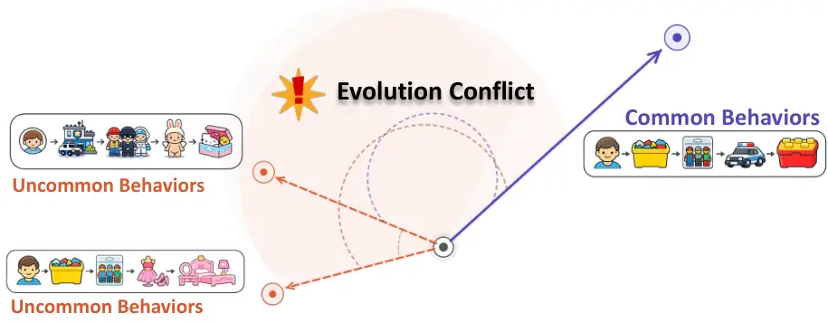
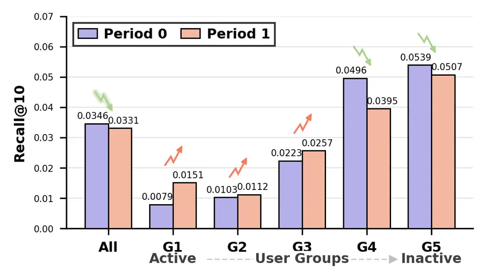
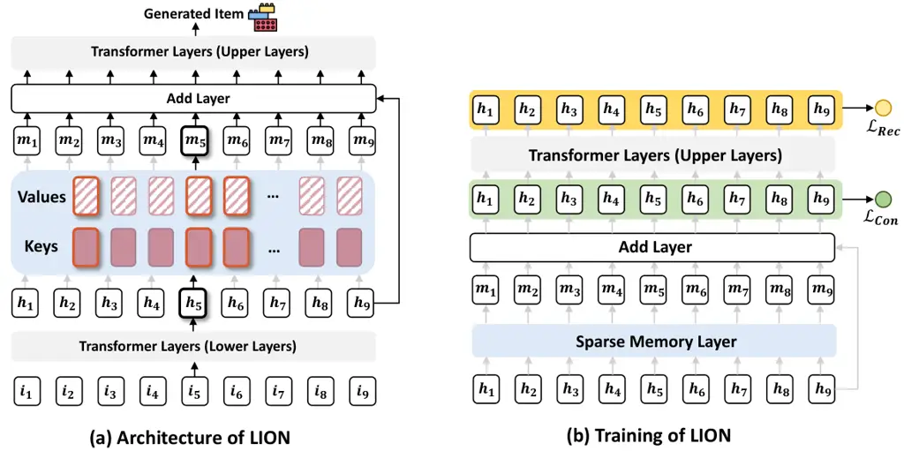

# Self-Evolving Memory for Generative Recommendation

Xinyu Lin^(1†) Affiliation: ¹National University of Singapore ²Meta AI
^(†)Equal contribution    Zhuosong Jiang^(1†) Affiliation: ¹National
University of Singapore ²Meta AI ^(†)Equal contribution    Zixiao Suo¹
Affiliation: ¹National University of Singapore ²Meta AI ^(†)Equal
contribution    Siqin Wang¹ Affiliation: ¹National University of
Singapore ²Meta AI ^(†)Equal contribution    Hanqing Zeng²
Affiliation: ¹National University of Singapore ²Meta AI ^(†)Equal
contribution    Hanchao Yu² Affiliation: ¹National University of
Singapore ²Meta AI ^(†)Equal contribution    Yinglong Xia²
Affiliation: ¹National University of Singapore ²Meta AI ^(†)Equal
contribution    Jiang Zhang² Affiliation: ¹National University of
Singapore ²Meta AI ^(†)Equal contribution    Aashu Singh²
Affiliation: ¹National University of Singapore ²Meta AI ^(†)Equal
contribution    Fei Liu² Affiliation: ¹National University of Singapore
²Meta AI ^(†)Equal contribution    Wenjie Wang¹ Affiliation: ¹National
University of Singapore ²Meta AI ^(†)Equal contribution    Fuli Feng¹
Affiliation: ¹National University of Singapore ²Meta AI ^(†)Equal
contribution    Yang Song² Affiliation: ¹National University of
Singapore ²Meta AI ^(†)Equal contribution    Qifan Wang²
Affiliation: ¹National University of Singapore ²Meta AI ^(†)Equal
contribution    Tat-Seng Chua¹ Affiliation: ¹National University of
Singapore ²Meta AI ^(†)Equal contribution

###### Abstract

Generative recommendation has emerged as a promising end-to-end paradigm
for personalized recommendation. In real-world recommendation scenarios,
however, user preferences continuously evolve over time, making
self-evolving an essential capability for generative recommender
systems. Existing evolving strategies, such as continual retraining and
distillation-based adaptation, directly update the shared model
parameters using streaming interactions. Nevertheless, we find that
directly applying such strategies to generative recommendation
introduces a critical issue, termed _evolution conflict_. Specifically,
heterogeneous preference shifts from different users are optimized
within a fully shared autoregressive parameter space, causing dominant
behavioral patterns to progressively dominate the model evolution
process while underrepresented patterns become increasingly overlooked.
To address this issue, we propose a self-evolving memory paradigm for
generative recommendation, aiming to enable effective evolution across
heterogeneous behavioral patterns. We further identify three key
principles for effective self-evolving recommendation systems, including
isolated memorization, reinforced evolution, and scalable application.
Guided by these principles, we develop LION, a simple yet effective
framework centered on a sparse Key-Value memory layer. Specifically,
LION introduces sparse memory activation to isolate the evolution of
different behavioral patterns, while a consolidation loss is designed to
reinforce the learning of underrepresented preference dynamics during
continual adaptation. Extensive experiments on diverse real-world
datasets demonstrate the effectiveness of LION under various continual
evolution settings (_e.g.,_ per-period evaluation, user/item group
evaluation, and evolution convergence analysis).

^(†)^(†)date: September 14, 2026^(†)^(†)correspondence: Xinyu Lin at
[xylin1028@gmail.com](mailto:xylin1028@gmail.com), Qifan Wang at
[wqfcr@meta.com](mailto:wqfcr@meta.com)^(†)^(†)Code:
[https://github.com/JazyJiang/Self-Evolving-Memory-for-Generative-Recommendation](https://github.com/JazyJiang/Self-Evolving-Memory-for-Generative-Recommendation)

## 1 Introduction



Figure 1: Illustration of “evolution conflict” in generative recommender
models, where the different behavior patterns are evolved in the shared
evolving space, _i.e.,_ Transformer backbone.

Generative recommendation has emerged as a compelling paradigm for
personalized recommendation, where models directly generate item
identifiers in an autoregressive manner to capture user preferences
end-to-end Geng et al. (2022); Rajput et al. (2023); Wang et al. (2024).
Unlike traditional approaches that score a predefined candidate set,
generative recommenders unify user history encoding and item generation
within a single shared parameter space (_e.g.,_ a Transformer backbone),
achieving strong performance across diverse recommendation
scenarios Rajput et al. (2023); Zhai et al. (2024); Deng et al. (2025).
In practice, however, user preferences are not static. They continuously
evolve as users discover new interests and shift their consumption
patterns over time. This makes self-evolving an essential capability for
recommender systems: the model must perpetually adapt to streaming
interaction data to align with each user’s current context and
intention.

Existing approaches to self-evolving recommendation can be broadly
grouped into two categories:

- •
  Continual retraining methods directly fine-tune the model on newly
  arriving interaction data to track distributional shifts Zhang et al.
  (2020); Lee et al. (2023). While conceptually straightforward, these
  approaches risk overwriting previously learned knowledge as the model
  aggressively adapts to recent data.
- •
  Regularization-based methods measure the degree of preference shift
  via changes in user representations or ID embeddings Wang et al.
  (2023); Yoo et al. (2025a). Users with larger shifts are assigned
  greater update weights, while stable users are updated more
  conservatively, balancing plasticity and stability. Some methods also
  leverage replay and distillation techniques as regularization to
  consolidate the knowledge on existing behavior patterns Wang et al.
  (2023); Lee et al. (2024); Robins (1995).

Despite the strong effectiveness of existing self-evolving strategies,
directly applying them to generative recommendation leads to a critical
challenge, namely _evolution conflict_. In practical recommendation
scenarios, user interactions naturally contain both dominant patterns
that frequently appear across active users and underrepresented patterns
that occur less often or reflect personalized interests. Consequently,
when the model continuously adapts to heterogeneous preference shifts
from different users, their optimization directions may inherently
conflict with each other (Figure 1). As continual evolution progresses,
dominant behavioral patterns gradually dominate the model evolution
process, while underrepresented patterns receive insufficient
optimization influence, ultimately hurting recommendation performance
(Figure 2). Detailed analysis is provided in Section 3.



Figure 2: Performance of TIGER Rajput et al. (2023) across user groups
over two periods on the Toys dataset. During evolution from Period 0 to
Period 1, TIGER favors active users with common patterns, improving
their performance, while overlooking uncommon patterns from inactive
users, undermining their performance and causing an overall drop.

To address this issue, the recommender systems should be explicitly
organized through a self-evolving memory paradigm, where different
behavioral patterns can evolve in a more structured and controllable
manner. To achieve this, we posit that the self-evolving paradigm should
satisfy three key requirements from perspectives of architecture,
evolution, and real-world deployment, respectively.

- •
  Isolated memorization. At the architectural level, the model should
  differentiate heterogeneous behavioral patterns during continual
  evolution. As such, we can prevent dominant patterns from overwhelming
  underrepresented preference dynamics within a shared evolution space.
- •
  Reinforced evolution. During optimization, underrepresented patterns
  are more difficult to learn during continual adaptation since they
  appear less frequently in streaming interactions. As such, the
  evolving process should provide stronger supervision signals to ensure
  these patterns can still be effectively captured throughout evolution.
- •
  Scalable application. To deploy the evolving paradigm practically, the
  evolving mechanism should remain efficient and scalable as user
  populations and streaming interactions continuously grow. In
  real-world recommendation scenarios, the number of behavioral patterns
  can become extremely large. As such, the memory mechanism for
  continual evolution should scale efficiently without introducing
  prohibitive parameter or computation overhead.

Guided by these principles, we propose LION, a self-evolving generative
recommendation framework centered on a personalized sparse memory layer,
consisting of Key-Value pairs for evolution. Specifically, to achieve
isolated memorization, we introduce a query-driven sparse memory
activation mechanism, where each user only activates a subset of memory
parameters during continual evolution. To further reinforce
underrepresented patterns during continual evolution, we introduce a
consolidation loss that encourages the memory layer to capture
preference-aware representations from streaming interactions. Moreover,
the proposed sparse KV-driven memory mechanism naturally supports
large-scale real-world deployment due to its scalable representation
capacity. We further provide theoretical analysis of the memory
expressiveness in Section 3. Extensive experiments on three real-world
datasets demonstrate the effectiveness of LION in improving performance
of both dominant and underrepresented behavioral patterns, while
maintaining efficient scalability for large-scale continual adaptation.
The source codes can be found
at [https://github.com/JazyJiang/Self-Evolving-Memory-for-Generative-Recommendation](https://github.com/JazyJiang/Self-Evolving-Memory-for-Generative-Recommendation).

Our main contributions are summarized as follows:

- •
  We identify a critical yet previously overlooked issue in
  self-evolving generative recommendation, termed _evolution conflict_,
  where continual adaptation within a fully shared autoregressive
  parameter space causes dominant behavioral patterns to overwhelm
  underrepresented preference dynamics.
- •
  We propose a self-evolving memory paradigm for generative
  recommendation and formulate three key design principles, including
  isolated memorization, reinforced evolution, and scalable application,
  to support robust continual adaptation for heterogeneous behavioral
  patterns.
- •
  We develop LION, a simple yet effective self-evolving framework based
  on a KV-driven sparse memory layer. The proposed framework enables
  isolated memorization through sparse memory activation, reinforces
  underrepresented patterns via consolidation supervision, and supports
  scalable application under large-scale recommendation scenarios.
- •
  Extensive experiments on multiple real-world datasets demonstrate the
  effectiveness of LION across various continual evolution settings.

## 2 Task Formulation

$`\bullet\quad`$Generative Recommendation. In generative recommendation,
each item $`i\in\mathcal{I}`$ is represented by an item identifier
(_i.e.,_ a token sequence):
$`\mathbf{c}_{i}=[v_{1},v_{2},\dots,v_{L}]`$, where
$`v_{l}\in\mathcal{V}`$, $`L`$ is the identifier length, and
$`\mathcal{V}`$ is the token vocabulary. Let $`\mathcal{U}`$ and
$`\mathcal{I}`$ denote the user set and item set, respectively. Given
user $`u\in\mathcal{U}`$’s historical interaction sequence
$`\mathcal{S}_{u}=[i_{1},i_{2},\dots,i_{N}]`$, the generative
recommender $`M_{\theta}(\cdot)`$ predicts the identifier of the next
item $`i_{N+1}`$ token by token, conditioned on the interaction history
and all previously generated tokens:

```math
\small P(\mathbf{c}_{i_{N+1}}\mid\mathcal{S}_{u})=\prod_{l=1}^{L}P\!\left(v_{l}\mid\mathbf{c}_{i_{N+1},<l},\,\mathcal{S}_{u};\,\theta\right), \tag{1}
```

where $`\mathbf{c}_{i_{N+1},<l}=[v_{1},\dots,v_{l-1}]`$ denotes the
partially generated identifier prefix, and $`\theta`$ denotes the model
parameters.

The model is trained by maximizing the log-likelihood of all next-item
identifiers over the shared parameters $`\theta`$:

```math
\max_{\theta}\sum_{u\in\mathcal{U}}\sum_{t=1}^{N}\sum_{l=1}^{L}\log P\!\left(v_{l}^{(t+1)}\mid\mathbf{c}_{i_{t+1},<l},\,\mathcal{S}_{u}^{\leq t};\,\theta\right), \tag{2}
```

where $`v_{l}^{(t+1)}`$ is the $`l`$-th token of item $`i_{t+1}`$’s
identifier, and $`\mathcal{S}_{u}^{\leq t}=[i_{1},\dots,i_{t}]`$ is the
interaction prefix up to time $`t`$. It is noted that generative
recommendation paradigm models all user preference transitions through
the shared autoregressive parameter space $`\theta`$.

$`\bullet\quad`$Self-Evolving Recommendation. In real-world
recommendation scenarios, user interactions continuously evolve over
time. Following prior incremental recommendation settings Wang et al.
(2023); Yoo et al. (2025a); Shi et al. (2024), we model the streaming
interaction data as a sequence of evolving periods:

```math
\{\mathcal{P}_{1},\mathcal{P}_{2},\dots,\mathcal{P}_{\tau},\dots\}, \tag{3}
```

where $`\mathcal{P}_{\tau}`$ denotes the interaction data observed
during the $`\tau`$-th period. At each evolving period
$`\mathcal{P}_{\tau}`$, the recommender continually updates its
parameters based on the streaming interactions:

```math
\theta_{\tau}=\arg\min_{\theta}\mathcal{L}_{rec}(\mathcal{P}_{r};\theta_{\tau-1}), \tag{4}
```

where $`\theta_{\tau-1}`$ denotes the model parameters inherited from
the previous evolving period $`\mathcal{P}_{\tau-1}`$, and
$`\mathcal{P}_{r}`$ denotes the retraining data used for continual
adaptation. Existing self-evolving recommendation strategies mainly
adopt two retraining paradigms: 1) continual fine-tuning, where
$`\mathcal{P}_{r}=\mathcal{P}_{\tau}`$ only contains the latest
streaming interactions; and 2) distillation-based fine-tuning, where
$`\mathcal{P}_{r}=\mathcal{P}_{\leq\tau}`$ contains all historical
interactions up to the current evolving period. After adaptation at
period $`\mathcal{P}_{\tau}`$, the updated model $`\theta_{\tau}`$ is
deployed to serve recommendation for the next period
$`\mathcal{P}_{\tau+1}`$.

## 3 Identification of Evolution Conflict

As shown in Figure 2, we empirically observe that an evolved model might
degrade the performance of some subset of users (_e.g.,_ G3-G5). We next
analyze why it inevitably introduces evolution conflict among
heterogeneous user behavioral patterns.

$`\bullet\quad`$Optimization Analysis of Evolution Conflict. The
recommendation objective can be decomposed into:

```math
\small\mathcal{L}_{rec}=\mathcal{L}_{c}+\mathcal{L}_{unc}, \tag{5}
```

where $`\mathcal{L}_{c}`$ and $`\mathcal{L}_{unc}`$ denote the
recommendation objectives for common and uncommon behavior patterns,
respectively. The corresponding optimization gradients are
$`g_{c}=\nabla_{\theta}\mathcal{L}_{c}`$ and
$`g_{unc}=\nabla_{\theta}\mathcal{L}_{unc}`$. The optimization
directions between common and uncommon behaviors can then inherently
conflict within the shared parameter space: $`g_{c}^{\top}g_{unc}<0`$.
Furthermore, common patterns appear significantly more frequently in
streaming interactions, leading to substantially asymmetric gradient
magnitudes (_i.e.,_ $`\|g_{c}\|\gg\|g_{unc}\|`$). The continual
parameter update at each evolving period $`\mathcal{P}_{\tau}`$ thus
becomes:

```math
\small\theta_{\tau+1}=\theta_{\tau}-\eta(g_{c}+g_{unc}), \tag{6}
```

where the update is progressively dominated by $`g_{c}`$. Combined with
the gradient conflict, this leads to a doubly suboptimal outcome: users
with common behavior patterns receive suboptimal updates as their
gradients are partially canceled by $`g_{unc}`$, while users with
uncommon patterns suffer progressively worsening performance as their
weaker gradients are consistently overwhelmed by $`g_{c}`$.

$`\bullet\quad`$Design Principles for Self-Evolving Memory. The above
analysis motivates a structured self-evolving memory mechanism that
explicitly organizes the evolving process across heterogeneous
behavioral patterns. We posit three key design principles as follows: 1)
Isolated memorization: different behavioral patterns should evolve
through differentiated optimization pathways; 2) Reinforced evolution:
underrepresented patterns should receive stronger supervision signals to
ensure effective preservation throughout evolution; 3) Scalable
application: the evolving mechanism should remain scalable without
introducing prohibitive parameter or computation overhead.

## 4 LION

Based on the analysis in Section 3, we propose LION, a self-evolving
generative recommendation framework (Figure 3(a)) centered on a sparse
Key-Value memory layer, that achieves isolated memorization
(Section 4.1.1) and reinforced evolution (Section 4.1.2). We further
provide theoretical analysis of LION on gradient reduction, fast
convergence, and scalability (Section 4.2).



Figure 3: Figure (a) illustrates the sparse memory layer, where a subset
of Key-Value pairs are activated by the user query, _i.e.,_ output
hidden states of the lower layers. Figure (b) shows the two training
loss of LION, _i.e.,_ consolidation loss and recommendation loss.

### 4.1 Self-Evolving Memory Framework

#### 4.1.1 Sparse Memory Evolution

To achieve isolated memorization for heterogeneous behavioral patterns,
the evolving mechanism should differentiate different user preference
dynamics during continual adaptation.

$`\bullet\quad`$Motivation for Sparse Memory. A straightforward solution
is to introduce explicit user-specific parameters (_e.g.,_ user
embeddings He et al. (2017) or personalized adapters Hu et al. (2022);
Zhang et al. (2024)) to separately model different users. However, such
dense personalization strategies introduce substantial parameter
overhead and become difficult to scale under large-scale recommendation
scenarios with continuously growing user populations and behavioral
patterns. Alternatively, we propose a sparse memory evolution mechanism,
where different behavioral patterns are dynamically routed to different
sparse memory parameters during continual adaptation.

$`\bullet\quad`$Sparse Key-Value Memory Layer. We introduce a sparse
Key-Value memory layer into the generative recommender backbone.
Formally, the memory layer consists of $`N`$ trainable Key-Value pairs:

```math
\small\mathcal{M}=\{(k_{i},v_{i})\}_{i=1}^{N}, \tag{7}
```

where $`k_{i}\in\mathbb{R}^{d}`$ denotes the memory key and
$`v_{i}\in\mathbb{R}^{d}`$ denotes the corresponding memory value.

$`\bullet\quad`$Sparse Activation. Given the hidden representation $`h`$
of a Transformer layer, the sparse memory layer first computes the
similarity between the user representation and all memory keys:
$`s_{i}=h_{u}^{\top}k_{i}`$. Based on the similarity scores, the memory
layer selects the Top-$`K`$ activated memory slots:

```math
\small\mathcal{A}=\text{TopK}(s_{1},s_{2},\dots,s_{N}), \tag{8}
```

where $`\mathcal{A}`$ denotes the activated memory index set. The
corresponding memory values are then aggregated to construct the sparse
memory representation:

```math
\small m_{u}=\sum_{i\in\mathcal{A}}\alpha_{i}v_{i}, \tag{9}
```

where
$`\alpha_{i}=\frac{s_{i}-\min_{j\in\mathcal{A}}s_{j}}{\max_{j\in\mathcal{A}}s_{j}-\min_{j\in\mathcal{A}}s_{j}}`$
denotes the normalized weight of the activated memory slot. Finally, the
aggregated memory representation is integrated back into the Transformer
hidden states for the subsequent forward process:

```math
\small\tilde{h}_{u}=h_{u}+m_{u}. \tag{10}
```

$`\bullet\quad`$Full-Sequence Memory Query. The sparse memory layer is
designed to capture each user’s behavior pattern, which is best
reflected by the complete interaction history
$`\mathcal{S}_{u}^{\text{full}}`$. However, given that the long-history
utilization is limited under the generative recommendation paradigm,
existing generative recommenders will only use recent interaction
subsequence
$`\mathcal{S}_{u}^{\text{rec}}=[i_{N-h_{\text{rec}}+1},\dots,i_{N}]`$,
where $`h_{\text{rec}}`$ controls the recency window. To bridge this
gap, we compute the memory query $`h_{u}`$ from
$`\mathcal{S}_{u}^{\text{full}}`$, while the Transformer layers before
and after the memory layer operate on $`\mathcal{S}_{u}^{\text{rec}}`$.
This asymmetric design ensures that memory activation is grounded in the
user’s full behavioral context, while keeping backbone computation
efficient.

#### 4.1.2 Reinforced Evolution

To support continual adaptation under streaming interactions, we
optimize the proposed framework using two complementary objectives,
including a recommendation loss and a consolidation loss (as shown in
Figure 3(b)). The recommendation loss supervises the final
autoregressive recommendation outputs, while the consolidation loss
directly reinforces the preference modeling capability of the sparse
memory layer during continual evolution.

$`\bullet\quad`$Recommendation Loss. To achieve effective
recommendations, we adopt the loss in generative modeling:

```math
\small\mathcal{L}_{rec}=-\sum_{u\in\mathcal{U}}\sum_{t=1}^{L}\log P(i_{t+1}\mid i_{\leq t};\theta). \tag{11}
```

$`\bullet\quad`$Consolidation Loss. To reinforce the memory layer’s
preference modeling capability, we impose an auxiliary supervision
directly on the memory-enhanced representation $`\tilde{h}_{u}`$:

```math
\small\mathcal{L}_{con}=-\sum_{u\in\mathcal{U}}\sum_{t=1}^{L}\log P(i_{t+1}\mid\tilde{h}_{u};\theta), \tag{12}
```

which ensures underrepresented behavioral patterns receive sufficient
supervision signals throughout continual evolution.

$`\bullet\quad`$Overall Training Objective. The final optimization
objective combines the recommendation loss and consolidation loss:

```math
\mathcal{L}=\mathcal{L}_{rec}+\lambda\mathcal{L}_{con}, \tag{13}
```

where $`\lambda`$ controls the strength of the consolidation
supervision.

#### 4.1.3 Instantiation

We instantiate the proposed framework under the streaming setting in
Section 2. The sparse Key-Value memory layer is inserted into the
intermediate Transformer layers of the generative recommendation
backbone, enabling sparse activation of differentiated memory slots for
heterogeneous behavioral patterns. At each evolving period
$`\mathcal{P}_{\tau}`$, upon arrival of new streaming interactions
$`\mathcal{P}_{\tau}`$, we continually fine-tune both the backbone and
memory parameters via the objectives defined in Section 4. The updated
model $`\theta_{\tau}`$ is then deployed for autoregressive next-item
generation to serve the subsequent period $`\mathcal{P}_{\tau+1}`$.

### 4.2 Theoretical Analysis

We provide theoretical justification for the three design principles
underlying LION: gradient conflict reduction (Section 4.2.1), faster
per-pattern convergence (Section 4.2.2), and parameter efficiency
(Section 4.2.3).

#### 4.2.1 Gradient Conflict Reduction

At evolving period $`\mathcal{P}_{\tau}`$, let
$`\mathcal{A}_{c}\subseteq[N]`$ and $`\mathcal{A}_{unc}\subseteq[N]`$
denote the activated memory index sets for common and uncommon
behavioral patterns, where $`|\mathcal{A}_{c}|=|\mathcal{A}_{unc}|=K`$.
Define the overlap set
$`\mathcal{O}=\mathcal{A}_{c}\cap\mathcal{A}_{unc}`$ and normalized
overlap ratio $`\rho=|\mathcal{O}|/K\in[0,1]`$. For memory slot $`i`$,
let $`g_{i}^{c}=\nabla_{v_{i}}\mathcal{L}_{c}`$ and
$`g_{i}^{unc}=\nabla_{v_{i}}\mathcal{L}_{unc}`$ denote the gradients
contributed by common and uncommon patterns, respectively. We quantify
gradient conflict by the total negative inner product across memory
parameters:

```math
\small\mathrm{Conflict}(\mathcal{A}_{c},\mathcal{A}_{unc})=\sum_{i=1}^{N}\max\!\bigl(0,\ {-\langle g_{i}^{c},\,g_{i}^{unc}\rangle}\bigr). \tag{14}
```

We compare against a baseline _without_ sparse activation, where every
one of the $`N`$ slots (_i.e.,_ the full shared parameter space) is
jointly updated by both $`g_{i}^{c}`$ and $`g_{i}^{unc}`$, so
$`\mathrm{Conflict}_{\textup{Baseline}}=\sum_{i=1}^{N}\max(0,-\langle g_{i}^{c},g_{i}^{unc}\rangle)`$.

###### Theorem 4.1 (Gradient Conflict Reduction).

Under LION’s sparse activation, gradient conflict is strictly confined
to the overlap region $`\mathcal{O}`$:

```math
\small\mathrm{Conflict}_{\textup{{LION}}}=\sum_{i\in\mathcal{O}}\max\!\bigl(0,\,{-\langle g_{i}^{c},\,g_{i}^{unc}\rangle}\bigr),\hskip 18.49988pt\frac{\mathrm{Conflict}_{\textup{{LION}}}}{\mathrm{Conflict}_{\textup{Baseline}}}\leq\rho=\frac{|\mathcal{O}|}{K}. \tag{15}
```

###### Proof.

Slot $`i`$ receives $`g_{i}^{c}`$ only if $`i\in\mathcal{A}_{c}`$ and
$`g_{i}^{unc}`$ only if $`i\in\mathcal{A}_{unc}`$, so slots outside
$`\mathcal{O}`$ see at most one gradient and incur no conflict; bounding
conflict to the $`|\mathcal{O}|`$ overlapping directions versus the
$`K`$ activated slots in the baseline gives the ratio. ∎

###### Corollary 4.1 (Self-Improving Isolation).

As training progresses, routing keys $`\{k_{i}\}`$ tend to specialize
toward distinct behavioral patterns, empirically driving
$`|\mathcal{O}|\to 0`$ and $`\rho\to 0`$ and thus decreasing gradient
conflict. We treat this as an observed training trend rather than a
guaranteed outcome, since specialization depends on the data
distribution and optimization dynamics; we verify this trend empirically
in Section 5.3.3.

#### 4.2.2 Convergence Analysis

We model the effective gradient noise variance for pattern $`c`$ as:

```math
\small\sigma_{c}^{2}=\underbrace{\sigma_{0}^{2}}_{\text{stochastic noise}}+\underbrace{\beta^{2}\cdot\mathbb{E}\bigl[\|g_{\bar{c}}\|^{2}\bigr]}_{\text{cross-pattern interference}}, \tag{16}
```

where $`g_{\bar{c}}`$ denotes the aggregate gradient from all patterns
other than $`c`$, and $`\beta\geq 0`$ scales the interference strength.
Under LION, interference propagates only through $`\mathcal{O}`$:

```math
\sigma_{c,\textup{{LION}}}^{2}=\sigma_{0}^{2}+\rho\cdot\beta^{2}\cdot\mathbb{E}\bigl[\|g_{\bar{c}}\|^{2}\bigr],\qquad\rho\ll 1. \tag{17}
```

###### Theorem 4.2 (Faster Per-Pattern Convergence).

Under $`L`$-smooth $`\mathcal{L}_{c}`$ and learning rate
$`\eta=\mathcal{O}(1/\sqrt{T})`$, after $`T`$ gradient steps:

```math
\small\frac{1}{T}\sum_{t=1}^{T}\mathbb{E}\!\left[\left\|\nabla\mathcal{L}_{c}(\theta_{t})\right\|^{2}\right]\leq\frac{2\bigl(\mathcal{L}_{c}(\theta_{0})-\mathcal{L}_{c}^{*}\bigr)}{\eta T}+\eta L\,\sigma_{c,\textup{{LION}}}^{2}. \tag{18}
```

Since
$`\sigma_{c,\textup{{LION}}}^{2}\leq\sigma_{c,\textup{Baseline}}^{2}`$,
LION reaches $`\epsilon`$-stationarity in fewer steps, with speedup
ratio:

```math
\small\frac{T_{\textup{{LION}}}}{T_{\textup{Baseline}}}\leq\frac{\sigma_{0}^{2}+\rho\beta^{2}\mathbb{E}[\|g_{\bar{c}}\|^{2}]}{\sigma_{0}^{2}+\beta^{2}\mathbb{E}[\|g_{\bar{c}}\|^{2}]}\leq 1. \tag{19}
```

###### Proof.

Follows directly from the standard SGD convergence result for smooth
non-convex objectives Ghadimi and Lan (2013) by substituting
$`\sigma_{c,\textup{{LION}}}^{2}`$ for the noise term. ∎

###### Corollary 4.2 (Amplified Benefit for Uncommon Patterns).

Uncommon patterns experience lower gradient pressure from common
patterns, leading to smaller $`|\mathcal{O}|`$ and thus larger
convergence speedup, providing a theoretical explanation for LION’s
disproportionate gains on underrepresented behavioral patterns, which we
verify empirically in Section 5.2 and Section 5.3.1.

#### 4.2.3 Parameter Efficiency and Scalability

LION’s sparse memory requires $`2Nd`$ parameters regardless of user
population $`|U|`$, compared to $`|U|\cdot d`$ for dense per-user
personalization. LION is strictly cheaper whenever $`|U|>2N`$, and
adding new users incurs zero additional parameters. Meanwhile, sparse
Top-$`K`$ activation yields $`\binom{N}{K}`$ distinct memory
configurations, satisfying $`\binom{N}{K}\geq|U|`$ under standard
choices of $`N`$ and $`K`$ (_e.g.,_ $`\binom{256}{8}\approx 10^{15}`$),
ensuring unique representations without parameter sharing. Consequently,
the parameter ratio satisfies:

```math
\frac{\mathrm{Params}_{\textup{{LION}}}}{\mathrm{Params}_{\textup{Dense}}}=\frac{2N}{|U|}\;\to\;0\qquad\text{as }|U|\to\infty, \tag{20}
```

achieving scalable evolution without sacrificing representational
expressiveness.

## 5 Experiments

We conduct experiments to answer the following research questions. RQ1:
How does LION perform compared to existing continual evolution
strategies for generative recommendation under streaming data settings?
RQ2: How does each component of LION contribute to the overall
performance? RQ3: How does LION perform across heterogeneous user groups
and item categories with varying behavioral patterns and popularity
distributions? RQ4: How effectively and efficiently does LION alleviate
the evolution conflict issue during continual adaptation?

### 5.1 Experimental Setting

#### 5.1.1 Datasets

We conduct experiments on three representative real-world datasets
across diverse domains from the Amazon Review series¹¹ 1
[https://cseweb.ucsd.edu/~jmcauley/datasets/amazon_v2/](https://cseweb.ucsd.edu/~jmcauley/datasets/amazon_v2/).. 1)
Games, 2) CDs, and 3) Toys, which contain rich interactions on video
games, music albums, toys and children’s entertainment products,
respectively. We follow previous works Rajput et al. (2023); Shi et al.
(2024) and construct each instance as a next-item prediction sample,
where the input contains at most 10 previous interactions and the target
is the next item.

For each dataset, we sort all instances by target interaction timestamp
and split them into five chronological periods (Period 0–4) of equal
interaction counts. Users are further divided into five groups
$`G_{1}`$–$`G_{5}`$ (from active to inactive), where activity level is
measured by maximum history length in the previous period; For Period 0,
users are grouped by activity level within that period. The dataset
statistics are presented in Appendix Table 6.

#### 5.1.2 Evaluation Metrics

To evaluate the evolution ability of different methods across periods,
we test each method on Periods 1, 2, 3, and 4 after continual
adaptation. During inference, the model generates candidate item-token
sequences with beam search using beam size 20. We adopt two widely used
ranking metrics, Recall@K (R@K) and NDCG@K (N@K), with
$`K\in\{10,20\}`$. Recall@K measures whether the ground-truth item
appears in the top-$`K`$ generated list, while NDCG@K further considers
the hit position. Metrics are computed over each future-period and
user-group cell, and group-level scores can be averaged to obtain the
period-level performance.

|                     |        |        |        |        |        |        |        |        |        |        |        |        |
| ------------------- | ------ | ------ | ------ | ------ | ------ | ------ | ------ | ------ | ------ | ------ | ------ | ------ |
| Method              | Games  |        |        |        | CDs    |        |        |        | Toys   |        |        |        |
|                     | R@10   | N@10   | R@20   | N@20   | R@10   | N@10   | R@20   | N@20   | R@10   | N@10   | R@20   | N@20   |
| Replay              | 0.0616 | 0.0386 | 0.0819 | 0.0437 | 0.0405 | 0.0297 | 0.0475 | 0.0316 | 0.0551 | 0.0400 | 0.0651 | 0.0425 |
| SAIL-PIW            | 0.0572 | 0.0416 | 0.0766 | 0.0465 | 0.0392 | 0.0302 | 0.0459 | 0.0319 | 0.0689 | 0.0494 | 0.0847 | 0.0534 |
| PISA                | 0.0407 | 0.0245 | 0.0597 | 0.0293 | 0.0217 | 0.0128 | 0.0298 | 0.0149 | 0.0630 | 0.0395 | 0.0865 | 0.0454 |
| RecICL              | 0.0686 | 0.0470 | 0.0904 | 0.0525 | 0.0352 | 0.0263 | 0.0425 | 0.0282 | 0.0530 | 0.0409 | 0.0637 | 0.0436 |
| LSAT                | 0.0492 | 0.0344 | 0.0631 | 0.0379 | 0.0358 | 0.0259 | 0.0435 | 0.0278 | 0.0648 | 0.0421 | 0.0865 | 0.0475 |
| PESO                | 0.0584 | 0.0353 | 0.0800 | 0.0408 | 0.0263 | 0.0166 | 0.0347 | 0.0187 | 0.0625 | 0.0376 | 0.0857 | 0.0435 |
| TIGER               | 0.0558 | 0.0336 | 0.0784 | 0.0393 | 0.0331 | 0.0213 | 0.0424 | 0.0236 | 0.0666 | 0.0418 | 0.0884 | 0.0473 |
| LION (Ours)         | 0.0724 | 0.0454 | 0.0986 | 0.0520 | 0.0449 | 0.0306 | 0.0558 | 0.0334 | 0.0769 | 0.0495 | 0.1018 | 0.0557 |
| $`\Delta`$ vs TIGER | +29.8% | +35.3% | +25.8% | +32.4% | +35.5% | +43.7% | +31.7% | +41.2% | +15.6% | +18.4% | +15.1% | +17.8% |

Table 1: Main results on three Amazon Review datasets. All numbers are
sample-weighted micro-average over $`4`$ evaluation periods $`\times`$
$`5`$ user activity quintiles as defined in Section 5.1. “R@K” and “N@K”
denote “Recall@K” and “NDCG@K”, respectively.

| Method   | Games  |        |        |        |        |        |        |        |
| -------- | ------ | ------ | ------ | ------ | ------ | ------ | ------ | ------ |
|          | P0→P1  |        | P1→P2  |        | P2→P3  |        | P3→P4  |        |
|          | Act    | Inact  | Act    | Inact  | Act    | Inact  | Act    | Inact  |
| Replay   | 0.0363 | 0.0792 | 0.0398 | 0.0865 | 0.0386 | 0.0750 | 0.0275 | 0.0551 |
| SAIL-PIW | 0.0577 | 0.0900 | 0.0365 | 0.0732 | 0.0243 | 0.0563 | 0.0234 | 0.0506 |
| LSAT     | 0.0476 | 0.0784 | 0.0297 | 0.0656 | 0.0205 | 0.0513 | 0.0193 | 0.0398 |
| PESO     | 0.0403 | 0.0741 | 0.0425 | 0.0694 | 0.0444 | 0.0667 | 0.0362 | 0.0566 |
| TIGER    | 0.0440 | 0.0772 | 0.0397 | 0.0695 | 0.0396 | 0.0610 | 0.0299 | 0.0488 |
| LION     | 0.0487 | 0.0964 | 0.0498 | 0.0939 | 0.0486 | 0.0820 | 0.0387 | 0.0668 |
| Method   | CDs    |        |        |        |        |        |        |        |
|          | P0→P1  |        | P1→P2  |        | P2→P3  |        | P3→P4  |        |
|          | Act    | Inact  | Act    | Inact  | Act    | Inact  | Act    | Inact  |
| Replay   | 0.0148 | 0.0495 | 0.0207 | 0.0587 | 0.0177 | 0.0555 | 0.0221 | 0.0481 |
| SAIL-PIW | 0.0179 | 0.0388 | 0.0246 | 0.0434 | 0.0274 | 0.0517 | 0.0357 | 0.0523 |
| LSAT     | 0.0155 | 0.0341 | 0.0198 | 0.0423 | 0.0201 | 0.0477 | 0.0287 | 0.0527 |
| PESO     | 0.0116 | 0.0268 | 0.0182 | 0.0283 | 0.0192 | 0.0349 | 0.0234 | 0.0341 |
| TIGER    | 0.0188 | 0.0425 | 0.0222 | 0.0387 | 0.0216 | 0.0423 | 0.0211 | 0.0373 |
| LION     | 0.0238 | 0.0577 | 0.0266 | 0.0545 | 0.0284 | 0.0572 | 0.0294 | 0.0515 |
| Method   | Toys   |        |        |        |        |        |        |        |
|          | P0→P1  |        | P1→P2  |        | P2→P3  |        | P3→P4  |        |
|          | Act    | Inact  | Act    | Inact  | Act    | Inact  | Act    | Inact  |
| Replay   | 0.0388 | 0.0708 | 0.0378 | 0.0767 | 0.0198 | 0.0705 | 0.0145 | 0.0525 |
| SAIL-PIW | 0.0530 | 0.0818 | 0.0484 | 0.0811 | 0.0387 | 0.0873 | 0.0336 | 0.0722 |
| LSAT     | 0.0537 | 0.0887 | 0.0423 | 0.0818 | 0.0274 | 0.0817 | 0.0207 | 0.0598 |
| PESO     | 0.0479 | 0.0791 | 0.0442 | 0.0735 | 0.0328 | 0.0730 | 0.0319 | 0.0670 |
| TIGER    | 0.0505 | 0.0903 | 0.0482 | 0.0810 | 0.0313 | 0.0785 | 0.0251 | 0.0672 |
| LION     | 0.0606 | 0.1011 | 0.0582 | 0.0960 | 0.0368 | 0.0877 | 0.0324 | 0.0777 |

Table 2: Per-period active ($`G_{1}`$+$`G_{2}`$) and inactive
($`G_{3}`$+$`G_{4}`$+$`G_{5}`$) Recall@10 across three datasets,
comparing competitive baselines against LION. Values are sample-weighted
micro-averages within each group and period.

#### 5.1.3 Baselines

We compare our method with various competitive baselines, including two
main categories. Traditional Continual Learning (CL) methods: 1)
TIGER Rajput et al. (2023) is a direct fine-tuning baseline based on the
standard T5 encoder-decoder generative recommender, where the model is
continually updated at each period using only the current-period data. 2) Replay Robins (1995); Lopez-Paz and Ranzato (2017) mitigates
forgetting by replaying historical interactions together with
current-period data; for period $`t\geq 1`$, the number of sampled
historical instances equals $`|D_{t}|`$. 3) SAIL-PIW Wang et al. (2023)
preserves historical knowledge through distillation and learns
personalized imitation weights to balance old-knowledge preservation and
new-period adaptation. 4) PISA Yoo et al. (2025a) models continual
recommendation through plasticity updates and stability-oriented
distillation, explicitly controlling the stability-plasticity trade-off
across periods. Evolution methods for generative recommendation. 5)
RecICL Bao et al. (2025) injects in-context examples into the prompt,
enabling dynamic interest adaptation through contextual demonstrations
rather than conventional full model retraining. 6) LSAT Shi et al.
(2024) uses short- and long-term branches to separately model recent and
earlier user histories, and combines their predictions for continual
adaptation. 7) PESO Yoo et al. (2026) is a LoRA-based continual
adaptation method for LLM-based generative recommendation, which uses a
single evolving LoRA adapter with proximal regularization to balance
adaptation and preservation. To achieve a fair comparison, we adapt all
these baselines to the generative paradigm, _i.e.,_ TIGER Rajput et al.
(2023) (T5 as backbone).

#### 5.1.4 Implementation Details

All experiments are implemented on the TIGER (T5 backbone) Rajput et al.
(2023). Unless explicitly specified, we update all model parameters
during continual training. We use AdamW with cosine learning-rate
scheduling, warmup ratio 0.01, weight decay 0.001, and random seed 42.
Early stopping monitors validation loss with patience 5 and threshold
$`10^{-4}`$ after at least 10 epochs, where the validation file follows
the current-period training CSV. For CL baselines, we tune learning rate
and batch size on Toys and use the best validation configuration for
evaluation. For shared hyperparameters, the learning rate is selected
from $`\{1e{-}4,1.5e{-}4,2e{-}4,2.5e{-}4,3e{-}4\}`$ and the batch size
is selected from $`\{16,24,32,48,64\}`$ across baselines. Detailed
hyper-parameter settings for the baselines can be found in Appendix A.1.

### 5.2 Overall Performance (RQ1)

Table 1 compares LION against six representative baselines on three
Amazon Review datasets, where we report average performance over four
evaluation periods (P1-4) and five user groups. From the overall
comparison, we can observe that:

- •
  Among all baselines specifically designed for continual learning (from
  Replay to PESO), LSAT and SAIL-PIW achieve the most competitive
  performance. This is because LSAT captures both long-term and
  short-term user interests through separate branches and merges their
  predictions, which partially isolates recent common patterns from
  long-tailed ones and partially mitigates evolution conflict. While
  SAIL-PIW maintains personalized imitation weights per user, enabling
  more complete isolation of individual behavioral patterns and thus
  better alleviating gradient interference across users. Other
  CL-specific methods (PISA, PESO) transfer poorly to streaming
  generative recommendation, as CL recipes designed for classification
  or static recommendation introduce severe interference under
  autoregressive evolution, consistent with the analysis in Section 3.
- •
  Under the same continual fine-tuning setting, LION consistently
  outperforms TIGER and surpasses all baselines in most cases. This
  validates the effectiveness of the sparse memory layer and
  consolidation loss in isolating heterogeneous behavioral patterns and
  reinforcing underrepresented ones during continual adaptation. We note
  that the plain continual fine-tuning baseline (TIGER) also achieves
  competitive overall performance, as the majority of interactions in
  these datasets still reflect common behavioral patterns, whose
  dominance during evolution does not severely hurt aggregate metrics.
  Detailed performance across periods and user groups is presented
  below.

We further analyze the performance on each period over active
($`G_{1}`$–$`G_{2}`$) and inactive ($`G_{3}`$–$`G_{5}`$) user groups
(Table 2):

- •
  LION produces consistently larger gains on inactive users than on
  active users. Across all three datasets and periods, the improvement
  of LION over competitive baselines is more pronounced on the inactive
  group ($`G_{3}`$–$`G_{5}`$) than on the active group
  ($`G_{1}`$–$`G_{2}`$). This is consistent with the design of the
  sparse memory layer: by routing different behavioral patterns through
  partially isolated memory pathways, LION prevents the evolution of
  underrepresented patterns from being overwhelmed by the dominant
  gradient updates of active users, directly addressing the evolution
  conflict identified in Section 3.
- •
  The gains of LION remain stable across all evolving periods. Rather
  than concentrating in early or late periods, LION maintains consistent
  improvements over competitive baselines at every period for both user
  groups across all datasets. This suggests that the sparse memory
  mechanism provides a sustained benefit throughout continual
  adaptation, rather than a one-time initialization advantage that fades
  over time.

### 5.3 In-depth Analysis

#### 5.3.1 Ablation Study (RQ2)

| Configuration                       | Games  | CDs    | Toys   |
| ----------------------------------- | ------ | ------ | ------ |
| TIGER                               | 0.0558 | 0.0331 | 0.0666 |
| $`+`$ Con                           | 0.0532 | 0.0310 | 0.0559 |
| $`+`$ SML                           | 0.0558 | 0.0342 | 0.0654 |
| $`+`$ SML $`+`$ FS                  | 0.0586 | 0.0358 | 0.0687 |
| $`+`$ SML $`+`$ FS $`+`$ Con (LION) | 0.0724 | 0.0449 | 0.0769 |

Table 3: Ablation study on three datasets (Recall@10, $`4`$-period
sample-weighted average).

We isolate the contribution of each component of LION by incrementally
adding the sparse memory layer (SML), the full-sequence memory query
(FS), and the consolidation loss (Con) on top of the TIGER backbone. We
further remove sparse memory layer independently (“$`+`$ Con”) and
present the results in Table 3. We can find that 1) Simply adding the
consolidation loss can even hurt performance. This is because, without
the sparse memory layer, the auxiliary loss directly supervises the
shared backbone representation, re-exposing it to the same cross-pattern
gradient conflict (Section 3) that afflicts the main recommendation
loss; consolidation is only beneficial once it supervises the
memory-isolated representation $`\tilde{h}_{u}`$ instead. 2) The sparse
memory layer alone yields only marginal overall improvement. Without
direct supervision, the sparse memory layer relies solely on the
recommendation loss to specialize its routing keys. On relatively small
datasets, the limited interaction diversity makes it difficult for the
memory keys to differentiate behavioral patterns sufficiently, resulting
in overlapping activations across user groups and limited isolation
benefit. 3) Full-sequence routing and consolidation loss on top of SML
both contribute positively, with the consolidation loss being the
dominant driver. Optimizing only the final recommendation loss is
insufficient to capture underrepresented behavioral patterns, as their
weak gradient signals are consistently overwhelmed during
backpropagation. The consolidation loss directly supervises the
memory-enhanced representations, providing stronger and more targeted
optimization signals for underrepresented patterns.

Figure 4: Per-period overall Recall@10 trajectory across the continual
chain $`P_{0}\!\to\!P_{4}`$ for the four ablation variants on Games
(left) and CDs (right). Top row: active group ($`G_{1}{+}G_{2}`$);
bottom row: inactive group ($`G_{3}{+}G_{4}{+}G_{5}`$). LION (red) lies
strictly above TIGER (blue) in every (dataset, period, group) cell.

$`\bullet\quad`$Per-period active/inactive breakdown. To further analyze
the effectiveness of each component, we report the performance across
different behavior patterns and periods in Figure 4. We can find that 1)
LION consistently lies strictly above TIGER on every (dataset, group)
trajectory in Figure 4. In particular, the late-period active-group gain
is comparable to or larger than early periods, suggesting the
memory-layer benefit accumulates under continual drift. 2) Inactive
users usually yield larger gains compared to active users. This is
consistent with our theoretical analysis, _i.e.,_ routing keys
specialise more rapidly for underrepresented patterns, which also aligns
with the observations in Table 2.

#### 5.3.2 Effect of $`\lambda`$ (RQ2)

| Dataset | $`\lambda{=}0`$ | $`\lambda{=}0.1`$ | $`\lambda{=}0.3`$ | $`\lambda{=}0.5`$ | $`\lambda{=}1.0`$ |
| ------- | --------------- | ----------------- | ----------------- | ----------------- | ----------------- |
| Games   | 0.0586          | 0.0653            | 0.0691            | 0.0712            | 0.0724            |
| CDs     | 0.0358          | 0.0449            | 0.0465            | 0.0466            | 0.0462            |

Table 4: Effect of $`\lambda`$, _i.e.,_ the strength of consolidation
loss.

To facilitate LION deployment, we analyze the effect of the
consolidation loss weight $`\lambda`$. From the results in Table 4, we
can observe that increasing $`\lambda`$ from $`0`$ yields a clear
performance gain, confirming the effectiveness of the consolidation
loss. Performance remains consistently strong across
$`\lambda\in[0.3,1.0]`$ on both datasets, indicating that consolidation
is broadly beneficial without hurting recommendation quality; however,
the per-dataset optimum varies within this range (Games peaks at
$`\lambda{=}1.0`$, CDs at $`\lambda{=}0.5`$). Rather than fixing a
single global value, we therefore select $`\lambda`$ per dataset via
validation over $`\{0.1,0.3,0.5,1.0\}`$ (Appendix A.1).

#### 5.3.3 Gradient Conflict Reduction (RQ3)

Figure 5: Per-period cosine similarity between active
($`G_{1}{+}G_{2}`$) and inactive ($`G_{3}{+}G_{4}{+}G_{5}`$) gradients
on the sparse memory layer.

We directly measure the cross-group gradient cosine on the sparse memory
layer predicted by Theorem 4.1. For each post-warm-up checkpoint, we
partition users into active ($`G_{1}{+}G_{2}`$) and inactive
($`G_{3}{+}G_{4}{+}G_{5}`$) groups and compute the aggregated cosine
$`\cos(g_{c},g_{unc})`$. Results are shown in Figure 5. We can find
that 1) shared parameters suffer from gradient conflict (TIGER’s
results), which confirms that active and inactive group gradients
conflict within the shared parameter space. Nevertheless, 2) sparse
memory isolates conflict and aligns optimization directions. LION
achieves uniformly positive cosine across all periods, satisfying
$`g_{c}^{\top}g_{unc}\geq 0`$ and potentially driving the conflict term
in Theorem 4.1 to zero. This is because conflicting gradients are
absorbed into isolated memory slots, leaving the shared parameters
updated in a mutually compatible direction.

#### 5.3.4 Item-Side Gradient Alignment (RQ3)

Figure 6: Item-side gradient cosine between popular (top $`60\%`$) and
long-tailed (tail $`40\%`$) item gradients on the sparse memory layer.

We further analyze the gradient conflict across item groups, _i.e.,_
popular (top $`60\%`$) vs. long-tailed (tail $`40\%`$), using $`P_{0}`$
interaction counts as the popularity reference. Results are shown in
Figure 6. We can find that: 1) Sparse memory mitigates gradient conflict
between popular and long-tailed items, which is consistent with the
user-side results in Section 5.3.3. This is expected, as long-tailed
items naturally correspond to uncommon behavioral patterns, and the
memory layer’s isolated pathways prevent their gradients from being
overwhelmed by popular items, further validating the effectiveness of
sparse memory isolation. 2) Gradient conflict is relatively weaker on
Games. One possible reason is that it is a relatively dense dataset,
where higher interaction density reduces the popularity gap between
popular and long-tailed items, leading to less severe gradient conflict
and a smaller isolation benefit.

#### 5.3.5 Empirical Convergence Analysis (RQ4)

Figure 7: Per-epoch evaluation loss ($`\mathcal{L}_{\text{Rec}}`$)
across the continual chain $`P_{0}\!\to\!P_{3}`$. LION (red) converges
_faster_ across all periods and to a _lower_ converged loss at every
period on both datasets.

To verify the faster convergence of LION as stated in Theorem 4.2, we
compare the per-epoch evaluation loss of TIGER and LION on Games and
CDs. Since $`\mathcal{L}_{\mathrm{con}}`$ is added only during training,
we report pure language-modeling eval loss for a fair comparison.
Results are shown in Figure 7. 1) LION consistently converges faster and
to a lower converged loss at every period, confirming that the memory
layer reduces gradient conflict and improves optimization efficiency,
aligning with Theorem 4.2. 2) A loss jump appears at the start of each
new period. This is because incoming interactions reflect shifted user
behaviors, causing the model’s loss to temporarily rise before
re-converging. LION recovers faster after each jump, and the margin over
TIGER does not shrink across periods, suggesting the memory-layer
benefit accumulates rather than diminishes under continual drift.

#### 5.3.6 Memory Compactness (RQ4)

| Configuration ($`n_{k}`$, $`K`$)       | Games  | CDs    | Toys   |
| -------------------------------------- | ------ | ------ | ------ |
| $`n_{k}=64,\ K=32`$     (4,096 keys)   | 0.0649 | 0.0439 | 0.0763 |
| $`n_{k}=128,\ K=8`$     (16,384 keys)  | 0.0647 | 0.0440 | 0.0775 |
| $`n_{k}=128,\ K=16`$     (16,384 keys) | 0.0649 | 0.0440 | 0.0779 |
| $`n_{k}=256,\ K=32`$   (65,536 keys)   | 0.0649 | 0.0444 | 0.0764 |

Table 5: Performance (Recall@10) under varying memory vocabulary size
$`N=n_{k}^{2}`$ and activation budget $`K`$ ($`4`$-period
sample-weighted average).

To further investigate the expressiveness and efficiency of the sparse
memory layer, we consistently reduce the memory layer size to see how it
affects performance, as shown in Table 5. Reducing the memory size has
negligible impact on performance. Across a $`16\times`$ range in memory
vocabulary and a $`4\times`$ range in $`K`$, Recall@10 stays within
$`\pm 0.4\%`$ across all datasets, demonstrating that LION maintains
strong representational capacity even under aggressive parameter
reduction. This is consistent with the scalability analysis in
Section 4.2.3: the combinatorial expressiveness $`\binom{N}{K}`$ far
exceeds the number of behavioral patterns the model needs to
distinguish, so shrinking $`N`$ or $`K`$ does not become a
representational bottleneck. Compared to methods that require per-user
embeddings or per-layer LoRA adapters, LION achieves competitive
expressiveness with a fixed and compact parameter footprint that does
not grow with user population.

## 6 Related Works

$`\bullet\quad`$Continual Learning in Recommendation. Continual learning
is crucial for recommender systems to adapt to evolving user interests
and item distributions Lin et al. (2026); Yoo et al. (2025b).
Traditional continual recommendation methods can be broadly categorized
into two types. (1) Retraining-based methods periodically update the
recommender by either fine-tuning on newly arrived interactions or fully
retraining on accumulated historical data Rendle and Schmidt-Thieme
(2008); Chandramouli et al. (2011); Diaz-Aviles et al. (2012); Zhang et
al. (2020); Lee et al. (2023). Fine-tuning can efficiently absorb recent
feedback but may overwrite previous preference knowledge, while full
retraining retains historical information at the cost of substantial
computation. (2) Regularization-based methods preserve knowledge from
previous models while adapting to new-period data Wang et al. (2023);
Yoo et al. (2025a); Lee et al. (2024). With the emergence of LLM-based
and generative recommendation, continual learning has been revisited
under autoregressive recommendation architectures Shi et al. (2024); Bao
et al. (2025); Yoo et al. (2026); Shi et al. (2025); Feng et al. (2026).
Representative methods usually adopt lightweight adaptation mechanisms
to distinguish newly emerging interests from historical preference
knowledge Shi et al. (2024); Bao et al. (2025). However, these methods
mainly separate new knowledge from old knowledge, or long-term interests
from short-term interests. Different user behavioral patterns are still
optimized through shared generative parameters or shared adaptation
modules.

In contrast, our work identifies the _evolution conflict_ problem in
evolving generative recommendation: under shared parameters, dominant
user patterns may steer the model evolution direction and suppress
underrepresented patterns. To address this issue, we propose an isolated
evolution mechanism that enables different user patterns to evolve
through sparsely activated memory pathways. Related pattern-isolation
paradigms (_e.g.,_ multi-LoRA adapters Shi et al. (2024), MoE Dai et al.
(2024); Jiang et al. (2024)), have the potential to alleviate evolution
conflict. We include LSAT Shi et al. (2024), a representative multi-LoRA
adapter baseline for comparison in Section 5. Our core contribution is
to establish isolated parameter evolution as a new paradigm for
generative recommendation, with the sparse KV memory layer serving as an
effective and scalable instantiation. Combining our approach with
complementary isolation mechanisms remains a promising direction for
future work.

$`\bullet\quad`$Generative Recommendation. Generative recommendation has
recently become an important paradigm for end-to-end recommendation,
which autoregressively generates the next item’s identifier as
recommendation, exemplified by representative work such as TIGER Rajput
et al. (2023), HSTU Zhai et al. (2024), OneRec Deng et al. (2025),
PLUM He et al. (2026), and MTGR Han et al. (2025). Despite their
effectiveness, such a user-agnostic modeling design makes continual
evolution highly coupled (Section 3). When the recommender is updated
with streaming interactions, gradients from heterogeneous user groups
may conflict, and frequent patterns can dominate the evolution of the
shared generative model. This motivates our work to introduce a
self-evolving memory specifically for generative recommendation.

$`\bullet\quad`$Memory for Recommendation. Memory mechanisms in
recommendation systems can be broadly categorized into three paradigms.
The first treats memory as external storage for long interaction
histories: given that LLM-based recommenders are constrained by finite
context windows, these methods store users’ full interaction histories
externally and retrieve relevant entries at inference time Wang et al.
(2025), or allow interaction histories to be continuously updated and
filtered via a retrieval mechanism Chen (2025); Lin et al. (2026). The
second paradigm uses memory as dynamic user preference modeling: rather
than storing raw interactions, these methods maintain explicit short-
and long-term preference representations, fusing them via attention
mechanisms Sabouri et al. (2025a); Sabouri et al. (2025b), or applying
forgetting-curve-inspired update rules to decay stale preferences over
time Chen et al. (2025); Zhong et al. (2024). The third paradigm,
motivated by industrial-scale generative recommendation, treats memory
as persistent KV cache for computation reuse: since re-encoding a user’s
full interaction sequence at every inference request is prohibitively
expensive, systems such as Wang et al. (2026) persist and hierarchically
manage per-user KV states across requests, while Chen et al. (2026)
avoids KV cache explosion by compressing history into compact preference
memory tokens that can be incrementally updated.

While prior work uses memory primarily as a means to retain and supply
more historical interactions to the model, this work introduces memory
for a fundamentally different purpose: it maintains a structured
representation of distinct user behavioral patterns, enabling the model
to differentiate between users with heterogeneous interaction
characteristics, thus effectively evolving its pattern-specific
representations continuously as new data arrives.

## 7 Conclusion and Future Work

In this work, we identified a critical yet overlooked issue in
self-evolving generative recommendation, termed evolution conflict,
where heterogeneous behavioral patterns are optimized within a fully
shared autoregressive parameter space, causing dominant patterns to
progressively overwhelm underrepresented ones. To address this, we
proposed LION, a self-evolving generative recommendation framework
centered on a sparse Key-Value memory layer. By routing different
behavioral patterns through sparsely activated memory pathways and
reinforcing underrepresented patterns via a consolidation loss, LION
enables structured and effective continual evolution across
heterogeneous user populations. Extensive experiments on three
real-world datasets validate the effectiveness of LION in improving
performance for both common and uncommon behavioral patterns under
various continual evolution settings.

This work opens up several promising directions for future exploration.
First, extending LION to other generative recommendation backbones
beyond T5, such as LLM-based architectures, is a natural next step.
Second, the current memory routing relies on fixed Top-$`K`$ activation;
adaptive routing that dynamically adjusts the activation budget based on
behavioral complexity may further improve performance. Third, exploring
the interplay between memory-based isolation and explicit user modeling,
such as combining sparse memory with lightweight user-specific adapters,
could offer complementary benefits for personalized continual
adaptation.

## Appendix A Appendix

### A.1 Hyper-parameter Settings of Baselines

For baseline-specific hyperparameters, RecICL fixes the number of
in-context examples to 4 and searches epochs in $`\{30,40,50,60,80\}`$;
each example is selected by sliding from recent to earlier target
positions in the current user’s complete interaction sequence. LSAT
searches the fusion weight $`\alpha`$ in $`\{0.4,0.6\}`$, while the main
experiment uses $`\alpha=0.5`$ by default. SAIL-PIW searches the
stability coefficient in $`\{0.8,1.2\}`$ and clips PIW weights into
$`[0.05,0.95]`$. PISA fixes the plasticity ratio to 0.2 and searches
$`(\alpha,\beta)`$ in $`\{(1.0,1.0),(1.2,0.8)\}`$. PESO is implemented
following its original continual LoRA adaptation design Yoo et al.
(2026), and searches its KL regularization strength in $`\{1.0,2.0\}`$.
For LoRA-based baselines, we jointly train the T5 backbone and LoRA
parameters to fully utilize their adaptation capability. For LION, we
tune the SML position in $`\{0,1,2,3,4,5\}`$, FS recent-history length
in $`\{2,4,6,8\}`$, Con weight $`\lambda`$ in $`\{0.1,0.3,0.5,1.0\}`$,
and SML configurations over
$`(n_{k},\text{Top-}K)\in\{(64,32),(128,8),(128,16),(256,32)\}`$, where
$`n_{k}`$ denotes the number of SML keys per dimension. Based on the
cross-dataset hyperparameter analysis, we fix SML layer 5, FS
recent-history length 2, $`n_{k}=64`$, and Top-$`K=32`$ as the shared
default setting across datasets, while the consolidation weight
$`\lambda`$ is selected per dataset via validation within
$`\{0.1,0.3,0.5,1.0\}`$ (Section 5.3.2).

| Dataset | \#Users | \#Items | \#Inter. | \#Inter. per Period          |
| ------- | ------- | ------- | -------- | ---------------------------- |
| Games   | 34,089  | 11,037  | 252,015  | 50,403 $`\times`$ 5          |
| CDs     | 21,347  | 14,239  | 185,855  | 37,171 $`\times`$ 5          |
| Toys    | 22,158  | 11,250  | 140,943  | 28,188 $`\times`$ 4 + 28,191 |

Table 6: Statistics of the datasets.

### A.2 Hyperparameter Analysis

##### Recent-history length.

Table 7 reports Recall@10 under varying recent-history length
$`h_{\mathrm{rec}}`$. The default $`h_{\mathrm{rec}}{=}2`$ performs best
or tied-best across all datasets, and longer recency windows mildly
degrade performance on Toys and CDs. This suggests that very recent
interactions are the most informative signal for routing, and extending
the window introduces noise rather than additional context.

| Dataset | $`h_{\mathrm{rec}}{=}2`$ | $`h_{\mathrm{rec}}{=}4`$ | $`h_{\mathrm{rec}}{=}6`$ | $`h_{\mathrm{rec}}{=}8`$ |
| ------- | ------------------------ | ------------------------ | ------------------------ | ------------------------ |
| Games   | 0.0653                   | 0.0651                   | 0.0634                   | 0.0632                   |
| Toys    | 0.0769                   | 0.0745                   | 0.0727                   | 0.0730                   |
| CDs     | 0.0449                   | 0.0427                   | 0.0413                   | 0.0402                   |

Table 7: Recall@10 under varying recent-history length
$`h_{\mathrm{rec}}`$ ($`4`$-period sample-weighted average). Default:
$`h_{\mathrm{rec}}{=}2`$.

##### Position of Memory Layer.

Table 8 reports Recall@10 under varying decoder layer position $`\ell`$.
Placing the memory layer at $`\ell{=}0`$ collapses performance across
all datasets, as the input token embeddings lack the contextual
structure needed for meaningful key routing. From $`\ell{=}1`$ onward
all positions are viable, and the marginal effect of going deeper is
small. Layer $`5`$ is tied-or-best on every dataset and is adopted as
the default.

| Dataset | $`\ell{=}0`$ | $`\ell{=}1`$ | $`\ell{=}2`$ | $`\ell{=}3`$ | $`\ell{=}4`$ | $`\ell{=}5`$ |
| ------- | ------------ | ------------ | ------------ | ------------ | ------------ | ------------ |
| Games   | 0.0261       | 0.0611       | 0.0641       | 0.0653       | 0.0679       | 0.0688       |
| Toys    | 0.0142       | 0.0761       | 0.0773       | 0.0769       | 0.0776       | 0.0784       |
| CDs     | 0.0104       | 0.0439       | 0.0437       | 0.0449       | 0.0436       | 0.0467       |

Table 8: Recall@10 under varying memory layer position $`\ell`$
($`4`$-period sample-weighted average).

## References

- Bao et al. (2025) K. Bao, M. Yan, Y. Zhang, J. Zhang, W. Wang, F.
  Feng, and X. He Customizing in-context learning for dynamic interest
  adaption in LLM-based recommendation. In Findings of the Association
  for Computational Linguistics: ACL 2025, Vienna, Austria,
  pp. 14278–14291. External Links:
  [Document](https://dx.doi.org/10.18653/v1/2025.findings-acl.735),
  [Link](https://aclanthology.org/2025.findings-acl.735/) Cited by:
  §5.1.3, §6.
- Chandramouli et al. (2011) B. Chandramouli, J. J. Levandoski, A.
  Eldawy, and M. F. Mokbel StreamRec: a real-time recommender system. In
  Proceedings of the 2011 ACM SIGMOD International Conference on
  Management of Data, pp. 1243–1246. External Links:
  [Document](https://dx.doi.org/10.1145/1989323.1989465) Cited by: §6.
- Chen et al. (2025) H. Chen, Z. Feng, S. Chen, H. Wu, Y. Sun, J. Li, Q.
  Gao, and L. Zhang Incorporating forgetting curve and memory replay for
  evolving socially-aware recommendation. Information Processing &
  Management 62 (3), pp. 104070. External Links:
  [Document](https://dx.doi.org/10.1016/j.ipm.2025.104070) Cited by: §6.
- Chen (2025) J. Chen Memory assisted LLM for personalized
  recommendation system. arXiv preprint arXiv:2505.03824. External
  Links: 2505.03824,
  [Document](https://dx.doi.org/10.48550/arXiv.2505.03824),
  [Link](https://arxiv.org/abs/2505.03824) Cited by: §6.
- Chen et al. (2026) Y. Chen, Y. Wang, Y. Liu, Q. Wang, K. Cheng, X.
  Xu, J. Yan, S. Yang, M. Guo, J. Zhang, H. Yu, and J. Jiang Recurrent
  preference memory for efficient long-sequence generative
  recommendation. arXiv preprint arXiv:2602.11605. External Links:
  2602.11605, [Document](https://dx.doi.org/10.48550/arXiv.2602.11605),
  [Link](https://arxiv.org/abs/2602.11605) Cited by: §6.
- Dai et al. (2024) D. Dai, C. Deng, C. Zhao, R.x. Xu, H. Gao, D.
  Chen, J. Li, W. Zeng, X. Yu, Y. Wu, Z. Xie, Y.k. Li, P. Huang, F.
  Luo, C. Ruan, Z. Sui, and W. Liang DeepSeekMoE: towards ultimate
  expert specialization in mixture-of-experts language models. In
  Proceedings of the 62nd Annual Meeting of the Association for
  Computational Linguistics (Volume 1: Long Papers), Bangkok, Thailand,
  pp. 1280–1297. External Links:
  [Document](https://dx.doi.org/10.18653/v1/2024.acl-long.70),
  [Link](https://aclanthology.org/2024.acl-long.70/) Cited by: §6.
- Deng et al. (2025) J. Deng, S. Wang, K. Cai, L. Ren, Q. Hu, W.
  Ding, Q. Luo, and G. Zhou OneRec: unifying retrieve and rank with
  generative recommender and iterative preference alignment. arXiv
  preprint arXiv:2502.18965. External Links: 2502.18965,
  [Document](https://dx.doi.org/10.48550/arXiv.2502.18965),
  [Link](https://arxiv.org/abs/2502.18965) Cited by: §1, §6.
- Diaz-Aviles et al. (2012) E. Diaz-Aviles, L. Drumond, L.
  Schmidt-Thieme, and W. Nejdl Real-time top-n recommendation in social
  streams. In Proceedings of the Sixth ACM Conference on Recommender
  Systems, pp. 59–66. External Links:
  [Document](https://dx.doi.org/10.1145/2365952.2365968) Cited by: §6.
- Feng et al. (2026) Y. Feng, J. Liu, M. Han, D. Li, H. Gu, P. Zhang, T.
  Lu, and N. Gu Drift-aware continual tokenization for generative
  recommendation. arXiv preprint arXiv:2603.29705. External Links:
  2603.29705, [Document](https://dx.doi.org/10.48550/arXiv.2603.29705),
  [Link](https://arxiv.org/abs/2603.29705) Cited by: §6.
- Geng et al. (2022) S. Geng, S. Liu, Z. Fu, Y. Ge, and Y. Zhang
  Recommendation as language processing (rlp): a unified pretrain,
  personalized prompt & predict paradigm (p5). In Proceedings of the
  16th ACM Conference on Recommender Systems, pp. 299–315. External
  Links: [Document](https://dx.doi.org/10.1145/3523227.3546767) Cited
  by: §1.
- Ghadimi and Lan (2013) S. Ghadimi and G. Lan Stochastic first- and
  zeroth-order methods for nonconvex stochastic programming. SIAM
  Journal on Optimization 23 (4), pp. 2341–2368. External Links:
  [Document](https://dx.doi.org/10.1137/120880811) Cited by: §4.2.2.
- Han et al. (2025) R. Han, B. Yin, S. Chen, H. Jiang, F. Jiang, X.
  Li, C. Ma, M. Huang, X. Li, C. Jing, Y. Han, M. Zhou, L. Yu, C. Liu,
  and W. Lin MTGR: industrial-scale generative recommendation framework
  in meituan. In Proceedings of the 34th ACM International Conference on
  Information and Knowledge Management, pp. 5731–5738. External Links:
  [Document](https://dx.doi.org/10.1145/3746252.3761565),
  [Link](https://arxiv.org/abs/2505.18654) Cited by: §6.
- He et al. (2026) R. He, L. Heldt, L. Hong, R. Keshavan, S. Mao, N.
  Mehta, Z. Su, A. Tsai, Y. Wang, S. Wang, et al. Plum: adapting
  pre-trained language models for industrial-scale generative
  recommendations. In Proceedings of the ACM Web Conference 2026,
  pp. 8093–8104. Cited by: §6.
- He et al. (2017) X. He, L. Liao, H. Zhang, L. Nie, X. Hu, and T. Chua
  Neural collaborative filtering. In Proceedings of the 26th
  International Conference on World Wide Web, pp. 173–182. External
  Links: [Document](https://dx.doi.org/10.1145/3038912.3052569) Cited
  by: §4.1.1.
- Hu et al. (2022) E. J. Hu, Y. Shen, P. Wallis, Z. Allen-Zhu, Y. Li, S.
  Wang, L. Wang, and W. Chen LoRA: low-rank adaptation of large language
  models. In International Conference on Learning Representations,
  External Links: [Link](https://openreview.net/forum?id=nZeVKeeFYf9)
  Cited by: §4.1.1.
- Jiang et al. (2024) A. Q. Jiang, A. Sablayrolles, A. Roux, A.
  Mensch, B. Savary, C. Bamford, D. S. Chaplot, D. de las Casas, E. Bou
  Hanna, F. Bressand, G. Lengyel, G. Bour, G. Lample, L. R. Lavaud, L.
  Saulnier, M. Lachaux, P. Stock, S. Subramanian, S. Yang, S.
  Antoniak, T. Le Scao, T. Gervet, T. Lavril, T. Wang, T. Lacroix,
  and W. El Sayed Mixtral of experts. arXiv preprint arXiv:2401.04088.
  External Links: 2401.04088,
  [Document](https://dx.doi.org/10.48550/arXiv.2401.04088),
  [Link](https://arxiv.org/abs/2401.04088) Cited by: §6.
- Lee et al. (2024) G. Lee, S. Kang, W. Kweon, and H. Yu Continual
  collaborative distillation for recommender system. In Proceedings of
  the 30th ACM SIGKDD Conference on Knowledge Discovery and Data Mining,
  pp. 1495–1505. External Links:
  [Document](https://dx.doi.org/10.1145/3637528.3671924) Cited by: 2nd
  item, §6.
- Lee et al. (2023) H. Lee, S. Yoo, D. Lee, and J. Kim How important is
  periodic model update in recommender system?. In Proceedings of the
  46th International ACM SIGIR Conference on Research and Development in
  Information Retrieval, pp. 2661–2668. External Links:
  [Document](https://dx.doi.org/10.1145/3539618.3591934) Cited by: 1st
  item, §6.
- Lin et al. (2026) X. Lin, Y. Deldjoo, S. Dai, H. Bao, X. Ye, F.
  Nazary, W. Wang, T. Di Noia, J. Xu, and T. Chua Autonomous information
  seeking: a roadmap for agentic recommender systems. Cited by: §6, §6.
- Lopez-Paz and Ranzato (2017) D. Lopez-Paz and M. Ranzato Gradient
  episodic memory for continual learning. In Advances in Neural
  Information Processing Systems, Vol. 30. External Links:
  [Link](https://proceedings.neurips.cc/paper_files/paper/2017/hash/f87522788a2be2d171666752f97ddebb-Abstract.html)
  Cited by: §5.1.3.
- Rajput et al. (2023) S. Rajput, N. Mehta, A. Singh, R. H. Keshavan, T.
  Vu, L. Heldt, L. Hong, Y. Tay, V. Q. Tran, J. Samost, M. Kula, E. H.
  Chi, and M. Sathiamoorthy Recommender systems with generative
  retrieval. In Advances in Neural Information Processing Systems, Vol.
  36, pp. 10299–10315. External Links:
  [Link](https://proceedings.neurips.cc/paper_files/paper/2023/hash/20dcab0f14046a5c6b02b61da9f13229-Abstract-Conference.html)
  Cited by: Figure 2, §1, §5.1.1, §5.1.3, §5.1.4, §6.
- Rendle and Schmidt-Thieme (2008) S. Rendle and L. Schmidt-Thieme
  Online-updating regularized kernel matrix factorization models for
  large-scale recommender systems. In Proceedings of the 2008 ACM
  Conference on Recommender Systems, pp. 251–258. External Links:
  [Document](https://dx.doi.org/10.1145/1454008.1454047) Cited by: §6.
- Robins (1995) A. Robins Catastrophic forgetting, rehearsal and
  pseudorehearsal. Connection Science 7 (2), pp. 123–146. External
  Links: [Document](https://dx.doi.org/10.1080/09540099550039318) Cited
  by: 2nd item, §5.1.3.
- Sabouri et al. (2025a) M. Sabouri, M. Mansoury, K. Lin, and B.
  Mobasher Effectiveness of LLMs in temporal user profiling for
  recommendation. In Proceedings of the 25th IEEE International
  Conference on Data Mining Workshops, pp. 2330–2335. External Links:
  [Document](https://dx.doi.org/10.1109/ICDMW69685.2025.00283) Cited by:
  §6.
- Sabouri et al. (2025b) M. Sabouri, M. Mansoury, K. Lin, and B.
  Mobasher Temporal user profiling with LLMs: balancing short-term and
  long-term preferences for recommendations. arXiv preprint
  arXiv:2508.08454. External Links: 2508.08454,
  [Document](https://dx.doi.org/10.48550/arXiv.2508.08454),
  [Link](https://arxiv.org/abs/2508.08454) Cited by: §6.
- Shi et al. (2025) H. Shi, X. Lin, W. Wang, W. Shi, J. Pan, J. Jiang,
  and F. Feng Incremental learning for LLM-based tokenization and
  recommendation. In Proceedings of the 34th ACM International
  Conference on Information and Knowledge Management, pp. 2643–2652.
  External Links: [Document](https://dx.doi.org/10.1145/3746252.3761385)
  Cited by: §6.
- Shi et al. (2024) T. Shi, Y. Zhang, Z. Xu, C. Chen, F. Feng, X. He,
  and Q. Tian Preliminary study on incremental learning for large
  language model-based recommender systems. In Proceedings of the 33rd
  ACM International Conference on Information and Knowledge Management,
  pp. 4051–4055. External Links:
  [Document](https://dx.doi.org/10.1145/3627673.3679922) Cited by: §2,
  §5.1.1, §5.1.3, §6, §6.
- Wang et al. (2025) C. Wang, Y. Zhang, F. Zhu, J. Zhang, T. Shi, and F.
  Feng Leveraging memory retrieval to enhance LLM-based generative
  recommendation. In Companion Proceedings of the ACM on Web Conference
  2025, pp. 1346–1350. External Links:
  [Document](https://dx.doi.org/10.1145/3701716.3715596),
  [Link](https://arxiv.org/abs/2412.17593) Cited by: §6.
- Wang et al. (2024) W. Wang, H. Bao, X. Lin, J. Zhang, Y. Li, F.
  Feng, S. Ng, and T. Chua Learnable item tokenization for generative
  recommendation. In Proceedings of the 33rd ACM International
  Conference on Information and Knowledge Management, pp. 2400–2409.
  External Links: [Document](https://dx.doi.org/10.1145/3627673.3679569)
  Cited by: §1.
- Wang et al. (2026) X. Wang, C. Ma, S. Chen, P. Wang, M. Zhou, J.
  Qiu, Q. Chen, J. Sun, S. Liu, Z. Wang, L. Yu, C. Liu, F. Jiang, W.
  Lin, H. Wang, J. Jiang, and X. Yan MTServe: efficient serving for
  generative recommendation models with hierarchical caches. arXiv
  preprint arXiv:2604.22881. External Links: 2604.22881,
  [Document](https://dx.doi.org/10.48550/arXiv.2604.22881),
  [Link](https://arxiv.org/abs/2604.22881) Cited by: §6.
- Wang et al. (2023) Y. Wang, Y. Zhang, A. Valkanas, R. Tang, C. Ma, J.
  Hao, and M. Coates Structure aware incremental learning with
  personalized imitation weights for recommender systems. In Proceedings
  of the AAAI Conference on Artificial Intelligence, Vol. 37,
  pp. 4711–4719. External Links:
  [Document](https://dx.doi.org/10.1609/aaai.v37i4.25595) Cited by: 2nd
  item, §2, §5.1.3, §6.
- Yoo et al. (2025a) H. Yoo, S. Kang, R. Qiu, C. Xu, F. Wang, and H.
  Tong Embracing plasticity: balancing stability and plasticity in
  continual recommender systems. In Proceedings of the 48th
  International ACM SIGIR Conference on Research and Development in
  Information Retrieval, pp. 2092–2101. External Links:
  [Document](https://dx.doi.org/10.1145/3726302.3729964) Cited by: 2nd
  item, §2, §5.1.3, §6.
- Yoo et al. (2025b) H. Yoo, S. Kang, and H. Tong Continual recommender
  systems. In Proceedings of the 34th ACM International Conference on
  Information and Knowledge Management, pp. 6857–6860. Cited by: §6.
- Yoo et al. (2026) H. Yoo, T. Li, S. Kang, Z. Liu, C. Xu, Q. Qi, and H.
  Tong Continual low-rank adapters for llm-based generative recommender
  systems. In International Conference on Learning Representations,
  External Links: 2510.25093,
  [Document](https://dx.doi.org/10.48550/arXiv.2510.25093),
  [Link](https://openreview.net/forum?id=DBCNTM7mot) Cited by: §A.1,
  §5.1.3, §6.
- Zhai et al. (2024) J. Zhai, L. Liao, X. Liu, Y. Wang, R. Li, X.
  Cao, L. Gao, Z. Gong, F. Gu, J. He, Y. Lu, and Y. Shi Actions speak
  louder than words: trillion-parameter sequential transducers for
  generative recommendations. In Proceedings of the 41st International
  Conference on Machine Learning, Proceedings of Machine Learning
  Research, Vol. 235, pp. 58484–58509. External Links:
  [Link](https://proceedings.mlr.press/v235/zhai24a.html) Cited by: §1,
  §6.
- Zhang et al. (2024) C. Zhang, G. Long, H. Guo, X. Fang, Y. Song, Z.
  Liu, G. Zhou, Z. Zhang, Y. Liu, and B. Yang Federated adaptation for
  foundation model-based recommendations. In Proceedings of the
  Thirty-Third International Joint Conference on Artificial
  Intelligence, pp. 5453–5461. External Links:
  [Document](https://dx.doi.org/10.24963/ijcai.2024/603) Cited by:
  §4.1.1.
- Zhang et al. (2020) Y. Zhang, F. Feng, C. Wang, X. He, M. Wang, Y. Li,
  and Y. Zhang How to retrain recommender system?. In Proceedings of the
  43rd International ACM SIGIR Conference on Research and Development in
  Information Retrieval, pp. 1479–1488. External Links:
  [Document](https://dx.doi.org/10.1145/3397271.3401167) Cited by: 1st
  item, §6.
- Zhong et al. (2024) W. Zhong, L. Guo, Q. Gao, H. Ye, and Y. Wang
  MemoryBank: enhancing large language models with long-term memory. In
  Proceedings of the AAAI Conference on Artificial Intelligence, Vol.
  38, pp. 19724–19731. External Links:
  [Document](https://dx.doi.org/10.1609/aaai.v38i17.29946) Cited by: §6.
