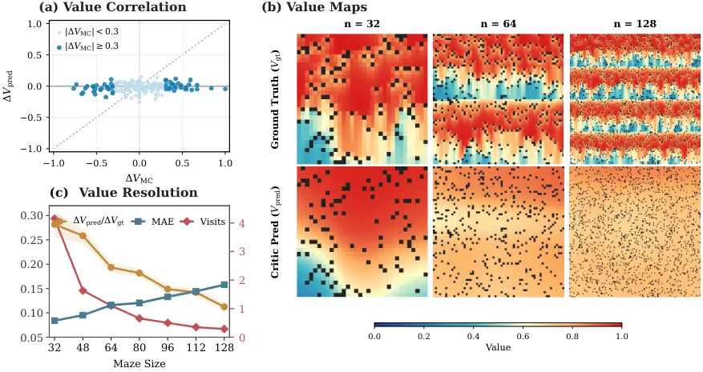
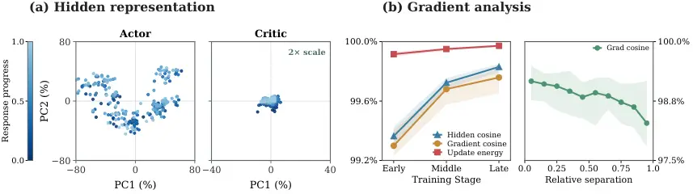

# Rethinking Critic Learning in PPO: Understanding and Mitigating Value Flattening

Yizhuo Li^(1,2 \*)  Jianhao Yan^(3 \*)  Yun Luo^(2†,$`\ddagger`$)  Zhi
Wang⁴  Futing Wang²  Rong-Xi Tan^(2,4)  Kanghui Tian²  Ganqu Cui²  Ning
Ding⁵  Peilin Zhao^(1$`\ddagger`$)  Yafu Li^(2,6$`\ddagger`$)  Yu
Cheng^(7$`\ddagger`$) ¹ Shanghai Jiao Tong University  ² Shanghai AI
Laboratory  ³ Westlake University  ⁴ Nanjing University ⁵ Tsinghua
University  ⁶ The Chinese University of Hong Kong  ⁷ Nanyang
Technological University ^(\*)Equal Contribution, ^(†)Project Lead, 
^($`\ddagger`$)Corresponding authors

###### Abstract

In reinforcement learning for large language models, Proximal Policy
Optimization (PPO) commonly uses a critic to estimate state values and
reduce the variance of policy updates. However, we uncover a systematic
failure mode in PPO critics, which we call Value Flattening: state
values, estimated from multiple Monte Carlo continuations, change
sharply across intermediate states while critic predictions remain
comparatively flat. We further observe this phenomenon in a controlled
FrozenLake environment and find that it becomes more pronounced as the
state space grows. Our theoretical and empirical analyses relate Value
Flattening to an implicit variance penalty in the critic loss and
redundant updates from temporally correlated states with similar
gradients. Motivated by these findings, we introduce SParse Proximal
Policy Optimization ($`\mathrm{SP}^{3}\mathrm{O}`$), which applies the
value loss to only a few well-separated states in each response to
mitigate both effects. Experiments on Qwen3-Base show that
$`\mathrm{SP}^{3}\mathrm{O}`$ with only three states supervised per
response can mitigate Value Flattening and consistently improve the
learned policy across model sizes and evaluation suites. Together, our
results identify Value Flattening as an important yet overlooked failure
mode of critic learning in standard PPO and show that a simple sparse
supervision strategy can mitigate it.

|     |
| --- |
|     |

^(†)^(†)footnotetext: Code:
[https://github.com/Dodojordi/SP3O](https://github.com/Dodojordi/SP3O)

## 1 Introduction

Reinforcement learning enables large language models to tackle
increasingly challenging reasoning tasks that unfold over long
trajectories (Kimi Team et al., 2026; Li et al., 2026a; Chen et al.,
2026). Such long-horizon tasks pose a fundamental challenge for policy
optimization, which requires both fine-grained credit assignment over
intermediate decisions and informative advantage estimates at each
generation step (Hou et al., 2026; Kazemnejad et al., 2025; Guo et al.,
2025; Wang et al., 2026; Gong et al., 2026). Proximal Policy
Optimization (PPO) offers a natural framework for meeting these demands
by using a critic to estimate state values throughout each trajectory
and construct token-level advantages (Schulman et al., 2017; Schulman et
al., 2015; Yuan et al., 2025; Yue et al., 2025; Qi et al., 2026). This,
in turn, places a key requirement on the critic: it must capture
meaningful changes in expected success (i.e., the state value) across
the trajectory.

However, we find that the critic in standard PPO fails to capture
substantial changes in state values across steps within a response. We
refer to this phenomenon as Value Flattening. For each intermediate
state, we estimate its state value by averaging terminal rewards from
multiple independent continuations sampled from the same policy,
obtaining Monte Carlo estimates of state values (MC values  (Kazemnejad
et al., 2025)). We use these estimates as diagnostic references for
evaluating critic predictions along individual trajectories. Figure 1
illustrates this mismatch by comparing critic predictions with MC
values. Across these trajectories, MC values often exhibit sharp local
transitions, whereas critic predictions remain comparatively flat. In
some cases, the critic prediction changes in the opposite direction from
the MC values. These examples also show that critic predictions remain
relatively insensitive to local variation in MC values across training
checkpoints and in both correct and incorrect responses, indicating that
value flattening is a property of the learned critic rather than a
trajectory-specific effect.

Figure 1: Value Flattening across training in a Qwen3-4B-Base PPO run on
DAPO-Math-17k. Each panel is a distinct correct or incorrect response
selected for large local MC value changes. Across checkpoints, the
corresponding PPO critic profiles remain comparatively flat, showing
weak within-response resolution.

To further characterize Value Flattening, we study a stochastic
FrozenLake environment, where we vary the maze size while keeping the
training configuration fixed. This setting allows us to directly compare
critic predictions against state values. We observe that as the maze
size increases, critic predictions become progressively smoother and
less accurate (Figure 2b,c). Taken together, our observations in LLMs
and FrozenLake suggest that Value Flattening is a systematic critic
failure mode that may become more pronounced as the state space grows,
motivating us to investigate its underlying causes.

To understand these phenomena, we analyze the critic training objective
and the temporal dependence in its supervision, identifying two factors
that can contribute to Value Flattening (Section 4.2): (1) Implicit
Variance Penalty: Under the common setup in PPO training with
terminal-only rewards (Yuan et al., 2025; Yue et al., 2025; Hu et al.,
2025; Qi et al., 2026), the critic’s mean squared error (MSE) loss is
applied at every token position in a response. Our loss decomposition
shows that minimizing this objective directly penalizes value variation
across all token positions within a response, pushing the predictions
toward a flatter value profile. (2) Redundant Updates from Temporal
Correlation: LLM states consist of the tokens generated so far, so
neighboring states differ by only one token and are highly temporally
correlated. We find that nearby states have similar representations and
gradients in the critic, with gradient similarity decreasing as the
distance between token positions increases. Dense token-level
supervision therefore aggregates many similar updates from neighboring
states, which can make their predicted values more similar.

Motivated by these findings, we propose SParse Proximal Policy
Optimization ($`\mathrm{SP}^{3}\mathrm{O}`$). Supervising fewer, more
widely separated positions restricts the implicit variance penalty to
their predicted values and is designed to reduce redundant updates from
temporally correlated states. Experiments show that
$`\mathrm{SP}^{3}\mathrm{O}`$ mitigates Value Flattening and
consistently improves actor performance across Qwen3-4B-Base and
Qwen3-8B-Base on mathematical and out-of-distribution reasoning
benchmarks. Our contributions are threefold:

- •
  We identify Value Flattening, a systematic mismatch in which state
  values estimated from multiple Monte Carlo continuations can change
  sharply within individual responses while PPO critic predictions
  remain comparatively flat.
- •
  We relate Value Flattening to two factors: the implicit variance
  penalty in the critic’s mean squared error (MSE) loss, which penalizes
  value differences across token positions, and redundant updates from
  temporally correlated states with similar gradients.
- •
  We introduce $`\mathrm{SP}^{3}\mathrm{O}`$, which supervises the
  critic at a few well-separated states to mitigate the effects of the
  implicit variance penalty and redundant neighboring updates.
  $`\mathrm{SP}^{3}\mathrm{O}`$ mitigates Value Flattening and improves
  policy performance across model scales and evaluation suites.

## 2 Related Work

### 2.1 Critic-Free and Critic-Based RL

Critic-free methods such as RLOO (Ahmadian et al., 2024), GRPO (Shao et
al., 2024), and DAPO (Yu et al., 2025) avoid training a value model, but
their advantages are derived from complete responses and offer little
direct distinction among states within the same response. Recent work
such as VIMPO derives an implicit value function to recover
finer-grained credit without a separate critic (Kang et al., 2026).
Critic-based methods such as PPO instead learn a value function and use
its predictions at each generation step to construct token-level
advantages (Schulman et al., 2017). Building on PPO, recent methods
improve critic initialization and optimization for reasoning or adapt
critic-based learning to asynchronous and structured trajectories (Yuan
et al., 2025; Yue et al., 2025; Hou et al., 2026; Li et al., 2026b; He
et al., 2026; Chen et al., 2025b; Luo et al., 2026; Qi et al., 2026),
but provide little analysis of whether their critic predictions capture
value changes within individual responses. We study this behavior and
identify Value Flattening: PPO critics retain differences across
responses but fail to track value changes among states within the same
response.

### 2.2 Fine-Grained Credit Assignment and Value Estimation

Prior work obtains intermediate credit through outcomes organized by
segments or trees and process supervision (Guo et al., 2025; Hou et al.,
2025; Tran et al., 2025; Ielanskyi et al., 2026; Lightman et al., 2023).
These signals provide finer feedback but do not directly estimate the
policy-conditioned state value: the expected terminal return when the
current policy continues from an intermediate state. VinePPO estimates
this quantity with auxiliary continuations and improves credit
assignment, but fine-grained estimation requires additional rollouts
from each evaluated state and can become costly as responses
lengthen (Kazemnejad et al., 2025; Wang et al., 2026; Gong et al., 2026;
Shan et al., 2026). We build on this line of work by evaluating both
response-level discrimination and the ability of PPO critics to track
policy-conditioned state-value changes within individual responses
across training stages and supervision densities.

## 3 Preliminaries

### 3.1 Proximal Policy Optimization

Given a prompt $`x`$, a policy $`\pi_{\theta}`$ generates a response
$`y=(y_{1},\ldots,y_{T})`$ and thereby a trajectory $`\tau`$, where the
state and action at step $`t`$ are $`s_{t}=(x,y_{<t})`$ and
$`a_{t}=y_{t}`$. The return from $`s_{t}`$ is
$`G_{t}=\sum_{k=t}^{T}\gamma^{k-t}r_{k}`$. The per-step reward $`r_{t}`$
may combine a task reward with additional shaping terms, such as a KL
penalty. PPO estimates advantages from trajectories sampled by
$`\pi_{\theta_{\mathrm{old}}}`$ and maximizes the clipped surrogate
objective (Schulman et al., 2017)

```math
\mathcal{L}_{\mathrm{PG}}(\theta)=\mathbb{E}_{t}\!\left[\min\!\left(\rho_{t}(\theta)\widehat{A}_{t},\operatorname{clip}\!\left(\rho_{t}(\theta),1-\epsilon,1+\epsilon\right)\widehat{A}_{t}\right)\right], \tag{1}
```

where
$`\rho_{t}(\theta)=\pi_{\theta}(a_{t}\mid s_{t})/\pi_{\theta_{\mathrm{old}}}(a_{t}\mid s_{t})`$
and $`\widehat{A}_{t}`$ is the estimated advantage.

PPO uses a critic $`V_{\phi}(s_{t})`$ to approximate the
policy-conditioned value
$`V^{\pi}(s_{t})=\mathbb{E}_{\pi}[G_{t}\mid s_{t}]`$. Generalized
advantage estimation (GAE) constructs the actor advantage
$`\widehat{A}_{t}`$ and the critic regression target $`\widehat{G}_{t}`$
as (Schulman et al., 2015):

```math
\resizebox{26049576}{}{$\displaystyle\delta_{t}=r_{t}+\gamma V_{\phi_{\mathrm{old}}}(s_{t+1})-V_{\phi_{\mathrm{old}}}(s_{t}),\qquad\widehat{A}_{t}=\sum_{\ell=0}^{T-t}(\gamma\lambda)^{\ell}\delta_{t+\ell},\qquad\widehat{G}_{t}=\widehat{A}_{t}+V_{\phi_{\mathrm{old}}}(s_{t})$}, \tag{2}
```

where $`V_{\phi_{\mathrm{old}}}(s_{T+1})=0`$. For a rollout batch
$`\mathcal{B}`$, the standard critic update is:

```math
\mathcal{L}_{V}(\phi)=\frac{1}{\sum_{\tau\in\mathcal{B}}T_{\tau}}\sum_{\tau\in\mathcal{B}}\sum_{t=1}^{T_{\tau}}\left(V_{\phi}(s_{t})-\widehat{G}_{t}\right)^{2},\qquad\phi\leftarrow\phi-\eta_{V}\nabla_{\phi}\mathcal{L}_{V}(\phi). \tag{3}
```

For the experiments in this work, the KL coefficient is zero and the
task reward is terminal. Let $`R(\tau)`$ denote the realized terminal
task reward of trajectory $`\tau`$, which is binary in our experiments.
Thus, $`r_{t}=0`$ for $`t<T`$ and $`r_{T}=R(\tau)`$; with
$`\gamma=\lambda=1`$,

```math
\widehat{G}_{t}=G_{t}=R(\tau),\qquad t=1,\ldots,T.
```

This equality holds for the targets observed along a sampled trajectory;
it does not imply that the policy-conditioned value $`V^{\pi}(s_{t})`$
is constant within that trajectory. Standard critic training therefore
repeats one response-level outcome at every state, which is the
supervision structure studied in this work.

### 3.2 Monte Carlo Estimation of State Value

A sampled return $`G_{t}`$ is a single-rollout Monte Carlo estimate of
$`V^{\pi}(s_{t})`$. We obtain a lower-variance diagnostic estimate by
independently sampling $`K`$ continuations
$`\tau_{t}^{(1)},\ldots,\tau_{t}^{(K)}`$ from the same policy
conditioned on a fixed state $`s_{t}`$:

```math
\widehat{V}_{\mathrm{MC}}^{\pi}(s_{t})=\frac{1}{K}\sum_{k=1}^{K}G_{t}^{(k)}, \tag{4}
```

where $`\tau_{t}^{(k)}\sim\pi(\cdot\mid s_{t})`$ and
$`G_{t}^{(k)}=R(\tau_{t}^{(k)})`$ is its realized return in our
terminal-reward setting. This sample average estimates the theoretical
state value $`V^{\pi}(s_{t})=\mathbb{E}_{\pi}[G_{t}\mid s_{t}]`$. For
the terminal binary-reward setting used here, it is the empirical
success rate of the sampled continuations. We use it as a diagnostic
reference to distinguish fitting the single-rollout target
$`\widehat{G}_{t}`$ from agreement with the policy-conditioned state
value.

## 4 Understanding and Mitigating Value Flattening

We first show that Value Flattening occurs in both LLM reasoning and a
controlled Markov decision process, and that it becomes more pronounced
as the state space grows. We then explain why the critic loss favors
similar values within a response and why dense supervision can reinforce
this effect. Shared terminal-return targets create an implicit variance
penalty, while temporally correlated states produce redundant updates
under dense supervision. This analysis motivates sparse critic
supervision. Unless otherwise stated, the LLM analysis uses
Qwen3-4B-Base trained on DAPO-Math-17k. Full training and
figure-specific settings are provided in Appendix A.1.



Figure 2: Value Flattening in LLM reasoning and stochastic FrozenLake.
(a) Adjacent MC and critic value changes: predicted changes remain
concentrated near zero even when MC values change sharply. (b)
Ground-truth and critic value maps as the FrozenLake maze size $`n`$
increases under an otherwise fixed training configuration. (c) The
corresponding value-resolution statistics.

### 4.1 Value Flattening in Critic Learning

#### Value Flattening in LLM Reasoning.

We characterize Value Flattening directly through critic predictions.
Across training checkpoints and for both correct and incorrect
responses, MC values can change sharply between adjacent reasoning
states while the corresponding critic profiles remain comparatively flat
(Figure 1). The adjacent-change analysis in Figure 2a makes this
mismatch explicit: MC value changes span a broad range, whereas critic
changes remain concentrated near zero instead of following the diagonal.
The critic therefore often fails to capture both the magnitude and the
direction of local value changes. Consequently, reasoning states with
substantially different MC values can receive similar critic predictions
within the same response. Appendix A.2 formalizes this mismatch through
an error decomposition.

#### Value Flattening with State-Space Growth.

To examine whether Value Flattening extends beyond LLMs and how it
scales with state-space size, we study stochastic FrozenLake (Brockman
et al., 2016), where an agent navigates from a start state to a goal
while avoiding holes. Each episode has a binary return, equal to $`1`$
upon reaching the goal and $`0`$ otherwise, so the state value of a grid
cell is the probability of eventually reaching the goal from that state.
This setting provides a controlled experiment in which we hold the
training configuration fixed and increase the maze size $`n`$ to expand
the state space. As shown in Figure 2b, critic predictions across grid
cells become progressively smoother as the maze grows. The
local-contrast and error metrics in panel (c) likewise show smoother
value predictions and weaker agreement with the ground truth. Thus,
Value Flattening becomes more pronounced as the state space grows.

### 4.2 Why Does Value Flattening Occur?

By analyzing the critic objective and the temporal dependence among
supervised states, we identify two factors contributing to Value
Flattening: an implicit variance penalty and redundant critic updates.

#### Implicit Variance Penalty.

Under terminal-only rewards with $`\gamma=\lambda=1`$, standard PPO uses
the same sampled terminal return as the target at every state in a
response. Its critic loss therefore contains an implicit variance
penalty. For a response of length $`T`$, let $`v_{t}=V_{\phi}(s_{t})`$
and $`\bar{v}=T^{-1}\sum_{t=1}^{T}v_{t}`$. Then

```math
\frac{1}{T}\sum_{t=1}^{T}(v_{t}-R)^{2}=(\bar{v}-R)^{2}+\frac{1}{T}\sum_{t=1}^{T}(v_{t}-\bar{v})^{2}. \tag{5}
```

The first term fits the mean prediction to the sampled response outcome.
The second term is the empirical variance of the predictions and
directly penalizes their variation within that response. This variance
penalty arises because every position uses the same terminal target.
Under dense supervision, this variance is computed over all $`T`$
positions, so every token prediction is directly included in the
penalty. The corresponding batch-level loss and parameter-gradient
decompositions are given in Appendix A.2.



Figure 3: Representation and gradient analysis in Qwen3-4B-Base PPO
critic supervision. (a) Actor and critic hidden representations for the
same response, centered and normalized by mean hidden norm; the critic
view uses a 2$`\times`$ scale. (b) Hidden-representation alignment,
gradient alignment, and update energy remain high across PPO training
stages (left), while the full critic gradient cosine decreases with
relative token-position separation (right).

#### Redundant Updates from Temporal Correlation.

Classical RL often operates on compact Markov states that summarize the
information needed for future decisions. In LLM post-training, by
contrast, a state contains the tokens generated so far, so adjacent
states differ by only one token and overlap in nearly their entire
input. Because adjacent states are temporally correlated and share most
of their tokens, supervising all of them provides less diverse training
signals than their number suggests (Mnih et al., 2015). This similarity
is also reflected in the critic hidden representations, whose trajectory
in Figure 3a occupies a compact region.

Representation similarity connects directly to update similarity.
Consider a value head $`V_{\phi}(s_{t})=w^{\top}h_{t}`$, where $`h_{t}`$
is the critic representation. The gradient from position $`t`$ is
$`g^{(w)}_{t}=2\bigl(V_{\phi}(s_{t})-R\bigr)h_{t}`$. Thus, positions
with similar representations and residuals of the same sign produce
aligned gradients. The measurements in Figure 3b show that hidden-state
alignment, gradient alignment, and update energy remain high throughout
training. Within each response, gradient similarity decreases as the
distance between their token positions increases. These results indicate
that dense supervision produces many redundant updates from neighboring
states.

### 4.3 $`\mathrm{SP}^{3}\mathrm{O}`$: Sparse Critic Supervision

Sparse supervision is designed to mitigate the two problems above
through selection and spacing. Selecting fewer positions restricts the
per-response variance penalty to those predictions instead of applying
it at every token position. Spacing the selected positions apart is
designed to reduce the accumulation of aligned gradients from nearby
token positions whose states share most of their tokens.

We instantiate this intervention as SParse Proximal Policy Optimization
($`\mathrm{SP}^{3}\mathrm{O}{}`$). The actor objective, rollout
procedure, and return targets remain unchanged; only the states
receiving the critic loss are changed. $`\mathrm{SP}^{3}\mathrm{O}{}`$
applies the value loss only at a small set of well-separated states. The
critic still produces values at every generation state. Let
$`\mathcal{I}(\tau)`$ denote the supervised states in trajectory
$`\tau`$. The sparse critic objective is

```math
\mathcal{L}_{V}^{\mathrm{SP}^{3}\mathrm{O}{}}(\phi)=\frac{1}{\sum_{\tau\in\mathcal{B}}|\mathcal{I}(\tau)|}\sum_{\tau\in\mathcal{B}}\sum_{t\in\mathcal{I}(\tau)}\left(V_{\phi}(s_{t})-\widehat{G}_{t}\right)^{2}. \tag{6}
```

#### Critic Prediction Effects.

We compare both critics with policy-conditioned MC values obtained from
repeated continuations at intermediate states. As shown in Figure 4(a),
PPO produces relatively flat value profiles and misses substantial local
changes in MC values, whereas $`\mathrm{SP}^{3}\mathrm{O}`$ more closely
captures their direction and magnitude. Its profile MSE is lower on both
selected prompts. The aggregate comparison in (b) confirms this trend,
with $`\mathrm{SP}^{3}\mathrm{O}`$ reducing MSE by $`36\%`$, $`11\%`$,
and $`21\%`$ at $`30\%`$, $`60\%`$, and $`90\%`$ response progress,
respectively. These results indicate that sparse supervision better
preserves within-response value variation and improves within-response
value resolution.

Figure 4: Effects on critic prediction in Qwen3-4B-Base. (a)
Prompt-matched critic and own-policy MC value profiles. (b)
Response-centered value error.

Figure 5: Effects on critic optimization in Qwen3-4B-Base. (a) Response
AUC, computed from the mean critic prediction per response and its
binary terminal outcome, versus the within-response fraction of
critic-prediction variance. (b) Empirical cumulative distribution of the
effective rank of each response’s hidden-state matrix, measuring the
dimensional diversity of value-head inputs across intermediate states.
(c) RMS across responses of the difference between value-head gradients
computed using terminal-return and policy-conditioned MC targets. Full
definitions and aggregation details are provided in Appendix A.1.

#### Critic Optimization Effects.

Figure 5 examines how sparse supervision affects critic representations
and optimization. Panel (a) compares response-level outcome
discrimination with within-response critic-prediction variation across
the early (E), middle (M), and late (L) training stages. PPO gains
discrimination while losing within-response variation, whereas
$`\mathrm{SP}^{3}\mathrm{O}`$ improves both. In panel (b),
$`\mathrm{SP}^{3}\mathrm{O}`$ shifts the effective rank of
response-centered hidden states upward, increasing the median from
$`4.33`$ to $`5.63`$ and indicating richer representations of state
differences. Panel (c) shows lower RMS discrepancy between value-head
gradients induced by terminal-return targets and MC values throughout
the response. Together, these observations are consistent with sparse
supervision preserving richer hidden representations and reducing
redundant or distorted critic updates, without sacrificing
response-level discrimination.

#### Actor Optimization Effects.

The critic is intended to stabilize PPO updates by replacing raw outcome
signals with advantage estimates that reduce policy-gradient variance.
Its within-response resolution can therefore affect both the direction
and the stability of actor optimization. In the online runs,
$`\mathrm{SP}^{3}\mathrm{O}{}`$ has smaller within-iteration update
changes over most of training than PPO (Figure 6a). This pattern is
consistent with smoother actor optimization while retaining the benefits
of a learned critic.

## 5 Experiments

### 5.1 Experimental Setup

#### Models and baselines.

We evaluate the proposed sparse critic supervision on Qwen3-4B-Base and
Qwen3-8B-Base (Yang et al., 2025). We train both models on
DAPO-Math-17k (Yu et al., 2025). For each model, we report the initial
checkpoint as a reference and compare standard PPO, GRPO, and PPO with
sparse critic supervision and explicit late-tail coverage. We refer to
the last variant as SParse Proximal Policy Optimization
($`\mathrm{SP}^{3}\mathrm{O}`$). Unless otherwise stated,
$`\mathrm{SP}^{3}\mathrm{O}`$ supervises response-relative states at
$`0.3`$, $`0.6`$, and $`0.9`$, adding a $`0.95`$ state for responses of
at least 6144 tokens.

#### Benchmarks and evaluation.

We use the 24K evaluation setting reported in the result sheets. The
mathematical-reasoning suite contains AIME24, AIME25, AIME26, and
AMC23 (Mathematical Association of America, 2026), MATH500 (Lightman et
al., 2023), Minerva (Lewkowycz et al., 2022), and OlympiadBench (He et
al., 2024). The out-of-distribution (OOD) suite contains ARC-C (Clark et
al., 2018), MMLU-Pro (Wang et al., 2024), GPQA (Rein et al., 2024),
AGIEval-English (Zhong et al., 2024), BigBenchHard (Suzgun et al.,
2023), and ZebraLogic-Grid (WildEval, 2025). Mathematical scores are
averaged over 32 generations. For OOD evaluation, ARC-C, MMLU-Pro, GPQA,
AGIEval-English, BigBenchHard, and ZebraLogic-Grid are all averaged over
four generations. The latter three benchmarks are scored using
xVerify (Chen et al., 2025a).

|               |                                    |                                 |        |        |       |         |         |          |       |
| ------------- | ---------------------------------- | ------------------------------- | ------ | ------ | ----- | ------- | ------- | -------- | ----- |
| Model         | Method                             | Mathematical Reasoning (avg@32) |        |        |       |         |         |          |       |
|               |                                    | AIME24                          | AIME25 | AIME26 | AMC23 | MATH500 | Minerva | Olympiad | Avg.  |
| Qwen3-4B-Base | Base                               | 4.58                            | 3.75   | 4.38   | 25.08 | 42.78   | 22.71   | 22.35    | 17.95 |
|               | PPO                                | 17.50                           | 19.90  | 14.69  | 61.80 | 70.15   | 42.82   | 36.35    | 37.60 |
|               | GRPO                               | 17.19                           | 16.19  | 10.10  | 63.83 | 78.21   | 45.71   | 43.62    | 39.26 |
|               | $`\bm{\mathrm{SP}^{3}\mathrm{O}}`$ | 23.02                           | 23.54  | 22.08  | 69.92 | 83.79   | 47.93   | 48.68    | 45.57 |
| Qwen3-8B-Base | Base                               | 7.40                            | 7.92   | 5.94   | 37.66 | 54.08   | 24.69   | 27.36    | 23.58 |
|               | PPO                                | 30.21                           | 25.10  | 23.33  | 72.19 | 86.33   | 48.81   | 53.56    | 48.50 |
|               | GRPO                               | 28.50                           | 22.04  | 22.70  | 73.82 | 85.26   | 52.06   | 50.98    | 47.91 |
|               | $`\bm{\mathrm{SP}^{3}\mathrm{O}}`$ | 33.91                           | 28.02  | 27.39  | 75.00 | 87.33   | 47.40   | 54.50    | 50.51 |

Table 1: In-domain mathematical-reasoning accuracy (%). Each score is
averaged over 32 generations (avg@32), and the final column averages the
seven listed tasks. Our method is shaded in light green, and bold
denotes the best result within each model block.

| Model         | Method                             | General Reasoning (avg@4) |          |       |             |         |                |       |
| ------------- | ---------------------------------- | ------------------------- | -------- | ----- | ----------- | ------- | -------------- | ----- |
|               |                                    | ARC-C                     | MMLU-Pro | GPQA  | AGIEval^(†) | BBH^(†) | ZebraLogic^(†) | Avg.  |
| Qwen3-4B-Base | Base                               | 34.98                     | 16.17    | 14.02 | 27.93       | 21.11   | 1.35           | 19.26 |
|               | PPO                                | 89.19                     | 54.39    | 34.85 | 65.87       | 57.50   | 9.90           | 51.95 |
|               | GRPO                               | 90.96                     | 56.87    | 38.89 | 68.18       | 71.17   | 12.58          | 56.44 |
|               | $`\bm{\mathrm{SP}^{3}\mathrm{O}}`$ | 91.02                     | 61.75    | 38.89 | 71.44       | 73.35   | 19.20          | 59.28 |
| Qwen3-8B-Base | Base                               | 61.82                     | 36.22    | 27.02 | 48.59       | 50.71   | 4.90           | 38.21 |
|               | PPO                                | 93.84                     | 64.19    | 47.22 | 74.52       | 79.27   | 27.25          | 64.38 |
|               | GRPO                               | 93.04                     | 66.27    | 49.49 | 75.15       | 78.10   | 27.40          | 64.91 |
|               | $`\bm{\mathrm{SP}^{3}\mathrm{O}}`$ | 93.13                     | 65.83    | 49.94 | 76.95       | 80.89   | 31.45          | 66.37 |

Table 2: Out-of-distribution evaluation accuracy (%). All scores are
averaged over four generations (avg@4). Datasets marked with $`\dagger`$
are scored by the gpt-oss-120b verifier through xverify. The final
column is the unweighted mean over all six tasks. Our method is shaded
in light green, and bold denotes the best result within each model
block.

### 5.2 Main Results

Tables 1 and 2 show that $`\mathrm{SP}^{3}\mathrm{O}`$ consistently
outperforms standard PPO and GRPO across both model sizes and evaluation
suites. The gains over PPO reach 7.97 percentage points on in-domain
mathematical reasoning and 7.33 percentage points on out-of-distribution
reasoning, with positive improvements also observed for Qwen3-8B-Base.
These results indicate that mitigating critic value flattening through
sparse supervision leads to better policy learning rather than merely
improving critic-side diagnostics.

#### Online learning dynamics.

Figure 6 compares the training dynamics of PPO and
$`\mathrm{SP}^{3}\mathrm{O}`$ on Qwen3-4B-Base. As shown in (a),
$`\mathrm{SP}^{3}\mathrm{O}`$ exhibits smaller and less variable
within-iteration actor updates, indicating more stable training. It also
maintains higher validation accuracy and rollout reward than PPO after
the early training stage, as shown in (b) and (c). Meanwhile,
$`\mathrm{SP}^{3}\mathrm{O}`$ produces longer responses, whereas
response lengths under PPO increase more gradually and remain shorter,
as shown in (d). Overall, $`\mathrm{SP}^{3}\mathrm{O}`$ achieves
stronger performance while maintaining more stable policy updates.

Figure 6: Online learning dynamics and within-iteration actor updates on
Qwen3-4B-Base. (a) Within-iteration update change. (b) Validation
accuracy. (c) Rollout reward. (d) Response length.

### 5.3 Sparse-Supervision Ablations

We further examine how the effectiveness of
$`\mathrm{SP}^{3}\mathrm{O}`$ varies with supervision density, anchor
placement, and late-tail coverage.

#### Number of supervised states.

We vary the number of supervised anchors $`K`$ during reasoning training
with Qwen3-4B-Base to examine the effect of critic-supervision density
(Figure 7). Sparse configurations with $`K\in\{3,4,8\}`$ achieve higher
mean training rewards than both denser configurations and standard PPO
with token-level critic supervision. Performance is highest at $`K=3`$
and remains relatively stable through $`K=8`$, but drops substantially
at $`K=16`$ and $`K=64`$, approaching the dense PPO baseline. Although
the variance across runs is non-negligible, the overall trend indicates
that increasing the number of supervised states does not improve
reasoning performance. Instead, a small set of well-spaced anchors
appears to provide sufficient coverage while limiting redundant critic
updates.

Figure 7: Effect of critic-supervision density on performance.

#### Placement and late-tail coverage.

|                 |          |
| --------------- | -------- |
| Main anchors    | Acc. (%) |
| PPO baseline    | 37.60    |
| Random          | 36.59    |
| $`0.2/0.5/0.8`$ | 44.65    |
| $`0.3/0.6/0.9`$ | 45.57    |

Table 3: Anchor-placement ablation on Qwen3-4B-Base ($`K=3`$).

At a fixed supervision density of $`K=3`$, both fixed-position placement
schemes outperform random placement, which performs worst (Table 3 and
Figure 9). This pattern is consistent with temporal correlation playing
a role: well-spaced anchors cover the trajectory while avoiding repeated
updates on nearby states that share most of their history.

We further compare $`\mathrm{SP}^{3}\mathrm{O}`$ with a variant that
removes the final tail anchor while keeping all other supervised anchors
unchanged. Adding the tail anchor improves performance from $`44.10`$ to
$`45.57`$ and reduces repetition from $`18.33`$ to $`1.12`$ (Appendix
Table 5), highlighting the importance of explicitly covering the
response tail for policy performance and generation stability.

## 6 Conclusion

We identify Value Flattening as a systematic failure mode of critics for
large language model reasoning, in which critic predictions fail to
capture policy-conditioned state value changes within individual
responses. The same pattern appears in controlled stochastic FrozenLake
experiments and becomes more pronounced as the state space grows. Our
analyses relate this behavior to two factors: an implicit variance
penalty from dense token-level supervision and redundant updates from
temporally correlated states with similar gradients. Motivated by these
findings, $`\mathrm{SP}^{3}\mathrm{O}`$ applies the critic loss at a few
well-separated states to mitigate the effects of both factors.
Experiments on Qwen3-4B-Base and Qwen3-8B-Base show that
$`\mathrm{SP}^{3}\mathrm{O}`$ mitigates Value Flattening and improves
actor performance across mathematical and out-of-distribution reasoning
benchmarks. These results establish Value Flattening as an important yet
overlooked problem in critic learning.

## Acknowledgments

This work was supported by the Shanghai Artificial Intelligence
Laboratory. We are grateful to the authors and open-source communities
whose work made this project possible.

## References

- Ahmadian et al. (2024) A. Ahmadian, C. Cremer, M. Galle, et al. Back
  to basics: revisiting REINFORCE style optimization for learning from
  human feedback in LLMs. arXiv preprint arXiv:2402.14740. External
  Links: [Link](https://arxiv.org/abs/2402.14740) Cited by: §2.1.
- Brockman et al. (2016) G. Brockman, V. Cheung, L. Pettersson, J.
  Schneider, J. Schulman, J. Tang, and W. Zaremba OpenAI gym. arXiv
  preprint arXiv:1606.01540. External Links:
  [Link](https://arxiv.org/abs/1606.01540) Cited by: §4.1.
- Chen et al. (2025a) D. Chen, Q. Yu, P. Wang, M. Hu, W. Zhang, Z.
  Wang, B. Tang, F. Xiong, X. Li, C. Wang, M. Yang, and Z. Li xVerify:
  efficient answer verifier for reasoning model evaluations. arXiv
  preprint arXiv:2504.10481. External Links:
  [Link](https://arxiv.org/abs/2504.10481) Cited by: §5.1.
- Chen et al. (2025b) J. Chen, Q. Cheng, F. Yu, H. Wan, Y. Zhang, S.
  Zheng, J. Yao, Q. Zhang, H. He, Y. Luo, Y. Zhao, F. Wang, L. Sheng, C.
  Xie, Y. Zuo, Y. Li, W. Zeng, Y. Wu, R. Huang, D. Zhou, K. Chen, Y.
  Qiao, L. Bai, Y. Cheng, N. Ding, B. Zhou, P. Ye, and G. Cui P1:
  mastering physics olympiads with reinforcement learning. External
  Links: 2511.13612, [Link](https://arxiv.org/abs/2511.13612) Cited by:
  §2.1.
- Chen et al. (2026) Q. Chen, C. Luan, J. Wu, Q. Yu, Y. Yang, Y. Li, J.
  Tong, X. Feng, L. Qin, and W. Che OMIBench: benchmarking
  olympiad-level multi-image reasoning in large vision-language model.
  arXiv preprint arXiv:2604.20806. External Links:
  [Link](https://arxiv.org/abs/2604.20806) Cited by: §1.
- Clark et al. (2018) P. Clark, I. Cowhey, O. Etzioni, T. Khot, A.
  Sabharwal, C. Schoenick, and O. Tafjord Think you have solved question
  answering? try ARC, the AI2 reasoning challenge. arXiv preprint
  arXiv:1803.05457. External Links:
  [Link](https://arxiv.org/abs/1803.05457) Cited by: §5.1.
- Gong et al. (2026) X. Gong, Q. Yi, Z. Nan, et al. Segmental advantage
  estimation: enhancing PPO for long-context LLM training. arXiv
  preprint arXiv:2601.07320. External Links:
  [Link](https://arxiv.org/abs/2601.07320) Cited by: §1, §2.2.
- Guo et al. (2025) Y. Guo, L. Xu, J. Liu, D. Ye, and S. Qiu Segment
  policy optimization: effective segment-level credit assignment in RL
  for large language models. In Advances in Neural Information
  Processing Systems, External Links:
  [Link](https://arxiv.org/abs/2505.23564) Cited by: §1, §2.2.
- He et al. (2024) C. He, R. Luo, Y. Bai, S. Hu, Z. L. Thai, J. Shen, J.
  Hu, X. Han, Y. Huang, Y. Zhang, et al. Olympiadbench: a challenging
  benchmark for promoting agi with olympiad-level bilingual multimodal
  scientific problems. arXiv preprint arXiv:2402.14008. External Links:
  [Link](https://arxiv.org/abs/2402.14008) Cited by: §5.1.
- He et al. (2026) H. He, H. Lei, Y. Luo, H. Zhang, S. Zhang, Y. Li, S.
  Tang, Z. Wang, R. Zhan, L. Bai, G. Cui, F. Yu, Y. Li, P. Ye, N. Ding,
  and Y. Cheng SimpleOPD: simple tokenizer-agnostic on-policy
  distillation for long-context reasoning. External Links: 2608.14277,
  [Link](https://arxiv.org/abs/2608.14277) Cited by: §2.1.
- Hou et al. (2025) Z. Hou, Z. Hu, Y. Li, et al. TreeRL: LLM
  reinforcement learning with on-policy tree search. In Annual Meeting
  of the Association for Computational Linguistics, External Links:
  [Link](https://arxiv.org/abs/2506.11902) Cited by: §2.2.
- Hou et al. (2026) Z. Hou, Y. Li, J. Tang, and Y. Dong Single-rollout
  asynchronous optimization for agentic reinforcement learning. arXiv
  preprint arXiv:2607.07508. External Links:
  [Link](https://arxiv.org/abs/2607.07508) Cited by: §1, §2.1.
- Hu et al. (2025) J. Hu, X. Wu, Z. Wang, et al. Open-Reasoner-Zero: an
  open source approach to scaling up reinforcement learning on the base
  model. arXiv preprint arXiv:2503.24290. External Links:
  [Link](https://arxiv.org/abs/2503.24290) Cited by: §1.
- Ielanskyi et al. (2026) M. Ielanskyi, K. Schweighofer, L. Aichberger,
  and S. Hochreiter RREDCoT: segment-level reward redistribution for
  reasoning models. arXiv preprint arXiv:2606.06475. External Links:
  [Link](https://arxiv.org/abs/2606.06475) Cited by: §2.2.
- Kang et al. (2026) Z. Kang, A. Feng, S. Levine, D. Song, and X. Zhao
  VIMPO: value-implicit policy optimization for LLMs. arXiv preprint
  arXiv:2606.20008. External Links:
  [Link](https://arxiv.org/abs/2606.20008) Cited by: §2.1.
- Kazemnejad et al. (2025) A. Kazemnejad, M. Aghajohari, E. Portelance,
  et al. VinePPO: refining credit assignment in RL training of LLMs. In
  International Conference on Machine Learning, External Links:
  [Link](https://arxiv.org/abs/2410.01679) Cited by: §1, §1, §2.2.
- Kimi Team et al. (2026) Kimi Team, T. Bai, Y. Bai, Y. Bao, et al. Kimi
  K3: open frontier intelligence. External Links: 2607.24653,
  [Link](https://arxiv.org/abs/2607.24653) Cited by: §1.
- Lewkowycz et al. (2022) A. Lewkowycz, A. Andreassen, D. Dohan, E.
  Dyer, H. Michalewski, V. Ramasesh, A. Slone, C. Anil, I. Schlag, T.
  Gutman-Solo, Y. Wu, B. Neyshabur, G. Gur-Ari, and V. Misra Solving
  quantitative reasoning problems with language models. Advances in
  Neural Information Processing Systems 35. External Links:
  [Link](https://arxiv.org/abs/2206.14858) Cited by: §5.1.
- Li et al. (2026a) Y. Li, R. Zhan, H. Zhang, et al. Achieving
  gold-medal-level olympiad reasoning via simple and unified scaling.
  External Links: 2605.13301, [Link](https://arxiv.org/abs/2605.13301)
  Cited by: §1.
- Li et al. (2026b) Y. Li, Z. Hou, Y. Jing, J. Tang, and Y. Dong
  CompactionRL: reinforcement learning with context compaction for
  long-horizon agents. arXiv preprint arXiv:2607.05378. External Links:
  [Link](https://arxiv.org/abs/2607.05378) Cited by: §2.1.
- Lightman et al. (2023) H. Lightman, V. Kosaraju, Y. Burda, H.
  Edwards, B. Baker, T. Lee, J. Leike, J. Schulman, I. Sutskever, and K.
  Cobbe Let’s verify step by step. arXiv preprint arXiv:2305.20050.
  External Links: [Link](https://arxiv.org/abs/2305.20050) Cited by:
  §2.2, §5.1.
- Luo et al. (2026) Y. Luo, F. Wang, Q. Cheng, F. Yu, H. Lei, J. Yan, C.
  Li, J. Chen, Y. Zhao, H. Wan, Y. Zhang, S. Zheng, J. Yao, Q. Zhang, H.
  He, W. Zeng, L. Sheng, C. Xie, Y. Zuo, Y. Li, Y. Wu, R. Huang, D.
  Zhou, K. Chen, Y. Qiao, L. Bai, Y. Cheng, N. Ding, B. Zhou, P. Ye,
  and G. Cui P1-vl: bridging visual perception and scientific reasoning
  in physics olympiads. External Links: 2602.09443,
  [Link](https://arxiv.org/abs/2602.09443) Cited by: §2.1.
- Mathematical Association of America (2026) Mathematical Association of
  America MAA mathematical competitions. External Links:
  [Link](https://maa.org/student-programs/amc/) Cited by: §5.1.
- Mnih et al. (2015) V. Mnih, K. Kavukcuoglu, D. Silver, A. A. Rusu, J.
  Veness, M. G. Bellemare, A. Graves, M. Riedmiller, A. K. Fidjeland, G.
  Ostrovski, S. Petersen, C. Beattie, A. Sadik, I. Antonoglou, H.
  King, D. Kumaran, D. Wierstra, S. Legg, and D. Hassabis Human-level
  control through deep reinforcement learning. Nature 518 (7540),
  pp. 529–533. External Links:
  [Document](https://dx.doi.org/10.1038/nature14236) Cited by: §4.2.
- Qi et al. (2026) P. Qi, X. Zhou, and W. S. Lee How to train a critic
  stably and efficiently. arXiv preprint arXiv:2608.23566. External
  Links: [Link](https://arxiv.org/abs/2608.23566) Cited by: §1, §1,
  §2.1.
- Rein et al. (2024) D. Rein, B. L. Hou, A. C. Stickland, J.
  Petty, R. Y. Pang, J. Dirani, J. Michael, and S. R. Bowman GPQA: a
  graduate-level google-proof Q&A benchmark. Proceedings of the First
  Conference on Language Modeling. External Links:
  [Link](https://arxiv.org/abs/2311.12022) Cited by: §5.1.
- Schulman et al. (2015) J. Schulman, P. Moritz, S. Levine, et al.
  High-dimensional continuous control using generalized advantage
  estimation. arXiv preprint arXiv:1506.02438. External Links:
  [Link](https://arxiv.org/abs/1506.02438) Cited by: §1, §3.1.
- Schulman et al. (2017) J. Schulman, F. Wolski, P. Dhariwal, et al.
  Proximal policy optimization algorithms. arXiv preprint
  arXiv:1707.06347. External Links:
  [Link](https://arxiv.org/abs/1707.06347) Cited by: §1, §2.1, §3.1.
- Shan et al. (2026) Z. Shan, H. Zhong, L. Wang, and L. Zhao Bringing
  value models back: generative critics for value modeling in LLM
  reinforcement learning. arXiv preprint arXiv:2604.10701. External
  Links: [Link](https://arxiv.org/abs/2604.10701) Cited by: §2.2.
- Shao et al. (2024) Z. Shao, P. Wang, Q. Zhu, et al. DeepSeekMath:
  pushing the limits of mathematical reasoning in open language models.
  arXiv preprint arXiv:2402.03300. External Links:
  [Link](https://arxiv.org/abs/2402.03300) Cited by: §2.1.
- Suzgun et al. (2023) M. Suzgun, N. Scales, N. Scharli, S. Gehrmann, Y.
  Tay, H. W. Chung, A. Chowdhery, Q. V. Le, E. H. Chi, D. Zhou, and J.
  Wei Challenging BIG-Bench tasks and whether chain-of-thought can solve
  them. In Findings of the Association for Computational Linguistics:
  ACL 2023, External Links:
  [Link](https://aclanthology.org/2023.findings-acl.824) Cited by: §5.1.
- Tran et al. (2025) H. Tran, Z. Yao, and H. Yu Exploiting tree
  structure for credit assignment in RL training of LLMs. arXiv preprint
  arXiv:2509.18314. External Links:
  [Link](https://arxiv.org/abs/2509.18314) Cited by: §2.2.
- Wang et al. (2026) T. Wang, Y. Li, L. Li, et al. SPPO: sequence-level
  PPO for long-horizon reasoning tasks. arXiv preprint arXiv:2604.08865.
  External Links: [Link](https://arxiv.org/abs/2604.08865) Cited by: §1,
  §2.2.
- Wang et al. (2024) Y. Wang, X. Ma, G. Zhang, Y. Ni, A. Chandra, S.
  Guo, W. Ren, A. Arulraj, X. He, Z. Jiang, T. Li, M. Ku, K. Wang, A.
  Zhuang, R. Fan, X. Yue, and W. Chen MMLU-Pro: a more robust and
  challenging multi-task language understanding benchmark. arXiv
  preprint arXiv:2406.01574. External Links:
  [Link](https://arxiv.org/abs/2406.01574) Cited by: §5.1.
- WildEval (2025) WildEval ZebraLogic. External Links:
  [Link](https://huggingface.co/datasets/WildEval/ZebraLogic) Cited by:
  §5.1.
- Yang et al. (2025) A. Yang, A. Li, B. Yang, B. Zhang, B. Hui, B.
  Zheng, B. Yu, C. Gao, C. Huang, C. Lv, et al. Qwen3 technical report.
  arXiv preprint arXiv:2505.09388. External Links:
  [Link](https://arxiv.org/abs/2505.09388) Cited by: §5.1.
- Yu et al. (2025) Q. Yu, Z. Zhang, R. Zhu, et al. DAPO: an open-source
  LLM reinforcement learning system at scale. arXiv preprint
  arXiv:2503.14476. External Links:
  [Link](https://arxiv.org/abs/2503.14476) Cited by: §2.1, §5.1.
- Yuan et al. (2025) Y. Yuan, Y. Yue, R. Zhu, T. Fan, and L. Yan What’s
  behind PPO’s collapse in long-CoT? value optimization holds the
  secret. arXiv preprint arXiv:2503.01491. External Links:
  [Link](https://arxiv.org/abs/2503.01491) Cited by: §1, §1, §2.1.
- Yue et al. (2025) Y. Yue, Y. Yuan, Q. Yu, et al. VAPO: efficient and
  reliable reinforcement learning for advanced reasoning tasks. arXiv
  preprint arXiv:2504.05118. External Links:
  [Link](https://arxiv.org/abs/2504.05118) Cited by: §1, §1, §2.1.
- Zhong et al. (2024) W. Zhong, R. Cui, Y. Guo, Y. Liang, S. Lu, Y.
  Wang, A. Saied, W. Chen, and N. Duan AGIEval: a human-centric
  benchmark for evaluating foundation models. Findings of the
  Association for Computational Linguistics: NAACL 2024. External Links:
  [Link](https://arxiv.org/abs/2304.06364) Cited by: §5.1.

## Appendix A Appendix

### A.1 Experimental Details and Diagnostic Metrics

| Setting                         | Value                                           |
| ------------------------------- | ----------------------------------------------- |
| Training data                   | DAPO-Math-17k                                   |
| Rollout batch                   | $`64\times 8=512`$                              |
| Actor update batch              | $`256/\mathrm{step}`$; $`2/\mathrm{rollout}`$   |
| Response length / temperature   | $`8{,}192/1.0`$                                 |
| Actor learning rate             | $`1\times 10^{-6}`$                             |
| Critic learning rate            | $`4\times 10^{-6}`$                             |
| Optimizer                       | Adam; $`\beta=(0.9,0.98)`$; $`\mathrm{wd}=0.1`$ |
| PPO ratio clip / KL coefficient | $`0.2/0`$                                       |
| Critic-only warm-up             | $`20`$ batches                                  |

Table 4: Key training hyperparameters for the Qwen3-4B-Base and
Qwen3-8B-Base experiments.

#### Figure and table settings.

In Figure 7, the $`K=4`$ point uses anchors at $`0.3/0.5/0.7/0.9`$.
Points show mean performance, with bands indicating variation.

#### FrozenLake settings.

Each rollout terminates when the agent reaches the goal, falls into a
hole, or reaches the maximum episode length of 8192 steps. Reaching the
goal yields a return of $`1`$, while falling into a hole or reaching the
episode limit yields a return of $`0`$.

#### Policy-conditioned Monte Carlo estimation.

For the fixed evaluation panel, we use 64 responses and evaluate each
response at 20 anchors: 19 intermediate states at relative positions
$`0.05,0.10,\ldots,0.95`$, plus the completed response at position
$`1.0`$. At each intermediate state, we hold the state fixed and
independently sample continuations
$`\tau_{t}^{(k)}\sim\pi(\cdot\mid s_{t})`$ from the same actor policy.
We start with 128 continuations and add batches of 64, up to a maximum
of 256, stopping earlier when the half-width of the 95% Wilson
confidence interval for the empirical success rate is at most $`0.04`$.
Thus, the nonterminal anchors use $`K\in\{128,192,256\}`$. We estimate
the policy-conditioned state value by averaging the realized terminal
rewards,
$`\widehat{V}_{\mathrm{MC}}^{\pi}(s_{t})=K^{-1}\sum_{k=1}^{K}G_{t}^{(k)}`$.
We use temperature $`1.0`$, top-$`p`$ $`0.95`$, and at most $`8192`$
generated tokens per continuation. The terminal anchor uses its observed
terminal reward $`R(\tau)`$ directly rather than additional sampling.

#### Critic diagnostic metrics.

For each response $`i`$, let $`\Delta v_{i,t}`$ denote the change in the
predicted value at evaluated state $`t`$. We define the _update energy_
in Figure 3b as

```math
E_{i}=\frac{T_{i}\overline{\Delta v}_{i}^{\,2}}{\sum_{t}\Delta v_{i,t}^{2}},\qquad\overline{\Delta v}_{i}=\frac{1}{T_{i}}\sum_{t}\Delta v_{i,t}. \tag{7}
```

Let $`v_{i,t}=V_{\phi}(s_{i,t})`$ be the critic prediction at token
$`t`$ of response $`i`$, $`T_{i}`$ its number of valid tokens, and
$`R_{i}\in\{0,1\}`$ its terminal outcome. _Response AUC_ is the ROC-AUC
of $`R_{i}`$ scored by the mean prediction
$`\bar{v}_{i}=T_{i}^{-1}\sum_{t}v_{i,t}`$. The _within-response
variation_ ratio is

```math
\frac{\sum_{i}\sum_{t}(v_{i,t}-\bar{v}_{i})^{2}}{\sum_{i}\sum_{t}(v_{i,t}-\bar{v})^{2}},\qquad\bar{v}=\frac{\sum_{i}\sum_{t}v_{i,t}}{\sum_{i}T_{i}}, \tag{8}
```

where lower values indicate flatter predictions within responses. Both
metrics are computed per rollout batch and summarized by stage medians
in Figure 5a. For panel (b), we unit-normalize the value-head input
states within each response, subtract their response mean, and stack
them into a matrix $`H_{i}`$. If $`\lambda_{j}`$ are the eigenvalues of
$`H_{i}H_{i}^{\top}`$ and $`p_{j}=\lambda_{j}/\sum_{k}\lambda_{k}`$, its
_effective rank_ is $`r_{\mathrm{eff}}=\exp(-\sum_{j}p_{j}\log p_{j})`$;
the panel plots its empirical cumulative distribution across responses.
For panel (c), let $`h_{i,t}`$ denote the value-head input and $`A_{i}`$
the evaluated positions. The response-level mean gradient difference
under the squared-error value loss between terminal-return and MC
targets, and its RMS across $`N`$ responses, are

```math
\Delta g_{i}(A_{i})=\frac{2}{|A_{i}|}\sum_{t\in A_{i}}\bigl(\widehat{V}_{\mathrm{MC}}^{\pi}(s_{i,t})-R_{i}\bigr)h_{i,t},\qquad D_{\mathrm{RMS}}=\sqrt{\frac{1}{N}\sum_{i=1}^{N}\|\Delta g_{i}(A_{i})\|_{2}^{2}}. \tag{9}
```

### A.2 Theoretical Analysis of Value Flattening

We formalize two aspects of Value Flattening. We first decompose critic
error into response-mean and within-response components and examine how
the latter affects finite-batch actor updates. We then show that dense
token-level supervision introduces an implicit penalty on
within-response prediction variance and compare its gradient with a
reference gradient based on exact policy-conditioned state values.
Finally, we explain why these finite-batch effects do not conflict with
the standard invariance of the expected policy gradient to a
state-dependent baseline.

#### Decomposing critic error.

Let $`i\in\{1,\ldots,N\}`$ index responses and
$`t\in\{1,\ldots,m_{i}\}`$ index evaluated states. Define the
policy-conditioned value $`q_{i,t}=V^{\pi}(s_{i,t})`$, the critic
prediction $`v_{i,t}=V_{\phi}(s_{i,t})`$, and, for any per-state
quantity $`x_{i,t}`$, write its response mean as
$`\bar{x}_{i}:=m_{i}^{-1}\sum_{t=1}^{m_{i}}x_{i,t}`$. In particular,
this defines $`\bar{q}_{i}`$ and $`\bar{v}_{i}`$. The mean squared
critic error, with each response weighted equally, decomposes as

```math
\displaystyle\mathcal{E}_{\mathrm{point}} \displaystyle:=\frac{1}{N}\sum_{i=1}^{N}\frac{1}{m_{i}}\sum_{t=1}^{m_{i}}(v_{i,t}-q_{i,t})^{2} \tag{10}
```

```math
\displaystyle=\underbrace{\frac{1}{N}\sum_{i=1}^{N}(\bar{v}_{i}-\bar{q}_{i})^{2}}_{\mathcal{E}_{\mathrm{mean}}}+\underbrace{\frac{1}{N}\sum_{i=1}^{N}\frac{1}{m_{i}}\sum_{t=1}^{m_{i}}\left[(v_{i,t}-\bar{v}_{i})-(q_{i,t}-\bar{q}_{i})\right]^{2}}_{\mathcal{E}_{\mathrm{within}}}. \tag{11}
```

The two terms measure error in the response mean and error in value
changes within the response, respectively. If states are instead
averaged over the entire batch, response $`i`$ receives weight
$`\alpha_{i}=m_{i}/\sum_{j}m_{j}`$, and the same decomposition holds.
Let

```math
e_{i,t}:=v_{i,t}-q_{i,t}=\bar{e}_{i}+e^{\circ}_{i,t},\qquad\frac{1}{m_{i}}\sum_{t=1}^{m_{i}}e^{\circ}_{i,t}=0, \tag{12}
```

where $`\bar{e}_{i}`$ is the response-mean error and $`e^{\circ}_{i,t}`$
is the centered within-response error.

#### From critic error to actor updates.

Under $`\gamma=\lambda=1`$, all states in a response share the same
realized return. Let $`R_{i}:=R(\tau_{i})`$ denote that terminal reward.
The critic error therefore changes the estimated advantage by
$`-e_{i,t}`$, and its within-response component changes the relative
credit assigned to states by $`-e^{\circ}_{i,t}`$. Let
$`z_{i,t}=\nabla_{\theta}\log\pi_{\theta}(a_{i,t}\mid s_{i,t})|_{\theta=\theta_{\mathrm{old}}}`$
be the log-policy gradient and $`\bar{z}_{i}=m_{i}^{-1}\sum_{t}z_{i,t}`$
its response mean. At the rollout policy, define the actor gradients
obtained with the sampled critic baseline and with a reference baseline
using exact policy-conditioned state values:

```math
\displaystyle g_{\mathrm{critic}} \displaystyle:=\frac{1}{N}\sum_{i=1}^{N}\frac{1}{m_{i}}\sum_{t=1}^{m_{i}}z_{i,t}\bigl(R_{i}-v_{i,t}\bigr), \tag{13}
```

```math
\displaystyle g_{\mathrm{oracle}} \displaystyle:=\frac{1}{N}\sum_{i=1}^{N}\frac{1}{m_{i}}\sum_{t=1}^{m_{i}}z_{i,t}\bigl(R_{i}-q_{i,t}\bigr).
```

We define the finite-batch actor-gradient error as
$`\Delta g:=g_{\mathrm{critic}}-g_{\mathrm{oracle}}`$. It then
decomposes exactly as

```math
\Delta g=\underbrace{-\frac{1}{N}\sum_{i=1}^{N}\bar{z}_{i}\bar{e}_{i}}_{\Delta g_{\mathrm{mean}}}-\underbrace{\frac{1}{N}\sum_{i=1}^{N}\frac{1}{m_{i}}\sum_{t=1}^{m_{i}}(z_{i,t}-\bar{z}_{i})e^{\circ}_{i,t}}_{\Delta g_{\mathrm{within}}}. \tag{14}
```

The first term is caused by error in the response mean. The second is
caused by error in the relative value profile within a response. By
Cauchy–Schwarz,

```math
\displaystyle\|\Delta g_{\mathrm{mean}}\| \displaystyle\leq\left(\frac{1}{N}\sum_{i}\|\bar{z}_{i}\|^{2}\right)^{1/2}\mathcal{E}_{\mathrm{mean}}^{1/2},
```

```math
\displaystyle\|\Delta g_{\mathrm{within}}\| \displaystyle\leq\left(\frac{1}{N}\sum_{i}\frac{1}{m_{i}}\sum_{t}\|z_{i,t}-\bar{z}_{i}\|^{2}\right)^{1/2}\mathcal{E}_{\mathrm{within}}^{1/2}. \tag{15}
```

Thus, each gradient-error component is bounded by the critic RMSE
multiplied by the RMS norm of the corresponding log-policy gradient.
These are norm bounds; they do not by themselves assert that the error
is determined by directional alignment.

#### Implicit Variance Penalty in Dense Critic Supervision.

In the terminal-only setting, consider the critic loss under dense
token-level supervision, with each response weighted equally and using
the sampled target $`R_{i}`$. Let
$`J_{i,t}=\nabla_{\phi}V_{\phi}(s_{i,t})`$ and
$`\bar{J}_{i}=m_{i}^{-1}\sum_{t}J_{i,t}`$ denote the critic Jacobian and
its response mean. The loss can then be decomposed as

```math
\mathcal{L}_{V,\mathrm{dense}}^{\mathrm{sample}}(\phi):=\frac{1}{N}\sum_{i=1}^{N}\frac{1}{m_{i}}\sum_{t=1}^{m_{i}}\bigl(v_{i,t}-R_{i}\bigr)^{2}=\frac{1}{N}\sum_{i=1}^{N}\left[(\bar{v}_{i}-R_{i})^{2}+\frac{1}{m_{i}}\sum_{t=1}^{m_{i}}(v_{i,t}-\bar{v}_{i})^{2}\right]. \tag{16}
```

Its gradient is correspondingly

```math
\nabla_{\phi}\mathcal{L}_{V,\mathrm{dense}}^{\mathrm{sample}}=\frac{2}{N}\sum_{i=1}^{N}(\bar{v}_{i}-R_{i})\bar{J}_{i}+\frac{2}{N}\sum_{i=1}^{N}\frac{1}{m_{i}}\sum_{t=1}^{m_{i}}(v_{i,t}-\bar{v}_{i})(J_{i,t}-\bar{J}_{i}). \tag{17}
```

The first term fits the mean critic prediction for each response to its
sampled terminal return. The second is the gradient of the
within-response prediction-variance term
$`m_{i}^{-1}\sum_{t}(v_{i,t}-\bar{v}_{i})^{2}`$; the corresponding loss
term directly penalizes deviations from the response mean and therefore
creates a flattening pressure within each response. The shared return
provides no direct information about value differences among states
within a response, yet applying it at every state introduces this
variance penalty. The same decomposition holds for token-weighted
training, with response weights $`\alpha_{i}`$.

To compare the PPO update in Equation 17 with the update needed to
recover the policy-conditioned value profile, consider a hypothetical
regression to the exact values $`q_{i,t}=V^{\pi}(s_{i,t})`$. The
corresponding gradients of Equation 11 are

```math
\displaystyle\nabla_{\phi}\mathcal{E}_{\mathrm{mean}} \displaystyle=\frac{2}{N}\sum_{i=1}^{N}\bar{e}_{i}\bar{J}_{i}, \displaystyle\nabla_{\phi}\mathcal{E}_{\mathrm{within}} \displaystyle=\frac{2}{N}\sum_{i=1}^{N}\frac{1}{m_{i}}\sum_{t=1}^{m_{i}}e^{\circ}_{i,t}(J_{i,t}-\bar{J}_{i})=\frac{2}{N}\sum_{i=1}^{N}\frac{1}{m_{i}}\sum_{t=1}^{m_{i}}e^{\circ}_{i,t}J_{i,t}. \tag{18}
```

Unlike the sampled-target update above, these are reference gradients
for this exact-value regression. Because
$`m_{i}^{-1}\sum_{t}e^{\circ}_{i,t}=0`$, the response-shared Jacobian
component cancels exactly. In other words, correcting within-response
error requires the state-level Jacobians to differ across states.

#### Expected-gradient invariance and practical scope.

For any action-independent baseline $`b(s_{t})`$,

```math
\mathbb{E}_{a_{t}\sim\pi(\cdot\mid s_{t})}\left[\nabla_{\theta}\log\pi_{\theta}(a_{t}\mid s_{t})b(s_{t})\,\middle|\,s_{t}\right]=b(s_{t})\nabla_{\theta}\sum_{a_{t}}\pi_{\theta}(a_{t}\mid s_{t})=0. \tag{19}
```

Exact pointwise values are therefore unnecessary for preserving the
expected on-policy gradient. On a finite batch, however, centered critic
errors can have a nonzero batch average when multiplied by centered
log-policy gradients.

The finite-batch decomposition in Equation 14 is exact for the local
gradient at the rollout policy. Across multiple PPO epochs, value errors
can also alter advantage signs, magnitudes, and which branch of PPO’s
clipped objective is active, so baseline invariance does not imply
identical clipped updates.

In summary, our analysis yields three observations:

- •
  Reusing the same terminal return at every state introduces an implicit
  variance penalty on critic predictions within each response.
- •
  Within-response critic error can change finite-batch actor updates
  through its interaction with centered policy gradients.
- •
  Expected policy-gradient invariance does not imply identical practical
  PPO updates on finite batches.

Together, these results motivate evaluating whether critic predictions
track state-value changes within responses, in addition to
response-level accuracy. Combined with the temporal-correlation evidence
in Section 4.2, they motivate sparse critic supervision, which applies
the shared terminal return to fewer, well-separated states.

### A.3 Additional Comparisons of Critic Predictions and MC Values

Figure 8 complements the two prompt-matched examples in Figure 4 with
four additional prompts from the same checkpoint evaluation panel. For
these prompts, $`\mathrm{SP}^{3}\mathrm{O}`$ has lower centered profile
MSE than PPO.

Figure 8: Additional prompt-matched value profiles. The horizontal axis
is normalized response progress, and the vertical axis shows
response-centered own-policy MC values and critic predictions.

### A.4 Sparse-Supervision Ablations

| Variant                                       | Acc. (%) | Repetition (%) |
| --------------------------------------------- | -------- | -------------- |
| $`\mathrm{SP}^{3}\mathrm{O}`$ w/o tail anchor | 44.10    | 18.33          |
| $`\mathrm{SP}^{3}\mathrm{O}`$                 | 45.57    | 1.12           |

Table 5: Late-tail ablation for $`\mathrm{SP}^{3}\mathrm{O}`$.

Figure 9: Performance across critic supervision anchor placements.

We examine how the number and placement of critic-supervision anchors
affect Qwen3-4B-Base. The placement curves show that later-state
coverage is generally beneficial, whereas adding anchors alone does not
reliably improve performance. The matched late-tail comparison is
reported in Table 5. Conditional tail coverage provides a further
improvement and reduces repetitive behavior. Figure 9 shows the
corresponding online validation trajectories. Schedules with later-state
coverage achieve higher validation accuracy, consistent with the
placement comparison in Figure 9.
