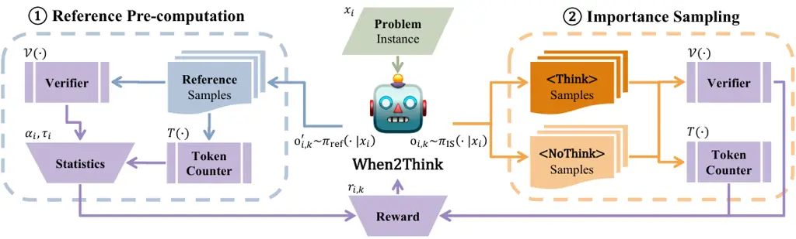
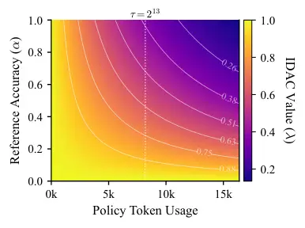
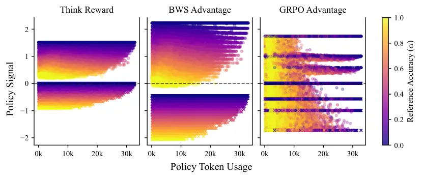
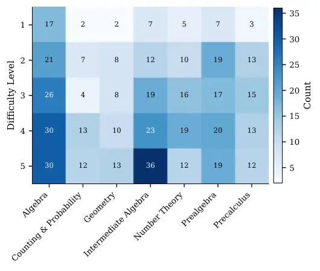

# When2Think: Learning When and How Much to Reason

Jaejun
Shim [](https://orcid.org/0009-0000-1386-5087)
Email: [junshim@skku.edu](mailto:) Affiliation: Sungkyunkwan University
   HyunJin
Kim [](https://orcid.org/0000-0002-6390-0765)
Email: [khyunjin1993@skku.edu](mailto:) Affiliation: Sungkyunkwan
University    Young Jin
Kim [](https://orcid.org/0000-0003-2976-3047)
^(†)^(†)thanks: Corresponding author
Email: [youki@microsoft.com](mailto:) Affiliation: Microsoft    JinYeong
Bak [](https://orcid.org/0000-0002-3212-5241) ¹¹footnotemark:
1 Email: [jy.bak@skku.edu](mailto:) Affiliation: Sungkyunkwan University

###### Abstract

Large Reasoning Models (LRMs) often overthink easy problems and
underthink hard ones, leading to inefficient computation allocation.
Existing methods regulate generated computation or select between direct
answering and explicit reasoning, but do not jointly control _whether_
to reason and _how much_ computation to allocate within reasoning. We
call the resulting difficulty-dependent loss in accuracy under
computation reduction the _efficiency tax_. We propose _When2Think_, an
RLVR-based post-training framework for instance-adaptive computation
allocation. Its core mechanism, _Instance-level Difficulty-Aware Control
(IDAC)_, uses cached reference statistics of success and token cost to
modulate a correctness-gated efficiency bonus based on generated token
count. Importance Sampling supports exploration of Think and NoThink,
while Batch-Wise Standardization constructs standardized advantages for
critic-free optimization. The framework requires neither a learned
reward model nor a learned critic, and offline reference caching avoids
online reference-model queries during policy updates. On AIME24,
_When2Think_ improves Pass@3 by 10.0 percentage points while reducing
token usage by 27.9% relative to the backbone. We release project at
[https://github.com/JJunShim/When2Think](https://github.com/JJunShim/When2Think).

## 1 Introduction

(a) MATH-500 Accuracy

(b) MATH-500 Tokens

Figure 1: Performance and efficiency on the MATH-500 benchmark
stratified by problem difficulty (Levels 1–5). We compare _When2Think_
(red), LRM baseline (blue) and LLM baseline (green). Lines: Mean Pass@1
accuracy $`\pm`$ standard deviation. Bars: Mean tokens per instance
$`\pm`$ standard deviation. Statistics computed over five independent
sampling runs. _When2Think_ mitigates the efficiency tax by reducing
token usage on easier instances while preserving hard-instance accuracy.

The emergence of *large language models (LLMs)* \[1, 2, 3, 4, 5\] has
advanced language understanding and generation across a wide range of
tasks. Beyond fluent text generation, many challenging tasks require
reliable multi-step reasoning \[6, 7\]. A prominent direction is to
internalize structured reasoning capabilities through _supervised
fine-tuning (SFT)_ or *reinforcement fine-tuning (RFT)* \[8, 9, 10\],
producing large reasoning models (LRMs) that generate coherent reasoning
trajectories and achieve strong performance on challenging
benchmarks \[11, 12, 13\].

Despite these advances, LRMs suffer from *reasoning
inefficiency* \[14\]. They often overthink simple tasks by generating
redundant reasoning tokens without accuracy gains \[15, 16\], yet
underthink complex tasks by terminating reasoning prematurely or
producing fragmented chains \[17\]. Existing efficiency methods reduce
computation through computation control or reasoning-mode selection, but
can under-allocate computation to harder instances and sacrifice
accuracy (Table 1). We refer to this difficulty-dependent loss in
hard-instance accuracy from reducing computation as the efficiency tax,
highlighting the need to control both _whether_ and _how much_ to
reason.

We adopt _dual-process theory_ as a conceptual lens for this allocation
problem \[18, 19\]. System 1-style direct answering provides a low-cost
operating point, whereas System 2-style deliberation enables explicit
multi-step reasoning \[13\]. As shown in Figure 1, the LLM baseline uses
fewer tokens and performs competitively on easier instances, whereas the
LRM baseline benefits more from additional computation as difficulty
increases \[20, 21\]. This contrast motivates _single-model hybrid
reasoning_, where a single model adapts computation to the input by
selecting between direct answering and explicit deliberation, while
varying computation depth within deliberation.

Motivated by these observations, we propose _When2Think_, a
post-training framework for difficulty-aware computation control. At its
core, _Instance-level Difficulty-Aware Control (IDAC)_ modulates
computation-sensitive rewards using reference-estimated difficulty and
generated trajectory token count. Importance-sampled Think/NoThink
exploration supports direct answering as an additional low-cost
behavior, while IDAC controls how deeply reasons within the Think mode.

We make the following contributions:

- •
  Difficulty-stratified analysis. A difficulty-stratified analysis
  connects overthinking and underthinking as manifestations of a shared
  computation-allocation problem, characterizing an _efficiency tax_ in
  which computation savings come at the cost of hard-instance accuracy.
- •
  Difficulty-aware computation control. _Instance-level Difficulty-Aware
  Control (IDAC)_ modulates a correctness-gated efficiency bonus using
  cached reference statistics and the generated token count of each
  trajectory.
- •
  Mechanism and behavioral analysis. The Think-only IDAC+BWS variant
  outperforms standard RFT on most evaluated benchmarks, demonstrating
  performance gains within explicit reasoning independently of NoThink
  selection.

## 2 Related Work

We review prior work on reducing the inference cost of large reasoning
models (LRMs) through post-training. Following recent surveys \[14,
16\], we organize this literature by the primary control variable: (1)
_computation control_, which regulates the amount or structure of
generated reasoning, and (2) _hybrid Reasoning mode control_, which
determines whether to use direct answering or explicit deliberation.
Inference-time budgets, stopping rules, and routers provide
complementary control over fixed policies.

#### Computation Control.

Global methods apply common efficiency constraints across inputs,
including iterative token limits in ThinkPrune \[22\], fixed-target step
rewards in LASER \[23\], and optimization-aware truncation in
DLER \[24\]. Structural approaches remove redundant reasoning segments
through chunk-level distillation (Skip-Thinking \[25\]) or
sufficient-prefix extraction (LC-R1 \[26\]). Adaptive methods derive
problem-dependent computation signals from reference statistics or
current-policy rollouts, including explicit token budgets in
DAST \[27\], prompt-relative length rewards \[28\], shortest-correct
targets in ShorterBetter \[29\], and dynamically adjusted
difficulty-specific thresholds in LASER and difficulty-aware DLER \[23,
24\]. A complementary line studies optimization and credit assignment,
showing that computation-sensitive objectives can fail through harmful
advantage estimates, entropy collapse, or sparse rollout feedback \[30,
24\]. These studies establish global, structural, and instance-adaptive
computation control, but primarily regulate computation within a
trajectory.

#### Reasoning Mode Control.

Hybrid methods learn whether an input should receive a direct response
or explicit deliberation. ARM \[31\] selects among multiple reasoning
formats using diversity-aware reward scaling. Among binary hybrid
policies, LHRM \[32\] separates inter-mode utility comparison from
intra-mode response optimization, while ThinkLess \[33\] decouples the
control-token and response-token objectives to address length-induced
gradient imbalance. AdaptThink \[34\] formulates Think/NoThink selection
as a reference-relative constrained objective and uses Importance
Sampling to maintain exploration of both modes. Inference-time
alternatives instead route fixed policies using prompts, confidence
estimates, external verifiers, or internal-state probes \[35\]. These
methods primarily control computation through discrete mode or format
decisions, while instance-conditioned control of computation within the
selected deliberative mode remains less explored.

## 3 Preliminaries

Post-training is one effective mechanism for encouraging System 2-style
reasoning in LLMs by modifying model parameters, leading to models
commonly referred to as _Large Reasoning Models (LRMs)_ or *Reasoning
Language Models (RLMs)* \[36, 37, 38, 39, 40\]. We focus on
_reinforcement learning (RL)_ approaches within the broader paradigm of
*learning to reason* \[8, 41, 10\], which directly optimize reasoning
policies to enhance both accuracy and efficiency \[42, 11, 12, 43\].

#### Verifiable Rewards.

Lambert et al. \[44\] introduce _Reinforcement Learning with Verifiable
Rewards (RLVR)_, which replaces learned reward models with deterministic
verification, directly aligning the RL objective with task correctness
and reducing reward-model bias. Prior work \[45, 46\] uses verifiers
either as _Outcome-supervised Reward Models (ORMs)_ for final answers or
_Process-supervised Reward Models (PRMs)_ for step-level supervision,
trading simplicity for annotation cost. RLVR leverages outcome-based
verification to provide reliable rewards for multi-step reasoning
without requiring step-level supervision.

#### Importance Sampling.

To mitigate cold-start bias and avoid premature collapse to Think, we
adopt the importance-sampling strategy of AdaptThink \[34\]. During
rollout collection, an auxiliary policy $`\pi_{\mathrm{IS}}`$ selects
Think or NoThink with equal probability, after which all tokens are
generated by the current policy $`\pi_{\theta}`$. The collected
trajectories are reweighted during optimization to account for the
modified mode-selection distribution. This mechanism provides balanced
hybrid-mode exploration, whereas our contribution focuses on
difficulty-aware control of reasoning depth. At inference time,
$`\pi_{\mathrm{IS}}`$ is removed and the trained policy selects the mode
directly.

#### Clipped Surrogate Objective.

We optimize the target policy $`\pi_{\theta}`$ using a PPO-style clipped
policy gradient objective following AdaptThink \[34\], which stabilizes
learning of when to invoke explicit reasoning. Although the objective is
defined with respect to trajectories generated by $`\pi_{\theta}`$, in
practice we optimize using samples collected from an auxiliary policy
$`\pi_{\mathrm{IS}}`$, with importance weighting to ensure consistency
with the target policy.

Let $`\mathcal{D}=\{(x_{i},y_{i})\}_{i=1}^{N}`$ denote a dataset of
$`N`$ instances. During training, we sample a mini-batch
$`\mathcal{B}\subset\mathcal{D}`$ of size $`M`$ and reindex its elements
as $`\{(x_{i},y_{i})\}_{i=1}^{M}`$. For each $`x_{i}\in\mathcal{B}`$, we
sample $`K`$ reasoning trajectories, denoted by
$`\{o_{i,k}\}_{k=1}^{K}`$. The trajectory-level importance ratio:

```math
\rho_{i,k}=\frac{\pi_{\theta}(o_{i,k}\mid x_{i})}{\pi_{\mathrm{IS}}(o_{i,k}\mid x_{i})}, \tag{1}
```

and the clipped surrogate loss:

```math
\mathcal{L}(\theta)=-\mathbb{E}_{x_{i}\sim\mathcal{B},o_{i,k}\sim\pi_{\mathrm{IS}}(\cdot\mid x_{i})}\Big[\min(\rho_{i,k}\,A_{i,k},\min(\max(\rho_{i,k},1-\epsilon),1+\epsilon)\,A_{i,k})\Big], \tag{2}
```

where $`A_{i,k}`$ denotes a trajectory-level advantage estimate and
$`\epsilon`$ is the PPO clipping parameter.

## 4 When2Think



Figure 2: Overview of the _When2Think_ RLVR framework for adaptive
hybrid reasoning. The framework comprises two stages. (Left) Reference
pre-computation: A reference policy $`\pi_{\mathrm{ref}}`$ generates
trajectories for each input $`x_{i}`$ to estimate instance-level
difficulty $`\alpha_{i}`$ and expected reasoning cost $`\tau_{i}`$.
(Right) Training with Importance Sampling: An exploration distribution
$`\pi_{\mathrm{IS}}`$ enforces balanced exploration between Think
(explicit reasoning) and NoThink (direct answering) by sampling the
initial mode token uniformly, while subsequent tokens are generated by
the policy $`\pi_{\theta}`$.

We propose _When2Think_, a Reinforcement Learning with Verifiable
Rewards (RLVR)-based post-training framework for difficulty-aware
computation allocation in hybrid reasoning. For each input, _When2Think_
regulates computation within explicit reasoning while retaining direct
answering (NoThink) as an additional low-cost behavior. This allocation
is guided by cached reference statistics that estimate instance
difficulty and expected reasoning cost (Figure 2). A verifier provides
trajectory-level correctness signals, Importance Sampling (IS) supports
balanced Think/NoThink exploration, Instance-level Difficulty-Aware
Control (IDAC) modulates a correctness-gated efficiency bonus using
these statistics and generated token counts, and Batch-Wise
Standardization (BWS) constructs standardized advantages for policy
optimization. Together, these components enable stable optimization
without a learned reward model or critic. Reference statistics are
computed once per epoch and cached, so subsequent policy updates require
no online reference-model queries.

### 4.1 Reference Statistics

To estimate instance difficulty and expected reasoning cost without
querying the reference model during inner-loop optimization, we
pre-compute epoch-wise reference statistics using a reference policy
$`\pi_{\mathrm{ref}}`$ over the dataset $`\mathcal{D}`$ and cache them
for subsequent policy update steps. For each input
$`x_{i}\in\mathcal{D}`$, we sample $`K`$ independent trajectories
$`o^{\prime}_{i,k}\sim\pi_{\mathrm{ref}}(\cdot\mid x_{i})`$. The final
answer is extracted from each trajectory using $`g(\cdot)`$. We then
define the answer verification function:

```math
\mathcal{V}(x_{i},o^{\prime}_{i,k})=\mathbb{I}\!\left[\,g(o^{\prime}_{i,k})=y_{i}\,\right], \tag{3}
```

where $`\mathbb{I}[\cdot]`$ equals $`1`$ if the extracted answer matches
the ground-truth $`y_{i}`$, and $`0`$ otherwise.

#### Instance Difficulty and Cost.

To estimate the difficulty and expected reasoning cost of each instance,
we compute the reference success rate and average reference token count:

```math
\alpha_{i}=\gamma\left(\frac{1}{K}\sum_{k=1}^{K}\mathcal{V}(x_{i},o^{\prime}_{i,k})\right)+\varepsilon,\qquad\tau_{i}=\frac{1}{K}\sum_{k=1}^{K}\mathcal{T}(o^{\prime}_{i,k})+\varepsilon. \tag{4}
```

Here, $`\alpha_{i}`$ is the scaled empirical success rate of the
reference policy on instance $`x_{i}`$ and serves as a model-relative
proxy for instance difficulty, with larger values indicating easier
instances. The term $`\tau_{i}`$ denotes the average reference token
count and provides an instance-specific reference cost scale. The
function $`\mathcal{T}(\cdot)`$ returns the number of generated tokens
in a trajectory, while $`\gamma\in(0,1)`$ controls reward scaling and
$`\varepsilon>0`$ ensures numerical stability. We use $`\gamma=0.9`$ in
our experiments.

### 4.2 Instance-Adaptive Reward

The adaptive reward combines verifier-based correctness, an
instance-level reference baseline, and a correctness-gated efficiency
bonus. The reference baseline centers trajectory rewards according to
the reference policy’s empirical success rate for each instance, while
IDAC modulates the efficiency bonus using the reasoning mode, generated
token count, and cached reference statistics. BWS subsequently
constructs standardized advantages from the resulting trajectory
rewards.

#### Instance-level Difficulty-Aware Control.

We introduce _Instance-level Difficulty-Aware Control (IDAC)_ to
regulate computation according to instance difficulty. Formally, it is
defined:

```math
\tilde{\lambda}_{i,k}=\exp\left(-\frac{\mathcal{T}(o_{i,k})\,\alpha_{i}}{\tau_{i}}\right),\qquad\lambda_{i,k}=\begin{cases}\tilde{\lambda}_{i,k}&\text{if Think},\\
1&\text{if NoThink}.\end{cases} \tag{5}
```



Figure 3: Visualization of the Instance-level Difficulty-Aware Control
(IDAC) mechanism. The heatmap shows the IDAC scaling factor applied to
Think trajectories as a function of generated token count and reference
success rate. For visualization, the reference cost scale is fixed at
$`\tau=2^{13}`$ tokens, half of the maximum Think token limit of
$`2^{14}`$. Higher reference success rates and larger generated token
counts produce stronger decay.

For Think trajectories, $`\lambda_{i,k}`$ decreases as the generated
token count increases relative to the reference cost scale, with
stronger decay at higher reference success for a fixed cost scale. For
NoThink trajectories, $`\lambda_{i,k}=1`$. Figure 3 illustrates this
Think-mode scaling behavior.

#### Adaptive Reward.

The final reward combines the answer verification function with an
instance-level reference baseline and a correctness-gated efficiency
bonus:

```math
r_{i,k}=\mathcal{V}(x_{i},o_{i,k})\,(1+\lambda_{i,k}\,\delta)-\alpha_{i}. \tag{6}
```

Here, $`\mathcal{V}(x_{i},o_{i,k})\in\{0,1\}`$ is the binary correctness
signal provided by the verifier, $`\lambda_{i,k}`$ is the IDAC scaling
factor, and $`\delta>0`$ controls the magnitude of the efficiency bonus.
The term $`\alpha_{i}`$ serves as an instance-specific reference
baseline, calibrating trajectory rewards against the reference policy’s
empirical success rate on $`x_{i}`$. For correct trajectories, NoThink
receives the full efficiency bonus. For Think, the bonus decreases with
generated token count, with stronger decay for higher reference success
relative to the reference cost scale.

### 4.3 Batch-Wise Standardized Advantage

To enable stable trajectory-level credit assignment without a learned
critic, we adopt _batch-wise standardization (BWS)_, drawing upon the
stabilization insights of *REINFORCE++* \[47\].

Given a mini-batch of $`M`$ instances, we sample $`K`$ trajectories for
each instance $`i`$, $`\{o_{i,k}\}_{k=1}^{K},`$ and compute a scalar
adaptive reward $`r_{i,k}`$ for each trajectory. For each trajectory
index $`k`$, we compute the batch-wise mean and standard deviation of
rewards across the $`M`$ instances:

```math
\mu_{k}=\frac{1}{M}\sum_{i=1}^{M}r_{i,k},\qquad\sigma_{k}=\sqrt{\frac{1}{M}\sum_{i=1}^{M}(r_{i,k}-\mu_{k})^{2}}. \tag{7}
```

The trajectory-level advantage is defined:

```math
A_{i,k}=\frac{r_{i,k}-\mu_{k}}{\sigma_{k}+\varepsilon}, \tag{8}
```

where $`\varepsilon>0`$ is a small constant for numerical stability. All
tokens in a trajectory share the same standardized advantage, yielding a
low-variance estimator that naturally supports trajectory-level credit
assignment in the PPO-style clipped surrogate optimization described in
§ 3.

## 5 Experimental Setup

We evaluate whether this adaptive control maintains accuracy on
difficult instances while reducing unnecessary computation on easier
ones. Implementation details are provided in Appendix A.

### 5.1 Training

We train _When2Think_ on a reasoning-capable base model,
_R1-distill-1.5B_, a compact language model distilled from
*DeepSeek-R1* \[38\] and built on *Qwen2.5-Math-1.5B* \[48\]. The model
was distilled using approximately 800k curated samples via SFT. Training
is conducted on the _DeepScaleR_ dataset \[49\], which contains
approximately 40k competition-level mathematics problems with verified
solutions. The dataset aggregates publicly available sources, including
AIME (1984–2023), AMC (pre-2023), Omni-MATH \[50\], and Still \[51\],
covering algebra, geometry, number theory, and combinatorics.

### 5.2 Evaluation

We evaluate models on mathematical reasoning benchmarks spanning
grade-school arithmetic, olympiad challenges, competition-level
problems, and undergraduate STEM tasks, including *GSM-Plus* \[52\],
*OlympiadBench* \[53\], _AIME I/II_ (2024–2025), *Minerva* \[54\], and
*MATH-500* \[46\]. We additionally evaluate cross-domain transfer on
*MMLU-Pro Stratified* \[55\], which extends beyond the mathematical
post-training distribution.

We evaluate models along two dimensions: _answer accuracy_ and _token
usage_. Accuracy is measured using sampling-based Pass@k \[56\], while
efficiency is measured by the average number of generated tokens per
instance, computed independently of the Pass@k sampling budget. Final
answers are validated using two verifiers, *Math-Verify* \[57\] and
*MARIO Eval* \[58\]; a prediction is considered correct if accepted by
either verifier. Further evaluation settings are provided in Appendix B.

### 5.3 Baselines

We compare _When2Think_ with representative baselines from three
categories: (1) base LLMs, (2) standard LRMs trained via SFT or RFT, and
(3) efficiency-aware LRMs. All evaluated models are built on the
Qwen2.5 \[59\] family, providing a broadly consistent architectural
basis for comparison. The base LLMs include the general-purpose
*Qwen2.5-Instruct* \[59\] and math-specialized
*Qwen2.5-Math-Instruct* \[48\]. For explicit reasoning, we evaluate
*R1-Distill-Qwen* \[38\], which also serves as the backbone of
_When2Think_, and *DeepScaleR-Preview* \[49\], which is trained on the
same _DeepScaleR_ dataset. Following the control variables identified in
§ 2, we group efficiency-aware baselines into computation-control and
reasoning-mode-control methods. Computation-control baselines include
*LC-R1* \[26\], *ThinkPrune* \[22\], and *LASER* \[23\].
Reasoning-mode-control baselines include *AdaptThink* \[34\] and
*ThinkLess* \[33\]. Among these efficiency-aware baselines, _LASER_,
_AdaptThink_, and _ThinkLess_ are trained on the same _DeepScaleR_
dataset as _When2Think_, enabling more controlled comparisons of their
post-training objectives \[49, 23, 33, 34\].

## 6 Experimental Results & Analysis

|                                                          |                                |                                    |                                 |                                       |                                |                                       |
| -------------------------------------------------------- | ------------------------------ | ---------------------------------- | ------------------------------- | ------------------------------------- | ------------------------------ | ------------------------------------- |
|  | GSM-Plus                       |                                    | AIME24                          |                                       | AIME25                         |                                       |
|                                                          | ↑ Pass@3(%)                    | ↓ Tokens(#)                        | ↑ Pass@3(%)                     | ↓ Tokens(#)                           | ↑ Pass@3(%)                    | ↓ Tokens(#)                           |
| Qwen2.5-Math-Instruct                                    | $`84.3`$ ± $`0.3`$             | $`360`$ ± $`1.8`$                  | $`22.7`$ ± $`1.5`$              | $`1,057`$ ± $`57.7`$                  | $`19.3`$ ± $`2.8`$             | $`923`$ ± $`64.8`$                    |
| R1-Distill-Qwen (Base)                                   | $`79.4`$ ± $`0.3`$             | $`590`$ ± $`11.6`$                 | $`46.0`$ ± $`2.8`$              | $`14,195`$ ± $`1,026.7`$              | $`32.0`$ ± $`5.1`$             | $`12,616`$ ± $`688.4`$                |
| DeepScaleR-Preview                                       | $`85.4`$ ± $`0.3`$             | $`1,358`$ ± $`13.4`$               | $`58.0`$ ± $`5.6`$              | $`8,473`$ ± $`479.5`$                 | $`39.3`$ ± $`6.8`$             | $`8,074`$ ± $`288.6`$                 |
| LC-R1                                                    | $`79.0`$ ± $`0.3`$ (- $`0.4`$) | $`546`$ ± $`9.9`$ (- $`44`$)       | $`36.0`$ ± $`4.9`$ (- $`10.0`$) | $`7,972`$ ± $`1,024.3`$ (- $`6,223`$) | $`32.0`$ ± $`3.8`$ (± $`0`$)   | $`6,971`$ ± $`278.7`$ (- $`5,645`$)   |
| ThinkPrune-iter3k                                        | $`81.8`$ ± $`0.3`$ (+ $`2.4`$) | $`609`$ ± $`5.5`$ (+ $`19`$)       | $`46.0`$ ± $`4.3`$ (± $`0`$)    | $`6,236`$ ± $`555.4`$ (- $`7,959`$)   | $`36.0`$ ± $`3.7`$ (+ $`4.0`$) | $`5,582`$ ± $`273.3`$ (- $`7,034`$)   |
| Laser-DE-L4096                                           | $`80.1`$ ± $`0.2`$ (+ $`0.7`$) | $`562`$ ± $`4.1`$ (- $`28`$)       | $`45.3`$ ± $`3.8`$ (- $`0.7`$)  | $`8,425`$ ± $`362.3`$ (- $`5,770`$)   | $`37.3`$ ± $`8.9`$ (+ $`5.3`$) | $`6,971`$ ± $`1,024.3`$ (- $`5,645`$) |
| AdaptThink-delta0.05                                     | $`83.6`$ ± $`0.2`$ (+ $`3.2`$) | $`716`$ ± $`17.5`$ (+ $`126`$)     | $`44.7`$ ± $`4.5`$ (- $`1.3`$)  | $`5,806`$ ± $`438.8`$ (- $`8,389`$)   | $`30.7`$ ± $`8.0`$ (- $`1.3`$) | $`6,883`$ ± $`440.2`$ (- $`5,733`$)   |
| Thinkless-RL                                             | $`85.8`$ ± $`0.2`$ (+ $`6.4`$) | $`1,799`$ ± $`16.2`$ (+ $`1,209`$) | $`46.7`$ ± $`4.1`$ (+ $`0.7`$)  | $`11,023`$ ± $`209.4`$ (- $`3,172`$)  | $`33.3`$ ± $`7.5`$ (+ $`1.3`$) | $`11,056`$ ± $`641.7`$ (- $`1,560`$)  |
| When2Think (Ours)                                        | $`85.7`$ ± $`0.3`$ (+ $`6.3`$) | $`1,052`$ ± $`17.9`$ (+ $`462`$)   | $`56.0`$ ± $`2.8`$ (+ $`10.0`$) | $`10,236`$ ± $`438.0`$ (- $`3,959`$)  | $`40.0`$ ± $`0.0`$ (+ $`8.0`$) | $`9,549`$ ± $`719.4`$ (- $`3,067`$)   |
|    w/o IS (IDAC $`+`$ BWS)                               | $`86.8`$ ± $`0.1`$ (+ $`7.4`$) | $`1,652`$ ± $`13.2`$ (+ $`1,062`$) | $`57.3`$ ± $`8.3`$ (+ $`11.3`$) | $`10,046`$ ± $`487.9`$ (- $`4,149`$)  | $`40.0`$ ± $`3.3`$ (+ $`8.0`$) | $`9,846`$ ± $`269.2`$ (- $`2,770`$)   |

Table 1: Performance comparison on mathematical reasoning benchmarks. We
report Pass@3 accuracy (%, higher is better), average tokens per
response (Tokens, lower is better) on GSM-Plus, and AIME24. All results
use sampling-based Pass@k with matched decoding settings and are
reported as mean $`\pm`$ standard deviation over five independent
sampling runs. _When2Think_ is compared with base LLMs, LRM-based
baselines, and efficiency-oriented reasoning models. Parentheses
indicate differences relative to R1-Distill-Qwen (green: improvement;
red: degradation).

We evaluate _When2Think_ through three questions covering trade-off,
allocation, and mechanism.

RQ1: Accuracy–Efficiency Trade-off under Adaptive Allocation. Does
_When2Think_ improve the accuracy–efficiency trade-off and mitigate the
_efficiency tax_?

RQ2: Difficulty-Sensitive Mode and Computation Allocation. Does the
policy allocate less computation to easy instances and preserve deeper
reasoning on hard ones?

RQ3: Mechanism Effects. How do _Instance-level Difficulty-Aware Control
(IDAC)_, _Batch-Wise Standardization (BWS)_, _Importance Sampling (IS)_
enable stable control of reasoning depth?

### 6.1 RQ1: Accuracy–Efficiency Trade-off under Adaptive Allocation

We evaluate whether _When2Think_ improves the accuracy–efficiency
trade-off by reducing unnecessary reasoning on easy instances without
inducing under-allocation on hard ones.

#### The Efficiency Tax.

Many efficient reasoning methods reduce computation through fixed length
constraints, heuristic compression, or discrete mode switching. While
these strategies can suppress redundant reasoning on easy instances,
they may incur an _efficiency tax_: token savings are obtained by
removing reasoning that is still needed on harder instances. For
example, on AIME24 (Table 1), LC-R1 and AdaptThink reduce inference cost
relative to the R1-Distill-Qwen backbone, but their accuracy decreases
by $`10.0`$ and $`1.3`$ points, respectively. A similar hard-instance
under-allocation pattern appears on MATH-500 Level 5 (Table 10 in
§ C.3).

#### Top-Right Accuracy–Efficiency Improvements.

Figure 6 shows the accuracy–efficiency landscape across five benchmarks:
GSM-Plus, Minerva, OlympiadBench, AIME24, and AIME25. With the token
axis reversed, the top-right region represents higher accuracy with
fewer tokens. _When2Think_ does not necessarily achieve the lowest token
usage; routing-only methods such as AdaptThink can reach lower-cost
operating points on easier tasks. Instead, _When2Think_ targets
computation reduction while maintaining accuracy on harder instances. On
AIME24, it reduces token usage by $`3,959`$ tokens ($`-27.9`$%) while
improving accuracy from $`46.0`$% to $`56.0`$% ($`10.0`$ points),
showing that adaptive allocation can reduce the efficiency tax rather
than merely shift it.

### 6.2 RQ2: Difficulty-Sensitive Mode and Computation Allocation

We analyze whether _When2Think_ dynamically allocates computation in a
_difficulty-aware_ manner, balancing System 1/2 across benchmarks of
varying difficulty.

#### System 1 Preference on Easy Instances.

On easy MATH-500 (Table 10 in § C.3) Level 1 problems, the R1-Distill
generates an average of $`1,199`$ tokens despite minimal reasoning
demand. In contrast, _When2Think_ reduces token usage to $`619`$
($`-580`$) while maintaining high accuracy ($`95.8`$%), indicating a
clear preference for System 1-style direct answering when additional
deliberation provides limited benefit. On GSM-Plus, _When2Think_ instead
allocates additional computation to perturbed inputs, improving Pass@3
by 6.3 percentage points at a higher average token cost.

#### System 2 Engagement on Hard Instances.

On hard MATH-500 (Table 10 in § C.3) Level 5 problems, _When2Think_
maintains accuracy while reducing token by $`2,276`$ relative to
R1-Distill, indicating more selective yet sustained System 2 reasoning.
In contrast, on adversarially perturbed GSM-Plus instances, it
deliberately increases computation ($`462`$ tokens), yielding a $`6.3`$%
absolute accuracy gain. On long-horizon tasks such as AIME24/25
(Table 1), _When2Think_ maintains sufficient deliberation depth, while
compression-based and discrete hybrid methods often truncate reasoning
prematurely, leading to poorer performance on hard instances. When2Think
(§ C.2) selects Think for all evaluated AIME24 and AIME25 instances.
These benchmarks therefore isolate computation control within the
reasoning mode rather than active THINK/NOTHINK switching.

#### Instance-Level Difficulty-Aware Allocation.

_When2Think_ adapts reasoning behavior at the instance level. On
MATH-500 (Figures 4 and C.2), the fraction of Think trajectories
increases monotonically with difficulty, from about $`0.2`$ at Level 1
to over $`0.7`$ at Level 5. By contrast, baselines exhibit weak or
misaligned responses: ThinkLess allocates nearly constant computation,
DeepScaleR overthinks easy instances, and AdaptThink under-allocates on
hard ones. This demonstrates that _When2Think_ more accurately matches
computation to problem difficulty.

Figure 4: Performance and behavioral analysis on the MATH-500 benchmark
stratified by problem difficulty (Levels 1–5). Results are reported for
_When2Think_ (red), DeepScaleR (green), _Thinkless_ (orange), and
AdaptThink (blue). (Top) Accuracy and efficiency: Pass@1 accuracy
(lines) and average token usage (bars). (Bottom) Think ratio: Fraction
of trajectories that trigger explicit reasoning across difficulty
levels. All results are reported as mean $`\pm`$ standard deviation over
five independent sampling runs.

### 6.3 RQ3: Mechanism Effects

We analyze the mechanisms underlying _When2Think_, focusing on the roles
of IDAC, BWS, IS, and model scale. Additional ablations are provided in
Appendix D.

#### IDAC enables depth control.

Compared with AdaptThink \[34\], which primarily learns whether to
invoke Think, _When2Think_ further controls how deeply to reason once
Think is selected. On AIME24 (Table 1), AdaptThink uses fewer tokens
($`5,806`$) but drops to $`44.7`$% Pass@3, below the R1-Distill-Qwen
backbone, whereas _When2Think_ achieves $`56.0`$% Pass@3 while still
reducing token usage. Consistent with this, the IS+BWS variant–which
retains balanced Think/NoThink exploration but removes IDAC–exhibits
substantially worse validation accuracy, particularly on the hard AIME24
benchmark (Figures 10 and D.3).

#### BWS stabilizes optimization.

BWS converts IDAC-shaped trajectory rewards into standardized
advantages, enabling stable critic-free optimization. Beyond variance
reduction, it preserves cross-instance difficulty structure, allowing
successful long trajectories on hard instances to receive positive
credit. As shown in §§ D.1 and D.2, BWS improves convergence, stabilizes
response length and think ratio, and prevents degenerate reasoning
behaviors, maintaining a stable think ratio of approximately 0.9
compared to 0.6 without BWS (Figure 9).

#### IS improves efficiency, not accuracy.

Removing Importance Sampling (while retaining IDAC and BWS, Table 1)
yields a strong variant that outperforms DeepScaleR-Preview on most
benchmarks, indicating that the primary accuracy gains stem from IDAC
and BWS. However, IS shifts the policy toward a more efficient operating
point: compared with the w/o IS variant, the full _When2Think_ model
substantially reduces GSM-Plus token usage ($`1,652`$ $`\rightarrow`$
$`1,052`$ tokens) while maintaining competitive accuracy. This suggests
that IS primarily promotes effective NoThink usage on easier instances,
rather than serving as the main source of accuracy gains (§ D.3).

## 7 Discussion

### 7.1 From Compression to Computation Allocation

Our results suggest that reasoning efficiency is better understood as an
_instance-adaptive computation-allocation problem_ than as uniform
trajectory compression. Reducing computation can improve efficiency on
easier instances but incur an _efficiency tax_ when harder instances are
under-allocated and lose accuracy (Tables 9 and 10). Effective reasoning
therefore requires adapting computation to individual inputs rather than
uniformly shortening responses. Difficulty-stratified evaluation is
important for revealing where computation is reduced, preserved, or
expanded.

### 7.2 Mode Selection and Within-Think Control

Hybrid reasoning involves two distinct but coupled decisions: whether to
invoke explicit reasoning and how much computation to allocate after it
is invoked. Our results show that these behaviors can vary
independently. On MATH-500 (Figures 4 and 10), the Think ratio increases
with difficulty, while on AIME24 and AIME25 (§ C.2) the policy selects
Think for every evaluated instance. Thus, computation control within
Think remains relevant even when mode switching is inactive.

The ablations further clarify the roles of the training components. The
Think-only IDAC+BWS variant remains strong without NoThink exploration
(Table 9), indicating that the primary performance gains do not depend
on hybrid routing alone. IDAC provides instance-conditioned incentives
for generated computation within Think, while BWS converts the resulting
reward structure into standardized advantages for critic-free
optimization. Importance sampling plays a complementary role by
maintaining coverage of both modes and enabling lower-cost NoThink
behavior where it is effective (Tables 9 and D). The full hybrid and
Think-only policies therefore represent different accuracy–computation
operating points rather than a strict performance ordering.

### 7.3 Scope and Limitations

Allocation behavior varies with model scale and the reference policy
(Appendices F and C.3). At 7B, _When2Think_ reduces computation on
MATH-500 but allocates more computation on AIME24 and AIME25, showing
that effective allocation does not always mean shorter responses.

IDAC uses reference success and token usage as proxies for difficulty
and computation cost, so its allocation behavior may depend on the
reference policy. Generated token count is also only an operational
proxy for inference cost. Finally, our evaluation focuses on verifiable
tasks, leaving generalization to open-ended reasoning as future work.

## 8 Conclusion

We formulate efficient reasoning as an _instance-adaptive
computation-allocation problem_ involving two coupled decisions: whether
to invoke explicit reasoning and how much computation to allocate once
it is invoked. We introduce _When2Think_, an RLVR-based post-training
framework that combines importance-sampled mode exploration, IDAC-based
computation control, and BWS-based cross-instance credit assignment.
IDAC uses cached reference success and token-cost statistics to shape a
correctness-gated efficiency bonus within Think, while BWS enables
stable, critic-free optimization without a learned reward model.

Our results show difficulty-sensitive mode allocation on
mixed-difficulty inputs and effective within-Think computation control
when explicit deliberation remains necessary. The Think-only IDAC+BWS
variant demonstrates that computation control within explicit reasoning
can improve performance independently of NoThink exploration, while the
full hybrid policy additionally provides a lower-cost operating point on
suitable inputs. Together, these findings establish mode selection and
within-mode computation as distinct but coupled components of efficient
reasoning, shifting the objective from uniform trajectory shortening
toward instance-adaptive computation allocation.

## References

- \[1\] T. Brown, B. Mann, N. Ryder, M. Subbiah, J. D. Kaplan, et
  al. (2020) Language models are few-shot learners. In Advances in
  Neural Information Processing Systems, H. Larochelle, M. Ranzato, R.
  Hadsell, M.F. Balcan, and H. Lin (Eds.), Vol. 33, pp. 1877–1901.
  External Links:
  [Link](https://proceedings.neurips.cc/paper_files/paper/2020/file/1457c0d6bfcb4967418bfb8ac142f64a-Paper.pdf)
  Cited by: §1.
- \[2\] J. W. Rae, S. Borgeaud, T. Cai, K. Millican, J. Hoffmann, et
  al. (2022) Scaling language models: methods, analysis & insights from
  training gopher. External Links: 2112.11446,
  [Link](https://arxiv.org/abs/2112.11446) Cited by: §1.
- \[3\] J. Hoffmann, S. Borgeaud, A. Mensch, E. Buchatskaya, T. Cai, et
  al. (2022) An empirical analysis of compute-optimal large language
  model training. In Advances in Neural Information Processing
  Systems, S. Koyejo, S. Mohamed, A. Agarwal, D. Belgrave, K. Cho,
  and A. Oh (Eds.), Vol. 35, pp. 30016–30030. External Links:
  [Link](https://proceedings.neurips.cc/paper_files/paper/2022/file/c1e2faff6f588870935f114ebe04a3e5-Paper-Conference.pdf)
  Cited by: §1.
- \[4\] A. Chowdhery, S. Narang, J. Devlin, M. Bosma, G. Mishra, et
  al. (2023) PaLM: scaling language modeling with pathways. Journal of
  Machine Learning Research 24 (240), pp. 1–113. External Links:
  [Link](http://jmlr.org/papers/v24/22-1144.html) Cited by: §1.
- \[5\] H. Touvron, T. Lavril, G. Izacard, X. Martinet, M. Lachaux, et
  al. (2023) LLaMA: open and efficient foundation language models.
  External Links: 2302.13971, [Link](https://arxiv.org/abs/2302.13971)
  Cited by: §1.
- \[6\] E. Zelikman, Y. Wu, J. Mu, and N. Goodman (2022) STaR:
  bootstrapping reasoning with reasoning. In Advances in Neural
  Information Processing Systems, S. Koyejo, S. Mohamed, A. Agarwal, D.
  Belgrave, K. Cho, and A. Oh (Eds.), Vol. 35, pp. 15476–15488. External
  Links:
  [Link](https://proceedings.neurips.cc/paper_files/paper/2022/file/639a9a172c044fbb64175b5fad42e9a5-Paper-Conference.pdf)
  Cited by: §1.
- \[7\] Z. R. Sprague, F. Yin, J. D. Rodriguez, D. Jiang, M. Wadhwa, P.
  Singhal, X. Zhao, X. Ye, K. Mahowald, and G. Durrett (2025) To cot or
  not to cot? chain-of-thought helps mainly on math and symbolic
  reasoning. In The Thirteenth International Conference on Learning
  Representations, External Links:
  [Link](https://openreview.net/forum?id=w6nlcS8Kkn) Cited by: §1.
- \[8\] J. Huang and K. C. Chang (2023) Towards reasoning in large
  language models: a survey. In Findings of the Association for
  Computational Linguistics: ACL 2023, A. Rogers, J. Boyd-Graber, and N.
  Okazaki (Eds.), Toronto, Canada, pp. 1049–1065. External Links:
  [Link](https://aclanthology.org/2023.findings-acl.67/),
  [Document](https://dx.doi.org/10.18653/v1/2023.findings-acl.67) Cited
  by: §1, §3.
- \[9\] G. Tie, Z. Zhao, D. Song, F. Wei, R. Zhou, et al. (2025) A
  survey on post-training of large language models. External Links:
  2503.06072, [Link](https://arxiv.org/abs/2503.06072) Cited by: §1.
- \[10\] K. Kumar, T. Ashraf, O. Thawakar, R. M. Anwer, H. Cholakkal, M.
  Shah, M. Yang, P. H.S. Torr, F. S. Khan, and S. Khan (2026) LLM
  post-training: a deep dive into reasoning large language models. IEEE
  Transactions on Pattern Analysis and Machine Intelligence (),
  pp. 1–20. External Links:
  [Document](https://dx.doi.org/10.1109/TPAMI.2026.3720414) Cited by:
  §1, §3.
- \[11\] Z. Ke, F. Jiao, Y. Ming, X. Nguyen, A. Xu, et al. (2025) A
  survey of frontiers in LLM reasoning: inference scaling, learning to
  reason, and agentic systems. Transactions on Machine Learning
  Research. Note: Survey Certification External Links: ISSN 2835-8856,
  [Link](https://openreview.net/forum?id=SlsZZ25InC) Cited by: §1, §3.
- \[12\] F. Xu, Q. Hao, C. Shao, Z. Zong, Y. Li, et al. (2025) Toward
  large reasoning models: a survey of reinforced reasoning with large
  language models. Patterns 6 (10), pp. 101370. External Links: ISSN
  2666-3899,
  [Document](https://dx.doi.org/https%3A//doi.org/10.1016/j.patter.2025.101370),
  [Link](https://www.sciencedirect.com/science/article/pii/S2666389925002181)
  Cited by: §1, §3.
- \[13\] D. Zhang, Z. Li, M. Zhang, J. Zhang, Z. Liu, et al. (2025) From
  system 1 to system 2: a survey of reasoning large language models.
  IEEE Transactions on Pattern Analysis and Machine Intelligence (),
  pp. 1–20. External Links:
  [Document](https://dx.doi.org/10.1109/TPAMI.2025.3637037) Cited by:
  §1, §1.
- \[14\] S. Feng, G. Fang, X. Ma, and X. Wang (2025) Efficient reasoning
  models: a survey. Transactions on Machine Learning Research. Note:
  External Links: ISSN 2835-8856,
  [Link](https://openreview.net/forum?id=sySqlxj8EB) Cited by: §1, §2.
- \[15\] X. Chen, J. Xu, T. Liang, Z. He, J. Pang, et al. (2025) Do NOT
  think that much for 2+3=? on the overthinking of long reasoning
  models. In Forty-second International Conference on Machine Learning,
  External Links: [Link](https://openreview.net/forum?id=MSbU3L7V00)
  Cited by: §B.6, §1.
- \[16\] Y. Sui, Y. Chuang, G. Wang, J. Zhang, T. Zhang, et al. (2025)
  Stop overthinking: a survey on efficient reasoning for large language
  models. Transactions on Machine Learning Research. Note: External
  Links: ISSN 2835-8856,
  [Link](https://openreview.net/forum?id=HvoG8SxggZ) Cited by: §1, §2.
- \[17\] Y. Wang, Q. Liu, J. Xu, T. Liang, X. Chen, et al. (2025)
  Thoughts are all over the place: on the underthinking of long
  reasoning models. In The Thirty-ninth Annual Conference on Neural
  Information Processing Systems, External Links:
  [Link](https://openreview.net/forum?id=WcUo7Z2Jnh) Cited by: §1.
- \[18\] S. A. Sloman (1996) The empirical case for two systems of
  reasoning. Psychological Bulletin 119 (1), pp. 3–22. External Links:
  [Document](https://dx.doi.org/10.1037/0033-2909.119.1.3) Cited by: §1.
- \[19\] W. Hua and Y. Zhang (2022) System 1 + system 2 = better world:
  neural-symbolic chain of logic reasoning. In Findings of the
  Association for Computational Linguistics: EMNLP 2022, Y. Goldberg, Z.
  Kozareva, and Y. Zhang (Eds.), Abu Dhabi, United Arab Emirates,
  pp. 601–612. External Links:
  [Link](https://aclanthology.org/2022.findings-emnlp.42/),
  [Document](https://dx.doi.org/10.18653/v1/2022.findings-emnlp.42)
  Cited by: §1.
- \[20\] P. Shojaee, S. I. Mirzadeh, K. Alizadeh, M. Horton, S. Bengio,
  and M. Farajtabar (2025) The illusion of thinking: understanding the
  strengths and limitations of reasoning models via the lens of problem
  complexity. In The Thirty-ninth Annual Conference on Neural
  Information Processing Systems, External Links:
  [Link](https://openreview.net/forum?id=YghiOusmvw) Cited by: §1.
- \[21\] S. Wang, L. Yu, C. Gao, C. Zheng, S. Liu, R. Lu, K. Dang, X.
  Chen, J. Yang, Z. Zhang, Y. Liu, A. Yang, A. Zhao, Y. Yue, S. Song, B.
  Yu, G. Huang, and J. Lin (2025) Beyond the 80/20 rule: high-entropy
  minority tokens drive effective reinforcement learning for llm
  reasoning. In Advances in Neural Information Processing Systems, D.
  Belgrave, C. Zhang, H. Lin, R. Pascanu, P. Koniusz, M. Ghassemi,
  and N. Chen (Eds.), Vol. 38, Main Conference, pp. 115452–115486.
  External Links: [Document](https://dx.doi.org/10.52202/085713-3850),
  [Link](https://proceedings.neurips.cc/paper_files/paper/2025/file/a797c2d2e0c1fdabf4d1ab8cd0b465c6-Paper-Conference.pdf)
  Cited by: §1.
- \[22\] B. Hou, Y. Zhang, J. Ji, Y. Liu, K. Qian, J. Andreas, and S.
  Chang (2026) ThinkPrune: pruning long chain-of-thought of LLMs via
  reinforcement learning. Transactions on Machine Learning Research.
  Note: External Links: ISSN 2835-8856,
  [Link](https://openreview.net/forum?id=V51gPu1uQD) Cited by: §2, §5.3.
- \[23\] W. Liu, R. Zhou, Y. Deng, Y. Huang, J. Liu, Y. Deng, Y. Zhang,
  and J. He (2026) Learn to reason efficiently with adaptive
  length-based reward shaping. In The Fourteenth International
  Conference on Learning Representations, External Links:
  [Link](https://openreview.net/forum?id=hj9eKpqxQl) Cited by: §2, §5.3.
- \[24\] S. Liu, X. Dong, X. Lu, S. Diao, M. Liu, et al. (2025) DLER:
  doing length penalty right - incentivizing more intelligence per token
  via reinforcement learning. External Links: 2510.15110,
  [Link](https://arxiv.org/abs/2510.15110) Cited by: §2.
- \[25\] X. Chen, S. Zhou, K. Liang, X. Sun, and X. Liu (2025)
  Skip-thinking: chunk-wise chain-of-thought distillation enable smaller
  language models to reason better and faster. In Proceedings of the
  2025 Conference on Empirical Methods in Natural Language
  Processing, C. Christodoulopoulos, T. Chakraborty, C. Rose, and V.
  Peng (Eds.), Suzhou, China, pp. 12153–12168. External Links:
  [Link](https://aclanthology.org/2025.emnlp-main.610/),
  [Document](https://dx.doi.org/10.18653/v1/2025.emnlp-main.610), ISBN
  979-8-89176-332-6 Cited by: §2.
- \[26\] Z. Cheng, D. Chen, M. Fu, and T. Zhou (2026) Optimizing length
  compression in large reasoning models. In Proceedings of the 64th
  Annual Meeting of the Association for Computational Linguistics
  (Volume 1: Long Papers), M. Liakata, V. P. Moreira, J. Zhang, and D.
  Jurgens (Eds.), San Diego, California, United States, pp. 3232–3250.
  External Links: [Link](https://aclanthology.org/2026.acl-long.146/),
  [Document](https://dx.doi.org/10.18653/v1/2026.acl-long.146), ISBN
  979-8-89176-390-6 Cited by: §B.6, §2, §5.3.
- \[27\] Y. Shen, J. Zhang, J. Huang, S. Shi, W. Zhang, et al. (2025)
  DAST: difficulty-adaptive slow-thinking for large reasoning models. In
  Proceedings of the 2025 Conference on Empirical Methods in Natural
  Language Processing: Industry Track, S. Potdar, L. Rojas-Barahona,
  and S. Montella (Eds.), Suzhou (China), pp. 2322–2331. External Links:
  [Link](https://aclanthology.org/2025.emnlp-industry.160/),
  [Document](https://dx.doi.org/10.18653/v1/2025.emnlp-industry.160),
  ISBN 979-8-89176-333-3 Cited by: §2.
- \[28\] D. Arora and A. Zanette (2025) Training language models to
  reason efficiently. In The Thirty-ninth Annual Conference on Neural
  Information Processing Systems, External Links:
  [Link](https://openreview.net/forum?id=AiZxn84Wdo) Cited by: §2.
- \[29\] J. Yi, J. Wang, and S. Li (2025) ShorterBetter: guiding
  reasoning models to find optimal inference length for efficient
  reasoning. In The Thirty-ninth Annual Conference on Neural Information
  Processing Systems, External Links:
  [Link](https://openreview.net/forum?id=MJvwM5dBZM) Cited by: §2.
- \[30\] G. Li, Y. Chen, M. Lin, and T. Yang (2026) DRPO: efficient
  reasoning via decoupled reward policy optimization. In The Fourteenth
  International Conference on Learning Representations, External Links:
  [Link](https://openreview.net/forum?id=GP5RHZnEsw) Cited by: §2.
- \[31\] S. Wu, J. Xie, Y. Zhang, A. Chen, K. Zhang, et al. (2025) ARM:
  adaptive reasoning model. In NeurIPS 2025 Workshop on Efficient
  Reasoning, External Links:
  [Link](https://openreview.net/forum?id=FCcQ7o0WdS) Cited by: §2.
- \[32\] L. Jiang, X. Wu, S. Huang, Q. Dong, Z. Chi, et al. (2025) Think
  only when you need with large hybrid-reasoning models. In The
  Thirty-ninth Annual Conference on Neural Information Processing
  Systems, External Links:
  [Link](https://openreview.net/forum?id=fDjDVE4qdj) Cited by: §2.
- \[33\] G. Fang, X. Ma, and X. Wang (2025) Thinkless: LLM learns when
  to think. In The Thirty-ninth Annual Conference on Neural Information
  Processing Systems, External Links:
  [Link](https://openreview.net/forum?id=ariVQf0KZx) Cited by: §2, §5.3.
- \[34\] J. Zhang, N. Lin, L. Hou, L. Feng, and J. Li (2025) AdaptThink:
  reasoning models can learn when to think. In Proceedings of the 2025
  Conference on Empirical Methods in Natural Language Processing, C.
  Christodoulopoulos, T. Chakraborty, C. Rose, and V. Peng (Eds.),
  Suzhou, China, pp. 3716–3730. External Links:
  [Link](https://aclanthology.org/2025.emnlp-main.184/),
  [Document](https://dx.doi.org/10.18653/v1/2025.emnlp-main.184), ISBN
  979-8-89176-332-6 Cited by: §2, §3, §3, §5.3, §6.3.
- \[35\] Y. Tan, S. He, K. Liu, and J. Zhao (2025) The zero-step
  thinking: an empirical study of mode selection as harder early exit in
  reasoning models. In NeurIPS 2025 Workshop on Efficient Reasoning,
  External Links: [Link](https://openreview.net/forum?id=CPXmurtK0H)
  Cited by: §2.
- \[36\] OpenAI, :, A. Jaech, A. Kalai, A. Lerer, et al. (2024) OpenAI
  o1 system card. External Links: 2412.16720,
  [Link](https://arxiv.org/abs/2412.16720) Cited by: §3.
- \[37\] Q. Team (2025) QwQ-32b: embracing the power of reinforcement
  learning. External Links:
  [Link](https://qwenlm.github.io/blog/qwq-32b/) Cited by: §3.
- \[38\] D. Guo, D. Yang, H. Zhang, J. Song, P. Wang, Q. Zhu, R. Xu, R.
  Zhang, S. Ma, X. Bi, et al. (2025) DeepSeek-r1 incentivizes reasoning
  in llms through reinforcement learning. Nature 645 (8081),
  pp. 633–638. Cited by: §B.4, §3, §5.1, §5.3.
- \[39\] M. Abdin, S. Agarwal, A. Awadallah, V. Balachandran, H. Behl,
  et al. (2025) Phi-4-reasoning technical report. External Links:
  2504.21318, [Link](https://arxiv.org/abs/2504.21318) Cited by: §3.
- \[40\] G. Comanici, E. Bieber, M. Schaekermann, I. Pasupat, N.
  Sachdeva, et al. (2025) Gemini 2.5: pushing the frontier with advanced
  reasoning, multimodality, long context, and next generation agentic
  capabilities. External Links: 2507.06261,
  [Link](https://arxiv.org/abs/2507.06261) Cited by: §3.
- \[41\] M. Besta, J. Barth, E. Schreiber, A. Kubicek, A. Catarino, et
  al. (2025) Reasoning language models: a blueprint. External Links:
  2501.11223, [Link](https://arxiv.org/abs/2501.11223) Cited by: §3.
- \[42\] L. Trung, X. Zhang, Z. Jie, P. Sun, X. Jin, and H. Li (2024)
  ReFT: reasoning with reinforced fine-tuning. In Proceedings of the
  62nd Annual Meeting of the Association for Computational Linguistics
  (Volume 1: Long Papers), L. Ku, A. Martins, and V. Srikumar (Eds.),
  Bangkok, Thailand, pp. 7601–7614. External Links:
  [Link](https://aclanthology.org/2024.acl-long.410/),
  [Document](https://dx.doi.org/10.18653/v1/2024.acl-long.410) Cited by:
  §3.
- \[43\] K. Zhang, Y. Zuo, B. He, Y. Sun, R. Liu, et al. (2025) A survey
  of reinforcement learning for large reasoning models. External Links:
  2509.08827, [Link](https://arxiv.org/abs/2509.08827) Cited by: §3.
- \[44\] N. Lambert, J. Morrison, V. Pyatkin, S. Huang, H. Ivison, et
  al. (2025) Tulu 3: pushing frontiers in open language model
  post-training. In Second Conference on Language Modeling, External
  Links: [Link](https://openreview.net/forum?id=i1uGbfHHpH) Cited by:
  §F.1, §3.
- \[45\] K. Cobbe, V. Kosaraju, M. Bavarian, M. Chen, H. Jun, et
  al. (2021) Training verifiers to solve math word problems. External
  Links: 2110.14168, [Link](https://arxiv.org/abs/2110.14168) Cited by:
  §B.3, §3.
- \[46\] H. Lightman, V. Kosaraju, Y. Burda, H. Edwards, B. Baker, et
  al. (2024) Let’s verify step by step. In The Twelfth International
  Conference on Learning Representations, External Links:
  [Link](https://openreview.net/forum?id=v8L0pN6EOi) Cited by: §B.3, §3,
  §5.2.
- \[47\] J. Hu, J. K. Liu, H. Xu, and W. Shen (2025) REINFORCE++:
  stabilizing critic-free policy optimization with global advantage
  normalization. External Links: 2501.03262,
  [Link](https://arxiv.org/abs/2501.03262) Cited by: §4.3.
- \[48\] A. Yang, B. Zhang, B. Hui, B. Gao, B. Yu, et al. (2024)
  Qwen2.5-math technical report: toward mathematical expert model via
  self-improvement. External Links: 2409.12122,
  [Link](https://arxiv.org/abs/2409.12122) Cited by: §5.1, §5.3.
- \[49\] S. Tan, M. Luo, J. Wong, C. Cai, X. Shi, W. Y. Tang, M.
  Roongta, T. Zhang, L. E. Li, R. A. Popa, and I. Stoica (2026)
  DeepScaleR: effective RL scaling of reasoning models via iterative
  context lengthening. External Links:
  [Link](https://openreview.net/forum?id=I6GzDCne7U) Cited by: §5.1,
  §5.3.
- \[50\] B. Gao, F. Song, Z. Yang, Z. Cai, Y. Miao, et al. (2025)
  Omni-MATH: a universal olympiad level mathematic benchmark for large
  language models. In The Thirteenth International Conference on
  Learning Representations, External Links:
  [Link](https://openreview.net/forum?id=yaqPf0KAlN) Cited by: §5.1.
- \[51\] Y. Min, Z. Chen, J. Jiang, J. Chen, J. Deng, et al. (2024)
  Imitate, explore, and self-improve: a reproduction report on
  slow-thinking reasoning systems. External Links: 2412.09413,
  [Link](https://arxiv.org/abs/2412.09413) Cited by: §5.1.
- \[52\] Q. Li, L. Cui, X. Zhao, L. Kong, and W. Bi (2024) GSM-plus: a
  comprehensive benchmark for evaluating the robustness of LLMs as
  mathematical problem solvers. In Proceedings of the 62nd Annual
  Meeting of the Association for Computational Linguistics (Volume 1:
  Long Papers), L. Ku, A. Martins, and V. Srikumar (Eds.), Bangkok,
  Thailand, pp. 2961–2984. External Links:
  [Link](https://aclanthology.org/2024.acl-long.163/),
  [Document](https://dx.doi.org/10.18653/v1/2024.acl-long.163) Cited by:
  §B.3, §5.2.
- \[53\] C. He, R. Luo, Y. Bai, S. Hu, Z. Thai, et al. (2024)
  OlympiadBench: a challenging benchmark for promoting AGI with
  olympiad-level bilingual multimodal scientific problems. In
  Proceedings of the 62nd Annual Meeting of the Association for
  Computational Linguistics (Volume 1: Long Papers), L. Ku, A. Martins,
  and V. Srikumar (Eds.), Bangkok, Thailand, pp. 3828–3850. External
  Links: [Link](https://aclanthology.org/2024.acl-long.211/),
  [Document](https://dx.doi.org/10.18653/v1/2024.acl-long.211) Cited by:
  §B.3, §5.2.
- \[54\] A. Lewkowycz, A. Andreassen, D. Dohan, E. Dyer, H. Michalewski,
  et al. (2022) Solving quantitative reasoning problems with language
  models. In Advances in Neural Information Processing Systems, S.
  Koyejo, S. Mohamed, A. Agarwal, D. Belgrave, K. Cho, and A. Oh (Eds.),
  Vol. 35, pp. 3843–3857. External Links:
  [Link](https://proceedings.neurips.cc/paper_files/paper/2022/file/18abbeef8cfe9203fdf9053c9c4fe191-Paper-Conference.pdf)
  Cited by: §B.3, §5.2.
- \[55\] Y. Shi, R. Liang, and Y. Xu (2025) EducationQ: evaluating LLMs’
  teaching capabilities through multi-agent dialogue framework. In
  Proceedings of the 63rd Annual Meeting of the Association for
  Computational Linguistics (Volume 1: Long Papers), W. Che, J.
  Nabende, E. Shutova, and M. T. Pilehvar (Eds.), Vienna, Austria,
  pp. 32799–32828. External Links:
  [Link](https://aclanthology.org/2025.acl-long.1576/),
  [Document](https://dx.doi.org/10.18653/v1/2025.acl-long.1576), ISBN
  979-8-89176-251-0 Cited by: §C.4, §5.2.
- \[56\] M. Chen, J. Tworek, H. Jun, Q. Yuan, H. P. de Oliveira Pinto,
  et al. (2021) Evaluating large language models trained on code.
  External Links: 2107.03374, [Link](https://arxiv.org/abs/2107.03374)
  Cited by: §5.2.
- \[57\] H. Kydlíček Math-Verify: Math Verification Library. External
  Links: [Link](https://github.com/huggingface/math-verify) Cited by:
  §B.1, §B.2, §5.2.
- \[58\] B. Zhang, C. Li, and K. Fan (2024) MARIO eval: evaluate your
  math llm with your math llm–a mathematical dataset evaluation toolkit.
  External Links: 2404.13925, [Link](https://arxiv.org/abs/2404.13925)
  Cited by: §B.1, §B.2, §5.2.
- \[59\] Qwen, :, A. Yang, B. Yang, B. Zhang, et al. (2025) Qwen2.5
  technical report. External Links: 2412.15115,
  [Link](https://arxiv.org/abs/2412.15115) Cited by: §5.3.
- \[60\] G. Sheng, C. Zhang, Z. Ye, X. Wu, W. Zhang, et al. (2025)
  HybridFlow: a flexible and efficient rlhf framework. In Proceedings of
  the Twentieth European Conference on Computer Systems, EuroSys ’25,
  New York, NY, USA, pp. 1279–1297. External Links: ISBN 9798400711961,
  [Link](https://doi.org/10.1145/3689031.3696075),
  [Document](https://dx.doi.org/10.1145/3689031.3696075) Cited by: §A.2.
- \[61\] W. Kwon, Z. Li, S. Zhuang, Y. Sheng, L. Zheng, et al. (2023)
  Efficient memory management for large language model serving with
  pagedattention. In Proceedings of the 29th Symposium on Operating
  Systems Principles, SOSP ’23, New York, NY, USA, pp. 611–626. External
  Links: ISBN 9798400702297,
  [Link](https://doi.org/10.1145/3600006.3613165),
  [Document](https://dx.doi.org/10.1145/3600006.3613165) Cited by: §A.2.
- \[62\] D. Hendrycks, C. Burns, S. Kadavath, A. Arora, S. Basart, et
  al. (2021) Measuring mathematical problem solving with the math
  dataset. In Proceedings of the Neural Information Processing Systems
  Track on Datasets and Benchmarks, J. Vanschoren and S. Yeung (Eds.),
  Vol. 1, pp. . External Links:
  [Link](https://datasets-benchmarks-proceedings.neurips.cc/paper_files/paper/2021/file/be83ab3ecd0db773eb2dc1b0a17836a1-Paper-round2.pdf)
  Cited by: §B.3.
- \[63\] X. Lu, S. Han, D. Acuna, H. Kim, J. Jung, et al. (2025)
  Retro-search: exploring untaken paths for deeper and efficient
  reasoning. External Links: 2504.04383,
  [Link](https://arxiv.org/abs/2504.04383) Cited by: §B.5.
- \[64\] Z. Li, Y. Chang, and Y. Wu (2025) THINK-bench: evaluating
  thinking efficiency and chain-of-thought quality of large reasoning
  models. External Links: 2505.22113,
  [Link](https://arxiv.org/abs/2505.22113) Cited by: §B.6.
- \[65\] Y. Wang, X. Ma, G. Zhang, Y. Ni, A. Chandra, S. Guo, W. Ren, A.
  Arulraj, X. He, Z. Jiang, T. Li, M. Ku, K. Wang, A. Zhuang, R. Fan, X.
  Yue, and W. Chen (2024) MMLU-pro: a more robust and challenging
  multi-task language understanding benchmark. In Advances in Neural
  Information Processing Systems, A. Globerson, L. Mackey, D.
  Belgrave, A. Fan, U. Paquet, J. Tomczak, and C. Zhang (Eds.), Vol. 37,
  pp. 95266–95290. External Links:
  [Document](https://dx.doi.org/10.52202/079017-3018),
  [Link](https://proceedings.neurips.cc/paper_files/paper/2024/file/ad236edc564f3e3156e1b2feafb99a24-Paper-Datasets_and_Benchmarks_Track.pdf)
  Cited by: §C.4.
- \[66\] D. Hendrycks, C. Burns, S. Basart, A. Zou, M. Mazeika, D. Song,
  and J. Steinhardt (2021) Measuring massive multitask language
  understanding. In International Conference on Learning
  Representations, External Links:
  [Link](https://openreview.net/forum?id=d7KBjmI3GmQ) Cited by: §C.4.
- \[67\] T. Olmo, :, A. Ettinger, A. Bertsch, B. Kuehl, D. Graham, et
  al. (2025) Olmo 3. External Links: 2512.13961,
  [Link](https://arxiv.org/abs/2512.13961) Cited by: §F.1, §F.1.

## Appendix A Implementation details

### A.1 Reproducibility

All experiments prioritize transparency and reproducibility. Each model
is trained once with a fixed seed of $`42`$ and evaluated over five runs
using distinct sampling seeds. Hyperparameter configurations (Table 2)
follow prior studies on reasoning alignment for fair comparison.

|                                   |                             |                             |
| --------------------------------- | --------------------------- | --------------------------- |
| Hyperparameter                    | 1.5B                        | 7B                          |
| Optimization                      |                             |                             |
| Total Episodes                    | $`40,315`$                  | $`40,315`$                  |
| Total Epochs                      | $`1`$                       | $`1`$                       |
| Total Steps                       | $`314`$                     | $`628`$                     |
| Batch Size                        | $`128`$                     | $`64`$                      |
| Learning Rate                     | $`3\text{\times}{10}^{-6}`$ | $`7\text{\times}{10}^{-7}`$ |
| Dynamic Batch                     | True                        | False                       |
| Generation & Architecture         |                             |                             |
| Max Prompt Length                 | $`1,024`$                   | $`1,024`$                   |
| Max Think Response Length         | $`16,384`$                  | $`16,384`$                  |
| Max NoThink Response Length       | $`4,096`$                   | $`4,096`$                   |
| Reference Sampling ($`K`$)        | $`16`$                      | $`16`$                      |
| Importance Sampling ($`K`$)       | $`16`$                      | $`16`$                      |
| Temperature                       | $`0.6`$                     | $`0.6`$                     |
| Top-p                             | $`0.95`$                    | $`0.95`$                    |
| Random Seed                       | $`42`$                      | $`42`$                      |
| Weight Type                       | float32                     | float32                     |
| Reward Configuration (When2Think) |                             |                             |
| Reference Scaler ($`\gamma`$)     | $`0.9`$                     | $`0.9`$                     |
| NoThink Ratio                     | $`0.5`$                     | $`0.5`$                     |
| Bonus ($`\delta`$)                | $`0.05`$                    | $`0.05`$                    |

Table 2: Hyperparameter for training configuration.

### A.2 Infrastructure

Training the 1.5B model required approximately 70 GPU-hours on
2$`\times`$ NVIDIA H100 80GB GPUs, while the 7B model required
approximately 120 GPU-hours. Evaluation across all reported benchmarks
required approximately 20 GPU-hours on 2$`\times`$ NVIDIA A100 80GB
GPUs. Training throughput was maximized using the _verl_
framework \[60\] with Distributed Data Parallel (DDP) and
FlashAttention-2 integration. Inference and evaluation employed the
_vLLM_ engine \[61\], which reduces memory overhead and latency for long
chain-of-thought generation. Comprehensive software and hardware
specifications are summarized in Table 3.

|                      |                          |                         |
| -------------------- | ------------------------ | ----------------------- |
| Environment          | Train                    | Test                    |
| Hardware Accelerator |                          |                         |
| Accelerator          | NVIDIA H100 (80GB HBM3)  | NVIDIA A100 (80GB)      |
| System Environment   |                          |                         |
| OS Kernel            | Linux-5.15.0-161-generic | Linux-5.4.0-173-generic |
| Python               | CPython-3.11.14          | CPython 3.11.14         |
| CUDA                 | 13.0                     | 12.8                    |
| Core Frameworks      |                          |                         |
| Frameworks           | PyTorch-2.9.0            | PyTorch-2.9.0           |
|                      | Transformers-4.57.1      | Transformers-4.57.3     |
|                      | verl-0.2.0.dev           | vLLM-0.11.2             |

Table 3: Computational environment and software stack used in
experiments.

## Appendix B Evaluation Setup

### B.1 Inference and Verification Protocol

To ensure a rigorous and reproducible evaluation, we standardize
inference-time generation parameters and the answer verification
pipeline across all models.

#### Generation Configuration.

We adopt decoding strategies tailored to the characteristics of each
model class while keeping them fixed within each category for fair
comparison. For general-purpose LLMs, we use a temperature of $`0.7`$
and top-p of $`0.8`$ to encourage diverse solution exploration. For
Large Reasoning Models (LRMs), we apply a more deterministic
configuration with a temperature of $`0.6`$ and top-p of $`0.95`$, which
stabilizes long-horizon reasoning while preserving sufficient diversity
in intermediate steps. This distinction follows common practice in prior
work and accounts for the differing sensitivity of LLMs and LRMs to
sampling noise during reasoning, while all generation settings are held
constant across benchmarks to ensure fair comparison.

To ensure reliable answer extraction and automated evaluation, all
models are instructed to follow a strict output format using the system
prompt shown in § B.1, which is instantiated using each model‘s native
chat template.


#### Answer Extraction and Verification.

We report Pass@k accuracy based on answers extracted from the final
`\boxed{...}` tag. To ensure robustness to formatting variations and
symbolic ambiguity, we employ a Dual Math Verifier pipeline that
integrates *Math-Verify* \[57\] and *MARIO Eval* \[58\]. Math-Verify
performs primary extraction and symbolic equivalence checking, while
MARIO Eval provides complementary semantic verification using
type-specific Computer Algebra Systems (CAS). The resulting unified
binary correctness signal is used consistently as both the evaluation
metric and the terminal reward for policy optimization.

### B.2 Dual Math Verifier

Accurate and robust verification is essential for evaluating
mathematical reasoning and for constructing reliable reward signals
during policy optimization. Because mathematically correct answers can
be expressed in multiple symbolic or numerical forms, exact string
matching is often insufficient. We therefore employ a dual-verifier
pipeline that evaluates semantic equivalence between model-generated
answers and ground-truth solutions.

#### Math-Verify.

We use Math-Verify \[57\] as a format-agnostic verifier for mathematical
reasoning tasks. Given a model-generated response, Math-Verify extracts
the candidate answer using prioritized parsing rules that support
diverse output formats, including LaTeX expressions and plain text. The
extracted answer is then normalized and converted into a symbolic
representation, enabling comparison with the ground-truth solution
beyond exact string matching. Verification is performed through symbolic
equivalence checking and numerical evaluation with tolerance, allowing
equivalent mathematical expressions to be recognized even when their
surface forms differ.

#### MARIO Eval.

We additionally adopt MARIO Eval \[58\] to provide type-aware
verification across diverse mathematical answer formats. MARIO Eval
first identifies the answer type, such as a scalar, algebraic
expression, matrix, equation, or inequality, using rule-based parsing
and optional language-model assistance when type inference is ambiguous.
It then applies type-specific equivalence checks, primarily relying on
symbolic computation through a computer algebra system and numerical
evaluation with tolerance. When symbolic verification is inconclusive
due to structural ambiguity or natural-language formulations, MARIO Eval
can optionally invoke a math-capable language model as a fallback judge.

### B.3 Benchmarks

We evaluate models on a diverse suite of mathematical reasoning
benchmarks spanning foundational arithmetic, intermediate competition
problems, olympiad-level challenges, and undergraduate STEM tasks.
Together, these benchmarks cover a broad difficulty spectrum, enabling
fine-grained analysis of both reasoning accuracy and computational
efficiency across problem complexities.

#### GSM-Plus.

GSM-Plus \[52\] is a medium-scale benchmark of approximately 10.5k
problems that extends GSM-8K \[45\] with systematically perturbed
variants. It introduces controlled modifications, including
paraphrasing, numerical changes, distractor insertion, and
reasoning-structure perturbations, enabling evaluation of robustness
under increased reasoning complexity and distribution shift. Although
GSM-Plus contains a small number of instances annotated with None
answers for unanswerable or incomplete cases, we exclude them to
maintain a consistent answer-extraction and verification protocol. This
filtering yields a final evaluation set of approximately 9k problems.

#### MATH-500.

The MATH-500 benchmark \[46\] is a held-out evaluation subset derived
from the original MATH \[62\] dataset, preserving its structure while
avoiding contamination from the PRM-800K \[46\] training pipeline. The
full MATH dataset spans seven subjects–Prealgebra, Algebra, Number
Theory, Counting and Probability, Geometry, Intermediate Algebra, and
Precalculus–and assigns each problem a difficulty level from 1 to 5
based on AoPS conventions, ranging from introductory AMC 8–style
problems to AIME-level items. To prevent overfitting due to inclusion of
test-split MATH problems in PRM-800K, 500 uniformly sampled problems
were isolated to form MATH-500. This subset retains the subject
distribution and difficulty profile of the original test split,
providing a leakage-free benchmark for evaluating advanced mathematical
reasoning.

#### Minerva.

The Undergraduate-Level STEM Problems, also known as the Minerva
benchmark and referred to as OCW Courses in Lewkowycz et al. \[54\],
consists of 272 self-contained problems collected from MIT
OpenCourseWare materials across multiple STEM subjects, including
Solid-State Chemistry, Information and Entropy, Differential Equations,
and Special Relativity. Each problem provides a clearly delineated final
answer and is automatically verifiable, either numerically (191
problems) or symbolically via SymPy (81 problems), emphasizing
multi-step reasoning while excluding formal proofs or open-ended short
answers. This benchmark is specifically designed to evaluate scientific
and quantitative reasoning capabilities in large language models at the
undergraduate level, bridging the gap between standard K-12 mathematics
benchmarks and more advanced domain-specific problem-solving tasks.

#### OlympiadBench-Math.

OlympiadBench \[53\] is a high-difficulty, bilingual benchmark
comprising 8,476 problems across multiple STEM domains in both
multimodal and text-only formats. For evaluation of mathematical
reasoning, only text-only math problems are used to isolate multi-step
reasoning performance. Each problem includes an expert-verified
solution, enabling reliable assessment of model reasoning. Experiments
are conducted on a curated subset of 674 open-ended, text-only English
problems from the Math Competition track of OlympiadBench.

#### AIME.

The American Invitational Mathematics Examination (AIME) is a selective
competition featuring integer-answer problems ranging from 000 to 999.
These problems are substantially more challenging than standard AMC
questions, requiring multi-step reasoning, careful case analysis, and
deeper understanding of algebra, combinatorics, number theory, and
geometry. For evaluation, both administrations (AIME I and AIME II) are
combined to form a set of 30 problems. The 2024 and 2025 edition is used
to avoid overlap with the DeepScaleR dataset, which includes material
only through 2023.

### B.4 THINK/NOTHINK Trajectory Formats

We implement hybrid reasoning using two trajectory formats: Think and
NoThink. Let $`\langle\mathrm{BOT}\rangle`$ and
$`\langle\mathrm{EOT}\rangle`$ denote the backbone-specific
begin-of-thinking and end-of-thinking delimiters, respectively. The
concrete delimiters and chat-template representation may vary across
model families.

A Think trajectory contains an explicit reasoning block:

```math
\textsc{Think}:[x_{i}]+\langle\mathrm{BOT}\rangle+[\text{reasoning}]+\langle\mathrm{EOT}\rangle+[\text{answer}].
```

A NoThink trajectory bypasses the dedicated reasoning block by placing
the end-of-thinking delimiter immediately after the begin-of-thinking
delimiter:

```math
\textsc{NoThink}:[x_{i}]+\langle\mathrm{BOT}\rangle+\langle\mathrm{EOT}\rangle+[\text{answer}].
```

Thus, NoThink is conceptually implemented as an empty reasoning block.
In our experiments, the concrete formatting follows the native reasoning
template of the DeepSeek-R1 \[38\]. For a different backbone, the
corresponding model-specific reasoning delimiters or chat-template
controls should be used.

During rollout collection, the importance-sampling exploration policy
constructs Think and NoThink trajectories with equal probability. After
the mode-specific prefix is constructed, all remaining tokens are
generated autoregressively by the current policy. At inference time, the
exploration policy is removed, and the trained policy directly
determines whether to continue generating within the reasoning block or
terminate the block and enter the answer channel. Operationally, NoThink
denotes bypassing the dedicated reasoning block.

### B.5 Thoughts & Steps

Lu et al. \[63\] propose a hierarchical decomposition of reasoning
trajectories by distinguishing between _thoughts_ and _steps_.

Given a question $`q\in\mathcal{Q}`$, a reasoning model $`\mathcal{M}`$
produces a reasoning trajectory $`T`$ and a final answer $`a`$, denoted
as $`(T,a):=\mathcal{M}(q)`$. The trajectory $`T`$ is organized as a
sequence of higher-level thoughts, each of which consists of multiple
intermediate reasoning steps.

#### Thoughts ($`s^{\tau}`$).

A reasoning trajectory $`T`$ is represented as an ordered sequence of
thoughts:

```math
T:=\langle s^{1},s^{2},\dots,s^{\tau},\dots,s^{m}\rangle, \tag{9}
```

where each $`s^{\tau}`$ corresponds to a contiguous segment of reasoning
that follows a coherent line of argument or problem-solving strategy.
Transitions between consecutive thoughts,
$`s^{\tau}\rightarrow s^{\tau+1}`$, are identified using discourse-level
linguistic markers (e.g., “Alternatively”, “Wait”; see § B.5), which
heuristically indicate a shift in reasoning direction.


#### Steps ($`s^{\tau}_{k}`$).

Each thought $`s^{\tau}`$ is further decomposed into a sequence of
intermediate steps:

```math
s^{\tau}:=\langle s^{\tau}_{1},s^{\tau}_{2},\dots,s^{\tau}_{k_{\tau}}\rangle. \tag{10}
```

The superscript $`\tau`$ indexes the thought, while the subscript $`k`$
indexes the step within that thought. In practice, steps correspond to
fine-grained inference units and are delimited using formatting cues in
the generated trace, such as double newline characters (\n\n).

Under this formulation, a reasoning trajectory admits the following
hierarchical structure:

```math
T=\langle\langle s^{1}_{1},\dots,s^{1}_{k_{1}}\rangle,\dots,\langle s^{\tau}_{1},\dots,s^{\tau}_{k_{\tau}}\rangle,\dots\rangle. \tag{11}
```

This hierarchical decomposition is used solely as an analysis tool to
describe the structure of reasoning trajectories.

### B.6 Accuracy-Cost Efficiency

We introduce _Accuracy-Cost Efficiency (ACE)_, a metric that measures
how efficiently a model‘s generation leads to a correct final answer
under hybrid System 1/2 reasoning. ACE extends prior efficiency metrics,
including *Outcome Efficiency* \[15\], *VT* \[26\], and
*Efficiency* \[64\], to hybrid reasoning settings. Unlike these
measures, ACE accommodates optional or partially expressed reasoning and
does not assume that correct answers are embedded within a single
continuous reasoning trace.

Let $`N`$ denote the number of test instances. For each instance $`i`$,
let $`\sigma_{i}\in\{0,1\}`$ indicate whether the final answer is
correct, $`\tau_{i}`$ denote the total number of generated tokens, and
$`\hat{\tau}_{i}`$ denote the position of the first token where the
correct answer appears. Let $`m_{i}^{\textrm{Think}}\in\{0,1\}`$
indicate whether the model produces explicit reasoning.

In hybrid reasoning scenarios, the correct answer may not appear
explicitly in the reasoning trace or may be produced without any
explicit reasoning. In such cases, we set $`\hat{\tau}_{i}=\tau_{i}`$,
corresponding to maximal efficiency under ACE, since no redundant
reasoning tokens are generated beyond the final answer.

#### Per-Instance Efficiency.

Based on the above definitions, the per-instance efficiency is computed:

```math
\eta_{i}=1-m_{i}^{\textrm{Think}}\,\mathbb{I}[\hat{\tau}_{i}<\tau_{i}]\,\left(1-\frac{\hat{\tau}_{i}}{\tau_{i}}\right), \tag{12}
```

where:

- •
  $`\eta_{i}=1`$ if either no explicit reasoning is generated
  ($`m_{i}^{\textrm{Think}}=0`$) or the correct answer first appears at
  the end of the trajectory ($`\hat{\tau}_{i}=\tau_{i}`$),
- •
  $`\eta_{i}<1`$ if explicit reasoning continues beyond the first
  correct token, decreasing proportionally to the fraction of redundant
  reasoning tokens.

#### Overall ACE Score.

Finally, the overall ACE score is computed:

```math
\xi_{\mathrm{ACE}}=\frac{1}{N}\sum_{i=1}^{N}\,\sigma_{i}\,\eta_{i}. \tag{13}
```

This score is bounded, $`\xi_{\mathrm{ACE}}\in[0,1]`$, and is used
solely as an evaluation metric. Incorrect predictions contribute zero to
the score, while correct predictions achieve maximal efficiency if no
redundant reasoning occurs. If explicit reasoning continues beyond the
earliest correct answer, the score decreases proportionally to the
fraction of redundant reasoning tokens, $`1-\hat{\tau}_{i}/\tau_{i}`$.

## Appendix C Additional Experimental Results

### C.1 Analysis of Token Distribution

Figure 5 shows the distributions of token usage by reasoning mode and
response correctness. For correct instances (Left), NoThink peaks
sharply at low token counts, reflecting System 1 efficiency, whereas
Think consumes more tokens even when correct, revealing overthinking.
For incorrect instances (Right), Think exhibits a heavy-tailed
distribution reaching the context limit, demonstrating the high cost of
failed System 2 reasoning.

Figure 5: When2Think token usage distributions by reasoning mode. Kernel
Density Estimation (KDE) of generated token counts for Think (blue) and
NoThink (red), stratified by response correctness. Left: Correct
responses–NoThink peaks at low token usage. Right: Incorrect
responses–Think exhibits a broader distribution with a long tail,
indicating higher token consumption during failed reasoning.

### C.2 Reasoning Mode Performance

|                                                          |                    |                    |                |                    |                    |                    |
| -------------------------------------------------------- | ------------------ | ------------------ | -------------- | ------------------ | ------------------ | ------------------ |
|  | GSM-Plus           |                    |                |                    |                    |                    |
|                                                          | Think              |                    |                | NoThink            |                    |                    |
|                                                          | ↑ Pass@3(%)        | ↓ Tokens(#)        | ↓ Steps(#)     | ↑ Pass@3(%)        | ↓ Tokens(#)        | Ratio(%)           |
| 1.5B Models                                              |                    |                    |                |                    |                    |                    |
| AdaptThink-delta0.05                                     | $`67.4`$ ± $`1.6`$ | $`1,807`$ ± $`59`$ | $`10`$ ± $`1`$ | $`85.9`$ ± $`0.2`$ | $`561`$ ± $`16`$   | $`87.5`$ ± $`0.1`$ |
| Thinkless-RL                                             | $`84.5`$ ± $`0.2`$ | $`1,872`$ ± $`30`$ | $`14`$ ± $`0`$ | $`93.7`$ ± $`0.8`$ | $`1,378`$ ± $`62`$ | $`14.7`$ ± $`0.5`$ |
| When2Think (Ours)                                        | $`80.8`$ ± $`0.3`$ | $`1,401`$ ± $`27`$ | $`21`$ ± $`1`$ | $`93.0`$ ± $`0.5`$ | $`538`$ ± $`15`$   | $`40.3`$ ± $`0.3`$ |

Table 4: Detailed Performance by Reasoning Mode on GSM-Plus. The table
reports Pass@3 accuracy (%), average token usage
($`\downarrow`$ Tokens), and step counts ($`\downarrow`$ Steps) for the
Think mode, alongside accuracy, token usage, and selection ratio for the
NoThink mode. All metrics are reported as mean $`\pm`$ standard
deviation over five runs.

|                                                          |                    |                     |                |                     |                       |                    |
| -------------------------------------------------------- | ------------------ | ------------------- | -------------- | ------------------- | --------------------- | ------------------ |
|  | Minerva            |                     |                |                     |                       |                    |
|                                                          | Think              |                     |                | NoThink             |                       |                    |
|                                                          | ↑ Pass@3(%)        | ↓ Tokens(#)         | ↓ Steps(#)     | ↑ Pass@3(%)         | ↓ Tokens(#)           | Ratio(%)           |
| 1.5B Models                                              |                    |                     |                |                     |                       |                    |
| AdaptThink-delta0.05                                     | $`36.6`$ ± $`1.6`$ | $`3,012`$ ± $`285`$ | $`34`$ ± $`6`$ | $`57.3`$ ± $`1.6`$  | $`1,154`$ ± $`96`$    | $`58.7`$ ± $`2.6`$ |
| Thinkless-RL                                             | $`52.5`$ ± $`2.0`$ | $`4,982`$ ± $`200`$ | $`74`$ ± $`7`$ | $`47.4`$ ± $`10.1`$ | $`6,487`$ ± $`1,603`$ | $`5.5`$ ± $`1.1`$  |
| When2Think (Ours)                                        | $`50.3`$ ± $`2.5`$ | $`3,282`$ ± $`82`$  | $`92`$ ± $`3`$ | $`78.8`$ ± $`4.3`$  | $`811`$ ± $`192`$     | $`9.0`$ ± $`0.6`$  |

Table 5: Detailed Performance by Reasoning Mode on Minerva. The table
reports Pass@3 accuracy (%), average token usage
($`\downarrow`$ Tokens), and step counts ($`\downarrow`$ Steps) for the
Think mode, alongside accuracy, token usage, and selection ratio for the
NoThink mode. All metrics are reported as mean $`\pm`$ standard
deviation over five runs.

|                                                           |                    |                     |                 |                    |                     |                    |
| --------------------------------------------------------- | ------------------ | ------------------- | --------------- | ------------------ | ------------------- | ------------------ |
|  | OlympiadBench-Math |                     |                 |                    |                     |                    |
|                                                           | Think              |                     |                 | NoThink            |                     |                    |
|                                                           | ↑ Pass@3(%)        | ↓ Tokens(#)         | ↓ Steps(#)      | ↑ Pass@3(%)        | ↓ Tokens(#)         | Ratio(%)           |
| 1.5B Models                                               |                    |                     |                 |                    |                     |                    |
| AdaptThink-delta0.05                                      | $`41.5`$ ± $`2.1`$ | $`7,223`$ ± $`215`$ | $`69`$ ± $`4`$  | $`62.5`$ ± $`1.3`$ | $`2,003`$ ± $`54`$  | $`80.5`$ ± $`0.9`$ |
| Thinkless-RL                                              | $`63.6`$ ± $`0.9`$ | $`6,839`$ ± $`116`$ | $`117`$ ± $`4`$ | $`59.4`$ ± $`9.0`$ | $`9,785`$ ± $`979`$ | $`4.0`$ ± $`0.7`$  |
| When2Think (Ours)                                         | $`57.5`$ ± $`1.2`$ | $`6,635`$ ± $`57`$  | $`204`$ ± $`3`$ | $`90.5`$ ± $`2.1`$ | $`1,086`$ ± $`93`$  | $`14.7`$ ± $`0.5`$ |

Table 6: Detailed Performance by Reasoning Mode on OlympiadBench. The
table reports Pass@3 accuracy (%), average token usage
($`\downarrow`$ Tokens), and step counts ($`\downarrow`$ Steps) for the
Think mode, alongside accuracy, token usage, and selection ratio for the
NoThink mode. All metrics are reported as mean $`\pm`$ standard
deviation over five runs.

|                                                           |                     |                      |                  |                     |                        |                     |
| --------------------------------------------------------- | ------------------- | -------------------- | ---------------- | ------------------- | ---------------------- | ------------------- |
|  | AIME24              |                      |                  |                     |                        |                     |
|                                                           | Think               |                      |                  | NoThink             |                        |                     |
|                                                           | ↑ Pass@3(%)         | ↓ Tokens(#)          | ↓ Steps(#)       | ↑ Pass@3(%)         | ↓ Tokens(#)            | Ratio(%)            |
| 1.5B Models                                               |                     |                      |                  |                     |                        |                     |
| AdaptThink-delta0.05                                      | $`44.0`$ ± $`11.9`$ | $`8,121`$ ± $`678`$  | $`338`$ ± $`72`$ | $`47.6`$ ± $`12.8`$ | $`3,227`$ ± $`552`$    | $`48.0`$ ± $`11.7`$ |
| Thinkless-RL                                              | $`47.7`$ ± $`4.6`$  | $`10,861`$ ± $`245`$ | $`221`$ ± $`31`$ | $`0.0`$ ± $`0.0`$   | $`18,897`$ ± $`1,606`$ | $`2.0`$ ± $`1.8`$   |
| When2Think (Ours)                                         | $`56.0`$ ± $`2.8`$  | $`10,236`$ ± $`438`$ | $`399`$ ± $`27`$ | –                   | –                      | $`0.0`$ ± $`0.0`$   |

Table 7: Detailed Performance by Reasoning Mode on AIME24. The table
reports Pass@3 accuracy (%), average token usage
($`\downarrow`$ Tokens), and step counts ($`\downarrow`$ Steps) for the
Think mode, alongside accuracy, token usage, and selection ratio for the
NoThink mode. All metrics are reported as mean $`\pm`$ standard
deviation over five runs.

|                                                           |                     |                      |                  |                    |                        |                    |
| --------------------------------------------------------- | ------------------- | -------------------- | ---------------- | ------------------ | ---------------------- | ------------------ |
|  | AIME25              |                      |                  |                    |                        |                    |
|                                                           | Think               |                      |                  | NoThink            |                        |                    |
|                                                           | ↑ Pass@3(%)         | ↓ Tokens(#)          | ↓ Steps(#)       | ↑ Pass@3(%)        | ↓ Tokens(#)            | Ratio(%)           |
| 1.5B Models                                               |                     |                      |                  |                    |                        |                    |
| AdaptThink-delta0.05                                      | $`29.7`$ ± $`12.6`$ | $`9,114`$ ± $`828`$  | $`345`$ ± $`30`$ | $`32.7`$ ± $`3.3`$ | $`3,000`$ ± $`585`$    | $`36.7`$ ± $`4.1`$ |
| Thinkless-RL                                              | $`35.2`$ ± $`8.9`$  | $`10,667`$ ± $`729`$ | $`210`$ ± $`35`$ | $`0.0`$ ± $`0.0`$  | $`19,497`$ ± $`2,328`$ | $`4.7`$ ± $`5.1`$  |
| When2Think (Ours)                                         | $`40.0`$ ± $`0.0`$  | $`9,549`$ ± $`719`$  | $`424`$ ± $`65`$ | –                  | –                      | $`0.0`$ ± $`0.0`$  |

Table 8: Detailed Performance by Reasoning Mode on AIME25. The table
reports Pass@3 accuracy (%), average token usage
($`\downarrow`$ Tokens), and step counts ($`\downarrow`$ Steps) for the
Think mode, alongside accuracy, token usage, and selection ratio for the
NoThink mode. All metrics are reported as mean $`\pm`$ standard
deviation over five runs.

### C.3 Performance Across Benchmarks

Figure 6: Accuracy-Efficiency trade-off across reasoning benchmarks.
Performance of _When2Think_ (Ours, $`\star`$) is compared with the base
model R1-Distill-Qwen (Triangle) on five benchmarks of varying
difficulty: GSM-Plus, Minerva, OlympiadBench, AIME24, and AIME25. The
x-axis shows Token Usage (reversed; further right indicates fewer
tokens/more efficient), and the y-axis shows Pass@3 Accuracy. Across
benchmarks, _When2Think_ points generally occupy the top-right region
relative to the baseline, indicating higher accuracy with lower token
usage.


GSM-Plus Minerva OlympiadBench-Math AIME24 AIME25 ↑ Pass@3(%) ↓
Tokens(#) ↑ ACE(%) ↑ Pass@3(%) ↓ Tokens(#) ↑ ACE(%) ↑ Pass@3(%) ↓
Tokens(#) ↑ ACE(%) ↑ Pass@3(%) ↓ Tokens(#) ↑ ACE(%) ↑ Pass@3(%) ↓
Tokens(#) ↑ ACE(%) 1.5B Models Qwen2.5-Instruct $`73.6`$ ± $`0.3`$
$`346`$ ± $`2.9`$ – $`30.1`$ ± $`1.5`$ $`716`$ ± $`53.2`$ – $`29.6`$ ±
$`0.9`$ $`976`$ ± $`31.0`$ – $`8.0`$ ± $`3.8`$ $`1,373`$ ± $`343.1`$ –
$`1.3`$ ± $`3.0`$ $`995`$ ± $`163.4`$ – Qwen2.5-Math-Instruct $`84.3`$ ±
$`0.3`$ $`360`$ ± $`1.8`$ – $`44.8`$ ± $`0.5`$ $`671`$ ± $`14.7`$ –
$`53.2`$ ± $`0.8`$ $`842`$ ± $`8.3`$ – $`22.7`$ ± $`1.5`$ $`1,057`$ ±
$`57.7`$ – $`19.3`$ ± $`2.8`$ $`923`$ ± $`64.8`$ – R1-Distill-Qwen
(Base) $`79.4`$ ± $`0.3`$ $`590`$ ± $`11.6`$ $`79.2`$ ± $`0.3`$ $`48.5`$
± $`1.9`$ $`4,782`$ ± $`124.1`$ $`36.4`$ ± $`2.1`$ $`58.8`$ ± $`2.0`$
$`8,634`$ ± $`107.4`$ $`39.6`$ ± $`1.6`$ $`46.0`$ ± $`2.8`$ $`14,195`$ ±
$`1,026.7`$ $`26.2`$ ± $`3.7`$ $`32.0`$ ± $`5.1`$ $`12,616`$ ± $`688.4`$
$`17.7`$ ± $`3.1`$ DeepScaleR-Preview $`85.4`$ ± $`0.3`$ $`1,358`$ ±
$`13.4`$ $`83.7`$ ± $`0.1`$ $`55.4`$ ± $`1.1`$ $`4,130`$ ± $`56.4`$
$`43.7`$ ± $`1.0`$ $`62.8`$ ± $`0.8`$ $`5,215`$ ± $`43.3`$ $`42.9`$ ±
$`0.5`$ $`58.0`$ ± $`5.6`$ $`8,473`$ ± $`479.5`$ $`38.4`$ ± $`4.4`$
$`39.3`$ ± $`6.8`$ $`8,074`$ ± $`288.6`$ $`27.0`$ ± $`5.7`$ LC-R1
$`79.0`$ ± $`0.3`$ (- $`0.4`$) $`546`$ ± $`9.9`$ (- $`44`$) $`79.0`$ ±
$`0.3`$ (- $`0.2`$) $`48.2`$ ± $`1.7`$ (- $`0.3`$) $`2,248`$ ± $`71.8`$
(- $`2,534`$) $`42.7`$ ± $`1.8`$ (+ $`6.3`$) $`55.5`$ ± $`1.1`$ (-
$`3.3`$) $`4,092`$ ± $`113.0`$ (- $`4,542`$) $`39.9`$ ± $`1.1`$ (+
$`0.3`$) $`36.0`$ ± $`4.9`$ (- $`10.0`$) $`7,972`$ ± $`1,024.3`$ (-
$`6,223`$) $`23.0`$ ± $`3.4`$ (- $`3.2`$) $`32.0`$ ± $`3.8`$ (± $`0`$)
$`6,971`$ ± $`278.7`$ (- $`5,645`$) $`18.5`$ ± $`2.7`$ (+ $`0.8`$)
ThinkPrune-iter3k $`81.8`$ ± $`0.3`$ (+ $`2.4`$) $`609`$ ± $`5.5`$ (+
$`19`$) $`79.3`$ ± $`0.3`$ (+ $`0.1`$) $`50.1`$ ± $`1.9`$ (+ $`1.6`$)
$`2,072`$ ± $`62.2`$ (- $`2,710`$) $`32.9`$ ± $`1.5`$ (- $`3.5`$)
$`58.6`$ ± $`0.7`$ (+ $`0.2`$) $`3,781`$ ± $`66.5`$ (- $`4,853`$)
$`35.7`$ ± $`0.6`$ (- $`3.9`$) $`46.0`$ ± $`4.3`$ (± $`0`$) $`6,236`$ ±
$`555.4`$ (- $`7,959`$) $`27.0`$ ± $`2.0`$ (+ $`0.8`$) $`36.0`$ ±
$`3.7`$ (+ $`4.0`$) $`5,582`$ ± $`273.3`$ (- $`7,034`$) $`21.5`$ ±
$`1.9`$ (+ $`3.8`$) Laser-DE-L4096 $`80.1`$ ± $`0.2`$ (+ $`0.7`$)
$`562`$ ± $`4.1`$ (- $`28`$) $`79.4`$ ± $`0.3`$ (+ $`0.2`$) $`51.0`$ ±
$`1.2`$ (+ $`2.5`$) $`2,556`$ ± $`105.5`$ (- $`2,226`$) $`38.7`$ ±
$`0.7`$ (+ $`2.3`$) $`59.9`$ ± $`1.1`$ (+ $`1.1`$) $`4,830`$ ± $`43.4`$
(- $`3,804`$) $`39.1`$ ± $`1.0`$ (- $`0.5`$) $`45.3`$ ± $`3.8`$ (-
$`0.7`$) $`8,425`$ ± $`362.3`$ (- $`5,770`$) $`27.0`$ ± $`2.6`$ (+
$`0.8`$) $`37.3`$ ± $`8.9`$ (+ $`5.3`$) $`6,971`$ ± $`1,024.3`$ (-
$`5,645`$) $`24.1`$ ± $`6.6`$ (+ $`6.4`$) AdaptThink-delta0.05 $`83.6`$
± $`0.2`$ (+ $`3.2`$) $`716`$ ± $`17.5`$ (+ $`126`$) $`83.5`$ ± $`0.2`$
(+ $`4.3`$) $`48.8`$ ± $`1.3`$ (+ $`0.3`$) $`1,925`$ ± $`110.9`$ (-
$`2,857`$) $`48.0`$ ± $`1.5`$ (+ $`11.6`$) $`58.4`$ ± $`0.8`$ (-
$`0.4`$) $`3,004`$ ± $`76.2`$ (- $`5,630`$) $`56.9`$ ± $`0.9`$ (+
$`17.3`$) $`44.7`$ ± $`4.5`$ (- $`1.3`$) $`5,806`$ ± $`438.8`$ (-
$`8,389`$) $`40.1`$ ± $`4.9`$ (+ $`13.9`$) $`30.7`$ ± $`8.0`$ (-
$`1.3`$) $`6,883`$ ± $`440.2`$ (- $`5,733`$) $`25.1`$ ± $`5.7`$ (+
$`7.4`$) Thinkless-RL $`85.8`$ ± $`0.2`$ (+ $`6.4`$) $`1,799`$ ±
$`16.2`$ (+ $`1,209`$) $`82.7`$ ± $`0.2`$ (+ $`3.5`$) $`52.3`$ ± $`1.4`$
(+ $`3.8`$) $`5,067`$ ± $`166.0`$ (+ $`285`$) $`44.3`$ ± $`1.4`$ (+
$`7.9`$) $`63.4`$ ± $`1.1`$ (+ $`4.6`$) $`6,960`$ ± $`76.2`$ (-
$`1,674`$) $`47.5`$ ± $`1.5`$ (+ $`7.9`$) $`46.7`$ ± $`4.1`$ (+ $`0.7`$)
$`11,023`$ ± $`209.4`$ (- $`3,172`$) $`30.4`$ ± $`4.4`$ (+ $`4.2`$)
$`33.3`$ ± $`7.5`$ (+ $`1.3`$) $`11,056`$ ± $`641.7`$ (- $`1,560`$)
$`21.4`$ ± $`4.7`$ (+ $`3.7`$) When2Think (Ours) $`85.7`$ ± $`0.3`$ (+
$`6.3`$) $`1,052`$ ± $`17.9`$ (+ $`462`$) $`80.7`$ ± $`0.4`$ (+ $`1.5`$)
$`52.9`$ ± $`2.1`$ (+ $`4.4`$) $`3,058`$ ± $`58.6`$ (- $`1,724`$)
$`40.6`$ ± $`1.7`$ (+ $`4.2`$) $`62.4`$ ± $`0.9`$ (+ $`3.6`$) $`5,909`$
± $`56.4`$ (- $`2,725`$) $`43.9`$ ± $`1.2`$ (+ $`4.3`$) $`56.0`$ ±
$`2.8`$ (+ $`10.0`$) $`10,236`$ ± $`438.0`$ (- $`3,959`$) $`32.1`$ ±
$`1.8`$ (+ $`5.9`$) $`40.0`$ ± $`0.0`$ (+ $`8.0`$) $`9,549`$ ± $`719.4`$
(- $`3,067`$) $`24.6`$ ± $`1.1`$ (+ $`6.9`$) 7B Models Qwen2.5-Instruct
$`88.8`$ ± $`0.2`$ $`342`$ ± $`0.2`$ – $`54.0`$ ± $`1.4`$ $`634`$ ±
$`1.4`$ – $`52.3`$ ± $`1.4`$ $`819`$ ± $`11.0`$ – $`18.0`$ ± $`3.8`$
$`1,087`$ ± $`107.0`$ – $`20.7`$ ± $`7.2`$ $`937`$ ± $`13.5`$ –
Qwen2.5-Math-Instruct $`89.1`$ ± $`0.2`$ $`421`$ ± $`3.1`$ – $`51.6`$ ±
$`1.2`$ $`833`$ ± $`11.3`$ – $`55.8`$ ± $`0.5`$ $`1,110`$ ± $`13.4`$ –
$`24.0`$ ± $`3.8`$ $`1,614`$ ± $`140.6`$ – $`22.0`$ ± $`4.5`$ $`1,512`$
± $`71.5`$ – R1-Distill-Qwen $`87.6`$ ± $`0.1`$ $`521`$ ± $`1.1`$
$`87.5`$ ± $`0.1`$ $`63.6`$ ± $`1.1`$ $`3,517`$ ± $`99.5`$ $`50.0`$ ±
$`1.7`$ $`65.6`$ ± $`0.5`$ $`4,984`$ ± $`65.0`$ $`49.3`$ ± $`1.1`$
$`60.0`$ ± $`8.5`$ $`7,266`$ ± $`554.0`$ $`39.3`$ ± $`6.3`$ $`43.3`$ ±
$`4.7`$ $`6,611`$ ± $`473.3`$ $`29.1`$ ± $`4.6`$ Laser-DE-L4096 $`90.4`$
± $`0.1`$ (+ $`2.8`$) $`849`$ ± $`1.3`$ (+ $`328`$) $`87.0`$ ± $`0.2`$
(- $`0.5`$) $`61.9`$ ± $`1.0`$ (- $`1.7`$) $`1,767`$ ± $`29.4`$ (-
$`1,750`$) $`51.8`$ ± $`1.0`$ (+ $`1.8`$) $`71.1`$ ± $`0.6`$ (+ $`5.5`$)
$`3,358`$ ± $`21.7`$ (- $`1,626`$) $`46.8`$ ± $`0.6`$ (- $`2.5`$)
$`66.7`$ ± $`2.4`$ (+ $`6.7`$) $`5,563`$ ± $`283.0`$ (- $`1,703`$)
$`42.2`$ ± $`2.2`$ (+ $`2.9`$) $`52.0`$ ± $`5.6`$ (+ $`8.7`$) $`5,553`$
± $`176.2`$ (- $`1,058`$) $`35.0`$ ± $`4.1`$ (+ $`5.9`$)
AdaptThink-delta0.05 $`88.8`$ ± $`0.2`$ (+ $`1.2`$) $`394`$ ± $`2.0`$ (-
$`127`$) $`88.8`$ ± $`0.2`$ (+ $`1.3`$) $`62.0`$ ± $`1.6`$ (- $`1.6`$)
$`1,983`$ ± $`67.2`$ (- $`1,534`$) $`56.6`$ ± $`2.1`$ (+ $`6.6`$)
$`67.2`$ ± $`1.0`$ (+ $`1.6`$) $`4,080`$ ± $`79.7`$ (- $`904`$) $`56.4`$
± $`0.6`$ (+ $`7.1`$) $`68.0`$ ± $`3.8`$ (+ $`8.0`$) $`6,682`$ ±
$`762.7`$ (- $`584`$) $`48.8`$ ± $`2.2`$ (+ $`9.5`$) $`46.7`$ ± $`2.4`$
(+ $`3.4`$) $`6,599`$ ± $`498.6`$ (- $`12`$) $`33.8`$ ± $`2.3`$ (+
$`1.8`$) When2Think (Ours) $`89.3`$ ± $`0.1`$ (+ $`1.7`$) $`460`$ ±
$`2.3`$ (- $`61`$) $`88.7`$ ± $`0.1`$ (+ $`1.2`$) $`63.2`$ ± $`1.1`$ (-
$`0.4`$) $`2,451`$ ± $`47.5`$ (- $`1,066`$) $`54.1`$ ± $`0.8`$ (+
$`4.1`$) $`69.1`$ ± $`0.7`$ (+ $`3.5`$) $`4,250`$ ± $`70.6`$ (- $`734`$)
$`55.4`$ ± $`0.8`$ (+ $`6.1`$) $`68.7`$ ± $`4.5`$ (+ $`8.7`$) $`7,855`$
± $`397.9`$ (+ $`589`$) $`45.4`$ ± $`3.7`$ (+ $`6.1`$) $`48.0`$ ±
$`1.8`$ (+ $`4.7`$) $`7,347`$ ± $`799.1`$ (+ $`736`$) $`31.6`$ ± $`1.4`$
(+ $`2.5`$)

Table 9: Extended performance comparison on reasoning benchmarks. The
table reports Pass@3 accuracy (%), average tokens per response (↓
Tokens), and Accuracy-Cost Efficiency (↑ ACE) on GSM-Plus, Minerva,
OlympiadBench-Math, AIME24, and AIME25 under a unified evaluation
protocol. Results are obtained using a sampling-based Pass@k procedure
with matched decoding settings and are reported as mean $`\pm`$ standard
deviation over five runs. Values in parentheses indicate differences
relative to R1-Distill-Qwen (green: improvement; red: degradation).


MATH-500 Level 1 Level 2 Level 3 Level 4 Level 5 ↑ Pass@1(%) ↓ Tokens(#)
↑ ACE(%) ↑ Pass@1(%) ↓ Tokens(#) ↑ ACE(%) ↑ Pass@1(%) ↓ Tokens(#) ↑
ACE(%) ↑ Pass@1(%) ↓ Tokens(#) ↑ ACE(%) ↑ Pass@1(%) ↓ Tokens(#) ↑ ACE(%)
1.5B Models Qwen2.5-Instruct $`79.5`$ ± $`6.9`$ $`342`$ ± $`11.9`$ –
$`71.1`$ ± $`4.2`$ $`429`$ ± $`15.8`$ – $`57.0`$ ± $`1.4`$ $`768`$ ±
$`144.7`$ – $`37.5`$ ± $`4.0`$ $`828`$ ± $`213.7`$ – $`21.3`$ ± $`2.9`$
$`1,037`$ ± $`113.9`$ – Qwen2.5-Math-Instruct $`94.0`$ ± $`1.3`$ $`346`$
± $`6.1`$ – $`90.2`$ ± $`0.5`$ $`422`$ ± $`4.4`$ – $`87.8`$ ± $`3.0`$
$`499`$ ± $`13.7`$ – $`71.2`$ ± $`2.3`$ $`644`$ ± $`26.0`$ – $`51.8`$ ±
$`3.6`$ $`774`$ ± $`38.5`$ – R1-Distill-Qwen (Base) $`92.1`$ ± $`2.7`$
$`1,199`$ ± $`150.9`$ $`89.3`$ ± $`2.1`$ $`91.8`$ ± $`2.9`$ $`1,724`$ ±
$`136.2`$ $`83.7`$ ± $`2.9`$ $`85.7`$ ± $`2.7`$ $`2,530`$ ± $`64.1`$
$`74.7`$ ± $`3.3`$ $`79.4`$ ± $`2.0`$ $`4,006`$ ± $`197.3`$ $`65.0`$ ±
$`3.6`$ $`71.0`$ ± $`2.3`$ $`6,830`$ ± $`203.3`$ $`56.6`$ ± $`2.3`$
DeepScaleR-Preview $`94.0`$ ± $`2.1`$ $`1,250`$ ± $`62.6`$ $`86.3`$ ±
$`2.5`$ $`95.8`$ ± $`0.5`$ $`1,533`$ ± $`48.4`$ $`85.2`$ ± $`0.6`$
$`93.9`$ ± $`1.4`$ $`2,135`$ ± $`94.4`$ $`78.3`$ ± $`1.7`$ $`87.7`$ ±
$`2.0`$ $`2,913`$ ± $`138.3`$ $`71.5`$ ± $`1.0`$ $`75.8`$ ± $`2.1`$
$`4,703`$ ± $`115.7`$ $`62.3`$ ± $`1.9`$ LC-R1 $`90.2`$ ± $`3.8`$ (-
$`1.9`$) $`626`$ ± $`23.2`$ (- $`573`$) $`85.6`$ ± $`3.5`$ (- $`3.7`$)
$`85.8`$ ± $`4.0`$ (- $`6.0`$) $`916`$ ± $`74.5`$ (- $`808`$) $`78.9`$ ±
$`3.4`$ (- $`4.8`$) $`81.9`$ ± $`1.8`$ (- $`3.8`$) $`1,491`$ ± $`116.7`$
(- $`1,039`$) $`71.0`$ ± $`2.5`$ (- $`3.7`$) $`77.3`$ ± $`3.5`$ (-
$`2.1`$) $`2,265`$ ± $`202.1`$ (- $`1,741`$) $`66.0`$ ± $`4.2`$ (+
$`1.0`$) $`59.3`$ ± $`2.4`$ (- $`11.7`$) $`3,880`$ ± $`313.9`$ (-
$`2,950`$) $`47.3`$ ± $`2.0`$ (- $`9.3`$) ThinkPrune-iter3k $`93.0`$ ±
$`5.5`$ (+ $`0.9`$) $`770`$ ± $`20.3`$ (- $`429`$) $`80.9`$ ± $`5.5`$ (-
$`8.9`$) $`91.3`$ ± $`2.9`$ (- $`0.5`$) $`990`$ ± $`27.3`$ (- $`734`$)
$`72.8`$ ± $`4.0`$ (- $`10.9`$) $`90.3`$ ± $`3.4`$ (+ $`4.6`$) $`1,421`$
± $`68.5`$ (- $`1,109`$) $`67.9`$ ± $`3.4`$ (- $`6.8`$) $`83.3`$ ±
$`4.0`$ (+ $`3.9`$) $`2,106`$ ± $`138.9`$ (- $`1,900`$) $`60.9`$ ±
$`3.0`$ (- $`4.1`$) $`66.6`$ ± $`4.3`$ (- $`4.4`$) $`3,068`$ ± $`68.4`$
(- $`3,762`$) $`48.5`$ ± $`3.1`$ (- $`8.1`$) Laser-DE-L4096 $`91.2`$ ±
$`1.9`$ (- $`0.9`$) $`898`$ ± $`68.1`$ (- $`301`$) $`82.7`$ ± $`2.7`$ (-
$`6.6`$) $`90.2`$ ± $`1.8`$ (- $`1.6`$) $`1,211`$ ± $`23.1`$ (- $`513`$)
$`78.1`$ ± $`2.2`$ (- $`5.6`$) $`92.2`$ ± $`2.1`$ (+ $`6.5`$) $`1,763`$
± $`59.8`$ (- $`767`$) $`72.0`$ ± $`2.6`$ (- $`2.7`$) $`81.6`$ ± $`0.4`$
(+ $`2.2`$) $`2,551`$ ± $`113.8`$ (- $`1,455`$) $`63.0`$ ± $`1.4`$ (-
$`2.0`$) $`69.6`$ ± $`3.3`$ (- $`1.4`$) $`4,056`$ ± $`90.1`$ (-
$`2,774`$) $`53.7`$ ± $`2.3`$ (- $`2.9`$) AdaptThink-delta0.05 $`94.4`$
± $`2.1`$ (+ $`2.3`$) $`512`$ ± $`156.9`$ (- $`687`$) $`94.4`$ ± $`2.1`$
(+ $`5.1`$) $`92.0`$ ± $`1.4`$ (+ $`0.2`$) $`510`$ ± $`29.7`$ (-
$`1,214`$) $`91.8`$ ± $`1.6`$ (+ $`8.1`$) $`89.3`$ ± $`1.2`$ (+ $`3.6`$)
$`1,029`$ ± $`87.5`$ (- $`1,501`$) $`88.0`$ ± $`1.1`$ (+ $`13.3`$)
$`80.0`$ ± $`3.2`$ (- $`0.6`$) $`1,477`$ ± $`63.3`$ (- $`2,529`$)
$`79.2`$ ± $`3.2`$ (+ $`14.2`$) $`65.2`$ ± $`3.2`$ (- $`5.8`$) $`2,525`$
± $`112.2`$ (- $`4,305`$) $`63.9`$ ± $`2.7`$ (+ $`7.3`$) Thinkless-RL
$`95.8`$ ± $`3.4`$ (+ $`3.7`$) $`1,374`$ ± $`196.8`$ (+ $`175`$)
$`90.8`$ ± $`4.1`$ (+ $`1.5`$) $`94.7`$ ± $`2.7`$ (+ $`2.9`$) $`1,867`$
± $`146.3`$ (+ $`143`$) $`89.2`$ ± $`2.3`$ (+ $`5.5`$) $`91.6`$ ±
$`2.1`$ (+ $`5.9`$) $`2,669`$ ± $`218.2`$ (+ $`139`$) $`82.3`$ ± $`3.1`$
(+ $`7.6`$) $`82.2`$ ± $`3.2`$ (+ $`2.8`$) $`3,837`$ ± $`221.7`$ (-
$`169`$) $`71.2`$ ± $`1.8`$ (+ $`6.2`$) $`71.3`$ ± $`3.4`$ (+ $`0.3`$)
$`5,668`$ ± $`145.3`$ (- $`1,162`$) $`58.2`$ ± $`3.1`$ (+ $`1.6`$)
When2Think (Ours) $`95.8`$ ± $`1.9`$ (+ $`3.7`$) $`619`$ ± $`11.0`$ (-
$`580`$) $`94.3`$ ± $`1.9`$ (+ $`5.0`$) $`92.9`$ ± $`2.6`$ (+ $`1.1`$)
$`862`$ ± $`76.1`$ (- $`862`$) $`89.2`$ ± $`2.4`$ (+ $`5.5`$) $`90.5`$ ±
$`0.7`$ (+ $`4.8`$) $`1,447`$ ± $`42.6`$ (- $`1,083`$) $`82.8`$ ±
$`0.6`$ (+ $`8.1`$) $`84.5`$ ± $`2.2`$ (+ $`5.1`$) $`2,277`$ ± $`157.7`$
(- $`1,729`$) $`76.6`$ ± $`1.9`$ (+ $`11.6`$) $`70.7`$ ± $`2.9`$ (-
$`0.3`$) $`4,554`$ ± $`177.5`$ (- $`2,276`$) $`60.3`$ ± $`2.0`$ (+
$`3.7`$) 7B Models Qwen2.5-Instruct $`96.3`$ ± $`1.3`$ $`342`$ ± $`4.9`$
– $`92.4`$ ± $`1.4`$ $`440`$ ± $`4.2`$ – $`87.4`$ ± $`2.8`$ $`506`$ ±
$`7.4`$ – $`72.7`$ ± $`3.0`$ $`623`$ ± $`8.6`$ – $`53.9`$ ± $`3.9`$
$`775`$ ± $`7.1`$ – Qwen2.5-Math-Instruct $`96.7`$ ± $`2.7`$ $`370`$ ±
$`16.9`$ – $`93.8`$ ± $`1.0`$ $`449`$ ± $`7.7`$ – $`93.9`$ ± $`1.1`$
$`571`$ ± $`18.8`$ – $`81.6`$ ± $`0.9`$ $`767`$ ± $`13.6`$ – $`64.6`$ ±
$`2.7`$ $`1,013`$ ± $`44.0`$ – R1-Distill-Qwen $`93.5`$ ± $`1.0`$
$`948`$ ± $`83.4`$ $`90.1`$ ± $`2.2`$ $`93.3`$ ± $`1.1`$ $`1,306`$ ±
$`33.5`$ $`86.5`$ ± $`1.2`$ $`95.6`$ ± $`1.6`$ $`1,815`$ ± $`50.9`$
$`84.1`$ ± $`2.3`$ $`90.5`$ ± $`1.7`$ $`2,800`$ ± $`24.8`$ $`77.7`$ ±
$`1.4`$ $`84.8`$ ± $`1.5`$ $`4,449`$ ± $`163.9`$ $`71.7`$ ± $`2.0`$
Laser-DE-L4096 $`96.7`$ ± $`1.3`$ (+ $`3.2`$) $`953`$ ± $`10.9`$ (+
$`5`$) $`82.9`$ ± $`1.5`$ (- $`7.2`$) $`97.3`$ ± $`1.3`$ (+ $`4.0`$)
$`1,080`$ ± $`21.8`$ (- $`226`$) $`78.4`$ ± $`0.9`$ (- $`8.1`$) $`98.9`$
± $`1.0`$ (+ $`3.3`$) $`1,326`$ ± $`32.3`$ (- $`489`$) $`75.7`$ ±
$`1.5`$ (- $`10.4`$) $`94.4`$ ± $`1.0`$ (+ $`3.9`$) $`1,782`$ ± $`41.2`$
(- $`1,018`$) $`71.7`$ ± $`0.6`$ (- $`6.0`$) $`86.9`$ ± $`1.1`$ (+
$`2.1`$) $`2,717`$ ± $`23.4`$ (- $`1,732`$) $`66.3`$ ± $`1.1`$ (-
$`5.4`$) AdaptThink-delta0.05 $`95.3`$ ± $`1.6`$ (+ $`1.8`$) $`420`$ ±
$`12.7`$ (- $`528`$) $`95.2`$ ± $`1.7`$ (+ $`5.1`$) $`95.6`$ ± $`1.8`$
(+ $`2.3`$) $`568`$ ± $`16.8`$ (- $`738`$) $`95.1`$ ± $`1.7`$ (+
$`8.6`$) $`97.5`$ ± $`1.1`$ (+ $`1.9`$) $`929`$ ± $`24.6`$ (- $`886`$)
$`95.2`$ ± $`1.8`$ (+ $`11.1`$) $`92.0`$ ± $`1.7`$ (+ $`1.5`$) $`1,416`$
± $`63.8`$ (- $`1,384`$) $`89.0`$ ± $`1.6`$ (+ $`11.3`$) $`85.2`$ ±
$`1.8`$ (+ $`0.4`$) $`3,186`$ ± $`171.3`$ (- $`1,263`$) $`78.8`$ ±
$`1.8`$ (+ $`7.1`$) When2Think (Ours) $`96.7`$ ± $`2.1`$ (+ $`3.2`$)
$`603`$ ± $`23.9`$ (- $`345`$) $`95.7`$ ± $`2.3`$ (+ $`5.6`$) $`98.7`$ ±
$`0.9`$ (+ $`5.4`$) $`904`$ ± $`33.8`$ (- $`402`$) $`93.1`$ ± $`1.2`$ (+
$`6.6`$) $`97.0`$ ± $`1.4`$ (+ $`1.4`$) $`1,247`$ ± $`67.0`$ (- $`568`$)
$`91.4`$ ± $`1.8`$ (+ $`7.3`$) $`93.4`$ ± $`1.2`$ (+ $`2.9`$) $`2,082`$
± $`58.8`$ (- $`718`$) $`83.2`$ ± $`1.0`$ (+ $`5.5`$) $`87.6`$ ± $`2.0`$
(+ $`2.8`$) $`3,825`$ ± $`101.6`$ (- $`624`$) $`76.9`$ ± $`1.4`$ (+
$`5.2`$)

Table 10: Performance comparison on MATH-500 stratified by problem
difficulty (Levels 1–5). The table reports Pass@1 accuracy (%), average
tokens per response (↓ Tokens), and Accuracy–Cost Efficiency (↑ ACE) for
each difficulty level under the same evaluation protocol as the main
results. Results are reported as mean $`\pm`$ standard deviation over
five runs. Values in parentheses indicate differences relative to
R1-Distill-Qwen (green: improvement; red: degradation).

### C.4 Cross-Domain Transfer on MMLU-Pro Stratified

MMLU-Pro \[65\] extends MMLU \[66\] by filtering trivial or noisy
questions, incorporating more reasoning-intensive problems, and
expanding the answer set from four to typically ten options. We evaluate
on MMLU-Pro Stratified \[55\], a balanced $`1,300`$-question subset
spanning 13 disciplines and 10 empirical difficulty levels. Each
discipline–difficulty combination contains ten questions, and the
difficulty levels are derived from mean item-level accuracy across ten
strong models rather than from native MMLU-Pro annotations. We aggregate
the levels into Easy (Levels 1–3), Medium (Levels 4–7), and Hard (Levels
8–10). The 13 disciplines are grouped into four supercategories: STEM
(Biology, Chemistry, Computer Science, Engineering, Mathematics, and
Physics), Humanities (History and Philosophy), Social Science (Economics
and Psychology), and Professional disciplines (Business, Health, and
Law).

Figure 7: Discipline-level accuracy and computation changes relative to
R1-Distill on MMLU-Pro Stratified. Each point represents one discipline,
colored by supercategory, and the three panels correspond to the Easy,
Medium, and Hard groups. The horizontal axis shows the change in average
token usage, and the vertical axis shows the change in Pass@3 accuracy.
The upper-left quadrant indicates simultaneous accuracy improvement and
computation reduction. Accuracy gains and token reductions exhibit
heterogeneous patterns across disciplines and difficulty groups.

#### Cross-domain transfer.

Relative to R1-Distill, When2Think improves macro-average accuracy by
5.1, 5.3, and 2.7 percentage points on the Easy, Medium, and Hard
groups, respectively (Table 11). Average token usage decreases by 255,
752, and 842 tokens, corresponding to relative reductions of 8.1%,
14.8%, and 16.0%. The corresponding changes in Think ratio are -4.0,
-1.3, and -0.4 percentage points. At the discipline level, When2Think
improves Easy-set accuracy in all 13 disciplines and simultaneously
improves accuracy and reduces token usage on the Hard set in 11 of 13
disciplines (Figure 7). The form of transfer nevertheless varies across
disciplines. On the Hard set, Economics exhibits the largest accuracy
gain at +$`14.0`$ percentage points, whereas the largest absolute token
reductions occur in Engineering (-$`4,070`$), Chemistry (-$`2,440`$),
Mathematics (-$`1,170`$), and Computer Science (-$`690`$). Token
reduction is limited in Physics, while History shows no simultaneous
Hard-set improvement in accuracy and computation. Thus, accuracy gains
and computation reductions do not follow the same disciplinary
distribution.

#### Difficulty-conditioned behavior.

The absolute behavior of When2Think also varies with empirical
difficulty (Table 12). Macro-average Pass@3 decreases from 54.9% on Easy
questions to 41.6% and 29.6% on Medium and Hard questions, respectively.
Over the same groups, average token usage increases from $`2,891`$ to
$`4,343`$ and $`4,421`$ tokens, while the Think ratio increases from
94.6% to 96.4% and 97.1%. Thus, increasing difficulty is accompanied by
greater computation and more frequent use of explicit reasoning.

#### Mode selection versus computation allocation.

Reasoning-mode selection and computation allocation exhibit distinct
cross-domain patterns. Direct answering transfers most strongly to
Mathematics, where the Think ratio is 64.0%, 64.0%, and 70.0% on Easy,
Medium, and Hard questions, respectively (Table 12). Despite identical
Think ratios on Easy and Medium questions, average token usage increases
from $`1,721`$ to $`3,602`$ tokens, showing that mode frequency alone
does not determine computation allocation. Outside Mathematics, explicit
reasoning remains predominant, with non-Math average Think ratios of
97.2%, 99.0%, and 99.3% across the three groups. Several disciplines,
including Economics, Health, History, Law, and Philosophy, retain a 100%
Think ratio while exhibiting substantial variation in token usage.

The baseline-relative comparison reinforces this distinction. On Hard
questions, the macro-average Think ratio changes by only $`-0.4`$
percentage points, while average token usage decreases by $`842`$ tokens
(Table 11). The Hard-set computation reduction therefore is not
primarily accompanied by increased NoThink selection. The large token
reductions in Engineering and Chemistry likewise occur despite Think
ratios at or near 100% (Figure 7, Table 12). Together, these
observations are consistent with domain-selective transfer of direct
answering and broader transfer of computation-allocation behavior.
Because IDAC, BWS, and hybrid exploration are trained jointly, this
interpretation constitutes behavioral attribution rather than a
controlled causal decomposition of individual components.

|                             |            |             |             |
| --------------------------- | ---------- | ----------- | ----------- |
| Metric                      | Easy       | Medium      | Hard        |
| $`\Delta`$ Accuracy (%p)    | $`+5.1`$   | $`+5.3`$    | $`+2.7`$    |
| $`\Delta`$ Tokens           | $`-255`$   | $`-752`$    | $`-842`$    |
| Relative token change       | $`-8.1\%`$ | $`-14.8\%`$ | $`-16.0\%`$ |
| $`\Delta`$ Think ratio (%p) | $`-4.0`$   | $`-1.3`$    | $`-0.4`$    |

Table 11: Macro-average cross-domain transfer relative to R1-Distill on
MMLU-Pro Stratified. Accuracy and Think-ratio changes are reported in
percentage points, while token changes are reported in tokens per
response. Relative token changes are computed with respect to
R1-Distill.

|                |                  |            |        |      |        |        |       |                 |        |       |
| -------------- | ---------------- | ---------- | ------ | ---- | ------ | ------ | ----- | --------------- | ------ | ----- |
|                |                  | Pass@3 (%) |        |      | Tokens |        |       | Think ratio (%) |        |       |
| Supercategory  | Discipline       | Easy       | Medium | Hard | Easy   | Medium | Hard  | Easy            | Medium | Hard  |
| STEM           | Biology          | 41.3       | 35.0   | 36.0 | 3269   | 4819   | 4267  | 99.3            | 99.5   | 99.3  |
|                | Chemistry        | 71.3       | 51.0   | 35.3 | 4741   | 8755   | 7496  | 94.0            | 97.0   | 96.7  |
|                | Computer Science | 75.3       | 40.0   | 32.0 | 2472   | 4782   | 4851  | 88.0            | 96.0   | 100.0 |
|                | Engineering      | 65.3       | 35.5   | 22.7 | 6656   | 10360  | 10765 | 97.3            | 99.5   | 100.0 |
|                | Mathematics      | 90.0       | 79.5   | 37.3 | 1721   | 3602   | 5379  | 64.0            | 64.0   | 70.0  |
|                | Physics          | 72.7       | 58.0   | 36.0 | 5775   | 6870   | 7872  | 92.7            | 99.5   | 99.3  |
| Humanities     | History          | 31.3       | 24.0   | 20.0 | 2009   | 1298   | 2202  | 100.0           | 100.0  | 100.0 |
|                | Philosophy       | 39.3       | 33.5   | 21.3 | 1425   | 2610   | 1764  | 100.0           | 100.0  | 100.0 |
| Social Science | Economics        | 59.3       | 39.0   | 38.0 | 2458   | 1972   | 1913  | 100.0           | 100.0  | 100.0 |
|                | Psychology       | 41.3       | 39.5   | 29.3 | 820    | 1446   | 1338  | 100.0           | 98.5   | 100.0 |
| Professional   | Business         | 57.3       | 44.0   | 24.0 | 3205   | 6905   | 6084  | 94.7            | 98.5   | 96.7  |
|                | Health           | 36.0       | 33.5   | 30.0 | 1279   | 1526   | 1719  | 100.0           | 100.0  | 100.0 |
|                | Law              | 32.7       | 28.0   | 23.3 | 1752   | 1512   | 1827  | 100.0           | 100.0  | 100.0 |
| Macro Avg.     |                  | 54.9       | 41.6   | 29.6 | 2891   | 4343   | 4421  | 94.6            | 96.4   | 97.1  |
| Non-Math Avg.  |                  | 51.9       | 38.4   | 29.0 | 2988   | 4405   | 4342  | 97.2            | 99.0   | 99.3  |

Table 12: Discipline-level behavior of When2Think on MMLU-Pro
Stratified. Disciplines are grouped into four supercategories. Pass@3
accuracy, average token usage, and Think ratio are reported for the
Easy, Medium, and Hard groups. Macro Avg. includes all 13 disciplines,
while Non-Math Avg. excludes Mathematics.

## Appendix D Ablation Studies

### D.1 Reward and Advantage Landscapes under IDAC and BWS

#### BWS versus GRPO in the Advantage Landscape.

We analyze why Batch-Wise Standardization (BWS) is critical for
optimizing IDAC by comparing three reward formulations: the raw Think
reward, BWS advantages, and GRPO-style group-relative advantages. We
construct a Monte Carlo simulation using offline statistics from
R1-Distill-Qwen-1.5B on DeepScaleR. For each problem, empirical accuracy
$`\alpha`$ captures difficulty and reference length $`\tau`$
approximates typical reasoning cost. We then generate Think trajectories
by perturbing $`\tau`$ with log-normal noise and sampling correctness
according to $`\alpha`$. This setup isolates how different normalization
schemes allocate credit to reasoning trajectories as a function of
problem difficulty and token usage.



Figure 8: Empirically Grounded Advantage Landscape of Explicit
Reasoning. Policy signals for simulated Think trajectories constructed
from R1-Distill-Qwen-1.5B statistics on DeepScaleR. Colors represent
reference accuracy $`\alpha`$ (hard problems in blue, $`\alpha\to 0`$,
to easy problems in yellow, $`\alpha\to 1`$), and markers indicate
correctness (circles for correct, crosses for incorrect). Left: Raw IDAC
Think reward with absolute length-sensitive bonus. Middle: BWS advantage
(ours), which preserves positive advantages for long successful
trajectories on hard problems. Right: GRPO-style advantage, where
problem instance normalization yields fragmented signals and horizontal
banding.

#### BWS: Preserving Global Difficulty Signals.

BWS converts raw IDAC rewards into relative advantages computed over the
full mini-batch, rather than normalizing within each instance. This
batch-wise formulation preserves cross-instance difficulty structure
that is lost under instance-local normalization. As a result,
trajectories that solve difficult problems can remain above the batch
expectation and receive positive advantages, even when their absolute
rewards are reduced. As shown in Figure 8, this effect is most evident
for low-$`\alpha`$ instances, where successful long trajectories retain
positive optimization signals despite high token usage. Thus, BWS does
not merely reduce variance; it preserves global difficulty signals in
the advantage function, enabling credit assignment for deliberate but
necessary long-horizon reasoning.

#### GRPO: Removing Cross-Instance Reward Structure.

In contrast, GRPO-style normalization computes advantages relative only
to rollouts of the same problem, removing any cross-instance reward
comparisons. While this eliminates instance-level scale variation, it
also discards the global difficulty structure encoded in IDAC. As a
consequence, the advantage landscape becomes fragmented, manifesting as
horizontal bands in Figure 8. Because normalization is restricted to
within-problem rollouts, credit assignment becomes sensitive to the
composition of sampled trajectories. In particular, long but successful
reasoning traces on difficult problems may receive weak or unstable
signals when competing against short incorrect or prematurely terminated
rollouts. These results highlight a key limitation of instance-local
normalization, and motivate BWS as a mechanism for preserving
cross-instance difficulty structure in critic-free optimization.

### D.2 Analysis of BWS Training Dynamics

We analyze training dynamics to evaluate the effectiveness of our
optimization strategy, focusing on the role of Batch-Wise
Standardization (BWS). Figure 9 reports both task performance and
reasoning behavior throughout post-training.

#### Improved Convergence and Stability.

BWS substantially stabilizes policy optimization. Without BWS, raw
reward signals exhibit high variance across instances, leading to noisy
gradient estimates and unstable learning trajectories. By normalizing
rewards using batch-level statistics ($`\mu_{k},\sigma_{k}`$), BWS
reduces gradient variance and disentangles instance difficulty from
policy quality in the optimization signal. This effect is particularly
pronounced on AIME24, where problem difficulty varies sharply; under
BWS, the model consistently improves performance even on the hardest
instances.

#### Controlled Reasoning Depth.

BWS also plays a critical role in regulating reasoning length. Without
proper normalization, baseline policies tend to drift toward degenerate
behaviors–either collapsing to minimal reasoning or producing
excessively verbose outputs–due to unstable credit assignment. In
contrast, _When2Think_ maintains a stable Think Ratio and Response
Length, gradually adapting reasoning depth to optimize the
accuracy–efficiency trade-off. Notably, this behavior emerges without
relying on an explicit value function, indicating that BWS effectively
stabilizes critic-free policy optimization.

#### Sample Efficiency and Difficulty Scaling.

Our approach exhibits improved sample efficiency. On AIME24,
_When2Think_ reaches peak performance in approximately half the training
steps required by the baseline. Moreover, the performance gap widens as
task difficulty increases, highlighting robustness under high-entropy
reasoning regimes. Finally, BWS decouples response length from accuracy,
preventing the reasoning bloat observed in the baseline, where
additional tokens fail to yield meaningful performance gains.

Figure 9: Training Dynamics under Batch-Wise Standardization Ablations.
_When2Think_ (red, with batch-wise standardized advantage) and
_Baseline_ (blue, without standardization) on DeepScaleR. Top: GSM8K
(easy). Bottom: AIME24 (hard). Each row reports validation accuracy,
average token usage, and Think Ratio over training steps.

### D.3 Analysis of IS & IDAC Training Dynamics

We further analyze the roles of Importance Sampling (IS) and
Instance-level Difficulty-Aware Control (IDAC) during training. We
compare three variants: the full _When2Think_ model, a variant without
IS (retaining IDAC and BWS), and a variant without IDAC (retaining IS
and BWS). This ablation isolates whether the observed
accuracy–efficiency trade-offs are driven by balanced Think/NoThink
exploration (via IS) or by difficulty-aware reward shaping and
normalized optimization signals (via IDAC and BWS).

#### IDAC and BWS provide the main depth-control signal.

The _IDAC+BWS_ variant removes the balanced exploration distribution
induced by IS, while retaining difficulty-aware reward shaping and
batch-wise standardized advantages. As shown in Figure 10, this variant
remains competitive in validation accuracy, especially on the harder
AIME24 benchmark. This suggests that the main depth-control signal is
primarily driven by IDAC-based reward shaping together with BWS-based
advantage standardization, rather than by Importance Sampling alone.

#### IS shifts the policy toward a more efficient hybrid operating point.

Although IS is not the primary source of the depth-control signal, it
changes the operating point of the learned policy. On the easier GSM8K
benchmark, the full _When2Think_ model achieves comparable validation
accuracy while reducing both token usage and Think Ratio relative to the
_IDAC+BWS_ variant. This indicates that IS helps expose and exploit the
NoThink mode during training, encouraging more efficient behavior when
explicit reasoning is unnecessary.

#### IDAC is necessary for difficulty-aware depth control.

The _IS+BWS_ variant retains balanced mode exploration but removes IDAC.
While this variant can still learn to switch between Think and NoThink,
it lacks the difficulty-aware signal that determines how much reasoning
should be allocated once Think is selected. As a result, IS alone can
encourage mode switching, but does not provide the same control over
reasoning depth across easy and hard instances.

Figure 10: Training Dynamics under IS, IDAC Ablations. Training dynamics
of three variants on DeepScaleR: the full _When2Think_ model (IS +
IDAC + BWS), a variant without IS (IDAC + BWS), and a variant without
IDAC (IS + BWS). Top: GSM8K (easy). Bottom: AIME24 (hard). Each row
reports validation accuracy, token usage, and Think Ratio over training
steps.

### D.4 Ablation on Hybrid Bonus Design

#### Separate bonuses provide limited benefit.

As shown in Figure 11, varying the NoThink bonus $`\eta`$ does not yield
a clear improvement in the accuracy–efficiency trade-off. In particular,
configurations with larger $`\eta`$ tend to produce lower validation
accuracy, suggesting that overly strong incentives for NoThink can bias
the policy toward direct answering even when explicit reasoning remains
useful. This behavior is consistent with hard-instance under-allocation:
encouraging NoThink too aggressively can suppress necessary long-horizon
reasoning.

Figure 11: Training Dynamics under $`\eta`$ and $`\delta`$ Variations.
Training dynamics of _When2Think_ under different $`\eta`$ on
DeepScaleR, with $`\delta`$ fixed to 0.05. Top: GSM8K (easy). Bottom:
AIME24 (hard). Each row reports validation accuracy, token usage, and
Think Ratio over training steps.

#### Unified bonus yields more stable training.

We therefore simplify the reward by using a single correctness-gated
efficiency coefficient $`\delta`$ for both modes, with IDAC controlling
how strongly the bonus is applied to Think trajectories. The training
dynamics in Figure 12 show that smaller unified bonus values lead to
more stable behavior, avoiding both excessive NoThink collapse and
overly verbose Think trajectories. This suggests that the reward does
not require separate mode-specific bonus coefficients.

Figure 12: Training Dynamics under $`\delta`$ Variations. Training
dynamics of _When2Think_ under different efficiency-bonus coefficients
$`\delta`$ on DeepScaleR. Top: GSM8K (easy). Bottom: AIME24 (hard). Each
row reports validation accuracy, token usage, and Think Ratio over
training steps.

### D.5 Effectiveness of the Dual Math Verifier

We analyze the contribution of the Dual Math Verifier through
subject-level performance on MATH-500. Figure 13 compares the Base Model
(R1-Distill), the Baseline with standard verification, and our proposed
method (Improved). Figure 13(c) further confirms that each subject
exhibits sufficient coverage in both problem count and difficulty
distribution, enabling meaningful comparison.

#### Robustness to Non-Numeric Answers.

Subjects such as Geometry and Precalculus contain a high proportion of
symbolic, structured, or text-heavy answers. In these categories, the
Baseline exhibits notable performance degradation due to the inherent
limitations of string-based verification, which fails to recognize
semantically equivalent but syntactically distinct solutions (e.g.,
reordered vector coordinates or algebraically equivalent expressions).
By incorporating symbolic equivalence checking, the Dual Math Verifier
effectively resolves this mismatch, substantially improving robustness
to non-numeric answer formats and yielding consistent gains across these
subjects.

#### Trade-offs in Intermediate Algebra.

Performance gains in Intermediate Algebra are comparatively smaller.
This behavior is not attributable to data scarcity, as models such as
DeepScaleR–trained on the same dataset–achieve stronger results, but
rather reflects a trade-off between verification strictness and recall.
In particular, complex multi-step derivations involving alternative but
equivalent forms (e.g., factored versus expanded polynomials) may be
falsely rejected under strict symbolic parsing. Moreover, efficiency
constraints imposed by IDAC can limit the allocation of reasoning steps
required for such transformations. These observations suggest that
subject-aware verification tolerance or adaptive length modulation may
further improve performance in algebra-intensive domains.

(a) Performance Comparison

(b) Ratio of Numeric Answers



(c) Distribution of Problems

Figure 13: Subject-wise analysis of MATH-500. (a) Performance across
subjects. The proposed method (Improved) recovers baseline drops in
geometry and precalculus. (b) Fraction of numeric-answer problems; low
numeric ratios align with baseline failures. (c) Heatmap of problem
counts across difficulty levels (1–5), confirming sufficient sample
coverage for each subject.

## Appendix E Case Studies

### E.1 Overthinking on Easy Problem


Figure 14: R1-Distill-1.5B GSM-Plus correct overthinking

### E.2 Underthinking on Hard Problem


Figure 15: R1-Distill-1.5B GSM-Plus incorrect underthinking

### E.3 Comparison with When2Think and Base Model


Figure 16: When2Think correct NoThink


Figure 17: R1-Distill-1.5B incorrect overthinking

## Appendix F Problem Characterization

### F.1 Impact of Model Scale and Supervision on Reasoning Efficiency

We examine reasoning efficiency across model scale and supervision using
the Olmo-3 \[67\] family (7B and 32B). Figure 18 shows the
accuracy–token usage trade-off across model scales, post-training
strategies (SFT vs. RFT), and reasoning paradigms (standard LLMs vs.
LRMs). The results highlight systematic inefficiencies in current
post-training approaches and illustrate how model capacity and
supervision affect reasoning cost.

#### The Paradox of Scale: Smaller Models Overthink.

Figure 18 reveals a clear paradox of scale in reasoning efficiency.
Smaller 7B models are concentrated in the high token-usage regime
relative to 32B models, despite achieving substantially lower accuracy.
This indicates that limited model capacity is associated with
inefficient and prolonged reasoning trajectories, a phenomenon referred
to as capability-induced overthinking. In contrast, 32B models achieve
higher accuracy with fewer tokens, exhibiting superior _reasoning
economy_. A similar trend is observed in the R1-distill family
(Table 9), suggesting that stronger base capabilities enable more direct
and efficient problem-solving paths.

#### The Cost of Reinforcement Learning.

Figure 18 shows a consistent _efficiency tax_ under Reinforcement
Fine-Tuning (RFT). Within the same model scale, RFT models (hollow
markers) are systematically shifted toward higher token usage compared
to their Supervised Fine-Tuned (SFT) counterparts (filled markers).
These shifts are accompanied by only modest accuracy gains, resulting in
a less favorable accuracy–token trade-off. This behavior is consistent
with outcome-based reinforcement learning objectives that do not
explicitly penalize token usage, leading to longer chain-of-thought
generations across instances. Overall, RFT models occupy a
Pareto-inferior region relative to SFT baselines.

#### The Mechanics of Inefficiency: Why RLVR Inflates Tokens.

The token inflation observed in RFT models–particularly those trained
with RLVR \[44\], such as OlmoRL \[67\]–follows directly from the
optimization objective. Unlike SFT, which imitates concise human-curated
reasoning traces, RLVR optimizes only for outcome correctness and
imposes no explicit constraint on token usage. The absence of a KL
regularization term further permits substantial deviation from the SFT
initialization. Consequently, longer reasoning trajectories become a
favorable strategy for increasing success probability. Without explicit
difficulty-aware control, RLVR therefore tends to produce inefficient
and overly verbose reasoning behavior.

(a) Qwen2.5-Math & R1-Distill

(b) Olmo-3

Figure 18: Efficiency landscape across model scales and tuning methods
on GSM-Plus. (a) Model Scale and Reasoning Cost: Reasoning-oriented
models (LRMs, circles) consistently achieve higher accuracy than
standard LLMs (triangles) but at the cost of significantly higher token
usage. Notably, smaller LRMs (1.5B, blue) consume more tokens than
larger LRMs (7B, orange), suggesting that smaller models require longer
reasoning chains to compensate for limited capacity. (b) Impact of
Tuning Strategies (SFT vs. RFT): Across both model sizes, RFT models
(hollow markers) are systematically shifted to the right compared to SFT
models (filled markers), indicating that reinforcement fine-tuning
induces higher computational overhead regardless of model scale.
