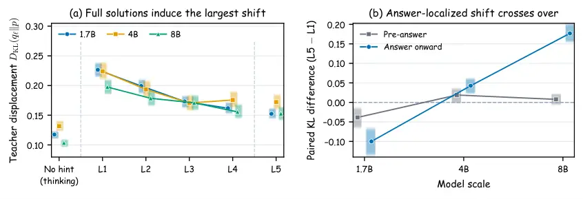
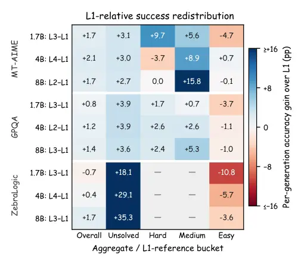
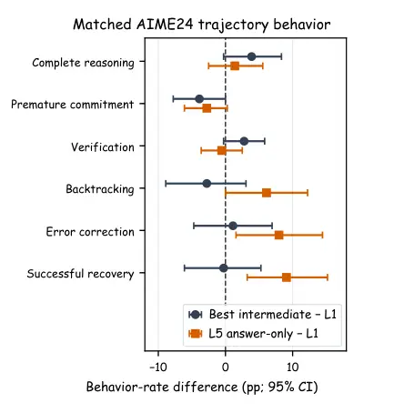

^(†)^(†) $`\dagger`$ Corresponding author. This work was performed at
Shanghai AI Laboratory.^(†)^(†) $`*`$ Code is available at
[https://github.com/tiankanghui/Self-Teacher-Context-Design](https://github.com/tiankanghui/Self-Teacher-Context-Design).

# What Should a Self-Teacher See? Privileged Context Design for On-Policy Self-Distillation

Kanghui Tian Affiliation: Fudan University Affiliation: Shanghai
Artificial Intelligence Laboratory    Siyuan Liu Affiliation: Nanjing
University    Tianxiang Jiang Affiliation: Shanghai Artificial
Intelligence Laboratory    Shuai Dong Affiliation: Fudan University   
Yizhuo Li Affiliation: Shanghai Jiao Tong University    Tian Ding
Affiliation: Peking University    Yuan Guo Affiliation: University of
California, Los Angeles    Songze Li Affiliation: Fudan University   
Haowen Hou Affiliation: Shanghai Jiao Tong University    Congcong Wang
Affiliation: Tongji University    Yi Wang^($`\dagger`$) Affiliation:
Shanghai Artificial Intelligence Laboratory

###### Abstract

More privileged information does not always make a better teacher. We
study this tension in on-policy self-distillation (OPSD), where a
self-teacher scores the student’s own rollouts under privileged context,
conventionally a complete reference solution that bundles the final
answer with one particular reasoning path. Holding the student view and
training fixed within each scale, we compare that default against three
abstractions compiled offline, a _named strategy_, a _method-independent
framing_, and a _problem category_, and against an _answer-only_ control
that keeps the destination but removes the path. In the primary runs on
competition mathematics, the best intermediate contexts improve the
in-domain peak mean over the full solution by 1.4 points at 4B and 1.6
at 8B, while storing an order of magnitude fewer hint tokens.
Comparisons across three seeds also show positive mean gains for the
framing and category contexts at both scales. Answer-only conditioning
remains competitive in the primary runs, within 0.2 points of the full
solution at these scales. The preferred context varies with student
scale and task. Initial teacher–student KL does not order downstream
performance. What a self-teacher should see is therefore not everything
it could, but the level of abstraction its student can still act on.

## 1 Introduction

On-policy self-distillation (OPSD) promises dense reasoning supervision
without a more capable online teacher. The student samples a trajectory
from the problem alone, and a frozen copy of its initial checkpoint
provides next-token distributions at the same prefixes while observing
teacher-only information, such as a verified solution \[1\]. Whereas
conventional on-policy distillation typically derives its teacher
advantage from greater model capability \[2, 3\], OPSD relies on
_information asymmetry_ instead, which makes the design of this
privileged context part of the supervision mechanism.

More detailed context, however, need not provide more useful
supervision: under peak reporting on competition mathematics, replacing
the full solution with its final answer alone changes 4B and 8B
aggregate scores by less than 0.2 points. A full worked solution
supplies an explicit procedure but may anchor the teacher’s guidance to
a particular derivation, whereas an abstract hint or bare answer offers
less procedural support and more latitude in how the problem is solved.
These choices can change which continuations the teacher favors, not
merely how strongly its distribution differs from the student’s. This
raises a central question: _at what level of abstraction should a
self-teacher see a reference solution, and how should that choice depend
on the student and task?_

Prior work demonstrates the value of privileged solutions for
self-distillation \[1\], while also identifying risks of reduced
exploration and reference-path bias \[4, 5\]. ATESD varies the visible
reference prefix while retaining the answer \[6\], and a broader
reference-type comparison includes abstract hints \[7\]. Using a
training-free gradient-alignment proxy, Armandpour et al. \[8\] report
no universally best distillation context and rank summarized
demonstrations above raw ones for their larger student. What remains
unclear is how adjacent semantic abstractions without explicit solution
steps affect student performance across scales and tasks.

We study this question through controlled interventions on the context
supplied to a fixed self-teacher (Figure 1). Starting from the same
problem–solution pairs, an offline compiler constructs three
progressively more abstract context packages: a named strategy (L2), a
method-independent framing (L3), and a problem category (L4), all
generated under contracts that prohibit the final answer. We compare
these with the full solution (L1), an answer-only condition (L5), and a
control that shortens the reference to a fixed 10% prefix plus the
answer without semantic rewriting. Across three Qwen3 student scales
\[9\], we hold the student prompt, frozen teacher checkpoint, training
set, rollout procedure, and loss fixed within each scale, and we
evaluate on three competition mathematics benchmarks and four transfer
benchmarks. We assess context utility through student performance after
training and use initial teacher–student KL as a separate diagnostic.

Figure 1: Study overview. (a) An offline compiler produces reusable
contexts from coarse to fine (L4$`\to`$L3$`\to`$L2); L1 is the original
solution and L5 its final answer. Labels give mean token counts. (b) The
student samples $`y`$ from $`x`$ alone, while a frozen copy of the base
model scores the same prefixes with additional context $`c_{\ell}(x)`$;
only the student is updated. (c) Peak aggregate scores relative to L1
for the primary compiler (solid lines, seed 42) and the single-run
Qwen3-8B replication (pale bars). The two compilers agree at the family
level but not on the best intermediate level. Replications of L1, L3,
and L4 across three seeds appear in Table 3.

Our contributions are:

- •
  Concise semantic contexts can outperform full solutions. In the
  primary runs, the best intermediate context exceeds the full solution
  by 1.4 and 1.6 points in the 4B and 8B in-domain peak means while
  storing an order of magnitude fewer hint tokens (Table 1). Across
  three seeds, L3 and L4 show positive mean gains over L1 at 4B and 8B
  under all four reporting rules. Recompiling the contexts with Qwen3-8B
  also preserves the peak advantage at the larger scales. The preferred
  representation varies with student scale and task.
- •
  Answer-only context remains competitive at the larger scales.
  Answer-only conditioning comes within 0.2 points of the full
  solution’s in-domain peak mean at 4B and 8B, though it trails by 1.76
  points at 1.7B.
- •
  Distributional displacement does not order teaching utility. The full
  solution induces the largest initial teacher–student KL at every
  scale, yet does not yield the highest in-domain peak mean at 4B or 8B.
  Item-level analysis shows context redistributing which problems the
  trained student solves. Privileged context is therefore best judged by
  the students it trains.

## 2 Related Work

#### On-Policy Distillation.

Knowledge distillation transfers model predictions or reasoning traces
\[10, 11, 12\], and bootstrapped methods learn from the model’s own
successful rationales \[13\]. On-policy distillation instead supplies
token-level teacher feedback on trajectories sampled from the student’s
current policy \[2, 3, 14, 15\], with later work refining the objective
\[16, 17, 18\], conditioning the self-teacher on demonstrations \[19\],
or combining it with an external teacher \[20\]. Our baseline is OPSD,
which conditions the frozen self-teacher on a complete reference
solution \[1\]; that choice of context is the variable we study.

#### Privileged Information and Reasoning Guidance.

Privileged context gives the teacher access to information withheld from
the student. This makes OPSD an instance of learning using privileged
information: the teacher sees training-time signals the student will not
receive at inference \[21, 22\]. Context distillation internalizes
prompt-induced behavior into parameters \[23\]. The privileged signal
takes many forms: feedback and self-generated traces \[24, 25\],
contextual instructions such as concision \[26, 27\], recoverable visual
cues and other forms of privileged information \[28, 29, 30\], and
majority-vote pseudo-solutions requiring no external supervision \[31\].
It also enters at different stages, through partial references during
generation \[32\] or step-level process supervision \[33\]. Given a
solution, designing the teacher context requires deciding which parts to
expose and in what form.

#### Reference Exposure.

ATESD learns how much of a reference reasoning prefix to expose while
retaining the final answer \[6\]. Complementary analyses examine the
supervision induced by reference conditioning, identifying confidence
miscalibration \[34\], failures under long generation budgets \[4\], and
per-token bias toward the supplied solution \[5\]. Reference controls
distinguish problem-specific information from context-induced teacher
behavior \[35\]. Beyond exposure length, Shrestha and Tessier \[7\]
compare teacher modes and reference types, including a method-level
abstract-hint condition, and analyze how teacher supervision aligns with
changes in student predictions. Using a training-free gradient-alignment
proxy, Armandpour et al. \[8\] likewise report no universally best
context, ranking summarized demonstrations above raw ones for their
larger student. PS-OPSD recasts the reference as a problem-solving
structure with a selected path of state transitions \[36\]. We instead
compare three adjacent abstraction levels that omit explicit solution
steps, training one student per level.

## 3 Privileged Context as a Controlled Intervention

We treat the context package supplied to the teacher as the intervention
and evaluate its utility after student training. This section formalizes
the comparison, describes on-policy supervision and staged context
construction, and specifies the diagnostic tests and controls.

### 3.1 Problem formulation

Let $`\mathcal{D}=\{(x_{i},s_{i})\}_{i=1}^{N}`$ be a training set of
problems and their reference solutions. A context policy $`c_{\ell}`$
maps each training problem to a precomputed prompt for the teacher:

```math
c_{\ell}(x)=B_{\ell}\!\left(x,h_{\ell}(x)\right), \tag{1}
```

where $`h_{\ell}(x)`$ is a representation constructed from the problem
and its reference solution, and $`B_{\ell}`$ is the prompt template that
combines the original problem, the representation, and the wording that
introduces it. We refer to this introductory wording as the _bridge_.
The student receives $`x`$ alone; the context policy affects only the
supervision supplied by a frozen teacher.

In on-policy supervision, the teacher scores the student’s own prefixes,
which may depart from the reference derivation. We therefore test which
representation of that reference provides the most useful supervision.

Our target is the utility of a context _after training_, rather than a
property of the teacher distribution alone. Let $`\theta_{\ell,\xi,k}`$
denote the student checkpoint at step $`k\in\mathcal{S}`$, trained from
the shared initialization $`\theta_{0}`$ under context $`c_{\ell}`$ and
training randomness $`\xi`$, with the remaining pipeline fixed;
$`\theta_{0}`$ also serves as the frozen teacher checkpoint. For a
benchmark $`\mathcal{B}`$ and a specified reporting rule $`r`$, we
define

```math
U_{\mathcal{B},r}(c_{\ell};\theta_{0})=\mathbb{E}_{\xi}\!\left[r\!\left(\{\operatorname{Score}_{\mathcal{B}}(\theta_{\ell,\xi,k})\}_{k\in\mathcal{S}}\right)\right]. \tag{2}
```

Here, $`r`$ may report a peak score, a fixed endpoint, or another
checkpoint aggregate. Dependence on the fixed training set and pipeline
is suppressed. Context design then amounts to maximizing
$`U_{\mathcal{B},r}`$ over a candidate set of context policies. In the
primary study, each training run uses a fixed context level. We vary
this level across runs to test whether the best representation changes
with student scale, evaluation task, or reporting rule, instead of
assuming a universally optimal context. Supplementary experiments
examine heterogeneous assignment and learned routing (Section 4.2).

### 3.2 How context enters on-policy self-distillation

Context changes the teacher’s supervision targets without changing its
parameters. At each update, the current student samples a trajectory
$`y=(y_{1},\ldots,y_{T})\sim p_{\theta}(\cdot\mid x)`$, and a frozen
copy of the initial checkpoint scores the same trajectory prefixes with
privileged context:

```math
p_{\theta,t}(\cdot)=p_{\theta}(\cdot\mid x,y_{<t}),\qquad q_{\ell,t}(\cdot)=p_{\theta_{0}}(\cdot\mid c_{\ell}(x),y_{<t}). \tag{3}
```

At a fixed problem and prefix, changing $`c_{\ell}(x)`$ changes the
effective teacher distribution even though $`\theta_{0}`$ is unchanged.

Every condition uses the same clipped full-vocabulary objective. Writing
$`d`$ for this shared objective, the loss for each trajectory is

```math
\mathcal{L}_{\ell}(\theta;x,y)=\frac{1}{T}\sum_{t=1}^{T}d\!\left(q_{\ell,t},p_{\theta,t}\right). \tag{4}
```

Appendix A.1 gives the exact clipping and reduction. The teacher is
frozen and the sampled trajectory is fixed when differentiating this
loss, so a context change can alter both the magnitude and the direction
of $`-\nabla_{\theta}\mathcal{L}_{\ell}`$. Greater teacher–student
disagreement need not imply a more useful update.

The context package is used only for teacher scoring: the student never
receives the hint or bridge, during rollout generation or at evaluation.
Within each primary comparison we hold the student initialization,
student prompt, frozen teacher checkpoint, training set, rollout
procedure, training budget, and loss fixed. What is fixed is the
_rollout procedure_, not the realized trajectories: as students learn
under different contexts, their subsequent on-policy trajectories can
diverge, and this feedback is part of the end-to-end effect being
evaluated. Following Zhao et al. \[1\], the teacher scores with Qwen3’s
thinking template while student rollouts use the non-thinking template
(Appendix A.1), an interface difference common to L1–L5.

### 3.3 Constructing matched semantic contexts

We compare representations that vary in their intended specificity to
the reference reasoning path (Figure 1(a)). L1 provides the complete
reference solution. L2 names a method, theorem, or tool without working
through solution steps; L3 gives a method-independent framing of the
problem; L4 gives only its mathematical domain and object category. All
three contracts prohibit the final answer. L5 supplies only the final
answer as reference content and serves as the answer-only control.

We define the L1–L4 ordering through the semantic contracts used to
generate L2–L4 (Appendix B.1), and audit compliance in the resulting
contexts (Table 7). Each of L2–L4 is newly written rather than a
truncation of L1, so the ordering expresses intended abstraction rather
than nested text, and our comparisons treat each representation as a
complete context package.

#### Staged Semantic Compilation.

Let $`s(x)`$ denote the existing reference solution and $`G_{\phi}`$ an
offline compiler. We construct L2–L4 by refining from coarse to fine,
each call receiving the problem, the reference solution, and every
coarser representation already produced:

```math
h_{\ell}(x)=G_{\phi}^{(\ell)}\!\left(x,s(x),\{h_{\ell^{\prime}}(x)\}_{\ell<\ell^{\prime}\leq 4}\right),\qquad\ell=4,3,2, \tag{5}
```

so that $`h_{4}`$ is compiled from the problem and solution alone.
Passing the coarser outputs to finer calls makes the intended semantic
boundaries explicit. L1 uses the original solution and L5 extracts its
final answer, so neither requires compilation; Appendix B.1 shows all
conditions for one problem.

The primary contexts are compiled with Qwen3.5-397B-A17B \[37\], and we
repeat the same staged contracts with Qwen3-8B in thinking mode to test
sensitivity to the choice of compiler. Both compilers receive the
existing reference solutions, and all contexts are precomputed, so
neither compiler is queried during OPSD training.

### 3.4 Utility estimation and diagnostic tests

We evaluate context utility through student scores after training under
the reporting rule in Equation 2. For the in-domain comparison, we train
students under L1, L3, and L4 with three seeds at each scale and apply
four checkpoint aggregation rules, two of them selection-free. For L2
and L5, the transfer evaluations, and the supplementary controls, we
report one training run per condition rather than averages across seeds.
Where reported, resampling matched items quantifies evaluation
uncertainty, not variability across training runs. Peak and
selection-free rules define different estimands and are distinguished
throughout.

#### Distributional Discrepancy.

We separately measure how much a context changes the frozen base model’s
next-token distribution. Within each scale, let $`\mu_{0}`$ denote the
shared empirical distribution of problem–prefix pairs from fixed
rollouts of the base model. We compute

```math
D(c_{\ell})=\mathbb{E}_{(x,y_{<t})\sim\mu_{0}}\left[D_{\mathrm{KL}}\!\left(q_{\ell,t}\,\|\,p_{\theta_{0},t}\right)\right], \tag{6}
```

where $`p_{\theta_{0},t}(\cdot)=p_{\theta_{0}}(\cdot\mid x,y_{<t})`$.
Using the same prefixes from the base model across contexts avoids
mixing changes induced by context with differences in trained students’
rollout distributions. This diagnostic measures distributional
discrepancy; it is not the clipped training objective, an update norm,
or a direct measure of teacher quality.

#### Empirical Predictions.

We test three deliberately strong baseline predictions, none of which is
assumed by the formulation. _Full-solution dominance_ predicts that L1
yields the greatest downstream utility. _Discrepancy-based ordering_
predicts that contexts with larger $`D(c_{\ell})`$ also yield greater
utility at a fixed student scale, task, and reporting rule. _Context
invariance_ predicts that one context is preferred across student
scales, tasks, and reporting rules; we test it through ranking changes
across scales and benchmarks, with item-level gains and losses relative
to L1 describing how a given ranking arises.

### 3.5 Intervention validity and scope

In the primary comparisons, we vary the complete context package while
holding the source problem–solution pairs and the training recipe fixed
within each scale, so context is the only variable. The packages can
still differ in semantic content, length, answer access, and, in the
primary runs, bridge wording. Hints generated from the same reference
solutions can also differ in quality. These comparisons therefore
evaluate the packages as a whole rather than isolating the causal effect
of semantic abstraction.

L1 versus L2–L4 tests whether exposing the complete derivation is
preferable to the intermediate packages. Comparisons within L2–L4 test
the utility of adjacent semantic roles, and L5 tests supervision from
the final answer alone.

Across scales the student and training recipe change together, including
the effective batch size (Table 4), which makes the scale comparison one
between trained systems rather than parameter count alone. Section 4.2
reports controls that each narrow a specific alternative explanation.

#### Context Length.

We distinguish the size of the reusable hint from the length of the
teacher’s context prompt. Under the Qwen3 tokenizer, the primary L2–L4
hints average 38.9, 25.2, and 17.7 tokens against 657.3 for L1, a
16.9–37.1$`\times`$ reduction in stored hint content; including the
problem and bridge, the context prompts average 225.5, 212.7, and 203.3
tokens against 835.0, a 3.7–4.1$`\times`$ reduction (Appendix Figure
4(a); Table 6). Both quantify context cost rather than semantic content.

#### Content Audits.

Full-corpus scans find no empty hints, generation-error sentinels, or
lexical answer matches for either compiler. A matched audit of 1,200
problems finds no direct answer copying, but does detect
answer-equivalent leakage: 1.42% at L2 and 0.33% at L3 for the primary
compiler, rising to 4.17% and 2.58% for Qwen3-8B, with L4 at 0.08% and
0.17% (Table 7). Appendix B.3 gives the definitions and prompts for this
model-assisted audit.

## 4 Experiments

We train Qwen3-1.7B, 4B, and 8B \[9\] for 200 steps with LoRA \[38\] on
the 29,434-problem OPSD mathematics pool \[1, 39\], checkpointing every
25 steps. At each scale, the student and the frozen self-teacher start
from the same checkpoint, and the primary L1–L5 runs share the data
order, rollout procedure, objective, and recipe, with no tuning by
context level (Appendices A.1 and B.2). Base denotes the unadapted
checkpoint.

Avg@12 averages correctness over twelve sampled completions per problem.
Following the original OPSD convention, we report each in-domain (ID)
benchmark’s best Avg@12 across the eight checkpoints. The _ID peak mean_
averages these separately selected peaks on AIME24, AIME25, and HMMT25,
so it need not represent a single checkpoint; we also report the
selection-free step-200 mean and every checkpoint (Appendix C.3). At
step 200, transfer evaluation uses MT-AIME2024-7Lang \[40\] (macro
Avg@12 over seven languages), AutoLogi-EN \[41\] (verifier accuracy),
GPQA-Diamond \[42\] (Avg@10), and ZebraLogic-grid \[43\] (exact puzzle
accuracy; Appendix A.2). All score differences are in percentage points.

### 4.1 Context utility varies with student scale and task

#### In-domain Performance.

The best intermediate context exceeds the full solution by 1.39 points
at 4B and 1.57 at 8B, while L1 keeps the highest peak mean at 1.7B, 0.28
ahead of L4 (Table 1). The winning level does not shift monotonically
toward coarser context with scale. At step 200, L1 still leads at 1.7B,
while at 4B both L2 and L4 reach 62.59 against 60.93 for L1, and at 8B
L3 reaches 65.37 against 65.28 (Appendix C.3).

|       |           |       |              |              |             |              |            |
| ----- | --------- | ----- | ------------ | ------------ | ----------- | ------------ | ---------- |
| Model | Benchmark | Base  | L1: solution | L2: strategy | L3: framing | L4: category | L5: answer |
| 1.7B  | AIME24    | 49.72 | 57.22        | 56.11        | 56.94       | 59.72        | 57.78      |
|       | AIME25    | 36.39 | 43.33        | 38.33        | 41.39       | 43.06        | 41.67      |
|       | HMMT25    | 21.67 | 31.11        | 28.06        | 30.00       | 28.06        | 26.94      |
|       | Mean      | 35.93 | 43.89        | 40.83        | 42.78       | 43.61        | 42.13      |
|       | _vs. L1_  | −7.96 | ref.         | −3.06        | −1.11       | −0.28        | −1.76      |
| 4B    | AIME24    | 75.00 | 76.94        | 76.94        | 77.50       | 76.94        | 75.28      |
|       | AIME25    | 64.44 | 68.61        | 69.44        | 69.72       | 69.17        | 70.56      |
|       | HMMT25    | 41.39 | 44.72        | 45.83        | 47.22       | 47.78        | 45.00      |
|       | Mean      | 60.28 | 63.43        | 64.07        | 64.81       | 64.63        | 63.61      |
|       | _vs. L1_  | −3.15 | ref.         | +0.65        | +1.39       | +1.20        | +0.19      |
| 8B    | AIME24    | 75.28 | 78.89        | 79.72        | 79.44       | 80.56        | 78.61      |
|       | AIME25    | 66.94 | 73.06        | 74.17        | 71.39       | 71.39        | 72.78      |
|       | HMMT25    | 44.17 | 48.06        | 50.83        | 49.72       | 49.72        | 48.89      |
|       | Mean      | 62.13 | 66.67        | 68.24        | 66.85       | 67.22        | 66.76      |
|       | _vs. L1_  | −4.54 | ref.         | +1.57        | +0.19       | +0.56        | +0.09      |

Table 1: In-domain peak Avg@12 (%), primary compiler for L2–L4. All
entries are the primary run (seed 42); Table 3 reports replication of
L1, L3, and L4 across three seeds. Mean averages separately selected
benchmark peaks; Base is evaluated once. Bold marks the highest score
among the trained conditions in each row. The _vs. L1_ rows give each
column’s mean minus the mean for the full solution in percentage points,
green above L1 and red below. Selected steps are listed in Appendix C.3.

|                  |        |            |        |            |        |            |
| ---------------- | ------ | ---------- | ------ | ---------- | ------ | ---------- |
|                  | 1.7B   |            | 4B     |            | 8B     |            |
| Benchmark        | Winner | $`\Delta`$ | Winner | $`\Delta`$ | Winner | $`\Delta`$ |
| MT-AIME-7Lang    | L3     | +1.71      | L4     | +2.10      | L2     | +1.71      |
| GPQA-Diamond     | L3     | +0.81      | L2     | +1.21      | L3     | +1.41      |
| ZebraLogic       | L1     | –          | L4     | +0.40      | L3     | +1.70      |
| AutoLogi         | L4     | +0.19      | L5     | +0.38      | L1     | –          |
| Distinct winners | 3      |            | 3      |            | 3      |            |

Table 2: No context leads across the whole transfer suite. For each
scale and benchmark, _Winner_ is the highest-scoring context at step 200
(primary runs, seed 42) and $`\Delta`$ its margin over L1 in percentage
points; – marks the two cells where L1 itself wins. The last row counts
how many distinct contexts win the four benchmarks at that scale. Full
scores are in Appendix Table 9.

#### Transfer Rankings Vary by Task.

At step 200, different transfer tasks favor different contexts (Table
2), and this variation appears even within a single scale: at 1.7B, L3
leads on MT-AIME and GPQA while L1 leads on ZebraLogic. Because all
conditions are evaluated at step 200, these ranking changes do not
result from selecting different checkpoints for different conditions.

#### Answer-only Context.

L5 is within 0.2 points of L1’s ID peak mean at 4B and 8B, but trails L1
by 1.76 points at 1.7B (Table 1). Answer access without supplied
reasoning is therefore competitive without reaching the highest observed
utility: the leading intermediate context exceeds L5 at both larger
scales, and on ZebraLogic at 8B, L3 scores 88.10 against 85.90.

### 4.2 Robustness and alternative explanations

#### Checkpoint Aggregation and Training Seeds.

We replicate the L1, L3, and L4 in-domain comparison with three training
seeds at every scale and aggregate each run under four checkpoint rules
(Table 3). At 4B and 8B, the mean paired gains of both L3 and L4 over L1
are positive under all four rules, and under the selection-free mean
across all checkpoints every individual seed favors both intermediate
levels. L4 attains a positive paired peak difference in all three seeds
at both scales, whereas L3 does not at 4B seed 43 or 8B seed 44; at the
endpoint L3 leads in all six runs and L4 in three. At 1.7B, the mean
paired peak differences are $`-0.12`$ and $`0.00`$ points for L3 and L4,
respectively; the two selection-free rules favor L1 on average. The
endpoint at step 200 carries the largest paired standard deviation in
five of the six contrasts. This is the pattern the remaining controls
follow: they reproduce the contrast between full and intermediate
contexts more consistently than any particular winner among L2–L4.

|         |          | Checkpoint selected by score |                    | Selection-free     |                    |
| ------- | -------- | ---------------------------- | ------------------ | ------------------ | ------------------ |
| Student | Contrast | Per-bench. peak              | Best common        | All-ckpt. mean     | Step 200           |
| 1.7B    | L3 − L1  | −0.12 ± 0.86 (2/3)           | −0.12 ± 0.47 (1/3) | −0.14 ± 0.70 (1/3) | −0.83 ± 2.33 (1/3) |
|         | L4 − L1  | 0.00 ± 0.33 (1/3)            | +0.06 ± 0.05 (2/3) | −0.32 ± 0.68 (1/3) | −1.33 ± 2.04 (1/3) |
| 4B      | L3 − L1  | +0.71 ± 0.69 (2/3)           | +0.90 ± 0.23 (3/3) | +1.03 ± 0.15 (3/3) | +1.67 ± 0.73 (3/3) |
|         | L4 − L1  | +0.96 ± 0.21 (3/3)           | +1.64 ± 0.60 (3/3) | +1.01 ± 0.32 (3/3) | +1.05 ± 1.32 (2/3) |
| 8B      | L3 − L1  | +0.25 ± 0.65 (2/3)           | +0.62 ± 0.44 (3/3) | +0.49 ± 0.34 (3/3) | +0.28 ± 0.32 (3/3) |
|         | L4 − L1  | +0.49 ± 0.37 (3/3)           | +0.80 ± 0.81 (2/3) | +0.62 ± 0.13 (3/3) | +0.22 ± 1.05 (1/3) |

Table 3: In-domain differences from L1, paired by training seed (42–44).
Cells show mean $`\pm`$ sample SD in percentage points; $`(n/3)`$ counts
strictly positive differences. SD describes variation across seeds, not
a confidence interval. Peak selects each benchmark’s best checkpoint;
best common selects one checkpoint per run by the three-benchmark mean.
Green/red indicate positive/negative mean differences. Absolute scores
are in Appendix C.3.

#### Compiler Replication.

Regenerating L2–L4 with Qwen3-8B, under the same semantic contracts and
training conditions, preserves the ID peak ordering between full and
intermediate contexts: L1 leads at 1.7B, and intermediate contexts
exceed it at 4B and 8B. At 8B the compiler and student have the same
nominal parameter count. The preferred intermediate changes at 4B, from
L3 to L4. The 8B compiler also shows higher L2/L3 answer-equivalent
leakage, so the packages are not identical in quality; its L4 leakage is
only 0.17%, however, and L4 likewise trails L1 at 1.7B and exceeds it at
4B and 8B (Appendix C.2; Table 7).

#### Semantic Rewriting vs. Prefix Truncation.

A control using a 10% reference prefix plus the answer, inspired by Han
et al. \[6\], tests whether shortening the reference without semantic
rewriting recovers the observed gains. In one 4B run, the prefix control
reaches an ID peak mean of 63.89, above L1 and L5 but below all three
intermediate contexts, with L3 and L4 ahead by 0.93 and 0.74 points
(Appendix C.2, Table 13). At step 200 it nearly matches L3 (61.67
against 61.76), though L4 remains 0.93 points ahead. Semantic rewriting
therefore yields the higher peaks here, and like the other conditions,
the prefix differs from L2–L4 in answer access as well as length
(Section 3.5).

#### Bridge Wording and Rollout Length.

With a bridge shared across levels, every intermediate context exceeds
L1 by 1.0–2.3 ID peak points (Table 20), and doubling the rollout budget
from 1,024 to 2,048 tokens leaves every intermediate context at or above
L1 on the peak mean (Appendix C.3). Neither bridge wording nor the
original length limit is therefore sufficient to explain the contrast.

#### Mixtures and Routing.

Heterogeneous context assignment does not consistently improve on a
fixed level. Across balanced mixtures and four routing policies, no run
exceeds the best fixed-level ID peak, though some exceed the best
fixed-level mean at step 200 (Appendix E).

### 4.3 Distributional discrepancy does not order context utility

For each scale, the unadapted base model generates two rollouts on each
of 600 training problems using the exact student prompt. We rescore
identical completion tokens under the student prompt, the L1–L5 teacher
packages, and a reference using the teacher interface without a hint,
computing unclipped full-vocabulary
$`D_{\mathrm{KL}}(q_{\ell,t}\|p_{\theta_{0},t})`$ on shared prefixes as
in Equation 6 (Appendix D.1).

L1 has the largest mean KL at every scale (Figure 2(a)). Every package
displaces the base distribution well beyond the no-hint interface, so
the displacement reflects the supplied context rather than the teacher
template alone. Intermediate contexts nevertheless achieve higher 4B and
8B ID peak means with smaller initial discrepancies, so these KL values
do not monotonically order the observed peak utilities. Training-free
analysis points the same way, reporting only weak within-path
correlations between teacher–student divergence and the usefulness of
the resulting gradient \[8\].



Figure 2: Distributional discrepancy induced by context at
initialization, measured on fixed rollouts from the base model with
unclipped full-vocabulary KL (95% bootstrap intervals clustered by
problem). (a) Mean teacher-to-student KL per context; the no-hint
interface and L5 are reference conditions outside the L1–L4 hierarchy.
(b) Paired $`\mathrm{L5}-\mathrm{L1}`$ differences in pre-answer and
answer-onward windows around the final \boxed marker (Appendix D.1).

#### Answer-Aligned Differences also Vary with Scale.

These means average over all token positions, so we also examine the KL
around the final answer. On the subset of rollouts aligned at the final
boxed answer, the answer-onward $`\mathrm{L5}-\mathrm{L1}`$ KL
difference is $`-0.100`$ at 1.7B but $`+0.043`$ and $`+0.177`$ at 4B and
8B (Figure 2(b)). Answer-only context therefore displaces the answer
region less than the full solution at the smallest scale and more at the
larger ones, as a localized distributional comparison rather than a
measure of answer correctness.

### 4.4 Context changes which problems are solved

On MT-AIME, GPQA, and ZebraLogic, we compare L1 with the highest-scoring
intermediate condition at step 200 for each scale–task pair. Let
$`\hat{a}^{\mathrm{L1}}_{i}`$ denote L1’s fraction of correct
completions on item $`i`$. We classify items as unsolved
($`\hat{a}^{\mathrm{L1}}_{i}=0`$), hard ($`(0,0.25)`$), medium
($`[0.25,0.75)`$), or easy ($`[0.75,1]`$); ZebraLogic’s binary outcomes
populate only the unsolved and easy buckets. The intermediate condition
is selected on the same evaluation used for the comparison, so these
analyses describe outcome differences rather than evaluate a selection
policy.

#### Gains are Not Uniform across Difficulty Buckets.

Intermediate contexts recover some items unsolved by L1 and improve
accuracy in the medium bucket, while sometimes reducing accuracy in L1’s
easy bucket (Figure 3; Appendix Table 18). To check dependence on using
L1 to define difficulty, we also group items by Base success rates,
keeping the same thresholds and the same already selected intermediate
condition, so only the stratification variable changes. Across the six
MT-AIME and GPQA scale–task pairs, differences in the medium bucket
remain positive at 1.14–10.12 points, whereas differences in the easy
bucket range from $`-0.77`$ to $`+1.65`$ points.



Figure 3: Per-generation accuracy differences at step 200 between L1 and
the highest-scoring intermediate context for each scale–task pair, by
difficulty bucket under L1. Positive values favor the intermediate
context.

#### Solved-Set Differences Explain the ZebraLogic Contrast.

The fraction of puzzles unsolved by L1 that the selected intermediate
rescues rises from 18% at 1.7B to 35% at 8B, while losses on previously
solved puzzles shrink. The net accuracy difference changes from
$`-0.70`$ to $`+1.70`$ points (Appendix Figure 8). At 1.7B, therefore,
recovering some previously unsolved puzzles is compatible with lower
overall accuracy; at 8B, the balance of gains and losses favors the
intermediate context.

#### Behavioral Shifts Vary across Scales.

We additionally compare model-judged behaviors on matched AIME24
trajectories, selecting the intermediate context by its score on the
full AIME24 evaluation at step 200 and including L5 as a separate
contrast. Per scale, relative to L1, backtracking rises at 1.7B and
falls at 4B and 8B, while explicit correction rises at 1.7B, is
unchanged at 4B, and falls at 8B (Table 19); Figure 10 pools these
scales into a single aggregate (Appendix D.2). Because these shifts
differ across scales, the pooled estimate should not be read as showing
behavioral invariance. Neither the per-scale nor the pooled results
support an account in which intermediate contexts help by consistently
increasing observable backtracking or correction.

### 4.5 Interpretation and limits

One explanation for these patterns is that full solutions and abstract
contexts place different demands on the self-teacher. L1 supplies an
executed procedure, which may help when the model cannot reconstruct one
from a sparse cue but may also anchor its guidance to the reference
derivation, whereas L2–L4 leave more of the procedure to the
self-teacher when it evaluates prefixes generated by the student.
Teacher and student capacity covary through the shared base checkpoint,
so varying the compiler does not separate the teacher’s ability to use
the context from the student’s ability to learn from the resulting
targets. The analyses at step 200 characterize differences in item-level
success and observable reasoning behavior; they do not identify what
produces the separately selected peak gains (Section 3.5; Appendix C.4).

## 5 Conclusion

In OPSD, privileged context serves as a tunable supervision interface,
shaping the targets a self-teacher provides on the student’s own
trajectories. What, then, should a self-teacher see? Our comparisons
show that concise semantic abstractions can outperform full solutions,
with the preferred representation depending on student scale and task. A
larger initial teacher–student KL does not guarantee better learning
outcomes. Item-level analyses further show that context choice produces
gains on some problems and losses on others. Reliably selecting context
granularity from signals available during training remains an open
challenge. Through controlled comparisons of context representations,
our study establishes context granularity as a design axis in OPSD. The
guiding principle is to evaluate what the teacher sees by what the
student learns.

## Acknowledgments

This work is supported by the College of Computer Science and Artificial
Intelligence, Fudan University and the Shanghai Artificial Intelligence
Laboratory.

## References

- \[1\] S. Zhao, Z. Xie, M. Liu, J. Huang, G. Pang, F. Chen, and A.
  Grover (2026) Self-distilled reasoner: on-policy self-distillation for
  large language models. In Forty-third International Conference on
  Machine Learning, External Links:
  [Link](https://openreview.net/forum?id=Jpxfof0EaS) Cited by: §1, §1,
  §2, §3.2, §4.
- \[2\] R. Agarwal, N. Vieillard, Y. Zhou, P. Stanczyk, S. Ramos, M.
  Geist, and O. Bachem (2024) On-policy distillation of language models:
  learning from self-generated mistakes. In International Conference on
  Learning Representations, Cited by: §A.1, §1, §2.
- \[3\] K. Lu and Thinking Machines Lab (2025) On-policy distillation.
  Thinking Machines Lab: Connectionism. Note:
  https://thinkingmachines.ai/blog/on-policy-distillation External
  Links: [Document](https://dx.doi.org/10.64434/tml.20251026) Cited by:
  §1, §2.
- \[4\] S. Kaur, N. Ri, Y. He, L. Fowl, and S. Arora (2026) Rethinking
  on-policy self-distillation for thinking models. arXiv preprint
  arXiv:2607.05184. External Links: 2607.05184,
  [Link](https://arxiv.org/abs/2607.05184) Cited by: §1, §2.
- \[5\] S. Harne, C. Karkar, Y. Pandya, A. Awadallah, and A.
  Nambi (2026) Privileged, but biased: how pi-conditioned teachers break
  self-distillation. arXiv preprint arXiv:2608.04794. Cited by: §1, §2.
- \[6\] Z. Han, T. Zhang, H. Wang, and Y. Sun (2026) Adaptive teacher
  exposure for self-distillation in llm reasoning. arXiv preprint
  arXiv:2605.11458. Cited by: §1, §2, §4.2.
- \[7\] S. Shrestha and A. Tessier (2026) Rethinking privileged
  information in on-policy self-distillation. External Links:
  2608.18271, [Link](https://arxiv.org/abs/2608.18271) Cited by: §1, §2.
- \[8\] M. Armandpour, F. Ilhan, D. Harrison, A. Jaiswal, D. N.
  Hoang, F. Faghri, Y. Zhang, M. Cho, and M. Farajtabar (2026) Unmasking
  on-policy distillation: where it helps, where it hurts, and why. ArXiv
  abs/2605.10889. External Links:
  [Link](https://api.semanticscholar.org/CorpusID:288256261) Cited by:
  §1, §2, §4.3.
- \[9\] Qwen Team (2025) Qwen3 technical report. arXiv preprint
  arXiv:2505.09388. Cited by: §1, §4.
- \[10\] G. Hinton, O. Vinyals, and J. Dean (2015) Distilling the
  knowledge in a neural network. arXiv preprint arXiv:1503.02531. Cited
  by: §2.
- \[11\] Y. Gu, L. Dong, F. Wei, and M. Huang (2024) MiniLLM: knowledge
  distillation of large language models. In International Conference on
  Learning Representations, B. Kim, Y. Yue, S. Chaudhuri, K.
  Fragkiadaki, M. Khan, and Y. Sun (Eds.), Vol. 2024, pp. 32694–32717.
  External Links:
  [Link](https://proceedings.iclr.cc/paper_files/paper/2024/file/8ac015d409635f196f9e3e9dcfb9a94e-Paper-Conference.pdf)
  Cited by: §2.
- \[12\] C. Hsieh, C. Li, C. Yeh, H. Nakhost, Y. Fujii, A. Ratner, R.
  Krishna, C. Lee, and T. Pfister (2023) Distilling step-by-step!
  outperforming larger language models with less training data and
  smaller model sizes. In Findings of the Association for Computational
  Linguistics: ACL 2023, A. Rogers, J. Boyd-Graber, and N. Okazaki
  (Eds.), Toronto, Canada, pp. 8003–8017. External Links:
  [Link](https://aclanthology.org/2023.findings-acl.507/),
  [Document](https://dx.doi.org/10.18653/v1/2023.findings-acl.507) Cited
  by: §2.
- \[13\] E. Zelikman, Y. Wu, J. Mu, and N. D. Goodman (2022) STaR:
  self-taught reasoner bootstrapping reasoning with reasoning. In
  Proceedings of the 36th International Conference on Neural Information
  Processing Systems, NIPS ’22, Red Hook, NY, USA. External Links: ISBN
  9781713871088 Cited by: §2.
- \[14\] W. Yang, W. Liu, R. Xie, K. Yang, S. Yang, and Y. Lin (2026)
  Learning beyond teacher: generalized on-policy distillation with
  reward extrapolation. External Links: 2602.12125,
  [Link](https://arxiv.org/abs/2602.12125) Cited by: §2.
- \[15\] W. Hou, S. Peng, W. Wang, Z. Ruan, Y. Zhang, Z. Zhou, M.
  Gao, Y. Chen, K. Wang, H. Yang, C. Zhang, Z. Tian, H. Hu, Y. Yang, F.
  Wu, and H. Fan (2026) Uni-OPD: unifying on-policy distillation with a
  dual-perspective recipe. arXiv preprint arXiv:2605.03677. Cited by:
  §2.
- \[16\] Y. Li, Y. Zuo, B. He, J. Zhang, C. Xiao, C. Qian, T. Yu, H.
  Gao, W. Yang, Z. Liu, and N. Ding (2026) Rethinking on-policy
  distillation of large language models: phenomenology, mechanism, and
  recipe. arXiv preprint arXiv:2604.13016. External Links: 2604.13016,
  [Link](https://arxiv.org/abs/2604.13016) Cited by: §2.
- \[17\] W. Jin, T. Min, Y. Yang, D. Wei, Y. Zhou, S. R. Kadhe, N.
  Baracaldo, and K. Lee (2026) Entropy-aware on-policy distillation of
  language models. In Forty-third International Conference on Machine
  Learning, External Links:
  [Link](https://openreview.net/forum?id=J5i09faOOf) Cited by: §2.
- \[18\] F. Luo, Y. Chuang, G. Wang, Z. Xu, X. Han, T. Zhang, and V.
  Braverman (2026) Demystifying OPD: length inflation and stabilization
  strategies for large language models. arXiv preprint arXiv:2604.08527.
  External Links: 2604.08527, [Link](https://arxiv.org/abs/2604.08527)
  Cited by: §2.
- \[19\] I. Shenfeld, M. Damani, J. Hübotter, and P. Agrawal (2026)
  Self-distillation enables continual learning. In Forty-third
  International Conference on Machine Learning, External Links:
  [Link](https://openreview.net/forum?id=qA6FgH0nnZ) Cited by: §2.
- \[20\] X. Yu, G. Li, Q. Si, G. Zhang, Y. Xu, C. Wang, S. Dong, K.
  Tuo, X. Zeng, K. Feng, Q. Wang, Y. Shi, X. Hu, X. Yue, J. Wang, and S.
  Yan (2026) DOPD: dual on-policy distillation. External Links:
  2606.30626, [Link](https://arxiv.org/abs/2606.30626) Cited by: §2.
- \[21\] V. Vapnik and A. Vashist (2009) A new learning paradigm:
  learning using privileged information. Neural Networks 22 (5-6),
  pp. 544–557. Cited by: §2.
- \[22\] D. Lopez-Paz, L. Bottou, B. Schölkopf, and V. Vapnik (2016)
  Unifying distillation and privileged information. In International
  Conference on Learning Representations, pp. 1–10. Cited by: §2.
- \[23\] C. Snell, D. Klein, and R. Zhong (2022) Learning by distilling
  context. arXiv preprint arXiv:2209.15189. Cited by: §2.
- \[24\] J. Hübotter, F. Lübeck, L. D. Behric, A. Baumann, M.
  Bagatella, D. Marta, I. Hakimi, I. Shenfeld, T. K. Buening, C.
  Guestrin, and A. Krause (2026) Reinforcement learning via
  self-distillation. In Forty-third International Conference on Machine
  Learning, External Links:
  [Link](https://openreview.net/forum?id=QkfkxyRizZ) Cited by: §2.
- \[25\] C. Yang, C. Qin, Q. Si, M. Chen, N. Gu, D. Yao, Z. Lin, W.
  Wang, J. Wang, and N. Duan (2026) Self-distilled rlvr. External Links:
  2604.03128, [Link](https://arxiv.org/abs/2604.03128) Cited by: §2.
- \[26\] H. Sang, Y. Xu, Z. Zhou, R. He, Z. Wang, and J. Sun (2026)
  CRISP: Compressed Reasoning via Iterative Self-Policy Distillation.
  arXiv e-prints, pp. arXiv:2603.05433. External Links:
  [Document](https://dx.doi.org/10.48550/arXiv.2603.05433), 2603.05433
  Cited by: §2.
- \[27\] T. Ye, L. Dong, X. Wu, S. Huang, and F. Wei (2026) On-policy
  context distillation for language models. arXiv preprint
  arXiv:2602.12275. External Links: 2602.12275,
  [Link](https://arxiv.org/abs/2602.12275) Cited by: §2.
- \[28\] Q. Yuan, J. Lou, X. Yu, H. Lin, L. Sun, X. Han, and Y.
  Lu (2026) Vision-opd: learning to see fine details for multimodal llms
  via on-policy self-distillation. External Links: 2605.18740,
  [Link](https://arxiv.org/abs/2605.18740) Cited by: §2.
- \[29\] K. Tian, S. Liu, Z. Yan, S. Xia, S. Dong, and Y. Wang (2026)
  ViCuR: visual cues as recoverable privilege for multimodal on-policy
  distillation. External Links: 2606.05718,
  [Link](https://arxiv.org/abs/2606.05718) Cited by: §2.
- \[30\] E. Penaloza, D. Vattikonda, N. Gontier, A. Lacoste, L. Charlin,
  and M. Caccia (2026) Privileged information distillation for language
  models. In Forty-third International Conference on Machine Learning,
  External Links: [Link](https://openreview.net/forum?id=ebZcMQImhG)
  Cited by: §2.
- \[31\] Y. Li, B. Wang, Y. Liang, Y. Tian, D. Fu, and N.
  Vasconcelos (2026) On-policy self-distillation without any
  supervision. arXiv preprint arXiv:2608.06296. Cited by: §2.
- \[32\] Y. Wu, S. Li, Z. Wen, X. Zhou, A. Talwalkar, Y. Yang, W. Huang,
  and T. Cai (2026) Learn hard problems during rl with reference guided
  fine-tuning. External Links: 2603.01223,
  [Link](https://arxiv.org/abs/2603.01223) Cited by: §2.
- \[33\] H. Lightman, V. Kosaraju, Y. Burda, H. Edwards, B. Baker, T.
  Lee, J. Leike, J. Schulman, I. Sutskever, and K. Cobbe (2024) Let’s
  verify step by step. In International Conference on Learning
  Representations, Cited by: §2.
- \[34\] J. Zhang, X. Peng, Q. Chen, Q. Ye, C. Xiong, and C. Wu (2026)
  The illusion of certainty: decoupling capability and calibration in
  on-policy distillation. arXiv preprint arXiv:2604.16830. External
  Links: 2604.16830, [Link](https://arxiv.org/abs/2604.16830) Cited by:
  §2.
- \[35\] Y. Ichihara, N. Iwase, M. A. Quamar, and J. Komiyama (2026)
  Privileged solutions or context-induced teacher behavior? dissecting
  on-policy self-distillation. arXiv preprint arXiv:2608.09228. Cited
  by: §2.
- \[36\] X. Zhao, L. Zhang, Z. Xu, Z. Wang, X. Caiyue, S. Zhao, and Q.
  Li (2026) Is more privileged information better? from solution traces
  to problem-solving structure in self-distilled reasoning. External
  Links: 2608.01589, [Link](https://arxiv.org/abs/2608.01589) Cited by:
  §2.
- \[37\] Qwen Team (2026) Qwen3.5: towards native multimodal agents.
  External Links: [Link](https://qwen.ai/blog?id=qwen3.5) Cited by:
  §3.3.
- \[38\] E. J. Hu, yelong shen, P. Wallis, Z. Allen-Zhu, Y. Li, S.
  Wang, L. Wang, and W. Chen (2022) LoRA: low-rank adaptation of large
  language models. In International Conference on Learning
  Representations, External Links:
  [Link](https://openreview.net/forum?id=nZeVKeeFYf9) Cited by: §4.
- \[39\] E. K. Guha, R. Marten, S. Keh, N. Raoof, G. Smyrnis, H.
  Bansal, M. Nezhurina, J. Mercat, T. Vu, Z. R. Sprague, A. Suvarna, B.
  Feuer, L. L. Chen, Z. Khan, E. Frankel, S. Grover, C. Choi, N.
  Muennighoff, S. Su, W. Zhao, J. Yang, S. Pimpalgaonkar, K.
  sharma, C. C. Ji, Y. Deng, S. M. Pratt, V. Ramanujan, J.
  Saad-Falcon, S. Acharya, J. Li, A. Dave, A. Albalak, K. Arora, B.
  Wulfe, C. Hegde, G. Durrett, S. Oh, M. Bansal, S. Gabriel, A.
  Grover, K. Chang, V. Shankar, A. Gokaslan, M. A. Merrill, T.
  Hashimoto, Y. Choi, J. Jitsev, R. Heckel, M. Sathiamoorthy, A.
  Dimakis, and L. Schmidt (2026) OpenThoughts: data recipes for
  reasoning models. In The Fourteenth International Conference on
  Learning Representations, External Links:
  [Link](https://openreview.net/forum?id=7xjoTuaNmN) Cited by: §4.
- \[40\] G. Son, J. Hong, H. Ko, and J. Thorne (2025) Linguistic
  generalizability of test-time scaling in mathematical reasoning. In
  Proceedings of the 63rd Annual Meeting of the Association for
  Computational Linguistics (Volume 1: Long Papers), Vienna, Austria,
  pp. 14333–14368. External Links:
  [Document](https://dx.doi.org/10.18653/v1/2025.acl-long.699),
  [Link](https://aclanthology.org/2025.acl-long.699/) Cited by: 1st
  item, §4.
- \[41\] Q. Zhu, F. Huang, R. Peng, K. Lu, B. Yu, Q. Cheng, X. Qiu, X.
  Huang, and J. Lin (2025) AutoLogi: automated generation of logic
  puzzles for evaluating reasoning abilities of large language models.
  External Links: 2502.16906, [Link](https://arxiv.org/abs/2502.16906)
  Cited by: 2nd item, §4.
- \[42\] D. Rein, B. L. Hou, A. C. Stickland, J. Petty, R. Y. Pang, J.
  Dirani, J. Michael, and S. R. Bowman (2023) GPQA: a graduate-level
  google-proof q&a benchmark. arXiv preprint arXiv:2311.12022. Cited by:
  3rd item, §4.
- \[43\] B. Y. Lin, R. Le Bras, K. Richardson, A. Sabharwal, R.
  Poovendran, P. Clark, and Y. Choi (2025) ZebraLogic: on the scaling
  limits of LLMs for logical reasoning. In Proceedings of the 42nd
  International Conference on Machine Learning, A. Singh, M. Fazel, D.
  Hsu, S. Lacoste-Julien, F. Berkenkamp, T. Maharaj, K. Wagstaff, and J.
  Zhu (Eds.), Proceedings of Machine Learning Research, Vol. 267,
  pp. 37889–37905. External Links:
  [Link](https://proceedings.mlr.press/v267/lin25i.html) Cited by: 4th
  item, §4.
- \[44\] Y. Huang, Y. Bai, Z. Zhu, J. Zhang, J. Zhang, T. Su, J. Liu, C.
  Lv, Y. Zhang, J. Lei, Y. Fu, M. Sun, and J. He (2023) C-eval: a
  multi-level multi-discipline chinese evaluation suite for foundation
  models. Advances in Neural Information Processing Systems 36. Cited
  by: §A.2.

## Appendix A Training and Evaluation Details

### A.1 Training Configuration

We specify the exact loss used by our trainer implementation. At each
valid completion position, teacher and student logits are divided by the
same scoring temperature $`\gamma`$ and normalized over the full
vocabulary:

```math
\bar{q}_{\ell,t}=\operatorname{softmax}(z^{q}_{\ell,t}/\gamma),\qquad\bar{p}_{\theta,t}=\operatorname{softmax}(z^{p}_{\theta,t}/\gamma). \tag{7}
```

With the configured generalized-divergence endpoint $`\beta=0`$ \[2\],
the unreduced vocabulary contribution is

```math
u_{\ell,t,v}=\bar{q}_{\ell,t}(v)\left[\log\bar{q}_{\ell,t}(v)-\log\bar{p}_{\theta,t}(v)\right]. \tag{8}
```

Before reduction, the implementation applies an upper clamp to each
element of the resulting batch–position–vocabulary tensor:

```math
\mathcal{L}_{\ell}(\theta)=\frac{1}{T}\sum_{t=1}^{T}\sum_{v\in\mathcal{V}}\min\!\left(u_{\ell,t,v},\tau\right). \tag{9}
```

Without the clamp this vocabulary sum would be the teacher-to-student
forward KL $`D_{\mathrm{KL}}(\bar{q}_{\ell,t}\|\bar{p}_{\theta,t})`$;
with it, the objective is a clipped teacher–student distribution
objective rather than an exact KL divergence. Because the clamp precedes
the vocabulary sum, it is a vocabulary-component clamp, not a scalar
per-token KL clip. The inner sum is the per-position discrepancy
$`d(q_{\ell,t},p_{\theta,t})`$ of Equation 4, and prompt and padding
positions are masked. The clamp thresholds follow the original OPSD
configuration for each student scale (Table 4) and are identical across
context conditions; $`\tau`$ is distinct from the gradient-norm cap
listed in the same table.

|                                    |                     |                     |                     |
| ---------------------------------- | ------------------- | ------------------- | ------------------- |
| Hyperparameter                     | 1.7B                | 4B                  | 8B                  |
| Training examples                  | 29,434              | 29,434              | 29,434              |
| GPU count                          | 8                   | 8                   | 8                   |
| Per-device batch                   | 4                   | 4                   | 2                   |
| Gradient accumulation              | 2                   | 1                   | 2                   |
| Effective batch                    | 64                  | 32                  | 32                  |
| Optimizer steps                    | 200                 | 200                 | 200                 |
| Checkpoint interval                | 25                  | 25                  | 25                  |
| Learning rate                      | $`5\times 10^{-6}`$ | $`5\times 10^{-6}`$ | $`5\times 10^{-6}`$ |
| Gradient-norm cap                  | 0.1                 | 0.1                 | 0.1                 |
| LoRA rank / scaling                | 64 / 128            | 64 / 128            | 64 / 128            |
| Max. training rollout length       | 1,024               | 1,024               | 1,024               |
| Rollout / scoring temperature      | 1.1 / 1.1           | 1.1 / 1.1           | 1.1 / 1.1           |
| Scoring distribution               | Full vocabulary     | Full vocabulary     | Full vocabulary     |
| Vocabulary-component clip $`\tau`$ | 0.05                | 0.05                | 0.06                |

Table 4: Training hyperparameters. Scale-dependent values are shown
explicitly; all remaining entries are shared.

All scales use rollout sampling with temperature 1.1, top-$`p`$ 0.95,
and top-$`k`$ 20. These truncation parameters affect generation only;
the loss in Equation 9 uses the full vocabulary. The training rollout
uses Qwen3’s non-thinking chat template, while teacher scoring uses its
thinking template; evaluation enables thinking mode. The teacher is the
fixed base model with LoRA disabled. All runs use a single node with 8
NVIDIA H200 GPUs.

### A.2 Evaluation Protocol

Each AIME24, AIME25, and HMMT25 problem is sampled 12 times at
temperature 1.0 with a maximum generation length of 38,912 tokens;
Avg@$`N`$ denotes accuracy averaged over $`N`$ sampled completions. The
main in-domain table reports the best score observed up to step 200
separately for each (model, condition, benchmark) triple, so an average
across three benchmarks can combine scores from different checkpoints.
Each unadapted Base is evaluated once under identical decoding and
requires no checkpoint selection. The peak protocol takes a maximum over
eight correlated evaluations per condition and is therefore upwardly
biased relative to any single-checkpoint score; Appendix C.3 quantifies
the gap between the best score and the score at step 200. Differences
quoted in the text are computed from unrounded values and may deviate by
up to 0.01 points from differences recomputed from rounded table
entries.

The transfer suite spans different forms of distribution shift:

- •
  MT-AIME2024-7Lang \[40\]: the same 30 AIME problems translated into
  Chinese, French, Russian, German, Arabic, Japanese, and Korean. We
  report the macro average of language-specific Avg@12 scores, weighting
  languages equally.
- •
  AutoLogi-EN \[41\]: 1,575 open-ended arrangement problems scored by
  the dataset’s executable verifiers, one generation per problem.
- •
  GPQA-Diamond \[42\]: 198 graduate-level science questions, ten samples
  per question (Avg@10).
- •
  ZebraLogic-grid \[43\]: 1,000 logic-grid puzzles across 25 grid sizes.
  The primary metric is exact puzzle accuracy; cell accuracy and
  difficulty buckets are secondary diagnostics.

C-Eval \[44\] serves as a broad Chinese knowledge audit under a bounded
generation budget; because its result is sensitive to whether a model
finishes reasoning within the output budget, it is reported separately
from the four reasoning-transfer benchmarks (Table 11).

## Appendix B Context Construction and Audits

### B.1 Context Generation and a Worked Example

To make the granularity axis concrete, we show all five teacher contexts
constructed from the same competition mathematics problem. The student
sees only the Problem field; during scoring, the teacher receives the
complete package $`c_{\ell}(x)`$, whose privileged content is
$`h_{\ell}(x)`$. The boxes below show the hint content; the
corresponding bridges are reproduced in Appendix B.2. The example is
chosen from the training pool used across all conditions. The stored
fields are reproduced faithfully: L2–L5 are verbatim, while L1 preserves
every reasoning step with Markdown and minor grammar normalized for
typesetting. Its step (1) is labeled “powers of the same base” although
the rewriting actually unifies the exponent at $`1003`$; we keep the
reference wording as stored, since the conditions are compared on the
packages the teacher receives.


The intended sequence imposes progressively more restrictive roles:
relative to L1, L2 omits the executed derivation and answer while
retaining a concrete method; L3 omits method identity and retains only a
framing shift; L4 retains only the category. Because L2–L4 are
separately generated natural-language packages, these relations are
operational boundaries, not literal set-theoretic containment. L5 is not
on this axis: it retains only the answer.

The staged prompts that enforce these boundaries follow. L2–L4 are
generated in three staged calls per problem, L4 $`\to`$ L3 $`\to`$ L2,
so that each later stage sees the already generated more abstract levels
and can respect the adjacent boundary. Each call receives the problem
and the reference solution (truncated to 4,000 characters and marked as
“for your understanding only”).

The primary Qwen3.5-397B-A17B compiler runs at temperature 0.3 with a
512-token output cap. The Qwen3-8B replication uses the same prompt
texts and staging but enables Qwen3 thinking mode at temperature 0.6,
top-$`p`$ 0.95, and top-$`k`$ 20; only final response content is
retained, with an 8,192-token ceiling to leave room for internal
reasoning. Both variants retry up to three times on transport errors or
empty output, but never on length. Because model and decoding mode
change together, the replication tests a deployable compiler package
rather than isolating parameter count.

The prompts impose no hard length constraint; they give a soft “typical
range” and explicitly permit deviation, so length varies with the
abstraction level and Table 6 reports the realized distributions. Each
prompt also contains positive and negative worked examples and mandatory
self-check tests that the model must apply before answering. We
summarize the binding constraints below; the complete prompt texts,
including worked examples, are in the code repository.


The matched semantic audits of Appendix B.3 evaluate both compilers’
realized hints against these definitions on the same 1,200 problems.

### B.2 Teacher Interfaces

Every teacher prompt in the primary runs instantiates one fixed
template. With {problem} and {hint} denoting the training fields, the
teacher-side user message is


The student-side user message is identical for all conditions and never
contains the hint:


Table 5 lists the level-specific label and delimiters, and the five
transition texts follow. The shared-bridge control replaces all three
elements with the single template of Appendix E, and the routed mixtures
reuse the level-specific elements below row by row.

| Level | Label              | Delimiter pair                       |
| ----- | ------------------ | ------------------------------------ |
| L1    | reference solution | === Reference Solution Begin/End === |
| L2    | strategy hint      | === Strategy Hint Begin/End ===      |
| L3    | thinking direction | === Thinking Direction Begin/End === |
| L4    | problem category   | === Problem Category Begin/End ===   |
| L5    | known final answer | === Final Answer Begin/End ===       |

Table 5: Level-specific intro label and hint delimiters. The intro line
is always “Here is a {label} for this problem:”.

All five transitions end with the same closing sentence, quoted once
here and elided as \[close\] below:


The L1–L4 openings are parallel and differ only in the level-appropriate
verb chain (_understand–arrive_, _understand–expand_, _grasp–discover_,
_recall–select_); L5 instead directs the teacher to construct a
derivation toward a given destination.


### B.3 Context Audits

Table 6 reports exact counts under the Qwen3 tokenizer, which is shared
across scales. We report both stored-hint length and the privileged
increment, defined as the teacher prompt minus its matched no-hint
prompt, because the fixed bridge is a substantial fraction of short
contexts. All levels contain 29,434 aligned, nonempty rows with no error
sentinels; L5 includes seven proof-target overrides. These reductions
concern the teacher-scoring interface once a solution exists, not
solution acquisition or end-to-end wall-clock cost.

| Context           | Hint mean | Median | P10 | P90   | Teacher prompt | Privileged increment |
| ----------------- | --------- | ------ | --- | ----- | -------------- | -------------------- |
| L1: solution      | 657.3     | 630    | 322 | 1,022 | 835.0          | 734.4                |
| L2: strategy      | 38.9      | 38     | 31  | 48    | 225.5          | 124.9                |
| L3: framing       | 25.2      | 25     | 20  | 32    | 212.7          | 112.2                |
| L4: category      | 17.7      | 18     | 14  | 22    | 203.3          | 102.7                |
| L5: answer/target | 6.7       | 4      | 1   | 15    | 183.9          | 83.4                 |

Table 6: Exact Qwen3-token lengths over all 29,434 training examples.
P10 and P90 apply to raw hint content; the last two columns are means.
Privileged increment includes the hint and its level-specific bridge but
excludes the problem and shared chat-template tokens.

Figure 4: Primary-compiler context length and answer-leakage audit. (a)
Hint length across all 29,434 problems, measured in Qwen3 tokens and
shown on a log scale; Table 6 reports summary statistics. (b)
Adjudicated answer-equivalent leakage on a stratified sample of 1,200
problems. L1 and L5 contain the answer by design; Table 7 reports
matched audits of both compilers.

The deterministic scan covers all 29,434 rows from each compiler. For
semantic properties, we draw 1,200 unique problem rows with seed
20260719, proportionally stratified over four answer types (numeric,
expression or text, multiple choice, and proof target) and four
reference-solution length quartiles. The same rows are used for both
compilers, each contributing 3,600 audited hints ($`1{,}200`$ problems
$`\times`$ three levels). The audit distinguishes _direct leakage_,
which explicitly states the final value, expression, option, or answer,
from _answer-equivalent leakage_, which states a conclusion that
determines the final answer without carrying out the intended solution.
A useful method alone is not counted as leakage. Boundary compliance
additionally requires L2 to name a concrete method without executing a
derivation, L3 to provide one method-independent framing without an
operation sequence, and L4 to identify the correct domain and objects
without recommending an action.

Two zero-temperature prompt variants independently annotate every
compiler–problem triplet. Of the triplets with at least one
disagreement, we send the 31 from the primary compiler and the 67 from
the Qwen3-8B compiler to a third adjudication pass using the same inputs
without access to the earlier judgments. This resolves all 2,400
compiler–problem records, with no unresolved cases. All three passes use
Qwen3.5-397B-A17B, so the resulting agreement is prompt-replication
agreement from one model rather than human inter-rater agreement.

| Compiler       | Level        | Direct | Answer-equivalent | Boundary pass | Core role valid |
| -------------- | ------------ | ------ | ----------------- | ------------- | --------------- |
| 397B primary   | L2: strategy | 0/1200 | 17/1200 (1.42%)   | 98.58%        | 100.00%         |
|                | L3: framing  | 0/1200 | 4/1200 (0.33%)    | 99.67%        | 100.00%         |
|                | L4: category | 0/1200 | 1/1200 (0.08%)    | 99.92%        | 100.00%         |
| 8B replication | L2: strategy | 0/1200 | 50/1200 (4.17%)   | 95.58%        | 99.92%          |
|                | L3: framing  | 0/1200 | 31/1200 (2.58%)   | 97.08%        | 99.83%          |
|                | L4: category | 0/1200 | 2/1200 (0.17%)    | 98.83%        | 99.17%          |

Table 7: Matched semantic audits of both compilers on the same 1,200
problem rows after adjudication. Rates are computed over the 1,200 hints
at each compiler–level pair. “Core role valid” checks concrete-method
presence for L2, single-framing presence for L3, and both domain and
object correctness for L4.

No hint directly copies an answer. The 8B compiler has higher L2/L3
leakage and boundary-failure rates, whereas its L4 context remains
low-leakage and follows the scale-dependent direction in Table 12. The
L4 result shows that the finding is not confined to the leakier L2/L3
contexts; leakage may still affect individual L2/L3 cells.

Table 8 reports agreement for the two fields with positive adjudicated
cases.

|       |                | 397B primary |            | 8B replication |            |
| ----- | -------------- | ------------ | ---------- | -------------- | ---------- |
| Level | Field          | Agreement    | $`\kappa`$ | Agreement      | $`\kappa`$ |
| L2    | Answer leakage | 97.83%       | 0.527      | 96.75%         | 0.695      |
| L2    | Boundary pass  | 97.67%       | 0.507      | 96.33%         | 0.680      |
| L3    | Answer leakage | 99.58%       | 0.614      | 98.17%         | 0.694      |
| L3    | Boundary pass  | 99.58%       | 0.614      | 97.92%         | 0.673      |
| L4    | Answer leakage | 99.83%       | 0.000      | 100.00%        | 1.000      |
| L4    | Boundary pass  | 99.83%       | 0.000      | 99.33%         | 0.711      |

Table 8: Prompt-A/B agreement on the two audit fields that contain
positive adjudicated cases. For primary-compiler L4, $`\kappa=0`$ is a
prevalence artifact: one prompt assigns no positives and the other
assigns only two, despite 99.83% raw agreement.

The audit release accompanying the code will include sample IDs,
prompts, raw outputs, adjudications, and aggregation code.

The two replicated audit passes and the adjudication pass share one
block of operational definitions and differ only in the role preamble:


The shared operational definitions are:


The user message supplies the sample ID, problem, ground-truth answer,
the reference solution (as verification context, clipped to 24,000
characters), the paired L2/L3/L4 hints, and the required JSON schema.
Each level is annotated with answer_leakage $`\in\{`$none, direct,
equivalent, uncertain$`\}`$, level-specific boolean boundary fields (L2:
concrete_method_present, problem_specific_execution,
multi_step_sequence; L3: single_framing_present, named_method_present,
operation_sequence; L4: domain_correct, objects_correct,
method_or_action_present), an overall boundary_pass, a confidence grade,
and at most two verbatim evidence spans of at most 240 characters.
Responses that violate this schema are rejected and retried, so every
retained annotation is structurally valid.

## Appendix C Full Results and Robustness

### C.1 Full Evaluation Results

Table 9 gives the complete transfer results at step 200 summarized in
Section 4.1, and Table 10 expands ZebraLogic into cell accuracy and the
Hard and XL subsets. Both are single-run comparisons at a common
endpoint; the multi-seed analysis covers the L1, L3, and L4 in-domain
comparison (Appendix C.3). Table 11 reports the separately interpreted
C-Eval audit, discussed at the end of this subsection.

| Model | Condition | MT-AIME-7Lang | AutoLogi | GPQA-Diamond | ZebraLogic |
| ----- | --------- | ------------- | -------- | ------------ | ---------- |
| 1.7B  | Base      | 42.62         | 86.73    | 36.72        | 61.20      |
|       | L1        | 46.94         | 87.43    | 38.54        | 65.10      |
|       | L2        | 46.79         | 86.22    | 37.98        | 62.60      |
|       | L3        | 48.65         | 86.54    | 39.34        | 64.40      |
|       | L4        | 47.86         | 87.62    | 37.73        | 62.70      |
|       | L5        | 44.84         | 86.54    | 38.18        | 61.30      |
| 4B    | Base      | 65.87         | 91.75    | 53.69        | 82.20      |
|       | L1        | 67.46         | 92.38    | 54.75        | 82.50      |
|       | L2        | 68.85         | 92.13    | 55.96        | 82.10      |
|       | L3        | 67.62         | 92.63    | 55.25        | 82.60      |
|       | L4        | 69.56         | 92.25    | 55.51        | 82.90      |
|       | L5        | 68.21         | 92.76    | 53.28        | 82.40      |
| 8B    | Base      | 70.48         | 92.13    | 60.05        | 85.60      |
|       | L1        | 71.90         | 92.63    | 61.26        | 86.40      |
|       | L2        | 73.61         | 92.13    | 60.45        | 87.30      |
|       | L3        | 72.70         | 91.87    | 62.68        | 88.10      |
|       | L4        | 72.74         | 92.13    | 60.51        | 87.60      |
|       | L5        | 71.43         | 91.94    | 61.67        | 85.90      |

Table 9: Transfer using the fixed checkpoint at step 200, with the
primary compiler for L2–L4. Scores are percentages: MT-AIME reports
macro Avg@12 over seven languages, GPQA Avg@10, AutoLogi verifier
accuracy, and ZebraLogic exact puzzle accuracy. L5 is the answer-only
control. Shading marks the highest and second-highest point estimates
within each scale and benchmark, including ties.

| Model | Condition | Puzzle | $`\Delta`$ from Base | Cell  | Hard  | XL    |
| ----- | --------- | ------ | -------------------- | ----- | ----- | ----- |
| 1.7B  | Base      | 61.20  | –                    | 68.88 | 48.06 | 7.00  |
|       | L1        | 65.10  | +3.90                | 72.74 | 53.47 | 10.50 |
|       | L2        | 62.60  | +1.40                | 70.41 | 49.72 | 8.00  |
|       | L3        | 64.40  | +3.20                | 73.09 | 53.06 | 7.50  |
|       | L4        | 62.70  | +1.50                | 71.48 | 50.42 | 9.00  |
|       | L5        | 61.30  | +0.10                | 69.84 | 47.92 | 6.00  |
| 4B    | Base      | 82.20  | –                    | 84.21 | 75.42 | 36.50 |
|       | L1        | 82.50  | +0.30                | 84.83 | 75.97 | 36.00 |
|       | L2        | 82.10  | $`-0.10`$            | 83.14 | 75.42 | 34.00 |
|       | L3        | 82.60  | +0.40                | 85.38 | 76.25 | 36.00 |
|       | L4        | 82.90  | +0.70                | 85.91 | 76.53 | 36.00 |
|       | L5        | 82.40  | +0.20                | 84.78 | 75.69 | 37.50 |
| 8B    | Base      | 85.60  | –                    | 86.80 | 80.14 | 41.00 |
|       | L1        | 86.40  | +0.80                | 86.85 | 81.53 | 44.50 |
|       | L2        | 87.30  | +1.70                | 87.45 | 82.64 | 46.00 |
|       | L3        | 88.10  | +2.50                | 88.25 | 83.89 | 46.50 |
|       | L4        | 87.60  | +2.00                | 87.83 | 83.06 | 47.50 |
|       | L5        | 85.90  | +0.30                | 86.13 | 80.97 | 43.50 |

Table 10: Complete ZebraLogic-grid results at step 200. Puzzle is
exact-grid accuracy; Cell measures individual grid entries. Hard and XL
are exact-puzzle accuracy on the corresponding subsets. $`\Delta`$ from
Base is the absolute percentage-point change from the same-scale
unadapted Base checkpoint. Light-blue/bold shading marks the best and
light-gray/underline shading the second-best condition within each model
scale.

C-Eval is a bounded-generation audit rather than a reasoning-transfer
benchmark, so it is read on its own. Under a 32,768-token output budget,
no training condition improves on the unadapted Base consistently across
scales on C-Eval Macro (Table 11). Base is the best condition at 1.7B
(69.82 against 69.23 for L1) and at 8B (84.60 against 84.57 for L5); the
one condition that exceeds Base anywhere is the answer-only control L5
at 4B, by 0.07 points (80.80 against 80.73), while none of L1–L4 exceeds
Base at any scale. Extraction failures rise under every training
condition, most sharply at 1.7B, from 0.68% for Base to 3.70% for L2,
and the metric charges each failure as an error. Under this protocol,
therefore, OPSD training on competition mathematics yields no consistent
gain on broad Chinese knowledge questions, and it leaves more responses
without a parseable answer. This is why C-Eval is kept apart from the
four reasoning-transfer benchmarks in the main text.

| Model | Condition | Macro | Micro | Hard Macro | Extraction fail. |
| ----- | --------- | ----- | ----- | ---------- | ---------------- |
| 1.7B  | Base      | 69.82 | 67.97 | 73.77      | 0.68             |
|       | L1        | 69.23 | 67.49 | 73.19      | 1.67             |
|       | L2        | 67.46 | 65.78 | 72.31      | 3.70             |
|       | L3        | 67.86 | 66.25 | 73.35      | 3.04             |
|       | L4        | 67.78 | 66.11 | 73.75      | 3.48             |
|       | L5        | 68.49 | 66.85 | 72.68      | 2.43             |
| 4B    | Base      | 80.73 | 79.40 | 85.91      | 0.77             |
|       | L1        | 80.03 | 78.73 | 84.96      | 2.26             |
|       | L2        | 80.11 | 78.78 | 84.45      | 2.31             |
|       | L3        | 80.09 | 78.76 | 85.21      | 2.21             |
|       | L4        | 80.52 | 79.14 | 85.18      | 1.77             |
|       | L5        | 80.80 | 79.37 | 86.28      | 1.96             |
| 8B    | Base      | 84.60 | 83.61 | 88.45      | 0.84             |
|       | L1        | 84.43 | 83.37 | 88.47      | 1.27             |
|       | L2        | 84.13 | 82.98 | 87.75      | 1.43             |
|       | L3        | 84.31 | 83.26 | 88.09      | 1.51             |
|       | L4        | 84.53 | 83.46 | 87.89      | 1.26             |
|       | L5        | 84.57 | 83.41 | 89.40      | 1.17             |

Table 11: C-Eval test results with a 32,768-token output budget. Macro
is the mean over 52 subjects; Hard Macro covers the official C-Eval Hard
subjects. Extraction failures are counted as incorrect in Macro and
Micro. Light-blue/bold shading marks the best and light-gray/underline
shading the second-best condition within each model scale.

### C.2 Context Controls

Two controls vary how the privileged context is produced while holding
the training pipeline fixed. Table 12 regenerates L2–L4 with Qwen3-8B
under the same semantic contracts, so the ordering between full and
intermediate contexts can be checked against a second compiler. Table 13
replaces semantic rewriting with a fixed 10% reference prefix plus the
answer at 4B, which shortens the context without abstracting it; that
comparison matches L2–L4 in neither length nor answer access. Section
4.2 discusses both results.

| Student | L1    | 397B primary compiler |       |       | Qwen3-8B compiler |       |       |
| ------- | ----- | --------------------- | ----- | ----- | ----------------- | ----- | ----- |
|         |       | L2                    | L3    | L4    | L2                | L3    | L4    |
| 1.7B    | 43.89 | 40.83                 | 42.78 | 43.61 | 41.02             | 42.78 | 42.96 |
| 4B      | 63.43 | 64.07                 | 64.81 | 64.63 | 64.07             | 63.71 | 64.35 |
| 8B      | 66.67 | 68.24                 | 66.85 | 67.22 | 67.96             | 67.04 | 67.13 |

Table 12: Compiler replication using ID peak means. L2–L4 are generated
with the primary Qwen3.5-397B-A17B compiler or with Qwen3-8B; L1
requires no compiler and is the shared reference at each scale for both
halves, not an additional run. Bold marks the best condition within each
compiler block, counting the shared L1 column. The peak ordering between
full and intermediate contexts is preserved across compilers, while the
preferred intermediate level can change.

| Condition             | ID peak mean | ID@200 |
| --------------------- | ------------ | ------ |
| L1: complete solution | 63.43        | 60.93  |
| L5: answer only       | 63.61        | 62.50  |
| Prefix-10% + answer   | 63.89        | 61.67  |
| L2: strategy          | 64.07        | 62.59  |
| L3: framing           | 64.81        | 61.76  |
| L4: category          | 64.63        | 62.59  |

Table 13: Comparison of semantic contexts and prefix truncation with
Qwen3-4B. ID peak mean averages each benchmark’s best Avg@12 across
eight checkpoints, while ID@200 uses step 200. Only the prefix condition
is new; the L1–L5 rows repeat the 4B primary runs, whose per-benchmark
peaks are in Table 1. The upper block includes the final answer, the
lower block prohibits it by design. The comparison matches neither
length nor answer access.

### C.3 Training Robustness

Three checks probe whether the granularity contrast depends on the
training budget, the optimization seed, or the checkpoint at which runs
are read.

The primary experiments fix the training rollout budget at 1,024 tokens,
following the original OPSD configuration. Because sampled completions
frequently reach this cap, we verify that the granularity comparison
survives a doubled budget: L1–L4 are retrained at 4B with a 2,048-token
rollout budget and otherwise identical configuration, then evaluated
under the standard in-domain protocol.

|       | 1,024-token rollouts |             |       |            | 2,048-token rollouts |             |       |            |
| ----- | -------------------- | ----------- | ----- | ---------- | -------------------- | ----------- | ----- | ---------- |
| Level | Peak                 | Single-ckpt | @200  | Trunc. e/l | Peak                 | Single-ckpt | @200  | Trunc. e/l |
| L1    | 63.43                | 62.31 (125) | 60.93 | 57%/77%    | 63.43                | 63.06 (50)  | 60.93 | 21%/58%    |
| L2    | 64.07                | 63.43 (125) | 62.59 | 56%/83%    | 64.54                | 64.26 (75)  | 58.61 | 21%/67%    |
| L3    | 64.81                | 63.24 (150) | 61.76 | 57%/81%    | 64.35                | 63.70 (175) | 61.48 | 22%/52%    |
| L4    | 64.63                | 64.63 (125) | 62.59 | 55%/77%    | 65.37                | 64.63 (75)  | 61.57 | 22%/54%    |

Table 14: Robustness to rollout budget at 4B (Avg@12 means across three
benchmarks). Peak takes each benchmark’s best checkpoint; single-ckpt
selects the one checkpoint with the best mean across three benchmarks
(step in parentheses); @200 is the fixed endpoint. Truncation reports
the fraction of training rollouts reaching the token cap early (steps
$`\leq`$50) and late (steps $`>`$150) in training. Bold marks the column
maximum, including ties. Intermediate levels match or beat L1 on the
peak and single-checkpoint means under both budgets.

Table 14 shows that the doubled budget roughly halves truncation early
in training, yet changes each level’s peak mean by at most 0.74 points.
Every intermediate context again matches or exceeds L1, while the
nominal leader shifts from L3 to L4. The larger budget moves three of
four single-checkpoint peaks earlier and does not improve any endpoint
at step 200, suggesting a change in effective training horizon while
preserving the family-level ordering. The endpoint is more sensitive to
the budget: L2’s mean at step 200 falls from 62.59 to 58.61 even though
its peak mean is higher under the larger budget (64.07 to 64.54), so
preserving the peak does not imply preserving the endpoint. These runs
use one seed at 4B and do not evaluate transfer.

To probe optimization variance directly, L1, L3, and L4 are retrained at
all three scales with two additional configurations under Table 4. The
primary run uses the default seed 42; the additional runs use seeds 43
and 44, with the trainer, data order, and rollout RNGs changed together
and disjoint across configurations. Every run is evaluated with the
standard in-domain protocol. Table 15 groups the per-benchmark bests,
the peak mean across three benchmarks, and the endpoint at step 200 by
configuration, so each block compares runs with the same seed
configuration, and reports the paired peak difference from that
configuration’s own L1 run.

| Student | Seed | Level | AIME24 | AIME25 | HMMT25 | ID peak | $`\Delta`$ vs. L1 | ID@200 |
| ------- | ---- | ----- | ------ | ------ | ------ | ------- | ----------------- | ------ |
| 1.7B    | 42   | L1    | 57.22  | 43.33  | 31.11  | 43.89   | —                 | 42.31  |
|         |      | L3    | 56.94  | 41.39  | 30.00  | 42.78   | $`-1.11`$         | 40.00  |
|         |      | L4    | 59.72  | 43.06  | 28.06  | 43.61   | $`-0.28`$         | 39.26  |
|         | 43   | L1    | 55.28  | 43.89  | 28.61  | 42.59   | —                 | 38.89  |
|         |      | L3    | 57.22  | 41.67  | 30.00  | 42.96   | $`+0.37`$         | 40.74  |
|         |      | L4    | 58.06  | 42.22  | 28.61  | 42.96   | $`+0.37`$         | 39.81  |
|         | 44   | L1    | 56.39  | 41.39  | 29.72  | 42.50   | —                 | 41.11  |
|         |      | L3    | 58.33  | 41.39  | 28.89  | 42.87   | $`+0.37`$         | 39.07  |
|         |      | L4    | 57.50  | 41.94  | 27.78  | 42.41   | $`-0.09`$         | 39.26  |
| 4B      | 42   | L1    | 76.94  | 68.61  | 44.72  | 63.43   | —                 | 60.93  |
|         |      | L3    | 77.50  | 69.72  | 47.22  | 64.81   | $`+1.39`$         | 61.76  |
|         |      | L4    | 76.94  | 69.17  | 47.78  | 64.63   | $`+1.20`$         | 62.59  |
|         | 43   | L1    | 76.67  | 69.44  | 45.28  | 63.80   | —                 | 60.83  |
|         |      | L3    | 76.39  | 68.89  | 46.11  | 63.80   | $`0.00`$          | 63.06  |
|         |      | L4    | 76.94  | 70.28  | 46.67  | 64.63   | $`+0.83`$         | 62.78  |
|         | 44   | L1    | 76.11  | 68.06  | 46.11  | 63.43   | —                 | 61.39  |
|         |      | L3    | 76.67  | 70.00  | 45.83  | 64.17   | $`+0.74`$         | 63.33  |
|         |      | L4    | 76.94  | 69.72  | 46.11  | 64.26   | $`+0.83`$         | 60.93  |
| 8B      | 42   | L1    | 78.89  | 73.06  | 48.06  | 66.67   | —                 | 65.28  |
|         |      | L3    | 79.44  | 71.39  | 49.72  | 66.85   | $`+0.19`$         | 65.37  |
|         |      | L4    | 80.56  | 71.39  | 49.72  | 67.22   | $`+0.56`$         | 64.63  |
|         | 43   | L1    | 78.61  | 73.06  | 47.78  | 66.48   | —                 | 63.61  |
|         |      | L3    | 78.89  | 73.61  | 49.72  | 67.41   | $`+0.93`$         | 63.70  |
|         |      | L4    | 80.56  | 73.06  | 48.33  | 67.31   | $`+0.83`$         | 65.00  |
|         | 44   | L1    | 79.17  | 73.06  | 48.33  | 66.85   | —                 | 65.28  |
|         |      | L3    | 79.17  | 72.22  | 48.06  | 66.48   | $`-0.37`$         | 65.93  |
|         |      | L4    | 79.72  | 71.94  | 49.17  | 66.94   | $`+0.09`$         | 65.19  |

Table 15: Replication across training seeds at all three scales
(Avg@12). ID peak takes the best checkpoint per benchmark up to step 200
and averages the three; ID@200 is the selection-free endpoint mean. Rows
are grouped by seed configuration, so every block compares intermediate
contexts against its own L1 run; seed 42 is the primary run of Table 1,
and 43 and 44 are the two additional configurations. $`\Delta`$ is the
ID peak difference from the L1 run in the same block. The best scores
are not shaded because the configurations do not agree on an
intermediate leader.

At 4B and 8B, L4 exceeds its matched L1 peak in all three configurations
and L3 does so in four of the six scale–configuration cells, falling
level at 4B seed 43 and below at 8B seed 44 (Table 15). Aggregating
these runs under the four checkpoint rules of Table 3 preserves the
direction at both scales, including when all checkpoints are averaged.
At 1.7B the peak differences range from $`-1.11`$ to $`+0.37`$ points
and the selection-free rules favor L1 on average, by 0.14 to 1.33
points.

The endpoint at step 200 is the most sensitive to seed among the four
rules, carrying the largest paired standard deviation in five of the six
contrasts; the exception is 8B L3, whose peak spread of 0.65 exceeds its
endpoint spread of 0.32. Among L3 and L4, the leader is not stable
within any scale: at 4B, L3 leads the primary run and L4 leads seeds 43
and 44; at 8B, L4 leads the primary run and seed 44 while L3 leads seed 43. These replications support the contrast between L1 and intermediate
contexts at the larger scales, while the ordering among intermediate
levels remains unstable. They cover L1, L3, and L4; L2, L5, the transfer
evaluations, and the remaining controls are single runs.

Figure 6 shows in-domain Avg@12 at every checkpoint (steps 25, 50, …, 200) on AIME24, AIME25, and HMMT25, with open circles at each curve’s
best checkpoint. The benchmark curves are visibly nonmonotonic, which is
what motivates reporting peaks and selection-free endpoints side by
side. Table 16 lists the step at which each peak in Table 1 occurs. The
selected steps are spread across the schedule rather than concentrated
at its end, which is the same observation from the tabular side.

| Model | Benchmark | L1  | L2  | L3  | L4  | L5  |
| ----- | --------- | --- | --- | --- | --- | --- |
| 1.7B  | AIME24    | 125 | 125 | 75  | 75  | 50  |
|       | AIME25    | 200 | 75  | 25  | 125 | 100 |
|       | HMMT25    | 100 | 150 | 150 | 75  | 200 |
| 4B    | AIME24    | 25  | 50  | 100 | 125 | 100 |
|       | AIME25    | 100 | 150 | 50  | 125 | 75  |
|       | HMMT25    | 175 | 100 | 125 | 125 | 75  |
| 8B    | AIME24    | 175 | 175 | 150 | 25  | 50  |
|       | AIME25    | 125 | 100 | 125 | 25  | 150 |
|       | HMMT25    | 75  | 150 | 150 | 25  | 200 |

Table 16: Step at which each peak Avg@12 in Table 1 is attained, primary
run (seed 42). Checkpoints are taken every 25 steps up to 200.

Figure 5 shows the logged clipped teacher–student objective as an
auxiliary trace. Each condition optimizes against a different teacher
target on different on-policy rollouts, so its values are not on a
common scale across conditions and cannot be read as evidence that the
conditions trained equally well; the curves only indicate that no run
diverged.

Figure 5: Logged clipped training objective for each teacher context
condition and model scale, under a moving average over five records.
Each condition has a different teacher target, so the vertical ordering
describes the respective objectives only and is comparable neither
across conditions nor to the downstream benchmark ranking.

Figure 6: In-domain Avg@12 vs. checkpoint step for each condition and
benchmark, primary run (seed 42), with the unadapted Base score shown
for reference. Open circles mark each curve’s maximum through step 200;
the dashed vertical line marks the common endpoint used for transfer
evaluation. The substantial variation across checkpoints motivates
separating in-domain peak reporting from transfer at a fixed checkpoint.

For each (model, condition, benchmark) triple, define
$`\Delta_{200}=\text{Avg@12}_{\text{best}\leq 200}-\text{Avg@12}_{200}`$
in percentage points. Table 17 averages this quantity over the three
in-domain benchmarks. Across all 45 triples, the median and mean gaps
are 1.94 and 2.31 points, respectively. The largest is 5.83 points for
1.7B-L4 on AIME25 (43.06 at step 125 versus 37.22 at step 200). Thus,
step 200 is a common, selection-free endpoint and need not coincide with
convergence. The OOD comparison remains internally matched because every
condition uses the same stopping rule; sensitivity to alternative fixed
endpoints remains open.

| Model | L1   | L2   | L3   | L4   | L5   |
| ----- | ---- | ---- | ---- | ---- | ---- |
| 1.7B  | 1.57 | 3.24 | 2.78 | 4.35 | 1.95 |
| 4B    | 2.50 | 1.48 | 3.06 | 2.04 | 1.11 |
| 8B    | 1.39 | 3.89 | 1.48 | 2.59 | 1.30 |

Table 17: Mean Avg@12 gap between the best checkpoint through step 200
and the endpoint at step 200 ($`\Delta_{200}`$, percentage points),
averaged over AIME24, AIME25, and HMMT25. Smaller is closer to the
condition’s best checkpoint.

### C.4 Scope of the Controls

This subsection records which controls bound the scope conditions
summarized in Section 4.5. Against single-run evidence: replication
across three seeds covers L1, L3, and L4 at all three scales (Appendix
C.3), while the prefix, bridge, and rollout budget controls center on 4B
and the mixture and routing studies are single runs. Against selection
by score: the in-domain protocol picks the best of eight checkpoints
separately per benchmark, so we report selection-free endpoints and full
trajectories in Appendix C.3.

Against bridge wording, which varies with level in the primary runs: the
shared-bridge control holds it fixed (Appendix E). Against the confound
between semantics and length, which the levels vary together: the prefix
control fixes truncation with answer access, though it matches L2–L4 in
neither length nor answer access (Appendix C.2). Against compiler
identity: the Qwen3-8B replication stays inside the Qwen family and
shows higher L2/L3 leakage, and both compilers receive the reference
solution, so it broadens the compiler evidence without isolating
parameter count.

Against difficulty-bucket artifacts: grouping by Base rather than L1
success rates tests the stratification reference (Section 4.4), but
selecting the intermediate condition on the same evaluation used for the
difficulty analysis remains a source of selection bias. One model judge
supplies both the semantic audits and the trajectory annotations, so
replicated prompts bound prompt sensitivity but not judge independence.

Broader validation should extend the comparison to other model families
and domains, disentangle semantics from length, and study compilers that
construct useful contexts without reference solutions. The ordering
across scales motivates studying whether useful context changes as the
same student improves. In-domain scores do not improve monotonically
across checkpoints, so multi-round OPSD with online context selection
and stability-aware optimization is a natural next setting. The
hierarchy introduced here provides a controlled interface for such work.

## Appendix D Diagnostic Analyses

### D.1 Distributional Discrepancy

We deterministically sample 600 aligned training problems with seed 20260804. For each scale, the unadapted model produces two continuations
per problem from the exact OPSD student prompt with thinking disabled,
using temperature 1.1, top-$`p`$ 0.95, top-$`k`$ 20, and at most 1,024
tokens. Each continuation is held fixed while the same base checkpoint
scores it under the student prompt, a teacher prompt with thinking
enabled but no hint, and the exact L1–L5 teacher packages. Logits are
normalized over the full vocabulary at temperature 1.1; prompts are not
truncated. We average token-level measurements within each rollout and
divide each continuation into four equal bins by relative position. The
analyses of whole trajectories and quartiles use all 3,600 scored
rollouts, with 1,200 per scale. Bootstrap intervals in the diagnostic
figures resample problems together with their associated rollouts, and
therefore quantify evaluation uncertainty conditional on the evaluated
runs rather than optimization variability.

For the follow-up temporal diagnostic, we locate the last \boxed marker
by exact decode–re-encode token offsets. We define a pre-answer window
from up to 32 tokens immediately before the marker and an answer-onward
window from the marker through at most 32 tokens, requiring at least
eight tokens in each window. This yields 610, 636, and 630 valid
rollouts at 1.7B, 4B, and 8B, spanning 358, 371, and 364 problems. The
1,024-token generation limit truncates 505, 488, and 524 of the 1,200
rollouts at the respective scales (40.7–43.7%); most truncated
trajectories never reach a boxed answer and are therefore absent from
the aligned subset. The subset consequently favors completed
trajectories containing a boxed answer.

As an outcome-conditioned check, we repeat the paired answer-onward
contrast on the 421, 510, and 499 valid rollouts whose boxed answer
matches the reference under a normalized answer-string heuristic. The
resulting $`\mathrm{L5}-\mathrm{L1}`$ contrasts are $`-0.193`$,
$`+0.030`$, and $`+0.188`$, preserving the scale-dependent sign change.
This normalized answer-string check confirms that the sign change
persists within apparently correct rollouts; it remains an
outcome-composition diagnostic. Figure 7 reports the corresponding
quartile-resolved displacement curves.

Figure 7: Temporal geometry at each scale, using rollouts from the exact
OPSD student prompt. Curves report mean unclipped full-vocabulary
teacher-to-student KL within quartiles of relative completion position,
using all 1,200 rollouts at each scale; Q4 is the final quarter of each
rollout, not the answer region, and this analysis therefore avoids the
boxed-answer filtering above without eliminating truncation bias. The
no-hint reference uses the thinking-enabled teacher interface without
privileged content. L5 has the smallest mean displacement among L1–L5
through Q2, remains among the smallest in Q3, and has the largest
rebound from Q3 to Q4 at every scale, both features that means over
whole trajectories hide.

### D.2 Item-Level and Behavioral Analysis

The frozen manifest for behavioral analysis contains 120 runs evaluated
at step 200 and 55,134 problem–condition records, with eight shards per
run and no failures in the deterministic artifact analysis. The manifest
predates the later addition of the 4B/8B in-domain Base evaluations,
which are used in the main score tables but are not required by the
behavioral contrasts between L1 and intermediate contexts. For
sampled-answer tasks, per-generation accuracy (_reliability_) is
complemented by coverage (at least one correct generation) and
majority-vote consensus; MT-AIME is grouped by source problem for
cross-language analysis, and for ZebraLogic the gap between cell and
exact-puzzle accuracy measures whether locally correct constraints close
into a complete grid. Response length uses a tokenizer-free
word/punctuation proxy and is compared only within a benchmark.

For the model-judged behaviors, the frozen manifest requests four
generations for each of 30 matched AIME24 problems and 60 matched GPQA
problems per scale and available condition. After structural validation,
behavior rates use up to four valid generations per problem (5,997 of
6,000 requested annotations overall). Trajectories longer than 24,000
characters retain their beginning and end. The manifest stratifies
problems by the reference present when it was frozen: four of the six
scale–benchmark groups use Base, while 4B and 8B AIME24 use L1 because
their Base artifacts were added later. This stratification only balances
problem selection; the reported behavior rates pool across difficulty
bins. The judge additionally labels method family, method switching, and
answer-before-justification beyond the fields discussed in the main
text.

The trajectory judge used in Section 4.4 follows one zero-temperature
system prompt:


The user message contains the problem, the ground-truth answer, the
model’s extracted final answer, and the trajectory (truncated as
described above). The judge runs at temperature zero with a 500-token
response budget, and structurally invalid JSON responses are retried.

These floats support the item-level and behavioral analyses of Section
4.4. Table 18 gives the difficulty-conditioned changes; because its
buckets are defined by L1’s own per-item success rate, part of the
easy-bucket decline and the unsolved-bucket recovery is expected from
regression to the mean, which is why Section 4.4 repeats the grouping
with Base success rates. Figure 8 gives the ZebraLogic
rescue-versus-regression counts, and Figure 9 separates MT-AIME
per-generation reliability from Pass@12 coverage. Table 19 reports the
per-scale judged behavior rates and Figure 10 the pooled differences
with bootstrap intervals.

| Model | Benchmark  | Contrast | Overall $`\Delta`$ | New solve | Medium $`\Delta`$ | Easy $`\Delta`$ |
| ----- | ---------- | -------- | ------------------ | --------- | ----------------- | --------------- |
| 1.7B  | MT-AIME    | L3 − L1  | +1.71              | 12.3      | +5.65             | $`-4.68`$       |
| 4B    | MT-AIME    | L4 − L1  | +2.10              | 16.7      | +8.87             | +0.68           |
| 8B    | MT-AIME    | L2 − L1  | +1.71              | 21.4      | +15.79            | $`-0.11`$       |
| 1.7B  | GPQA       | L3 − L1  | +0.81              | 24.2      | +0.67             | $`-3.70`$       |
| 4B    | GPQA       | L2 − L1  | +1.21              | 25.0      | +2.63             | $`-1.12`$       |
| 8B    | GPQA       | L3 − L1  | +1.41              | 25.6      | +5.26             | $`-0.96`$       |
| 1.7B  | ZebraLogic | L3 − L1  | $`-0.70`$          | 18.1      | –                 | $`-10.75`$      |
| 4B    | ZebraLogic | L4 − L1  | +0.40              | 29.1      | –                 | $`-5.70`$       |
| 8B    | ZebraLogic | L3 − L1  | +1.70              | 35.3      | –                 | $`-3.59`$       |

Table 18: Difficulty-conditioned redistribution relative to L1 at step 200. Difficulty buckets use L1’s per-item success rate with the
thresholds defined in Section 4.4. New solve is the fraction of
L1-unsolved evaluation instances for which the comparison condition
produces at least one correct sample. Medium and easy report changes in
per-generation correctness. MT-AIME difficulty rows treat each
translated instance separately.

Figure 8: Whether rotation pays depends on capacity. For each scale, the
bars count ZebraLogic puzzles the strongest intermediate condition
rescues from L1-unsolved (right, level color) and gives back from
L1-solved (left, gray) at step 200. The rescue rate rises with scale
(18% to 35% of L1-unsolved puzzles) while regressions shrink, turning a
net loss at 1.7B into a net gain of +17 puzzles at 8B.

Figure 9: MT-AIME-7Lang reliability and coverage at the fixed checkpoint
at step 200. Both axes report percentage-point changes from the
same-scale L1 condition, so the three panels share a directly comparable
coordinate system. The upper-right quadrant improves both per-generation
reliability and Pass@12 coverage; points above but left of the origin
improve reliability without expanding the set of problems reached by
twelve samples.

| Model | Condition       | Avg@12 | Complete | Premature | Verify | Backtrack | Correction |
| ----- | --------------- | ------ | -------- | --------- | ------ | --------- | ---------- |
| 1.7B  | L1              | 53.89  | 65.8     | 37.5      | 69.2   | 47.5      | 33.3       |
|       | $`I^{*}{=}`$ L3 | 55.00  | 70.0     | 31.7      | 74.2   | 50.0      | 40.0       |
|       | L5              | 53.61  | 70.0     | 32.5      | 69.2   | 60.0      | 47.5       |
| 4B    | L1              | 73.33  | 79.2     | 19.2      | 83.3   | 36.7      | 28.3       |
|       | $`I^{*}{=}`$ L4 | 76.11  | 85.0     | 17.5      | 85.8   | 30.8      | 28.3       |
|       | L5              | 73.89  | 80.8     | 18.3      | 80.8   | 41.7      | 32.5       |
| 8B    | L1              | 78.61  | 85.0     | 18.3      | 87.5   | 35.0      | 30.0       |
|       | $`I^{*}{=}`$ L4 | 78.33  | 86.7     | 14.2      | 88.3   | 30.0      | 26.7       |
|       | L5              | 76.67  | 83.2     | 16.0      | 88.2   | 36.1      | 35.3       |

Table 19: Matched AIME24 behavior at step 200. $`I^{*}`$ is the
strongest intermediate condition on the full AIME24 evaluation at step
200 (L3 for 1.7B; L4 for 4B and 8B). Avg@12 uses all 360 samples.
Behavior percentages use the judge-stratified subset of 30 problems and
up to four valid generations per problem and condition.



Figure 10: Matched AIME24 differences in model-judged behavior rates
relative to L1 at step 200, pooled across scales, for the
highest-scoring intermediate context and for answer-only L5 (95%
bootstrap intervals over problems). Pooling buys interval estimates at
the cost of resolution by scale; the underlying rates for each scale
appear in Table 19.

Length does not move in one direction with the gains: selected
intermediate responses are usually 4–10% longer than L1 on MT-AIME and
GPQA but 3.7% shorter on 8B ZebraLogic. A uniform length effect is
therefore ruled out, though length may still contribute on individual
tasks.

One contrast case makes the cell-to-puzzle gap concrete. To keep the
choice independent of the narrative, we show one case from the
predeclared contrast set (winner per-item success $`\geq 0.75`$, loser
$`\leq 0.25`$, selected before reading any trajectory). The case is
ZebraLogic puzzle lgp-test-4x6-25 at 8B: four houses with six attribute
categories. L3 solves the grid in a 33,912-character trajectory that
terminates normally; L1 produces a 67,938-character trajectory, also
terminating normally, whose final grid is wrong. Both models make
extensive local progress; they differ in whether that progress closes
into a unique solution.

Clue 6 states “there are two houses between the photography enthusiast
and the person who loves beach vacations,” which in this benchmark’s
convention requires positional distance three. The L3 trajectory parses
the constraint correctly at first contact (“_if photography is in house
Y, then beach is in Y+3 or Y-3_”), which collapses the search space to
two placements and lets the remaining deductions close the grid. The L1
trajectory instead adopts a distance-two reading, accepts photography in
house 2 with beach in house 4, and ratifies the misreading in its final
self-check (“_Clue 6: two houses between photography (House 2) and beach
(House 4). Yes, Houses 3 between. \[…\] All clues are satisfied!_”).

Because the misread constraint underdetermines the grid, the L1
trajectory reaches its final answer with two cells still unresolved and
commits by appeal to uniqueness rather than by deduction:


The trajectory verifies each clue against its own misreading, carries
the misread constraint through to the end, and then guesses between
alternatives it has not resolved. The failing L1 trajectory is twice as
long and contains more explicit contradiction and re-derivation episodes
(six “contradiction” mentions versus one). In this example, success
turns on correct constraint representation and closure, not response
length or visible checking activity. The selection rule and the
remaining 58 contrast cases are part of the analysis artifact in the
code repository.

## Appendix E Context Assignment

The 4B prompt-control runs replace every level-specific label,
delimiter, and transition (Appendix B.2) with the following text:


The student prompt is unchanged and never contains the hint. Relative to
the primary 4B runs, only the teacher-side wrapper and transition are
made common; the underlying L1–L5 contexts, 29,434 training problems,
optimizer settings, checkpoint schedule, and evaluators remain fixed.

|                  |             |             |             |         |         |       |
| ---------------- | ----------- | ----------- | ----------- | ------- | ------- | ----- |
| Condition        | AIME24      | AIME25      | HMMT25      | ID mean | MT-AIME | GPQA  |
| Base             | 75.00       | 64.44       | 41.39       | 60.28   | 65.87   | 53.69 |
| L1: solution     | 75.83 (100) | 68.33 (50)  | 44.72 (150) | 62.96   | 66.75   | 55.51 |
| L2: strategy     | 77.22 (150) | 68.89 (150) | 47.50 (150) | 64.54   | 69.40   | 55.25 |
| L3: framing      | 77.22 (175) | 68.61 (150) | 46.11 (150) | 63.98   | 68.57   | 55.45 |
| L4: category     | 78.06 (100) | 71.39 (200) | 46.39 (25)  | 65.28   | 68.57   | 55.45 |
| L5: answer       | 76.11 (150) | 70.00 (175) | 45.56 (175) | 63.89   | 67.34   | 55.61 |
| Uniform L1–L4    | 76.11 (150) | 68.89 (50)  | 45.56 (150) | 63.52   | 67.74   | 55.15 |
| MidMix L2/L3     | 76.67 (50)  | 70.83 (125) | 46.39 (175) | 64.63   | 69.52   | 55.20 |
| ExtremeMix L1/L4 | 75.83 (125) | 69.72 (100) | 46.11 (200) | 63.89   | 67.02   | 54.75 |

Table 20: Qwen3-4B shared-bridge and mixture ablations. ID columns
report the best Avg@12 up to step 200 (selected step in parentheses);
MT-AIME and GPQA use step 200. Mixtures assign one hint per problem.

Each mixture contains 29,434 rows with exactly one hint per problem,
deterministically under seed 20260720: Uniform uses 7,359 L1, 7,359 L2,
7,358 L3, and 7,358 L4 rows, MidMix 14,717 L2 and 14,717 L3, ExtremeMix
14,717 L1 and 14,717 L4. They test balanced exposure under a fixed
example budget, not concatenated contexts. Routed variants reuse these
assignments but invoke each row’s source-level wrapper and transition,
so an L1 row is formatted exactly as a primary L1 example. Each mixture
is trained once at 4B and 8B under the primary configuration for that
scale, 200 steps. _Routed_ therefore denotes deterministic prompt
construction, not a learned router or test-time selection.

Per-sample policies use Qwen3-4B, the level-specific bridges, and the
training configuration of Table 4; only the context assignment varies.
The routing signal is the _hint advantage_
$`\Delta_{\ell}=\overline{\log q_{\ell}(y)}-\overline{\log q_{\emptyset}(y)}`$,
the mean sampled-token log-probability advantage of a hinted teacher
over a hint-free teacher baseline $`q_{\emptyset}`$ on the same rollout.

We selected it offline on 1,200 training problems with four base-model
rollouts each. The absolute student–teacher log-probability gap
separates levels weakly (0.306–0.325 nats) and teacher mass on the
student’s top-$`k`$ support saturates above 0.978 even at $`k{=}4`$,
whereas $`\Delta_{\ell}`$ has a median between- to within-level variance
ratio of 4.5 against 1.6 for that gap, and a per-problem argmax stable
across rollouts for 78% of problems. Its per-level means ($`-0.020`$,
$`-0.027`$, $`-0.042`$, $`-0.084`$ for L3, L4, L2, L1) are negative
throughout, lowest for L1, and match the fixed-level ordering.

Four policies assign one teacher context per trajectory: (i) _learned
router_: a two-layer classifier over 39 post-rollout features, trained
online every ten optimizer steps from oracle labels on the current
batch; (ii) _likelihood-advantage routing_: each step scores all four
hinted contexts plus $`q_{\emptyset}`$ (five extra no-gradient forwards)
and routes by $`\arg\max_{\ell}\Delta_{\ell}`$; (iii) _aligned rule_:
correct rollouts (by a boxed-answer check against the training answer)
to L3 and incorrect ones to L4, following the offline difficulty
direction; (iv) _reversed rule_: correct to L3 and incorrect to L1, on
the intuition that failure needs the strongest supervision. The rules
use no extra teacher forwards.

|                                                  |        |        |        |         |        |
| ------------------------------------------------ | ------ | ------ | ------ | ------- | ------ |
| Condition                                        | AIME24 | AIME25 | HMMT25 | ID mean | ID@200 |
| Fixed L1                                         | 76.94  | 68.61  | 44.72  | 63.43   | 60.93  |
| Fixed L3(best fixed)                             | 77.50  | 69.72  | 47.22  | 64.81   | 61.76  |
| Learned router                                   | 76.67  | 71.11  | 46.39  | 64.72   | 62.69  |
| Likelihood-advantage routing ($`\Delta_{\ell}`$) | 76.94  | 69.44  | 46.11  | 64.17   | 62.87  |
| Rule: correct$`\to`$L3, incorrect$`\to`$L4       | 76.11  | 70.83  | 46.67  | 64.54   | 62.59  |
| Rule: correct$`\to`$L3, incorrect$`\to`$L1       | 75.56  | 67.78  | 45.83  | 63.06   | 61.76  |

Table 21: Per-sample adaptive granularity selection at 4B (Avg@12).
Per-benchmark columns and the ID mean report the best checkpoint up to
step 200; ID@200 reports the mean at the fixed endpoint. Fixed L1 and L3
repeat the corresponding Table 1 conditions. No adaptive policy exceeds
the best fixed level on the peak mean, and the reversed rule falls below
fixed L1.

The shared bridge preserves the separation between L1 and intermediate
contexts but moves the nominal leader from L3 to L4: the family-level
contrast is stable, the exact L2–L4 ranking is not.

No mixture and no per-sample policy exceeds the best fixed level on the
ID peak mean (Tables 20 and 21), including likelihood-advantage routing
that computes $`\Delta_{\ell}`$ exactly at every step.

On transfer, the comparison depends on the reference: MidMix reaches
69.52 on MT-AIME, above the best fixed level with the shared bridge (L2,
69.40) but below the best fixed level with the primary bridges (L4,
69.56 in Table 9), and no mixture leads on GPQA.

Several policies improve the fixed endpoint at step 200: five of six
routed mixtures exceed the corresponding best fixed-level endpoint by
0.37–0.84 points while one trails by 0.18 (Table 22; Figure 11), and the
learned and likelihood-advantage routers exceed fixed L3’s endpoint by
0.93 and 1.11 points while leaving the best observed peak unchanged.
Direction matters too: sending incorrect rollouts to L1 rather than L4
lowers the peak mean by 1.48 points and falls below fixed L1. These are
single runs, so they suggest reduced sensitivity to the stopping point
rather than a higher attainable peak.

Figure 11: Controls for prompt wording and mixtures. (a) Shared-bridge
replication: 4B in-domain peak mean (Avg@12) for each level under the
level-specific and the level-agnostic bridge template. L2–L4 exceed L1
under both templates, so the separation persists under common teacher
wording. (b, c) Routed mixtures under the level-specific bridge at 4B
and 8B, compared against the single-level envelope. Five of the six
routed mixtures exceed the best fixed-level endpoint at step 200, while
none exceeds the best fixed-level in-domain peak.

| Scale | Condition             | ID peak | ID@200 | MT-AIME | GPQA  |
| ----- | --------------------- | ------- | ------ | ------- | ----- |
| 4B    | Base                  | 60.28   | –      | 65.87   | 53.69 |
|       | Single-level envelope | 64.81   | 62.59  | 69.56   | 55.96 |
|       | Uniform-Routed        | 64.35   | 63.43  | 68.29   | 54.85 |
|       | MidMix-Routed         | 63.89   | 63.15  | 67.70   | 55.30 |
|       | ExtremeMix-Routed     | 63.89   | 62.41  | 69.13   | 55.05 |
| 8B    | Base                  | 62.13   | –      | 70.48   | 60.05 |
|       | Single-level envelope | 68.24   | 65.46  | 73.61   | 62.68 |
|       | Uniform-Routed        | 66.21   | 66.21  | 72.22   | 61.62 |
|       | MidMix-Routed         | 67.59   | 65.93  | 72.90   | 61.01 |
|       | ExtremeMix-Routed     | 66.39   | 65.83  | 72.26   | 61.11 |

Table 22: Level-conditioned mixture controls. ID peak averages the
benchmark-wise best Avg@12 up to step 200; ID@200 averages all three ID
benchmarks at the common terminal checkpoint. MT-AIME and GPQA use step 200. The single-level envelope takes the best L1–L5 result independently
in each column and may therefore select different levels. Routed rows
use the original level-specific bridge associated with each example’s
assigned level. Light-blue/bold shading marks the column maximum within
scale; light-gray/underline shading marks the second-best.
