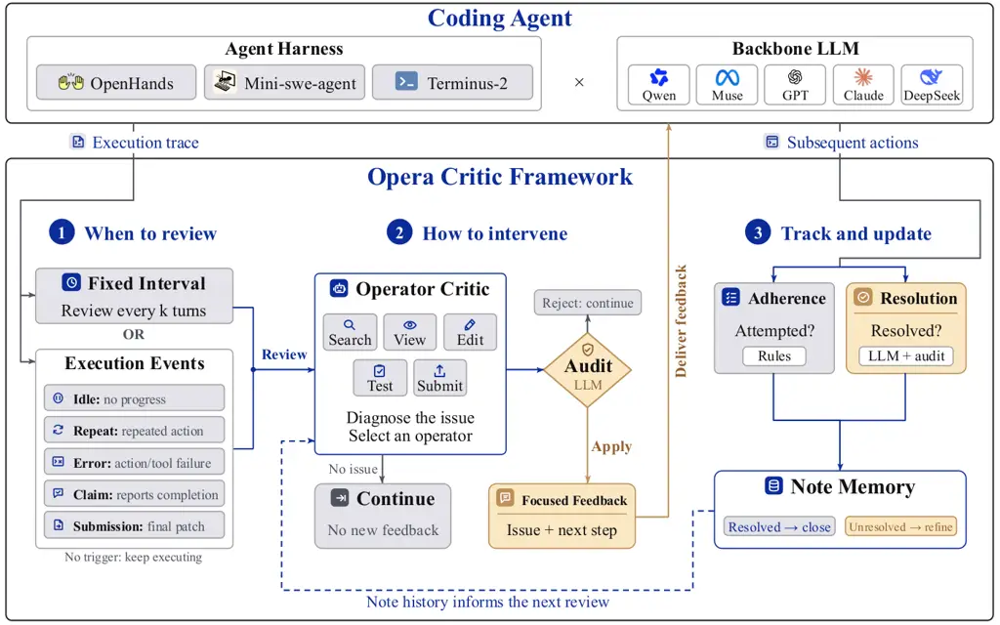
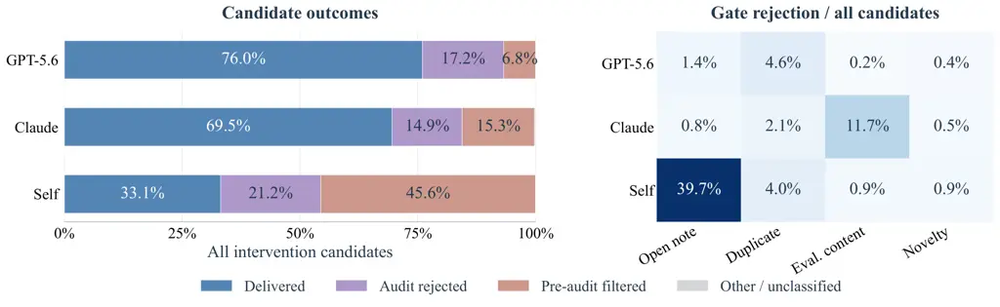
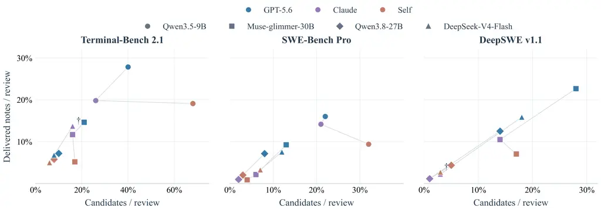

## 1   Introduction

Coding agents tackle repository-level tasks through code exploration,
editing, and testing (Yang et al., 2024a; Wang et al., 2024). Over long
horizons, they often repeat unsuccessful actions or explore
redundantly (Gandhi et al., 2025), and may report completion before the
task is actually verified (Tang et al., 2026). A critic that diagnoses
such problems during execution is a natural remedy, but it must judge
unfinished work, where incomplete evidence blurs the line between an
actual mistake and a reasonable intermediate step.

Prior work provides strong foundations for feedback and reflection,
including Self-Refine (Madaan et al., 2023), Reflexion (Shinn et al.,
2023), and CRITIC (Gou et al., 2023), and for coding agents,
SWE-PRM (Gandhi et al., 2025), SWE-Search (Antoniades et al., 2024), and
Agentic Rubrics (Raghavendra et al., 2026). We move further to view
critic feedback as an _intervention_ whose value is revealed only
afterwards, which raises three challenges: ① _When should the critic
intervene?_ Periodic feedback may arrive too late, while not every
execution event requires correction. ② _Is the feedback justified?_ A
plausible diagnosis can misread partial evidence and derail work that
would otherwise succeed (Vasudev et al., 2026), and LLM judges remain
noisy even when verifying well-specified criteria (Peng et al., 2026). ③
_Did the intervention work?_ An agent may follow a suggestion yet leave
the underlying failure intact.

To address the above challenges, we introduce Opera, a verbal critic
framework that manages each correction as a persistent note: opened when
an issue is found, delivered only when justified, tracked as execution
proceeds, and closed once evidence supports its resolution. Opera
combines periodic and event-driven triggers with the option to stay
silent (①); pairs an operator critic, which ties each issue to evidence,
a corrective direction, and a resolution criterion, with an audit that
screens feedback before delivery (②); and maintains a finding note that
tracks adherence separately from resolution (③). Opera interacts with
agents only through execution traces and natural-language feedback, so
it plugs into existing harnesses without updating agent weights.

At test time, Opera acts as a teacher that guides the agent’s
self-reflection. Across Terminal-Bench 2.1, a 100-task SWE-Bench Pro
subset, and DeepSWE v1.1, Opera outperforms four competitive critic
baselines and shows consistent improvement on four policy models with
different harnesses. Beyond inference, the same process yields training
data that distillation from stronger models lacks: trajectories
consisting of the student’s own actions, together with targeted
diagnoses of its errors.

Our contributions are threefold:

- •
  Framework. We formulate verbal criticism as managing persistent
  corrective notes and introduce Opera, a critic framework that decides
  when to review, audits feedback before delivery, and follows each
  correction until it is resolved during long-horizon runs of coding
  agents.
- •
  Test-time critic. Opera improves task resolve rate by up to 12.4,
  15.0, and 8.9 pp on Terminal-Bench 2.1, SWE-Bench Pro, and DeepSWE
  v1.1 across four policy models, and outperforms competitive critic
  baselines. It improves most policy models with both weak and strong
  critic models, including the policy model critiquing itself.
- •
  Training recipe. Opera-guided student rollouts provide approximately
  on-policy training data. Fine-tuning Qwen3.5-9B on them matches
  distillation from a stronger model on held-out SWE-Bench Pro
  repositories (+10.2 pp) while preserving its Terminal-Bench 2.1
  performance.

Figure 1: Illustration of Opera. Left: Opera discovers and tracks issues
at different stages (search, edit, test, etc.) until it is resolved or
refined in the long-horizon turns. Right: Opera improves task resolve
rate across benchmarks, harnesses, and policy models.

## 2   Related Work

### 2.1  Critics and Verifiers for Coding Agents

Early approaches improve LLM outputs through iterative self-feedback
(Madaan et al., 2023), verbal reflection across attempts (Shinn et al.,
2023), and tool-grounded critique (Gou et al., 2023). For
repository-level coding, SWE-PRM (Gandhi et al., 2025) periodically
reviews agent trajectories and provides taxonomy-guided corrective
feedback. Agentic Rubrics (Raghavendra et al., 2026) constructs
repository-specific criteria for evaluating candidate patches, while
SWE-Shepherd (Dihan and Khan, 2026) uses a trained process reward model
to guide intermediate action selection. However, RuVerBench (Peng et
al., 2026) identifies substantial noise in LLM-based rubric
verification, motivating explicit quality control over critic feedback.

### 2.2  Test-Time Scaling for Coding Agents

Test-time scaling allocates additional inference computation to
exploration, evaluation, and refinement. Tree of Thoughts (Yao et al., 2023) explores alternative reasoning states, while Language Agent Tree
Search (Zhou et al., 2023) combines tree search with reflection and
environment feedback. For coding, SWE-Search (Antoniades et al., 2024)
applies Monte Carlo tree search to repository-level tasks, and S^(∗) (Li
et al., 2025) combines parallel sampling, sequential refinement, and
execution-grounded selection. Recent work uses rollout summaries for
trajectory selection and reuse (Kim et al., 2026), differential testing
for candidate selection (He et al., 2026), and an LLM orchestrator for
adaptive solver allocation and answer synthesis (Qin et al., 2026).
Opera allocates additional inference computation to diagnosing and
correcting an ongoing coding trajectory. Its hybrid review schedule and
audited interventions connect compute allocation to when feedback is
warranted and how it should guide subsequent execution.

## 3   Opera: Verbal Critic Framework through Persistent Notes

An effective critic must decide when to review, deliver feedback the
agent can act on, and verify afterwards that the problem is resolved.
Opera organizes supervision around a persistent _note_: one diagnosed
issue, its current guidance, and a fixed resolution criterion.
Persistence lets the critic follow up on its own verbal feedback across
reviews; the fixed criterion ensures that resolution is judged against
the original problem rather than the latest guidance. Figure 2 shows how
Opera addresses the three challenges from Section 1: when to review
(§3.1), how to intervene (§3.2), and how to track and update notes
(§3.3).

Figure 2: Overview of Opera. ❶ Reviews are triggered at fixed intervals
or by execution events. ❷ The operator critic diagnoses one issue with a
typed operator, and an audit decides whether the feedback is delivered.
❸ Adherence and resolution are tracked separately; resolved notes are
closed, unresolved notes are refined, and note history conditions the
next review.

### 3.1  Hybrid Review Scheduling

Fixed-interval review reacts slowly: an agent may repeat a failing
command several times before the next review. Event-triggered review
reacts quickly but misses silent failures, such as confidently editing
the wrong file. Opera combines both. Unlike SWE-PRM (Gandhi et al.,
2025), which reviews at fixed intervals, Opera performs a periodic
review every $`k`$ turns plus immediate reviews on five events: _Idle_
(no visible progress), _Repeat_ (repeated actions), _Error_ (failed
actions or tool calls), _Claim_ (reported completion), and _Submission_
(final patch). Simultaneous signals produce a single review, and an
event-triggered review resets the periodic timer. A review does not
imply an intervention: the critic may let the agent continue without
feedback.

### 3.2  Operator-Typed Review

Free-form critique is often generic (e.g., “consider edge cases”) or
mixes several concerns, leaving the agent little to act on. Opera
instead requires each diagnosis to use a typed _operator_. The operators
follow the stages of code repair, namely localization, inspection,
editing, and verification (Xia et al., 2024; Bouzenia et al., 2024), and
cover common failure types such as misunderstood requirements, incorrect
edit scope, and faulty logic (Tang et al., 2026). Nine operators span
five stages (Figure 3a):

- •
  Search: repo_localization_search (target not yet identified);
  implementation_target_shift (editing the wrong target).
- •
  View: implementation_readiness_review (re-inspecting code when the fix
  is already clear); failure_signature_triage (misread tool output).
- •
  Edit: requirement_contract_review (requirement violated);
  diff_scope_review (missing or unrelated changes);
  state_transition_review (faulty execution logic).
- •
  Test: minimal_repro_or_focused_verifier (missing evidence needed for
  the next decision).
- •
  Submit: submission_readiness_review (completion claimed without
  sufficient evidence).

All operators remain available throughout execution, since agents often
revisit earlier stages. Following Design by Contract (Meyer, 1992), each
operator is specified by a contract stating when it applies, the
evidence it requires, the correction it may request, when the issue
counts as resolved, and which problems it excludes. The exclusion clause
keeps operators from overlapping, and the resolution clause supplies the
criterion against which the note is later checked.

Selection and output. Given the task, execution history, review trigger,
and current note, the critic either returns continue when the agent is
making useful progress, since unnecessary interventions can disrupt
trajectories that would otherwise succeed (Vasudev et al., 2026), or
selects one supported issue and the smallest correction for it.
Restricting each review to one issue avoids competing instructions and
keeps later outcomes attributable to a specific correction. Each
proposal names an operator, cites evidence, and specifies the location,
the current behavior, the required change, and how to verify it.
Independently, the critic reports whether the open note remains
unresolved, so follow-up continues even without new guidance.

Figure 3: Core mechanisms of Opera. (a) Nine operators, grouped by
repair stage and specified by contracts, map an observed issue to a
targeted fix. (b) Admission audits gate note creation and updates,
rejecting unsupported or redundant feedback; the release audit closes a
note only when its fixed criterion is met.

### 3.3  Audited Note Management

Inspired by reflection memory and persistent goals (Shinn et al., 2023;
Cohen and Levesque, 1990), each note is either open or closed, with at
most one open note at a time (Figure 3b). This keeps the agent focused
on a single correction and makes outcomes attributable. Because the
critic is itself an LLM whose diagnoses may be plausible but wrong, two
audits govern the note lifecycle. Both only accept or reject proposals
without rewriting them, acting as verifiers rather than co-authors.

Opening and updating. The critic may open a note when none is open, or
update the open note when new evidence changes the diagnosis or suggests
a clearer next step. Updates may change the operator and guidance but
preserve the note’s identity and criterion, so the goal stays fixed
while the advice improves. After validity and duplicate checks, the
audit verifies that the evidence supports the diagnosis, the correction
is necessary, and the proposed check can establish resolution (Vasudev
et al., 2026). It rejects, for example, optional cleanups unrelated to
the task and reminders that repeat guidance without new evidence.
Rejected proposals leave the current note unchanged.

Tracking and closing. Opera tracks two distinct questions after
delivery. _Adherence_, checked by rules, asks whether the agent
attempted the correction. _Resolution_, judged against the fixed
criterion, asks whether the original problem is gone. They are separated
because adherence does not imply resolution: in Figure 3b, the agent
adds the suggested guard, yet the required test still fails. Closing a
note requires a _release audit_ with supporting evidence, namely
execution results for behavioral requirements or visible edits for
static ones. Accepted closure archives the note and removes its guidance
from the agent’s context. Closure is processed before admission, so one
review can close an issue and open the next.

## 4   Evaluation

### 4.1  Benchmarks and Setup

We evaluate on Terminal-Bench 2.1 (89 tasks) (Terminal-Bench Team, 2026)
using Terminus-2, SWE-Bench Pro (100 tasks) (Deng et al., 2025) using
OpenHands (Wang et al., 2024), and DeepSWE v1.1 (113 tasks) (Huang et
al., 2026) using mini-swe-agent Yang et al. (2024a). For SWE-Bench Pro,
we apply task corrections informed by OpenAI’s benchmark audit (OpenAI,
2026b) and sample 100 tasks from the corrected set and cover all of the
repos included in the raw swebench-pro. Across all three benchmarks, we
employ Harbor (Harbor Framework Team, 2026) to manages tasks, and
Pier (Datacurve, 2026) to provides network isolation for anti-cheating.
For policy model, we use Qwen3.5-9B (thinking) (Qwen Team, 2026a),
Muse-glimmer-30B (high) (Meta Superintelligence Lab, 2026), Qwen3.8-27B
(xhigh) (Qwen Team, 2026b) and Deepseek-V4-Flash-0731 (max)
(DeepSeek-AI, 2026) for our evaluations. We use GPT-5.6-Sol (high)
(OpenAI, 2026a) as the default critic model for all of our experiments
if not specifically mentioned, results of using other models are also
reported in Section 5.3. For timeouts, we employ the task-specific
timeouts configured in Harbor’s official dataset cards ¹¹ 1
https://hub.harborframework.com/datasets.

### 4.2  Overall Task Performance

|                 |                  |                  |                  |
| --------------- | ---------------- | ---------------- | ---------------- |
| Method          | TB-2.1           | SWE-Pro          | DeepSWE          |
| Non-critic      | 65.9 $`\pm`$ 1.7 | 75.3 $`\pm`$ 1.2 | 32.4 $`\pm`$ 1.0 |
| SWE-PRM         | 68.9 $`\pm`$ 3.2 | 77.7 $`\pm`$ 2.5 | 36.6 $`\pm`$ 3.1 |
| SWE-Search      | 70.0 $`\pm`$ 4.7 | 77.3 $`\pm`$ 3.8 | 38.6 $`\pm`$ 4.4 |
| LLM-as-verifier | 71.2 $`\pm`$ 2.6 | 78.7 $`\pm`$ 2.3 | 38.9 $`\pm`$ 2.3 |
| Agentic Rubrics | 71.9 $`\pm`$ 4.5 | 78.3 $`\pm`$ 3.2 | 39.5 $`\pm`$ 2.8 |
| Opera (ours)    | 73.8 $`\pm`$ 2.3 | 79.3 $`\pm`$ 3.5 | 41.3 $`\pm`$ 3.1 |
| Gain (pp)       | $`+7.9`$         | $`+4.0`$         | $`+8.9`$         |

Table 1: Comparison with critic baselines (policy: Qwen3.8-27B). Resolve
rate (%, mean $`\pm`$ std) on Terminal-Bench 2.1 (TB-2.1, 89 tasks), a
100-task subset of SWE-Bench Pro (SWE-Pro), and DeepSWE v1.1 (113
tasks). Green bold / blue underline: best / second-best.

Comparison with critic baselines. We compare Opera with the non-critic
agent and four representative critics, all using Qwen3.8-27B as the
policy model (Table 1). They fall into two groups by what they judge and
what signal they return. _Process critics_ evaluate the ongoing
trajectory: SWE-PRM (Gandhi et al., 2025) periodically reviews recent
steps and returns taxonomy-guided verbal feedback, and
SWE-Search (Antoniades et al., 2024) scores the last action with a
numerical value and a natural-language assessment, originally used to
guide tree search. _Outcome verifiers_ score the agent’s solution:
LLM-as-verifier (Kwok et al., 2026) assigns fine-grained scalar scores,
and Agentic Rubrics (Raghavendra et al., 2026) scores patches against a
repository-grounded rubric checklist without executing tests. For
_Process Critics_, we adapt them to use the same critic schedule as
Opera to ensure a fair comparison, more implementation details are
included in Appendix A. Table 1 shows that Opera achieves the highest
mean resolve rate on all three benchmarks. Its margin over the strongest
baseline is 1.9 pp on Terminal-Bench 2.1 and 1.8 pp on DeepSWE, but only
0.6 pp on SWE-Bench Pro, where the non-critic agent is already strong
and all critics yield similar, modest gains; This improvement suggests
the the advantages of Opera’s design on the two aspects: it intervenes
during execution like a process critic, while each note carries an
explicit resolution criterion like the output verifier before closure.

Performance on different policy models. Figure 4 shows that Opera
improves every policy model on every benchmark, with one exception:
Qwen3.5-9B resolves no DeepSWE task, with or without the critic. The
gains are shaped by how much room the agent leaves for correction.
Weaker agents generally benefit more: Qwen3.5-9B gains 12.4 and 15.0 pp
on Terminal-Bench 2.1 and SWE-Bench Pro, and gains tend to shrink as the
non-critic resolve rate rises. Headroom matters more than model strength
alone: DeepSeek-V4-Flash gains little on benchmarks where it is already
strong, but substantially on the harder DeepSWE. Yet a critic cannot
substitute for missing capability. DeepSWE consists of original,
long-horizon engineering tasks, and Qwen3.5-9B resolves no DeepSWE task
in the evaluated runs, with or without the tested critics. Muse
Glimmer-30B on DeepSWE shows a milder version of this effect: starting
from a low base, feedback nearly triples its resolve rate, but the
absolute gain remains limited. A critic is therefore most valuable when
the agent is capable enough to act on feedback but still makes errors it
cannot correct on its own.

Figure 4: Task resolve rate of Opera across policy models (critic:
GPT-5.6-Sol). Gains (pp) are generally larger for weaker backbones and
on benchmarks with more headroom. Qwen3.5-9B resolves no DeepSWE task
with or without the critic. Error bars denote sample standard deviation.

### 4.3  Recipes for Training Open-weight Coding Agents

Beyond inference-time assistance, Opera can generate training data in
which the agent receives targeted diagnoses and takes corrective
actions. We ask whether such data can be used to train Qwen3.5-9B to
learn from error correction without a critic at inference time.

Setup. We split SWE-Bench Pro by repository into 270 training tasks and
108 held-out tasks (Table 3), and additionally evaluate on
Terminal-Bench 2.1, which differs from the training data in task format
and harness. We compare two trajectory sources: _Opera-guided student
rollouts_, with Qwen3.5-9B as the policy and Qwen3.8-27B as the critic,
and _teacher rollouts_, with Qwen3.8-27B as the policy. The same model
thus supplies the expertise in both settings, either by critiquing or by
acting. We select 67 training tasks on which the base Qwen3.5-9B rarely
succeeds but both sources contain at least one successful trajectory, so
that both sources supervise the same tasks (selection criteria and more
training details are in Appendix B.1).

|          |                                                                 |     |     |     |     |       |
| -------- | --------------------------------------------------------------- | --- | --- | --- | --- | ----- |
| Split    | Repositories                                                    | Py  | Go  | TS  | JS  | Total |
| Train    | qutebrowser, ansible, teleport, flipt, vuls, webclients, NodeBB | 99  | 115 | 32  | 24  | 270   |
| Held-out | openlibrary, navidrome, element-web, tutanota                   | 47  | 30  | 31  | 0   | 108   |

Table 2: Task distribution of the SFT training split and the held-out
OOD evaluation split of SWE-Bench Pro. TS/JS: TypeScript/JavaScript.

|                      |                          |                          |
| -------------------- | ------------------------ | ------------------------ |
| Training data        | SWE-Pro                  | TB2.1                    |
| None (base)          | $`28.7\pm 1.9`$          | $`23.6\pm 1.9`$          |
| Qwen3.8-27B rollouts | $`\mathbf{39.5\pm 1.4}`$ | $`7.9\pm 1.9`$           |
| Opera-guided (ours)  | $`38.9\pm 2.4`$          | $`\mathbf{25.8\pm 2.2}`$ |

Table 3: Resolve rate (%) of Qwen3.5-9B trained on different trajectory
sources, evaluated without a critic on held-out SWE-Bench Pro tasks and
Terminal-Bench 2.1. Mean $`\pm`$ std over three runs.

Results and analysis. Both sources improve the held-out SWE-Bench Pro
resolve rate by about 10 pp, with no meaningful difference between them
(Table 3). On Terminal-Bench 2.1, however, fine-tuning on teacher
rollouts reduces the resolve rate from 23.6% to 7.9%, whereas
Opera-guided rollouts preserve it (25.8%). Both sources thus improve the
target task similarly, but only the Opera-guided data does so without
degrading performance on a benchmark with a different task format and
harness. We attribute this mainly to whose actions the data contain.
Teacher rollouts are off-policy for the student, and fitting them shifts
the student toward the teacher’s distribution; forgetting is known to
grow with such shift (Shenfeld et al., 2026), and fine-tuning on
self-generated data mitigates it (Yang et al., 2024b). Opera-guided
rollouts are approximately on-policy: every action comes from the
student, and the critic’s influence enters only through notes in its
context. Such data has been shown to underlie RL’s robustness to
forgetting (Chen et al., 2025). The recipe also follows the principle of
DAgger (Ross et al., 2011) and on-policy distillation (Agarwal et al.,
2024): the student receives expert corrections at the states it actually
visits, which teacher trajectories rarely contain, since the teacher
seldom makes the student’s mistakes.

## 5   Analysis

### 5.1  Critic Behavior and Utility

Figure 5: Distribution of admitted operators. Edit-stage operators
dominate while the leading one shifts from requirement contract to state
transition as model capability increases.

Figure 6: Task outcomes on trials receiving notes. (a) Observed Opera
success versus expected no-critic success on the same tasks. (b) Rescue
rate among tasks never solved without the critic and regression rate
among tasks always solved without it; the two rates use different
denominators.

We analyze which operators the critic admits for each policy model, how
agents respond to them, and how these responses affect task outcomes.
Operator frequencies reflect the critic’s admitted diagnoses rather than
all agent errors.

The critic mostly diagnoses implementation errors, and the dominant type
is model-specific. Across all four models, Edit-stage operators account
for most delivered notes, while Search and Submit operators are rare
(Figure 5). This suggests that, in the trajectories the critic flags.
Qwen3.5-9B mostly receives requirement-contract notes, suggesting that
it often misreads what the task requires. The stronger Qwen3.8-27B and
DeepSeek-V4-Flash shift toward state-transition notes, suggesting that
they understand the goal but get the execution logic wrong. Muse
Glimmer-30B shows a flatter distribution with more focused-verifier
notes, pointing to weaker verification habits.

Stronger models gain more rescues but also more regressions. On trials
receiving notes, Opera improves over the expected no-critic success for
all models (Figure 6a). The rescue–regression breakdown, however,
reveals a trade-off (Figure 6b), consistent with the recovery–disruption
trade-off reported by Vasudev et al. (2026). Stronger models convert
feedback into more rescues of previously unsolved tasks, but also
regress more often on tasks they would otherwise solve, while weaker
models rarely regress but are rescued less often. One possible
explanation is that stronger models act on feedback more readily
(Figure 9), which amplifies both correct and unnecessary interventions;
for these models, the cost of an unneeded correction is therefore
higher.

### 5.2  Operator ablation

|              |                                 |                                 |                                 |
| ------------ | ------------------------------- | ------------------------------- | ------------------------------- |
| Variant      | TB2.1                           | SWE-Pro                         | DeepSWE                         |
| Non-critic   | $`65.9\pm 1.7`$                 | $`75.3\pm 1.2`$                 | $`32.4\pm 1.0`$                 |
| Opera (full) | $`\mathbf{73.8\pm 2.3}`$ (+7.9) | $`\mathbf{79.3\pm 3.5}`$ (+4.0) | $`\mathbf{41.3\pm 3.1}`$ (+8.9) |
| Edit-only    | $`71.9\pm 1.6`$ (+6.0)          | $`79.0\pm 3.5`$ (+3.7)          | $`40.1\pm 1.8`$ (+7.7)          |
| Non-edit     | $`70.2\pm 0.8`$ (+4.3)          | $`78.3\pm 0.6`$ (+3.0)          | $`39.5\pm 2.7`$ (+7.1)          |

Table 4: Operator ablation with Qwen3.8-27B. Resolve rate (%), mean
$`\pm`$ std over three runs; parentheses show gains over non-critic
(pp).

To further examine the role of operators, we note that Edit-stage
operators account for most delivered notes, e.g., about 80% for
Qwen3.8-27B (Figure 5). We compare two restricted variants that keep all
other components of Opera unchanged: _Edit-only_, which retains only the
Edit-stage operators, and _Non-edit_, which retains only the Search,
View, Test, and Submit operators (Table 4). The full operator set
achieves the highest mean on all three benchmarks, although its margin
over Edit-only is small (e.g., 0.3 pp on SWE-Bench Pro) and within
run-to-run variance. Both restricted variants retain most of the full
gain. Notably, Non-edit operators account for only about one fifth of
delivered notes but recover over half of the full gain on Terminal-Bench
2.1, three quarters on SWE-Bench Pro, and about four fifths on DeepSWE.
The gains of the two variants are also not additive, as each alone
recovers much of the full gain. One possible explanation is that the
critic can often address the same underlying problem through different
operators, so that the review and follow-up process compensates for a
restricted operator set.

### 5.3  Sensitivity to Critic Model Choice

We vary the critic model while keeping the policy fixed, using the
policy model itself (Self), Claude, or GPT as the critic (Figure 7). We
exclude Qwen3.5-9B on DeepSWE, where the policy resolves no task under
any critic (Section 4.1). Opera is robust to the choice of critic: all
three critics improve over the no-critic agent in all but one of the
remaining 33 policy–benchmark–critic combinations. Stronger critics
generally yield larger gains, but no single critic is best in every
setting. Notably, a policy model can serve as an effective critic of
itself. On DeepSWE, self-critique improves Qwen3.8-27B and
DeepSeek-V4-Flash by 6.2 pp each, matching or exceeding the gains from
Claude. Since the self-critic has no knowledge beyond the policy’s own,
these gains suggest that much of the benefit comes from the framework:
timely review, typed diagnosis, and follow-up help the model apply
knowledge it already has but fails to use during execution.
Self-critique does add inference compute, however, which this comparison
does not match. Self-critique is less effective when the policy lacks
the capability to solve the task, as for Muse Glimmer-30B on DeepSWE or
Qwen3.5-9B on Terminal-Bench 2.1, likely because the critic shares the
policy’s blind spots. In these low-capability settings, a stronger
critic brings substantial gains. With GPT as the critic, Qwen3.5-9B
improves at least 12.4 pp, whereas self-critique yields at most 2.7 pp.
Similarly, Muse Glimmer-30B gains 11.0 pp on SWE-Bench Pro and nearly
triples its resolve rate on DeepSWE.

Figure 7: Task resolve rate with different critic models: the policy
model itself (Self), Claude, and GPT. Opera has consistent improvement
regardless of the critic. Self-critique is effective where the policy is
competent, while stronger critics bring large gains where the policy
struggles.

## 6   Role of Audit

To isolate the role of the audits, we remove both the admission and
release audits while keeping all other components of Opera unchanged, so
that every note proposed by the critic is delivered and every proposed
closure is accepted (Table 5). Removing the audits reduces the gain on
all three benchmarks. The drop is largest on Terminal-Bench 2.1, where
the gain over the non-critic agent falls from 7.9 to 2.6 pp, losing
about two thirds of the improvement, and on DeepSWE, where it falls from
8.9 to 4.5 pp, about half. The results suggest that the audit acts as a
filter against these harmful interventions, which matters much on
benchmarks where intermediate evidence is easy to misread and misguided
corrections are costly.

|                   |                                 |                                 |                                 |
| ----------------- | ------------------------------- | ------------------------------- | ------------------------------- |
| Variant           | TB2.1                           | SWE-Pro                         | DeepSWE                         |
| Non-critic        | $`65.9\pm 1.7`$                 | $`75.3\pm 1.2`$                 | $`32.4\pm 1.0`$                 |
| Opera (w/ audit)  | $`\mathbf{73.8\pm 2.3}`$ (+7.9) | $`\mathbf{79.3\pm 3.5}`$ (+4.0) | $`\mathbf{41.3\pm 3.1}`$ (+8.9) |
| Opera (w/o audit) | $`68.5\pm 2.2`$ (+2.6)          | $`78.3\pm 2.1`$ (+3.0)          | $`36.9\pm 1.8`$ (+4.5)          |

Table 5: Audit ablation with Qwen3.8-27B as the policy and GPT-5.6-Sol
as the critic. Resolve rate (%), mean $`\pm`$ std over three runs;
parentheses show gains over the non-critic agent (pp). Bold: best mean
per benchmark.

## 7   Conclusion

We presented Opera, a verbal critic framework for long-horizon coding
agents that treats each correction as a persistent note and follows it
until the diagnosed problem is resolved. As a test-time critic, Opera
improves the resolve rate of non-critic agents by up to 15.0 percentage
points across three benchmarks and four policy models, and achieves the
highest mean resolve rate among competitive critic baselines with
Qwen3.8-27B as the policy. Beyond inference, Opera-guided rollouts
provide approximately on-policy training data: fine-tuning Qwen3.5-9B on
them matches distillation from a stronger model on held-out repositories
(+10.2 pp) while preserving its Terminal-Bench 2.1 performance. Our
training results use supervised fine-tuning on a single model with one
out-of-domain benchmark; scaling this recipe to larger datasets,
iterating it with the trained model as the new policy, or combining
critic feedback with reinforcement learning to internalize
self-correction could be the future work.

## References

- Agarwal et al. (2024) R. Agarwal, N. Vieillard, Y. Zhou, P.
  Stanczyk, S. Ramos, M. Geist, and O. Bachem On-policy distillation of
  language models: learning from self-generated mistakes. In
  International Conference on Learning Representations (ICLR), Cited by:
  §4.3.
- Antoniades et al. (2024) A. Antoniades, A. Örwall, K. Zhang, Y.
  Xie, A. Goyal, and W. Wang SWE-Search: enhancing software agents with
  monte carlo tree search and iterative refinement. arXiv preprint
  arXiv:2410.20285. Cited by: §A.1, §1, §2.2, §4.2.
- Bouzenia et al. (2024) I. Bouzenia, P. Devanbu, and M. Pradel
  RepairAgent: an autonomous, LLM-based agent for program repair. arXiv
  preprint arXiv:2403.17134. Cited by: §3.2.
- Chen et al. (2025) H. Chen, N. Razin, K. Narasimhan, and D. Chen
  Retaining by doing: the role of on-policy data in mitigating
  forgetting. arXiv preprint arXiv:2510.18874. Cited by: §4.3.
- Cohen and Levesque (1990) P. R. Cohen and H. J. Levesque Intention is
  choice with commitment. Artificial Intelligence 42 (2–3), pp. 213–261.
  Cited by: §3.3.
- Datacurve (2026) Datacurve Pier: a Harbor-compatible framework for
  evaluating coding agents. External Links:
  [Link](https://github.com/datacurve-ai/pier) Cited by: §4.1.
- DeepSeek-AI (2026) DeepSeek-AI DeepSeek-V4: towards highly efficient
  million-token context intelligence. External Links:
  [Link](https://huggingface.co/deepseek-ai/DeepSeek-V4-Flash) Cited by:
  §4.1.
- Deng et al. (2025) X. Deng, J. Da, E. Pan, Y. Y. He, C. Ide, K.
  Garg, N. Lauffer, A. Park, N. Pasari, C. Rane, K. Sampath, M.
  Krishnan, S. Kundurthy, S. Hendryx, Z. Wang, V. Bharadwaj, J. Holm, R.
  Aluri, C. B. C. Zhang, N. Jacobson, B. Liu, and B. Kenstler SWE-Bench
  Pro: can AI agents solve long-horizon software engineering tasks?.
  arXiv preprint arXiv:2509.16941. Cited by: §4.1.
- Dihan and Khan (2026) M. L. Dihan and M. A. R. Khan SWE-Shepherd:
  advancing PRMs for reinforcing code agents. arXiv preprint
  arXiv:2604.10493. Cited by: §2.1.
- Gandhi et al. (2025) S. Gandhi, J. Tsay, J. Ganhotra, K. Kate, and Y.
  Rizk When agents go astray: course-correcting SWE agents with PRMs.
  arXiv preprint arXiv:2509.02360. Cited by: §A.1, §1, §1, §2.1, §3.1,
  §4.2.
- Gou et al. (2023) Z. Gou, Z. Shao, Y. Gong, Y. Shen, Y. Yang, N. Duan,
  and W. Chen CRITIC: large language models can self-correct with
  tool-interactive critiquing. arXiv preprint arXiv:2305.11738. Cited
  by: §1, §2.1.
- Harbor Framework Team (2026) Harbor Framework Team Harbor: a framework
  for evaluating and optimizing agents and models in container
  environments. Cited by: §4.1.
- He et al. (2026) Y. He, E. Wang, J. Wang, X. Ouyang, and H. Chen Code
  generation by differential test time scaling. arXiv preprint
  arXiv:2605.20473. Cited by: §2.2.
- Huang et al. (2026) W. Huang, C. Lee, L. Tng, and S. Ge DeepSWE:
  measuring frontier coding agents on original, long-horizon engineering
  tasks. arXiv preprint arXiv:2607.07946. Cited by: §4.1.
- Kim et al. (2026) J. Kim, W. Yang, K. Niu, H. Zhang, Y. Zhu, E.
  Helenowski, R. Silva, Z. Chen, S. Iyer, M. Zaheer, D. Fried, H.
  Hajishirzi, S. Arora, G. Synnaeve, R. Salakhutdinov, and A. Goyal
  Scaling test-time compute for agentic coding. arXiv preprint
  arXiv:2604.16529. Cited by: §2.2.
- Kwok et al. (2026) J. Kwok, S. Li, P. Atreya, Y. Liu, Y. Jiang, C.
  Finn, M. Pavone, I. Stoica, and A. Mirhoseini LLM-as-a-verifier: a
  general-purpose verification framework. arXiv preprint
  arXiv:2607.05391. Cited by: §A.1, §4.2.
- Li et al. (2025) D. Li, S. Cao, C. Cao, X. Li, S. Tan, K. Keutzer, J.
  Xing, J. E. Gonzalez, and I. Stoica S\*: test time scaling for code
  generation. arXiv preprint arXiv:2502.14382. Cited by: §2.2.
- Madaan et al. (2023) A. Madaan, N. Tandon, P. Gupta, S. Hallinan, L.
  Gao, S. Wiegreffe, U. Alon, N. Dziri, S. Prabhumoye, Y. Yang, S.
  Gupta, B. P. Majumder, K. Hermann, S. Welleck, A. Yazdanbakhsh, and P.
  Clark Self-Refine: iterative refinement with self-feedback. arXiv
  preprint arXiv:2303.17651. Cited by: §1, §2.1.
- Meta Superintelligence Lab (2026) Meta Superintelligence Lab Muse
  Glimmer model card. External Links:
  [Link](https://huggingface.co/meta-models/Muse-Glimmer-30B) Cited by:
  §4.1.
- Meyer (1992) B. Meyer Applying “design by contract”. Computer 25 (10),
  pp. 40–51. Cited by: §3.2.
- OpenAI (2026a) OpenAI GPT-5.6 Sol model. External Links:
  [Link](https://developers.openai.com/api/docs/models/gpt-5.6-sol)
  Cited by: §4.1.
- OpenAI (2026b) OpenAI Separating signal from noise in coding
  evaluations. External Links:
  [Link](https://openai.com/index/separating-signal-from-noise-coding-evaluations/)
  Cited by: §4.1.
- Peng et al. (2026) Y. Peng, Y. Qi, H. Xia, G. He, X. Shi, R. Xuan, S.
  Lu, Y. Liu, Z. Hu, Y. Liu, and H. Peng Can LLM-as-a-Judge reliably
  verify rubrics in agentic scenarios?. arXiv preprint arXiv:2606.29920.
  Cited by: §1, §2.1.
- Qin et al. (2026) P. Qin, Q. Cao, and P. Xie ATLAS: agentic test-time
  learning-to-allocate scaling. arXiv preprint arXiv:2606.01667. Cited
  by: §2.2.
- Qwen Team (2026a) Qwen Team Qwen3.5: towards native multimodal agents.
  External Links: [Link](https://qwen.ai/blog?id=qwen3.5) Cited by:
  §4.1.
- Qwen Team (2026b) Qwen Team Qwen3.8-27b. External Links:
  [Link](https://huggingface.co/Qwen/Qwen3.8-27B) Cited by: §4.1.
- Raghavendra et al. (2026) M. Raghavendra, A. Gunjal, B. Liu, and Y. He
  Agentic rubrics as contextual verifiers for SWE agents. arXiv preprint
  arXiv:2601.04171. Cited by: §A.1, §1, §2.1, §4.2.
- Ross et al. (2011) S. Ross, G. Gordon, and D. Bagnell A reduction of
  imitation learning and structured prediction to no-regret online
  learning. In Proceedings of the Fourteenth International Conference on
  Artificial Intelligence and Statistics (AISTATS), Cited by: §4.3.
- Shenfeld et al. (2026) I. Shenfeld, J. Pari, and P. Agrawal RL’s
  razor: why online reinforcement learning forgets less. In
  International Conference on Learning Representations (ICLR), Cited by:
  §4.3.
- Shinn et al. (2023) N. Shinn, F. Cassano, E. Berman, A. Gopinath, K.
  Narasimhan, and S. Yao Reflexion: language agents with verbal
  reinforcement learning. arXiv preprint arXiv:2303.11366. Cited by: §1,
  §2.1, §3.3.
- Tang et al. (2026) N. Tang, C. Chen, G. Xu, Y. Shi, Y. Huang, C.
  McMillan, T. Dong, and T. J. Li How coding agents fail their users: a
  large-scale analysis of developer-agent misalignment in 20,574
  real-world sessions. arXiv preprint arXiv:2605.29442. External Links:
  [Link](https://arxiv.org/abs/2605.29442) Cited by: §1, §3.2.
- Terminal-Bench Team (2026) Terminal-Bench Team Terminal-Bench 2.1.
  External Links: [Link](https://www.tbench.ai/news/terminal-bench-2-1)
  Cited by: §4.1.
- Vasudev et al. (2026) R. Vasudev, M. Russak, D. Bikel, and W. Alshikh
  Accurate failure prediction in agents does not imply effective failure
  prevention. arXiv preprint arXiv:2602.03338. Cited by: §1, §3.2, §3.3,
  §5.1.
- Wang et al. (2024) X. Wang, B. Li, Y. Song, F. F. Xu, X. Tang, M.
  Zhuge, J. Pan, Y. Song, B. Li, J. Singh, H. H. Tran, F. Li, R. Ma, M.
  Zheng, B. Qian, Y. Shao, N. Muennighoff, Y. Zhang, B. Hui, J. Lin, R.
  Brennan, H. Peng, H. Ji, and G. Neubig OpenHands: an open platform for
  AI software developers as generalist agents. arXiv preprint
  arXiv:2407.16741. Cited by: §1, §4.1.
- Xia et al. (2024) C. S. Xia, Y. Deng, S. Dunn, and L. Zhang Agentless:
  demystifying LLM-based software engineering agents. arXiv preprint
  arXiv:2407.01489. Cited by: §3.2.
- Yang et al. (2024a) J. Yang, C. E. Jimenez, A. Wettig, K. Lieret, S.
  Yao, K. Narasimhan, and O. Press SWE-agent: agent-computer interfaces
  enable automated software engineering. arXiv preprint
  arXiv:2405.15793. Cited by: §1, §4.1.
- Yang et al. (2024b) Z. Yang, T. Pang, H. Feng, H. Wang, W. Chen, M.
  Zhu, and Q. Liu Self-distillation bridges distribution gap in language
  model fine-tuning. In Proceedings of the 62nd Annual Meeting of the
  Association for Computational Linguistics (ACL), pp. 1028–1043. Cited
  by: §4.3.
- Yao et al. (2023) S. Yao, D. Yu, J. Zhao, I. Shafran, T. L.
  Griffiths, Y. Cao, and K. Narasimhan Tree of thoughts: deliberate
  problem solving with large language models. arXiv preprint
  arXiv:2305.10601. Cited by: §2.2.
- Zhou et al. (2023) A. Zhou, K. Yan, M. Shlapentokh-Rothman, H. Wang,
  and Y. Wang Language agent tree search unifies reasoning acting and
  planning in language models. arXiv preprint arXiv:2310.04406. Cited
  by: §2.2.

###### Contents

1.  1 Introduction
2.  2 Related Work
    1.  2.1 Critics and Verifiers for Coding Agents
    2.  2.2 Test-Time Scaling for Coding Agents
3.  3 Opera: Verbal Critic Framework through Persistent Notes
    1.  3.1 Hybrid Review Scheduling
    2.  3.2 Operator-Typed Review
    3.  3.3 Audited Note Management
4.  4 Evaluation
    1.  4.1 Benchmarks and Setup
    2.  4.2 Overall Task Performance
    3.  4.3 Recipes for Training Open-weight Coding Agents
5.  5 Analysis
    1.  5.1 Critic Behavior and Utility
    2.  5.2 Operator ablation
    3.  5.3 Sensitivity to Critic Model Choice
6.  6 Role of Audit
7.  7 Conclusion
8.  References
9.  A Implementation details of Opera
    1.  A.1 Baselines and Adaptations
10. B More details of training recipe
    1.  B.1 Data Preprocessing
    2.  B.2 Training details
11. C Additional analysis of operator behavior and utility
    1.  C.1 Behavior responses to the different operators
    2.  C.2 Critic behavior of using different critic models
12. D Case studies

## Appendix A Implementation details of Opera

Opera is deployed as a proxy between the agent and its model endpoint.
From the agent’s perspective, nothing changes: the harness sends each
request as it would to a model server, and the proxy forwards it. This
design lets Opera work with any harness without modification, and
confines the critic to a single channel of influence, namely inserting
at most one message into a forwarded request. The critic itself never
executes commands, accesses files, or runs tests. It sees only what the
agent has sent, and if it fails for any reason, such as a timeout or an
unparseable reply, the request is forwarded unchanged, so the critic can
never block the agent.

Hybrid Review: Most requests pass through without review. A review is
triggered when the agent attempts to finish, when it appears stuck after
three repeated or three consecutive failed commands, or when it has
taken six work actions without a successful edit; otherwise, the critic
checks in every 5 agent turns (10 on the longer DeepSWE tasks), starting
from turn 3 and at least 2 turns apart. At each review, the critic reads
the task and the rollout so far, presented as untrusted data and bounded
to its context window: the 30 newest messages are kept verbatim, long
messages are shortened to their beginning and end, and older messages
are elided. Unlike a stateless judge, the critic also sees the currently
open note, its resolution criterion, and the history of earlier notes,
which allows it to follow up on its own feedback rather than start
afresh.

Audited Note Management: A proposed note must pass several checks before
it reaches the agent. While a note is open, the critic may only update
it or let the agent continue, so that corrections do not pile up. Notes
that refer to hidden tests or evaluation material, or that repeat the
same suggestion within 6 turns, are discarded. A readiness note is also
withheld while the agent is still exploring unfamiliar code, measured as
more than half of its recent observations covering new ground. A
candidate that survives these checks goes to the admission audit, a
separate call to the critic model that either accepts it or turns it
into continue; the audit never rewrites the proposal, and no confidence
threshold is involved. Once accepted, a note is delivered as a single
message stating the operator, the guidance, and the resolution
criterion, and asking the agent to fold the correction into its plan
rather than reset its work. The message is inserted before the agent’s
next turn and stays at that position in later requests, so the agent
sees one piece of advice it received a few turns ago instead of a fresh
instruction at every step. If the note is delivered when the agent tries
to finish, it takes the place of the finish attempt. As the agent
continues, later reviews may refine the guidance while keeping the
criterion fixed, or propose closing the note; closure takes effect only
if the release audit finds the criterion met on the visible evidence, at
which point the message disappears from the agent’s context. Every
review, together with its trigger, decision, filter and audit verdicts,
and delivery outcome.

### A.1  Baselines and Adaptations

All baselines run in the same harness as Opera: the critic sits behind
the agent’s model endpoint, sees the same bounded rollout and task
statement. For process critic baselines, they share the same hybrid
review with Opera.

SWE-PRM (Gandhi et al., 2025). We reproduce it as: at each review, the
critic sees the task and the eight most recent steps, checks them
against the paper’s taxonomy of twelve trajectory inefficiencies, and
delivers its overall guidance unless it judges the task on track. Unlike
the original, which is invoked only periodically, it also reviews at the
shared event triggers.

SWE-Search (Antoniades et al., 2024). We reproduce its value function,
including the prompt, the $`-100`$ to $`100`$ reward scale, and the
evaluation of the last executed action. Since a single trajectory has no
search tree, the feedback that SWE-Search writes for an alternative
branch is delivered to the current trajectory when the reward is
negative.

LLM-as-verifier (Kwok et al., 2026) and Agentic Rubrics (Raghavendra et
al., 2026). Both methods were designed to score finished candidates for
test-time selection. We run them as in-flight outcome checks at
readiness events, i.e., when the agent attempts to finish or idles after
its last edit, and deliver their own statement of what is missing when
the candidate falls below the acceptance threshold. LLM-as-verifier
scores the candidate on a 1–20 scale and accepts scores of at least 14.
The original method takes the expectation over the score token’s
log-probabilities; we do so when the serving API exposes them
(vLLM-served critics) and otherwise use the sampled score, which is the
case for the GPT-5.6 critic in Table 1. Agentic Rubrics writes up to
eight repository-grounded rubric items once per task, scores the
candidate item by item, and delivers failed required items.

## Appendix B More details of training recipe

### B.1  Data Preprocessing

Training tasks are drawn from the 270 training-split tasks of SWE-Bench
Pro, and no repo from the 108 held-out tasks is used. We select tasks
where error recovery matters and both sources can supply successful
demonstrations: the base Qwen3.5-9B resolves the task at most once in
three runs without a critic, at least one critic-guided run of
Qwen3.5-9B resolves it, and Qwen3.8-27B resolves it without a critic.
This yields 67 tasks shared by both sources. For the Opera-guided
source, we keep every resolved trajectory of Qwen3.5-9B on these tasks
from critic runs, with medium reasoning effort and for the teacher
source, we run Qwen3.8-27B at medium reasoning effort without a critic.
Each agent turn becomes one sample: the context contains the system
prompt, the task, and all earlier actions and observations, and the
target is the turn’s reasoning, visible text, and tool call. A turn with
multiple tool calls is split into single-call samples. We remove turns
with invalid or rejected tool calls when the agent immediately retried,
and drop samples longer than 128k tokens rather than truncating them.
Since the trained model runs without a critic, critic notes are removed
from all contexts. On the 4.9% of turns where an audited note was
delivered, its diagnosis is instead rewritten as the model’s own
reasoning and prepended to that turn’s thought, so the student learns to
perform the diagnosis itself rather than wait for it. Sentences in which
the policy refers to the critic are removed from both targets and
histories, and samples whose commands or observations still mention it
are dropped.

### B.2  Training details

Table 6 shows the hyperparameters we use during the SFT training and
Figure 8 shows the training dynamics (loss and gradient) in the two
settings.

|                                 |                                               |             |
| ------------------------------- | --------------------------------------------- | ----------- |
| _Shared settings_               |                                               |             |
| Student model                   | Qwen3.5-9B, full-parameter, bf16              |             |
| Framework                       | ms-swift, DeepSpeed ZeRO-3                    |             |
| Maximum sequence length         | 128k tokens                                   |             |
| Loss                            | Target turn only                              |             |
| Optimizer                       | AdamW, $`\beta_{2}{=}0.95`$, wd 0.1, clip 1.0 |             |
| Learning rate                   | $`2\times 10^{-6}`$, cosine, 3% warm-up       |             |
| Per-device batch / accumulation | 1 / 8                                         |             |
| Epochs / seed                   | 3 / 42                                        |             |
| _Per source_                    | Opera-guided                                  | Qwen3.8-27B |
| Tasks                           | 67                                            | 67          |
| Training samples                | 8,378                                         | 3,476       |
| Supervised tokens               | 2.69M                                         | 2.25M       |
| GPUs (H100)                     | 8                                             | 4           |
| Effective batch size            | 64                                            | 32          |
| Optimizer steps                 | 393                                           | 326         |

Table 6: Training configuration. Shared settings apply to both
trajectory sources; per-source statistics are listed at the bottom.

Figure 8: Training dynamics in SFT using Opera guided self-reflection
trajectories and Qwen3.8-27B trajectories.

## Appendix C Additional analysis of operator behavior and utility

### C.1  Behavior responses to the different operators

Figure 9: Agent responses to common operators. Bars show the percentages
of delivered notes followed by an edit or a test within three turns, and
the percentage eventually closed under audit.

Figure 10: Task-success gains relative to baseline expectations, grouped
by the first admitted operator. Common operator groups are shown. Gains
reflect subsequent execution as a whole, not the isolated effect of the
first operator.

Figure 11: Task resolve-rate gains (pp) relative to no-critic
expectations, grouped by policy model, first admitted operator, and
note-closure status. Differences between open-note and closed-note
cohorts describe associations rather than the causal effect of closure.

Following feedback is not the same as resolving the issue. Stronger
models act on feedback almost immediately and close most notes
(Figure 9). Qwen3.5-9B edits after feedback as often as Muse-glimmer-30B
but resolves only about half of its requirement-contract and
state-transition notes, whereas Muse-glimmer-30B rarely edits right away
yet eventually resolves most issues. Immediate adherence is thus a poor
proxy for correction. Across models, agents seldom test unprompted, with
the focused-verifier operator being the main trigger for testing, and
failure-triage notes have the lowest edit and closure rates.

Diagnoses that name a code change pay off; reinterpreting an error
rarely does. Grouped by the first admitted operator, all three
Edit-stage operators yield positive gains for every model (Figure 10).
Failure triage helps only Qwen3.5-9B and yields slightly negative gains
for the other models, mirroring its low closure rates: correcting how an
agent reads an error does not by itself tell it what to change.

### C.2  Critic behavior of using different critic models

Figure 12: Intervention candidate outcomes across critic models. Left:
delivered, audit-rejected, pre-audit-filtered, and unclassified
candidates. Right: rejection rates for individual pre-audit gates. All
percentages use all intervention candidates for the corresponding critic
as the denominator.

Figure 13: Proposal and delivery rates across critic and policy models.
Each point represents a policy–critic setting within a benchmark:
candidates per review on the x-axis and delivered notes per review on
the y-axis. Colors denote critics, shapes denote policies, and lines
connect the same policy across critics. Delivery rates are estimated
from rounded aggregate statistics.

The critic intervenes selectively, and more often for weaker policies.
Most reviews end in continue: in nearly all settings, fewer than a third
of reviews produce a candidate (Figure 13). Intervention frequency
follows the policy’s needs: Qwen3.5-9B draws the most interventions on
Terminal-Bench 2.1 and SWE-Bench Pro, the stronger Qwen3.8-27B and
DeepSeek-V4-Flash far fewer, and all policies receive more on the harder
DeepSWE. Among critics, GPT-5.6 generally delivers the most notes,
consistent with its larger gains (Section 5.3).

Weaker critics rely more on the framework’s filters. With GPT-5.6, most
candidates are delivered, whereas self-critique delivers only a third,
with nearly half filtered before the audit (Figure 12). The dominant
filter is the open-note constraint: the self-critic keeps proposing new
issues instead of following up on its open note. For Qwen3.5-9B on
Terminal-Bench 2.1, it proposes candidates at more than twice Claude’s
rate yet delivers notes at a similar rate. Filtering thus brings a weak
critic’s intervention frequency close to a stronger one’s, which helps
explain why self-critique remains effective. Stronger critics fail
differently: Claude is filtered mainly for referring to evaluation
material the agent cannot access.

## Appendix D Case studies

Case titles use the operator stages defined in Section 3.2; these need
not match the action the agent was performing when the issue was
detected.

