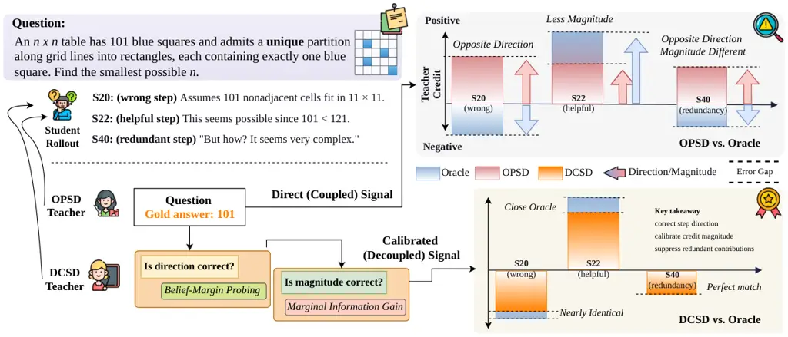
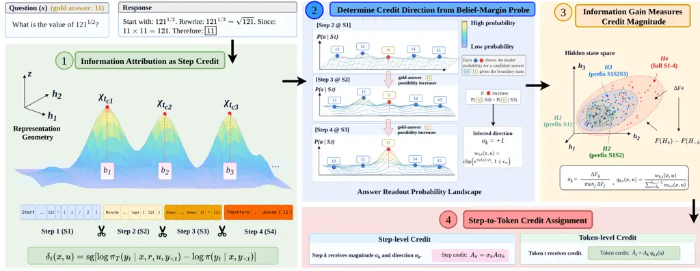

# Can We Trust the Teacher? Decoupled Credit Direction-Magnitude for Self-Distillation

Yugu Li    Zehong Cao    Peizhen Li    Yang Zhang    Siyi Hu    Jianglin
Qiao Affiliation: School of CSIT, Adelaide University, Adelaide, SA
5000, Australia Affiliation: CAIAA, University of North Texas, Denton,
TX 76203, USA Affiliation: School of EECMS, Curtin University, Bentley,
WA 6102, Australia Affiliation: ACFR, The University of Sydney,
Camperdown, NSW 2050, Australia Corresponding author: Zehong Cao
(jimmy.cao@adelaide.edu.au)

###### Abstract

## Abstract

RLVR provides reliable trajectory-level credit, while OPSD offers dense
supervision for token-level credit. This exposes a fundamental coupling
when updating step-level credit direction and magnitude with teacher
supervision, preventing steps from receiving reliable credit directions
and contribution magnitudes, while making both vulnerable to teacher
judgment errors and preference variance, as supported by our theoretical
analysis. To separate credit direction from its contribution magnitude,
we introduce Decoupled Credit Self-Distillation (DCSD), which
theoretically decouples credit direction and magnitude into two reliable
signals and uses them to calibrate privileged teacher supervision.
Specifically, we design belief-margin probing to determine credit
direction and marginal information gain to quantify credit magnitude,
enabling step-to-token credit assignment for policy optimization. Across
11 benchmarks, DCSD achieves the best overall scores against GRPO, OPSD,
RLSD, and RLCSD. Compared with base models, DCSD improves the overall
score by 8.45 points on mathematical reasoning and 7.01 points on
multimodal reasoning, while correcting the credit direction for 6% of
tokens and yielding a 1.5$`\times`$ reduction in token credit magnitude.

## 1 Introduction

Reinforcement learning with verifiable rewards (RLVR) \[Lambert et al.,
2025; Shao et al., 2024; Guo et al., 2025; Yu et al., 2025\] provides
reliable outcome feedback, but credit is typically assigned at the
trajectory level. Thus, successful trajectories may reinforce incorrect
or unnecessary steps, while useful steps in unsuccessful trajectories
receive no positive credit. On-policy distillation (OPD) \[Agarwal et
al., 2024\], particularly on-policy self-distillation (OPSD) \[Zhao et
al., 2026\] and its variants \[Hübotter et al., 2026; Yang et al., 2026;
Pan et al., 2026; Shen et al., 2026; Li et al., 2026\], provides denser
supervision by using a privileged teacher to evaluate the student’s
reasoning with additional information, such as ground-truth answers or
reference solutions.

The key challenge is that a _direct teacher signal may not provide
reliable local credit_. Existing OPSD couples credit direction and
magnitude through the same teacher signal. The teacher may misjudge
whether a step helps or harms the solution, while its signal strength
can vary with how privileged information is presented. Consequently,
teacher credit can deviate from oracle credit in both _direction_ and
_magnitude_. RLSD \[Yang et al., 2026\] and RLCSD \[Pan et al., 2026\]
improve robustness by anchoring direction to the trajectory-level RL
advantage and using self-distillation mainly to modulate update
strength. However, this loses local directional flexibility: harmful
steps in successful trajectories cannot receive negative credit, nor
useful steps in unsuccessful trajectories positive credit. Thus, teacher
signals can misdirect, while trajectory anchoring loses local credit.
Additional discussion of related work is provided in Appendix A.

Our theoretical insights (see Section 2) reveal a way out of this
trade-off. Under an oracle teacher corresponding to the student’s
rollout policy conditioned on eventual success, the self-distillation
log-ratio is directionally consistent with the oracle local RL
advantage, showing that self-distillation contains useful _local
directional information_. However, its magnitude does not directly
represent a step’s contribution, and a practical teacher can also
corrupt its direction.

Our insights suggest that reliable step-level credit requires separating
update direction from contribution magnitude, rather than coupling both
in a single teacher signal.



Figure 1: Overview of OPSD vs. DCSD credit. Direct OPSD can deviate from
oracle credit in both direction and magnitude. DCSD decouples these
roles to calibrate credit direction and contribution magnitude, reducing
mismatch while preserving useful local credit.

Motivated by our theoretical insights, we propose Decoupled Credit
Self-Distillation (DCSD) (see Section 3), which calibrates teacher
supervision by separately determining credit direction and contribution
magnitude. Specifically, DCSD determines credit direction through
_belief-margin probing_, which measures how each reasoning step changes
the student’s belief in the correct answer, and quantifies contribution
magnitude through _marginal information gain_, which measures how much
non-redundant information the step contributes beyond its preceding
context. The resulting decoupled credit then calibrates teacher
supervision, preserving fine-grained token-level information without
allowing teacher variation to freely alter the established step-level
direction or magnitude. Thus, DCSD transforms the direct teacher signal
in OPSD into a _calibrated teacher signal_ that better aligns with
oracle step-level credit. Figure 1 provides an illustrative example of
credit in OPSD vs. DCSD. The transition from coupled to decoupled credit
is formalized as follows:


On the OPSD side, the privileged teacher directly provides the
step-level credit $`Z_{k}^{T}`$, whose direction $`D_{k}^{T}`$ and
magnitude $`M_{k}^{T}`$ are coupled through the same teacher-derived
signal. Consequently, $`Z_{k}^{T}`$ can be viewed as the oracle credit
$`Z_{k}^{\star}`$ perturbed by teacher-induced deviation
$`\varepsilon_{k}^{T}`$, arising from judgment errors and preference
variance. On the DCSD side, we decouple these two components:
$`D_{k}^{T}`$ is determined by our belief-margin probe, while
$`M_{k}^{T}`$ is quantified by marginal information gain. Together, they
calibrate the teacher signal $`\widetilde{Z}_{k}^{T}`$ separately toward
the oracle credit $`Z_{k}^{\star}`$.

Our contributions are threefold. (1) We formalize oracle step credit in
self-distillation, establish its directional consistency with the local
RL advantage, and theoretically identify the factors that cause the
direct teacher signal in OPSD to deviate from oracle credit. (2) We
introduce DCSD, a decoupled credit framework that calibrates the teacher
signal by separately determining credit direction through belief-margin
probing and contribution magnitude through marginal information gain,
with theoretical guarantees. (3) Experiments across mathematical and
multimodal reasoning benchmarks show that DCSD achieves the best overall
scores against GRPO, OPSD, RLSD, and RLCSD, demonstrating that
calibrated teacher signals improve student overall performance.

## 2 Why Direct Teacher Signals Produce Coupled Credit

To understand why direct teacher supervision in OPSD couples credit
direction and contribution magnitude, we first formalize the oracle
(ground-truth) local credit for each reasoning step, then derive the
self-distillation credit that is directionally consistent with the
oracle and show how direct teacher supervision deviates from this oracle
credit through judgment errors and preference variance.

### 2.1 Oracle Local Advantage

Given an input $`x`$, let $`\pi`$ denote the student policy and
$`\tau=(y_{1},\ldots,y_{T})\sim\pi(\cdot\mid x)`$ a generated response,
where $`t\in\{1,\ldots,T\}`$ indexes response tokens. We partition
$`\tau`$ into $`K`$ contiguous reasoning steps using boundaries
$`1=b_{0}<\cdots<b_{K}=T+1`$, with $`k\in\{0,\ldots,K-1\}`$ and
$`C_{k}=(y_{b_{k}},\ldots,y_{b_{k+1}-1})`$. The state before step
$`C_{k}`$ is $`S_{k}=(x,C_{<k})`$, where
$`C_{<k}=(C_{0},\ldots,C_{k-1})`$, and generating $`C_{k}`$ yields
$`S_{k+1}`$. We use $`\pi(C\mid S)`$ to denote the complete-step
probability induced by the autoregressive student policy. A terminal
verifier provides reward $`R(\tau)\in\{0,1\}`$ and the underlying
on-policy objective computes a trajectory-level advantage $`A_{\tau}`$.
Let $`V^{\pi}(S)=P_{\pi}(R(\tau)=1\mid S)`$ denote the probability of
eventual success from state $`S`$, and
$`Q^{\pi}(S,C)=P_{\pi}(R(\tau)=1\mid S,C)`$ the corresponding success
probability after generating step $`C`$. For the realized step
$`C_{k}`$, $`Q^{\pi}(S_{k},C_{k})=V^{\pi}(S_{k+1})`$, giving the oracle
local advantage

```math
A_{k}^{\star}=Q^{\pi}(S_{k},C_{k})-V^{\pi}(S_{k})=V^{\pi}(S_{k+1})-V^{\pi}(S_{k}). \tag{1}
```

Its sign and magnitude characterize the direction and strength of the
local contribution. However, $`A_{k}^{\star}`$ is inaccessible because
intermediate-state success probabilities are unknown; $`A_{\tau}`$ alone
cannot distinguish local contributions within a rollout. Further details
are provided in Appendix B.1.

### 2.2 Oracle Signal Determines the Correct Credit Direction

We first characterize the oracle signal for determining whether a
reasoning step should be encouraged or penalized. Consider the student’s
policy conditioned on eventual success,
$`\pi^{+}(C\mid S):=P_{\pi}(C\mid S,R(\tau)=1)`$. By Bayes’ rule,
$`\pi^{+}(C\mid S)/\pi(C\mid S)=Q^{\pi}(S,C)/V^{\pi}(S)`$. This gives
the oracle signal for step $`C_{k}`$ as
$`Z_{k}^{\star}=\log[\pi^{+}(C_{k}\mid S_{k})/\pi(C_{k}\mid S_{k})]=\log[Q^{\pi}(S_{k},C_{k})/V^{\pi}(S_{k})]`$.
Combining the monotonicity of $`\log(\cdot)`$ with the oracle local
advantage in Eq. 1 gives

```math
\operatorname{sign}(Z_{k}^{\star})=\operatorname{sign}(A_{k}^{\star}). \tag{2}
```

Thus, $`C_{k}`$ is encouraged when $`Z_{k}^{\star}>0`$ and penalized
when $`Z_{k}^{\star}<0`$. Importantly, this consistency is directional
only: $`|Z_{k}^{\star}|`$ is not the magnitude of the local advantage
$`|A_{k}^{\star}|`$. Further details are provided in Appendix B.2.

### 2.3 Direct Teacher Signal Deviates from the Oracle Signal

In practice, the success-conditioned policy $`\pi^{+}`$ is unavailable.
OPSD instead uses a privileged teacher $`\pi_{T}`$ conditioned on
additional information $`r`$ and a preference realization $`u`$,
yielding
$`Z_{k}^{T}=\log[\pi_{T}(C_{k}\mid S_{k},r,u)/\pi(C_{k}\mid S_{k})]`$.
Let
$`\overline{\pi}_{T}(C\mid S,r)=\mathbb{E}_{u\sim\mu(\cdot\mid S,r)}[\pi_{T}(C\mid S,r,u)]`$
denote the preference-averaged teacher. Then

```math
Z_{k}^{T}=Z_{k}^{\star}+\varepsilon_{k}^{\mathrm{judge}}+\varepsilon_{k}^{\mathrm{prefer}}, \tag{3}
```

where
$`\varepsilon_{k}^{\mathrm{judge}}=\log[\overline{\pi}_{T}(C_{k}\mid S_{k},r)/\pi^{+}(C_{k}\mid S_{k})]`$
captures teacher judgment deviation, and
$`\varepsilon_{k}^{\mathrm{prefer}}=\log[\pi_{T}(C_{k}\mid S_{k},r,u)/\overline{\pi}_{T}(C_{k}\mid S_{k},r)]`$
captures preference-dependent variation. Further details of the
derivation are provided in Appendix B.3. These deviations can reverse
the oracle direction when $`Z_{k}^{\star}Z_{k}^{T}<0`$. Thus, direct
teacher supervision couples _which direction_ a step should be updated
with _how much_ credit it should receive.

In addition, methods such as RLSD \[Yang et al., 2026\] and RLCSD \[Pan
et al., 2026\] mitigate directional errors by anchoring local credit to
$`A_{\tau}`$, e.g., $`A_{\tau}m_{k}`$ with $`m_{k}\geq 0`$. However,
this fixes all local credit to the trajectory-level sign (see Appendices
B.4, B.5, and B.6): a harmful step in a successful trajectory cannot
receive negative credit, while a useful step in an unsuccessful
trajectory cannot receive positive credit. Therefore, our analysis
motivates decoupling credit direction from magnitude before
incorporating teacher evidence for token-level credit assignment.



Figure 2: DCSD workflow. Given a student rollout, DCSD identifies
reasoning steps from representation transitions, determines credit
direction from answer-belief changes and magnitude from marginal
information gain, and uses calibrated teacher signals to distribute step
credit across tokens.

## 3 Method: Decoupled Credit for Calibrating Teacher Signals

### 3.1 From Value Estimation to Information-Attributed Credit

The oracle credit introduced in Section 2.1 is _value-based_, measuring
how each step changes eventual success probability. Estimating it
requires intermediate-state values via value estimators or continuation
sampling \[Schulman et al., 2017; Luo et al., 2024; Setlur et al.,
2025\], introducing approximation bias or sampling variance \[Schulman
et al., 2016; Kazemnejad et al., 2025; Zhang et al., 2024\]. To avoid
directly estimating intermediate-state values, DCSD shifts from _value
estimation_ to _information attribution_ as shown in Figure 2 with the
full workflow. We characterize each reasoning step using the student’s
internal representations, followed by information-theoretic feature
attribution \[Chen et al., 2018\] to quantify the new information it
contributes beyond the preceding reasoning context. This provides a
measure of _how much_ credit a step should receive, while _credit
direction_ is determined separately through belief-margin probing. The
privileged teacher is then used only to distribute the resulting
step-level credit across tokens. For autoregressive responses, we adopt
marginal representation information as an operational measure of each
step’s contribution to response construction, using it to assign
relative credit magnitude.

#### Reasoning steps under information attribution.

Following the view that the structured variation carried by a
hidden-state trajectory can be quantified directly from the
representations themselves \[Ma et al., 2026\], we let
$`\mathbf{h}_{t}\in\mathbb{R}^{d}`$ denote the hidden representation of
token $`y_{t}`$ extracted from a fixed student layer. For each reasoning
step $`C_{k}`$, let
$`\mathcal{H}_{k}=\{\mathbf{h}_{t}\}_{t=b_{k}}^{b_{k+1}-1}`$ denote its
hidden-state feature group, with
$`\mathcal{H}_{<k}=(\mathcal{H}_{0},\ldots,\mathcal{H}_{k-1})`$ and
$`\mathcal{H}_{\leq k}=(\mathcal{H}_{0},\ldots,\mathcal{H}_{k})`$. Let
$`X`$ and $`Y`$ denote the random input and response corresponding to
$`x`$ and $`\tau`$, respectively. We identify the step boundaries from
representational transitions along the generated response using
change-point detection; the detailed construction is provided in
Appendix C.1. For a target $`\Upsilon`$ and ordered feature groups
$`\Phi_{k}`$ with finite total information, the mutual-information chain
rule yields the following sequential attribution.


The proof of Theorem 1 is provided in Appendix D.1.

### 3.2 Belief-Margin Probe Design for Decoupled Credit Direction

We determine step-level credit direction from the student’s own answer
belief, independently of privileged teacher feedback. At each state
$`S_{k}`$, we append the same fixed answer-readout suffix
$`\mathcal{P}_{\mathrm{ans}}`$ and score complete candidate answers
without sampling additional reasoning. Let $`a^{+}`$ denote the correct
answer and $`\mathcal{A}_{\tau}`$ a fixed candidate set containing
$`a^{+}`$, the rollout prediction, and valid candidates collected across
step boundaries, with at least one competitor. For each
$`a\in\mathcal{A}_{\tau}`$, define the complete-answer log-likelihood as
$`\ell_{k}(a)=\log\pi(a\mid S_{k},\mathcal{P}_{\mathrm{ans}})`$.
Candidate construction, answer serialization, and sequence scoring are
detailed in Appendix C.2.

#### Belief-margin probe design.

At state $`S_{k}`$, we measure the student’s relative support for the
correct answer by
$`M_{k}=\ell_{k}(a^{+})-\log\!\left(\sum_{a\in\mathcal{A}_{\tau}\setminus\{a^{+}\}}\exp(\ell_{k}(a))\right).`$
The step-induced belief change is

```math
\Delta M_{k}=M_{k+1}-M_{k}. \tag{4}
```

Thus, the sign of $`\Delta M_{k}`$ indicates whether $`C_{k}`$ shifts
belief toward or away from the correct answer.

#### Belief-guided credit direction.

Because small margin changes may be unreliable due to readout mismatch
or incomplete candidate coverage, we use the local direction only when
$`\Delta M_{k}`$ crosses the corresponding confidence threshold;
otherwise, we fall back to the trajectory-level direction:

```math
\sigma_{k}=\begin{cases}\operatorname{sign}(\Delta M_{k}),&\Delta M_{k}\geq\tau_{M}^{+}\ \text{or}\ \Delta M_{k}\leq\tau_{M}^{-},\\
\operatorname{sign}(A_{\tau}),&\text{otherwise},\end{cases} \tag{5}
```

where $`\tau_{M}^{-}<0<\tau_{M}^{+}`$ set the error tolerance for
Theorem 2.


The proof of Theorem 2 is provided in Appendix D.2.

### 3.3 Information-Gain Principle for Decoupled Credit Magnitude

Having determined the credit direction $`\sigma_{k}`$, we next quantify
_how much_ credit each reasoning step should receive using the
information-attribution principle introduced in Section 3.1. This
determines credit magnitude independently of privileged teacher
supervision.

#### Marginal information gain.

For any representation collection $`\mathcal{S}`$, define its
information volume as
$`F(\mathcal{S})=\frac{1}{2}\log\det\!\left(\mathbf{I}_{d}+\beta\sum_{\mathbf{h}\in\mathcal{S}}\mathbf{h}\mathbf{h}^{\top}\right)`$,
where $`\mathbf{I}_{d}`$ is the $`d`$-dimensional identity matrix and
$`\beta>0`$ is fixed. The marginal information gain of step $`C_{k}`$ is

```math
\Delta F_{k}=F\!\left(\mathcal{H}_{\leq k}\right)-F\!\left(\mathcal{H}_{<k}\right). \tag{6}
```

Thus, $`\Delta F_{k}`$ measures the information introduced by $`C_{k}`$
beyond the preceding reasoning. Theorem 3 shows that it is exactly the
sequential attribution of Theorem 1 for a latent answer variable.

#### Information gain quantifies credit magnitude.

We convert the marginal information gains into bounded relative credit
magnitudes as $`\alpha_{k}=\Delta F_{k}/\max_{0\leq j<K}\Delta F_{j}`$,
where $`0\leq\alpha_{k}\leq 1`$ and $`\max_{k}\alpha_{k}=1`$, whenever
$`\max_{j}\Delta F_{j}>0`$. Thus, $`\alpha_{k}`$ measures the relative
magnitude of step $`C_{k}`$ with respect to the most informative step in
the response. More details can be found in Appendix C.3. DCSD assigns
relative step-credit magnitude according to marginal information
contribution within the response, while Theorem 3 connects the
underlying information gain to oracle credit through evidence-model
bounds rather than asserting pointwise recovery of $`|A_{k}^{\star}|`$.


The proof of Theorem 3 is provided in Appendix D.3.

### 3.4 Calibrated Teacher Supervision for Step-to-Token Credit Assignment

The preceding components determine _whether_ each reasoning step should
be encouraged or penalized through $`\sigma_{k}`$, and _how much_ credit
it should receive through $`\alpha_{k}`$. We now use the privileged
teacher only to distribute this established step-level credit among
tokens within each step. Given privileged content $`r`$ and preference
realization $`u`$, define the token-level teacher–student discrepancy as
$`\delta_{t}=\operatorname{sg}\!\left[\log\pi_{T}(y_{t}\mid x,r,u,y_{<t})-\log\pi(y_{t}\mid x,y_{<t})\right]`$,
where $`\operatorname{sg}`$ stops gradients. This signal provides
teacher evidence without determining the step-level direction or
magnitude.

#### Teacher-calibrated token credit allocation.

For $`t\in C_{k}`$, we align teacher evidence with the established
direction and bound its influence using
$`w_{k,t}=\operatorname{clip}\!\left(e^{\sigma_{k}\delta_{t}},1-\epsilon_{w},1+\epsilon_{w}\right)`$,
where $`0\leq\epsilon_{w}<1`$. We normalize these weights within
$`C_{k}`$ as $`q_{k,t}=w_{k,t}\Big/\sum_{s\in C_{k}}w_{k,s}`$. By
construction, $`\sum_{t\in C_{k}}q_{k,t}=1`$, so $`q_{k,t}`$ only
determines within-step allocation.

#### Step-to-token credit assignment.

Let $`\kappa_{\tau}>0`$ be a teacher-independent scale factor. For
$`t\in C_{k}`$, the token-level credit is

```math
A_{t}^{\mathrm{tok}}=\sigma_{k}\kappa_{\tau}|A_{\tau}|\alpha_{k}q_{k,t},\qquad b_{k}\leq t<b_{k+1}. \tag{7}
```

This factorization separates step direction $`\sigma_{k}`$, step
magnitude $`\kappa_{\tau}|A_{\tau}|\alpha_{k}`$, and within-step teacher
allocation $`q_{k,t}`$. Since $`\alpha_{k}`$ is max-normalized rather
than sum-normalized, the total absolute response credit is
$`\kappa_{\tau}|A_{\tau}|\sum_{k}\alpha_{k}`$ and need not equal
$`\kappa_{\tau}|A_{\tau}|`$. If $`A_{\tau}=0`$, all token credits are
zero. The clipping keeps all teacher weights finite and positive.
Optimization details and the scale convention are provided in Appendix
C.4.


The proof of Theorem 4 is provided in Appendix D.4.

Taken together, Theorems 1–4 establish the theoretical foundation of
DCSD for decoupling credit direction and magnitude in OPSD, while
calibrating teacher supervision rather than direct signal. We formalize
and expand upon the brief formulation introduced in Section 1, as
summarized below.


## 4 Experiments and Results

### 4.1 Experimental Setup

#### Training setup.

We consider two reasoning settings: mathematical and multimodal
reasoning. For mathematical reasoning, we use Qwen3-4B \[Yang et al.,
2025\] as the base model and DAPO-17K \[Yu et al., 2025\] for training;
for multimodal reasoning, we use Qwen3-VL-8B-Instruct \[Bai et al.,
2025\] with MMFineReason-123K \[Lin et al., 2026\]. Our mathematical
runs share the base model, training data, and rollout budget; multimodal
baselines retain the published settings of Yang et al. \[2026\].
Training is implemented with verl \[Sheng et al., 2025\]; hyperparameter
settings are provided in Appendix E.1, with hardware specifications and
computational costs reported in Appendix E.5.

#### Baselines, benchmarks, and metrics.

We compare DCSD against GRPO \[Shao et al., 2024\], OPSD \[Zhao et al.,
2026\], and RLSD \[Yang et al., 2026\], with the corresponding base
models as references. For mathematical reasoning, we additionally
compare with RLCSD \[Pan et al., 2026\] separately because it uses a
different construction of privileged information. We evaluate
mathematical reasoning on AIME24/25/26 \[Mathematical Association of
America, 2024; Mathematical Association of America, 2025; Zhang and
Math-AI, 2026\], AMC23 \[Mathematical Association of America, 2023\],
MATH500 \[Hendrycks et al., 2021\], and HMMT \[Dekoninck et al., 2026\],
and multimodal reasoning on MMMU \[Yue et al., 2024\], MathVista \[Lu et
al., 2024\], MathVision \[Wang et al., 2024\], ZeroBench-Sub \[Roberts
et al., 2026\], and WeMath \[Qiao et al., 2025\]. We report mean@4
accuracy (%), with Overall computed as the sample-weighted average
across benchmarks. For multimodal tasks, we train only DCSD and report
baseline results from Table 2 of RLSD under the same settings. We follow
the same training and evaluation settings for fair comparison, with
further details provided in Appendix E.4.

#### Training dynamics and credit analysis.

We further examine how different credit designs affect learning by
tracking training reward and validation accuracy throughout training.
For DCSD, we measure the credit direction-correction rate, including
positive and negative corrections, to quantify how often local credit
departs from the trajectory-level direction. We also compare the mean
absolute RL advantage before and after magnitude allocation to quantify
how DCSD adjusts credit magnitude. Definitions and aggregation details
are provided in Appendix E.3.

#### Teacher signal reliability: direct vs. calibrated.

To isolate teacher-signal deviation and assess the effect of
calibration, we fix the Qwen3-4B responses to 90 AIME24–AIME26 problems
and vary only the privileged information provided for scoring. We
consider five conditions: no answer (C0), the correct answer (C1), an
incorrect answer (C2), an equivalent form of the correct answer (C3),
and the correct answer with a worked solution (C4). Using Qwen3-32B
under the same conditions as a stronger-model reference, which we treat
as a proxy for the oracle teacher, we quantify two complementary forms
of deviation. First, _Top-1 Disagreement Rate (TDR)_ captures teacher
judgment errors by measuring the percentage of token positions at which
the model’s full-vocabulary top-1 prediction differs from the reference.
Second, _Mean Absolute Error (MAE)_ captures teacher preference
variation by measuring the mean absolute difference in sampled-token
log-probabilities, reported in $`10^{-3}`$ nat/token. Comparing TDR and
MAE across C0–C4 therefore reveals how teacher judgments and preference
strengths deviate under different privileged information, and how
effectively each method calibrates these deviations. Further details are
provided in Appendix E.2.

### 4.2 Main Performance Results

#### Mathematical reasoning tasks.

Table 1 shows that GRPO and RLSD generally outperform OPSD, suggesting
that anchoring credit to outcome feedback is more robust than directly
following an unconstrained teacher signal. However, trajectory-level
anchoring assigns the same direction to all steps and therefore cannot
capture local credit reversals. DCSD consistently improves over these
baselines, indicating that robust credit direction and local flexibility
need not be traded off: decoupling direction and magnitude allows local
credit to be refined without directly inheriting teacher deviations. The
gains on AIME24-26 and HMMT further demonstrate the benefit of this
design on challenging multi-step reasoning, while improvements on the
higher-accuracy AMC23 and MATH500 show fine-grained credit remains
useful even when trajectories are frequently successful.

#### Multimodal reasoning tasks.

As shown in Table 1, RLSD is the strongest baseline, indicating the
benefit of combining outcome anchoring with fine-grained teacher
supervision. DCSD further improves performance on MMMU, MathVista,
MathVision, and WeMath, with the largest gain on WeMath. As WeMath
contains compositional problems involving multiple knowledge concepts
and intermediate sub-problems, this gain is consistent with our
motivation for local credit assignment: useful intermediate reasoning
can receive positive credit even when the overall trajectory is
unsuccessful, while marginal information gain differentiates its
contribution strength. This suggests that decoupling direction and
magnitude can better preserve and weight useful local reasoning than
assigning a common outcome direction to all steps. We notice ZeroBench
is the exception where DCSD underperforms RLSD. As these problems place
greater demands on fine-grained visual perception and spatial reasoning,
errors originating from visual evidence may also limit the subsequent
reasoning and local credit estimation, which cannot be addressed through
credit calibration alone.

|                                                 |            |           |            |           |         |       |         |
| ----------------------------------------------- | ---------- | --------- | ---------- | --------- | ------- | ----- | ------- |
| Method                                          | Benchmarks |           |            |           |         |       | Overall |
| (a) Mathematical reasoning (Qwen3-4B)           |            |           |            |           |         |       |         |
|                                                 | AIME24     | AIME25    | AIME26     | AMC23     | MATH500 | HMMT  |         |
| Vanilla                                         | 65.83      | 54.17     | 52.50      | 92.50     | 88.10   | 26.67 | 81.40   |
| GRPO                                            | 67.50      | 55.83     | 50.00      | 90.00     | 92.20   | 33.33 | 84.70   |
| OPSD                                            | 50.00      | 46.67     | 45.83      | 87.50     | 88.60   | 26.67 | 80.11   |
| RLSD                                            | 63.33      | 52.50     | 55.83      | 92.50     | 91.00   | 33.33 | 83.86   |
| DCSD (Ours)                                     | 68.33      | 57.50     | 59.17      | 95.00     | 96.00   | 36.67 | 88.56   |
| (b) Multimodal reasoning (Qwen3-VL-8B-Instruct) |            |           |            |           |         |       |         |
|                                                 | MMMU       | MathVista | MathVision | ZeroBench | WeMath  |       |         |
| Vanilla                                         | 62.44      | 73.80     | 47.37      | 19.76     | 54.10   |       | 53.43   |
| GRPO                                            | 65.11      | 76.20     | 48.82      | 22.60     | 56.57   |       | 55.49   |
| OPSD                                            | 63.82      | 75.10     | 47.53      | 21.06     | 54.95   |       | 54.13   |
| RLSD                                            | 67.22      | 78.10     | 52.73      | 24.85     | 58.00   |       | 58.19   |
| DCSD (Ours)                                     | 68.44      | 79.20     | 54.11      | 20.66     | 67.05   |       | 61.14   |

Table 1: Reasoning performance (mean@4). Best results are bold.

Figure 3: Training dynamics and empirical behavior of decoupled credit.
(a) Training reward and (b) validation accuracy on mathematical
reasoning. DCSD achieves training rewards comparable to GRPO and RLSD
while attaining higher validation accuracy. (c) Direction calibration is
sparse and selective, with only a small fraction of tokens receiving
positive or negative overrides. (d) Magnitude calibration consistently
reduces mean absolute credit, demonstrating independent control of
credit direction and magnitude throughout training.

### 4.3 Training Dynamics and Credit Analysis

#### Training reward and validation accuracy.

As shown in Figure 3a-b, DCSD, GRPO, and RLSD achieve similar training
rewards throughout training but exhibit different validation
performance. This gap suggests that comparable outcome rewards can lead
to different generalization depending on how credit is assigned within
each trajectory. DCSD concentrates updates on locally supported and
informative reasoning steps, rather than propagating a common outcome
direction across the entire response. This more selective credit
assignment reduces reinforcement of redundant or weakly relevant steps
and is consistent with the stronger validation performance of DCSD. In
contrast, the later decline of OPSD shows that denser teacher
supervision alone does not necessarily translate into sustained
generalization when its local credit remains insufficiently calibrated.

#### Credit direction correction and magnitude control.

As supported by Figure 3c, direction correction occurs for about 6% of
tokens, covering both positive corrections in unsuccessful trajectories
and negative corrections in successful ones. This shows that DCSD
preserves most trajectory-level supervision while selectively correcting
the direction when sufficient local evidence indicates otherwise.
Meanwhile, in Figure 3d, credit-magnitude attenuation remains stable
throughout training, suggesting that DCSD consistently differentiates
the contribution strength of individual reasoning steps. Together, these
results demonstrate that DCSD independently controls _which direction_ a
step should be updated and _how much_ credit it should receive.

In addition, we provide representative examples as case studies in
Appendix F, where direct OPSD assigns the wrong credit direction to
individual reasoning steps, including rewarding incorrect steps and
penalizing correct ones. DCSD selectively reverses these signals,
providing qualitative evidence for more reliable local credit
assignment.

### 4.4 Teacher Signal Deviation and Calibration Effects

We compare the trained models with a condition-matched Qwen3-32B
reference on fixed student responses in Table 2. We treat
condition-matched Qwen3-32B as an operational oracle. TDR measures top-1
disagreement, while MAE measures sampled-token log-probability
discrepancy. Lower values indicate closer oracle-reference alignment
across (C0–C4), indicating closer agreement with the stronger-model
reference in both local token decisions and sampled-token preference
strengths.

#### Teacher judgment error.

DCSD consistently achieves the lowest TDR across all
privileged-information conditions, indicating fewer local top-1
disagreements with the reference. Notably, its advantage already appears
under C0, where no privileged answer information is provided, showing
that the improvement cannot be attributed solely to additional answer
information. The advantage is maintained under correct, incorrect,
equivalent, and worked-solution information (C1–C4), suggesting that
DCSD remains less sensitive to changes in the privileged context. Under
the proxy-oracle assumption, these results indicate lower judgment error
across information conditions.

| Deviation                              | Method      | C0     | C1     | C2     | C3     | C4     | Avg.   |
| -------------------------------------- | ----------- | ------ | ------ | ------ | ------ | ------ | ------ |
| Top-1 disagreement (TDR, %)            | OPSD        | 12.07  | 12.16  | 12.15  | 12.18  | 12.07  | 12.12  |
|                                        | RLSD        | 9.69   | 10.31  | 10.26  | 10.31  | 10.22  | 10.16  |
|                                        | DCSD (Ours) | 9.45   | 9.95   | 9.89   | 9.94   | 9.88   | 9.82   |
| Support discrepancy (MAE, $`10^{-3}`$) | OPSD        | 215.96 | 217.78 | 217.80 | 218.59 | 219.21 | 217.87 |
|                                        | RLSD        | 186.15 | 200.17 | 199.76 | 200.04 | 206.19 | 198.46 |
|                                        | DCSD (Ours) | 183.34 | 193.95 | 194.00 | 193.89 | 199.77 | 192.99 |

Table 2: Token-level teacher-signal deviation from the condition-matched
Qwen3-32B reference. Avg. averages C0–C4. Lower is better; best results
are bold.

#### Teacher preference variation.

DCSD also achieves the lowest MAE under every condition, indicating that
its sampled-token preference strengths remain consistently closer to
those of the reference. This advantage holds both on average and under
C4, where all methods exhibit their largest deviation after receiving a
complete worked solution. Thus, the improvement is not specific to a
particular form of privileged information. Together, these results
suggest that DCSD keeps its sampled-token preference strengths closer to
the proxy oracle across privileged-information conditions, consistent
with its design to constrain teacher influence after credit direction
and magnitude are established.

### 4.5 Calibrated Teacher Signal Improves Reasoning Efficiency

Privileged self-distillation can overemphasize teacher-specific
preferences, causing the student to imitate superficial response
patterns rather than reinforce effective reasoning. RLCSD mitigates this
issue by contrasting correct and incorrect references, improving
reasoning performance while preserving longer reasoning traces. We
therefore use RLCSD as a representative baseline to examine whether the
more explicitly calibrated teacher signal in DCSD translates into
greater reasoning efficiency. We jointly report Pass@1, Pass@4, and mean
response length to measure single-attempt accuracy, multi-attempt
solution coverage, and generation cost, respectively.

Across six benchmarks, DCSD improves the unweighted mean Pass@1 and
Pass@4 over RLCSD by 4.02% and 3.74%, respectively, while producing
shorter responses on every benchmark and reducing mean response length
by 6.3% (Table 3). The reduction in generation length therefore does not
come at the expense of reasoning performance; instead, DCSD achieves
higher accuracy and broader solution coverage with fewer generated
tokens. This accuracy-efficiency gain is consistent with teacher-signal
calibration in DCSD: contribution-aware magnitude credit reduces
reinforcement of redundant reasoning, while selective direction
verification preserves locally useful signals.

|             | AIME24 |        |        | AIME25 |        |        | AIME26 |        |        |
| ----------- | ------ | ------ | ------ | ------ | ------ | ------ | ------ | ------ | ------ |
| Method      | Pass@1 | Pass@4 | Length | Pass@1 | Pass@4 | Length | Pass@1 | Pass@4 | Length |
| RLCSD       | 63.33  | 73.33  | 11,450 | 50.00  | 70.00  | 12,946 | 60.00  | 70.00  | 12,465 |
| DCSD (Ours) | 70.00  | 76.67  | 10,627 | 56.67  | 73.33  | 12,052 | 56.67  | 76.67  | 11,847 |

|             | AMC23  |        |        | MATH500 |        |        | HMMT   |        |        |
| ----------- | ------ | ------ | ------ | ------- | ------ | ------ | ------ | ------ | ------ |
| Method      | Pass@1 | Pass@4 | Length | Pass@1  | Pass@4 | Length | Pass@1 | Pass@4 | Length |
| RLCSD       | 92.50  | 100.00 | 7,266  | 92.00   | 95.20  | 4,815  | 33.33  | 43.33  | 14,758 |
| DCSD (Ours) | 95.00  | 97.50  | 6,587  | 93.60   | 96.80  | 4,164  | 43.33  | 53.33  | 14,436 |

Table 3: Reasoning accuracy (%) and efficiency (mean token length)
across six benchmarks. Higher accuracy and shorter responses are better;
best results are bold.

## 5 Conclusion

We study credit assignment in the self-distillation framework, showing
that direct teacher supervision couples credit direction and magnitude,
while practical teacher signals can deviate from oracle credit through
judgment errors and preference variation. Our analysis therefore
motivates treating which direction a step should be updated and how much
it should contribute as two separate components of credit assignment.
Based on this insight, we propose DCSD, which determines credit
direction through belief-margin probing and contribution magnitude
through marginal information gain, thereby calibrating privileged
teacher supervision rather than directly inheriting its credit. Across
11 mathematical and multimodal reasoning benchmarks, DCSD improves
overall student reasoning performance over outcome-based RL and existing
self-distillation methods. More broadly, our work provides a new
framework for self-distillation that enables more reliable learning from
privileged teacher information through decoupled credit assignment.
Future work could extend this principle to longer-horizon and
interactive reasoning, where credit must be assigned across more complex
sequences of decisions and feedback.

## References

- Agarwal et al. (2024) R. Agarwal, N. Vieillard, Y. Zhou, P.
  Stanczyk, S. Ramos Garea, M. Geist, and O. Bachem On-policy
  distillation of language models: learning from self-generated
  mistakes. In International Conference on Learning Representations,
  Vol. 2024, pp. 21246–21263. External Links:
  [Link](https://proceedings.iclr.cc/paper_files/paper/2024/hash/5be69a584901a26c521c2b51e40a4c20-Abstract-Conference.html)
  Cited by: §1.
- Bai et al. (2025) S. Bai, Y. Cai, R. Chen, K. Chen, X. Chen, Z.
  Cheng, L. Deng, W. Ding, C. Gao, C. Ge, et al. Qwen3-vl technical
  report. arXiv preprint arXiv:2511.21631. External Links:
  [Link](https://arxiv.org/abs/2511.21631) Cited by: §4.1.
- Chaloner and Verdinelli (1995) K. Chaloner and I. Verdinelli Bayesian
  experimental design: a review. Statistical science, pp. 273–304.
  External Links: [Link](https://doi.org/10.1214/ss/1177009939) Cited
  by: §D.3.
- Chen et al. (2018) J. Chen, L. Song, M. Wainwright, and M. Jordan
  Learning to explain: an information-theoretic perspective on model
  interpretation. In International conference on machine learning,
  pp. 883–892. External Links:
  [Link](https://proceedings.mlr.press/v80/chen18j.html) Cited by: §D.1,
  §3.1.
- Cover and Thomas (2006) T. M. Cover and J. A. Thomas Elements of
  information theory. Second edition, Wiley-Interscience, Hoboken, NJ.
  External Links: ISBN 978-0-471-24195-9,
  [Link](https://doi.org/10.1002/047174882X) Cited by: §D.3, §D.3.
- Dekoninck et al. (2026) J. Dekoninck, N. Jovanović, T. Gehrunger, K.
  Rögnvaldsson, I. Petrov, C. Sun, and M. Vechev Beyond benchmarks:
  matharena as an evaluation platform for mathematics with llms.
  External Links: 2605.00674, [Link](https://arxiv.org/abs/2605.00674)
  Cited by: §4.1.
- Guo et al. (2025) D. Guo, D. Yang, H. Zhang, J. Song, P. Wang, Q.
  Zhu, R. Xu, R. Zhang, S. Ma, X. Bi, et al. DeepSeek-R1 incentivizes
  reasoning in LLMs through reinforcement learning. Nature 645 (8081),
  pp. 633–638. External Links:
  [Document](https://dx.doi.org/10.1038/s41586-025-09422-z),
  [Link](https://www.nature.com/articles/s41586-025-09422-z) Cited by:
  §1.
- Hendrycks et al. (2021) D. Hendrycks, C. Burns, S. Kadavath, A.
  Arora, S. Basart, E. Tang, D. Song, and J. Steinhardt Measuring
  mathematical problem solving with the math dataset. Thirty-Fifth
  Annual Conference on Neural Information Processing Systems. External
  Links:
  [Link](https://datasets-benchmarks-proceedings.neurips.cc/paper/2021/hash/be83ab3ecd0db773eb2dc1b0a17836a1-Abstract-round2.html)
  Cited by: §4.1.
- Hübotter et al. (2026) J. Hübotter, F. Lübeck, L. D. Behric, A.
  Baumann, M. Bagatella, D. Marta, I. Hakimi, I. Shenfeld, T. K.
  Buening, C. Guestrin, and A. Krause Reinforcement learning via
  self-distillation. In Forty-third International Conference on Machine
  Learning, External Links:
  [Link](https://openreview.net/forum?id=QkfkxyRizZ) Cited by: Appendix
  A, §1.
- Kazemnejad et al. (2025) A. Kazemnejad, M. Aghajohari, E.
  Portelance, A. Sordoni, S. Reddy, A. Courville, and N. Le Roux
  VinePPO: refining credit assignment in RL training of LLMs. In
  Proceedings of the 42nd International Conference on Machine Learning,
  Proceedings of Machine Learning Research, Vol. 267, pp. 29557–29590.
  External Links:
  [Link](https://proceedings.mlr.press/v267/kazemnejad25a.html) Cited
  by: §3.1.
- Lambert et al. (2025) N. Lambert, J. Morrison, V. Pyatkin, S.
  Huang, H. Ivison, F. Brahman, L. J. V. Miranda, A. Liu, N. Dziri, X.
  Lyu, Y. Gu, S. Malik, V. Graf, J. D. Hwang, J. Yang, R. L. Bras, O.
  Tafjord, C. Wilhelm, L. Soldaini, N. A. Smith, Y. Wang, P. Dasigi,
  and H. Hajishirzi Tulu 3: pushing frontiers in open language model
  post-training. In Second Conference on Language Modeling, External
  Links: [Link](https://openreview.net/forum?id=i1uGbfHHpH) Cited by:
  §1.
- Li et al. (2026) G. Li, T. Yang, J. Fang, M. Song, M. Zheng, H.
  Guo, D. Zhang, J. Wang, and T. Chua Unifying group-relative and
  self-distillation policy optimization via sample routing. In Third
  Conference on Language Modeling, Note: Accepted for publication
  External Links: [Link](https://openreview.net/forum?id=P2OuWwZspP)
  Cited by: Appendix A, §1.
- Lin et al. (2026) H. Lin, Z. Liu, Y. Zhu, C. Qin, J. Lin, X. Shang, C.
  He, W. Zhang, and L. Wu Mmfinereason: closing the multimodal reasoning
  gap via open data-centric methods. arXiv preprint arXiv:2601.21821.
  External Links: [Link](https://arxiv.org/abs/2601.21821) Cited by:
  §4.1.
- Lindley (1956) D. V. Lindley On a measure of the information provided
  by an experiment. The Annals of Mathematical Statistics 27 (4),
  pp. 986–1005. External Links:
  [Link](https://doi.org/10.1214/aoms/1177728069) Cited by: §D.3.
- Liu et al. (2013) S. Liu, M. Yamada, N. Collier, and M. Sugiyama
  Change-point detection in time-series data by relative density-ratio
  estimation. Neural Networks 43, pp. 72–83. External Links:
  [Document](https://dx.doi.org/10.1016/j.neunet.2013.01.012) Cited by:
  §C.1.
- Lu et al. (2024) P. Lu, H. Bansal, T. Xia, J. Liu, C. Li, H.
  Hajishirzi, H. Cheng, K. Chang, M. Galley, and J. Gao Mathvista:
  evaluating mathematical reasoning of foundation models in visual
  contexts. In International Conference on Learning Representations,
  Vol. 2024, pp. 23439–23554. External Links:
  [Link](https://proceedings.iclr.cc/paper_files/paper/2024/hash/663bce02a0050c4a11f1eb8a7f1429d3-Abstract-Conference.html)
  Cited by: §4.1.
- Luo et al. (2024) L. Luo, Y. Liu, R. Liu, S. Phatale, M. Guo, H.
  Lara, Y. Li, L. Shu, Y. Zhu, L. Meng, et al. Improve mathematical
  reasoning in language models by automated process supervision. arXiv
  preprint arXiv:2406.06592. External Links:
  [Link](https://arxiv.org/abs/2406.06592) Cited by: §3.1.
- Ma et al. (2026) Y. Ma, F. Luo, L. Zhang, C. Zhao, M. Wang, Y. Wu, Z.
  Qian, Y. Lu, L. Chen, Z. Cao, et al. Reasoning emerges from
  constrained inference manifolds in large language models. arXiv
  preprint arXiv:2605.08142. External Links:
  [Link](https://arxiv.org/abs/2605.08142) Cited by: §C.1, §3.1.
- Mathematical Association of America (2023) Mathematical Association of
  America American mathematics competitions (AMC). Mathematical
  Association of America. External Links:
  [Link](https://maa.org/student-programs/amc/) Cited by: §4.1.
- Mathematical Association of America (2024) Mathematical Association of
  America American invitational mathematics examination (AIME).
  Mathematical Association of America. External Links:
  [Link](https://maa.org/maa-invitational-competitions/) Cited by: §4.1.
- Mathematical Association of America (2025) Mathematical Association of
  America American invitational mathematics examination (AIME).
  Mathematical Association of America. External Links:
  [Link](https://maa.org/maa-invitational-competitions/) Cited by: §4.1.
- Pan et al. (2026) L. Pan, S. Tao, Y. Zhai, L. Zhang, Z. Liu, B.
  Ding, A. Liu, and L. Wen RLCSD: reinforcement learning with
  contrastive on-policy self-distillation. arXiv preprint
  arXiv:2606.11709. External Links:
  [Link](https://arxiv.org/abs/2606.11709) Cited by: Appendix A, §B.6,
  §1, §1, §2.3, §4.1.
- Qiao et al. (2025) R. Qiao, Q. Tan, G. Dong, W. Minhui, C. Sun, X.
  Song, J. Wang, Z. Gongque, S. Lei, Y. Zhang, et al. We-math: does your
  large multimodal model achieve human-like mathematical reasoning?. In
  Proceedings of the 63rd Annual Meeting of the Association for
  Computational Linguistics (Volume 1: Long Papers), pp. 20023–20070.
  External Links: [Link](https://aclanthology.org/2025.acl-long.983/)
  Cited by: §4.1.
- Roberts et al. (2026) J. Roberts, M. R. Taesiri, A. Sharma, A.
  Gupta, S. Roberts, I. Croitoru, S. Bogolin, J. Tang, F. Langer, V.
  Raina, et al. ZeroBench: an impossible visual benchmark for
  contemporary large multimodal models. In Forty-third International
  Conference on Machine Learning, External Links:
  [Link](https://openreview.net/forum?id=EvmCeoiKYI) Cited by: §4.1.
- Schulman et al. (2016) J. Schulman, P. Moritz, S. Levine, M. Jordan,
  and P. Abbeel High-dimensional continuous control using generalized
  advantage estimation. In International Conference on Learning
  Representations, External Links:
  [Link](https://arxiv.org/abs/1506.02438) Cited by: §3.1.
- Schulman et al. (2017) J. Schulman, F. Wolski, P. Dhariwal, A.
  Radford, and O. Klimov Proximal policy optimization algorithms. arXiv
  preprint arXiv:1707.06347. External Links:
  [Link](https://arxiv.org/abs/1707.06347) Cited by: §3.1.
- Setlur et al. (2025) A. Setlur, C. Nagpal, A. Fisch, X. Geng, J.
  Eisenstein, R. Agarwal, A. Agarwal, J. Berant, and A. Kumar Rewarding
  progress: scaling automated process verifiers for llm reasoning. In
  International Conference on Learning Representations, Vol. 2025,
  pp. 60808–60838. External Links:
  [Link](https://proceedings.iclr.cc/paper_files/paper/2025/hash/98711dea460bdefe0e651ca23ec98ba2-Abstract-Conference.html)
  Cited by: §3.1.
- Shao et al. (2024) Z. Shao, P. Wang, Q. Zhu, R. Xu, J. Song, X. Bi, H.
  Zhang, M. Zhang, Y. Li, Y. Wu, et al. Deepseekmath: pushing the limits
  of mathematical reasoning in open language models. arXiv preprint
  arXiv:2402.03300. External Links:
  [Link](https://arxiv.org/abs/2402.03300) Cited by: §1, §4.1.
- Shen et al. (2026) Z. Shen, J. Tong, S. Yan, C. Shen, H. Chen, W.
  Ye, X. Hu, R. Miao, H. Wang, J. Zhao, et al. Purified opsd: on-policy
  self-distillation without losing how to think. arXiv preprint
  arXiv:2607.02234. External Links:
  [Link](https://arxiv.org/abs/2607.02234) Cited by: Appendix A, §1.
- Sheng et al. (2025) G. Sheng, C. Zhang, Z. Ye, X. Wu, W. Zhang, R.
  Zhang, Y. Peng, H. Lin, and C. Wu Hybridflow: a flexible and efficient
  rlhf framework. In Proceedings of the Twentieth European Conference on
  Computer Systems, pp. 1279–1297. External Links:
  [Link](https://doi.org/10.1145/3689031.3696075) Cited by: §4.1.
- Wang et al. (2024) K. Wang, J. Pan, W. Shi, Z. Lu, H. Ren, A. Zhou, M.
  Zhan, and H. Li Measuring multimodal mathematical reasoning with
  math-vision dataset. Advances in Neural Information Processing Systems
  37, pp. 95095–95169. External Links:
  [Link](https://papers.nips.cc/paper_files/paper/2024/hash/ad0edc7d5fa1a783f063646968b7315b-Abstract-Datasets_and_Benchmarks_Track.html)
  Cited by: §4.1.
- Yang et al. (2025) A. Yang, A. Li, B. Yang, B. Zhang, B. Hui, B.
  Zheng, B. Yu, C. Gao, C. Huang, C. Lv, et al. Qwen3 technical report.
  arXiv preprint arXiv:2505.09388. External Links:
  [Link](https://arxiv.org/abs/2505.09388) Cited by: §4.1.
- Yang et al. (2026) C. Yang, C. Qin, Q. Si, M. Chen, N. Gu, D. Yao, Z.
  Lin, W. Wang, J. Wang, and N. Duan Self-distilled rlvr. arXiv preprint
  arXiv:2604.03128. External Links:
  [Link](https://arxiv.org/abs/2604.03128) Cited by: Appendix A, §B.5,
  §1, §1, §2.3, §4.1, §4.1.
- Yu et al. (2025) Q. Yu, Z. Zhang, R. Zhu, Y. Yuan, X. Zuo, Y. Yue, W.
  Dai, T. Fan, G. Liu, L. Liu, et al. Dapo: an open-source llm
  reinforcement learning system at scale. Advances in Neural Information
  Processing Systems 38, pp. 113222–113244. External Links:
  [Link](https://papers.nips.cc/paper_files/paper/2025/hash/a4277440d50f1f15d2cb4c14f7e0c0d2-Abstract-Conference.html)
  Cited by: §1, §4.1.
- Yue et al. (2024) X. Yue, Y. Ni, K. Zhang, T. Zheng, R. Liu, G.
  Zhang, S. Stevens, D. Jiang, W. Ren, Y. Sun, et al. Mmmu: a massive
  multi-discipline multimodal understanding and reasoning benchmark for
  expert agi. In Proceedings of the IEEE/CVF conference on computer
  vision and pattern recognition, pp. 9556–9567. External Links:
  [Link](https://openaccess.thecvf.com/content/CVPR2024/html/Yue_MMMU_A_Massive_Multi-discipline_Multimodal_Understanding_and_Reasoning_Benchmark_for_CVPR_2024_paper.html)
  Cited by: §4.1.
- Zhang et al. (2024) D. Zhang, S. Zhoubian, Z. Hu, Y. Yue, Y. Dong,
  and J. Tang Rest-mcts\*: llm self-training via process reward guided
  tree search. Advances in Neural Information Processing Systems 37,
  pp. 64735–64772. External Links:
  [Link](https://papers.nips.cc/paper_files/paper/2024/hash/76ec4dc30e9faaf0e4b6093eaa377218-Abstract-Conference.html)
  Cited by: §3.1.
- Zhang and Math-AI (2026) Y. Zhang and T. Math-AI American invitational
  mathematics examination (aime) 2026. External Links:
  [Link](https://huggingface.co/datasets/math-ai/aime26) Cited by: §4.1.
- Zhao et al. (2026) S. Zhao, Z. Xie, M. Liu, J. Huang, G. Pang, F.
  Chen, and A. Grover Self-distilled reasoner: on-policy
  self-distillation for large language models. In Forty-third
  International Conference on Machine Learning, External Links:
  [Link](https://openreview.net/forum?id=Jpxfof0EaS) Cited by: Appendix
  A, Appendix A, §1, §4.1.

## Appendix A Related Work

#### Reasoning Tasks from RLVR to OPSD.

RLVR improves language-model reasoning by optimizing responses against
outcome-level rewards. While such rewards provide reliable feedback on
whether a final solution succeeds, they offer limited information about
which intermediate reasoning steps are useful, harmful, or redundant.
OPSD complements this trajectory-level supervision with dense
token-level feedback: the same model acts as both student and privileged
teacher under different conditioning contexts, allowing the teacher to
evaluate the student’s own rollouts with access to additional
information \[Zhao et al., 2026\]. This provides finer-grained
supervision without requiring a separate stronger teacher, but shifts
the key challenge from obtaining dense supervision to determining
whether the resulting teacher signal provides reliable local credit. Our
work focuses on this latter problem by studying teacher supervision
through two components of step-level credit: its _direction_ and
_magnitude_.

#### Improving Self-Distillation with Privileged Feedback.

A natural way to improve self-distillation is to provide the teacher
with richer information or make its supervision more stable. SDPO
incorporates environmental feedback and successful responses into the
self-teacher context, while mechanisms such as EMA or trust-region
teacher regularization stabilize learning \[Zhao et al., 2026, Hübotter
et al., 2026\]. These methods demonstrate the value of privileged
supervision. However, under the decomposition in Section 2, richer
feedback does not guarantee that the preference-marginalized teacher
matches the success-conditioned policy, so _judgment error_ may remain.
Moreover, temporal stability of the teacher does not imply stability of
its preferences across different feedback realizations. Even with fixed
teacher parameters, changes in the full conditioning context can alter
local scores, allowing _preference-dependent variation_ to affect both
credit direction and magnitude. DCSD therefore retains dense teacher
evidence while determining step direction and relative magnitude
independently, restricting the teacher to within-step allocation after
step-level credit has been established.

#### Combining Self-Distillation with Outcome Feedback.

Rather than relying entirely on the teacher signal, another line of work
combines self-distillation with outcome-level supervision or selectively
controls when and how strongly distillation is applied. RLSD anchors the
update direction to the outcome advantage and uses positive
teacher-derived weights to modulate token-level magnitude, combining the
stability of outcome supervision with fine-grained teacher feedback.
SRPO instead routes samples between GRPO and SDPO according to response
correctness and the availability of teacher information, and further
weights distillation positions according to teacher entropy \[Yang et
al., 2026, Li et al., 2026\]. These designs control either the source or
the strength of supervision, but do not separately identify the local
direction and contribution magnitude of each reasoning step. Outcome
anchoring prevents the teacher from directly reversing the
trajectory-level direction, but cannot recover a locally beneficial or
harmful step whose contribution has the opposite sign. Teacher entropy,
meanwhile, measures predictive concentration under a particular context
rather than whether that confidence arises from correct task judgment;
identical entropy can correspond to opposite token preferences.
Consequently, positive confidence weights cannot correct an erroneous
distillation direction, while their magnitude may still inherit both
sources of teacher deviation. DCSD moves this calibration to the step
level, selecting direction from local changes in answer belief and
assigning relative magnitude from information gain in the student’s own
representations, rather than merely selecting or reweighting existing
supervision.

#### Improving the Reliability of Teacher Supervision.

A further line of work directly calibrates teacher supervision by
comparing teacher signals across different privileged contexts. RLCSD
contrasts teacher scores under correct and incorrect references to
suppress shared stylistic shifts, whereas Purified OPSD subtracts a
reference-only branch from the teacher conditioned on both the question
and reference, followed by centering, soft clipping, and normalization
to construct a purified distillation target \[Pan et al., 2026, Shen et
al., 2026\]. Both methods purify supervision through cross-context
comparison, but sharing an outer template or reference content does not
imply sharing the full conditioning context: replacing the reference
reasoning and answer, or removing the question, changes how the teacher
interprets the remaining content. Under our decomposition, cancelling
preference-dependent effects requires the relative preference responses
induced by the two full contexts to satisfy a matching condition; shared
surface formatting alone does not enforce this property, and
cross-context subtraction alone does not certify oracle-consistent local
credit. Centering and normalization can remove vocabulary-wide common
shifts, but cannot in general eliminate token-dependent
context–reference–realization interactions. Moreover, the reference-only
branch may itself contain useful task evidence. Thus, concentrating
supervision on reasoning tokens does not by itself remove
expression-dependent preferences over those tokens. DCSD does not
require preference effects from different teacher contexts to cancel
exactly; instead, it constrains any residual teacher deviation to
redistribute credit only within a step, without changing the already
established step direction or total magnitude.

#### Positioning of DCSD.

Existing methods therefore improve on-policy self-distillation from
complementary perspectives: enriching or stabilizing privileged
supervision, anchoring it to outcome rewards, selectively routing or
weighting distillation, and contrasting teacher signals across contexts.
DCSD addresses a different question: rather than relying on a single
teacher-derived signal to determine both aspects of local credit, we
explicitly separate _which direction_ a reasoning step should be updated
from _how much_ it should contribute. This distinction allows teacher
evidence to remain useful for fine-grained token supervision while
preventing teacher-dependent variation from freely determining
step-level credit.

## Appendix B Analysis of Direct Teacher Signal with Coupled Credit

We first define the step-level reasoning process and its oracle local
advantage, derive the success-conditioned oracle signal, and separate
the direct teacher signal into judgment error and preference-dependent
variation. We then show why direct teacher supervision, positive
outcome-anchored reweighting, and contrastive outcome-anchored
correction do not, by themselves, guarantee oracle-consistent local
credit. Throughout, _direction_ and _magnitude_ denote the sign and
absolute value of the credit coefficient used in the policy objective.

### B.1 Step-Level Reasoning and Oracle Local Credit

#### States, steps, and rollout probabilities.

Fix the student continuation policy $`\pi`$, including its decoding and
termination rules. Following Section 2.1, write the response as
$`\tau=(C_{0},\ldots,C_{K-1})`$, where
$`C_{k}=(y_{b_{k}},\ldots,y_{b_{k+1}-1})`$ and $`S_{k}=(x,C_{<k})`$.
Generating $`C_{k}`$ yields $`S_{k+1}=(x,C_{\leq k})`$, with
$`S_{0}=(x,\varnothing)`$ and $`S_{K}=(x,\tau)`$. For normalized
next-step identities, let $`\pi(C\mid S)`$ use a prefix-measurable
step-ending convention or a block length fixed before continuation. The
detector in Appendix C.1 instead constructs its partition
retrospectively. For detected blocks, the value-ratio identities apply
pointwise at the realized prefixes under the original continuation
policy. Normalized next-step distributions use the prefix-measurable
step-ending convention specified above.

For a realized step $`C_{k}`$, its likelihood factorizes
autoregressively as

```math
\pi(C_{k}\mid S_{k})=\prod_{t=b_{k}}^{b_{k+1}-1}\pi(y_{t}\mid x,y_{<t}). \tag{8}
```

Any explicit step-ending symbol is included in the scored block; if the
end position is externally fixed, the same boundary convention is used
throughout.

#### Value and local advantage.

Let $`R(\tau)\in\{0,1\}`$ be the terminal verifier reward, with no
intermediate rewards or temporal discount. Define

```math
\displaystyle V^{\pi}(S) \displaystyle=\mathbb{E}_{\pi}[R(\tau)\mid S]=P_{\pi}(R(\tau)=1\mid S), \tag{9}
```

```math
\displaystyle Q^{\pi}(S,C) \displaystyle=\mathbb{E}_{\pi}[R(\tau)\mid S,C]=P_{\pi}(R(\tau)=1\mid S,C).
```

For a realized transition, $`Q^{\pi}(S_{k},C_{k})=V^{\pi}(S_{k+1})`$.
Under the normalized next-step convention above, the law of total
probability gives

```math
V^{\pi}(S)=\sum_{C}\pi(C\mid S)Q^{\pi}(S,C). \tag{10}
```

Hence, the oracle local credit is

```math
A_{k}^{\star}=Q^{\pi}(S_{k},C_{k})-V^{\pi}(S_{k})=V^{\pi}(S_{k+1})-V^{\pi}(S_{k}). \tag{11}
```

A positive oracle advantage means that the subsequent prefix has a
higher continuation success probability than the preceding prefix; a
negative advantage means the reverse. Moreover,
$`\mathbb{E}_{C\sim\pi(\cdot\mid S)}[Q^{\pi}(S,C)-V^{\pi}(S)]=0`$.

Along a completed response, the local increments telescope:

```math
\sum_{k=0}^{K-1}A_{k}^{\star}=V^{\pi}(S_{K})-V^{\pi}(S_{0})=R(\tau)-V^{\pi}(S_{0}). \tag{12}
```

Thus, a positive trajectory-level sum does not require every local
contribution to be positive, nor does a negative sum require every
contribution to be negative. A successful response may contain locally
harmful steps, while an unsuccessful response may contain locally useful
ones.

#### Outcome feedback is not a realized local advantage.

The trajectory-level advantage $`A_{\tau}`$ is computed from the
terminal reward and the baseline or group normalization of the
underlying RL objective; it is not the oracle local advantage
$`A_{k}^{\star}`$. A shared terminal outcome therefore does not identify
the individual value differences in Eq. (11), which distinguishes
trajectory-level outcome feedback from oracle local credit.

### B.2 Deriving the Success-Conditioned Oracle Signal

#### Success conditioning and Bayes’ rule.

For $`V^{\pi}(S)>0`$, define the student policy conditioned on eventual
success as

```math
\pi^{+}(C\mid S):=P_{\pi}(C\mid S,R(\tau)=1). \tag{13}
```

This reweights the student’s own possible steps rather than introducing
a separate expert policy. By Bayes’ rule,

```math
\displaystyle\pi^{+}(C\mid S) \displaystyle=\frac{P_{\pi}(R(\tau)=1\mid S,C)\pi(C\mid S)}{P_{\pi}(R(\tau)=1\mid S)} \tag{14}
```

```math
\displaystyle=\pi(C\mid S)\frac{Q^{\pi}(S,C)}{V^{\pi}(S)}.
```

Equation (10) ensures $`\sum_{C}\pi^{+}(C\mid S)=1`$. On the support of
the student policy,

```math
\frac{\pi^{+}(C\mid S)}{\pi(C\mid S)}=\frac{Q^{\pi}(S,C)}{V^{\pi}(S)}. \tag{15}
```

For $`\pi(C_{k}\mid S_{k})>0`$ and positive values at both boundaries,
the oracle log-ratio is therefore

```math
Z_{k}^{\star}=\log\frac{\pi^{+}(C_{k}\mid S_{k})}{\pi(C_{k}\mid S_{k})}=\log\frac{Q^{\pi}(S_{k},C_{k})}{V^{\pi}(S_{k})}=\log\frac{V^{\pi}(S_{k+1})}{V^{\pi}(S_{k})}. \tag{16}
```

#### Oracle-consistent direction.

Because the logarithm is monotonic and $`V^{\pi}(S_{k})>0`$, Eq. (16)
gives

```math
\operatorname{sign}(Z_{k}^{\star})=\operatorname{sign}(A_{k}^{\star}). \tag{17}
```

This proves the directional consistency stated in Section 2.2. If
$`Q^{\pi}(S_{k},C_{k})=0<V^{\pi}(S_{k})`$, the negative-direction
interpretation remains valid as $`Z_{k}^{\star}\to-\infty`$, whereas
$`V^{\pi}(S_{k})=0`$ makes success conditioning undefined. The
finite-log analysis therefore assumes positive probabilities on the
relevant support.

#### Distinguishing log-ratio and advantage scales.

Exponentiating Eq. (16) gives

```math
A_{k}^{\star}=V^{\pi}(S_{k})\bigl(e^{Z_{k}^{\star}}-1\bigr),\qquad|A_{k}^{\star}|=V^{\pi}(S_{k})\bigl|e^{Z_{k}^{\star}}-1\bigr|. \tag{18}
```

Hence, local advantage magnitude depends on both the preceding value and
a nonlinear transformation of $`Z_{k}^{\star}`$. For example,
transitions from $`0.1`$ to $`0.2`$ and from $`0.4`$ to $`0.8`$ both
give $`Z_{k}^{\star}=\log 2`$, but advantages of $`0.1`$ and $`0.4`$,
respectively. For small $`Z_{k}^{\star}`$,
$`A_{k}^{\star}=V^{\pi}(S_{k})Z_{k}^{\star}+O(V^{\pi}(S_{k})(Z_{k}^{\star})^{2})`$.

These are two credit coordinates linked by Eq. (18). DCSD uses relative
magnitude weights to allocate credit across steps.

### B.3 Judgment Error and Preference-Dependent Variation

#### Privileged content and preference realizations.

Let $`r`$ denote the semantic content supplied to the teacher, such as
an answer or reference solution, and let $`u`$ denote a preference
realization, including its template, wording, formatting, or placement.
For fixed $`S`$ and $`r`$, let $`\mu(\cdot\mid S,r)`$ be a distribution
over semantically equivalent realizations. Define the
preference-averaged teacher as

```math
\overline{\pi}_{T}(C\mid S,r):=\mathbb{E}_{u\sim\mu(\cdot\mid S,r)}\left[\pi_{T}(C\mid S,r,u)\right]. \tag{19}
```

The average varies the realization $`u`$ at fixed semantic content
$`r`$. Replacing a correct reference with an incorrect one defines a
different privileged-content condition $`r`$.

#### Exact decomposition.

Assume positive probability for the realized step under all policies
appearing below. To expose the dependence on the preference realization,
we write $`Z_{k}^{T}(u)`$ and $`\varepsilon_{k}^{\mathrm{prefer}}(u)`$
in this appendix, corresponding to $`Z_{k}^{T}`$ and
$`\varepsilon_{k}^{\mathrm{prefer}}`$ in Section 2.3, where the argument
$`u`$ is suppressed. Define

```math
\displaystyle\varepsilon_{k}^{\mathrm{judge}} \displaystyle=\log\frac{\overline{\pi}_{T}(C_{k}\mid S_{k},r)}{\pi^{+}(C_{k}\mid S_{k})}, \tag{20}
```

```math
\displaystyle\varepsilon_{k}^{\mathrm{prefer}}(u) \displaystyle=\log\frac{\pi_{T}(C_{k}\mid S_{k},r,u)}{\overline{\pi}_{T}(C_{k}\mid S_{k},r)}.
```

The realization law $`\mu(\cdot\mid S,r)`$ is fixed as part of the
analytical reference. The first residual compares the
realization-averaged teacher with the success-conditioned oracle; the
second compares a particular realization with that average. Variance is
taken over the specified law of $`u`$. Inserting these intermediate
policies gives

```math
\displaystyle Z_{k}^{T}(u) \displaystyle=\log\frac{\pi_{T}(C_{k}\mid S_{k},r,u)}{\pi(C_{k}\mid S_{k})} \tag{21}
```

```math
\displaystyle=Z_{k}^{\star}+\varepsilon_{k}^{\mathrm{judge}}+\varepsilon_{k}^{\mathrm{prefer}}(u).
```

This is an exact identity rather than an approximation and requires no
independence between the two deviations.

#### Preference-dependent variation.

Holding the student, state, step, teacher parameters, and $`r`$ fixed
while varying only $`u`$ gives

```math
\displaystyle Z_{k}^{T}(u)-Z_{k}^{T}(u^{\prime}) \displaystyle=\varepsilon_{k}^{\mathrm{prefer}}(u)-\varepsilon_{k}^{\mathrm{prefer}}(u^{\prime}), \tag{22}
```

```math
\displaystyle\operatorname{Var}_{u\sim\mu}[Z_{k}^{T}(u)] \displaystyle=\operatorname{Var}_{u\sim\mu}[\varepsilon_{k}^{\mathrm{prefer}}(u)],
```

whenever these variances are finite. Hence,
$`\varepsilon_{k}^{\mathrm{prefer}}(u)`$ captures realization-dependent
variation in the direct teacher signal. Its mean is characterized by

```math
\mathbb{E}_{\mu}\left[e^{\varepsilon_{k}^{\mathrm{prefer}}(u)}\right]=1,\qquad\mathbb{E}_{\mu}\left[\varepsilon_{k}^{\mathrm{prefer}}(u)\right]\leq 0, \tag{23}
```

where the first identity follows from Eq. (19) and the second from
Jensen’s inequality. Thus, averaging probabilities is generally
different from averaging log-probabilities.

#### Relation to token-level teacher evidence.

For the realized step $`C_{k}`$, the teacher step probability factorizes
as
$`\pi_{T}(C_{k}\mid S_{k},r,u)=\prod_{t=b_{k}}^{b_{k+1}-1}\pi_{T}(y_{t}\mid x,r,u,y_{<t})`$
under the same boundary convention used for the student policy. With the
token-level discrepancy from Section 3.4,
$`\delta_{t}=\operatorname{sg}[\log\pi_{T}(y_{t}\mid x,r,u,y_{<t})-\log\pi(y_{t}\mid x,y_{<t})]`$,
the numerical step-level signal satisfies

```math
Z_{k}^{T}(u)=\sum_{t=b_{k}}^{b_{k+1}-1}\delta_{t}. \tag{24}
```

Stop-gradient preserves these numerical values. The identity connects
step-level diagnosis to the sum of token-level teacher log-ratios. The
realization average in Eq. (19) is taken over complete step
probabilities.

### B.4 Direct OPSD: Local Flexibility Without an Oracle Guarantee

#### Directional distortion.

Direct teacher supervision allows local credit directions to vary within
a response, but Eq. (21) shows that these directions need not match the
oracle. For $`Z_{k}^{\star}\neq 0`$, a sign reversal occurs exactly when

```math
Z_{k}^{\star}\left(Z_{k}^{\star}+\varepsilon_{k}^{\mathrm{judge}}+\varepsilon_{k}^{\mathrm{prefer}}(u)\right)<0. \tag{25}
```

A sufficient condition for preserving the oracle direction is

```math
\left|\varepsilon_{k}^{\mathrm{judge}}+\varepsilon_{k}^{\mathrm{prefer}}(u)\right|<|Z_{k}^{\star}|. \tag{26}
```

Direct teacher supervision does not enforce this condition. When
$`Z_{k}^{\star}=0`$, any nonzero combined deviation also produces
nonzero supervision for an oracle-neutral step.

#### Log-ratio magnitude distortion.

By the reverse triangle inequality,

```math
\left||Z_{k}^{T}(u)|-|Z_{k}^{\star}|\right|\leq\left|\varepsilon_{k}^{\mathrm{judge}}+\varepsilon_{k}^{\mathrm{prefer}}(u)\right|. \tag{27}
```

This bounds distortion in log-ratio magnitude, not oracle advantage
magnitude. Even if $`V^{\pi}(S_{k})`$ were known exactly, substituting
$`Z_{k}^{T}(u)`$ for $`Z_{k}^{\star}`$ in the value conversion would
yield

```math
\displaystyle V^{\pi}(S_{k})\left(e^{Z_{k}^{T}(u)}-1\right)-A_{k}^{\star} \tag{28}
```

```math
\displaystyle=Q^{\pi}(S_{k},C_{k})\left(e^{\varepsilon_{k}^{\mathrm{judge}}+\varepsilon_{k}^{\mathrm{prefer}}(u)}-1\right).
```

This follows from Eq. (21) and
$`V^{\pi}(S_{k})e^{Z_{k}^{\star}}=Q^{\pi}(S_{k},C_{k})`$. The expression
is an analytical comparison rather than an OPSD update rule: knowing the
correct value scale alone does not remove error introduced by the
teacher signal.

#### A normalized counterexample.

Consider two possible steps $`C`$ and $`D`$, each sampled with
probability $`1/2`$, with $`Q^{\pi}(S,C)=0.8`$ and $`Q^{\pi}(S,D)=0.2`$.
Then $`V^{\pi}(S)=0.5`$ and $`\pi^{+}(C\mid S)=0.8`$. Let two
equiprobable preference realizations satisfy
$`\pi_{T}(C\mid S,r,u_{1})=0.3`$ and $`\pi_{T}(C\mid S,r,u_{2})=0.9`$,
with the remaining probability assigned to $`D`$. The
preference-averaged teacher therefore assigns $`0.6`$ to $`C`$. For
realization $`u_{1}`$,

```math
\displaystyle Z^{\star} \displaystyle=\log(1.6)>0,\qquad A^{\star}=0.3, \tag{29}
```

```math
\displaystyle\varepsilon^{\mathrm{judge}} \displaystyle=\log(0.75),\qquad\varepsilon^{\mathrm{prefer}}(u_{1})=\log(0.5),
```

```math
\displaystyle Z^{T}(u_{1}) \displaystyle=\log(0.6)<0.
```

All distributions are normalized and the state value satisfies Eq. (10).
Thus, sign reversal can occur within a valid reasoning decision process
rather than arising from inconsistent probability assignments.

### B.5 RLSD: Outcome Anchoring and the No-Crossing Limitation

#### Positive teacher reweighting.

RLSD uses teacher evidence to modulate a trajectory-level advantage
while preserving its direction \[Yang et al., 2026\]. In our notation,
its token coefficient can be written as

```math
A_{t}^{\mathrm{RLSD}}=A_{\tau}m_{t},\qquad m_{t}>0, \tag{30}
```

where $`m_{t}`$ is a positive teacher-dependent multiplier. Averaging
over the tokens of step $`C_{k}`$ gives
$`A_{k}^{\mathrm{RLSD}}=A_{\tau}\overline{m}_{k}`$ with
$`\overline{m}_{k}>0`$, and therefore

```math
\operatorname{sign}(A_{k}^{\mathrm{RLSD}})=\operatorname{sign}(A_{\tau}). \tag{31}
```

Teacher evidence can thus change credit magnitude but cannot reverse the
trajectory-level direction.

#### No-crossing limitation.

More generally, any outcome-anchored coefficient $`A_{k}=A_{\tau}m_{k}`$
with $`m_{k}\geq 0`$ satisfies

```math
A_{\tau}A_{k}\geq 0. \tag{32}
```

Hence, whenever $`A_{\tau}A_{k}^{\star}<0`$, an outcome-anchored update
cannot recover the oracle local direction: $`m_{k}>0`$ gives the
trajectory-level sign, while $`m_{k}=0`$ gives no update rather than the
required opposite sign. The multiplier is also not determined by
$`|A_{k}^{\star}|`$; for example, an oracle-neutral step with
$`A_{k}^{\star}=0`$ may still receive nonzero credit when
$`A_{\tau}\neq 0`$. Thus, trajectory anchoring protects the outcome sign
but does not identify either oracle local direction or local
contribution magnitude.

### B.6 RLCSD: Contrastive Preference Cancellation and Its Limits

#### Contrastive teacher evidence.

RLCSD contrasts positive and negative privileged references while
retaining an outcome anchor \[Pan et al., 2026\]. For one reference in
each branch, let

```math
Z_{k}^{T,(\pm)}(u)=\log\frac{\pi_{T}(C_{k}\mid S_{k},r^{\pm},u)}{\pi(C_{k}\mid S_{k})}. \tag{33}
```

Their contrast is

```math
Z_{k}^{\mathrm{ctr}}(u)=Z_{k}^{T,(+)}(u)-Z_{k}^{T,(-)}(u)=\log\frac{\pi_{T}(C_{k}\mid S_{k},r^{+},u)}{\pi_{T}(C_{k}\mid S_{k},r^{-},u)}. \tag{34}
```

Applying the decomposition in Eq. (21) to both branches gives

```math
\displaystyle Z_{k}^{\mathrm{ctr}}(u) \displaystyle=\varepsilon_{k}^{\mathrm{judge},(+)}-\varepsilon_{k}^{\mathrm{judge},(-)}+\varepsilon_{k}^{\mathrm{prefer},(+)}(u)-\varepsilon_{k}^{\mathrm{prefer},(-)}(u), \tag{35}
```

Equation (35) expresses both branches relative to the same
success-conditioned reference. The negative-branch residual includes its
displacement from that reference, and the contrast retains task-relevant
information through the remaining branch differences.

#### Residual preference variation.

Let

```math
\overline{Z}_{k}^{\mathrm{ctr}}=\log\frac{\overline{\pi}_{T}(C_{k}\mid S_{k},r^{+})}{\overline{\pi}_{T}(C_{k}\mid S_{k},r^{-})}. \tag{36}
```

Then

```math
Z_{k}^{\mathrm{ctr}}(u)-\overline{Z}_{k}^{\mathrm{ctr}}=\varepsilon_{k}^{\mathrm{prefer},(+)}(u)-\varepsilon_{k}^{\mathrm{prefer},(-)}(u). \tag{37}
```

Complete cancellation therefore requires
$`\varepsilon_{k}^{\mathrm{prefer},(+)}(u)=\varepsilon_{k}^{\mathrm{prefer},(-)}(u)`$.
The branches may share the same outer realization while receiving
different reference reasoning and answers. Their full conditioning
contexts therefore differ, and shared wrapper text does not enforce
equality of their relative preference effects. Matched components
cancel; token- or step-dependent residuals need not.

#### Outcome anchoring and no crossing.

RLCSD further masks and bounds its contrastive modulation while
preserving the outcome-selected sign. Denoting its resulting token
coefficient by $`A_{t}^{\mathrm{RLCSD}}`$, the construction satisfies

```math
A_{\tau}A_{t}^{\mathrm{RLCSD}}\geq 0. \tag{38}
```

Consequently, any nonnegative aggregation of token coefficients within a
step remains in the same outcome-selected half-line. When
$`A_{\tau}A_{k}^{\star}<0`$, the required oracle local direction
therefore cannot be recovered even if contrastive preference
cancellation were exact.

Thus, contrastive teacher evidence can suppress shared preference
effects, but neither guarantees their complete removal nor resolves the
local-direction limitation imposed by outcome anchoring. Its contrastive
scale is not, by construction, the absolute oracle advantage scale.

### B.7 Implications for Decoupled Credit for Teacher Calibration

The preceding results identify complementary limitations rather than a
general failure of self-distillation. Direct OPSD preserves local
flexibility but can inherit both judgment error and preference-dependent
variation. RLSD protects the trajectory-level direction but cannot
recover an oracle local direction that disagrees with it. RLCSD can
suppress shared preference effects, yet residual variation may remain,
and its outcome-preserving modulation retains the no-crossing
limitation.

These observations motivate the construction in Section 3: DCSD selects
$`\sigma_{k}`$ and relative magnitude $`\alpha_{k}`$ separately from
privileged teacher scores, then uses teacher evidence only for
within-step allocation $`q_{k,t}`$. The shared response scale is
$`|A_{\tau}|`$. Its token-level credit satisfies

```math
A_{t}^{\mathrm{tok}}=\sigma_{k}\kappa_{\tau}|A_{\tau}|\alpha_{k}q_{k,t},\qquad\sum_{t\in C_{k}}A_{t}^{\mathrm{tok}}=\sigma_{k}\kappa_{\tau}|A_{\tau}|\alpha_{k}. \tag{39}
```

Since $`q_{k,t}>0`$ and $`\sum_{t\in C_{k}}q_{k,t}=1`$, teacher
variation can redistribute credit within a step but cannot alter its
established direction or total magnitude. The direction certificate,
evidence-based magnitude bound, and step-credit preservation property
are established separately in Appendices D.2, D.3, and D.4,
respectively. Appendix C provides the corresponding DCSD constructions.

## Appendix C Details of DCSD Workflow

This appendix provides the detailed constructions for marginal
information gain, belief-margin probing, and hierarchical step–token
credit allocation in DCSD. The student rollout and its trajectory-level
advantage $`A_{\tau}`$ are fixed before these local credit signals are
constructed.

### C.1 Detailed: From Value Estimation to Information-Attributed Credit

This subsection details the representation construction underlying
Section 3.1. After a response is generated, DCSD extracts fixed student
representations and groups them into reasoning-step features used for
sequential information attribution.

#### Hidden representations.

For a generated response $`\tau=(y_{1},\ldots,y_{T})`$, let
$`\mathbf{h}_{t}\in\mathbb{R}^{d}`$ denote the hidden representation of
token $`y_{t}`$ extracted from the same fixed student layer and
preprocessing procedure throughout the response. These representations
are computed from the realized student trajectory and remain fixed
during subsequent step induction and credit construction. Temporary
transformations used by the boundary detector, such as local
mean-centering, do not redefine the representations used for information
attribution.

#### Step induction from local representation geometry.

The reasoning-step partition is inferred after generation and does not
alter the autoregressive rollout. For eligible positions $`t`$ on the
stride-8 grid specified in Appendix E.1, the boundary between
$`y_{t-1}`$ and $`y_{t}`$ is treated as a candidate cut. We compare
adjacent windows of size $`w`$,

```math
W_{t}^{-}=\{\mathbf{h}_{t-w},\ldots,\mathbf{h}_{t-1}\},\qquad W_{t}^{+}=\{\mathbf{h}_{t},\ldots,\mathbf{h}_{t+w-1}\}, \tag{40}
```

using only positions for which both windows lie fully within the
response.

Following the dimension–volume view of reasoning representations \[Ma et
al., 2026\], each window is characterized by its effective dimension and
local spectral volume. After subtracting the window mean, let
$`\{\lambda_{i}(W)\}`$ denote the non-negative eigenvalues of the
resulting Gram matrix. We define

```math
\mathcal{D}(W)=\frac{(\sum_{i}\lambda_{i}(W))^{2}}{\sum_{i}\lambda_{i}^{2}(W)+\epsilon},\qquad\mathcal{V}(W)=\frac{1}{2}\sum_{i}\log\!\left(1+\frac{d}{|W|}\lambda_{i}(W)\right), \tag{41}
```

where $`\epsilon>0`$ is a numerical stabilizer and $`|W|`$ is the window
size. The effective dimension measures how broadly variation is
distributed across representation directions, while $`\mathcal{V}(W)`$
measures their regularized spectral spread. Because mean-centering
removes the window mean, we additionally retain its original mean
direction.

To combine these local changes, define
$`\Psi(W)=\mathcal{V}(W)-\eta_{\tau}\mathcal{D}(W)`$ and construct

```math
\boldsymbol{\phi}_{t}=\begin{bmatrix}|\Psi(W_{t}^{+})-\Psi(W_{t}^{-})|\\
[\mathcal{V}(W_{t}^{-})-\mathcal{V}(W_{t}^{+})]_{+}\\
[\mathcal{D}(W_{t}^{+})-\mathcal{D}(W_{t}^{-})]_{+}\\
1-\cos(\boldsymbol{\mu}_{t}^{-},\boldsymbol{\mu}_{t}^{+})\end{bmatrix},\qquad\chi_{t}=\boldsymbol{\omega}^{\top}\operatorname{Std}_{\tau}(\boldsymbol{\phi}_{t}), \tag{42}
```

where $`\boldsymbol{\mu}_{t}^{-}`$ and $`\boldsymbol{\mu}_{t}^{+}`$ are
the window means before centering, $`[z]_{+}=\max(z,0)`$,
$`\operatorname{Std}_{\tau}`$ standardizes each component over eligible
positions within the response, and
$`\boldsymbol{\omega}\in\mathbb{R}^{4}`$ contains the detector weights.

Following the general principle of change-point detection \[Liu et al.,
2013\], we retain high-scoring local maxima of $`\chi_{t}`$ while
suppressing nearby lower-scoring candidates under a minimum-separation
rule. Sorting the retained positions yields the interior boundaries
$`b_{1},\ldots,b_{K-1}`$ and hence the reasoning steps
$`C_{0},\ldots,C_{K-1}`$. The detected representation transitions define
the reasoning-step units used for credit attribution.

#### Feature groups for sequential information attribution.

Once the boundaries are fixed, each reasoning step defines the
hidden-state feature group
$`\mathcal{H}_{k}=\{\mathbf{h}_{t}\}_{t=b_{k}}^{b_{k+1}-1}`$, with
$`\mathcal{H}_{<k}`$ and $`\mathcal{H}_{\leq k}`$ denoting the preceding
and accumulated feature groups, respectively. Across the problem and
rollout distribution, these constructions induce the random feature
blocks used in Theorem 1, with $`X`$ and $`Y`$ denoting the
corresponding input and response random variables.

For the information identity, the fixed extraction and grouping rule
induces random feature blocks across responses, as specified in Appendix
D.1. For the implemented geometry, the generated response and its
realized partition are held fixed. Theorem 1 then attributes to step
$`C_{k}`$ the conditional response information
$`\mathcal{I}_{k}=I(Y;\mathcal{H}_{k}\mid X,\mathcal{H}_{<k})`$. The
proof of its marginal and telescoping properties is provided in Appendix
D.1. The computable marginal-information construction used to obtain
relative credit magnitudes is developed separately in Appendix C.3.

### C.2 Detailed: Belief-Margin Probe Design for Decoupled Credit Direction

This subsection details the belief-margin probe introduced in Section
3.2. The probe selects local direction using the student’s answer scores
and the known correct answer. It does not sample additional reasoning
trajectories or consult privileged-context teacher probabilities to
select the sign; insufficient local evidence triggers the
trajectory-level fallback $`\operatorname{sign}(A_{\tau})`$.

#### Boundary readout and answer serialization.

At each state $`S_{k}`$, we append the same fixed answer-readout suffix
$`\mathcal{P}_{\mathrm{ans}}`$ and define the readout context

```math
\mathcal{B}_{k}=(S_{k},\mathcal{P}_{\mathrm{ans}}). \tag{43}
```

The suffix requests an immediate final answer and is held fixed across
all boundaries. The correct answer is not included in
$`\mathcal{B}_{k}`$; it enters only as one of the candidate answers
subsequently scored under this context.

For a semantic candidate answer $`a`$, let $`\operatorname{ser}(a)`$ be
its canonical textual form and $`d_{\mathrm{ans}}`$ the fixed answer
terminator. Its serialized token sequence is

```math
\mathbf{z}(a)=\operatorname{Tok}\!\left(\operatorname{ser}(a)\|d_{\mathrm{ans}}\right)=(z_{1},\ldots,z_{m(a)}). \tag{44}
```

The same canonicalization, serialization, and termination convention is
used at every boundary. Including the terminator in the scored sequence
distinguishes a complete answer from a prefix that could continue into
another answer.

#### Candidate field construction.

Candidate discovery is separated from candidate scoring. At each
boundary, the next-token distribution under $`\mathcal{B}_{k}`$ is used
only to propose likely answer heads. We retain the top-$`K_{d}`$
proposals, convert admissible proposals into complete valid answers, and
denote the resulting set by $`\operatorname{Discover}(S_{k})`$. These
proposal probabilities are not used as belief scores.

Let $`a^{+}`$ denote the correct answer, $`a_{\tau}`$ the rollout
answer, and $`\mathcal{A}_{\tau}^{\mathrm{exp}}`$ the valid answers
explicitly expressed in the response. The response-level candidate field
is

```math
\mathcal{A}_{\tau}=\operatorname{Canon}\!\left(\{a^{+},a_{\tau}\}\cup\mathcal{A}_{\tau}^{\mathrm{exp}}\cup\bigcup_{k=0}^{K}\operatorname{Discover}(S_{k})\right). \tag{45}
```

After construction, $`\mathcal{A}_{\tau}`$ is frozen and the same
candidate field is scored at every boundary. A candidate discovered at a
later boundary may therefore be evaluated retrospectively at an earlier
boundary, but only under the earlier context $`\mathcal{B}_{k}`$; no
later reasoning tokens are added to that context. This prevents changes
in candidate membership from directly altering the belief margin. If no
valid competitor to $`a^{+}`$ remains after canonicalization, the local
probe is treated as inconclusive and DCSD uses the trajectory-level
fallback.

#### Complete-answer scoring and belief margin.

For each $`a\in\mathcal{A}_{\tau}`$, we evaluate the teacher-forced
log-likelihood of its complete serialized answer:

```math
\ell_{k}(a)=\sum_{i=1}^{m(a)}\log\pi\!\left(z_{i}\mid\mathcal{B}_{k},z_{<i}\right). \tag{46}
```

All tokens in $`\mathbf{z}(a)`$ are prescribed by the candidate; teacher
forcing supplies the preceding candidate tokens as context but does not
set their probabilities to one. Thus, $`\ell_{k}(a)`$ is the likelihood
of the complete answer rather than only its first token.

Using the same frozen candidate field, the correct-answer belief margin
is

```math
M_{k}=\ell_{k}(a^{+})-\log\!\left(\sum_{a\in\mathcal{A}_{\tau}\setminus\{a^{+}\}}\exp(\ell_{k}(a))\right). \tag{47}
```

The first term measures support for the correct answer, while the second
aggregates support for all competitors. Relative belief is used because
an increase in $`\ell_{k}(a^{+})`$ alone need not indicate improvement
if competing answers increase by more.

For step $`C_{k}`$, the local belief change is

```math
\Delta M_{k}=M_{k+1}-M_{k}. \tag{48}
```

Because $`\mathcal{B}_{k}`$ and $`\mathcal{B}_{k+1}`$ use the same
readout suffix, serialization convention, and candidate field,
$`\Delta M_{k}`$ isolates the change in the fixed readout associated
with adding reasoning step $`C_{k}`$.

#### Direction selection.

We use signed margin thresholds to select local directions. Theorem 2
characterizes the error-tolerance conditions under which a selected
direction is oracle-consistent:

```math
\sigma_{k}=\begin{cases}\operatorname{sign}(\Delta M_{k}),&\Delta M_{k}\geq\tau_{M}^{+}\ \text{or}\ \Delta M_{k}\leq\tau_{M}^{-},\\
\operatorname{sign}(A_{\tau}),&\text{otherwise},\end{cases} \tag{49}
```

where $`\tau_{M}^{-}<0<\tau_{M}^{+}`$. If no valid competitor is
available, the fallback branch is used directly.

For $`\Xi_{k}<\min\{\tau_{M}^{+},-\tau_{M}^{-}\}`$ under the conditions
of Theorem 2, each probe-selected direction satisfies
$`\sigma_{k}=\operatorname{sign}(A_{k}^{\star})=\operatorname{sign}(Z_{k}^{\star})`$.
Appendix D.2 derives $`\Xi_{k}`$ and proves this threshold guarantee.

#### Verifier-anchored probing and empirical threshold selection.

The belief-margin probe is anchored to the terminal verification target
through the known correct answer $`a^{+}`$, which is used as a scoring
target rather than inserted into the readout context. Its local evidence
is computed from the student’s complete-answer likelihoods, not from a
step-level verifier. We select $`\tau_{M}^{+}`$ and $`\tau_{M}^{-}`$
empirically, with the task-specific values reported in Table 4, to
control how large a readout-margin change is required before replacing
the trajectory-level direction in Eq. (49). Theorem 2 provides a
conditional guarantee: a probe-selected step is oracle-certified only
when its readout-and-coverage error also satisfies
$`\Xi_{k}<\min\{\tau_{M}^{+},-\tau_{M}^{-}\}`$. Empirical threshold
selection does not by itself establish this analytical condition for
every selected step, and $`\Xi_{k}`$ is not directly evaluated by the
online probe. Accordingly, “certified” refers to probe-selected steps
satisfying the theorem’s error-budget condition, rather than to all
empirical overrides. Unselected or inconclusive steps retain
$`\operatorname{sign}(A_{\tau})`$, while the step-credit preservation
property in Theorem 4 holds for any fixed selected direction,
independently of whether oracle certification is available.

#### Implementation.

Complete-answer scoring can be cached and batched without changing its
probabilistic definition. The model state after $`\mathcal{B}_{k}`$ may
be reused across candidates, provided candidate sequences remain
causally isolated so that each candidate attends only to
$`\mathcal{B}_{k}`$ and its own preceding answer tokens. Such caching
and batching are implementation optimizations rather than alternative
scoring rules.

The probe determines $`\sigma_{k}`$, information gain determines
$`\alpha_{k}`$, and privileged teacher evidence is introduced after both
quantities are fixed.

### C.3 Detailed: Information-Gain Principle for Decoupled Credit Magnitude

This subsection details the information-gain construction introduced in
Section 3.3. Given the fixed reasoning-step partition and hidden-state
feature groups from Section 3.1, DCSD uses marginal representation
information to determine the relative magnitude weight $`\alpha_{k}`$ of
each step.

#### Information-volume construction.

Throughout this subsection, representation collections are indexed by
token occurrence, so identical vectors at different positions remain
distinct observations. When $`\mathcal{H}_{<k}`$ or
$`\mathcal{H}_{\leq k}`$ is used as an argument of $`F(\cdot)`$, it
denotes the indexed collection obtained by accumulating the
corresponding feature groups.

For any finite representation collection $`\mathcal{S}`$, define

```math
\mathbf{B}_{\mathcal{S}}=\mathbf{I}_{d}+\beta\sum_{\mathbf{h}\in\mathcal{S}}\mathbf{h}\mathbf{h}^{\top},\qquad F(\mathcal{S})=\frac{1}{2}\log\det\mathbf{B}_{\mathcal{S}}, \tag{50}
```

where $`\mathbf{I}_{d}`$ is the $`d`$-dimensional identity matrix and
$`\beta>0`$ is fixed. If
$`\xi_{1}(\mathcal{S}),\ldots,\xi_{d}(\mathcal{S})`$ are the eigenvalues
of $`\sum_{\mathbf{h}\in\mathcal{S}}\mathbf{h}\mathbf{h}^{\top}`$, then

```math
F(\mathcal{S})=\frac{1}{2}\sum_{j=1}^{d}\log\!\left(1+\beta\xi_{j}(\mathcal{S})\right). \tag{51}
```

Thus, $`F(\mathcal{S})`$ is a regularized log-volume of the accumulated
uncentered second-moment matrix. It depends on representation energy
across directions, including any shared mean component, while the
identity term keeps $`\mathbf{B}_{\mathcal{S}}`$ positive definite.

#### Marginal information gain.

For reasoning step $`C_{k}`$, the marginal gain beyond the preceding
representation history is

```math
\Delta F_{k}=F(\mathcal{H}_{\leq k})-F(\mathcal{H}_{<k}), \tag{52}
```

matching Eq. (6) in the main text. More generally, for an incoming
representation block $`\mathcal{C}`$ and preceding collection
$`\mathcal{S}`$, define

```math
\Delta F(\mathcal{C}\mid\mathcal{S})=F(\mathcal{S}\cup\mathcal{C})-F(\mathcal{S}). \tag{53}
```

Hence, $`\Delta F_{k}=\Delta F(\mathcal{H}_{k}\mid\mathcal{H}_{<k})`$.

For a single additional representation $`\mathbf{h}`$, the matrix
determinant lemma gives

```math
\Delta F(\mathbf{h}\mid\mathcal{S})=\frac{1}{2}\log\!\left(1+\beta\mathbf{h}^{\top}\mathbf{B}_{\mathcal{S}}^{-1}\mathbf{h}\right). \tag{54}
```

The history-adjusted term
$`\mathbf{h}^{\top}\mathbf{B}_{\mathcal{S}}^{-1}\mathbf{h}`$ is smaller
when the incoming representation lies mainly in directions already well
represented by the preceding context, and larger when it contributes
comparatively novel variation.

Accordingly, the fixed log-determinant set function satisfies
diminishing returns: for $`\mathcal{S}_{1}\subseteq\mathcal{S}_{2}`$ and
a common incoming block $`\mathcal{C}`$ disjoint from both histories,

```math
\Delta F(\mathcal{C}\mid\mathcal{S}_{1})\geq\Delta F(\mathcal{C}\mid\mathcal{S}_{2})\geq 0. \tag{55}
```

Thus, representation structure already captured by earlier reasoning
contributes progressively less additional gain when encountered again.

#### Relative credit magnitude.

For $`\max_{j}\Delta F_{j}>0`$, DCSD converts the marginal gains into
bounded relative magnitude weights using maximum normalization:

```math
\alpha_{k}=\Delta F_{k}\Big/\max_{0\leq j<K}\Delta F_{j},\qquad 0\leq\alpha_{k}\leq 1,\qquad\max_{k}\alpha_{k}=1. \tag{56}
```

Hence, $`\alpha_{k}`$ scales step magnitude relative to the largest
measured information gain in the same response. Unlike a normalized
share, $`\sum_{k}\alpha_{k}`$ is not constrained to one: the
maximum-gain step retains unit relative magnitude, while the remaining
steps are scaled according to their information contribution. If all
gains vanish, we set $`\alpha_{k}=0`$ for every $`k`$, so the response
receives no step credit.

#### Conditional-information interpretation.

The log-determinant construction admits an information-theoretic
interpretation under an auxiliary linear-Gaussian observation model. Let
$`\Theta\sim\mathcal{N}(0,\mathbf{I}_{d})`$ and associate each hidden
representation $`\mathbf{h}`$ with

```math
O_{\mathbf{h}}=\sqrt{\beta}\,\mathbf{h}^{\top}\Theta+\epsilon_{\mathbf{h}},\qquad\epsilon_{\mathbf{h}}\sim\mathcal{N}(0,1), \tag{57}
```

where the observation noises are mutually independent and independent of
$`\Theta`$. For a representation collection $`\mathcal{S}`$, let
$`O_{\mathcal{S}}=\{O_{\mathbf{h}}:\mathbf{h}\in\mathcal{S}\}`$. Under
this model,

```math
F(\mathcal{S})=I(\Theta;O_{\mathcal{S}}),\qquad\Delta F_{k}=I\!\left(\Theta;O_{\mathcal{H}_{k}}\mid O_{\mathcal{H}_{<k}}\right). \tag{58}
```

Therefore, $`\Delta F_{k}`$ measures the conditional information
introduced by the current representation block beyond that already
available from the preceding representations. The vectors
$`\mathbf{h}_{t}`$ are fixed loadings in the auxiliary
Gaussian-observation model.

#### Relation to value-based credit.

The realized gains telescope to the total representation log-volume as
in Eq. (92). Under the evidence model in Appendix D.3,
$`\Delta F_{k}=I(\Theta;O_{\mathcal{H}_{k}}\mid O_{\mathcal{H}_{<k}})`$
bounds answer information and expected squared oracle advantage. The
implemented weight $`\alpha_{k}`$ gives relative credit magnitude.

### C.4 Detailed: Calibrated Teacher Supervision for Step-to-Token Credit Assignment

This subsection details the step-to-token credit assignment introduced
in Section 3.4. Once the student-side direction $`\sigma_{k}`$ and
relative magnitude $`\alpha_{k}`$ have been fixed, privileged teacher
information is used only to redistribute the resulting step-level credit
among tokens within $`C_{k}`$.

#### Teacher–student token signal.

For each sampled response token $`y_{t}`$, define

```math
\delta_{t}=\operatorname{sg}\!\left[\log\pi_{T}(y_{t}\mid x,r,u,y_{<t})-\log\pi(y_{t}\mid x,y_{<t})\right], \tag{59}
```

where $`\operatorname{sg}`$ denotes stop-gradient and $`\pi_{T}`$ is the
actual fixed teacher snapshot used for scoring. The deviation
decomposition applies to this snapshot without requiring its parameters
to equal the current student parameters. The student prefix and token
are fixed by the rollout, so the teacher evaluates the realized student
trajectory rather than generating an alternative response. Thus,
$`\delta_{t}`$ supplies token-level teacher–student log-ratio evidence
for within-step allocation.

#### Direction-aware teacher modulation.

For each token $`t\in C_{k}`$, teacher evidence is aligned with the
established step direction and converted into a positive bounded weight:

```math
w_{k,t}=\operatorname{clip}\!\left(e^{\sigma_{k}\delta_{t}},1-\epsilon_{w},1+\epsilon_{w}\right),\qquad 0\leq\epsilon_{w}<1. \tag{60}
```

Hence, $`1-\epsilon_{w}\leq w_{k,t}\leq 1+\epsilon_{w}`$. When
$`\sigma_{k}=+1`$, tokens more strongly supported by the teacher receive
larger weights; when $`\sigma_{k}=-1`$, this ordering is reversed so
that relatively disfavored tokens receive a larger share of the negative
credit. In either case, the teacher changes only relative token
weighting within the selected step direction.

#### Within-step normalization.

The bounded weights are normalized independently within each reasoning
step:

```math
q_{k,t}=w_{k,t}\Big/\sum_{s\in C_{k}}w_{k,s}. \tag{61}
```

By construction, $`q_{k,t}>0`$ and $`\sum_{t\in C_{k}}q_{k,t}=1`$.
Therefore, teacher evidence determines only the relative allocation
within $`C_{k}`$ and cannot change the total step-level credit.

The clipping range also bounds how concentrated this allocation can
become. Writing $`n_{k}=|C_{k}|`$,

```math
\frac{1-\epsilon_{w}}{n_{k}(1+\epsilon_{w})}\leq q_{k,t}\leq\frac{1+\epsilon_{w}}{n_{k}(1-\epsilon_{w})}. \tag{62}
```

Thus, arbitrarily large teacher–student likelihood ratios cannot
concentrate unbounded credit on a single token. When $`\epsilon_{w}=0`$,
$`q_{k,t}=1/n_{k}`$ and the allocation is uniform; when $`n_{k}=1`$,
$`q_{k,t}=1`$ regardless of teacher evidence.

#### Token-level credit and common reference scale.

For any fixed positive, teacher-independent common scale
$`\kappa_{\tau}`$, the reference magnitude is
$`\kappa_{\tau}|A_{\tau}|`$; its absolute value retains the outcome
dependence. In all experiments we set $`\kappa_{\tau}=T/K`$, the mean
step length of the response, so that the average token credit,
$`|A_{\tau}|K^{-1}\sum_{k}\alpha_{k}`$, stays on the scale of the
outcome advantage. Combining direction, relative magnitude, and
within-step allocation gives

```math
A_{t}^{\mathrm{tok}}=\sigma_{k}\kappa_{\tau}|A_{\tau}|\alpha_{k}q_{k,t},\qquad t\in C_{k}. \tag{63}
```

Because $`q_{k,t}`$ is positive and normalized,

```math
\sum_{t\in C_{k}}A_{t}^{\mathrm{tok}}=\sigma_{k}\kappa_{\tau}|A_{\tau}|\alpha_{k},\qquad\sum_{t\in C_{k}}|A_{t}^{\mathrm{tok}}|=\kappa_{\tau}|A_{\tau}|\alpha_{k}. \tag{64}
```

Whenever $`\alpha_{k}>0`$ and $`A_{\tau}\neq 0`$, every nonzero token
credit has sign $`\sigma_{k}`$. Thus, privileged teacher information can
redistribute credit within the step but cannot alter its established
direction or total magnitude.

Since $`\alpha_{k}`$ is maximum-normalized rather than sum-normalized,
the total absolute response credit is

```math
\sum_{k=0}^{K-1}\sum_{t\in C_{k}}|A_{t}^{\mathrm{tok}}|=\kappa_{\tau}|A_{\tau}|\sum_{k=0}^{K-1}\alpha_{k}, \tag{65}
```

The response-wide absolute credit is the common reference scale
$`\kappa_{\tau}|A_{\tau}|`$ multiplied by $`\sum_{k}\alpha_{k}`$, as
shown above.

#### Detached policy optimization.

All quantities used to construct $`A_{t}^{\mathrm{tok}}`$ are treated as
fixed credit coefficients during the policy update. In particular,
gradients do not propagate through $`A_{\tau}`$, $`\alpha_{k}`$,
$`\sigma_{k}`$, $`\delta_{t}`$, $`w_{k,t}`$, or $`q_{k,t}`$.

Let $`\pi_{\mathrm{old}}`$ denote the rollout policy and
$`\pi_{\theta}`$ the policy being optimized, with probability ratio

```math
\varrho_{t}=\frac{\pi_{\theta}(y_{t}\mid x,y_{<t})}{\pi_{\mathrm{old}}(y_{t}\mid x,y_{<t})}. \tag{66}
```

The detached token credit defines the following weighted token-level
clipped policy surrogate:

```math
\mathcal{L}_{\mathrm{DCSD}}=-\mathbb{E}_{t}\!\left[\min\!\left(\varrho_{t}A_{t}^{\mathrm{tok}},\operatorname{clip}(\varrho_{t},1-\epsilon_{\mathrm{ppo}}^{-},1+\epsilon_{\mathrm{ppo}}^{+})A_{t}^{\mathrm{tok}}\right)\right]. \tag{67}
```

Here
$`(\epsilon_{\mathrm{ppo}}^{-},\epsilon_{\mathrm{ppo}}^{+})=(0.2,0.28)`$
are the reported lower and upper clipping parameters. Gradients
therefore flow through the current-policy ratio $`\varrho_{t}`$, not
through the credit-construction procedure. DCSD changes local credit
allocation without adding a separately differentiated auxiliary
objective.

#### Computation order and edge cases.

For each student rollout, DCSD first obtains the terminal reward,
trajectory-level advantage, and student representations; induces the
reasoning-step partition and relative magnitude weights $`\alpha_{k}`$;
computes the belief-margin directions $`\sigma_{k}`$; evaluates the
privileged teacher on the realized student tokens; forms $`w_{k,t}`$ and
$`q_{k,t}`$; and finally constructs $`A_{t}^{\mathrm{tok}}`$ for policy
optimization.

If $`A_{\tau}=0`$, all token credits are zero. If $`\alpha_{k}=0`$, step
$`C_{k}`$ receives zero credit even though $`q_{k,t}`$ remains well
defined. If all gains vanish, $`\alpha_{k}`$ follows the convention in
Appendix C.3. The within-step allocation $`q_{k,t}`$ redistributes the
established step credit among its tokens.

## Appendix D Proofs of Theoretical Results in DCSD

This appendix proves the four Theorems in Section 3 in their order of
appearance. We use the notation of the main text and Appendix B:
reasoning steps are indexed by $`k\in\{0,\ldots,K-1\}`$,
$`C_{k}=(y_{b_{k}},\ldots,y_{b_{k+1}-1})`$, and $`S_{k}=(x,C_{<k})`$,
where $`1=b_{0}<\cdots<b_{K}=T+1`$. The notation $`t\in C_{k}`$ is
shorthand for the token-position condition $`b_{k}\leq t<b_{k+1}`$. All
logarithms are natural, and information quantities are measured in nats.

The oracle quantities retain their original definitions:
$`V^{\pi}(S)=P_{\pi}(R(\tau)=1\mid S)`$,
$`A_{k}^{\star}=V^{\pi}(S_{k+1})-V^{\pi}(S_{k})`$, and
$`Z_{k}^{\star}=\log[V^{\pi}(S_{k+1})/V^{\pi}(S_{k})]`$ on the
positive-value domain. These quantities use the original continuation
policy evaluated at each realized prefix. The normalized next-step
identities additionally use the prefix-based step-ending convention
specified in Appendix B.1.

Theorem 2 requires the readout-calibration and candidate-coverage
conditions summarized in its statement by a finite $`\Xi_{k}`$ and
formalized in Appendix D.2.

### D.1 Proof of Theorem 1: Sequential Information Attribution as Step Credit

#### Random variables and conditioning.

Let $`(X,\Upsilon,\Phi_{0},\ldots,\Phi_{K-1})`$ follow the joint law
induced by the problem distribution, the fixed student policy, and a
specified feature-group construction with $`K`$ groups, where
$`\Upsilon`$ is the attribution target. In information expressions,
$`\Phi_{k}`$ denotes a random feature block. We write
$`\Phi_{<k}=(\Phi_{0},\ldots,\Phi_{k-1})`$,
$`\Phi_{\leq k}=(\Phi_{0},\ldots,\Phi_{k})`$, and
$`\Phi_{0:K-1}=(\Phi_{0},\ldots,\Phi_{K-1})`$; the empty prefix
$`\Phi_{<0}`$ is a constant object.

Let $`H`$ denote conditional Shannon entropy for a discrete target,
$`I`$ mutual information or conditional mutual information as indicated
by its arguments, and $`D_{\mathrm{KL}}`$ Kullback–Leibler divergence.
We assume $`I(\Upsilon;\Phi_{0:K-1}\mid X)<\infty`$, so the information
quantities below are finite and their differences are well defined.
Continuous-valued targets and feature blocks are permitted; their
differential entropies need not exist separately.

Two instances are used. In the _response instance_, $`\Upsilon=Y`$ is
the complete model response, and $`\Phi_{k}=\mathcal{H}_{k}`$. Here
$`I(Y;\mathcal{H}_{0:K-1}\mid X)\leq H(Y\mid X)<\infty`$ for a finite
vocabulary and a bounded response length, and we write
$`\mathcal{I}_{k}=\mathcal{I}_{k}^{Y}`$. In the _evidence instance_, the
input $`X=x`$ is fixed, $`\Upsilon=\Theta`$ is the latent answer
variable of the evidence model in Appendix D.3, and
$`\Phi_{k}=O_{\mathcal{H}_{k}}`$. Here
$`I(\Theta;O_{\mathcal{H}_{0:K-1}})=F(\mathcal{H}_{0:K-1})<\infty`$ by
Eq. (58).

The fixed extraction and grouping rule defines random feature blocks
over the response distribution. Data-dependent boundaries and block
lengths are included in these random variables. If group counts vary,
use a finite common index range $`0,\ldots,K_{\max}-1`$, appending a
distinguished empty block after the last group. The same chain-rule
proof then applies on this common range.

#### Marginal target information.

Define

```math
\mathcal{I}_{k}^{\Upsilon}=I(\Upsilon;\Phi_{k}\mid X,\Phi_{<k}). \tag{68}
```

The conditional-information chain rule gives

```math
I(\Upsilon;\Phi_{\leq k}\mid X)=I(\Upsilon;\Phi_{<k}\mid X)+I(\Upsilon;\Phi_{k}\mid X,\Phi_{<k}). \tag{69}
```

Subtracting the first term yields

```math
\mathcal{I}_{k}^{\Upsilon}=I(\Upsilon;\Phi_{\leq k}\mid X)-I(\Upsilon;\Phi_{<k}\mid X). \tag{70}
```

For a discrete target with $`H(\Upsilon\mid X)<\infty`$, equivalently,

```math
\mathcal{I}_{k}^{\Upsilon}=H(\Upsilon\mid X,\Phi_{<k})-H(\Upsilon\mid X,\Phi_{\leq k}). \tag{71}
```

Thus, the contribution is the reduction in target uncertainty after the
preceding feature groups have already been observed.

#### Nonnegativity and equality.

Let $`P_{\Upsilon\mid X,\Phi_{\leq k}}`$ and
$`P_{\Upsilon\mid X,\Phi_{<k}}`$ denote the corresponding conditional
target distributions. Conditional mutual information admits the
representation

```math
\mathcal{I}_{k}^{\Upsilon}=\mathbb{E}_{X,\Phi_{\leq k}}\left[D_{\mathrm{KL}}\!\left(P_{\Upsilon\mid X,\Phi_{\leq k}}\;\middle\|\;P_{\Upsilon\mid X,\Phi_{<k}}\right)\right]\geq 0. \tag{72}
```

Equality holds precisely when these conditional target distributions
coincide almost surely, equivalently
$`\Upsilon\perp\Phi_{k}\mid(X,\Phi_{<k})`$, where $`\perp`$ denotes
conditional independence.

#### Sequential completeness.

Summing Eq. (70) gives

```math
\displaystyle\sum_{k=0}^{K-1}\mathcal{I}_{k}^{\Upsilon} \displaystyle=\sum_{k=0}^{K-1}\left[I(\Upsilon;\Phi_{\leq k}\mid X)-I(\Upsilon;\Phi_{<k}\mid X)\right] \tag{73}
```

```math
\displaystyle=I(\Upsilon;\Phi_{0:K-1}\mid X),
```

because the empty feature prefix carries zero information. Together with
nonnegativity, this proves Theorem 1. $`\square`$

#### Connection to information-theoretic feature attribution.

The output-information criterion used in information-theoretic feature
attribution motivates measuring explanatory features by the information
they retain about the model output \[Chen et al., 2018\]. Here, $`X`$ is
the problem context and the explanatory variables are ordered internal
feature groups. Applying this criterion to successive feature prefixes
gives Eq. (68). This applies the criterion to sequential feature groups.
The criterion attributes information about whichever target is chosen:
the response instance measures how steps construct the response, whereas
the evidence instance measures evidence about the answer-relevant latent
variable and is the instance connected to value in Appendix D.3.

For the response instance and any normalized response predictor
$`g(\cdot\mid X,\mathcal{H}_{<k})`$ with finite expected log score, the
corresponding prediction interpretation is

```math
\displaystyle\mathbb{E}\log g(Y\mid X,\mathcal{H}_{<k})={} \displaystyle-H(Y\mid X,\mathcal{H}_{<k}) \tag{74}
```

```math
\displaystyle-\mathbb{E}_{X,\mathcal{H}_{<k}}D_{\mathrm{KL}}\!\left(P_{Y\mid X,\mathcal{H}_{<k}}\;\middle\|\;g(\cdot\mid X,\mathcal{H}_{<k})\right).
```

The best attainable expected log score is the negative conditional
entropy, so its improvement after adding $`\mathcal{H}_{k}`$ is exactly
$`\mathcal{I}_{k}`$. This gives the expected-log-score interpretation of
sequential information attribution.

#### Refinement consistency.

Suppose $`\Phi_{k}`$ is split into consecutive groups
$`(\Phi_{k}^{(1)},\Phi_{k}^{(2)})`$ without adding information: the pair
and the original group determine one another. The chain rule gives

```math
\displaystyle I(\Upsilon;\Phi_{k}\mid X,\Phi_{<k})={} \displaystyle I(\Upsilon;\Phi_{k}^{(1)}\mid X,\Phi_{<k}) \tag{75}
```

```math
\displaystyle+I(\Upsilon;\Phi_{k}^{(2)}\mid X,\Phi_{<k},\Phi_{k}^{(1)}).
```

Refinement redistributes the raw information contribution while
preserving its total. Maximum-normalized weights use the maximum
associated with the resulting partition. The fixed log-determinant
geometry additionally satisfies the diminishing-returns property proved
in Appendix D.3.

### D.2 Proof of Theorem 2: Oracle-Consistent Credit Direction

#### Continuation reference and complete-answer readout.

Fix the student continuation policy $`\pi`$, including its decoding and
termination rules, and a boundary pair $`(S_{k},S_{k+1})`$. For
$`j\in\{k,k+1\}`$, let $`p_{j}^{\pi}(a)`$ denote the distribution of
canonical final answers obtained by freely continuing from $`S_{j}`$.
Failed or unparsable completions are retained as incorrect outcomes
rather than removed by renormalization. Assume one canonical correct
answer $`a^{+}`$ whose probability equals verifier success, and write

```math
\displaystyle v_{j} \displaystyle=p_{j}^{\pi}(a^{+})=V^{\pi}(S_{j})\in(0,1), \tag{76}
```

```math
\displaystyle A_{k}^{\star} \displaystyle=v_{k+1}-v_{k},\qquad Z_{k}^{\star}=\log(v_{k+1}/v_{k}).
```

The oracle log-odds are $`L_{j}^{\star}=\log[v_{j}/(1-v_{j})]`$, and
their change is $`D_{k}^{\star}=L_{k+1}^{\star}-L_{k}^{\star}`$, as in
the main text. Strict monotonicity of the logarithm and log-odds gives

```math
\operatorname{sign}(D_{k}^{\star})=\operatorname{sign}(A_{k}^{\star})=\operatorname{sign}(Z_{k}^{\star}). \tag{77}
```

The complete-answer score $`\ell_{j}(a)`$ evaluates the prescribed
serialized answer after the fixed suffix $`\mathcal{P}_{\mathrm{ans}}`$
(Appendix C.2). The calibration model below relates this readout score
to the original continuation probability $`p_{j}^{\pi}(a)`$ through a
boundary offset and a bounded residual.

#### Readout calibration and candidate coverage.

Use the same finite candidate field $`\mathcal{A}_{\tau}`$ at both
boundaries, containing $`a^{+}`$ and at least one competitor. The
readout at $`S_{j}`$ is calibrated if $`\ell_{j}(a)`$ is finite and
$`p_{j}^{\pi}(a)>0`$ for every $`a\in\mathcal{A}_{\tau}`$, and there
exist a real offset $`\xi_{j}`$, residuals $`e_{j}(a)`$, and a finite
bound $`\epsilon_{j}^{\mathrm{rd}}\geq 0`$ such that

```math
\ell_{j}(a)=\log p_{j}^{\pi}(a)+\xi_{j}+e_{j}(a),\qquad|e_{j}(a)|\leq\epsilon_{j}^{\mathrm{rd}},\qquad a\in\mathcal{A}_{\tau}. \tag{78}
```

Each offset is common to all candidates at its boundary and need not be
small. The covered incorrect-answer probability and its coverage
fraction are

```math
Q_{j}^{-}=\sum_{a\in\mathcal{A}_{\tau}\setminus\{a^{+}\}}p_{j}^{\pi}(a),\qquad c_{j}=\frac{Q_{j}^{-}}{1-v_{j}}\in(0,1]. \tag{79}
```

Here $`Q_{j}^{-}`$ is a probability mass, distinct from the action-value
function $`Q^{\pi}`$. The local analytical error bound of Theorem 2 is

```math
\Xi_{k}=2\left(\epsilon_{k}^{\mathrm{rd}}+\epsilon_{k+1}^{\mathrm{rd}}\right)+\left|\log\frac{c_{k+1}}{c_{k}}\right|. \tag{80}
```

The coverage contribution is the change in the log coverage fraction,
$`|\log(c_{k+1}/c_{k})|`$. Finite $`\Xi_{k}`$ denotes calibrated
readouts at both boundaries; otherwise set $`\Xi_{k}=\infty`$. All
continuation probabilities in these definitions are evaluated under the
original fixed policy at the realized states, with the discovered
candidate field held fixed for scoring.

#### Bounding the aggregate competitor score.

The readout-error bound implies

```math
e^{-\epsilon_{j}^{\mathrm{rd}}}Q_{j}^{-}\leq\sum_{a\in\mathcal{A}_{\tau}\setminus\{a^{+}\}}p_{j}^{\pi}(a)e^{e_{j}(a)}\leq e^{\epsilon_{j}^{\mathrm{rd}}}Q_{j}^{-}. \tag{81}
```

Define

```math
d_{j}=\log\!\left(\frac{\sum_{a\in\mathcal{A}_{\tau}\setminus\{a^{+}\}}p_{j}^{\pi}(a)e^{e_{j}(a)}}{Q_{j}^{-}}\right),\qquad|d_{j}|\leq\epsilon_{j}^{\mathrm{rd}}. \tag{82}
```

Then

```math
\log\!\left(\sum_{a\in\mathcal{A}_{\tau}\setminus\{a^{+}\}}e^{\ell_{j}(a)}\right)=\xi_{j}+\log Q_{j}^{-}+d_{j}. \tag{83}
```

#### Margin decomposition and local error.

Subtracting the aggregate competitor score from $`\ell_{j}(a^{+})`$
cancels $`\xi_{j}`$ and gives

```math
\displaystyle M_{j} \displaystyle=\log v_{j}-\log Q_{j}^{-}+e_{j}(a^{+})-d_{j} \tag{84}
```

```math
\displaystyle=L_{j}^{\star}-\log c_{j}+\eta_{j},
```

where $`\eta_{j}=e_{j}(a^{+})-d_{j}`$ and
$`|\eta_{j}|\leq 2\epsilon_{j}^{\mathrm{rd}}`$. This cancellation occurs
between candidate scores at a fixed boundary. Taking the difference
between boundaries yields

```math
\displaystyle\Delta M_{k}-D_{k}^{\star} \displaystyle=-\log\frac{c_{k+1}}{c_{k}}+\eta_{k+1}-\eta_{k}, \tag{85}
```

```math
\displaystyle|\Delta M_{k}-D_{k}^{\star}| \displaystyle\leq\Xi_{k},
```

which is the first claim of Theorem 2.

#### Threshold certificate.

Use the signed thresholds $`\tau_{M}^{-}<0<\tau_{M}^{+}`$ from Eq. (5)
and assume $`\Xi_{k}<\min\{\tau_{M}^{+},-\tau_{M}^{-}\}`$. If
$`\Delta M_{k}\geq\tau_{M}^{+}`$, then

```math
D_{k}^{\star}\geq\Delta M_{k}-\Xi_{k}\geq\tau_{M}^{+}-\Xi_{k}>0. \tag{86}
```

If $`\Delta M_{k}\leq\tau_{M}^{-}`$, then

```math
D_{k}^{\star}\leq\Delta M_{k}+\Xi_{k}\leq\tau_{M}^{-}+\Xi_{k}<0. \tag{87}
```

Consequently, by Eq. (77), whenever the local branch is selected,

```math
\sigma_{k}=\operatorname{sign}(\Delta M_{k})=\operatorname{sign}(A_{k}^{\star})=\operatorname{sign}(Z_{k}^{\star}). \tag{88}
```

The strict error bound also covers margins exactly on either selection
threshold. This proves Theorem 2. $`\square`$

#### Threshold interpretation.

Equation (85) places the oracle log-odds change in
$`[\Delta M_{k}-\Xi_{k},\Delta M_{k}+\Xi_{k}]`$. When
$`\Xi_{k}<\tau_{M}^{+}`$, the interval is positive on the selected
positive branch; when $`\Xi_{k}<-\tau_{M}^{-}`$, it is negative on the
selected negative branch. Thus the signed thresholds specify a
sufficient error-tolerance regime for oracle-consistent direction. A
certified step is a probe-selected step satisfying the corresponding
error-budget condition. DCSD uses this direction and constructs relative
magnitude separately through $`\alpha_{k}`$.

#### Selective correction.

For a fixed response with $`A_{\tau}\neq 0`$, restrict attention to
steps with $`A_{k}^{\star}\neq 0`$. On this index set, let
$`\mathcal{U}`$ contain the probe-selected steps,
$`\mathcal{E}_{\mathrm{out}}`$ contain steps for which
$`\operatorname{sign}(A_{\tau})\neq\operatorname{sign}(A_{k}^{\star})`$,
and $`\mathcal{E}_{\mathrm{DCSD}}`$ contain steps for which
$`\sigma_{k}\neq\operatorname{sign}(A_{k}^{\star})`$. If every step in
$`\mathcal{U}`$ satisfies the certificate, then

```math
\mathcal{E}_{\mathrm{DCSD}}=\mathcal{E}_{\mathrm{out}}\setminus\mathcal{U}. \tag{89}
```

Selection is correct on $`\mathcal{U}`$, while unselected steps retain
the outcome sign, yielding Eq. (89).

### D.3 Proof of Theorem 3: Information Gain Bounds Credit Magnitude

The information-volume construction is defined in Appendix C.3. We
collect its fixed-representation geometry, state the evidence model, and
prove the information identity, the sharp answer-information envelope,
the oracle-credit bounds, and the exact characterization of universally
oracle-null steps.

#### Supporting fixed-representation geometry.

Use the matrix $`\mathbf{B}_{\mathcal{S}}`$ and log-volume
$`F(\mathcal{S})`$ from Eq. (50). The scale $`\beta>0`$, vectors, and
preprocessing remain fixed in every comparison, and collections are
indexed by token occurrence. For a disjoint incoming block
$`\mathcal{C}`$, let $`n_{\mathcal{C}}=|\mathcal{C}|`$ and let
$`\mathbf{H}_{\mathcal{C}}\in\mathbb{R}^{d\times n_{\mathcal{C}}}`$
contain its vectors as columns. Determinant factorization and
Sylvester’s identity give

```math
\displaystyle\Delta F(\mathcal{C}\mid\mathcal{S}) \displaystyle=\frac{1}{2}\log\frac{\det(\mathbf{B}_{\mathcal{S}}+\beta\mathbf{H}_{\mathcal{C}}\mathbf{H}_{\mathcal{C}}^{\top})}{\det\mathbf{B}_{\mathcal{S}}} \tag{90}
```

```math
\displaystyle=\frac{1}{2}\log\det\!\left(\mathbf{I}_{n_{\mathcal{C}}}+\beta\mathbf{H}_{\mathcal{C}}^{\top}\mathbf{B}_{\mathcal{S}}^{-1}\mathbf{H}_{\mathcal{C}}\right)\geq 0.
```

The matrix added to the identity is positive semidefinite. If
$`\mathcal{S}_{1}\subseteq\mathcal{S}_{2}`$, then
$`\mathbf{B}_{\mathcal{S}_{2}}\succeq\mathbf{B}_{\mathcal{S}_{1}}\succ 0`$
and
$`\mathbf{B}_{\mathcal{S}_{2}}^{-1}\preceq\mathbf{B}_{\mathcal{S}_{1}}^{-1}`$,
where $`\succeq`$ denotes the positive-semidefinite order. Congruence
with $`\mathbf{H}_{\mathcal{C}}`$ and monotonicity of the log
determinant therefore imply

```math
0\leq\Delta F(\mathcal{C}\mid\mathcal{S}_{2})\leq\Delta F(\mathcal{C}\mid\mathcal{S}_{1}) \tag{91}
```

for a common incoming block disjoint from $`\mathcal{S}_{2}`$. Along the
realized partition,

```math
\sum_{k=0}^{K-1}\Delta F_{k}=F(\mathcal{H}_{0:K-1}),\qquad F(\varnothing)=0. \tag{92}
```

For the fixed representation construction, accumulated evidence
attenuates the marginal gain of subsequent observations in covered
directions. Repeated nonzero observations can retain positive marginal
gain.

#### History-relative information geometry.

Let $`\mathbf{B}_{k}=\mathbf{B}_{\mathcal{H}_{<k}}`$ and
$`\mathbf{B}_{k+1}=\mathbf{B}_{\mathcal{H}_{\leq k}}`$, and let
$`\mathbf{H}_{k}\in\mathbb{R}^{d\times(b_{k+1}-b_{k})}`$ contain the
vectors of $`\mathcal{H}_{k}`$ as columns. Define

```math
\displaystyle\mathbf{\Gamma}_{k} \displaystyle=\mathbf{B}_{k}^{-1/2}\mathbf{B}_{k+1}\mathbf{B}_{k}^{-1/2} \tag{93}
```

```math
\displaystyle=\mathbf{I}_{d}+\beta\mathbf{B}_{k}^{-1/2}\mathbf{H}_{k}\mathbf{H}_{k}^{\top}\mathbf{B}_{k}^{-1/2}\succeq\mathbf{I}_{d},
```

where the inverse square root is the symmetric positive-definite one,
and let $`\gamma_{1},\ldots,\gamma_{d}\geq 1`$ be its eigenvalues.
Therefore,

```math
\frac{1}{2}\log\det\mathbf{\Gamma}_{k}=\frac{1}{2}\log\frac{\det\mathbf{B}_{k+1}}{\det\mathbf{B}_{k}}=\frac{1}{2}\sum_{i=1}^{d}\log\gamma_{i}=\Delta F_{k}. \tag{94}
```

These matrices are analytical quantities used in the proof.

#### Evidence-model conditions.

Fix the input $`x`$, the scale $`\beta>0`$, the realized
representations, and the step partition. The evidence model consists of
three conditions. (E1) _Latent answer variable and token evidence._
$`\Theta\sim\mathcal{N}(0,\mathbf{I}_{d})`$ and, for every token
occurrence,
$`O_{t}=\sqrt{\beta}\,\mathbf{h}_{t}^{\top}\Theta+\epsilon_{t}`$ with
mutually independent $`\epsilon_{t}\sim\mathcal{N}(0,1)`$ independent of
$`\Theta`$; these are the auxiliary observations of Eq. (57), with the
same representations and $`\beta`$ as $`F`$. (E2) _Answer and verifier._
The canonical final answer is $`A=f(\Theta)`$ for a measurable answer
map $`f`$, and the verifier accepts exactly $`a^{+}`$, so that

```math
R=\mathbf{1}\{\Theta\in\mathcal{G}_{x}\},\qquad\mathcal{G}_{x}=f^{-1}(a^{+}). \tag{95}
```

(E3) _Value and step evidence._ For $`j\in\{k,k+1\}`$,

```math
V^{\pi}(S_{j})=P\!\left(\Theta\in\mathcal{G}_{x}\mid O_{\mathcal{H}_{<j}}\right), \tag{96}
```

evaluated at the realized history evidence, and, conditional on the
representations of step $`k`$ and on $`O_{\mathcal{H}_{<k}}`$, the step
evidence $`O_{\mathcal{H}_{k}}`$ follows the predictive law of the
model.

Condition (E1) defines the auxiliary Gaussian model of Appendix C.3;
(E2)–(E3) specify its answer-relevant interpretation. Under these
modeling assumptions, continuation values are posterior success
probabilities and form a martingale, consistent with the same-policy
Bellman identity.

#### Gaussian updating.

Throughout the proof, information quantities and expectations are taken
under the conditional law given the realized history evidence
$`O_{\mathcal{H}_{<k}}`$, with the step evidence drawn from its
predictive law. For a target $`\Upsilon`$, write

```math
J_{k}(\Upsilon)=I\!\left(\Upsilon;O_{\mathcal{H}_{k}}\mid O_{\mathcal{H}_{<k}}\right). \tag{97}
```

Conjugacy gives the posterior law
$`\nu_{k}=\mathcal{N}(\mathbf{m}_{k},\mathbf{B}_{k}^{-1})`$ of
$`\Theta`$ after $`S_{k}`$, and after step $`k`$,

```math
\nu_{k+1}=\mathcal{N}(\mathbf{m}_{k+1},\mathbf{B}_{k+1}^{-1}),\qquad\mathbf{m}_{k+1}=\mathbf{B}_{k+1}^{-1}\!\left(\mathbf{B}_{k}\mathbf{m}_{k}+\sqrt{\beta}\,\mathbf{H}_{k}O_{\mathcal{H}_{k}}\right). \tag{98}
```

The posterior precision $`\mathbf{B}_{k+1}`$ does not depend on the
realized evidence. The predictive law of the step evidence is

```math
O_{\mathcal{H}_{k}}\mid O_{\mathcal{H}_{<k}}\sim\mathcal{N}\!\left(\sqrt{\beta}\,\mathbf{H}_{k}^{\top}\mathbf{m}_{k},\;\mathbf{I}_{n_{k}}+\beta\mathbf{H}_{k}^{\top}\mathbf{B}_{k}^{-1}\mathbf{H}_{k}\right), \tag{99}
```

where $`n_{k}=b_{k+1}-b_{k}`$. By the law of total covariance,
$`\operatorname{Cov}(\mathbf{m}_{k+1}-\mathbf{m}_{k})=\mathbf{B}_{k}^{-1}-\mathbf{B}_{k+1}^{-1}`$.
Hence the standardized belief shift
$`\mathbf{s}_{k}=\mathbf{B}_{k}^{1/2}(\mathbf{m}_{k+1}-\mathbf{m}_{k})`$
satisfies

```math
\mathbf{s}_{k}\sim\mathcal{N}\!\left(0,\;\mathbf{I}_{d}-\mathbf{\Gamma}_{k}^{-1}\right),\qquad\mathbb{E}\|\mathbf{s}_{k}\|^{2}=\sum_{i=1}^{d}\left(1-\gamma_{i}^{-1}\right). \tag{100}
```

#### Evidence identity.

Subtracting Gaussian entropies and applying Eq. (90) with
$`\mathcal{S}=\mathcal{H}_{<k}`$,

```math
J_{k}(\Theta)=\frac{1}{2}\log\det\!\left(\mathbf{I}_{n_{k}}+\beta\mathbf{H}_{k}^{\top}\mathbf{B}_{k}^{-1}\mathbf{H}_{k}\right)=\Delta F_{k}=\mathbb{E}\,D_{\mathrm{KL}}\!\left(\nu_{k+1}\,\|\,\nu_{k}\right), \tag{101}
```

where the last equality expresses mutual information as the expected
divergence of the updated posterior from the current one. The value does
not depend on the realized history evidence, so $`\Delta F_{k}`$ is the
attribution $`\mathcal{I}_{k}^{\Theta}`$ of Theorem 1 in the evidence
instance, and $`\sum_{k}\Delta F_{k}=F(\mathcal{H}_{0:K-1})`$ is its
completeness identity. It is also the expected information gain of step
$`k`$ regarded as an experiment on $`\Theta`$ \[Lindley, 1956, Chaloner
and Verdinelli, 1995\]. For the realized update, the Gaussian divergence
formula and Eq. (100) give

```math
D_{\mathrm{KL}}\!\left(\nu_{k+1}\,\|\,\nu_{k}\right)=\Delta F_{k}+\frac{1}{2}\left(\|\mathbf{s}_{k}\|^{2}-\mathbb{E}\|\mathbf{s}_{k}\|^{2}\right). \tag{102}
```

The fluctuation has variance
$`\frac{1}{2}\sum_{i}(1-\gamma_{i}^{-1})^{2}`$. Since
$`\log\gamma_{i}\geq 1-\gamma_{i}^{-1}`$, we have
$`\Delta F_{k}\geq\frac{1}{2}\sum_{i}(1-\gamma_{i}^{-1})`$; hence, with
$`d_{k}^{\mathrm{eff}}=\sum_{i}(1-\gamma_{i}^{-1})/\max_{i}(1-\gamma_{i}^{-1})`$
for $`\Delta F_{k}>0`$, the realized divergence deviates from
$`\Delta F_{k}`$ with relative standard deviation at most
$`\sqrt{2/d_{k}^{\mathrm{eff}}}`$.

#### Verifier-uniform envelope.

Since $`A=f(\Theta)`$, $`J_{k}(\Theta)=J_{k}(\Theta,A)`$, and the chain
rule gives

```math
\Delta F_{k}=J_{k}(A)+I\!\left(\Theta;O_{\mathcal{H}_{k}}\mid A,O_{\mathcal{H}_{<k}}\right), \tag{103}
```

with both terms nonnegative. As $`R=\mathbf{1}\{A=a^{+}\}`$, data
processing gives

```math
J_{k}(R)\leq J_{k}(A)\leq\Delta F_{k}. \tag{104}
```

Mutual information equals the supremum of the mutual information over
finite quantizations of either argument \[Cover and Thomas, 2006\].
Every finite quantization of $`\Theta`$ is a finite-valued answer map,
so

```math
\sup_{f}J_{k}\!\left(f(\Theta)\right)=J_{k}(\Theta)=\Delta F_{k}, \tag{105}
```

where the supremum is over all finite-valued measurable maps, with no
fixed upper bound on the number of answer values. Thus $`\Delta F_{k}`$
bounds the step’s answer information for every answer map, and no
smaller verifier-independent quantity does.

#### Control of oracle credit.

By Eq. (96), $`V^{\pi}(S_{j})=\nu_{j}(\mathcal{G}_{x})`$ for
$`j\in\{k,k+1\}`$. Because $`0<V^{\pi}(S_{k})<1`$ and $`\nu_{k}`$ has a
positive density, both $`\mathcal{G}_{x}`$ and its complement have
positive Lebesgue measure; since $`\nu_{k+1}`$ also has a positive
density, $`0<V^{\pi}(S_{k+1})<1`$ almost surely, and all logarithms
below are finite. Posterior probabilities of a fixed event form a
martingale, so

```math
\mathbb{E}[A_{k}^{\star}]=0, \tag{106}
```

which is the same-policy Bellman identity. Pinsker’s inequality for
Bernoulli laws \[Cover and Thomas, 2006\] gives

```math
(A_{k}^{\star})^{2}\leq\frac{1}{2}D_{\mathrm{KL}}\!\left(\operatorname{Bern}(V^{\pi}(S_{k+1}))\,\big\|\,\operatorname{Bern}(V^{\pi}(S_{k}))\right). \tag{107}
```

Since $`V^{\pi}(S_{k+1})=P(R=1\mid O_{\mathcal{H}_{\leq k}})`$, the
expectation of the right-hand side is $`\frac{1}{2}J_{k}(R)`$, and Eq.
(104) yields

```math
\mathbb{E}\!\left[(A_{k}^{\star})^{2}\right]\leq\frac{1}{2}J_{k}(R)\leq\frac{1}{2}\Delta F_{k}. \tag{108}
```

Moreover, conditional on the fixed representations and history,
$`V^{\pi}(S_{k+1})\in[0,1]`$ has mean $`V^{\pi}(S_{k})`$. Therefore,

```math
\displaystyle\mathbb{E}[(A_{k}^{\star})^{2}] \displaystyle=\operatorname{Var}(V^{\pi}(S_{k+1})) \tag{109}
```

```math
\displaystyle\leq V^{\pi}(S_{k})(1-V^{\pi}(S_{k}))\leq\tfrac{1}{4}.
```

Combining this with Eq. (108) yields
$`\mathbb{E}[(A_{k}^{\star})^{2}]\leq\min\{\tfrac{1}{2}\Delta F_{k},\tfrac{1}{4}\}`$.
For the log-ratio signal, Bayes’ rule shows that the law of
$`O_{\mathcal{H}_{k}}`$ given $`R=1`$ has density ratio
$`V^{\pi}(S_{k+1})/V^{\pi}(S_{k})`$ with respect to its unconditional
law. Hence $`\mathbb{E}[Z_{k}^{\star}\mid R=1]`$ is a Kullback–Leibler
divergence and is nonnegative; the same holds for
$`Z_{k}^{-}=\log[(1-V^{\pi}(S_{k+1}))/(1-V^{\pi}(S_{k}))]`$ given
$`R=0`$. Weighting the two by the prior outcome probabilities gives

```math
V^{\pi}(S_{k})\,\mathbb{E}[Z_{k}^{\star}\mid R=1]+\bigl(1-V^{\pi}(S_{k})\bigr)\,\mathbb{E}[Z_{k}^{-}\mid R=0]=J_{k}(R)\leq\Delta F_{k}, \tag{110}
```

and therefore
$`\mathbb{E}[Z_{k}^{\star}\mid R=1]\leq\Delta F_{k}/V^{\pi}(S_{k})`$.
Together with Eqs. (101) and (105), this establishes the information
identity and oracle-credit bounds. We prove the remaining claims below.

#### Scale and redundancy.

For $`\gamma\geq 1`$,
$`\log\gamma/\gamma\leq 1-\gamma^{-1}\leq\log\gamma`$. Eq. (100)
therefore gives

```math
\frac{2\Delta F_{k}}{\lambda_{\max}(\mathbf{\Gamma}_{k})}\leq\mathbb{E}\|\mathbf{s}_{k}\|^{2}\leq 2\Delta F_{k}, \tag{111}
```

so $`\Delta F_{k}`$ also fixes the expected size of the standardized
belief update, tightly when a single step changes the geometry little.
By Eq. (91), evidence along directions already represented in the
history yields a smaller envelope. If $`\Delta F_{k}=0`$, then
$`\mathbf{H}_{k}^{\top}\mathbf{B}_{k}^{-1}\mathbf{H}_{k}=0`$ and hence
$`\mathbf{H}_{k}=0`$; the step evidence is independent of $`\Theta`$, so
$`\nu_{k+1}=\nu_{k}`$ and $`A_{k}^{\star}=0`$ for every answer map.

#### Oracle-null steps and the sharp information envelope.

Fix the representations and realized history evidence. Write
$`A_{k}^{\star}(f)`$ to expose the dependence on the answer map, and let
$`\nu_{j}=\mathcal{N}(\mathbf{m}_{j},\mathbf{B}_{j}^{-1})`$ be the two
posteriors. If $`\Delta F_{k}=0`$, the preceding redundancy argument
gives $`\nu_{k+1}=\nu_{k}`$, hence $`A_{k}^{\star}(f)=0`$ for every
answer map.

Conversely, suppose $`\Delta F_{k}>0`$. Then
$`\mathbf{B}_{k+1}\succeq\mathbf{B}_{k}`$ with unequal matrices, so
there is a unit vector $`\mathbf{w}`$ such that $`s_{k+1}<s_{k}`$, where
$`\mu_{j}=\mathbf{w}^{\top}\mathbf{m}_{j}`$ and
$`s_{j}^{2}=\mathbf{w}^{\top}\mathbf{B}_{j}^{-1}\mathbf{w}>0`$. Consider
a binary answer map accepted on the half-space
$`G_{c}=\{\theta:\mathbf{w}^{\top}\theta\geq c\}`$. By (E3),
$`V^{\pi}(S_{j})=\nu_{j}(G_{c})\in(0,1)`$, and

```math
A_{k}^{\star}(c)=\Phi_{\mathcal{N}}\!\left(\frac{\mu_{k+1}-c}{s_{k+1}}\right)-\Phi_{\mathcal{N}}\!\left(\frac{\mu_{k}-c}{s_{k}}\right), \tag{112}
```

where $`\Phi_{\mathcal{N}}`$ is the standard normal distribution
function. At each realized update, the normal distributions have
different variances and thus different tail functions. Some finite $`c`$
therefore has $`A_{k}^{\star}(c)\neq 0`$. Consequently,

```math
\displaystyle\Delta F_{k}=0 \displaystyle\Longleftrightarrow\quad\nu_{k+1}=\nu_{k} \tag{113}
```

```math
\displaystyle\Longleftrightarrow\quad A_{k}^{\star}(f)=0\ \text{for every answer map }f.
```

Furthermore, $`A_{k}^{\star}(c)\to 0`$ as $`c\to\pm\infty`$, whereas it
is nonzero for some finite $`c`$. Thus its absolute value varies with
the verifier even when representations and evidence are fixed. This
establishes the verifier dependence of realized oracle magnitude at
fixed evidence, alongside the verifier-uniform information envelope.
Finally, Eq. (105) identifies $`\Delta F_{k}`$ as the least
verifier-independent upper bound on answer information. This completes
the proof of Theorem 3. $`\square`$

#### From information attribution to step credit.

The maximum-normalized weight in Eq. (56) satisfies $`\alpha_{k}=0`$ if
and only if $`\Delta F_{k}=0`$, including the convention that all
weights are zero when all gains vanish. Hence the relative-magnitude
profile has exactly the universal oracle-null set of Eq. (113);
otherwise it is proportional to the sharp answer-information envelope
within the response. For $`A_{\tau}\neq 0`$ and $`\kappa_{\tau}>0`$, the
assigned absolute step credit
$`\sum_{t\in C_{k}}|A_{t}^{\mathrm{tok}}|=\kappa_{\tau}|A_{\tau}|\alpha_{k}`$
has the same zero set. On steps certified by Theorem 2, its direction
also agrees with the oracle. Theorem 4 preserves both assigned
quantities under teacher modulation. The oracle-credit moment bounds
apply to the compared transitions under (E1)–(E3); the response-wide
normalization is the separate algebraic operation defined in Eq. (56).

### D.4 Proof of Theorem 4: Calibrated Teacher Supervision Preserves Step Credit

#### Fixed quantities and allocation.

Fix the student policy, realized response, step partition, directions
$`\sigma_{k}\in\{-1,+1\}`$, magnitude weights $`\alpha_{k}\geq 0`$,
scale $`\kappa_{\tau}>0`$, and trajectory-level advantage
$`A_{\tau}\neq 0`$. For the implemented maximum normalization, assume
$`\max_{0\leq k<K}\Delta F_{k}>0`$. The teacher quantities may vary
while these non-teacher quantities remain fixed; their dependence on the
fixed input and teacher realization is suppressed as in the main text.

For each nonempty step, let $`w_{k,t}`$ be any finite positive weights
and use the allocation in Appendix C.4:

```math
q_{k,t}=\frac{w_{k,t}}{\sum_{s=b_{k}}^{b_{k+1}-1}w_{k,s}},\qquad A_{t}^{\mathrm{tok}}=\sigma_{k}\kappa_{\tau}|A_{\tau}|\alpha_{k}q_{k,t}. \tag{114}
```

The clipping rule of Section 3.4 satisfies
$`0<1-\epsilon_{w}\leq w_{k,t}\leq 1+\epsilon_{w}`$ for
$`0\leq\epsilon_{w}<1`$, which is the positivity used in the main text.
The preservation argument applies to every finite positive within-step
weighting rule.

#### Positivity, normalization, and aggregate credit.

The denominator in Eq. (114) is positive, so $`q_{k,t}>0`$ and
$`\sum_{t\in C_{k}}q_{k,t}=1`$. Since $`|\sigma_{k}|=1`$,

```math
\displaystyle\sum_{t\in C_{k}}|A_{t}^{\mathrm{tok}}| \displaystyle=\kappa_{\tau}|A_{\tau}|\alpha_{k}\sum_{t\in C_{k}}q_{k,t}=\kappa_{\tau}|A_{\tau}|\alpha_{k}, \tag{115}
```

```math
\displaystyle\sum_{t\in C_{k}}A_{t}^{\mathrm{tok}} \displaystyle=\sigma_{k}\kappa_{\tau}|A_{\tau}|\alpha_{k}.
```

Both aggregates are unchanged by any variation of the positive
within-step teacher weights, that is, for every teacher realization.

#### Selected-sign preservation and oracle transport.

If $`\alpha_{k}>0`$, every factor in $`A_{t}^{\mathrm{tok}}`$ except
$`\sigma_{k}`$ is strictly positive. Hence,

```math
\operatorname{sign}(A_{t}^{\mathrm{tok}})=\sigma_{k},\qquad t\in C_{k},\quad\alpha_{k}>0. \tag{116}
```

If $`\alpha_{k}=0`$, all token coefficients in that step vanish and the
magnitude identity remains valid. On a probe-selected step satisfying
the certificate of Theorem 2, Eq. (88) additionally gives

```math
\operatorname{sign}(A_{t}^{\mathrm{tok}})=\operatorname{sign}(A_{k}^{\star})=\operatorname{sign}(Z_{k}^{\star}),\qquad t\in C_{k},\quad\alpha_{k}>0. \tag{117}
```

Each token coefficient inherits the oracle-consistent direction
established for its parent reasoning step.

#### Evidence-scaled step magnitude.

By Eq. (56), the total step credit is

```math
\kappa_{\tau}|A_{\tau}|\alpha_{k}=\frac{\kappa_{\tau}|A_{\tau}|}{\max_{0\leq j<K}\Delta F_{j}}\,\Delta F_{k}, \tag{118}
```

which is proportional to $`\Delta F_{k}`$ with a factor common to all
steps of the response. Under the evidence model, Theorem 3 identifies
$`\Delta F_{k}`$ as the exact latent-answer information gain and the
sharp verifier-independent envelope for answer information, and bounds
the second moment of oracle advantage. Its universal oracle-null
characterization transfers to $`\alpha_{k}`$. These identities prove
Theorem 4. $`\square`$

#### Within-step teacher modulation.

For nonzero step credit and positions $`t,s\in C_{k}`$,

```math
\frac{|A_{t}^{\mathrm{tok}}|}{|A_{s}^{\mathrm{tok}}|}=\frac{q_{k,t}}{q_{k,s}}=\frac{w_{k,t}}{w_{k,s}}. \tag{119}
```

Normalization preserves the ratios of the bounded direction-adjusted
weights. A common positive multiplier cancels within a step;
token-specific changes act through relative allocation, and clipping may
produce ties.

#### Response-wide magnitude and edge cases.

Summing the absolute step credits yields

```math
\sum_{t=1}^{T}|A_{t}^{\mathrm{tok}}|=\kappa_{\tau}|A_{\tau}|\sum_{k=0}^{K-1}\alpha_{k}. \tag{120}
```

Thus, $`\kappa_{\tau}|A_{\tau}|`$ is the common reference scale, and
total absolute credit follows Eq. (120). If all gains are zero,
$`\alpha_{k}`$ follows Appendix C.3.

#### Relation to teacher deviations.

With non-teacher quantities fixed, teacher variation acts through
within-step allocation while Eq. (115) preserves the established step
direction and total magnitude. The algebraic preservation holds for
positive normalized weights; Theorem 2 supplies oracle-consistent
direction, and Theorem 3 supplies the evidence-model magnitude
interpretation.

## Appendix E Experimental Details and Result Analysis Protocols

This appendix documents the training configuration, the construction and
scoring of diagnostics, uncertainty estimation and runtime controls, and
the definitions of the training-dynamics statistics.

### E.1 Training Configuration

Table 4 summarizes the settings for mathematical reasoning (Math) and
vision–language reasoning (VL).

| Setting                                               | Math                    | VL                              |
| ----------------------------------------------------- | ----------------------- | ------------------------------- |
| Base model                                            | Qwen3-4B                | Qwen3-VL-8B-Instruct            |
| Training corpus                                       | DAPO-17K                | MMFineReason-123K               |
| Prompt batch / rollouts per prompt                    | 256 / 4                 | 256 / 8                         |
| Prompt / response token limits                        | 2,048 / 16,384          | 4,096 / 4,096                   |
| Rollout temperature / top-$`p`$ / top-$`k`$           | $`1.0/1.0`$ / off       | $`1.0/1.0`$ / off               |
| Validation temperature / top-$`p`$ / top-$`k`$        | $`0.7/0.95/20`$         | $`0.7/0.8/20`$                  |
| Optimizer / learning rate                             | AdamW / $`10^{-6}`$     | AdamW / $`10^{-6}`$             |
| Weight decay / LR schedule / warm-up                  | $`0.01`$ / constant / 0 | $`0.01`$ / constant / 0         |
| Actor global batch / PPO epochs                       | 256 / 1                 | 256 / 1                         |
| PPO clip (lower / upper) / gradient norm              | $`0.2/0.28`$ / $`1.0`$  | $`0.2/0.28`$ / $`1.0`$          |
| Reference-policy KL loss                              | Disabled                | Disabled                        |
| Teacher refresh interval                              | Every 20 updates        | Every 10 updates                |
| Teacher ratio clipping                                | $`[0.8,1.2]`$           | $`[0.8,1.2]`$                   |
| DCSD positive margin threshold $`\tau_{M}^{+}`$ (nat) | $`+5`$                  | $`+6`$                          |
| DCSD negative margin threshold $`\tau_{M}^{-}`$ (nat) | $`-3`$                  | $`-6`$                          |
| Image pixel range                                     | Not applicable          | $`262{,}144`$–$`1{,}048{,}576`$ |

Table 4: Training and validation settings for mathematical and
vision–language reasoning.

#### Method-specific supervision.

OPSD, RLSD, and DCSD use the gold final answer as privileged
information, without a worked solution. GRPO uses outcome-based group
advantages. Disabling the reference-policy KL loss does not disable the
distillation objective used by OPSD. RLCSD uses a binary
answer-verification reward and constructs its correct and incorrect
references from verified _other rollouts of the same question_,
excluding the response being scored and filtering unusable groups.
Effective updates use the resulting eligible samples.

#### Step segmentation.

The segmentation configuration uses a window size of 32 tokens, a stride
of 8 tokens, a minimum segment length of 24 tokens, a percentile setting
of 85, and a snapping radius of 8 tokens.

### E.2 Construction of the C0–C4 Diagnostics

We freeze one Qwen3-4B thinking response for each of the 90 questions
from AIME24–26, using the mathematical decoding settings described
above. The stored responses contain 1,098,216 tokens per scoring
condition. All evaluated models, including Qwen3-32B, teacher-force the
same stored response token IDs, without regenerating or retokenizing the
responses.

| Condition | Evidence                                                         |
| --------- | ---------------------------------------------------------------- |
| C0        | Original question, without the additional user-message wrapper.  |
| C1        | The correct final answer is {g}.                                 |
| C2        | The correct final answer is {w}.                                 |
| C3        | The verified final result for this problem is {g}.               |
| C4        | A worked solution, followed by a blank line and the C1 sentence. |

Table 5: Privileged evidence supplied under the C0–C4 diagnostic
conditions. Here $`g`$ is the gold answer and $`w`$ is a
deterministically constructed incorrect answer.

#### Incorrect-answer construction.

For C2, the incorrect answer is generated deterministically from the
gold answer $`g`$ and the question identifier $`\mathrm{id}`$:

```math
\displaystyle d \displaystyle=1+\Bigl(\operatorname{uint32be}\!\left(\operatorname{SHA256}(\texttt{C2:}+\mathrm{id})[0{:}4]\right)\bmod 999\Bigr), \tag{121}
```

```math
\displaystyle w \displaystyle=(g+d)\bmod 1000. \tag{122}
```

Here, $`+`$ inside the hash input denotes string concatenation, and
$`\operatorname{uint32be}`$ interprets the first four hash bytes as an
unsigned big-endian integer. The offset lies in $`\{1,\ldots,999\}`$,
ensuring $`w\neq g`$ for the three-digit answer range.

#### Equivalent wording and worked solutions.

C3 changes only the wording of the correct-answer statement. C4 uses
AIME 2024-2026 worked solutions.

Let $`y_{i,t}`$ denote token $`t`$ of the stored response to question
$`i`$, and let $`T_{i}`$ be its length. For model $`M`$ and condition
$`c\in\{0,\ldots,4\}`$, define

```math
\displaystyle L_{M,c,i,t} \displaystyle=\log p_{M}\!\left(y_{i,t}\mid C_{c}(x_{i}),y_{i,<t}\right), \tag{123}
```

```math
\displaystyle v_{M,c,i,t} \displaystyle=\arg\max_{v}p_{M}\!\left(v\mid C_{c}(x_{i}),y_{i,<t}\right), \tag{124}
```

where $`C_{c}(x_{i})`$ denotes the scoring prompt for question $`i`$
under condition $`c`$. Following the main-text convention,
$`M_{\mathrm{ref}}=\text{Qwen3-32B}`$ is the condition-matched
operational oracle for these diagnostics. Let $`N=\sum_{i}T_{i}`$ be the
total number of scored response tokens. The two metrics are

```math
\displaystyle\mathrm{MAE}_{M,c} \displaystyle=\frac{1}{N}\sum_{i,t}\left|L_{M,c,i,t}-L_{M_{\mathrm{ref}},c,i,t}\right|, \tag{125}
```

```math
\displaystyle\mathrm{TDR}_{M,c} \displaystyle=\frac{100}{N}\sum_{i,t}\mathbf{1}\!\left[v_{M,c,i,t}\neq v_{M_{\mathrm{ref}},c,i,t}\right]. \tag{126}
```

MAE uses the log-probability assigned to the actual response token and
is measured in nat/token; tabulated values are displayed in $`10^{-3}`$
nat/token. TDR is the percentage of positions with different
full-vocabulary top-1 predictions. Both metrics include all response
tokens and apply no base-model subtraction. The reported average gives
equal weight to C0–C4. Computing these metrics requires only stored
selected-token log-probabilities and top-1 token IDs; full probability
distributions need not be retained.

#### Effect sizes.

DCSD achieves lower MAE and TDR under every condition. Its
condition-averaged MAE is $`0.192993`$ nat/token, compared with
$`0.198465`$ for RLSD and $`0.217870`$ for OPSD. The corresponding TDR
values are $`9.8218\%`$, $`10.1566\%`$, and $`12.1243\%`$, respectively.
For either error metric $`E`$, let
$`\bar{E}_{M}=\frac{1}{5}\sum_{c=0}^{4}E_{M,c}`$. The relative reduction
against a baseline is

```math
\mathrm{Reduction}(E)=100\left(1-\frac{\bar{E}_{\mathrm{DCSD}}}{\bar{E}_{\mathrm{baseline}}}\right)\%. \tag{127}
```

Table 6 reports these reductions and their paired bootstrap intervals.

| Baseline | MAE reduction             | TDR reduction              |
| -------- | ------------------------- | -------------------------- |
| OPSD     | $`11.42\%\;[9.84,13.20]`$ | $`18.99\%\;[17.65,20.48]`$ |
| RLSD     | $`2.76\%\;[2.51,3.02]`$   | $`3.30\%\;[3.01,3.58]`$    |

Table 6: Relative reduction in reference-model error. Brackets contain
paired-bootstrap 95% confidence intervals, expressed in percent.

#### Oracle-relative diagnostics.

Under the operational-oracle convention, TDR measures local
token-decision disagreement and MAE measures sampled-token support
discrepancy. Improvement in both indicates closer agreement with the
oracle reference. C1/C3 preserve answer information while changing its
wording; C0/C1/C2/C4 vary the supplied information content. For each
condition, the evaluated model and the operational oracle receive the
corresponding matched prompt.

#### Scoring environment.

C1–C4 are scored using two H100 GPUs with tensor parallelism of two
(TP=2) and BF16 precision. The software stack consists of vLLM
0.8.5.post1, PyTorch 2.6.0+cu124, Transformers 4.51.3, and
FlashAttention 2.7.4.post1. The Qwen3-32B revision has the prefix
9216db5781bf. The maximum input length is 17,461 tokens, within the
configured 32,768-token context window, and no input is truncated.

### E.3 Training-Dynamics Definitions

#### Training reward and validation accuracy.

Training reward denotes answer accuracy. Validation uses the 30 AIME25
questions, with one response per question and the mathematical
evaluation-decoding settings.

#### Credit magnitude.

From the DCSD training logs, we compare the mean absolute token
advantage before ($`s=\mathrm{direct}`$,
$`A_{t}^{\mathrm{direct}}=A_{\tau}`$) and after
($`s=\mathrm{calibrate}`$,
$`A_{t}^{\mathrm{calibrate}}=A_{t}^{\mathrm{tok}}`$) magnitude
allocation:

```math
\mathrm{Mag}^{s}=\frac{\sum_{t}m_{t}\left|A_{t}^{s}\right|}{\sum_{t}m_{t}},\qquad s\in\{\mathrm{direct},\mathrm{calibrate}\}, \tag{128}
```

where $`m_{t}`$ is the valid-response-token mask.

The logged field correction*rate is the fraction of valid response
tokens whose selected direction $`\sigma*{k}`$ differs from
$`\operatorname{sign}(A\_{\tau})`$, counting both positive and negative
corrections.

### E.4 Baseline Training Settings and Result Sources

Table 7 documents our mathematical baseline runs. All four methods use
Qwen3-4B in thinking mode and the same shuffled DAPO-17K data, prompt
batches, and rollout budget. The prepared data contain 17,917 source
records; final evaluation uses the step-70 checkpoints.

|                                                  |                                     |               |                |                |
| ------------------------------------------------ | ----------------------------------- | ------------- | -------------- | -------------- |
| Setting                                          | GRPO                                | OPSD          | RLSD           | RLCSD          |
| Base model / training data                       | Qwen3-4B (thinking) / DAPO-17K      |               |                |                |
| Epochs / evaluated checkpoint                    | 1 / step 70                         |               |                |                |
| Prompt batch / rollouts per prompt               | 256 / 4                             |               |                |                |
| Prompt / response limits (tokens)                | 2,048 / 16,384                      |               |                |                |
| Train temperature / top-$`p`$ / top-$`k`$        | $`1.0`$ / $`1.0`$ / off             |               |                |                |
| Validation $`T`$ / top-$`p`$ / top-$`k`$ / $`n`$ | $`0.7`$ / $`0.95`$ / $`20`$ / $`1`$ |               |                |                |
| Optimizer / learning rate                        | AdamW / $`10^{-6}`$                 |               |                |                |
| Adam betas / weight decay                        | $`(0.9,0.999)`$ / $`0.01`$          |               |                |                |
| LR schedule / warm-up                            | Constant / 0                        |               |                |                |
| Actor batch parameter / passes                   | 256 / 1                             |               |                |                |
| Gradient norm clip / seed                        | $`1.0`$ / $`1`$                     |               |                |                |
| PPO clip (lower, upper)                          | $`(0.2,0.28)`$                      | –             | $`(0.2,0.28)`$ | $`(0.2,0.28)`$ |
| Reference-policy KL coefficient                  | $`0`$                               | $`0`$         | $`0`$          | $`0`$          |
| Privileged context                               | None                                | Gold answer   | Gold answer    | Other rollouts |
| Teacher weights / refresh                        | –                                   | Snapshot / 20 | Snapshot / 20  | Snapshot / 20  |
| RLSD initial $`\lambda`$ / decay                 | –                                   | –             | $`0.5`$ / 60   | –              |
| RLSD ratio clipping                              | –                                   | –             | $`[0.8,1.2]`$  | –              |

Table 7: Training settings of the mathematical baselines implemented in
this work. Top-$`k`$ “off” corresponds to $`-1`$. Training-time
validation is not the final four-response evaluation.

#### Method-specific settings.

OPSD uses sampled-token self-distillation with coefficient $`1`$. RLSD
uses a frozen teacher refreshed every 20 iterations, with $`\lambda`$
decaying from $`0.5`$ to zero over 60 steps and no warm-up. RLCSD uses
binary answer reward and a snapshot refreshed every 20 iterations. Its
archived parameters are
$`(\tau,\beta,\lambda,\delta,\eta)=(0.02,1,0.5,0.02,1)`$, residual
clipping $`[-2,2]`$, and $`K_{\max}=4`$; token-level rollout importance
sampling is capped at $`2`$. Correct and incorrect contexts come from
eligible same-question rollouts, excluding the target. Groups without
usable contexts are skipped. Reference-policy KL being disabled does not
disable OPSD’s distillation objective. Multimodal evaluation. We use the
evaluation script from the RLSD source code to ensure alignment.

### E.5 Computational Overhead

All mathematical experiments were trained and evaluated on two NVIDIA
H100 SXM GPUs. Table 8 reports the logged computational cost per
training step. DCSD introduces additional post-processing to extract and
analyze hidden representations, induce reasoning steps, compute marginal
information gains, and perform belief-margin probing. Consequently, its
other-processing cost is $`0.3463`$ GPU-hours per step. Nevertheless,
generation remains the dominant cost shared across methods, so the
increase in end-to-end training cost is considerably smaller: DCSD
requires $`1.6481`$ GPU-hours per step, only $`23.2\%`$ more than OPSD.
Given the performance gains reported in Section 4.2, this additional
computation yields a favorable performance–compute trade-off.

| Method    | Generation | Old log-$`p`$ | Actor  | Other       | Total  |
| --------- | ---------- | ------------- | ------ | ----------- | ------ |
| GRPO      | 0.8297     | 0.0760        | 0.3089 | 0.0008      | 1.2154 |
| OPSD      | 0.9775     | –             | 0.3603 | $`<0.0001`$ | 1.3379 |
| RLSD      | 0.8516     | 0.0661        | 0.3280 | 0.0027      | 1.2484 |
| RLCSD^(∗) | 0.8471     | 0.0823        | 0.0618 | 0.0923      | 1.0835 |
| DCSD^(†)  | 0.8505     | 0.0748        | 0.3765 | 0.3463      | 1.6481 |

Table 8: Logged training cost (GPU-hours per step) for mathematical
reasoning.

## Appendix F Case Studies

Illustrative cases are selected for the displayed sign contrasts or
prompt responses. Reported span scores refer to the black-framed tokens;
green and red indicate positive and negative signals, respectively. The
captions assess local semantic contribution: correct useful steps,
erroneous steps, and purely stylistic or repeated content.

Figure 4: Incorrect angle reduction. The boxed chain incorrectly
replaces $`23\pi/14`$ by $`2\pi-\pi/14`$; the correct reduction is
$`2\pi-5\pi/14`$. The ensuing trigonometric coordinates therefore follow
an incorrect angle. This error warrants negative local credit under the
semantic criterion used here. OPSD assigns a positive mean signal
($`+0.005286`$), whereas DCSD assigns a negative one ($`-0.015295`$),
agreeing with the error judgment. Values are means over the same boxed
tokens in nat/token.

Figure 5: Correct complex-number simplification. The boxed calculation
$`(5+10i)/5=1+2i`$ is valid and completes the correct evaluation of
$`(-3+4i)/(1+2i)`$. It warrants positive local credit as a useful
correct step. OPSD instead assigns negative mean credit ($`-0.066991`$);
DCSD assigns positive mean credit ($`+0.037267`$), consistent with this
semantic judgment. Both panels score the identical frozen response with
the same gold-answer information and Base reference.

Figure 6: Correct intermediate area. The boxed expression
$`\pi(7^{2}-6^{2})=13\pi`$ correctly computes the outer annulus. This is
a useful intermediate quantity, not the final answer: the three areas
are $`16\pi`$, $`20\pi`$, and $`13\pi`$, so the requested difference is
$`7\pi`$. The boxed step warrants positive local credit. OPSD assigns
$`-0.048977`$, while DCSD assigns $`+0.035223`$, matching the positive
semantic judgment.

Figure 7: Correct winning move. With nine tokens, taking four leaves
five. Five is losing for the player to move: either allowed removal
leaves the opponent a winning position. Thus nine is winning, consistent
with the response’s notation $`L(5)=\mathrm{true}`$ and
$`L(9)=\mathrm{false}`$. The boxed inference warrants positive local
credit. OPSD assigns a negative mean ($`-0.042883`$), whereas DCSD
assigns a positive mean ($`+0.038157`$).

Figure 8: Correct remainder calculation. The boxed substitution gives
$`P(-2)=3(-2+3)((-2)^{2}+9)=39`$. Because
$`P(n)\equiv P(-2)\pmod{n+2}`$, this calculation supplies the useful
divisibility condition $`n+2\mid 39`$; it is not a claim that $`P(-2)`$
must vanish. Positive local credit is appropriate for this intermediate
step. OPSD assigns $`-0.021065`$, while DCSD assigns $`+0.012545`$,
agreeing with the positive semantic judgment.

Figure 9: Correct conjugate rationalization. Multiplying numerator and
denominator by $`1-2i`$ is valid because the denominator is nonzero; it
converts the denominator to $`5`$ and is a useful step deserving
positive local credit. Base and OPSD change from small negative to small
positive means across prompts. DCSD remains negative ($`-0.002488`$,
$`-0.000041`$), with the second mean close to zero. This demonstrates
sign stability, but not semantically correct positive credit for the
boxed step.

Figure 10: A formatting separator has no new mathematical content. The
black frame contains only a separator, not a reasoning assertion. For
mathematical contribution its appropriate magnitude is near zero,
without an intrinsically correct positive or negative sign. Base and
OPSD switch from negative to positive across prompts. DCSD remains
negative ($`-0.132922`$, $`-0.103710`$), showing stable suppression of
this style token, but its substantial magnitude does not match a
near-zero contribution target.

Figure 11: A final-answer heading is a stylistic cue. The boxed text,
“Final Answer,” adds no mathematical derivation; the actual answer
$`1+2i`$ appears outside the frame. Its mathematical contribution should
receive near-zero magnitude rather than a prescribed positive sign. Base
and OPSD change from negative to positive, whereas DCSD remains positive
($`+0.009179`$, $`+0.058210`$). This case establishes direction
stability across the selected prompts, not correctness of a positive
mathematical-credit assignment.

Figure 12: A correct but repeated Bézout identity. The boxed equality
$`1=-17\cdot 39+83\cdot 8`$ is true and yields the inverse
$`-39\equiv 44\pmod{83}`$. The preceding line already states the same
identity, so this rearrangement has little additional mathematical
content and merits low incremental magnitude. Base and OPSD change from
positive to negative; DCSD remains negative ($`-0.041986`$,
$`-0.122632`$). Its stable sign does not establish that the correct
identity should receive negative credit.
