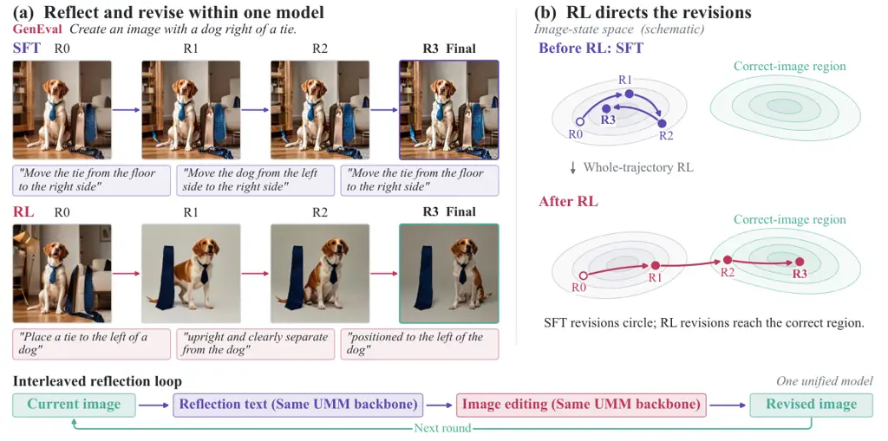
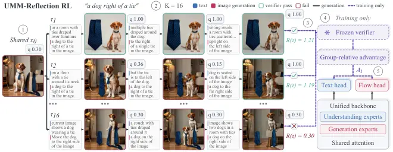
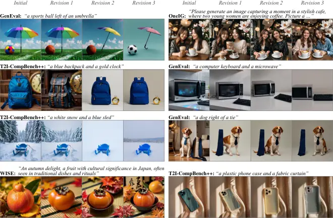
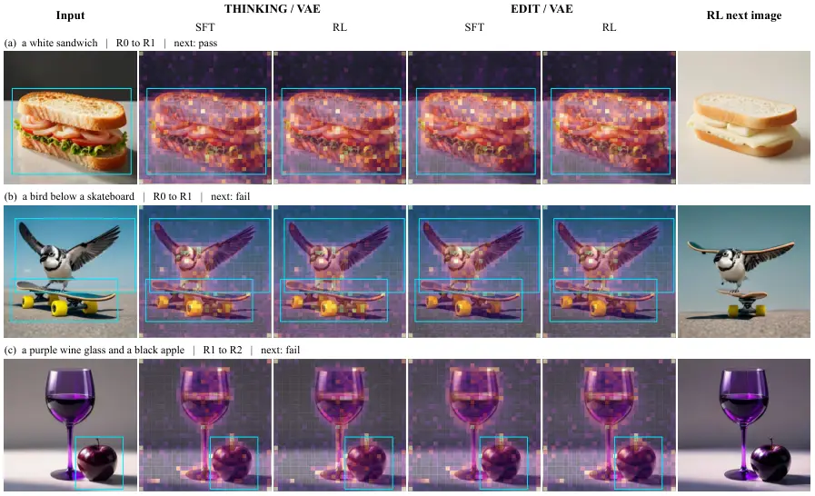
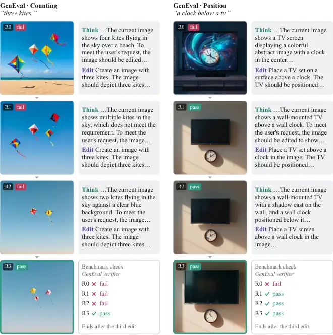
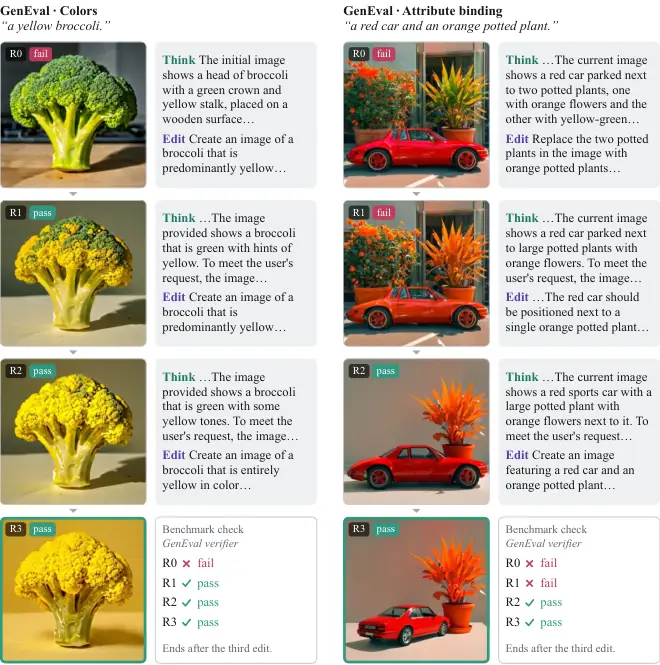
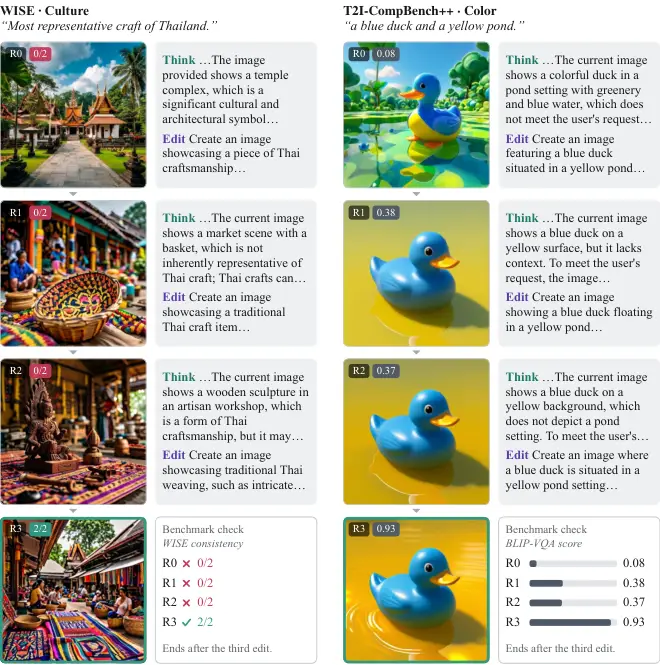
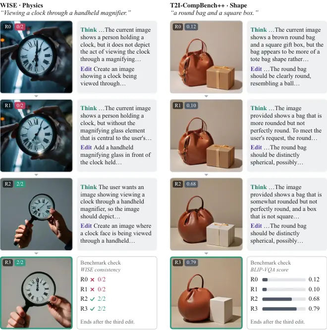
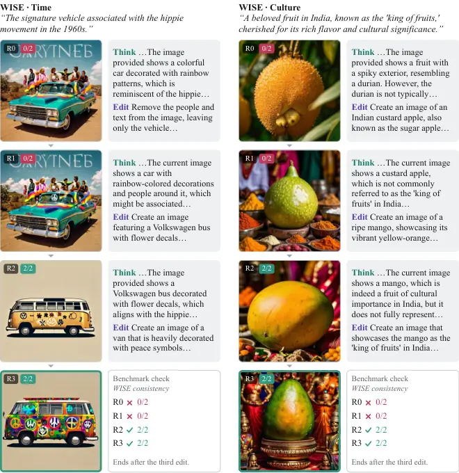
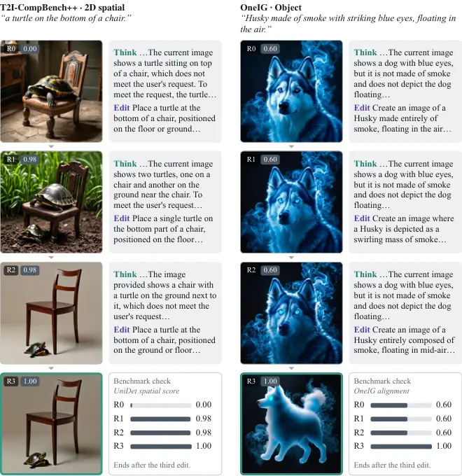

1\]Nanyang Technological University 2\]Shanghai Jiao Tong University
3\]The University of Tokyo \contribution\[\*\]Equal contribution
\contribution\[†\]Work done during an internship at NTU
\contribution\[‡\]Corresponding author \metadata\[ ![[Uncaptioned
image]](arxiv-2609-35767--22fdd436cf52.figures/figure-1.webp) Project
Page\]
[https://waltstephen.github.io/UMM-Reflection](https://waltstephen.github.io/UMM-Reflection/)  
\metadata\[ ![[Uncaptioned
image]](arxiv-2609-35767--22fdd436cf52.figures/figure-2.webp) GitHub
Repo\]
[https://github.com/waltstephen/UMM-Reflection](https://github.com/waltstephen/UMM-Reflection)  
\metadata\[ ![[Uncaptioned
image]](arxiv-2609-35767--22fdd436cf52.figures/figure-3.webp)
HuggingFace Models & Data\]
[https://huggingface.co/collections/YijiaFan/umm-reflection](https://huggingface.co/collections/YijiaFan/umm-reflection-6ab95afe909092518d70a158)  
\metadata\[ ![[Uncaptioned
image]](arxiv-2609-35767--22fdd436cf52.figures/figure-4.webp) Video
Demo\]
[https://www.youtube.com/watch?v=YRfpcs4pm-s](https://www.youtube.com/watch?v=YRfpcs4pm-s)  
\metadata\[ 🖂 Correspondence\] Ziwei Liu,
[ziwei.liu@ntu.edu.sg](mailto:ziwei.liu@ntu.edu.sg)

# Learning Native Reflection in Unified Models with Interleaved Reinforcement Learning

Yijia Fan    Ziqi Huang    Zhongang Cai    Yan Li    Zimo Wen    Wanqi
Yin    Haiwen Diao    Ziwei Liu Affiliation: \[ Affiliation: \[
Affiliation: \[

###### Abstract

Unified multimodal models can both look at and render images, so in
principle they can repair their own generations: diagnose what an image
gets wrong, revise it, observe the result, and diagnose again. Whether a
revision helps is known only after it is rendered, so the reflection
text and the image generation must be learned jointly, over the whole
loop. Supervised fine-tuning (SFT) on reflection trajectories gives a
cold start but does not find the high-success repair paths, and naive RL
that optimizes only the renderer or only one head leaves most of the
gain untapped. We introduce UMM-Reflection, which applies reinforcement
learning (RL) to complete reflection trajectories inside one unified
model: sibling trajectories share one initial image, so the
group-relative advantage compares reflection strategies, and one
trajectory-level advantage updates both the reflection tokens and the
flow-based revisions, avoiding the combinatorial blow-up of per-round
credit assignment. Unlike single-round editing or pipelines with an
external critic, credit flows across rounds and to both roles of the
same model, and no verifier is needed at inference. On BAGEL,
UMM-Reflection improves GenEval by 12.05 points over SFT, and the gains
transfer to WISE (+10.97), OneIG-Bench (+3.48), and T2I-CompBench++
(+4.63), none of which is used in training.

## 1 Introduction

As instructions grow compositional, a single render often carries flaws
\[12, 16\] that a one-shot text-to-image model cannot notice, let alone
fix. Unified multimodal models place visual understanding and image
generation in one network \[41, 34, 38, 8\]: the model that renders an
image can also look at it. This enables the loop of inspection,
diagnosis, and revision that language models use for self-correction,
beyond step-by-step reasoning \[37, 14, 23, 21\]: in principle, a
unified model can find the flaws in its own image and render the fix;
UMM-Reflection trains it to do so.



Figure 1: Native reflection before and after RL. Left: SFT and RL on the
same prompt and seed. SFT already produces meaningful revisions (16 SFT
rollouts contain a correct repair for 78% of failing training images;
Appendix I), but one trajectory often circles, as here (tie, dog, tie).
RL concentrates the policy on revisions that reach the correct region
(right; measured in Figure 5).

Work on unified models approaches this loop from two sides. One line
applies reinforcement learning, but to a single render: T2I-R1 and
ReasonGen-R1 apply GRPO to a textual plan and the single image rendered
from it \[20, 48\], and UniRL turns the model’s understanding of its
finished image into a reward for generation \[24\]. The model never
revises what it rendered. The other line lets the model inspect an
intermediate image and continue, learned by supervised imitation of
multi-round reasoning-and-editing trajectories \[5, 13\]. Imitation
gives these models a cold start, but it does not ensure that a
reflection leads to an effective correction, a gap we quantify in
Section 6. What is missing is reinforcement learning over a unified
model’s own multi-round reflection: a signal that credits each
reflection for the visual improvement it produces, rather than for
matching a demonstration. Attaching RL naively does not supply it:
optimizing only the renderer, or only one head of the loop, leaves most
of the gain untapped (Section 5).

We call this _native reflection_: multi-round inspect–diagnose–revise
behavior carried out by the unified model itself. Native reflection is
what makes the loop trainable as a whole. The reflection and the
revision it triggers come from the same parameters: the text head writes
the diagnosis, and the flow head renders the next image conditioned on
it. One outcome reward can therefore update both heads along the same
trajectory: a shared outcome-driven advantage reaches every textual and
visual action of the trajectory, and the renderer is trained on the
instructions it actually receives. This is also what separates the
problem from single-round editing and from pipelines with an external
critic: the value of a reflection is known only after the image it
triggers is rendered, and often only after further rounds, so credit
must flow across the whole trajectory and to both the diagnosis and the
rendering. What remains is behavioral: the model must learn to turn a
diagnosis of its own image into a generation action that fixes it.

We learn native reflection with UMM-Reflection. SFT first teaches the
interleaved protocol and meaningful revisions: in each round the model
examines its current image, writes a reflection, and either generates a
revised image or stops. Whole-trajectory RL then optimizes complete
reflection sequences with two design choices. All $`K`$ sibling
trajectories start from one shared initial image, so the group-relative
advantage \[30\] compares reflection strategies rather than lucky first
draws. One outcome-driven advantage per trajectory then updates both the
reflection tokens and the flow transitions, so the model learns _which
reflections lead to better images_ without the $`K^{N}`$ rollouts that
per-round credit would require or a learned value model. The
training-time verifier is never consulted at inference. Figure 1
contrasts SFT and RL revisions of the same image.

The central finding separates _producing useful revisions_ from
_reliably choosing them_. SFT learns more than the format (95% of its
trajectories follow the protocol; Table 8): its rollouts already contain
correct repairs (Figure 1). Yet a single SFT trajectory repairs only
20.59% of initially incorrect images; after RL, the conditional repair
rate rises to 64.94% (Table 3). This gap translates to substantial
accuracy gains on GenEval \[12\] (+12.05 over SFT) and WISE \[25\]
(+10.97). Base, SFT, and RL start from nearly identical single-round
accuracy (70–73): the first image receives no RL loss, and the gains
come from the reflection rounds. Updating the generator alone with the
same number of RL updates (direct T2I-RL) lifts single-shot GenEval from
71 to 76 but does not transfer (WISE 54 versus 55 for Base), whereas
UMM-Reflection reaches 84 and 74. Gains also transfer to OneIG-Bench
\[3\] and T2I-CompBench++ \[16\], neither seen in training.
Representation analysis (Section 6) shows that RL leaves the model’s
perception and internal correctness readout nearly unchanged; among the
revisions SFT already produces, it selects those that move a failing
image into the region this readout marks as correct (Figure 5), finding
better repair paths rather than creating a new capability.

We summarize our contributions as follows:

- •
  We enable reinforcement learning for multi-round reflection in unified
  models: one whole-trajectory advantage, computed over siblings that
  share one initial image, jointly optimizes the textual reflections and
  the flow-based revisions of the same model without per-round
  branching.
- •
  We show that imitation already teaches meaningful revisions but
  applies them unreliably, and that RL makes them reliable by selecting
  repair paths the backbone already has.
- •
  UMM-Reflection improves over reflection SFT on four benchmarks while
  training on one; ablations show that neither direct RL on the
  generator nor Best-of-4 selection matches it.

## 2 Related Work

#### Self-correction loops, in text and in pixels.

Self-Refine and Reflexion let a language model critique and revise its
own draft by prompting alone \[23, 31\], yet without external feedback
such intrinsic self-correction can lower accuracy \[15\]. SCoRe traces
this to offline correction traces and shows that online multi-turn RL on
the model’s own attempts is needed \[21, 29\]. Image generation has
adopted the loop but not this lesson: Idea2Img, iterative refinement,
ReflectionFlow, SLD, and GenArtist pair an external critic with a
separate renderer \[44, 19, 50, 39, 36\]. The critic sees only pixels,
neither model is optimized against the other, and the critic stays
online at inference. We train both roles as one policy under one outcome
reward and drop the verifier at inference.

#### Reinforcement learning for visual generators.

DDPO and DPOK optimize the denoising chain with policy gradients \[1,
10\], ImageReward and Diffusion-DPO learn from human preferences \[42,
32\], and Flow-GRPO and DanceGRPO bring group-relative optimization
\[30\] to flow-matching generators \[22, 43\]. In each, the policy is a
single prompt-to-image pass that never observes its own render. We place
Flow-GRPO’s rendering transitions inside a multi-round trajectory whose
single advantage credits both the reflection tokens and the renders they
trigger.

#### Reasoning and reflection in unified generators.

Unified models share one network for understanding and generation via
discrete tokens \[2, 34, 41\], decoupled visual encoders \[38, 6\], text
with a diffusion or flow decoder \[49, 8\], or bridging queries and
tokens \[26, 4, 9\], and post-training further couples their
understanding with generation \[40, 17\]. One line improves a single
render: T2I-R1 and ReasonGen-R1 apply GRPO to a textual plan and its
image \[20, 48\], UniRL rewards generation with the model’s own answers
about its finished image \[24\], and PARM and GoT verify or structure
the generation process \[47, 11\]; none revises the image. A second line
(Thinking with Generated Images, MINT, Uni-CoT, IRG, ThinkMorph, UniT)
inspects an intermediate image and continues \[7, 35, 27, 18, 13, 5\],
but is trained mainly by imitating synthesized trajectories, which, as
SCoRe predicts and Section 6 measures, gives a cold start without the
high-success repair paths. Multi-round regeneration has also been
trained with RL, but as separate rounds that do not inherit earlier
context \[45\]. UMM-Reflection applies outcome-driven RL to complete
inspect-and-revise trajectories in one unified policy.

## 3 Methodology

We formulate native reflection as a policy that repeatedly inspects,
diagnoses, and revises its own image within a single unified model. This
section describes the reflection protocol (§3.1), the trajectory data
used to initialize it (§3.2), the supervised cold-start (§3.3), and the
whole-trajectory RL stage that turns this cold start into effective
repair (§3.4).



Figure 2: UMM-Reflection RL. (1) $`K{=}16`$ rollouts share one detached
initial image $`x_{0}`$. (2) Each interleaves the model’s own reflection
(verbatim) with its renders for up to three rounds. (3) A frozen
verifier scores every image ($`q`$) and trajectory ($`R(\tau)`$). (4)
Group normalization gives one advantage $`A_{i}`$ per trajectory, (5)
which updates both the text and flow heads. Green/red frames: verifier
pass/fail; dashed: training only.

### 3.1 Reflection protocol

For a request $`c`$, the model first produces an image $`x_{0}`$. At
each round $`t`$, the model observes the request, the text–image
history, and the current image $`x_{t}`$, and emits a structured
reflection:

```math
u_{t}\;\sim\;\pi_{\theta}^{\text{text}}(\,\cdot\mid c,\,x_{\leq t},\,u_{<t}),\qquad a_{t}\in\{\textsc{edit},\;\textsc{done}\}.
```

An edit action carries a natural-language correction $`e_{t}`$; the same
model then renders
$`x_{t+1}\sim\pi_{\theta}^{\text{flow}}(\cdot\mid c,x_{t},e_{t})`$. A
done action returns the current image. The loop runs for at most three
repair rounds in the primary experiments.

Each reflection is a tagged response whose main fields are \[THINKING\],
\[ACTION\], and \[EDIT\] (full format in Appendix B); verifier scores
never enter the policy observation. Figure 2 shows the trajectory
structure.

### 3.2 Trajectory data construction

Learning the protocol requires multi-round inspect–diagnose–revise
trajectories, which the target model cannot yet produce. We generate
them with external models and distill them into the unified model via
SFT. GPT-5.5 acts as the critic: it turns each request into verifiable
constraints, inspects each image, writes a structured reflection, and
issues one atomic edit instruction or a done verdict. Qwen-Image renders
the initial image and Qwen-Image-Edit executes each edit; BAGEL takes no
part, so its own failure modes are not distilled back into the
supervision. The $`29{,}529`$ accepted trajectories are of three types:
_one-shot_ ($`9{,}000`$), where the initial image already satisfies all
constraints; _natural-repair_ ($`8{,}645`$), where a genuinely failing
initial image is fixed in one or two rounds without injected corruption;
and _planned-progression_ ($`11{,}884`$), where a complex request is
fulfilled over two or three ordered milestones. Prompts come from
Puffin-4M, Poster100K, OmniEdit, AnyEdit, and GEdit-Bench, with no
overlap with any evaluation benchmark.

### 3.3 Supervised initialization

SFT teaches the interleaved protocol on the trajectories from §3.2 with
an autoregressive loss on reflection text and a flow-matching loss on
each edited image,
$`\mathcal{L}_{\text{SFT}}=\mathcal{L}_{\text{AR}}+\lambda_{\text{img}}\,\mathcal{L}_{\text{FM}}`$,
starting from the base BAGEL checkpoint for one epoch (details in
Appendix B). This stage supplies a consistent interface between
diagnosis and corrective generation; the subsequent RL stage starts from
this SFT checkpoint.

### 3.4 Whole-trajectory reinforcement learning

SFT teaches the model to produce well-formed reflections, but
well-formed text does not guarantee effective repair (§6). We now
describe the RL stage that optimizes for visual outcomes.

#### Shared-root sampling.

For each request, we sample one initial image and detach it from the
computation graph. RL optimizes only the reflection-and-editing rounds
that follow; the initial text-to-image generation receives no
policy-gradient signal.¹¹ 1 BAGEL does not natively support interleaved
text–image generation in a single forward pass. We implement the
multi-round loop through an external controller that feeds each round’s
reflection and image back into the model as a new turn, enforcing the
interleaved protocol described in §3.1. From those identical root
pixels, we sample $`K\!=\!16`$ complete reflection trajectories
$`\{\tau_{i}\}_{i=1}^{K}`$, each running until its own done action or
the repair cap. We do not prune siblings, retain only the best
intermediate image, or use best-of-$`K`$ selection at deployment.

#### Reward.

A frozen verifier assigns a graded alignment score $`q_{t}\in[0,1]`$ to
each image, aggregated from its own detector outputs under the official
thresholds so that a partial repair yields a nonzero change (Appendix
C). Let $`\Delta_{t}=q_{t+1}-q_{t}`$ and $`[v]_{+}=\max(v,0)`$. The
trajectory reward is

```math
\displaystyle R(\tau) \displaystyle=q_{T}+\alpha\textstyle\sum_{t}[\Delta_{t}]_{+}+\beta\,S_{\text{multi}}(\tau)-\lambda\textstyle\sum_{t}[-\Delta_{t}]_{+}-p\,\mathbf{1}[\text{premature }\textsc{done}], \tag{1}
```

```math
\displaystyle S_{\text{multi}}(\tau) \displaystyle=\textstyle\sum_{t}[\Delta_{t}]_{+}-\max\!\bigl(\{[\Delta_{t}]_{+}\}_{t}\cup\{0\}\bigr). \tag{2}
```

The terminal score $`q_{T}`$ rewards the final image quality. The
progress terms $`[\Delta_{t}]_{+}`$ reward each round that improves the
image; the damage penalty $`\lambda\sum[-\Delta_{t}]_{+}`$ discourages
regressions. $`S_{\text{multi}}`$ adds credit when improvement comes
from more than one edit rather than a single lucky fix; it deliberately
favors trajectories that keep improving across rounds, since multi-round
correction is the behavior we aim to train. Premature done means
stopping when the verifier does not accept the current image. We use
$`\alpha\!=\!\beta\!=\!0.3`$ and $`\lambda\!=\!p\!=\!0.5`$.

#### Group-relative advantage.

Within each shared-root group, advantages are

```math
A_{i}=\operatorname{clip}\!\left(\frac{R(\tau_{i})-\mu_{R}}{\max(\sigma_{R},\,0.1)},\;{-1},\;1\right).
```

We assign one advantage per trajectory rather than per round. A
group-relative estimate for each round would require sibling groups at
every round: branching $`K`$ ways at each of $`N`$ rounds needs
$`K^{N}`$ rollouts per root ($`16^{3}=4{,}096`$ for three rounds), which
is impractical for an image-generating policy. A per-round critic, as in
PPO, would instead require training a value model over multi-round
image–text states, with the data scale that entails. The
trajectory-level advantage keeps the $`K`$-sample cost of GRPO while the
per-round progress terms in $`R(\tau)`$ still reward each round that
improves the image.

#### Text–flow coordination.

Let $`\mathcal{I}_{i}^{c}`$ denote the policy-active positions for
channel $`c\in\{\text{text},\,\text{flow}\}`$, and $`\rho_{ij}^{c}`$ the
corresponding likelihood ratio. The clipped surrogate for each channel
is

```math
\mathcal{J}_{c}=\mathbb{E}_{i,\,j\in\mathcal{I}_{i}^{c}}\min\!\bigl(\rho_{ij}^{c}A_{i},\;\operatorname{clip}(\rho_{ij}^{c},\,1{-}\epsilon_{c},\,1{+}\epsilon_{c})\,A_{i}\bigr)-\eta_{c}\mathcal{K}_{c}.
```

The key design choice is that both channels share the _same_
trajectory-level $`A_{i}`$: the text policy and the flow renderer are
not normalized separately. A reflection that leads to a better image
raises the advantage for both the diagnostic tokens and the rendering
transitions that followed, so the model learns which reflections lead to
which visual outcomes. $`\mathcal{K}_{c}`$ is a channel-specific KL
penalty against the frozen SFT reference. Flow transitions use the
Flow-GRPO SDE sampler \[22\]; per active repair we train on two
contiguous stochastic transitions. For text, credited positions are
sampled policy tokens excluding prompt and formatting.

The verifier and the reference policy are used only during training; at
inference only the unified model runs.

## 4 Experiments

### 4.1 Setup

#### Training and evaluation.

We build on BAGEL \[8\], the most widely used open unified model that
both understands and generates images in one network, with understanding
and generation experts that share attention; this lets one
trajectory-level advantage update the reflection text and the renderer
of the same model. RL starts from the reflection-SFT checkpoint (§3.3)
and samples from a $`3{,}000`$-prompt pool over six GenEval families,
with two roots and $`K\!=\!16`$ siblings per update and 20 training
denoising steps; unless otherwise specified, RL runs for $`1{,}000`$
updates. We evaluate one image per prompt with 50 denoising steps at
$`512^{2}`$ and at most three repairs, using the same checkpoint on
GenEval (all 553 official prompts, unfiltered), WISE (1,000),
OneIG-Bench (OneIG; 695 alignment prompts), and T2I-CompBench++ (2,400);
protocol and scorer details are in Appendix A.

#### Baselines.

The main comparison uses the same BAGEL backbone throughout: _Base_,
unmodified BAGEL, single-pass generation at $`512^{2}`$, and _SFT_, the
reflection-supervised parent, producing multi-round trajectories without
RL. Ablation baselines that remove or replace one ingredient are defined
in Section 5.

### 4.2 Main results

Model Res. Single Two Count Colors Position Binding Overall Reported
results: native settings and original reporting precision
PixArt-$`\alpha`$^(†) \[41\] 512 0.98 0.50 0.44 0.80 0.08 0.07 0.48
SD2.1 \[12\] 768 0.98 0.51 0.44 0.85 0.07 0.17 0.50 DALL$`\cdot`$E 2^(†)
\[41\] 1024 0.94 0.66 0.49 0.77 0.10 0.19 0.52 Emu3-Gen \[34\] 512 0.98
0.71 0.34 0.81 0.17 0.21 0.54 SDXL \[12\] 1024 0.98 0.74 0.39 0.85 0.15
0.23 0.55 DALL$`\cdot`$E 3^(†) \[6\] 1024 0.96 0.87 0.47 0.83 0.43 0.45
0.67 SD3-Medium^(†) \[6\] n/r 0.99 0.94 0.72 0.89 0.33 0.60 0.74 LWM^(†)
\[41\] n/r 0.93 0.41 0.46 0.79 0.09 0.15 0.47 SEED-X^(†) \[41\] n/r 0.97
0.58 0.26 0.80 0.19 0.14 0.49 TokenFlow \[28\] 256 0.97 0.66 0.40 0.84
0.17 0.26 0.55 ILLUME \[33\] 512 0.99 0.86 0.45 0.71 0.39 0.28 0.61
Janus \[38\] 384 0.97 0.68 0.30 0.84 0.46 0.42 0.61 Show-o-512 \[41\]
512 0.98 0.80 0.66 0.84 0.31 0.50 0.68 Janus-Pro-7B \[6\] 384 0.99 0.89
0.59 0.90 0.79 0.66 0.80 Local evaluation: same prompts, resolution, and
scorer BAGEL-Base 512 1.00 0.89 0.63 0.82 0.47 0.48 0.71 BAGEL-SFT 512
1.00 0.88 0.58 0.87 0.47 0.51 0.72 UMM-Reflection 512 0.95 0.96 0.68
0.90 0.89 0.65 0.84

Table 1: GenEval: all six compositional requirements. Native $`0`$–$`1`$
scores. Res.: image side (n/r: not reported); $`\dagger`$: reported in
another model’s paper. Published settings differ from our one-image,
instruction-voice evaluation; e.g., BAGEL reports 0.82 under its native
protocol \[8\], whereas the local rows use our protocol (Appendix A).
Bold: best in the local block.

Model WISE OneIG T2I-CompBench++ Local evaluation: same prompts,
resolution, and scorer BAGEL-Base  (+0.00)0.55  (+0.00)0.80  (+0.00)0.49
BAGEL-SFT  (+0.08)0.63 (+0.08)  (−0.01)0.79 (−0.01)  (+0.01)0.50 (+0.01)
UMM-Reflection  (+0.19)0.74 (+0.19)  (+0.02)0.83 (+0.02)
 (+0.06)0.55 (+0.06)

Table 2: Transfer to benchmarks unseen in RL training. Native
$`0`$–$`1`$ scale; gray values are changes relative to BAGEL-Base.



Figure 3: Case studies across four benchmarks. Each row shows the
prompt, the initial image, and three reflection-guided revisions (left
to right), with examples from GenEval, WISE, OneIG, and T2I-CompBench++.
The model identifies spatial, color, material, and compositional errors
through its \[THINKING\] output and issues targeted edits.

#### In-domain results.

Table 1 places UMM-Reflection among reported GenEval results. Under the
same protocol, UMM-Reflection reaches 0.84, against 0.71 for BAGEL-Base
and 0.72 for reflection SFT (+12 points over SFT). The gain is
concentrated in the families that require fixing a composition:
_position_ rises by +42.00 points over SFT (0.47 to 0.89), color
_binding_ by +14.00, and _counting_ by +10.00. Paired over prompts, RL
beats SFT on 109 prompts and loses on 38 ($`p<10^{-8}`$, McNemar), while
on the initial images alone the split is 48–32 ($`p=0.09`$, no
significant difference), and the gain is made in the reflection rounds.

Figure 4: Test-time scaling on GenEval. Macro accuracy versus reflection
rounds. Other benchmarks: Appendix Figure 9.

#### Transfer.

Table 2 evaluates the same checkpoint on three benchmarks never used in
RL training. UMM-Reflection improves over reflection SFT on all three:
+10.97 points on WISE, +4.63 on T2I-CompBench++, and +3.48 on OneIG,
where SFT alone falls slightly below Base. Figure 3 shows reflection
trajectories on all four benchmarks. Section 5 isolates the contribution
of each ingredient.

### 4.3 Multi-round test-time scaling

Figure 4 shows the per-round GenEval score; the other three benchmarks
follow the same pattern (Appendix Figure 9). SFT’s three rounds add
roughly +2 points on GenEval and flatten after round 1; the model edits
but does not reliably improve. After RL, round 1 alone adds +9 points,
and the model continues to gain through round 3. The initial-image
accuracy (R0) is comparable across arms (70–73), confirming that the gap
comes from multi-round correction, not a better first image.

The conditional repair rate rises from 20.59% (SFT) to 64.94% (RL 1000).
Within GenEval families, the largest gains are on _position_ (+34) and
_color_attr_ (+17). Full per-round and per-family statistics are in
Appendix K.

## 5 Ablations

R0 Final $`\Delta`$ Repair Damage Edits Images Components BAGEL-Base 71
71 0 – – 0 1 + direct RL on the renderer (T2I-RL) 76 76 0 – – 0 1 +
inspect-and-edit loop (Self-Agentic) 71 77 +5 27.6 3.6 3.00 4.0 +
reflection SFT 70 72 +2 20.6 6.5 1.65 2.7 + reflection SFT + trajectory
RL (UMM-Reflection) 73 84 +11 64.9 8.8 3.00 4.0 direct RL $`\to`$
reflection SFT $`\to`$ trajectory RL (500 updates only) 74 81 +7 48.3
7.9 3.00 4.0 Training length (same run) reflection SFT + trajectory RL,
100 updates 71 75 +3 35.6 9.5 3.00 4.0 reflection SFT + trajectory RL,
500 updates 71 82 +11 61.1 9.3 3.00 4.0 UMM-Reflection (1,000 updates)
73 84 +11 64.9 8.8 3.00 4.0 Head ablation (the other head frozen)
flow-only RL (frozen text head) 71 73 +2 22.8 7.3 3.00 4.0 text-only RL
(frozen flow head) 71 78 +7 49.4 10.1 3.00 4.0 joint RL (UMM-Reflection)
73 84 +11 64.9 8.8 3.00 4.0 Same four-image budget Best-of-4 T2I-RL,
selected by Base UND 76 80 +4 – – 0 4 Best-of-4 T2I-RL, selected by
UMM-Reflection UND 76 80 +5 – – 0 4 reflection SFT, forced to edit in
all three rounds 70 72 +2 28.8 9.7 3 4 UMM-Reflection 73 84 +11 64.9 8.8
3.00 4.0 Reward terms UMM-Reflection 73 84 +11 64.9 8.8 3.00 4.0 without
the multi-improvement term ($`\beta=0`$) 63 79 +16 61.7 11.2 3.00 4.0

Table 3: Ablations on GenEval (553 official prompts). Six-family macro
accuracy ($`0`$–$`100`$). Repair and Damage are percentages of initially
incorrect images fixed and initially correct images broken; $`\Delta`$
is computed before rounding. All reward variants share the same SFT
parent, prompt pool, and training topology.

Table 3 isolates each ingredient; the results support five conclusions.

#### The gains stack.

Direct Flow-GRPO on the renderer (T2I-RL, 1,000 updates from Base)
raises single-shot accuracy from 71 to 76 but leaves nothing to repair.
Forcing the untuned Base through three inspect-and-edit rounds
(Self-Agentic) adds +5 without training. Reflection SFT adds +2;
fine-tuning Base on the final images of the same 29,529 trajectories
leaves single-pass accuracy on the raw official prompt at 75, the same
as Base, so the SFT images alone do not improve the generator.
Trajectory RL on top of SFT adds +11 and triples the repair rate from
21% to 65%. Placing direct RL before both stages carries its single-shot
advantage through, reaching 81 after 500 updates.

#### Most of the gain arrives within 500 updates.

Along the same run, GenEval rises from 72 (SFT) to 75, 79, and 82 after
100, 200, and 500 updates, and reaches 84 at 1,000. The repair rate
follows the same path, from 21% to 61% at 500 updates and 65% at 1,000,
while damage stays between 8% and 10%. Initial-image accuracy stays at
71–73 throughout, so the gain comes from the reflection rounds at every
checkpoint.

#### Both heads must be trained.

Freezing one head while applying the same trajectory RL isolates what
each side contributes. Training only the flow head leaves the model
close to SFT (73, repair rate 22.8%): a better renderer does not help
when the reflections that drive it do not improve. Training only the
text head recovers most of the gain (78, 49.4%), so learning what to
write is the larger part. Joint training reaches 84 and 64.9%, six
points above the best single head: the renderer must also learn to
execute the reflections the text head now writes. This is the joint
optimization that a single unified model makes possible. Holding image,
renderer, and noise fixed and swapping only the instruction confirms
that the learned text carries the repair (Appendix J).

#### The gain is not best-of-$`N`$ sampling or extra edits.

At the same four-image budget, selecting one of four images from the
stronger T2I-RL renderer with a single native understanding call
(Best-of-4) reaches 80 with either selector; UMM-Reflection reaches 84
(paired McNemar $`p\leq 0.04`$). Forcing SFT to edit in all three rounds
leaves it at 72, the same as unforced SFT. On the 62 prompts where all
four independent Base draws fail, RL reflection recovers 60% (SFT: 12%).

#### The multi-improvement term matters.

Removing the multi-improvement term ($`\beta\!=\!0`$) preserves the
repair rate but degrades the initial image from 73 to 63, also yielding 79.

## 6 Study: What Changes Inside the Model

### 6.1 Training dynamics: the interface locks in first, then repair improves

Appendix Figure 8 summarizes the 1,000-update RL run. Protocol
compliance converges within the first fifty updates: invalid
trajectories drop below 1% and stay there. After that, the reward curve
is driven by improving repair quality: successful repairs per edit rise
steadily from 11% to 38%, while the damage rate on initially correct
images falls from 20% to 10%. Terminal exactness under the training
verifier reaches 81%. There is no reward collapse or protocol regression
within 1,000 updates.

On the full GenEval test set (553 prompts), SFT’s three reflection
rounds add +2 points of macro accuracy; RL raises this to +11, with the
gain concentrated in the repair process rather than the initial
generation (Section 4.3).

### 6.2 What RL changes in the model

Figure 5: Image trajectories in the backbone’s own correctness readout.
Each point is one initially failing image, placed by two held-out linear
probes for “passes the verifier”: the understanding stream at depth 20
($`x`$) and the generation stream at depth 8 ($`y`$), the depths where
each stream’s probe AUC peaks. Green filled contours mark
verifier-passing reference images and red dashed contours
verifier-failing ones; orange and blue contours summarize the RL and SFT
images. Read the panels in pairs, from R0 to R3 for the same policy: RL
(left pair) and SFT (right pair). Percentages are the share inside the
dense pass region (Table 5).

Replaying all 553 trajectories through the Base, SFT, and RL checkpoints
(Appendix F) gives one consistent picture. The backbone’s own readout of
correctness is nearly unchanged by RL: a held-out linear probe on the
understanding stream reaches AUC 0.80–0.82 under all three checkpoints.
What changes is where the images go. Among initially failing images, the
share inside the dense pass region of that readout rises from 34% to 62%
over three rounds under RL, against 36% to 42% under SFT (Figure 5), and
at a matched number of edits RL moves the image further and more of its
edits succeed. RL thus selects, among the revisions the model can
already produce, those that reach the correct region.

## 7 Conclusion

Reinforcement learning turns reflection in a unified model from an SFT
cold start into an effective repair mechanism. SFT and RL start from
nearly identical single-shot accuracy, so the +12-point GenEval gain and
its transfer to WISE, OneIG, and T2I-CompBench++ come from the
reflection rounds. RL leaves the model’s correctness readout nearly
unchanged and selects, among the repairs the model can already produce,
those that land: the backbone already knows whether its image is
correct, and RL teaches it to act on that knowledge.

## References

- \[1\] K. Black, M. Janner, Y. Du, I. Kostrikov, and S. Levine (2024)
  Training Diffusion Models with Reinforcement Learning. In
  International Conference on Learning Representations, Vol. 2024,
  pp. 4965–4987. External Links:
  [Link](https://proceedings.iclr.cc/paper_files/paper/2024/hash/14f75513f0f1ca01de1e826b52e6b840-Abstract-Conference.html)
  Cited by: §2.
- \[2\] Chameleon Team (2024) Chameleon: Mixed-Modal Early-Fusion
  Foundation Models. External Links: 2405.09818,
  [Link](https://arxiv.org/abs/2405.09818) Cited by: §2.
- \[3\] J. Chang, Y. Fang, P. Xing, S. Wu, W. Cheng, R. Wang, X.
  Zeng, G. Yu, and H. Chen (2025) OneIG-Bench: Omni-dimensional Nuanced
  Evaluation for Image Generation. In Advances in Neural Information
  Processing Systems, Vol. 38, Main Conference. External Links:
  [Document](https://dx.doi.org/10.52202/085713-5330),
  [Link](https://proceedings.neurips.cc/paper_files/paper/2025/hash/e9e9e5428189a3e49479547ef917e88d-Abstract-Datasets_and_Benchmarks_Track.html)
  Cited by: Table 13, Table 13, Table 13, §1.
- \[4\] J. Chen, Z. Xu, X. Pan, Y. Hu, C. Qin, T. Goldstein, L.
  Huang, T. Zhou, S. Xie, S. Savarese, L. Xue, C. Xiong, and R.
  Xu (2025) BLIP3-o: A Family of Fully Open Unified Multimodal
  Models-Architecture, Training and Dataset. External Links: 2505.09568,
  [Link](https://arxiv.org/abs/2505.09568) Cited by: §2.
- \[5\] L. L. Chen, H. Ma, Z. Fan, Z. Huang, A. Sinha, X. Dai, J.
  Wang, Z. He, J. Yang, C. Li, J. Sun, C. Wang, S. Yeung, and F.
  Juefei-Xu (2026) UniT: Unified Multimodal Chain-of-Thought Test-time
  Scaling. In Proceedings of the IEEE/CVF Conference on Computer Vision
  and Pattern Recognition, External Links:
  [Link](https://cvpr.thecvf.com/virtual/2026/poster/36853) Cited by:
  §1, §2.
- \[6\] X. Chen, Z. Wu, X. Liu, Z. Pan, W. Liu, Z. Xie, X. Yu, and C.
  Ruan (2025) Janus-Pro: Unified Multimodal Understanding and Generation
  with Data and Model Scaling. External Links: 2501.17811,
  [Link](https://arxiv.org/abs/2501.17811) Cited by: §2, Table 1, Table
  1, Table 1.
- \[7\] E. Chern, Z. Hu, S. Chern, S. Kou, J. Su, Y. Ma, Z. Deng, and P.
  Liu (2025) Thinking with Generated Images. External Links: 2505.22525,
  [Link](https://arxiv.org/abs/2505.22525) Cited by: §2.
- \[8\] C. Deng, D. Zhu, K. Li, C. Gou, F. Li, Z. Wang, S. Zhong, W.
  Yu, X. Nie, Z. Song, G. Shi, and H. Fan (2025) Emerging Properties in
  Unified Multimodal Pretraining. External Links: 2505.14683,
  [Link](https://arxiv.org/abs/2505.14683) Cited by: §1, §2, §4.1, Table
  1, Table 1.
- \[9\] Y. Ding, Y. Fan, C. Shan, Y. Yang, Y. Shen, W. Wang, X. Hu, D.
  Li, L. Qiu, Y. Yang, and Y. Wang (2026) Beyond Text Conditioning: A
  Systematic Study of MLLM-DiT Fusion for Video Generation. External
  Links: 2608.14043, [Link](https://arxiv.org/abs/2608.14043) Cited by:
  §2.
- \[10\] Y. Fan, O. Watkins, Y. Du, H. Liu, M. Ryu, C. Boutilier, P.
  Abbeel, M. Ghavamzadeh, K. Lee, and K. Lee (2023) DPOK: Reinforcement
  Learning for Fine-tuning Text-to-Image Diffusion Models. In Advances
  in Neural Information Processing Systems, Vol. 36, pp. 79858–79885.
  External Links: [Document](https://dx.doi.org/10.52202/075280-3497),
  [Link](https://proceedings.neurips.cc/paper_files/paper/2023/hash/fc65fab891d83433bd3c8d966edde311-Abstract-Conference.html)
  Cited by: §2.
- \[11\] R. Fang, C. Duan, K. Wang, L. Huang, H. Li, H. Tian, S. Yan, W.
  Yu, X. Zeng, J. Dai, X. Liu, and H. Li (2025) GoT: Unleashing
  Reasoning Capability of MLLM for Visual Generation and Editing. In
  Advances in Neural Information Processing Systems, Vol. 38, Main
  Conference, pp. 67680–67708. External Links:
  [Document](https://dx.doi.org/10.52202/085713-2270),
  [Link](https://proceedings.neurips.cc/paper_files/paper/2025/hash/61960fdfda4d4e95fa1c1f6e64bfe8bc-Abstract-Conference.html)
  Cited by: §2.
- \[12\] D. Ghosh, H. Hajishirzi, and L. Schmidt (2023) GenEval: An
  object-focused framework for evaluating text-to-image alignment. In
  Advances in Neural Information Processing Systems, Vol. 36,
  pp. 52132–52152. External Links:
  [Document](https://dx.doi.org/10.52202/075280-2270),
  [Link](https://proceedings.neurips.cc/paper_files/paper/2023/hash/a3bf71c7c63f0c3bcb7ff67c67b1e7b1-Abstract-Datasets_and_Benchmarks.html)
  Cited by: §1, §1, Table 1, Table 1.
- \[13\] J. Gu, Y. Hao, H. Wang, L. Li, M. Q. Shieh, Y. Choi, R.
  Krishna, and Y. Cheng (2026) ThinkMorph: Emergent Properties in
  Multimodal Interleaved Chain-of-Thought Reasoning. In International
  Conference on Learning Representations, Vol. 2026, pp. 141405–141447.
  External Links:
  [Link](https://proceedings.iclr.cc/paper_files/paper/2026/hash/e5095602ad1c6a835e2b643ec4ed97d0-Abstract-Conference.html)
  Cited by: §1, §2.
- \[14\] D. Guo, D. Yang, H. Zhang, et al. (2025) DeepSeek-R1
  incentivizes reasoning in LLMs through reinforcement learning. Nature
  645 (8081), pp. 633–638. External Links:
  [Document](https://dx.doi.org/10.1038/s41586-025-09422-z),
  [Link](https://doi.org/10.1038/s41586-025-09422-z) Cited by: §1.
- \[15\] J. Huang, X. Chen, S. Mishra, H. S. Zheng, A. Yu, X. Song,
  and D. Zhou (2024) Large Language Models Cannot Self-Correct Reasoning
  Yet. In International Conference on Learning Representations, Vol.
  2024, pp. 32808–32824. External Links:
  [Link](https://proceedings.iclr.cc/paper_files/paper/2024/hash/8b4add8b0aa8749d80a34ca5d941c355-Abstract-Conference.html)
  Cited by: §2.
- \[16\] K. Huang, C. Duan, K. Sun, E. Xie, Z. Li, and X. Liu (2025)
  T2I-CompBench++: An Enhanced and Comprehensive Benchmark for
  Compositional Text-to-Image Generation. IEEE Transactions on Pattern
  Analysis and Machine Intelligence 47 (5), pp. 3563–3579. External
  Links: [Document](https://dx.doi.org/10.1109/tpami.2025.3531907),
  [Link](https://doi.org/10.1109/tpami.2025.3531907) Cited by: Table 12,
  Table 12, Table 12, §1, §1.
- \[17\] R. Huang, J. Wu, R. Yang, Z. Liu, and H. Zhao (2026) AlphaGRPO:
  Unlocking Self-Reflective Multimodal Generation in UMMs via
  Decompositional Verifiable Reward. In International Conference on
  Machine Learning, External Links:
  [Link](https://arxiv.org/abs/2605.12495) Cited by: §2.
- \[18\] W. Huang, S. Chen, Z. Xie, S. Cao, S. Tang, Y. Shen, Q. Yin, W.
  Hu, X. Wang, Y. Tang, J. Qiao, H. Guo, Y. Hu, Z. Yin, P. Torr, Y.
  Cheng, W. Ouyang, and S. Lin (2026) Interleaving Reasoning for Better
  Text-to-Image Generation. In International Conference on Learning
  Representations, Vol. 2026, pp. 106153–106182. External Links:
  [Link](https://proceedings.iclr.cc/paper_files/paper/2026/hash/ad48f017e6c3d474caf511208e600459-Abstract-Conference.html)
  Cited by: §2.
- \[19\] S. Jaiswal, M. Prabhudesai, N. Bhardwaj, Z. Qin, A. Zadeh, C.
  Li, K. Fragkiadaki, and D. Pathak (2026) Iterative Refinement Improves
  Compositional Image Generation. External Links: 2601.15286,
  [Link](https://arxiv.org/abs/2601.15286) Cited by: §2.
- \[20\] D. Jiang, Z. Guo, R. Zhang, Z. Zong, H. Li, L. Zhuo, S. Yan, P.
  Heng, and H. Li (2025) T2I-R1: Reinforcing Image Generation with
  Collaborative Semantic-level and Token-level CoT. In Advances in
  Neural Information Processing Systems, Vol. 38, Main Conference,
  pp. 39856–39890. External Links:
  [Document](https://dx.doi.org/10.52202/085713-1330),
  [Link](https://proceedings.neurips.cc/paper_files/paper/2025/hash/38fc6254f73450813db3b3e04397a9fc-Abstract-Conference.html)
  Cited by: §1, §2.
- \[21\] A. Kumar, V. Zhuang, R. Agarwal, Y. Su, J. Co-Reyes, A.
  Singh, K. Baumli, S. Iqbal, C. Bishop, R. Roelofs, L. Zhang, K.
  McKinney, D. Shrivastava, C. Paduraru, G. Tucker, D. Precup, F.
  Behbahani, and A. Faust (2025) Training Language Models to
  Self-Correct via Reinforcement Learning. In International Conference
  on Learning Representations, Vol. 2025, pp. 54523–54549. External
  Links:
  [Link](https://proceedings.iclr.cc/paper_files/paper/2025/hash/871ac99fdc5282d0301934d23945ebaa-Abstract-Conference.html)
  Cited by: §1, §2.
- \[22\] J. Liu, G. Liu, J. Liang, Y. Li, J. Liu, X. Wang, P. Wan, D.
  Zhang, and W. Ouyang (2025) Flow-GRPO: Training Flow Matching Models
  via Online RL. In Advances in Neural Information Processing Systems,
  Vol. 38, Main Conference, pp. 40783–40818. External Links:
  [Document](https://dx.doi.org/10.52202/085713-1362),
  [Link](https://proceedings.neurips.cc/paper_files/paper/2025/hash/3a10c46572628d58cb44fb705f25cbbf-Abstract-Conference.html)
  Cited by: Appendix A, §2, §3.4.
- \[23\] A. Madaan, N. Tandon, P. Gupta, S. Hallinan, L. Gao, S.
  Wiegreffe, U. Alon, N. Dziri, S. Prabhumoye, Y. Yang, S. Gupta, B. P.
  Majumder, K. Hermann, S. Welleck, A. Yazdanbakhsh, and P. Clark (2023)
  Self-Refine: Iterative Refinement with Self-Feedback. In Advances in
  Neural Information Processing Systems, Vol. 36, pp. 46534–46594.
  External Links: [Document](https://dx.doi.org/10.52202/075280-2019),
  [Link](https://proceedings.neurips.cc/paper_files/paper/2023/hash/91edff07232fb1b55a505a9e9f6c0ff3-Abstract-Conference.html)
  Cited by: §1, §2.
- \[24\] W. Mao, Z. Yang, and M. Z. Shou (2025) UniRL: Self-Improving
  Unified Multimodal Models via Supervised and Reinforcement Learning.
  External Links: 2505.23380, [Link](https://arxiv.org/abs/2505.23380)
  Cited by: §1, §2.
- \[25\] Y. Niu, M. Ning, M. Zheng, W. Jin, B. Lin, P. Jin, J. Liao, C.
  Feng, F. Meng, K. Ning, B. Zhu, and L. Yuan (2026) WISE: World
  Knowledge-Informed Semantic Evaluation for Text-to-Image Generation.
  In Proceedings of the International Conference on Machine Learning,
  External Links: [Link](https://icml.cc/virtual/2026/poster/62614)
  Cited by: Table 11, Table 11, Table 11, §1.
- \[26\] X. Pan, S. N. Shukla, A. Singh, Z. Zhao, S. K. Mishra, J.
  Wang, Z. Xu, J. Chen, K. Li, F. Juefei-Xu, J. Hou, and S. Xie (2025)
  Transfer between Modalities with MetaQueries. External Links:
  2504.06256, [Link](https://arxiv.org/abs/2504.06256) Cited by: §2.
- \[27\] L. Qin, J. Gong, Y. Sun, T. Li, H. Pan, M. Yang, X. Yang, C.
  Qu, Z. Tan, and H. Li (2026) Uni-CoT: Towards Unified Chain-of-Thought
  Reasoning Across Text and Vision. In International Conference on
  Learning Representations, Vol. 2026, pp. 15999–16028. External Links:
  [Link](https://proceedings.iclr.cc/paper_files/paper/2026/hash/1ae4999aefb509d75d8608e07280922c-Abstract-Conference.html)
  Cited by: §2.
- \[28\] L. Qu, H. Zhang, Y. Liu, X. Wang, Y. Jiang, Y. Gao, H.
  Ye, D. K. Du, Z. Yuan, and X. Wu (2025) TokenFlow: Unified Image
  Tokenizer for Multimodal Understanding and Generation. In Proceedings
  of the IEEE/CVF Conference on Computer Vision and Pattern Recognition
  (CVPR), pp. 2545–2555. External Links:
  [Link](https://openaccess.thecvf.com/content/CVPR2025/html/Qu_TokenFlow_Unified_Image_Tokenizer_for_Multimodal_Understanding_and_Generation_CVPR_2025_paper.html)
  Cited by: Appendix M, Table 1.
- \[29\] Y. Qu, T. Zhang, N. Garg, and A. Kumar (2024) Recursive
  Introspection: Teaching Language Model Agents How to Self-Improve. In
  Advances in Neural Information Processing Systems, Vol. 37,
  pp. 55249–55285. External Links:
  [Document](https://dx.doi.org/10.52202/079017-1754),
  [Link](https://proceedings.neurips.cc/paper_files/paper/2024/hash/639d992f819c2b40387d4d5170b8ffd7-Abstract-Conference.html)
  Cited by: §2.
- \[30\] Z. Shao, P. Wang, Q. Zhu, R. Xu, J. Song, X. Bi, H. Zhang, M.
  Zhang, Y. K. Li, Y. Wu, and D. Guo (2024) DeepSeekMath: Pushing the
  Limits of Mathematical Reasoning in Open Language Models. External
  Links: 2402.03300, [Link](https://arxiv.org/abs/2402.03300) Cited by:
  §1, §2.
- \[31\] N. Shinn, F. Cassano, A. Gopinath, K. Narasimhan, and S.
  Yao (2023) Reflexion: language agents with verbal reinforcement
  learning. In Advances in Neural Information Processing Systems, Vol.
  36, pp. 8634–8652. External Links:
  [Document](https://dx.doi.org/10.52202/075280-0377),
  [Link](https://proceedings.neurips.cc/paper_files/paper/2023/hash/1b44b878bb782e6954cd888628510e90-Abstract-Conference.html)
  Cited by: §2.
- \[32\] B. Wallace, M. Dang, R. Rafailov, L. Zhou, A. Lou, S.
  Purushwalkam, S. Ermon, C. Xiong, S. Joty, and N. Naik (2024)
  Diffusion Model Alignment Using Direct Preference Optimization. In
  Proceedings of the IEEE/CVF Conference on Computer Vision and Pattern
  Recognition (CVPR), pp. 8228–8238. External Links:
  [Link](https://openaccess.thecvf.com/content/CVPR2024/html/Wallace_Diffusion_Model_Alignment_Using_Direct_Preference_Optimization_CVPR_2024_paper.html)
  Cited by: §2.
- \[33\] C. Wang, G. Lu, J. Yang, R. Huang, J. Han, L. Hou, W. Zhang,
  and H. Xu (2025) ILLUME: Illuminating Your LLMs to See, Draw, and
  Self-Enhance. In Proceedings of the IEEE/CVF International Conference
  on Computer Vision (ICCV), pp. 21612–21622. External Links:
  [Link](https://openaccess.thecvf.com/content/ICCV2025/html/Wang_ILLUME_Illuminating_Your_LLMs_to_See_Draw_and_Self-Enhance_ICCV_2025_paper.html)
  Cited by: Table 1.
- \[34\] X. Wang, Y. Cui, J. Wang, F. Zhang, Y. Wang, X. Zhang, Z.
  Luo, Q. Sun, Z. Li, Y. Wang, Q. Yu, Y. Zhao, Y. Ao, X. Min, C. Men, B.
  Wu, B. Zhao, B. Zhang, L. Wang, G. Liu, Z. He, X. Yang, J. Liu, Y.
  Lin, Z. Wang, and T. Huang (2026) Multimodal learning with next-token
  prediction for large multimodal models. Nature 650 (8101),
  pp. 327–333. External Links:
  [Document](https://dx.doi.org/10.1038/s41586-025-10041-x),
  [Link](https://doi.org/10.1038/s41586-025-10041-x) Cited by: §1, §2,
  Table 1.
- \[35\] Y. Wang, M. Liu, W. He, L. Zhang, Z. Huang, G. Zhang, F.
  Shu, Z. Tao, D. She, Z. Yu, H. Li, W. Dai, M. Song, J. Song, and H.
  Jiang (2025) MINT: Multi-modal Chain of Thought in Unified Generative
  Models for Enhanced Image Generation. External Links: 2503.01298v1,
  [Link](https://arxiv.org/abs/2503.01298v1) Cited by: §2.
- \[36\] Z. Wang, A. Li, Z. Li, and X. Liu (2024) GenArtist: Multimodal
  LLM as an Agent for Unified Image Generation and Editing. In Advances
  in Neural Information Processing Systems, Vol. 37, pp. 128374–128395.
  External Links: [Document](https://dx.doi.org/10.52202/079017-4077),
  [Link](https://proceedings.neurips.cc/paper_files/paper/2024/hash/e7c786024ca718f2487712bfe9f51030-Abstract-Conference.html)
  Cited by: §2.
- \[37\] J. Wei, X. Wang, D. Schuurmans, M. Bosma, B. Ichter, F. Xia, E.
  Chi, Q. V. Le, and D. Zhou (2022) Chain-of-Thought Prompting Elicits
  Reasoning in Large Language Models. In Advances in Neural Information
  Processing Systems, Vol. 35, pp. 24824–24837. External Links:
  [Document](https://dx.doi.org/10.52202/068431-1800),
  [Link](https://proceedings.neurips.cc/paper_files/paper/2022/hash/9d5609613524ecf4f15af0f7b31abca4-Abstract-Conference.html)
  Cited by: §1.
- \[38\] C. Wu, X. Chen, Z. Wu, Y. Ma, X. Liu, Z. Pan, W. Liu, Z.
  Xie, X. Yu, C. Ruan, and P. Luo (2025) Janus: Decoupling Visual
  Encoding for Unified Multimodal Understanding and Generation. In
  Proceedings of the IEEE/CVF Conference on Computer Vision and Pattern
  Recognition (CVPR), pp. 12966–12977. External Links:
  [Link](https://openaccess.thecvf.com/content/CVPR2025/html/Wu_Janus_Decoupling_Visual_Encoding_for_Unified_Multimodal_Understanding_and_Generation_CVPR_2025_paper.html)
  Cited by: §1, §2, Table 1.
- \[39\] T. Wu, L. Lian, J. E. Gonzalez, B. Li, and T. Darrell (2024)
  Self-correcting LLM-controlled Diffusion Models. In Proceedings of the
  IEEE/CVF Conference on Computer Vision and Pattern Recognition (CVPR),
  pp. 6327–6336. External Links:
  [Link](https://openaccess.thecvf.com/content/CVPR2024/html/Wu_Self-correcting_LLM-controlled_Diffusion_Models_CVPR_2024_paper.html)
  Cited by: §2.
- \[40\] J. Xie, T. Darrell, L. Zettlemoyer, and X. Wang (2026)
  Reconstruction Alignment Improves Unified Multimodal Models. In
  International Conference on Learning Representations, External Links:
  [Link](https://arxiv.org/abs/2509.07295) Cited by: §2.
- \[41\] J. Xie, W. Mao, Z. Bai, D. J. Zhang, W. Wang, K. Q. Lin, Y.
  Gu, Z. Chen, Z. Yang, and M. Z. Shou (2025) Show-o: One Single
  Transformer to Unify Multimodal Understanding and Generation. In
  International Conference on Learning Representations, Vol. 2025,
  pp. 28240–28264. External Links:
  [Link](https://proceedings.iclr.cc/paper_files/paper/2025/hash/45f0d179ef7e10eb7366550cd4e574ae-Abstract-Conference.html)
  Cited by: §1, §2, Table 1, Table 1, Table 1, Table 1, Table 1.
- \[42\] J. Xu, X. Liu, Y. Wu, Y. Tong, Q. Li, M. Ding, J. Tang, and Y.
  Dong (2023) ImageReward: Learning and Evaluating Human Preferences for
  Text-to-Image Generation. In Advances in Neural Information Processing
  Systems, Vol. 36, pp. 15903–15935. External Links:
  [Document](https://dx.doi.org/10.52202/075280-0700),
  [Link](https://proceedings.neurips.cc/paper_files/paper/2023/hash/33646ef0ed554145eab65f6250fab0c9-Abstract-Conference.html)
  Cited by: §2.
- \[43\] Z. Xue, J. Wu, Y. Gao, F. Kong, L. Zhu, M. Chen, Z. Liu, W.
  Liu, Q. Guo, W. Huang, and P. Luo (2025) DanceGRPO: Unleashing GRPO on
  Visual Generation. External Links: 2505.07818,
  [Link](https://arxiv.org/abs/2505.07818) Cited by: §2.
- \[44\] Z. Yang, J. Wang, L. Li, K. Lin, C. Lin, Z. Liu, and L.
  Wang (2024) Idea2Img: Iterative Self-refinement with GPT-4V for
  Automatic Image Design and Generation. In Computer Vision – ECCV 2024,
  pp. 167–184. External Links:
  [Document](https://dx.doi.org/10.1007/978-3-031-72920-1%5F10),
  [Link](https://doi.org/10.1007/978-3-031-72920-1_10) Cited by: §2.
- \[45\] S. Ye, M. Xu, S. Gu, D. He, L. Wang, and H. Hu (2026)
  Understanding vs. Generation: Navigating Optimization Dilemma in
  Multimodal Models. In International Conference on Learning
  Representations, External Links:
  [Link](https://arxiv.org/abs/2602.15772) Cited by: §2.
- \[46\] Y. Yue, Z. Chen, R. Lu, A. Zhao, Z. Wang, Y. Yue, S. Song,
  and G. Huang (2025) Does Reinforcement Learning Really Incentivize
  Reasoning Capacity in LLMs Beyond the Base Model?. In Advances in
  Neural Information Processing Systems, Vol. 38. External Links:
  [Link](https://proceedings.neurips.cc/paper_files/paper/2025/hash/537d5aa768c2d534016a4d06f87bc8fb-Abstract-Conference.html)
  Cited by: Appendix F.
- \[47\] R. Zhang, C. Tong, Z. Zhao, Z. Guo, H. Zhang, M. Zhang, J.
  Liu, P. Gao, and H. Li (2025) Let’s Verify and Reinforce Image
  Generation Step by Step. In Proceedings of the IEEE/CVF Conference on
  Computer Vision and Pattern Recognition (CVPR), pp. 28662–28672.
  External Links:
  [Link](https://openaccess.thecvf.com/content/CVPR2025/html/Zhang_Lets_Verify_and_Reinforce_Image_Generation_Step_by_Step_CVPR_2025_paper.html)
  Cited by: §2.
- \[48\] Y. Zhang, Y. Li, Y. Yang, R. Wang, Y. Yang, D. Qi, J. Bao, D.
  Chen, C. Luo, and L. Qiu (2025) ReasonGen-R1: CoT for Autoregressive
  Image generation models through SFT and RL. External Links:
  2505.24875, [Link](https://arxiv.org/abs/2505.24875) Cited by: §1, §2.
- \[49\] C. Zhou, L. Yu, A. Babu, K. Tirumala, M. Yasunaga, L.
  Shamis, J. Kahn, X. Ma, L. Zettlemoyer, and O. Levy (2025)
  Transfusion: Predict the Next Token and Diffuse Images with One
  Multi-Modal Model. In International Conference on Learning
  Representations, Vol. 2025, pp. 6446–6469. External Links:
  [Link](https://proceedings.iclr.cc/paper_files/paper/2025/hash/12678c3948153f4bc391f51e2082bd6e-Abstract-Conference.html)
  Cited by: §2.
- \[50\] L. Zhuo, L. Zhao, S. Paul, Y. Liao, R. Zhang, Y. Xin, P.
  Gao, M. Elhoseiny, and H. Li (2025) From Reflection to Perfection:
  Scaling Inference-Time Optimization for Text-to-Image Diffusion Models
  via Reflection Tuning. In Proceedings of the IEEE/CVF International
  Conference on Computer Vision (ICCV), pp. 15329–15339. External Links:
  [Link](https://openaccess.thecvf.com/content/ICCV2025/html/Zhuo_From_Reflection_to_Perfection_Scaling_Inference-Time_Optimization_for_Text-to-Image_Diffusion_ICCV_2025_paper.html)
  Cited by: §2.

## Appendix

## Appendix A Implementation and Evaluation Details

#### Training.

The primary experiments use the BAGEL reflection-SFT checkpoint (§3.3)
as the RL parent. RL samples from a $`3{,}000`$-prompt pool spanning six
GenEval families; a separate $`270`$-prompt held-out set is UID-disjoint
from training. Each update draws two independent roots with $`K\!=\!16`$
siblings per root. Training uses 20 denoising steps and a two-transition
flow window; the final checkpoint is at $`1{,}000`$ updates. RL runs on
two nodes with eight NVIDIA H100 80GB GPUs each (16 GPUs, hybrid-sharded
FSDP); the $`1{,}000`$ updates take about 33 hours of update time
(median 118 s per update).

#### Evaluation.

All arms are evaluated with 50 denoising steps, $`512\times 512`$
images, and at most three native repairs. BAGEL generates natively at
$`1024\times 1024`$; we set the generation resolution to
$`512\times 512`$ for training and for every evaluated arm, including
Base. Because RL renders complete trajectories (up to four images per
rollout, 32 rollouts per update), the lower resolution keeps
whole-trajectory sampling tractable. The same $`1{,}000`$-update
checkpoint is shared across all benchmarks rather than selecting a
different checkpoint per test. We evaluate one returned image per prompt
per arm.

#### Benchmarks.

_GenEval_ (553 prompts): unweighted macro accuracy over six
compositional families. _WISE_ (1,000 prompts): weighted aggregate with
a GPT-4o judge. _OneIG-Bench_ (695 alignment prompts out of 1,120):
question-dependent alignment, not an overall omni-dimensional score.
_T2I-CompBench++_ (2,400 prompts, 300 per category): eight-category mean
with category-specific scorers. Cross-benchmark numbers use the
$`0`$–$`100`$ scale; native $`0`$–$`1`$ tables are provided for GenEval.
Our controlled evaluations use instruction-voice prompts and differ from
native leaderboard protocols; we separate controlled comparisons from
published reference scores.

|                                         |                                                           |
| --------------------------------------- | --------------------------------------------------------- |
| Setting                                 | Value                                                     |
| Backbone                                | BAGEL, 28-layer mixture-of-transformers (MoT)             |
| Initialization                          | Reflection SFT (one epoch)                                |
| Reported RL checkpoint                  | 1,000 committed updates, direct full weights              |
| Direct T2I-RL control                   | Official Base, 1,000 RL updates, no repairs               |
| Train/dev prompt pools                  | 3,000 / 270                                               |
| Roots per update / siblings per root    | 2 / 16                                                    |
| Training / inference denoising steps    | 20 / 50                                                   |
| Selected flow window                    | 2 contiguous transitions                                  |
| Primary inference repair cap            | 3                                                         |
| Training / evaluation resolution        | $`512\times 512`$ (BAGEL native: $`1024\times 1024`$)     |
| RL hardware                             | 2 nodes $`\times`$ 8 NVIDIA H100 80GB                     |
| Evaluated outputs per prompt and arm    | 1                                                         |
| GenEval / WISE prompt counts            | 553 / 1,000                                               |
| OneIG generated / alignment-scored      | 1,120 / 695                                               |
| T2I-CompBench++ categories / prompts    | 8 / 2,400                                                 |
| SFT effective-record target / exposures | 167,363 / 167,368                                         |
| SFT continuation learning rate          | $`2\times 10^{-7}`$, constant                             |
| SFT CE / flow-MSE coefficients          | 1 / 1                                                     |
| RL text / flow learning rate            | $`5\times 10^{-6}`$ / $`5\times 10^{-6}`$                 |
| RL text / flow ratio clip $`\epsilon`$  | 0.2 / 0.1                                                 |
| RL text / flow KL coefficient $`\eta`$  | $`10^{-4}`$ / $`10^{-4}`$ (frozen SFT reference)          |
| KL estimator (text / flow)              | per-token $`k_{3}`$ / closed-form Gaussian SDE transition |
| RL optimizer / weight decay             | AdamW $`(0.9,0.999)`$ / $`10^{-4}`$                       |
| RL gradient-norm clip                   | 1.0 per channel                                           |
| Flow SDE noise level / text temperature | 1.0 / 0.9                                                 |

Table 4: Primary configuration and evaluation coverage.

#### Supervised parent provenance.

The retained SFT parent completes an effective sample-exposure target of
167,363 records, reaching 167,368 at the final batch. Global updates
1,410–2,969 run at a constant learning rate of $`2\times 10^{-7}`$. The
mixture weights for controller, image-transition, verifier-state,
penultimate verifier-state, and base-generation anchor groups are
$`4:4:4:1:1`$. Figure 6 plots this recorded continuation phase.

Figure 6: The supervised parent, recorded continuation phase. Text
cross-entropy and image flow-MSE from global SFT updates 1410–2969.
Faint lines show logged update values and solid lines show trailing
50-update means.

#### Frozen and trainable modules.

The RL implementation first freezes the model, then opens both expert
branches in all 28 MoT decoder layers and the flow roots time_embedder,
vae2llm, llm2vae, and latent_pos_embed. The remaining modules, including
the vocabulary head and the final normalization outside the decoder
layers, remain frozen. The two channel optimizers operate on explicit,
disjoint parameter groups. The detached initial rendering is not
assigned an RL loss, although it can change across updates because its
generation parameters are also used for repair.

#### Image-only versus protocol-gated accuracy.

The image score is computed from the retained per-image verifier verdict
for the final returned image. We do not multiply it by a parse-validity
indicator. A malformed reflection can therefore leave a correct image
with a valid image score, while separately lowering protocol validity.
This separation is applied to SFT and RL alike. GenEval macro averages
weight the six families equally; prompt-micro averages instead weight
all 553 prompts equally. Their distinct labels are preserved throughout.

#### Native and external-agent controls.

The untuned external agent reviews the original request and current
image and always executes three corrections with the native BAGEL ODE
sampler. Its reviews are greedy and capped at 512 tokens. SFT and
UMM-Reflection use the same native reflection prompt, temperature 0.5
for controller sampling, and a maximum of 512 controller tokens per
turn. They stop on native done, invalid termination, or the repair cap.

#### Benchmark-specific interpretation.

WISE reports its weighted group aggregate, not a pooled accuracy. OneIG
reports question-dependency alignment on its 695 eligible prompts, using
the official Qwen2.5-VL-7B question-answering scorer. T2I-CompBench++
uses one image per prompt and the prescribed category scoring formulas.
Its 3D-spatial category concerns relationships depicted in 2D images,
not generated 3D representations. Published native benchmark scores are
contextual references, not substitutes for matched re-evaluation.

#### Test-time scaling evaluation.

Figures 4 and 9 use the retained images at each reflection round;
trajectories that stop early keep their last image. WISE curves use a
common GPT-4o re-evaluation of Base, SFT, and the 1000-step model. The
main table reports the original WISE evaluation.

#### RL prompt pool.

The 3,000 RL prompts are drawn from the GenEval-style training prompts
released with Flow-GRPO \[22\], restricted to the six GenEval families
and deduplicated so that no prompt repeats during training. Family
proportions follow Flow-GRPO’s own mixture, with a fixed quota for
single object (position 1,305, counting 702, color attribution 559,
colors 187, two objects 187, single object 60), and every prompt is
rendered in the same instruction voice used at evaluation (“Create an
image with …”). No RL prompt reuses an official GenEval evaluation
prompt. The 270-prompt development set is disjoint from the training
pool. The pool is released with the code.

#### Representation probes.

Correctness probes (Appendix F) are logistic regressions
(standardization, PCA to 256 dimensions fitted on the training folds,
$`C=0.05`$) on backbone features at depths $`0,4,\dots,28`$. They are
evaluated by five-fold cross-validation grouped by prompt, so images of
the same trajectory never appear in both training and test folds. AUC
intervals use 1,000 family-stratified prompt-bootstrap replicates.

### A.1 Direct-generation RL control

The direct T2I-RL control initializes from official BAGEL Base and
optimizes direct T2I generation with Flow-GRPO, without reflection SFT
or a controller objective. It uses the same six-family training pool as
UMM-Reflection, $`K=16`$, 20 training denoising steps, two selected flow
transitions, and the original Base as the KL reference. The reported
checkpoint is at 1,000 updates.

Evaluation loads the direct T2I-RL language-model weights over Base
auxiliary modules and reuses the retained Base initial-generation path
at $`512\times 512`$ with 50 denoising steps. There is no self-CoT,
verifier query, candidate selection, or repair at inference. GenEval
preserves the retained two-prompt seed batches; external benchmarks
preserve one-prompt calls and original indices/seeds. Coverage is
complete for all 553 GenEval prompts, 1,000 WISE prompts, 695 eligible
OneIG alignment prompts out of 1,120 generated prompts, and 2,400
T2I-CompBench++ prompts.

Figure 7: Completed direct-T2I RL control. Hollow orange points denote
direct T2I-RL at 1,000 updates; green points denote UMM-Reflection at
1,000 updates. Gain is the within-benchmark score difference. Each
benchmark keeps its own metric on a $`0`$–$`100`$ scale; scores are not
averaged across benchmarks. The systems differ in initialization and
training/inference compute (Appendix A).

### A.2 Understanding-based selection protocol

The two Best-of-4 arms draw four images per prompt from the direct
T2I-RL renderer over the full 553-prompt GenEval set, at
$`512\times 512`$ and 50 denoising steps. The first draw is the retained
T2I-RL evaluation image; the other three reuse its seed offset by
multiples of $`10^{6}`$. The candidate order is shuffled with seed
$`20260909+\text{prompt index}`$ and is identical for both selectors.
Each makes one greedy multi-image call with think=False and a 256-token
output limit. Base UND uses original Base; UMM-Reflection UND uses the
UMM-Reflection checkpoint. “UND” identifies the understanding inference
path, not a separately trained classifier head.

The fixed instruction asks the model to prioritize requested objects,
counts, attributes and spatial relations over aesthetics, select the
closest visible match, and output BEST: A/B/C/D followed by a short
explanation. The complete selection prompt will be released with the
code. Neither model receives the task family, detector metadata,
candidate scores, or selected-image verdict before choosing. Each arm
has one invalid-format response out of 553; the preregistered fallback
selects the first presented image, with no discarded prompts. Image
scoring follows the saved choices.

Base UND and UMM-Reflection UND select 437 and 440 correct images
respectively (prompt-micro counts, distinct from the macro scores).
Their A/B/C/D choice counts are 225/26/240/62 and 245/32/219/57.

## Appendix B Reflection Format and SFT Details

Each reflection is exposed through six tagged fields: \[CURRENT_ROUND\],
\[SOURCE_IMAGE\], \[SCORE\], \[THINKING\], \[ACTION\], and \[EDIT\],
making the model’s reasoning inspectable. The \[SCORE\] is a
model-generated self-assessment, not an external reward: neither
verifier scores nor verifier labels enter the policy observation at
training or inference.

SFT teaches the interleaved protocol using the trajectories from §3.2.
Each trajectory is decomposed into $`167{,}363`$ training rows spanning
three complementary views: _controller_ rows supervise the full
reflection text (autoregressive cross-entropy, no image loss),
_transition_ rows supervise each individual edit step (the edited image
receives flow-matching loss conditioned on the edit instruction), and
_verifier_ rows present a partial trajectory and supervise only the next
reflection. In notation,

```math
\mathcal{L}_{\text{SFT}}=\mathcal{L}_{\text{AR}}+\lambda_{\text{img}}\,\mathcal{L}_{\text{FM}}.
```

Both understanding and generation expert branches across all 28 decoder
layers are trainable; the visual encoders (ViT, VAE), text embeddings,
and vocabulary projection are frozen. Training starts from the base
BAGEL checkpoint and runs for one full epoch.

## Appendix C Graded Reward

Standard GenEval scoring is binary: an image either satisfies all
constraints or it does not. Under binary scoring, five of the six
GenEval families produce $`\Delta_{t}=0`$ whenever an edit improves some
constraints but not all, because $`q`$ jumps only at the boundary
between full failure and full success. This renders all progress terms
in Eq. 1 ineffective for the majority of training prompts.

We therefore grade only the failure region, using nothing but what the
frozen verifier returns at its official thresholds ($`0.3`$ for object
detection, $`0.9`$ for counting); no sub-threshold confidence is read.
For every family,

```math
q=\begin{cases}1&\text{official verdict passes},\\
\min\!\bigl(\tfrac{1}{2}f,\ 0.5^{-}\bigr)&\text{otherwise},\end{cases}
```

where $`f\in[0,1]`$ is a family-specific satisfaction fraction and
$`0.5^{-}`$ is the largest double below $`0.5`$, so partial credit never
reaches the exact band. Let $`\pi(o)\in\{0,1\}`$ indicate that the
verifier keeps a detection of class $`o`$; missing detections and boxes
contribute zero.

- •
  _single object_: $`f=\pi(o)`$.
- •
  _two objects_: $`f=\tfrac{1}{2}\bigl(\pi(o_{1})+\pi(o_{2})\bigr)`$.
- •
  _colors_: $`f=\pi(o)\bigl(\tfrac{1}{2}+\tfrac{1}{2}c\bigr)`$, where
  $`c`$ is the CLIP confidence of the predicted color if it is the
  requested one and $`0`$ otherwise.
- •
  _color attribution_: $`f=\tfrac{1}{2}(r_{1}+r_{2})`$, with $`r_{k}=1`$
  if attribute $`k`$ passes and otherwise
  $`r_{k}=\pi(o_{k})\bigl(\tfrac{1}{2}+\tfrac{1}{2}c_{k}\bigr)`$,
  $`c_{k}=\tfrac{1}{2}\bigl(c_{k}^{\text{CLIP}}+\operatorname{clip}(1+b_{k},0,1)\bigr)`$;
  $`b_{k}`$ is the BLIP margin (yes-probability of the requested phrase
  minus that of the color-swapped phrase), whose official cut is $`0`$.
- •
  _position_:
  $`f=0.6\cdot\tfrac{1}{2}(\pi_{s}+\pi_{o})+0.4\,\min(\pi_{s},\pi_{o})\,m`$,
  with $`m=\operatorname{clip}(d/0.5,0,1)`$, where $`d`$ is the
  component of the official threshold-shrunk, normalized center offset
  along the requested relation (the official pass cut is $`0.5`$;
  $`m=0`$ if either box is missing).
- •
  _counting_: $`q=1`$ if $`\hat{n}=n`$ and
  $`q=\tfrac{1}{2}\max\bigl(0,1-|\hat{n}-n|/n\bigr)`$ otherwise, where
  $`\hat{n}`$ is the number of detections at the counting threshold.

#### Fail-closed rule.

Every scored image is checked against its official verdict: a passing
image must receive $`q=1`$ and a failing image $`q<0.5`$. A violation
raises an error in the scoring service and the request returns no
reward, so grading can never change a pass/fail decision, and accuracy
computed from $`q`$ equals the binary GenEval score. On 200 image–family
pairs scored with the frozen backends, no violation occurred and the
share of images with a nonzero score rose from 21% to 100%.

Malformed trajectories receive a bounded negative correction
$`A_{i}\leftarrow\max\bigl(\min(A_{i},0)-0.5,\,-1\bigr)`$, preserving a
learning signal for protocol violations.

## Appendix D Training Dynamics

Figure 8: Learning dynamics of the 1,000-update RL run. (a) Mean
trajectory reward. (b) Successful repairs per edit from an incorrect
state. (c) Fraction of trajectories reaching terminal exactness under
the training verifier. Faint lines are individual updates; solid lines
are trailing 20-update trends, with rates pooling numerators and
denominators over the window.

## Appendix E Test-Time Scaling on External Benchmarks

Figure 9: Multi-round test-time scaling on four benchmarks. Scores
($`0`$–$`100`$) versus reflection rounds. Blue dotted lines denote Base,
pink dashed lines reflection SFT, purple dash-dotted lines
UMM-Reflection-500, and green solid lines UMM-Reflection-1000.

## Appendix F Distributional Analysis

The findings below support one reading: RL does not give the model a new
way to see or judge its images; among the revisions the backbone can
already produce, it learns to select the ones that land, a pattern also
reported for RL with verifiable rewards in language models \[46\]. We
replayed all 553 archived RL trajectories, together with the matching
SFT trajectories, through the Base, SFT, and RL checkpoints and read out
both the generation branch (VAE latents) and the understanding branch
(ViT tokens) at every decoder depth (protocol in Appendix A). Two
findings organize what changed.

Measure Unit ($`N`$) SFT RL RL $`-`$ SFT \[95% CI\] DINO distance, first
to last image prompts (553) 0.09 0.29 – same, three edits prompts (153)
0.11 0.28 0.17 \[0.13, 0.21\] Exact gain R0$`\to`$R3 (points), three
edits prompts (153) $`-3.3`$ $`+16.3`$ $`+19.6`$ \[11.1, 28.1\] Exact
gain R0$`\to`$R3 (points), $`\geq`$1 edit prompts (456) $`+0.9`$
$`+10.3`$ – In dense pass region, R0$`\to`$R3 (%) images (170 / 154)
36.5$`\to`$42.4 34.4$`\to`$61.7 $`+21.4`$ \[9.4, 33.3\] UND probe AUC,
depth 20 (Base 0.804) held-out images 0.807 0.815 – Stream coupling, GEN
/ UND (null 0.04) image pairs 0.56 / 0.45 0.57 / 0.46 Holm $`p=0.012`$
vs. null

Table 5: Distributional statistics. One trajectory per prompt.
Edit-matched rows use prompts where SFT made three edits (RL always
makes three) or at least one edit. Intervals are 95% family-stratified
prompt bootstrap intervals, except the pass-region change, which
resamples images (5,000 replicates). Pass-region rows use initially
failing images.

#### RL edits move the image further, at matched edit count.

Over all 553 prompts, the DINO distance from the first to the last image
is 0.09 for SFT and 0.29 for RL. This is not because RL edits more
often. On the 153 prompts where both policies used exactly three edits,
the distance is 0.11 versus 0.28 (paired difference 0.17, 95% CI
\[0.13, 0.21\]), and on the same prompts the exact-match gain from R0 to
R3 is $`-3.3`$ points for SFT and $`+16.3`$ for RL (paired difference
$`+19.6`$ \[11.1, 28.1\]). On the 456 prompts where SFT made at least
one edit, the gains are $`+0.9`$ and $`+10.3`$. At equal edit budget, RL
makes larger changes and they land.

#### RL moves failing images into the passing region of a readout the backbone already has.

A linear probe for “passes the verifier” on the understanding stream
peaks at decoder depth 20 with held-out AUC 0.804 under Base, 0.807
under SFT, and 0.815 under RL, whereas frozen DINO and CLIP features
reach only 0.55. The backbone can already tell whether its image is
right, and RL barely changes that readout. What RL changes is where the
images go (Figure 5): among initially failing images, the share inside
the dense pass region rises from 34% at R0 to 62% at R3 under RL, versus
36% to 42% under SFT, and the probe distance of failing RL images to the
passing side falls monotonically over the rounds under all three
checkpoints. Read against SFT, the figure shows where the gain comes
from. SFT’s revisions spread broadly over the readout plane, and only a
small part of that distribution reaches the dense pass region. RL does
not open a new region: its R3 images concentrate inside the same pass
region that part of SFT’s distribution already reaches. RL extracts the
correct slice of the broad distribution that SFT learned and shifts the
policy’s trajectories toward it; the rollout statistics in Appendix I
show the same pattern directly. The same holds for the coupling between
the two streams: changing the image changes the representation of a
fixed request, and the normalized alignment between the two
displacements is 0.58/0.45 (GEN/UND) for Base, 0.56/0.45 for SFT, and
0.57/0.46 for RL, each far above the permutation null of 0.04 (Holm
$`p=0.012`$). RL does not build a new channel between seeing and
describing; it steers images through one the unified backbone already
has, which is why 1,000 updates on a 3,000-prompt pool suffice.

## Appendix G Visual Pathway Stability



Figure 10: Attention over VAE image tokens is preserved after RL. Three
cases show paired SFT/RL attention of THINKING and EDIT tokens onto
$`32\times 32`$ VAE keys, averaged over 28 layers. Maps use a shared
99th-percentile cap; cyan boxes are pre-annotated error regions.

Consistent with the distributional findings in Appendix F, the visual
pathway itself is largely unchanged by RL. On ten replayed trajectories
(30 paired rounds), SFT and RL attention maps over VAE keys correlate at
a median of 0.98; over ViT keys the correlation exceeds 0.99 (Figure
10). The cross-modal coupling that connects image states to text
representations is already present in the Base model, and RL preserves
it. We observe only limited changes in the visual pathway, which is
consistent with the learned change residing mainly in what the model
writes from the same visual input.

## Appendix H Cross-Round Attention to Earlier Images

Each reflection round keeps all earlier images in context. To test
whether later rounds use them, we measure, on the ten replayed
trajectories of Appendix G, how the attention that THINKING and EDIT
tokens assign to image keys (VAE and ViT) is split across the images in
context. Table 6 reports the third reflection round, which sees the
initial image $`x_{0}`$ and two revisions. About 45–48% of the image
attention goes to the current image, but $`x_{0}`$ and the first
revision each keep 22–31%, and every earlier image receives at least 19%
in every case. Restricted to VAE keys, the three images are attended
almost equally (29–37%). SFT and RL split attention the same way: the
model reads its whole visual history, and RL does not change this.

|                   |          |             |             |               |
| ----------------- | -------- | ----------- | ----------- | ------------- |
| Policy            | Tokens   | $`x_{0}`$   | Revision 1  | Current image |
| SFT               | THINKING | 0.23 (0.20) | 0.30 (0.26) | 0.48 (0.41)   |
| SFT               | EDIT     | 0.23 (0.19) | 0.31 (0.27) | 0.46 (0.41)   |
| RL                | THINKING | 0.26 (0.23) | 0.29 (0.25) | 0.45 (0.39)   |
| RL                | EDIT     | 0.23 (0.19) | 0.31 (0.27) | 0.46 (0.40)   |
| RL, VAE keys only | THINKING | 0.32 (0.27) | 0.34 (0.28) | 0.34 (0.26)   |
| RL, VAE keys only | EDIT     | 0.32 (0.27) | 0.35 (0.29) | 0.33 (0.26)   |

Table 6: Share of image attention per image at the third reflection
round. Mean over ten trajectories (minimum in parentheses); shares sum
to 1 across the three images. Image attention is 10–13% of all
attention.

## Appendix I Correct Repairs Already in the SFT Rollout Distribution

Each RL update samples $`K=16`$ complete trajectories from one initial
image, and the training log records whether each trajectory ends
verifier-correct. Table 7 uses the roots whose initial image is
incorrect and reports the per-trajectory success rate (pass@1) and the
share of roots with at least one correct trajectory among the 16
(pass@16), by training window. At the start of RL, where the policy is
essentially the SFT model, a correct repair already exists among the 16
rollouts for 78% of roots, although a single rollout succeeds only 23%
of the time. Over training, pass@1 rises to 70% while pass@16 rises only
to 97%: RL concentrates the policy on repairs that the SFT distribution
already contains.

| RL updates | Roots | pass@1 (%) | pass@16 (%) |
| ---------- | ----- | ---------- | ----------- |
| 1–50       | 67    | 22.7       | 77.6        |
| 51–100     | 54    | 31.4       | 77.8        |
| 101–200    | 114   | 31.5       | 83.3        |
| 201–500    | 367   | 60.5       | 94.6        |
| 501–1,000  | 611   | 70.1       | 97.1        |

Table 7: Sibling success on incorrect initial images during RL. Roots
with an incorrect initial image; 16 sibling trajectories per root.

## Appendix J Swapping the Editing Instruction on Fixed Images

To test which channel carries the repair, we fix the image, the RL
renderer, and the sampling noise, and change only the editing
instruction for one image update. On 154 initially failing states with
two paired noise seeds each, the original request repairs 20.5%, the SFT
policy’s instruction 21.4%, and the RL policy’s instruction 48.4%; a
rule-written instruction that spells out every GenEval constraint
reaches 27.6%. The paired RL-minus-request difference is $`+27.9`$
points (95% state bootstrap interval $`[20.8,34.7]`$), and RL-minus-rule
is $`+20.8`$ $`[13.6,27.9]`$, concentrated in counting, position, and
two-object prompts. With the renderer and noise held fixed, the
instruction the RL policy writes is what turns a failing image into a
correct one, and it is more executable than an exhaustive rule-based
specification.

## Appendix K Paired Final-Model Results

Model Initial Final Repair Damage Protocol Reflection SFT 69.26 71.07
20.59 6.53 95.48 UMM-Reflection (1,000 updates) 72.15 83.91 64.94 8.77
100.00

Table 8: Stage-wise GenEval analysis. Initial and final are prompt-micro
image accuracy over 553 prompts, not six-family macro scores. Repair is
conditional on an initially incorrect image; damage is conditional on an
initially correct image. Protocol validity is measured separately. All
entries are percentages.

| Comparison with SFT | Wins | Losses | Net | Exact $`p`$ |
| ------------------- | ---- | ------ | --- | ----------- |
| Initial             | 48   | 32     | +16 | 0.093       |
| Final               | 109  | 38     | +71 | $`<0.001`$  |

Table 9: Prompt-paired UMM-Reflection-1000 versus reflection SFT on
GenEval. Wins and losses count discordant image-only verdicts. The exact
two-sided binomial test on discordant pairs is the exact McNemar test.

All tables in this section compare the retained SFT evaluation with the
final full-weight RL model on the same 553 prompts. Earlier decoder-only
checkpoint evaluations are not substituted for this final-model
evaluation.

## Appendix L Category-Level Results

| Family        | $`n`$ | SFT final | RL initial | RL final |
| ------------- | ----- | --------- | ---------- | -------- |
| Single object | 80    | 100.00    | 100.00     | 95.00    |
| Two objects   | 99    | 87.88     | 83.84      | 95.96    |
| Counting      | 80    | 57.50     | 67.50      | 67.50    |
| Colors        | 94    | 87.23     | 84.04      | 90.43    |
| Position      | 100   | 47.00     | 55.00      | 89.00    |
| Color binding | 100   | 51.00     | 48.00      | 65.00    |

Table 10: All six GenEval families, using image-only verdicts. Values
are percentages; the macro mean appears in Table 1.

Figure 11: Category-level changes, with every category retained.
Positive changes are green and negative changes are red. This view
complements the overall gains without assuming uniform improvement.

## Appendix M Detailed External Benchmark Comparisons

These detailed tables use native $`0`$–$`1`$ scores. GenEval and
original WISE sources generally report two decimal places, OneIG three,
and T2I-CompBench++ four; we preserve these precisions and print local
measurements to four places. T2I-CompBench++ reference means are the
eight-category mean of the published category scores. The overview,
ablation, stage statistics, and plots retain their stated $`0`$–$`100`$
scales.

GenEval row citations distinguish model-author results, the original
benchmark-author results, and secondary reports marked $`\dagger`$.
Resolution notes for older reference models additionally follow Qu et
al. \[28\], Table 4; undocumented settings are marked n/r, rather than
assumed to be 512. Other native-resolution reference models are not
protocol-matched controls. Each reference row reports the source table
of the cited paper.

Model Cultural Time Space Biology Physics Chem. Overall Official
original-WISE legacy leaderboard: Niu et al. \[25\] SD1.5 0.34 0.35 0.32
0.28 0.29 0.21 0.32 SDXL (base 0.9) 0.43 0.48 0.47 0.44 0.45 0.27 0.43
SD3.5-Large 0.44 0.50 0.58 0.44 0.52 0.31 0.46 PixArt-$`\alpha`$ 0.45
0.50 0.48 0.49 0.56 0.34 0.47 Playground v2.5 0.49 0.58 0.55 0.43 0.48
0.33 0.49 FLUX.1-dev 0.48 0.58 0.62 0.42 0.51 0.35 0.50 Janus-1.3B 0.16
0.26 0.35 0.28 0.30 0.14 0.23 VILA-U-7B-256 0.26 0.33 0.37 0.35 0.39
0.23 0.31 Show-o-512 0.28 0.40 0.48 0.30 0.46 0.30 0.35 Janus-Pro-7B
0.30 0.37 0.49 0.36 0.42 0.26 0.35 Emu3 0.34 0.45 0.48 0.41 0.45 0.27
0.39 MetaQuery-XL 0.56 0.55 0.62 0.49 0.63 0.41 0.55 Local evaluation:
same prompts, resolution, and scorer BAGEL-Base 0.4841 0.5437 0.6774
0.5005 0.6445 0.4590 0.5515 BAGEL-SFT 0.5838 0.6254 0.7165 0.6120 0.6965
0.5380 0.6287 BAGEL-Self-Agentic 0.5921 0.5967 0.7410 0.5550 0.7010
0.4915 0.6129 BAGEL-T2I-RL (1k) 0.4829 0.5284 0.6711 0.4620 0.6595
0.4405 0.5407 UMM-Reflection 0.6835 0.7054 0.8226 0.7925 0.7985 0.6280
0.7384

Table 11: WISE: six world-knowledge categories. Native $`0`$–$`1`$
results from the official original-WISE legacy leaderboard \[25\],
retaining its two-decimal reporting precision. The local block uses
1,000 original prompts and the same frozen judge setup. Overall is the
original weighted aggregate. These are not WISE_Verified scores: that
revision changes prompts, judge, and scoring. Bold denotes the best
completed local result.

Model Color Shape Texture 2D 3D Number Non-sp. Complex Mean Published
ten-image protocol: Huang et al. \[16\], Table XIII SD1.4 0.3765 0.3576
0.4156 0.1246 0.3030 0.4456 0.3079 0.3080 0.3298 SD2 0.5065 0.4221
0.4922 0.1342 0.3230 0.4582 0.3127 0.3386 0.3734 Composable + SD2 0.4063
0.3299 0.3645 0.0800 0.2847 0.4272 0.2980 0.2898 0.3100 Structured + SD2
0.4990 0.4218 0.4900 0.1386 0.3224 0.4557 0.3111 0.3355 0.3718
Attend-and-Excite + SD2 0.6400 0.4517 0.5963 0.1455 0.3222 0.4773 0.3109
0.3401 0.4105 GORS-unbiased + SD2 0.6414 0.4546 0.6025 0.1725 0.3300
0.4849 0.3158 0.3470 0.4186 GORS + SD2 0.6603 0.4785 0.6287 0.1815
0.3572 0.4830 0.3193 0.3328 0.4302 SDXL 0.5879 0.4687 0.5299 0.2133
0.3566 0.4991 0.3119 0.3237 0.4114 PixArt-$`\alpha`$-ft 0.6690 0.4927
0.6477 0.2064 0.3901 0.5032 0.3197 0.3433 0.4465 DALL$`\cdot`$E 3 0.7785
0.6205 0.7036 0.2865 0.3744 0.5926 0.3003 0.3773 0.5042 SD3 0.8132
0.5885 0.7334 0.3200 0.4084 0.6174 0.3140 0.3771 0.5215 FLUX.1 0.7407
0.5718 0.6922 0.2863 0.3866 0.6185 0.3127 0.3703 0.4974 Local
evaluation: same prompts, resolution, and scorer BAGEL-Base 0.7437
0.5216 0.6658 0.3015 0.3913 0.6067 0.3079 0.3847 0.4904 BAGEL-SFT 0.7609
0.5725 0.7123 0.3014 0.3759 0.6182 0.3061 0.3870 0.5043
BAGEL-Self-Agentic 0.8010 0.5741 0.7203 0.3268 0.4090 0.6300 0.3059
0.3905 0.5197 BAGEL-T2I-RL (1k) 0.7402 0.5029 0.6684 0.3150 0.3931
0.6408 0.3126 0.3746 0.4935 UMM-Reflection 0.8460 0.6083 0.7621 0.4489
0.3784 0.6428 0.3108 0.4074 0.5506

Table 12: T2I-CompBench++: all eight composition categories. Native
$`0`$–$`1`$ scores retain four decimal places. The public block
transcribes the non-MLLM columns of Huang et al. \[16\], Table XIII:
BLIP-VQA for attributes, UniDet for 2D/3D spatial relations and
numeracy, CLIP for non-spatial relations, and 3-in-1 for complex
composition. Published evaluation uses ten images per prompt; our local
block uses one image for each of 2,400 prompts. The eight-category mean
is our local aggregate and is not supplied for published rows. Bold
denotes the best completed local result.

Model Res. Alignment Benchmark-author results: Chang et al. \[3\],
Tables 2 and 8 Janus-Pro 384 0.553 BLIP3-o 1024 0.711 Show-o2-1.5B 432
0.798 Show-o2-7B 432 0.817 OmniGen2 1024 0.804 SD1.5 512 0.565 SDXL 1024
0.688 SD3.5-Large 1024 0.809 FLUX.1-dev 1024 0.786 CogView4 1024 0.786
SANA-1.5 1.6B (PAG) 1024 0.762 SANA-1.5 4.8B (PAG) 1024 0.765
Lumina-Image 2.0 1024 0.819 HiDream-I1-Full 1024 0.829 Local evaluation:
same prompts, resolution, and scorer BAGEL-Base 512 0.8044 BAGEL-SFT 512
0.7937 BAGEL-Self-Agentic 512 0.8088 BAGEL-T2I-RL (1k) 512 0.7986
UMM-Reflection 512 0.8286

Table 13: OneIG-Bench alignment. Native $`0`$–$`1`$ scores. Reference
rows are from Chang et al. \[3\], Table 2, at their reported precision
and resolution (Table 8). Local rows measure question-dependent
alignment on the 695 eligible prompts at $`512^{2}`$ with the same
scorer.

Model Anime / style General objects Portrait Alignment Local evaluation:
same prompts, resolution, and scorer BAGEL-Base 0.8389 0.7569 0.8099
0.8044 BAGEL-SFT 0.8273 0.7529 0.7945 0.7937 BAGEL-Self-Agentic 0.8436
0.7732 0.8040 0.8088 BAGEL-T2I-RL (1k) 0.8326 0.7408 0.8133 0.7986
UMM-Reflection 0.8618 0.8020 0.8176 0.8286

Table 14: OneIG local alignment by prompt category. Scores use the
native $`0`$–$`1`$ scale. Anime/stylization, general objects, and
portrait contain 245, 206, and 244 eligible prompts, respectively.
Alignment is the prompt-weighted aggregate, not the unweighted mean of
these three columns. The Anime/style column measures alignment on that
prompt category, not the separate style metric in Table 13.

## Appendix N External Critic Baseline

We also compare with an external pipeline in which GPT-5.5
(gpt-5.5-2026-04-23, medium effort) inspects each BAGEL-Base image and
issues either an edit instruction or done; Base executes up to three
edits. The critic sees only the request and the current image, never a
verifier verdict, and the protocol otherwise matches our evaluation
(same prompts, seeds, resolution, and 50 denoising steps). Table 15
reports the result. On GenEval the pipeline reaches 79 and repairs 28%
of the 163 initially incorrect images (45 of 163), against 84 and 65%
for UMM-Reflection; GPT-5.5 accepts 67 of the 163 incorrect initial
images without a single edit. UMM-Reflection also leads on WISE and
T2I-CompBench++ and matches the pipeline on OneIG, with no external
model at inference.

| Model                  | GenEval | WISE | OneIG | T2I-CompBench++ | Repair (%) |
| ---------------------- | ------- | ---- | ----- | --------------- | ---------- |
| BAGEL-Base             | 0.71    | 0.58 | 0.80  | 0.49            | –          |
| BAGEL + GPT-5.5 critic | 0.79    | 0.70 | 0.83  | 0.52            | 27.6       |
| UMM-Reflection         | 0.84    | 0.75 | 0.83  | 0.55            | 64.9       |

Table 15: External GPT-5.5 critic versus UMM-Reflection. Native
$`0`$–$`1`$ scale. WISE in this table is scored by a separate GPT-4o run
for all three rows. OneIG to three decimals: 0.825 (critic) versus 0.829
(UMM-Reflection). Repair is the share of initially incorrect GenEval
images that end correct.

## Appendix O Additional Qualitative Examples


Figure 12: Reflection trajectories of UMM-Reflection. Examples from
GenEval, WISE, and T2I-CompBench++ show how step-by-step reflection and
revision help the model produce images that match the prompt. Each row
reads left to right: the image, then the unified model’s own reflection
on it (_Think_: what is wrong; _Edit_: the instruction it issues), then
the image it renders from that instruction. All text is verbatim model
output.

All images and text excerpts in this section are unedited model outputs.

Figures 13–18 show further successful repairs on all four benchmarks,
and Figure 19 shows two failures caused by the reflection itself.



Figure 13: Successful repairs. Each column reads top to bottom: the
image, the model’s verbatim reflection, and the image it renders next.
Frames mark the benchmark verdict. Cases are selected.



Figure 14: Successful repairs (continued); layout as in Figure 13.



Figure 15: Successful repairs (continued); layout as in Figure 13.



Figure 16: Successful repairs (continued); layout as in Figure 13.



Figure 17: Successful repairs (continued); layout as in Figure 13.



Figure 18: Successful repairs (continued); layout as in Figure 13.


Figure 19: Failure cases. Failures caused by the reflection. Left: the
first image already shows four giraffes and passes, but the reflection
counts them as three and asks for one more; it repeats “three giraffes”
in every later round while the image holds five. Right: the reflection
states that the second largest economy is the United States, so all
three edits render US dollars instead of the Chinese yuan. Frames mark
the benchmark verdict.

## Appendix P Stopping Behavior under Terminal Rewards

The reflection protocol lets the policy end a trajectory with DONE at
any round. How the terminal round is priced determines when the policy
stops; we compare two prices on the same parent, prompt stream, and
seed, both at 500 updates.

#### Penalty on a wrong DONE (primary reward).

A DONE emitted on a verifier-incorrect image costs $`0.5`$; a DONE on a
correct image earns nothing beyond the terminal quality. The gains in
Tables 1, 2, and 3 are realized in this regime, with accuracy rising
through rounds one, two, and three.

#### Adding a correct-DONE bonus.

Adding a bonus for a DONE on a correct image, together with a $`-0.5`$
action penalty on editing an already-correct image, lowers the
confidence at which stopping breaks even from 1.0 to 0.5. Stopping
becomes cheap, and the policy learns to stop prematurely: it declares
DONE on 112 incorrect images, which make up 112 of its 116 final
failures, and final accuracy falls from 82 to 79. At a break-even of
0.5, a stop pays off whenever the image is as likely wrong as right, so
the policy gives up on images it could still repair.

#### Summary.

A correct-DONE bonus makes stopping cheap and turns reflection into
premature acceptance of failed images. The wrong-DONE penalty keeps the
policy repairing and gives the highest final accuracy; UMM-Reflection
therefore uses the penalty alone.

## Appendix Q Per-Family Learning on GenEval

Figure 20: Training reward by GenEval family. Light points are the mean
whole-trajectory reward of the 16 rollouts for one prompt; lines are
100-update means. Prompt draws per family follow the training pool
composition; single object has six draws and its line is left open.

The six GenEval families learn at different rates, and the training
reward predicts the held-out gain (Figure 20). Position rises most, from
about 0.5 to 1.0 over the run, and its GenEval accuracy rises from 55 to 89. Color attribution and colors rise moderately and gain 17 and 6
points. Two objects starts high and gains 12 points; single object is at
ceiling. Counting is the one family whose training reward stays flat
across 1,000 updates, and its GenEval accuracy is unchanged at 67.5: the
verifier requires an exact count, and the edits the policy learns, which
add, remove, recolor, and reposition objects, do not yet move the count
reliably. Counting therefore identifies the next training target for
reflection, count-aware edits, where the same reward and protocol apply
without change.

## Appendix R Inference System Prompt

The system prompt used by the native inference driver is reproduced
below.

> You are an image generation, editing, and verification agent operating
> over an ordered visual trajectory.
>
> The original user request remains the final objective throughout the
> trajectory. A T2I trajectory begins with no source image; an edit
> trajectory begins with a given source image. Later visible images are
> the current intermediate state.
>
> At every reasoning turn, output exactly one assistant response: use
> one \<think\> block with these exact tags: \[CURRENT_ROUND\],
> \[SCORE\], \[ACTION\], \[THINKING\], and \[SOURCE_IMAGE\], then place
> exactly one \[EDIT\] field immediately after \</think\> in the same
> response.
>
> Use \[SOURCE_IMAGE\] None before initial T2I generation, given for an
> external edit source, or Image \#N for a generated intermediate image.
> Use \[ACTION\] edit with one concrete \[EDIT\] instruction to generate
> or revise the next image. Use \[ACTION\] done only when the complete
> original request is visibly satisfied, with \[EDIT\] None.
>
> For a planned progression, execute only the currently due milestone.
> Constraints assigned to future milestones are intentionally pending,
> not model failures or defects in the current image. Preserve completed
> milestones while advancing the next one. Call a constraint failed only
> when it was due and is visibly incorrect.
>
> Judge only visible evidence, preserve unrelated content for edits, and
> do not invent corruption, rollback state, or hidden success.
>
> For a planned progression, begin first-round \[THINKING\] with the
> complete compact milestone plan, then execute only the currently due
> milestone. Keep that plan in the persistent history for later
> verification turns.
>
> The \[SCORE\] field is always written on the fixed protocol scale as
> N/10, where N is an integer from 0 to 10 and 10 means the original
> request is fully satisfied by the current image. Never use another
> denominator, a percentage, or a bare number.
>
> If the current image already satisfies the complete original request,
> emit \[ACTION\] done with \[EDIT\] None. Never emit \[ACTION\] edit
> with an empty, None, or placeholder \[EDIT\] payload; that is a done
> decision.
