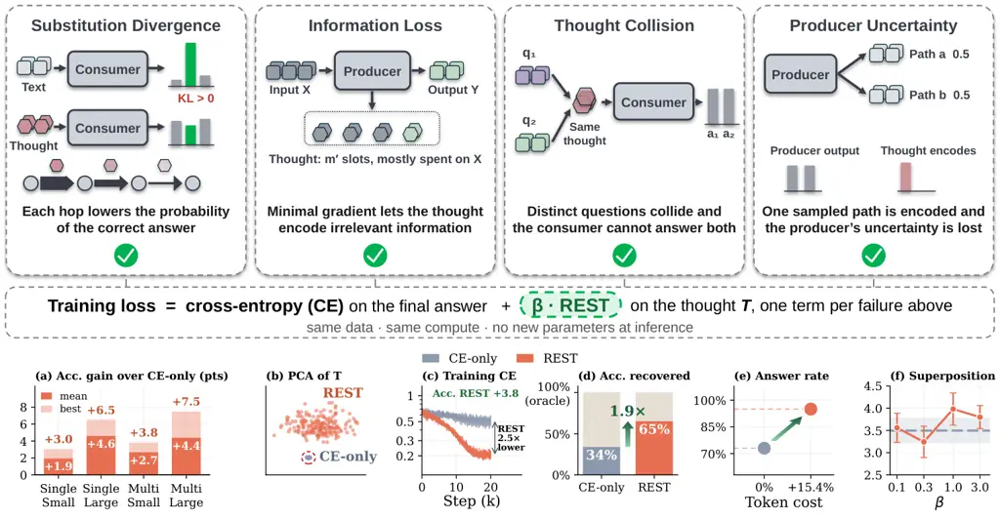
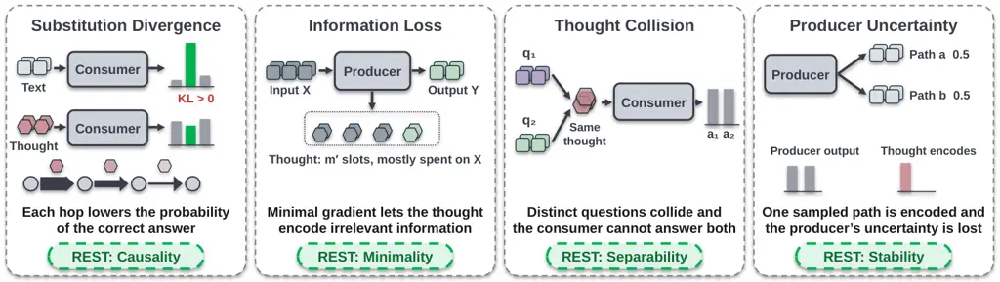
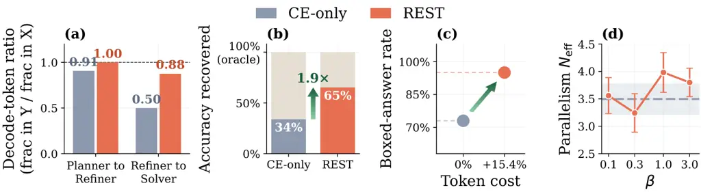
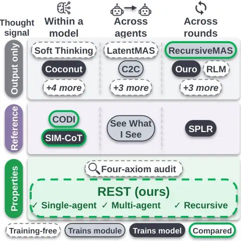

Principled Thoughts for Latent Recursive LLM Systems

# Principled Thoughts for Latent Recursive LLM Systems

Fahd Seddik Fatemeh Fard

###### Abstract

Large language models can reason in continuous space instead of decoded
text, by recurring on their own hidden states or by passing those states
between agents, while training supervises only the Cross-Entropy (CE) of
the final decoded answer and does not constrain the thought. Theoretical
and empirical analyses establish and confirm four failures of CE-only
training that lead to a lower probability of the correct answer such as
collapsing thoughts across distinct questions and retaining irrelevant
information. We introduce REST (REpresentation-Supervised Thoughts), a
training objective that turns four properties of a valid thought
representation (causality, minimality, separability, and stability) into
differentiable losses added to CE. We instantiate it in latent
single-agent and multi-agent systems, without architectural changes or
added parameters at inference. Across 7 benchmarks spanning mathematics,
science, medicine, and code generation, with the same training data,
compute, and latent budget, REST increases accuracy over CE-only
training across agent settings and model sizes by up to 7.5 percentage
points and convergence on a final answer by 30%. Furthermore, REST
thoughts encode more of what is required to achieve the correct answer,
and decoding them better recovers the intended output of the agent,
which makes latent communication easier to interpret.



Figure 1: REST. The top row shows the four failures of Cross-Entropy
(CE) only training of the thought. REST adds a $`\beta`$-weighted loss
on to the CE, with one term per failure, under the same data and
compute. (a) Accuracy gain for single- and multi-agent settings across
Small (1–2B) and Large (3–4B) models. (b)–(f) REST thoughts spread apart
instead of collapsing, reach a lower training CE and a higher accuracy,
recover more accuracy when they replace the oracle text, reach a final
answer more often, and keep their superposition.

## 1  Introduction

Chain-of-Thought (CoT) prompting enables Large Language Models (LLMs) to
solve complex problems by generating each intermediate reasoning step as
explicit text (Wei et al., 2022). However, expressing every step through
tokens of a discrete vocabulary confines reasoning to paths that can be
written in words (Li et al., 2025). The resulting reasoning traces are
also long, which raises inference cost and leads models to allocate
excessive computation to simple problems (Chen et al., 2025a).

To resolve these limitations, a growing line of work reasons directly in
the continuous latent space of LLMs rather than through decoded text
(Hao et al., 2026; Zhang et al., 2025; Butt et al., 2026; Shen et al.,
2025; Wei et al., 2026; Sheshanarayana et al., 2026). Within a single
model, this is realized by training the model to consume its own hidden
states as the next reasoning step instead of a token embedding (Hao et
al., 2026; Shen et al., 2025; Li et al., 2026a). From one model to
another, hidden states or KV caches have instead been used for
inter-agent communication (Liu et al., 2024; Zheng et al., 2025; Fu et
al., 2026). Recent systems unify both, with multiple agents reasoning
and communicating in latent space (Zou et al., 2026b) and repeating this
collaboration over several rounds of recursion (Zou et al., 2026a). The
main objective is usually Cross-Entropy (CE) of the final decoded
answer. As these systems scale in agents and rounds, each later agent
builds on the thoughts it receives, and error compounds through the
remainder of the system. Existing representation-level supervision
targets the text the thought replaces, which CODI does by matching the
hidden states that text induces (Shen et al., 2025) or SIM-COT by
decoding that text back from the thought (Wei et al., 2026). However,
supervising only on the target text does not dictate the relation
between two thoughts nor the distribution of outputs the model can
generate. Both requirements are among the four properties that define a
valid thought representation (Seddik and Fard, 2026).

A valid thought representation should preserve what is needed to
reproduce the output (Causality), discard what is irrelevant to that
output (Minimality), remain distinguishable across semantically distinct
inputs (Separability), and reflect the distribution of possible outputs
rather than one sample from it (Stability). An audit of existing latent
representations finds that every candidate violates at least one
property. The audit evaluates existing methods, and does not perform
training to target these properties. Training with CE only does not
enforce them either, since a model receives no signal as long as the
correct answer maintains high probability (Section 2.1).

Figure 2: Overview of REST. Latent systems pass a thought $`\mathbf{T}`$
through a trained outer link (left). REST adds a $`\beta`$-weighted loss
built from the four properties of $`\mathbf{T}`$ to the CE objective
(middle). CE-only thoughts collapse and REST improves accuracy under the
same data and compute (right).

We introduce REpresentation-Supervised Thought(s) (REST). REST
translates each of these four properties into a differentiable loss term
(Section A.1) and adds it to the total loss alongside CE. Each term is
weighted by a hyperparameter $`\beta`$, added on top of the existing CE
loss. Training then targets the thought representation as well as the
decoded answer (Figure 2). REST is studied on a latent recursive system
in which the base LLMs are frozen (Zou et al., 2026a). We extend this
construction from the multi-agent setting in which it was proposed to a
single-agent setting, where a model recurs on its own hidden states. In
addition, no changes to architecture or inference procedure are
required, allowing it to be added to existing latent recursive systems
without modification.

REST increases downstream accuracy across MATH500 (Lightman et al.,
2024), GPQA-Diamond (Rein et al., 2024), MedQA (Jin et al., 2021),
AIME2025/2026 (Zhang and Math-AI Team, 2025; Dekoninck et al., 2026),
LiveCodeBench-v6 (Jain et al., 2025), and MBPP+ (Liu et al., 2023),
spanning mathematical, scientific, and code-generation domains. Averaged
over all REST configurations, it improves accuracy over CE only by +3.5
points in the multi-agent setting and +3.3 in the single-agent setting,
under a matched training budget, the same training data, and the same
latent budget. The best configurations reach +7.5 and +6.5 points,
respectively. Through our analysis, we confirm that the trained thoughts
exhibit the properties that were targeted, which in turn lower-bound the
probability of the correct answer (Section A.2). REST decodes 15.4% more
tokens on average at inference, which we attribute to a higher rate of
convergence on a final answer (Section 4.4).

Our contributions can be summarized as follows:

- •
  We identify four failures of CE-only thoughts that lead to a lower
  probability of the correct answer (Section 2.1). In trained systems,
  CE-only thoughts collapse across distinct questions and retain
  irrelevant information (Section 4.4).
- •
  We introduce REST, which translates four theoretically motivated
  properties of thought representations (Seddik and Fard, 2026) into
  differentiable loss terms added to the CE objective, and we extend
  latent recursive systems (Zou et al., 2026a) from the multi-agent
  setting to a single agent that recurs on its own hidden states.
- •
  REST improves accuracy over the CE baseline across mathematical,
  scientific, medical, and code-generation benchmarks in both the
  single-agent and multi-agent settings, under matched training and
  latent budgets, and its gains remain robust across loss weights.

## 2  Background

Setup and Notation. Sets and operators are denoted with
($`\mathcal{V}`$, $`\mathcal{R}_{\mathrm{in}}`$,
$`\mathcal{R}_{\psi}`$), random variables, matrices, and scalar-valued
functions in upper case ($`Y`$, $`H`$, $`J`$), and scalars, indices,
token sequences, and single vectors in lower case ($`m`$, $`t`$, $`u`$,
$`e_{i}`$), with bold for the thought $`\mathbf{T}`$ and vectors derived
from it ($`\mathbf{t}`$). A next-token distribution is lower case
($`p`$, $`q`$) while the sequence is the matching upper case ($`P`$,
$`Q`$).

We adopt recursive multi-agent systems (Zou et al., 2026a), and extend
their approach to the single-agent setting to study REST. Let
$`f_{\theta}(\cdot)`$ denote an auto-regressive transformer model with
vocabulary $`\mathcal{V}`$ and hidden size $`d_{h}`$. Given a token
sequence $`u`$ with input embeddings
$`E(u)=[e_{1},\dots,e_{m}]\in\mathbb{R}^{m\times d_{h}}`$, a forward
pass yields last-layer hidden states
$`H=[h_{1},\dots,h_{m}]\in\mathbb{R}^{m\times d_{h}}`$ and, at each
position $`i`$, the next-token distribution
$`\mathrm{softmax}(h_{i}W_{\mathrm{out}})`$ over $`\mathcal{V}`$. A
multi-agent system $`\mathcal{S}`$ comprises $`N`$ agents
$`\mathcal{A}=\{A_{1},\dots,A_{N}\}`$, where each $`A_{i}`$ corresponds
to $`f_{\theta_{i}}`$, where every $`\theta_{i}`$ is frozen.

Hidden states re-enter embedding space through two links (Zou et al.,
2026a). An inner link $`\mathcal{R}_{\mathrm{in}}`$ maps an agent’s
hidden state back to its own input space, which lets $`A_{i}`$ take a
latent step instead of decoding a token. It is trained per agent by
aligning $`\mathcal{R}_{\mathrm{in}}(H)`$ onto the embeddings of the
ground-truth text. An outer link $`\mathcal{R}_{\psi}`$ maps the output
of $`\mathcal{R}_{\mathrm{in}}`$ into the input space of another agent.
$`\mathcal{R}_{\mathrm{in}}`$’s objective only aligns hidden states to
the input embedding space, whereas all outer links are trained through
CE on the target answer text at the final agent.

A latent thought of a producer $`A_{i}\in\mathcal{A}`$ to a consumer
$`A_{j}`$ composes both links as
$`\mathbf{T}=\mathcal{R}_{\psi}(\mathcal{R}_{\mathrm{in}}(H_{u}))\in\mathbb{R}^{m^{\prime}\times d_{h}}`$,
where $`H_{u}\in\mathbb{R}^{m\times d_{h}}`$ denotes the producer’s
last-layer hidden states at the $`m`$ positions of its own output
$`u\in\mathcal{V}^{m}`$, and $`m^{\prime}`$ is a latent steps budget for
transferred thoughts.

###### Definition 2.0 (Transfer).

For a consumer $`A_{j}\in\mathcal{A}`$, let $`E_{\mathrm{pre}}`$ and
$`E_{\mathrm{post}}`$ denote the embedding blocks of a prompt that
surround the transferred content, both independent of $`\psi`$. For
every block $`Z`$ of $`d_{h}`$-dimensional embedding vectors, the
consumer performs a forward pass on
$`[\,E_{\mathrm{pre}}\,;\,Z\,;\,E_{\mathrm{post}}\,;\,E(v)]`$ where
$`v`$ is the teacher-forced target answer for the consumer. The transfer
can be through latent thoughts for $`Z=\mathbf{T}`$ and through textual
embeddings for $`Z=E(u)`$.

Training and inference differ in how $`H_{u}`$ is obtained. During
training, $`u`$ is the producer’s ground-truth output, and one
teacher-forced pass over the producer’s prompt concatenated with $`u`$
yields $`H_{u}`$ at $`u`$’s positions. During inference no $`u`$ is
available in advance, so the producer starts from its prompt alone and
takes $`m^{\prime}`$ latent steps. At each step,
$`\mathcal{R}_{\mathrm{in}}`$ maps the last position’s hidden state into
the next input embedding, and $`H_{u}=[h_{1},\dots,h_{m^{\prime}}]`$ is
the sequence of hidden states over these steps.

Roles and Hops. The system chains a planner $`A_{1}`$, a refiner
$`A_{2}`$ and a solver $`A_{3}`$ (Figure 2, Table 1). The planner
proposes an approach to the question, the refiner revises that approach,
and the solver produces the answer. Each agent takes $`m^{\prime}`$
latent steps through $`\mathcal{R}_{\mathrm{in}}`$, and
$`\mathcal{R}_{\psi}`$ maps the resulting hidden states into the next
agent’s input space. Every handoff of this kind is one transfer of
Definition 2.1.

Recursion. Once the solver finishes, its thought returns to the planner
and the chain repeats for a further round (Zou et al., 2026a). Let $`R`$
denote the number of rounds, let $`\mathbf{T}^{(r,k)}`$ denote the
thought that $`A_{k}`$ receives at round $`r`$, and let $`\mathcal{H}`$
collect the pairs $`(r,k)`$ at which a transfer occurs. The planner of
the first round is the one agent that conditions on the question without
a transferred thought. Every later agent conditions on both its own
input context and the thought it receives. The solver of the final round
decodes $`v`$ as text, and every earlier hop stays in latent space.

### 2.1 Limitations of Answer-Level Supervision

Substitution Divergence. Let $`P(\cdot\mid Z)`$ denote the distribution
the consumer assigns to complete targets under a transferred block
$`Z`$. A consumer answers under either block of Definition 2.1. Let
$`\mathrm{CE}_{\mathrm{lat}}`$ and $`\mathrm{CE}_{\mathrm{txt}}`$ denote
the per-token CE it incurs on a target $`v`$ under each one. Let
$`\Lambda(v)=\mathrm{CE}_{\mathrm{lat}}(v)-\mathrm{CE}_{\mathrm{txt}}(v)`$
denote the cost of substituting the thought for the producer’s text. We
can represent this as a divergence between the two transfers over the
targets the producer’s text induces,

```math
\mathbb{E}_{v\sim P(\cdot\mid E(u))}\big[\Lambda(v)\big]=\frac{1}{n}\,D_{\mathrm{KL}}\big(P(\cdot\mid E(u))\,\big\|\,P(\cdot\mid\mathbf{T})\big), \tag{1}
```

where $`n`$ is the length of $`v`$ (Section A.2.1). This divergence can
be zero only when both transfers lead the consumer agent to the same
distribution. The probability the consumer assigns to the correct target
is reduced by a factor of $`\exp(-n\Lambda(v))`$. A longer target is
therefore penalized more for the same divergence per token. This effect
compounds for each hop $`A_{i}\to A_{j}`$ in the pipeline. Empirically,
CE-only does not reach the accuracy of the oracle text from the producer
agent (Figure 6(b)).

Information Loss. When a consumer agent solves a question, it may solve
a large part on its own (Table 6), and on those questions CE would be
close to its minimum. Gradients updating the thought for those examples
would be small compared to others. Therefore, the output from a producer
agent may not be preserved as $`\psi`$ may not learn from such examples.
The consumer agent is then left with less information than when given
the producer’s generated output (Proposition A.27). In addition, since
the transfer is further limited to a budget of $`m^{\prime}`$ positions,
$`\psi`$ may learn to encode irrelevant information due to such examples
since their supervision signal is too weak. Empirically, CE-only encodes
more content from the producer agent’s input than its output
(Figure 6(a)).

Thought Collision. If training resulted in two different examples having
colliding thoughts, then a consumer agent must answer both with nearly
the same distribution even if the two target texts are different. This
imposes a lower bound on their average CE (Proposition A.33). Under
total collapse, where the two thoughts are identical, the optimal
solution would be assigning equal probability to both targets, which
would mean it is random chance. CE evaluates every example on its own
target. Summing over examples does not change this, since each term
depends on one thought only. A collision raises the loss on both
examples, and CE cannot distinguish this from two difficult examples.
Empirically, CE-only collapses distinct questions together (Figure 7).

Producer Uncertainty. Generated text from a producer used as supervision
targets would not encode the level of certainty for that output. At each
step, it may be choosing between alternative solutions of equal
probability. CE supervises only the consumer’s final answer, and it does
not require the thought to encode this certainty. The loss would be
higher for a thought that doesn’t encode the possible output
distribution from a producer agent (Proposition A.36).



Figure 3: Why CE is not enough. Four failures of CE thoughts and the
property that addresses each.

## 3  REST: Representation-Supervised Thought(s)

Every agent base LLM $`f_{\theta_{i}}`$ stays frozen alongside
$`\mathcal{R}_{\mathrm{in}}`$. The outer link $`\mathcal{R}_{\psi}`$ is
the component that is trained with CE, thus we keep
$`\mathcal{R}_{\mathrm{in}}`$ frozen and only train
$`\mathcal{R}_{\psi}`$ to isolate the effect of REST. CE is kept as part
of the total loss function to maintain legible text outputs when
answering. For each term, we start with the definition of the property
and arrive at the loss function below (proofs in Section A.1).

### 3.1 Principled Thoughts

Let $`n`$ denote the length of the target $`v`$ of Definition 2.1, let
$`v_{<t}=(v_{1},\dots,v_{t-1})`$ denote its prefix at position
$`t\in\{1,\dots,n\}`$, and let $`p(\cdot\mid v_{<t},Z)`$ denote the
consumer agent’s next-token distribution at that position under the
transferred block $`Z`$.

Causality requires that $`\mathbf{T}`$ hold the required information
about the text generated by a producer agent when given to a consumer
agent without altering what a consumer agent would have predicted. We
enforce this property by penalizing the divergence between the two
transfers of Definition 2.1,

```math
\mathcal{L}_{\mathrm{caus}}(\psi)=\frac{1}{n}\sum_{t=1}^{n}D_{\mathrm{KL}}\Big(p\big(\cdot\mid v_{<t},E(u)\big)\,\Big\|\,p\big(\cdot\mid v_{<t},\mathbf{T}\big)\Big). \tag{2}
```

Minimality requires that $`\mathbf{T}`$ should remove irrelevant
information that was present in the input of the producer agent while
maintaining relevant information relative to its output. Let $`X`$ and
$`Y`$ denote the producer’s input and output as random variables, the
latter realized by the sequence $`u`$ (Definition 2.1), and let
$`\mathrm{CE}(Y\mid\mathbf{T})`$ and $`\mathrm{CE}(X\mid Y,\mathbf{T})`$
denote the CE terms calculated for the consumer agent,

```math
\mathcal{L}_{\mathrm{min}}(\psi)=\lambda_{1}\,\mathrm{CE}\big(Y\mid\mathbf{T}\big)-\lambda_{2}\,\mathrm{CE}\big(X\mid Y,\mathbf{T}\big), \tag{3}
```

where $`\lambda_{1},\lambda_{2}>0`$ are scalars. Since a thought
representation $`\mathbf{T}`$ from the producer agent may encode
information from its input and output, this loss term would penalize a
representation that would encode irrelevant information from its input
relative to the information present in its output.

Separability requires that two thought representations for semantically
distinct outputs should be distinguishable or separable to represent
that they encode semantically distinct information. In order to apply
this on $`\mathbf{T}`$, which can be a sequence of vectors, we utilize
an attention pool to produce one vector for each sequence. Let
$`\mathbf{t}`$ and $`\mathbf{t}_{1},\dots,\mathbf{t}_{K}`$ in
$`\mathbb{R}^{d_{h}}`$ denote the thoughts pooled over the
$`m^{\prime}`$ positions of the current example and of the $`K`$
training examples that precede it, respectively, and let
$`\mathrm{sim}(a,b)`$ denote the cosine similarity. We penalize the
similarity of $`\mathbf{t}`$ to each $`\mathbf{t}_{k}`$,

```math
\mathcal{L}_{\mathrm{sep}}(\psi,\omega)=\log\sum_{k=1}^{K}\exp\!\Big(\mathrm{sim}\big(\mathbf{t},\mathbf{t}_{k}\big)\big/\tau\Big), \tag{4}
```

where $`\tau>0`$ is a scalar for temperature and $`\omega`$ denotes the
parameters of the attention pooling.

Stability requires encoding the output distribution rather than one
sequence. Sampling that distribution would require many outputs at every
stage of the system. Estimating the entropy on the other hand can track
the property without bias (Section A.1.4). Let $`q(\cdot\mid u_{<s})`$
denote the producer’s next-token distribution at position
$`s\in\{1,\dots,m\}`$ of its own output $`u`$, let $`\mathbb{H}`$ denote
Shannon entropy, and let

```math
\widehat{\mathbb{H}}(u)=\frac{1}{m}\sum_{s=1}^{m}\mathbb{H}\big(q(\cdot\mid u_{<s})\big) \tag{5}
```

denote the producer’s mean predictive entropy along $`u`$. We enforce
the property through the squared error between eq. 5 and an estimate of
its value through a learned probe that receives $`\mathbf{T}`$,

```math
\mathcal{L}_{\mathrm{stab}}(\psi,\omega)=\Big(g_{\omega}(\mathbf{T})-\widehat{\mathbb{H}}(u)\Big)^{2}, \tag{6}
```

where $`g_{\omega}`$ is an attention pooling over the $`m^{\prime}`$
positions of $`\mathbf{T}`$ with an affine map from
$`\mathbb{R}^{d_{h}}`$ to $`\mathbb{R}`$.

### 3.2 Multi-Agent Systems

REST adds one term at every transfer of Definition 2.1 and leaves the CE
of the system unchanged,

```math
\mathcal{L}(\psi,\omega)=\mathcal{L}_{\mathrm{CE}}\big(v\mid\mathbf{T}^{(R,N)}\big)+\beta\,\frac{1}{|\mathcal{H}|}\sum_{(r,k)\in\mathcal{H}}\mathcal{L}_{\mathrm{prop}}\big(\psi,\omega;\mathbf{T}^{(r,k)}\big), \tag{7}
```

where
$`\mathcal{L}_{\mathrm{prop}}\in\{\mathcal{L}_{\mathrm{caus}},\mathcal{L}_{\mathrm{min}},\mathcal{L}_{\mathrm{sep}},\mathcal{L}_{\mathrm{stab}}\}`$,
and $`\mathbf{T}^{(R,N)}`$ is the thought that the solver of the final
round receives. $`\omega`$ is present only in
$`\mathcal{L}_{\mathrm{sep}}`$ and $`\mathcal{L}_{\mathrm{stab}}`$. The
property term is averaged over each transfer, therefore receiving a
gradient from its own term in addition to the final CE.

### 3.3 Single-Agent Systems

Figure 4: Single agent. $`\mathcal{R}_{\mathrm{in}}`$ runs at each of
the $`m^{\prime}`$ steps, and $`\mathcal{R}_{\psi}`$ once per round.

It is important to note that Definition 2.1 permits $`A_{i}=A_{j}`$,
which corresponds to our extension to the single-agent setting. REST
extends to a single agent reasoning in latent space, rather than being
restricted to a pipeline of several agents.

Self-Loop. A single solver acts as both the producer and the consumer,
with no planner and no refiner (Figure 4). The solver first runs on its
own input context and computes last-layer hidden states. These states
pass through the frozen inner link $`\mathcal{R}_{\mathrm{in}}`$ and the
trained outer link $`\mathcal{R}_{\psi}`$, which gives the thought
$`\mathbf{T}`$ of Section 2. The solver then runs a second time,
conditioned on both its own input context and $`\mathbf{T}`$. Each
further round repeats the second pass, and the hidden states it computes
form the next round’s thought. Equation 7 applies at $`N=1`$. The two
links act at different points of the system.
$`\mathcal{R}_{\mathrm{in}}`$ runs at every one of the $`m^{\prime}`$
latent steps and lets the solver take a latent step instead of decoding
a token, whereas $`\mathcal{R}_{\psi}`$ runs once per round. Removing
$`\mathcal{R}_{\mathrm{in}}`$ therefore removes latent reasoning itself
rather than one trainable component. Keeping it frozen leaves $`\psi`$
as the only parameter that varies between CE and REST, and between the
single- and multi-agent settings.

## 4  Evaluation

### 4.1 Experimental Setup

| System | Role    | Model                      |
| ------ | ------- | -------------------------- |
| Light  | Planner | Qwen3-1.7B                 |
|        | Refiner | Llama-3.2-1B-Instruct      |
|        | Solver  | Qwen2.5-Math-1.5B-Instruct |
| Scaled | Planner | Gemma-3-4B-it              |
|        | Refiner | Llama-3.2-3B-Instruct      |
|        | Solver  | Qwen3.5-4B                 |

Table 1: Light and Scaled systems.

Systems and Baselines. We evaluate REST on open-weight LLMs across the
Qwen (Qwen et al., 2025; Yang et al., 2024; Yang et al., 2025; Qwen
Team, 2026), Llama (Grattafiori et al., 2024), and Gemma (Gemma Team et
al., 2025) model families for heterogeneous agent collaborations.
Table 1 lists the model assigned to each role. For baseline comparisons,
we evaluate CODI (Shen et al., 2025) and SIM-CoT (Wei et al., 2026)
adapted as loss terms added to CE, and the frozen LLMs as a text
baseline (Table 6). CE only is the unmodified latent recursive system
that REST builds on, and Best pair combines causality and minimality.
Detailed implementations and hyperparameters are in Section B.2 and
Appendix B.

Data. We adopt Sequential-Math (Zou et al., 2026a) for training,
constructed by rewriting question-answer pairs curated from s1K
(Muennighoff et al., 2025), m1K (Huang et al., 2026a) into role-specific
texts. Evaluation covers four domains, mathematics with MATH500
(Lightman et al., 2024), AIME2025 (Zhang and Math-AI Team, 2025), and
AIME2026 (Dekoninck et al., 2026), science with GPQA-Diamond (Rein et
al., 2024), medicine with MedQA (Jin et al., 2021), and code generation
with MBPP+ (Liu et al., 2023) and LiveCodeBench-v6 (Jain et al., 2025).
Additional details in Section B.1.

Training and Inference. For training, we freeze all agent parameters and
update only $`\psi`$ and $`\omega`$. The training objective adds a
weighted term to the loss function. AdamW is used under a cosine
learning rate schedule. During inference, we follow each model’s
official recommended sampling settings, and a lower temperature for code
generation than for other reasoning tasks. We average values across
three training seeds. The Avg. Change column reports the average change
against the CE-only baseline across the benchmarks of one system, and
each system is reported at the recursion round that performs best for
it, with the baseline taken at that same round for fair comparison.

### 4.2 Single-Agent Evaluation

|                                        |        |         |        |          |        |          |        |        |        |       |        |           |        |                  |                  |
| -------------------------------------- | ------ | ------- | ------ | -------- | ------ | -------- | ------ | ------ | ------ | ----- | ------ | --------- | ------ | ---------------- | ---------------- |
| Method                                 | Metric | Math500 |        | AIME2025 |        | AIME2026 |        | GPQA-D |        | MedQA |        | Code Gen. |        | Avg. Change      |                  |
|                                        |        | Light   | Scaled | Light    | Scaled | Light    | Scaled | Light  | Scaled | Light | Scaled | Light     | Scaled | Light            | Scaled           |
|                                        | Acc.   | 70.6    | 80.9   | 27.8     | 65.6   | 12.2     | 72.2   | 27.3   | 63.3   | 27.1  | 79.2   | 27.7      | 35.5   | Base             | Base             |
| CE only                                | Token  | 557     | 862    | 905      | 7226   | 1016     | 6967   | 911    | 1709   | 1177  | 739    | 477       | 1289   | Base             | Base             |
| REST (ours), single property           |        |         |        |          |        |          |        |        |        |       |        |           |        |                  |                  |
|                                        | Acc.   | 72.4    | 80.4   | 23.3     | 78.9   | 16.7     | 83.3   | 23.9   | 63.5   | 29.7  | 79.4   | 32.9      | 40.2   | $`\uparrow 1.0`$ | $`\uparrow 4.8`$ |
| Causality                              | Token  | 551     | 1008   | 907      | 8677   | 1008     | 8165   | 851    | 2216   | 1113  | 955    | 570       | 1662   | $`-0.9\%`$       | $`+20.7\%`$      |
|                                        | Acc.   | 72.1    | 81.1   | 30.0     | 78.9   | 20.0     | 86.7   | 27.6   | 63.8   | 29.7  | 83.0   | 31.5      | 42.3   | $`\uparrow 3.0`$ | $`\uparrow 6.5`$ |
| Minimality                             | Token  | 546     | 1053   | 906      | 10256  | 936      | 10390  | 872    | 2526   | 1075  | 1162   | 561       | 1850   | $`-2.9\%`$       | $`+44.9\%`$      |
|                                        | Acc.   | 73.1    | 80.2   | 26.7     | 76.7   | 17.8     | 83.3   | 28.8   | 61.1   | 27.7  | 81.7   | 30.2      | 39.4   | $`\uparrow 1.9`$ | $`\uparrow 4.3`$ |
| Separability                           | Token  | 551     | 1056   | 918      | 8657   | 987      | 8033   | 901    | 2556   | 1083  | 1087   | 488       | 1764   | $`-2.3\%`$       | $`+23.2\%`$      |
|                                        | Acc.   | 72.1    | 79.1   | 27.8     | 83.3   | 15.6     | 88.3   | 28.1   | 64.4   | 29.8  | 79.8   | 29.1      | 40.4   | $`\uparrow 1.6`$ | $`\uparrow 6.4`$ |
| Stability                              | Token  | 538     | 1049   | 921      | 9626   | 944      | 9174   | 845    | 2464   | 1051  | 1071   | 645       | 1783   | $`-2.0\%`$       | $`+33.9\%`$      |
| REST (ours), composition of properties |        |         |        |          |        |          |        |        |        |       |        |           |        |                  |                  |
|                                        | Acc.   | 69.7    | 79.4   | 23.3     | 80.0   | 16.7     | 86.7   | 26.1   | 57.6   | 29.6  | 79.0   | 33.5      | 38.6   | $`\uparrow 1.0`$ | $`\uparrow 4.1`$ |
| Best pair                              | Token  | 542     | 1065   | 876      | 10503  | 1039     | 10728  | 826    | 2605   | 1083  | 1179   | 553       | 1632   | $`-2.4\%`$       | $`+47.5\%`$      |
|                                        | Acc.   | 72.4    | 78.4   | 33.3     | 73.3   | 16.7     | 76.7   | 23.7   | 60.6   | 31.0  | 79.3   | 32.8      | 37.0   | $`\uparrow 2.9`$ | $`\uparrow 1.4`$ |
| All properties                         | Token  | 569     | 981    | 934      | 11053  | 984      | 10338  | 953    | 1744   | 1130  | 1001   | 555       | 1375   | $`+1.6\%`$       | $`+41.0\%`$      |

Table 2: Single-agent, Light vs Scaled, at $`r=1`$ and $`r=3`$
respectively, each row at its best $`\beta`$.

Table 2 shows every property term improving accuracy over the CE-only
objective in this setting. The effect can be attributed to the thought
rather than collaboration among agents. A practitioner is also more
likely to already be running a single model system when considering
costs. In the Light system, the token count is lower than CE, while it
is higher in the multi-agent setting. Among the four properties,
minimality delivers the largest gain in the single-agent setting. In the
Light system, minimality exceeds the baseline on every task while
decoding fewer tokens overall, indicating that its accuracy gain does
not come from longer generation. This is consistent with the structure
of the self-loop, in which the producer’s input contains the same
question and instructions that the consumer already conditions on when
receiving $`\mathbf{T}`$. As a result, any input content encoded in
$`\mathbf{T}`$ is redundant and occupies latent positions that would
otherwise carry the producer’s output.

### 4.3 Multi-Agent Evaluation

|                                        |        |         |        |          |        |          |        |        |        |       |        |           |        |                  |                    |
| -------------------------------------- | ------ | ------- | ------ | -------- | ------ | -------- | ------ | ------ | ------ | ----- | ------ | --------- | ------ | ---------------- | ------------------ |
| Method                                 | Metric | Math500 |        | AIME2025 |        | AIME2026 |        | GPQA-D |        | MedQA |        | Code Gen. |        | Avg. Change      |                    |
|                                        |        | Light   | Scaled | Light    | Scaled | Light    | Scaled | Light  | Scaled | Light | Scaled | Light     | Scaled | Light            | Scaled             |
|                                        | Acc.   | 71.1    | 86.6   | 22.2     | 80.0   | 17.8     | 60.0   | 24.9   | 59.1   | 28.9  | 79.7   | 32.5      | 33.5   | Base             | Base               |
| CE only                                | Token  | 550     | 1252   | 849      | 10485  | 884      | 5420   | 749    | 2572   | 868   | 829    | 604       | 1029   | Base             | Base               |
| REST (ours), single property           |        |         |        |          |        |          |        |        |        |       |        |           |        |                  |                    |
|                                        | Acc.   | 77.8    | 86.8   | 27.8     | 80.0   | 22.2     | 86.7   | 28.6   | 54.9   | 30.0  | 78.7   | 33.9      | 39.1   | $`\uparrow 3.8`$ | $`\uparrow 4.6`$   |
| Causality                              | Token  | 601     | 1158   | 894      | 8576   | 978      | 8278   | 888    | 1568   | 1049  | 996    | 643       | 1924   | $`+12.2\%`$      | $`+4.2\%`$         |
|                                        | Acc.   | 77.1    | 85.8   | 30.0     | 86.7   | 22.2     | 83.3   | 27.6   | 62.6   | 26.8  | 83.0   | 32.0      | 39.0   | $`\uparrow 3.1`$ | $`\uparrow 6.9`$   |
| Minimality                             | Token  | 605     | 1204   | 920      | 9873   | 1052     | 9558   | 849    | 2528   | 1158  | 1275   | 575       | 1875   | $`+14.6\%`$      | $`+21.9\%`$        |
|                                        | Acc.   | 74.7    | 82.2   | 25.6     | 73.3   | 17.8     | 65.6   | 25.6   | 52.5   | 30.9  | 78.7   | 31.1      | 31.6   | $`\uparrow 1.4`$ | $`\downarrow 2.5`$ |
| Separability                           | Token  | 564     | 1191   | 838      | 7039   | 923      | 6940   | 758    | 1940   | 1116  | 1189   | 1650      | 1280   | $`+29.9\%`$      | $`-9.3\%`$         |
|                                        | Acc.   | 74.0    | 85.6   | 27.8     | 80.0   | 16.7     | 80.0   | 26.8   | 62.6   | 31.0  | 75.0   | 35.1      | 34.2   | $`\uparrow 2.3`$ | $`\uparrow 3.1`$   |
| Stability                              | Token  | 551     | 1105   | 881      | 7588   | 976      | 6497   | 785    | 1908   | 1205  | 941    | 781       | 1215   | $`+15.0\%`$      | $`-10.8\%`$        |
| REST (ours), composition of properties |        |         |        |          |        |          |        |        |        |       |        |           |        |                  |                    |
|                                        | Acc.   | 77.6    | 87.0   | 25.6     | 83.3   | 15.6     | 86.7   | 29.0   | 60.1   | 30.1  | 85.0   | 33.9      | 41.7   | $`\uparrow 2.4`$ | $`\uparrow 7.5`$   |
| Best pair                              | Token  | 604     | 1227   | 916      | 10281  | 978      | 9828   | 886    | 2629   | 1100  | 1259   | 613       | 2134   | $`+13.2\%`$      | $`+26.7\%`$        |
|                                        | Acc.   | 76.2    | 86.6   | 28.9     | 78.9   | 21.1     | 86.7   | 27.6   | 63.6   | 28.7  | 81.7   | 33.3      | 42.1   | $`\uparrow 3.1`$ | $`\uparrow 6.8`$   |
| All properties                         | Token  | 608     | 1253   | 900      | 11033  | 1022     | 11275  | 879    | 2673   | 1042  | 1373   | 569       | 2151   | $`+11.5\%`$      | $`+37.9\%`$        |

Table 3: Multi-agent, Light vs Scaled, at $`r=1`$ and $`r=3`$
respectively, each row at its best $`\beta`$.

Table 3 reports the full planner, refiner, and solver system. Every
setting improves accuracy over CE-only in the Light system. This trend
continues for the Scaled system as well except separability, where it
reduces the number of tokens instead. In the Light system, REST with
causality or minimality matches or surpasses the strongest frozen agent
in Table 6 on all three mathematical benchmarks, while the CE-only
system underperforms it on all three. Unlike in the Light single-agent
setting, REST increases tokens in the multi-agent system (more in
Section 4.4). Beyond the best configuration, the $`r=1`$ sweep in
Table 11 shows that REST does not rely on careful weight tuning, as both
causality and minimality improve the average accuracy at every
$`\beta`$.

### 4.4 Analysis

Figure 5: Acc. Change vs $`r`$

Scale and Recursion Depth. Figure 5 averages the change in accuracy over
CE-only at each recursion round. Additional rounds increase the gain of
REST for the Scaled agents and reduce it for the Light agents, in both
the single-agent and the multi-agent systems. Larger agents therefore
make use of additional rounds of latent exchange, whereas smaller agents
obtain their gain from a single round. Section D.2 provides the full
tables at both rounds.

Auxiliary-Loss Baselines. Table 4 compares REST against CODI and SIM-CoT
adapted as loss terms. REST retains an advantage over the two in
accuracy on both systems, and in token overhead on the Light system.
Both baselines supervise the latent state against a text the producer
would have written, whereas REST constrains a property of the thought.
CODI requires the consumer’s hidden state to match the state observed
under text, while causality requires only that the consumer predict the
same continuation. The comparison isolates the effect of an auxiliary
term that targets the representation.

| Method                                  | Metric | Math500 |        | AIME2025 |        | AIME2026 |        | GPQA-D |        | MedQA |        | Code Gen. |        | Avg. Change      |                    |
| --------------------------------------- | ------ | ------- | ------ | -------- | ------ | -------- | ------ | ------ | ------ | ----- | ------ | --------- | ------ | ---------------- | ------------------ |
|                                         |        | Light   | Scaled | Light    | Scaled | Light    | Scaled | Light  | Scaled | Light | Scaled | Light     | Scaled | Light            | Scaled             |
|                                         | Acc.   | 71.1    | 87.7   | 22.2     | 76.7   | 17.8     | 86.7   | 24.9   | 63.1   | 28.9  | 80.2   | 32.5      | 39.0   | Base             | Base               |
| CE only                                 | Token  | 550     | 1018   | 849      | 9009   | 884      | 8488   | 749    | 2379   | 868   | 1137   | 604       | 1507   | Base             | Base               |
|                                         | Acc.   | 76.9    | 85.9   | 30.0     | 83.3   | 22.2     | 83.3   | 28.8   | 61.8   | 27.3  | 80.3   | 32.0      | 39.5   | $`\uparrow 3.3`$ | $`\uparrow 0.1`$   |
| CODI ($`\beta=20`$)                     | Token  | 598     | 1035   | 933      | 9344   | 987      | 9153   | 861    | 2293   | 1101  | 1097   | 682       | 1602   | $`+14.6\%`$      | $`+4.2\%`$         |
|                                         | Acc.   | 76.7    | 82.0   | 27.8     | 77.8   | 21.1     | 78.9   | 26.9   | 54.5   | 28.9  | 79.0   | 34.9      | 35.0   | $`\uparrow 3.2`$ | $`\downarrow 4.4`$ |
| SIM-CoT ($`\lambda_{\text{step}}=0.3`$) | Token  | 598     | 728    | 929      | 9854   | 1004     | 8797   | 914    | 943    | 1202  | 624    | 549       | 1276   | $`+15.4\%`$      | $`-5.6\%`$         |
|                                         | Acc.   | 77.8    | 88.0   | 27.8     | 83.3   | 22.2     | 90.0   | 28.6   | 67.2   | 30.0  | 81.3   | 33.9      | 42.3   | $`\uparrow 3.8`$ | $`\uparrow 3.1`$   |
| REST (ours)                             | Token  | 601     | 1044   | 894      | 10309  | 978      | 9956   | 888    | 2287   | 1049  | 1120   | 643       | 2036   | $`+12.2\%`$      | $`+13.7\%`$        |

Table 4: REST against auxiliary-loss baselines, Light vs Scaled.



Figure 6: REST against CE-only. (a) Decoded thoughts compared to output
/ input. (b) Replacing oracle text with thought. (c) Answer rate vs
token usage. (d) Effective Superposition.

Figure 7: REST against CE-only. (a) PCA for $`\mathbf{T}`$. CE thoughts
collapse into dense clusters, while REST spreads thoughts apart. (b)
Training CE under causality. More details in Appendix D.

Encoding Producer Output. Figure 6(a) measures how much of a thought’s
decoded content belongs to the producer’s own output, against how much
belongs to the prompt it received. Under REST the thought encodes the
producer’s plan, or the refined plan. CE has relatively more content
from the input encoded, which might be irrelevant to the next agent.
This is exactly the behavior targeted by eq. 3. The effect grows as the
system moves further along the chain of latent thoughts.

Preserved Information. Figure 6(b) compares the performance of the
solver when given the oracle refined plan compared to the thought
representation. REST reaches more of this accuracy than CE. Therefore,
REST contains relatively more useful information to the solver than CE.

Token Cost. This information comes at a token cost. Although we observe
an increase in tokens when using REST (+15.4% on average), this leads to
the model being more likely to generate a final answer. We analyze the
boxed-answer rate which is the percentage of examples the model
converges on an answer. As illustrated in Figure 6(c), REST reaches a
95% boxed-answer rate compared to 73% for CE. This indicates that the
additional tokens are spent towards reaching a final answer.

Superposition. Figure 6(d) measures how many candidate reasoning paths a
thought supports at once, a metric we adapt from Deng et al. (2026)
(eq. 78). It decodes $`\mathbf{T}`$ through the consumer’s vocabulary,
scores each candidate refined plan by the decoded tokens it receives,
and reports the exponentiated entropy of the resulting posterior over
candidates. Higher $`N_{\text{eff}}`$ indicates higher effective
superposition. REST maintains superposition and slightly increases with
increasing the weight $`\beta`$.

CE Thoughts. Figure 7(a) projects $`\mathbf{T}`$ for 200 random samples.
Thoughts from CE are gathered into dense clusters, hence semantically
distinct questions would have close representations that would confuse a
consumer agent. After inspection of the CE-only clusters, the texts are
not related to each other (Appendix D). Therefore, the clustering
represents collapse with no shared content. REST penalizes this behavior
through separability across a continuous region. This is the failure in
Section 2.1, where difficult examples would be indistinguishable from a
collapse. Lower training CE does not achieve better accuracy
(Figure 7(b)). CE-only plateaus above causality for Light, where it does
not memorize, while for Scaled it memorizes the training set and still
underperforms REST in accuracy. Therefore, only minimizing CE would make
the thought representation underconstrained.

## 5  Related Work



Figure 8: Positioning of REST.

Reasoning in Latent Space. Recent work treats the continuous latent
space of an LLM as the medium of reasoning rather than the decoded text
(Chen et al., 2026b; Zhu et al., 2025). Within a single model, hidden
states re-enter the input stream as the next reasoning step (Zhang et
al., 2025; Tan et al., 2025; Butt et al., 2026; Sheshanarayana et al.,
2026; Li et al., 2026a). Across models, hidden representations and KV
caches carry information between agents in place of text (Liu et al.,
2024; Xu et al., 2025; Zheng et al., 2025; Fu et al., 2026; Ye et al.,
2025; Zou et al., 2026b). A further line reuses the same computation
over several rounds to deepen latent reasoning (Geiping et al., 2025;
Zhu et al., 2026; Jolicoeur-Martineau, 2025; Bae et al., 2025), which
Zou et al. (2026a) raise to the system level by looping heterogeneous
agents through a learned link. Most of these systems rely on the
cross-entropy of the final decoded answer for training, and typically
leave the latent thoughts themselves unconstrained.

Supervising Latent Thoughts. The signal that trains a latent state is
the answer following the latent steps (Hao et al., 2026), a
self-distilled explicit chain of thought (Shen et al., 2025), or an
auxiliary decoder aligning every latent step with its explicit
counterpart (Wei et al., 2026). Each of these signals is defined against
a reference the latent state must reproduce, either a text or another
model’s own cache (Chen et al., 2026a). Audits of the resulting
representations report high accuracy without latent reasoning, collapsed
candidate solutions, and unstable trajectories (Cui et al., 2026;
Rizvi-Martel et al., 2026; Sahoo et al., 2026). A recent framework
states four properties a valid thought representation should satisfy,
and audits existing methods against them (Seddik and Fard, 2026). REST
is the first to turn the theoretically motivated properties of a valid
thought representation into loss terms for a latent recursive LLM system
(Figure 8). Additional related work in Appendix C.

## 6  Conclusion

We introduce REST, a training objective that supervises the thoughts of
latent recursive LLM systems through four properties of a valid thought
representation. Our objective translates causality, minimality,
separability, and stability into differentiable loss terms added to CE.
These terms require no architectural changes or added parameters at
inference. Theoretical analyses show that the failures these properties
prevent lead to a lower probability of the correct answer. Empirically,
thoughts trained only with CE collapse across distinct questions and
retain irrelevant information. Evaluations across mathematical,
scientific, medical, and code-generation benchmarks demonstrate that
REST improves accuracy over CE in both single- and multi-agent settings.
Overall, REST establishes a principled way to supervise latent thoughts
beyond the final decoded answer.

Implications. The improvements from an auxiliary term in both settings
indicate that CE-only insufficiently constrains latent thoughts, and
that latent recursive systems benefit from supervising the thought
representation. The property that yields the largest gain further
depends on the consumer, as causality leads when the thought passes to a
different agent and minimality leads when a model recurs on its own
thought. Since the collapse and input content observed under CE are not
reflected in the CE objective, final-answer accuracy provides an
incomplete view of latent systems, and inspection of the thought
representation should accompany it. Finally, decoded REST thoughts
contain relatively more of the producer’s output than of its prompt,
suggesting that property supervision can make latent communication
easier to audit as agents increasingly communicate outside of text.

Limitations. Due to the substantial computational cost, we do not sweep
all combinations of properties and hyperparameters, as the number of
required runs grows multiplicatively with each addition. Nevertheless,
causality and minimality improve over CE at every weight we evaluate
(Table 11). A cheap approximation to Stability is opted for due to
compute limitations but still leads to performance gain. Another
limitation is that REST trains only the outer link while the base LLMs
and the inner link remain frozen, a design choice to isolate the
contribution of each property term. Extending REST to the training of
the inner link or the agent is left to future work.

## References

- Bae et al. (2025) S. Bae, Y. Kim, R. Bayat, S. Kim, J. Ha, T.
  Schuster, A. Fisch, H. Harutyunyan, Z. Ji, A. Courville, and S. Yun
  Mixture-of-recursions: learning dynamic recursive depths for adaptive
  token-level computation. In Advances in Neural Information Processing
  Systems, Vol. 38. External Links:
  [Document](https://dx.doi.org/10.52202/085713-3229),
  [Link](https://neurips.cc/virtual/2025/poster/118085) Cited by: §5.
- Butt et al. (2026) N. Butt, A. Kwiatkowski, I. Labiad, J. Kempe,
  and Y. Ollivier Soft Tokens, Hard Truths. In The Fourteenth
  International Conference on Learning Representations, External Links:
  [Link](https://openreview.net/forum?id=9JjKTp8Jmy) Cited by: §1, §5.
- Cai et al. (2026) Z. Cai, X. Zhu, Y. Dong, Y. He, and S. Arora T2MLR:
  transformer with temporal middle-layer recurrence. In Workshop on
  Latent & Implicit Thinking – Going Beyond CoT Reasoning, External
  Links: [Link](https://openreview.net/forum?id=fQbk1EQWBO) Cited by:
  Appendix C.
- Chen et al. (2026a) S. Chen, X. Zhang, M. Wu, J. Tremblay, V.
  Blukis, S. Birchfield, R. Vidal, A. Velasquez, S. Liu, and Q. Qu See
  what i see, know what i think: dense latent communication across
  heterogeneous agents. External Links: 2606.13594,
  [Link](https://arxiv.org/abs/2606.13594) Cited by: §5.
- Chen et al. (2026b) X. Chen, A. Zhao, H. Xia, X. Lu, H. Wang, Y.
  Chen, W. Zhang, J. Wang, W. Li, and X. Shen Reasoning beyond language:
  a comprehensive survey on latent chain-of-thought reasoning. External
  Links: 2505.16782, [Link](https://arxiv.org/abs/2505.16782) Cited by:
  §5.
- Chen et al. (2025a) X. Chen, J. Xu, T. Liang, Z. He, J. Pang, D.
  Yu, L. Song, Q. Liu, M. Zhou, Z. Zhang, R. Wang, Z. Tu, H. Mi, and D.
  Yu Do NOT think that much for 2+3=? on the overthinking of long
  reasoning models. In Forty-second International Conference on Machine
  Learning, External Links:
  [Link](https://openreview.net/forum?id=MSbU3L7V00) Cited by: §1.
- Chen et al. (2025b) Y. Chen, J. Shang, Z. Zhang, Y. Xie, J. Sheng, T.
  Liu, S. Wang, Y. Sun, H. Wu, and H. Wang Inner thinking transformer:
  leveraging dynamic depth scaling to foster adaptive internal thinking.
  In Proceedings of the 63rd Annual Meeting of the Association for
  Computational Linguistics (Volume 1: Long Papers), W. Che, J.
  Nabende, E. Shutova, and M. T. Pilehvar (Eds.), Vienna, Austria,
  pp. 28241–28259. External Links:
  [Link](https://aclanthology.org/2025.acl-long.1369/),
  [Document](https://dx.doi.org/10.18653/v1/2025.acl-long.1369), ISBN
  979-8-89176-251-0 Cited by: Appendix C.
- Cheng and Van Durme (2024) J. Cheng and B. Van Durme Compressed chain
  of thought: efficient reasoning through dense representations. arXiv
  preprint arXiv:2412.13171. Cited by: Appendix C.
- Coda-Forno et al. (2025) J. Coda-Forno, Z. Zhao, Q. Zhang, D.
  Tamboli, W. Li, X. Fan, L. Zhang, E. Schulz, and H. Tseng Exploring
  system 1 and 2 communication for latent reasoning in LLMs. External
  Links: 2510.00494, [Link](https://arxiv.org/abs/2510.00494) Cited by:
  Appendix C.
- Conklin et al. (2026) H. Conklin, T. Hosking, T. Yi-Chern, J. D.
  Cohen, S. Leslie, T. L. Griffiths, M. Bartolo, and S. Goldfarb-Tarrant
  Learning is forgetting; LLM training as lossy compression. In The
  Fourteenth International Conference on Learning Representations,
  External Links: [Link](https://openreview.net/forum?id=tvDlQj0GZB)
  Cited by: Appendix C.
- Cui et al. (2026) Y. Cui, Z. Dai, B. He, Z. Shi, H. Liu, R. Sun, Z.
  Liu, Y. Xing, J. Tang, and B. Dumoulin How Do Latent Reasoning Methods
  Perform Under Weak and Strong Supervision?. In LIT Workshop @ ICLR
  2026, External Links: [Link](https://arxiv.org/abs/2602.22441) Cited
  by: §5.
- Dekoninck et al. (2026) J. Dekoninck, N. Jovanović, T. Gehrunger, K.
  Rögnvaldsson, I. Petrov, C. Sun, and M. Vechev Beyond benchmarks:
  MathArena as an evaluation platform for mathematics with LLMs.
  External Links: 2605.00674, [Link](https://arxiv.org/abs/2605.00674)
  Cited by: 3rd item, §1, §4.1.
- Deng et al. (2026) J. Deng, L. Pang, Z. Wei, S. Xu, Z. Duan, K. Xu, Y.
  Song, H. Shen, and X. Cheng LLM latent reasoning as chain of
  superposition. External Links: 2510.15522,
  [Link](https://arxiv.org/abs/2510.15522) Cited by: §D.5, §D.5, §D.5,
  §4.4.
- Deng et al. (2025) Y. Deng, Y. Choi, and S. Shieber From explicit cot
  to implicit cot: learning to internalize cot step by step. External
  Links: [Link](https://openreview.net/forum?id=fRPmc94QeH) Cited by:
  Appendix C.
- Fu et al. (2026) T. Fu, Z. Min, H. Zhang, J. Yan, G. Dai, W. Ouyang,
  and Y. Wang Cache-to-cache: direct semantic communication between
  large language models. In The Fourteenth International Conference on
  Learning Representations, External Links:
  [Link](https://openreview.net/forum?id=LeatkxrBCi) Cited by: §1, §5.
- Geiping et al. (2025) J. Geiping, S. McLeish, N. Jain, J.
  Kirchenbauer, S. Singh, B. Bartoldson, B. Kailkhura, A. Bhatele,
  and T. Goldstein Scaling up test-time compute with latent reasoning: a
  recurrent depth approach. In Advances in Neural Information Processing
  Systems, D. Belgrave, C. Zhang, H. Lin, R. Pascanu, P. Koniusz, M.
  Ghassemi, and N. Chen (Eds.), Vol. 38, Main Conference,
  pp. 41340–41391. External Links:
  [Document](https://dx.doi.org/10.52202/085713-1380),
  [Link](https://proceedings.neurips.cc/paper_files/paper/2025/file/3b01972cf31e6fa0fe29e4b8b5c2a0a1-Paper-Conference.pdf)
  Cited by: §5.
- Gemma Team et al. (2025) Gemma Team, A. Kamath, J. Ferret, S.
  Pathak, N. Vieillard, R. Merhej, S. Perrin, T. Matejovicova, A.
  Ramé, M. Rivière, L. Rouillard, T. Mesnard, G. Cideron, J. Grill, S.
  Ramos, E. Yvinec, M. Casbon, E. Pot, I. Penchev, G. Liu, F. Visin, K.
  Kenealy, L. Beyer, X. Zhai, A. Tsitsulin, R. Busa-Fekete, A. Feng, N.
  Sachdeva, B. Coleman, Y. Gao, B. Mustafa, I. Barr, E. Parisotto, D.
  Tian, M. Eyal, C. Cherry, J. Peter, D. Sinopalnikov, S.
  Bhupatiraju, R. Agarwal, M. Kazemi, D. Malkin, R. Kumar, D. Vilar, I.
  Brusilovsky, J. Luo, A. Steiner, A. Friesen, A. Sharma, A.
  Sharma, A. M. Gilady, A. Goedeckemeyer, A. Saade, A. Kolesnikov, A.
  Bendebury, A. Abdagic, A. Vadi, A. György, A. S. Pinto, A. Das, A.
  Bapna, A. Miech, A. Yang, A. Paterson, A. Shenoy, A. Chakrabarti, B.
  Piot, B. Wu, B. Shahriari, B. Petrini, C. Chen, C. L. Lan, C. A.
  Choquette-Choo, C. Carey, C. Brick, D. Deutsch, D. Eisenbud, D.
  Cattle, D. Cheng, D. Paparas, D. S. Sreepathihalli, D. Reid, D.
  Tran, D. Zelle, E. Noland, E. Huizenga, E. Kharitonov, F. Liu, G.
  Amirkhanyan, G. Cameron, H. Hashemi, H. Klimczak-Plucińska, H.
  Singh, H. Mehta, H. T. Lehri, H. Hazimeh, I. Ballantyne, I.
  Szpektor, I. Nardini, J. Pouget-Abadie, J. Chan, J. Stanton, J.
  Wieting, J. Lai, J. Orbay, J. Fernandez, J. Newlan, J. Ji, J.
  Singh, K. Black, K. Yu, K. Hui, K. Vodrahalli, K. Greff, L. Qiu, M.
  Valentine, M. Coelho, M. Ritter, M. Hoffman, M. Watson, M.
  Chaturvedi, M. Moynihan, M. Ma, N. Babar, N. Noy, N. Byrd, N. Roy, N.
  Momchev, N. Chauhan, O. Bunyan, P. Botarda, P. Caron, P. K.
  Rubenstein, P. Culliton, P. Schmid, P. G. Sessa, P. Xu, P.
  Stanczyk, P. Tafti, R. Shivanna, R. Wu, R. Pan, R. Rokni, R.
  Willoughby, R. Vallu, R. Mullins, S. Jerome, S. Smoot, S. Girgin, S.
  Iqbal, S. Reddy, S. Sheth, S. Põder, S. Bhatnagar, S. R. Panyam, S.
  Eiger, S. Zhang, T. Liu, T. Yacovone, T. Liechty, U. Kalra, U.
  Evci, V. Misra, V. Roseberry, V. Feinberg, V. Kolesnikov, W. Han, W.
  Kwon, X. Chen, Y. Chow, Y. Zhu, Z. Wei, Z. Egyed, V. Cotruta, M.
  Giang, P. Kirk, A. Rao, J. Lo, E. Moreira, L. G. Martins, O.
  Sanseviero, L. Gonzalez, Z. Gleicher, T. Warkentin, V. Mirrokni, E.
  Senter, E. Collins, J. Barral, Z. Ghahramani, R. Hadsell, Y.
  Matias, D. Sculley, S. Petrov, N. Fiedel, N. Shazeer, O. Vinyals, J.
  Dean, D. Hassabis, K. Kavukcuoglu, C. Farabet, E. Buchatskaya, J.
  Alayrac, R. Anil, D. Lepikhin, S. Borgeaud, O. Bachem, A. Joulin, A.
  Andreev, C. Hardin, R. Dadashi, and L. Hussenot Gemma 3 technical
  report. External Links: 2503.19786,
  [Link](https://arxiv.org/abs/2503.19786) Cited by: §4.1.
- Grattafiori et al. (2024) A. Grattafiori, A. Dubey, A. Jauhri, A.
  Pandey, A. Kadian, A. Al-Dahle, A. Letman, A. Mathur, A. Schelten, A.
  Vaughan, et al. The Llama 3 herd of models. arXiv preprint
  arXiv:2407.21783. Cited by: §4.1.
- Hao et al. (2026) S. Hao, S. Sukhbaatar, D. Su, X. Li, Z. Hu, J.
  Weston, and Y. Tian Training large language models to reason in a
  continuous latent space. External Links: 2412.06769,
  [Link](https://arxiv.org/abs/2412.06769) Cited by: §1, §5.
- Huang et al. (2026a) X. Huang, J. Wu, H. Liu, X. Tang, and Y. Zhou M1:
  unleash the potential of test-time scaling for medical reasoning with
  large language models. In Proceedings of the Fifth Machine Learning
  for Health Symposium, P. Argaw, H. Zhang, S. Jabbour, P. Chandak, J.
  Ji, S. Mukherjee, O. Salaudeen, T. Chang, E. Healey, F. Gröger, A.
  Adibi, S. Hegselmann, B. Wild, and A. Noori (Eds.), Proceedings of
  Machine Learning Research, Vol. 297, pp. 369–383. External Links:
  [Link](https://proceedings.mlr.press/v297/huang26a.html) Cited by:
  §4.1.
- Huang et al. (2026b) Y. Huang, H. Zhu, Z. Wang, J. Jiao, S.
  Russell, S. Sojoudi, and S. Mei Transformers Provably Learn to
  Internalize Chain-of-Thought. In LIT Workshop @ ICLR 2026, External
  Links: [Link](https://openreview.net/forum?id=gFdDXKfGbn) Cited by:
  Appendix C.
- Jain et al. (2025) N. Jain, K. Han, A. Gu, W. Li, F. Yan, T. Zhang, S.
  Wang, A. Solar-Lezama, K. Sen, and I. Stoica LiveCodeBench: holistic
  and contamination free evaluation of large language models for code.
  In The Thirteenth International Conference on Learning
  Representations, External Links:
  [Link](https://openreview.net/forum?id=chfJJYC3iL) Cited by: 6th item,
  §1, §4.1.
- Jin et al. (2021) D. Jin, E. Pan, N. Oufattole, W. Weng, H. Fang,
  and P. Szolovits What disease does this patient have? A large-scale
  open domain question answering dataset from medical exams. Applied
  Sciences 11 (14), pp. 6421. External Links:
  [Link](https://www.mdpi.com/2076-3417/11/14/6421), ISSN 2076-3417,
  [Document](https://dx.doi.org/10.3390/app11146421) Cited by: 5th item,
  §1, §4.1.
- Jolicoeur-Martineau (2025) A. Jolicoeur-Martineau Less is more:
  recursive reasoning with tiny networks. arXiv preprint
  arXiv:2510.04871. Cited by: §5.
- Kuhn et al. (2023) L. Kuhn, Y. Gal, and S. Farquhar Semantic
  uncertainty: linguistic invariances for uncertainty estimation in
  natural language generation. In The Eleventh International Conference
  on Learning Representations, External Links:
  [Link](https://openreview.net/forum?id=VD-AYtP0dve) Cited by: Appendix
  C.
- Li et al. (2025) J. Li, Y. Fu, L. Fan, J. Liu, Y. Shu, C. Qin, M.
  Yang, I. King, and R. Ying Implicit reasoning in large language
  models: a comprehensive survey. External Links: 2509.02350,
  [Link](https://arxiv.org/abs/2509.02350) Cited by: §1.
- Li et al. (2026a) Y. Li, J. Chen, F. Wu, J. Yu, H. Qi, W. Xuan, H.
  Zhao, P. Nie, D. Jin, and X. Tang Learning Multi-step Reasoning via
  Persistent Latent State Propagation. In LIT Workshop @ ICLR 2026,
  External Links: [Link](https://openreview.net/forum?id=Dcv4B1UCuW)
  Cited by: Appendix C, §1, §5.
- Li et al. (2026b) Z. Li, X. Bai, K. Chen, Y. Li, J. Yang, C. Lin,
  and M. Zhang Dynamics within latent chain-of-thought: an empirical
  study of causal structure. In Forty-third International Conference on
  Machine Learning, External Links:
  [Link](https://openreview.net/forum?id=kHB8m3ojGe) Cited by: Appendix
  C.
- Lightman et al. (2024) H. Lightman, V. Kosaraju, Y. Burda, H.
  Edwards, B. Baker, T. Lee, J. Leike, J. Schulman, I. Sutskever, and K.
  Cobbe Let’s verify step by step. In International Conference on
  Learning Representations, pp. 39578–39601. Cited by: 1st item, §1,
  §4.1.
- Liu et al. (2023) J. Liu, C. S. Xia, Y. Wang, and L. Zhang Is your
  code generated by ChatGPT really correct? rigorous evaluation of large
  language models for code generation. In Advances in Neural Information
  Processing Systems, Vol. 36, pp. 21558–21572. External Links:
  [Document](https://dx.doi.org/10.52202/075280-0943),
  [Link](https://proceedings.neurips.cc/paper_files/paper/2023/file/43e9d647ccd3e4b7b5baab53f0368686-Paper-Conference.pdf)
  Cited by: 7th item, §1, §4.1.
- Liu et al. (2024) L. Liu, J. Pfeiffer, J. Wu, J. Xie, and A. Szlam
  Deliberation in latent space via differentiable cache augmentation.
  arXiv preprint arXiv:2412.17747. Cited by: §1, §5.
- Massoli et al. (2026) F. V. Massoli, A. Kuzmin, and A. Behboodi
  Reasoning as compression: unifying budget forcing via the conditional
  information bottleneck. In The 1st Workshop on Scaling Post-training
  for LLMs, External Links:
  [Link](https://openreview.net/forum?id=98sbP0T8ck) Cited by: Appendix
  C.
- Muennighoff et al. (2025) N. Muennighoff, Z. Yang, W. Shi, X. L.
  Li, L. Fei-Fei, H. Hajishirzi, L. Zettlemoyer, P. Liang, E. Candès,
  and T. Hashimoto S1: simple test-time scaling. In Proceedings of the
  2025 Conference on Empirical Methods in Natural Language
  Processing, C. Christodoulopoulos, T. Chakraborty, C. Rose, and V.
  Peng (Eds.), Suzhou, China, pp. 20275–20321. External Links:
  [Link](https://aclanthology.org/2025.emnlp-main.1025/),
  [Document](https://dx.doi.org/10.18653/v1/2025.emnlp-main.1025), ISBN
  979-8-89176-332-6 Cited by: §4.1.
- Qwen Team (2026) Qwen Team Qwen3.5: towards native multimodal agents.
  External Links: [Link](https://qwen.ai/blog?id=qwen3.5) Cited by:
  §4.1.
- Qwen et al. (2025) Qwen, A. Yang, B. Yang, B. Zhang, B. Hui, B.
  Zheng, B. Yu, C. Li, D. Liu, F. Huang, H. Wei, H. Lin, J. Yang, J.
  Tu, J. Zhang, J. Yang, J. Yang, J. Zhou, J. Lin, K. Dang, K. Lu, K.
  Bao, K. Yang, L. Yu, M. Li, M. Xue, P. Zhang, Q. Zhu, R. Men, R.
  Lin, T. Li, T. Tang, T. Xia, X. Ren, X. Ren, Y. Fan, Y. Su, Y.
  Zhang, Y. Wan, Y. Liu, Z. Cui, Z. Zhang, and Z. Qiu Qwen2.5 technical
  report. External Links: 2412.15115,
  [Link](https://arxiv.org/abs/2412.15115) Cited by: §4.1.
- Rein et al. (2024) D. Rein, B. L. Hou, A. C. Stickland, J.
  Petty, R. Y. Pang, J. Dirani, J. Michael, and S. R. Bowman GPQA: a
  graduate-level google-proof Q&A benchmark. In First Conference on
  Language Modeling, External Links:
  [Link](https://openreview.net/forum?id=Ti67584b98) Cited by: 4th item,
  §1, §4.1.
- Rizvi-Martel et al. (2026) M. Rizvi-Martel, G. Rabusseau, and M.
  Mosbach The illusion of superposition? a principled analysis of latent
  thinking in language models. External Links: 2604.06374,
  [Link](https://arxiv.org/abs/2604.06374) Cited by: §5.
- Sahoo et al. (2026) S. Sahoo, A. Chadha, V. Jain, and D. Chaudhary
  When Shallow Wins: Silent Failures and the Depth-Accuracy Paradox in
  Latent Reasoning. In LIT Workshop @ ICLR 2026, External Links:
  [Link](https://arxiv.org/abs/2603.03475) Cited by: §5.
- Seddik and Fard (2026) F. Seddik and F. Fard Formalizing latent
  thoughts: four axioms of thought representation in llms. External
  Links: 2606.27378, [Link](https://arxiv.org/abs/2606.27378) Cited by:
  §A.1.2, §A.1.3, §A.1, 2nd item, §1, §5.
- Shen et al. (2025) Z. Shen, H. Yan, L. Zhang, Z. Hu, Y. Du, and Y. He
  CODI: compressing chain-of-thought into continuous space via
  self-distillation. In Proceedings of the 2025 Conference on Empirical
  Methods in Natural Language Processing, C. Christodoulopoulos, T.
  Chakraborty, C. Rose, and V. Peng (Eds.), Suzhou, China, pp. 677–693.
  External Links: [Link](https://aclanthology.org/2025.emnlp-main.36/),
  [Document](https://dx.doi.org/10.18653/v1/2025.emnlp-main.36), ISBN
  979-8-89176-332-6 Cited by: 1st item, §1, §4.1, §5.
- Sheshanarayana et al. (2026) D. Sheshanarayana, R. S. Pal, M. Sinha,
  and T. Dasgupta Thinking in Latents: Adaptive Anchor Refinement for
  Implicit Reasoning in LLMs. In LIT Workshop @ ICLR 2026, External
  Links: [Link](https://arxiv.org/abs/2603.15051) Cited by: §1, §5.
- Su et al. (2025) D. Su, H. Zhu, Y. Xu, J. Jiao, Y. Tian, and Q. Zheng
  Token assorted: mixing latent and text tokens for improved language
  model reasoning. In Proceedings of the 42nd International Conference
  on Machine Learning, A. Singh, M. Fazel, D. Hsu, S. Lacoste-Julien, F.
  Berkenkamp, T. Maharaj, K. Wagstaff, and J. Zhu (Eds.), Proceedings of
  Machine Learning Research, Vol. 267, pp. 57144–57163. External Links:
  [Link](https://proceedings.mlr.press/v267/su25g.html) Cited by:
  Appendix C.
- Tan et al. (2025) W. Tan, J. Li, J. Ju, Z. Luo, R. Song, and J. Luan
  Think Silently, Think Fast: Dynamic Latent Compression of LLM
  Reasoning Chains. In Advances in Neural Information Processing
  Systems, External Links:
  [Link](https://mlanthology.org/neurips/2025/tan2025neurips-think/)
  Cited by: §5.
- Wang and Reid (2026) W. Wang and F. Reid Tiny Recursive Reasoning with
  Mamba-2 Attention Hybrid. In LIT Workshop @ ICLR 2026, External Links:
  [Link](https://arxiv.org/abs/2602.12078) Cited by: Appendix C.
- Wei et al. (2022) J. Wei, X. Wang, D. Schuurmans, M. Bosma, B.
  Ichter, F. Xia, E. H. Chi, Q. V. Le, and D. Zhou Chain-of-thought
  prompting elicits reasoning in large language models. In Advances in
  Neural Information Processing Systems, S. Koyejo, S. Mohamed, A.
  Agarwal, D. Belgrave, K. Cho, and A. Oh (Eds.), Vol. 35,
  pp. 24824–24837. External Links:
  [Link](https://proceedings.neurips.cc/paper_files/paper/2022/file/9d5609613524ecf4f15af0f7b31abca4-Paper-Conference.pdf)
  Cited by: §1.
- Wei et al. (2026) X. Wei, X. Liu, Y. Zang, X. Dong, Y. Cao, J.
  Wang, X. Qiu, and D. Lin SIM-CoT: supervised implicit
  chain-of-thought. In The Fourteenth International Conference on
  Learning Representations, External Links:
  [Link](https://openreview.net/forum?id=6YRJ4jmVQl) Cited by: 2nd item,
  §1, §4.1, §5.
- Xu et al. (2025) Y. Xu, X. Guo, Z. Zeng, and C. Miao SoftCoT: soft
  chain-of-thought for efficient reasoning with LLMs. In Proceedings of
  the 63rd Annual Meeting of the Association for Computational
  Linguistics (Volume 1: Long Papers), W. Che, J. Nabende, E. Shutova,
  and M. T. Pilehvar (Eds.), Vienna, Austria, pp. 23336–23351. External
  Links: [Link](https://aclanthology.org/2025.acl-long.1137/),
  [Document](https://dx.doi.org/10.18653/v1/2025.acl-long.1137), ISBN
  979-8-89176-251-0 Cited by: §5.
- Yang et al. (2025) A. Yang, A. Li, B. Yang, B. Zhang, B. Hui, B.
  Zheng, B. Yu, C. Gao, C. Huang, C. Lv, C. Zheng, D. Liu, F. Zhou, F.
  Huang, F. Hu, H. Ge, H. Wei, H. Lin, J. Tang, J. Yang, J. Tu, J.
  Zhang, J. Yang, J. Yang, J. Zhou, J. Zhou, J. Lin, K. Dang, K. Bao, K.
  Yang, L. Yu, L. Deng, M. Li, M. Xue, M. Li, P. Zhang, P. Wang, Q.
  Zhu, R. Men, R. Gao, S. Liu, S. Luo, T. Li, T. Tang, W. Yin, X.
  Ren, X. Wang, X. Zhang, X. Ren, Y. Fan, Y. Su, Y. Zhang, Y. Zhang, Y.
  Wan, Y. Liu, Z. Wang, Z. Cui, Z. Zhang, Z. Zhou, and Z. Qiu Qwen3
  technical report. External Links: 2505.09388,
  [Link](https://arxiv.org/abs/2505.09388) Cited by: §4.1.
- Yang et al. (2024) A. Yang, B. Zhang, B. Hui, B. Gao, B. Yu, C. Li, D.
  Liu, J. Tu, J. Zhou, J. Lin, K. Lu, M. Xue, R. Lin, T. Liu, X. Ren,
  and Z. Zhang Qwen2.5-math technical report: toward mathematical expert
  model via self-improvement. arXiv preprint arXiv:2409.12122. Cited by:
  §4.1.
- Ye et al. (2025) H. Ye, Z. Gao, M. Ma, Q. Wang, Y. Fu, M. Chung, Y.
  Lin, Z. Liu, J. Zhang, D. Zhuo, and Y. Chen KVCOMM: online
  cross-context KV-cache communication for efficient LLM-based
  multi-agent systems. In The Thirty-ninth Annual Conference on Neural
  Information Processing Systems, External Links:
  [Link](https://openreview.net/forum?id=yGOytgjurF) Cited by: §5.
- Ye et al. (2026) X. Ye, Y. Mao, J. Zhang, Y. Liu, L. Hao, F. Wu, Z.
  Li, Y. Liao, Z. Wang, Z. Liu, Z. Yin, L. Yuan, P. Torr, H. Sun,
  xiangxiang Zeng, M. Wang, L. Cong, S. Gao, and X. Tang LatentChem:
  from textual CoT to latent thinking in chemical reasoning. In Workshop
  on Latent & Implicit Thinking – Going Beyond CoT Reasoning, External
  Links: [Link](https://openreview.net/forum?id=ToCIS6xUwF) Cited by:
  Appendix C.
- Zhang and Math-AI Team (2025) Y. Zhang and Math-AI Team American
  invitational mathematics examination (AIME) 2025. Hugging Face. Note:
  [https://huggingface.co/datasets/math-ai/aime25](https://huggingface.co/datasets/math-ai/aime25)
  Cited by: 2nd item, §1, §4.1.
- Zhang et al. (2025) Z. Zhang, X. He, W. Yan, A. Shen, C. Zhao,
  and X. E. Wang Soft thinking: unlocking the reasoning potential of
  LLMs in continuous concept space. In The Thirty-ninth Annual
  Conference on Neural Information Processing Systems, External Links:
  [Link](https://openreview.net/forum?id=ByQdHPGKgU) Cited by: §1, §5.
- Zheng et al. (2025) Y. Zheng, Z. Zhao, Z. Li, Y. Xie, M. Gao, L.
  Zhang, and K. Zhang Thought communication in multiagent collaboration.
  In Advances in Neural Information Processing Systems, D. Belgrave, C.
  Zhang, H. Lin, R. Pascanu, P. Koniusz, M. Ghassemi, and N. Chen
  (Eds.), Vol. 38, Main Conference, pp. 123389–123418. External Links:
  [Document](https://dx.doi.org/10.52202/085713-4113),
  [Link](https://proceedings.neurips.cc/paper_files/paper/2025/file/b2b502c3629beadda06311386d2c6f73-Paper-Conference.pdf)
  Cited by: §1, §5.
- Zhou et al. (2026) Y. Zhou, Y. Wang, X. Yin, S. Zhou, and A. Zhang The
  Geometry of Reasoning: Flowing Logics in Representation Space. In The
  Fourteenth International Conference on Learning Representations,
  External Links: [Link](https://openreview.net/forum?id=ixr5Pcabq7)
  Cited by: Appendix C.
- Zhu et al. (2025) R. Zhu, T. Peng, T. Cheng, X. Qu, J. Huang, D.
  Zhu, H. Wang, K. Xue, X. Zhang, Y. Shan, T. Cai, T. Kergan, A.
  Kembay, A. Smith, C. Lin, B. Nguyen, Y. Pan, Y. Chou, Z. Cai, Z.
  Wu, Y. Zhao, T. Liu, J. Yang, W. Zhou, C. Zheng, C. Li, Y. Zhou, Z.
  Li, Z. Zhang, J. Liu, G. Zhang, W. Huang, and J. Eshraghian A survey
  on latent reasoning. External Links: 2507.06203,
  [Link](https://arxiv.org/abs/2507.06203) Cited by: §5.
- Zhu et al. (2026) R. Zhu, Z. Wang, K. Hua, T. Zhang, Z. Li, H. Que, B.
  Wei, Z. Wen, F. Yin, H. Xing, L. Li, J. Shi, K. Ma, S. Li, T.
  Kergan, A. Smith, X. Qu, M. Hui, B. Wu, Q. Min, H. Huang, X. Zhou, W.
  Ye, J. Liu, J. Yang, Y. Shi, C. Lin, E. Zhao, T. Cai, G. Zhang, W.
  Huang, Y. Bengio, and J. Eshraghian Scaling latent reasoning via
  looped language models. External Links: 2510.25741,
  [Link](https://arxiv.org/abs/2510.25741) Cited by: §5.
- Zou et al. (2026a) J. Zou, R. Pan, R. Qiu, P. Lu, S. Diao, J.
  Jiang, H. Tong, T. Zhang, M. J. Buehler, J. He, and J. Zou Recursive
  multi-agent systems. External Links: 2604.25917,
  [Link](https://arxiv.org/abs/2604.25917) Cited by: §D.2, 2nd item, §1,
  §1, §2, §2, §2, §4.1, §5.
- Zou et al. (2026b) J. Zou, R. Qiu, G. Li, X. Yang, K. Tieu, P. Lu, K.
  Shen, H. Tong, Y. Choi, J. He, J. Zou, M. Wang, and L. Yang Latent
  collaboration in multi-agent systems. In Forty-third International
  Conference on Machine Learning, External Links:
  [Link](https://openreview.net/forum?id=syG9I9ofd8) Cited by: §1, §5.

## Contents

## Appendix A Theoretical Analysis

### A.1 From Axioms to Differentiable Surrogates

This subsection derives each differentiable loss term used in our work
from the functional properties of (Seddik and Fard, 2026). Starting from
the definition of each property, we arrive at the loss term used in
Section 3.

#### Causality

Chaining the per-position distributions of Section 3.1 yields the
distribution that the consumer assigns to a complete target,

```math
P(v\mid Z)=\prod_{t=1}^{n}p\big(v_{t}\mid v_{<t},Z\big), \tag{8}
```

where truncating the product at $`t-1`$ gives the distribution
$`P(v_{<t}\mid Z)`$ it assigns to a prefix. Only
$`p(\cdot\mid v_{<t},\mathbf{T})`$ and $`P(\cdot\mid\mathbf{T})`$ depend
on $`\psi`$, since a textual transfer consists of embeddings independent
of $`\psi`$ and every $`\theta_{i}`$ and $`\mathcal{R}_{\mathrm{in}}`$
are frozen.

In the notation of eq. 8, the Causality axiom requires that both
transfers induce the same distribution over complete targets, and the
divergence

```math
D_{\mathrm{KL}}\big(P(\cdot\mid E(u))\,\big\|\,P(\cdot\mid\mathbf{T})\big) \tag{9}
```

quantifies the extent to which they do not. Evaluating eq. 9 ranges over
every continuation in $`\mathcal{V}^{n}`$ and therefore requires
autoregressive sampling, whereas one teacher-forced pass yields a single
continuation at all $`n`$ positions simultaneously. Equation 2 is eq. 9
in differentiable form, and two differences separate them. The surrogate
averages a per-position divergence, and it takes its prefixes from the
dataset. This is contrary to a divergence over sequences and to the
continuations a textual transfer would produce. Since we can factorize
the divergence, the per-position average does not introduce error.

###### Proposition A.0 (Exact factorization).

For every transfer,

```math
D_{\mathrm{KL}}\big(P(\cdot\mid E(u))\,\big\|\,P(\cdot\mid\mathbf{T})\big)=\sum_{t=1}^{n}\mathbb{E}_{v_{<t}\sim P(\cdot\mid E(u))}\Big[D_{\mathrm{KL}}\big(p(\cdot\mid v_{<t},E(u))\,\big\|\,p(\cdot\mid v_{<t},\mathbf{T})\big)\Big]. \tag{10}
```

###### Proof of Proposition A.1.

Expanding the divergence over complete targets,

```math
\displaystyle D_{\mathrm{KL}}\big(P(\cdot\mid E(u))\,\big\|\,P(\cdot\mid\mathbf{T})\big) \displaystyle=\sum_{v\in\mathcal{V}^{n}}P\big(v\mid E(u)\big)\log\frac{P\big(v\mid E(u)\big)}{P\big(v\mid\mathbf{T}\big)}
```

```math
\displaystyle\stackrel{{\scriptstyle equation~\ref{eq:seq-law}}}{{=}}\sum_{v\in\mathcal{V}^{n}}P\big(v\mid E(u)\big)\sum_{t=1}^{n}\log\frac{p\big(v_{t}\mid v_{<t},E(u)\big)}{p\big(v_{t}\mid v_{<t},\mathbf{T}\big)},
```

where the second line writes the logarithm of a product as a sum of
logarithms. Both sums are finite, hence exchanging them gives

```math
D_{\mathrm{KL}}\big(P(\cdot\mid E(u))\,\big\|\,P(\cdot\mid\mathbf{T})\big)=\sum_{t=1}^{n}\;\sum_{v\in\mathcal{V}^{n}}P\big(v\mid E(u)\big)\log\frac{p\big(v_{t}\mid v_{<t},E(u)\big)}{p\big(v_{t}\mid v_{<t},\mathbf{T}\big)}. \tag{11}
```

Fix a position $`t`$ and evaluate its inner sum. Its summand depends on
$`v`$ only through $`v_{\leq t}`$. Therefore, summing over every
continuation past $`t`$ reduces it to a sum over $`\mathcal{V}^{t}`$.
The prefix factorization

```math
P\big(v_{\leq t}\mid E(u)\big)=P\big(v_{<t}\mid E(u)\big)\,p\big(v_{t}\mid v_{<t},E(u)\big) \tag{12}
```

then splits that sum over the prefix $`v_{<t}`$ and the final token
$`v_{t}=w`$,

```math
\displaystyle\sum_{v\in\mathcal{V}^{n}}P\big(v\mid E(u)\big)\log\frac{p\big(v_{t}\mid v_{<t},E(u)\big)}{p\big(v_{t}\mid v_{<t},\mathbf{T}\big)}
```

```math
\displaystyle\qquad=\sum_{v_{\leq t}\in\mathcal{V}^{t}}P\big(v_{\leq t}\mid E(u)\big)\log\frac{p\big(v_{t}\mid v_{<t},E(u)\big)}{p\big(v_{t}\mid v_{<t},\mathbf{T}\big)}
```

```math
\displaystyle\qquad=\sum_{v_{<t}\in\mathcal{V}^{t-1}}P\big(v_{<t}\mid E(u)\big)\sum_{w\in\mathcal{V}}p\big(w\mid v_{<t},E(u)\big)\log\frac{p\big(w\mid v_{<t},E(u)\big)}{p\big(w\mid v_{<t},\mathbf{T}\big)}
```

```math
\displaystyle\qquad=\sum_{v_{<t}\in\mathcal{V}^{t-1}}P\big(v_{<t}\mid E(u)\big)\,D_{\mathrm{KL}}\big(p(\cdot\mid v_{<t},E(u))\,\big\|\,p(\cdot\mid v_{<t},\mathbf{T})\big)
```

```math
\displaystyle\qquad=\mathbb{E}_{v_{<t}\sim P(\cdot\mid E(u))}\Big[D_{\mathrm{KL}}\big(p(\cdot\mid v_{<t},E(u))\,\big\|\,p(\cdot\mid v_{<t},\mathbf{T})\big)\Big],
```

where the third equality recognizes the inner sum over $`w`$ as a
divergence. The fourth recognizes the outer sum as an expectation over
the prefixes a textual transfer produces. Substituting this equality
into eq. 11 at every position yields eq. 10. ∎

The second difference therefore remains, which is the distribution the
prefixes $`v_{<t}`$ of eq. 10 are sampled from. This is the only step at
which the surrogate is not the exact property, since training samples
those prefixes from the dataset rather than from the consumer’s own
generations. Two conditions bound its effect.

###### Assumption A.0 (Bounded disagreement).

There exists a finite $`B`$ with

```math
\Big|\log p\big(w\mid v_{<t},E(u)\big)-\log p\big(w\mid v_{<t},\mathbf{T}\big)\Big|\;\leq\;B \tag{13}
```

at every position $`t`$, every prefix $`v_{<t}`$, every token
$`w\in\mathcal{V}`$, and every $`\psi`$ in the optimization domain.

Bounding the consumer’s logits $`z`$ in absolute value by $`M`$
lower-bounds every next-token probability,

```math
p\big(w\mid v_{<t},Z\big)=\frac{\exp(z_{w})}{\sum_{w^{\prime}\in\mathcal{V}}\exp(z_{w^{\prime}})}\;\geq\;\frac{e^{-M}}{|\mathcal{V}|\,e^{M}}\;=\;\frac{e^{-2M}}{|\mathcal{V}|},
```

hence every log-probability lies in an interval of length

```math
\log 1-\log\frac{e^{-2M}}{|\mathcal{V}|}=2M+\log|\mathcal{V}|.
```

Every difference of two of them therefore satisfies

```math
\Big|\log p\big(w\mid v_{<t},E(u)\big)-\log p\big(w\mid v_{<t},\mathbf{T}\big)\Big|\;\leq\;2M+\log|\mathcal{V}|,
```

at which Assumption A.2 holds with $`B=2M+\log|\mathcal{V}|`$.¹¹ 1 This
constant is the worst case over the whole vocabulary. Equation 13 bounds
the corresponding divergence by the same constant,

```math
D_{\mathrm{KL}}\big(p(\cdot\mid v_{<t},E(u))\,\big\|\,p(\cdot\mid v_{<t},\mathbf{T})\big)=\sum_{w}p\big(w\mid v_{<t},E(u)\big)\log\frac{p(w\mid v_{<t},E(u))}{p(w\mid v_{<t},\mathbf{T})}\;\leq\;B, \tag{14}
```

where the inequality averages eq. 13 under $`p(\cdot\mid v_{<t},E(u))`$.

###### Assumption A.0 (Reference faithfulness).

Let $`D`$ denote the distribution from which the training data draws the
target $`v`$, conditioned on the same $`E_{\mathrm{pre}}`$ and
$`E_{\mathrm{post}}`$ that the consumer receives in Definition 2.1.
There exists $`\varepsilon\in[0,1]`$ with
$`d_{\mathrm{TV}}\big(D,P(\cdot\mid E(u))\big)\leq\varepsilon`$.

Assumption A.3 requires that the consumer, once given the producer’s
text explicitly, reproduce what the training data records. The training
trajectory in general comes from a different model than the frozen
consumer, and $`\varepsilon`$ therefore quantifies a distillation gap
between the two.

We here state a standard result on averaging a bounded quantity under
two distributions, for completeness. It will later let us replace the
distribution that weights each position.

###### Lemma A.0 (Total variation controls a bounded average).

Averaging a quantity whose range fits in an interval of length $`B`$
under two distributions $`\pi`$ and $`\pi^{\prime}`$ on a common finite
space alters the value by at most $`B`$ times their total variation
distance,

```math
\big|\mathbb{E}_{\pi}[f]-\mathbb{E}_{\pi^{\prime}}[f]\big|\;\leq\;B\cdot d_{\mathrm{TV}}(\pi,\pi^{\prime}). \tag{15}
```

###### Proof of Lemma A.4.

Let $`c`$ denote the midpoint of the interval containing $`f`$’s range,
at which

```math
\big|f-c\big|\;\leq\;\frac{B}{2}.
```

Then

```math
\big|\mathbb{E}_{\pi}[f]-\mathbb{E}_{\pi^{\prime}}[f]\big|=\Big|\sum(\pi-\pi^{\prime})(f-c)\Big|\;\leq\;\frac{B}{2}\sum|\pi-\pi^{\prime}|\;=\;B\cdot d_{\mathrm{TV}}(\pi,\pi^{\prime}),
```

where subtracting $`c`$ leaves the difference unchanged because
$`\sum(\pi-\pi^{\prime})=0`$. ∎

###### Proposition A.0 (The surrogate tracks the axiom).

Under Assumptions A.2 and A.3, for every $`\psi`$ in the optimization
domain, the surrogate averaged over the training target,

```math
\mathbb{E}_{v\sim D}\big[\mathcal{L}_{\mathrm{caus}}(\psi)\big]=\mathbb{E}_{v\sim D}\bigg[\frac{1}{n}\sum_{t=1}^{n}D_{\mathrm{KL}}\big(p(\cdot\mid v_{<t},E(u))\,\big\|\,p(\cdot\mid v_{<t},\mathbf{T})\big)\bigg],
```

satisfies

```math
\Big|\,\mathbb{E}_{v\sim D}\big[\mathcal{L}_{\mathrm{caus}}(\psi)\big]\;-\;\frac{1}{n}\,D_{\mathrm{KL}}\big(P(\cdot\mid E(u))\,\big\|\,P(\cdot\mid\mathbf{T})\big)\Big|\;\leq\;B\varepsilon. \tag{16}
```

###### Proof of Proposition A.5.

Denote the divergence at a single position by

```math
\Delta_{t}(v_{<t})=D_{\mathrm{KL}}\big(p(\cdot\mid v_{<t},E(u))\,\big\|\,p(\cdot\mid v_{<t},\mathbf{T})\big)\;\in\;[0,B],
```

where the lower end holds of every divergence and the upper end follows
from eq. 14. In this notation eq. 2 expands to

```math
\mathcal{L}_{\mathrm{caus}}(\psi)=\frac{1}{n}\sum_{t=1}^{n}D_{\mathrm{KL}}\big(p(\cdot\mid v_{<t},E(u))\,\big\|\,p(\cdot\mid v_{<t},\mathbf{T})\big)=\frac{1}{n}\sum_{t=1}^{n}\Delta_{t}(v_{<t}),
```

and Proposition A.1 becomes

```math
\frac{1}{n}\,D_{\mathrm{KL}}\big(P(\cdot\mid E(u))\,\big\|\,P(\cdot\mid\mathbf{T})\big)=\frac{1}{n}\sum_{t=1}^{n}\mathbb{E}_{P(\cdot\mid E(u))}\big[\Delta_{t}\big],
```

where both are expressed through the same $`\Delta_{t}`$ and differ only
in how each position is weighted. The two weightings are the
distributions of $`v_{<t}`$ under $`D`$ and under $`P(\cdot\mid E(u))`$,
each obtained through the projection

```math
\pi_{t}:\mathcal{V}^{n}\to\mathcal{V}^{t-1},\qquad\pi_{t}(v)=v_{<t}.
```

Projecting cannot increase total variation distance,

```math
\displaystyle d_{\mathrm{TV}}\Big(D\circ\pi_{t}^{-1},\;P(\cdot\mid E(u))\circ\pi_{t}^{-1}\Big)
```

```math
\displaystyle\qquad\;\leq\;d_{\mathrm{TV}}\big(D,\,P(\cdot\mid E(u))\big)
```

```math
\displaystyle\qquad\;\leq\;\varepsilon \displaystyle\text{\lx@cref{creftype~refnum}{ass:reference-faithfulness}},
```

and Lemma A.4 with $`f=\Delta_{t}`$ yields

```math
\Big|\mathbb{E}_{D}\big[\Delta_{t}\big]-\mathbb{E}_{P(\cdot\mid E(u))}\big[\Delta_{t}\big]\Big|\;\leq\;B\varepsilon\qquad\text{at every position }t.
```

Summing the $`n`$ positions and applying the triangle inequality,

```math
\displaystyle\Big|\,n\,\mathbb{E}_{v\sim D}\big[\mathcal{L}_{\mathrm{caus}}(\psi)\big]-D_{\mathrm{KL}}\big(P(\cdot\mid E(u))\,\big\|\,P(\cdot\mid\mathbf{T})\big)\Big|
```

```math
\displaystyle\qquad=\bigg|\sum_{t=1}^{n}\Big(\mathbb{E}_{D}\big[\Delta_{t}\big]-\mathbb{E}_{P(\cdot\mid E(u))}\big[\Delta_{t}\big]\Big)\bigg|
```

```math
\displaystyle\qquad\leq\sum_{t=1}^{n}\Big|\mathbb{E}_{D}\big[\Delta_{t}\big]-\mathbb{E}_{P(\cdot\mid E(u))}\big[\Delta_{t}\big]\Big|\;\leq\;nB\varepsilon,
```

and dividing by $`n`$ yields eq. 16. ∎

The division by $`n`$ in eq. 2 renders eq. 16 independent of the target
length. The $`n`$ per-position bounds accumulate to $`nB\varepsilon`$,
and the normalization then removes the factor. Within a transfer that
division is a constant free of $`\psi`$, hence the minimizer is the same
either way. Proposition A.5 compares the two quantities, and the
following corollary establishes that minimizing one minimizes the other
up to a bounded excess.

###### Corollary A.0 (Surrogate minimizers are near-optimal for the axiom).

Under Assumptions A.2 and A.3, let $`\hat{\psi}`$ minimize
$`\mathbb{E}_{v\sim D}[\mathcal{L}_{\mathrm{caus}}(\psi)]`$ over the
optimization domain and let $`\psi^{\star}`$ minimize eq. 9 over the
same domain. Then eq. 9 at $`\hat{\psi}`$ exceeds its minimum by at most
$`2nB\varepsilon`$.

###### Proof of Corollary A.6.

Denote the two objectives by

```math
F(\psi)=\frac{1}{n}\,D_{\mathrm{KL}}\big(P(\cdot\mid E(u))\,\big\|\,P(\cdot\mid\mathbf{T})\big),\qquad G(\psi)=\mathbb{E}_{v\sim D}\big[\mathcal{L}_{\mathrm{caus}}(\psi)\big],
```

where $`|F(\psi)-G(\psi)|\leq B\varepsilon`$ at every $`\psi`$ by
Proposition A.5. Chaining the two objectives at $`\hat{\psi}`$ and at
$`\psi^{\star}`$,

```math
\displaystyle F(\hat{\psi}) \displaystyle\;\leq\;G(\hat{\psi})+B\varepsilon
```

```math
\displaystyle\;\leq\;G(\psi^{\star})+B\varepsilon \displaystyle\hat{\psi}\text{ minimizes }G
```

```math
\displaystyle\;\leq\;F(\psi^{\star})+2B\varepsilon \displaystyle\text{\lx@cref{creftype~refnum}{prop:causality-tracking}}.
```

Multiplying by $`n`$,

```math
n\,F(\hat{\psi})\;\leq\;n\,F(\psi^{\star})+2nB\varepsilon,
```

where $`nF(\psi)`$ is eq. 9. ∎

#### Minimality

The Minimality axiom requires that the thought minimize the Information
Bottleneck Lagrangian at a trade-off weight $`\beta_{\mathrm{IB}}`$
(Seddik and Fard, 2026), formed from the mutual information
$`I(\cdot\,;\cdot)`$. This weight is internal to the Minimality
derivation and is distinct from the $`\beta`$ of eq. 7, which weights a
property term against the CE objective.

```math
J(\beta_{\mathrm{IB}})=I\big(X;\mathbf{T}\big)-\beta_{\mathrm{IB}}\,I\big(\mathbf{T};Y\big), \tag{17}
```

retaining little of the input and much of the output. Evaluating eq. 17
requires distributions that training would have to estimate, whereas
each cross-entropy of eq. 3 follows from one forward pass of the
consumer. The two weights of eq. 3 enter the results below only through

```math
\beta_{\mathrm{IB}}=1+\frac{\lambda_{1}}{\lambda_{2}},\qquad\text{equivalently}\qquad\lambda_{2}(\beta_{\mathrm{IB}}-1)=\lambda_{1}. \tag{18}
```

The ratio $`\lambda_{1}/\lambda_{2}`$ covers $`(0,\infty)`$, hence
eq. 18 covers every $`\beta_{\mathrm{IB}}>1`$. Therefore, eq. 3
represents eq. 17 at every such $`\beta_{\mathrm{IB}}`$, with that ratio
setting the trade-off weight. The symmetric weight
$`\beta_{\mathrm{IB}}=2`$ corresponds to $`\lambda_{1}=\lambda_{2}`$.

Equation 3 is eq. 17 in differentiable form. Proposition A.7 rewrites
the axiom in entropies, Proposition A.8 replaces those entropies by the
cross-entropies the consumer incurs, and the two conditions that follow
bound the residual terms of that replacement.

###### Proposition A.0 (Decomposition of the axiom).

Under eq. 18,

```math
\lambda_{2}J(\beta_{\mathrm{IB}})=\lambda_{1}\mathbb{H}\big(Y\mid\mathbf{T}\big)-\lambda_{2}\mathbb{H}\big(X\mid Y,\mathbf{T}\big)-\lambda_{2}I\big(Y;\mathbf{T}\mid X\big)+C, \tag{19}
```

where $`C=\lambda_{2}\mathbb{H}(X\mid Y)-\lambda_{1}\mathbb{H}(Y)`$ is
independent of $`\mathbf{T}`$.

###### Proof of Proposition A.7.

The chain rule for mutual information accumulates the information
$`\mathbf{T}`$ contains about the pair $`(X,Y)`$ in either order,

```math
I\big(X;\mathbf{T}\big)+I\big(Y;\mathbf{T}\mid X\big)=I\big(\mathbf{T};Y\big)+I\big(X;\mathbf{T}\mid Y\big),
```

and solving for $`I(X;\mathbf{T})`$ and substituting into eq. 17 gives

```math
J(\beta_{\mathrm{IB}})=(1-\beta_{\mathrm{IB}})\,I\big(\mathbf{T};Y\big)+I\big(X;\mathbf{T}\mid Y\big)-I\big(Y;\mathbf{T}\mid X\big).
```

Multiplying by $`\lambda_{2}>0`$ and applying
$`\lambda_{2}(\beta_{\mathrm{IB}}-1)=\lambda_{1}`$ to the first term,

```math
\lambda_{2}J(\beta_{\mathrm{IB}})=-\lambda_{1}I\big(\mathbf{T};Y\big)+\lambda_{2}I\big(X;\mathbf{T}\mid Y\big)-\lambda_{2}I\big(Y;\mathbf{T}\mid X\big).
```

The first two expand into entropies,

```math
I\big(\mathbf{T};Y\big)=\mathbb{H}(Y)-\mathbb{H}\big(Y\mid\mathbf{T}\big),\qquad I\big(X;\mathbf{T}\mid Y\big)=\mathbb{H}\big(X\mid Y\big)-\mathbb{H}\big(X\mid Y,\mathbf{T}\big),
```

and substituting them gives

```math
\lambda_{2}J(\beta_{\mathrm{IB}})=\lambda_{1}\mathbb{H}\big(Y\mid\mathbf{T}\big)-\lambda_{2}\mathbb{H}\big(X\mid Y,\mathbf{T}\big)-\lambda_{2}I\big(Y;\mathbf{T}\mid X\big)+\underbrace{\lambda_{2}\mathbb{H}\big(X\mid Y\big)-\lambda_{1}\mathbb{H}(Y)}_{C}.
```

∎

The axiom’s original decomposition discards $`I(Y;\mathbf{T}\mid X)`$,
which equals zero when $`\mathbf{T}`$ is only a function of $`X`$.
Proposition A.7 retains it, since
$`\mathbf{T}=\mathcal{R}_{\psi}\big(\mathcal{R}_{\mathrm{in}}(H_{u})\big)`$
takes the hidden states of a pass over the producer’s output as its
input and therefore depends on $`Y`$.

###### Proposition A.0 (The axiom in terms of the loss).

Let
$`\gamma_{1}=\mathrm{CE}(Y\mid\mathbf{T})-\mathbb{H}(Y\mid\mathbf{T})`$
and
$`\gamma_{2}=\mathrm{CE}(X\mid Y,\mathbf{T})-\mathbb{H}(X\mid Y,\mathbf{T})`$
denote the two decoder gaps. Then under eq. 18,

```math
\displaystyle\lambda_{2}J(\beta_{\mathrm{IB}}) \displaystyle=\underbrace{\lambda_{1}\mathrm{CE}\big(Y\mid\mathbf{T}\big)-\lambda_{2}\mathrm{CE}\big(X\mid Y,\mathbf{T}\big)}_{\mathcal{L}_{\mathrm{min}}(\psi)\text{ of }\lx@cref{creftype~refnum}{eq:loss-minimality}}\;+\;C
```

```math
\displaystyle\quad-\lambda_{2}I\big(Y;\mathbf{T}\mid X\big)-\big(\lambda_{1}\gamma_{1}-\lambda_{2}\gamma_{2}\big). \tag{20}
```

###### Proof of Proposition A.8.

Gibbs’ inequality lower-bounds a cross-entropy by the entropy it
approximates,

```math
\mathrm{CE}\big(Y\mid\mathbf{T}\big)\geq\mathbb{H}\big(Y\mid\mathbf{T}\big),\qquad\mathrm{CE}\big(X\mid Y,\mathbf{T}\big)\geq\mathbb{H}\big(X\mid Y,\mathbf{T}\big),
```

hence $`\gamma_{1}\geq 0`$ and $`\gamma_{2}\geq 0`$, and their
definitions rearrange to

```math
\mathbb{H}\big(Y\mid\mathbf{T}\big)=\mathrm{CE}\big(Y\mid\mathbf{T}\big)-\gamma_{1},\qquad\mathbb{H}\big(X\mid Y,\mathbf{T}\big)=\mathrm{CE}\big(X\mid Y,\mathbf{T}\big)-\gamma_{2}.
```

Substituting both into the entropy pair of eq. 19,

```math
\displaystyle\lambda_{1}\mathbb{H}\big(Y\mid\mathbf{T}\big)-\lambda_{2}\mathbb{H}\big(X\mid Y,\mathbf{T}\big) \displaystyle=\lambda_{1}\Big(\mathrm{CE}\big(Y\mid\mathbf{T}\big)-\gamma_{1}\Big)-\lambda_{2}\Big(\mathrm{CE}\big(X\mid Y,\mathbf{T}\big)-\gamma_{2}\Big)
```

```math
\displaystyle=\lambda_{1}\mathrm{CE}\big(Y\mid\mathbf{T}\big)-\lambda_{2}\mathrm{CE}\big(X\mid Y,\mathbf{T}\big)-\big(\lambda_{1}\gamma_{1}-\lambda_{2}\gamma_{2}\big).
```

Equation 19 gives the same entropy pair as

```math
\lambda_{1}\mathbb{H}\big(Y\mid\mathbf{T}\big)-\lambda_{2}\mathbb{H}\big(X\mid Y,\mathbf{T}\big)=\lambda_{2}J(\beta_{\mathrm{IB}})+\lambda_{2}I\big(Y;\mathbf{T}\mid X\big)-C,
```

and equating the two right sides and solving for
$`\lambda_{2}J(\beta_{\mathrm{IB}})`$ gives 20. ∎

20 is exact, and two conditions bound the terms by which eq. 3 exceeds
the axiom’s objective.

###### Assumption A.0 (Bounded decoder gap).

There exists a finite $`\Gamma`$ with
$`|\lambda_{1}\gamma_{1}-\lambda_{2}\gamma_{2}|\leq\Gamma`$ at every
$`\psi`$ in the optimization domain.

Gibbs’ inequality constrains the first gap,

```math
\gamma_{1}=\mathrm{CE}\big(Y\mid\mathbf{T}\big)-\mathbb{H}\big(Y\mid\mathbf{T}\big)\;\geq\;0,
```

and minimizing eq. 3 decreases $`\gamma_{1}`$ toward zero once the
decoder approaches the true conditional distribution of $`Y`$ given
$`\mathbf{T}`$. The second gap admits no such bound. The coefficient of
$`\mathrm{CE}(X\mid Y,\mathbf{T})`$ in eq. 3 is $`-\lambda_{2}`$, hence
minimizing the surrogate increases that cross-entropy. Any upper bound
on $`\gamma_{2}`$ derived from that cross-entropy increases as well,
while $`\mathbb{H}(X\mid Y,\mathbf{T})`$ remains unconstrained.
Assumption A.9 therefore requires the consumer to decode with comparable
quality under both prompts of eq. 3. Rearranging it,

```math
\gamma_{1}\;\geq\;\frac{\lambda_{2}\gamma_{2}-\Gamma}{\lambda_{1}},
```

constrains $`\gamma_{2}`$ by $`\gamma_{1}`$ at every $`\psi`$.
Equation 18 turns the ordering of the two weights into an ordering of
$`\beta_{\mathrm{IB}}`$,

```math
\lambda_{2}<\lambda_{1}\quad\Longleftrightarrow\quad\frac{\lambda_{1}}{\lambda_{2}}>1\quad\Longleftrightarrow\quad\beta_{\mathrm{IB}}>2,
```

at which the constrained direction has the larger weight.

###### Assumption A.0 (Bounded realization leakage).

There exists a finite $`\kappa`$ with
$`I(Y;\mathbf{T}\mid X)\leq\kappa`$ at every $`\psi`$ in the
optimization domain.

Assumption A.10 bounds what $`\mathbf{T}`$ retains of the particular
output beyond what the input explains, and it holds with $`\kappa=0`$
when $`\mathbf{T}`$ is only a function of $`X`$. Solving 20 for the
surrogate,

```math
\mathcal{L}_{\mathrm{min}}(\psi)=\lambda_{2}J(\beta_{\mathrm{IB}})-C+\lambda_{2}I\big(Y;\mathbf{T}\mid X\big)+\big(\lambda_{1}\gamma_{1}-\lambda_{2}\gamma_{2}\big), \tag{21}
```

gives the term a positive coefficient, hence minimizing eq. 3 reduces it
alongside the axiom’s objective rather than opposed to it.

###### Proposition A.0 (The surrogate tracks the axiom).

Under Assumptions A.9 and A.10, at every $`\psi`$ in the optimization
domain,

```math
\Big|\,\lambda_{2}J(\beta_{\mathrm{IB}})-\big(\mathcal{L}_{\mathrm{min}}(\psi)+C\big)\Big|\;\leq\;\Gamma+\lambda_{2}\kappa. \tag{22}
```

###### Proof of Proposition A.11.

Rearranging 20,

```math
\lambda_{2}J(\beta_{\mathrm{IB}})-\big(\mathcal{L}_{\mathrm{min}}(\psi)+C\big)=-\lambda_{2}I\big(Y;\mathbf{T}\mid X\big)-\big(\lambda_{1}\gamma_{1}-\lambda_{2}\gamma_{2}\big),
```

and bounding the two terms in turn,

```math
\displaystyle\Big|\,\lambda_{2}J(\beta_{\mathrm{IB}})-\big(\mathcal{L}_{\mathrm{min}}(\psi)+C\big)\Big|
```

```math
\displaystyle\qquad\;\leq\;\lambda_{2}\Big|I\big(Y;\mathbf{T}\mid X\big)\Big|+\Big|\lambda_{1}\gamma_{1}-\lambda_{2}\gamma_{2}\Big|
```

```math
\displaystyle\qquad\;\leq\;\lambda_{2}\kappa+\Gamma \displaystyle\text{\lx@cref{creftypeplural~refnum}{ass:decoder-gap} and\lx@nobreakspace\lx@cref{refnum}{ass:realization-leakage}}.
```

∎

Proposition A.11 compares the two quantities, and the following
corollary establishes that minimizing one minimizes the other up to a
bounded excess.

###### Corollary A.0 (Surrogate minimizers are near-optimal for the axiom).

Under Assumptions A.9 and A.10, let $`\hat{\psi}`$ minimize eq. 3 over
the optimization domain and let $`\psi^{\star}`$ minimize eq. 17 over
the same domain. Then

```math
J(\beta_{\mathrm{IB}})\big|_{\hat{\psi}}\;\leq\;J(\beta_{\mathrm{IB}})\big|_{\psi^{\star}}+\frac{2(\Gamma+\lambda_{2}\kappa)}{\lambda_{2}}. \tag{23}
```

###### Proof of Corollary A.12.

Denote the two objectives by

```math
F(\psi)=\lambda_{2}J(\beta_{\mathrm{IB}}),\qquad G(\psi)=\lambda_{1}\mathrm{CE}\big(Y\mid\mathbf{T}\big)-\lambda_{2}\mathrm{CE}\big(X\mid Y,\mathbf{T}\big)+C,
```

where $`|F(\psi)-G(\psi)|\leq\Gamma+\lambda_{2}\kappa`$ at every
$`\psi`$ by Proposition A.11. Since $`C`$ and $`\lambda_{2}`$ are
constant in $`\psi`$, $`\hat{\psi}`$ minimizes $`G`$ and
$`\psi^{\star}`$ minimizes $`F`$. Similar to how we showed
Corollary A.6, we chain the two objectives at $`\hat{\psi}`$ and at
$`\psi^{\star}`$ to obtain

```math
F(\hat{\psi})\;\leq\;F(\psi^{\star})+2(\Gamma+\lambda_{2}\kappa).
```

Substituting $`F(\psi)=\lambda_{2}J(\beta_{\mathrm{IB}})`$ and dividing
by $`\lambda_{2}>0`$,

```math
J(\beta_{\mathrm{IB}})\big|_{\hat{\psi}}\;\leq\;J(\beta_{\mathrm{IB}})\big|_{\psi^{\star}}+\frac{2(\Gamma+\lambda_{2}\kappa)}{\lambda_{2}}.
```

∎

#### Separability

The Separability axiom requires a projection of bounded capacity under
which the thoughts of two semantically disjoint inputs stay apart,

```math
d\big(\varphi(\mathbf{T}),\varphi(\mathbf{T}^{\prime})\big)>\delta\qquad\text{for some }\varphi\in\mathcal{H}, \tag{24}
```

where $`\mathcal{H}`$ is the class of admissible projections and $`d`$
is a metric on the semantic space. Normalizing the pooled thought of
eq. 4 to unit length,

```math
\varphi_{\omega}(\mathbf{T})=\mathbf{t}\big/\|\mathbf{t}\|, \tag{25}
```

gives a member of such a class. Expanding the squared distance between
two of its values,

```math
\displaystyle\big\|\varphi_{\omega}(\mathbf{T})-\varphi_{\omega}(\mathbf{T}^{\prime})\big\|^{2} \displaystyle=\big\|\varphi_{\omega}(\mathbf{T})\big\|^{2}+\big\|\varphi_{\omega}(\mathbf{T}^{\prime})\big\|^{2}-2\big\langle\varphi_{\omega}(\mathbf{T}),\,\varphi_{\omega}(\mathbf{T}^{\prime})\big\rangle
```

```math
\displaystyle=2-2\,\frac{\big\langle\mathbf{t},\,\mathbf{t}^{\prime}\big\rangle}{\|\mathbf{t}\|\,\|\mathbf{t}^{\prime}\|}
```

```math
\displaystyle=2-2\,\mathrm{sim}\big(\mathbf{t},\mathbf{t}^{\prime}\big), \tag{26}
```

where the second equality applies the unit norm that eq. 25 imposes on
both values. We adopt the distance of eq. 26 as the metric $`d`$ of
eq. 24, following the realization of the semantic metric by cosine
similarity in Seddik and Fard (2026). Equation 4 is eq. 24 in
differentiable form. The axiom asserts an inequality, hence the two are
linked by a threshold, and the axiom is valid whenever the surrogate
falls below it.

###### Proposition A.0 (Lower bound on the margin).

For every $`\psi`$, every $`\omega`$, and every preceding thought
$`\mathbf{T}_{k}`$ with pooled vector $`\mathbf{t}_{k}`$,
$`k\in\{1,\dots,K\}`$, as in Section 3.1,

```math
\big\|\varphi_{\omega}(\mathbf{T})-\varphi_{\omega}(\mathbf{T}_{k})\big\|^{2}\;\geq\;2-2\tau\,\mathcal{L}_{\mathrm{sep}}(\psi,\omega)\qquad\text{at every }k\in\{1,\dots,K\},\ K\geq 1. \tag{27}
```

###### Proof of Proposition A.13.

Every term of the sum in eq. 4 is positive, hence each single term is at
most the whole sum,

```math
\exp\!\Big(\mathrm{sim}\big(\mathbf{t},\mathbf{t}_{k}\big)\big/\tau\Big)\;\leq\;\sum_{j=1}^{K}\exp\!\Big(\mathrm{sim}\big(\mathbf{t},\mathbf{t}_{j}\big)\big/\tau\Big)\qquad\text{at every }k.
```

Taking logarithms,

```math
\frac{1}{\tau}\,\mathrm{sim}\big(\mathbf{t},\mathbf{t}_{k}\big)\;\leq\;\log\sum_{j=1}^{K}\exp\!\Big(\mathrm{sim}\big(\mathbf{t},\mathbf{t}_{j}\big)\big/\tau\Big)\;=\;\mathcal{L}_{\mathrm{sep}}(\psi,\omega),
```

and multiplying by $`\tau>0`$,

```math
\mathrm{sim}\big(\mathbf{t},\mathbf{t}_{k}\big)\;\leq\;\tau\,\mathcal{L}_{\mathrm{sep}}(\psi,\omega)\qquad\text{at every }k. \tag{28}
```

Substituting eq. 28 into eq. 26,

```math
\big\|\varphi_{\omega}(\mathbf{T})-\varphi_{\omega}(\mathbf{T}_{k})\big\|^{2}=2-2\,\mathrm{sim}\big(\mathbf{t},\mathbf{t}_{k}\big)\;\geq\;2-2\tau\,\mathcal{L}_{\mathrm{sep}}(\psi,\omega),
```

which is eq. 27. ∎

Equation 28 holds at all $`K`$ indices at once, hence the surrogate
controls the largest similarity rather than their average. The right
side of eq. 27 is positive if and only if

```math
\tau\,\mathcal{L}_{\mathrm{sep}}(\psi,\omega)\;<\;1.
```

Equation 24 requires that margin only of inputs whose semantic supports
are disjoint, and one condition supplies that precondition at the pairs
the surrogate acts on.

###### Assumption A.0 (Distinct inputs are semantically disjoint).

The $`K`$ preceding thoughts originate from training examples distinct
from the current one, and two distinct examples induce disjoint semantic
supports.

The semantic support of an example covers its whole reasoning trajectory
together with its conclusion, hence two distinct inputs violate
Assumption A.14 only when both their trajectories and their conclusions
agree. Assumption A.14 makes every pair the surrogate acts on
semantically disjoint, hence each pair falls under the clause proved
here rather than under the axiom’s converse clause, which applies to
semantically convergent inputs.

###### Corollary A.0 (Sufficient condition for the axiom’s margin).

Under Assumption A.14, at every $`\delta\in(0,2]`$,

```math
\underbrace{\log\sum_{k=1}^{K}\exp\!\Big(\mathrm{sim}\big(\mathbf{t},\mathbf{t}_{k}\big)\big/\tau\Big)}_{\mathcal{L}_{\mathrm{sep}}(\psi,\omega)\text{ of }\lx@cref{creftype~refnum}{eq:loss-separability}}\;\leq\;\frac{2-\delta^{2}}{2\tau}\qquad\Longrightarrow\qquad\big\|\varphi_{\omega}(\mathbf{T})-\varphi_{\omega}(\mathbf{T}_{k})\big\|\;\geq\;\delta\quad\text{at every }k, \tag{29}
```

and eq. 24 therefore holds at every $`\delta^{\prime}\in(0,\delta)`$
with $`\varphi=\varphi_{\omega}`$.

###### Proof of Corollary A.15.

Multiplying the hypothesis of eq. 29 by $`2\tau`$ and rearranging gives

```math
2-2\tau\,\mathcal{L}_{\mathrm{sep}}(\psi,\omega)\;\geq\;\delta^{2},
```

and chaining this with Proposition A.13 lower-bounds every squared
distance by $`\delta^{2}`$,

```math
\big\|\varphi_{\omega}(\mathbf{T})-\varphi_{\omega}(\mathbf{T}_{k})\big\|^{2}\;\geq\;2-2\tau\,\mathcal{L}_{\mathrm{sep}}(\psi,\omega)\;\geq\;\delta^{2}\qquad\text{at every }k.
```

Taking square roots yields the conclusion of eq. 29. Assumption A.14
supplies the precondition of eq. 24 at each pair, and
$`\varphi_{\omega}`$ belongs to $`\mathcal{H}`$ by eq. 25. ∎

Corollary A.15 states the axiom’s own requirement as a threshold on the
surrogate, hence minimizing eq. 4 maximizes the margin obtainable from
$`\mathcal{H}`$.

#### Stability

Chaining the per-position distributions of eq. 5 yields the distribution
the producer assigns to a complete output,

```math
Q(u)=\prod_{s=1}^{m}q\big(u_{s}\mid u_{<s}\big), \tag{30}
```

and $`Q`$ is the distribution of the producer’s output $`Y`$. The axiom
comprises a lexical-invariance clause and a mode-collapse clause, and
eq. 6 targets the latter, which requires that $`\mathbf{T}`$ encode the
entropy

```math
\mathbb{H}(Y)=-\sum_{u\in\mathcal{V}^{m}}Q(u)\log Q(u) \tag{31}
```

rather than a single realization drawn from $`Q`$. Evaluating eq. 31
ranges over every output in $`\mathcal{V}^{m}`$ and therefore requires
autoregressive sampling, whereas one teacher-forced pass yields all
$`m`$ next-token distributions along a single output. Equation 6 is
eq. 31 in differentiable form, and two differences separate its target
eq. 5 from the axiom. The estimate averages per-position entropies along
one output, and it evaluates those entropies along the output in the
dataset. This is contrary to an entropy over sequences and to outputs
from the producer itself. Since we can factorize the entropy, the
per-position average does not introduce error.

###### Proposition A.0 (Exact factorization).

For every producer,

```math
\mathbb{H}(Y)=\sum_{s=1}^{m}\mathbb{E}_{u_{<s}\sim Q}\Big[\mathbb{H}\big(q(\cdot\mid u_{<s})\big)\Big]. \tag{32}
```

###### Proof of Proposition A.16.

Similar to how we showed Proposition A.1, we substitute eq. 30, exchange
the two finite sums, and split each inner sum over the prefix $`u_{<s}`$
and the final token $`u_{s}=w`$. The inner sum over $`w`$ is an entropy
and the outer sum is an expectation over the prefixes the producer
assigns, hence at every position $`s`$ we can obtain

```math
-\sum_{u\in\mathcal{V}^{m}}Q(u)\log q\big(u_{s}\mid u_{<s}\big)=\mathbb{E}_{u_{<s}\sim Q}\Big[\mathbb{H}\big(q(\cdot\mid u_{<s})\big)\Big].
```

Summing over the $`m`$ positions yields eq. 32. ∎

The second difference therefore remains, which is the distribution the
prefixes $`u_{<s}`$ of eq. 32 are drawn from.

###### Proposition A.0 (Unbiased estimate).

If $`u\sim Q`$, then

```math
\mathbb{E}_{u\sim Q}\Big[\widehat{\mathbb{H}}(u)\Big]=\frac{1}{m}\,\mathbb{H}(Y). \tag{33}
```

###### Proof of Proposition A.17.

Marginalizing $`Q`$ over every continuation past $`s-1`$,

```math
\sum_{u_{\geq s}\in\mathcal{V}^{m-s+1}}Q(u)=Q\big(u_{<s}\big),
```

hence $`u_{<s}\sim Q`$ whenever $`u\sim Q`$, and

```math
\mathbb{E}_{u\sim Q}\Big[\mathbb{H}\big(q(\cdot\mid u_{<s})\big)\Big]=\mathbb{E}_{u_{<s}\sim Q}\Big[\mathbb{H}\big(q(\cdot\mid u_{<s})\big)\Big]\qquad\text{at every position }s.
```

Averaging these $`m`$ equalities and applying Proposition A.16,

```math
\mathbb{E}_{u\sim Q}\Big[\widehat{\mathbb{H}}(u)\Big]=\frac{1}{m}\sum_{s=1}^{m}\mathbb{E}_{u_{<s}\sim Q}\Big[\mathbb{H}\big(q(\cdot\mid u_{<s})\big)\Big]=\frac{1}{m}\,\mathbb{H}(Y).
```

∎

A single output supplies one prefix at every position, and
Proposition A.17 states that these $`m`$ prefixes already follow the
distribution eq. 32 requires. No enumeration of $`\mathcal{V}^{m}`$ is
needed, and the second difference reduces to the origin of that single
output.

###### Assumption A.0 (Producer reference faithfulness).

Let $`D_{\mathrm{prod}}`$ denote the distribution from which the
training data draws the producer’s output $`u`$, conditioned on the
producer’s prompt. There exists $`\varepsilon_{\mathrm{prod}}\in[0,1]`$
with
$`d_{\mathrm{TV}}\big(D_{\mathrm{prod}},Q\big)\leq\varepsilon_{\mathrm{prod}}`$.

Assumption A.18 transposes Assumption A.3 from the consumer to the
producer, requiring that the producer, given its own prompt, reproduce
what the training data records at its position of the pipeline.

###### Proposition A.0 (The estimate tracks the axiom).

Under Assumption A.18,

```math
\Big|\,\mathbb{E}_{u\sim D_{\mathrm{prod}}}\Big[\widehat{\mathbb{H}}(u)\Big]\;-\;\frac{1}{m}\,\mathbb{H}(Y)\Big|\;\leq\;\varepsilon_{\mathrm{prod}}\log|\mathcal{V}|. \tag{34}
```

###### Proof of Proposition A.19.

The entropy of a distribution on $`\mathcal{V}`$ takes values in
$`[0,\log|\mathcal{V}|]`$. Averaging $`m`$ of them in eq. 5,

```math
0\;\leq\;\widehat{\mathbb{H}}(u)=\frac{1}{m}\sum_{s=1}^{m}\mathbb{H}\big(q(\cdot\mid u_{<s})\big)\;\leq\;\frac{1}{m}\sum_{s=1}^{m}\log|\mathcal{V}|\;=\;\log|\mathcal{V}|,
```

gives $`\widehat{\mathbb{H}}:\mathcal{V}^{m}\to[0,\log|\mathcal{V}|]`$.
Therefore, Lemma A.4 applied to $`\widehat{\mathbb{H}}`$ and to the two
distributions $`D_{\mathrm{prod}}`$ and $`Q`$ on $`\mathcal{V}^{m}`$
gives

```math
\Big|\mathbb{E}_{D_{\mathrm{prod}}}\big[\widehat{\mathbb{H}}\big]-\mathbb{E}_{Q}\big[\widehat{\mathbb{H}}\big]\Big|\;\leq\;\log|\mathcal{V}|\cdot d_{\mathrm{TV}}\big(D_{\mathrm{prod}},Q\big)\;\leq\;\varepsilon_{\mathrm{prod}}\log|\mathcal{V}|,
```

and Proposition A.17 identifies the second expectation as
$`\mathbb{H}(Y)/m`$. ∎

The division by $`m`$ in eq. 5 renders eq. 34 independent of the output
length and makes the target an entropy rate. Without it the target would
grow with $`m`$, and a long output the producer was certain about would
be indistinguishable from a short one it was uncertain about.

###### Corollary A.0 (The surrogate regresses onto the axiom).

Let $`\eta(u)=\widehat{\mathbb{H}}(u)-\mathbb{H}(Y)/m`$, under which
eq. 6 takes the form

```math
\displaystyle\mathcal{L}_{\mathrm{stab}}(\psi,\omega) \displaystyle=\Big(g_{\omega}(\mathbf{T})-\widehat{\mathbb{H}}(u)\Big)^{2}
```

```math
\displaystyle=\Big(g_{\omega}(\mathbf{T})-\frac{1}{m}\,\mathbb{H}(Y)-\eta(u)\Big)^{2}. \tag{35}
```

Then $`\eta`$ is independent of $`\psi`$ and $`\omega`$, and under
Assumption A.18

```math
\mathbb{E}_{u\sim Q}\big[\eta(u)\big]=0,\qquad\Big|\mathbb{E}_{u\sim D_{\mathrm{prod}}}\big[\eta(u)\big]\Big|\leq\varepsilon_{\mathrm{prod}}\log|\mathcal{V}|.
```

Consequently every $`(\psi,\omega)`$ at which eq. 6 equals zero recovers
$`\mathbb{H}(Y)/m`$ from $`\mathbf{T}`$ up to $`|\eta(u)|`$.

###### Proof of Corollary A.20.

Substituting $`\widehat{\mathbb{H}}(u)=\mathbb{H}(Y)/m+\eta(u)`$ into
eq. 6 yields 35. Since $`\eta`$ depends only on the frozen producer and
on $`u`$, it depends on neither $`\psi`$ nor $`\omega`$. Subtracting
$`\mathbb{H}(Y)/m`$ from eq. 33 gives

```math
\mathbb{E}_{u\sim Q}\big[\eta(u)\big]=0,
```

and the same subtraction inside eq. 34 gives

```math
\Big|\mathbb{E}_{u\sim D_{\mathrm{prod}}}\big[\eta(u)\big]\Big|\leq\varepsilon_{\mathrm{prod}}\log|\mathcal{V}|.
```

Finally the right side of 35 equals zero if and only if

```math
g_{\omega}(\mathbf{T})=\frac{1}{m}\,\mathbb{H}(Y)+\eta(u).
```

∎

Corollary A.20 shows that a single term accounts for all of the
imprecision remaining in eq. 6. That term, $`\eta(u)`$, comes from the
one output that was actually sampled, and it does not depend on $`\psi`$
or $`\omega`$. Assumption A.18 keeps its average under the training
distribution within $`\varepsilon_{\mathrm{prod}}\log|\mathcal{V}|`$ of
zero. Therefore at $`\mathcal{L}_{\mathrm{stab}}(\psi,\omega)=0`$ the
probe $`g_{\omega}`$ recovers the entropy rate $`\mathbb{H}(Y)/m`$ from
$`\mathbf{T}`$.

### A.2 Effect on the Consumer’s Cross-Entropy

This subsection connects each loss term stated in Section 3 to the
empirical performance gains observed in Section 4.

#### Causality

Let $`\mathrm{CE}_{\mathrm{lat}}`$ and $`\mathrm{CE}_{\mathrm{txt}}`$
denote the per-token cross-entropy that the consumer incurs on the
target $`v`$ under the two transfers of Definition 2.1,

```math
\mathrm{CE}_{\mathrm{lat}}(v)=-\frac{1}{n}\log P\big(v\mid\mathbf{T}\big),\qquad\mathrm{CE}_{\mathrm{txt}}(v)=-\frac{1}{n}\log P\big(v\mid E(u)\big), \tag{36}
```

where eq. 8 supplies each at the corresponding block $`Z`$. The
difference between them is the cost of substituting the thought for the
producer’s text,

```math
\Lambda(v)\;\triangleq\;\mathrm{CE}_{\mathrm{lat}}(v)-\mathrm{CE}_{\mathrm{txt}}(v)\;=\;\frac{1}{n}\log\frac{P\big(v\mid E(u)\big)}{P\big(v\mid\mathbf{T}\big)}. \tag{37}
```

The average of eq. 37 recovers eq. 9.

###### Proposition A.0 (The axiom’s divergence is an excess cross-entropy).

For every transfer,

```math
\mathbb{E}_{v\sim P(\cdot\mid E(u))}\big[\Lambda(v)\big]=\frac{1}{n}\,D_{\mathrm{KL}}\big(P(\cdot\mid E(u))\,\big\|\,P(\cdot\mid\mathbf{T})\big)\;\geq\;0. \tag{38}
```

###### Proof of Proposition A.21.

Averaging eq. 37 under $`P(\cdot\mid E(u))`$,

```math
\displaystyle\mathbb{E}_{v\sim P(\cdot\mid E(u))}\big[\Lambda(v)\big] \displaystyle=\sum_{v\in\mathcal{V}^{n}}P\big(v\mid E(u)\big)\cdot\frac{1}{n}\log\frac{P\big(v\mid E(u)\big)}{P\big(v\mid\mathbf{T}\big)}
```

```math
\displaystyle=\frac{1}{n}\sum_{v\in\mathcal{V}^{n}}P\big(v\mid E(u)\big)\log\frac{P\big(v\mid E(u)\big)}{P\big(v\mid\mathbf{T}\big)}
```

```math
\displaystyle=\frac{1}{n}\,D_{\mathrm{KL}}\big(P(\cdot\mid E(u))\,\big\|\,P(\cdot\mid\mathbf{T})\big)\;\geq\;0,
```

where Gibbs’ inequality gives the final inequality. ∎

Proposition A.21 averages over the targets that the textual transfer
induces, whereas training averages over $`D`$. Assumption A.3 bounds the
distance between the two distributions and Assumption A.2 bounds the
quantity being averaged, hence eq. 2 controls the two cross-entropies of
eq. 36 under the conditions that Section A.1.1 already states.

###### Proposition A.0 (The surrogate bounds the excess cross-entropy).

Under Assumptions A.2 and A.3, at every $`\psi`$ in the optimization
domain,

```math
-2B\varepsilon\;\leq\;\mathbb{E}_{v\sim D}\big[\Lambda(v)\big]\;\leq\;\mathbb{E}_{v\sim D}\big[\mathcal{L}_{\mathrm{caus}}(\psi)\big]+3B\varepsilon. \tag{39}
```

###### Proof of Proposition A.22.

Expanding eq. 37 through eq. 8 and bounding each of its $`n`$ log-ratios
by eq. 13,

```math
\big|\Lambda(v)\big|=\bigg|\frac{1}{n}\sum_{t=1}^{n}\log\frac{p\big(v_{t}\mid v_{<t},E(u)\big)}{p\big(v_{t}\mid v_{<t},\mathbf{T}\big)}\bigg|\;\leq\;\frac{1}{n}\sum_{t=1}^{n}B\;=\;B,
```

hence $`\Lambda:\mathcal{V}^{n}\to[-B,B]`$ and its range fits in an
interval of length $`2B`$. Lemma A.4, applied to $`\Lambda`$ and to the
two distributions $`D`$ and $`P(\cdot\mid E(u))`$ on
$`\mathcal{V}^{n}`$, therefore gives

```math
\Big|\mathbb{E}_{D}\big[\Lambda\big]-\mathbb{E}_{P(\cdot\mid E(u))}\big[\Lambda\big]\Big|\;\leq\;2B\cdot d_{\mathrm{TV}}\big(D,P(\cdot\mid E(u))\big)\;\leq\;2B\varepsilon. \tag{40}
```

Combining eq. 40 with eq. 38 on the left and with Proposition A.5 on the
right yields

```math
\displaystyle\mathbb{E}_{D}\big[\Lambda\big] \displaystyle\;\geq\;\mathbb{E}_{P(\cdot\mid E(u))}\big[\Lambda\big]-2B\varepsilon\;\geq\;-2B\varepsilon,
```

```math
\displaystyle\mathbb{E}_{D}\big[\Lambda\big] \displaystyle\;\leq\;\frac{1}{n}\,D_{\mathrm{KL}}\big(P(\cdot\mid E(u))\,\big\|\,P(\cdot\mid\mathbf{T})\big)+2B\varepsilon\;\leq\;\mathbb{E}_{v\sim D}\big[\mathcal{L}_{\mathrm{caus}}(\psi)\big]+3B\varepsilon.\qed
```

###### Corollary A.0 (Parity at zero surrogate).

If $`\mathcal{L}_{\mathrm{caus}}(\psi)=0`$, then $`\Lambda(v)=0`$.

###### Proof of Corollary A.23.

Equation 2 averages $`n`$ nonnegative divergences, hence

```math
\mathcal{L}_{\mathrm{caus}}(\psi)=0\qquad\Longrightarrow\qquad D_{\mathrm{KL}}\big(p(\cdot\mid v_{<t},E(u))\,\big\|\,p(\cdot\mid v_{<t},\mathbf{T})\big)=0\quad\text{at every }t,
```

and a divergence vanishes only at equal distributions,

```math
p\big(\cdot\mid v_{<t},E(u)\big)=p\big(\cdot\mid v_{<t},\mathbf{T}\big)\qquad\text{at every }t.
```

Substituting into eq. 8,

```math
P\big(v\mid E(u)\big)=\prod_{t=1}^{n}p\big(v_{t}\mid v_{<t},E(u)\big)=\prod_{t=1}^{n}p\big(v_{t}\mid v_{<t},\mathbf{T}\big)=P\big(v\mid\mathbf{T}\big),
```

at which eq. 37 gives $`\Lambda(v)=0`$. ∎

Corollary A.23 holds at a single $`v`$ and therefore requires neither
assumption. Exponentiating eq. 37 restates eq. 39 in terms of the
probability that the consumer assigns to the correct answer.

###### Corollary A.0 (Discount on the correct answer).

For every $`v`$,

```math
P\big(v\mid\mathbf{T}\big)=P\big(v\mid E(u)\big)\cdot\exp\big(-n\Lambda(v)\big), \tag{41}
```

and under Assumptions A.2 and A.3 the geometric mean of the discount
factor under $`D`$ satisfies

```math
\exp\Big(-n\big(\mathbb{E}_{v\sim D}[\mathcal{L}_{\mathrm{caus}}(\psi)]+3B\varepsilon\big)\Big)\;\leq\;\exp\Big(-n\,\mathbb{E}_{v\sim D}\big[\Lambda(v)\big]\Big)\;\leq\;\exp\big(2nB\varepsilon\big). \tag{42}
```

###### Proof of Corollary A.24.

Multiplying eq. 37 by $`n`$ and exponentiating,

```math
\exp\big(n\Lambda(v)\big)=\frac{P\big(v\mid E(u)\big)}{P\big(v\mid\mathbf{T}\big)},
```

and rearranging yields eq. 41. The geometric mean of its discount factor
under $`D`$ is

```math
\exp\Big(\mathbb{E}_{v\sim D}\big[\log\exp\big(-n\Lambda(v)\big)\big]\Big)=\exp\Big(-n\,\mathbb{E}_{v\sim D}\big[\Lambda(v)\big]\Big),
```

and the exponential is increasing, hence applying it to the two bounds
of eq. 39 yields eq. 42. ∎

Within eq. 39, the data and the frozen consumer fix every quantity
except $`\mathbb{E}_{D}[\mathcal{L}_{\mathrm{caus}}]`$. Equation 2
therefore determines the substitution cost, and Corollary A.23
establishes that reducing it to zero recovers the textual transfer
exactly.

#### Minimality

Let $`V`$ denote the random variable realized by the consumer’s target
$`v`$ of Definition 2.1, and condition every entropy below on the blocks
$`E_{\mathrm{pre}}`$ and $`E_{\mathrm{post}}`$ that Definition 2.1 holds
independent of $`\psi`$, left implicit in the notation. The smallest
cross-entropy any decoder incurs on $`V`$ under a transferred block is
the conditional entropy of $`V`$ given that block, hence

```math
\mathbb{H}\big(V\mid\mathbf{T}\big)-\mathbb{H}\big(V\mid Y\big) \tag{43}
```

is the cost of substituting the thought for the producer’s output. We
establish that eq. 3 upper-bounds eq. 43 up to a constant, hence
lowering the loss lowers an upper bound on that cost.

###### Assumption A.0 (Nested input probes).

Every probe that predicts $`X`$ from $`Y`$ is available to the probe
that predicts $`X`$ from $`(Y,\mathbf{T})`$, which recovers it by
discarding $`\mathbf{T}`$.

Comparing the two probe classes at their optima²² 2 Assumption A.25 also
requires $`\mathrm{CE}(X\mid Y,\mathbf{T})\leq\mathrm{CE}(X\mid Y)`$ for
the frozen consumer, that is, adding the thought never makes it worse at
reconstructing $`X`$. under Assumption A.25 bounds one cross-entropy of
eq. 3,

```math
\mathrm{CE}\big(X\mid Y,\mathbf{T}\big)\;\leq\;\mathrm{CE}\big(X\mid Y\big), \tag{44}
```

and their difference estimates the residual mutual information
$`I(X;\mathbf{T}\mid Y)`$,

```math
\widehat{I}\big(X;\mathbf{T}\mid Y\big)\;\triangleq\;\mathrm{CE}\big(X\mid Y\big)-\mathrm{CE}\big(X\mid Y,\mathbf{T}\big)\;\geq\;0. \tag{45}
```

Only $`\mathrm{CE}(X\mid Y,\mathbf{T})`$ of eq. 45 is in terms of
$`\mathbf{T}`$, hence $`\mathrm{CE}(X\mid Y)`$ is constant in $`\psi`$.

###### Proposition A.0 (The loss bounds the reconstruction cross-entropy).

Under Assumption A.25, at every $`\psi`$ in the optimization domain,

```math
\mathrm{CE}\big(Y\mid\mathbf{T}\big)\;\leq\;\frac{1}{\lambda_{1}}\Big(\mathcal{L}_{\mathrm{min}}(\psi)+\lambda_{2}\,\mathrm{CE}\big(X\mid Y\big)\Big), \tag{46}
```

and the difference between the two sides of eq. 46 is

```math
\frac{1}{\lambda_{1}}\Big(\mathcal{L}_{\mathrm{min}}(\psi)+\lambda_{2}\,\mathrm{CE}\big(X\mid Y\big)\Big)-\mathrm{CE}\big(Y\mid\mathbf{T}\big)=\frac{\lambda_{2}}{\lambda_{1}}\,\widehat{I}\big(X;\mathbf{T}\mid Y\big). \tag{47}
```

###### Proof of Proposition A.26.

Solving eq. 3 for its first term, which $`\lambda_{1}>0`$ permits,

```math
\mathrm{CE}\big(Y\mid\mathbf{T}\big)=\frac{1}{\lambda_{1}}\Big(\mathcal{L}_{\mathrm{min}}(\psi)+\lambda_{2}\,\mathrm{CE}\big(X\mid Y,\mathbf{T}\big)\Big).
```

The remaining cross-entropy appears with the positive coefficient
$`\lambda_{2}/\lambda_{1}`$, hence replacing it by the larger quantity
of eq. 44 preserves the inequality and yields eq. 46. Subtracting
$`\mathrm{CE}(Y\mid\mathbf{T})`$ from the right side of eq. 46 and
applying the same identity,

```math
\frac{1}{\lambda_{1}}\Big(\mathcal{L}_{\mathrm{min}}(\psi)+\lambda_{2}\,\mathrm{CE}\big(X\mid Y\big)\Big)-\mathrm{CE}\big(Y\mid\mathbf{T}\big)=\frac{\lambda_{2}}{\lambda_{1}}\Big(\mathrm{CE}\big(X\mid Y\big)-\mathrm{CE}\big(X\mid Y,\mathbf{T}\big)\Big),
```

which is eq. 47 by eq. 45. ∎

###### Proposition A.0 (Reconstruction uncertainty bounds answer uncertainty).

For every transfer,

```math
\mathbb{H}\big(V\mid\mathbf{T}\big)-\mathbb{H}\big(V\mid Y\big)\;\leq\;\mathbb{H}\big(Y\mid\mathbf{T}\big). \tag{48}
```

###### Proof of Proposition A.27.

Adjoining a variable cannot lower a joint entropy, the chain rule splits
the result, and conditioning on more cannot raise an entropy,

```math
\displaystyle\mathbb{H}\big(V\mid\mathbf{T}\big) \displaystyle\;\leq\;\mathbb{H}\big(V,Y\mid\mathbf{T}\big)
```

```math
\displaystyle\;=\;\mathbb{H}\big(Y\mid\mathbf{T}\big)+\mathbb{H}\big(V\mid Y,\mathbf{T}\big)
```

```math
\displaystyle\;\leq\;\mathbb{H}\big(Y\mid\mathbf{T}\big)+\mathbb{H}\big(V\mid Y\big),
```

and subtracting $`\mathbb{H}(V\mid Y)`$ yields eq. 48. ∎

###### Proposition A.0 (The surrogate bounds the substitution cost).

Under Assumption A.25, at every $`\psi`$ in the optimization domain,

```math
\mathbb{H}\big(V\mid\mathbf{T}\big)-\mathbb{H}\big(V\mid Y\big)\;\leq\;\frac{1}{\lambda_{1}}\Big(\mathcal{L}_{\mathrm{min}}(\psi)+\lambda_{2}\,\mathrm{CE}\big(X\mid Y\big)\Big). \tag{49}
```

###### Proof of Proposition A.28.

Gibbs’ inequality bounds an entropy by the cross-entropy that
approximates it,

```math
\mathbb{H}\big(Y\mid\mathbf{T}\big)\;\leq\;\mathrm{CE}\big(Y\mid\mathbf{T}\big),
```

and chaining eq. 48, this inequality, and eq. 46 gives

```math
\mathbb{H}\big(V\mid\mathbf{T}\big)-\mathbb{H}\big(V\mid Y\big)\;\leq\;\mathbb{H}\big(Y\mid\mathbf{T}\big)\;\leq\;\mathrm{CE}\big(Y\mid\mathbf{T}\big)\;\leq\;\frac{1}{\lambda_{1}}\Big(\mathcal{L}_{\mathrm{min}}(\psi)+\lambda_{2}\,\mathrm{CE}\big(X\mid Y\big)\Big).\qed
```

The data and the frozen models fix $`\mathrm{CE}(X\mid Y)`$ and
$`\mathbb{H}(V\mid Y)`$. We can restate eq. 49 in terms of the
probability that the consumer assigns to its target.

###### Corollary A.0 (Bound on the probability of the target).

Under Assumption A.25, the geometric mean probability that an optimal
decoder assigns to the consumer’s target satisfies

```math
\exp\Big(-\mathbb{H}\big(V\mid\mathbf{T}\big)\Big)\;\geq\;\exp\Big(-\mathbb{H}\big(V\mid Y\big)\Big)\cdot\exp\!\bigg(-\frac{1}{\lambda_{1}}\Big(\mathcal{L}_{\mathrm{min}}(\psi)+\lambda_{2}\,\mathrm{CE}\big(X\mid Y\big)\Big)\bigg). \tag{50}
```

###### Proof of Corollary A.29.

The exponential is increasing, hence negating eq. 49 and applying it
gives

```math
\exp\Big(-\mathbb{H}\big(V\mid\mathbf{T}\big)\Big)\;\geq\;\exp\bigg(-\mathbb{H}\big(V\mid Y\big)-\frac{1}{\lambda_{1}}\Big(\mathcal{L}_{\mathrm{min}}(\psi)+\lambda_{2}\,\mathrm{CE}\big(X\mid Y\big)\Big)\bigg),
```

and splitting the exponential of a sum yields eq. 50. The left side is
the reciprocal perplexity of $`V`$ under $`\mathbf{T}`$, which is the
geometric mean of the probability assigned to the target. ∎

The exponential of eq. 50 does not exceed one, and it attains one
exactly when $`\mathrm{CE}(Y\mid\mathbf{T})`$ and
$`\widehat{I}(X;\mathbf{T}\mid Y)`$ both vanish, at which the minimality
loss reaches its minimum $`-\lambda_{2}\mathrm{CE}(X\mid Y)`$ and the
probability under the latent transfer attains the probability under the
textual one.

#### Separability

Let $`v`$ denote the consumer’s target under $`\mathbf{T}`$ and let
$`v_{k}`$ denote the target of the $`k`$-th preceding example under
$`\mathbf{T}_{k}`$, with

```math
a=P\big(v\mid\mathbf{T}\big),\qquad a_{k}=P\big(v_{k}\mid\mathbf{T}_{k}\big), \tag{51}
```

supplied by eq. 8 at the corresponding block.

###### Proposition A.0 (The loss bounds the nearest distance).

Let $`k^{\star}`$ attain
$`\max_{k}\mathrm{sim}(\mathbf{t},\mathbf{t}_{k})`$ and let

```math
\delta\;\triangleq\;\sqrt{\,2-2\tau\big(\mathcal{L}_{\mathrm{sep}}(\psi,\omega)-\log K\big)\,}. \tag{52}
```

Then $`\delta`$ is real and

```math
\big\|\varphi_{\omega}(\mathbf{T})-\varphi_{\omega}(\mathbf{T}_{k^{\star}})\big\|\;\leq\;\delta. \tag{53}
```

###### Proof of Proposition A.30.

Bounding each term of eq. 4 by the largest,

```math
\displaystyle\mathcal{L}_{\mathrm{sep}}(\psi,\omega) \displaystyle=\log\sum_{k=1}^{K}\exp\!\Big(\mathrm{sim}\big(\mathbf{t},\mathbf{t}_{k}\big)\big/\tau\Big)
```

```math
\displaystyle\leq\log\bigg(K\exp\!\Big(\mathrm{sim}\big(\mathbf{t},\mathbf{t}_{k^{\star}}\big)\big/\tau\Big)\bigg)
```

```math
\displaystyle=\log K+\frac{1}{\tau}\,\mathrm{sim}\big(\mathbf{t},\mathbf{t}_{k^{\star}}\big), \tag{54}
```

and rearranging eq. 54,

```math
\mathrm{sim}\big(\mathbf{t},\mathbf{t}_{k^{\star}}\big)\;\geq\;\tau\big(\mathcal{L}_{\mathrm{sep}}(\psi,\omega)-\log K\big). \tag{55}
```

Cosine similarity does not exceed one, hence eq. 55 lower-bounds the
radicand of eq. 52 by zero and $`\delta`$ is real. Substituting eq. 55
into eq. 26,

```math
\displaystyle\big\|\varphi_{\omega}(\mathbf{T})-\varphi_{\omega}(\mathbf{T}_{k^{\star}})\big\|^{2} \displaystyle=2-2\,\mathrm{sim}\big(\mathbf{t},\mathbf{t}_{k^{\star}}\big)
```

```math
\displaystyle\leq 2-2\tau\big(\mathcal{L}_{\mathrm{sep}}(\psi,\omega)-\log K\big)\;=\;\delta^{2},
```

and taking square roots yields eq. 53. ∎

###### Assumption A.0 (Smooth consumer).

There exists a finite $`L`$ with

```math
d_{\mathrm{TV}}\Big(P\big(\cdot\mid\mathbf{T}\big),P\big(\cdot\mid\mathbf{T}^{\prime}\big)\Big)\;\leq\;L\,\big\|\varphi_{\omega}(\mathbf{T})-\varphi_{\omega}(\mathbf{T}^{\prime})\big\| \tag{56}
```

at every pair of thoughts and every $`\psi`$ in the optimization domain.

Assumption A.31 requires that the consumer’s target distribution vary
continuously with the thought it receives, and it identifies that
distribution’s dependence on $`\mathbf{T}`$ with the pooled direction
$`\varphi_{\omega}(\mathbf{T})`$ of eq. 25.

###### Proposition A.0 (Colliding thoughts share one budget).

Under Assumptions A.14 and A.31,

```math
a+a_{k^{\star}}\;\leq\;1+L\delta. \tag{57}
```

###### Proof of Proposition A.32.

Applying eq. 56 to the single event $`\{v\}`$ and then eq. 53,

```math
P\big(v\mid\mathbf{T}_{k^{\star}}\big)\;\geq\;P\big(v\mid\mathbf{T}\big)-L\big\|\varphi_{\omega}(\mathbf{T})-\varphi_{\omega}(\mathbf{T}_{k^{\star}})\big\|\;\geq\;a-L\delta. \tag{58}
```

Assumption A.14 makes the two examples semantically disjoint, hence
$`v`$ and $`v_{k^{\star}}`$ are distinct outcomes of the single
distribution $`P(\cdot\mid\mathbf{T}_{k^{\star}})`$ and

```math
P\big(v\mid\mathbf{T}_{k^{\star}}\big)+P\big(v_{k^{\star}}\mid\mathbf{T}_{k^{\star}}\big)\;\leq\;1. \tag{59}
```

Substituting eq. 58 into eq. 59,

```math
\big(a-L\delta\big)+a_{k^{\star}}\;\leq\;P\big(v\mid\mathbf{T}_{k^{\star}}\big)+P\big(v_{k^{\star}}\mid\mathbf{T}_{k^{\star}}\big)\;\leq\;1,
```

and adding $`L\delta`$ to both ends yields eq. 57. ∎

###### Proposition A.0 (The loss floors the cross-entropy).

Under Assumptions A.14 and A.31, at every $`\psi`$ in the optimization
domain,

```math
\frac{1}{2}\Big(-\log a-\log a_{k^{\star}}\Big)\;\geq\;\log 2-\log\big(1+L\delta\big). \tag{60}
```

###### Proof of Proposition A.33.

The inequality of arithmetic and geometric means bounds the product by
the square of the mean, and eq. 57 bounds that mean,

```math
a\,a_{k^{\star}}\;\leq\;\bigg(\frac{a+a_{k^{\star}}}{2}\bigg)^{2}\;\leq\;\bigg(\frac{1+L\delta}{2}\bigg)^{2}. \tag{61}
```

The logarithm is increasing, hence applying $`-\tfrac{1}{2}\log(\cdot)`$
to eq. 61 reverses it,

```math
\displaystyle\frac{1}{2}\Big(-\log a-\log a_{k^{\star}}\Big) \displaystyle=-\frac{1}{2}\log\big(a\,a_{k^{\star}}\big)
```

```math
\displaystyle\geq-\frac{1}{2}\log\bigg(\frac{1+L\delta}{2}\bigg)^{2}\;=\;-\log\bigg(\frac{1+L\delta}{2}\bigg)\;=\;\log 2-\log\big(1+L\delta\big).\qed
```

Substituting eq. 52 states eq. 60 through the loss,

```math
\frac{1}{2}\Big(-\log a-\log a_{k^{\star}}\Big)\;\geq\;\log 2-\log\bigg(1+L\sqrt{\,2-2\tau\big(\mathcal{L}_{\mathrm{sep}}(\psi,\omega)-\log K\big)\,}\bigg). \tag{62}
```

###### Corollary A.0 (Threshold above which the objective is obstructed).

Under Assumptions A.14 and A.31, the right side of eq. 62 is positive if
and only if

```math
\mathcal{L}_{\mathrm{sep}}(\psi,\omega)\;>\;\log K+\frac{1}{\tau}\bigg(1-\frac{1}{2L^{2}}\bigg). \tag{63}
```

###### Proof of Corollary A.34.

Positivity of the right side of eq. 60 requires

```math
\log 2>\log\big(1+L\delta\big)\qquad\Longleftrightarrow\qquad L\delta<1\qquad\Longleftrightarrow\qquad\delta^{2}<\frac{1}{L^{2}},
```

and substituting eq. 52,

```math
\displaystyle 2-2\tau\big(\mathcal{L}_{\mathrm{sep}}(\psi,\omega)-\log K\big) \displaystyle<\frac{1}{L^{2}}
```

```math
\displaystyle\mathcal{L}_{\mathrm{sep}}(\psi,\omega) \displaystyle>\log K+\frac{1}{\tau}\bigg(1-\frac{1}{2L^{2}}\bigg).\qed
```

If training resulted in two different examples having colliding
thoughts, then a consumer agent must then answer both with nearly the
same distribution even if the two target texts are different. This
imposes a lower-bound on their average cross-entropy (eq. 62). Under
total collapse, where $`\delta=0`$, the optimal solution would be
assigning equal probability to both targets which will make the
lower-bound at its largest value ($`\log 2`$, random chance between two
targets). CE loss does not prevent such collisions through its
objective.

#### Stability

A textual transfer delivers one output $`u`$ drawn from the producer’s
output distribution $`Q`$ of eq. 30, whereas $`\mathbf{T}`$ is a trained
function and is not bound to that sample. Let $`s(u)`$ denote the
probability the consumer assigns to its target $`v`$ under the transfer
of $`u`$, and let $`\bar{P}`$ denote the mixture over the producer’s
samples,

```math
s(u)=P\big(v\mid E(u)\big)\in(0,1],\qquad\bar{s}=\mathbb{E}_{u\sim Q}\big[s(u)\big],\qquad\bar{P}=\mathbb{E}_{u\sim Q}\big[P(\cdot\mid E(u))\big]. \tag{64}
```

Evaluating $`\bar{P}`$ at $`v`$,

```math
\bar{P}(v)=\mathbb{E}_{u\sim Q}\big[P(v\mid E(u))\big]=\bar{s}. \tag{65}
```

Both proofs below use

```math
f(x)=-\log x,\qquad f^{\prime\prime}(x)=\frac{1}{x^{2}}\;\geq\;1\qquad\text{on }(0,1]. \tag{66}
```

###### Proposition A.0 (The mixture bounds the sampled transfer).

For every producer,

```math
G\;\triangleq\;\mathbb{E}_{u\sim Q}\big[-\log s(u)\big]-\big(-\log\bar{s}\big)\;\geq\;0, \tag{67}
```

with equality if and only if

```math
s(u)=\bar{s}\qquad\text{for }Q\text{-almost every }u. \tag{68}
```

###### Proof of Proposition A.35.

Equation 66 makes $`f`$ strictly convex on $`(0,1]`$, hence Jensen’s
inequality gives

```math
\mathbb{E}_{u\sim Q}\big[-\log s(u)\big]\;\geq\;-\log\mathbb{E}_{u\sim Q}\big[s(u)\big]\;=\;-\log\bar{s},
```

and strict convexity attains equality only at eq. 68. ∎

###### Proposition A.0 (The advantage is the sampling variance).

For every producer,

```math
G\;\geq\;\tfrac{1}{2}\,\mathrm{Var}_{u\sim Q}\big(s(u)\big). \tag{69}
```

###### Proof of Proposition A.36.

Taylor’s theorem at $`\bar{s}`$ with Lagrange remainder places $`\xi`$
between $`s(u)`$ and $`\bar{s}`$, hence in $`(0,1]`$, and eq. 66 bounds
$`f^{\prime\prime}(\xi)`$,

```math
\displaystyle-\log s(u) \displaystyle=-\log\bar{s}-\frac{s(u)-\bar{s}}{\bar{s}}+\tfrac{1}{2}f^{\prime\prime}(\xi)\big(s(u)-\bar{s}\big)^{2}
```

```math
\displaystyle\geq-\log\bar{s}-\frac{s(u)-\bar{s}}{\bar{s}}+\tfrac{1}{2}\big(s(u)-\bar{s}\big)^{2}.
```

The linear term vanishes under $`Q`$,

```math
\mathbb{E}_{u\sim Q}\big[s(u)-\bar{s}\big]=0,
```

hence averaging the previous display over $`u\sim Q`$,

```math
\mathbb{E}_{u\sim Q}\big[-\log s(u)\big]\;\geq\;-\log\bar{s}+\tfrac{1}{2}\,\mathbb{E}_{u\sim Q}\Big[\big(s(u)-\bar{s}\big)^{2}\Big]\;=\;-\log\bar{s}+\tfrac{1}{2}\,\mathrm{Var}_{u\sim Q}\big(s(u)\big),
```

and subtracting $`-\log\bar{s}`$ yields eq. 69. ∎

###### Assumption A.0 (Realizable mixture).

Some $`\psi`$ in the optimization domain satisfies

```math
P\big(\cdot\mid\mathbf{T}\big)=\bar{P}. \tag{70}
```

###### Corollary A.0 (The latent transfer attains the advantage).

Under Assumption A.37, at that $`\psi`$,

```math
-\log P\big(v\mid\mathbf{T}\big)\;=\;\mathbb{E}_{u\sim Q}\big[-\log P\big(v\mid E(u)\big)\big]\;-\;G\;\leq\;\mathbb{E}_{u\sim Q}\big[-\log P\big(v\mid E(u)\big)\big]. \tag{71}
```

###### Proof of Corollary A.38.

Evaluating eq. 70 at the single outcome $`v`$ and applying eq. 65,

```math
-\log P\big(v\mid\mathbf{T}\big)\;=\;-\log\bar{P}(v)\;=\;-\log\bar{s},
```

and eq. 67 rearranges this to

```math
-\log P\big(v\mid\mathbf{T}\big)\;=\;\mathbb{E}_{u\sim Q}\big[-\log s(u)\big]-G,
```

where $`G\geq 0`$ by Proposition A.35. ∎

A textual transfer cannot attain the left side of eq. 71, since $`E(u)`$
is the sampled output and its target distribution is fixed at
$`P(\cdot\mid E(u))`$. Equation 69 makes the advantage strictly positive
whenever the producer’s sample moves the consumer’s target probability.
Equation 6 encodes a scalar summary of $`Q`$, since encoding $`Q`$
requires multiple producer samples per training example.

## Appendix B Implementation Details

### B.1 Benchmarks

- •
  MATH500 (Lightman et al., 2024) contains 500 test problems drawn
  uniformly at random from MATH, and its mix of subjects and difficulty
  levels is representative of the full test set.
- •
  AIME2025 (Zhang and Math-AI Team, 2025) is the 2025 American
  Invitational Mathematics Examination, 30 problems whose answers are
  single integers.
- •
  AIME2026 (Dekoninck et al., 2026) is the 2026 examination in the same
  format.
- •
  GPQA-Diamond (Rein et al., 2024) is the most strictly filtered GPQA
  subset, 198 graduate-level multiple-choice questions in biology,
  chemistry and physics that both expert validators answered correctly
  and most non-experts missed.
- •
  MedQA (Jin et al., 2021) draws multiple-choice questions from medical
  licensing examinations.
- •
  LiveCodeBench-v6 (Jain et al., 2025) collects competition programming
  problems with release dates, which lets evaluation be restricted to a
  window after a model’s training cutoff.
- •
  MBPP+ (Liu et al., 2023) re-evaluates the Python programming tasks of
  MBPP against many more test cases, and a program counts as correct
  only when it passes every test.

We report Pass@10 for AIME2025 and AIME2026, and Pass@1 for every other
benchmark. The Code Gen. column reports MBPP+ on the Light system and
LiveCodeBench-v6 on the Scaled system.

### B.2 Compared Baselines

We compare REST against the following alternative auxiliary-loss
baselines:

- •
  CODI (Shen et al., 2025) trains continuous latent thoughts as the
  student in a self-distillation setup, matching the student’s hidden
  states at one distillation token to those of a teacher pass that reads
  the explicit chain of thought. We adapt its distillation loss as an
  auxiliary term on the outer-link cross-entropy objective, taking the
  consumer’s text transfer of Definition 2.1 as the teacher.
- •
  SIM-CoT (Wei et al., 2026) supervises latent reasoning with an
  auxiliary decoder that reconstructs reasoning-step text from the
  implicit latents and is discarded at inference. We adapt its
  reconstruction loss as an auxiliary term on the outer-link
  cross-entropy objective, training a per-stage decoder to reconstruct
  the producer’s output text from the transferred thought.

### B.3 Hyperparameters

| Benchmark | Light | Scaled |
| --------- | ----- | ------ |
| MATH500   | 1000  | 2000   |
| AIME2025  | 8192  | 16000  |
| AIME2026  | 8192  | 16000  |
| GPQA-D    | 4000  | 4000   |
| MedQA     | 4000  | 4000   |
| MBPP+     | 4000  | 4000   |
| LCB-v6    | 4096  | 4096   |

Table 5: Generation budget.

Optimization. We train the outer links for 20,000 steps at batch size 4
and a maximum sequence length of 4096, in bfloat16. AdamW runs at a
learning rate of $`5\times 10^{-4}`$ under a cosine schedule with 10
warmup steps, no weight decay, and gradients clipped at 1.0.

Loss Terms. Every property term is swept over
$`\beta\in\{0.1,0.3,1.0,3.0\}`$. For minimality, we set
$`\lambda_{1}=1.0`$ and $`\lambda_{2}=0.3`$ and $`0`$ for composition.
For separability, we set $`K=64`$ at $`\tau=0.1`$. The CODI baseline is
swept over $`\{1,10,20\}`$ and SIM-CoT over $`\{0.3,1,3\}`$.

Inference. A thought spans at most 80 positions in training and a fixed
32 latent steps at inference. We sample at temperature 0.6 and top-$`p`$
0.95, lowered to 0.2 on MBPP+ and LiveCodeBench-v6. Table 5 provides max
length for generated text.

## Appendix C Extended Related Work

Reasoning in Latent Space. A parallel family internalizes explicit
rationales into the weights or the architecture, leaving the input
stream unchanged. Stepwise removal of thinking tokens moves an explicit
chain of thought into the forward pass (Deng et al., 2025), dense
embeddings stand in for a compressed chain (Cheng and Van Durme, 2024),
and latent and text tokens are mixed within one sequence (Su et al.,
2025). Architectural variants add depth or recurrence at fixed points of
the network, through dynamic depth scaling (Chen et al., 2025b) and
through middle-layer recurrence across decoding steps (Cai et al.,
2026). Recurrence can also carry a persistent latent state across
refinement steps, each supervised against a ground-truth intermediate
target (Li et al., 2026a). Huang et al. (2026b) prove that a transformer
internalizes a chain of thought under a staged curriculum, where the
schedule for removing thinking tokens sets the number of training
stages. Latent reasoning has also been applied to chemistry (Ye et al.,
2026), built on hybrid state-space backbones (Wang and Reid, 2026), and
cast as an exchange between a fast and a slow process (Coda-Forno et
al., 2025).

Supervising Latent Thoughts. Two objectives compress reasoning over
decoded traces rather than over latent representations. Massoli et al.
(2026) model a reasoning trace under a conditional information
bottleneck, retaining only the information about the response that the
prompt does not already supply, and optimize it as a reinforcement
learning objective with a surprisal prior over traces. Conklin et al.
(2026) treat training itself as lossy compression and report that
pretrained models approach the information bottleneck bound, which links
how much a model compresses to downstream performance. Neither objective
constrains a thought transferred between agents. REST applies its terms
at that transfer. Other work measures internal states without training
on them, through uncertainty over the meanings a model could generate
(Kuhn et al., 2023) and through the geometry of reasoning trajectories
in representation space (Zhou et al., 2026). Li et al. (2026b) intervene
on individual latent steps and find that the steps carry different
functions and route information non-locally. A larger latent budget does
not act as uniform extra depth.

REST differs in the object it constrains and in the form of the
constraint. Its terms apply to the latent thought at the point where one
agent or one round passes it to the next, and each term is a
differentiable addition to the cross-entropy objective that leaves the
architecture unchanged and adds no parameters at inference.

## Appendix D Additional Results

### D.1 Base Model Accuracy

As shown in Table 6, each frozen model answers at a level that varies
substantially across domains, and no single model leads on every
benchmark within either agent composition. The latent system combines
agents of complementary strength, and the values here give the accuracy
of each agent before any system is applied.

| Model             | Metric | MATH500 | GPQA-D | MedQA | AIME25 | AIME26 | MBPP+ | LCB-v6 |
| ----------------- | ------ | ------- | ------ | ----- | ------ | ------ | ----- | ------ |
| Qwen3-1.7B        | Acc.   | 68.4    | 33.5   | 46.2  | 20.0   | 22.2   | 57.3  | 22.8   |
|                   | Token  | 546     | 1009   | 472   | 1962   | 2695   | 80    | 608    |
| Llama-3.2-1B      | Acc.   | 25.0    | 27.4   | 37.0  | 1.1    | 2.2    | 41.7  | 4.3    |
|                   | Token  | 417     | 629    | 369   | 2412   | 2225   | 309   | 288    |
| Qwen2.5-Math-1.5B | Acc.   | 76.3    | 29.6   | 28.4  | 27.8   | 22.2   | 33.1  | 2.9    |
|                   | Token  | 530     | 807    | 1061  | 908    | 987    | 693   | 669    |
| Gemma-3-4B        | Acc.   | 76.3    | 31.0   | 52.9  | 27.8   | 23.3   | 70.8  | 18.5   |
|                   | Token  | 829     | 807    | 341   | 1543   | 1623   | 136   | 278    |
| Llama-3.2-3B      | Acc.   | 49.6    | 31.0   | 58.4  | 10.0   | 7.8    | 59.5  | 12.0   |
|                   | Token  | 509     | 967    | 385   | 3389   | 3033   | 287   | 324    |
| Qwen3.5-4B        | Acc.   | 79.1    | 62.5   | 83.8  | 81.1   | 90.0   | 70.9  | 41.1   |
|                   | Token  | 993     | 2526   | 1086  | 10752  | 10888  | 272   | 1883   |

Table 6: Frozen base LLMs, no system.

### D.2 Per-Round Results

Table 2 and Table 3 in the main text configure each system at its own
recursion round, and compare every method against the CE-only baseline
at that same round. The tables below give both rounds in full for each
setting. Across training seeds, the average standard error of the Avg.
Change column is $`\pm 0.7`$ points in accuracy and $`\pm 2.1\%`$ in
tokens.

As shown in Tables 7, 8, 9 and 10 and summarised in Figure 5, recursion
depth affects the two scales in opposite directions. In the Light
setting, every property term improves over the CE-only objective at
$`r=1`$, and the improvement is diminished at $`r=3`$. In the Scaled
setting the ordering is reversed. REST is relatively close to CE-only at
$`r=1`$, while at $`r=3`$ every term except multi-agent separability
improves accuracy. At $`r=1`$ our CE-only reproduction is close to the
accuracy reported by Zou et al. (2026a) on the Scaled system and lower
on the Light system, while at $`r=3`$ it is lower on both, most of all
on AIME, where seed variance is largest. Avg. Change at $`r=3`$ is
measured against this reproduction of the experiment.

|                                        |        |         |        |          |        |          |        |        |        |       |        |           |        |                  |                    |
| -------------------------------------- | ------ | ------- | ------ | -------- | ------ | -------- | ------ | ------ | ------ | ----- | ------ | --------- | ------ | ---------------- | ------------------ |
| Method                                 | Metric | Math500 |        | AIME2025 |        | AIME2026 |        | GPQA-D |        | MedQA |        | Code Gen. |        | Avg. Change      |                    |
|                                        |        | Light   | Scaled | Light    | Scaled | Light    | Scaled | Light  | Scaled | Light | Scaled | Light     | Scaled | Light            | Scaled             |
|                                        | Acc.   | 70.6    | 81.1   | 27.8     | 80.0   | 12.2     | 80.0   | 27.3   | 61.8   | 27.1  | 79.8   | 27.7      | 37.3   | Base             | Base               |
| CE only                                | Token  | 557     | 880    | 905      | 8272   | 1016     | 8468   | 911    | 2081   | 1177  | 767    | 477       | 1353   | Base             | Base               |
| REST (ours), single property           |        |         |        |          |        |          |        |        |        |       |        |           |        |                  |                    |
|                                        | Acc.   | 72.4    | 83.3   | 23.3     | 68.9   | 16.7     | 76.7   | 23.9   | 62.8   | 29.7  | 79.9   | 32.9      | 38.1   | $`\uparrow 1.0`$ | $`\downarrow 1.7`$ |
| Causality ($`\beta=0.3`$)              | Token  | 551     | 842    | 907      | 8335   | 1008     | 7292   | 851    | 1999   | 1113  | 739    | 570       | 1369   | $`-0.9\%`$       | $`-5.7\%`$         |
|                                        | Acc.   | 72.1    | 79.3   | 30.0     | 77.8   | 20.0     | 83.3   | 27.6   | 59.8   | 29.7  | 80.8   | 31.5      | 40.9   | $`\uparrow 3.0`$ | $`\uparrow 0.3`$   |
| Minimality ($`\beta=1.0`$)             | Token  | 546     | 1000   | 906      | 9839   | 936      | 9602   | 872    | 2532   | 1075  | 1108   | 561       | 1797   | $`-2.9\%`$       | $`+18.6\%`$        |
|                                        | Acc.   | 73.1    | 79.9   | 26.7     | 81.1   | 17.8     | 83.3   | 28.8   | 64.8   | 27.7  | 78.8   | 30.2      | 41.3   | $`\uparrow 1.9`$ | $`\uparrow 1.5`$   |
| Separability ($`\beta=0.1`$)           | Token  | 551     | 974    | 918      | 9324   | 987      | 8872   | 901    | 2408   | 1083  | 904    | 488       | 1799   | $`-2.3\%`$       | $`+11.3\%`$        |
|                                        | Acc.   | 72.1    | 79.9   | 27.8     | 72.2   | 15.6     | 77.8   | 28.1   | 63.5   | 29.8  | 80.1   | 29.1      | 37.8   | $`\uparrow 1.6`$ | $`\downarrow 1.5`$ |
| Stability ($`\beta=1.0`$)              | Token  | 538     | 894    | 921      | 8334   | 944      | 7250   | 845    | 2197   | 1051  | 804    | 645       | 1367   | $`-2.0\%`$       | $`-4.5\%`$         |
| REST (ours), composition of properties |        |         |        |          |        |          |        |        |        |       |        |           |        |                  |                    |
|                                        | Acc.   | 69.7    | 80.9   | 23.3     | 81.1   | 16.7     | 81.1   | 26.1   | 59.9   | 29.6  | 82.0   | 33.5      | 40.9   | $`\uparrow 1.0`$ | $`\uparrow 1.0`$   |
| Best pair                              | Token  | 542     | 951    | 876      | 9160   | 1039     | 8758   | 826    | 2433   | 1083  | 1013   | 553       | 1780   | $`-2.4\%`$       | $`+10.4\%`$        |
|                                        | Acc.   | 72.4    | 82.2   | 33.3     | 73.3   | 16.7     | 83.3   | 23.7   | 59.6   | 31.0  | 81.7   | 32.8      | 39.1   | $`\uparrow 2.9`$ | $`\downarrow 0.1`$ |
| All properties                         | Token  | 569     | 923    | 934      | 8749   | 984      | 8642   | 953    | 2210   | 1130  | 833    | 555       | 1628   | $`+1.6\%`$       | $`+5.3\%`$         |

Table 7: Single-agent (round $`r=1`$), Light vs Scaled.

|                                        |        |         |        |          |        |          |        |        |        |       |        |           |        |                    |                  |
| -------------------------------------- | ------ | ------- | ------ | -------- | ------ | -------- | ------ | ------ | ------ | ----- | ------ | --------- | ------ | ------------------ | ---------------- |
| Method                                 | Metric | Math500 |        | AIME2025 |        | AIME2026 |        | GPQA-D |        | MedQA |        | Code Gen. |        | Avg. Change        |                  |
|                                        |        | Light   | Scaled | Light    | Scaled | Light    | Scaled | Light  | Scaled | Light | Scaled | Light     | Scaled | Light              | Scaled           |
|                                        | Acc.   | 70.9    | 80.9   | 26.7     | 65.6   | 20.0     | 72.2   | 26.9   | 63.3   | 27.8  | 79.2   | 28.1      | 35.5   | Base               | Base             |
| CE only                                | Token  | 613     | 862    | 912      | 7226   | 1020     | 6967   | 941    | 1709   | 1312  | 739    | 667       | 1289   | Base               | Base             |
| REST (ours), single property           |        |         |        |          |        |          |        |        |        |       |        |           |        |                    |                  |
|                                        | Acc.   | 74.9    | 80.4   | 26.7     | 78.9   | 18.9     | 83.3   | 29.1   | 63.5   | 27.6  | 79.4   | 30.0      | 40.2   | $`\uparrow 1.1`$   | $`\uparrow 4.8`$ |
| Causality ($`\beta=0.3`$)              | Token  | 619     | 1008   | 910      | 8677   | 952      | 8165   | 899    | 2216   | 1112  | 955    | 654       | 1662   | $`-5.8\%`$         | $`+20.7\%`$      |
|                                        | Acc.   | 72.1    | 81.1   | 24.4     | 78.9   | 16.7     | 86.7   | 26.1   | 63.8   | 29.2  | 83.0   | 32.8      | 42.3   | $`\uparrow 0.1`$   | $`\uparrow 6.5`$ |
| Minimality ($`\beta=1.0`$)             | Token  | 627     | 1053   | 939      | 10256  | 976      | 10390  | 888    | 2526   | 1236  | 1162   | 681       | 1850   | $`-2.1\%`$         | $`+44.9\%`$      |
|                                        | Acc.   | 62.0    | 80.2   | 26.7     | 76.7   | 20.0     | 83.3   | 30.8   | 61.1   | 31.0  | 81.7   | 24.9      | 39.4   | $`\downarrow 0.8`$ | $`\uparrow 4.3`$ |
| Separability ($`\beta=0.1`$)           | Token  | 589     | 1056   | 1160     | 8657   | 1631     | 8033   | 1204   | 2556   | 1362  | 1087   | 1387      | 1764   | $`+34.2\%`$        | $`+23.2\%`$      |
|                                        | Acc.   | 73.3    | 79.1   | 26.7     | 83.3   | 12.2     | 88.3   | 24.7   | 64.4   | 31.4  | 79.8   | 34.4      | 40.4   | $`\uparrow 0.4`$   | $`\uparrow 6.4`$ |
| Stability ($`\beta=1.0`$)              | Token  | 594     | 1049   | 902      | 9626   | 1076     | 9174   | 865    | 2464   | 1043  | 1071   | 616       | 1783   | $`-6.7\%`$         | $`+33.9\%`$      |
| REST (ours), composition of properties |        |         |        |          |        |          |        |        |        |       |        |           |        |                    |                  |
|                                        | Acc.   | 72.5    | 79.4   | 26.7     | 80.0   | 18.9     | 86.7   | 25.4   | 57.6   | 30.2  | 79.0   | 31.8      | 38.6   | $`\uparrow 0.8`$   | $`\uparrow 4.1`$ |
| Best pair                              | Token  | 618     | 1065   | 901      | 10503  | 1010     | 10728  | 850    | 2605   | 995   | 1179   | 656       | 1632   | $`-7.9\%`$         | $`+47.5\%`$      |
|                                        | Acc.   | 74.9    | 78.4   | 26.7     | 73.3   | 18.9     | 76.7   | 26.6   | 60.6   | 30.0  | 79.3   | 25.7      | 37.0   | $`\uparrow 0.4`$   | $`\uparrow 1.4`$ |
| All properties                         | Token  | 611     | 981    | 925      | 11053  | 1030     | 10338  | 964    | 1744   | 1114  | 1001   | 671       | 1375   | $`-2.7\%`$         | $`+41.0\%`$      |

Table 8: Single-agent (round $`r=3`$), Light vs Scaled.

|                                        |        |         |        |          |        |          |        |        |        |       |        |           |        |                  |                     |
| -------------------------------------- | ------ | ------- | ------ | -------- | ------ | -------- | ------ | ------ | ------ | ----- | ------ | --------- | ------ | ---------------- | ------------------- |
| Method                                 | Metric | Math500 |        | AIME2025 |        | AIME2026 |        | GPQA-D |        | MedQA |        | Code Gen. |        | Avg. Change      |                     |
|                                        |        | Light   | Scaled | Light    | Scaled | Light    | Scaled | Light  | Scaled | Light | Scaled | Light     | Scaled | Light            | Scaled              |
|                                        | Acc.   | 71.1    | 87.7   | 22.2     | 76.7   | 17.8     | 86.7   | 24.9   | 63.1   | 28.9  | 80.2   | 32.5      | 39.0   | Base             | Base                |
| CE only                                | Token  | 550     | 1018   | 849      | 9009   | 884      | 8488   | 749    | 2379   | 868   | 1137   | 604       | 1507   | Base             | Base                |
| REST (ours), single property           |        |         |        |          |        |          |        |        |        |       |        |           |        |                  |                     |
|                                        | Acc.   | 77.8    | 86.4   | 27.8     | 80.0   | 22.2     | 85.6   | 28.6   | 63.1   | 30.0  | 82.7   | 33.9      | 39.5   | $`\uparrow 3.8`$ | $`\uparrow 0.7`$    |
| Causality                              | Token  | 601     | 1041   | 894      | 9538   | 978      | 9430   | 888    | 2285   | 1049  | 1115   | 643       | 1545   | $`+12.2\%`$      | $`+6.0\%`$          |
|                                        | Acc.   | 77.1    | 88.0   | 30.0     | 83.3   | 22.2     | 90.0   | 27.6   | 67.2   | 26.8  | 81.3   | 32.0      | 42.3   | $`\uparrow 3.1`$ | $`\uparrow 3.1`$    |
| Minimality                             | Token  | 605     | 1044   | 920      | 10309  | 1052     | 9956   | 849    | 2287   | 1158  | 1120   | 575       | 2036   | $`+14.6\%`$      | $`+13.7\%`$         |
|                                        | Acc.   | 74.7    | 85.6   | 25.6     | 56.7   | 17.8     | 60.0   | 25.6   | 53.5   | 30.9  | 77.7   | 31.1      | 30.0   | $`\uparrow 1.4`$ | $`\downarrow 11.6`$ |
| Separability                           | Token  | 564     | 790    | 838      | 6648   | 923      | 6180   | 758    | 1084   | 1116  | 582    | 1650      | 744    | $`+29.9\%`$      | $`-31.9\%`$         |
|                                        | Acc.   | 74.0    | 79.0   | 27.8     | 40.0   | 16.7     | 46.7   | 26.8   | 52.0   | 31.0  | 77.3   | 35.1      | 31.6   | $`\uparrow 2.3`$ | $`\downarrow 17.8`$ |
| Stability                              | Token  | 551     | 581    | 881      | 5220   | 976      | 5369   | 785    | 836    | 1205  | 445    | 781       | 882    | $`+15.0\%`$      | $`-43.4\%`$         |
| REST (ours), composition of properties |        |         |        |          |        |          |        |        |        |       |        |           |        |                  |                     |
|                                        | Acc.   | 77.6    | 87.2   | 25.6     | 83.3   | 15.6     | 86.7   | 29.0   | 67.2   | 30.1  | 84.3   | 33.9      | 40.0   | $`\uparrow 2.4`$ | $`\uparrow 2.6`$    |
| Best pair                              | Token  | 604     | 1018   | 916      | 10111  | 978      | 7694   | 886    | 2206   | 1100  | 1103   | 613       | 1495   | $`+13.2\%`$      | $`+0.4\%`$          |
|                                        | Acc.   | 76.2    | 86.6   | 28.9     | 73.3   | 21.1     | 86.7   | 27.6   | 63.6   | 28.7  | 80.0   | 33.3      | 33.7   | $`\uparrow 3.1`$ | $`\downarrow 1.6`$  |
| All properties                         | Token  | 608     | 832    | 900      | 7634   | 1022     | 7466   | 879    | 2406   | 1042  | 1024   | 569       | 962    | $`+11.5\%`$      | $`-13.7\%`$         |

Table 9: Multi-agent (round $`r=1`$), Light vs Scaled.

|                                        |        |         |        |          |        |          |        |        |        |       |        |           |        |                  |                    |
| -------------------------------------- | ------ | ------- | ------ | -------- | ------ | -------- | ------ | ------ | ------ | ----- | ------ | --------- | ------ | ---------------- | ------------------ |
| Method                                 | Metric | Math500 |        | AIME2025 |        | AIME2026 |        | GPQA-D |        | MedQA |        | Code Gen. |        | Avg. Change      |                    |
|                                        |        | Light   | Scaled | Light    | Scaled | Light    | Scaled | Light  | Scaled | Light | Scaled | Light     | Scaled | Light            | Scaled             |
|                                        | Acc.   | 70.9    | 86.6   | 22.2     | 80.0   | 15.6     | 60.0   | 27.3   | 59.1   | 28.9  | 79.7   | 30.3      | 33.5   | Base             | Base               |
| CE only                                | Token  | 716     | 1252   | 796      | 10485  | 891      | 5420   | 973    | 2572   | 1145  | 829    | 857       | 1029   | Base             | Base               |
| REST (ours), single property           |        |         |        |          |        |          |        |        |        |       |        |           |        |                  |                    |
|                                        | Acc.   | 75.4    | 86.8   | 30.0     | 80.0   | 14.4     | 86.7   | 28.3   | 54.9   | 28.1  | 78.7   | 34.1      | 39.1   | $`\uparrow 2.5`$ | $`\uparrow 4.6`$   |
| Causality                              | Token  | 792     | 1158   | 933      | 8576   | 1024     | 8278   | 1087   | 1568   | 1304  | 996    | 777       | 1924   | $`+10.0\%`$      | $`+4.2\%`$         |
|                                        | Acc.   | 67.2    | 85.8   | 33.3     | 86.7   | 15.0     | 83.3   | 27.3   | 62.6   | 28.3  | 83.0   | 30.4      | 39.0   | $`\uparrow 1.0`$ | $`\uparrow 6.9`$   |
| Minimality                             | Token  | 800     | 1204   | 1072     | 9873   | 1148     | 9558   | 1322   | 2528   | 1440  | 1275   | 889       | 1875   | $`+24.0\%`$      | $`+21.9\%`$        |
|                                        | Acc.   | 75.8    | 82.2   | 25.6     | 73.3   | 16.7     | 65.6   | 27.4   | 52.5   | 25.4  | 78.7   | 27.9      | 31.6   | $`\uparrow 0.6`$ | $`\downarrow 2.5`$ |
| Separability                           | Token  | 753     | 1191   | 885      | 7039   | 980      | 6940   | 1086   | 1940   | 1374  | 1189   | 867       | 1280   | $`+10.6\%`$      | $`-9.3\%`$         |
|                                        | Acc.   | 72.1    | 85.6   | 21.1     | 80.0   | 17.8     | 80.0   | 27.9   | 62.6   | 28.2  | 75.0   | 33.8      | 34.2   | $`\uparrow 0.9`$ | $`\uparrow 3.1`$   |
| Stability                              | Token  | 699     | 1105   | 850      | 7588   | 896      | 6497   | 958    | 1908   | 1458  | 941    | 743       | 1215   | $`+4.2\%`$       | $`-10.8\%`$        |
| REST (ours), composition of properties |        |         |        |          |        |          |        |        |        |       |        |           |        |                  |                    |
|                                        | Acc.   | 75.5    | 87.0   | 27.8     | 83.3   | 21.1     | 86.7   | 29.5   | 60.1   | 28.2  | 85.0   | 32.3      | 41.7   | $`\uparrow 3.2`$ | $`\uparrow 7.5`$   |
| Best pair                              | Token  | 794     | 1227   | 926      | 10281  | 981      | 9828   | 1039   | 2629   | 1330  | 1259   | 780       | 2134   | $`+8.8\%`$       | $`+26.7\%`$        |
|                                        | Acc.   | 76.1    | 86.6   | 32.2     | 78.9   | 16.7     | 86.7   | 27.8   | 63.6   | 30.9  | 81.7   | 34.0      | 42.1   | $`\uparrow 3.7`$ | $`\uparrow 6.8`$   |
| All properties                         | Token  | 783     | 1253   | 941      | 11033  | 1023     | 11275  | 1086   | 2673   | 1377  | 1373   | 755       | 2151   | $`+10.9\%`$      | $`+37.9\%`$        |

Table 10: Multi-agent (round $`r=3`$), Light vs Scaled.

### D.3 Full Property Sweep

As shown in Table 11, the four property terms separate into two groups.
Causality and minimality improve over the CE-only objective at every
weight in both settings, indicating that neither term depends on a tuned
value of $`\beta`$. Separability and stability remain close to the
CE-only objective in the Light setting and fall below it in the Scaled
setting at every weight, and the loss of accuracy is accompanied by a
substantial reduction in decoded tokens.

|                           |        |         |        |          |        |          |        |        |        |       |        |           |        |                    |                     |
| ------------------------- | ------ | ------- | ------ | -------- | ------ | -------- | ------ | ------ | ------ | ----- | ------ | --------- | ------ | ------------------ | ------------------- |
| Method                    | Metric | Math500 |        | AIME2025 |        | AIME2026 |        | GPQA-D |        | MedQA |        | Code Gen. |        | Avg. Change        |                     |
|                           |        | Light   | Scaled | Light    | Scaled | Light    | Scaled | Light  | Scaled | Light | Scaled | Light     | Scaled | Light              | Scaled              |
|                           | Acc.   | 71.1    | 87.7   | 22.2     | 76.7   | 17.8     | 86.7   | 24.9   | 63.1   | 28.9  | 80.2   | 32.5      | 39.0   | Base               | Base                |
| CE only                   | Token  | 550     | 1018   | 849      | 9009   | 884      | 8488   | 749    | 2379   | 868   | 1137   | 604       | 1507   | Base               | Base                |
| REST (ours), causality    |        |         |        |          |        |          |        |        |        |       |        |           |        |                    |                     |
|                           | Acc.   | 76.1    | 86.6   | 31.1     | 86.7   | 20.0     | 83.3   | 26.6   | 65.2   | 28.2  | 83.3   | 33.3      | 41.5   | $`\uparrow 3.0`$   | $`\uparrow 2.2`$    |
| $`\beta=0.1`$             | Token  | 608     | 999    | 940      | 10437  | 1009     | 10161  | 941    | 2187   | 1151  | 1066   | 613       | 1882   | $`+16.9\%`$        | $`+13.6\%`$         |
|                           | Acc.   | 77.8    | 86.4   | 27.8     | 80.0   | 22.2     | 85.6   | 28.6   | 63.1   | 30.0  | 82.7   | 33.9      | 39.5   | $`\uparrow 3.8`$   | $`\uparrow 0.7`$    |
| $`\beta=0.3`$             | Token  | 601     | 1041   | 894      | 9538   | 978      | 9430   | 888    | 2285   | 1049  | 1115   | 643       | 1545   | $`+12.2\%`$        | $`+6.0\%`$          |
|                           | Acc.   | 75.1    | 87.6   | 27.8     | 83.3   | 18.9     | 86.7   | 29.0   | 62.6   | 30.1  | 82.0   | 32.6      | 42.1   | $`\uparrow 2.7`$   | $`\uparrow 1.8`$    |
| $`\beta=1.0`$             | Token  | 601     | 1034   | 880      | 10156  | 1063     | 9942   | 963    | 2089   | 1127  | 1119   | 685       | 1868   | $`+18.1\%`$        | $`+11.3\%`$         |
|                           | Acc.   | 77.0    | 86.8   | 27.8     | 78.9   | 17.8     | 90.0   | 26.9   | 64.1   | 29.1  | 84.0   | 33.4      | 42.7   | $`\uparrow 2.4`$   | $`\uparrow 2.2`$    |
| $`\beta=3.0`$             | Token  | 598     | 1022   | 915      | 9946   | 982      | 9436   | 955    | 2069   | 1106  | 1052   | 622       | 1968   | $`+15.0\%`$        | $`+8.3\%`$          |
| REST (ours), minimality   |        |         |        |          |        |          |        |        |        |       |        |           |        |                    |                     |
|                           | Acc.   | 74.1    | 87.2   | 26.7     | 83.3   | 16.7     | 90.0   | 27.1   | 64.6   | 27.9  | 83.3   | 34.1      | 42.6   | $`\uparrow 1.5`$   | $`\uparrow 2.9`$    |
| $`\beta=0.1`$             | Token  | 610     | 1052   | 922      | 10181  | 990      | 9858   | 865    | 2292   | 1087  | 1079   | 626       | 1695   | $`+13.3\%`$        | $`+11.1\%`$         |
|                           | Acc.   | 77.1    | 88.0   | 30.0     | 83.3   | 22.2     | 90.0   | 27.6   | 67.2   | 26.8  | 81.3   | 32.0      | 42.3   | $`\uparrow 3.1`$   | $`\uparrow 3.1`$    |
| $`\beta=0.3`$             | Token  | 605     | 1044   | 920      | 10309  | 1052     | 9956   | 849    | 2287   | 1158  | 1120   | 575       | 2036   | $`+14.6\%`$        | $`+13.7\%`$         |
|                           | Acc.   | 76.1    | 87.0   | 32.2     | 86.7   | 21.1     | 84.4   | 28.5   | 65.7   | 27.3  | 83.7   | 26.6      | 43.7   | $`\uparrow 2.4`$   | $`\uparrow 3.0`$    |
| $`\beta=1.0`$             | Token  | 596     | 1072   | 902      | 10099  | 995      | 11072  | 871    | 1996   | 1093  | 1093   | 785       | 2075   | $`+16.4\%`$        | $`+16.4\%`$         |
|                           | Acc.   | 75.3    | 87.2   | 25.6     | 80.0   | 20.0     | 86.7   | 25.1   | 60.6   | 28.8  | 83.3   | 31.0      | 43.1   | $`\uparrow 1.4`$   | $`\uparrow 1.2`$    |
| $`\beta=3.0`$             | Token  | 593     | 1053   | 906      | 10527  | 1006     | 10111  | 867    | 2257   | 1162  | 1080   | 613       | 1955   | $`+14.3\%`$        | $`+14.6\%`$         |
| REST (ours), separability |        |         |        |          |        |          |        |        |        |       |        |           |        |                    |                     |
|                           | Acc.   | 74.7    | 85.6   | 25.6     | 56.7   | 17.8     | 60.0   | 25.6   | 53.5   | 30.9  | 77.7   | 31.1      | 30.0   | $`\uparrow 1.4`$   | $`\downarrow 11.6`$ |
| $`\beta=0.1`$             | Token  | 564     | 790    | 838      | 6648   | 923      | 6180   | 758    | 1084   | 1116  | 582    | 1650      | 744    | $`+29.9\%`$        | $`-31.9\%`$         |
|                           | Acc.   | 73.6    | 84.8   | 24.4     | 63.3   | 16.7     | 40.0   | 26.9   | 56.1   | 27.7  | 78.3   | 28.8      | 29.3   | $`\uparrow 0.1`$   | $`\downarrow 13.6`$ |
| $`\beta=0.3`$             | Token  | 548     | 728    | 881      | 5972   | 982      | 4337   | 825    | 971    | 1169  | 598    | 1756      | 795    | $`+36.8\%`$        | $`-43.1\%`$         |
|                           | Acc.   | 71.3    | 80.2   | 26.7     | 60.0   | 16.7     | 40.0   | 24.2   | 58.6   | 26.3  | 78.3   | 32.2      | 32.1   | $`0.0`$            | $`\downarrow 14.0`$ |
| $`\beta=1.0`$             | Token  | 549     | 718    | 948      | 4209   | 961      | 4255   | 807    | 893    | 1168  | 567    | 790       | 1034   | $`+16.0\%`$        | $`-50.4\%`$         |
|                           | Acc.   | 72.3    | 84.6   | 26.7     | 70.0   | 17.8     | 70.0   | 29.1   | 57.1   | 29.4  | 79.0   | 29.3      | 35.0   | $`\uparrow 1.2`$   | $`\downarrow 6.3`$  |
| $`\beta=3.0`$             | Token  | 570     | 824    | 930      | 5987   | 1014     | 6944   | 907    | 1316   | 1234  | 708    | 656       | 1307   | $`+17.9\%`$        | $`-27.4\%`$         |
| REST (ours), stability    |        |         |        |          |        |          |        |        |        |       |        |           |        |                    |                     |
|                           | Acc.   | 70.1    | 85.8   | 22.2     | 73.3   | 17.8     | 56.7   | 28.3   | 61.6   | 26.0  | 81.0   | 32.3      | 31.8   | $`\downarrow 0.1`$ | $`\downarrow 7.2`$  |
| $`\beta=0.1`$             | Token  | 495     | 983    | 773      | 7608   | 888      | 6961   | 729    | 1380   | 913   | 867    | 1219      | 797    | $`+11.4\%`$        | $`-21.0\%`$         |
|                           | Acc.   | 74.7    | 83.4   | 28.9     | 53.3   | 17.8     | 70.0   | 27.4   | 59.6   | 26.4  | 79.3   | 28.7      | 33.6   | $`\uparrow 1.1`$   | $`\downarrow 9.0`$  |
| $`\beta=0.3`$             | Token  | 586     | 806    | 904      | 6763   | 992      | 7196   | 929    | 1602   | 1247  | 509    | 1565      | 993    | $`+38.2\%`$        | $`-24.1\%`$         |
|                           | Acc.   | 74.0    | 79.0   | 27.8     | 40.0   | 16.7     | 46.7   | 26.8   | 52.0   | 31.0  | 77.3   | 35.1      | 31.6   | $`\uparrow 2.3`$   | $`\downarrow 17.8`$ |
| $`\beta=1.0`$             | Token  | 551     | 581    | 881      | 5220   | 976      | 5369   | 785    | 836    | 1205  | 445    | 781       | 882    | $`+15.0\%`$        | $`-43.4\%`$         |
|                           | Acc.   | 72.1    | 79.8   | 24.4     | 46.7   | 18.9     | 50.0   | 24.2   | 53.0   | 29.8  | 77.7   | 34.0      | 32.3   | $`\uparrow 1.0`$   | $`\downarrow 15.6`$ |
| $`\beta=3.0`$             | Token  | 546     | 586    | 884      | 4005   | 964      | 4327   | 825    | 701    | 1274  | 468    | 813       | 1092   | $`+17.8\%`$        | $`-52.5\%`$         |

Table 11: Full property sweep, multi-agent (round $`r=1`$), Light vs
Scaled.

### D.4 Auxiliary-Loss Baseline Sweeps

Table 4 in the main text reports each auxiliary-loss baseline at its
best available weight. Both CODI and SIM-CoT were run as full weight
sweeps rather than a single point. We report the full grids here.

As shown in Table 12 and Table 13, neither baseline is sensitive to its
auxiliary weight. Accuracy varies by less than a point across the full
range of the CODI distillation weight and of the SIM-CoT step weight on
the larger benchmarks, and the wider variation on the two AIME sets
corresponds to one or two problems. The operating point reported in
Table 4 is therefore representative of each method rather than an
artifact of tuning.

| $`\beta`$ | Metric | Math500 | AIME2025 | AIME2026 | GPQA-D | MedQA | Code Gen. |
| --------- | ------ | ------- | -------- | -------- | ------ | ----- | --------- |
| 1         | Acc.   | 76.2    | 30.0     | 15.6     | 26.4   | 28.9  | 32.7      |
|           | Token  | 598     | 9179     | 10298    | 931    | 1215  | 661       |
| 10        | Acc.   | 76.9    | 26.7     | 17.8     | 24.2   | 28.9  | 32.9      |
|           | Token  | 596     | 9371     | 10308    | 877    | 1158  | 699       |
| 20        | Acc.   | 76.9    | 30.0     | 22.2     | 28.8   | 27.3  | 32.0      |
|           | Token  | 598     | 9328     | 9867     | 861    | 1101  | 682       |

Table 12: CODI $`\mathcal{L}_{\text{KD}}`$ weight sweep (round $`r=1`$),
Light.

| $`\lambda_{\text{step}}`$ | Metric | Math500 | AIME2025 | AIME2026 | GPQA-D | MedQA |
| ------------------------- | ------ | ------- | -------- | -------- | ------ | ----- |
| 0.3                       | Acc.   | 76.7    | 27.8     | 21.1     | 26.9   | 28.9  |
|                           | Token  | 598     | 9287     | 10042    | 914    | 1202  |
| 1                         | Acc.   | 74.9    | 28.9     | 18.9     | 27.9   | 27.9  |
|                           | Token  | 574     | 8696     | 9377     | 866    | 1055  |
| 3                         | Acc.   | 76.4    | 28.3     | 18.3     | 27.0   | 29.0  |
|                           | Token  | 596     | 8945     | 10209    | 902    | 1159  |

Table 13: SIM-CoT $`\lambda_{\text{step}}`$ weight sweep (round
$`r=1`$), Light.

### D.5 Representation Analysis

Every analysis of this subsection and of Section 4.4 inspects a
representative run of each arm rather than the full seed and weight grid
of the tables above, since the quantities it reports describe the
geometry of a trained thought rather than a benchmark score.

Figure 9: Vector diversity within $`\mathbf{T}`$.

Diversity Ratio. We check whether $`\mathbf{T}`$’s own positions are
diverse from one another. We measure diversity ratio

```math
R(\mathbf{T})=\frac{\mathrm{Dist}(\mathbf{T})}{\sqrt{2}\,\mathrm{DistVC}(\mathbf{T})}, \tag{72}
```

where

```math
\mathrm{Dist}(\mathbf{T})=\frac{2}{m^{\prime}(m^{\prime}-1)}\sum_{i<j}\|\mathbf{T}_{i}-\mathbf{T}_{j}\|_{2} \tag{73}
```

and

```math
\mathrm{DistVC}(\mathbf{T})=\frac{1}{m^{\prime}}\sum_{i=1}^{m^{\prime}}\|\mathbf{T}_{i}-\mu\|_{2} \tag{74}
```

are the mean pairwise distance and the mean distance to the consumer’s
vocabulary centroid $`\mu`$ among $`\mathbf{T}`$’s $`m^{\prime}`$
positions. The $`\sqrt{2}`$ normalizer follows from concentration of
measure, hence $`R(\mathbf{T})=1`$ matches a thought as diverse as a
random sample of real vocabulary tokens and $`R(\mathbf{T})=0`$ is total
collapse. Figure 9 shows Minimality, Causality, and their combinations
have higher ratios than the CE-only baseline, Separability is close to
it, and Stability has a lower ratio. This is consistent with Minimality
and Causality’s losses spanning many positions of $`\mathbf{T}`$ while
Separability and Stability reduce it to one pooled vector before
applying any loss.

Effective Superposition. We measure how many candidate reasoning paths
$`\mathbf{T}`$ supports at once, adapting the effective global
parallelism of Deng et al. (2026). For a question, let
$`x^{(1)},\dots,x^{(M)}`$ denote $`M`$ candidate refined plans of
lengths $`L_{1},\dots,L_{M}`$, namely the reference refined plan and the
producer’s sampled plans that lead the consumer to the correct answer
and remain distinct from one another. Let $`W`$ denote the consumer’s
unembedding matrix, and let $`p_{i}=\mathrm{softmax}(W\mathbf{T}_{i})`$
denote the token distribution decoded from position $`i`$ of
$`\mathbf{T}`$. The decoded mass that $`\mathbf{T}`$ places on a token
$`x`$, pooled over its $`m^{\prime}`$ positions, is

```math
\mu(x)=\sum_{i=1}^{m^{\prime}}p_{i}[x]\,\mathbb{1}\big[x\in\mathcal{K}(p_{i})\big], \tag{75}
```

where $`\mathcal{K}(p_{i})`$ is the set of the $`K`$ most probable
tokens under $`p_{i}`$. Each candidate receives the coverage score

```math
c_{m}=\frac{1}{L_{m}}\sum_{j=1}^{L_{m}}\mu\big(x^{(m)}_{j}\big), \tag{76}
```

which a temperatured softmax converts into a posterior over the
candidates,

```math
P_{m}=\frac{\exp\big(\log(c_{m}+\varepsilon)/\tau\big)}{\sum_{k=1}^{M}\exp\big(\log(c_{k}+\varepsilon)/\tau\big)}. \tag{77}
```

The effective superposition is the exponentiated entropy of that
posterior,

```math
N_{\mathrm{eff}}=\exp\Big(-\sum_{m=1}^{M}P_{m}\log P_{m}\Big), \tag{78}
```

which equals one when a single candidate holds all of the mass and $`M`$
when every candidate holds the same. We fix the same values for
$`K=100`$ and $`\tau=1`$ as introduced in Deng et al. (2026).

Deng et al. (2026) align each latent step with a segment of every
candidate. A freely generated $`\mathbf{T}`$ has no such correspondence.
We therefore pool the decoded mass over all positions of $`\mathbf{T}`$
in eq. 75, normalize by the length of the candidate in eq. 76, and admit
a top-$`K`$ token at any position. A question on which every candidate
has $`c_{m}=0`$ yields a uniform posterior by construction, which would
record an absence of evidence as maximal superposition, and such a
question is excluded.

Figure 10: Decoded thoughts compared to the producer’s output.

Decoded Thought Content. Figure 10 decodes each transferred thought
through the consumer’s vocabulary and compares the top-10 decoded tokens
against the producer’s output. REST thoughts cover a wider set of
distinct tokens, while CE-only concentrates on a small repeated set. The
rate at which the decoded tokens match the producer’s output is also
higher under REST. This is the behaviour eq. 2 targets.

Training CE. As shown in Figure 12(a), CE-only memorizes the training
set, while causality retains a higher training CE and a higher accuracy.
Stopping CE-only early, at the training CE where REST plateaus, does not
recover the accuracy of REST in the Scaled system at $`r=1`$. The gain
of REST is therefore not explained by avoiding memorization.
Figure 12(b) showcases the relation between training CE relative to
CE-only and the change in accuracy. A lower training CE does not
indicate a higher accuracy, which is the limitation of answer-level
supervision in Section 2.1.

Questions Inside One Cluster. Figure 11 projects the thoughts of a fixed
subsample of the training distribution, for which no held-out split
exists. At the refiner to solver transfer on math, CE-only thoughts
spread along a one-dimensional curve rather than a point, although most
questions on it still share a near-identical thought with another
question. We take the tightest cluster the CE-only objective produces at
the planner to refiner transfer and inspect the questions behind it. The
three below belong to that cluster, shortened to their statements, and
each is labelled by its index in the training dataset.

Figure 11: PCA for $`\mathbf{T}`$. CE thoughts collapse into dense
clusters, where each dashed ring holds all questions of one training
run, while REST spreads thoughts apart.

Figure 12: Training CE. (a) Training CE loss for causality at
$`\beta=3.0`$. (b) Mean of last CE 200 steps relative to CE-only against
Acc. Change. Bars span seeds.

Their topics are a trigonometric series, refraction through a prism, and
a bound state in quantum mechanics, and the cluster holds three further
questions on combinatorial game theory, a recurrence relation, and a
construction over the real numbers. The questions do not share a domain
nor a method of solution. Therefore, we conclude that the proximity of
their thoughts represents collapse.

Under the CE-only objective the six thoughts of this cluster span
$`2.8\%`$ of the projection, measured as the largest distance between
any two of them as a fraction of the largest distance between any two of
the $`200`$ thoughts. The same six questions span $`56.4\%`$ under
separability at $`\beta=3.0`$. The questions grouped by the CE-only
objective share no more content than unrelated ones. Under a six-cluster
partition of the projection, taken across both transfers and all three
seeds, the questions inside a cluster have a mean pairwise TF-IDF cosine
similarity of $`0.03`$, against $`0.02`$ for groups of the same sizes
drawn at random from the same pool.


Figure 13: Accuracy against the latent budget $`m^{\prime}`$ for the
Scaled system at $`r=1`$.

Latent Budget. Figure 13 varies the latent budget $`m`$ of the Scaled
system at a fixed recursion round and compares REST against the CE-only
objective. The two objectives stay close at the smallest budgets. As the
budget grows, the CE-only objective loses accuracy on GPQA-D and on
LiveCodeBench while REST holds its level, and neither objective
separates on MATH500. Each cell is a single run per arm, and the
variation between adjacent budgets is therefore wider than in the tables
above.

## Appendix E Case Study: Effect on Generation

|           |                     |               |      |
| --------- | ------------------- | ------------- | ---- |
| Benchmark | Answers $`\geq`$200 | Repeated text |      |
|           | tokens shorter      | CE            | REST |
| Math500   | 10–12%              | 4.5%          | 2.2% |
| AIME2025  | 21–23%              | 9.2%          | 3.4% |
| AIME2026  | 27–32%              | 8.7%          | 4.0% |
| GPQA-D    | 24–27%              | 28.1%         | 6.7% |
| MedQA     | 24–33%              | 51.5%         | 8.9% |

Table 14: Single-agent repeated text.

To study the difference in tokens when using REST compared to CE, we
first analyzed the single agent system. Since the single agent system
contained shorter outputs on average, we looked at the samples that are
shorter by at least 200 tokens. On those answers we measured how much of
each answer repeats a token span. We sweep the span width from 4 to 24
tokens and the result stays the same. We report the midpoint percentage
drops across span widths in Table 14, averaged over the four property
terms, which agree on every benchmark. The tokens REST saves are
repeated text.

The two boxes below follow one of these questions in full. The CE-only
objective commits to polynomial long division and rewrites the full
tableau at every elimination step, exhausting the token budget before
reaching an answer. REST applies synthetic division and answers
correctly in less than half the tokens. The shorter answer follows a
different method (not a truncation of the other).


The multi-agent system shows the opposite pattern on some questions.
There REST spends more tokens than CE-only, and the extra length is
genuine derivation rather than repeated text. The boxes below follow one
such question from GPQA-D. The answer options appear in the order the
run assigns, since the benchmark options are permuted per run. The
CE-only objective states an answer with no derivation. REST works
through the relevant physics before answering, and only REST reaches the
correct option. The derivation carries a slight arithmetic mistake at
one intermediate step, and the answer is still correct.


