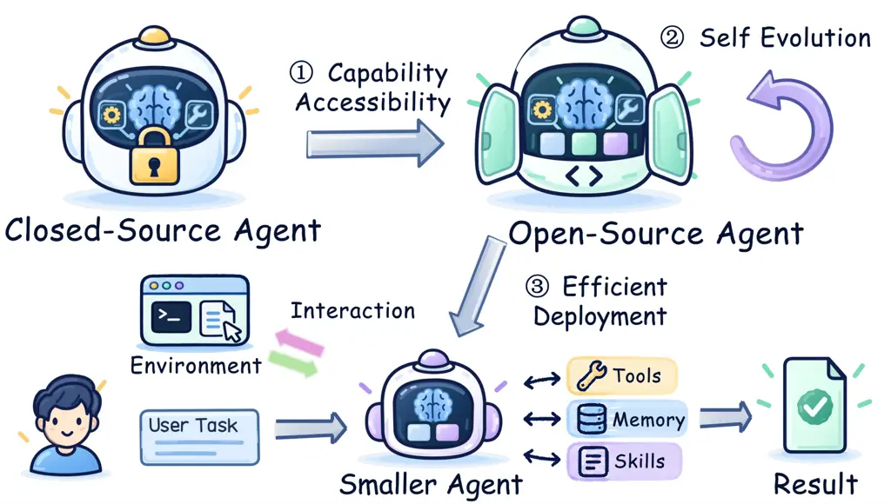
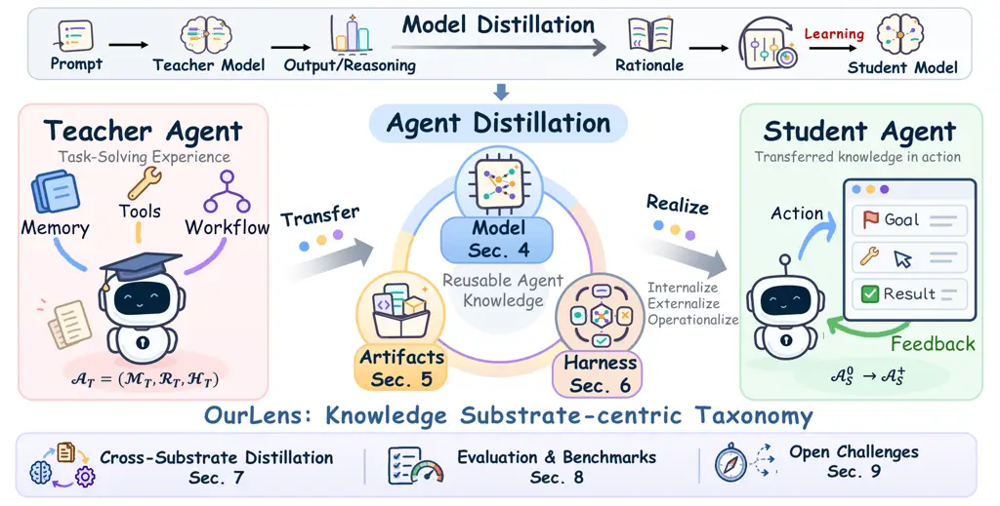
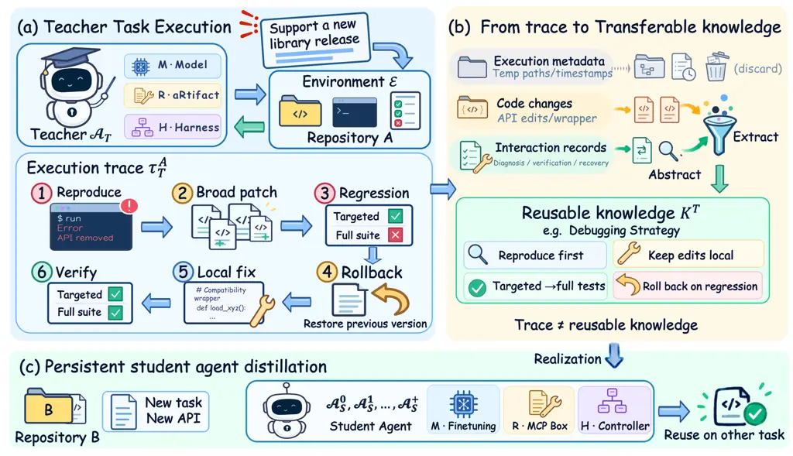
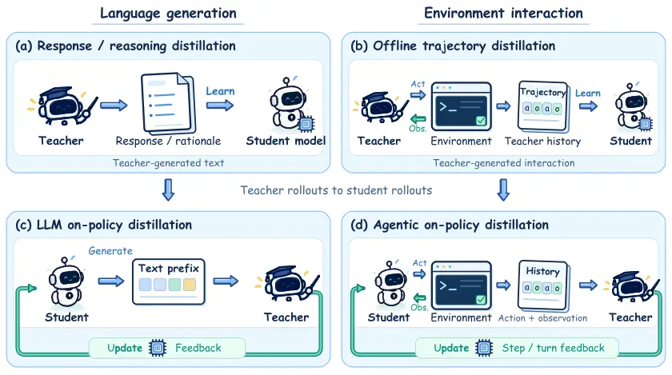
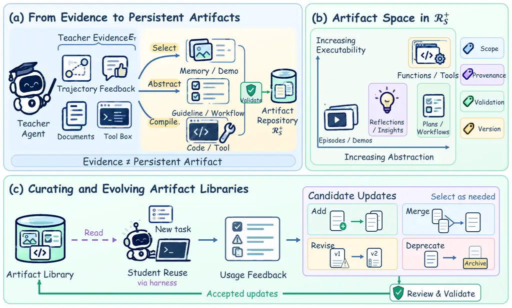

\correspondingauthor

\correspondingauthor

# A Comprehensive Survey of Agent Distillation across Models, Artifacts, and Harnesses

ISBN: 978-1-4503-XXXX-X/2018/06CCS: General and reference Surveys and
overviewsCCS: Computing methodologies Artificial intelligence

Ziluowen Luo
[](https://orcid.org/0009-0002-2817-673X)
Affiliation: Central South University, China email: <lzlwddl@csu.edu.cn>
, Senzhang Wang
[](https://orcid.org/0000-0002-3615-4859)
Affiliation: Central South University, China email: <szwang@csu.edu.cn>
, Chaozhuo Li
[](https://orcid.org/0000-0002-8179-7503)
Affiliation: Beijing Academy of Artificial Intelligence, China email:
<lichaozhuo@bupt.edu.cn> , Jun Yin
[](https://orcid.org/0009-0004-6714-3476)
Affiliation: Hong Kong Polytechnic University, China email:
<Junmay.yin@connect.polyu.hk> , Hao Yan
[](https://orcid.org/0009-0007-7631-9375)
Affiliation: Central South University, China email:
<csuyh1999@csu.edu.cn> , Ming Cheng
[](https://orcid.org/0009-0003-8873-3021)
Affiliation: Central South University, China email:
<chengming@csu.edu.cn> , Chenxu Wang
[](https://orcid.org/0009-0007-5013-1972)
Affiliation: Beijing University of Posts and Telecommunications, China
email: <chenxuwang@bupt.edu.cn> , Songyang Liu
[](https://orcid.org/0009-0003-9592-8046)
Affiliation: Beijing University of Posts and Telecommunications, China
email: <liusyang@bupt.edu.cn> , Litian Zhang
[](https://orcid.org/0000-0002-6981-3873)
Affiliation: Beijing University of Posts and Telecommunications, China
email: <litianzhang@bupt.edu.cn> , Qiwei Ye
[](https://orcid.org/0000-0003-4264-5846)
Affiliation: Beijing Academy of Artificial Intelligence, China email:
<qwye@baai.ac.cn> , Zheng Liu
[](https://orcid.org/0000-0001-7765-8466)
Affiliation: Beijing Academy of Artificial Intelligence, China email:
<zhengliu1026@gmail.com> , Chengqi Zhang
[](https://orcid.org/0000-0001-5715-7154)
Affiliation: Hong Kong Polytechnic University, China email:
<chengqi.zhang@polyu.edu.hk> and Philip S. Yu
[](https://orcid.org/0000-0002-3491-5968)
Affiliation: University of Illinois at Chicago, USA email:
<psyu@uic.edu>

© none

###### Abstract.

Knowledge distillation provides a teacher–student framework for
transferring capabilities at reduced cost and has been widely studied
for large language models (LLMs). As LLM-based agents move from response
generation to sustained, closed-loop task solving, distillation expands
beyond model parameters to knowledge retained in reusable resources and
execution workflows. This shift from model-level to agent-level
knowledge transfer supports efficient deployment, broader capability
access, and continual self-evolution. However, existing surveys largely
examine model distillation and agent system design separately, limiting
comparison of transfer strategies across agent components. To bridge
this gap, we formalize Agent Distillation as persistent knowledge
transfer between teacher and student agents and present its first
unified survey. Distinguishing experience used for transfer from
knowledge retained for reuse, we develop a knowledge-substrate taxonomy
based on where knowledge persists: models, artifacts, or harnesses.
Building on this taxonomy, we analyze cross-substrate transfer paths and
hybrid strategies. To assess the resulting capabilities, we review
benchmarks and evaluation protocols for retention, causal attribution,
and deployed utility without further teacher support. This survey
provides a unified basis for studying agent knowledge transfer and
developing efficient, adaptable, and self-evolving agents.

###### Keywords: 

Large language model, LLM-based Agent, Knowledge Distillation

^(†)^(†)authorsaddresses: Authors’ Contact Information: Ziluowen Luo
(lzlwddl@csu.edu.cn), Senzhang Wang (szwang@csu.edu.cn), Hao Yan
(csuyh1999@csu.edu.cn), and Ming Cheng (chengming@csu.edu.cn), Central
South University, Changsha, Hunan, China; Chaozhuo Li
(lichaozhuo@bupt.edu.cn), Qiwei Ye (qwye@baai.ac.cn), and Zheng Liu
(zhengliu1026@gmail.com), Beijing Academy of Artificial Intelligence,
Beijing, China; Jun Yin (Junmay.yin@connect.polyu.hk) and Chengqi Zhang
(chengqi.zhang@polyu.edu.hk), Hong Kong Polytechnic University, Hong
Kong, China; Chenxu Wang (chenxuwang@bupt.edu.cn), Songyang Liu
(liusyang@bupt.edu.cn), and Litian Zhang (litianzhang@bupt.edu.cn),
Beijing University of Posts and Telecommunications, Beijing, China;
Philip S. Yu (psyu@uic.edu), University of Illinois at Chicago, Chicago,
Illinois, USA

## 1. Introduction

Large language model (LLM)-based agents extend language models from
response generators into systems capable of sustained task solving and
interaction with external environments (Schick et al., 2023). During
execution, an agent reasons over its current state, takes actions
through tools or other artifacts, observes the resulting feedback, and
revises its subsequent decisions (Kang et al., 2025; Yao et al., 2026).
This transition toward sustained, closed-loop interaction characterizes
a broad range of agentic systems, including prominent coding agents
(e.g., OpenAI Codex (OpenAI, 2026), Anthropic Claude Code (Anthropic, 2026) and OpenClaw (OpenClaw Contributors, 2026)), web agents (Zhou et
al., 2024; Jimenez et al., 2024) and general-purpose agents (Wang et
al., 2024b; Xi et al., 2023). Consequently, the competence underlying
successful task solving is increasingly expressed through the execution
process rather than through individual model responses alone.

However, the knowledge supporting such competence is often coupled to
the particular agent realization and task-solving context in which it
emerges (Shang et al., 2025; Zhuge et al., 2024). The knowledge
underlying a successful execution may remain distributed across model
behavior, accumulated artifacts and runtime decisions. Consequently,
another agent may need to rediscover similar strategies at substantial
cost through repeated reasoning and interaction. This raises a broader
question: _how can task-solving knowledge acquired by one agent be
incorporated into another and retained for future use?_

### 1.1. Motivation: From Model Distillation to Agent Distillation

Although knowledge distillation offers a natural teacher–student
framework for addressing this question, existing formulations operate
primarily at the model level: both the teacher and student are treated
as models, with the transferred knowledge ultimately absorbed into the
parameters of the student (Hinton et al., 2015; Gou et al., 2021). For
agentic task solving, the unit of transfer expands from the model to the
complete agent realization. Accordingly, distillation broadens from
model-to-model to agent-to-agent knowledge transfer, with the aim of
turning teacher experience into reusable student capabilities.



Figure 1. From a successful agent to broader reuse of task-solving
knowledge.

As illustrated in Figure 1, such knowledge reuse serves three
complementary needs, extending the role of distillation beyond model
compression. It retains the familiar goal of efficient deployment:
knowledge from a high-capability teacher guides a compact student toward
comparable task-solving competence at a lower deployment cost. Beyond
efficiency, it expands _capability accessibility_ by incorporating
knowledge revealed through a closed-source teacher’s behavior into an
open-source student without accessing the internal of the
teacher (Mukherjee et al., 2023; Zhang et al., 2024b). More
distinctively, agent-level distillation supports self-evolution. By
incorporating knowledge from prior experience into successive
realizations, an agent converts isolated task-solving episodes into
continual improvement (SIMA team et al., 2025; Zhang et al., 2026b).
Together, these needs highlight the broader role of teacher–student
transfer in reusing knowledge and improving agent competence.

In this work, we use Agent Distillation to denote the persistent
incorporation of teacher-derived task-solving knowledge into a student
agent, with the aim of improving the student’s competence. Such
knowledge may be incorporated into different substrates of the student
realization rather than into model parameters alone. This broader view
motivates a systematic investigation of agent-centered distillation
beyond conventional model-centered distillation.

|                                             |      |                   |                    |          |         |                  |                     |
| ------------------------------------------- | ---- | ----------------- | ------------------ | -------- | ------- | ---------------- | ------------------- |
| Survey                                      | Year | T$`\rightarrow`$S | Substrate Coverage |          |         | Cross- Substrate | Transfer Evaluation |
|                                             |      |                   | Model              | Artifact | Harness |                  |                     |
| Distillation-related Surveys                |      |                   |                    |          |         |                  |                     |
| Gou et al. (Gou et al., 2021)               | 2021 | ✓                 | ✓                  | ✗        | ✗       | ✗                | ⚫                  |
| Xu et al. (Xu et al., 2024)                 | 2024 | ✓                 | ✓                  | ✗        | ✗       | ✗                | ⚫                  |
| Yang et al. (Yang et al., 2025)             | 2025 | ✓                 | ✓                  | ✗        | ✗       | ✗                | ✓                   |
| Mansourian et al. (Mansourian et al., 2025) | 2025 | ✓                 | ✓                  | ✗        | ✗       | ✗                | ⚫                  |
| Agent-related Surveys                       |      |                   |                    |          |         |                  |                     |
| Wang et al. (Wang et al., 2024b)            | 2024 | ✗                 | ✓                  | ⚫       | ⚫      | ✗                | ✗                   |
| Zhang et al. (Zhang et al., 2025b)          | 2025 | ✗                 | ⚫                 | ✓        | ⚫      | ✗                | ✗                   |
| Guo et al. (Guo et al., 2024)               | 2024 | ✗                 | ⚫                 | ⚫       | ✓       | ✗                | ✗                   |
| Xu et al. (Xu et al., 2025)                 | 2025 | ✗                 | ✓                  | ✗        | ✓       | ✗                | ✗                   |
| Gao et al. (Gao et al., 2026)               | 2026 | ✗                 | ✓                  | ✓        | ✓       | ⚫               | ✗                   |
| Guo et al. (Guo et al., 2026)               | 2026 | ✗                 | ✓                  | ⚫       | ✓       | ⚫               | ✗                   |
| Ours                                        | 2027 | ✓                 | ✓                  | ✓        | ✓       | ✓                | ✓                   |

Table 1. Comparison with representative surveys from the distillation
and agent literatures. ✓ denotes systematic treatment as a primary
organizing perspective, ⚫ denotes partial treatment, and ✗ indicates
that the aspect is outside the scope of the survey.

### 1.2. Comparison with Existing Surveys

Model-Centered Distillation. Existing surveys provide a well-established
account of teacher-student knowledge transfer. Classical surveys
organize this literature around the forms of transferred knowledge,
distillation objectives, teacher–student architectures, and training
strategies (Gou et al., 2021). With the rise of large language models,
recent surveys further broaden this scope to generated supervision,
reasoning traces, instruction data, preference signals, and evaluation
protocols (Xu et al., 2024; Yang et al., 2025). These studies therefore
offer a rich view of _what_ knowledge can be extracted from a teacher
and _how_ it can be incorporated into a student. Their organizing
perspective, however, remains predominantly _model-centered_: the
student model serves as both the primary recipient of distilled
knowledge and the basic unit of evaluation.

System-Centered Agent Research. Agent-related surveys provide a
complementary _system-centered_ perspective. They examine agentic
behavior from a system perspective, focusing on how agent components
jointly support task execution (Wang et al., 2024b; Xi et al., 2023).
Research along this line covers planning and tool learning (Huang et
al., 2024; Xu et al., 2025), memory and multi-agent coordination (Zhang
et al., 2025b; Guo et al., 2024), and agent evaluation (Liu et al.,
2024; Yehudai et al., 2025). More recent harness-oriented work further
shifts attention toward workflows and dynamic execution process,
emphasizing how models, tools, memory, control logic, and execution
structures are composed into effective agent systems (Guo et al., 2026).
Collectively, these surveys provide an increasingly comprehensive
account of how agentic competence is constructed, organized, and
evaluated at the system level. Their primary concern, however, is not
the persistent transfer of task-solving knowledge through a
teacher–student relation.

The Missing Bridge. Taken together, these two bodies of literature
reveal a clear gap: a unified study for agent-level teacher–student
knowledge transfer is still missing. Distillation surveys are
transfer-centric but predominantly model-centered, whereas agent surveys
are system-centered but do not organize the literature around how
knowledge is transferred into and retained by a complete student agent.
Furthermore, table 1 summarizes this distinction and positions our
survey at the intersection of these two bodies of literature.



Figure 2. From model-centered to agent-centered knowledge transfer.
Agent Distillation treats the complete agent realization as the unit of
teacher–student transfer. Our knowledge substrate-centric view organizes
existing approaches according to the primary form in which transferred
knowledge persists in the student: the parametric _model_, reusable
_artifacts_ or the execution _harness_.

### 1.3. Our Perspective and Contributions

To address this gap, we adopt a knowledge substrate centric perspective
on Agent Distillation. Our central question is where and in what
persistent form teacher-derived task-solving knowledge becomes available
to the student. We use _knowledge substrate_ to denote the persistent
carrier within an agent realization through which such knowledge is
encoded, retained and made available to future. A substrate is
characterized jointly by how the knowledge is encoded and how it
participates in future agent execution. This perspective provides a
common basis for analyzing knowledge that is internalized in learned
computation, externalized as reusable objects or operationalized through
execution logic.

Under this view, we distinguish three principal knowledge substrates.
Parametric models ($`\mathcal{M}`$) retain knowledge in learned
computation that directly shapes inference or reasoning. Reusable
artifacts ($`\mathcal{R}`$) preserve knowledge as independently
addressable objects, such as memories, skills, and tools, that can be
retrieved or invoked across episodes. Execution harnesses
($`\mathcal{H}`$) encode knowledge in the procedures and control
structures that organize execution, including routing, verification,
recovery, and orchestration. These substrates form our taxonomy, which
organizes methods by where teacher-derived knowledge primarily persists
in the student. Building on this taxonomy, we further review transfer
mechanisms, cross-substrate paths, and evaluation principles, leading to
the following main contributions:

1.  (1)
    Definition and Scope. To the best of our knowledge, we establish the
    first unified definition of Agent Distillation at the agent level,
    centered on persistent teacher-derived knowledge incorporation and
    briefly clarify its scope.
2.  (2)
    Knowledge-Substrate Taxonomy. We develop a substrate-centered
    taxonomy that organizes existing approaches according to the primary
    substrate in which knowledge form persists after transfer: models,
    artifacts or harnesses.
3.  (3)
    Cross-Substrate Transfer. Beyond the three primary branches, we
    analyze how agent knowledge can migrate across substrates and how
    multiple substrates can be combined within hybrid distillation
    strategies.
4.  (4)
    Evaluation and Research Frontiers. We investigate how to assess
    knowledge retention, causal contribution, and deployed utility and
    identify open challenges and research priorities for advancing
    reusable agent capabilities.

The remainder of this survey is organized as follows. § 2 establishes
the agent formulation, defines Agent Distillation and its scope, and
describes our survey methodology. § 3 introduces the knowledge-substrate
taxonomy used to organize the literature. § 4 reviews knowledge
internalization in parametric models, § 5 externalization as reusable
artifacts, and § 6 operationalization through execution harnesses. § 7
analyzes cross-substrate transfer paths and hybrid realizations that
retain knowledge in multiple student components. § 8 reviews evaluation
protocols and benchmarks for retention, causal contribution, and
deployed utility. Finally, § 9 discusses open challenges and future
directions in attribution, adaptation, and knowledge maintenance, and
§ 10 concludes the survey.

## 2. Foundations and Scope of Agent Distillation

To establish a common architectural foundation, this section clarifies
what constitutes Agent Distillation and delineates its scope. In the
following, we first introduce the basic concepts of agentic task solving
and system realization (§ 2.1), followed by a running example that
traces the progression from teacher execution to persistent student
realization (§ 2.2). Building on these foundations, we then formalize
Agent Distillation and clarify its boundaries (§ 2.3), and systematize
the literature collection and analysis methodology in our investigation
(§ 2.4).

### 2.1. Agent Realizations and Task Solving

Consistent with prior work, we view an agent as a goal-directed system
that repeatedly observes and acts within an environment to accomplish a
task (Russell and Norvig, 2020). Recent work on LLM-based agents extends
this interaction-centered view by incorporating reasoning, planning,
memory, tool use, and runtime control (Yao et al., 2023; Wang et al.,
2024b; Sumers et al., 2024). Prior studies further show that agent
behavior can change substantially with the dynamic harness even when the
underlying model remains fixed (Yang et al., 2024; Kapoor et al., 2025).
We therefore take the system as the basic unit of Agent Distillation and
refer to it as an _agent realization_:

```math
\mathcal{A}=(\mathcal{M},\mathcal{R},\mathcal{H}), \tag{1}
```

where $`\mathcal{M}`$, $`\mathcal{R}`$, and $`\mathcal{H}`$ denote its
parametric Model, reusable aRtifacts and execution Harness,
respectively.

#### Agent Components.

The three components capture complementary aspects of an agent. The
model component $`\mathcal{M}`$ comprises the parametric models that
generate reasoning, decisions, or action proposals. The artifacts
component $`\mathcal{R}`$ comprises reusable objects external to
$`\mathcal{M}`$ that can be retrieved, interpreted, or invoked across
episodes, such as memories, demonstrations, instructions, skill
descriptions, and programs. The harness $`\mathcal{H}`$ comprises the
runtime mechanisms that assemble context, coordinate models, invoke
tools and control workflows, including verification, retry, and
recovery. This functional decomposition need not correspond to
architecturally or physically separate modules.

#### Task and Agent–Environment Interaction.

To characterize the capability of an agent realization, we specify both
the task it seeks to accomplish and the environment with which it
interacts. Let $`q\sim\mathcal{P}`$ denote a concrete task instance
drawn from a task distribution $`\mathcal{P}`$, where $`q`$ specifies
the objective, task constraints and criteria for successful completion.
To pursue $`q`$, an agent realization $`\mathcal{A}`$ interacts with a
stateful environment $`\mathcal{E}`$, whose state at step $`t`$ is
denoted by $`e_{t}`$. Thus, $`q`$ specifies _what_ the agent should
achieve, whereas $`\mathcal{E}`$ supplies the external state, dynamics,
and feedback under which that objective is pursued. Given the
interaction setting $`(\mathcal{A},q,\mathcal{E})`$, the interaction
begins from an initial environment state $`e_{0}`$, from which
$`\mathcal{E}`$ exposes an initial observation $`o_{0}`$ to
$`\mathcal{A}`$. At step $`t`$, the agent need not observe the complete
state $`e_{t}`$; instead, it conditions its next action on the task and
the observable interaction history:

```math
h_{t}=\left(q,o_{0},a_{0},o_{1},\ldots,a_{t-1},o_{t}\right), \tag{2}
```

where $`o_{i}`$ is the observation available before the agent acts at
step $`i`$, and $`a_{i}`$ is the action selected in response.
Conditioned on $`h_{t}`$, the realization induces an action policy
$`\pi_{\mathcal{A}}`$, while the environment evolves according to a
transition function $`\mathcal{T}_{\mathcal{E}}`$:

```math
a_{t}\sim\pi_{\mathcal{A}}(\cdot\mid h_{t}),\qquad(e_{t+1},o_{t+1})\sim\mathcal{T}_{\mathcal{E}}(\cdot\mid e_{t},a_{t}). \tag{3}
```

The policy $`\pi_{\mathcal{A}}`$ reflects the joint contribution of
$`\mathcal{M}`$, $`\mathcal{R}`$, and $`\mathcal{H}`$ to the agent-side
decision, whereas $`\mathcal{T}_{\mathcal{E}}`$ captures how the
environment converts that decision into a state transition and a new
observation. Both mappings may also be stochastic. The action $`a_{t}`$
and the resulting observation $`o_{t+1}`$ extend $`h_{t}`$ to
$`h_{t+1}`$, providing the context for the next interaction step.
Furthermore, repeating this decision–transition cycle produces the
task-solving episode characterized next.

#### Execution Episode and Trace.

A task-solving episode comprises a finite sequence of interactions that
begins with $`o_{0}`$ and terminates at step $`L`$ upon task completion,
failure, or exhaustion of the available resource budget. Because agent
actions may modify the environment in ways that are not fully
represented by subsequent observations, we record the environmental
change associated with each transition as

```math
\Delta e_{t+1}=\operatorname{Diff}_{\mathcal{E}}\left(e_{t},e_{t+1}\right), \tag{4}
```

where $`\operatorname{Diff}_{\mathcal{E}}`$ is a domain-specific
comparison operator for environment states rather than numerical
subtraction. Let $`B`$ denote the resource budget available to the agent
and we then represent the episode by the execution trace

```math
\tau(\mathcal{A},q,\mathcal{E};B)=\left(o_{0},\left(a_{t},o_{t+1},\Delta e_{t+1}\right)_{t=0}^{L-1}\right). \tag{5}
```

The trace records the actions taken, received observations and
environmental changes produced during one execution. It therefore
describes what occurred in a particular episode, but not how the agent
performs across tasks and executions.

#### Agentic Competence.

Agentic competence lifts this episode-level view to the expected
task-solving performance of a complete agent realization across a task
distribution. Let $`B`$ denote the resource budget available for an
episode, and write $`\tau(\mathcal{A},q,\mathcal{E};B)`$ for the trace
generated under that budget. Given a utility function $`u(q,\tau)`$ that
evaluates a trace with respect to its task, we operationalize agentic
competence as:

```math
\operatorname{Comp}\left(\mathcal{A};\mathcal{P},\mathcal{E},B\right)=\mathbb{E}_{q\sim\mathcal{P}}\left[u\left(q,\tau(\mathcal{A},q,\mathcal{E};B)\right)\right]. \tag{6}
```

Here, $`u`$ account for task success and resource efficiency. For
stochastic agents or environments, the expectation may additionally be
estimated over repeated executions. Moreover, competence is a property
of the complete realization under $`(\mathcal{P},\mathcal{E},B)`$, not
an object contained in any individual trace. Individual traces provide
episode-level evidence of competence, but they are neither competence
itself nor automatically reusable knowledge. This distinction allows
teacher and student to be defined by their roles in a transfer process
rather than by any particular output or trajectory.

### 2.2. A Running Example of Agent Distillation

To ground the preceding concepts in a concrete process, we use a
software maintenance task as a running example to provide more
intuitions. Consider a teacher coding agent
$`\mathcal{A}_{T}=(\mathcal{M}_{T},\mathcal{R}_{T},\mathcal{H}_{T})`$
assigned a source task $`q_{A}`$ in Repository A. The task is to support
a new release of a third-party library while preserving the repository’s
intended behavior intended behavior and passing the full test suite. The
corresponding environment $`\mathcal{E}_{A}`$ contains the repository
state, installed dependencies, and test infrastructure. Through its
available tools, the teacher can inspect files, execute commands, modify
code or dependencies, and run tests. Under a budget $`B_{T}`$, this
whole interaction produces the execution trace:

```math
\tau_{T}^{A}=\tau\left(\mathcal{A}_{T},q_{A},\mathcal{E}_{A};B_{T}\right). \tag{7}
```

Figure 3 follows this example from teacher execution, through knowledge
extraction and transformation to persistent student agent realization
and reuse. The teacher completes $`q_{A}`$ through the six-step process
illustrated in Figure 3(a).



Figure 3. A running example of Agent Distillation. (a) A teacher coding
agent repairs a repository by recovering from an over-broad patch and
verifying localized fix. (b) The trace mixes incidental residue,
task-specific information and reusable patterns; filtering and
abstraction turn selected evidence into a debugging strategy. (c) Then
it is realized in student agents and reused on other tasks.


#### From trace to transferable knowledge

The actions, observations, and environmental changes produced during the
six steps form the teacher agent execution trace $`\tau_{T}^{A}`$. In
this example, the trace serves as a teacher-side source from which
transferable knowledge can be derived, as illustrated in Figure 3(b).
The trace contains incidental metadata, task-specific code changes, and
interaction records that capture diagnosis, verification, and recovery.
Selection removes transient or irrelevant residue, while abstraction
separates reusable problem-solving principles from repository-specific
details. The resulting transferable knowledge, denoted by $`K_{T}`$,
takes the form of a debugging strategy: reproduce the failure first,
keep edits local, proceed from targeted to full-suite testing, and roll
back when a regression is detected.

For this knowledge to constitute Agent Distillation, it must be
persistently realized in the student agent. Starting from
$`\mathcal{A}_{S}^{0}`$, the debugging strategy may be internalized in
$`\mathcal{M}_{S}`$ as a learned policy, externalized in
$`\mathcal{R}_{S}`$ as a reusable skill or script, operationalized in
$`\mathcal{H}_{S}`$ as a workflow controller, or realized jointly across
multiple components. These alternatives produce an updated realization
$`\mathcal{A}_{S}^{+}`$ that retains the teacher-derived knowledge
beyond the source episode.

Figure 3(c) illustrates this persistence by assigning
$`\mathcal{A}_{S}^{+}`$ a new task $`q_{B}`$ in Repository B, whose
files and failing API differ from those in Repository A. Although the
original patch cannot be replayed, the student can reuse the knowledge
(e.g., debugging strategy, evolving policy, and so on) to reproduce the
failure, localize the repair, verify the result, and roll back if a
regression occurs. This example distinguishes the reuse of transferable
knowledge from the reproduction of a task-specific solution. Section 2.3
then expands this trace-based example into a broader definition of Agent
Distillation.

### 2.3. Agent Distillation: Definition and Scope

Building on the running example, we now formalize Agent Distillation at
the level of teacher and student agent realizations. In this setting,
the _teacher_ denotes the realization from which task-solving knowledge
is derived, whereas the _student_ denotes the realization into which
that knowledge is persistently incorporated. We then use
$`\mathcal{A}_{T}`$ to denote the teacher, $`\mathcal{A}_{S}^{0}`$ the
student state before distillation and $`\mathcal{A}_{S}^{+}`$ the
student states after distillation. This view covers transfer between
different agents, self-evolution through the reuse of prior experience,
and learning from multiple teachers.

#### Teacher Knowledge.

We use $`K_{T}`$ to denote the task-solving knowledge derived from
evidence produced by the teacher. In Figure 3(b), $`K_{T}`$ consists of
the reusable debugging principles abstracted from the teacher execution
trace $`\tau_{T}^{A}`$. More generally, the knowledge $`K_{T}`$ may
originate from individual components of the teacher realization or from
their joint execution. At the model level, it may be expressed through
generated outputs, rationales, distributions, or internal
representations. In artifacts, it may be encoded in the contents of
reusable resources, while in the harness, it may be captured by workflow
and control structures. Moreover, the joint execution may further reveal
procedural knowledge through actions, observations, feedback, and
environment changes. Regardless of how it is expressed, agent
distillation requires the knowledge $`K_{T}`$ from the teacher agent to
be persistently incorporated into the student agent realization.

#### Student Realization.

The persistent incorporation of $`K_{T}`$ transforms the student from
its initial realization $`\mathcal{A}_{S}^{0}`$ into an updated
realization $`\mathcal{A}_{S}^{+}`$. Let $`\mathcal{Z}_{S}`$ denote the
nonempty set of student components modified through distillation:

```math
\mathcal{A}_{S}^{0}\ \xrightarrow[\mathcal{Z}_{S}]{K_{T}}\ \mathcal{A}_{S}^{+},\qquad\varnothing\neq\mathcal{Z}_{S}\subseteq\left\{\mathcal{M}_{S},\mathcal{R}_{S},\mathcal{H}_{S}\right\}. \tag{8}
```

Depending on $`\mathcal{Z}_{S}`$, $`K_{T}`$ may be incorporated into the
student’s parameters or learned policy through $`\mathcal{M}_{S}`$,
retained as reusable artifacts in $`\mathcal{R}_{S}`$, or embedded into
workflow and control structures through $`\mathcal{H}_{S}`$. These
realizations are not mutually exclusive where $`K_{T}`$ can span
multiple components, yielding a hybrid realization in which the model,
artifacts, and harness jointly encode and enact the distilled knowledge.
Persistence requires these changes to remain available to the student in
subsequent episodes rather than being supplied only transiently within
the source interaction.

#### Definition (Agent Distillation).

Given the teacher $`\mathcal{A}_{T}`$ and an initial student
$`\mathcal{A}_{S}^{0}`$, we define _Agent Distillation_ as the process
of persistently incorporating teacher knowledge $`K_{T}`$ into the
components of student, thereby producing an updated realization
$`\mathcal{A}_{S}^{+}`$ that can reuse this knowledge to improve the
agentic competence on the subsequent tasks. Inspired by the information
bottleneck principle (Tishby et al., 2000), we characterize this
objective from two complementary perspectives: _sufficiency_ and
_minimality_. Sufficiency requires $`K_{T}`$ to retain the
teacher-derived experience that contributes to the student’s competence,
whereas minimality favors excluding information that does not contribute
to this outcome. Together, these considerations cast Agent Distillation
as identifying the least complex teacher-derived knowledge that is
sufficient to attain the best achievable student competence:

```math
K_{T}^{\star}=\operatorname*{arg\,max}_{K_{T}}\left[\operatorname{Comp}\left(\mathcal{A}_{S}^{+}(K_{T})\right)\ -\ \mathcal{C}_{K}\left(K_{T}\right)\right], \tag{9}
```

where the target task setting in $`\operatorname{Comp}`$ is omitted for
brevity. The competence term captures the sufficiency of $`K_{T}`$,
while $`\mathcal{C}_{K}(K_{T})`$ measures its information complexity and
encourages minimality. Accordingly, $`K_{T}^{\star}`$ represents the
minimal sufficient teacher-derived knowledge for improving the
competence of the persistently updated student realization.

#### Operational Scope.

A process falls within the scope of Agent Distillation when three
conditions are satisfied. First, an identifiable teacher agent provides
the evidence from which task-solving knowledge is derived. The teacher
may be a different agent, multiple agents, or the same agent in a
self-evolution setting. Second, the process derives transferable
task-solving knowledge $`K_{T}`$ from this evidence. Third, the
knowledge $`K_{T}`$ is persistently incorporated into the student and
remains available to influence future episodes after access to the
teacher or source interaction has been removed.

Specifically, in-context learning (Brown et al., 2020), inference-time
consultation (Madaan et al., 2023), and multi-agent collaboration (Li et
al., 2023a; Wu et al., 2024) do not constitute Agent Distillation when
their effects end with the current episode. If such interactions produce
a persistent change in the student, they may serve as mechanisms for
agent distillation. Feedback-driven adaptation that affects only the
current episode and leaves no persistent change in the agent falls
outside Agent Distillation (Yao et al., 2023; Madaan et al., 2023). In
contrast, self-evolution falls within our scope when prior experience
serves as teacher-side evidence from which the same agent derives
reusable knowledge and retains it for future episodes (Shinn et al.,
2023; Zhao et al., 2024; Wang et al., 2024a). Within these boundaries,
agent distillation is agnostic to both the form of distilled
task-solving knowledge and the realization of the teacher and the
student.

### 2.4. Survey Methodology

To construct the literature corpus, we adopted a definition-guided
collection process rather than relying solely on the term _Agent
Distillation_, which has not yet been used consistently across research
communities. We searched the ACM Digital Library, IEEE Xplore, Scopus,
ACL Anthology and supplemented these sources with arXiv and OpenReview
to capture recent studies available through August 31, 2026. Search
queries combined terms related to agent learning, knowledge
distillation, experience reuse, memory, tools, skills and workflow
optimization. We further used Semantic Scholar and Google Scholar for
backward and forward citation tracing. Guided by the definition in
Section 2.3, we included as core literature studies in which teacher
knowledge is persistently incorporated into $`\mathcal{M}_{S}`$,
$`\mathcal{R}_{S}`$ or $`\mathcal{H}_{S}`$. Studies on transient
prompting and inference-time collaboration were retained as contextual
literature but were not treated as instances of agent distillation. We
then coded each core study according to its teacher–student
configuration, knowledge form, updated agent components, distillation
mechanism and evaluation setting. The recurring patterns identified
through this process provide the empirical basis for the taxonomy
developed in the following section.

## 3. Our Lens: A Knowledge Substrate-Centric Taxonomy

Building on the definition of Agent Distillation in Section 2, the
central taxonomic question is where and in what persistent form
teacher-derived task-solving knowledge is retained for future use. We
use _knowledge substrate_ to denote the persistent carrier within an
agent realization through which such knowledge is encoded, retained, and
made available to future episodes. Each substrate combines a mode of
knowledge retention with a functional locus in the agent: learned model
computation for parametric knowledge, independently addressable objects
for artifact knowledge, and execution or control logic for harness
knowledge. For organizational purposes, we then classify each method
according to the primary substrate in which the student retains the
transferred knowledge after distillation.

Table 2 summarizes the representative forms and functional roles of
these three substrates, corresponding to three complementary modes of
_internalization_, _externalization_, and _operationalization_. The
listed forms are illustrative: substrate membership is determined by how
the retained knowledge participates in future task solving, rather than
by its physical format or the mechanism used to obtain it. Accordingly,
an adapter stored as a separate file remains parametric, a callable
script constitutes an artifact, and the logic controlling its invocation
belongs to the harness. Teacher outputs, rationales, and execution
traces provide evidence for distillation, while fine-tuning, memory
construction, and workflow induction describe transfer mechanisms. The
same evidence may therefore support different forms of distillation,
depending on where and how the resulting knowledge persists in the
student.

Figure 4. Timeline of representative literature on Agent Distillation
across model, artifact, and harness knowledge.

Figure 4 situates representative literature within this taxonomy and
traces its development along the three branches. In the model branch,
the literature expands from response and reasoning distillation to
learning from interaction trajectories and supervising student-induced
histories. The artifact branch connects the extraction of reusable
memories, procedures, and tools with the curation and evolution of the
resulting libraries. The harness branch places workflow construction and
multi-agent orchestration alongside emerging efforts to distill
execution and control logic. Solid boxes identify transfer cases within
our operational scope, while dashed boxes mark foundational or adjacent
studies that inform the surveyed mechanisms. This distinction preserves
the connection to neighboring research while keeping persistent
teacher–student knowledge transfer as the criterion for inclusion as
Agent Distillation.

The three substrates define the principal forms of distilled knowledge,
but a transfer process need not remain within a single substrate. We use
_cross-substrate transfer_ to describe the transformation of knowledge
from one substrate form into another and _hybrid realization_ to
describe an outcome in which distilled knowledge is jointly retained
across multiple substrates. The former characterizes the transfer path,
whereas the latter characterizes the organization of knowledge in the
resulting student. We first examine parametric, artifact and harness
distillation in Sections 4–6, and then return to the cross-substrate
transfer and the hybrid realization in Section 7.

| Substrate | Embodiment                | Representative forms                                                | Role in future task solving                                      |
| --------- | ------------------------- | ------------------------------------------------------------------- | ---------------------------------------------------------------- |
| Model     | Learned model computation | Parameters, adapters, internal representations, learned policies    | Internalizes knowledge to directly shape inference and decisions |
| Artifact  | Explicit reusable objects | Memories, demonstrations, plans, code, skills, and tools            | Externalizes knowledge for retrieval and reuse across episodes   |
| Harness   | Dynamic execution logic   | Workflows, routing, verification, recovery, and orchestration logic | Operationalizes knowledge by organizing and regulating execution |

Table 2. Principal knowledge substrates in Agent Distillation and their
roles in future task solving.

## 4. Internalizing Agent Knowledge in Parametric Models

In this section, we examine how the student agent internalizes
teacher-derived task-solving knowledge in its parametric models. During
task execution, the agent may use LLMs, vision–language models
(VLMs) (Driess et al., 2023; Hong et al., 2024), or
vision–language–action policies (VLAs) (Kim et al., 2024; Zitkovich et
al., 2023) to reason over observations or propose actions. Under the
decomposition introduced in Section 2, distillation updates the
student’s models from $`\mathcal{M}_{S}^{0}`$ to
$`\mathcal{M}_{S}^{+}`$, which the agent uses in subsequent episodes.
The central question within this branch is whose decisions shape the
histories on which teacher supervision is based. The student may learn
from teacher-generated histories or receive teacher feedback on
histories shaped by its own decisions. Student-induced histories can
expose deviations and recovery needs that successful teacher
demonstrations may omit. Figure 5 further illustrates this distinction
by showing who generates the response in a language task and whose
actions shape subsequent observations in an environment. We review
response and reasoning distillation (§ 4.1), offline trajectory
distillation (§ 4.2), and on-policy distillation for LLMs (§ 4.3) and
interactive agents (§ 4.4).

### 4.1. Response and Reasoning Distillation

Conventional knowledge distillation establishes the basis of parametric
transfer by training a student on information exposed by a teacher. Soft
output distributions convey predictive structure beyond hard
labels (Hinton et al., 2015), while sequence-level distillation
transfers teacher-generated sequences to an autoregressive student (Kim
and Rush, 2016). When teacher probabilities are unavailable, generated
responses provide a practical supervision interface: a closed teacher
answers an instruction collection, and an open or smaller student learns
from those responses through supervised fine-tuning. Instruction
distillation applies this approach to task-specialized students (Sun et
al., 2023). Its accessibility follows from requiring only generated
text, although the resulting supervision remains tied to the prompts and
teacher continuations represented.

Reasoning distillation enriches response supervision with intermediate
steps that expose how a solution is constructed. Orca uses explanation
traces to support learning from complex instructions (Mukherjee et al.,
2023), while Distilling Step-by-Step treats teacher rationales as an
additional prediction target (Hsieh et al., 2023). Related methods
transfer chain-of-thought demonstrations, reasoning decompositions, and
consistency-aware rationales (Magister et al., 2023; Shridhar et al.,
2023; Wang et al., 2023). These signals can teach reusable decomposition
and inference patterns, but their value depends on the quality of the
generated explanations and their compatibility with the student. A
rationale is a problem-specific textual account of reasoning, whose
correctness and faithfulness need to be considered alongside its
usefulness as a training target. Analyses of rationale selection and
mixing report non-uniform gains (Wadhwa et al., 2024; Li et al., 2024),
and stronger teacher reasoning can exceed the student’s learning
capacity (Li et al., 2025). Curriculum design and prefix alignment
further adapt supervision to student competence (Jiang et al., 2025; Liu
et al., 2026c). These language-distillation techniques provide
foundations for agent learning; interaction trajectories extend their
supervision to how a teacher acquires observations, chooses actions, and
responds to environmental consequences.



Figure 5. The progression of parametric distillation toward
environment-grounded agent policy learning. In the upper row, the
student learns from the teacher’s textual traces (a) or recorded
interaction trajectories (b). The downward arrows mark the shift to
on-policy distillation, where the teacher conditions its feedback on the
student’s own prefix (c) or its history of executions (d).

### 4.2. Offline Trajectory Distillation

An interaction trajectory records the reasoning, actions, and
observations through which a teacher solves a task. Using the notation
of Section 2, the trace $`\tau_{T}`$ exposes how decisions depend on
earlier observations and how their consequences shape subsequent
choices. Constructing a training corpus therefore involves both
collecting teacher executions and selecting the parts that provide
useful supervision. Outcome filtering identifies successful episodes,
while process-level checks can detect invalid calls, redundant steps, or
decisions that require repair. Failed attempts may also reveal useful
diagnosis and recovery behavior. Selecting only clean successes can
remove these behaviors from the corpus, while retaining a failed
decision together with its correction can expose how an agent identifies
and repairs a mistake. Exploration-based trajectory optimization
compares alternative executions (Song et al., 2024b), step-level
refinement repairs problematic decisions (Xiong et al., 2024), and
AgentRefine constructs refinement data to improve generalization beyond
narrow imitation of successful demonstrations (Fu et al., 2025).
Together, these approaches make trajectory quality a question of which
behavioral regularities the student can use on later tasks.

Given a curated teacher corpus $`\mathcal{D}_{T}=\{\tau_{T}^{(i)}\}`$,
the student learns to select decisions conditioned on the histories in
that corpus. Let $`\pi_{\theta}(a\mid h)`$ denote the conditional
decision distribution contributed by the student model within its
surrounding agent realization. A representative offline objective is

```math
\mathcal{L}_{\mathrm{traj}}(\theta)=-\mathbb{E}_{\tau_{T}\sim\mathcal{D}_{T}}\left[\sum_{t=0}^{L-1}w_{t}\log\pi_{\theta}(a_{t}^{T}\mid h_{t}^{T})\right], \tag{10}
```

where $`h_{t}^{T}`$ and $`a_{t}^{T}`$ are the teacher history and
decision, $`L`$ is the trajectory length, and $`w_{t}`$ optionally
weights decisions by validity, difficulty, or importance. Reasoning and
actions can be serialized for training, with observations supplied as
conditioning context and loss masks selecting the prediction targets.
FireAct instantiates this approach using ReAct-style trajectories
collected across tasks and prompting methods (Chen et al., 2023).
Combining trajectories from various prompting strategies exposes
alternative decompositions and action patterns, although the resulting
policy is still learned within the interfaces and observations
represented in the corpus. Such supervision couples reasoning with tool
use and observation-conditioned continuation, enabling the model to
learn decision patterns that were demonstrated by teacher.

Broader trajectory collections seek to make these patterns useful across
tasks and environments. AgentTuning combines interaction trajectories
with general instruction data (Zeng et al., 2024); AgentBank expands the
scale and heterogeneity of the interaction corpus (Song et al., 2024a);
and Agent-FLAN studies the composition and training choices needed to
use such data effectively (Chen et al., 2024b). Their shared concern is
whether the student learns planning, state tracking, and revision
patterns that extend beyond a particular task format. Tool-oriented
studies complement this emphasis by expanding the decisions represented
in the corpus. ToolLLM constructs instruction and solution trajectories
for selecting and invoking APIs (Qin et al., 2024), while distillation
with retrieval and code tools teaches smaller models when to consult
external knowledge or execute computation (Kang et al., 2025). This is
particularly relevant when a capacity-limited student must decide which
parts of a task to solve through learned reasoning and which to delegate
to available resources. Across these settings, coverage concerns both
the situations represented in the data and the actions available to the
learned policy.

Offline trajectory distillation separates teacher execution from student
training, allowing demonstrations to be filtered, rebalanced, and
reused. Its coverage remains constrained by the histories generated
during teacher execution. Critical-step selection (Chen et al., 2025),
structured decomposition (Liu et al., 2026b), and capacity-aligned
trajectory construction (Tang and Zhao, 2026) improve the relevance and
learnability of the supervision, but deployment exposes the student to
histories induced by its own decisions. An early deviation can lead to
an unfamiliar observation and further errors, even when the teacher
corpus contains many successful demonstrations. The resulting gap shifts
attention from collecting additional teacher trajectories to obtaining
teacher guidance on the histories the student actually visits.

### 4.3. LLM On-Policy Distillation

On-policy distillation (OPD) obtains teacher supervision on histories
generated by the current student, following the learner-state
supervision principle of interactive imitation learning (Ross et al.,
2011). For an autoregressive LLM, these histories consist of the task
input and the student’s generated prefixes. The student produces a
rollout, the teacher supplies feedback on the encountered prefixes, and
parameter updates incorporate that feedback. On-policy thus specifies
the source of the training histories; updates need not occur after each
generated token. When teacher token probabilities are available,
Generalized Knowledge Distillation provides a representative
formulation (Agarwal et al., 2024):

```math
\mathcal{L}_{\mathrm{OPD}}(\theta)=\mathbb{E}_{q\sim\mathcal{P},\,h_{t}\sim d_{\pi_{\theta}}(\cdot\mid q)}\left[D_{f}\!\left(\pi_{\theta}(\cdot\mid h_{t}),\pi_{T}(\cdot\mid h_{t})\right)\right], \tag{11}
```

where $`d_{\pi_{\theta}}(\cdot\mid q)`$ is the student-induced prefix
distribution for task $`q`$, $`\pi_{T}`$ supplies the teacher
distribution, and $`D_{f}`$ measures their discrepancy. The supervision
is therefore evaluated under the conditions created by the student
itself. The teacher then supply targets for these prefixes, allowing
training to address deviations as well as successful continuations.

Within this setting, the choice of matching objective determines which
aspects of teacher behavior the student is encouraged to retain. Forward
KL from teacher to student penalizes missing teacher-supported modes,
whereas reverse KL penalizes assigning student probability to
teacher-disfavored outputs. MiniLLM uses reverse KL to support selective
approximation of a larger teacher (Gu et al., 2024). DistiLLM combines
skew-divergence objectives with adaptive off-policy sampling to balance
transfer quality and the cost of generating student outputs (Ko et al.,
2024). These approaches connect distribution matching with student
capacity and sampling efficiency. Covering multiple teacher-supported
alternatives and concentrating on continuations already plausible for
the student impose different learning demands; the preferred objective
depends on the behavior being transferred and the student’s ability to
represent it. Distillation thus involves choosing which histories to
supervise and which teacher behaviors to emphasize within them.

Teacher access determines how this supervision can be delivered. Direct
token-distribution matching requires exposed probabilities and an
alignment between teacher and student prediction spaces; cross-tokenizer
methods address cases in which their text segmentations differ (Boizard
et al., 2025). With a black-box teacher, generated corrections,
critiques, and preferences can instead provide supervision on student
continuations. On-policy expert correction repairs decisions in student
rollouts (Lauffer et al., 2025), while student-centered methods
concentrate guidance around the student’s current capability
boundary (Lyu et al., 2026). Corrections directly specify behavior to
imitate, whereas preferences and critiques require a corresponding
optimization or target-construction step before they can guide parameter
updates. Equation 11 describes the distribution-matching instance of
OPD, rather than a requirement that all such methods obtain teacher
logits. Likewise, offline learning can use soft teacher targets: the
distinction between offline and on-policy distillation concerns the
histories supplying training conditions, while the feedback format can
vary in either setting.

Maintaining supervision on the current student distribution introduces a
collection cost. Fresh rollouts expose current errors but require
repeated generation and teacher queries. Cached teacher computations
reduce redundant queries, while mixture sampling and replay incorporate
histories collected under teacher or earlier student policies. Reused
histories need not follow the current student distribution; their value
depends on whether they still expose useful decisions and failures for
the current student. The practical objective is to retain useful
coverage of student behavior within the available supervision budget.
This tradeoff becomes more consequential when a rollout involves
external operations, because collecting a history now requires executing
actions and observing their effects. Agentic OPD must assess whether
teacher feedback is valid in the resulting states and relevant to
subsequent task progress.

### 4.4. Agentic On-Policy Distillation

For an interactive agent, the history $`h_{t}`$ defined in Section 2
contains observations returned by an environment in response to earlier
actions. The student therefore influences both its generated decisions
and the external conditions on which later decisions depend. A tool call
must satisfy the interface, apply to the current state, and support
further progress; the same textual command can have different
consequences in different states. Revisiting DAgger for LLM agents
connects this setting to interactive imitation learning (Li et al.,
2026a). Teacher guidance must consequently address decisions within the
student’s actual interaction history, including states that arise from
unsuccessful actions.

Student rollouts expose recovery decisions that successful
demonstrations may omit. After a successful search, a teacher might
summarize the retrieved document. If the student omits a required
argument and receives an error instead, the teacher can use that
observation to supervise a corrected call. As tool errors accumulate,
however, the teacher’s token-level feedback on later steps can become
less reliable. SOD therefore reduces the weight of that feedback when
student–teacher divergence grows from one step to the next (Zhong et
al., 2026a).

The consequences of an action may become observable only after the
environment responds or several further decisions are made. This
motivates supervision at different temporal scales: token-level targets
address local output choices, step-level targets cover a reasoning or
tool decision, turn-level guidance relates an action to its returned
observation, and trajectory-level feedback assesses progress toward
completion. TurnOPD organizes supervision around complete interaction
turns (Zhou et al., 2026), while temporal curricula progressively expose
the student to longer-horizon dependencies (Wang et al., 2026a). These
choices determine which dependencies the learning signal can capture.
For example, a correctly formatted tool call may return useful
information that the student subsequently ignores; evaluating the
interaction turn exposes a failure that action-syntax agreement cannot
detect. Local targets remain useful for executable decisions, while
longer units allow supervision to reflect consequences not directly
evaluated at the token level.

The value of teacher guidance also depends on when intervention occurs
and whether the student can use it to continue successfully. Large
disagreement can indicate a useful correction opportunity, but it can
also arise after the history has drifted beyond what a local correction
can repair. FutureBridge-OPD executes a short teacher bridge and
validates its effect on the subsequent student continuation (Chen et
al., 2026). This evaluates guidance through the future behavior it
enables, making intervention selection a question of downstream utility.
Multi-turn prefix replay offers a complementary mechanism for reusing
informative earlier histories (Liao et al., 2026). A teacher bridge
supplies a continuation from the current state, whereas replay revisits
an earlier prefix as a training condition. Together, intervention
selection and replay address how to allocate teacher effort and which
portions of student experience provide useful conditions for further
learning.

Further supervision becomes available after an interaction reveals its
consequences. Self-distillation can use this additional information to
instantiate a teacher with richer context than the student receives at
deployment. The two roles may share model parameters while receiving
different information, with the student learning to retain useful
behavior after the privileged context is removed. Self-Distilled
Reasoner illustrates the general pattern using verified reasoning
traces (Zhao et al., 2026); in interactive settings, HINT-SD revisits
critical decisions through targeted hindsight (Yeo et al., 2026), and
HERO derives reflective supervision from later environment
observations (Liu et al., 2026a). Related approaches combine agentic
self-distillation with reinforcement learning through prior high-quality
rollouts, observation-calibrated targets, or progressively improved
policies (Yang et al., 2026; Lu et al., 2026; Zhang et al., 2026d; Wang
et al., 2026b). Teacher-derived targets guide behavior at encountered
histories, while environment rewards optimize task-level utility; their
relative influence can also change during training (Tan et al., 2026).
Under the scope established in Section 2, the distillation requires
identifiable teacher-derived supervision that persists through student
updates. Environment rewards alone do not identify what the student
learned from the teacher.

Across these approaches, parametric distillation aligns teacher guidance
with histories on which the student must learn to act, from demonstrated
reasoning to the consequences of its own environment interaction. The
resulting knowledge persists in $`\mathcal{M}_{S}^{+}`$. Explicit
experiences, procedures, and executable resources offer a complementary
retention form when inspection, revision, and reuse are important,
motivating the artifact distillation methods examined next.

## 5. Externalizing Agent Knowledge as Reusable Artifacts



Figure 6. Representative artifact forms in Agent Distillation. (a)
Teacher evidence yields artifacts retained beyond the original task. (b)
These range from demonstrations of individual episodes to reusable
procedures the student can follow as checklists or invoke as tools. (c)
Feedback from reuse guides proposed library updates, which are reviewed
and validated before adoption.

Artifact distillation externalizes teacher-derived knowledge as
independently addressable resources for reuse across episodes. Under the
decomposition introduced in Section 2, distillation updates
$`\mathcal{R}_{S}^{0}`$ to $`\mathcal{R}_{S}^{+}`$. Let
$`\mathcal{E}_{T}`$ denote teacher evidence, including outputs,
critiques, documents, and interaction traces with environment feedback.
A construction operator $`G`$ converts the evidence into candidate
artifacts $`\mathcal{C}_{T}`$ and a repository update $`U_{R}`$
incorporates validated candidates:

```math
\mathcal{C}_{T}=G\!\left(\operatorname{Select}(\mathcal{E}_{T})\right),\qquad\mathcal{R}_{S}^{+}=U_{R}\!\left(\mathcal{R}_{S}^{0},\operatorname{Validate}(\mathcal{C}_{T})\right). \tag{12}
```

The update can add a new resource or revise an existing entry as further
evidence becomes available. The retained objects differ in
_abstraction_, from individual cases to procedures shared across tasks,
and in _executability_, from descriptive guidance to callable resources
(Figure 6(b)). We examine distilled memories (§ 5.1), reusable
procedures and skills (§ 5.2), and executable tools and programs
(§ 5.3), followed by their organization and evolution within artifact
libraries (§ 5.4).

### 5.1. From Episodes to Distilled Memories

An execution trace mixes reusable decisions with task-specific
identifiers, transient paths, and verbose tool outputs. Memory
distillation selects which parts should remain available as summaries,
critical state–action segments, failure diagnoses, or structured
records. In the repository example, the regression and rollback provide
reusable evidence, while a temporary file path merely identifies the
source run. Successful episodes reveal viable strategies, while failures
expose invalid assumptions and recovery opportunities. Reflexion
converts task feedback into verbal reflections stored in episodic
memory (Shinn et al., 2023). A retained teacher critique can similarly
explain a student’s failure. Recording the failed call, error,
correction, and outcome preserves the condition that made a retry
useful.

Selected experience can be retained as a case linking a state, decision,
and outcome, or as a demonstration presenting a sequence to imitate.
Examples preserve argument names and calling patterns that a summary may
omit, allowing the student to reuse interface conventions without
changing its parameters. Agent Memory Distillation organizes successful
teacher trajectories into hierarchical memories for a smaller, frozen
student, separating task-level workflows, subtask examples, and
function-level calling conventions (Kim et al., 2026). The memory level
can match the decision: a workflow supports planning, while a
function-level example can help resolve tool-call errors without
replaying the full trajectory. Retaining the source context helps the
student judge whether a convention applies to its current interface.

Comparing cases can reveal regularities that extend beyond an individual
episode. ExpeL extracts natural-language insights from training-task
experience and recalls them alongside relevant past trajectories (Zhao
et al., 2024). The resulting store combines episodic evidence with
semantic memory: cases record particular outcomes, while insights
express regularities inferred across them. Abstraction removes
incidental names and actions but must preserve the assumptions under
which the episodes support an insight. Keeping the supporting cases
makes those assumptions inspectable when a new task differs from the
source setting. Generative Agents, MemoryBank, and MemGPT provide
related mechanisms for reflection, forgetting, retrieval, and tiered
context management (Park et al., 2023; Zhong et al., 2024; Packer et
al., 2023). When several episodes share a sequence of decisions, an
explicit procedure can spare the student from reconstructing that
sequence from separate cases.

### 5.2. Abstracting Reusable Procedures and Skills

Procedural artifacts encode reusable _how-to_ knowledge as instructions,
checklists, plan skeletons, workflow templates, or textual skills. A
procedure can specify its steps, preconditions, completion criteria, and
recovery rules. Applicability matters because an action useful in one
state may be destructive in another. AutoGuide extracts guidelines from
offline experience and pairs each with its conditions of use (Fu et al.,
2024). This allows the student to retrieve a decision rule when its
condition recurs, even if the preceding actions differ from the source
trajectory. The retained condition should explain why the action was
appropriate, such as a particular tool error, while omitting incidental
request identifiers.

Longer procedures emerge by identifying recurring subgoals, abstracting
task-specific entities, and preserving action–observation dependencies.
Agent Workflow Memory induces workflows from offline demonstrations or
online experience and supplies relevant workflows on later tasks (Wang
et al., 2024c). A workflow might instruct the student to locate an item,
check its attributes against a constraint, and confirm the resulting
state. The item can vary while the need to check the constraint before
confirmation persists. This abstraction preserves consequential ordering
while leaving instance-specific choices to the student. Stored
instructions and prompt templates can provide the same reusable
guidance; the runtime that binds variables, advances steps, and enforces
branches is examined in Section 6.

Skill granularity affects reuse and selection cost. Fine-grained rules
are easy to recombine but require accurate selection among many
candidates, while a larger skill may bind together steps that should
vary across tasks. SKILL-KD uses a student’s failure to identify the
guidance it needs. It compares a failed student trajectory with a
teacher trajectory on the same task, distills the actionable difference
into a textual skill patch, and reruns the student to refine ineffective
patches (Shi et al., 2026a). Re-execution tests whether the patch
repairs the motivating failure. A nearby task can reveal whether it also
adds unnecessary calls or suppresses a valid alternative, motivating a
narrower scope or an explicit exception.

A teacher’s successful procedure may include steps required by its own
organization. Two teacher agents may need a handoff even when a single
student can use the same domain tools without that exchange. AdaSkill
studies selective transfer from multi-agent systems into single-agent
skills, preserving capability resources while limiting pipeline guidance
that can overconstrain the student when several solutions satisfy the
task (Xu et al., 2026). The retained skill should therefore preserve the
conditions and operations needed for reuse while allowing the student to
organize its own execution. Textual procedures still require
interpretation at each use. When a recurring operation admits a stable
interface and a mechanical implementation, it can instead be compiled
into an executable artifact.

### 5.3. Synthesizing Executable Tools and Programs

Executable artifacts retain knowledge as functions, scripts, API
wrappers, or macros whose behavior is partly determined outside the
language model. They amortize teacher reasoning across episodes: the
teacher implements an operation once, and the student invokes it through
a compact interface. _Large Language Models as Tool Makers_ illustrates
this division with a capable model constructing reusable tools and a
lighter model applying the cached tools to subsequent requests (Cai et
al., 2023). CREATOR separates tool creation from decision execution by
generating tools from task descriptions and running them on task
instances (Qian et al., 2023). Reuse requires an interface that exposes
varying arguments while preserving the shared computation. Hard-coding
one answer limits reuse, while an underspecified interface can leave the
student to reconstruct the original reasoning before invoking the tool.

Interactive environments provide feedback about what an executable skill
actually does. Voyager builds a code-skill library through environment
feedback, execution errors, and self-verification for reuse in new
Minecraft worlds (Wang et al., 2024a). Lifelong Robot Library Learning
distills recent experience into composable robot skills and uses memory
and exploration to expand the tasks the library can address (Tziafas and
Kasaei, 2024). The state change produced by execution reveals whether a
skill realizes its intended operation and where its implementation needs
repair. For self-evolving agents, an earlier successful realization can
supply teacher evidence for a later one. Execution feedback can refine
both the implementation and its applicability conditions, which remain
important when the student invokes the skill in a different state.

A skill package can combine descriptive and executable resources.
AgentDistill packages teacher-generated problem-solving knowledge into
Model Context Protocol (MCP) modules that bundle structured instructions
and callable resources for smaller students to reuse without parameter
training (Qiu et al., 2025). The instructions explain how to use the
resource, while schemas and programs expose its callable functionality.
Validation must cover both the implementation and its use through the
student’s interface. Static checks examine syntax, types, dependencies,
and declared permissions; sandboxed execution and unit tests exercise
functional behavior and failure handling. A function that passes its
tests may still fail when the student supplies incompatible arguments.
Linking these checks to source episodes records which behavior the
artifact should preserve. As APIs and dependencies change, previously
valid tools may require revision, making continued reuse a library-level
concern.

### 5.4. Curating and Evolving Artifact Libraries

An artifact’s value depends on the other entries available to the
student. Two useful resources can duplicate one another, prescribe
conflicting actions, or compete for a limited context budget. With the
model and harness fixed, curation balances task utility against the
collection’s storage, retrieval, context, and execution costs. To
support these choices, each entry can record preconditions, input and
output schemas, dependencies, source episodes, validation results, and
known failures. These records support both selection and revision. Two
entries may be close in embedding space yet require different API
versions; their recorded dependencies distinguish when each is usable.
When a tool convention changes, version records can identify affected
entries without reopening every teacher trace.

As evidence accumulates, consolidation merges repeated lessons while
preserving meaningful exceptions. Several local patches may support a
general rule, whereas conflicting outcomes can justify splitting a rule
by its conditions or assigning precedence in a particular state.
ClawTrace summarizes model calls, tool use, sub-agent operations, and
redundant steps in trace cards that guide decisions to preserve, repair,
or prune a skill (Yuan et al., 2026). This connects a proposed edit to
the execution behavior and cost that motivated it. Removing an
unnecessary operation may improve reuse, while deleting a rare recovery
branch can erase an important exception. An edit record should therefore
retain the supporting tasks, student configurations, and observed
outcomes. Comparing the revised entry with its prior version provides
evidence for accepting the update, and preserving that version allows
rollback if later use reveals a regression.

Artifact evolution connects these updates to feedback from subsequent
executions. SkillRL distills experience into a hierarchical skill bank
that co-evolves with policy learning (Xia et al., 2026). Skill1 uses a
common task-outcome signal to optimize skill selection, utilization, and
new-skill distillation (Shi et al., 2026b). MemSkill learns reusable
routines for extracting, consolidating, and pruning information from
interaction histories (Zhang et al., 2026a). Selection shapes which
resources receive execution feedback, and the resulting revisions change
what is available on later tasks. The evolving library must preserve
useful exceptions while removing obsolete or contradictory guidance. A
resource’s availability alone, however, does not determine whether the
student will select it under the right conditions or respond
appropriately when its use fails. Once artifacts are retained in
$`\mathcal{R}_{S}^{+}`$, these decisions depend on the execution
harness. Section 6 examines how teacher knowledge can persist in the
rules governing resource invocation, verification, and recovery.

## 6. Operationalizing Agent Knowledge through Execution Harnesses

Harness distillation transfers a teacher’s execution decisions into
rules that govern future student episodes. A trajectory records the
branch a teacher took, the resource it called, or the failure it
recovered from. What persists in $`H_{S}`$ is the rule that tells the
student when to make that decision again. This separates the harness
from the artifacts in Section 5. A stored checklist belongs to
$`R_{S}`$. The runtime in $`H_{S}`$ binds its arguments, enforces its
order, and acts on failed checks.

Figure 7. Harness distillation from teacher evidence to persistent
execution logic. Inspection can lead directly to testing when no change
is needed (a). Routing chooses a resource under the remaining budget
(b), feedback determines acceptance or recovery (c), and orchestration
assigns work and checking to different agents (d). Installed rules allow
execution to vary with observations or budgets.

Let $`\mathcal{E}_{T}^{H}=\{\tau_{T},d_{T},f_{T},o_{T}\}`$ denote
teacher trajectories, exposed control decisions, feedback, and observed
outcomes. To isolate the harness update, fix the model and artifacts in
$`A_{S}(H)=(M_{S},R_{S},H)`$. Harness $`H`$ yields utility
$`U_{H}(q)=u(q,\tau(A_{S}(H),q,\mathcal{E};B))`$. With construction
operator $`\mathcal{D}_{H}`$, the update and deployment objective are

```math
\displaystyle\mathcal{H}_{S}^{+}=\mathcal{D}_{H}\!\left(H_{S}^{0};\mathcal{E}_{T}^{H}\right),\quad\mathcal{H}_{S}^{+}=\arg\max_{H\in\mathcal{H}_{S}}\left\{\mathbb{E}_{q\sim\mathcal{P}}\!\left[U_{H}(q)\right]-\lambda_{C}C_{H}-\lambda_{L}L_{H}-\lambda_{R}\Gamma_{H}\right\}, \tag{13}
```

where $`C_{H}`$, $`L_{H}`$, and $`\Gamma_{H}`$ denote cost, latency, and
operational risk. Figure 7 illustrates operation ordering (§ 6.1),
resource selection (§ 6.2), feedback control (§ 6.3), and agent
coordination (§ 6.4). Workflow search and agent design supply candidate
mechanisms, constituting distillation when identifiable teacher
experience shapes the deployed controller.

### 6.1. From Demonstrations to Executable Control Flows

A teacher demonstration supplies one sequence of actions. To govern new
executions, a workflow must preserve which operations depend on earlier
results and which can be skipped, repeated, or replaced. Agent Workflow
Memory illustrates this distinction by inducing routines from experience
and retrieving them as guidance (Wang et al., 2024c). While the model
interprets the retrieved routine, the knowledge resides in $`R_{S}`$.
Compiling its preconditions and transitions into a controller that
dispatches the operations produces a change in $`H_{S}`$.

Inducing such a controller requires separating the teacher’s decisions
from task-specific details. Common paths across successful traces
suggest shared subgoals, alternative paths reveal branches, and failures
can expose a missing guard. In Figure 7(a), for example, inspection can
lead directly to testing when no edit is needed. Replaying the most
frequent sequence would lose that condition. Recurring order alone is
weak evidence of a dependency. Two tools may always be called in the
same order because the second consumes the first tool’s output or
because the teacher happened to schedule them that way. Input and output
bindings help determine which edges the workflow graph needs. A graph
can expose parallel work, while a state machine or behavior tree can
express conditional retries and termination.

Existing constructors recover different parts of this structure.
FlowScout mines coordination patterns from historical tool executions
and refines their topology using execution feedback (Hao et al., 2026).
AFlow searches over code-defined workflow graphs, using Monte Carlo tree
search to revise their nodes and edges (Zhang et al., 2024c). A²Flow
extracts operations from demonstrations and clusters them into reusable
operators for search (Zhao et al., 2025).

Deployment determines what the student has acquired. WorkflowLLM trains
a model to generate orchestrations from workflow data, so training
changes $`M_{S}`$ (Fan et al., 2024). Installing a generated workflow
for repeated execution changes $`H_{S}`$. Such a workflow can spare a
smaller student from planning each step anew, but a teacher operation
may need to be split or mapped to a different tool. Exercising
alternative branches on held-out tasks tests whether the student
retained the dependency or merely reproduced a familiar sequence. A
workflow induced from successes alone may cover the routine path well
while leaving the first failed prerequisite without a valid next step.

### 6.2. Distilling Conditional Routing and Resource Allocation

A workflow defines the available paths. Routing selects a path or
resource once the student knows the current state and remaining budget.
At step $`t`$, the harness observes history $`h_{t}`$, available
components $`M_{S}`$ and $`R_{S}`$, environment state
$`\mathcal{E}_{t}`$, and budget $`B_{t}`$. Its policy selects the next
control action from $`\mathcal{A}_{H}`$ according to

```math
a_{t}^{H}\sim\pi_{H}\!\left(\cdot\mid h_{t},M_{S},R_{S},\mathcal{E}_{t},B_{t}\right),\qquad a_{t}^{H}\in\mathcal{A}_{H}. \tag{14}
```

The student must learn when to select a resource, schedule work,
escalate, or stop. A trace records which expensive model was used.
Contrasting it with a similar case handled by a cheaper model can reveal
what justified escalation.

Model routing distinguishes predicting a choice from enforcing it.
RouteLLM learns from preference data when to use a stronger or weaker
model (Ong et al., 2024). If the routing knowledge resides in learned
weights, the update is to $`M_{S}`$. A runtime threshold or cascade
governs which model runs, including what happens when the preferred
model exceeds the budget. If both predictor and execution rule are
distilled, each contributes a persistent change.

The same principle applies to artifacts, context, and scheduling.
Teacher calls and their outcomes can show when a skill applies, which
arguments it needs, or when a tool should be avoided. A missing skill
calls for a change to $`R_{S}`$, whereas repeated selection of an
available skill under invalid conditions points to the invocation rule
in $`H_{S}`$. The harness can also decide which observations to include
in a model call or when independent subtasks can run in parallel. A
prompt template can remain fixed in the artifact library while a
teacher-derived context policy changes what the model sees. That policy
can use the outcomes of earlier calls to decide which observations to
keep when the student’s context window is smaller than the teacher’s. At
the task level, the scheduler may serialize dependent operations or
prune a branch after a new observation makes it unnecessary. A final
prompt or plan records one allocation. The policy retains what would
lead the student to retrieve different evidence, postpone a subtask, or
stop spending its budget.

A transferable routing rule must admit student-specific choices. The
student may preserve the teacher’s practice of escalating when evidence
conflicts while using a different model or threshold under its own
budget. Traces with explicit routing decisions support direct imitation.
Under black-box access, changes in budget or resource availability can
probe the decision boundary, although several policies may still agree
on the tested cases. A comparison with matched resources tests whether
the student reproduces a teacher choice. Withholding the preferred tool
instead tests whether it can apply the same allocation principle under a
tighter constraint. Once the chosen resource returns a result, the
harness must determine whether to continue or intervene.

### 6.3. Operationalizing Verification, Feedback, and Recovery

A feedback rule connects a call’s outcome to the next action. Given an
observation $`o_{t}`$, the harness forms an assessment
$`v_{t}=V_{H}(h_{t},o_{t})`$ and decides whether to accept, revise,
retry, escalate, or stop. Successful demonstrations show when execution
can continue. Failed runs, teacher critiques, and paired cases
contrasting teacher acceptance and revision expose the intervention
boundary. The student can learn that boundary even if unable to
reproduce long critiques.

The verifier and the rule that acts on its findings play different
roles. A test suite or judge prompt is a resource in
$`\mathcal{R}_{S}`$. The harness determines when to invoke it, which
evidence it receives, and whether its verdict blocks the next action. A
unit test can identify a specific program defect yet pass a solution
that misses a requirement. A model critic can consider that requirement
but may share the generator’s blind spots. Learning a gate from the
teacher therefore includes learning when its verdict is sufficient to
proceed. Self-Refine uses a model’s own feedback to revise an
output (Madaan et al., 2023), while CRITIC grounds critiques in external
tools (Gou et al., 2024). These loops illustrate possible controls. A
student distills such a loop when teacher evidence determines a
persistent choice, such as which verifier to invoke or when further
revision is unlikely to help. Comparing it with a generic loop tests the
value of that learned rule.

Recovery depends on what the attempted action has changed. A read
timeout may justify a retry; a write timeout may leave the write partly
or fully committed, so retrying could duplicate its effects. A teacher’s
recovery trace can show which postcondition to check and when to retry,
compensate, roll back, or seek approval. Recording that condition
preserves the branch rationale when the same error message recurs in
another state. Idempotence governs safe repetition, while reversibility
governs undoing earlier effects. Tracking these conditions lets the
controller bound retries for transient failures and escalate when the
state cannot be verified.

Verification consumes budget and can suppress useful actions. A check is
worthwhile when its expected reduction in failure loss justifies its
cost under the student’s error rate and deployment constraints.
Injecting a partial write tests whether the learned rule checks the
state before retrying, while clean completion should allow progress.
This contrast links teacher intervention to controller behavior more
directly than task success alone.

### 6.4. Multi-Agent Orchestration and Adaptive Harnesses

In a multi-agent harness, control actions can change who acts next or
receives an observation. Write the collaboration graph as
$`G_{H}=(V,E,\mathcal{R},\mathcal{S},\mathcal{A})`$, with agents or
modules $`V`$, communication edges $`E`$, role assignments
$`\mathcal{R}`$, an activation schedule $`\mathcal{S}`$, and an
aggregation rule $`\mathcal{A}`$. The student may retain a fixed graph,
compress a teacher graph, or learn a policy to construct one per task.
Messages and activation times document one run; the retained controller
governs how subsequent teams exchange information and resolve
disagreements.

DyLAN estimates agent contributions to select a team for a query (Liu et
al., 2023b). AgentPrune removes redundant or harmful messages from a
communication graph (Zhang et al., 2024a). GPTSwarm can optimize node
prompts and edges (Zhuge et al., 2024). Revised prompts and
communication rules need not occupy the same substrate. Transferable
targets include when to activate specialists, which messages affect
other agents’ decisions, and when to stop exchanges. Message and
activation logs can distinguish roles that supply evidence from those
that repeat it. Removing roles or blocking edges on matched tasks tests
dependency preservation, distinguishing graph reconstruction from
functional replication at lower cost.

Agent Harness Distillation queries a teacher system to infer its control
behavior and iteratively refine a student harness (Cui et al., 2026).
Agreement on black-box probes supports functional replication on the
tested tasks. An always-active verifier and one triggered by
disagreement may agree on routine cases. Disagreement probes can
distinguish some policies; activation logs can identify the executed
branch. Identifying the teacher graph requires observations
distinguishing it from alternatives. Studies should distinguish porting
a system with control-trace access from inferring a third party’s
orchestration from outputs alone, and report ownership, consent, and
retention conditions for the evidence.

Automated Design of Agentic Systems uses a meta-agent to program systems
and retain discoveries (Hu et al., 2025a). Its archive, like the
execution and operator experience used by AFlow and A²Flow (Zhang et
al., 2024c; Zhao et al., 2025), can supply teacher evidence when
discoveries are transferred into a deployed controller. Teacher
workflows can also supply traces for model training or instructions for
reusable skills, transferring knowledge into other forms examined in
Section 7.

## 7. Cross-Substrate Distillation and Hybrid Realizations

Sections 4–6 classify distillation by where the student retains teacher
knowledge. Transfer paths describe how that knowledge is transformed
along the way. Let $`K_{T}^{x}`$ denote teacher knowledge primarily
realized in substrate $`x`$, $`\mathcal{E}_{T}`$ the exposed teacher
evidence, and $`K_{S}^{y}`$ the knowledge retained in student substrate
$`y`$. The path is

```math
K_{T}^{x}\xrightarrow{\text{Expose}}\mathcal{E}_{T}\xrightarrow{\Phi_{x\to y}}K_{S}^{y},\qquad x,y\in\{\mathcal{M},\mathcal{R},\mathcal{H}\}, \tag{15}
```

where $`\Phi_{x\to y}`$ is cross-substrate when $`x\neq y`$.
Intermediate representations may be discarded at deployment. If
controller traces are organized as skills used only to train a model,
the path is $`\mathcal{H}_{T}\to\mathcal{R}\to\mathcal{M}_{S}`$, with
one changed substrate. Retaining both a teacher-derived skill and a
teacher-derived invocation rule yields a hybrid realization. We use this
distinction to examine translation fidelity (§ 7.1), transfers across
the model boundary (§ 7.2), transfers between artifacts and harnesses
(§ 7.3), and knowledge allocation in hybrid students (§ 7.4).

### 7.1. Transfer Paths as Representation Translation

The three substrates define a $`3\times 3`$ source–destination matrix.
Its diagonal preserves the primary form of knowledge. The six
off-diagonal paths fall into three pairs. Artifacts or control logic can
be internalized in a model, model knowledge can be expressed as a
resource or a controller, and transfers between artifacts and harnesses
can compile guidance or extract it from execution. Several paths may
contribute to one student. Identifying a destination can be easier than
establishing its source. A teacher answer may combine model computation,
a retrieved document, and a verifier that triggered a revision. With
only the answer available, a study can identify the resulting student
update while leaving the teacher source open. In that setting the
supported path is $`\text{source-agnostic evidence}\to y`$. A textual
transcript by itself establishes neither an artifact source nor a
parametric one. Component access, provenance, or an intervention that
varies one teacher component while holding the others fixed can support
a more specific attribution.

Translation fidelity concerns the _functional invariants_ that should
survive the change of form. A model trained on a debate may learn to
compare alternatives and revise an incorrect conclusion without
reproducing each message. A workflow compiled from a checklist must
preserve the ordering constraint that prevents a write before
verification. The level of fidelity should therefore follow the
capability being transferred. Matching a debate transcript word for word
places a constraint on the student that ordinary standalone inference
need never satisfy. For a controller, by contrast, losing even an
infrequently exercised precondition can change what actions it permits.
Let $`\mathcal{B}_{\mathcal{Q}}(K)`$ denote the outputs, decisions, and
resource use induced by $`K`$ on a probe set $`\mathcal{Q}`$. A generic
objective is

```math
\mathcal{L}_{\mathrm{trans}}(x\to y)=D\!\left(\mathcal{B}_{\mathcal{Q}}(K_{T}^{x}),\mathcal{B}_{\mathcal{Q}}(K_{S}^{y})\right)+\lambda\,\Omega_{y}(K_{S}^{y}), \tag{16}
```

where $`D`$ measures disagreement on the claimed invariants, and
$`\Omega_{y}`$ measures a cost of retaining knowledge in $`y`$, such as
retrieval overhead or controller complexity. If every probe passes
verification, agreement provides little evidence that the translated
workflow still blocks an unsafe write. Testing a failed check makes the
ordering constraint observable.

For a path with several stages, each mapping can discard a different
property. A skill extracted from a trace may omit a precondition, or a
compiler may fail to enforce a precondition that the skill states
correctly. Recording the intermediate representation lets a study
distinguish the two failures even if the deployed student retains only
the controller. The record explains the path even when the deployed
student discards the intermediate skill.

### 7.2. Crossing the Model Boundary: Internalization and Externalization

_Internalization_ ($`\mathcal{R}_{T}\to\mathcal{M}_{S}`$ or
$`\mathcal{H}_{T}\to\mathcal{M}_{S}`$) moves knowledge into the
student’s learned computation. An explicit procedure can supply
demonstrations of tool use, examples of recovery, or contrasts between
states where the procedure does and does not apply. The target can be an
artifact-conditioned action, an explanation derived from the resource,
or a preference between applicable and inapplicable uses. Withdrawing
the resource at inference tests whether the model can still choose an
appropriate action. This can eliminate repeated retrieval for a
frequently used procedure, at the cost of making an exact instruction
harder to inspect or update.

A teacher harness can also provide structure that a final answer omits.
MAGDi organizes multi-model discussions as graphs of correct and
incorrect reasoning steps and conversational dependencies. It uses
token-level, contrastive, and graph-aware objectives to train a smaller
standalone model (Chen et al., 2024a). The graph exposes competing
answers and the revisions they prompt. The graph and the multi-agent
discussion need not run at student inference, so the model is the
retained destination. Retaining a teacher-derived controller for
difficult cases would add a second destination (§ 7.4).

_Externalization_ ($`\mathcal{M}_{T}\to\mathcal{R}_{S}`$ or
$`\mathcal{M}_{T}\to\mathcal{H}_{S}`$) makes knowledge attributable to a
teacher model available as a reusable resource or an execution rule.
_Large Language Models as Tool Makers_ separates a stronger tool-making
model from a lighter user of its generated functions (Cai et al., 2023).
AgentDistill packages teacher-agent capabilities as reusable Model
Context Protocol boxes that smaller students can invoke without updating
their parameters (Qiu et al., 2025). Both illustrate an artifact
destination. When a teacher agent consults its own tools or library
during construction, the source remains agent-level unless evidence
isolates the model’s contribution. The artifact must also expose an
interface the intended student can use. A generated function can pass
its tests yet fail when the student calls the wrong version or supplies
incompatible arguments. Executing it with that student helps separate
function defects from invocation mismatches.

For $`\mathcal{M}_{T}\to\mathcal{H}_{S}`$, the retained output is a
controller. Automated Design of Agentic Systems programs candidate
systems with a meta-agent (Hu et al., 2025a), and AFlow searches over
code-defined workflows using execution feedback (Zhang et al., 2024c). A
model-to-harness claim requires a teacher-model decision principle, such
as when to verify a result, that the student enforces during execution.
The choice of direction changes what survives a model update. A callable
resource can be revised independently, and an installed verification
rule can still constrain which actions are permitted.

### 7.3. Crystallizing and Compiling Operational Knowledge

Artifacts and harnesses can both contain code. Their role in future
episodes distinguishes the two directions of transfer. _Compilation_
($`\mathcal{R}\to\mathcal{H}`$) turns guidance the agent can consult
into logic the runtime executes. For a checklist instruction to _verify
the result_, a compiler must bind a verifier to the current output and
specify what happens if the check fails. The controller might block the
next action, request a revision, and escalate after a bounded number of
attempts. Fidelity depends on preserving the conditions under which the
teacher intended the check to apply. Compiling a preference as a
mandatory gate can change the procedure even when the check’s wording is
faithfully reproduced. The compiler should distinguish conditions stated
in the artifact from defaults inferred during translation. Testing an
allowed exception and a case that should be blocked is more informative
than comparing an execution log with the checklist.

_Crystallization_ ($`\mathcal{H}\to\mathcal{R}`$) extracts a reusable
resource from regularities in execution. Agent Workflow Memory induces
workflows for later retrieval (Wang et al., 2024c). A²Flow extracts
reusable operators from demonstrations (Zhao et al., 2025), while
FlowScout mines recurring patterns of tool coordination (Hao et al.,
2026). An operator or workflow is an artifact while it remains available
for independent reuse. Installing its composition as a controller yields
the harness destination examined in Section 6. A trace can reveal a
repeated action without identifying whether the teacher’s model chose it
or its harness enforced it. Attributing the source to $`H_{T}`$ requires
evidence about that control decision.

The useful abstraction may preserve less than the full execution.
SKILL-KD uses contrasts between student failures and teacher
trajectories to construct textual skill patches (Shi et al., 2026a).
ClawTrace organizes evidence into trace cards whose cost attribution
guides skill retention and repair (Yuan et al., 2026). In
multi-agent-to-single-agent transfer, AdaSkill shows why preserving the
teacher’s entire coordination structure can be counterproductive when
the task rewards diverse valid solutions (Xu et al., 2026). A skill
should retain the precondition or tool use needed on a new task while
allowing the student to choose its own subsequent actions.

The two directions can form an improvement cycle as execution of a
compiled resource supplies evidence for its next revision. At iteration
$`k`$, this yields

```math
\mathcal{R}^{(k)}\xrightarrow{\text{compile}}\mathcal{H}^{(k)}\xrightarrow{\text{execute}}\mathcal{E}^{(k)}\xrightarrow{\text{crystallize}}\mathcal{R}^{(k+1)}. \tag{17}
```

Here $`\mathcal{E}^{(k)}`$ records the execution of
$`\mathcal{H}^{(k)}`$. Linking a revision to its source executions helps
identify where a guard was lost or an unnecessary restriction
introduced. If only $`\mathcal{R}^{(k+1)}`$ survives, the student has an
artifact endpoint. If both the resource and a teacher-derived controller
remain in use, the endpoint spans $`R_{S}`$ and $`H_{S}`$.

### 7.4. Hybrid Realizations and Substrate Allocation

The deployment endpoint is determined by the student components that
retain teacher knowledge. Let $`Z_{S}^{0}`$ and $`Z_{S}^{+}`$ denote the
pre- and post-distillation states of component $`Z`$. Set
$`\Delta_{T}(Z)=1`$ exactly when teacher knowledge causes a persistent
change in that component. The set of changed substrates is

```math
\mathcal{Z}_{S}=\bigl\{Z\in\{\mathcal{M},\mathcal{R},\mathcal{H}\}:\Delta_{T}(Z)=1\bigr\}. \tag{18}
```

The student is hybrid when $`|\mathcal{Z}_{S}|>1`$. Kang et al. train
small models on agent trajectories and use retrieval and code tools at
inference (Kang et al., 2025). If those tools and the execution loop are
unchanged, Equation (18) counts only $`M_{S}`$. Conversely, one
trajectory can train model parameters and supply a persistent recovery
rule, yielding an $`M_{S}+H_{S}`$ hybrid.

The choice of a second substrate depends on what the first one leaves
unresolved. In an $`M_{S}+R_{S}`$ student, parameters can handle a
frequent decision while an artifact preserves an exact or changing
procedure. Consider a teacher-derived skill that records a repair
procedure. One model may learn to perform the same repair. Another may
learn only which failure calls for that skill. Both students have two
changed substrates. The first may still perform the repair if the skill
is withdrawn. In the second, recognizing the failure and carrying out
the repair depend on different components.

An $`M_{S}+H_{S}`$ student can instead combine learned action generation
with an explicit permission check or recovery branch. A controller
calibrated for a strong teacher may intervene too late for a smaller
student, even when both models can issue the same tool call. An
$`R_{S}+H_{S}`$ student can keep its model frozen while acquiring both a
reusable skill and a rule for invoking it. The artifact side is
illustrated by AgentDistill’s protocol modules (Qiu et al., 2025). A
hybrid claim in this setting also requires a teacher-derived change to
the selector or executor.

For a full $`M_{S}+R_{S}+H_{S}`$ realization, all three components must
retain such changes. For example, a teacher’s repair episodes might
train the model to diagnose a recurring error, supply a reusable repair
skill, and induce a controller rule that rolls back a patch after a
failed test. Each is a separate claim about what the student retains.
The same episodes may instead serve entirely as training data for the
model, leaving the existing library and controller intact. The
components must also remain compatible. Revising a tool schema can break
a trained model’s arguments or invalidate an otherwise sound routing
rule. If each library revision requires retraining the model, the
resource loses its practical independence. A stable call signature and a
record of compatible versions allow it to be revised separately.

Allocation therefore depends on workload, access, and update cost. If
the student’s model weights are inaccessible and no trainable adapter is
available, transfer can still change the resources its model reads or
the controller that dispatches its actions. When all three destinations
are available, parameters suit frequent, latency-sensitive behavior,
artifacts keep exact or changing knowledge available for inspection, and
harnesses enforce conditions over actions as an episode unfolds.
Reverting one changed component at a time under a matched budget tests
whether the deployed behavior depends on it. Comparing combinations of
original and updated components can then reveal gains that require a
particular pairing. Section 8 develops the evaluation protocols and
benchmarks needed to test those claims.

## 8. Evaluation and Benchmarks for Agent Distillation

|                                         |                                                       |                 |                                                                                      |                                                                                           |
| --------------------------------------- | ----------------------------------------------------- | --------------- | ------------------------------------------------------------------------------------ | ----------------------------------------------------------------------------------------- |
| Benchmark                               | Setting                                               | Substrate focus | Measures                                                                             | Distillation reading / caveat                                                             |
| Parametric reasoning / process          |                                                       |                 |                                                                                      |                                                                                           |
| ERASER (DeYoung et al., 2020)           | Static text; offline                                  | M               | Evidence selection; sufficiency; comprehensiveness                                   | Process supervision and error analysis; faithfulness needs intervention.                  |
| ProcessBench (Zheng et al., 2025)       | Static text; offline                                  | M               | Step validity; first-error localization                                              | Reasoning supervision; no closed-loop recovery.                                           |
| Tool and stateful interaction           |                                                       |                 |                                                                                      |                                                                                           |
| APIBank (Li et al., 2023b)              | API calls; offline                                    | M/H             | API retrieval; call generation; response production                                  | Tool-use transfer; model, tool, and harness effects confounded.                           |
| BFCL (Patil et al., 2025)               | Structured/multi-turn function calls                  | M/H             | Relevance; call validity; multi-turn success; latency/cost                           | Structured action supervision; interface version matters.                                 |
| ToolSandbox (Lu et al., 2025)           | Stateful conversational tools; on-policy              | H/M             | Milestones; prohibited states; terminal predicates; recovery                         | Stateful control; substrate attribution confounded.                                       |
| $`\tau`$bench (Yao et al., 2025)        | Customer-service tasks; online                        | H/M             | Task success; policy compliance; $`\mathrm{pass}^{k}`$                               | Multi-turn policy transfer; environment state and evaluator matter.                       |
| Web, computer, and software             |                                                       |                 |                                                                                      |                                                                                           |
| WebArena (Zhou et al., 2024)            | Websites; executable on-policy                        | M/H             | Task success; steps; browser state                                                   | Web interaction transfer; interface version sensitive.                                    |
| OSWorld (Xie et al., 2024)              | Desktop GUI; executable on-policy                     | M/H             | Task success; side effects; UI state                                                 | Computer-use policy transfer; environment configuration matters.                          |
| SWEbench (Jimenez et al., 2024)         | Code repositories; executable                         | M/H             | Patch validity; regression tests; issue resolution                                   | Software-agent utility; repository and harness controls matter.                           |
| AppWorld (Trivedi et al., 2024)         | Tool-rich applications; online                        | M/H             | Goal completion; app state; side effects                                             | End-to-end utility; model, tools, and harness interact.                                   |
| Memory and skill artifacts              |                                                       |                 |                                                                                      |                                                                                           |
| LongMemEval (Wu et al., 2025)           | Long-context; multi-session memory                    | R               | Information extraction; retrieval; temporal reasoning; updates; abstention           | Memory value; retrieval and routing remain confounded.                                    |
| MemoryAgentBench (Hu et al., 2025b)     | Incremental multi-turn interactions                   | R/H             | Retrieval; test-time learning; long-range use; selective forgetting                  | Memory construction/use; routing controls are required.                                   |
| SkillsBench (Li et al., 2026b)          | No-skill/curated/self-generated skills; matched tasks | R               | Skill reuse; marginal gain; verifier success                                         | Skill transfer; selection and execution are control variables.                            |
| SkillLearnBench (Zhong et al., 2026b)   | Skill learning; real-world tasks                      | R/H             | Skill quality; execution trajectory; task outcome                                    | Continual-learning protocol; portability needs model/harness swaps.                       |
| Workflow and multi-agent                |                                                       |                 |                                                                                      |                                                                                           |
| FlowBench (Xiao et al., 2024)           | Workflow-guided tool planning; turn/session           | H               | Tool choice; parameter validity; workflow success/progress                           | Guided planning; structural match does not prove functional control.                      |
| MultiAgentBench (Zhu et al., 2025)      | Collaborative/competitive multi-agent tasks           | H               | Milestones; planning; communication; task outcomes                                   | Orchestration transfer; topology alone is insufficient.                                   |
| MAST (Cemri et al., 2025)               | Failure-analysis taxonomy; trace-based                | H               | Specification; inter-agent alignment; verification; termination failures             | Diagnostic failure localization; not a task-utility benchmark or teacher provenance test. |
| Harness and system attribution          |                                                       |                 |                                                                                      |                                                                                           |
| HarnessBench (Yao et al., 2026)         | Crossed model $`\times`$ harness                      | M/H             | Usage; execution alignment; validators; traces                                       | Crossed model–harness attribution and portability; controlled teacher evidence required.  |
| Exgentic (Bandel et al., 2026)          | Unified protocol across models/environments           | M/H             | Cross-model/environment comparability; unified protocol                              | System-level evaluation; harness versions affect comparability.                           |
| Safety and security                     |                                                       |                 |                                                                                      |                                                                                           |
| AgentDojo (Debenedetti et al., 2024)    | Adversarial tools; dynamic online environment         | M/R/H           | Benign success; attack success; policy violations                                    | Safety-aware transfer; utility–safety trade-off remains.                                  |
| STWebAgentBench (Levy et al., 2026)     | Web tasks; policy-constrained/adversarial             | M/H             | Policy compliance; task completion; unsafe-action rate                               | Secure policy transfer; policy and evaluator configuration matters.                       |
| AgentHarm (Andriushchenko et al., 2025) | Harmful requests; adversarial multi-step tasks        | M/H             | Harmful-task completion; unsafe actions                                              | Safety behavior transfer; refusal is complementary evidence.                              |
| ASB (Zhang et al., 2025a)               | Agent security; adversarial attack surfaces           | M/R/H           | Attack success/defense robustness across prompt, memory, planning, and tool surfaces | Security-oriented harness transfer; evaluator assumptions matter.                         |

Table 3. Representative benchmarks for Agent Distillation.
$`\mathcal{M}`$, $`\mathcal{R}`$, and $`\mathcal{H}`$ denote model,
artifact, and harness substrates.

Evaluating Agent Distillation requires connecting a persistent change in
the student to its behavior on subsequent tasks. In the repository
example of Section 2, suppose a targeted test passes but the full suite
reveals a regression. The student may roll back the patch because its
model has learned the teacher’s recovery rule, a retrieved skill
recommends rollback, or the harness enforces it. A passing patch is
compatible with all three explanations. We examine what evidence
distinguishes these destinations (§ 8.1), how controlled comparisons
measure their contributions to deployed performance (§ 8.2), and which
of these comparisons existing benchmarks support (§ 8.3).

### 8.1. Evidence of Knowledge Transfer

A teacher trace records actions within an episode. Attributing an action
to a teacher component requires access to it, a record linking it to the
action, or an intervention isolating its effect. On the student side,
inspect the components in $`\mathcal{Z}_{S}`$ that retain a change after
distillation (§ 7). A workflow used only to generate training examples
can leave its sole persistent change in the model. Evidence of
_retention_ identifies the behavior, resource, or control rule still
available after supervision ends. Intervening on the changed component
under matched conditions estimates its _causal contribution_ to later
execution, while performance on held-out tasks measures the _utility_ of
the complete student.

Model parameters. For a parametric destination, compare
$`\mathcal{M}_{S}^{0}`$ and $`\mathcal{M}_{S}^{+}`$ with the same
student artifacts and harness, after withdrawing demonstrations or
privileged feedback supplied only during training. At a shared
interaction history, comparing teacher and student actions measures
local behavioral fidelity. When the action spaces align, logits permit
comparison of their action distributions (Hinton et al., 2015; Stanton
et al., 2021). Access to hidden states also permits comparison of their
representations (Kornblith et al., 2019). A student that reproduces the
teacher’s explanation may still rely on a different cue. Perturbing the
evidence cited in that explanation and observing the decision probes its
faithfulness (DeYoung et al., 2020; Turpin et al., 2023). Held-out
execution then tests whether the student can apply the learned behavior
to histories it encounters itself.

Reusable artifacts. For a memory, tool, or skill retained in
$`\mathcal{R}_{S}`$, evaluation follows the resource from storage to
use. A debugging skill may prescribe the correct verification procedure
yet never be selected. Even when retrieved, it may have no effect if the
model already follows that procedure. Checking the skill’s contents or
running its tests establishes validity, logging retrieval on applicable
tasks establishes access, and comparing executions with the original and
distilled resources estimates the benefit of making the new skill
available. To assess maintenance after a skill is revised or revoked,
check affected tasks for the intended change and unrelated tasks for
regressions.

Execution harnesses. A verification rule retained in $`\mathcal{H}_{S}`$
governs what the agent can do after a test result arrives. Exercising
the pass and fail branches reveals whether the controller proceeds,
retries, or rolls back under the intended conditions. The same principle
applies to handoffs and stopping rules in a multi-agent harness.
Controllers with the same workflow graph can act differently if a branch
condition differs. Conversely, distinct graphs can implement the same
recovery behavior. When the teacher controller is accessible, its guards
and transitions provide a reference for structural recovery. With only
teacher traces, agreement supports behavioral fidelity over the
conditions exercised.

### 8.2. Controlled Evaluation Protocols

The teacher $`\mathcal{A}_{T}`$ provides a reference for capability
preservation. The undistilled student $`\mathcal{A}_{S}^{0}`$ provides
the baseline for measuring what the deployed student
$`\mathcal{A}_{S}^{+}`$ gained. Evaluate these agents on common tasks
and initial states, and record which tools, resources, and supervision
each can access. For a comparison intended to isolate a student
component, hold the other components, permissions, and execution budgets
fixed. When the claim concerns a particular teacher signal, compare
against alternative supervision matched in volume and training budget.
This tests what the signal contributes beyond additional training.
Report the raw teacher and student scores. The fraction of the
teacher–student gap closed is informative when the teacher has a
positive advantage large enough for the ratio to be stable.

Offline evaluation presents each agent with the same logged history and
compares its next decision. Once the student chooses a different action,
the log may contain no observation of the state it reaches. On-policy
evaluation lets the student generate that history from a controlled
initial state. Executable tests and terminal-state predicates can then
credit different trajectories that satisfy the same goal. Milestones
reveal partial progress (Ma et al., 2024; Lu et al., 2025). For a failed
run, annotating the first error that compromised the goal can identify a
missed opportunity for recovery. For open-ended outcomes, calibrate
model judgments against held-out human assessments or executable checks,
report the rubric and agreement, and randomize response order in paired
judgments (Zheng et al., 2023; Liu et al., 2023a).

Component contribution. Let $`U(\mathcal{A})`$ denote expected task
utility under a fixed task distribution, environment, and budget, as in
Section 2. Restoring a changed component $`Z`$ from its distilled state
$`Z_{S}^{+}`$ to its original state $`Z_{S}^{0}`$ on the same tasks
gives the paired utility difference

```math
\Delta_{Z}=U(\mathcal{A}_{S}^{+})-U\!\left(\mathcal{A}_{S}^{+}[Z_{S}^{+}\leftarrow Z_{S}^{0}]\right). \tag{19}
```

For example, restoring the original skill library while retaining the
distilled router measures the new library’s benefit under that router.
Repeating the comparison with another compatible router tests whether
the benefit carries over. A swap that breaks the skill interface cannot
distinguish loss of the benefit from an execution failure.

Interaction between components. When both a skill library and its router
change, either component’s measured benefit can depend on the version of
the other. Evaluate all four combinations of their original and
distilled versions. For components $`Z_{1}`$ and $`Z_{2}`$, let
$`U_{ab}`$ denote expected utility with $`Z_{1}`$ in version $`a`$ and
$`Z_{2}`$ in version $`b`$, where $`a,b\in\{0,+\}`$ and all other
conditions are fixed. Their interaction on this utility scale is

```math
\operatorname{Syn}(Z_{1},Z_{2})=(U_{++}-U_{0+})-(U_{+0}-U_{00}). \tag{20}
```

Taking the library as $`Z_{1}`$, a positive interaction means that
updating the router increases the library’s marginal contribution. An
interaction near zero is consistent with two useful, additive changes.
The hybrid designation concerns where teacher-derived changes persist.
The four comparisons reveal how those changes work together.

Generalization. Hold out the unit to which the transfer claim applies.
Reusing a debugging strategy across projects calls for a
repository-level split, since traces from the same repair can share the
solution. Transferring a skill across models instead requires testing
the same resource on a held-out compatible model and measuring its gain
there (Zhang et al., 2026c). Record the origin and filtering of the
teacher evidence, including which observations came from tools or the
environment, and preserve versions of the initial states, artifacts, and
controllers used in the comparisons (Gebru et al., 2021; Bender and
Friedman, 2018; Pushkarna et al., 2022). These records make it possible
to reproduce the original comparison before introducing a new
environment or tool schema.

Reliability and cost. Repeat stochastic runs on the same task instances
and report uncertainty across tasks while keeping repeated runs for each
task together. Average success describes a typical run. The
$`\mathrm{pass}^{k}`$ criterion in $`\tau`$-bench asks whether all $`k`$
independent runs on the same task succeed (Yao et al., 2025). Report the
one-time costs of collecting teacher evidence, training the model, or
constructing artifacts separately from the tokens, tool calls, and
elapsed time consumed during deployment (Kapoor et al., 2025). If the
agents require different budgets, compare utility across budgets. When
ease of maintenance motivates the transfer, include the cost of revising
the resource or controller and validating it after the revision.

### 8.3. Benchmark Coverage

Table 3 groups representative evaluation resources by setting and
records what they measure. The substrate focus indicates which student
component a study could investigate with each resource. The comparisons
below illustrate which conclusions each resource supports on its own and
which require additional controls.

From local decisions to task outcomes. ProcessBench asks a model to
locate the first error in a supplied solution. Success demonstrates
error recognition on a fixed reasoning history (Zheng et al., 2025).
ToolSandbox tracks milestones and prohibited states during tool
interaction, while $`\tau`$-bench checks the resulting database
state (Lu et al., 2025; Yao et al., 2025). Both expose consequences of
the student’s own actions that a next-action label cannot capture. The
repository example illustrates a further limit. SWE-bench can validate a
submitted patch through tests (Jimenez et al., 2024). To evaluate a
distilled rollback strategy on such a task, the experiment must also
present an opportunity to recover and record how the student responds.

Memory and skill use. LongMemEval tests whether an agent can answer
questions about earlier interactions, including after information has
been updated. MemoryAgentBench also examines memory use as new
interactions arrive (Wu et al., 2025; Hu et al., 2025b). A correct
answer can draw on information already available in context, so
attributing it to a distilled memory requires varying access to the
relevant entry. SkillsBench includes matched conditions with and without
skills, and SkillLearnBench relates the quality of a generated skill to
its execution and outcome (Li et al., 2026b; Zhong et al., 2026b). For a
teacher-derived skill, record its provenance and keep the selector
fixed. If its text also lengthens the prompt, a length-matched control
helps distinguish the value of its instructions from the effect of
additional context.

Workflow and harness behavior. FlowBench measures workflow-guided tool
choices, while MultiAgentBench tracks milestones and communication in
multi-agent tasks (Xiao et al., 2024; Zhu et al., 2025). MAST provides
categories for diagnosing failures in these traces, including
coordination and termination errors (Cemri et al., 2025). To test how
much the controller contributes, Harness-Bench varies models and
harnesses on shared tasks (Yao et al., 2026). Exgentic provides a common
evaluation protocol across models and environments (Bandel et al.,
2026). Such comparisons can reveal that a controller helps one model
more than another. Tracing the gain to distillation additionally
requires the teacher evidence used to construct the controller and a
comparison with its pre-distillation version.

Safety under deployment. AgentDojo pairs benign tasks with
prompt-injection attacks, while ST-WebAgentBench evaluates task
completion under specified policies (Debenedetti et al., 2024; Levy et
al., 2026). Report benign completion alongside unsafe actions or attack
success. Declining every tool call can suppress attacks at the cost of
legitimate work. If a distilled permission rule is credited with the
improvement, repeat the benign and adversarial tasks with the prior
version of that rule. For a claim about memory privacy, test whether
revoked entries remain accessible or information can be retrieved across
users.

Across these settings, tasks and evaluators can be reused across
studies. Reproducing a transfer claim also requires a record linking the
teacher evidence to the student component versions being compared.
Maintaining that record as agents and environments change is one of the
open challenges examined in the next section.

## 9. Open Challenges and Future Directions

Controlled evaluation estimates a retained component’s contribution
under specified conditions. Open challenges concern attribution,
environmental adaptation, and knowledge allocation and maintenance
across substrates.

Identifiability under partial access. Component interventions require
accessible versions and compatible interfaces. Harness-Bench and
Exgentic offer starting points for such comparisons (Yao et al., 2026;
Bandel et al., 2026). Teacher traces alone may be consistent with
distinct component combinations that produce the same observed behavior.
The challenge is to determine which claims about the transfer source and
retained destination are identifiable under partial access, and what
additional provenance or interventions can resolve the ambiguity.

Adaptation to environmental change. Distilled knowledge may become
obsolete as tool schemas, permissions, or task distributions change.
ToolSandbox and AppWorld illustrate how explicit state and executable
validators support controlled baselines (Lu et al., 2025; Trivedi et
al., 2024). Extending these environments to successive changes could
distinguish temporary recovery from knowledge useful in later episodes.
The key questions are how much new teacher evidence adaptation requires,
which components need revision, and how the accumulated cost compares
across transfer destinations.

Joint design across knowledge substrates. Most methods fix the
destination before learning. Joint design would optimize retained
knowledge and its allocation across model parameters, artifacts, and
harnesses as workloads and update needs change. A model could learn to
invoke a distilled skill while a controller validates its use, yet the
gain may depend on that pairing. Allocation objectives should account
for deployment costs, revision costs, and portability. Resource schemas
and tool contracts would support comparisons across compatible models
and controllers.

Safety across the knowledge lifecycle. Distilled knowledge may remain in
use after facts or permissions change. Provenance and version records
make revisions traceable, but deleting a library entry may leave its
effects in a model or dependent workflow. The challenge is to propagate
updates and revocations across these dependencies while preserving
legitimate capabilities. AgentDojo, ST-WebAgentBench, and Agent Security
Bench provide attack and policy-compliance settings (Debenedetti et al.,
2024; Levy et al., 2026; Zhang et al., 2025a) that could be extended to
study persistent vulnerabilities across revisions. Combining dependency
tracking, deletion, rollback, and least-privilege execution could
support safer maintenance.

Shared foundations for comparison. Parameter counts, artifact size, and
harness complexity quantify different resources. A common theory should
relate functional equivalence to resource requirements under specified
tasks and constraints. Systems with interchangeable models, artifacts,
and harnesses could test these relationships under common workloads,
accounting for tool dependencies and acquisition, deployment, and
maintenance costs.

## 10. Conclusion

Agent Distillation derives task-solving knowledge from teacher-agent
evidence and transfers it to a student for use in future episodes. This
persistence distinguishes distillation from teacher consultation whose
effects end with the interaction. Under our decomposition
$`\mathcal{A}=(\mathcal{M},\mathcal{R},\mathcal{H})`$, model parameters
support self-contained execution, artifacts preserve resources for
revision and reuse, and harnesses encode explicit rules for control and
recovery. A cross-substrate path describes how knowledge changes form
during transfer. In a hybrid realization, teacher-derived changes
persist in more than one student component. Tracing a path requires
evidence about the teacher components that produced the observed
behavior. On the student side, inspection characterizes what a component
retains, intervention tests its contribution, and the student’s own
interactions reveal its utility in context. A portfolio of benchmarks
can test whether the capability generalizes. Reporting reliability,
safety and lifecycle cost alongside task performance clarifies
deployment trade-offs and provides a common basis for comparing transfer
strategies and designing reusable agents.

## References

- Agarwal et al. (2024) R. Agarwal, N. Vieillard, Y. Zhou, P.
  Stanczyk, S. Ramos Garea, M. Geist, and O. Bachem On-policy
  distillation of language models: learning from self-generated
  mistakes. In The Twelfth International Conference on Learning
  Representations, Vol. 2024, pp. 21246–21263. External Links:
  [Link](https://proceedings.iclr.cc/paper_files/paper/2024/hash/5be69a584901a26c521c2b51e40a4c20-Abstract-Conference.html)
  Cited by: §4.3.
- Andriushchenko et al. (2025) M. Andriushchenko, A. Souly, M.
  Dziemian, D. Duenas, M. Lin, J. Wang, D. Hendrycks, A. Zou, Z.
  Kolter, M. Fredrikson, Y. Gal, and X. Davies AgentHarm: a benchmark
  for measuring harmfulness of llm agents. In International Conference
  on Learning Representations, Vol. 2025, pp. 79185–79220. External
  Links:
  [Link](https://proceedings.iclr.cc/paper_files/paper/2025/hash/c493d23af93118975cdbc32cbe7323f5-Abstract-Conference.html)
  Cited by: Table 3.
- Anthropic (2026) Anthropic Claude code documentation. Note: Official
  software documentationAccessed 2026-09-27 External Links:
  [Link](https://code.claude.com/docs/en/overview) Cited by: §1.
- Bandel et al. (2026) E. Bandel, A. Yehudai, L. Eden, Y. Sagron, Y.
  Perlitz, E. Venezian, N. Razinkov, N. Ergas, S. S. Ifergan, S.
  Shlomov, M. Jacovi, L. Choshen, L. Ein-Dor, Y. Katz, and M.
  Shmueli-Scheuer General agent evaluation. Note: arXiv preprint
  External Links:
  [Document](https://dx.doi.org/10.48550/arXiv.2602.22953),
  [Link](https://arxiv.org/abs/2602.22953), 2602.22953 Cited by: §8.3,
  Table 3, §9.
- Bender and Friedman (2018) E. M. Bender and B. Friedman Data
  statements for natural language processing: toward mitigating system
  bias and enabling better science. Transactions of the Association for
  Computational Linguistics 6, pp. 587–604. External Links:
  [Document](https://dx.doi.org/10.1162/tacl%5Fa%5F00041),
  [Link](https://aclanthology.org/Q18-1041/) Cited by: §8.2.
- Boizard et al. (2025) N. Boizard, K. E. Haddad, C. Hudelot, and P.
  Colombo Towards cross-tokenizer distillation: the universal logit
  distillation loss for LLMs. Transactions on Machine Learning Research.
  External Links: [Link](https://arxiv.org/abs/2402.12030), 2402.12030,
  ISSN 2835-8856 Cited by: §4.3.
- Brown et al. (2020) T. B. Brown, B. Mann, N. Ryder, M. Subbiah, J. D.
  Kaplan, P. Dhariwal, A. Neelakantan, P. Shyam, G. Sastry, A.
  Askell, S. Agarwal, A. Herbert-Voss, G. Krueger, T. Henighan, R.
  Child, A. Ramesh, D. M. Ziegler, J. Wu, C. Winter, C. Hesse, M.
  Chen, E. Sigler, M. Litwin, S. Gray, B. Chess, J. Clark, C. Berner, S.
  McCandlish, A. Radford, I. Sutskever, and D. Amodei Language models
  are few-shot learners. In Advances in Neural Information Processing
  Systems, Vol. 33, pp. 1877–1901. External Links:
  [Link](https://papers.neurips.cc/paper/2020/hash/1457c0d6bfcb4967418bfb8ac142f64a-Abstract.html)
  Cited by: §2.3.
- Cai et al. (2023) T. Cai, X. Wang, T. Ma, X. Chen, and D. Zhou Large
  language models as tool makers. Note: arXiv preprint External Links:
  [Document](https://dx.doi.org/10.48550/arXiv.2305.17126),
  [Link](https://arxiv.org/abs/2305.17126), 2305.17126 Cited by: §5.3,
  §7.2.
- Cemri et al. (2025) M. Cemri, M. Z. Pan, S. Yang, L. A. Agrawal, B.
  Chopra, R. Tiwari, K. Keutzer, A. Parameswaran, D. Klein, K.
  Ramchandran, M. Zaharia, J. E. Gonzalez, and I. Stoica Why do
  multi-agent LLM systems fail?. Note: arXiv preprint External Links:
  [Document](https://dx.doi.org/10.48550/arXiv.2503.13657),
  [Link](https://arxiv.org/abs/2503.13657), 2503.13657 Cited by: §8.3,
  Table 3.
- Chen et al. (2023) B. Chen, C. Shu, E. Shareghi, N. Collier, K.
  Narasimhan, and S. Yao FireAct: toward language agent fine-tuning.
  Note: arXiv preprint External Links:
  [Document](https://dx.doi.org/10.48550/arXiv.2310.05915),
  [Link](https://arxiv.org/abs/2310.05915), 2310.05915 Cited by: §4.2.
- Chen et al. (2026) C. Chen, Y. Fan, T. Sun, Y. Yang, C. Sun, D.
  Mao, H. Qiao, Z. Zhang, J. Wang, C. Sun, Y. Hu, L. Pan, X. Liu, and L.
  Zhang Look ahead before you distill: future trajectory validation of
  teacher guidance for agentic on-policy distillation. Note: arXiv
  preprint External Links:
  [Document](https://dx.doi.org/10.48550/arXiv.2608.01953),
  [Link](https://arxiv.org/abs/2608.01953), 2608.01953 Cited by: §4.4.
- Chen et al. (2024a) J. C. Chen, S. Saha, E. Stengel-Eskin, and M.
  Bansal MAGDi: structured distillation of multi-agent interaction
  graphs improves reasoning in smaller language models. Note: arXiv
  preprint External Links:
  [Document](https://dx.doi.org/10.48550/arXiv.2402.01620),
  [Link](https://arxiv.org/abs/2402.01620), 2402.01620 Cited by: §7.2.
- Chen et al. (2024b) Z. Chen, K. Liu, Q. Wang, W. Zhang, J. Liu, D.
  Lin, K. Chen, and F. Zhao Agent-FLAN: designing data and methods of
  effective agent tuning for large language models. In Findings of the
  Association for Computational Linguistics: ACL 2024, Bangkok,
  Thailand, pp. 9354–9366. External Links:
  [Document](https://dx.doi.org/10.18653/v1/2024.findings-acl.557),
  [Link](https://aclanthology.org/2024.findings-acl.557/) Cited by:
  §4.2.
- Chen et al. (2025) Z. Chen, M. Li, Y. Huang, Y. Du, M. Fang, and T.
  Zhou ATLAS: agent tuning via learning critical steps. In Findings of
  the Association for Computational Linguistics: ACL 2025, Vienna,
  Austria, pp. 25334–25349. External Links:
  [Document](https://dx.doi.org/10.18653/v1/2025.findings-acl.1299),
  [Link](https://aclanthology.org/2025.findings-acl.1299/), ISBN
  979-8-89176-256-5 Cited by: §4.2.
- Cui et al. (2026) Y. Cui, W. Yang, Y. Shi, J. Xia, H. Jiang, L. Gao,
  and C. Bao Agent harness distillation: inference-time harness
  extraction and exploitation in autonomous multi-agent systems. Note:
  arXiv preprint External Links:
  [Document](https://dx.doi.org/10.48550/arXiv.2607.28147),
  [Link](https://arxiv.org/abs/2607.28147), 2607.28147 Cited by: §6.4.
- Debenedetti et al. (2024) E. Debenedetti, J. Zhang, M. Balunovic, L.
  Beurer-Kellner, M. Fischer, and F. Tramer AgentDojo: a dynamic
  environment to evaluate prompt injection attacks and defenses for LLM
  agents. In Advances in Neural Information Processing Systems, Datasets
  and Benchmarks Track, Vol. 37, pp. 82895–82920. External Links:
  [Document](https://dx.doi.org/10.52202/079017-2636),
  [Link](https://proceedings.neurips.cc/paper_files/paper/2024/hash/97091a5177d8dc64b1da8bf3e1f6fb54-Abstract-Datasets_and_Benchmarks_Track.html)
  Cited by: §8.3, Table 3, §9.
- DeYoung et al. (2020) J. DeYoung, S. Jain, N. F. Rajani, E. Lehman, C.
  Xiong, R. Socher, and B. C. Wallace ERASER: a benchmark to evaluate
  rationalized NLP models. In Proceedings of the 58th Annual Meeting of
  the Association for Computational Linguistics, Online, pp. 4443–4458.
  External Links:
  [Document](https://dx.doi.org/10.18653/v1/2020.acl-main.408),
  [Link](https://aclanthology.org/2020.acl-main.408/) Cited by: §8.1,
  Table 3.
- Driess et al. (2023) D. Driess, F. Xia, M. S. M. Sajjadi, C. Lynch, A.
  Chowdhery, B. Ichter, A. Wahid, J. Tompson, Q. Vuong, T. Yu, W.
  Huang, Y. Chebotar, P. Sermanet, D. Duckworth, S. Levine, V.
  Vanhoucke, K. Hausman, M. Toussaint, K. Greff, A. Zeng, I. Mordatch,
  and P. Florence PaLM-E: an embodied multimodal language model. In
  Proceedings of the 40th International Conference on Machine Learning,
  Proceedings of Machine Learning Research, Vol. 202, pp. 8469–8488.
  External Links:
  [Link](https://proceedings.mlr.press/v202/driess23a.html) Cited by:
  §4.
- Fan et al. (2024) S. Fan, X. Cong, Y. Fu, Z. Zhang, S. Zhang, Y.
  Liu, Y. Wu, Y. Lin, Z. Liu, and M. Sun WorkflowLLM: enhancing workflow
  orchestration capability of large language models. Note: arXiv
  preprint External Links:
  [Document](https://dx.doi.org/10.48550/arXiv.2411.05451),
  [Link](https://arxiv.org/abs/2411.05451), 2411.05451 Cited by: §6.1.
- Fu et al. (2025) D. Fu, K. He, Y. Wang, W. Hong, Z. GongQue, W.
  Zeng, W. Wang, J. Wang, X. Cai, and W. Xu AgentRefine: enhancing agent
  generalization through refinement tuning. In International Conference
  on Learning Representations, Vol. 2025, pp. 65185–65204. External
  Links:
  [Link](https://proceedings.iclr.cc/paper_files/paper/2025/hash/a3cc50126338b175e56bb3cad134db0b-Abstract-Conference.html)
  Cited by: §4.2.
- Fu et al. (2024) Y. Fu, D. Kim, J. Kim, S. Sohn, L. Logeswaran, K.
  Bae, and H. Lee AutoGuide: automated generation and selection of
  context-aware guidelines for large language model agents. Note: arXiv
  preprint External Links:
  [Document](https://dx.doi.org/10.48550/arXiv.2403.08978),
  [Link](https://arxiv.org/abs/2403.08978), 2403.08978 Cited by: §5.2.
- Gao et al. (2026) H. Gao, J. Geng, W. Hua, M. Hu, X. Juan, H. Liu, S.
  Liu, J. Qiu, X. Qi, Y. Wu, H. Wang, H. Xiao, Y. Zhou, S. Zhang, J.
  Zhang, J. Xiang, Y. Fang, Q. Zhao, D. Liu, Q. Ren, C. Qian, Z.
  Wang, M. Hu, H. Wang, Q. Wu, H. Ji, and M. Wang A survey of
  self-evolving agents: what, when, how, and where to evolve on the path
  to artificial super intelligence. Transactions on Machine Learning
  Research. External Links: [Link](https://arxiv.org/abs/2507.21046),
  ISSN 2835-8856 Cited by: Table 1.
- Gebru et al. (2021) T. Gebru, J. Morgenstern, B. Vecchione, J. W.
  Vaughan, H. Wallach, H. Daume III, and K. Crawford Datasheets for
  datasets. Communications of the ACM 64 (12), pp. 86–92. External
  Links: [Document](https://dx.doi.org/10.1145/3458723),
  [Link](https://doi.org/10.1145/3458723) Cited by: §8.2.
- Gou et al. (2021) J. Gou, B. Yu, S. J. Maybank, and D. Tao Knowledge
  distillation: a survey. International Journal of Computer Vision 129
  (6), pp. 1789–1819. External Links:
  [Document](https://dx.doi.org/10.1007/s11263-021-01453-z),
  [Link](https://link.springer.com/article/10.1007/s11263-021-01453-z?error=cookies_not_supported&code=9a0af4ca-7905-4aed-a571-46e58c258cba)
  Cited by: §1.1, §1.2, Table 1.
- Gou et al. (2024) Z. Gou, Z. Shao, Y. Gong, Y. Shen, Y. Yang, N. Duan,
  and W. Chen CRITIC: large language models can self-correct with
  tool-interactive critiquing. In International Conference on Learning
  Representations, External Links:
  [Link](https://arxiv.org/abs/2305.11738) Cited by: §6.3.
- Gu et al. (2024) Y. Gu, L. Dong, F. Wei, and M. Huang MiniLLM:
  knowledge distillation of large language models. In International
  Conference on Learning Representations, Vol. 2024, pp. 32694–32717.
  External Links:
  [Link](https://proceedings.iclr.cc/paper_files/paper/2024/hash/8ac015d409635f196f9e3e9dcfb9a94e-Abstract-Conference.html)
  Cited by: §4.3.
- Guo et al. (2026) J. Guo, Z. Hao, C. Wang, C. Fan, T. Luo, H. Li, Y.
  Gao, H. Mei, J. Peng, R. Xu, M. Dong, H. Wu, M. Zheng, K. Han, S.
  Wang, C. Xu, and Y. Wang From question answering to task completion: a
  survey on agent system and harness design. Note: arXiv preprint
  External Links:
  [Document](https://dx.doi.org/10.48550/arXiv.2606.20683),
  [Link](https://arxiv.org/abs/2606.20683), 2606.20683 Cited by: §1.2,
  Table 1.
- Guo et al. (2024) T. Guo, X. Chen, Y. Wang, R. Chang, S. Pei, N. V.
  Chawla, O. Wiest, and X. Zhang Large language model based
  multi-agents: a survey of progress and challenges. In Proceedings of
  the Thirty-Third International Joint Conference on Artificial
  Intelligence, Vol. 9, pp. 8048–8057. External Links:
  [Document](https://dx.doi.org/10.24963/ijcai.2024/890),
  [Link](https://www.ijcai.org/proceedings/2024/890) Cited by: §1.2,
  Table 1.
- Hao et al. (2026) S. Hao, Y. Lu, B. Chen, and X. Peng FlowScout: from
  execution feedback to reliable tool-using agent workflows. Note: arXiv
  preprint External Links:
  [Document](https://dx.doi.org/10.48550/arXiv.2608.10039),
  [Link](https://arxiv.org/abs/2608.10039), 2608.10039 Cited by: §6.1,
  §7.3.
- Hinton et al. (2015) G. Hinton, O. Vinyals, and J. Dean Distilling the
  knowledge in a neural network. Note: arXiv preprint External Links:
  [Document](https://dx.doi.org/10.48550/arXiv.1503.02531),
  [Link](https://arxiv.org/abs/1503.02531), 1503.02531 Cited by: §1.1,
  §4.1, §8.1.
- Hong et al. (2024) W. Hong, W. Wang, Q. Lv, J. Xu, W. Yu, J. Ji, Y.
  Wang, Z. Wang, Y. Dong, M. Ding, and J. Tang CogAgent: a visual
  language model for gui agents. In Proceedings of the IEEE/CVF
  Conference on Computer Vision and Pattern Recognition,
  pp. 14281–14290. External Links:
  [Link](https://openaccess.thecvf.com/content/CVPR2024/html/Hong_CogAgent_A_Visual_Language_Model_for_GUI_Agents_CVPR_2024_paper.html)
  Cited by: §4.
- Hsieh et al. (2023) C. Hsieh, C. Li, C. Yeh, H. Nakhost, Y. Fujii, A.
  Ratner, R. Krishna, C. Lee, and T. Pfister Distilling step-by-step!
  outperforming larger language models with less training data and
  smaller model sizes. In Findings of the Association for Computational
  Linguistics: ACL 2023, Toronto, Canada, pp. 8003–8017. External Links:
  [Document](https://dx.doi.org/10.18653/v1/2023.findings-acl.507),
  [Link](https://aclanthology.org/2023.findings-acl.507/) Cited by:
  §4.1.
- Hu et al. (2025a) S. Hu, C. Lu, and J. Clune Automated design of
  agentic systems. In International Conference on Learning
  Representations, External Links:
  [Link](https://proceedings.iclr.cc/paper_files/paper/2025/hash/36b7acf6f6010652b3f2a433774a66fe-Abstract-Conference.html)
  Cited by: §6.4, §7.2.
- Hu et al. (2025b) Y. Hu, Y. Wang, and J. McAuley Evaluating memory in
  LLM agents via incremental multi-turn interactions. Note: arXiv
  preprint External Links:
  [Document](https://dx.doi.org/10.48550/arXiv.2507.05257),
  [Link](https://arxiv.org/abs/2507.05257), 2507.05257 Cited by: §8.3,
  Table 3.
- Huang et al. (2024) X. Huang, W. Liu, X. Chen, X. Wang, H. Wang, D.
  Lian, Y. Wang, R. Tang, and E. Chen Understanding the planning of llm
  agents: a survey. Note: arXiv preprint External Links:
  [Document](https://dx.doi.org/10.48550/arXiv.2402.02716),
  [Link](https://arxiv.org/abs/2402.02716), 2402.02716 Cited by: §1.2.
- Jiang et al. (2025) W. Jiang, Y. Lu, H. Lin, X. Han, and L. Sun Teach
  small models to reason by curriculum distillation. In Proceedings of
  the 2025 Conference on Empirical Methods in Natural Language
  Processing, Suzhou, China, pp. 7412–7422. External Links:
  [Document](https://dx.doi.org/10.18653/v1/2025.emnlp-main.376),
  [Link](https://aclanthology.org/2025.emnlp-main.376/), ISBN
  979-8-89176-332-6 Cited by: §4.1.
- Jimenez et al. (2024) C. E. Jimenez, J. Yang, A. Wettig, S. Yao, K.
  Pei, O. Press, and K. Narasimhan SWE-bench: can language models
  resolve real-world github issues?. In International Conference on
  Learning Representations, Vol. 2024, pp. 54107–54157. External Links:
  [Link](https://proceedings.iclr.cc/paper_files/paper/2024/hash/edac78c3e300629acfe6cbe9ca88fb84-Abstract-Conference.html)
  Cited by: §1, §8.3, Table 3.
- Kang et al. (2025) M. Kang, J. Jeong, S. Lee, J. Cho, and S. J. Hwang
  Distilling LLM agent into small models with retrieval and code tools.
  In Advances in Neural Information Processing Systems, Vol. 38,
  pp. 106501–106538. External Links:
  [Document](https://dx.doi.org/10.52202/085713-3553),
  [Link](https://proceedings.neurips.cc/paper_files/paper/2025/hash/99263f9bf46874e2b8b7f104b5063864-Abstract-Conference.html)
  Cited by: §1, §4.2, §7.4.
- Kapoor et al. (2025) S. Kapoor, B. Stroebl, Z. S. Siegel, N. Nadgir,
  and A. Narayanan AI agents that matter. Transactions on Machine
  Learning Research. External Links:
  [Link](https://openreview.net/forum?id=Zy4uFzMviZ), ISSN 2835-8856
  Cited by: §2.1, §8.2.
- Kim et al. (2024) M. J. Kim, K. Pertsch, S. Karamcheti, T. Xiao, A.
  Balakrishna, S. Nair, R. Rafailov, E. Foster, G. Lam, P. Sanketi, Q.
  Vuong, T. Kollar, B. Burchfiel, R. Tedrake, D. Sadigh, S. Levine, P.
  Liang, and C. Finn OpenVLA: an open-source vision-language-action
  model. Note: arXiv preprint External Links:
  [Document](https://dx.doi.org/10.48550/arXiv.2406.09246),
  [Link](https://arxiv.org/abs/2406.09246), 2406.09246 Cited by: §4.
- Kim et al. (2026) T. Kim, K. Kim, and S. J. Hwang Agent memory
  distillation: empowering small LLM agents with hierarchical teacher
  memory. Note: arXiv preprint External Links:
  [Document](https://dx.doi.org/10.48550/arXiv.2608.07169),
  [Link](https://arxiv.org/abs/2608.07169), 2608.07169 Cited by: §5.1.
- Kim and Rush (2016) Y. Kim and A. M. Rush Sequence-level knowledge
  distillation. In Proceedings of the 2016 Conference on Empirical
  Methods in Natural Language Processing, Austin, Texas, pp. 1317–1327.
  External Links: [Document](https://dx.doi.org/10.18653/v1/D16-1139),
  [Link](https://aclanthology.org/D16-1139/) Cited by: §4.1.
- Ko et al. (2024) J. Ko, S. Kim, T. Chen, and S. Yun DistiLLM: towards
  streamlined distillation for large language models. In Proceedings of
  the 41st International Conference on Machine Learning, Proceedings of
  Machine Learning Research, Vol. 235, pp. 24872–24895. External Links:
  [Link](https://proceedings.mlr.press/v235/ko24c.html) Cited by: §4.3.
- Kornblith et al. (2019) S. Kornblith, M. Norouzi, H. Lee, and G.
  Hinton Similarity of neural network representations revisited. In
  International Conference on Machine Learning, External Links:
  [Link](https://arxiv.org/abs/1905.00414) Cited by: §8.1.
- Lauffer et al. (2025) N. Lauffer, X. Deng, S. Kundurthy, B. Kenstler,
  and J. Da Imitation learning for multi-turn LM agents via on-policy
  expert corrections. Note: arXiv preprint External Links:
  [Document](https://dx.doi.org/10.48550/arXiv.2512.14895),
  [Link](https://arxiv.org/abs/2512.14895), 2512.14895 Cited by: §4.3.
- Levy et al. (2026) I. Levy, B. Wiesel, S. Marreed, A. Oved, A.
  Yaeli, N. Mashkif, and S. Shlomov ST-WebAgentBench: a benchmark for
  evaluating safety and trustworthiness in web agents. In International
  Conference on Learning Representations, External Links:
  [Link](https://arxiv.org/abs/2410.06703) Cited by: §8.3, Table 3, §9.
- Li et al. (2026a) C. Li, R. Qiang, J. Huang, C. Gao, C. Zhang, N. He,
  and B. Dai Revisiting DAgger in the era of LLM-agents. Note: arXiv
  preprint External Links:
  [Document](https://dx.doi.org/10.48550/arXiv.2605.12913),
  [Link](https://arxiv.org/abs/2605.12913), 2605.12913 Cited by: §4.4.
- Li et al. (2024) C. Li, Q. Chen, L. Li, C. Wang, F. Tao, Y. Li, Z.
  Chen, and Y. Zhang Mixed distillation helps smaller language models
  reason better. In Findings of the Association for Computational
  Linguistics: EMNLP 2024, Miami, Florida, USA, pp. 1673–1690. External
  Links:
  [Document](https://dx.doi.org/10.18653/v1/2024.findings-emnlp.91),
  [Link](https://aclanthology.org/2024.findings-emnlp.91/) Cited by:
  §4.1.
- Li et al. (2023a) G. Li, H. A. A. K. Hammoud, H. Itani, D. Khizbullin,
  and B. Ghanem CAMEL: communicative agents for “mind” exploration of
  large language model society. In Advances in Neural Information
  Processing Systems, Vol. 36, pp. 51991–52008. External Links:
  [Document](https://dx.doi.org/10.52202/075280-2264),
  [Link](https://proceedings.neurips.cc/paper/2023/hash/a3621ee907def47c1b952ade25c67698-Abstract-Conference.html)
  Cited by: §2.3.
- Li et al. (2023b) M. Li, Y. Zhao, B. Yu, F. Song, H. Li, H. Yu, Z.
  Li, F. Huang, and Y. Li API-bank: a comprehensive benchmark for
  tool-augmented LLMs. In Proceedings of the 2023 Conference on
  Empirical Methods in Natural Language Processing, Singapore,
  pp. 3102–3116. External Links:
  [Document](https://dx.doi.org/10.18653/v1/2023.emnlp-main.187),
  [Link](https://aclanthology.org/2023.emnlp-main.187/) Cited by: Table 3.
- Li et al. (2026b) X. Li, Y. Liu, W. Chen, B. You, Z. Di, Y. He, S.
  Zheng, K. W. Choe, J. Sun, S. Wang, C. Tao, B. Li, X. Zhao, H.
  Geng, X. Wu, J. Zhou, X. Chen, H. Xing, Y. Li, Q. Zeng, D. Wang, Y.
  Wang, R. B. Chaim, P. Jiang, H. Shen, L. Kong, X. Liu, R. Wang, X.
  Liu, J. Li, X. Lan, Y. Lin, W. Ye, J. He, S. Li, Y. Zhang, Y. Gao, Y.
  Li, Z. Ma, L. Jing, T. Wang, K. Li, Y. Xue, H. Lyu, Y. He, Y. Tian, S.
  Wu, B. Wang, Y. Gao, B. Chen, L. Liu, S. Cheng, J. Bao, S. Tong, S.
  Xu, T. Y. Zhuo, T. Ye, Q. Qi, M. Li, L. Liao, Z. Tan, C. Shi, X.
  Tang, S. Tankasala, B. Yuan, Y. Qian, J. Tu, C. Wang, Y. Sun, W.
  Wang, A. Taylor, Z. Yang, C. Guan, Z. Dong, X. Zhang, S. Dillmann, H.
  Lee, and D. Song SkillsBench: benchmarking how well agent skills work
  across diverse tasks. Note: arXiv preprint External Links:
  [Document](https://dx.doi.org/10.48550/arXiv.2602.12670),
  [Link](https://arxiv.org/abs/2602.12670), 2602.12670 Cited by: §8.3,
  Table 3.
- Li et al. (2025) Y. Li, X. Yue, Z. Xu, F. Jiang, L. Niu, B. Y. Lin, B.
  Ramasubramanian, and R. Poovendran Small models struggle to learn from
  strong reasoners. In Findings of the Association for Computational
  Linguistics: ACL 2025, Vienna, Austria, pp. 25366–25394. External
  Links:
  [Document](https://dx.doi.org/10.18653/v1/2025.findings-acl.1301),
  [Link](https://aclanthology.org/2025.findings-acl.1301/), ISBN
  979-8-89176-256-5 Cited by: §4.1.
- Liao et al. (2026) B. Liao, H. Dong, C. Monz, X. Xu, L. Dong, and F.
  Wei Multi-turn on-policy distillation with prefix replay. Note: arXiv
  preprint External Links:
  [Document](https://dx.doi.org/10.48550/arXiv.2607.04763),
  [Link](https://arxiv.org/abs/2607.04763), 2607.04763 Cited by: §4.4.
- Liu et al. (2026a) H. Liu, Y. Zhang, X. Li, B. Lyu, and J. Shang HERO:
  hindsight-enhanced reflection from environment observations for
  agentic self-distillation. Note: arXiv preprint External Links:
  [Document](https://dx.doi.org/10.48550/arXiv.2606.11559),
  [Link](https://arxiv.org/abs/2606.11559), 2606.11559 Cited by: §4.4.
- Liu et al. (2026b) J. Liu, Z. Kong, P. Dong, C. Yang, T. Li, Y.
  Xie, Y. Gong, X. Shen, H. Tang, P. Zhao, G. Yuan, W. Niu, W. Zhang, X.
  Lin, D. Huang, and Y. Wang Structured agent distillation for large
  language model agents. In Proceedings of the 25th International
  Conference on Autonomous Agents and Multiagent Systems, Paphos,
  Cyprus, pp. 3676–3685. External Links:
  [Document](https://dx.doi.org/10.65109/OLHJ8062),
  [Link](https://www.ifaamas.org/Proceedings/aamas2026/pdfs/OLHJ8062.pdf)
  Cited by: §4.2.
- Liu et al. (2024) X. Liu, H. Yu, H. Zhang, Y. Xu, X. Lei, H. Lai, Y.
  Gu, H. Ding, K. Men, K. Yang, S. Zhang, X. Deng, A. Zeng, Z. Du, C.
  Zhang, S. Shen, T. Zhang, Y. Su, H. Sun, M. Huang, Y. Dong, and J.
  Tang AgentBench: evaluating LLMs as agents. In International
  Conference on Learning Representations, Vol. 2024, pp. 52989–53046.
  External Links:
  [Link](https://proceedings.iclr.cc/paper_files/paper/2024/hash/e9df36b21ff4ee211a8b71ee8b7e9f57-Abstract-Conference.html)
  Cited by: §1.2.
- Liu et al. (2023a) Y. Liu, D. Iter, Y. Xu, S. Wang, R. Xu, and C. Zhu
  G-Eval: NLG evaluation using GPT-4 with better human alignment. In
  Proceedings of the 2023 Conference on Empirical Methods in Natural
  Language Processing, Singapore, pp. 2511–2522. External Links:
  [Document](https://dx.doi.org/10.18653/v1/2023.emnlp-main.153),
  [Link](https://aclanthology.org/2023.emnlp-main.153/) Cited by: §8.2.
- Liu et al. (2026c) Z. Liu, Z. Wu, X. Li, Y. Yan, S. Wang, Z. Chen, Y.
  Gu, G. Yu, and M. Sun Long-chain reasoning distillation via adaptive
  prefix alignment. In Proceedings of the 64th Annual Meeting of the
  Association for Computational Linguistics (Volume 1: Long Papers), San
  Diego, California, United States, pp. 18041–18059. External Links:
  [Document](https://dx.doi.org/10.18653/v1/2026.acl-long.822),
  [Link](https://aclanthology.org/2026.acl-long.822/), ISBN
  979-8-89176-390-6 Cited by: §4.1.
- Liu et al. (2023b) Z. Liu, Y. Zhang, P. Li, Y. Liu, and D. Yang A
  dynamic LLM-powered agent network for task-oriented agent
  collaboration. Note: arXiv preprint External Links:
  [Document](https://dx.doi.org/10.48550/arXiv.2310.02170),
  [Link](https://arxiv.org/abs/2310.02170), 2310.02170 Cited by: §6.4.
- Lu et al. (2025) J. Lu, T. Holleis, Y. Zhang, B. Aumayer, F. Nan, H.
  Bai, S. Ma, S. Ma, M. Li, G. Yin, Z. Wang, and R. Pang ToolSandbox: a
  stateful, conversational, interactive evaluation benchmark for LLM
  tool use capabilities. In Findings of the Association for
  Computational Linguistics: NAACL 2025, Albuquerque, New Mexico,
  pp. 1160–1183. External Links:
  [Document](https://dx.doi.org/10.18653/v1/2025.findings-naacl.65),
  [Link](https://aclanthology.org/2025.findings-naacl.65/), ISBN
  979-8-89176-195-7 Cited by: §8.2, §8.3, Table 3, §9.
- Lu et al. (2026) Z. Lu, Z. Yao, Z. Han, Z. Wang, J. Wu, Q. Gu, X.
  Cai, W. Lu, J. Xiao, Y. Zhuang, and Y. Shen Self-distilled agentic
  reinforcement learning. Note: arXiv preprint External Links:
  [Document](https://dx.doi.org/10.48550/arXiv.2605.15155),
  [Link](https://arxiv.org/abs/2605.15155), 2605.15155 Cited by: §4.4.
- Lyu et al. (2026) Y. Lyu, C. Wang, J. Huang, and T. Xu
  Student-centered distillation narrows the agentic gap between small
  and large LLMs. Note: Accepted to ICML 2026 External Links:
  [Link](https://openreview.net/forum?id=KaTYG9LGJv), 2509.14257 Cited
  by: §4.3.
- Ma et al. (2024) C. Ma, J. Zhang, Z. Zhu, C. Yang, Y. Yang, Y. Jin, Z.
  Lan, L. Kong, and J. He AgentBoard: an analytical evaluation board of
  multi-turn LLM agents. In Advances in Neural Information Processing
  Systems, Datasets and Benchmarks Track, Vol. 37, pp. 74325–74362.
  External Links: [Document](https://dx.doi.org/10.52202/079017-2365),
  [Link](https://proceedings.neurips.cc/paper_files/paper/2024/hash/877b40688e330a0e2a3fc24084208dfa-Abstract-Datasets_and_Benchmarks_Track.html)
  Cited by: §8.2.
- Madaan et al. (2023) A. Madaan, N. Tandon, P. Gupta, S. Hallinan, L.
  Gao, S. Wiegreffe, U. Alon, N. Dziri, S. Prabhumoye, Y. Yang, S.
  Gupta, B. P. Majumder, K. Hermann, S. Welleck, A. Yazdanbakhsh, and P.
  Clark Self-Refine: iterative refinement with self-feedback. In
  Advances in Neural Information Processing Systems, Vol. 36,
  pp. 46534–46594. External Links:
  [Link](https://arxiv.org/abs/2303.17651) Cited by: §2.3, §6.3.
- Magister et al. (2023) L. C. Magister, J. Mallinson, J. Adamek, E.
  Malmi, and A. Severyn Teaching small language models to reason. In
  Proceedings of the 61st Annual Meeting of the Association for
  Computational Linguistics (Volume 2: Short Papers), Toronto, Canada,
  pp. 1773–1781. External Links:
  [Document](https://dx.doi.org/10.18653/v1/2023.acl-short.151),
  [Link](https://aclanthology.org/2023.acl-short.151/) Cited by: §4.1.
- Mansourian et al. (2025) A. M. Mansourian, R. Ahmadi, M.
  Ghafouri, A. M. Babaei, E. B. Golezani, Z. Y. Ghamchi, V.
  Ramezanian, A. Taherian, K. Dinashi, A. Miri, and S. Kasaei A
  comprehensive survey on knowledge distillation. Transactions on
  Machine Learning Research. External Links:
  [Link](https://arxiv.org/abs/2503.12067), ISSN 2835-8856 Cited by:
  Table 1.
- Mukherjee et al. (2023) S. Mukherjee, A. Mitra, G. Jawahar, S.
  Agarwal, H. Palangi, and A. Awadallah Orca: progressive learning from
  complex explanation traces of GPT-4. Note: arXiv preprint External
  Links: [Document](https://dx.doi.org/10.48550/arXiv.2306.02707),
  [Link](https://arxiv.org/abs/2306.02707), 2306.02707 Cited by: §1.1,
  §4.1.
- Ong et al. (2024) I. Ong, A. Almahairi, V. Wu, W. Chiang, T. Wu, J. E.
  Gonzalez, M. W. Kadous, and I. Stoica RouteLLM: learning to route LLMs
  with preference data. Note: arXiv preprint External Links:
  [Document](https://dx.doi.org/10.48550/arXiv.2406.18665),
  [Link](https://arxiv.org/abs/2406.18665), 2406.18665 Cited by: §6.2.
- OpenAI (2026) OpenAI Codex. Note: Official software
  documentationAccessed 2026-09-27 External Links:
  [Link](https://developers.openai.com/codex/) Cited by: §1.
- OpenClaw Contributors (2026) OpenClaw Contributors OpenClaw: personal
  ai assistant and agent runtime. Note: Software repositoryAccessed
  2026-09-27 External Links:
  [Link](https://github.com/openclaw/openclaw) Cited by: §1.
- Packer et al. (2023) C. Packer, S. Wooders, K. Lin, V. Fang, S. G.
  Patil, I. Stoica, and J. E. Gonzalez MemGPT: towards LLMs as operating
  systems. Note: arXiv preprint External Links:
  [Document](https://dx.doi.org/10.48550/arXiv.2310.08560),
  [Link](https://arxiv.org/abs/2310.08560), 2310.08560 Cited by: §5.1.
- Park et al. (2023) J. S. Park, J. C. O’Brien, C. J. Cai, M. R.
  Morris, P. Liang, and M. S. Bernstein Generative agents: interactive
  simulacra of human behavior. In Proceedings of the 36th Annual ACM
  Symposium on User Interface Software and Technology, pp. 1–22.
  External Links:
  [Document](https://dx.doi.org/10.1145/3586183.3606763),
  [Link](https://doi.org/10.1145/3586183.3606763) Cited by: §5.1.
- Patil et al. (2025) S. G. Patil, H. Mao, F. Yan, C. C. Ji, V.
  Suresh, I. Stoica, and J. E. Gonzalez The berkeley function calling
  leaderboard (BFCL): from tool use to agentic evaluation of large
  language models. In Proceedings of the 42nd International Conference
  on Machine Learning, Proceedings of Machine Learning Research, Vol.
  267, pp. 48371–48392. External Links:
  [Link](https://proceedings.mlr.press/v267/patil25a.html) Cited by:
  Table 3.
- Pushkarna et al. (2022) M. Pushkarna, A. Zaldivar, and O. Kjartansson
  Data cards: purposeful and transparent dataset documentation for
  responsible ai. In Proceedings of the 2022 ACM Conference on Fairness,
  Accountability, and Transparency, pp. 1776–1826. External Links:
  [Document](https://dx.doi.org/10.1145/3531146.3533231),
  [Link](https://doi.org/10.1145/3531146.3533231) Cited by: §8.2.
- Qian et al. (2023) C. Qian, C. Han, Y. Fung, Y. Qin, Z. Liu, and H. Ji
  CREATOR: tool creation for disentangling abstract and concrete
  reasoning of large language models. In Findings of the Association for
  Computational Linguistics: EMNLP 2023, Singapore, pp. 6922–6939.
  External Links:
  [Document](https://dx.doi.org/10.18653/v1/2023.findings-emnlp.462),
  [Link](https://aclanthology.org/2023.findings-emnlp.462/) Cited by:
  §5.3.
- Qin et al. (2024) Y. Qin, S. Liang, Y. Ye, K. Zhu, L. Yan, Y. Lu, Y.
  Lin, X. Cong, X. Tang, B. Qian, S. Zhao, L. Hong, R. Tian, R. Xie, J.
  Zhou, M. Gerstein, D. Li, Z. Liu, and M. Sun ToolLLM: facilitating
  large language models to master 16000+ real-world APIs. In
  International Conference on Learning Representations, Vol. 2024,
  pp. 9695–9717. External Links:
  [Link](https://proceedings.iclr.cc/paper_files/paper/2024/hash/28e50ee5b72e90b50e7196fde8ea260e-Abstract-Conference.html)
  Cited by: §4.2.
- Qiu et al. (2025) J. Qiu, X. Juan, Y. Wang, L. Yang, X. Qi, T.
  Zhang, J. Guo, Y. Lu, Z. Yao, H. Wang, S. Liu, X. Jiang, L. Liu,
  and M. Wang AgentDistill: training-free agent distillation with
  generalizable MCP boxes. Note: arXiv preprint External Links:
  [Document](https://dx.doi.org/10.48550/arXiv.2506.14728),
  [Link](https://arxiv.org/abs/2506.14728), 2506.14728 Cited by: §5.3,
  §7.2, §7.4.
- Ross et al. (2011) S. Ross, G. Gordon, and D. Bagnell A reduction of
  imitation learning and structured prediction to no-regret online
  learning. In Proceedings of the Fourteenth International Conference on
  Artificial Intelligence and Statistics, Proceedings of Machine
  Learning Research, Vol. 15, Fort Lauderdale, FL, USA, pp. 627–635.
  External Links: [Link](https://proceedings.mlr.press/v15/ross11a.html)
  Cited by: §4.3.
- Russell and Norvig (2020) S. J. Russell and P. Norvig Artificial
  intelligence: a modern approach. 4 edition, Pearson. External Links:
  [Link](https://aima.eecs.berkeley.edu/translations.html), ISBN
  9780134610993 Cited by: §2.1.
- Schick et al. (2023) T. Schick, J. Dwivedi-Yu, R. Dessì, R.
  Raileanu, M. Lomeli, E. Hambro, L. Zettlemoyer, N. Cancedda, and T.
  Scialom Toolformer: language models can teach themselves to use tools.
  In Advances in Neural Information Processing Systems, Vol. 36,
  pp. 68539–68551. External Links:
  [Document](https://dx.doi.org/10.52202/075280-2997),
  [Link](https://proceedings.neurips.cc/paper_files/paper/2023/hash/d842425e4bf79ba039352da0f658a906-Abstract-Conference.html)
  Cited by: §1.
- Shang et al. (2025) Y. Shang, Y. Li, K. Zhao, L. Ma, J. Liu, F. Xu,
  and Y. Li AgentSquare: automatic llm agent search in modular design
  space. In International Conference on Learning Representations,
  External Links: [Link](https://openreview.net/forum?id=mPdmDYIQ7f)
  Cited by: §1.
- Shi et al. (2026a) Q. Shi, Y. Dou, J. Zhu, Y. Tao, L. Jin, Z. Kang, Y.
  Zhou, and D. Weng SKILL-KD: contrastive skill distillation for LLM
  agents. Note: arXiv preprint External Links:
  [Document](https://dx.doi.org/10.48550/arXiv.2607.28048),
  [Link](https://arxiv.org/abs/2607.28048), 2607.28048 Cited by: §5.2,
  §7.3.
- Shi et al. (2026b) Y. Shi, Y. Chen, Z. Lu, Y. Miao, S. Liu, Q. Gu, X.
  Cai, X. Wang, and A. Zhang Skill1: unified evolution of
  skill-augmented agents via reinforcement learning. Note: arXiv
  preprint External Links:
  [Document](https://dx.doi.org/10.48550/arXiv.2605.06130),
  [Link](https://arxiv.org/abs/2605.06130), 2605.06130 Cited by: §5.4.
- Shinn et al. (2023) N. Shinn, F. Cassano, A. Gopinath, K. Narasimhan,
  and S. Yao Reflexion: language agents with verbal reinforcement
  learning. In Advances in Neural Information Processing Systems, Vol.
  36, pp. 8634–8652. External Links:
  [Document](https://dx.doi.org/10.52202/075280-0377),
  [Link](https://proceedings.neurips.cc/paper_files/paper/2023/hash/1b44b878bb782e6954cd888628510e90-Abstract-Conference.html)
  Cited by: §2.3, §5.1.
- Shridhar et al. (2023) K. Shridhar, A. Stolfo, and M. Sachan
  Distilling reasoning capabilities into smaller language models. In
  Findings of the Association for Computational Linguistics: ACL 2023,
  Toronto, Canada, pp. 7059–7073. External Links:
  [Document](https://dx.doi.org/10.18653/v1/2023.findings-acl.441),
  [Link](https://aclanthology.org/2023.findings-acl.441/) Cited by:
  §4.1.
- SIMA team et al. (2025) SIMA team, A. Bolton, A. Lerchner, A.
  Cordell, A. Moufarek, A. Bolt, A. Lampinen, A. Mitenkova, A. O.
  Hallingstad, B. Vujatovic, B. Li, C. Lu, D. Wierstra, D. P. Sawyer, D.
  Slater, D. Reichert, D. Vercelli, D. Hassabis, D. A. Hudson, D.
  Williams, E. Hirst, F. Pardo, F. Hill, F. Besse, H. Openshaw, H.
  Chan, H. Soyer, J. X. Wang, J. Clune, J. Agapiou, J. Reid, J.
  Marino, J. Kim, K. Gregor, K. Sridhar, K. McKinney, L. Kampis, L. M.
  Zhang, L. Matthey, L. Wang, M. A. Raad, M. Loks-Thompson, M.
  Engelcke, M. Kecman, M. Jackson, M. Gazeau, O. Purkiss, O. Knagg, P.
  Stys, P. Mendolicchio, R. Hadsell, R. Ke, R. Faulkner, S.
  Chakera, S. S. Baveja, S. Legg, S. Kashem, T. Terzi, T. Keck, T.
  Harley, T. Scholtes, T. Roberts, V. Mnih, Y. Liu, Z. Wang, and Z.
  Ghahramani SIMA 2: a generalist embodied agent for virtual worlds.
  Note: arXiv preprint External Links:
  [Document](https://dx.doi.org/10.48550/arXiv.2512.04797),
  [Link](https://arxiv.org/abs/2512.04797), 2512.04797 Cited by: §1.1.
- Song et al. (2024a) Y. Song, W. Xiong, X. Zhao, D. Zhu, W. Wu, K.
  Wang, C. Li, W. Peng, and S. Li AgentBank: towards generalized LLM
  agents via fine-tuning on 50000+ interaction trajectories. In Findings
  of the Association for Computational Linguistics: EMNLP 2024, Miami,
  Florida, USA, pp. 2124–2141. External Links:
  [Document](https://dx.doi.org/10.18653/v1/2024.findings-emnlp.116),
  [Link](https://aclanthology.org/2024.findings-emnlp.116/) Cited by:
  §4.2.
- Song et al. (2024b) Y. Song, D. Yin, X. Yue, J. Huang, S. Li,
  and B. Y. Lin Trial and error: exploration-based trajectory
  optimization of LLM agents. In Proceedings of the 62nd Annual Meeting
  of the Association for Computational Linguistics (Volume 1: Long
  Papers), Bangkok, Thailand, pp. 7584–7600. External Links:
  [Document](https://dx.doi.org/10.18653/v1/2024.acl-long.409),
  [Link](https://aclanthology.org/2024.acl-long.409/) Cited by: §4.2.
- Stanton et al. (2021) S. Stanton, P. Izmailov, P. Kirichenko, A. A.
  Alemi, and A. G. Wilson Does knowledge distillation really work?. In
  Advances in Neural Information Processing Systems, Vol. 34,
  pp. 6906–6919. External Links:
  [Link](https://proceedings.neurips.cc/paper/2021/hash/376c6b9ff3bedbbea56751a84fffc10c-Abstract.html)
  Cited by: §8.1.
- Sumers et al. (2024) T. R. Sumers, S. Yao, K. Narasimhan, and T. L.
  Griffiths Cognitive architectures for language agents. Transactions on
  Machine Learning Research. External Links:
  [Link](https://openreview.net/forum?id=1i6ZCvflQJ), ISSN 2835-8856
  Cited by: §2.1.
- Sun et al. (2023) W. Sun, Z. Chen, X. Ma, L. Yan, S. Wang, P. Ren, Z.
  Chen, D. Yin, and Z. Ren Instruction distillation makes large language
  models efficient zero-shot rankers. Note: arXiv preprint External
  Links: [Document](https://dx.doi.org/10.48550/arXiv.2311.01555),
  [Link](https://arxiv.org/abs/2311.01555), 2311.01555 Cited by: §4.1.
- Tan et al. (2026) Q. Tan, Z. Zong, M. Li, Y. Shi, Y. Li, and P. Chen
  ATOD: annealed turn-aware on-policy distillation for multi-turn
  agentic tasks. Note: arXiv preprint External Links:
  [Document](https://dx.doi.org/10.48550/arXiv.2606.27814),
  [Link](https://arxiv.org/abs/2606.27814), 2606.27814 Cited by: §4.4.
- Tang and Zhao (2026) G. Tang and F. Zhao SmartAD: capacity-aligned
  agent distillation for small language models. In Findings of the
  Association for Computational Linguistics: ACL 2026, San Diego,
  California, United States, pp. 27045–27057. External Links:
  [Document](https://dx.doi.org/10.18653/v1/2026.findings-acl.1349),
  [Link](https://aclanthology.org/2026.findings-acl.1349/), ISBN
  979-8-89176-395-1 Cited by: §4.2.
- Tishby et al. (2000) N. Tishby, F. C. Pereira, and W. Bialek The
  information bottleneck method. Note: arXiv preprint External Links:
  [Document](https://dx.doi.org/10.48550/arXiv.physics/0004057),
  [Link](https://arxiv.org/abs/physics/0004057), physics/0004057 Cited
  by: §2.3.
- Trivedi et al. (2024) H. Trivedi, T. Khot, M. Hartmann, R. Manku, V.
  Dong, E. Li, S. Gupta, A. Sabharwal, and N. Balasubramanian AppWorld:
  a controllable world of apps and people for benchmarking interactive
  coding agents. In Proceedings of the 62nd Annual Meeting of the
  Association for Computational Linguistics (Volume 1: Long Papers),
  Bangkok, Thailand, pp. 16022–16076. External Links:
  [Document](https://dx.doi.org/10.18653/v1/2024.acl-long.850),
  [Link](https://aclanthology.org/2024.acl-long.850/) Cited by: Table 3,
  §9.
- Turpin et al. (2023) M. Turpin, J. Michael, E. Perez, and S. R. Bowman
  Language models don’t always say what they think: unfaithful
  explanations in chain-of-thought prompting. In Advances in Neural
  Information Processing Systems, Vol. 36, pp. 74952–74965. External
  Links: [Document](https://dx.doi.org/10.52202/075280-3275),
  [Link](https://proceedings.neurips.cc/paper_files/paper/2023/hash/ed3fea9033a80fea1376299fa7863f4a-Abstract.html)
  Cited by: §8.1.
- Tziafas and Kasaei (2024) G. Tziafas and H. Kasaei Lifelong robot
  library learning: bootstrapping composable and generalizable skills
  for embodied control with language models. In 2024 IEEE International
  Conference on Robotics and Automation (ICRA), External Links:
  [Link](https://arxiv.org/abs/2406.18746) Cited by: §5.3.
- Wadhwa et al. (2024) S. Wadhwa, S. Amir, and B. C. Wallace
  Investigating mysteries of CoT-augmented distillation. In Proceedings
  of the 2024 Conference on Empirical Methods in Natural Language
  Processing, Miami, Florida, USA, pp. 6071–6086. External Links:
  [Document](https://dx.doi.org/10.18653/v1/2024.emnlp-main.349),
  [Link](https://aclanthology.org/2024.emnlp-main.349/) Cited by: §4.1.
- Wang et al. (2024a) G. Wang, Y. Xie, Y. Jiang, A. Mandlekar, C.
  Xiao, Y. Zhu, L. Fan, and A. Anandkumar Voyager: an open-ended
  embodied agent with large language models. Transactions on Machine
  Learning Research. External Links:
  [Link](https://arxiv.org/abs/2305.16291), ISSN 2835-8856 Cited by:
  §2.3, §5.3.
- Wang et al. (2026a) J. Wang, W. Zhang, W. Shi, Y. Li, and J. Cheng
  TCOD: exploring temporal curriculum in on-policy distillation for
  multi-turn autonomous agents. Note: arXiv preprint External Links:
  [Document](https://dx.doi.org/10.48550/arXiv.2604.24005),
  [Link](https://arxiv.org/abs/2604.24005), 2604.24005 Cited by: §4.4.
- Wang et al. (2024b) L. Wang, C. Ma, X. Feng, Z. Zhang, H. Yang, J.
  Zhang, Z. Chen, J. Tang, X. Chen, Y. Lin, W. X. Zhao, Z. Wei, and J.
  Wen A survey on large language model based autonomous agents.
  Frontiers of Computer Science 18 (6), pp. 186345. External Links:
  [Document](https://dx.doi.org/10.1007/s11704-024-40231-1),
  [Link](https://link.springer.com/article/10.1007/s11704-024-40231-1?error=cookies_not_supported&code=25d9584b-c435-4ef2-a472-347691e729b5)
  Cited by: §1.2, Table 1, §1, §2.1.
- Wang et al. (2023) P. Wang, Z. Wang, Z. Li, Y. Gao, B. Yin, and X. Ren
  SCOTT: self-consistent chain-of-thought distillation. In Proceedings
  of the 61st Annual Meeting of the Association for Computational
  Linguistics (Volume 1: Long Papers), Toronto, Canada, pp. 5546–5558.
  External Links:
  [Document](https://dx.doi.org/10.18653/v1/2023.acl-long.304),
  [Link](https://aclanthology.org/2023.acl-long.304/) Cited by: §4.1.
- Wang et al. (2026b) Z. Wang, Z. Lu, Z. Yao, J. Wu, J. Wu, Z. Cai, Y.
  Sun, Z. Ye, L. Hao, Q. Gu, X. Cai, Y. Shen, and Y. Yang AgentOPSD:
  recursive self-distillation for agentic reinforcement learning. Note:
  arXiv preprint External Links:
  [Document](https://dx.doi.org/10.48550/arXiv.2608.05987),
  [Link](https://arxiv.org/abs/2608.05987), 2608.05987 Cited by: §4.4.
- Wang et al. (2024c) Z. Z. Wang, J. Mao, D. Fried, and G. Neubig Agent
  workflow memory. Note: arXiv preprint External Links:
  [Document](https://dx.doi.org/10.48550/arXiv.2409.07429),
  [Link](https://arxiv.org/abs/2409.07429), 2409.07429 Cited by: §5.2,
  §6.1, §7.3.
- Wu et al. (2025) D. Wu, H. Wang, W. Yu, Y. Zhang, K. Chang, and D. Yu
  LongMemEval: benchmarking chat assistants on long-term interactive
  memory. In International Conference on Learning Representations,
  External Links: [Link](https://arxiv.org/abs/2410.10813) Cited by:
  §8.3, Table 3.
- Wu et al. (2024) Q. Wu, G. Bansal, J. Zhang, Y. Wu, B. Li, E. Zhu, L.
  Jiang, X. Zhang, S. Zhang, J. Liu, A. H. Awadallah, R. W. White, D.
  Burger, and C. Wang AutoGen: enabling next-gen LLM applications via
  multi-agent conversation. In First Conference on Language Modeling,
  External Links: [Link](https://openreview.net/forum?id=BAakY1hNKS)
  Cited by: §2.3.
- Xi et al. (2023) Z. Xi, W. Chen, X. Guo, W. He, Y. Ding, B. Hong, M.
  Zhang, J. Wang, S. Jin, E. Zhou, R. Zheng, X. Fan, X. Wang, L.
  Xiong, Y. Zhou, W. Wang, C. Jiang, Y. Zou, X. Liu, Z. Yin, S. Dou, R.
  Weng, W. Cheng, Q. Zhang, W. Qin, Y. Zheng, X. Qiu, X. Huang, and T.
  Gui The rise and potential of large language model based agents: a
  survey. Note: arXiv preprint External Links:
  [Document](https://dx.doi.org/10.48550/arXiv.2309.07864),
  [Link](https://arxiv.org/abs/2309.07864), 2309.07864 Cited by: §1.2,
  §1.
- Xia et al. (2026) P. Xia, J. Chen, H. Wang, J. Liu, K. Zeng, Y.
  Wang, S. Han, Y. Zhou, X. Zhao, H. Chen, Z. Zheng, C. Xie, and H. Yao
  SkillRL: evolving agents via recursive skill-augmented reinforcement
  learning. Note: arXiv preprint External Links:
  [Document](https://dx.doi.org/10.48550/arXiv.2602.08234),
  [Link](https://arxiv.org/abs/2602.08234), 2602.08234 Cited by: §5.4.
- Xiao et al. (2024) R. Xiao, W. Ma, K. Wang, Y. Wu, J. Zhao, H.
  Wang, F. Huang, and Y. Li FlowBench: revisiting and benchmarking
  workflow-guided planning for LLM-based agents. In Findings of the
  Association for Computational Linguistics: EMNLP 2024, Miami, Florida,
  USA, pp. 10883–10900. External Links:
  [Document](https://dx.doi.org/10.18653/v1/2024.findings-emnlp.638),
  [Link](https://aclanthology.org/2024.findings-emnlp.638/) Cited by:
  §8.3, Table 3.
- Xie et al. (2024) T. Xie, D. Zhang, J. Chen, X. Li, S. Zhao, R.
  Cao, T. J. Hua, Z. Cheng, D. Shin, F. Lei, Y. Liu, Y. Xu, S. Zhou, S.
  Savarese, C. Xiong, V. Zhong, and T. Yu OSWorld: benchmarking
  multimodal agents for open-ended tasks in real computer environments.
  In Advances in Neural Information Processing Systems, Datasets and
  Benchmarks Track, Vol. 37, pp. 52040–52094. External Links:
  [Document](https://dx.doi.org/10.52202/079017-1650),
  [Link](https://proceedings.neurips.cc/paper_files/paper/2024/hash/5d413e48f84dc61244b6be550f1cd8f5-Abstract-Datasets_and_Benchmarks_Track.html)
  Cited by: Table 3.
- Xiong et al. (2024) W. Xiong, Y. Song, X. Zhao, W. Wu, X. Wang, K.
  Wang, C. Li, W. Peng, and S. Li Watch every step! LLM agent learning
  via iterative step-level process refinement. In Proceedings of the
  2024 Conference on Empirical Methods in Natural Language Processing,
  Miami, Florida, USA, pp. 1556–1572. External Links:
  [Document](https://dx.doi.org/10.18653/v1/2024.emnlp-main.93),
  [Link](https://aclanthology.org/2024.emnlp-main.93/) Cited by: §4.2.
- Xu et al. (2026) B. Xu, D. Fang, H. Li, and K. Zhang From multi-agent
  to single-agent: when is skill distillation beneficial?. Note: arXiv
  preprint External Links:
  [Document](https://dx.doi.org/10.48550/arXiv.2604.01608),
  [Link](https://arxiv.org/abs/2604.01608), 2604.01608 Cited by: §5.2,
  §7.3.
- Xu et al. (2025) W. Xu, C. Huang, S. Gao, and S. Shang LLM-based
  agents for tool learning: a survey. Data Science and Engineering 10
  (4), pp. 533–563. External Links:
  [Document](https://dx.doi.org/10.1007/s41019-025-00296-9),
  [Link](https://link.springer.com/article/10.1007/s41019-025-00296-9?error=cookies_not_supported&code=1944c8eb-b3d5-47dc-bdfe-61a143a2cdd8)
  Cited by: §1.2, Table 1.
- Xu et al. (2024) X. Xu, M. Li, C. Tao, T. Shen, R. Cheng, J. Li, C.
  Xu, D. Tao, and T. Zhou A survey on knowledge distillation of large
  language models. Note: arXiv preprint External Links:
  [Document](https://dx.doi.org/10.48550/arXiv.2402.13116),
  [Link](https://arxiv.org/abs/2402.13116), 2402.13116 Cited by: §1.2,
  Table 1.
- Yang et al. (2025) C. Yang, Y. Zhu, W. Lu, Y. Wang, Q. Chen, C.
  Gao, B. Yan, and Y. Chen Survey on knowledge distillation for large
  language models: methods, evaluation, and application. ACM
  Transactions on Intelligent Systems and Technology 16 (6),
  pp. 143:1–143:27. External Links:
  [Document](https://dx.doi.org/10.1145/3699518),
  [Link](https://doi.org/10.1145/3699518) Cited by: §1.2, Table 1.
- Yang et al. (2024) J. Yang, C. E. Jimenez, A. Wettig, K. Lieret, S.
  Yao, K. Narasimhan, and O. Press SWE-agent: agent-computer interfaces
  enable automated software engineering. In Advances in Neural
  Information Processing Systems, Vol. 37, pp. 50528–50652. External
  Links: [Document](https://dx.doi.org/10.52202/079017-1601),
  [Link](https://proceedings.neurips.cc/paper_files/paper/2024/hash/5a7c947568c1b1328ccc5230172e1e7c-Abstract-Conference.html)
  Cited by: §2.1.
- Yang et al. (2026) Y. Yang, C. Qin, X. Liu, C. Chen, Q. Dong, Y.
  Zhang, C. Liu, Z. Yang, L. Pan, J. Lin, and Y. Feng Agentic
  reinforcement learning with observation-calibrated self-distillation.
  Note: arXiv preprint External Links:
  [Document](https://dx.doi.org/10.48550/arXiv.2608.04788),
  [Link](https://arxiv.org/abs/2608.04788), 2608.04788 Cited by: §4.4.
- Yao et al. (2025) S. Yao, N. Shinn, P. Razavi, and K. Narasimhan
  $`\tau`$-bench: A Benchmark for Tool-Agent-User Interaction in
  Real-World Domains. In International Conference on Learning
  Representations, Vol. 2025, pp. 9965–10017. External Links:
  [Link](https://proceedings.iclr.cc/paper_files/paper/2025/hash/1b126cc38b8638e07bef37e7b2bb72bf-Abstract-Conference.html)
  Cited by: §8.2, §8.3, Table 3.
- Yao et al. (2023) S. Yao, J. Zhao, D. Yu, N. Du, I. Shafran, K.
  Narasimhan, and Y. Cao ReAct: synergizing reasoning and acting in
  language models. In International Conference on Learning
  Representations, External Links:
  [Link](https://arxiv.org/abs/2210.03629) Cited by: §2.1, §2.3.
- Yao et al. (2026) Y. Yao, X. Tan, C. Liu, Y. Li, Z. Wang, W. Yu, Z.
  Tan, Y. Tian, G. Zhao, L. Sun, X. Zhang, and T. Yang Harness-Bench:
  measuring harness effects across models in realistic agent workflows.
  Note: arXiv preprint External Links:
  [Document](https://dx.doi.org/10.48550/arXiv.2605.27922),
  [Link](https://arxiv.org/abs/2605.27922), 2605.27922 Cited by: §1,
  §8.3, Table 3, §9.
- Yehudai et al. (2025) A. Yehudai, L. Eden, A. Li, G. Uziel, Y.
  Zhao, R. Bar-Haim, A. Cohan, and M. Shmueli-Scheuer Survey on
  evaluation of LLM-based agents. Note: arXiv preprint External Links:
  [Document](https://dx.doi.org/10.48550/arXiv.2503.16416),
  [Link](https://arxiv.org/abs/2503.16416), 2503.16416 Cited by: §1.2.
- Yeo et al. (2026) W. Yeo, Y. Choi, T. Ki, and S. J. Hwang HINT-SD:
  targeted hindsight self-distillation for long-horizon agents. Note:
  arXiv preprintAccepted to Findings of EMNLP 2026 External Links:
  [Document](https://dx.doi.org/10.48550/arXiv.2605.17873),
  [Link](https://arxiv.org/abs/2605.17873), 2605.17873 Cited by: §4.4.
- Yuan et al. (2026) B. Yuan, Y. Su, R. Song, S. Yang, and J. Qin
  ClawTrace: cost-aware tracing for LLM agent skill distillation. Note:
  arXiv preprint External Links:
  [Document](https://dx.doi.org/10.48550/arXiv.2604.23853),
  [Link](https://arxiv.org/abs/2604.23853), 2604.23853 Cited by: §5.4,
  §7.3.
- Zeng et al. (2024) A. Zeng, M. Liu, R. Lu, B. Wang, X. Liu, Y. Dong,
  and J. Tang AgentTuning: enabling generalized agent abilities for
  LLMs. In Findings of the Association for Computational Linguistics:
  ACL 2024, Bangkok, Thailand, pp. 3053–3077. External Links:
  [Document](https://dx.doi.org/10.18653/v1/2024.findings-acl.181),
  [Link](https://aclanthology.org/2024.findings-acl.181/) Cited by:
  §4.2.
- Zhang et al. (2024a) G. Zhang, Y. Yue, Z. Li, S. Yun, G. Wan, K.
  Wang, D. Cheng, J. X. Yu, and T. Chen Cut the crap: an economical
  communication pipeline for LLM-based multi-agent systems. Note: arXiv
  preprint External Links:
  [Document](https://dx.doi.org/10.48550/arXiv.2410.02506),
  [Link](https://arxiv.org/abs/2410.02506), 2410.02506 Cited by: §6.4.
- Zhang et al. (2025a) H. Zhang, J. Huang, K. Mei, Y. Yao, Z. Wang, C.
  Zhan, H. Wang, and Y. Zhang Agent security bench (ASB): formalizing
  and benchmarking attacks and defenses in LLM-based agents. In
  International Conference on Learning Representations, External Links:
  [Link](https://openreview.net/forum?id=V4y0CpX4hK) Cited by: Table 3,
  §9.
- Zhang et al. (2026a) H. Zhang, Q. Long, J. Bao, T. Feng, W. Zhang, H.
  Yue, and W. Wang MemSkill: learning and evolving memory skills for
  self-evolving agents. Note: arXiv preprint External Links:
  [Document](https://dx.doi.org/10.48550/arXiv.2602.02474),
  [Link](https://arxiv.org/abs/2602.02474), 2602.02474 Cited by: §5.4.
- Zhang et al. (2026b) J. Zhang, S. Hu, C. Lu, R. Lange, and J. Clune
  Darwin Gödel machine: open-ended evolution of self-improving agents.
  In International Conference on Learning Representations, External
  Links: [Link](https://arxiv.org/abs/2505.22954) Cited by: §1.1.
- Zhang et al. (2024b) J. Zhang, T. Lan, M. Zhu, Z. Liu, T. Hoang, S.
  Kokane, W. Yao, J. Tan, A. Prabhakar, H. Chen, Z. Liu, Y. Feng, T.
  Awalgaonkar, R. Murthy, E. Hu, Z. Chen, R. Xu, J. C. Niebles, S.
  Heinecke, H. Wang, S. Savarese, and C. Xiong xLAM: a family of large
  action models to empower AI agent systems. Note: arXiv preprint
  External Links:
  [Document](https://dx.doi.org/10.48550/arXiv.2409.03215),
  [Link](https://arxiv.org/abs/2409.03215), 2409.03215 Cited by: §1.1.
- Zhang et al. (2024c) J. Zhang, J. Xiang, Z. Yu, F. Teng, X. Chen, J.
  Chen, M. Zhuge, X. Cheng, S. Hong, J. Wang, B. Zheng, B. Liu, Y. Luo,
  and C. Wu AFlow: automating agentic workflow generation. Note: arXiv
  preprint External Links:
  [Document](https://dx.doi.org/10.48550/arXiv.2410.10762),
  [Link](https://arxiv.org/abs/2410.10762), 2410.10762 Cited by: §6.1,
  §6.4, §7.2.
- Zhang et al. (2026c) M. Zhang, Y. Yang, R. Xie, B. Dhingra, S. Zhou,
  and J. Pei Generalizability of large language model-based agents: a
  comprehensive survey. ACM Computing Surveys 58 (10), pp. 263:1–263:44.
  External Links: [Document](https://dx.doi.org/10.1145/3794858),
  [Link](https://doi.org/10.1145/3794858) Cited by: §8.2.
- Zhang et al. (2026d) Y. Zhang, X. Lin, and C. Wu StepOPSD: step-aware
  online preference self-distillation for agent reinforcement learning.
  Note: arXiv preprintAccepted to Findings of EMNLP 2026 External Links:
  [Document](https://dx.doi.org/10.48550/arXiv.2605.27140),
  [Link](https://arxiv.org/abs/2605.27140), 2605.27140 Cited by: §4.4.
- Zhang et al. (2025b) Z. Zhang, Q. Dai, X. Bo, C. Ma, R. Li, X.
  Chen, J. Zhu, Z. Dong, and J. Wen A survey on the memory mechanism of
  large language model-based agents. ACM Transactions on Information
  Systems 43 (6), pp. 155:1–155:47. External Links:
  [Document](https://dx.doi.org/10.1145/3748302),
  [Link](https://doi.org/10.1145/3748302) Cited by: §1.2, Table 1.
- Zhao et al. (2024) A. Zhao, D. Huang, Q. Xu, M. Lin, Y. Liu, and G.
  Huang ExpeL: LLM agents are experiential learners. In Proceedings of
  the AAAI Conference on Artificial Intelligence, Vol. 38,
  pp. 19632–19642. External Links:
  [Document](https://dx.doi.org/10.1609/aaai.v38i17.29936),
  [Link](https://doi.org/10.1609/aaai.v38i17.29936) Cited by: §2.3,
  §5.1.
- Zhao et al. (2025) M. Zhao, X. Wei, Y. Shao, K. Zhou, L. Yang, S.
  Rao, J. Zhan, and Z. Chen $`A^{2}`$Flow: automating agentic workflow
  generation via self-adaptive abstraction operators. Note: arXiv
  preprint External Links:
  [Document](https://dx.doi.org/10.48550/arXiv.2511.20693),
  [Link](https://arxiv.org/abs/2511.20693), 2511.20693 Cited by: §6.1,
  §6.4, §7.3.
- Zhao et al. (2026) S. Zhao, Z. Xie, M. Liu, J. Huang, G. Pang, F.
  Chen, and A. Grover Self-distilled reasoner: on-policy
  self-distillation for large language models. Note: arXiv preprint
  External Links:
  [Document](https://dx.doi.org/10.48550/arXiv.2601.18734),
  [Link](https://arxiv.org/abs/2601.18734), 2601.18734 Cited by: §4.4.
- Zheng et al. (2025) C. Zheng, Z. Zhang, B. Zhang, R. Lin, K. Lu, B.
  Yu, D. Liu, J. Zhou, and J. Lin ProcessBench: identifying process
  errors in mathematical reasoning. In Proceedings of the 63rd Annual
  Meeting of the Association for Computational Linguistics (Volume 1:
  Long Papers), Vienna, Austria, pp. 1009–1024. External Links:
  [Document](https://dx.doi.org/10.18653/v1/2025.acl-long.50),
  [Link](https://aclanthology.org/2025.acl-long.50/), ISBN
  979-8-89176-251-0 Cited by: §8.3, Table 3.
- Zheng et al. (2023) L. Zheng, W. Chiang, Y. Sheng, S. Zhuang, Z.
  Wu, Y. Zhuang, Z. Lin, Z. Li, D. Li, E. P. Xing, H. Zhang, J. E.
  Gonzalez, and I. Stoica Judging LLM-as-a-judge with MT-Bench and
  chatbot arena. In Advances in Neural Information Processing Systems,
  Vol. 36, pp. 46595–46623. External Links:
  [Document](https://dx.doi.org/10.52202/075280-2020),
  [Link](https://papers.neurips.cc/paper_files/paper/2023/hash/91f18a1287b398d378ef22505bf41832-Abstract-Datasets_and_Benchmarks.html)
  Cited by: §8.2.
- Zhong et al. (2026a) Q. Zhong, M. Zheng, M. Song, X. Lin, J. Sun, H.
  Jiang, X. Wang, and J. Fang SOD: step-wise on-policy distillation for
  small language model agents. Note: arXiv preprint External Links:
  [Document](https://dx.doi.org/10.48550/arXiv.2605.07725),
  [Link](https://arxiv.org/abs/2605.07725), 2605.07725 Cited by: §4.4.
- Zhong et al. (2026b) S. Zhong, Y. Lu, J. Ning, Y. Wan, L. Feng, Y.
  Ao, L. F. R. Ribeiro, M. Dreyer, S. Ammirati, and C. Xiong
  SkillLearnBench: benchmarking continual learning methods for agent
  skill generation on real-world tasks. In Conference on Language
  Modeling, External Links: [Link](https://arxiv.org/abs/2604.20087)
  Cited by: §8.3, Table 3.
- Zhong et al. (2024) W. Zhong, L. Guo, Q. Gao, H. Ye, and Y. Wang
  MemoryBank: enhancing large language models with long-term memory. In
  Proceedings of the AAAI Conference on Artificial Intelligence, Vol.
  38, pp. 19724–19731. External Links:
  [Document](https://dx.doi.org/10.1609/aaai.v38i17.29946),
  [Link](https://ojs.aaai.org/index.php/AAAI/article/view/29946) Cited
  by: §5.1.
- Zhou et al. (2024) S. Zhou, F. F. Xu, H. Zhu, X. Zhou, R. Lo, A.
  Sridhar, X. Cheng, T. Ou, Y. Bisk, D. Fried, U. Alon, and G. Neubig
  WebArena: a realistic web environment for building autonomous agents.
  In International Conference on Learning Representations, External
  Links: [Link](https://openreview.net/forum?id=oKn9c6ytLx) Cited by:
  §1, Table 3.
- Zhou et al. (2026) Y. Zhou, K. Zheng, H. Li, D. Peng, C. Xu, and J.
  Chen TurnOPD: making on-policy distillation turn-aware for efficient
  long-horizon agent training. Note: arXiv preprint External Links:
  [Document](https://dx.doi.org/10.48550/arXiv.2607.05804),
  [Link](https://arxiv.org/abs/2607.05804), 2607.05804 Cited by: §4.4.
- Zhu et al. (2025) K. Zhu, H. Du, Z. Hong, X. Yang, S. Guo, Z. Wang, Z.
  Wang, C. Qian, X. Tang, H. Ji, and J. You MultiAgentBench: evaluating
  the collaboration and competition of LLM agents. In Proceedings of the
  63rd Annual Meeting of the Association for Computational Linguistics
  (Volume 1: Long Papers), Vienna, Austria, pp. 8580–8622. External
  Links: [Document](https://dx.doi.org/10.18653/v1/2025.acl-long.421),
  [Link](https://aclanthology.org/2025.acl-long.421/), ISBN
  979-8-89176-251-0 Cited by: §8.3, Table 3.
- Zhuge et al. (2024) M. Zhuge, W. Wang, L. Kirsch, F. Faccio, D.
  Khizbullin, and J. Schmidhuber GPTSwarm: language agents as
  optimizable graphs. In Proceedings of the 41st International
  Conference on Machine Learning, Proceedings of Machine Learning
  Research, Vol. 235, pp. 62743–62767. External Links:
  [Link](https://proceedings.mlr.press/v235/zhuge24a.html) Cited by: §1,
  §6.4.
- Zitkovich et al. (2023) B. Zitkovich, T. Yu, S. Xu, P. Xu, T. Xiao, F.
  Xia, J. Wu, P. Wohlhart, S. Welker, A. Wahid, Q. Vuong, V.
  Vanhoucke, H. Tran, R. Soricut, A. Singh, J. Singh, P. Sermanet, P. R.
  Sanketi, G. Salazar, M. S. Ryoo, K. Reymann, K. Rao, K. Pertsch, I.
  Mordatch, H. Michalewski, Y. Lu, S. Levine, L. Lee, T. E. Lee, I.
  Leal, Y. Kuang, D. Kalashnikov, R. Julian, N. J. Joshi, A. Irpan, B.
  Ichter, J. Hsu, A. Herzog, K. Hausman, K. Gopalakrishnan, C. Fu, P.
  Florence, C. Finn, K. A. Dubey, D. Driess, T. Ding, K. M.
  Choromanski, X. Chen, Y. Chebotar, J. Carbajal, N. Brown, A.
  Brohan, M. G. Arenas, and K. Han RT-2: vision-language-action models
  transfer web knowledge to robotic control. In Proceedings of The 7th
  Conference on Robot Learning, Proceedings of Machine Learning
  Research, Vol. 229, pp. 2165–2183. External Links:
  [Link](https://proceedings.mlr.press/v229/zitkovich23a.html) Cited by:
  §4.
