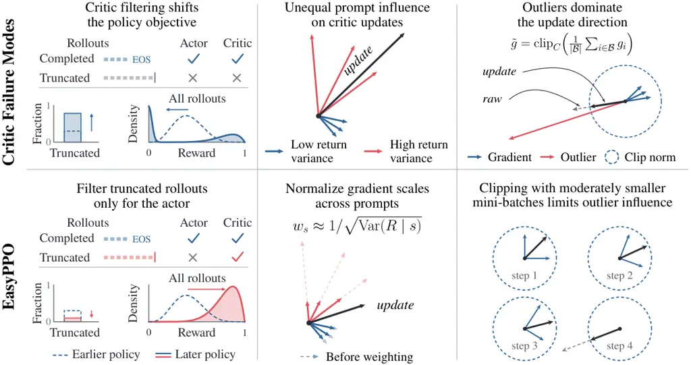

\DeclareMathOperator

\*\argmaxarg max \DeclareMathOperator\*\argminarg min
\DeclareMathOperator\signsign \DeclareMathOperator\TrTr
\tcbuselibraryskins,breakable
\newtcolorboxfindingboxenhanced,breakable,frame
hidden,colback=gred!6,borderline west=3pt0ptgred,sharp
corners,boxsep=0pt,left=12pt,right=10pt,top=8pt,bottom=8pt,before
skip=12pt,after skip=12pt \newtcolorboxnoteboxenhanced,breakable,frame
hidden,colback=gblue!6,borderline west=3pt0ptgblue,sharp
corners,boxsep=0pt,left=12pt,right=10pt,top=8pt,bottom=8pt,before
skip=12pt,after skip=12pt \newtcolorboxtipboxenhanced,breakable,frame
hidden,colback=ggreen!6,borderline west=3pt0ptggreen,sharp
corners,boxsep=0pt,left=12pt,right=10pt,top=8pt,bottom=8pt,before
skip=12pt,after skip=12pt \newtcolorboxwarnboxenhanced,breakable,frame
hidden,colback=gyellow!6,borderline west=3pt0ptgyellow,sharp
corners,boxsep=0pt,left=12pt,right=10pt,top=8pt,bottom=8pt,before
skip=12pt,after skip=12pt \tcbuselibrarylistings \lstset basicstyle=,
breaklines=true, breakindent=0pt, breakautoindent=false,
columns=fullflexible, keepspaces=true, xleftmargin=0pt,
xrightmargin=0pt, resetmargins=true, aboveskip=0pt, belowskip=0pt,
\newtcblistingpromptbox\[1\]\[\]enhanced, listing only, breakable, frame
hidden, width=colback=gblue!6, borderline west=3pt0ptgblue, sharp
corners, boxsep=0pt, left=12pt, right=10pt, top=8pt, bottom=8pt, before
skip=12pt, after skip=12pt, before upper=\colorgblue#1

, listing options=basicstyle=, escapeinside=(\*\*),
\newtcolorboxtranscriptboxenhanced, breakable, frame hidden,
colback=ggreen!6, borderline west=3pt0ptggreen, sharp corners,
boxsep=0pt, fontupper=, halign upper=flush left, left=12pt, right=10pt,
top=6pt, bottom=8pt, before skip=12pt, after skip=12pt,
\colorletcodebggyellow!6 \setmintedfontsize=, breaklines, autogobble,
tabsize=4, style=vs \newminted\[codebox\]pythonbgcolor=codebg,
frame=leftline, framerule=2.5pt, rulecolor=gyellow, framesep=2.5mm
\hypersetupcolorlinks=true, linkcolor=linkcol, citecolor=linkcol,
urlcolor=linkcol, pdfborderstyle=, pdfborder=0 0 0 \colorletperfhuegblue
\colorletperf0white \colorletperf10perfhue!12 \colorletperf20perfhue!22
\colorletperf30perfhue!33 \colorletperf40perfhue!44
\colorletperf50perfhue!55 \colorletperf60perfhue!66
\colorletperf70perfhue!77 \colorletperf80perfhue!88
\SetKwInputKwInputInput \SetKwInputKwOutputOutput
\DontPrintSemicolon\SetKwCommentComment\colorggreen#
\SetKwProgFunctiondef: \SetKwProgForfor: \SetKwProgIfif:
\definecoloreasyppoaccentHTMLB53146
\hypersetuplinkcolor=easyppoaccent,citecolor=easyppoaccent,urlcolor=easyppoaccent
1\]University of California, Berkeley 2\]Princeton University
\authornote$`*`$ Equal contribution. $`\dagger`$ Project
leader. Correspondence to qmang@berkeley.edu.  
Website: \hrefhttps://easyppo.github.io/https://easyppo.github.io/ Code:
\hrefhttps://github.com/EasyPPO/EasyPPOhttps://github.com/EasyPPO/EasyPPO

# \texorpdfstringEasy\textcoloreasyppoaccentPPOEasyPPO: Stabilizing the Critic Is Key

Xuanyi Zhou    Qiuyang Mang    Huanzhi Mao    Dacheng Li    Wenhao Chai
   Mayank Mishra    Yichuan Wang    Karthik Narasimhan    Alvin Cheung
   Joseph E. Gonzalez Affiliation: \[ Affiliation: \[

###### Abstract

Abstract

A key strength of Proximal Policy Optimization (PPO) is its learned
critic, which uses historical trajectories collected during
reinforcement learning to estimate expected returns and reduce
policy-gradient variance. However, we find that the critic is also a
major source of instability in reinforcement learning for large language
models (LLMs). We identify two critic failure modes that destabilize
PPO. First, filtering truncated rollouts from both actor and critic
shifts the policy objective to reward conditioned on completion,
allowing truncation to increase even as conditional reward improves.
Second, heterogeneous return noise can cause high-variance prompts to
dominate critic updates in finite batches. We introduce EasyPPO to
address these failures. Actor-only overlong filtering trains the critic
on returns from both completed and truncated rollouts. Noise-normalized
critic regression weights each prompt’s critic loss by the inverse
standard deviation of its sampled returns, balancing noise contributions
across prompts. Moderately smaller critic mini-batches confine outlier
influence to fewer rollouts during gradient clipping. Across
continuous-reward coding on FrontierCS, binary-reward mathematical
reasoning on AIME24, and multi-turn search on Search-R1, EasyPPO remains
stable throughout the full training horizon and consistently outperforms
vanilla PPO, VAPO, and HL-Gauss PPO. Its best validation scores show
relative gains of $`14.89\%`$, $`2.28\%`$, and $`9.47\%`$ over PPO,
respectively.

## 1 Introduction



Figure 1: EasyPPO addresses two sources of critic instability with three
simple modifications. Left: Filtering truncated rollouts from both actor
and critic updates can increase truncation and lower overall reward;
EasyPPO retains these rollouts for critic updates only. Middle: Return
variability differs across prompts, causing unequal critic gradient
scales; EasyPPO weights prompts inversely by their standard deviation.
Right: Smaller critic mini-batches limit outlier influence through
gradient clipping.

Reinforcement learning with verifiable rewards (RLVR) has become a key
post-training paradigm for improving reasoning in Large Language Models
(LLMs) (Jaech et al., 2024; Guo et al., 2025). Among RL algorithms,
Proximal Policy Optimization (PPO) is particularly appealing for
long-horizon reasoning because its actor–critic framework learns
token-level return estimates from historical rollouts, enabling
fine-grained credit assignment and lower-variance policy
updates (Schulman et al., 2017). These benefits may become more
important as post-training expands to tasks such as automated
research (Mang et al., 2025; He et al., 2026; Lyu et al., 2026; Xu et
al., 2026; Zhu et al., 2026), where rollouts grow longer and require
more computation on evaluation.

The critic can also become a source of instability in PPO. Even with
rollout batches of 512 responses in our experiments, we observe two
failure modes in critic learning that heavily destabilize training.

#### Policy Objective Shift from Overlong Rollout Filtering.

Truncated rollouts are a known source of reward noise in LLM
reinforcement learning (Yu et al., 2025). Their rewards reflect
incomplete responses, which can destabilize policy updates. Overlong
filtering mitigates this noise by excluding truncated rollouts from
policy updates (Yu et al., 2025). For example, during the 24K stage of
Math RL, Nemotron-Cascade (Wang et al., 2025) excludes overlong rollouts
to avoid noisy penalties on unfinished reasoning. In PPO, however,
extending this filtering to critic updates can adversely change what the
critic learns. For a prompt $`s`$, the critic $`V_{\phi}(s)`$,
parameterized by $`\phi`$, should predict the mean return
$`\mathbb{E}[R\mid s]`$, where $`R`$ is the sampled rollout return.
Training it only on non-truncated rollouts instead makes it predict the
mean return among completed responses. We show that, in the
accurate-critic limit, filtering both networks shifts the policy
objective to reward conditioned on completion,
$`\mathbb{E}[R\mid s,\text{nottruncated}]`$. This conditional reward can
improve even as truncation becomes more frequent. We observe a growing
fraction of unfinished rollouts when filtering both actor and critic
updates. The critic should therefore retain these rollouts despite the
noise in their returns.

#### Heterogeneous Return Noise in Critic Updates.

Retaining all rollouts for critic learning raises a second question:
_how should the critic handle return noise that varies across prompts
within the same batch?_ These differences arise not only from
truncation, but also because the actor policy produces consistent
returns on some prompts and highly variable returns on others. They are
especially pronounced in continuous-reward tasks, where some prompts
permit only small gains while others admit widely varying levels of
improvement. The critic aims to predict the mean return, minimizing
$`(V_{\phi}(s)-\mathbb{E}[R\mid s])^{2}`$, but learns from sampled
losses $`(V_{\phi}(s)-R)^{2}`$. Our analysis shows that return noise
leaves the optimal prediction unchanged, yet contributes to the expected
squared gradient magnitude alongside prediction error. As predictions
improve, this noise can dominate, so prompts with more variable returns
can disproportionately influence finite-batch updates.

Together, these two failures suggest that stable PPO should balance
overlong filtering and critic learning while controlling how
heterogeneous return noise shapes finite-batch updates. We introduce
EasyPPO, which addresses these failures through three simple yet
effective modifications to PPO. \Creffig:teaser connects the two critic
failure modes to the three changes in EasyPPO. First, we apply
_actor-only overlong filtering_, retaining all rollouts for critic
learning. Second, _noise-normalized critic regression_ weights each
prompt inversely by the empirical return standard deviation of its
rollout group, to focus critic updates on prediction error normalized by
return variability. Third, although larger critic mini-batches better
average out return noise, we found that smaller ones can be preferable
under gradient clipping because they confine the remaining outliers’
influence to fewer rollouts; we therefore choose a moderate size to
balance these effects.

Our experiments across continuous-reward coding on FrontierCS (Mang et
al., 2025; He et al., 2026), binary-reward mathematical reasoning on
AIME24, and multi-turn search on Search-R1 (Jin et al., 2025) show that
EasyPPO remains stable throughout 200–300 training updates,
substantially improving training stability over vanilla PPO and two
recent PPO variants, VAPO (Yue et al., 2025) and HL-Gauss PPO (Zhou et
al., 2026). This stability translates into consistently stronger task
performance, without the late-stage collapse frequently observed in the
baselines. EasyPPO’s best validation scores show relative gains of
$`14.89\%`$, $`2.28\%`$, and $`9.47\%`$ over PPO, respectively; it ranks
first and is the only compared method stable across all three tasks.
Ablation studies further show that each component improves training
stability and that combining all three yields the strongest gains. A
stable critic is therefore key to reliable PPO training for LLMs.

## 2 Preliminaries

We study PPO for reinforcement learning with verifiable rewards. Given a
prompt $`x`$, the policy $`\pi_{\theta}`$ generates a response
$`y_{1:T}`$ and receives a scalar reward $`R=R(x,y_{1:T})`$ at the end
of the rollout. At token $`t`$, the state is the response prefix
$`s_{t}=(x,y_{<t})`$ and the action is $`a_{t}=y_{t}`$. PPO learns a
critic $`V_{\phi}(s_{t})`$ to estimate the expected return from each
token state and uses these value estimates to construct token-level
advantages with GAE (Schulman et al., 2017). In our terminal-reward
setting, the return from any prefix is the final rollout reward $`R`$
when $`\gamma=1`$, so
$`V^{\pi_{\theta}}(s_{t})=\mathbb{E}[R\mid s_{t}]`$.

For simplicity, we treat a response $`\tau`$ as one action from prompt
state $`s`$, with final reward $`R`$ and baseline $`V_{\phi}(s)`$. We
omit PPO clipping and KL regularization, yielding the actor objective

```math
\mathcal{L}_{\mathrm{actor}}(\theta)=-\mathbb{E}_{\tau}\!\left[\log\pi_{\theta}(\tau\mid s)\operatorname{sg}\!\left(R-V_{\phi}(s)\right)\right], \tag{1}
```

where $`\mathbb{E}_{\tau}`$ averages over sampled responses and
$`\operatorname{sg}(\cdot)`$ stops gradients through the advantage. The
critic is trained against the final reward using the standard MSE
objective

```math
\mathcal{L}_{V}(\phi)=\frac{1}{2}\mathbb{E}_{\tau}\!\left[\left(V_{\phi}(s)-R\right)^{2}\right]. \tag{2}
```

Our implementation retains token-level GAE, the full clipped PPO
objective, and KL regularization. We consider a fully synchronized
setting in which each rollout batch is sampled from the latest policy
snapshot.

## 3 Overlong Filtering in PPO

Overlong filtering offers a straightforward way to reduce reward noise
in Group Relative Policy Optimization (GRPO) (Shao et al., 2024) by
excluding truncated rollouts from policy updates (Yu et al., 2025; Wang
et al., 2025). In PPO, however, filtering critic updates changes the
learned value baseline and hence the advantages supplied to the actor.
\Creffig:frontiercs-overlong-filtering compares three filtering
strategies on FrontierCS (Mang et al., 2025), using Qwen3.5-9B (Qwen
Team, 2026) trained on $`200`$ problems generated by FrontierSmith (He
et al., 2026). All runs use a supervised fine-tuning (SFT) checkpoint, a
$`30`$-step critic warm-up, batches of $`512`$ rollouts, and a
$`32{,}768`$-token response limit.

Without filtering, PPO exhibits repeated reward collapses. Filtering
both actor and critic updates improves reward among non-truncated
rollouts, but the truncation ratio approaches $`1`$ and overall reward
remains low. Among the three strategies, actor-only filtering is the
most stable and achieves the highest overall score. Joint filtering also
exhibits rising truncation and deteriorating overall reward in the AIME
setting (\Crefapp:additional-filtering).

Figure 2: Actor-only overlong filtering improves stability but does not
eliminate instability. Rollout statistics during PPO training of
Qwen3.5-9B in the FrontierCS setting, using $`200`$ problems generated
by FrontierSmith, rollout batches of $`512`$, a $`30`$-step critic
warm-up (gray), and a $`32{,}768`$-token response limit. Left: fraction
of truncated rollouts. Middle: mean reward among non-truncated rollouts.
Right: mean reward over all rollouts. _Actor + critic filtering_
improves reward among completed rollouts while the truncation ratio
approaches $`1`$, leaving overall reward low. _No filtering_ exhibits
repeated reward collapses. _Actor-only filtering_ achieves higher reward
and lower truncation overall, but the spike and reward drop near step
$`160`$ reveal residual instability.

#### Why Joint Filtering Shifts the Policy Objective.

For a fixed prompt $`s`$, let $`C`$ denote the event that the rollout is
not truncated. Excluding truncated rollouts restricts the critic loss in
\Crefeq:vanilla-critic-loss to completed responses, changing its
pointwise population target from $`\mathbb{E}[R\mid s]`$ to
$`\mathbb{E}[R\mid s,C]`$.

We analyze the idealized limit $`V_{\phi}(s)=\mathbb{E}[R\mid s,C]`$.
Let $`P_{\theta}(C\mid s)=\sum_{\tau\in C}\pi_{\theta}(\tau\mid s)>0`$
be the completion probability. Differentiating the conditional expected
reward via the quotient rule gives

```math
\aligned\nabla_{\theta}\mathbb{E}[R\mid s,C]&=\nabla_{\theta}\frac{\sum_{\tau\in C}\pi_{\theta}(\tau\mid s)R}{P_{\theta}(C\mid s)}\\
=\frac{\sum_{\tau\in C}\nabla_{\theta}\pi_{\theta}(\tau\mid s)R}{P_{\theta}(C\mid s)}-\underbrace{\frac{\sum_{\tau\in C}\pi_{\theta}(\tau\mid s)R}{P_{\theta}(C\mid s)}}_{V_{\phi}(s)\ =\ \mathbb{E}[R\mid s,C]}\frac{\nabla_{\theta}P_{\theta}(C\mid s)}{P_{\theta}(C\mid s)}. \tag{3}
```

Substituting
$`\nabla_{\theta}P_{\theta}(C\mid s)=\sum_{\tau\in C}\nabla_{\theta}\pi_{\theta}(\tau\mid s)`$
and applying the log-derivative identity gives

```math
\gathered\nabla_{\theta}\mathbb{E}[R\mid s,C]=\frac{\sum_{\tau\in C}\nabla_{\theta}\pi_{\theta}(\tau\mid s)\bigl(R-V_{\phi}(s)\bigr)}{P_{\theta}(C\mid s)}\\
=\sum_{\tau\in C}\frac{\pi_{\theta}(\tau\mid s)}{P_{\theta}(C\mid s)}\bigl(R-V_{\phi}(s)\bigr)\nabla_{\theta}\log\pi_{\theta}(\tau\mid s)=\underbrace{\mathbb{E}\!\left[(R-V_{\phi}(s))\nabla_{\theta}\log\pi_{\theta}(\tau\mid s)\,\middle|\,s,C\right]}_{\textbf{Expected policy gradient of actor--critic filtering}}. \tag{4}
```

\Cref

eq:double-filter-objective shows that joint filtering optimizes reward
conditioned on completion, without directly encouraging the policy to
avoid truncation. This matches \Creffig:frontiercs-overlong-filtering:
reward among completed rollouts rises while truncation becomes more
frequent and overall reward remains low. At the token level, filtering
similarly changes each critic target from $`\mathbb{E}[R\mid s_{t}]`$ to
$`\mathbb{E}[R\mid s_{t},C]`$, but the response-level policy-gradient
identity need not hold (\Crefapp:overlong-filter-analysis).

#### Actor-Only Overlong Filtering.

We therefore apply overlong filtering only to actor updates and retain
all rollouts for critic training. As in GRPO, excluding truncated
rollouts still biases the actor update. Retaining all rollouts preserves
the critic target $`\mathbb{E}[R\mid s]`$, restoring a
completion-probability term in the idealized filtered policy gradient.
When completed rollouts have higher expected returns than truncated
ones, this term encourages completion. However, the remaining truncation
spike and reward drop in \Creffig:frontiercs-overlong-filtering show
that retaining all rollouts alone is not sufficient for stability. We
next examine how heterogeneous return noise affects critic updates. We
defer a full analysis of actor-only filtering to
\Crefapp:overlong-filter-analysis.

## 4 Stabilizing the Critic

Following \Crefsec:actor-only-filter, we retain all rollouts for critic
training. However, the actor’s sampled returns can vary for the same
prompt, and retaining truncated rollouts can increase this _return
noise_. The noise level varies across prompts in the same batch,
reflecting differences in truncation rates and in return variability
among completed rollouts. This heterogeneity can be pronounced in
continuous-score tasks with different reward scales. For example, in GPU
kernel optimization, GEMM solutions may achieve only around $`1\times`$
speedup over an optimized baseline (Xing et al., 2026), whereas
specialized operators can exceed $`100\times`$ over their respective
library baselines (Yang et al., 2026).

#### Noise-Normalized Critic Regression.

At a prefix $`s`$, consider a linear value head
$`V_{\phi}(s)=W^{\top}h_{\phi}(s)`$ with critic features
$`h_{\phi}(s)`$. For a sampled return $`R`$, the MSE loss
$`\mathcal{L}_{V}(\phi)=\frac{1}{2}(V_{\phi}(s)-R)^{2}`$ has gradient
$`\nabla_{W}\mathcal{L}_{V}(\phi)=(V_{\phi}(s)-R)h_{\phi}(s)`$. Since
$`R-\mathbb{E}[R\mid s]`$ has zero conditional mean, the gradient second
moment decomposes as

```math
\mathbb{E}\!\left[\left\|\nabla_{W}\mathcal{L}_{V}(\phi)\right\|_{2}^{2}\,\middle|\,s\right]=\left\|h_{\phi}(s)\right\|_{2}^{2}\left[\underbrace{\bigl(V_{\phi}(s)-\mathbb{E}[R\mid s]\bigr)^{2}}_{\textbf{Prediction error}}+\underbrace{\operatorname{Var}(R\mid s)}_{\textbf{Return noise}}\right]. \tag{5}
```

As prediction error decreases, return noise can dominate this second
moment, giving prompts with greater return variability disproportionate
influence in finite batches.

This decomposition suggests dividing the critic loss at each prefix
$`s`$ by its own conditional return standard deviation. With
$`w(s)=1/\sqrt{\operatorname{Var}(R\mid s)}`$ for positive conditional
variance, \Crefeq:prompt-bias gives

```math
\mathbb{E}\!\left[\left\|w(s)\nabla_{W}\mathcal{L}_{V}(\phi)\right\|_{2}^{2}\,\middle|\,s\right]=\left\|h_{\phi}(s)\right\|_{2}^{2}\left[\underbrace{\Biggl(\frac{V_{\phi}(s)-\mathbb{E}[R\mid s]}{\sqrt{\operatorname{Var}(R\mid s)}}\Biggr)^{2}}_{\textbf{Normalized prediction error}}+\underbrace{\vphantom{\bigl(\frac{V_{\phi}(s)-\mathbb{E}[R\mid s]}{\operatorname{Var}(R\mid s)}\bigr)^{2}}\frac{\operatorname{Var}(R\mid s)}{\operatorname{Var}(R\mid s)}}_{\textbf{Constant noise term}}\right]. \tag{6}
```

Here, positive state weighting preserves the pointwise population
optimum $`\mathbb{E}[R\mid s]`$. Apart from the feature norm, the
gradient second moment depends only on normalized prediction error.
Fixing the noise term at one removes differences in return-noise scale
as a source of imbalance across prompts.

In practice, estimating return variance separately at each prefix is
costly, so we use the prompt’s return standard deviation across its
token states. With bounded critic-feature norms, this yields a common
upper bound on the noise contribution to the gradient second moment,
averaged over prefixes. We estimate $`\hat{\sigma}(s)`$ from rollout
groups including truncated responses, and normalize weights to mean one
over the prompt batch $`\mathcal{B}`$:

```math
\aligned w(s)&=\frac{|\mathcal{B}|/\max\{\hat{\sigma}(s),\varepsilon\}}{\sum_{s^{\prime}\in\mathcal{B}}1/\max\{\hat{\sigma}(s^{\prime}),\varepsilon\}},\qquad\varepsilon>0,\\
\mathcal{L}_{V}^{\mathrm{weighted}}(\phi)=\frac{1}{2\sum_{i}T_{i}}\sum\nolimits_{i}w(s_{i})\sum\nolimits_{t=1}^{T_{i}}\bigl(V_{\phi}(s_{i,t})-R_{i}\bigr)^{2}. \tag{7}
```

Here, response $`i`$ has prompt $`s_{i}`$, token states $`s_{i,t}`$, and
$`T_{i}`$ valid tokens; the loss follows widely used token-level
averaging (Sheng et al., 2025; Yue et al., 2025). For discrete rewards
with range $`\Delta`$ and group size $`n`$, we propose the floor
$`\varepsilon=\Delta/(2\sqrt{n})`$, where groups with identical returns
receive about twice the weight of groups containing one maximum reward
and $`n-1`$ minimum rewards.

For simplicity, we use the same rollout group to estimate weights and
train the critic, which can introduce bias but works well in practice
(\Crefsec:experiments). When fewer rollouts per prompt are desired,
alternatives such as offline profiling with online updates could provide
variance estimates; we leave these alternatives to future work.
\Crefapp:prompt-weighting details these approximations and the variance
floor, including the continuous-reward setting.

To test whether prompts with noisier returns contribute larger critic
gradients, we study Qwen3.5-9B trained on FrontierSmith with actor-only
filtering and noise-normalized critic regression. We use the
initialization and rollout settings of
\Creffig:frontiercs-overlong-filtering. At training steps $`30`$,
$`60`$, and $`90`$, we analyze $`512`$ responses per checkpoint ($`16`$
prompts, $`32`$ responses each). Offline, we compute critic loss
gradients for predicting each response’s sampled return, sum them over
its tokens, and divide by the batch’s total token count.
\Creffig:critic-gradient-scatter compares these gradient norms before
clipping, with and without noise normalization, grouped by the empirical
prompt return standard deviation.

Without normalization, prompts with more variable returns tend to
contribute larger gradients, and this pattern is stronger at later
checkpoints. This is consistent with \Crefeq:prompt-bias: as the critic
learns to predict the mean return, prediction error decreases, and
return noise plays a larger role in the gradient second moment. Noise
normalization largely removes this dependence on return variability,
making gradient contributions more balanced across prompts. We also
observe a similar overall trend in the AIME setting. Note that some
gradient outliers still remain, so we next adjust the critic mini-batch
size to limit their impact through clipping.
\Crefapp:offline-gradient-diagnostics provides the AIME results, scatter
plots for both tasks at each checkpoint, and details of the gradient
calculation.

\captionsetup

width=

Figure 3: Noise normalization balances critic gradient contributions
across prompts. Offline Qwen3.5-9B PPO diagnostics in the FrontierCS
setting, using the data and sampling settings of
\Creffig:frontiercs-overlong-filtering. Columns: steps $`30`$, $`60`$,
$`90`$, and their pooled responses. Top: without noise normalization.
Bottom: with noise normalization. Boxes summarize per-response gradient
norms before clipping within each return-standard-deviation interval.
Consistent with \Crefeq:prompt-bias, prompts with more variable returns
contribute larger gradients; noise normalization markedly reduces this
dependence.

#### Critic Mini-Batch Updates.

The group estimates above can understate a prompt’s return variability
and give it excessive weight, leaving gradient outliers. Even with exact
weights, stochastic return noise remains. Let $`B`$ and $`m`$ denote the
numbers of rollouts in a critic batch and each mini-batch, respectively.
For each of the $`\frac{B}{m}`$ mini-batches, we compute the gradient
$`g`$ of the mini-batch estimate of \Crefeq:prompt-weighted-loss and
clip its norm to at most $`c>0`$ via
$`g\leftarrow g\cdot\min\{1,c/\|g\|_{2}\}`$. We take one optimizer step
with this clipped gradient, then recompute the next mini-batch gradient
at the updated critic parameters.

Smaller mini-batches confine the joint rescaling caused by outliers to
fewer rollouts, but average out less return noise. At fixed $`B`$, an
idealized analysis gives an $`O(m)`$ bound on a single outlier’s
influence on the average clipped gradient, versus $`O(1/m)`$ gradient
variance per mini-batch. We defer the assumptions and proof to
\Crefapp:minibatch-clipping. In practice, we use $`\frac{B}{m}=4`$
critic mini-batches per rollout batch. When changing the mini-batch
size, the critic learning rate should be adjusted accordingly (Li et
al., 2026b).

Figure 4: EasyPPO sustains learning across tasks. Left: FrontierCS.
Middle: AIME. Right: Search-R1. Top: training scores. Bottom: validation
scores. Gray marks critic warmup.

## 5 Experiments

#### Experimental Setup.

For continuous-score coding, we train on a separate set of $`200`$
problems generated by FrontierSmith (He et al., 2026) and validate on
the algorithmic track of FrontierCS (Mang et al., 2025). Their diversity
lets us study cross-prompt return heterogeneity, complementing TailRL’s
focus on high-reward exploration (Ramasubramanian et al., 2026). To test
stability on single-turn and multi-turn binary-reward tasks, we also
train on DAPO-Math-17K (Yu et al., 2025) with AIME24 validation, and on
the Search-R1 mixture with its seven validation datasets (Jin et al.,
2025).

We implement all methods in verl (Sheng et al., 2025), using its vanilla
PPO (Schulman et al., 2017) as the baseline. We also compare with PPO +
actor-only filtering, HL-Gauss PPO (Zhou et al., 2026) for its
alternative critic objective, and VAPO (Yue et al., 2025) for its
value-learning and advantage-estimation improvements. We omit VAPO’s
auxiliary positive-example language-modeling loss to focus on PPO
updates. EasyPPO uses actor-only overlong filtering; PPO, HL-Gauss PPO,
and VAPO use no filtering, following their original recipes.

We use Qwen3.5-9B-Base for AIME and Search-R1, and Qwen3.5-9B for
FrontierCS (Qwen Team, 2026). For FrontierCS, we initialize from SFT on
$`347`$ nonzero-score trajectories generated by DeepSeek-V3.1 on the
same $`200`$ training problems. All methods share a $`30`$-step critic
warmup, rollout batches of $`512`$ responses on FrontierCS and AIME and
$`1024`$ on Search-R1, and group sizes of $`32`$ on FrontierCS and
$`16`$ on AIME and Search-R1. Training is strictly on-policy, with actor
updates starting after critic warmup.

Figure 5: EasyPPO stabilizes critic learning. Critic diagnostics on
FrontierCS. Left: critic gradient norm before clipping. Right: explained
variance of critic value predictions. Gray marks critic warmup.

Training metrics are task score on FrontierSmith, reward on
DAPO-Math-17K, and accuracy on Search-R1. Validation averages over five
responses per FrontierCS problem and $`32`$ per AIME24 problem;
Search-R1 averages greedy accuracies equally across seven datasets and
their own metrics. Training retains the original DAPO-Math-17K rewards
in $`\{-1,+1\}`$. For plotting only, we map these rewards to $`(r+1)/2`$
and divide FrontierCS scores by $`100`$. \Creffig:main-results shows one
run per method and task. Training curves use a five-point centered
moving average with faint raw values; validation is unsmoothed. Full
configurations are provided in \Crefapp:hyperparameters.

#### EasyPPO Stabilizes Critic Learning and Policy Training.

Across the evaluated runs and training horizons in
\Creffig:main-results, EasyPPO remains stable and achieves the best
validation performance among the compared methods on all three tasks.
Comparing each method’s best validation checkpoint on a $`0`$ – $`100`$
scale, EasyPPO improves over PPO by $`1.92`$, $`1.46`$, and $`3.74`$
points on FrontierCS, AIME24, and Search-R1, respectively; gains over
the second-best method on each task are $`0.91`$, $`1.46`$, and $`0.89`$
points (\Creftab:best-validation-scores). The stability benefit is
particularly pronounced on continuous-score coding, consistent with our
analysis of critic instability under heterogeneous returns. Every
baseline experiences performance collapse in at least one setting,
despite achieving substantial scores earlier in training. With the
EasyPPO recipe, we observe no training collapse in any of the evaluated
settings.

PPO with actor-only filtering achieves higher FrontierCS scores than
vanilla PPO, but its scores still fluctuate substantially. It also
collapses on AIME. EasyPPO remains stable with the same filtering rule,
showing the benefit of our critic modifications.

To examine the critic behavior behind these gains,
\Creffig:fcs-critic-diagnostics shows critic gradient norms before
clipping and explained variance on FrontierCS. After warmup, EasyPPO’s
critic gradient norm declines and its explained variance follows a
steady upward trend with relatively small fluctuations, whereas the
baselines exhibit sharp swings in explained variance. HL-Gauss
approaches an explained variance of $`1`$ only after its actor
collapses. In contrast, EasyPPO’s improving critic predictions accompany
sustained reward gains, supporting our motivation for stabilizing critic
learning to improve PPO training. We defer AIME and Search-R1 critic
diagnostics to \Crefapp:additional-critic-diagnostics.

{wrapfigure}

r0.45

\captionsetup

width=justification=centering,skip=4pt

Stability across critic initializations.

Figure 6: Noise normalization stabilizes training with various critic
mini-batch configurations. FrontierCS ablation. Left: training score.
Right: validation score.

#### Sensitivity to Random Seeds.

To test seed sensitivity, we compare three runs each of EasyPPO and
PPO + actor-only filtering, the strongest baseline on FrontierCS. Due to
training cost, we restrict this study to these two methods on
FrontierCS. None of the three EasyPPO runs collapses, whereas two of the
three actor-only-filtering runs do. EasyPPO also sustains its validation
gains with a narrow min–max band across runs
(\Creffig:fcs-seed-comparison). Further details are provided in
\Crefapp:fcs-repeated-runs.

\WFclear

#### Noise Normalization Improves Stability Across Critic Mini-Batch Sizes.

We ablate noise-normalized critic regression on FrontierCS. Within each
mini-batch configuration, all other training settings remain unchanged.
We use a fixed critic learning rate of $`2\times 10^{-6}`$ for this
ablation.

\Cref

fig:fcs-normalization-ablation shows that noise normalization stabilizes
training with both mini-batch configurations.

Without normalization, the performance drop is recoverable with one
mini-batch but becomes a sustained collapse when the same rollout batch
is split into four smaller mini-batches. With normalization, both
configurations preserve their gains in training and validation scores.
This contrast is consistent with our analysis: smaller mini-batches
average out less return noise. These results suggest that noise
normalization enables stable training with smaller critic mini-batches,
allowing finer-grained clipping to limit outlier influence as analyzed
in \Crefsec:minibatch-grad-clip.

Figure 7: Explained variance across critic mini-batch sizes. FrontierCS.
Left: smoothed explained variance; gray marks critic warmup. Right:
first training step with $`\mathrm{EV}\geq 0`$ versus critic mini-batch
count, measured from unsmoothed values.

#### The Trade-off in Critic Mini-Batch Size.

We next vary the number of critic mini-batches per rollout batch,
$`K=B/m`$, on FrontierCS, fixing $`B=512`$ and retaining actor-only
filtering and noise normalization. We scale $`\eta\propto 1/\sqrt{K}`$
from the default at $`K=4`$ to account for update frequency (Li et al.,
2026b); clipping granularity and optimizer dynamics still vary together,
but the observed trade-off is consistent with our fixed-parameter
analysis.

\Cref

fig:fcs-minibatch-ablation shows five-point-smoothed EV (left) and the
first step with raw $`\mathrm{EV}\geq 0`$ (right), including warmup.
First-crossing steps decrease approximately linearly with $`\log K`$,
whereas $`K=4`$ and $`8`$ achieve higher EV later in training. This
suggests finer-grained outlier control helps early, while noise
averaging matters more as prediction error decreases
(\Crefeq:prompt-bias). Together, this analysis and the observed
trade-off motivate our default choice of $`K=4`$.

## 6 Related Work

#### Policy Optimization for LLM Post-Training.

Reinforcement learning from human feedback (RLHF) established PPO as a
standard actor–critic method for LLM post-training (Ouyang et al., 2022;
Schulman et al., 2017), while RLVR replaces learned reward models with
task-specific verifiers (Shao et al., 2024; Guo et al., 2025).

Critic-free methods estimate advantages from groups of responses to the
same prompt (Shao et al., 2024; Ahmadian et al., 2024; Hu et al., 2025a;
He et al., 2025), commonly filtering truncated rollouts from the
update (Yu et al., 2025; Wang et al., 2025).

Actor–critic methods keep a critic for token-level credit assignment,
and recent work improves its training through value pretraining and
decoupled GAE (Yuan et al., 2025; Yue et al., 2025), categorical value
prediction (Zhou et al., 2026), or hybrid designs (Qi et al., 2026; Pan
et al., 2026). Concurrent work supervises the critic sparsely to counter
value flattening inside a response (Li et al., 2026a), takes multiple
critic updates per rollout batch (Hu et al., 2025b), excludes
length-penalty rewards from critic training (Pan and others, 2026), or
reweights actor baselines by length (Cognition Team, 2026). Each
addresses one piece of critic training; EasyPPO targets the critic’s
exposure to prompt-level return noise, showing that filtering both actor
and critic shifts the policy objective, normalizing critic-gradient
noise across prompts, and bounding each mini-batch’s influence.

#### Continuous Verifiable Rewards.

While mathematical and coding RLVR often use binary correctness rewards,
open-ended optimization admits continuously varying solution quality.
Recent benchmarks provide verifiable graded scores for algorithm design,
ML research, and GPU kernel optimization (Mang et al., 2025; Kong et
al., 2026; He et al., 2026; Zhu et al., 2026; Lyu et al., 2026; Xing et
al., 2026). These benchmarks also provide training data: Evolution
Fine-Tuning uses evolutionary search trajectories from FrontierCS for
supervised fine-tuning (Lee et al., 2026). For RL with continuous
rewards, TailRL (Ramasubramanian et al., 2026) targets upper-tail
outcomes through reward-threshold exceedance probabilities based on
GRPO. These settings make differences in return scale and variability
across prompts particularly visible, motivating EasyPPO’s focus on
critic stability under heterogeneous returns.

#### Variance-Weighted Critic Regression.

Variance-aware regression has been studied in both RL and supervised
learning. In RL, variance-weighted critic objectives improve statistical
efficiency in linear MDPs (Zhou et al., 2021; Kitamura et al., 2023),
while IV-RL weights TD errors using estimated target variance (Mai et
al., 2022) and PopArt normalizes target scales across tasks (Van Hasselt
et al., 2016; Hessel et al., 2019). Related work on heteroscedastic
regression similarly adjusts each example’s contribution according to
its target uncertainty (Kendall and Gal, 2017; Seitzer et al., 2022).
Group sampling in LLM RL provides an empirical estimate of prompt-level
return variance, which EasyPPO uses for noise-normalized critic
regression without an auxiliary variance model. Dr. GRPO finds that
standard-deviation normalization of actor advantages can over-weight
low-variance prompts (Liu et al., 2025); EasyPPO instead applies this
weighting to the critic loss.

## 7 Conclusion

We identify overlong-rollout handling and heterogeneous return noise as
two sources of critic instability in PPO. Our analysis shows how
filtering both actor and critic changes the policy objective, and how
return noise can dominate critic-gradient second moments. These findings
motivate EasyPPO: actor-only filtering, noise-normalized critic
regression, and moderately smaller critic mini-batches with gradient
clipping, while retaining the standard PPO actor update. Across
continuous-score coding, mathematical reasoning, and multi-turn search,
the resulting stability and performance gains show that stabilizing the
critic is key to reliable PPO training for LLMs.

## Acknowledgments

We thank the Laude Institute and Modal, as well as Ziniu Li, Yiping
Wang, Shuning Shang, Shuo Yang, Bo Peng, Haocheng Xi, Runyuan He,
Kaiyuan Liu, Yi Pan, Shuo Yuan, and Peter Chen, for supporting us and
discussing this paper.

## References

- Ahmadian et al. (2024) A. Ahmadian, C. Cremer, M. Gallé, M. Fadaee, J.
  Kreutzer, O. Pietquin, A. Üstün, and S. Hooker Back to basics:
  revisiting reinforce-style optimization for learning from human
  feedback in llms. In Proceedings of the 62nd Annual Meeting of the
  Association for Computational Linguistics (Volume 1: Long Papers),
  pp. 12248–12267. Cited by: §6.
- Cognition Team (2026) Cognition Team Introducing swe-2: pushing the
  pareto frontier. Note: https://cognition.com/blog/swe-2 Cited by: §6.
- Guo et al. (2025) D. Guo, D. Yang, H. Zhang, J. Song, P. Wang, Q.
  Zhu, R. Xu, R. Zhang, S. Ma, X. Bi, et al. Deepseek-r1: incentivizing
  reasoning capability in llms via reinforcement learning. arXiv
  preprint arXiv:2501.12948. Cited by: §1, §6.
- He et al. (2025) B. He, Z. Qu, Z. Liu, Y. Chen, Y. Zuo, C. Qian, K.
  Zhang, W. Chen, C. Xiao, G. Cui, et al. Justrl: scaling a 1.5 b llm
  with a simple rl recipe. arXiv preprint arXiv:2512.16649. Cited by:
  §6.
- He et al. (2026) R. He, Q. Mang, S. Zhou, K. Liu, H. Li, H. Mao, Q.
  Zhang, Z. Li, B. Peng, L. Cheng, et al. FrontierSmith: synthesizing
  open-ended coding problems at scale. arXiv preprint arXiv:2605.14445.
  Cited by: §1, §1, §3, §5, §6, §8.1, §8.4.
- Hessel et al. (2019) M. Hessel, H. Soyer, L. Espeholt, W.
  Czarnecki, S. Schmitt, and H. Van Hasselt Multi-task deep
  reinforcement learning with popart. In Proceedings of the AAAI
  Conference on Artificial Intelligence, Vol. 33, pp. 3796–3803. Cited
  by: §6.
- Hu et al. (2025a) J. Hu, J. K. Liu, H. Xu, and W. Shen Reinforce++:
  stabilizing critic-free policy optimization with global advantage
  normalization. arXiv preprint arXiv:2501.03262. Cited by: §6.
- Hu et al. (2025b) J. Hu, Y. Zhang, Q. Han, D. Jiang, X. Zhang, and H.
  Shum Open-reasoner-zero: an open source approach to scaling up
  reinforcement learning on the base model. Advances in Neural
  Information Processing Systems 38, pp. 162239–162262. Cited by: §6.
- Jaech et al. (2024) A. Jaech, A. Kalai, A. Lerer, A. Richardson, A.
  El-Kishky, A. Low, A. Helyar, A. Madry, A. Beutel, A. Carney, et al.
  Openai o1 system card. arXiv preprint arXiv:2412.16720. Cited by: §1.
- Jin et al. (2025) B. Jin, H. Zeng, Z. Yue, J. Yoon, S. Arik, D.
  Wang, H. Zamani, and J. Han Search-r1: training llms to reason and
  leverage search engines with reinforcement learning. arXiv preprint
  arXiv:2503.09516. Cited by: §1, §5.
- Kendall and Gal (2017) A. Kendall and Y. Gal What uncertainties do we
  need in bayesian deep learning for computer vision?. Advances in
  neural information processing systems 30. Cited by: §6.
- Kitamura et al. (2023) T. Kitamura, T. Kozuno, Y. Tang, N.
  Vieillard, M. Valko, W. Yang, J. Mei, P. Ménard, M. G. Azar, R. Munos,
  et al. Regularization and variance-weighted regression achieves
  minimax optimality in linear mdps: theory and practice. In
  International Conference on Machine Learning, pp. 17135–17175. Cited
  by: §6.
- Kong et al. (2026) M. Kong, C. Jiang, A. Qu, W. Ouyang, Z. Zeng, X.
  Guo, Z. Li, J. Li, Y. Fan, X. Zheng, et al. FrontierOR: benchmarking
  llms’ capacity for efficient algorithm design in large-scale
  optimization. arXiv preprint arXiv:2605.25246. Cited by: §6.
- Lee et al. (2026) Y. Lee, S. Kim, M. Kang, A. C. L. Chuen, Z. Chen, S.
  Han, T. Jung, and D. Kang Evolution fine-tuning: learning to discover
  across 371 optimization tasks. arXiv preprint arXiv:2606.29082. Cited
  by: §6.
- Li et al. (2026a) Y. Li, J. Yan, Y. Luo, Z. Wang, F. Wang, R. Tan, K.
  Tian, G. Cui, N. Ding, P. Zhao, Y. Li, and Y. Cheng Rethinking critic
  learning in PPO: understanding and mitigating value flattening. arXiv
  preprint arXiv:2609.18708. External Links:
  [Link](https://arxiv.org/abs/2609.18708) Cited by: §6.
- Li et al. (2026b) Z. Li, J. Wang, G. Huang, F. Zhang, P. Li, and A.
  Chen When do larger batches help scale llm reinforcement learning?.
  arXiv preprint arXiv:2608.29296. Cited by: §4, §5.
- Liu et al. (2025) Z. Liu, C. Chen, W. Li, P. Qi, T. Pang, C. Du, W. S.
  Lee, and M. Lin Understanding r1-zero-like training: a critical
  perspective. arXiv preprint arXiv:2503.20783. Cited by: §6.
- Lyu et al. (2026) B. Lyu, Y. Yang, S. Huang, J. Zhang, Q. Xu, X.
  Li, X. Han, Y. Zhang, H. Zhang, R. Huang, et al. MLS-bench: a holistic
  and rigorous assessment of ai systems on building better ai. arXiv
  preprint arXiv:2605.08678. Cited by: §1, §6.
- Mai et al. (2022) V. Mai, K. Mani, and L. Paull Sample efficient deep
  reinforcement learning via uncertainty estimation. arXiv preprint
  arXiv:2201.01666. Cited by: §6.
- Mang et al. (2025) Q. Mang, W. Chai, Z. Li, H. Mao, S. Zhou, A. Du, H.
  Li, S. Liu, E. Chen, Y. Wang, et al. Frontiercs: evolving challenges
  for evolving intelligence. arXiv preprint arXiv:2512.15699. Cited by:
  §1, §1, §3, §5, §6, §8.1, §8.4.
- Ouyang et al. (2022) L. Ouyang, J. Wu, X. Jiang, D. Almeida, C.
  Wainwright, P. Mishkin, C. Zhang, S. Agarwal, K. Slama, A. Ray, et al.
  Training language models to follow instructions with human feedback.
  Advances in neural information processing systems 35, pp. 27730–27744.
  Cited by: §6.
- Pan et al. (2026) C. Pan, S. Liu, J. Lin, D. Zhu, J. Zhang, S. Dou, S.
  Gao, Z. Han, B. Wang, R. Zheng, et al. EVPO: explained variance policy
  optimization for adaptive critic utilization in llm post-training.
  arXiv preprint arXiv:2604.19485. Cited by: §6.
- Pan et al. (2026) H. Pan et al. JustRL-ii: scaling small llms to 128k
  reasoning with a critic. Note:
  https://panhaoxuan.notion.site/justrl-ii-scaling-small-llms-to-128k-reasoning-with-a-criticChinese
  version:
  https://panhaoxuan.notion.site/justrl-ii-small-llms-to-128k-reasoning-with-a-critic-cn
  Cited by: §6.
- Qi et al. (2026) P. Qi, X. Zhou, and W. S. Lee Best practice critic
  optimization. arXiv preprint arXiv:2608.23566. Cited by: §6.
- Qwen Team (2026) Qwen Team Qwen3.5: towards native multimodal agents.
  External Links: [Link](https://qwen.ai/blog?id=qwen3.5) Cited by: §3,
  §5, §8.1, §8.4.
- Ramasubramanian et al. (2026) S. Ramasubramanian, D. Arora, F.
  Tajwar, G. Zeng, Q. Wu, Z. Zhou, C. Xu, H. Feng, Y. Song, A. Singh, et
  al. Tail-likelihood reinforcement learning. arXiv preprint
  arXiv:2609.02987. Cited by: §5, §6.
- Schulman et al. (2017) J. Schulman, F. Wolski, P. Dhariwal, A.
  Radford, and O. Klimov Proximal policy optimization algorithms. arXiv
  preprint arXiv:1707.06347. Cited by: §1, §2, §5, §6.
- Seitzer et al. (2022) M. Seitzer, A. Tavakoli, D. Antic, and G.
  Martius On the pitfalls of heteroscedastic uncertainty estimation with
  probabilistic neural networks. arXiv preprint arXiv:2203.09168. Cited
  by: §6.
- Shao et al. (2024) Z. Shao, P. Wang, Q. Zhu, R. Xu, J. Song, X. Bi, H.
  Zhang, M. Zhang, Y. Li, Y. Wu, et al. Deepseekmath: pushing the limits
  of mathematical reasoning in open language models. arXiv preprint
  arXiv:2402.03300. Cited by: §3, §6, §6.
- Sheng et al. (2025) G. Sheng, C. Zhang, Z. Ye, X. Wu, W. Zhang, R.
  Zhang, Y. Peng, H. Lin, and C. Wu Hybridflow: a flexible and efficient
  rlhf framework. In Proceedings of the Twentieth European Conference on
  Computer Systems, pp. 1279–1297. Cited by: §4, §5.
- Van Hasselt et al. (2016) H. P. Van Hasselt, A. Guez, M. Hessel, V.
  Mnih, and D. Silver Learning values across many orders of magnitude.
  Advances in neural information processing systems 29. Cited by: §6.
- Wang et al. (2025) B. Wang, C. Lee, N. Lee, S. Lin, W. Dai, Y.
  Chen, Y. Chen, Z. Yang, Z. Liu, M. Shoeybi, et al. Nemotron-cascade:
  scaling cascaded reinforcement learning for general-purpose reasoning
  models. arXiv preprint arXiv:2512.13607. Cited by: §1, §3, §6.
- Xing et al. (2026) S. Xing, Y. Zhai, A. Jiang, Y. Dong, Y. Wu, Z.
  Ye, C. F. Ruan, Y. Huang, Y. Zhang, L. Yin, et al. Flashinfer-bench:
  building the virtuous cycle for ai-driven llm systems. Proceedings of
  Machine Learning and Systems 8, pp. 2016–2064. Cited by: §4, §6.
- Xu et al. (2026) Z. Xu, J. Chen, Y. Huang, D. Jiang, J. Chen, H.
  Hua, Z. Wu, Z. Liu, Z. He, L. Li, et al. AutoLab: can frontier models
  solve long-horizon auto research and engineering tasks?. arXiv
  preprint arXiv:2606.05080. Cited by: §1.
- Yang et al. (2026) S. Yang, H. Xi, Y. Zhao, Q. Mang, Z. Wang, S.
  Sun, K. Keutzer, J. E. Gonzalez, S. Han, C. Xu, and I. Stoica
  FlashLib: bringing flash magic to classical machine learning
  operators. External Links: [Link](https://flashml-org.github.io/)
  Cited by: §4.
- Yu et al. (2025) Q. Yu, Z. Zhang, R. Zhu, Y. Yuan, X. Zuo, Y. Yue, W.
  Dai, T. Fan, G. Liu, J. Liu, et al. Dapo: an open-source llm
  reinforcement learning system at scale. Advances in Neural Information
  Processing Systems 38, pp. 113222–113244. Cited by: §1, §3, §5, §6.
- Yuan et al. (2025) Y. Yuan, Y. Yue, R. Zhu, T. Fan, and L. Yan What’s
  behind ppo’s collapse in long-cot? value optimization holds the
  secret. arXiv preprint arXiv:2503.01491. Cited by: §6.
- Yue et al. (2025) Y. Yue, Y. Yuan, Q. Yu, X. Zuo, R. Zhu, W. Xu, J.
  Chen, C. Wang, T. Fan, Z. Du, et al. Vapo: efficient and reliable
  reinforcement learning for advanced reasoning tasks. arXiv preprint
  arXiv:2504.05118. Cited by: §1, §4, §5, §6.
- Zhou et al. (2021) D. Zhou, Q. Gu, and C. Szepesvari Nearly minimax
  optimal reinforcement learning for linear mixture markov decision
  processes. In Conference on Learning Theory, pp. 4532–4576. Cited by:
  §6.
- Zhou et al. (2026) Z. Zhou, L. Li, X. Zhang, Z. Liu, Y. Qin, K. Li, X.
  Sun, X. Tan, C. Qu, and Y. Qi Start classifying: categorical critics
  for llm reinforcement learning. arXiv preprint arXiv:2608.02181. Cited
  by: §1, §5, §6, §8.3.
- Zhu et al. (2026) D. Zhu, X. Zhou, S. Qin, X. Zhu, H. Ding, S.
  Zhong, Z. Wen, Z. Xie, C. Gou, L. Ren, et al. EdgeBench: unveiling
  scaling laws of learning from real-world environments. arXiv preprint
  arXiv:2607.05155. Cited by: §1, §6.

\beginsupplement\crefalias

sectionappendix

## Appendix Contents

\phantomsection

\hypersetup

linkcolor=black
\hyperref\[app:hyperparameters\]8  \nameref\*app:hyperparameters.\hyperref\[app:hyperparameters\]8

\hyperref

\[app:distillation\]8.1 \nameref\*app:distillation.\hyperref\[app:distillation\]8.1

\hyperref

\[app:training-config\]8.2 \nameref\*app:training-config.\hyperref\[app:training-config\]8.2

\hyperref

\[app:critic-config\]8.3 \nameref\*app:critic-config.\hyperref\[app:critic-config\]8.3

\hyperref

\[app:ablation-config\]8.4 \nameref\*app:ablation-config.\hyperref\[app:ablation-config\]8.4

\hyperref

\[app:theory\]9  \nameref\*app:theory.\hyperref\[app:theory\]9

\hyperref

\[app:return-variability\]9.1 \nameref\*app:return-variability.\hyperref\[app:return-variability\]9.1

\hyperref

\[app:overlong-filter-analysis\]9.2 \nameref\*app:overlong-filter-analysis.\hyperref\[app:overlong-filter-analysis\]9.2

\hyperref

\[app:prompt-weighting\]9.3 \nameref\*app:prompt-weighting.\hyperref\[app:prompt-weighting\]9.3

\hyperref

\[app:minibatch-clipping\]9.4 \nameref\*app:minibatch-clipping.\hyperref\[app:minibatch-clipping\]9.4

\hyperref

\[app:additional-results\]10  \nameref\*app:additional-results.\hyperref\[app:additional-results\]10

\hyperref

\[app:best-validation-scores\]10.1 \nameref\*app:best-validation-scores.\hyperref\[app:best-validation-scores\]10.1

\hyperref

\[app:additional-critic-diagnostics\]10.2 \nameref\*app:additional-critic-diagnostics.\hyperref\[app:additional-critic-diagnostics\]10.2

\hyperref

\[app:fcs-repeated-runs\]10.3 \nameref\*app:fcs-repeated-runs.\hyperref\[app:fcs-repeated-runs\]10.3

\hyperref

\[app:offline-gradient-diagnostics\]10.4 \nameref\*app:offline-gradient-diagnostics.\hyperref\[app:offline-gradient-diagnostics\]10.4

\hyperref

\[app:additional-filtering\]10.5 \nameref\*app:additional-filtering.\hyperref\[app:additional-filtering\]10.5

\hyperref

\[app:search-r1-validation-sets\]10.6 \nameref\*app:search-r1-validation-sets.\hyperref\[app:search-r1-validation-sets\]10.6

## 8 Training Configurations and Implementation Details

This section provides the configurations for \Crefsec:experiments and
the filtering study in \Crefsec:actor-only-filter.

### 8.1 Data and FrontierCS Initialization

For our FrontierCS experiments, we use a distilled Qwen3.5-9B (Qwen
Team, 2026) model as the initial policy. SFT and RL use a separate
FrontierSmith training set; validation uses the algorithmic track of
FrontierCS (Mang et al., 2025). We use DeepSeek-V3.1 to sample three
responses for each of the $`200`$ problems generated by
FrontierSmith (He et al., 2026), yielding $`600`$ responses in total.
Each response is truncated to at most $`32{,}768`$ tokens, with length
measured using the Qwen3.5-9B tokenizer. After removing $`253`$
responses with a score of zero, we retain $`347`$ responses covering
$`179`$ distinct problems. We perform supervised fine-tuning (SFT) of
Qwen3.5-9B on these retained responses for a single epoch to obtain the
distilled model.

### 8.2 Training and Evaluation Settings

AIME and Search-R1 start from Qwen3.5-9B-Base; FrontierCS uses the SFT
initialization above. \Creftab:task-configuration summarizes the task
settings for \Creffig:main-results. Batch sizes count responses; the
number of prompts per batch is listed separately.
\Creftab:ppo-configuration lists the PPO and optimizer settings;
method-specific critic settings follow in \Crefapp:critic-config.
Learning rates are constant after any optimizer warmup.

{tabularx}

0.92@¿\arraybackslashX\*3¿\arraybackslashp0.145@
\toprule\rowcolorgblue!6 Hyperparameter FrontierCS AIME Search-R1  
\midrulePrompts per rollout batch 16 32 64  
Samples per prompt 32 16 16  
Rollout batch size $`B`$ 512 512 1024  
Maximum prompt length 8192 2048 4096  
Maximum response length 32768 8192 4096  
Rollout temperature 1.0 1.0 1.0  
Rollout top-$`p`$ 1.0 1.0 1.0  
\midruleActor learning rate $`10^{-6}`$ $`10^{-6}`$ $`10^{-6}`$  
Default critic learning rate $`2\times 10^{-6}`$ $`2\times 10^{-6}`$
$`2\times 10^{-6}`$  
Actor updates per rollout batch 1 1 1  
Critic epochs per rollout batch 1 1 1  
Actor/critic LR warmup (optimizer steps) 0 20 0  
Critic warmup steps 30 30 30  
\midruleValidation responses per problem 5 32 1  
Validation decoding Sampling Sampling Greedy  
Validation temperature 1.0 1.0 0.0  
Validation top-$`p`$ 1.0 0.7 1.0  
\bottomrule

Table 1: Training and evaluation configurations for the main
comparisons. Learning rates are the configured target values.

Critic warmup is reported in rollout steps; the optimizer learning-rate
warmup is listed separately.

{tabularx}

0.92@¿\arraybackslashX\*3¿\arraybackslashp0.145@
\toprule\rowcolorgblue!6 Hyperparameter FrontierCS AIME Search-R1  
\midruleDiscount factor $`\gamma`$ 1 1 1  
GAE parameter $`\lambda`$ 1 1 1  
PPO lower clipping parameter 0.2 0.2 0.2  
PPO upper clipping parameter 0.2 0.28 0.2 / 0.28  
Dual-clip parameter 3 3 3  
MSE value-clipping parameter 0.2 0.2 0.2  
Actor / critic gradient clipping 1 / 1 1 / 1 1 / 1  
Actor / critic PPO epochs 1 / 1 1 / 1 1 / 1  
Actor entropy coefficient 0 0 0  
Actor KL-loss coefficient $`10^{-3}`$ $`10^{-3}`$ $`10^{-3}`$  
KL penalty in reward Off Off Off  
Actor / critic loss aggregation Token mean Token mean Token mean  
\midruleOptimizer AdamW AdamW AdamW  
AdamW $`(\beta_{1},\beta_{2})`$ $`(0.9,0.999)`$ $`(0.9,0.999)`$
$`(0.9,0.999)`$  
Weight decay 0.01 0.01 0.01  
AdamW numerical epsilon 1e-8 1e-8 1e-8  
\bottomrule

Table 2: PPO and optimizer settings. The Search-R1 upper clipping
parameter is $`0.28`$ for VAPO and $`0.2`$ for the other methods.

The actor KL loss uses the low_var_kl estimator.

### 8.3 Critic and Baseline Configurations

\Cref

tab:method-configuration summarizes the critic configurations in
\Creffig:main-results. EasyPPO uses $`K=4`$ critic mini-batches per
rollout batch, each with $`m=B/K`$ responses: $`128`$ on FrontierCS and
AIME, and $`256`$ on Search-R1. \Creftab:easyppo-configuration lists the
EasyPPO-specific settings. All methods retain truncated responses for
critic training. VAPO retains its value-learning and
advantage-estimation recipe, while its auxiliary positive-example
language-modeling loss is disabled as described in \Crefsec:experiments.

{tabularx}

0.92@p0.30X¿\arraybackslashp0.19¿\arraybackslashp0.04@
\toprule\rowcolorgblue!6 Method Critic objective Overlong filtering
$`K`$  
\midrulePPO MSE None 1  
PPO + actor-only filtering MSE Actor only 1  
HL-Gauss PPO HL-Gauss None 1  
VAPO MSE None 1  
EasyPPO Noise-normalized MSE Actor only 4  
\bottomrule

Table 3: Critic objectives, overlong filtering, and update counts in the
main comparisons. $`K`$ is the number of critic mini-batches per rollout
batch.

{tabularx}

0.92@¿\arraybackslashX\*3¿\arraybackslashp0.145@
\toprule\rowcolorgblue!6 Hyperparameter FrontierCS AIME Search-R1  
\midruleCritic mini-batches $`K`$ 4 4 4  
Responses per critic mini-batch $`m`$ 128 128 256  
Critic learning rate $`2\times 10^{-6}`$ $`2\times 10^{-6}`$
$`2\times 10^{-6}`$  
Overlong filtering Actor only Actor only Actor only  
\midruleReturn-STD floor $`\varepsilon`$ 0.075 0.25 0.125  
\bottomrule

Table 4: EasyPPO-specific configurations. Shared PPO settings appear in
\Creftab:ppo-configuration.

\Cref

tab:hl-gauss-configuration gives the task-specific categorical-critic
settings used by our HL-Gauss PPO baseline (Zhou et al., 2026).

{tabularx}

0.92@¿\arraybackslashX\*3¿\arraybackslashp0.145@
\toprule\rowcolorgblue!6 Hyperparameter FrontierCS AIME Search-R1  
\midruleNumber of bins 101 101 101  
Support range $`[-0.1,1.1]`$ $`[-1.1,1.1]`$ $`[-0.1,1.1]`$  
Smoothing bandwidth $`0.009`$ $`0.0165`$ $`0.009`$  
\bottomrule

Table 5: HL-Gauss critic configurations used in our experiments.

### 8.4 Diagnostic and Ablation Configurations

#### Overlong filtering.

For \Creffig:frontiercs-overlong-filtering, we use Qwen3.5-9B (Qwen
Team, 2026) and train on $`200`$ problems generated by FrontierSmith (He
et al., 2026). We use the distilled initialization described in
\Crefapp:distillation. We warm up the critic for $`30`$ steps before
updating the policy with PPO, using rollout batches of $`512`$. The
maximum response length is $`32{,}768`$ tokens. The three runs compare
no overlong filtering, filtering both actor and critic updates, and
filtering actor updates only. The figure reports training-rollout
statistics; the algorithmic track of FrontierCS (Mang et al., 2025) is
used for validation.

#### Return-variability diagnostics.

\Cref

tab:diagnostic-configuration summarizes the shared settings and
differences between
\Creffig:frontiercs-overlong-filtering,fig:critic-gradient-scatter.
\Creffig:critic-gradient-scatter uses checkpoints from an
actor-only-filtered, noise-normalized training run, and compares the
same offline response gradients before and after weighting. Its
diagnostic return-STD floor is $`\varepsilon=0.075`$; the corresponding
AIME diagnostic uses $`0.5`$. The diagnostic uses terminal-return MSE
gradients before clipping, without taking an optimizer step; its
weighting and token denominator are detailed in
\Crefapp:offline-gradient-diagnostics.

{tabularx}

0.92@¿\arraybackslashX¿\arraybackslashp0.25¿\arraybackslashp0.25@
\toprule\rowcolorgblue!6 Setting \Creffig:frontiercs-overlong-filtering
\Creffig:critic-gradient-scatter  
\midruleActor learning rate $`10^{-6}`$ $`10^{-6}`$  
Critic learning rate $`2\times 10^{-6}`$ $`2\times 10^{-6}`$  
Critic mini-batches per rollout batch 1 4  
Noise normalization during training Off On  
Overlong filtering during training None / both / actor only Actor only  
Diagnostic checkpoints — 30, 60, 90  
Responses analyzed per checkpoint — 512  
Diagnostic return-STD floor — 0.075  
\bottomrule

Table 6: FrontierCS settings for the filtering study and offline
gradient diagnostic. Both use the distilled initialization from
\Crefapp:distillation, $`512`$ responses per rollout batch, group size
$`32`$, a $`32{,}768`$-token response limit, and $`30`$ critic warmup
steps.

#### Noise normalization and critic mini-batches.

\Cref

tab:ablation-configuration lists the configurations plotted in
\Creffig:fcs-normalization-ablation,fig:fcs-minibatch-ablation. All use
FrontierCS with $`B=512`$, actor-only overlong filtering, and the
initialization in \Crefapp:distillation.
\Creffig:fcs-normalization-ablation holds the critic learning rate fixed
to isolate normalization within each mini-batch configuration.
\Creffig:fcs-minibatch-ablation instead scales it as
$`\eta\propto 1/\sqrt{K}`$ from the default $`K=4`$ setting.

{tabularx}

0.92@¿\arraybackslashX¿\arraybackslashp0.05¿\arraybackslashp0.08¿\arraybackslashp0.25¿\arraybackslashp0.25@
\toprule\rowcolorgblue!6 Experiment $`K`$ $`m`$ Noise normalization
Critic learning rate  
\midrule\Creffig:fcs-normalization-ablation 1 512 On / off
$`2\times 10^{-6}`$  
\Creffig:fcs-normalization-ablation 4 128 On / off $`2\times 10^{-6}`$  
\midrule\Creffig:fcs-minibatch-ablation 1 512 On $`4\times 10^{-6}`$  
\Creffig:fcs-minibatch-ablation 2 256 On $`2\sqrt{2}\times 10^{-6}`$  
\Creffig:fcs-minibatch-ablation 4 128 On $`2\times 10^{-6}`$  
\Creffig:fcs-minibatch-ablation 8 64 On $`\sqrt{2}\times 10^{-6}`$  
\Creffig:fcs-minibatch-ablation 16 32 On $`1\times 10^{-6}`$  
\bottomrule

Table 7: Configurations used in the FrontierCS ablation figures.
$`m=512/K`$ counts responses per critic mini-batch. Only plotted
configurations are listed.

## 9 Theoretical Analyses

### 9.1 Effect of Return Heterogeneity on Critic Updates

This derivation supports the gradient second-moment decomposition in
\Crefeq:prompt-bias.

We provide a simple qualitative analysis to illustrate how heterogeneous
return noise affects critic optimization.

Let the critic be parameterized as

```math
V_{\phi}(s)=W^{\top}h_{\phi}(s), \tag{8}
```

where $`h_{\phi}(s)\in\mathbb{R}^{d}`$ denotes the hidden representation
produced by the critic backbone and $`W\in\mathbb{R}^{d}`$ is the linear
value head. Given a sampled rollout return $`R`$, the critic minimizes
the squared value loss

```math
\ell=\frac{1}{2}\left(V_{\phi}(s)-R\right)^{2}. \tag{9}
```

The gradient with respect to the value head is

```math
\displaystyle\nabla_{W}\ell \displaystyle=\left(V_{\phi}(s)-R\right)\nabla_{W}V_{\phi}(s)
```

```math
\displaystyle=\left(V_{\phi}(s)-R\right)h_{\phi}(s). \tag{10}
```

For a fixed prompt $`s`$, define the conditional mean and variance of
the rollout return as

```math
\mu_{s}\triangleq\mathbb{E}[R\mid s],\qquad\sigma_{s}^{2}\triangleq\operatorname{Var}(R\mid s). \tag{11}
```

We first consider the expected value-head gradient. Taking expectation
over rollout returns conditioned on $`s`$ gives

```math
\displaystyle\mathbb{E}\left[\nabla_{W}\ell\mid s\right] \displaystyle=\mathbb{E}\left[\left(V_{\phi}(s)-R\right)h_{\phi}(s)\mid s\right]
```

```math
\displaystyle=\left(V_{\phi}(s)-\mu_{s}\right)h_{\phi}(s). \tag{12}
```

Hence, the expected gradient vanishes when the critic accurately
predicts the expected return, $`V_{\phi}(s)=\mu_{s}`$. However,
individual sampled returns may still induce nonzero stochastic updates.

To see this, consider the squared norm of the value-head gradient:

```math
\displaystyle\left\|\nabla_{W}\ell\right\|_{2}^{2} \displaystyle=\left\|\left(V_{\phi}(s)-R\right)h_{\phi}(s)\right\|_{2}^{2}
```

```math
\displaystyle=\left(V_{\phi}(s)-R\right)^{2}\left\|h_{\phi}(s)\right\|_{2}^{2}. \tag{13}
```

Taking the conditional expectation yields

```math
\displaystyle\mathbb{E}\left[\left\|\nabla_{W}\ell\right\|_{2}^{2}\mid s\right] \displaystyle=\left\|h_{\phi}(s)\right\|_{2}^{2}\,\mathbb{E}\left[\left(V_{\phi}(s)-R\right)^{2}\mid s\right]. \tag{14}
```

We can decompose the remaining term by adding and subtracting the
conditional mean $`\mu_{s}`$:

```math
\displaystyle V_{\phi}(s)-R \displaystyle=\left(V_{\phi}(s)-\mu_{s}\right)+\left(\mu_{s}-R\right). \tag{15}
```

Therefore,

```math
\displaystyle\mathbb{E}\!\left[(V_{\phi}(s)-R)^{2}\mid s\right] \displaystyle=(V_{\phi}(s)-\mu_{s})^{2}+2(V_{\phi}(s)-\mu_{s})\mathbb{E}[\mu_{s}-R\mid s]
```

```math
\displaystyle\quad+\mathbb{E}\!\left[(R-\mu_{s})^{2}\mid s\right]. \tag{16}
```

By definition,

```math
\mathbb{E}\left[\mu_{s}-R\mid s\right]=\mu_{s}-\mathbb{E}[R\mid s]=0, \tag{17}
```

while

```math
\mathbb{E}\left[\left(R-\mu_{s}\right)^{2}\mid s\right]=\sigma_{s}^{2}. \tag{18}
```

Thus,

```math
\mathbb{E}\left[\left(V_{\phi}(s)-R\right)^{2}\mid s\right]=\left(V_{\phi}(s)-\mu_{s}\right)^{2}+\sigma_{s}^{2}. \tag{19}
```

Substituting \Crefeq:app-bias-variance into \Crefeq:app-second-moment-1,
we obtain

```math
\boxed{\mathbb{E}\left[\left\|\nabla_{W}\ell\right\|_{2}^{2}\mid s\right]=\left\|h_{\phi}(s)\right\|_{2}^{2}\left[\underbrace{\left(V_{\phi}(s)-\mathbb{E}[R\mid s]\right)^{2}}_{\text{prediction error}}+\underbrace{\operatorname{Var}(R\mid s)}_{\text{return variability}}\right].} \tag{20}
```

### 9.2 Actor-only Overlong Filtering

This analysis supports \Crefsec:actor-only-filter.

We analyze a fixed prompt and omit it from the notation. Let $`C`$
denote the event that a trajectory is not truncated. We consider the
on-policy gradient without PPO clipping, which characterizes the
first-order update around the behavior policy.

#### Conditional objective under double-sided filtering.

If the critic discards truncated trajectories, the population minimizer
of its squared loss is

```math
V_{\mathrm{filt}}=\mathbb{E}_{\pi_{\theta}}\!\left[R(\tau)\mid C\right].
```

The conditional expected reward is

```math
\mathbb{E}_{\pi_{\theta}}\!\left[R(\tau)\mid C\right]=\frac{\sum_{\tau\in C}\pi_{\theta}(\tau)R(\tau)}{P_{\pi_{\theta}}(C)}.
```

Differentiating the numerator and denominator gives

```math
\displaystyle\nabla_{\theta}\mathbb{E}_{\pi_{\theta}}[R(\tau)\mid C] \displaystyle=\mathbb{E}_{\pi_{\theta}}\!\left[R(\tau)\nabla_{\theta}\log\pi_{\theta}(\tau)\mid C\right] \tag{21}
```

```math
\displaystyle-V_{\mathrm{filt}}\,\nabla_{\theta}\log P_{\pi_{\theta}}(C).
```

The score-function identity also gives

```math
\nabla_{\theta}\log P_{\pi_{\theta}}(C)=\mathbb{E}_{\pi_{\theta}}\!\left[\nabla_{\theta}\log\pi_{\theta}(\tau)\mid C\right].
```

Therefore,

```math
\mathbb{E}_{\pi_{\theta}}\!\left[\bigl(R(\tau)-V_{\mathrm{filt}}\bigr)\nabla_{\theta}\log\pi_{\theta}(\tau)\mid C\right]=\nabla_{\theta}\mathbb{E}_{\pi_{\theta}}[R(\tau)\mid C]. \tag{22}
```

The conditional critic supplies the normalization correction in this
gradient. Double-sided filtering therefore optimizes expected reward
among trajectories that already avoid truncation.

#### Why the full-distribution critic helps.

Actor-only filtering instead uses the full-distribution critic

```math
V_{\mathrm{full}}=\mathbb{E}_{\pi_{\theta}}[R(\tau)].
```

Its filtered actor update decomposes as

```math
\displaystyle\mathbb{E}_{\pi_{\theta}}\!\left[\bigl(R(\tau)-V_{\mathrm{full}}\bigr)\nabla_{\theta}\log\pi_{\theta}(\tau)\mid C\right] \tag{23}
```

```math
\displaystyle=\nabla_{\theta}\mathbb{E}_{\pi_{\theta}}[R(\tau)\mid C]+\bigl(V_{\mathrm{filt}}-V_{\mathrm{full}}\bigr)\nabla_{\theta}\log P_{\pi_{\theta}}(C).
```

When non-truncated trajectories have higher expected reward than the
full rollout distribution, the second term directly favors a higher
probability of avoiding truncation. Truncated trajectories do not enter
the actor loss, but their returns still affect this signal through the
critic baseline.

#### Selection bias of actor filtering.

Actor filtering differs from the unfiltered policy gradient because it
discards truncated trajectories. For a fixed baseline $`b`$, assume the
norm of each trajectory-level gradient contribution is bounded by
$`\Gamma`$. Then

```math
\left\|\begin{aligned} &\mathbb{E}_{\pi_{\theta}}\!\left[(R(\tau)-b)\nabla_{\theta}\log\pi_{\theta}(\tau)\mid C\right]\\
&-\mathbb{E}_{\pi_{\theta}}\!\left[(R(\tau)-b)\nabla_{\theta}\log\pi_{\theta}(\tau)\right]\end{aligned}\right\|_{2}\leq 2\Gamma P_{\pi_{\theta}}(C^{\mathsf{c}}). \tag{24}
```

The discrepancy therefore vanishes as the probability of truncation
approaches zero.

#### Token-level conditional baselines.

With Monte Carlo return targets, filtering critic updates changes the
squared-loss minimizer at each token state $`s_{t}`$:

```math
\underset{v}{\operatorname{arg\,min}}\;\mathbb{E}\!\left[(R-v)^{2}\mid s_{t},C\right]=\mathbb{E}[R\mid s_{t},C].
```

For an accurate filtered critic, the expected advantage of token
$`a_{t}`$ is therefore

```math
\mathbb{E}[R-V_{\phi}(s_{t})\mid s_{t},a_{t},C]=\mathbb{E}[R\mid s_{t},a_{t},C]-\mathbb{E}[R\mid s_{t},C].
```

Each token thus compares its return with the mean among non-truncated
continuations from its own state. These advantages weight the token
gradients $`\nabla_{\theta}\log\pi_{\theta}(a_{t}\mid s_{t})`$, which
are aggregated to update the shared actor parameters. Actor-only
filtering instead preserves the critic target
$`\mathbb{E}[R\mid s_{t}]`$, so truncated returns still affect each
token’s advantage through its baseline.

### 9.3 Noise-Normalized Critic Regression

This analysis justifies the prompt-level variance approximation in
\Crefsec:prompt-weighted-critic.

We show that the prompt-level return variance
$`\operatorname{Var}(R\mid s)`$ upper-bounds the average prefix-level
conditional return variance across token states $`s_{t}`$ generated from
prompt $`s`$.

#### Law of Total Variance Across Token Prefixes.

Fix an initial prompt state $`s`$ and a generation step $`t`$. Let
$`s_{t}=(s,y_{<t})`$ denote the random token prefix generated by
$`\pi_{\theta}`$ at step $`t`$, and let $`R`$ denote the terminal return
of the sampled rollout. The true state-value function at step $`t`$ is
the conditional expectation
$`V^{\pi_{\theta}}(s_{t})=\mathbb{E}[R\mid s_{t}]`$. Conditioning on the
initial prompt $`s`$, the law of total variance decomposes the
prompt-level return variance
$`\sigma_{s}^{2}=\operatorname{Var}(R\mid s)`$ into

```math
\sigma_{s}^{2}=\operatorname{Var}(R\mid s)=\underbrace{\mathbb{E}_{s_{t}\mid s}\!\left[\operatorname{Var}(R\mid s_{t})\right]}_{\text{Expected prefix-level return variance}}+\underbrace{\operatorname{Var}_{s_{t}\mid s}\!\left[V^{\pi_{\theta}}(s_{t})\right]}_{\text{Variance of true state values across prefixes}}. \tag{25}
```

Because
$`\operatorname{Var}_{s_{t}\mid s}[V^{\pi_{\theta}}(s_{t})]\geq 0`$, the
expected prefix-level return variance satisfies the upper bound

```math
\mathbb{E}_{s_{t}\mid s}\!\left[\operatorname{Var}(R\mid s_{t})\right]\leq\sigma_{s}^{2}. \tag{26}
```

#### Bound on the Prefix Value-Gradient Second Moment.

For the token-level squared value loss
$`\mathcal{L}_{V}(\phi)=\frac{1}{2}(V_{\phi}(s_{t})-R)^{2}`$ with
stochastic gradient
$`\mathbf{g}_{t}=(V_{\phi}(s_{t})-R)\nabla_{\phi}V_{\phi}(s_{t})`$, the
conditional expectation of the squared residual at state $`s_{t}`$
decomposes as

```math
\mathbb{E}\!\left[\bigl(V_{\phi}(s_{t})-R\bigr)^{2}\,\middle|\,s_{t}\right]=\bigl(V_{\phi}(s_{t})-V^{\pi_{\theta}}(s_{t})\bigr)^{2}+\operatorname{Var}(R\mid s_{t}). \tag{27}
```

Assuming the critic Jacobian norm is locally bounded by
$`\|\nabla_{\phi}V_{\phi}(s_{t})\|_{2}\leq J`$ across prefixes of prompt
$`s`$, taking the expectation over $`s_{t}\mid s`$ and applying
Inequality 26 yields

```math
\mathbb{E}\!\left[\|\mathbf{g}_{t}\|_{2}^{2}\,\middle|\,s\right]\leq J^{2}\mathbb{E}_{s_{t}\mid s}\!\left[\bigl(V_{\phi}(s_{t})-V^{\pi_{\theta}}(s_{t})\bigr)^{2}\right]+J^{2}\sigma_{s}^{2}. \tag{28}
```

The noise contribution to the prefix-averaged gradient second moment is
bounded by $`J^{2}\sigma_{s}^{2}`$. Multiplying the per-prompt critic
loss by $`w(s)`$ scales $`\mathbf{g}_{t}`$ by $`w(s)`$ and changes the
return-noise term in the bound in \Crefeq:prompt-gradient-bound to
$`w(s)^{2}J^{2}\sigma_{s}^{2}`$. For positive prompt variance, selecting
$`w(s)\propto\operatorname{Var}(R\mid s)^{-1/2}`$ renders the noise
bound $`w(s)^{2}J^{2}\sigma_{s}^{2}\propto J^{2}`$ invariant to the
prompt-level return standard deviation.

For discrete rewards with range $`\Delta`$ and group size $`n\geq 2`$,
consider a reference group containing one maximum reward and $`n-1`$
minimum rewards (or vice versa). Its empirical variance is
$`\hat{\sigma}^{2}=\Delta^{2}(1/n)(1-1/n)`$, using variance divisor
$`n`$. We choose the STD floor for groups with identical returns to be
approximately half this reference STD:

```math
\frac{\hat{\sigma}}{2}=\frac{\Delta\sqrt{n-1}}{2n}=\frac{\Delta}{2\sqrt{n}}\sqrt{1-\frac{1}{n}}\approx\frac{\Delta}{2\sqrt{n}}=\varepsilon.
```

Under inverse-STD weighting, their weight relative to the reference
group is therefore $`\hat{\sigma}/\varepsilon=2\sqrt{1-1/n}\approx 2`$.
For the continuous-reward FrontierCS setting, we retain the floor
$`\varepsilon=0.075`$ used in our initial experiments, given the cost of
rerunning the experimental suite.

### 9.4 Critic Mini-Batch Clipping

This analysis supports the outlier–noise trade-off in
\Crefsec:minibatch-grad-clip and the experiment in
\Creffig:fcs-minibatch-ablation.

We prove the scaling trends in \Crefsec:minibatch-grad-clip using an
idealized comparison at fixed critic parameters and regression weights.
Let $`z_{1},\ldots,z_{B}`$ be independent rollout-gradient contributions
with common mean $`\mu`$ and finite covariance $`\Sigma`$. Partition
them into $`M=B/m`$ disjoint mini-batches $`\mathcal{I}_{k}`$ of size
$`m`$. For a fixed clipping threshold $`c>0`$, define
$`C_{c}(g)=g/\max\{1,\|g\|_{2}/c\}`$ and

```math
g_{k}=\frac{1}{m}\sum_{i\in\mathcal{I}_{k}}z_{i},\qquad\bar{g}_{c}=\frac{1}{M}\sum_{k=1}^{M}C_{c}(g_{k}). \tag{29}
```

The normalized average $`\bar{g}_{c}`$ isolates the effect of clipping
granularity at a fixed rollout budget.

#### Single-outlier influence.

Replace one rollout gradient by an arbitrary vector. Only its mini-batch
gradient $`g_{j}`$ changes, to $`g_{j}^{\prime}`$, giving a new average
$`\bar{g}_{c}^{\prime}`$. Since $`\|C_{c}(g)\|_{2}\leq c`$ for every
$`g`$, the triangle inequality gives

```math
\displaystyle\|\bar{g}_{c}^{\prime}-\bar{g}_{c}\|_{2} \displaystyle=\frac{1}{M}\|C_{c}(g_{j}^{\prime})-C_{c}(g_{j})\|_{2} \tag{30}
```

```math
\displaystyle\leq\frac{\|C_{c}(g_{j}^{\prime})\|_{2}+\|C_{c}(g_{j})\|_{2}}{M}\leq\frac{2c}{M}=\frac{2cm}{B}.
```

At fixed $`B`$ and $`c`$, this yields the $`O(m)`$ outlier-sensitivity
bound stated in the main text. This deterministic bound does not require
independence.

#### Mini-batch gradient noise.

For the original, uncontaminated gradients, independence gives

```math
\displaystyle\operatorname{Cov}(g_{k}) \displaystyle=\frac{1}{m^{2}}\sum_{i\in\mathcal{I}_{k}}\operatorname{Cov}(z_{i})=\frac{\Sigma}{m}, \tag{31}
```

```math
\displaystyle\mathbb{E}\|g_{k}-\mu\|_{2}^{2} \displaystyle=\operatorname{tr}\!\left(\operatorname{Cov}(g_{k})\right)=\frac{\operatorname{tr}(\Sigma)}{m}.
```

Thus, smaller mini-batches present larger stochastic fluctuations to
each clipping operation. Without clipping, the average over all
mini-batches has covariance $`\Sigma/B`$, independent of $`m`$. The
$`O(1/m)`$ trend therefore concerns the noise entering each clipping
operation, rather than the variance of the full-batch average.

These results explain the competing effects of mini-batch size in a
fixed-parameter model. Sequential Adam steps recompute gradients and
update optimizer state, so \Crefeq:app-clipping-outlier-bound does not
bound the final parameter change. The variance identity assumes
independent rollout contributions; correlated rollouts or weights
estimated jointly from a group may change this scaling.

## 10 Additional Experimental Results

### 10.1 Best Validation Scores

\Cref

tab:best-validation-scores reports each method’s best unsmoothed
validation score from the runs and training horizons in
\Creffig:main-results, including critic warmup. Search-R1 uses the mean
over its seven validation datasets at a single checkpoint. Score gains
are computed before rounding, with the second-best method selected
separately for each task.

{tabularx}

0.92@X\*3¿\arraybackslashp0.16@ \topruleMethod FrontierCS AIME24
Search-R1  
\midrulePPO 12.90 64.06 39.48  
PPO + actor-only filter 13.91 60.73 41.74  
HL-Gauss PPO 10.43 63.13 42.33  
VAPO 5.58 54.90 40.36  
\midrule\rowcolorgblue!6 EasyPPO 14.82 65.52 43.22  
\bottomrule

Table 8: Best validation scores. Scores use a $`0`$–$`100`$ scale; bold
and underlining mark the best and second best per task.

### 10.2 Critic Diagnostics on AIME and Search-R1

These results extend \Creffig:fcs-critic-diagnostics in
\Crefsec:experiments.

\Cref

fig:additional-critic-diagnostics extends the critic diagnostics to the
AIME and Search-R1 runs in \Creffig:main-results. Gradient norms are
measured before clipping and shown with a five-point centered moving
average over faint raw values; explained variance is unsmoothed. On both
tasks, EasyPPO avoids the large negative excursions in explained
variance seen in VAPO on AIME and in PPO and VAPO on Search-R1. The
behavior remains task-dependent: HL-Gauss retains positive explained
variance during its Search-R1 performance decline, so these diagnostics
should be interpreted alongside the task scores.

Figure 8: Critic diagnostics on AIME and Search-R1. First two panels:
AIME. Last two: Search-R1. Each pair shows critic gradient norm before
clipping and explained variance of value predictions; the latter uses
symmetric-log axes. Gray marks critic warmup.

### 10.3 Different Critic Initializations on FrontierCS

The runs in \Creffig:fcs-seed-comparison use three different critic
initializations per method, with matched core training settings;
execution configurations, including GPU count, vary across runs.
Validation is unsmoothed, and every mean and min–max interval uses all
three runs over the shared steps $`0`$–$`170`$.

\Cref

fig:fcs-repeated-runs provides additional EasyPPO diagnostics over the
available horizons. All three runs maintain training gains. Run 3 ends
at step $`172`$; this figure’s validation mean and min–max summarize
three runs through step $`170`$ and two from step $`175`$ onward,
without extrapolation.

Figure 9: EasyPPO maintains stable learning across critic
initializations. FrontierCS. Left: training score. Middle: validation
mean and min–max. Right: explained variance. Gray marks critic warmup.

### 10.4 Offline Return-Variability and Gradient Diagnostics

These diagnostics extend \Creffig:critic-gradient-scatter in
\Crefsec:prompt-weighted-critic. We analyze $`512`$ rollouts from each
of the checkpoints at steps $`30`$, $`60`$, and $`90`$ in the FrontierCS
and AIME training settings, giving $`1{,}536`$ responses per setting.
Each FrontierCS batch contains $`16`$ prompts with $`32`$ responses
each; each AIME batch contains $`32`$ prompts with $`16`$ responses
each. The latter are training rollouts, not AIME24 validation responses.
The step labels are PPO global training iterations (rollout batches),
not individual critic optimizer steps. The FrontierCS source run shares
the model initialization, training data, $`512`$-rollout batches, group
size $`32`$, $`30`$-step critic warmup, and $`32{,}768`$-token response
limit of \Creffig:frontiercs-overlong-filtering. It uses
noise-normalized critic learning with four critic mini-batch updates per
rollout batch, whereas the actor-only filtering reference in
\Creffig:frontiercs-overlong-filtering uses one critic mini-batch
without noise normalization. Using reconstructed response text, we
compute the full-critic gradient of terminal-return MSE before clipping,
without loss weighting or an optimizer step. These offline diagnostics
isolate the return-regression objective; they do not replay the
training-time GAE targets or optimizer updates.

\captionsetup

font=normalsize

Figure 10: Noise normalization reduces overall gradient imbalance in the
AIME setting. Offline diagnostics with $`512`$ responses per checkpoint
($`32`$ prompts, $`16`$ responses each). Columns: steps $`30`$, $`60`$,
$`90`$, and their pooled responses. Top: without noise normalization.
Bottom: with noise normalization. Boxes summarize per-response
critic-gradient norms before clipping, grouped by prompt return standard
deviation.

For a response with $`T_{i}`$ valid tokens, we sum its token-loss
gradients and divide by $`N=\sum_{j=1}^{512}T_{j}`$, the total
valid-token count across all $`512`$ responses in the same rollout
batch. The plotted quantity is the norm of this response contribution,
$`\|N^{-1}\sum_{t=1}^{T_{i}}\nabla_{\phi}\tfrac{1}{2}(V_{\phi}(s_{t})-R_{i})^{2}\|_{2}`$.
It is neither a projection onto the batch gradient nor a fraction of its
norm: individual gradient vectors can cancel. Four FrontierCS responses
at step $`30`$ have no valid tokens and contribute zero; we retain them
in the plots and group return statistics.

\captionsetup

font=normalsize

Figure 11: The FrontierCS gradient-scale trend weakens after noise
normalization at each checkpoint. Columns: steps $`30`$, $`60`$, and
$`90`$. Top/bottom: the same gradients before/after noise normalization.
Each panel shows $`512`$ responses; lines are descriptive linear fits.

The horizontal axis is each prompt group’s empirical return standard
deviation, using population normalization. For the reweighted panels, we
multiply each response gradient by
$`1/\max\{\hat{\sigma}(s),\varepsilon\}`$, normalized to mean one across
prompt groups within that checkpoint. This retains a comparable overall
weight scale for the diagnostic; the batch-token denominator is
unchanged. We use $`\varepsilon=0.075`$ on FrontierCS and $`0.5`$ in the
AIME setting, whose returns are in $`[0,1]`$ and $`\{-1,+1\}`$,
respectively. The appendix scatter plots retain all responses without
jitter or trimming; each line is an ordinary least-squares fit with an
intercept. These fits summarize associations, rather than treating
responses from the same prompt as independent evidence of causality. The
box plots in \Creffig:critic-gradient-scatter summarize these same
FrontierCS responses separately by checkpoint within six fixed
return-STD intervals of width $`0.05`$ spanning $`[0,0.30]`$. The
intervals are right-closed, with zero included in the first, and contain
$`17`$, $`9`$, $`7`$, $`7`$, $`5`$, and $`3`$ checkpoint-specific prompt
groups, respectively. The first three columns correspond to steps
$`30`$, $`60`$, and $`90`$; the fourth pools all $`1{,}536`$ responses.
The top and bottom rows show gradients before and after noise
normalization, respectively, using identical bins and axis limits. Boxes
show medians and interquartile ranges; whiskers extend to the outermost
observations within $`1.5`$ interquartile ranges of the box, and all
points beyond them are shown.

Figure 12: Response-level gradient variability remains in the AIME
training setting. Columns: steps $`30`$, $`60`$, and $`90`$. Top/bottom:
the same gradients before/after noise normalization. Each panel shows
$`512`$ responses; lines are descriptive linear fits.

\Cref

fig:critic-gradient-boxes-aime shows the same comparison in the AIME
training setting. We divide return standard deviations into four
equal-width bins over $`[0,1]`$, containing $`46`$, $`11`$, $`15`$, and
$`24`$ prompt groups across the three checkpoints. Every bin contains
responses at each checkpoint. Finer bins would leave gaps because binary
rewards allow only a discrete set of empirical return standard
deviations. Pooling the checkpoints, gradient norms depend less on
return variability after normalization, though the effect varies across
checkpoints.

\Cref

fig:critic-gradient-scatter-fcs-steps shows the corresponding
per-response scatter plots. The positive gradient–return-variability
trend becomes weaker at each checkpoint, while large individual
contributions remain. \Creffig:critic-gradient-scatter-aime-steps gives
the corresponding binary-reward comparison. Its trends are less uniform:
reweighting does not flatten every checkpoint’s fit or consistently
reduce the largest contribution. Thus, the diagnostic supports reducing
return-scale imbalance, not eliminating all sources of gradient
variation.

Figure 13: Joint filtering exhibits increasing truncation and declining
performance on AIME. Left: truncation ratio. Middle: overall training
score. Right: AIME24 validation score. Gray marks critic warmup.
Training statistics use a five-point moving average with faint raw
values; validation is unsmoothed.

### 10.5 Overlong Filtering on AIME

\Cref

fig:additional-filtering extends the filtering comparison in
\Crefsec:actor-only-filter to the AIME setting. The three runs share
Qwen3.5-9B-Base initialization, rollout batches of $`512`$, group size
$`16`$, an $`8192`$-token response limit, and a $`30`$-step critic
warmup. All use one unweighted MSE critic mini-batch with learning rate
$`2\times 10^{-6}`$; only the filtering strategy differs in the recorded
training settings. Joint filtering leads to increasing truncation and
declining overall training and validation scores. Actor-only filtering
initially tracks the gains of no filtering but later collapses,
consistent with filtering alone being insufficient for stability.

Figure 14: EasyPPO sustains performance across all seven Search-R1
validation sets. Each panel shows one dataset from the aggregate
comparison in \Creffig:main-results. Gray marks the $`30`$-step critic
warmup.

### 10.6 Search-R1 Results on Individual Validation Sets

\Cref

fig:search-r1-validation-sets breaks down the seven-dataset Search-R1
average in \Creffig:main-results to examine whether the stability
advantage holds across individual datasets. We use the same five
training runs and report unsmoothed validation accuracies under greedy
decoding, evaluated every five training steps.

PPO, VAPO, and PPO + actor-only filtering initially improve but later
fall to nearly zero on all seven datasets. HL-Gauss PPO also loses
substantial performance, particularly on MuSiQue and Bamboogle. EasyPPO
avoids these collapses and achieves the highest final validation score
on every dataset.
