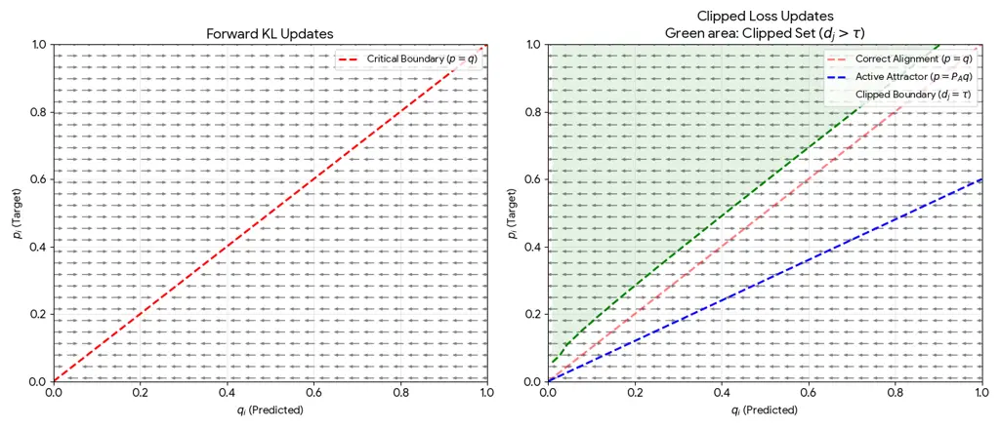

# When Clipping Reverses Correction: Failure Dynamics of Pointwise Forward-KL On-Policy Self-Distillation

Di Huang Affiliation: Department of Computer Science    Hao Li
Affiliation: Department of Computer Science    Yixin Chen
Affiliation: Department of Computer Science    Fuhai Li
Affiliation: Department of Computer Science Affiliation: Department of
PediatricsWashington University in St. Louis \*Correspondence:
fuhai.li@wustl.edu

###### Abstract

On-policy self-distillation (OPSD) trains a student on its own generated
responses using feedback from the same model conditioned on privileged
information. On mathematical reasoning, the original OPSD study finds
that stylistic tokens can dominate the training signal over math-related
tokens, and that pointwise clipping of the forward KL objective
stabilizes training. Pointwise clipping caps each vocabulary-wise
forward KL term at a fixed threshold before summing over the vocabulary.
Follow-up studies have adopted this clipping, but its effect on training
has not been directly examined. In matched training runs differing only
in whether clipping is applied, we observe that clipped runs produce
substantially more repetitions that persist to the end of the response
than their unclipped counterparts. We trace this failure to the clipped
objective. We prove that the clipped objective can fail to correct the
student toward the teacher and can instead push clipped and unclipped
token probabilities away from its teacher. Our training runs agree with
this analysis: inside repetitions, the clipped student places less
probability than its teacher on leaving the repetition, and more on
continuing it, whereas the unclipped runs stay close to their teachers.

|     |
| --- |
|     |

## 1 Introduction

Outcome rewards give a reasoning model one scalar for thousands of
tokens. On-policy distillation instead provides a per-token target from
a teacher evaluated on the student’s own responses (Agarwal et al.,
2024; Lu & Lab, 2025). Self-distillation uses the same network as both
teacher and student, replacing a stronger teacher model with access to
additional privilege information that is withheld from the student (Zhao
et al., 2026a; Hübotter et al., 2026; Shenfeld et al., 2026).
Self-distillation provides dense supervision, but how the student learns
from it depends on the training objective.

On-Policy Self-Distillation (OPSD) trains the student with a
pointwise-clipped forward KL objective (Zhao et al., 2026a). At each
response position, this objective clips each vocabulary-wise forward KL
term at a fixed threshold before summing over the vocabulary. The
authors introduced this pointwise clipping to keep stylistic tokens from
dominating the math-related tokens in the training signal, and many
subsequent methods retain it (Chen et al., 2026b; Li et al., 2026; Liu
et al., 2026; Shrestha & Tessier, 2026).

Studies using this recipe report response length inflation (Yang et al.,
2026), responses that fail to terminate within the generation budget
(Chen et al., 2026b; Ichihara et al., 2026), redundant reasoning chain
(Gu et al., 2026), and accuracy that declines after early gains (Zhao
et al., 2026a; Chen et al., 2026b; Ichihara et al., 2026; Pan et al.,
2026; Zhang et al., 2026). Proposed explanations include a frozen
teacher that cannot adapt to the student (Chen et al., 2026b), shifts in
the teacher’s style or reasoning pattern induced by the privileged
context (Ichihara et al., 2026; Pan et al., 2026; Yang et al., 2026; Gu
et al., 2026). No study reports that pointwise clipped objective
contribute to the text degeneration, leaving this possibility open for
further investigation.

Prior work offers a partial mathematical description of this clipped
objective: a clipped term becomes constant and loses its direct gradient
(Chen et al., 2026b), and the clipped sum is no longer a divergence
(Chen et al., 2026b; Feng et al., 2026). These observations do not
establish which student distributions the clipped objective favors, in
particular whether minimizing it still brings a clipped token’s
probability closer to the teacher’s.

We trained the pointwise-clipped forward KL OPSD recipe with a frozen
reference-conditioned teacher and encountered a failure mode of text
degeneration: generations ended in periodic tails that never terminated.
When we removed only the clipping, nearly all of these loops
disappeared. The teacher and its privileged context are identical in the
two runs, so neither accounts for the difference. We therefore ask
whether, and through what mechanism, this clipped objective contributed
to this failure.

Our contributions therefore follow three questions: how the clipped
objective changes the logit gradient, where its minimum lies, and what
it does to training. The logit gradient (Section 4.1). We show that,
relative to exact forward KL, the clipped objective reverses the
direction in which gradient descent moves the logits, on every clipped
token and on unclipped token whose student probability lies within a
bounded range above the teacher’s. The minimizer (Section 4.2). We show
that, at a response position with the unclipped and clipped token sets
held fixed, the clipped objective is minimized only when the clipped
tokens’ probability is reduced to zero rather than restored toward the
teacher’s, and each unclipped token receives more probability than the
teacher assigns it. A lower total probability on the clipped tokens
always permits a lower objective value. Training runs (Sections 4.3). We
train four matched pairs of runs that differ only in whether clipping is
applied and vary whether the student and the teacher think. The clipped
runs produce far more repetitions that continue to the end of the
response than their unclipped runs. Inside repetitions, the clipped
student places less probability than its teacher on leaving, and more on
continuing, whereas the unclipped runs stay close to their teachers.
These observations are consistent with the logit-gradient reversals we
derived.

## 2 Related Work

#### Pointwise-clipped forward KL.

OPSD introduces the pointwise clipping with threshold $`\tau`$ (Zhao
et al., 2026a) on each vocabulary-wise forward KL term. Later studies
default threshold $`\tau=0.05`$ with training methods deviations(Tan &
Hong, 2026b; Hou et al., 2026; Zhang et al., 2026; Liu et al., 2026;
Wang et al., 2026; Chen et al., 2026a; Ichihara et al., 2026), at other
values and/or with training methods deviations (Chen et al., 2026b;
Ichihara et al., 2026; Shrestha & Tessier, 2026; Tan & Hong, 2026a;
Liang et al., 2026), or without stating one (Li et al., 2026; Zhao
et al., 2026b). Chen et al. (2026b) observe that a clipped term no
longer supplies a gradient, so the cap stops the student from following
large, mostly stylistic terms, and that a sum of capped signed terms is
not a divergence. Feng et al. (2026) notes that the clipped objective
equals exact forward KL wherever no term exceeds the threshold, so the
two share their gradient and Hessian around the student that matches the
teacher, but that elsewhere it can be negative.

#### Failures reported under the clipped objective.

OPSD reports its best checkpoint, yet its comparison of objectives
scores lower at 100 updates than at 50 (Zhao et al., 2026a). Chen et al.
(2026b) finds that its OPSD baseline loses accuracy from 100 to 200
updates while truncation doubles, and also stating frozen teacher that
cannot respond to what the student rejects as one of the limitations.
Zhang et al. (2026) find that their three SmolLM3 students fall below
the base model by 100 updates under multiple different configurations.
Ichihara et al. (2026) finds that, a teacher with a math question and a
solution to a physics question leaves many generations repetitive and
non-terminating, as compared to one with another math question’s
solution instead, attribute this to the context without isolating which
property is responsible, and leave deterioration under longer training
unexplained. Gu et al. (2026) observe that “OPSD trajectories often
recompute the same intermediate quantities or revise earlier steps
without new information, leading to long and redundant reasoning
chains,” and attribute this to a teacher conditioned on a single
reference solution.

## 3 Experimental Setup

#### Training design.

Our goal is to reproduce the training design of OPSD, which we
reimplement in the verl framework (Sheng et al., 2024). Each run starts
from Qwen3-4B (Yang et al., 2025), with a trainable full-parameter
student and a frozen teacher initialized from the same checkpoint. The
teacher additionally receives a reference solution and provides its
next-token distribution at every position of the student’s responses.

We train for 200 updates on the same 30k OpenThoughts (Guha et al., 2026) dataset used to train OPSD. We construct four matched
clipped/unclipped pairs. Within each pair, the data, sampling setup, and
model configuration are identical; only whether pointwise clipping is
applied differs and we call the unclipped run the _twin_ of the clipped
run. Table 1 summarizes the run-specific configurations. The complete
training hyperparameters and chat template are given in Appendix C. We
refer to each pair by its letter in Table 1. F, M, K and L differ only
in which side thinks. The letters index the order in which the
configurations entered our run series, each added to isolate one
variable from an earlier run.

#### Distillation objective.

OPSD computes its loss over the full vocabulary. Our teacher runs as a
separate inference service under SGLang (Zheng et al., 2024), and
sending a full-vocabulary distribution for every response position is
impractical, so our interface returns the teacher’s top-128 token log
probabilities at each response position.

At response position $`t`$, let support $`\mathcal{S}_{t}`$ denote set
of the teacher’s top-128 tokens, and let $`a_{t,i}`$ and $`b_{t,i}`$ be
the teacher’s and the student’s logits for token $`i`$. Both
distributions are formed by a softmax over $`\mathcal{S}_{t}`$ at
temperature $`T=1.1`$,

```math
p_{t,i}=\frac{\exp(a_{t,i}/T)}{\sum_{j\in\mathcal{S}_{t}}\exp(a_{t,j}/T)},\qquad q_{t,i}=\frac{\exp(b_{t,i}/T)}{\sum_{j\in\mathcal{S}_{t}}\exp(b_{t,j}/T)},\qquad i\in\mathcal{S}_{t}, \tag{1}
```

so that the teacher distribution $`p_{t}`$ and the student distribution
$`q_{t}`$ each sum to one on $`\mathcal{S}_{t}`$. We then define the
vocabulary-wise forward KL term of token $`i`$:

```math
d_{t,i}=p_{t,i}\log\frac{p_{t,i}}{q_{t,i}}. \tag{2}
```

Here $`d_{t,i}`$ is positive where the student assigns token $`i`$ less
probability than the teacher and negative where it assigns more. Exact
forward KL sums $`d_{t,i}`$ directly, whereas the pointwise-clipped
forward KL of OPSD first replaces any $`d_{t,i}`$ above $`\tau`$ by
$`\tau`$, leaving smaller and negative $`d_{t,i}`$ unchanged:

```math
D_{\mathrm{FKL},t}=D_{\mathrm{KL}}(p_{t}\|q_{t})=\sum_{j\in\mathcal{S}_{t}}d_{t,j},\qquad D_{\mathrm{clip},t}=\sum_{j\in\mathcal{S}_{t}}\min(d_{t,j},\tau),\qquad\tau=0.05. \tag{3}
```

Despite the symbol, which follows OPSD’s notation,
$`D_{\mathrm{clip},t}`$ is not a divergence, since it can be negative.
The training loss is the mean of $`D_{\mathrm{clip},t}`$ in the clipped
runs, or of $`D_{\mathrm{FKL},t}`$ in the unclipped runs, over all valid
response positions in the update. We call the tokens in the teacher
support $`\mathcal{S}_{t}`$ the _candidate tokens_ at position $`t`$, to
distinguish them from the token the student emits there, and a candidate
token with $`d_{t,i}>\tau`$ an _over-threshold_ token. In a clipped run,
the over-threshold tokens are the clipped tokens.

| Family | Reference | Student/teacher thinking | Response cap |
| ------ | --------- | ------------------------ | ------------ |
| F      | yes       | off/on                   | 18,432       |
| M      | yes       | on/off                   | 18,432       |
| K      | yes       | off/off                  | 8,192        |
| L      | yes       | on/on                    | 18,432       |

Table 1: Paired training families. All use Qwen3-4B, teacher top-128
support, $`T=1.1`$, 30 problems per update with one rollout per problem,
learning rate of $`1\times 10^{-6}`$, forward-KL distillation, and one
trajectory per run. Clipped runs use $`\tau=0.05`$ and their unclipped
runs do not.

#### Trajectory analysis and evaluation.

At every response position of every update, we record the teacher’s and
the student’s log probabilities on the candidate tokens. We can
therefore compute both the clipped objective and exact forward KL at the
same response positions in both runs of each pair. Full capture details
are provided in Appendix C.

We evaluate checkpoints saved every 25 training updates on AIME 2025
(Zhang & Math-AI, 2025) and AIME 2024 (Zhang & Math-AI, 2024). The main
text reports AIME 2025 only, with two metrics: per-sample accuracy
(avg@12) and the terminal loop rate (generation ended in periodic tails
that never terminated). The complete AIME 2024 and AIME 2025 results,
and evaluation configuration are given in Appendix D.

## 4 Failure Dynamics of Pointwise Clipping

### 4.1 Pointwise clipping reverses the logit gradient

For an over-threshold candidate token, the exact forward KL and the
pointwise-clipped forward KL produce gradients on that token’s logit
with opposite signs. Exact KL gives a negative gradient, whereas the
clipped objective gives a positive gradient. For a candidate token that
is not over-threshold, the two gradients again have opposite signs
exactly when the student’s probability exceeds the teacher’s but stays
below the teacher’s probability divided by the teacher’s total
probability on the tokens that are not over-threshold: exact KL then
gives a positive gradient, whereas the clipped objective gives a
negative one.

Fix one response position and suppress the index $`t`$. The teacher is
frozen, so $`p`$ and its support $`\mathcal{S}`$ do not depend on the
student’s logits. We use $`d_{i}=p_{i}\log(p_{i}/q_{i})`$ from
Equation 2. Let $`z_{i}=b_{i}/T`$ be the temperature-scaled student
logit, so that $`q_{i}=\exp(z_{i})/\sum_{j\in\mathcal{S}}\exp(z_{j})`$.
We call the derivative with respect to $`z_{i}`$ as its _logit gradient_
for candidate token $`i`$. Define

```math
A=\{j\in\mathcal{S}:d_{j}\leq\tau\},\qquad C=\mathcal{S}\setminus A,\qquad P_{A}=\sum_{j\in A}p_{j}.
```

Here, $`A`$ and $`C`$ are the active and clipped candidate token sets,
and $`P_{A}`$ is the teacher’s total probability mass on the active set.
Equation 3 becomes

```math
D_{\mathrm{clip}}=\sum_{j\in A}p_{j}\log\frac{p_{j}}{q_{j}}+|C|\tau. \tag{4}
```

###### Proposition 1 (Logit gradient reversal on clipped candidate tokens).

For any threshold $`\tau>0`$ and any student distribution with
$`d_{j}\neq\tau`$ for every $`j\in\mathcal{S}`$, the gradient of
$`D_{\mathrm{clip}}`$ with respect to $`z_{i}`$ is

```math
\frac{\partial D_{\mathrm{clip}}}{\partial z_{i}}=P_{A}q_{i}-p_{i}\mathbf{1}\{i\in A\}. \tag{5}
```

Every clipped candidate token $`i\in C`$ satisfies

```math
\frac{\partial D_{\mathrm{FKL}}}{\partial z_{i}}=q_{i}-p_{i}<0,\qquad\frac{\partial D_{\mathrm{clip}}}{\partial z_{i}}=P_{A}q_{i}>0. \tag{6}
```

Appendix A gives the proof. Both inequalities in Equation 6 are strict,
and clipping is what makes their gradient signs differ. For a clipped
candidate token $`i\in C`$, $`d_{i}>\tau>0`$ implies $`p_{i}>q_{i}`$, so
the exact KL logit gradient $`q_{i}-p_{i}`$ is negative. Pointwise
clipping instead caps the term $`d_{j}`$ of every $`j\in C`$ at the
constant $`\tau`$, which removes the gradient term $`-p_{i}`$ in
Equation 5. The remaining gradient $`P_{A}q_{i}`$ is positive because
$`q_{i}>0`$ under softmax and $`P_{A}>0`$. Since $`p`$ and $`q`$ are
both normalized over the same support, there exists some $`j`$ with
$`q_{j}\geq p_{j}`$. Hence $`d_{j}\leq 0<\tau`$, so $`j\in A`$, and
therefore $`P_{A}\geq p_{j}>0`$, since Equation 1 gives $`p_{j}>0`$.

Clipping also changes the logit gradient on the active candidate tokens
when the student probability lies within a bounded range above the
teacher’s. When the clipped set is nonempty, $`P_{A}<1`$, so
$`p_{i}/P_{A}>p_{i}`$, for $`i\in A`$. By equation 5, if the student’s
probability in the active set satisfies

```math
p_{i}<q_{i}<p_{i}/P_{A},
```

the exact KL gradient $`q_{i}-p_{i}`$ is positive while the clipped
gradient $`P_{A}q_{i}-p_{i}<0`$ is negative.

### 4.2 Clipped objective moves probability from clipped to active tokens

Proposition 1 shows that, for a clipped candidate token, which already
has less student than the teacher probability, the logit gradient of the
clipped objective points toward lowering its logit, whereas that of
exact KL points toward raising it. This reversal does not by itself
determine whether the token’s probability is still restored toward the
teacher’s, as under exact KL, because softmax probabilities depend on
all logits. We therefore consider the clipped candidate tokens jointly
and ask what happens at the minimizer of the clipped objective at a
fixed response position: does an optimized student favor restoring the
probability toward the teacher’s, or reduced even further?

At a fixed token position, for fixed nonempty active and clipped sets
$`A`$ and $`C`$, we consider the constrained problem:

```math
\displaystyle\underset{q}{\operatorname{minimize}} \displaystyle D_{\mathrm{clip}}(q)=\sum_{j\in\mathcal{S}}\min(d_{j},\tau)
```

```math
\displaystyle\text{subject to} \displaystyle q_{i}\geq 0\ \text{ for every }i\in\mathcal{S},\qquad\sum_{j\in\mathcal{S}}q_{j}=1,
```

```math
\displaystyle d_{i}\leq\tau\ \text{ for every }i\in A,\qquad d_{i}>\tau\ \text{ for every }i\in C.
```

The feasible set of student distributions, denoted the region $`R`$, is
the _fixed clipping region_ of $`(A,C)`$. Unlike in Section 4.1, where
$`q`$ is a softmax of finite logits and every $`q_{i}>0`$, we allow
$`q_{i}=0`$ so that a minimizer exists. For such a candidate token
$`i`$, $`d_{i}=+\infty`$, the capped term is still $`\tau`$, so it stays
clipped. Everywhere in $`R`$, $`D_{\mathrm{clip}}`$ is given by
Equation 4 with these fixed sets.

###### Proposition 2 (Fixed-region minimizer of the clipped objective).

The clipped objective has a unique minimizer over the fixed clipping
region $`R`$,

```math
q_{i}^{\star}=\begin{cases}p_{i}/P_{A},&i\in A,\\
0,&i\in C,\end{cases}\qquad D_{\mathrm{clip}}(q^{\star})=P_{A}\log P_{A}+|C|\tau. \tag{7}
```

Let $`Q_{C}=\sum_{j\in C}q_{j}`$ be the student’s total probability mass
on the clipped set. For every value of $`Q_{C}`$ attained in $`R`$, if
its value is further added to the constraints without inconsistencies
with the other constraints, the minimum of $`D_{\mathrm{clip}}`$ over
the distributions of $`q`$’s in $`R(Q_{C})`$ with that value is strictly
increasing in $`Q_{C}`$:

```math
D_{\mathrm{clip}}^{\star}(Q_{C})=P_{A}\log P_{A}-P_{A}\log(1-Q_{C})+|C|\tau,\qquad\frac{dD_{\mathrm{clip}}^{\star}}{dQ_{C}}=\frac{P_{A}}{1-Q_{C}}>0. \tag{8}
```

Appendix B gives the proof. At the minimizer $`q^{\star}`$ of the
clipped objective, the clipped candidate tokens’ total probability is
not restored toward the teacher’s total $`1-P_{A}`$ on these tokens but
reduced further, to zero. All probability then lies on $`A`$, and the
student’s probability on each active candidate token equals the
teacher’s probability $`p_{i}`$ multiplied by the same factor
$`1/P_{A}>1`$. Clipping therefore does more than limit the influence of
dominant terms: inside a fixed clipping region, its minimizer assigns
zero student probability to clipped candidate tokens, even though they
already have less student probability than teacher probability, and
gives each active candidate token more student probability than the
teacher probability.

A softmax of finite logits, however, never attains $`q^{\star}`$,
because it gives every clipped token positive probability. Hence
$`Q_{C}>0`$, and $`D_{\mathrm{clip}}(q^{\star})`$ is an unattained
infimum. For such a student, Equation 8 characterizes the minimum
attainable objective value for each $`Q_{C}`$. The lower the student’s
total probability on the clipped candidate tokens, the closer the
objective can come to this infimum, and restoring $`Q_{C}`$ toward the
teacher’s $`1-P_{A}`$ only moves this minimum attainable value farther
from it.

### 4.3 Clipped updates turn started repetition into persistent loops

In matched runs that differ only in whether the objective is clipped,
clipped training produces substantially more terminal loops than exact
KL training (Figure 1; Table 3). We defined the repetition-related
terminologies in Table 2 and use them throughout the section. The
preceding two sections give a candidate cause: the clipped objective
reverses the logit gradient of exact KL on every clipped token and on
active tokens within a bounded range above the teacher’s probability.
Within a fixed clipping region, its minimizer sets the clipped tokens’
probability to zero and gives each active token more probability than
the teacher, instead of correcting the student toward the teacher. If,
in training, the teacher’s exit tokens are clipped and the copy token
lies in this range, the clipped objective would push the student to
leave a repetition less often and to continue it more often than the
teacher, so repetitions and terminal loops would be more than in the
exact KL twin, although the size of this effect may differ across
families. Both results describe one response position with a given
clipped set, whereas in training the clipped set changes across sampled
responses and positions, so whether the student’s probabilities move
this way must be measured. We compare student and teacher exit mass at
the first copy, which every repetition passes through, and the copy
token’s logit gradient under both objectives before maturity. These
comparisons can support the logit gradient reversal as the path from
clipping to loops but cannot establish that path.

| Term              | Definition                                                                                                                                                                                                                                     |
| ----------------- | ---------------------------------------------------------------------------------------------------------------------------------------------------------------------------------------------------------------------------------------------- |
| Periodic segment  | A maximal contiguous sequence $`x_{s},\ldots,x_{e}`$, where $`s`$ and $`e`$ are its start and end positions, with period $`\ell`$ and length $`L=e-s+1>\ell`$. $`L`$ satisfies $`x_{t}=x_{t-\ell}`$ for $`s+\ell\leq t\leq e`$.                |
| Repetition        | A periodic segment with at least two complete period $`\lfloor L/l\rfloor\geq 2`$.                                                                                                                                                             |
| Mature repetition | A repetition $`\lfloor L/l\rfloor\geq 3`$ with $`L\geq 30`$ tokens.                                                                                                                                                                            |
| Terminal loop     | Mature repetition that reaches the last response token.                                                                                                                                                                                        |
| Copy token        | At a position $`t\geq s+\ell`$ while the periodic continuation remains, the token $`c_{t}=x_{t-\ell}`$ that continues the period. Its teacher and student probabilities are $`p_{t,\mathrm{copy}}`$ and $`q_{t,\mathrm{copy}}`$, respectively. |
| First copy        | Copy token belong to the second completed occurrence of the period, at positions $`s+\ell,\ldots,s+2\ell-1`$.                                                                                                                                  |
| Exit mass         | At position $`t`$, the probability assigned to tokens other than the copy token: $`1-p_{t,\mathrm{copy}}`$ for the teacher and $`1-q_{t,\mathrm{copy}}`$ for the student.                                                                      |

Table 2: Definitions used to characterize token repetition and analyze
its continuation. The upper block defines periodic segments,
repetitions, mature repetitions, and terminal loops. The lower block
defines the first copy, copy token, and exit mass.

Figure 1: Loop outcome over training, one trajectory per run. Each point
is the number of the 30 rollouts sampled at that update that end in a
terminal loop. Clipped runs in red, unclipped twins in blue. Shaded
windows are three phases: early (updates 1–25, gray), ignition (F 51–75,
M 76–100, K 151–175, L 101–125, orange), and late (updates 176–200,
pink).

#### Outcome.

We define three 25-update phases: an early phase at the start of
training, an ignition window at each clipped run’s loop onset, and a
late phase at the end of training. In the early phase, terminal loops
are nearly absent from every run. The exact KL runs remain there for the
whole run, never exceeding 2 of 30 rollouts at any update. The clipped
runs do not. Each run has a family-specific onset after which terminal
loops recur, and over the full run it produces 25 to 450 times as many
of them as its twin. The result is shown in Figure 1. The thinking-mode
configuration sets both the scale and the ignition time.

#### Trend.

Table 3 follows repetitions ($`N\geq 2`$) through three phases. In the
early phase the two runs of every pair are indistinguishable except run
L. They generate repetition and mature repetition at the same rate. From
ignition on, two amplifications hold. First, a repetition grows into a
mature repetition ($`N\geq 3`$ and $`L\geq 30`$) more often under
clipping than in the twin. The count $`N(\text{mat.}\mid N\geq 2)`$ is
8.6 to over 400 times the twin’s, and the rate
$`P(\text{mat.}\mid N\geq 2)`$ 4.5 to over 150 times. Second, far more
repetitions end as terminal loops: 26 to 381 per phase in the clipped
runs, against at most two in any twin.

#### Family-specific loop patterns.

With student thinking off and teacher thinking on (F), the student
writes answer-mode derivations that the teacher scores where its own
thinking block would begin. The student chains the repeated
“$`\Rightarrow`$” where the teacher prefers \text. This two-token cycle
supplies most mature repetitions at ignition, and by the late phase all
of them are terminal loops. With both modes off (K), student and teacher
share the answer register, and most of its terminal loops are
answer-closing formatting such as nested “\boxed{”. The teacher prefers
a content command such as \text or \frac. With both modes on (L), most
mature repetitions lie inside the thinking block and repeat an equation
or a reasoning frame such as “Let me compute:”, where the teacher’s
preferred alternative varies, most often a space, an opening
parenthesis, or a different word such as “take”. Most of its mature
repetitions exit rather than become terminal. With student thinking on
and teacher thinking off (M), the teacher’s prompt contains a closed,
empty thinking block, so the teacher scores the student’s thinking as
answer text, and both runs stop emitting the closing tag. At ignition,
M’s terminal loops repeat an answer-closing mark such as a check mark
inside the unclosed thinking block, where the teacher prefers the
end-of-response token \<\|im_end\|\>.

#### Exit mass at the first copy.

We dive deep into the training signal in each runs and how clipped
objective applied to it. We examine whether clipping suppresses exit
mass at the first copy of a repetition, terms defined in Table 2. Let
$`\mathcal{F}_{u}`$ denotes the window containing first-copy positions
of all detected repetitions with periods $`2\leq\ell\leq 50`$ across
responses generated at update $`u`$. For each nonoverlapping five-update
block $`B`$, we compute the student/teacher exit-mass ratio by summing
each distribution’s exit mass over these positions:

```math
R_{B}=\frac{\sum_{u\in B}\sum_{t\in\mathcal{F}_{u}}(1-q_{u,t,\mathrm{copy}})}{\sum_{u\in B}\sum_{t\in\mathcal{F}_{u}}(1-p_{u,t,\mathrm{copy}})}.
```

We then measure the clipped ratio of the teacher’s exit mass that lies
on clipped tokens. For the unclipped twins, we report the corresponding
fraction on over-threshold tokens (Figure 2a). Pooled over the early
phase, the student/teacher exit-mass ratio is .79 to 1.04. Under exact
KL, the ratio is close to 1 across the whole run, even though 33 to 45
percent of the teacher’s exit mass still lies on over-threshold tokens.
Under clipping, however, the exit mass ratio falls to .41 to .70 in the
late phase, while 71 to 84 percent of the teacher’s exit mass is
clipped. Thus, at the first copy, the clipped student places less
probability than its teacher on leaving the repetition, and most of the
teacher’s exit mass lies on the tokens whose logit gradient
Proposition 1 reverses.

| Quantity                           | Arm     | F                                                                      | M                                                                      | K                                                                      | L                                                                      |
| ---------------------------------- | ------- | ---------------------------------------------------------------------- | ---------------------------------------------------------------------- | ---------------------------------------------------------------------- | ---------------------------------------------------------------------- |
| $`n(N\geq 2)`$                     | clipped | $`1195\!{\scriptscriptstyle\to}\!4954\!{\scriptscriptstyle\to}\!2814`$ | $`3852\!{\scriptscriptstyle\to}\!2666\!{\scriptscriptstyle\to}\!1304`$ | $`1163\!{\scriptscriptstyle\to}\!3757\!{\scriptscriptstyle\to}\!4024`$ | $`5952\!{\scriptscriptstyle\to}\!5704\!{\scriptscriptstyle\to}\!6374`$ |
|                                    | twin    | $`1237\!{\scriptscriptstyle\to}\!2395\!{\scriptscriptstyle\to}\!3154`$ | $`3288\!{\scriptscriptstyle\to}\!975\!{\scriptscriptstyle\to}\!1496`$  | $`1130\!{\scriptscriptstyle\to}\!1042\!{\scriptscriptstyle\to}\!1043`$ | $`3991\!{\scriptscriptstyle\to}\!2642\!{\scriptscriptstyle\to}\!3121`$ |
| $`N(\text{mat.}\mid N\geq 2)`$     | clipped | $`1\!{\scriptscriptstyle\to}\!790\!{\scriptscriptstyle\to}\!749`$      | $`6\!{\scriptscriptstyle\to}\!409\!{\scriptscriptstyle\to}\!69`$       | $`4\!{\scriptscriptstyle\to}\!170\!{\scriptscriptstyle\to}\!176`$      | $`16\!{\scriptscriptstyle\to}\!195\!{\scriptscriptstyle\to}\!328`$     |
|                                    | twin    | $`5\!{\scriptscriptstyle\to}\!3\!{\scriptscriptstyle\to}\!7`$          | $`16\!{\scriptscriptstyle\to}\!1\!{\scriptscriptstyle\to}\!8`$         | $`6\!{\scriptscriptstyle\to}\!4\!{\scriptscriptstyle\to}\!8`$          | $`7\!{\scriptscriptstyle\to}\!20\!{\scriptscriptstyle\to}\!9`$         |
| $`P(\text{mat.}\mid N\geq 2)`$     | clipped | $`.001\!{\scriptscriptstyle\to}\!.159\!{\scriptscriptstyle\to}\!.266`$ | $`.002\!{\scriptscriptstyle\to}\!.153\!{\scriptscriptstyle\to}\!.053`$ | $`.003\!{\scriptscriptstyle\to}\!.045\!{\scriptscriptstyle\to}\!.044`$ | $`.003\!{\scriptscriptstyle\to}\!.034\!{\scriptscriptstyle\to}\!.051`$ |
|                                    | twin    | $`.004\!{\scriptscriptstyle\to}\!.001\!{\scriptscriptstyle\to}\!.002`$ | $`.005\!{\scriptscriptstyle\to}\!.001\!{\scriptscriptstyle\to}\!.005`$ | $`.005\!{\scriptscriptstyle\to}\!.004\!{\scriptscriptstyle\to}\!.008`$ | $`.002\!{\scriptscriptstyle\to}\!.008\!{\scriptscriptstyle\to}\!.003`$ |
| $`N(\text{term.}\mid\text{mat.})`$ | clipped | $`0\!{\scriptscriptstyle\to}\!307\!{\scriptscriptstyle\to}\!381`$      | $`1\!{\scriptscriptstyle\to}\!206\!{\scriptscriptstyle\to}\!26`$       | $`0\!{\scriptscriptstyle\to}\!109\!{\scriptscriptstyle\to}\!155`$      | $`1\!{\scriptscriptstyle\to}\!30\!{\scriptscriptstyle\to}\!35`$        |
|                                    | twin    | $`0\!{\scriptscriptstyle\to}\!0\!{\scriptscriptstyle\to}\!1`$          | $`6\!{\scriptscriptstyle\to}\!0\!{\scriptscriptstyle\to}\!1`$          | $`0\!{\scriptscriptstyle\to}\!1\!{\scriptscriptstyle\to}\!2`$          | $`0\!{\scriptscriptstyle\to}\!1\!{\scriptscriptstyle\to}\!0`$          |

Table 3: Progression of repetition by training phase (period 2–50).
Rows: $`n(N\geq 2)`$, the number of repetitions;
$`N(\text{mat.}\mid N\geq 2)`$, the mature repetitions among
repetitions; $`P(\text{mat.}\mid N\geq 2)`$ the proportion of
repetitions that mature; $`N(\text{term.}\mid\text{mat.})`$, the
terminal loops among mature repetition. Each cell reads early $`\to`$
ignition $`\to`$ late, the three phases of Figure 1, 750 rollouts each.

Figure 2: The copy token inside repetitions (period 2–50), with the
student’s probabilities taken before the sampler’s truncation. (a)
Student/teacher exit-mass ratio, one point per block of five updates
(1–5, …, 196–200). Lines without markers give the ratio of the teacher’s
exit mass on clipped tokens, or on over-threshold tokens in the twins
(right axis). (b) Copied positions between the first copy and maturity:
fraction with $`q_{\mathrm{copy}}>p_{\mathrm{copy}}`$. Dark bar:
$`q_{\mathrm{copy}}<p_{\mathrm{copy}}/P_{A}`$, where the logit gradient
of exact KL points toward lowering the copy logit and that of the
clipped objective toward raising it. Light bar: both point toward
lowering it. (c) The same copied positions, plus observed stopping
positions before maturity: mean
$`-\partial D/\partial z_{\mathrm{copy}}`$. Black and red: exact KL
(hypothetical) and clipped KL, respectively, evaluated on the same
positions and probabilities from the clipped run. Positive values point
toward raising the copy logit. Phases as in Table 3.

#### Copy token probability before maturity.

We next examine the positions a repetition passes through before it
becomes mature: how often the student places more probability than the
teacher on the copy token, and whether each objective corrects this
excess.

For each 25-update phase $`\phi`$, let $`\mathcal{G}_{\phi}`$ denote the
window of copied positions after the first copy and before maturity or
an observed stop. We record the fraction at which the student assigns
greater probability to the copy token than the teacher:

```math
R_{\phi}=\frac{\sum_{t\in\mathcal{G}_{\phi}}\mathbf{1}\{q_{t,\mathrm{copy}}>p_{t,\mathrm{copy}}\}}{|\mathcal{G}_{\phi}|},
```

where $`\mathbf{1}\{\cdot\}`$ is the indicator function and counts are
pooled across repetitions and updates within the phase. The result is in
Figure 2b. In the early phase, both runs of F, M, and L have
$`q_{\mathrm{copy}}>p_{\mathrm{copy}}`$ at 29 to 45 percent of these
positions. After ignition, this fraction falls to 4 to 6 percent in the
exact KL runs but 32 to 77 percent in the clipped runs. In the clipped
runs, $`q_{\mathrm{copy}}`$ lies specifically between
$`p_{\mathrm{copy}}`$ and $`p_{\mathrm{copy}}/P_{A}`$ at 4 to 34 percent
of positions. The dark part of each bar in Figure 2b shows the fraction
of positions at which the copy token’s logit gradient is reversed: the
clipped objective points toward raising the copy token logit where exact
KL points toward lowering it.

We then measure the gradient of each objective
$`D\in\{D_{\mathrm{FKL}},D_{\mathrm{clip}}\}`$ on the copy token. For
each phase $`\phi`$, we record the mean of
$`-\partial D/\partial z_{\mathrm{copy}}`$ over the window
$`\mathcal{G}_{\phi}`$ plus the observed stop positions, pooled across
repetitions and updates. We report the negative of the gradient so that
positive values point toward raising the copy token logit. We calculate
$`\partial D_{\mathrm{FKL}}/\partial z_{\mathrm{copy}}=q_{\mathrm{copy}}-p_{\mathrm{copy}}`$
and $`\partial D_{\mathrm{clip}}/\partial z_{\mathrm{copy}}`$, given by
Equation 5. We evaluate both objectives on the positions and
probabilities of the clipped run only, so that any difference between
the two means comes from the objective alone. Figure 2c shows the
result: the net direction of each objective’s logit gradient on the copy
token over all positions of the window. In the early phase, both values
are nearly zero in every family. In the ignition and late phases, the
mean of $`-\partial D_{\mathrm{FKL}}/\partial z_{\mathrm{copy}}`$ is
negative, pointing toward lowering the copy token logit, whereas that of
$`D_{\mathrm{clip}}`$ is slightly positive in every family, pointing
toward raising it. At the positions that decide whether a repetition
becomes mature, exact KL would thus correct the student’s excess
probability on the copy token, and the clipped objective removes this
correction.

## 5 Held-Out Evaluation

We evaluate every checkpoint, saved at 25-update intervals, on the
AIME 2025 problems. Figure 3 reports accuracy and terminal loop rate at
saved checkpoints. It tests whether clipping increases looping and
whether the additional loops accompany accuracy losses relative to the
unclipped twin.

No run significantly outperforms the base model (Figure 3a). K show only
minimal accuracy changes, whereas F, L, and M degrade substantially, and
most clipped runs perform worse than their unclipped twins. M is the
exception: both of its run collapse, and its twin reads zero only
because it stops closing the thinking tag, so the strict scorer finds no
answer.

Terminal loop rate separates the runs more sharply (Figure 3b). Every
clipped run ends in a terminal loop far more often than the base model,
while every unclipped twin stays near the base rate. Looped responses
fail to reach a final answer and are therefore scored as incorrect.
Accuracy losses in the clipped runs follow the same ordering as their
loop rates: smallest in K, intermediate in F, and largest in L and M.

With 12 samples per problem, no clipped endpoint has lower pass@12 than
its twin on either benchmark: every problem solved by the twin is also
solved at least once by the clipped arm. We interpret this pattern as
evidence that clipped training reduces per-sample reliability. However,
the unclipped F and L twins remain below the fixed-base mean despite
rarely looping. Thus, clipping-induced looping contributes to the
observed degradation, but does not explain all accuracy loss relative to
the base model.

Appendix D gives avg@12, terminal loop rate, and pass@12 at every
checkpoint on AIME 2024 and AIME 2025 benchmarks.

## 6 Conclusion

Pointwise clipping was introduced to stabilize training against dominant
stylistic tokens, but it also changes the direction in which forward kl
corrects the student. In training this change appears as repetitions
that continue to the end of the response, a loss of training stability.
Because this failure develops over updates, studies that train with the
pointwise-clipped objective could report accuracy and a text
degeneration measure, across checkpoints, in addition to their best
checkpoint. We hope that understanding these clipping dynamics helps
make on-policy self-distillation stable enough for its gains to persist
over longer training.

Figure 3: AIME 2025 across training. (a) Avg@12, the mean correct ratio
over 12 samples for each of 30 problems at the checkpoint saved after
each 25 updates. (b) The ratio of the 360 responses per checkpoint that
end in a terminal loop. Solid curves with circles are the clipped runs,
dashed curves with squares their unclipped twins. Each trained curve is
one realized trajectory. The black arrow on each vertical axis marks the
base model, the fixed starting checkpoint averaged over eight
evaluation-sampling seeds.

## References

- Agarwal et al. (2024) Rishabh Agarwal, Nino Vieillard, Yongchao Zhou,
  Piotr Stanczyk, Sabela Ramos Garea, Matthieu Geist, and Olivier
  Bachem. On-policy distillation of language models: Learning from
  self-generated mistakes. In _The Twelfth International Conference on
  Learning Representations_, 2024. URL
  [https://openreview.net/forum?id=3zKtaqxLhW](https://openreview.net/forum?id=3zKtaqxLhW).
- Chen et al. (2026a) Yunmeng Chen, Kunyu Wang, Peihan Li, Yi Wang,
  Shuyin Xia, Yi Liu, Xinyong Cheng, Dehui Wang, Xiangyong Zhai, Yanxing
  Liu, et al. Scope-opsd: Fisher-conditioned privileged subspaces for
  on-policy self-distillation. _arXiv preprint arXiv:2609.12579_, 2026a.
- Chen et al. (2026b) Yutong Chen, Guangfu Guo, Zhichao Xu, and Kunpeng
  Liu. Dualopsd: Adaptive privileged teachers for on-policy
  self-distillation. _arXiv preprint arXiv:2608.26019_, 2026b.
- Feng et al. (2026) Yangyang Feng, Zhuoyan Feng, and Junlan Chen. Past:
  Privileged adaptation from complete student trajectories for on-policy
  self-distillation. _arXiv preprint arXiv:2608.08726_, 2026.
- Gu et al. (2026) Siyi Gu, Jialin Chen, Sophia Zhou, Arman Cohan, and
  Rex Ying. Rethinking reward supervision: Rubric-conditioned
  self-distillation. _arXiv preprint arXiv:2606.19327_, 2026.
- Guha et al. (2026) Etash Guha, Ryan Marten, Sedrick Keh, Negin Raoof,
  Georgios Smyrnis, Hritik Bansal, Marianna Nezhurina, Jean Mercat,
  Trung Vu, Zayne Sprague, et al. Openthoughts: Data recipes for
  reasoning models. In _International Conference on Learning
  Representations_, volume 2026, pp. 108059–108130, 2026.
- Hou et al. (2026) ZhiYan Hou, Xinyu Tang, Hongyan An, Jianjin Zhang,
  Weizhen Wang, Yunyun Han, Gengsheng Li, Xiangzhao Hao, Haiyun Guo,
  Wenbin Hu, et al. Dash: Divergence-adaptive supervision horizons for
  on-policy self-distillation of reasoning models. _arXiv preprint
  arXiv:2608.06243_, 2026.
- Hübotter et al. (2026) Jonas Hübotter, Frederike Lübeck, Lejs Behric,
  Anton Baumann, Marco Bagatella, Daniel Marta, Ido Hakimi, Idan
  Shenfeld, Thomas Kleine Buening, Carlos Guestrin, et al. Reinforcement
  learning via self-distillation. _arXiv preprint
  arXiv:2601.20802_, 2026.
- Ichihara et al. (2026) Yuki Ichihara, Naoto Iwase, Mohammad Atif
  Quamar, and Junpei Komiyama. Privileged solutions or context-induced
  teacher behavior? dissecting on-policy self-distillation. _arXiv
  preprint arXiv:2608.09228_, 2026.
- (10) Hynek Kydlíček. Math-Verify: Math Verification Library. URL
  [https://github.com/huggingface/math-verify](https://github.com/huggingface/math-verify).
- Li et al. (2026) Yijiang Li, Bingyang Wang, Yijun Liang, Yunjie Tian,
  Di Fu, and Nuno Vasconcelos. On-policy self-distillation without any
  supervision. _arXiv preprint arXiv:2608.06296_, 2026.
- Liang et al. (2026) Zihan Liang, Yufei Ma, Ben Chen, Zhipeng Qian,
  Xuxin Zhang, Huangyu Dai, and Lingtao Mao. Search-e1:
  Self-distillation drives self-evolution in search-augmented reasoning.
  _arXiv preprint arXiv:2605.22511_, 2026.
- Liu et al. (2026) Xiaogeng Liu, Xinyan Wang, Yingzi Ma, Yechao Zhang,
  and Chaowei Xiao. When are teacher tokens reliable? position-weighted
  on-policy self-distillation for reasoning. _arXiv preprint
  arXiv:2605.21606_, 2026.
- Lu & Lab (2025) Kevin Lu and Thinking Machines Lab. On-policy
  distillation. _Thinking Machines Lab: Connectionism_, 2025. doi:
  10.64434/tml.20251026.
  https://thinkingmachines.ai/blog/on-policy-distillation.
- Pan et al. (2026) Leyi Pan, Shuchang Tao, Yunpeng Zhai, Lingzhe Zhang,
  Zhaoyang Liu, Bolin Ding, Aiwei Liu, and Lijie Wen. Rlcsd:
  Reinforcement learning with contrastive on-policy self-distillation.
  _arXiv preprint arXiv:2606.11709_, 2026.
- Shenfeld et al. (2026) Idan Shenfeld, Mehul Damani, Jonas Hübotter,
  and Pulkit Agrawal. Self-distillation enables continual learning. In
  _Forty-third International Conference on Machine Learning_, 2026. URL
  [https://openreview.net/forum?id=qA6FgH0nnZ](https://openreview.net/forum?id=qA6FgH0nnZ).
- Sheng et al. (2024) Guangming Sheng, Chi Zhang, Zilingfeng Ye, Xibin
  Wu, Wang Zhang, Ru Zhang, Yanghua Peng, Haibin Lin, and Chuan Wu.
  Hybridflow: A flexible and efficient rlhf framework. _arXiv preprint
  arXiv: 2409.19256_, 2024.
- Shrestha & Tessier (2026) Samyak Shrestha and Alexander Tessier.
  Rethinking privileged information in on-policy self-distillation.
  _arXiv preprint arXiv:2608.18271_, 2026.
- Tan & Hong (2026a) Zhiquan Tan and Yinrong Hong. Paint:
  Partial-solution adaptive interpolated training for self-distilled
  reasoners. _arXiv preprint arXiv:2604.26573_, 2026a.
- Tan & Hong (2026b) Zhiquan Tan and Yinrong Hong. Self-supervised
  on-policy distillation for reasoning language models. _arXiv preprint
  arXiv:2605.17497_, 2026b.
- Wang et al. (2026) Jiaxuan Wang, Xuan Ouyang, Zhiyu Chen, Yulan Hu,
  Zheng Pan, Xin Li, and Lan-Zhe Guo. Trace: Distilling where it matters
  via token-routed self on-policy alignment. _arXiv preprint
  arXiv:2605.10194_, 2026.
- Yang et al. (2025) An Yang, Anfeng Li, Baosong Yang, Beichen Zhang,
  Binyuan Hui, Bo Zheng, Bowen Yu, Chang Gao, Chengen Huang, Chenxu Lv,
  et al. Qwen3 technical report. _arXiv preprint
  arXiv:2505.09388_, 2025.
- Yang et al. (2026) Yuxiao Yang, Xiaoyun Wang, and Weitong Zhang.
  Ogls-sd: On-policy self-distillation with outcome-guided logit
  steering for llm reasoning. _arXiv preprint arXiv:2605.12400_, 2026.
- Zhang et al. (2026) XiuYu Zhang, Wei Chow, Junfeng Fang, Zhenkai
  Liang, and Tat-Seng Chua. What does privileged information add to
  on-policy self-distillation? _arXiv preprint arXiv:2609.20612_, 2026.
- Zhang & Math-AI (2024) Yifan Zhang and Team Math-AI. American
  invitational mathematics examination (aime) 2024, 2024.
- Zhang & Math-AI (2025) Yifan Zhang and Team Math-AI. American
  invitational mathematics examination (aime) 2025, 2025.
- Zhao et al. (2026a) Siyan Zhao, Zhihui Xie, Mengchen Liu, Jing Huang,
  Guan Pang, Feiyu Chen, and Aditya Grover. Self-distilled reasoner:
  On-policy self-distillation for large language models. In _Forty-third
  International Conference on Machine Learning_, 2026a. URL
  [https://openreview.net/forum?id=Jpxfof0EaS](https://openreview.net/forum?id=Jpxfof0EaS).
- Zhao et al. (2026b) Xuyang Zhao, Liting Zhang, Zichen Xu, Zhihu Wang,
  Xu Caiyue, Shiwan Zhao, and Qicheng Li. Is more privileged information
  better? From solution traces to problem-solving structure in
  self-distilled reasoning. _arXiv preprint arXiv:2608.01589_, 2026b.
  URL
  [https://arxiv.org/abs/2608.01589](https://arxiv.org/abs/2608.01589).
- Zheng et al. (2024) Lianmin Zheng, Liangsheng Yin, Zhiqiang Xie,
  Chuyue Sun, Jeff Huang, Cody H Yu, Shiyi Cao, Christos Kozyrakis, Ion
  Stoica, Joseph E Gonzalez, et al. Sglang: Efficient execution of
  structured language model programs. _Advances in neural information
  processing systems_, 37:62557–62583, 2024.

## Appendix A Proof of Proposition 1.

Fix a response position and suppress its index $`t`$. Hold the finite
support $`\mathcal{S}`$ and the teacher distribution $`p`$ fixed. By
Equation 1, $`p_{j},q_{j}>0`$ for every $`j\in\mathcal{S}`$, and both
distributions sum to one on $`\mathcal{S}`$. For the temperature-scaled
student logits $`z_{j}=b_{j}/T`$, write

```math
Z=\sum_{j\in\mathcal{S}}\exp(z_{j}),\qquad q_{j}=\frac{\exp(z_{j})}{Z}.
```

Consider any logit vector $`z^{\circ}`$ satisfying $`d_{j}\neq\tau`$ for
all $`j\in\mathcal{S}`$, and let $`A`$ and $`C`$ be its active and
clipped sets as defined in Section 4.1. Each
$`d_{j}=p_{j}\log(p_{j}/q_{j})`$ is smooth in $`z`$, since $`p_{j}`$ is
fixed and $`q_{j}`$ is a positive smooth function of $`z`$. Because
$`\mathcal{S}`$ is finite and no $`d_{j}`$ equals $`\tau`$ at
$`z^{\circ}`$, there is an open neighborhood of $`z^{\circ}`$ on which
$`A`$ and $`C`$, and hence $`P_{A}=\sum_{j\in A}p_{j}`$, remain
unchanged. On this neighborhood, Equation 4 gives

```math
D_{\mathrm{clip}}=\sum_{j\in A}d_{j}+|C|\tau,
```

with $`A`$ and $`C`$ fixed at their values at $`z^{\circ}`$. This
expression is smooth in $`z`$, so $`D_{\mathrm{clip}}`$ is
differentiable on the neighborhood and its gradient is obtained by
differentiating the displayed expression.

For any $`i,j\in\mathcal{S}`$, the softmax identity
$`\log q_{j}=z_{j}-\log Z`$ gives

```math
d_{j}=p_{j}\log p_{j}-p_{j}z_{j}+p_{j}\log Z.
```

Because $`p`$ is fixed and

```math
\frac{\partial z_{j}}{\partial z_{i}}=\mathbf{1}\{j=i\},\qquad\frac{\partial\log Z}{\partial z_{i}}=\frac{1}{Z}\frac{\partial Z}{\partial z_{i}}=\frac{\exp(z_{i})}{Z}=q_{i},
```

it follows that

```math
\frac{\partial d_{j}}{\partial z_{i}}=-p_{j}\mathbf{1}\{j=i\}+p_{j}q_{i}. \tag{9}
```

Since $`D_{\mathrm{FKL}}=\sum_{j\in\mathcal{S}}d_{j}`$ by Equation 3,
summing Equation 9 over $`\mathcal{S}`$ gives

```math
\displaystyle\frac{\partial D_{\mathrm{FKL}}}{\partial z_{i}} \displaystyle=\sum_{j\in\mathcal{S}}\bigl(-p_{j}\mathbf{1}\{j=i\}+p_{j}q_{i}\bigr)
```

```math
\displaystyle=-p_{i}+q_{i}\sum_{j\in\mathcal{S}}p_{j}=q_{i}-p_{i},
```

at every logit vector, including points on the clipping boundaries. For
the clipped objective, $`|C|\tau`$ has zero derivative on the
neighborhood under consideration. Summing only over $`A`$ therefore
gives

```math
\displaystyle\frac{\partial D_{\mathrm{clip}}}{\partial z_{i}} \displaystyle=\sum_{j\in A}\bigl(-p_{j}\mathbf{1}\{j=i\}+p_{j}q_{i}\bigr)
```

```math
\displaystyle=-p_{i}\mathbf{1}\{i\in A\}+q_{i}\sum_{j\in A}p_{j}
```

```math
\displaystyle=P_{A}q_{i}-p_{i}\mathbf{1}\{i\in A\}. \tag{10}
```

This establishes Equation 5.

Now let $`i\in C`$. Then $`d_{i}>\tau>0`$, and $`p_{i}>0`$ implies

```math
\log\frac{p_{i}}{q_{i}}>0,\qquad\text{hence}\qquad p_{i}>q_{i}.
```

Consequently,
$`\partial D_{\mathrm{FKL}}/\partial z_{i}=q_{i}-p_{i}<0`$. Since
$`i\notin A`$, Equation 10 reduces to
$`\partial D_{\mathrm{clip}}/\partial z_{i}=P_{A}q_{i}`$. To establish
strict positivity, first note that $`q_{i}>0`$. Moreover,
$`\sum_{j\in\mathcal{S}}q_{j}=\sum_{j\in\mathcal{S}}p_{j}`$ implies the
existence of a token $`j`$ with $`q_{j}\geq p_{j}`$. For this token,

```math
d_{j}=p_{j}\log\frac{p_{j}}{q_{j}}\leq 0<\tau,
```

so $`j\in A`$ and $`P_{A}\geq p_{j}>0`$. Therefore,

```math
\frac{\partial D_{\mathrm{FKL}}}{\partial z_{i}}=q_{i}-p_{i}<0,\qquad\frac{\partial D_{\mathrm{clip}}}{\partial z_{i}}=P_{A}q_{i}>0,
```

which proves Equation 6. Since $`z^{\circ}`$ was arbitrary away from the
clipping boundaries, the result holds at every point specified in the
proposition. ∎

#### A simpler example of updating dynamics

To understand the direction of the updates on the logits as suggested by
the previous proposition, the example below can give some intuitions. In
the most general case, decreasing certain logits on index $`i`$ does not
automatically mean to decrease the corresponding probability
$`q_{i}`$–but in the case when other $`z`$ values are fixed, this holds
true. We can construct a continuous-time dynamical system to mimic the
optimization process on the objective functions of the two model
versions, defining the parameter updates as the negative gradient of the
loss with respect to the logits
($`\frac{dz_{i}}{dt}=-\nabla_{z_{i}}D`$). For the exact forward kl
objective $`D_{FKL}`$, this logit update is defined continuously as:

```math
\frac{dz_{i}}{dt}(t)=p_{i}-q_{i}(t)
```

For the clipped objective, the gradient space is instead split into a
piecewise system governed by the local divergence threshold $`d_{j}`$:

```math
\frac{dz_{i}}{dt}(t)=\begin{cases}p_{i}-P_{A}q_{i}(t),&\text{if }d_{j}\leq\tau\\
-P_{A}q_{i}(t),&\text{if }d_{j}>\tau\end{cases}
```

To map these raw logit updates $`\frac{dz_{i}}{dt}`$ to the resulting
probability trajectories $`\frac{dq_{i}}{dt}`$, we must account for the
coupling effect of the softmax function, where the evolution of a single
probability $`q_{i}`$ depends on the updates to all logits in the
vocabulary. However, to isolate the localized forces acting on a single
prediction and visualize them within a simplified 2D direction field
diagram, we introduce a specific framing assumption where all other
logits $`z_{j},j\neq i`$ are temporarily held constant
($`\frac{dz_{j}}{dt}=0`$). Under this isolated assumption, because the
softmax function is strictly monotonically increasing with respect to
its own logit, $`\frac{dq_{i}}{dt}`$ acts as a positive monotonic
scaling of $`\frac{dz_{i}}{dt}`$. This strict sign preservation
guarantees that the direction of the probability update exactly mirrors
the direction of the logit update, providing the mathematical
justification to map the negative gradients directly onto a 2D phase
portrait to evaluate their critical points and structural stability. The
direction field, null-cline, contour for the clipping region and the
diagonal (for the correct alignment p=q) is shown in figure 4.



Figure 4: A simple example of updating direction of q under different
losses(Forward KL v.s. Clipped Loss Updates.

Applying this localized framework to the exact forward kl divergence
(left) demonstrates that the gradient acts as a proportional restorative
force across the entire probability space, driving the system toward a
single, globally stable equilibrium along the critical boundary where
$`p_{i}=q_{i}`$ (the diagonal). Because the directional derivative
relies entirely on the unaltered residual, the vector field smoothly and
pushes the predictions directly toward perfect calibration. This ensures
the parameter space remains entirely free of dead zones, structural
barriers, or competing attractors.

Conversely, the clipped objective (right) shatters the global stability
of the forward kl. In the active set (unshaded area on bottom-right
corner) where the divergence is low ($`d_{j}<\tau`$), scaling the
predicted term by $`P_{A}`$ artificially shifts the fixed point away
from true alignment, forcing the vectors toward a false attractor along
the line $`p_{i}=P_{A}q_{i}`$ (the blue line with slope that is less
steep). When the local divergence exceeds the $`\tau`$ threshold, the
system crosses into the clipped set (green shaded area on the top left),
completely erasing the target probability $`q_{i}`$ from the derivative
calculation. Inside this boundary, the dynamic devolves into pure
probability decay. Because the gradient equation yields a negative
update ($`-P_{A}q_{i}`$), it relentlessly pushes the predictions until
$`0`$ is reached, structurally preventing the system from ever
recovering true calibration when initialized or driven too far from the
target. To sum up, the green shaded area along with the area between the
red and blue lines on the right are where the arrows for the clipped
objectives are in a different direction as compared with the ones for
forward KL. One might observe that if you trace a phase portrait alone
the arrows, then if you start with a point in either clipped or active
set, the trajectory never goes into the other–this may give some
intuition for boundary check for the next proposition as well.

## Appendix B Proof of Proposition 2

#### Setup.

Fix one response position. Let $`p`$ be the teacher distribution on the
finite candidate set $`\mathcal{S}`$. It is a softmax output, so
$`p_{i}>0`$ for every $`i\in\mathcal{S}`$, and
$`\sum_{i\in\mathcal{S}}p_{i}=1`$. Let $`\tau>0`$. Student distributions
are the points of the closed simplex,

```math
q_{i}\geq 0\quad(i\in\mathcal{S}),\qquad\sum_{i\in\mathcal{S}}q_{i}=1,
```

so probabilities equal to zero are allowed. We use the convention
$`p_{j}\log(p_{j}/0)=+\infty`$. The capped term of a zero-probability
token is then $`\min\{+\infty,\tau\}=\tau`$, so

```math
D_{\mathrm{clip}}(q)=\sum_{j\in\mathcal{S}}\min\Bigl\{p_{j}\log\frac{p_{j}}{q_{j}},\ \tau\Bigr\}
```

is finite on the whole simplex.

Let $`A`$ and $`C`$ be fixed nonempty disjoint sets with
$`A\cup C=\mathcal{S}`$. The _fixed clipping region_ $`R`$ is the set of
student distributions $`q`$ with

```math
p_{i}\log\frac{p_{i}}{q_{i}}\leq\tau\quad(i\in A),\qquad p_{j}\log\frac{p_{j}}{q_{j}}>\tau\quad(j\in C).
```

Write $`P_{A}=\sum_{i\in A}p_{i}`$ and $`Q_{C}=\sum_{j\in C}q_{j}`$.
Since $`A`$ and $`C`$ are nonempty and every $`p_{i}>0`$, we have
$`0<P_{A}<1`$. For $`q\in R`$, every active term is at most $`\tau`$, so
its minimum with $`\tau`$ is the term itself, and every clipped term
exceeds $`\tau`$, so its minimum with $`\tau`$ is $`\tau`$. Hence, for
$`q\in R`$ (Equation 4),

```math
D_{\mathrm{clip}}(q)=\sum_{i\in A}p_{i}\log\frac{p_{i}}{q_{i}}+\sum_{j\in C}\tau=F(q_{A})+|C|\tau,\qquad F(q_{A})=\sum_{i\in A}p_{i}\log\frac{p_{i}}{q_{i}},\qquad q_{A}=(q_{i})_{i\in A}.
```

This identity is valid on $`R`$. Outside $`R`$ it fails in general,
because a term that exceeds $`\tau`$ is capped.

Claim. The distribution $`q^{\star}`$ with $`q^{\star}_{i}=p_{i}/P_{A}`$
for $`i\in A`$ and $`q^{\star}_{j}=0`$ for $`j\in C`$ is the unique
minimizer of $`D_{\mathrm{clip}}`$ over $`R`$, and
$`D_{\mathrm{clip}}(q^{\star})=P_{A}\log P_{A}+|C|\tau`$ (Equation 7).

#### Overview.

The proof has two steps. _Step 1_ settles how much mass sits on the
clipped set: any such mass can be moved onto an active token without
leaving $`R`$, and doing so strictly lowers the loss, so only
distributions with $`Q_{C}=0`$ can compete. _Step 2_ settles how that
mass is split within the active set. Dropping the active-token clipping
inequalities leaves a larger, smooth problem: minimize the strictly
convex function $`F`$ over the positive allocations with
$`\sum_{i\in A}q_{i}=1`$. Its unique global minimizer is the Lagrange
point $`q_{i}=p_{i}/P_{A}`$, which exceeds $`p_{i}`$ because
$`P_{A}<1`$. _The crucial implication is that the unique global
minimizer of the larger, smooth problem satisfies the original clipping
constraints._ It is therefore also the unique minimizer of the original,
restricted problem. The larger problem is only an auxiliary device:
outside $`R`$ the formula $`F`$ is not the clipped objective, and
nothing is claimed there.

#### Membership facts (M1)–(M4).

Steps 1 and 2 use four facts about when a token is active or clipped.
These are the only places where the threshold enters the proof. Fix a
token $`i`$ and regard its term $`p_{i}\log(p_{i}/x)`$ as a function of
its student probability $`x\geq 0`$, with value $`+\infty`$ at $`x=0`$.
For $`x>0`$,

```math
\frac{d}{dx}\Bigl[p_{i}\log\frac{p_{i}}{x}\Bigr]=\frac{d}{dx}\bigl[p_{i}\log p_{i}-p_{i}\log x\bigr]=-\frac{p_{i}}{x}<0,
```

so the term is strictly decreasing in $`x`$ on $`(0,\infty)`$, and at
$`x=p_{i}`$ it equals $`p_{i}\log 1=0`$.

1.  (M1)
    _Every active token has $`q_{i}>0`$._ If $`q_{i}=0`$, the term is
    $`+\infty>\tau`$, so token $`i`$ would be clipped, not active.
    Consequently $`F`$ is finite on $`R`$.
2.  (M2)
    _An active token that gains probability stays active._ If
    $`q^{\prime}_{i}\geq q_{i}>0`$, then, because the term is
    decreasing,
    $`p_{i}\log(p_{i}/q^{\prime}_{i})\leq p_{i}\log(p_{i}/q_{i})\leq\tau`$.
3.  (M3)
    _A clipped token that loses probability stays clipped, including at
    zero._ Let $`0\leq q^{\prime}_{j}\leq q_{j}`$. If
    $`q^{\prime}_{j}=0`$, the term is $`+\infty>\tau`$. If
    $`q^{\prime}_{j}>0`$, then $`q_{j}>0`$ as well and
    $`p_{j}\log(p_{j}/q^{\prime}_{j})\geq p_{j}\log(p_{j}/q_{j})>\tau`$.
4.  (M4)
    _A token with $`q_{i}\geq p_{i}`$ is active for every $`\tau>0`$._
    Because the term is decreasing,
    $`p_{i}\log(p_{i}/q_{i})\leq p_{i}\log(p_{i}/p_{i})=0<\tau`$.

#### Step 1: mass on the clipped set prevents optimality.

Let $`q\in R`$ with $`Q_{C}>0`$. Pick any active token $`k\in A`$ and
move all clipped mass onto it:

```math
q^{\prime}_{k}=q_{k}+Q_{C},\qquad q^{\prime}_{j}=0\ \ (j\in C),\qquad q^{\prime}_{i}=q_{i}\ \ (i\in A,\ i\neq k).
```

_Normalization._
$`\sum_{i\in\mathcal{S}}q^{\prime}_{i}=\sum_{i\in A,\,i\neq k}q_{i}+(q_{k}+Q_{C})+0=\sum_{i\in A}q_{i}+Q_{C}=1`$.

_Same region._ Token $`k`$ gains probability, so it stays active by
(M2). Every clipped token drops to zero, so it stays clipped by (M3).
The other active tokens are unchanged. Hence $`q^{\prime}\in R`$, and
the identity $`D_{\mathrm{clip}}=F+|C|\tau`$ applies to both $`q`$ and
$`q^{\prime}`$.

_Difference._ The constants $`|C|\tau`$ cancel, and so do all active
terms with $`i\neq k`$. What remains is the $`k`$-th term:

```math
\displaystyle D_{\mathrm{clip}}(q^{\prime})-D_{\mathrm{clip}}(q) \displaystyle=p_{k}\log\frac{p_{k}}{q_{k}+Q_{C}}-p_{k}\log\frac{p_{k}}{q_{k}}
```

```math
\displaystyle=p_{k}\bigl[\log q_{k}-\log(q_{k}+Q_{C})\bigr]=p_{k}\log\frac{q_{k}}{q_{k}+Q_{C}}.
```

Here $`p_{k}`$ and $`q_{k}`$ are the teacher and student probabilities
of the single receiving token $`k`$, not the set masses. We have
$`p_{k}>0`$, $`q_{k}>0`$ by (M1), and $`Q_{C}>0`$, so
$`0<q_{k}/(q_{k}+Q_{C})<1`$, the logarithm is negative, and

```math
D_{\mathrm{clip}}(q^{\prime})<D_{\mathrm{clip}}(q).
```

Hence every distribution in $`R`$ with $`Q_{C}>0`$ has strictly larger
loss than some distribution in $`R`$ with $`Q_{C}=0`$.

#### Step 2: optimal allocation on the active set.

Throughout this step $`p_{i}>0`$ for every $`i`$, because the teacher is
a softmax output, and $`q_{i}>0`$ for every $`i\in A`$ by (M1). Neither
is an extra assumption. Consequently $`F`$ is finite and smooth wherever
it is evaluated, and every Hessian entry $`p_{i}/q_{i}^{2}`$ below is
strictly positive.

_(a) The restricted problem._ After Step 1 the competitors are the
distributions $`q\in R`$ with $`Q_{C}=0`$. For such $`q`$ we have
$`q_{j}=0`$ on $`C`$, $`q_{i}>0`$ on $`A`$, $`\sum_{i\in A}q_{i}=1`$,
and $`D_{\mathrm{clip}}(q)=F(q_{A})+|C|\tau`$. So we must minimize $`F`$
over

```math
K_{\tau}=\Bigl\{q_{A}\in\mathbb{R}^{A}:\ q_{i}>0,\ \ \sum_{i\in A}q_{i}=1,\ \ p_{i}\log\frac{p_{i}}{q_{i}}\leq\tau\ \ \forall i\in A\Bigr\}.
```

Conversely, every $`q_{A}\in K_{\tau}`$, extended by zeros on $`C`$, is
a distribution in $`R`$ with $`Q_{C}=0`$.

_(b) The relaxed problem._ Drop the threshold inequalities and let

```math
K=\Bigl\{q_{A}\in\mathbb{R}^{A}:\ q_{i}>0,\ \ \sum_{i\in A}q_{i}=1\Bigr\}\ \supseteq\ K_{\tau}.
```

We minimize the same formula $`F`$ over $`K`$. On
$`K\setminus K_{\tau}`$ the formula $`F`$ is no longer the clipped
objective, because there some term exceeds $`\tau`$ and would be capped.
The relaxed problem is an auxiliary smooth problem. It enters the
argument only through the inclusion $`K_{\tau}\subseteq K`$, and nothing
is claimed about $`D_{\mathrm{clip}}`$ outside $`R`$.

_(c) Derivatives of $`F`$._ We differentiate on the positive orthant
$`\{q_{A}:\ q_{i}>0\}`$, which is open, convex, and contains $`K`$.
Write

```math
F(q_{A})=\sum_{i\in A}\bigl[p_{i}\log p_{i}-p_{i}\log q_{i}\bigr].
```

Only the $`i`$-th summand depends on $`q_{i}`$, and $`p_{i}\log p_{i}`$
is a constant, so

```math
\frac{\partial F}{\partial q_{i}}=\frac{\partial}{\partial q_{i}}\bigl[p_{i}\log p_{i}-p_{i}\log q_{i}\bigr]=0-p_{i}\cdot\frac{1}{q_{i}}=-\frac{p_{i}}{q_{i}}.
```

For the second derivatives, differentiate
$`-p_{i}/q_{i}=-p_{i}\,q_{i}^{-1}`$ with respect to $`q_{m}`$. If
$`m=i`$,

```math
\frac{\partial^{2}F}{\partial q_{i}^{2}}=\frac{\partial}{\partial q_{i}}\bigl[-p_{i}\,q_{i}^{-1}\bigr]=-p_{i}\cdot(-1)\,q_{i}^{-2}=\frac{p_{i}}{q_{i}^{2}}.
```

If $`m\neq i`$, the expression $`-p_{i}/q_{i}`$ does not depend on
$`q_{m}`$, so $`\partial^{2}F/\partial q_{i}\,\partial q_{m}=0`$. The
Hessian is therefore diagonal,
$`\nabla^{2}F(q_{A})=\mathrm{diag}\bigl(p_{i}/q_{i}^{2}\bigr)_{i\in A}`$,
and for every vector $`v\in\mathbb{R}^{A}`$,

```math
v^{\top}\nabla^{2}F(q_{A})\,v=\sum_{i\in A}\sum_{m\in A}v_{i}\,\frac{\partial^{2}F}{\partial q_{i}\,\partial q_{m}}\,v_{m}=\sum_{i\in A}\frac{p_{i}}{q_{i}^{2}}\,v_{i}^{2}.
```

Every coefficient $`p_{i}/q_{i}^{2}`$ is strictly positive, because
$`p_{i}>0`$ and $`q_{i}>0`$. If $`v\neq 0`$, some $`v_{i}\neq 0`$, so
the sum is strictly positive: the Hessian is positive definite at every
point of the orthant.

_(d) Strict convexity._ A function $`f`$ on a convex set is _strictly
convex_ if $`f(\theta x+(1-\theta)y)<\theta f(x)+(1-\theta)f(y)`$ for
all $`x\neq y`$ in the set and all $`\theta\in(0,1)`$. We use two
standard facts. (F1) A twice differentiable function on an open convex
set whose Hessian is positive definite at every point is strictly
convex. (F2) A differentiable strictly convex function lies strictly
above each of its tangent planes: $`f(y)>f(x)+\nabla f(x)^{\top}(y-x)`$
for all $`x\neq y`$. By (c) and (F1), $`F`$ is strictly convex on the
orthant, independently of normalization, and hence on its convex subset
$`K`$.

_(e) Lagrange point._ Introduce a multiplier $`\lambda`$ for the
normalization constraint:

```math
\mathcal{L}(q_{A},\lambda)=F(q_{A})+\lambda\Bigl(\sum_{m\in A}q_{m}-1\Bigr).
```

Using (c) and
$`\frac{\partial}{\partial q_{i}}\bigl(\sum_{m\in A}q_{m}-1\bigr)=1`$,

```math
\frac{\partial\mathcal{L}}{\partial q_{i}}=-\frac{p_{i}}{q_{i}}+\lambda=0\quad\Longrightarrow\quad\lambda=\frac{p_{i}}{q_{i}}\quad\Longrightarrow\quad q_{i}=\frac{p_{i}}{\lambda}\qquad\text{for every }i\in A.
```

So the ratio $`p_{i}/q_{i}`$ is the same for every active token.
Substituting into the normalization constraint
$`\partial\mathcal{L}/\partial\lambda=\sum_{i\in A}q_{i}-1=0`$,

```math
1=\sum_{i\in A}\frac{p_{i}}{\lambda}=\frac{1}{\lambda}\sum_{i\in A}p_{i}=\frac{P_{A}}{\lambda}\quad\Longrightarrow\quad\lambda=P_{A}\quad\Longrightarrow\quad q^{\star}_{i}=\frac{p_{i}}{P_{A}}\qquad(i\in A).
```

This is the only stationary point, since the equations force
$`q_{i}=p_{i}/\lambda`$ and then $`\lambda=P_{A}`$. It lies in $`K`$:
$`q^{\star}_{i}>0`$ and $`\sum_{i\in A}q^{\star}_{i}=P_{A}/P_{A}=1`$.

_(f) Global minimality in the relaxed problem._ The gradient at the
Lagrange point is

```math
\frac{\partial F}{\partial q_{i}}\Big|_{q^{\star}_{A}}=-\frac{p_{i}}{q^{\star}_{i}}=-\frac{p_{i}}{p_{i}/P_{A}}=-P_{A}\quad\text{for every }i\in A,\qquad\text{that is,}\qquad\nabla F(q^{\star}_{A})=-P_{A}\mathbf{1}.
```

Let $`q_{A}\in K`$ with $`q_{A}\neq q^{\star}_{A}`$. By (F2) with
$`x=q^{\star}_{A}`$ and $`y=q_{A}`$,

```math
F(q_{A})>F(q^{\star}_{A})+\nabla F(q^{\star}_{A})^{\top}(q_{A}-q^{\star}_{A}),
```

and the last term vanishes because both allocations sum to one:

```math
\nabla F(q^{\star}_{A})^{\top}(q_{A}-q^{\star}_{A})=\sum_{i\in A}(-P_{A})(q_{i}-q^{\star}_{i})=-P_{A}\Bigl(\sum_{i\in A}q_{i}-\sum_{i\in A}q^{\star}_{i}\Bigr)=-P_{A}(1-1)=0.
```

Hence $`F(q_{A})>F(q^{\star}_{A})`$ for every $`q_{A}\in K`$ other than
$`q^{\star}_{A}`$: the Lagrange point is the unique global minimizer of
the relaxed problem.

_(g) Membership of the candidate._ Since $`0<P_{A}<1`$, we have
$`q^{\star}_{i}=p_{i}/P_{A}>p_{i}`$ for every $`i\in A`$, and

```math
p_{i}\log\frac{p_{i}}{q^{\star}_{i}}=p_{i}\log\frac{p_{i}}{p_{i}/P_{A}}=p_{i}\log P_{A}<0<\tau,
```

in agreement with (M4). Every active term lies strictly below the
threshold, for every $`\tau>0`$, so the candidate cannot cross into the
clipped set. Thus $`q^{\star}_{A}\in K_{\tau}`$, and with
$`q^{\star}_{j}=0`$ on $`C`$ we get $`q^{\star}\in R`$.

_(h) Back to the restricted problem._ Let $`q_{A}\in K_{\tau}`$ with
$`q_{A}\neq q^{\star}_{A}`$. Since $`K_{\tau}\subseteq K`$, part (f)
gives $`F(q_{A})>F(q^{\star}_{A})`$, and $`q^{\star}_{A}\in K_{\tau}`$
by (g). So $`q^{\star}_{A}`$ is also the unique global minimizer of the
restricted problem: a minimizer over the larger set that lies in the
smaller set is the minimizer over the smaller set. Its value is

```math
F(q^{\star}_{A})=\sum_{i\in A}p_{i}\log\frac{p_{i}}{p_{i}/P_{A}}=\sum_{i\in A}p_{i}\log P_{A}=\Bigl(\sum_{i\in A}p_{i}\Bigr)\log P_{A}=P_{A}\log P_{A}.
```

#### Conclusion.

Let $`q\in R`$ with $`q\neq q^{\star}`$. _Case $`Q_{C}>0`$._ Step 1
gives $`q^{\prime}\in R`$ with $`Q_{C}=0`$ and
$`D_{\mathrm{clip}}(q)>D_{\mathrm{clip}}(q^{\prime})`$, and Step 2 gives
$`D_{\mathrm{clip}}(q^{\prime})=F(q^{\prime}_{A})+|C|\tau\geq F(q^{\star}_{A})+|C|\tau=D_{\mathrm{clip}}(q^{\star})`$.
So $`D_{\mathrm{clip}}(q)>D_{\mathrm{clip}}(q^{\star})`$. _Case
$`Q_{C}=0`$._ Then $`q_{j}=0=q^{\star}_{j}`$ on $`C`$, so
$`q\neq q^{\star}`$ means $`q_{A}\neq q^{\star}_{A}`$, and Step 2 gives
$`D_{\mathrm{clip}}(q)=F(q_{A})+|C|\tau>F(q^{\star}_{A})+|C|\tau=D_{\mathrm{clip}}(q^{\star})`$.

In both cases $`D_{\mathrm{clip}}(q)>D_{\mathrm{clip}}(q^{\star})`$.
Hence $`q^{\star}`$ is the unique minimizer of $`D_{\mathrm{clip}}`$
over $`R`$, with
$`D_{\mathrm{clip}}(q^{\star})=P_{A}\log P_{A}+|C|\tau`$. Existence is
not assumed: the minimizer is exhibited. ∎

#### Fixed $`Q_{C}`$ (Equation 8).

Let $`c`$ be a value of $`Q_{C}`$ attained in $`R`$. For $`q\in R`$ with
$`Q_{C}=c`$, the loss is $`F(q_{A})+|C|\tau`$ with $`q_{i}>0`$ and
$`\sum_{i\in A}q_{i}=1-c`$, and it does not depend on how $`c`$ is split
among the clipped tokens as long as it does not make any one of them
active by going over the $`d>\tau`$ restriction. Repeat Step 2 with the
constraint $`\sum_{i\in A}q_{i}=1-c`$. Stationarity again gives
$`q_{i}=p_{i}/\lambda`$, and now

```math
1-c=\sum_{i\in A}\frac{p_{i}}{\lambda}=\frac{P_{A}}{\lambda}\quad\Longrightarrow\quad\lambda=\frac{P_{A}}{1-c}\quad\Longrightarrow\quad q^{\star}_{i}(c)=\frac{1-c}{P_{A}}\,p_{i}.
```

The gradient there is $`-p_{i}/q^{\star}_{i}(c)=-P_{A}/(1-c)`$ in every
coordinate, so for any other positive allocation with the same sum,
$`\nabla F(q^{\star}_{A}(c))^{\top}(q_{A}-q^{\star}_{A}(c))=-\frac{P_{A}}{1-c}\bigl((1-c)-(1-c)\bigr)=0`$,
and (F2) gives $`F(q_{A})>F(q^{\star}_{A}(c))`$: this is the unique
global minimizer of the relaxed problem at level $`c`$.

_Membership._ Every clipped token has a term above $`\tau>0`$, so
$`\log(p_{j}/q_{j})>0`$ and $`q_{j}<p_{j}`$. Summing over $`C`$ gives
$`c<\sum_{j\in C}p_{j}=1-P_{A}`$, hence $`(1-c)/P_{A}>1`$ and
$`q^{\star}_{i}(c)>p_{i}`$. By (M4) every active term is below $`\tau`$,
so the relaxed minimizer satisfies the threshold inequalities and is
also the minimizer of the restricted problem at level $`c`$. Its loss is

```math
\displaystyle D^{\star}_{\mathrm{clip}}(c) \displaystyle=\sum_{i\in A}p_{i}\log\frac{p_{i}}{(1-c)\,p_{i}/P_{A}}+|C|\tau
```

```math
\displaystyle=P_{A}\log\frac{P_{A}}{1-c}+|C|\tau=P_{A}\log P_{A}-P_{A}\log(1-c)+|C|\tau,
```

and

```math
\frac{dD^{\star}_{\mathrm{clip}}}{dc}=-P_{A}\cdot\frac{-1}{1-c}=\frac{P_{A}}{1-c}>0.
```

The level-$`c`$ minimizer is unique in its active coordinates only.

#### Remarks.

_(i) $`F`$ is not a KL divergence._ Its arguments $`p_{A}`$ and
$`q_{A}`$ are sub-probability vectors, and $`F`$ can be negative:
$`F(q^{\star}_{A})=P_{A}\log P_{A}<0`$. The proof uses only the strict
convexity of $`F`$.

_(ii) Scope._ The statement concerns one fixed clipping region; no
comparison across clipping patterns is claimed. A softmax over finite
logits assigns every token positive probability, so such a student never
equals $`q^{\star}`$; by the fixed-$`Q_{C}`$ statement the optimal loss
at level $`c`$ decreases to $`D_{\mathrm{clip}}(q^{\star})`$ as
$`c\downarrow 0`$, so $`q^{\star}`$ is approached but not attained.

## Appendix C Training and Evaluation Configuration, Capture

#### Training configuration

In all eight runs, the student and the teacher are initialized from the
same Qwen3-4B checkpoint. Each clipped/unclipped pair receives the same
per-update problems. Table 4 lists the detailed training configuration
used in our experiment.

| Component                | Executed value                                                                                                                                                                     |
| ------------------------ | ---------------------------------------------------------------------------------------------------------------------------------------------------------------------------------- |
| Base checkpoint          | Qwen/Qwen3-4B                                                                                                                                                                      |
| Optimizer                | torch.optim.AdamW; learning rate $`10^{-6}`$; $`\beta=(0.9,0.999)`$; $`\epsilon=10^{-8}`$; weight decay $`0.01`$                                                                   |
| Schedule                 | Zero warmup. $`10^{-6}`$ constant.                                                                                                                                                 |
| Updates and checkpoints  | 200 updates; a checkpoint is saved every 25 updates                                                                                                                                |
| Seed                     | Training and data-loader seeds are 42                                                                                                                                              |
| Global update            | 30 problems, one rollout each                                                                                                                                                      |
| Prompt length cap        | 2,048 tokens; the response caps are given in Table 1                                                                                                                               |
| Training rollout sampler | Temperature $`1.1`$, top-$`p=0.8`$, top-$`k=20`$                                                                                                                                   |
| Teacher sampler          | The teacher returns its top-128 token log probabilities at temperature $`1.0`$                                                                                                     |
| Loss                     | Forward KL on the teacher’s top-128 tokens, both distributions renormalized on that support at temperature $`T=1.1`$; clipped runs use $`\tau=0.05`$, unclipped runs apply no clip |
| Hardware                 | Four H200 GPUs per run: three for the student’s training and rollouts, one for the dedicated SGLang teacher                                                                        |
| Software                 | Transformers 4.57.1; PyTorch 2.9.1+cu128; Ray 2.54.1; SGLang 0.5.9; CUDA toolkit 12.8.2                                                                                            |

Table 4: Training Configuration.

#### Message templates.

We give the user messages and the chat template used to serialize the
student and teacher prompts. The student’s user message is identical
across all eight runs. Its serialized prompt differs only by the empty
thinking block described below. Before chat serialization, the student’s
single user message is:

> Problem: {problem}
>
> Please reason step by step, and put your final answer within \boxed{}.

The teacher’s single user message is:

> Problem: {problem} Here is a reference solution to this problem: ===
> Reference Solution Begin === {answer} === Reference Solution End ===
> After reading the reference solution above, make sure you truly
> understand the reasoning behind each step - do not copy or paraphrase
> it. Now, using your own words and independent reasoning, derive the
> same final answer to the problem above. Please reason step by step,
> and put your final answer within \boxed{}.

The placeholder {answer} is filled with the full reference solution from
the dataset, not the final answer alone. Qwen serializes the one-message
prompt as

> \<\|im_start\|\>user  
> {content}\<\|im_end\|\>  
> \<\|im_start\|\>assistant

with no system or tool message. When thinking is disabled, the
serialization additionally appends an empty \<think\> block followed by
\</think\> and a blank line. The student’s sampled response token IDs
are appended to the teacher prompt before teacher scoring.

#### Capture setting.

At every response position of all 200 updates of all eight runs, the
trainer stores the token the student emitted, the IDs of the teacher’s
top-128 candidate tokens, the teacher’s log probabilities on those
tokens, and the student’s log probabilities on the same tokens, gathered
from its full-vocabulary log-softmax in the forward pass that computes
the loss.

## Appendix D Complete AIME2024 and AIME2025 Evaluation

#### Evaluation configuration.

Checkpoints 25, 50, 75, 100, 125, 150, 175, and 200 are evaluated on
AIME 2024 and AIME 2025. Each benchmark contains 30 problems.

Each saved checkpoint is evaluated with thinking enabled, drawing 12
samples per problem at temperature $`.6`$, top-$`p=.95`$, top-$`k=20`$,
and minimum-$`p=0`$, with a 38,912-token output budget. Scoring uses
only the text after the last closing thinking tag: Math-Verify
(Kydlíček, ) compares it with the reference answer, and if that
comparison fails, the last \boxed{} expression is compared with the
reference answer as a string or a number. We evaluate the same
base-model checkpoint eight times for both benchmarks to measure
variation from response sampling.

Figure 5: AIME 2024 across training, in the layout of Figure 3. (a)
Avg@12, the mean correct ratio over 12 samples for each of 30 problems
at the checkpoint saved after each 25 updates. (b) The ratio of the 360
responses per checkpoint that end in a terminal periodic loop. Solid
curves with circles are the clipped runs, dashed curves with squares
their unclipped twins. Each trained curve is one realized trajectory.
The black arrow on each vertical axis marks the base model, averaged
over eight evaluation-sampling seeds. The values appear in Table 6.

| \(a\) avg@12             |                  |          |          |          |          |          |          |          |
| ------------------------ | ---------------- | -------- | -------- | -------- | -------- | -------- | -------- | -------- |
| Run                      | 25               | 50       | 75       | 100      | 125      | 150      | 175      | 200      |
| F                        | $`.661`$         | $`.653`$ | $`.589`$ | $`.550`$ | $`.581`$ | $`.525`$ | $`.531`$ | $`.544`$ |
| F-no-clip                | $`.622`$         | $`.644`$ | $`.578`$ | $`.544`$ | $`.619`$ | $`.561`$ | $`.575`$ | $`.572`$ |
| M                        | $`.592`$         | $`.481`$ | $`.378`$ | $`.122`$ | $`.050`$ | $`.067`$ | $`.031`$ | $`.022`$ |
| M-no-clip                | $`.047`$         | $`.000`$ | $`.000`$ | $`.000`$ | $`.000`$ | $`.000`$ | $`.000`$ | $`.000`$ |
| K                        | $`.664`$         | $`.653`$ | $`.647`$ | $`.619`$ | $`.622`$ | $`.550`$ | $`.628`$ | $`.600`$ |
| K-no-clip                | $`.647`$         | $`.642`$ | $`.633`$ | $`.611`$ | $`.644`$ | $`.642`$ | $`.608`$ | $`.608`$ |
| L                        | $`.636`$         | $`.525`$ | $`.533`$ | $`.486`$ | $`.469`$ | $`.439`$ | $`.469`$ | $`.458`$ |
| L-no-clip                | $`.581`$         | $`.531`$ | $`.481`$ | $`.508`$ | $`.489`$ | $`.506`$ | $`.508`$ | $`.517`$ |
| Base                     | $`.645\;(.010)`$ |          |          |          |          |          |          |          |
| \(b\) terminal loop rate |                  |          |          |          |          |          |          |          |
| Run                      | 25               | 50       | 75       | 100      | 125      | 150      | 175      | 200      |
| F                        | $`.008`$         | $`.033`$ | $`.128`$ | $`.161`$ | $`.153`$ | $`.203`$ | $`.194`$ | $`.192`$ |
| F-no-clip                | $`.011`$         | $`.003`$ | $`.008`$ | $`.019`$ | $`.000`$ | $`.006`$ | $`.006`$ | $`.008`$ |
| M                        | $`.006`$         | $`.036`$ | $`.192`$ | $`.494`$ | $`.389`$ | $`.422`$ | $`.400`$ | $`.400`$ |
| M-no-clip                | $`.050`$         | $`.039`$ | $`.036`$ | $`.044`$ | $`.031`$ | $`.053`$ | $`.042`$ | $`.017`$ |
| K                        | $`.014`$         | $`.033`$ | $`.036`$ | $`.050`$ | $`.058`$ | $`.078`$ | $`.086`$ | $`.061`$ |
| K-no-clip                | $`.011`$         | $`.011`$ | $`.006`$ | $`.006`$ | $`.000`$ | $`.003`$ | $`.008`$ | $`.011`$ |
| L                        | $`.047`$         | $`.144`$ | $`.211`$ | $`.231`$ | $`.256`$ | $`.328`$ | $`.267`$ | $`.303`$ |
| L-no-clip                | $`.003`$         | $`.014`$ | $`.019`$ | $`.006`$ | $`.011`$ | $`.006`$ | $`.022`$ | $`.011`$ |
| Base                     | $`.006\;(.003)`$ |          |          |          |          |          |          |          |
| \(c\) pass@12            |                  |          |          |          |          |          |          |          |
| Run                      | 25               | 50       | 75       | 100      | 125      | 150      | 175      | 200      |
| F                        | $`.800`$         | $`.800`$ | $`.867`$ | $`.800`$ | $`.833`$ | $`.833`$ | $`.867`$ | $`.800`$ |
| F-no-clip                | $`.867`$         | $`.800`$ | $`.800`$ | $`.733`$ | $`.833`$ | $`.833`$ | $`.800`$ | $`.800`$ |
| M                        | $`.867`$         | $`.700`$ | $`.667`$ | $`.367`$ | $`.233`$ | $`.267`$ | $`.167`$ | $`.133`$ |
| M-no-clip                | $`.133`$         | $`.000`$ | $`.000`$ | $`.000`$ | $`.000`$ | $`.000`$ | $`.000`$ | $`.000`$ |
| K                        | $`.833`$         | $`.800`$ | $`.833`$ | $`.833`$ | $`.867`$ | $`.800`$ | $`.833`$ | $`.833`$ |
| K-no-clip                | $`.833`$         | $`.800`$ | $`.833`$ | $`.767`$ | $`.867`$ | $`.833`$ | $`.767`$ | $`.800`$ |
| L                        | $`.833`$         | $`.800`$ | $`.767`$ | $`.767`$ | $`.833`$ | $`.767`$ | $`.767`$ | $`.767`$ |
| L-no-clip                | $`.767`$         | $`.767`$ | $`.733`$ | $`.767`$ | $`.767`$ | $`.767`$ | $`.700`$ | $`.767`$ |
| Base                     | $`.817\;(.018)`$ |          |          |          |          |          |          |          |

Table 5: Complete AIME 2025 evaluation at every checkpoint (columns:
training update). (a) Avg@12, the mean correct ratio over 12 samples for
each of 30 problems. (b) Terminal loop rate, the ratio of the 360
responses that end in a terminal periodic loop. (c) Pass@12, the ratio
of the 30 problems solved by at least one of the 12 samples. Each
trained row is one realized trajectory. The base row gives the mean and,
in parentheses, the standard deviation over eight evaluation-sampling
seeds of the fixed starting checkpoint.

| \(a\) avg@12             |                  |          |          |          |          |          |          |          |
| ------------------------ | ---------------- | -------- | -------- | -------- | -------- | -------- | -------- | -------- |
| Run                      | 25               | 50       | 75       | 100      | 125      | 150      | 175      | 200      |
| F                        | $`.739`$         | $`.756`$ | $`.622`$ | $`.617`$ | $`.553`$ | $`.539`$ | $`.547`$ | $`.533`$ |
| F-no-clip                | $`.728`$         | $`.717`$ | $`.694`$ | $`.658`$ | $`.672`$ | $`.667`$ | $`.683`$ | $`.661`$ |
| M                        | $`.672`$         | $`.572`$ | $`.447`$ | $`.125`$ | $`.069`$ | $`.069`$ | $`.036`$ | $`.031`$ |
| M-no-clip                | $`.056`$         | $`.000`$ | $`.000`$ | $`.000`$ | $`.000`$ | $`.000`$ | $`.000`$ | $`.000`$ |
| K                        | $`.742`$         | $`.733`$ | $`.664`$ | $`.681`$ | $`.678`$ | $`.700`$ | $`.681`$ | $`.700`$ |
| K-no-clip                | $`.703`$         | $`.744`$ | $`.722`$ | $`.728`$ | $`.742`$ | $`.719`$ | $`.728`$ | $`.736`$ |
| L                        | $`.700`$         | $`.550`$ | $`.467`$ | $`.450`$ | $`.408`$ | $`.436`$ | $`.433`$ | $`.428`$ |
| L-no-clip                | $`.653`$         | $`.611`$ | $`.586`$ | $`.586`$ | $`.603`$ | $`.614`$ | $`.603`$ | $`.614`$ |
| Base                     | $`.727\;(.013)`$ |          |          |          |          |          |          |          |
| \(b\) terminal loop rate |                  |          |          |          |          |          |          |          |
| Run                      | 25               | 50       | 75       | 100      | 125      | 150      | 175      | 200      |
| F                        | $`.011`$         | $`.022`$ | $`.169`$ | $`.181`$ | $`.236`$ | $`.233`$ | $`.247`$ | $`.253`$ |
| F-no-clip                | $`.003`$         | $`.000`$ | $`.011`$ | $`.008`$ | $`.017`$ | $`.011`$ | $`.003`$ | $`.000`$ |
| M                        | $`.000`$         | $`.028`$ | $`.214`$ | $`.481`$ | $`.386`$ | $`.475`$ | $`.406`$ | $`.444`$ |
| M-no-clip                | $`.039`$         | $`.072`$ | $`.069`$ | $`.064`$ | $`.072`$ | $`.067`$ | $`.067`$ | $`.072`$ |
| K                        | $`.019`$         | $`.017`$ | $`.061`$ | $`.081`$ | $`.064`$ | $`.033`$ | $`.058`$ | $`.031`$ |
| K-no-clip                | $`.006`$         | $`.003`$ | $`.017`$ | $`.014`$ | $`.008`$ | $`.014`$ | $`.003`$ | $`.025`$ |
| L                        | $`.047`$         | $`.197`$ | $`.289`$ | $`.353`$ | $`.397`$ | $`.369`$ | $`.336`$ | $`.369`$ |
| L-no-clip                | $`.000`$         | $`.011`$ | $`.017`$ | $`.011`$ | $`.019`$ | $`.014`$ | $`.000`$ | $`.008`$ |
| Base                     | $`.011\;(.003)`$ |          |          |          |          |          |          |          |
| \(c\) pass@12            |                  |          |          |          |          |          |          |          |
| Run                      | 25               | 50       | 75       | 100      | 125      | 150      | 175      | 200      |
| F                        | $`.867`$         | $`.833`$ | $`.900`$ | $`.867`$ | $`.900`$ | $`.867`$ | $`.867`$ | $`.833`$ |
| F-no-clip                | $`.833`$         | $`.833`$ | $`.833`$ | $`.867`$ | $`.800`$ | $`.833`$ | $`.800`$ | $`.833`$ |
| M                        | $`.833`$         | $`.800`$ | $`.700`$ | $`.467`$ | $`.333`$ | $`.333`$ | $`.167`$ | $`.100`$ |
| M-no-clip                | $`.233`$         | $`.000`$ | $`.000`$ | $`.000`$ | $`.000`$ | $`.000`$ | $`.000`$ | $`.000`$ |
| K                        | $`.833`$         | $`.867`$ | $`.833`$ | $`.833`$ | $`.867`$ | $`.867`$ | $`.833`$ | $`.867`$ |
| K-no-clip                | $`.833`$         | $`.833`$ | $`.867`$ | $`.833`$ | $`.867`$ | $`.833`$ | $`.833`$ | $`.833`$ |
| L                        | $`.867`$         | $`.833`$ | $`.800`$ | $`.767`$ | $`.767`$ | $`.800`$ | $`.833`$ | $`.833`$ |
| L-no-clip                | $`.833`$         | $`.833`$ | $`.800`$ | $`.800`$ | $`.800`$ | $`.800`$ | $`.800`$ | $`.800`$ |
| Base                     | $`.838\;(.033)`$ |          |          |          |          |          |          |          |

Table 6: Complete AIME 2024 evaluation at every checkpoint (columns:
training update). (a) Avg@12, the mean correct ratio over 12 samples for
each of 30 problems. (b) Terminal loop rate, the ratio of the 360
responses that end in a terminal periodic loop. (c) Pass@12, the ratio
of the 30 problems solved by at least one of the 12 samples. Each
trained row is one realized trajectory. The base row gives the mean and,
in parentheses, the standard deviation over eight evaluation-sampling
seeds of the fixed starting checkpoint.

Figure  5 visualize AIME 2024 evaluation result: (a) avg@12 and, (b)
terminal loop rate.

Table  6 and  5 shows the numerical value of per checkpoint evaluated on
AIME 2024 and AIME 2025, respectively: (a) avg@12, (b) terminal loop
rate and (c) pass@12.
