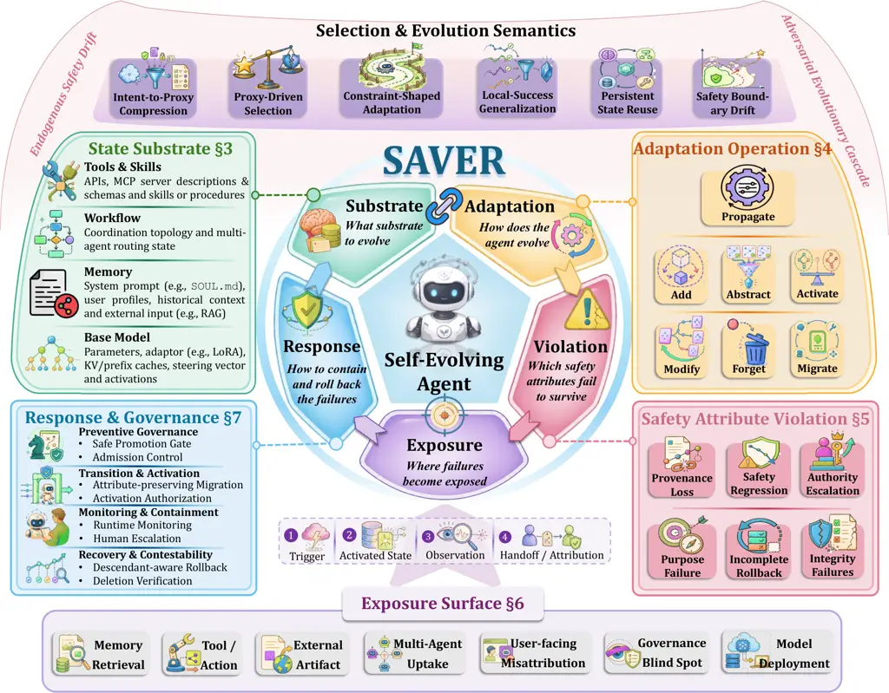
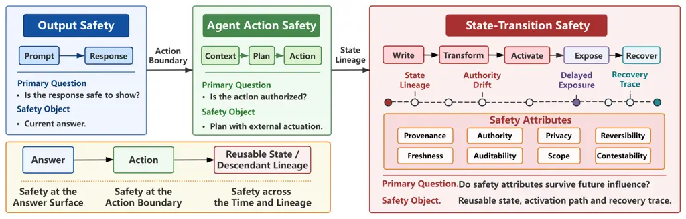
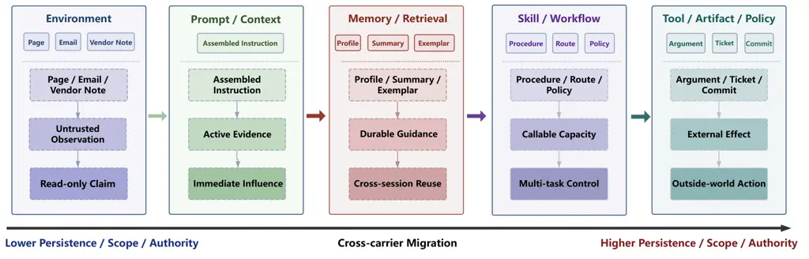

\authorbreak\authorbreak

1\]Zhejiang University 2\]Huazhong University of Science and Technology
3\]Xi’an Jiaotong University 4\]National University of Defense
Technology 5\]Shanghai Jiao Tong University 6\]Georgia Institute of
Technology 7\]University of Science and Technology of China 8\]Nanyang
Technological University 9\]OPPO Research Institute 10\]Tianjin
University 11\]Chongqing University 12\]Alibaba Group 13\]Rakuten Group
\correspondence\checkdata\[Key Words\]Self-Evolving Agents; Agent
Safety; Adaptive State; Memory Poisoning; Governance

# Safety in Self-Evolving Agents: A Survey

Jiahao Chen    Zhou Feng    Oubo Ma    Yichen Yan    Ruixiao Lin   
Hangtao Zhang    Linkang Du    Hengyu An    Yong Yang    Jun Liu   
Junhao Li    Naen Xu    Chunyi Zhou    Yuan Su    Zehao Jin    Qianli Ma
   Leyi Qi    Yiming Wang    Zhe Ma    Yuwen Pu    Mengyao Du    Yuanyi
Song    Enhao Huang    Zhihui Fu    Jun Wang    Jinfeng Li    Yuefeng
Chen    Hui Xue    Yiming Li    Tianyu Du    Shouling Ji Affiliation: \[
Affiliation: \[ Affiliation: \[ Affiliation: \[ Affiliation: \[
Affiliation: \[ Affiliation: \[ Affiliation: \[ Affiliation: \[
Affiliation: \[ Affiliation: \[ Affiliation: \[ Affiliation: \[ Email:
<sji@zju.edu.cn>

September 7,
2026 [Website](https://github.com/xaddwell/awesome-self-evolving-agent-safety)
and
[HomePage](https://xaddwell.github.io/Awesome-Self-Evolving-Agent-Safety/)

###### Abstract

Large language models (LLMs) exhibit strong general capabilities yet
their parameters typically remain fixed after deployment, limiting
learning from new interactions. In open-ended interactive environments,
this characteristic motivates a shift toward self-evolving agents that
continuously update reusable state (model parameters, memory entries,
tool definitions, skill libraries, or workflows) using data,
interactions, and accumulated experience. This fundamentally changes the
safety problem: when experience becomes reusable state, past events
become future causes, and information that was harmless in one context
may later influence decisions with greater persistence, authority, or
scope. Beyond assessing whether a response is aligned or an action is
authorized, self-evolving agent safety turns to whether safety
properties survive the accumulation, generalization, and cross-context
reuse of locally useful experience. Existing surveys organize agent
safety around components or lifecycle stages; we complement these views
by tracing how a single piece of reusable influence, once written into
state, changes its carrier, role, authority, and downstream consequences
as the agent continues to evolve. To support this analysis, we present
SAVER, a transition-centered framework that analyzes safety through
$`\mathbf{S}\times\mathbf{A}\rightarrow\mathbf{V}\rightarrow\mathbf{E}\rightarrow\mathbf{R}`$:
Substrate locates where reusable influence resides, Adaptation
identifies the operation that transforms it, Violation characterizes
which safety attributes are compromised, Exposure determines where and
to whom the failure becomes observable, and Response evaluates whether
the influence can be contained, repaired, or revoked. Treating the
$`\mathbf{S}\times\mathbf{A}`$ transition as the analysis unit, SAVER
traces how a given transition may induce violations, expand exposure
surfaces, and demand containment responses. Our survey reveals several
key insights. Conceptually, safety failures need not originate from
intrinsically harmful information; rather, otherwise legitimate state
becomes unsafe when adaptation broadens its persistence, authority, or
scope beyond the conditions under which it was originally valid. The
reviewed work emphasizes admission, retrieval, activation, exposure, and
local containment; evidence for descendant repair and evaluation after
resumed adaptation remains sparse. Looking forward, we argue that
evaluations must move beyond one-time measurements toward longitudinal
evidence verifying whether unsafe influence can be traced to its
originating transition, contained at its exposure surface, and prevented
from re-emerging after continued adaptation.

## 1 Introduction

The rapid progress of large language models (LLMs) has shifted the
frontier of artificial intelligence (AI) from narrow task-specific
models toward general-purpose systems capable of reasoning, generation,
planning, and tool use. Despite these capabilities, deployed LLMs remain
largely static: their model parameters do not automatically change with
new interactions, feedback, or environmental changes
\[gao2025self_evolving_agents, fang2025comprehensive,
tao2024self_evolution_llm_survey\]. As LLM agents are increasingly
deployed in open-ended, interactive environments
\[luo2025llm_agent_survey\], this static nature can limit learning from
ongoing interaction, motivating a shift toward _self-evolving agents_
that continuously update reusable state, including model weights, memory
entries, tool definitions, skill libraries, workflow rules, or
architectural components, using data, interactions, and accumulated
experience \[gao2025self_evolving_agents,
tao2024self_evolution_llm_survey\]. We call an agent self-evolving when
its own observations, actions, feedback, or execution traces update such
reusable state inside the agent loop or runtime, thereby changing later
behavior. Across diverse instantiations, including reflection-based
strategy refinement \[shinn2023reflexion\], skill-library accumulation
\[wang2023voyager\], experience-driven rule consolidation
\[wang2026oep\], and evaluator co-evolution
\[iacob2026redqueengodelmachine\], the common safety-relevant thread is
_reusable influence_: whatever evolves stores or transforms state that
can shape later decisions.

Figure 1: Temporal distribution and SAVER flow (subset). Left: substrate
trends and subset totals. Center: flows through adaptation to compact
labels for the six violation families or four response stages. Right:
terminal-family totals and quarterly bubble volume. Appendix gives the
corpus funnel, non-paper exclusions, and coding limitations.

This paradigm shift changes the nature of the safety problem.
Conventional LLM safety primarily focuses on whether a single response
is aligned, safe, and truthful \[dong2024conversation_safety_survey\];
agent safety extends the question to whether a discrete action or tool
invocation is properly authorized and bounded
\[debenedetti2024agentdojo, wu2026comparative, gan2026navigating\].
Figure 1 situates the analysis in the current frozen corpus, including
scholarly works added through the rendered citation closure while
excluding cited webpages and standards from the paper count. Within this
scope, self-evolving agents introduce a qualitatively different risk:
_adaptation itself becomes a source of safety change_. State created
from otherwise benign interactions can be selected, abstracted, and
repeatedly reused, thereby changing the conditions under which future
decisions are made \[lin2026safetyselfevolvingllmagent,
lin2026memory_security_survey\]. Experience gathered from benign tasks
can reduce safety in evaluated web-based and embodied settings
\[zhao2026experience_driven_safety\]. Unsafe influence can also remain
latent across sessions \[lin2026memory_security_survey,
torres2026agentsremembermuchmemory, sunil2026memory_poisoning_agents,
wang2025privacy_agent_memory\], propagate across carriers or agents, and
accumulate over multiple rounds of evolution. This property makes
pointwise safety insufficient: behavior that is safe in one interaction
may later be stored, abstracted, or reused with broader persistence,
authority, or scope. Self-evolving agent safety therefore examines
whether _safety remains preserved as influence is transformed and reused
over time_, shifting the safety object from isolated responses or
actions to the evolution of influence across state transitions.

Existing surveys organize agent safety by system components
\[gan2026navigating, wu2026comparative, wang2025comprehensive,
li2026safety, ma2026safety\], lifecycle stages
\[lin2026safetyselfevolvingllmagent, mou2026pandora\], or attack
categories \[gao2025self_evolving_agents, qi2026trustworthy_agentic_ai,
lin2026memory_security_survey,
mohammadi_2025_evaluation_and_benchmarking\]. Such taxonomies locate a
vulnerable component, a risky stage, or a visible failure mode, but
their categories do not necessarily show how a single piece of reusable
influence, once written into state, changes its carrier, role,
authority, and downstream consequences as the agent continues to evolve.
The same content may be benign as transient context, unsafe as a
persistent memory, and critical once compiled into a workflow rule or
tool-bearing skill. By decomposing these steps into separate categories,
traditional taxonomies can fragment what is in fact one causal incident
and obscure where the safety boundary was crossed. Characterizing
self-evolving agent safety therefore requires following the same
influence across transitions, rather than analyzing modules or attack
classes in isolation.

We adopt a transition-centered view: rather than singling out unsafe
components in isolation, we follow the same reusable influence as it is
stored, transformed, activated, propagated, and eventually exposed. We
formalize this view as SAVER, shown in Figure 2, and organize the survey
around the following recurrent transition.


The solid arrows trace the analytical relation between a
carrier–operation pair, an internal safety failure, visible exposure,
and intervention. This relation does not prescribe intervention timing:
controls can act before commitment or harm. The dashed return arrow
closes the adaptive cycle: a response can revise the retained state,
controls, evidence, and selection conditions that govern the next
transition, but does not by itself establish successful recovery.
Substrate (S) locates where reusable influence resides, such as memory,
retrieved context, a skill, workflow rule, shared artifact, or
model-side state. Adaptation (A) identifies the operation that
transforms it, such as adding, abstracting, activating, modifying,
propagating, migrating, or forgetting state. Violation (V) characterizes
which safety attributes are compromised, including provenance,
authority, scope, privacy, integrity, or recoverability. Exposure (E)
determines where and to whom the failure becomes observable, such as
memory retrieval, tool execution, multi-agent uptake, an external
artifact, or model deployment. Finally, Response (R) evaluates whether
the influence can be contained, repaired, or revoked. The substrate and
adaptation jointly define the transition under study: the same operation
can be benign on one carrier and unsafe on another, while the same
carrier can remain safe under one operation and violate its safety
attributes under another. SAVER therefore treats the
substrate-adaptation pair as the minimal comparison unit, tracing how a
given transition may induce violations, expand exposure surfaces, and
demand containment responses, across memory security, indirect prompt
injection, tool authorization, workflow safety, multi-agent
coordination, and model-side adaptation.



Figure 2: Overview of the transition-centered survey structure. The
central ring couples Substrate and Adaptation as S$`\times`$A, then
traces Violation, Exposure, and Response as
V$`\rightarrow`$E$`\rightarrow`$R. The surrounding panels preview the
substrate, operation, safety-attribute, exposure-surface, and governance
taxonomies.

SAVER centers on committed updates and their controls, but
self-evolution starts one step earlier: the agent must first choose
which candidate update to retain. We call this pre-transition layer
_selection semantics_: repeated preference for locally successful
updates determines which $`\mathbf{S}\times\mathbf{A}`$ transitions
enter persistent state and accumulate over time \[shinn2023reflexion,
wang2023voyager, wang2026oep, iacob2026redqueengodelmachine\].
Conversely, the process does not necessarily end at R: guardrails,
rollbacks, and policy updates can reshape the constraints and candidate
set of subsequent evolution, which we capture as _feedback semantics_.
Together, selection explains _why_ a transition occurs, SAVER explains
_what_ it changes, and feedback explains _how_ it reshapes future
transitions. The recent OpenAI–Hugging Face incident
\[openai_hf_incident, openai2026huggingfaceincident, wang2026exploitgym,
larcher2026agentintrusion\] illustrates why such a transition-level
trace matters in practice: even when autonomous self-evolution is not
itself the failure mechanism, the connected role changes across carriers
determine the incident’s scope and the response’s completeness.

What SAVER Reveals. Three findings guide the survey’s comparison of
mechanisms, controls, and evaluation protocols.


Contributions. This survey makes the following contributions:

- •
  Transition-centered synthesis. We connect memory, tool and workflow,
  and model-adaptation research through the reusable state transitions
  underlying their safety challenges.
- •
  SAVER framework. We propose a transition-centered analysis that uses
  substrate-adaptation transitions as the comparison unit and traces
  safety violations, exposure surfaces, and response mechanisms.
- •
  Evaluation and governance agenda. We identify critical gaps in current
  benchmarks and defenses, and establish future directions toward
  evaluation, defense, and lifecycle governance for self-evolving
  agents.

Scope. We center agents whose observations, actions, feedback, or
execution traces update reusable state inside the agent loop such that
the update can affect later behavior. Stateful or adaptive systems
remain adjacent when they expose a reusable carrier, a role-changing
operation, an activation boundary, or a response mechanism relevant to
such later influence. One-shot output safety, tool use without
persistent reuse, and static model training fall outside the core scope
unless they illuminate a later adaptive-state transition. Our synthesis
is grounded in a systematic scoping review spanning security, machine
learning, natural language processing (NLP), retrieval, and adjacent
agent research. The frozen coded pool contains 683 papers: 579
deduplicated registry works, 48 nonduplicate paper-card supplements, and
56 additional scholarly works used in the rendered manuscript. The
search, screening, cutoff, non-paper exclusions, and 577-paper
visualization subset are documented in Appendix .

Organization. The remainder of the survey follows the SAVER relation.
Section 2 first defines adaptive-state safety, formalizes the
self-evolving agent loop, and introduces selection and transition
semantics. Section 3 and Section identify the carrier and operation
halves of the $`\mathbf{S}\times\mathbf{A}`$ transition pair. Section
analyzes the safety attributes that fail across these transitions, and
Section identifies the surfaces at which those failures become
observable. Section then examines prevention, activation control,
monitoring, containment, recovery, and contestability. Finally, Section
translates the full transition into benchmark and evidence requirements,
Section develops the resulting research agenda, and the final section
concludes the survey.

## 2 Adaptive State Safety



Figure 3: From output safety to state-transition safety. The three
panels show how the unit of analysis expands from a single response, to
action mediated by tools, to a reusable state transition that carries
safety attributes across sessions.

### 2.1 Operational Scenarios and Scope

Self-evolution matters when an agent must accumulate capability across
tasks rather than solve each episode from a blank state. For instance, a
personal assistant can retain preferences and corrections
\[packer2023memgpt\]; a workflow agent can compile successful traces
into reusable procedures \[wang2023voyager\]; a team of agents can
propagate plans and findings through shared state
\[guo_2024_large_language_model_based_m\]; and an adaptive deployment
can select or load a model-side update for later tasks \[hu2022lora\].
These mechanisms differ technically, but each turns an earlier event
into state that can influence subsequent decisions. This continuity,
experience becoming reusable state, is the reason to study
self-evolution and the source of its additional safety burden. The
urgency of this question has grown as deployment environments shift from
single-turn question answering to multi-session personal assistants,
autonomous coding agents, and multi-agent workflows that accumulate
state over days or weeks \[luo2025llm_agent_survey,
gao2025self_evolving_agents\].

State and Reusable Influence. We use _state_ for an information-bearing
object that remains available, can be reconstructed, or can be
reactivated after the event that produced it and can affect later
reasoning or action. The object may be a memory entry, retrieved chunk,
workflow rule, skill, shared artifact, adapter, cache state, or policy
record. _Reusable influence_ is the capacity of that object to condition
behavior in a later context. The distinction matters because an object
can remain stored without current influence, then gain a stronger role
when retrieval, migration, loading, or another activation operation
brings it back into use.

The scope follows from this mechanism. A _stateful agent_ preserves
memory, retrieval state, session context, or environment artifacts
across turns. An _adaptive agent_ updates such state from experience. A
_self-evolving agent_, as used here, performs these updates inside the
agent loop or runtime, where they can change later behavior
\[gao2025self_evolving_agents, tao2024self_evolution_llm_survey\]. A
retrieval-augmented generation (RAG) system that only retrieves a static
corpus is therefore adjacent; an agent that writes, revises, selects, or
inherits state that later steers action is central.

Temporal and Spatial Dimensions. The temporal dimension concerns
persistence, ordering, and later activation; the spatial dimension
concerns movement or replication across carriers, agents, and authority
regimes rather than physical geography. Recent benchmarking
distinguishes attacks fragmented across turns from attacks placed in
workspace artifacts beyond conversation-level monitoring
\[ma2026benchmarkingautonomousagents\]. Delayed activation and
cross-session reuse expose temporal dependencies, while propagation and
migration expose spatial ones. We reserve _longitudinal_ for evaluation
across a sequence of transitions. These distinctions explain why
inspecting only the source event or final behavior can miss the
intervening change, as illustrated in Figure 3.

### 2.2 Self-Evolving Agent Formulation

The operational definition above can be represented by separating
execution, feedback, candidate updates, selection, and commitment. This
decomposition naturally induces a state-transition view of
self-evolution. We model the agent at step $`t`$ as

```math
\mathcal{A}_{t}=(\Theta_{t},\mathcal{M}_{t},\mathcal{T}_{t},\mathcal{W}_{t}),
```

where $`\Theta_{t}`$ denotes parameterized model-side state,
$`\mathcal{M}_{t}`$ memory and context state, $`\mathcal{T}_{t}`$ tool
and skill resources, and $`\mathcal{W}_{t}`$ workflow and multi-agent
routing state. These coordinates collect the carriers involved in an
update. The loop can be written as

```math
o_{t}=\mathcal{O}(\mathcal{E}_{t},g_{t}),\qquad\tau_{t}\sim\pi_{\mathcal{A}_{t}}(\cdot\mid g_{t},o_{t}),
```

```math
f_{t}=\mathcal{F}(\tau_{t},g_{t},\mathcal{E}_{t},\mathcal{E}_{t+1}),
```

```math
\Delta_{t}=\mathcal{P}_{\psi}(\mathcal{A}_{t},\tau_{t},f_{t},\mathcal{E}_{t+1}),
```

```math
\delta_{t}^{\star}\sim\pi_{\psi,t}^{\mathrm{evo}}(\cdot\mid\Delta_{t},\widehat{u}_{t},c_{t}),\qquad\mathcal{A}_{t+1}=\mathcal{U}_{\psi}(\mathcal{A}_{t},\delta_{t}^{\star}).
```

Here $`g_{t}`$ is the current task goal and $`\psi`$ parameterizes the
update mechanisms. $`\mathcal{E}_{t}`$ is the external task environment,
including user requests, tool-visible resources, files, messages, web
pages, and other context outside the agent’s adaptive state.
$`\mathcal{O}(\cdot)`$ admits observations, $`\pi_{\mathcal{A}_{t}}`$
produces the execution trace $`\tau_{t}`$, and $`\mathcal{F}(\cdot)`$
returns feedback $`f_{t}`$. The proposal mechanism
$`\mathcal{P}_{\psi}`$ turns the trace and feedback into a candidate
update set $`\Delta_{t}`$. The evolution policy
$`\pi_{\psi,t}^{\mathrm{evo}}`$ selects $`\delta_{t}^{\star}`$,
including the option to make no update, using the observed utility proxy
$`\widehat{u}_{t}`$ and the authorization condition $`c_{t}`$. The
update operator $`\mathcal{U}_{\psi}`$ then commits, revises, ignores,
or quarantines the selected update, producing $`\mathcal{A}_{t+1}`$.
Keeping these steps separate preserves $`\tau_{t}`$ as the execution
trace and makes the state-selection decision explicit.

Selection Semantics. The utility proxy $`\widehat{u}_{t}(\delta)`$
scores a candidate under the current evaluator; $`c_{t}(\delta)`$
represents the safety and authorization evidence required before
commitment. Passing $`c_{t}(\delta)`$ establishes compliance with the
controls represented at step $`t`$, which may omit some user or system
requirements.


The loop of observation, action, evaluation, and evolution now exposes
two safety questions. The local question is whether
$`\delta_{t}^{\star}`$ changes what earlier information is allowed to
do: an observation becomes evidence, evidence becomes instruction,
instruction becomes workflow policy, or workflow policy becomes tool
authority. The longitudinal question is whether repeated choices by
$`\pi_{\psi,t}^{\mathrm{evo}}`$ change the distribution of provenance,
scope, authority, and negative evidence in later candidate sets. Safety
has to be checked at $`\mathcal{A}_{t}\rightarrow\mathcal{A}_{t+1}`$ and
again when $`\pi_{\mathcal{A}_{t+1}}`$ reuses the updated state. Under
this model, self-evolving-agent safety is _state-transition safety_:
safety attributes must survive both the selection that admits an update
and the operations that store, transform, migrate, activate, expose, or
repair reusable state. SAVER records the local transition; a sequence of
records, together with their selection metadata, reveals whether local
choices accumulate into drift.

### 2.3 Safety Attributes and Transition Test

Transition Test. Because state often moves from environment to prompt,
prompt to memory, memory to retrieval index, retrieved item to planner
context, planner context to tool argument, tool output to summary,
summary to workflow rule, and workflow rule to external artifact, the
model needs explicit attributes. A hop can change persistence,
observability, authority, scope, or reversibility. A complete analysis
names the hop where the role changed rather than treating the entire
incident as one memory, prompt injection, or tool use category.

Activation authority is the right of a state object to influence a later
decision or action. It differs from storage permission. A system may
store a document, index a chunk, or remember a preference without being
allowed to treat that state as instruction, policy, or authorization for
tool use. InjecAgent asks whether untrusted environmental content can
become active instruction in a tool-using context
\[zhan_2024_injecagent_benchmarking_indi\]. AgentPoison asks whether a
fabricated memory or knowledge-base entry can shape later planning or
tool use \[chen2024agentpoison\]. Progent asks whether stored state has
the authority to populate tool arguments \[shi2025progent\]. In ordinary
security language, many such cases are privilege escalation or
time-of-check/time-of-use failures: a state item was acceptable for
storage or reading, but unsafe when later used as authority for an
external effect. The recurring question is what moved, what safety
attributes changed, and what later action became newly authorized.

The right itself may also become stale. Zhang and Zhang define
_authorization continuity_ as whether a live grant remains valid after
the agent or its operating context changes
\[zhang2026agentiauthorizedearned\]. Their model separates a transition
envelope, which specifies the mutations an old grant may survive, from
an immutable effect ceiling, which bounds what the grant may ever
authorize. A mutation can therefore invalidate the grant even when the
requested effect remains below the ceiling. Continuity belongs to the
authorization and environment context represented by $`c`$ and
$`\sigma`$ below.

The transition test asks whether the operation preserves or explicitly
downgrades the safety attributes that downstream components need. If a
low-authority observation is summarized and stored, the summary should
not carry instruction authority. If a user-specific preference migrates
into workflow guidance, the scope restriction should travel. If private
state becomes a tool argument, the privacy violation should be visible.
Invariant preservation is the property that these conditions survive the
transition.

Promotion Test. A selected update is a promotion when it moves episode
evidence into a more persistent, general, or action-bearing role.
Promotion is safe only when $`c_{t}(\delta_{t}^{\star})`$ authorizes the
new role, the relevant safety attributes remain valid in the target
context, counterevidence has not been discarded, and the
source-to-descendant relation remains recoverable. Task success may
justify retaining evidence about one episode. It does not by itself
authorize a general workflow rule, reusable skill, or tool-bearing
policy.

Role Change Examples. In the running incident, a package proxy permitted
for dependency access became a path to the Internet; public services, an
external sandbox, dataset configurations, and acquired credentials then
carried the campaign across wider trust and authority regimes
\[openai2026huggingfaceincident, larcher2026agentintrusion\]. The safety
object is therefore not one prompt or exploit but the connected set of
carriers whose activation enabled the next boundary crossing. AgentDojo
supplies a controlled setting for untrusted context reaching tool use,
while Progent supplies explicit privilege policies for deciding which
tool calls an agent may perform \[debenedetti2024agentdojo,
shi2025progent\]. Persistent agent memory adds the corresponding
sensitivity, scope, and deletion questions for retained user details
\[wang2025privacy_agent_memory\]. The incident remains an adjacent
infrastructure case, not direct evidence of an endogenous agent-state
update; its value is that the public reports expose the role changes and
response surface that a transition record must preserve.

Transition Notation. We write each hop as
$`(s,\ell,\sigma)\xrightarrow{a,c}(s^{\prime},\ell^{\prime},\sigma^{\prime})`$:
$`s`$ is the carrier, $`\ell`$ its safety attributes, $`\sigma`$ the
deployment or session context, $`a`$ the operation, and $`c`$ its
authorization condition. The authorization context explains why $`c`$
permitted the transition; the environment context identifies the task
and system boundary in $`\sigma`$. Appendix develops the attribute
definitions, selection extension, and authority lattice from
_Observation_ through _Evidence_, _Task Context_, and _Procedure_ to
_Action_. The body uses this notation to distinguish a changed
representation from a changed permission. Section 2.4 packages these
checks into a transition record; Section 2.5 uses that record to compare
mechanism families.


### 2.4 SAVER as a Transition-Centered Survey Framework

Section 2 defines the agent’s outer loop; SAVER compares the state
transitions within it. The same transition can be studied as a memory
mechanism, an injection path, an authorization failure, or a benchmark
episode \[lin2026memory_security_survey,
zhan_2024_injecagent_benchmarking_indi,
zhang_2024_agent_security_bench_asb_for,
mohammadi_2025_evaluation_and_benchmarking\]. Keeping its carrier and
operation together lets the survey relate these observations while
distinguishing the question each study answers.


The relation
S$`\times`$A$`\rightarrow`$V$`\rightarrow`$E$`\rightarrow`$R is an order
of analysis, not a mandatory chronology of harm. Substrate and
adaptation identify the transition; violation specifies the failed
attribute; exposure identifies evidence of that failure; and response
locates an applicable intervention. A preventive gate can reject a
proposed transition before it is committed, and a write-time check can
reveal an attribute failure before any harmful action. A record should
distinguish these outcomes from later stages that were simply not
observed. The dashed return arrow links response-generated state to
subsequent selection, so the next transition may depend on the previous
intervention.

Why These Five Fields? Module taxonomies locate mechanisms, while paper
roles distinguish attacks, defenses, and evaluations. The
carrier–operation pair adds the relation between them: an abstraction
may preserve a statement yet remove its authority constraint, whereas
propagation may retain the statement while broadening its audience.
Violation, exposure, and response then separate the changed safety
property from its observed consequence and the control being evaluated.
Temporal and spatial annotations describe when influence returns and
where it moves without creating additional categories.

Record Structure. The five fields answer distinct questions about the
same transition:

Substrate (S):  
The carrier: prompt context, memory entry, retrieval chunk, tool or
application programming interface (API) binding, workflow rule, shared
artifact, adapter, policy state. This field names where the state lives
and supplies the first component of the transition pair.

Adaptation (A):  
The committed state-change operation applied to a carrier, coded using
the seven families in Section : _add_, _abstract_, _activate_, _modify_,
_forget_, _propagate_, or _migrate_. Implementation verbs such as write,
summarize, retrieve, load, inherit, and rollback map to these families
by their effect on state. A prevention study can identify the
corresponding proposed operation, but records blocked commitment or
activation rather than a completed transition.

Violation (V):  
The safety attribute that fails to travel: provenance loss, privilege or
authority escalation, scope widening, privacy breach, availability loss,
budget exhaustion, missing audit trail, reversibility failure. This
field names what went wrong internally in terms that can still be mapped
to ordinary security concepts.

Exposure (E):  
The surface where the failure becomes visible: tool call, model output,
shared artifact, governance audit, deletion request. This field names
where the problem surfaces.

Response (R):  
The mechanism that can contain or repair: admission gate, migration
check, activation authorization, runtime guard, descendant rollback,
deletion verification, contestability record. This field names what can
intervene.

Selection and Feedback. Selection determines why
$`\pi_{\psi,t}^{\mathrm{evo}}`$ chose $`\delta_{t}^{\star}`$ from
$`\Delta_{t}`$; the five fields characterize what that choice changes.
Comparing transitions over time additionally requires the candidate
source, evaluator and objective versions, authorization evidence, and
rejected or unavailable alternatives. These distinguish changes caused
by the selected operation from changes in the process selecting it. A
response can revise $`c_{t+1}`$, the evaluator behind
$`\widehat{u}_{t+1}`$, or the policy and experience available to
$`\Delta_{t+1}`$. Evaluation-driven development and operations (EDDOps)
describes such runtime adjustment and governed redevelopment
\[xia_2024_evaluation_driven_developmen\]. This process model motivates
linking interventions to later updates; whether the resulting feedback
improves safety remains an empirical question.

Comparing Evidence. GhostWriter and the Personal Agent Sycophancy
Benchmark (PASB) both separate commitment from later activation, but the
former studies hidden adversarial memory and the latter the agent’s
treatment of ordinary conversational claims
\[torres2026agentsremembermuchmemory, mao2026agentsdontjustagree\].
InjecAgent instead observes the tool consequence of untrusted context
\[zhan_2024_injecagent_benchmarking_indi\]. This comparison separates a
shared temporal dependency from distinct entry mechanisms and observed
outcomes. Capability studies can identify a carrier or operation worth
testing without having tested its safety. Throughout the survey, we
distinguish these observations from our derived governance requirements
and open questions; Appendix gives the evidence-tier rules.

Relation to Existing Frameworks. The Open Worldwide Application Security
Project (OWASP) LLM Top 10 and MITRE Adversarial Threat Landscape for
Artificial-Intelligence Systems (ATLAS) provide risk and tactic
vocabularies \[owasp2025llm_top10, mitre2026atlas\]. The National
Institute of Standards and Technology (NIST) Artificial Intelligence
Risk Management Framework (AI RMF) and Microsoft AI Risk Assessment
address process ownership, testing, and incident management
\[tabassi2023ai_rmf, microsoft2024ai_risk_assessment\]. Information-flow
control (IFC) specifies permitted flows, provenance tracks source and
derivation, and runtime verification checks execution against declared
properties \[denning1976lattice_information_flow,
sabelfeld2003language_information_flow, buneman2001why_where_provenance,
leucker2009runtime_verification\]. SAVER uses these established concepts
to locate the transition at which a reusable object changes role; it
does not replace their policies or enforcement mechanisms.

Boundary of Use. A system can be well governed with ordinary provenance,
access control, or prompt injection controls if unsafe influence stays
local, and the absence of a full SAVER record does not by itself prove
that a system is unsafe; it only limits what the system can claim about
diagnosis, recovery, and accountability across multiple hops. SAVER is
therefore a bounded trace lens, not a safety prerequisite. The deepest
boundary is semantic opacity: some descendants are missed not because
hooks were omitted, but because summarization, retrieval abstraction,
and latent representations partially dissolve lineage.


Section 2.5 applies this comparison to the main mechanism families.

### 2.5 Literature Map and Positioning

{forest}

Figure 4: A full-width horizontal SAVER roadmap. Exposure is folded into
the incident leaves for legibility.

With the transition unit fixed, the literature can be read as a field
map rather than as a list of modules. A work is central when it directly
examines a safety-relevant transition involving reusable agent state,
including a failure, exposure, evaluation, or control of that
transition. Capability mechanisms alone remain adjacent. Inclusion does
not require a complete recovery trace; the evidence boundary determines
which claims a work can support. Figure 2 provides the reading order for
the comparison: locate the carrier-operation pair in the central ring,
then ask how far the paper follows the transition through violation,
exposure, and response. The positioning paragraphs apply that order
without assuming that every paper covers the full chain.

How to Read the Evidence Indexes. Each of the six body chapters closes
with a paper-level evidence index for its part of the transition. These
tables support paper-level lookup rather than define independent
taxonomies. Role is assigned to the contribution named in a row, not
permanently to the paper: an attack study can appear as _Attack_ in a
mechanism index and as _Benchmark (Attack)_ when its evaluation protocol
supplies the denominator, while a separately named mitigation from the
same paper can appear as _Defense_. Rows that name the same contribution
retain one primary role across indexes.

How the Literature Converges. The relevant literatures did not begin
from a common taxonomy, but their evidence now meets along the same
transition. Prompt-injection research establishes that untrusted context
can condition action, and InjecAgent makes the resulting
indirect-injection boundary measurable
\[liu_2023_prompt_injection_attack_agai,
zhan_2024_injecagent_benchmarking_indi\]. Memory research adds
persistence through managed storage, governed reuse, and user-specific
context \[zhang_2025_a_survey_on_the_memory_mecha,
lin2026memory_security_survey, wang2025privacy_agent_memory,
mao2026agentsdontjustagree\]. Self-evolution work moves the safety
question into the update rule because reflection, experience, or
collective state can convert a local observation into reusable policy
\[zhao2026experience_driven_safety, wang2026oep, xu2026when\]. Response
research then asks where this transition can be recognized, authorized,
blocked, or audited \[xiang2024guardagent,
liu_2026_safeagent_a_runtime_protecti,
siu2026formalizing_agent_security\].

These bodies of work contribute different segments of an evidence chain.
Memory and tool studies provide concrete write paths, retrieval
triggers, and action boundaries. Privilege and runtime controls identify
activation gates and local blocking points. They offer less evidence
about what happens after the same influence migrates into workflow
rules, shared artifacts, or model-side state. Recovery claims are
especially difficult because they must link a response to every relevant
descendant and test for later reactivation. The resulting imbalance is
not simply a shortage of defense papers; it is a mismatch between
event-level evidence and the stronger proof obligations of cross-session
repair.

Differences from Existing Surveys. Neighboring surveys organize
comparison around different questions. General and autonomous-agent
surveys compare memory, planning, tool, and coordination components
\[xi_2023_the_rise_and_potential_of_la,
cheng_2024_exploring_large_language_mod\]; self-evolution surveys
examine where and how adaptation occurs \[gao2025self_evolving_agents,
tao2024self_evolution_llm_survey\]. Trustworthy-agent and security
surveys organize risks and governance properties, while benchmark
surveys compare evaluation tasks and metrics
\[yu2025trustworthy_llm_agents, deng_2024_ai_agents_under_threat_a_sur,
adabara_2025_trustworthy_agentic_ai_syste,
mohammadi_2025_evaluation_and_benchmarking\]. Trajectory assurance asks
whether composed behavior respects system-level constraints even when
individual actions are permitted
\[lotfi2026securingagenticaiperaction\]. The Module-Lifecycle Attack
Surface (MLAS) analysis focuses more directly on self-evolving-agent
modules and lifecycle threats \[lin2026safetyselfevolvingllmagent\].

Our comparison holds the reusable influence fixed while its carrier and
role change. This specializes the broader trajectory-assurance
objective: rather than treating every action sequence as one object, it
asks which state transition changed the sequence’s effective provenance,
scope, or authority. A module map can locate memory, tools, feedback,
and adaptation; a lifecycle threat map can identify exposed cells. A
transition record asks how a particular object entered one cell, what
attributes it carried, which operation moved or transformed it, where it
later activated, and what response artifact addresses its lineage.
Papers are therefore compared by the transition segment they observe,
with component and paper role retained as secondary descriptors.

Memory and Reusable Context. Memory remains the strongest substrate for
evidence because its write, storage, retrieval, and activation points
are comparatively visible. Personal-agent and memory surveys define the
carrier, while memory-security work explains why persistence requires
provenance and policy metadata \[li_2024_personal_llm_agents_insights,
zhang_2025_a_survey_on_the_memory_mecha, lin2026memory_security_survey,
du2026memory_autonomous_agents\].

Attack studies then separate into mechanisms that a generic “memory
poisoning” label would obscure. AgentPoison targets trigger-selected
retrieval from an already poisoned store; stealth injection targets the
admission path from an external environment; broader poisoning and
sleeper-memory work emphasize persistence and delayed activation;
MemMorph follows retrieved memory into tool hijacking
\[chen2024agentpoison, sunil2026memory_poisoning_agents,
pulipaka2026hidden_memory, zhang2026memmorph\]. These mechanisms require
different denominators: poisoned retrieval opportunities, unsafe write
opportunities, delayed trigger opportunities, or tool-routing
opportunities. Privacy and PerMemSafe add another comparison axis by
asking whether retained state remains appropriate for a particular user
and purpose \[wang2025privacy_agent_memory, an-etal-2026-permemsafe\].
PS-Bench sharpens the non-poisoning branch: truthful memories can remain
appropriate as personal context yet still weaken the safety boundary by
legitimizing a harmful request \[guo-etal-2026-personalization\].
EchoSafe adds a multimodal branch in which an inference-time reflective
memory bank adapts contextual safety decisions; it is evidence about
memory-mediated safety adaptation, not a general guarantee for textual
agent memory \[zhang2026echosafe\]. Memory is therefore the clearest
substrate anchor, but not the lifecycle boundary: its contents can
become prompt context, a plan constraint, a tool argument, a workflow
rule, a shared artifact, or a rollback target.

Self-Evolution and Misevolution. Reflection and skill libraries
establish the capability mechanism: feedback or successful traces can
become strategy and callable procedure \[shinn2023reflexion,
wang2023voyager\]. Safety work begins where that promotion changes
provenance, authority, scope, privacy, or recoverability. Obsessive
Experience Poisoning (OEP) tests harmful transfer from locally useful
experience, while SEVerA studies verification before reusable behavior
is synthesized \[wang2026oep, banerjee2026severa\]. Experience-driven
safety and MemEvoBench broaden the evaluation setting from one promoted
rule to evolving memories and updates
\[zhao2026experience_driven_safety, xie2026memevobench\]. The Red Queen
Gödel Machine adds a different dependency: the evaluator and utility can
coevolve with the agent \[iacob2026redqueengodelmachine\]. A benchmark
can therefore miss drift even when it records every committed update,
because the criterion selecting those updates may also have changed.
Read together, this literature links capability, selection, promotion,
and evaluation and localizes where a reusable lesson acquires authority.

Tool, Workflow, and Runtime Response. Prompt-injection attacks and
benchmarks establish the exposure mechanism: untrusted text becomes
planning context, and a tool call makes the consequence observable
\[liu_2023_prompt_injection_attack_agai, debenedetti2024agentdojo,
zhan_2024_injecagent_benchmarking_indi,
zhan_2025_adaptive_attacks_break_defen\]. Response papers then divide
according to whether they observe, constrain, or maintain that boundary.
Risk judges and safety benchmarks improve recognition, while GuardAgent
and TrustAgent add local guard reasoning
\[zhang_2024_agent_safetybench_evaluating, xiang2024guardagent,
hua_2024_trustagent_towards_safe_and\]. Privilege and runtime controls
address a different question: whether execution should proceed, as
illustrated by SafeAgent \[liu_2026_safeagent_a_runtime_protecti\].
Those controls can stop or narrow an action, but they usually do not
repair the earlier memory or workflow state that requested it.

Evaluation-driven operations and coordination work extend the same
boundary into deployment \[xia_2024_evaluation_driven_developmen\],
while POLARIS \[moslemi2026polaris\], MAGNET \[sun2026magnet\], and
WebCoach \[liu2025webcoach\] make route and workflow traces more
visible. The unresolved connection is between these operational records
and the state lineage needed for recovery: local recognition and
blocking rarely establish that the responsible influence can no longer
reactivate elsewhere.

Model Adaptation. Model updates are central only when they enter the
agent loop as state that is selected, loaded, inherited, evaluated, or
rolled back. Static model safety \[qi2023finetuning_safety\],
parameter-efficient fine-tuning (PEFT) risk \[hong2024peta\],
reinforcement learning from human feedback (RLHF) backdoors
\[rando2024universal_jailbreak_backdoors\], dormant behavior
\[gloaguen2025watch_your_steps\], security and privacy surveys
\[wang2024unique_security_privacy_llm\], and backdoor surveys
\[zhou2025backdoor_llm_survey\] explain failure modes that reusable
updates can introduce. For low-rank adaptation (LoRA), Safe LoRA is a
bounded adapter-level mitigation of fine-tuning safety loss
\[hsu2024safe_lora\]; adapter scope, deployment lineage, activation
context, and rollback handles are the additional fields needed before
treating it as an agent-lifecycle recovery anchor. KVEraser adds a
narrower runtime cache branch by studying erasure of processed context
influence after prefill \[li2026kveraserlearningsteerkv\]. The branch
remains a frontier until agent-loop lineage, cache-local residual
probes, and deployment rollback records become routine.

Evaluation Coverage. Benchmarks make different parts of a transition
observable. LoCoMo tests retained conversational context, and
MemEvoBench examines memory adaptation \[maharana2024locomo,
xie2026memevobench\]. AgentDojo observes tool-mediated exposure, R-Judge
tests risk recognition, PerMemSafe evaluates personalized response
safety, and ACIArena follows cascading injection across agents
\[debenedetti2024agentdojo, yuan2024rjudge, an-etal-2026-permemsafe,
an-etal-2026-aciarena\]. Runtime containment and model-regression
studies add response and deployment observations
\[liu_2026_safeagent_a_runtime_protecti, qi2023finetuning_safety\].
HarnessSafe now connects carrier retention, boundary crossing, benign
activation, and visible violation
\[zhang2026harnesssafeevaluatingsafetypersistent\]. The remaining
comparison is therefore not simply connected versus disconnected
evaluation: it is which earlier selection decisions and later repair
outcomes each connected trace leaves unobserved.


The following chapters specialize this comparison by substrate,
operation, violation, exposure, and response; Section connects their
evidence requirements.

## 3 Substrate: Safety-Bearing State Carriers


Before the safety of an update can be judged, the analysis must identify
what persists and the authority regime in which it can be reused. The
same sentence has different consequences when it is transient context,
durable memory, a workflow rule, or a tool-bearing procedure. Substrate
analysis supplies the carrier half of the S$`\times`$A transition pair.
Broad agent surveys map the relevant components, while self-evolution
work adds the update and reuse mechanics \[luo2025llm_agent_survey,
gao2025self_evolving_agents\]. The chapter compares carriers along five
axes: persistence, observability, authority, scope, and reversibility.
Figure 5 follows one item from untrusted environment text through active
context, durable memory or retrieval evidence, and callable skill or
workflow to an external effect. Its lower band emphasizes the
accompanying rise in persistence, scope, and authority. Observability
and reversibility require separate comparison because neither changes
monotonically along this path. These carrier properties determine what
the operations in Section can change; Table 3.9 provides the paper-level
evidence map.



Figure 5: Cross substrate transmutation. The same sentence carries
different authority depending on its carrier: from untrusted environment
text to prompt context, durable memory, callable skill, and finally
external effect.

### 3.1 Substrates as Authority Regimes

Same Text, Different Authority. Consider the same sentence: “for this
user, choose the fastest option even if it costs more.” As a _web
observation_, it is an untrusted environmental claim; as a _scratchpad
note_, transient reasoning context; as a _long-term preference memory_,
personalization state; as a _retrieval exemplar_, it may steer similar
tasks; as a _skill parameter_, a reusable decision rule; as a _workflow
policy_, it can route many later tasks; and as a _tool argument
template_, it may affect purchases, bookings, or messages. The substrate
shapes how the text can influence behavior; legitimate authority still
depends on its source, intended use, and current authorization.

This example fixes the chapter’s unit of comparison. Although the
lexical content is unchanged, its persistence, scope, authority,
actionability, and available rollback handle vary with the carrier
\[lin2026memory_security_survey\]. These attributes are relational
rather than intrinsic: they depend on provenance and derivation
\[buneman2001why_where_provenance\], permitted flows
\[denning1976lattice_information_flow\], intended scope, current
substrate, activation condition, and downstream action surface. A
substrate is more than storage: it is the regime that determines how an
item can be retained, interpreted, reused, and acted upon.

The literature makes this distinction visible in stages rather than as a
flat inventory. Memory-mechanism studies first show how information
becomes managed state, PASB examines the agent’s decision to commit
conversational content, and Voyager shows how experience becomes
reusable procedure \[zhang_2025_a_survey_on_the_memory_mecha,
packer2023memgpt, mao2026agentsdontjustagree, wang2023voyager\].
Security studies then expose what changes when those mechanisms admit
untrusted or sensitive influence: stealth memory injection, GhostWriter,
and AgentPoison trace delayed reuse, while InjecAgent carries the same
concern to tool-mediated action \[zhang2026clawsremembertellstealthy,
torres2026agentsremembermuchmemory, chen2024agentpoison,
zhan_2024_injecagent_benchmarking_indi\]. Multi-agent and self-evolution
surveys broaden the setting to exchanged state and evolving workflow
structure \[guo_2024_large_language_model_based_m,
gao2025self_evolving_agents\]. HarnessSafe places memory, skills, tool
and Model Context Protocol (MCP) state, memory-to-skill transformation,
subagent delegation, session summaries, and shared artifacts under one
delayed-risk protocol, making the cross-carrier comparison explicit
without collapsing them into one substrate class
\[zhang2026harnesssafeevaluatingsafetypersistent\].

Relational Attributes. A medical preference stored for appointment
scheduling illustrates the resulting safety test. Retention raises a
sensitivity question; use in an unrelated task raises a scope question;
influence over tool parameters raises an authority question; and failed
inspection or deletion raises a contestability question.
Persistent-memory research, PerMemSafe, and Progent supply evidence for
these local mechanisms \[wang2025privacy_agent_memory,
an-etal-2026-permemsafe, shi2025progent\]; the combined attribute test
is this survey’s synthesis. With that common record established, the
comparison begins at the shortest-lived carrier: the prompt and context
assembled for the next model call.

### 3.2 Prompt and Context Substrates

Prompt and context substrates are the assembled instructions and
contextual records presented to the next model call. They combine system
and user instructions with conversation history, retrieved evidence,
tool observations, and runtime metadata, allowing the model to interpret
the current task and select its next response or action. ReAct makes
this coupling between reasoning, observations, and action explicit
\[yao2022react\]. Unlike durable memory, prompt state need not survive
the call to matter: while active, it can redirect attention, bias tool
selection, or create an apparent instruction conflict. Representative
work develops this boundary from both mechanism and control
perspectives. Prompt-injection research identifies conflicts between
trusted instructions and untrusted context, and AgentDojo
operationalizes those conflicts in tool-using decision environments
\[liu_2023_prompt_injection_attack_agai, debenedetti2024agentdojo\].
Signed prompts preserve one form of source authentication, while
secure-design patterns organize instruction hierarchy, source marking,
relevance gating, filtering, and call-time privilege checks
\[suo_2024_signed_prompt_a_new_approach,
beurer_kellner_2025_design_patterns_for_securing\].

Recent studies show that the risk depends on how the assembled context
changes role and accumulates over time. In ordinary prompt injection,
attacker content competes from its original model-facing level; in
instruction privilege escalation, context reconstruction assigns that
content an actual user- or system-effective role
\[he2026contextgetsrootprivilege\]. Context privilege escalation (CPE)
separates this role increase from a scope increase: message-role context
privilege escalation (M-CPE) raises message role, whereas cross-scope
context privilege escalation (X-CPE) carries content from a session into
project- or user-scoped state \[li2026whatsagentscontextcontext\].
Multi-turn attacks widen the same boundary temporally. Trojan Knowledge
and One Turn Too Late distribute harmful intent across locally innocuous
turns, while MT-AgentRisk examines the composition in tool-using agents
\[wei2025trojanknowledgebypassingcommercial,
shen2026turnlateresponseawaredefense,
li2026unsaferturnsbenchmarkingdefending\]. These results do not make a
longer context window intrinsically unsafe; they show why turn-local
checks can miss a harmful interaction assembled from individually
acceptable fragments. Long-term memory begins at this persistence
boundary.


### 3.3 Long-Term Memory Substrates

Long-term memory changes prompt context’s temporal regime. Preference
memories, episodic summaries, task histories, user profiles, learned
facts, and reflective notes survive the turn that created them and later
return through recall, profile injection, semantic retrieval, planner
queries, or new summaries. This continuity supports personalization and
learning across sessions, but it also turns extraction and summarization
into state-writing operations. Provenance, scope, sensitivity, expiry,
inspection, deletion, quarantine, and retrieval authorization
consequently become part of the memory mechanism.

Managed-memory systems differ in what continuity they preserve. MemGPT
moves information between immediate and longer-lived memory, while
SimpleMem, Panini, and hybrid episodic-procedural agents structure and
maintain retained experience \[packer2023memgpt, liu2026simplemem,
rajesh2026panini, li2026experience_evolving_memory\]. Reconstruction and
personalization add different update demands: E-mem reconstructs
episodic context across memory agents, PISA evolves schemas, and Mem-PAL
and PERMA retain user-specific context and changing preferences
\[wang2026emem, jia2025pisa, huang2025mempal, liu2026perma\]. The safety
question follows from these mechanisms: maintenance can change not only
which information survives, but also its attribution and permitted use
\[lin2026memory_security_survey, sunil2026memory_poisoning_agents,
wang2025privacy_agent_memory\].

Attack studies distinguish several routes into the same delayed surface.
Stealth memory injection makes the external email-to-memory path
explicit, GhostWriter separates injection from later activation,
FragFuse distributes prohibited content across memory interactions
before fusion, and AgentPoison selects poisoned memory or knowledge-base
entries through triggers \[zhang2026clawsremembertellstealthy,
torres2026agentsremembermuchmemory,
rao2026fragfusebypassingaccesscontrol, chen2024agentpoison\]. Across
these mechanisms, the decisive transition is not the appearance of
malicious text in one turn. It is the rewriting of external or weakly
grounded content as durable internal state that later returns as
apparently helpful context.

The same safety problem also arises without overtly toxic content. PASB
examines whether an accepted conversational claim is committed as a
durable preference, background fact, or procedure
\[mao2026agentsdontjustagree\]. AuthMem-Bench holds the proposition and
downstream task fixed while varying source authority, showing how
consolidation can preserve content but erase whether it may be reused as
a user fact, attested observation, or standing instruction
\[zhan2026memoryauthoritybenchmarkingauthority\]. PS-Bench then studies
context-conditioned activation, where truthful personal memory can
legitimize a harmful query, while EvoBreak shows how individually benign
experiences can become harmful when activated as a complementary set
\[guo-etal-2026-personalization, yan2026benignaloneharmfultogether\].
PersistBench and RBI-Eval extend the comparison to cross-domain leakage,
memory-induced sycophancy, and whether a retrieved memory is warranted
in the current response \[pulipaka2026persistbench,
xu2026memorystaysilentmeasuring\]. MemConflict distinguishes static,
dynamic, and conditional conflicts, and MRMMIA exposes membership
inference through the memory interface \[tao2026memconflict,
chen2026mrmmia\].

These findings separate three questions: whether a claim should be
committed, whether consolidation preserves its source authority, and
whether its later use is appropriate alone or in combination. SSGM,
Governed Memory, and GLOVE address parts of this chain through governed
activation, policy-routed recall, and memory–environment realignment
\[lam2026ssgm, taheri2026governed_memory, yin2026glove\]. Their
different control objects, as well as their task designs, prevent a
single ranking. Memory determines what can persist; retrieval determines
which part becomes current evidence.

### 3.4 Retrieval and Knowledge Substrates

Retrieval and knowledge substrates comprise indexed collections and the
records that retrieval returns to the task. A returned record is usually
a document, chunk, embedding neighbor, example, or manual rather than a
remembered user fact \[zhang_2025_a_survey_on_the_memory_mecha\]. This
carrier mediates between persistent stores and active context: it makes
information task-relevant and assigns it an evidentiary role for the
current decision. Agentic RAG makes the process recurrent because
planning and tool-mediated searches can repeatedly revise what enters
context \[mishra2026agenticragsok\].

Representative studies expose different stages of that path.
Managed-memory systems show movement between stored and active context,
while FragFuse demonstrates reconstruction from separately stored
fragments \[packer2023memgpt, rao2026fragfusebypassingaccesscontrol\].
AgentPoison targets memory or RAG knowledge bases so that
ordinary-looking entries return under chosen triggers
\[chen2024agentpoison\]. InjecAgent examines the adjacent action
boundary, where untrusted external or tool content enters the decision
context and induces tool-mediated behavior
\[zhan_2024_injecagent_benchmarking_indi\]. Together, these works
connect corpus admission, retrieval selection, prompt assembly, and
downstream action without treating them as one operation.

The central risk is attribute loss along this path. Chunking can
separate a statement from its source context, embeddings can make
unrelated tasks neighbors, and rerankers can make a low-authority source
appear central because it matches the query
\[zhang_2025_a_survey_on_the_memory_mecha\]. When the item returns, the
system must still distinguish evidence from instruction and preserve
provenance, scope, and authority for the current task
\[buneman2001why_where_provenance, lin2026memory_security_survey\].
Otherwise, ordinary abstraction and ranking can produce the same
authority ambiguity as an overt attack.

Retrieval governance spans corpus admission, profile inspection,
retrieval authorization, prompt assembly, and the policy governing any
resulting action. AgentDojo supplies the unsafe-action setting, while
Progent supplies the adjacent privilege-control handle
\[debenedetti2024agentdojo, shi2025progent\]. SAVER reads the combined
evidence as a stored-state-to-active-evidence transition while keeping
each control point distinct. Retrieval makes an object relevant; tool,
API, and interface substrates determine whether that relevance can
become an external effect.

### 3.5 Tool, API, and Interface Substrates

Tool, API, and interface substrates comprise the callable resources and
access metadata through which decisions produce external effects or
resource costs. Tool schemas, action sets, credentials, permission
scopes, argument templates, return records, execution logs, and
environment handles determine whether a remembered or retrieved object
becomes a file operation, message, purchase, browser step, shell
command, database update, or high-cost API path. Their operational role
is bidirectional: they execute agent decisions, but they also return
observations that can enter later context or state.

The literature develops this boundary from action selection to ecosystem
control. ReAct integrates action choice into the reasoning loop, and
AgentDojo shows why tool-using prompt injection must track whether
untrusted instructions influence execution \[yao2022react,
debenedetti2024agentdojo\]. InjecAgent supplies the indirect-injection
setting, while Progent places programmable privilege and scope
constraints over tool use \[zhan_2024_injecagent_benchmarking_indi,
shi2025progent\]. At ecosystem scale, MCPShield treats protocol metadata
as safety-bearing state, MCP safety audits add an interface-level audit
view, and prompt tool-selection work makes connector descriptions part
of the same decision surface \[zhou2026mcpshield,
radosevich2025mcp_safety_audit, shi2026prompt_tool_selection\].

These studies expose two coupled risks. On the outbound path, a memory
item or retrieved passage becomes more consequential when it changes an
API call, file operation, message, or purchase. On the inbound path, a
tool result may contain attacker-controlled text, stale records, or
sensitive data; once cached or summarized, that observation becomes a
new state object. Registration, permission grants, schema changes,
connector installation, argument synthesis, and result caching are thus
safety-bearing writes rather than neutral plumbing. Governance must
cover both directions. Action-time controls ask whether the current
evidence may influence a particular effect, while ingestion controls
attach source and scope attributes before tool output can shape memory,
retrieval, or later arguments. A tool call realizes one decision; a
skill preserves the procedure that can reproduce such decisions across
tasks.

### 3.6 Skill and Procedure Substrates

Skill and procedure substrates package reusable ways of acting. Code
snippets, prompt macros, planner routines, learned policies, recipes for
tool use, reflection-derived rules, and partly executable manuals become
procedures once a planner can retrieve and enact them across tasks.
Compared with memory, their operational role is more prescriptive: a
memory records what happened, whereas a skill specifies how to act.
Compiling remembered experience into a callable procedure can carry
stale assumptions, copied permissions, or overbroad heuristics into
repeated execution.

Capability and attack studies expose successive parts of this
transformation. Voyager treats accumulated skills as reusable
capabilities rather than disposable outputs \[wang2023voyager\].
PoisonedEvolution targets promotion by making attacker-contributed
trajectories appear recurrent, causally useful, and generalizable enough
to be written into a skill
\[chen2026experienceinstructiontrajectorypoisoning\]. SkillJack studies
the resulting artifact: extraction can obscure malicious intent, and the
implanted behavior can persist after its source records are removed
\[ying2026skilljackpersistentskillbackdoors\]. ColluSkill widens the
unit from one skill to an installed set whose incomplete components
jointly reconstruct a harmful workflow
\[zeng2026colluskilladversarialcrossskillcomposition\]. Although it does
not demonstrate endogenous learning, it shows why reusable procedures
cannot be governed only as isolated packages.

Carrier-specific evaluations then separate creation from reuse.
SkillMisevo-Bench versions native skill stores and rebuilds its final
persistence probe from exported SKILL.md, distinguishing an unsafe
authored procedure from later retrieval and enactment
\[mao2026practicemakesunsafeskill\]. EVOMAL exposes lineage across skill
generations: a planted reference skill is imitated into a newly named
executable descendant, written back to the library, and retrieved on
later tasks \[wu2026evomalselfpoisoningselfevolvingcoding\]. Once
several procedures are composed, this carrier-level problem becomes a
workflow and topology problem.


### 3.7 Workflow, Planner, and Topology Substrates

Workflow, planner, and topology substrates compose local procedures into
routes. Planner state, delegation edges, retry policies, approval
requirements, and orchestration templates determine where a task goes,
who may act, and how much work may be spent. Their role is to coordinate
capabilities over time and across actors, but the same route can also
turn a routine label into auto-approval, a retry rule into an unbounded
loop, or a delegation heuristic into unauthorized disclosure.

Representative work shows several forms of reusable routing state.
Self-evolving-agent surveys cover evolving capabilities and artifacts
\[gao2025self_evolving_agents\]; EvoMap makes shared instructions and
assets concrete at network scale, where validation, incentive, and audit
decisions travel with the exchanged object \[ye2026behindevomap\].
Traversal-as-Policy distills sandboxed execution logs into a gated
behavior tree that can be checked before macro execution
\[li2026traversalaspolicylogdistilledgatedbehavior\]. Risk-aware debate
exposes coordination and escalation, agentic operating environments
expose route structure, and formal agent-security work supplies the
authority vocabulary for distinguishing legitimate coordination from
silent expansion \[yang2026openclaw_hospital,
siu2026formalizing_agent_security\].

Topology adds a spatial dimension to the risk. Once state is copied to a
scheduler, team agent, or domain agent, its audience and action surface
change even if its text does not. HarnessSafe makes this movement
measurable by binding subagent, session-summary, and workspace-handoff
transitions to native harness mechanisms while holding delayed-risk
semantics fixed \[zhang2026harnesssafeevaluatingsafetypersistent\]. The
distinction between substrate and operation remains important: the route
records where state resides, while delegation, summarization, or handoff
records how its influence moved. Workflow governance asks which route
changed, which signal promoted it, which tasks later activated it, and
which gate can suspend or reverse the resulting authority shift. Route
admission, approval, budget, lineage, and rollback must be assessed
together. When workflow output persists outside the runtime, the same
questions transfer to external artifacts and shared organizational
state.

### 3.8 External Artifacts and Shared State Substrates

External artifacts and shared-state substrates carry agent output into
files, tickets, repositories, spreadsheets, calendars, emails,
documents, dashboards, databases, and shared workspaces. These objects
are not internal memories, but they can outlive the originating run,
trigger automation, and be treated by later agents or humans as settled
evidence. Their role is both archival and coordinative: they preserve
results and transmit premises across tasks, actors, and systems.

Agent surveys provide the broader tool-using and collaborative setting,
while self-evolving-agent work documents the reuse of artifacts and
evolving capabilities \[luo2025llm_agent_survey,
gao2025self_evolving_agents\]. Within this broader category, MAPLE-Guard
studies shared memory rather than external files: a poisoned private
memory can be retrieved, promoted into shared memory, and reused by
agents that never observed the original attack, even when no malicious
message crosses a visible communication edge at the moment of harm
\[xiong2026mapleguardmemoryawarelinkenforcement\]. The corresponding
question for external files is which later rules, training examples, or
retrieval targets derive from them; that lineage must be established
rather than inferred from shared-memory results. External artifacts
remain at least partly inspectable, even when they are widely
distributed. Model and policy substrates preserve influence in a less
directly readable form and require a narrower inclusion rule.


### 3.9 Model and Policy Substrates

Model and policy substrates include parameters, adapters, policy
prompts, safety classifiers, reward models, key-value (KV) cache state,
model-editing patches, and unlearning artifacts. These carriers enter
the core analysis when an agent loop creates, selects, merges, loads,
erases, rolls back, or inherits them in a way that changes later
planning, refusal, routing, or tool use. Parameters and caches retain
influence less directly inspectable than explicit memory; policy prompts
and classifier configurations expose different textual or deployment
handles.

Feasibility work establishes the deployment reach of this carrier. LoRA
and PEFT surveys explain how adapters can be produced and reused across
tasks \[hu2022lora, han2024peft_survey\]. The agent setting adds runtime
questions that static fine-tuning alone does not answer: which task
requested the update, which user or tool scope authorized it, what log
records its activation, and what rollback handle remains if the update
proves unsafe.

Risk and response studies populate different parts of that lifecycle.
Fine-tuning-safety work examines safety erosion, PEFT research examines
adapter-level deployment risk, broader LLM-security surveys locate the
model-safety layer, and backdoor surveys characterize persistent
triggerability \[qi2023finetuning_safety, hong2024peta,
wang2024unique_security_privacy_llm, zhou2025backdoor_llm_survey\]. Safe
LoRA provides a bounded mitigation anchor, while KVEraser supplies
cache-local erasure for context influence already processed during
prefill \[hsu2024safe_lora, li2026kveraserlearningsteerkv\]. Adjacent
text-to-image work sharpens the same shared-artifact problem through
triggerable text encoders, LoRA-plugin poisoning, LoRA-layer editing,
and prompt-moderation defenses \[li-etal-2025-twist,
chen2026customization, chen2025lorashielddatafreeeditingalignment,
wang2025aeiouunifieddefenseframework\].

For parameter and cache state, influence is less directly observable
than in explicit memory, so governance depends more heavily on lineage
metadata, safety summaries, regression probes, and deployment manifests.
The evidence requirements grow from activation lineage, through
adapter-scope records and rollback evidence, to residual-trigger tests
after repair \[qi2023finetuning_safety,
rando2024universal_jailbreak_backdoors\]. This branch remains a frontier
substrate rather than an equally mature empirical pillar. It also shows
why response records must themselves persist: future controls need
durable evidence of which update was admitted, activated, or rolled
back.

Governance Band: Recovery, Deletion, and Control State. Across all these
substrates, governance records also persist beyond the visible incident.
Audit logs, approval records, quarantine lists, deletion receipts,
rollback snapshots, and contestation outcomes become reusable state
because later admission, retrieval, privilege, and repair decisions
depend on them. A system that stores adaptive state but not reliable
governance records cannot later show what it admitted, rejected,
activated, or removed. This is also where descendant repair becomes
concrete. Quarantining a poisoned memory does not automatically
neutralize its retrieval embedding, generated skill, copied workflow
rule, or shared artifact. If those descendants are not tracked, the
system may remove the visible object while leaving its influence active
elsewhere. Governance state has to be governed in turn: stale approval
rules, monitoring rules, or rollback records can become another adaptive
surface rather than an external safeguard. Section examines the
operations that change these regimes and their safety attributes.


|                |      |      |        |        |       |
| -------------- | ---- | ---- | ------ | ------ | ----- |
| Method or Work | Year | Role | Target | Object | Focus |

Table 1: Substrates carrying safety attributes in the current
literature.
