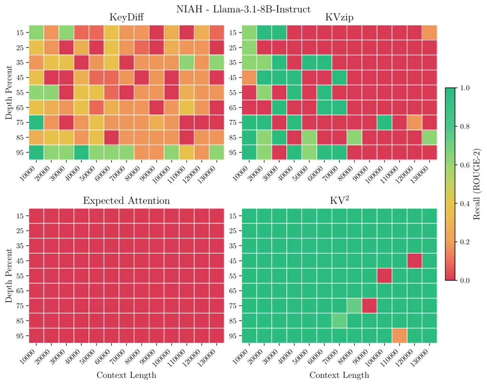

# KV²: A Self-Refining KV Cache

Johannes Wesch and Danni Liu and Jan Niehues Affiliation: Karlsruhe
Institute of Technology, Germany
Affiliation: johannes.wesch@student.kit.edu, danni.liu@kit.edu

###### Abstract

The memory footprint of the key-value (KV) cache constrains the
practical use of long-context models, and it dominates cost when one
prefilled context must later serve many different queries. In this
reusable setting, query-agnostic compression trades cost against
quality: lightweight estimators are cheap but less accurate, whereas
full-context reconstruction scoring is more accurate yet reprocesses the
entire prompt. We introduce KV², a query-agnostic KV-cache compression
method based on selective reconstruction. KV² first uses a lightweight
proxy scorer to identify informative in-context tokens, then reprocesses
only this subset to compute final eviction scores. On RULER,
Needle-in-a-Haystack, and LongBench, KV²’s margin over baselines widens
as the budget tightens: on RULER 16K at a 2% KV-cache budget it improves
the average score over the next-best baseline by more than 40 percentage
points, and on LongBench it attains the highest average across 2%–10%
budgets at lower compression-stage runtime and peak memory than
full-context reconstruction. Reusable KV-cache compression thus does not
require reprocessing the full context. Our code is available at
[https://anonymous.4open.science/r/KVsquared-0B97/](https://anonymous.4open.science/r/KVsquared-0B97/).

Figure 1: Overview of KV². After prefilling the context cache
$`\mathrm{KV}_{c}`$, the method computes proxy scores as a lightweight
estimate of which in-context tokens are most informative. KV² then
selects the query tokens
$`\mathrm{KV}_{c,\mathrm{selected\ query\ tokens}}`$, runs _Selective
Reconstruction_ (SR) on these selected queries to obtain cache scores,
and then evicts low-scoring KV entries before later decoding reuses the
compressed cache.

## 1 Introduction

Long-context large language models have considerably broadened the range
of LLM applications, including analyzing long documents Bai et al.
(2024); Zhang et al. (2024), reasoning over larger code bases Bai et al.
(2024); Zhang et al. (2024), and maintaining extended conversational
histories Zhang et al. (2024). However, their practical use remains
constrained by inference cost. A central reason is the key-value (KV)
cache: once a context has been processed, the model must keep the
resulting cached state available so that later tokens can attend to it
without reprocessing. This cache grows linearly with context length, and
increasingly dominates memory use during deployment.

Autoregressive inference separates into _prefill_ and _decode_ Kim et
al. (2025); Feng et al. (2025) stages. During _prefill_, the model
processes the full prompt and computes keys and values for every layer,
head, and token. For an $`L`$-layer Transformer decoder model with $`H`$
key-value heads and a context of $`n_{c}`$ tokens, this results in a
cache $`\mathrm{KV}_{c}`$, consisting of $`L\cdot H\cdot n_{c}`$ KV
pairs. During _decode_, new tokens are generated one at a time, and each
query attends to $`\mathrm{KV}_{c}`$ instead of reprocessing all
previous tokens. Because $`\mathrm{KV}_{c}`$ stores the exact keys and
values produced by prefill, decoding from it yields the same output
distribution as re-running prefill on the full context at every step Kim
et al. (2025).

Maintaining this equivalence is what makes the cache expensive. Every
context token contributes $`L\cdot H`$ new KV pairs to
$`\mathrm{KV}_{c}`$, and the resident footprint grows accordingly. A
100K-token prompt on Qwen-2.5-32B already requires about 26 GB of KV
memory Chari and Van Durme (2025), and a one-million-token cache for a
70B-scale model would require roughly 320 GB of GPU memory Devoto et al.
(2025a). Decoding is typically memory-bandwidth-bound, since each
generation step rereads the cache from memory Chari and Van Durme
(2025); Shazeer (2019); Yang et al. (2024). Architectural choices such
as Multi-Query Attention (MQA) Shazeer (2019), Grouped Query Attention
(GQA) Ainslie et al. (2023a), and Multi-Head Latent Attention (MLA)
DeepSeek-AI (2024); Meng et al. (2025) reduce the baseline cache, but
they do not remove the underlying KV-cache bottleneck. KV-cache
compression is therefore essential for long-context deployment, where
the goal is to replace $`\mathrm{KV}_{c}`$ with a smaller cache
$`\mathrm{KV}_{c,\mathrm{evicted}}`$ that approximately preserves the
equivalence above.

Beyond these architectural reductions, prior work falls into two broad
categories. The first improves attention kernels and serving systems,
e.g., FlashAttention or PagedAttention Dao (2024); Kwon et al. (2023),
reducing realized memory and compute without altering what the cache
stores. The second compresses the cache itself by evicting
low-importance tokens Xiao et al. (2024); Zhang et al. (2023), retaining
evicted states in low precision Yang et al. (2024), or pruning cache
channels Xu et al. (2025). Many recent eviction methods are
_query-aware_: they keep entries based on a known downstream question or
on a proxy for the next generation step Li et al. (2024); Wang et al.
(2025); Liu et al. (2026). This is effective when the next use of the
cache is known, but less so when one compressed cache must remain useful
across many later queries, e.g., for long-context question-answering or
persistent agent contexts. Another line of work targets _query-agnostic_
compression Devoto et al. (2025a); Kim et al. (2025); Chari and Van
Durme (2025); Kim et al. (2026), which scores entries without reference
to any specific downstream query, and is the focus of this work.

We introduce KV², a query-agnostic KV-cache compression method aimed at
the reusable setting described above¹¹ 1 The superscript in KV² reflects
the method’s two consecutive KV-based stages: proxy-based token
selection followed by reconstruction-based final scoring.: a single
prefilled cache co-resides with other requests on the same device and
must serve many later queries. This requirement easily pushes
per-context budgets well below 10% of the original cache size, lower
than the budgets typically studied in prior work Gao et al. (2024);
Srivatsa et al. (2024); Abhyankar et al. (2024); Devoto et al. (2025b).
KV² is motivated by a simple observation: long-context models do not use
all positions equally, and adding context can dilute the model’s access
to the tokens that genuinely impact downstream behavior Liu et al.
(2023). At such tight budgets, most positions are either trivial to
retain (e.g., attention sinks) or trivial to evict (e.g., filler words
and punctuation). The eviction decision therefore depends on a sparse
set of informative anchors Ainslie et al. (2023b); Xiao et al. (2024);
Zhang et al. (2023). Yet, existing reconstruction-based methods score
every cached entry uniformly, by recomputing attention output over the
full context and measuring each position’s contribution, which in turn
pays the same cost for both trivial and informative tokens. Instead, we
show that scoring a small, well-chosen set of in-context tokens often
suffices to identify the cached entries that preserve the model’s
behavior on the original context.

KV² turns this intuition into a two-stage selective-reconstruction
pipeline (Figure 1). A lightweight proxy scorer first identifies a small
set of informative context tokens. These tokens are then used as
reconstruction queries against the full cache to compute the final
eviction scores. This concentrates the expensive scoring pass on the
dependencies most likely to matter under severe compression, which both
stabilizes the ranking and lowers compression-time cost. This two-stage
design has two convenient properties: it is modular in the choice of the
proxy scorer (§5.2), and supports iterative self-refinement when
additional compression-time compute is available (§5.4).

Our main contributions are threefold:

- •
  Selective reconstruction for reusable KV-cache compression. We
  introduce KV², a query-agnostic two-stage method that uses a
  lightweight proxy to select a small set of in-context tokens and
  reprocesses only this subset to compute final eviction scores (§3).
- •
  Strong performance under extreme compression. We evaluate down to 1–2%
  KV-cache budgets, a highly deployment-relevant scenario imposed by the
  reusable setting and rarely studied in prior work, and find increasing
  gains of KV² over baselines as the budget tightens (§4).
- •
  Favorable efficiency profile. Compression-stage runtime and
  peak-memory measurements show that KV² offers a better
  quality–efficiency trade-off than applying full-context reconstruction
  scoring over every token (§5.1).

## 2 Related work

Early training-free eviction. StreamingLLM keeps recent tokens together
with a small set of initial “attention sink” tokens Xiao et al. (2024),
and H₂O emphasizes heavy hitters that repeatedly attract useful
attention Zhang et al. (2023). These early works established several
themes that reappear throughout the literature. First, token utility is
highly unequal. Second, recency is important but insufficient on its
own. Third, substantial compression can often be achieved without
retraining by exploiting signals already present in the inference
process, especially attention patterns.

Anticipating future decoding. Later methods increasingly score tokens by
how likely they are to matter for future decoding. SnapKV uses an
observation window near the end of the prompt Li et al. (2024), LAQ
generates pseudo queries Wang et al. (2025), and Judge Q learns
surrogate query tokens Liu et al. (2026). These methods can work well
when compression is guided by the continuation the model is about to
decode, but they are less suitable for reusable caches that must support
multiple later questions. For that setting, Expected Attention estimates
token importance under a distribution of possible future queries Devoto
et al. (2025a), while KeyDiff uses key geometry as a query-agnostic
proxy Park et al. (2025). Both are closer to our reusable setting
because they avoid specializing the cache to one anticipated
continuation.

Context reconstruction. Context reconstruction changes the objective
altogether. Instead of asking which cached tokens one future
continuation is likely to use, it asks whether the model needs them to
reproduce the prompt itself. KVzip introduced this viewpoint Kim et al.
(2025), aligning the scoring objective closely with reusable caches but
incurring the cost of broad reconstruction. Subsequent work keeps this
reconstruction-based perspective while trying to reduce memory and
compute. Fast KVzip distills reconstruction-derived importance into
lightweight gating modules, and KVzap aims to approximate stronger
reconstruction signals more cheaply Kim et al. (2026); Jégou and Jeblick
(2026). These methods are the most direct precursors to KV²: they share
the reusable, query-agnostic objective, but either preserve the expense
of broad reconstruction or approximate it indirectly. KV² differs here.
It retains an actual reconstruction pass, but makes that pass selective
by shrinking the reconstruction query set itself.

## 3 Method

We now describe the overview from Figure 1 in detail. KV² is a two-stage
compression procedure. Starting from a prefilled cache
$`\mathrm{KV}_{c}`$, it processes the prompt chunk by chunk. In _Stage 1
(query selection)_, the goal is to identify a small set of in-context
tokens that, when used as queries, will most informatively rank the
cached entries. KV² produces this selection with a lightweight proxy
scorer. In _Stage 2 (cache scoring)_, the goal is to assign every cached
entry a final eviction score. KV² reprocesses only the queries selected
in Stage 1 against the full cache to produce the scores. The core design
choice is therefore not whether to reconstruct, but which queries to use
for reconstruction. After outlining the main method, we describe an
optional iterative refinement and analyze complexity.

##### Chunking.

Following KVzip Kim et al. (2025), KV² does not score the prompt with a
single global reconstruction set. Instead, it retains a small set of
sink tokens at the start of the prefix verbatim and partitions the rest
of the cache, i.e., the compressible portion into chunks:

```math
C_{1},\dots,C_{M},\qquad|C_{r}|\leq m, \tag{1}
```

where $`m`$ is the chunk size. As illustrated in Figure 2, this
structure keeps reconstruction-based scoring tractable on long prompts
while allowing different context regions to propose different
reconstruction

Figure 2: Chunked processing in KV². The context is split into chunks.
Each chunk proposes its own reconstruction queries, and the resulting
local scores are merged into one global eviction decision.

queries before their local scores are merged into one global eviction
decision.

##### Proxy scoring and query selection.

Stage 1 needs a per-token signal that is much cheaper than full
reconstruction yet informative enough to surface promising
reconstruction queries. By default, we use the KeyDiff score Park et al.
(2025); alternative proxy scorers are compared in Section 5.2. For each
token $`i\in C_{r}`$, layer $`\ell`$, and KV head $`h`$, let
$`d_{i,\ell,h}`$ denote the resulting layer- and head-specific KeyDiff
score. KV² aggregates the scores to the token level by averaging over
layers and KV heads:

```math
p_{i}=\frac{1}{LH}\sum_{\ell=1}^{L}\sum_{h=1}^{H}d_{i,\ell,h},\qquad i\in C_{r}. \tag{2}
```

Averaging proved stronger than a max-based aggregation in our initial
experiments. Intuitively, tokens that appear distinctive across many
layers and heads accrue larger scores. KV² then selects the $`n_{q}`$
highest-scoring positions in $`C_{r}`$ as an ordered reconstruction set:

```math
\begin{gathered}Q_{r}=(q_{r,1},\dots,q_{r,n_{q}}),\quad q_{r,1}<\cdots<q_{r,n_{q}},\\
n_{q}=\max\!\left(\lfloor\rho|C_{r}|\rfloor,1\right),\end{gathered} \tag{3}
```

where $`\rho`$ is the query-selection ratio. The selected positions do
not need to form a contiguous span in $`C_{r}`$. KV² treats them as a
sparse set of probe queries: during reconstruction, they are appended
after the prefilled cache $`\mathrm{KV}_{c}`$, assigned position IDs
immediately following the prefilled context, and query the existing
cache under the causal mask rather than being reinserted at original
locations.

##### Selective reconstruction.

For one chunk $`C_{r}`$, KV² uses only the selected context tokens in
$`Q_{r}=(q_{r,1},\dots,q_{r,n_{q}})`$ as reconstruction queries. These
reconstruction tokens are appended after the prefilled cache
$`\mathrm{KV}_{c}`$ and processed in a new causal forward pass with
access to the full cache, so their hidden states and query vectors have
whole-context conditioning and can draw on evidence from anywhere in the
prompt.

Figure 3: Detailed view of KV² inside one chunk. Proxy scores first
select the ordered reconstruction set $`Q_{r}`$. These reconstruction
queries are then encoded against the shared cache, and the final score
for a cached position is the maximum attention it receives during
selective reconstruction.

Unlike the global conditioning for the reconstruction tokens, the final
score extraction is restricted to the current chunk (Figure 3). Each
reconstruction query’s attentions are only used to score positions in
$`C_{r}`$. This global-conditioning, local-scoring split is the main
design choice of KV². Concretely, for one layer $`\ell`$ and one KV head
$`h`$, let $`a_{ji}^{(\ell,h)}`$ denote the attention paid by the
$`j`$-th reconstruction query in $`Q_{r}`$ to cached position
$`i\in C_{r}`$. KV² then assigns the chunk-local score:

```math
s_{i,\ell,h}=\max_{j=1,\dots,n_{q}}a_{ji}^{(\ell,h)},\qquad i\in C_{r}. \tag{4}
```

The max ensures a cached position is retained whenever _any_
reconstruction query depends on it strongly, rather than requiring
agreement across all queries. After all chunks have been processed, KV²
gathers the local scores into a global score tensor, pins the sink
positions at the maximal score so they remain in the cache, and evicts
the lowest-scoring entries under the target compression budget.

##### Iterative refinement.

The same two-stage construction also defines a self-refinement
procedure. Since Stage 2 produces a per-token score for each position in
$`C_{r}`$, at the same granularity as the Stage 1 proxy signal
$`p_{i}`$, the output of one pass can directly replace the proxy in the
next. Single-pass KV² therefore corresponds to the first refinement
round, and we adopt it as the default because it offers the strongest
quality-efficiency trade-off. The multi-pass variant is studied in
Section 5.4 as an optional extension.

##### Complexity analysis.

The proxy pass added before reconstruction is linear in the prompt
length, so the reconstruction forward pass remains the dominant cost of
KV². Relative to KVzip, which reconstructs over every token in a chunk,
KV² reconstructs only a proxy-selected fraction $`\rho`$, so its
reconstruction-stage runtime and peak activation footprint scale with
$`\rho`$ rather than with full-chunk reconstruction. Score extraction is
cheaper because it remains chunk-local: after the reconstruction forward
pass, KV² recomputes attention only on the reduced
$`n_{q}\times(m+n_{q})`$ matrix shown in Figure 3. The reconstruction
forward can still use standard optimized causal-attention kernels, while
the final score extraction is a smaller chunk-local postprocessing step.
Appendix A gives the fuller asymptotic derivation.

## 4 Experiments

After introducing the experimental setup (§4.1), we present experiments
on RULER (§4.2), Needle-in-a-Haystack (§4.3), and LongBench (§4.4).

### 4.1 Experimental setup

Data and models. We use three datasets from controlled retrieval stress
tests and realistic long-context tasks: RULER 4K/16K Hsieh et al.
(2024), LongBench Bai et al. (2024), and a Needle-in-a-Haystack
diagnostic built from Paul Graham essays Hsieh et al. (2024); Devoto
(2026). We mainly use two backbones, Llama-3.1-8B-Instruct Llama Team
(2024) and Qwen3-8B Yang et al. (2025a); Qwen Team (2025). Results from
Qwen2.5-7B-Instruct-1M Yang et al. (2025b) and InfiniteBench
zhang-etal-2024-bench are in the appendices.

Implementation details. Unless stated otherwise, KV² uses a chunk size
of 4K tokens, KeyDiff as the first-stage proxy scorer, and by default
sets the query-selection ratio $`\rho`$ to the final retained KV-cache
ratio. Tighter compression budgets therefore use smaller reconstruction
sets. All runs use PyTorch and Hugging Face Transformers with
FlashAttention-2 Dao (2024), are built on NVIDIA’s kvpress framework
Devoto et al. (2025b), and run on a single NVIDIA A100 80 GB or H100
94 GB GPU.

Baselines. In the main comparisons, we compare to three state-of-the-art
query-agnostic methods that cover the main families of approaches:
lightweight proxy scoring (KeyDiff Park et al. (2025)), expected
future-query scoring (Expected Attention Devoto et al. (2025a)), and
reconstruction-based compression (KVzip Kim et al. (2025)). For the
choice of first-stage proxy scorer inside KV², we compare KeyDiff, Knorm
Devoto et al. (2024), CUR Sengupta et al. (2025), and StreamingLLM Xiao
et al. (2024), while keeping the same second-stage selective
reconstruction fixed.

|                       |               |        |         |              |       |       |        |       |        |                 |        |        |              |       |       |       |       |
| --------------------- | ------------- | ------ | ------- | ------------ | ----- | ----- | ------ | ----- | ------ | --------------- | ------ | ------ | ------------ | ----- | ----- | ----- | ----- |
| Method                | Single-doc QA |        |         | Multi-doc QA |       |       | Summ.  |       |        | Few-shot / Cls. |        |        | Synth. Count |       | Code  |       | Avg.  |
|                       | NrtvQA        | Qasper | MFQA-en | Hotpot       | 2Wiki | MuSiQ | GovRep | QMSum | MultiN | TREC            | TrivQA | SAMSum | PCount       | PR-en | LCC   | RB-P  |       |
| Llama-3.1-8B-Instruct |               |        |         |              |       |       |        |       |        |                 |        |        |              |       |       |       |       |
| Full                  | 30.21         | 45.53  | 55.01   | 56.01        | 46.65 | 31.28 | 35.13  | 25.28 | 27.25  | 73.00           | 91.64  | 43.80  | 8.91         | 99.50 | 63.38 | 56.64 | 49.33 |
| KV Size = 2%          |               |        |         |              |       |       |        |       |        |                 |        |        |              |       |       |       |       |
| KeyDiff               | 17.24         | 12.11  | 16.71   | 26.07        | 20.44 | 5.06  | 21.65  | 18.36 | 10.99  | 17.00           | 91.34  | 36.60  | 6.00         | 25.50 | 12.66 | 48.75 | 24.16 |
| KVzip                 | 12.54         | 11.10  | 18.98   | 24.80        | 21.78 | 8.69  | 11.39  | 17.40 | 7.36   | 5.00            | 87.47  | 32.31  | 2.50         | 4.00  | 18.20 | 51.75 | 20.95 |
| KV²                   | 23.11         | 14.43  | 24.23   | 43.12        | 25.42 | 14.91 | 25.05  | 20.99 | 20.07  | 31.50           | 86.89  | 38.07  | 10.87        | 76.50 | 33.85 | 48.41 | 33.59 |
| KV Size = 5%          |               |        |         |              |       |       |        |       |        |                 |        |        |              |       |       |       |       |
| KeyDiff               | 22.55         | 13.26  | 23.73   | 31.26        | 20.76 | 9.86  | 24.29  | 20.02 | 15.63  | 28.00           | 91.99  | 38.32  | 10.00        | 54.00 | 16.25 | 46.00 | 29.12 |
| KVzip                 | 22.47         | 16.45  | 36.44   | 39.06        | 20.62 | 10.57 | 22.04  | 21.31 | 17.26  | 10.50           | 90.96  | 35.24  | 4.50         | 23.00 | 28.57 | 52.35 | 28.21 |
| KV²                   | 28.20         | 28.07  | 37.29   | 47.66        | 34.90 | 21.58 | 27.51  | 22.99 | 23.13  | 44.00           | 87.06  | 37.86  | 10.75        | 98.00 | 41.31 | 48.20 | 39.91 |
| KV Size = 10%         |               |        |         |              |       |       |        |       |        |                 |        |        |              |       |       |       |       |
| KeyDiff               | 27.23         | 16.57  | 35.79   | 40.89        | 23.72 | 16.86 | 26.21  | 21.20 | 18.98  | 40.50           | 91.74  | 39.47  | 9.54         | 89.50 | 21.29 | 45.12 | 35.29 |
| KVzip                 | 29.92         | 40.92  | 54.33   | 51.80        | 37.65 | 27.60 | 32.14  | 23.64 | 25.45  | 44.50           | 90.12  | 37.93  | 10.50        | 61.00 | 42.08 | 51.21 | 41.30 |
| KV²                   | 29.40         | 36.50  | 48.25   | 54.91        | 44.79 | 26.35 | 30.45  | 24.10 | 24.85  | 51.50           | 85.06  | 38.70  | 11.17        | 99.00 | 44.50 | 47.98 | 43.59 |
| Qwen3-8B              |               |        |         |              |       |       |        |       |        |                 |        |        |              |       |       |       |       |
| Full                  | 29.76         | 43.66  | 55.70   | 62.87        | 47.53 | 35.31 | 33.33  | 24.56 | 24.79  | 40.50           | 90.56  | 40.03  | 10.00        | 91.18 | 64.97 | 59.96 | 47.17 |
| KV Size = 2%          |               |        |         |              |       |       |        |       |        |                 |        |        |              |       |       |       |       |
| KeyDiff               | 5.86          | 3.60   | 18.91   | 9.23         | 21.16 | 3.75  | 8.88   | 17.56 | 4.65   | 2.50            | 72.21  | 27.64  | 3.75         | 4.38  | 8.05  | 53.29 | 16.59 |
| KVzip                 | 6.60          | 5.76   | 16.04   | 6.15         | 8.16  | 4.35  | 11.89  | 16.38 | 8.44   | 1.50            | 58.72  | 31.82  | 0.50         | 4.50  | 15.94 | 60.87 | 16.10 |
| KV²                   | 24.79         | 14.65  | 27.06   | 37.90        | 28.93 | 17.79 | 24.05  | 19.94 | 13.16  | 14.75           | 89.67  | 36.35  | 5.50         | 67.42 | 44.69 | 60.80 | 32.97 |
| KV Size = 5%          |               |        |         |              |       |       |        |       |        |                 |        |        |              |       |       |       |       |
| KeyDiff               | 8.01          | 2.17   | 19.77   | 12.47        | 19.81 | 5.56  | 12.17  | 18.67 | 6.03   | 4.50            | 75.99  | 29.06  | 4.05         | 5.00  | 7.73  | 51.44 | 17.65 |
| KVzip                 | 12.89         | 9.65   | 26.65   | 12.70        | 10.16 | 7.77  | 20.76  | 20.89 | 10.77  | 14.50           | 77.67  | 32.95  | 3.50         | 13.50 | 25.22 | 62.14 | 22.61 |
| KV²                   | 25.73         | 22.86  | 32.79   | 44.42        | 34.79 | 20.22 | 27.55  | 21.93 | 17.03  | 35.00           | 88.94  | 37.28  | 8.68         | 85.20 | 49.95 | 60.15 | 38.28 |
| KV Size = 10%         |               |        |         |              |       |       |        |       |        |                 |        |        |              |       |       |       |       |
| KeyDiff               | 9.75          | 8.53   | 22.97   | 14.43        | 23.54 | 6.95  | 16.15  | 19.70 | 8.19   | 7.00            | 78.30  | 31.79  | 7.61         | 15.17 | 12.67 | 49.74 | 20.78 |
| KVzip                 | 25.58         | 36.61  | 49.80   | 53.09        | 39.79 | 23.83 | 30.98  | 22.80 | 23.01  | 56.00           | 88.74  | 36.45  | 11.00        | 58.42 | 47.23 | 62.57 | 41.62 |
| KV²                   | 25.94         | 33.60  | 41.89   | 54.18        | 40.79 | 27.43 | 30.37  | 23.42 | 20.71  | 59.25           | 90.09  | 38.61  | 9.60         | 90.38 | 56.44 | 59.58 | 43.89 |

Table 1: LongBench results across KV-cache budgets for
Llama-3.1-8B-Instruct and Qwen3-8B. For both, KV² gives the strongest
average performance at tighter budgets, with KVzip becoming closer at
10% retention.

### 4.2 RULER 16K

Figure 4: RULER 16K score versus compression ratio for Qwen3-8B. The
largest gap appears in the severe-budget regime (compression
ratio$`>`$90%), where KV² remains much more robust than the compared
baselines.

RULER 16K is the clearest stress test for severe budgets, so we
highlight the Qwen3-8B result in the main text (Figure 4) and defer the
full per-backbone tables to Appendix D.2.1 and Appendix D.2.2. The same
pattern holds on both backbones: at 5% and especially 2% KV-cache
budgets, KV² degrades much more gracefully than the baselines. The
advantage is strongest on sparse retrieval and aggregation, while
distractor-heavy variants remain difficult for all methods. This is the
regime where selective reconstruction matters most: with very little
cache left, reconstructing a small set of informative anchors is more
useful than spending capacity on less informative positions.

### 4.3 Needle-in-a-Haystack (NIAH)



Figure 5: Needle-in-a-Haystack results at a 5% KV-cache budget on
Llama-3.1-8B-Instruct across context lengths and needle depths.

The NIAH experiment tests whether a target fact survives compression
within a long distractor document. The distractor context is natural
prose rather than RULER’s repeated synthetic templates, providing a more
realistic test case. Results are measured on Llama-3.1-8B-Instruct at a
fixed 5% KV-cache budget using per-example ROUGE-2 recall Hsieh et al.
(2024); Devoto (2026). Figure 5 shows the same pattern as RULER in a
simpler setting: KV² is the most stable method as context length and
needle depth increase, whereas KeyDiff is patchy, and KVzip degrades
more quickly on longer haystacks.

### 4.4 LongBench

On LongBench (Table 1), a broader and more heterogeneous benchmark, the
same pattern carries over. The clearest gains again appear at tight
budgets. At a 2% KV-cache budget, KV² raises the average LongBench score
from 24.16 to 33.59 on Llama-3.1-8B-Instruct and from 16.59 to 32.97 on
Qwen3-8B relative to the next-best baseline. At 5%, the gap remains
large: KV² reaches 39.91 on Llama and 38.28 on Qwen, compared with 29.12
and 22.61 for the strongest competing methods. The gains are
concentrated in multi-document question answering and in synthetic
retrieval and counting tasks, where preserving a small set of supporting
facts matters more than reconstructing context uniformly. The clearest
recurring exception is the RepoBench-P subtask, where broader
reconstruction remains more helpful. LongBench therefore sharpens the
same boundary as the earlier diagnostics: selective reconstruction helps
most when relevant evidence is sparse and anchor-like, and less when
useful evidence is spread broadly across the prompt. Appendix D.3
extends this picture into the 200K-scale regime: KV² still improves on
the strongest baseline at all three reported budgets on
Llama-3.1-8B-Instruct and remains slightly ahead on
Qwen2.5-7B-Instruct-1M.

Figure 6: Compression-stage runtime (left) and peak memory (right)
versus chunk size for single-pass KV² compared with KVzip. For KV², the
value in parentheses in the legend denotes the reconstruction percentage
retained from the proxy-selected query set in the first stage. Missing
bars indicate out-of-memory configurations.

## 5 Analysis

The benchmark results above highlight the empirical strengths of KV².
This section examines how the method shapes this behavior: how much
compression-stage runtime and memory it saves relative to KVzip (§5.1),
how the first-stage proxy and reconstruction budget shape the
reconstruction set (§5.2, §5.3), and how much additional quality
iterative refinement can recover once those pieces are fixed (§5.4).
These efficiency measurements concern only the compression stage. In the
current kvpress backend, both KVzip and KV² are realized through
headwise masking rather than physically compacted caches, so the
reported runtime and peak memory should be read as compression-stage
costs instead of realized decode-time savings from a production serving
backend. Unless stated otherwise, this section uses
Llama-3.1-8B-Instruct with 124K context tokens on an NVIDIA H100 GPU in
FP16 with FlashAttention-2 Dao (2024).

### 5.1 Single-pass efficiency

The clearest practical advantage of KV² over KVzip is single-pass
efficiency. Figure 6 shows that, within this masking-based backend, it
is consistently faster than KVzip and uses less peak memory across the
relevant chunk sizes. The reason is structural rather than incidental:
KV² reconstructs only a proxy-selected subset of queries, so the
compression stage performs less work and keeps a smaller active
reconstruction footprint. The chunk-size curves in Figure 6 also show
why 4K is the default chunk size. Below 4K, the repeated per-chunk
overhead drives compression-stage runtime up, as shown in the left
subfigure. Above 4K, the reconstruction set grows linearly with chunk
size, raising both runtime and peak memory until the largest
configurations run out of memory (missing bars in the figure). In
contrast, the quality-side picture is comparatively flat: across length
buckets in LongBench-E Bai et al. (2024) (LongBench with a more even
length distribution), KV²’s score is largely insensitive to chunk size,
with larger chunks helping mainly on the longest inputs (Appendix C). A
chunk size of 4K therefore captures nearly all the available quality
while remaining highly efficient.

### 5.2 Proxy scorer

Figure 7: RULER 4K score versus compression ratio for
Llama-3.1-8B-Instruct when KV² is paired with different first-stage
proxy scorers.

Figure 8: RULER 4K score versus reconstruction percentage for
Llama-3.1-8B-Instruct (left) and Qwen3-8B (right). In the legend, KV
Size denotes the final retained KV-cache budget.

The first-stage proxy mechanism matters, even though it is not the final
scoring rule. Figure 7 isolates this effect. All curves are KV² with the
same second stage, and only the proxy scorer changes. KeyDiff Park et
al. (2025) is the strongest option throughout, with Knorm Devoto et al.
(2024) as the closest alternative. CUR Sengupta et al. (2025) and
especially StreamingLLM Xiao et al. (2024) fall off much more quickly as
compression tightens, with both dropping below a random-proxy baseline
at the highest compression ratios studied. A plausible reason is that
StreamingLLM is designed to preserve sink tokens and recent context for
streaming generation, and both StreamingLLM and CUR rely on structurally
fixed selection patterns rather than content-adaptive ones. Therefore,
under severe compression, a content-adaptive proxy set can cover the
useful signal better. Appendix E shows the same effect qualitatively for
the default KeyDiff proxy after layer- and head-averaging: the proxy
mass concentrates on the instruction, assignment chain, and answer span,
while only a sparse set of tokens is drawn from the repetitive filler
context. This makes the role of the proxy clear: KV² is modular
regarding the proxy choice, but stronger initial proxies still matter
most under severe compression.

### 5.3 Reconstruction budget

Figure 8 makes the reconstruction-budget trade-off explicit. On both
backbones, the optimal reconstruction fraction grows with the final
KV-cache budget. For Llama-3.1-8B-Instruct, the RULER score peaks at
10%, 50%, and 100% reconstruction for final budgets of 2%, 5%, and 10%,
respectively. For Qwen3-8B, the corresponding maxima are 10%, 25%, and
75%. These trends demonstrate that more retained cache rewards more
reconstruction, and no single $`\rho`$ is optimal across budgets. This
monotonic relationship strengthens the default schedule in Section 4.1,
which sets $`\rho`$ to track the final retained KV-cache ratio, where
tighter budgets get smaller reconstruction sets, looser budgets get
larger ones. While this matched default does not reach the per-budget
optimum, it does capture the right scaling and keeps reconstruction cost
proportional to the budget.

### 5.4 Iterative refinement

The proxy-scorer and reconstruction-budget results suggest a next
question: once one KV² pass has produced a useful but potentially
imperfect reconstruction set, how much can later passes improve it?
Figure 9 shows that iterative refinement can improve quality, but that
most of the gain appears in the first few passes. The benefits are
largest when the initial proxy is weak, either because the first-stage
proxy is less effective (random proxy), or the reconstruction fraction
is very small (2%). Once the first pass is already strong, the benefit
shrinks to minimal. Iterative refinement is therefore most attractive as
a targeted extension for harder settings rather than as the default
configuration.

Figure 9: RULER 4K score with refinement iterations. Most gains appear
in the first few passes, after which improvements diminish. The legend
lists the first-stage proxy scorer and the retained reconstruction
percentage.

Moreover, Appendix B shows that these gains come mainly at a runtime
cost, while peak memory changes much less.

##### Summary

The analyses in this section identified the main operating regime of our
method. The single-pass version is the strongest practical default
because it already delivers the main quality gains while staying clearly
cheaper than broader reconstruction (§5.1). The proxy scorer is
swappable, but its quality matters most at severe compression (§5.2).
Reconstruction percentage provides a useful deployment knob (§5.3),
while iterative refinement can recover additional quality mainly when
the initial proxy is weak (§5.4).

## 6 Conclusion

In this work, we showed that reusable KV-cache compression does not need
to choose between cheap heuristics and reconstructing everything. KV²
shows that a small, well-chosen reconstruction set can already preserve
much of the useful long-context signal under severe compression. The
two-stage structure, paired with the observation that informative
anchors are sparse at extreme budgets, points toward compression methods
that are both cheaper and more accurate.

## Limitations

Three directions appear most important to improve the current work.

First, iterative refinement should be explored further and should become
adaptive rather than fixed. Section 5.4 shows that additional passes
help mainly when the initial proxy is weak or the reconstruction budget
is very small, while Appendix B shows that these gains come mainly at a
runtime cost. This suggests refinement schedules that continue only
while the reconstruction set or the resulting scores are still changing
meaningfully, and perhaps allocate more compression-time compute only to
harder retrieval or multi-document workloads.

Second, the first-stage proxy mechanism itself should be strengthened.
Because KV² is a modular two-stage framework, better proxy scorers
should improve both single-pass quality and the value of later
refinement. The proxy ablation in Section 5.2 suggests that
content-adaptive scorers outperform structurally fixed ones at low
budgets, suggesting that learned or model-aware proxies may be able to
improve further.

Third, the current masking-based realization should be replaced by a
compact serving backend. Within the kvpress toolkit, KV² measures
compression-stage runtime and memory faithfully, but it does not yet
materialize physically compact reusable caches due to the toolkit’s
implementations. Headwise cache compaction, optimized attention kernels
that allow each head’s individually compressed sequence length, and
repeated-query serving pipelines are therefore needed to translate the
present compression results into full decoding-time memory and latency
gains.

## References

- Abhyankar et al. (2024) R. Abhyankar, Z. He, V. Srivatsa, H. Zhang,
  and Y. Zhang InferCept: efficient intercept support for augmented
  large language model inference. Note: arXiv preprint arXiv:2402.01869
  External Links: [Link](https://arxiv.org/abs/2402.01869) Cited by: §1.
- Ainslie et al. (2023a) J. Ainslie, J. Lee-Thorp, M. de Jong, Y.
  Zemlyanskiy, F. Lebron, and S. Sanghai GQA: training generalized
  multi-query transformer models from multi-head checkpoints. In
  Proceedings of the 2023 Conference on Empirical Methods in Natural
  Language Processing, Singapore, pp. 4895–4901. External Links:
  [Document](https://dx.doi.org/10.18653/v1/2023.emnlp-main.298),
  [Link](https://aclanthology.org/2023.emnlp-main.298/) Cited by: §1.
- Ainslie et al. (2023b) J. Ainslie, T. Lei, M. de Jong, S. Ontañón, S.
  Brahma, Y. Zemlyanskiy, D. Uthus, M. Guo, J. Lee-Thorp, Y. Tay, Y.
  Sung, and S. Sanghai CoLT5: faster long-range transformers with
  conditional computation. In Proceedings of the 2023 Conference on
  Empirical Methods in Natural Language Processing, External Links:
  [Link](https://arxiv.org/abs/2303.09752) Cited by: §1.
- Bai et al. (2024) Y. Bai, X. Lv, J. Zhang, H. Lyu, J. Tang, Z.
  Huang, Z. Du, X. Liu, A. Zeng, L. Hou, Y. Dong, J. Tang, and J. Li
  LongBench: a bilingual, multitask benchmark for long context
  understanding. In Proceedings of the 62nd Annual Meeting of the
  Association for Computational Linguistics (Volume 1: Long Papers),
  Bangkok, Thailand. External Links:
  [Document](https://dx.doi.org/10.18653/v1/2024.acl-long.172),
  [Link](https://aclanthology.org/2024.acl-long.172/) Cited by: §1,
  §4.1, §5.1.
- Chari and Van Durme (2025) V. Chari and B. Van Durme Compactor:
  calibrated query-agnostic kv cache compression with approximate
  leverage scores. arXiv. External Links:
  [Document](https://dx.doi.org/10.48550/ARXIV.2507.08143),
  [Link](https://arxiv.org/abs/2507.08143) Cited by: §1, §1.
- Dao (2024) T. Dao FlashAttention-2: faster attention with better
  parallelism and work partitioning. In The Twelfth International
  Conference on Learning Representations, External Links:
  [Link](https://openreview.net/forum?id=mZn2Xyh9Ec) Cited by: Appendix
  A, §1, §4.1, §5.
- DeepSeek-AI (2024) DeepSeek-AI DeepSeek-v2: A strong, economical, and
  efficient mixture-of-experts language model. CoRR abs/2405.04434.
  External Links: [Link](https://doi.org/10.48550/arXiv.2405.04434),
  [Document](https://dx.doi.org/10.48550/ARXIV.2405.04434), 2405.04434
  Cited by: §1.
- Devoto et al. (2025a) A. Devoto, M. Jeblick, and S. Jégou Expected
  attention: kv cache compression by estimating attention from future
  queries distribution. Note: arXiv preprint arXiv:2510.00636 External
  Links: [Document](https://dx.doi.org/10.48550/arXiv.2510.00636),
  [Link](https://arxiv.org/abs/2510.00636) Cited by: §1, §1, §2, §4.1.
- Devoto et al. (2025b) A. Devoto, M. Jeblick, and S. Jégou Kvpress: LLM
  KV cache compression made easy. Note: GitHub repositoryNVIDIA, version
  0.5.3 External Links: [Link](https://github.com/NVIDIA/kvpress) Cited
  by: §1, §4.1.
- Devoto et al. (2024) A. Devoto, Y. Zhao, S. Scardapane, and P.
  Minervini A simple and effective $`L_{2}`$ norm-based strategy for kv
  cache compression. In Proceedings of the 2024 Conference on Empirical
  Methods in Natural Language Processing, Miami, Florida, USA,
  pp. 18476–18499. External Links:
  [Document](https://dx.doi.org/10.18653/v1/2024.emnlp-main.1027),
  [Link](https://aclanthology.org/2024.emnlp-main.1027/) Cited by: §4.1,
  §5.2.
- Devoto (2026) A. Devoto Paul graham essays. Note: Hugging Face
  dataset. Accessed 2026-04-23 External Links:
  [Link](https://huggingface.co/datasets/alessiodevoto/paul_graham_essays)
  Cited by: §4.1, §4.3.
- Feng et al. (2025) Y. Feng, J. Lv, Y. Cao, X. Xie, and S. K. Zhou
  Ada-kv: optimizing kv cache eviction by adaptive budget allocation for
  efficient llm inference. In Advances in Neural Information Processing
  Systems, External Links:
  [Link](https://openreview.net/forum?id=tcisuhGsQZ) Cited by: §1.
- Gao et al. (2024) B. Gao, Z. He, P. Sharma, Q. Kang, D. Jevdjic, J.
  Deng, X. Yang, Z. Yu, and P. Zuo Cost-efficient large language model
  serving for multi-turn conversations with cachedattention. Note: arXiv
  preprint arXiv:2403.19708 External Links:
  [Link](https://arxiv.org/abs/2403.19708) Cited by: §1.
- Hsieh et al. (2024) C. Hsieh, S. Sun, S. Kriman, S. Acharya, D.
  Rekesh, F. Jia, and B. Ginsburg RULER: what’s the real context size of
  your long-context language models?. In Conference on Language
  Modeling, External Links:
  [Link](https://openreview.net/forum?id=kIoBbc76Sy) Cited by: §4.1,
  §4.3.
- Jégou and Jeblick (2026) S. Jégou and M. Jeblick KVzap: fast,
  adaptive, and faithful kv cache pruning. arXiv. External Links:
  [Document](https://dx.doi.org/10.48550/ARXIV.2601.07891),
  [Link](https://arxiv.org/abs/2601.07891) Cited by: §2.
- Kim et al. (2026) J. Kim, D. Han, and S. Yun Fast kvzip: efficient and
  accurate llm inference with gated kv eviction. arXiv. External Links:
  [Document](https://dx.doi.org/10.48550/ARXIV.2601.17668),
  [Link](https://arxiv.org/abs/2601.17668) Cited by: §1, §2.
- Kim et al. (2025) J. Kim, J. Kim, S. Kwon, J. W. Lee, S. Yun,
  and H. O. Song KVzip: query-agnostic kv cache compression with context
  reconstruction. In Advances in Neural Information Processing Systems,
  Note: Oral External Links:
  [Link](https://openreview.net/forum?id=JFygzwx8SJ) Cited by: Appendix
  A, §1, §1, §2, §3, §4.1.
- Kwon et al. (2023) W. Kwon, Z. Li, S. Zhuang, Y. Sheng, L.
  Zheng, C. H. Yu, J. E. Gonzalez, H. Zhang, and I. Stoica Efficient
  memory management for large language model serving with
  pagedattention. In Proceedings of the 29th Symposium on Operating
  Systems Principles, External Links:
  [Document](https://dx.doi.org/10.1145/3600006.3613165),
  [Link](https://doi.org/10.1145/3600006.3613165) Cited by: §1.
- Li et al. (2024) Y. Li, Y. Huang, B. Yang, B. Venkitesh, A. F.
  Locatelli, H. Ye, T. Cai, P. Lewis, and D. Chen SnapKV: llm knows what
  you are looking for before generation. In Advances in Neural
  Information Processing Systems, External Links:
  [Link](https://openreview.net/forum?id=poE54GOq2l) Cited by: §1, §2.
- Liu et al. (2023) N. F. Liu, K. Lin, J. Hewitt, A. Paranjape, M.
  Bevilacqua, F. Petroni, and P. Liang Lost in the middle: how language
  models use long contexts. Note: arXiv preprint arXiv:2307.03172
  External Links: [Link](https://arxiv.org/abs/2307.03172) Cited by: §1.
- Liu et al. (2026) Y. Liu, Y. Wang, Y. Xu, S. Ji, Y. Xu, Q. Zhu, and W.
  Che Judge q: trainable queries for optimized information retention in
  kv cache eviction. Proceedings of the AAAI Conference on Artificial
  Intelligence 40 (38), pp. 32240–32248. External Links:
  [Document](https://dx.doi.org/10.1609/aaai.v40i38.40497),
  [Link](https://doi.org/10.1609/aaai.v40i38.40497) Cited by: §1, §2.
- Llama Team (2024) Llama Team The llama 3 herd of models. External
  Links: [Document](https://dx.doi.org/10.48550/arXiv.2407.21783),
  [Link](https://arxiv.org/abs/2407.21783) Cited by: §4.1.
- Meng et al. (2025) F. Meng, P. Tang, Z. Yao, X. Sun, and M. Zhang
  TransMLA: migrating GQA models to MLA with full deepseek compatibility
  and speedup. In Advances in Neural Information Processing Systems 38:
  Annual Conference on Neural Information Processing Systems 2025,
  NeurIPS 2025, San Diego, CA, USA, December 2-7, 2025 / Mexico City,
  Mexico, November 30 - December 5, 2025, D. Belgrave, C. Zhang, L. N.
  Montoya, H. Lin, R. Pascanu, P. Koniusz, M. Ghassemi, N.
  Chen, I. V. M. Ruíz, and A. Loaiza-Bonilla (Eds.), External Links:
  [Link](http://papers.nips.cc/paper_files/paper/2025/hash/75d13a472f570755af2a4ae4ac3d6724-Abstract-Conference.html)
  Cited by: §1.
- Park et al. (2025) J. Park, D. Jones, M. J. Morse, R. Goel, M. Lee,
  and C. Lott KeyDiff: key similarity-based kv cache eviction for
  long-context llm inference in resource-constrained environments. In
  Advances in Neural Information Processing Systems, External Links:
  [Link](https://openreview.net/forum?id=uBaFH7aQnC) Cited by: §2, §3,
  §4.1, §5.2.
- Qwen Team (2025) Qwen Team Qwen3-8b model card. Note: Hugging Face
  model card. Accessed 2026-04-23 External Links:
  [Link](https://huggingface.co/Qwen/Qwen3-8B) Cited by: §4.1.
- Sengupta et al. (2025) A. Sengupta, S. Chaudhary, and T. Chakraborty
  Value-guided kv compression for llms via approximated cur
  decomposition. In Advances in Neural Information Processing Systems,
  External Links: [Link](https://openreview.net/forum?id=klmc4fwPLd)
  Cited by: §4.1, §5.2.
- Shazeer (2019) N. Shazeer Fast transformer decoding: one write-head is
  all you need. arXiv. External Links:
  [Document](https://dx.doi.org/10.48550/ARXIV.1911.02150),
  [Link](https://arxiv.org/abs/1911.02150) Cited by: §1.
- Srivatsa et al. (2024) V. Srivatsa, Z. He, R. Abhyankar, D. Li, and Y.
  Zhang Preble: efficient distributed prompt scheduling for llm serving.
  Note: arXiv preprint arXiv:2407.00023 External Links:
  [Link](https://arxiv.org/abs/2407.00023) Cited by: §1.
- Wang et al. (2025) Y. Wang, S. Ji, Y. Liu, Y. Xu, Y. Xu, Q. Zhu,
  and W. Che Lookahead q-cache: achieving more consistent kv cache
  eviction via pseudo query. In Proceedings of the 2025 Conference on
  Empirical Methods in Natural Language Processing, Suzhou, China,
  pp. 34146–34162. External Links:
  [Document](https://dx.doi.org/10.18653/v1/2025.emnlp-main.1732),
  [Link](https://aclanthology.org/2025.emnlp-main.1732/) Cited by: §1,
  §2.
- Xiao et al. (2024) G. Xiao, Y. Tian, B. Chen, S. Han, and M. Lewis
  Efficient streaming language models with attention sinks. In The
  Twelfth International Conference on Learning Representations, External
  Links: [Link](https://openreview.net/forum?id=NG7sS51zVF) Cited by:
  §1, §1, §2, §4.1, §5.2.
- Xu et al. (2025) Y. Xu, Z. Jie, H. Dong, L. Wang, X. Lu, A. Zhou, A.
  Saha, C. Xiong, and D. Sahoo ThinK: thinner key cache by query-driven
  pruning. In The Thirteenth International Conference on Learning
  Representations, External Links:
  [Link](https://openreview.net/forum?id=n0OtGl6VGb) Cited by: §1.
- Yang et al. (2025a) A. Yang, A. Li, B. Yang, B. Zhang, B. Hui, B.
  Zheng, B. Yu, C. Gao, C. Huang, C. Lv, C. Zheng, D. Liu, F. Zhou, F.
  Huang, F. Hu, H. Ge, H. Wei, H. Lin, J. Tang, J. Yang, J. Tu, J.
  Zhang, J. Yang, J. Yang, J. Zhou, J. Zhou, J. Lin, K. Dang, K. Bao, K.
  Yang, L. Yu, L. Deng, M. Li, M. Xue, M. Li, P. Zhang, P. Wang, Q.
  Zhu, R. Men, R. Gao, S. Liu, S. Luo, T. Li, T. Tang, W. Yin, X.
  Ren, X. Wang, X. Zhang, X. Ren, Y. Fan, Y. Su, Y. Zhang, Y. Zhang, Y.
  Wan, Y. Liu, Z. Wang, Z. Cui, Z. Zhang, Z. Zhou, and Z. Qiu Qwen3
  technical report. Technical report Qwen Team. External Links:
  [Document](https://dx.doi.org/10.48550/arXiv.2505.09388),
  [Link](https://github.com/QwenLM/Qwen3/blob/main/Qwen3_Technical_Report.pdf)
  Cited by: §4.1.
- Yang et al. (2025b) A. Yang, B. Yu, C. Li, D. Liu, F. Huang, H.
  Huang, J. Jiang, J. Tu, J. Zhang, J. Zhou, J. Lin, K. Dang, K.
  Yang, L. Yu, M. Li, M. Sun, Q. Zhu, R. Men, T. He, W. Xu, W. Yin, W.
  Yu, X. Qiu, X. Ren, X. Yang, Y. Li, Z. Xu, and Z. Zhang Qwen2.5-1m
  technical report. Technical report Qwen Team. External Links:
  [Document](https://dx.doi.org/10.48550/arXiv.2501.15383),
  [Link](https://qianwen-res.oss-cn-beijing.aliyuncs.com/Qwen2.5-1M/Qwen2_5_1M_Technical_Report.pdf)
  Cited by: §4.1.
- Yang et al. (2024) J. Y. Yang, B. Kim, J. Bae, B. Kwon, G. Park, E.
  Yang, S. J. Kwon, and D. Lee No token left behind: reliable kv cache
  compression via importance-aware mixed precision quantization. Note:
  arXiv preprint arXiv:2402.18096 External Links:
  [Document](https://dx.doi.org/10.48550/arXiv.2402.18096),
  [Link](https://arxiv.org/abs/2402.18096) Cited by: §1, §1.
- Zhang et al. (2024) X. Zhang, Y. Chen, S. Hu, Z. Xu, J. Chen, M.
  Hao, X. Han, Z. Thai, S. Wang, Z. Liu, and M. Sun $`\infty`$Bench:
  Extending Long Context Evaluation Beyond 100K Tokens. In Proceedings
  of the 62nd Annual Meeting of the Association for Computational
  Linguistics (Volume 1: Long Papers), Bangkok, Thailand,
  pp. 15262–15277. External Links:
  [Document](https://dx.doi.org/10.18653/v1/2024.acl-long.814),
  [Link](https://aclanthology.org/2024.acl-long.814/) Cited by: §1.
- Zhang et al. (2023) Z. Zhang, Y. Sheng, T. Zhou, T. Chen, L. Zheng, R.
  Cai, Z. Song, Y. Tian, C. Ré, C. Barrett, Z. Wang, and B. Chen H2O:
  heavy-hitter oracle for efficient generative inference of large
  language models. In Advances in Neural Information Processing Systems,
  Vol. 36. External Links:
  [Link](https://proceedings.neurips.cc/paper_files/paper/2023/hash/6ceefa7b15572587b78ecfcebb2827f8-Abstract-Conference.html)
  Cited by: §1, §1, §2.

## Appendix A Complexity Analysis

Let $`n_{c}`$ denote the prefilled context length. The complexity is
easiest to understand by separating KV² into the lightweight proxy stage
and the two computations inside selective reconstruction. The proxy
stage is inexpensive. In the default implementation, the efficient
KeyDiff proxy computes one anchor-style key score per token, so proxy
scoring is linear in context length, $`O(n_{c})`$.

The reconstruction forward pass is the expensive part. For one chunk,
the reconstruction block has length $`n_{q}\approx\rho m`$. Because
these reconstruction queries are appended after the prefilled document,
each one attends over the full cached context and also over earlier
reconstruction tokens in the same block. The resulting per-chunk cost is
therefore $`O(n_{c}n_{q}+n_{q}^{2}/2)`$. Repeating this across the
roughly $`n_{c}/m`$ chunks gives a total reconstruction-forward cost of
$`O(\rho n_{c}^{2}+\rho^{2}n_{c}m/2)`$. However, this reconstruction
forward remains an ordinary causal pass over the shared cache, so it can
still use optimized attention implementations such as
FlashAttention-style kernels during the forward computation Dao (2024).

Score extraction is cheaper because it is chunk-local. After the
reconstruction forward pass, KV² recomputes attention only on a reduced
matrix of size $`n_{q}\times(m+n_{q})`$ for the current chunk, as
illustrated in Figure 3. This gives $`O(n_{q}(m+n_{q}))=O(\rho m^{2})`$
work per chunk and $`O(\rho mn_{c})`$ over all chunks. Unlike the
reconstruction forward, however, the final score extraction requires a
Softmax over keys followed by a max over queries, a cross-dimensional
dependency that does not map cleanly onto the usual blockwise attention
algorithms Kim et al. (2025).

## Appendix B Iterative refinement cost

Section 5.4 showed that iterative refinement can improve quality,
especially when the initial proxy is weak or the reconstruction fraction
is small. The remaining question is cost. Figure 10 shows that runtime
rises roughly in proportion to the number of refinement passes,
especially when chunk size is small and many local reconstructions must
be repeated. Peak memory remains driven mainly by chunk size because
each pass reuses essentially the same working buffer. This is why
iterative refinement is best viewed as an optional extension for harder
settings rather than the default configuration.

Figure 10: Compression-stage runtime (left) and peak memory (right)
versus chunk size for iterative KV². Additional refinement passes
increase runtime roughly in proportion to the number of passes, while
peak memory is driven mainly by chunk size and changes much less with
the number of iterations. All curves use a fixed 2% reconstruction
percentage; the number in parentheses in the legend denotes the number
of refinement iterations.

## Appendix C LongBench-E

LongBench-E complements Section 5.1 by separating input-length effects
within the same task families at a fixed 5% KV budget. Table 2 reports
the results across these length buckets. All three KV² variants remain
ahead of KeyDiff and KVzip on the overall average, and they stay
relatively close to one another. Together with Figure 6, this supports
the 4K default used in the main paper.

Method Single-doc QA Multi-doc QA Summ. NrtvQA Hotpot QMSum 8k 16k 16k+
$`\mu`$ 4k 8k 16k $`\mu`$ 4k 8k 16k 16k+ $`\mu`$ Full 35.06 21.48 34.12
30.85 63.77 59.47 59.45 60.9 22.14 26.34 25.32 23.54 25.21 KV Size = 5%
KeyDiff 19.87 14.12 28.51 23.29 26.27 24.45 30.93 27.22 15.58 19.34 21.0
18.69 19.97 KVzip 19.9 15.07 27.32 22.86 36.18 27.28 33.44 32.3 20.08
21.62 21.24 21.58 21.31 KV² (2K) 23.87 19.59 34.51 28.83 48.68 53.58
45.06 49.1 20.08 21.62 21.24 21.58 21.31 KV² (8K) 20.7 15.96 32.71 26.33
45.13 51.12 53.95 50.07 20.07 24.81 23.52 19.11 23.19 KV² (32K) 19.24
22.36 38.0 30.87 45.13 49.41 53.18 49.24 20.07 24.22 23.59 19.73 23.13

Method Few-shot / Cls. Synth. Count Code Avg. TREC PCount LCC 4k 8k 16k
$`\mu`$ 4k 8k 16k $`\mu`$ 4k 8k 16k 16k+ $`\mu`$ Full 30.0 22.0 14.0
22.0 28.0 13.3 19.0 20.1 49.06 43.97 38.36 60.00 44.16 33.87 KV Size =
5% KeyDiff 23.0 35.0 25.0 27.67 14.0 10.0 15.0 13.0 16.53 21.91 18.41
24.2 19.05 21.70 KVzip 7.0 13.0 17.0 12.33 17.0 5.0 6.0 9.33 30.52 25.56
19.09 23.67 25.06 20.53 KV² (2K) 29.5 41.0 38.0 36.17 28.55 15.17 18.0
20.57 45.14 37.44 30.72 45.8 38.02 32.33 KV² (8K) 30.5 54.0 40.0 41.5
28.27 11.95 14.0 18.07 43.43 40.97 31.16 30.2 38.5 32.94 KV² (32K) 30.5
52.0 41.0 41.17 28.27 12.87 16.0 19.05 42.6 37.91 28.95 30.0 36.5 33.33

Table 2: LongBench-E results for Llama-3.1-8B-Instruct at 5% KV
retention, grouped by task and input length. The table columns labeled
4k, 8k, 16k, and 16k+ denote LongBench-E input-length buckets measured
in words, whereas the method labels KV² (2K), KV² (8K), and KV² (32K)
denote chunk sizes measured in tokens. These are therefore different
quantities and should not be read on the same scale. Across both suites,
KV² consistently outperforms KeyDiff and KVzip on average, and larger
chunk sizes tend to be strongest on longer inputs while smaller chunks
remain more competitive on shorter inputs.

## Appendix D Additional benchmark results

This appendix reports the full, per-benchmark results that the main text
only summarizes. Section D.1 covers RULER 4K on both backbones,
Section D.2 gives the detailed per-backbone RULER 16K tables across the
full range of KV-cache budgets, and Section D.3 extends the evaluation
to the 200K-token InfiniteBench suite.

### D.1 RULER 4K

Figure 11 shows the same pattern as RULER 16K, but with a smaller gap.
At 4K context length, broader reconstruction is less wasteful, so KVzip
remains competitive at 10% and 5% KV size. Under more aggressive
compression, KV² again degrades more gracefully than the lighter
baselines and, especially on Qwen3-8B, than KVzip. RULER 4K therefore
marks the boundary of the main result. Selective reconstruction still
helps, but the advantage is naturally weaker when prompts are short
enough that global reconstruction is less wasteful.

Figure 11: RULER 4K score versus KV retention ratio for
Llama-3.1-8B-Instruct (left) and Qwen3-8B (right). KV² is more robust
than lightweight heuristics at small budgets, while KVzip becomes more
competitive as more KV entries are kept.

### D.2 RULER 16K

The tables below give the full per-backbone RULER 16K results summarized
in the main text, including the wider range of KV budgets.

#### D.2.1 Llama-3.1-8B-Instruct

Table 3 reports the complete RULER 16K results for Llama-3.1-8B-Instruct
across every evaluated KV-cache budget, broken down by task category
(aggregation, retrieval, QA, and multi-hop). Consistent with the main
text, KV² preserves aggregation and retrieval accuracy far better than
the baselines as the budget tightens toward 2%.

Method Aggregation Retrieval QA Multi-hop Avg. cwe fwe mk_1 mk_2 mk_3 mq
mv s_1 s_2 s_3 qa_1 qa_2 vt Llama-3.1-8B-Instruct Full 89.18 90.2 99.6
100.0 99.2 99.0 99.1 100.0 100.0 100.0 81.2 56.8 99.8 93.39 KV Size =
75% KeyDiff 89.08 89.47 99.6 98.0 43.4 99.25 98.95 100.0 100.0 100.0
76.6 55.0 99.72 88.39 ExpectedAttention 86.98 89.73 100.0 99.6 99.4
99.15 98.55 100.0 100.0 100.0 79.0 54.8 99.56 92.83 KVzip 89.14 90.73
99.8 100.0 99.2 99.95 99.2 100.0 100.0 100.0 80.8 56.4 99.76 93.46 KV²
89.42 90.67 99.8 100.0 99.2 99.95 99.25 100.0 100.0 100.0 81.0 56.8 99.8
93.53 KV Size = 50% KeyDiff 87.5 88.8 99.4 76.0 6.8 99.35 99.1 100.0
100.0 100.0 65.0 52.8 99.6 82.64 ExpectedAttention 81.1 88.4 99.6 96.0
54.8 99.0 97.65 100.0 100.0 77.6 70.8 54.8 99.48 86.09 KVzip 88.48 90.67
99.8 100.0 99.2 99.9 99.7 100.0 100.0 100.0 82.2 56.2 99.76 93.53 KV²
89.04 90.4 99.6 100.0 99.4 99.9 99.55 100.0 100.0 100.0 82.0 56.2 99.8
93.53 KV Size = 25% KeyDiff 71.32 87.73 99.6 27.2 0.0 99.4 98.95 100.0
100.0 100.0 45.2 45.8 98.76 74.92 ExpectedAttention 28.1 84.0 95.8 65.4
10.8 96.9 80.8 100.0 99.6 10.2 51.8 43.0 96.12 66.35 KVzip 87.72 87.73
99.2 100.0 99.0 99.75 99.25 100.0 100.0 100.0 77.4 54.0 99.72 92.6 KV²
87.94 88.8 99.4 98.2 60.4 99.85 99.4 100.0 100.0 100.0 76.6 53.4 99.72
89.52 KV Size = 10% KeyDiff 25.34 84.4 99.4 3.0 0.0 99.4 98.7 100.0
100.0 100.0 24.6 34.2 94.64 66.44 ExpectedAttention 2.14 28.67 15.4 2.6
0.0 13.4 14.8 99.4 22.0 0.0 27.4 29.6 76.88 25.56 KVzip 27.04 83.4 96.8
94.8 65.0 97.1 90.2 100.0 100.0 100.0 66.8 50.8 99.16 82.39 KV² 74.06
78.67 99.0 28.4 0.8 99.8 99.25 100.0 100.0 100.0 57.8 47.2 99.52 75.73
KV Size = 5% KeyDiff 7.96 83.67 97.0 1.2 0.0 98.6 96.3 100.0 100.0 99.8
18.0 28.8 79.64 62.38 ExpectedAttention 0.48 0.87 0.4 0.0 0.0 0.4 1.45
95.4 0.4 0.0 23.0 24.8 34.96 14.01 KVzip 1.22 47.53 81.4 66.4 6.6 69.1
39.65 100.0 94.2 86.2 42.0 33.2 97.44 58.84 KV² 48.34 77.53 97.8 8.0 0.2
99.75 98.4 100.0 100.0 100.0 42.2 39.6 98.84 70.05 KV Size = 2% KeyDiff
1.3 74.13 78.2 0.4 0.0 85.9 80.2 100.0 100.0 77.8 14.4 23.6 43.0 52.23
ExpectedAttention 0.22 0.0 0.2 0.0 0.0 0.0 0.15 81.8 0.0 0.0 22.8 24.4
8.04 10.59 KVzip 0.24 0.4 1.2 4.0 0.0 0.2 0.3 100.0 2.0 0.0 19.4 23.6
92.76 18.78 KV² 20.22 77.93 93.2 0.6 0.0 98.1 97.9 100.0 99.6 93.8 27.0
31.8 96.72 64.37 KV Size = 1% KeyDiff 0.32 43.6 31.6 0.2 0.0 41.85 40.85
100.0 99.0 4.4 14.2 21.4 10.0 31.34 ExpectedAttention 0.18 0.0 0.0 0.0
0.0 0.0 0.0 48.2 0.0 0.0 22.2 25.0 2.0 7.51 KVzip 0.02 0.0 0.0 0.0 0.0
0.0 0.0 100.0 0.0 0.0 20.2 22.6 88.4 17.79 KV² 5.4 41.93 88.8 0.2 0.0
88.8 81.95 98.0 97.8 76.6 21.8 27.0 95.2 55.65 KV Size = 0.5% KeyDiff
0.02 26.2 11.8 0.2 0.0 12.35 12.65 95.4 55.0 0.0 17.8 20.6 0.16 19.4
ExpectedAttention 0.04 0.0 0.0 0.0 0.0 0.0 0.0 19.8 0.0 0.0 21.0 25.8
0.96 5.2 KV² 0.46 14.2 68.0 0.0 0.0 76.25 67.55 93.4 93.8 15.6 19.6 28.6
94.32 43.98

Table 3: Detailed RULER 16K results on Llama-3.1-8B-Instruct across a
wide range of KV budgets, highlighting where KV² preserves retrieval and
aggregation performance under extreme compression.

#### D.2.2 Qwen3-8B

Table 4 reports the corresponding RULER 16K results for Qwen3-8B. The
same pattern holds as on Llama: the margin in favor of KV² widens under
the most aggressive 2%–5% budgets, and is largest on the sparse
retrieval and aggregation subtasks.

Method Aggregation Retrieval QA Multi-hop Avg. cwe fwe mk_1 mk_2 mk_3 mq
mv s_1 s_2 s_3 qa_1 qa_2 vt Qwen3-8B Full 83.04 94.0 99.6 100.0 99.6
100.0 99.55 100.0 100.0 99.8 75.6 58.0 100.0 93.01 KV Size = 75% KeyDiff
85.32 95.2 87.2 74.4 50.4 98.55 98.85 100.0 100.0 99.8 47.4 43.2 100.0
83.1 ExpectedAttention 86.9 93.33 99.0 99.6 99.8 99.95 99.55 100.0 100.0
99.8 76.0 58.2 100.0 93.24 KVzip 82.6 93.8 99.6 100.0 99.6 100.0 99.6
100.0 100.0 99.8 75.0 58.4 100.0 92.95 KV² 83.18 93.73 99.6 100.0 99.6
100.0 99.6 100.0 100.0 99.8 74.8 58.2 100.0 92.96 KV Size = 50% KeyDiff
86.24 94.67 82.6 31.6 14.0 97.7 98.7 100.0 100.0 99.0 32.8 30.4 100.0
74.44 ExpectedAttention 87.58 92.73 99.0 99.6 99.0 99.55 99.5 100.0
100.0 100.0 71.4 55.8 100.0 92.63 KVzip 83.82 93.53 99.6 100.0 99.4
100.0 99.7 100.0 100.0 99.8 75.6 58.6 100.0 93.08 KV² 83.32 93.6 99.6
100.0 99.6 99.95 99.7 100.0 100.0 99.8 75.6 59.0 100.0 93.09 KV Size =
25% KeyDiff 82.92 88.73 71.4 3.6 0.6 94.25 97.15 100.0 97.0 95.6 19.6
18.6 100.0 66.88 ExpectedAttention 84.18 92.07 98.0 96.6 44.8 99.55
99.25 100.0 99.8 89.4 58.2 48.6 100.0 85.42 KVzip 85.08 92.93 98.2 99.2
97.6 99.8 99.35 100.0 99.8 100.0 74.8 57.6 100.0 92.64 KV² 84.06 93.47
99.4 99.0 78.0 99.9 99.65 100.0 100.0 99.8 64.6 55.6 100.0 90.27 KV Size
= 10% KeyDiff 64.4 65.47 52.4 0.2 0.0 79.45 78.2 100.0 69.8 78.2 8.2
13.0 79.88 53.02 ExpectedAttention 35.36 87.13 84.0 22.4 0.0 94.4 93.9
99.8 95.8 29.6 39.2 35.2 99.92 62.82 KVzip 50.36 93.73 68.6 70.2 49.2
96.2 79.35 100.0 98.8 99.6 59.8 52.4 100.0 78.33 KV² 80.2 93.27 98.0
40.6 2.6 99.6 99.65 100.0 99.8 100.0 37.6 39.0 100.0 76.18 KV Size = 5%
KeyDiff 34.74 44.33 29.4 0.2 0.0 48.4 48.95 100.0 30.6 45.8 6.6 10.6
31.24 33.14 ExpectedAttention 8.76 66.27 56.6 0.0 0.0 62.55 61.65 99.8
81.6 0.4 30.4 28.6 98.36 45.77 KVzip 3.1 67.67 36.0 10.2 0.2 32.75 33.35
100.0 26.4 37.8 31.6 29.6 100.0 39.13 KV² 69.22 92.27 94.2 4.4 0.2 97.75
99.3 100.0 100.0 100.0 28.4 29.2 100.0 70.38 KV Size = 2% KeyDiff 1.8
23.33 12.8 0.0 0.0 9.95 8.75 100.0 5.6 4.6 4.0 9.4 13.36 14.89
ExpectedAttention 2.04 21.33 1.4 0.0 0.0 0.8 2.8 98.4 2.0 0.0 26.2 22.8
36.72 16.5 KVzip 0.18 0.0 0.0 0.0 0.0 0.0 0.0 100.0 0.0 0.0 24.2 21.8
100.0 18.94 KV² 23.46 93.53 74.0 0.0 0.0 81.45 90.6 100.0 96.8 100.0
23.6 27.2 97.8 62.19 KV Size = 1% KeyDiff 0.28 3.13 1.4 0.0 0.0 1.7 1.8
100.0 0.4 0.0 4.2 8.8 3.36 9.62 ExpectedAttention 0.22 2.67 0.0 0.0 0.0
0.0 0.0 81.4 0.0 0.0 26.2 22.8 3.56 10.53 KVzip 0.06 0.0 0.0 0.0 0.0 0.0
0.0 100.0 0.0 0.0 23.6 22.4 99.92 18.92 KV² 5.78 88.67 49.2 0.0 0.0
50.15 56.15 96.6 72.8 95.2 22.2 24.2 84.64 49.66 KV Size = 0.5% KeyDiff
0.18 0.13 0.2 0.0 0.0 0.0 0.25 58.6 0.0 0.0 4.4 8.4 0.68 5.6
ExpectedAttention 0.06 0.13 0.0 0.0 0.0 0.0 0.0 3.4 0.0 0.0 26.8 23.0
0.0 4.11 KVzip 0.02 0.0 0.0 0.0 0.0 0.0 0.0 100.0 0.0 0.0 24.4 22.6 95.8
18.68 KV² 0.62 6.07 28.4 0.0 0.0 25.05 29.9 73.4 45.8 16.2 22.0 22.2
80.08 26.9

Table 4: Detailed RULER 16K results on Qwen3-8B across a wide range of
KV budgets, highlighting where KV² preserves retrieval and aggregation
performance under extreme compression.

### D.3 InfiniteBench

Table 5 extends the comparison to InfiniteBench, whose inputs reach the
200K-token regime, at 2%, 5%, and 10% KV-cache budgets. KV² improves
over the strongest baseline at all three budgets on
Llama-3.1-8B-Instruct and stays slightly ahead on
Qwen2.5-7B-Instruct-1M; retrieval tasks remain comparatively robust
under compression, while QA is more sensitive to reduced budgets.

Method Retrieval QA Code Math Avg. Passkey KV-Ret NumStr QA-Eng QA-Chn
Choice Dialog Debug Find Llama-3.1-8B-Instruct Full 99.15 60.00 99.66
25.92 31.95 69.43 21.50 16.75 24.29 49.85 KV Size = 2% KeyDiff 81.36
0.00 74.58 14.38 3.86 21.74 5.00 33.33 37.14 30.16 KVzip 100.00 0.00
88.14 9.78 2.00 34.78 0.00 33.33 37.14 33.91 KV² 100.00 0.00 98.31 16.28
11.78 34.78 10.00 33.33 42.86 38.59 KV Size = 5% KeyDiff 100.00 0.00
84.75 25.31 6.52 43.48 10.00 38.46 20.00 36.50 KVzip 100.00 0.00 96.61
14.52 5.99 34.78 10.00 30.77 34.29 36.33 KV² 100.00 0.00 100.00 14.81
12.10 43.48 10.00 30.77 40.00 39.02 KV Size = 10% KeyDiff 100.00 0.00
93.22 26.37 12.26 43.48 5.00 33.33 17.14 36.76 KVzip 100.00 0.00 100.00
14.06 4.43 52.17 25.00 41.03 20.00 39.63 KV² 100.00 0.00 100.00 24.34
7.74 56.52 15.00 35.90 37.14 41.85 Qwen2.5-7B-Instruct-1M Full 100.00
64.00 100.00 7.66 2.89 69.57 15.00 33.33 37.14 47.73 KV Size = 2%
KeyDiff 100.00 0.00 100.00 5.16 1.05 39.13 5.00 25.64 31.43 34.16 KVzip
100.00 0.00 100.00 3.06 1.14 17.39 0.00 23.08 31.43 30.68 KV² 100.00
0.00 100.00 5.46 1.63 34.78 20.00 17.95 40.00 35.54 KV Size = 5% KeyDiff
100.00 0.00 100.00 6.72 1.19 65.22 5.00 15.38 37.14 36.74 KVzip 100.00
0.00 100.00 5.52 1.57 43.48 5.00 23.08 51.43 36.68 KV² 100.00 0.00
100.00 5.92 2.70 47.83 10.00 25.64 40.00 36.90 KV Size = 10% KeyDiff
100.00 0.00 100.00 7.23 1.47 73.91 5.00 20.51 34.29 38.05 KVzip 100.00
8.00 100.00 7.58 2.96 65.22 10.00 33.33 37.14 40.47 KV² 100.00 0.00
100.00 5.51 2.83 73.91 20.00 25.64 37.14 40.56

Table 5: InfiniteBench benchmark results with 2%, 5% and 10% KV cache
sizes. Retrieval tasks remain comparatively robust under compression,
while QA is more sensitive to reduced KV budgets.

## Appendix E Token-level reconstruction example

Figure 12 gives a qualitative view of which tokens the first-stage proxy
selects for reconstruction. It shows a condensed RULER variable-tracking
prompt with the positions chosen by the KeyDiff proxy (after averaging
over layers and KV heads) highlighted. The selected tokens concentrate
on the instruction, the variable-assignment chain, and the
question–answer span, whereas the repetitive filler passages contribute
only a sparse scattering of tokens, illustrating the signal sparsity
that selective reconstruction is designed to exploit.

\<\|begin_of_text\|\>\<\|start_header_id\|\>system\<\|end_header_id\|\>  
Cutting Knowledge Date: December 2023  
Today Date: 26 Jul 2024  
\<\|eot_id\|\>\<\|start_header_id\|\>user\<\|end_header_id\|\>  
Memorize and track the chain(s) of variable assignment hidden in the
following text.  
The grass is green. The sky is blue. The sun is yellow. Here we go.
There and back again.  
VAR QPE = 64886 The grass is green. The sky is blue. The sun is yellow.
Here we go. There and back again.  
The grass is green. The sky is blue. The sun is yellow. Here we go.
There and back again.  
VAR SEJ = VAR QPE The grass is green. The sky is blue. The sun is
yellow. Here we go. There and back again.  
VAR ZQO = VAR SEJ The grass is green. The sky is blue. The sun is
yellow. Here we go. There and back again.  
VAR RVU = VAR ZQO The grass is green. The sky is blue. The sun is
yellow. Here we go. There and back again.  
The grass is green. The sky is blue. The sun is yellow. Here we go.
There and back again.  
The grass is green. The sky is blue. The sun is yellow. Here we go.
There and back again.  
The grass is green. The sky is blue. The sun is yellow. Here we go.
There and back again.  
VAR FAI = VAR RVU The grass is green. The sky is blue. The sun is
yellow. Here we go. There and back again.  
Question: Find all variables that are assigned the value 64886 in the
text  
Answer: According to the chain(s) of variable assignment in the text
above, 5 variables are assgined  
the value 64886, they are: QPE SEJ ZQO RVU FAI  
Memorize and track the chain(s) of variable assignment hidden in the
following text.  
The grass is green. The sky is blue. The sun is yellow. Here we go.
There and back again.  
...  
VAR RHCUJ = 98223 The grass is green. The sky is blue. The sun is
yellow. Here we go. There and back again.

Figure 12: Condensed variable-assignment prompt with the selected tokens
highlighted. The highlights reflect the first-stage KeyDiff proxy after
averaging over layers and KV heads and then selecting the top token
positions for reconstruction. Some highlights cover only partial words
because the selection is shown at token granularity rather than word
granularity. The dominant mass falls on the instruction, assignment
chain, and question-answer span, with only sparse selections from the
repetitive continuation.
