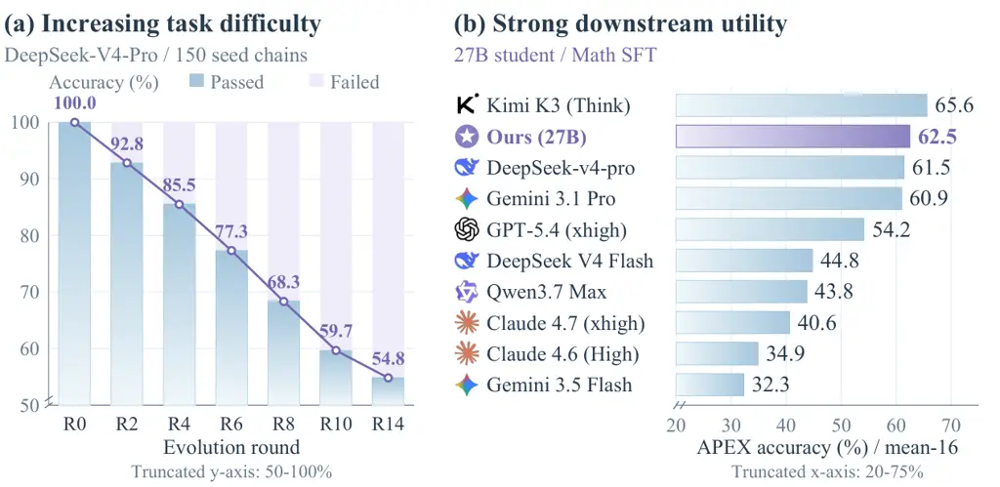
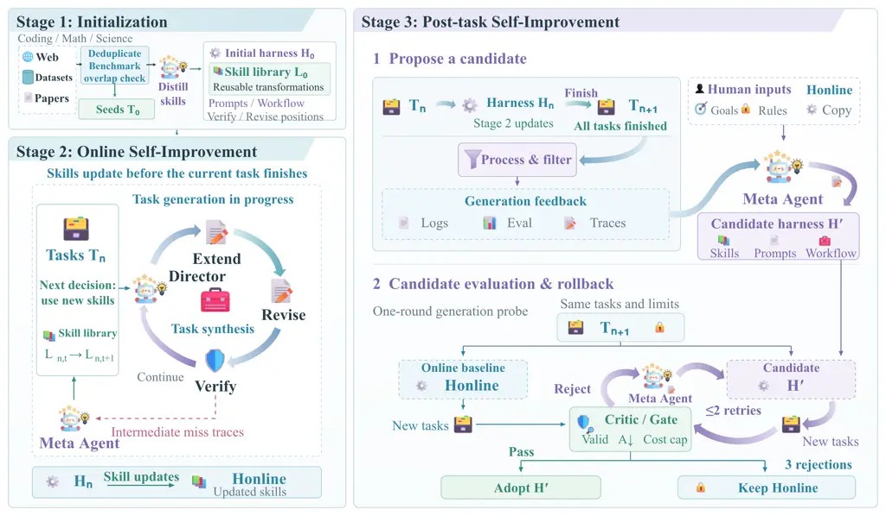

\setheadertext

Recursive Harness Self-Improvement

# Recursive Harness Self-Improvement for Frontier Reasoning Data Synthesis

Wenlong Zhang Affiliation: University of Science and Technology of China
   Zhengbo Jiao Affiliation: Shanghai University of Finance and
Economics    Chenxu Zhang    Lekang Jiang Affiliation: University of
Cambridge    SiYuan Ma Affiliation: Nanyang Technological University   
Qituan Zhang Affiliation: EPIC Lab, Shanghai Jiao Tong University
Affiliation: Fudan University    Guo Chen Affiliation: EPIC Lab,
Shanghai Jiao Tong University Affiliation: University of Electronic
Science and Technology of China ^(\*)Equal
Contribution.^(†)Corresponding Author.    Linfeng Zhang Affiliation:
Imperial College London

###### Abstract

Generating progressively harder reasoning problems requires synthesis
procedures that adapt as the task distribution evolves. Existing
task-level recursion reuses generated problems as seeds but leaves the
construction harness unchanged. We present task–harness co-evolution, a
framework for recursive harness self-improvement (RSI) in reasoning-data
synthesis. Online self-improvement converts intermediate solver failures
into reusable skills during generation. Post-task self-improvement
revises skills, prompts, and workflows after each batch, adopting
candidates only when they generate harder valid tasks within a bounded
cost increase. Model weights and verification criteria remain fixed.
Across mathematics, coding, and science, mean solver accuracy decreases
from 100.0% to 54.8% over fourteen evolution rounds. Ablations show that
combining both update schedules produces harder tasks than fixed-harness
recursion or either schedule alone. The resulting data improves
downstream SFT and GRPO performance. In particular, a 27B student
fine-tuned on 10K synthesized mathematics examples achieves 62.5%
mean-16 accuracy on APEX, competitive with selected frontier-model
references. These results support adapting the synthesis harness
alongside the tasks to generate increasingly challenging data with
downstream training value.

Figure 1: Three reasoning-data synthesis regimes. (a) Fixed-pipeline
synthesis maps independent seeds to outputs through the same harness
$`H_{0}`$. (b) Task-level recursion feeds each generated task back as
the next seed, while construction skills and workflows stay fixed. (c)
Our approach recursively updates both tasks and the harness. A
meta-agent uses generation logs and evaluation feedback, together with
human-defined goals and update constraints, to revise skills, prompts,
and workflows. Evaluated revisions guide subsequent generation under
fixed verification criteria. Snowflakes and flames denote fixed and
evolving harnesses, respectively.

## 1 Introduction

Advances in mathematical, scientific, and coding reasoning depend on a
continuing supply of high-quality, challenging problems.
OpenMathInstruct-2 demonstrates the value of synthetic data for
mathematical reasoning training (Toshniwal et al., 2025), while
FrontierMath highlights the need for problems that distinguish advanced
reasoning capabilities (Glazer et al., 2024). As model capabilities
improve, however, a static dataset cannot adapt its difficulty.
Increasing dataset size alone does not ensure that the synthesis
procedure can construct progressively harder reasoning problems. Here,
the synthesis harness comprises reusable skills, prompts, and workflows
that turn a seed into a verified problem. Adapting these components
offers a way to respond to changing solver weaknesses.

Existing synthesis methods progress from instruction expansion to
recursive task evolution. Self-Instruct generates instructions from
model outputs (Wang et al., 2023), and WizardLM increases instruction
complexity through predefined operators (Xu et al., 2024). RST
recursively reuses verified terminal tasks as seeds, demonstrating the
potential of task-level recursion under a largely fixed synthesis
procedure (Li et al., 2026). Yet evolving the tasks alone leaves their
reusable construction skills and workflows unchanged. Autodata and
DataFoundry instead optimize data-generating agents and data-preparation
runtimes (Kulikov et al., 2026; Yang et al., 2026). Together, these
directions motivate adapting the generation procedure alongside its
evolving task distribution. This raises a specific question for
recursive synthesis: can the generation procedure improve as its own
outputs become the inputs to subsequent rounds?

To address this limitation, we present task–harness co-evolution, a
framework that improves reasoning tasks and their synthesis harness
together (Figure 1). Verified tasks seed the next round, while
generation feedback guides two complementary update schedules. Online
self-improvement converts intermediate solver failures into reusable
skills before generation finishes. Post-task self-improvement uses
completed-batch feedback to revise skills, prompts, and workflows.
Candidate harnesses are compared with the online snapshot before
adoption, with rollback when revisions do not satisfy the validity,
difficulty, and cost criteria. Model weights and verification logic
remain fixed, so adaptation occurs in the generation procedure rather
than the model. Candidate evaluation uses the harness containing online
updates as its baseline. If all batch-level candidates are rejected,
online skills are retained for the next generation round.

Experiments across mathematics, coding, and science demonstrate
sustained difficulty growth and downstream training value (Figure 2).
Fixed-solver accuracy falls from 100.0% to 54.8% over fourteen evolution
rounds, while the synthesized data improves both SFT and GRPO
performance. With only 10K mathematics examples, a 27B student reaches
62.5% on APEX, competitive with selected frontier-model references on
this benchmark. Our main contributions are as follows:

1.  1.  Task–Harness Co-Evolution. We introduce a synthesis framework that
        recursively evolves reasoning tasks and their generation harness
        together, extending task-only recursion to adaptive construction
        procedures.
2.  2.  Online and Post-Task Self-Improvement. We combine immediate skill
        updates during generation with batch-level harness revision,
        candidate evaluation, and rollback under fixed verification criteria
        and bounded cost growth.
3.  3.  Difficulty Growth and Training Utility. We show that the combined
        update schedules produce harder tasks than fixed-harness recursion
        and either schedule alone, while the resulting data improves
        downstream reasoning through both SFT and GRPO.



Figure 2: Harder tasks, useful training data. (a) DeepSeek-V4-Pro
accuracy falls from 100.0% to 54.8% across 150 seed chains (50 per
domain, equally weighted). The line tracks Passed; Failed is its
complement; the y-axis is truncated at 50%. (b) SFT on 10K synthesized
math examples yields 62.5% APEX accuracy for a 27B student, competitive
with selected frontier models. We evaluate all APEX models with 16
attempts per problem; the x-axis starts at 20%. APEX evaluation details:
Appendix C.

## 2 Related Work

#### Frontier Reasoning in Science.

The progress of large language models has made the difficulty frontier
of reasoning a moving target. Mathematical and scientific reasoning
benchmarks such as MATH, GPQA, and FrontierMath progressively test
competition-level, graduate-level, and exceptionally difficult reasoning
(Hendrycks et al., 2021; Rein et al., 2024; Glazer et al., 2024).
Humanity’s Last Exam and SciCode extend this evaluation to broad
academic knowledge and research-oriented scientific coding (Phan et al.,
2025; Tian et al., 2024), while FrontierScience explicitly evaluates
expert-level scientific tasks (Wang et al., 2026). Complementary solver
systems such as AlphaGeometry, AlphaProof, DeepSeek-R1, and AlphaEvolve
combine language models with formal verification, reinforcement
learning, or automated search to tackle increasingly complex
mathematical and scientific problems (Trinh et al., 2024; Hubert et al.,
2026; DeepSeek-AI, 2025; Novikov et al., 2025). Together, these
benchmarks and systems show that progress requires problems that expose
the remaining capabilities of strong solvers. They also motivate
synthesis methods that can generate valid and informative challenges as
the reasoning frontier moves.

#### Reasoning Data Synthesis.

Synthetic-data methods have evolved from instruction bootstrapping to
feedback-driven and recursive task construction. Self-Instruct samples
and filters model-generated instructions, while WizardLM applies
predefined operators to increase instruction complexity (Wang et al.,
2023; Xu et al., 2024). OpenMathInstruct-2 further studies large-scale
math question–solution synthesis and its effect on downstream training
(Toshniwal et al., 2025). Other methods improve reasoning data through
self-training or self-play: STaR filters generated rationales by
correctness, ReST^(EM) iterates between generation and model updating,
and Absolute Zero and R-Zero use verifiable feedback to couple task
proposal with reasoning improvement (Zelikman et al., 2022; Singh et
al., 2024; Zhao et al., 2025; Huang et al., 2025). Auto Evol-Instruct
learns instruction-evolution strategies from prior trajectories (Zeng et
al., 2024). BenchEvolver and Recursive Synthetic Terminal Tasks (RST)
make recursion explicit by reusing solutions or verified task bundles as
seeds for subsequent task generation (Wu et al., 2026; Li et al., 2026).
This line of work shows that task or seed recursion can expand the
difficulty frontier. Our approach further adapts the construction skills
and workflow alongside the evolving task distribution.

#### Harness Evolution and RSI.

Another line of work treats an agent’s surrounding program as an
optimization target. ADAS generates and evaluates code-defined agent
designs, while AFlow searches over code-represented workflows using
execution feedback (Hu et al., 2025; Zhang et al., 2025b). Recursive
self-improvement methods further evolve the improvement procedure
itself: Promptbreeder evolves mutation prompts, STOP recursively
improves a code optimizer, and the Darwin Gödel Machine maintains an
archive of validated self-modifications (Fernando et al., 2024; Zelikman
et al., 2024; Zhang et al., 2025a). Recent harness-oriented systems
study prompt-level revision, end-to-end harness optimization, and
meta-agents that improve both a task agent and its improvement procedure
(Lee et al., 2026a; Lee et al., 2026b; Zhang et al., 2026). Autodata
optimizes a data-scientist scaffold using generation and solver
feedback, whereas DataFoundry evolves an executable data-preparation
runtime through pilot-set diagnosis and component-level adapters
(Kulikov et al., 2026; Yang et al., 2026).

## 3 Harness-Level Self-Evolution

We recursively synthesize tasks with a fixed language model and an
adaptive harness (Figure 3). After one-time initialization (Stage 1),
each round combines two update schedules. Online self-improvement (Stage 2) turns intermediate solver failures into immediately usable
construction skills during generation. Post-task self-improvement (Stage 3) revises, evaluates, and selects the harness after the batch ends.
Algorithm 1 (Appendix A) gives the complete procedure.



Figure 3: Three-stage task–harness co-evolution. Stage 1 initializes
screened seeds and $`H_{0}`$. Stage 2 updates skills during generation,
yielding $`H_{n}^{\mathrm{online}}`$. Stage 3 processes feedback after
batch completion or budget exhaustion and uses human inputs to propose a
candidate (top). Candidate and online baseline each synthesize one round
from shared current tasks under matched limits (bottom). Adopt the first
passing candidate; three rejections (initial proposal plus two retries)
retain the online snapshot and discard post-task edits. The gate
requires lower solver accuracy with bounded cost growth. Model weights
and verifier logic remain fixed.

### 3.1 Problem Formulation and Initialization

A harness comprises reusable construction skills $`\mathcal{L}`$, role
prompts $`P`$, workflow $`W`$, and verification/revision placements
$`\rho_{V},\rho_{R}`$:

```math
H=(\mathcal{L},P,W,\rho_{V},\rho_{R}). \tag{1}
```

Model weights, verifier implementation, and final validity criteria
remain fixed. Online adaptation changes the skill component; batch-level
optimization can revise all components, including when verification and
revision are invoked.

Starting from $`N`$ verified seeds $`\mathcal{T}_{0}`$, round $`n`$
constructs $`\mathcal{T}_{n+1}`$ from $`\mathcal{T}_{n}`$ using a
working copy of $`H_{n}`$. Each seed chain retains its latest valid,
completed QA. An unsuccessful attempt preserves the predecessor, so
every round contains one task per original seed. We do not select the
hardest ancestor retrospectively; failed attempts remain in the logs and
cost accounting.

For a matched cohort, let $`q_{i}(H)`$ be chain $`i`$’s retained task
and $`\widehat{p}(q)\in[0,1]`$ its fraction of correct answers over four
attempts under a fixed solver configuration. Define mean accuracy,
generation cost per seed, and relative difficulty against the online
baseline $`H_{o}`$ as

```math
\displaystyle\bar{A}(H) \displaystyle=\frac{1}{N}\sum_{i=1}^{N}\widehat{p}(q_{i}(H)), \tag{2}
```

```math
\displaystyle\bar{C}_{\mathrm{gen}}(H) \displaystyle=\frac{C_{\mathrm{gen}}(H)}{N},
```

```math
\displaystyle r_{D}(H^{\prime},H_{o}) \displaystyle=\frac{\bar{A}(H_{o})}{\bar{A}(H^{\prime})}.
```

$`r_{D}>1`$ indicates harder tasks; it is a ratio of cohort means, not a
mean of per-task ratios. $`C_{\mathrm{gen}}`$ includes Director,
generation, verification, revision, and online-update calls, including
failed attempts. We prioritize difficulty subject to validity and
bounded cost growth, allowing additional computation for harder tasks.
Repeated solver attempts are not independent evolution runs.

#### Stage 1: data curation and initialization.

Before selecting seeds or distilling skills, we screen candidate seeds
and source passages from coding, mathematics, and science datasets,
papers, and web documents for duplicates and benchmark overlap.
Duplicate seed families remain within one evolution/held-out split;
benchmark items and solutions are isolated from the generation agents.
An acquisition model extracts reusable task transformations using the
fields intent, method, difficulty*effect, and tool_hint. Screened
skills, initial prompts, and workflow form $`H*{0}`$. Skill examples and
training exports are checked again for overlap, since input screening
alone does not exclude contamination introduced during synthesis
(Toshniwal et al., 2025). Appendix B details curation and evaluation
procedures.

### 3.2 Online self-improvement

The Director selects skills and controls Extend, Revise, and Verify
until Finish or budget exhaustion. The diagram shows the initial
ordering, which batch-level optimization may revise. During
verification, the generating model also attempts the intermediate QA
$`q_{n,t}`$. A solver failure attributable to a reasoning weakness on a
valid QA yields a trace $`z^{\mathrm{miss}}_{n,t}`$. The Meta Agent
converts this weakness into a reusable construction transformation,
rather than an answer to that particular QA:

```math
\mathcal{L}_{n,t+1}=\operatorname{Admit}\!\left(\mathcal{L}_{n,t},\operatorname{Meta}_{s}(q_{n,t},z^{\mathrm{miss}}_{n,t};\Gamma_{s})\right). \tag{3}
```

$`\Gamma_{s}`$ specifies applicability, reusability, and supporting
evidence. Admit incorporates qualifying skills; invalid QA, incorrect
reference answers, and tool failures instead trigger repair.

The next Director call reads the updated library, making the skill
available to the unfinished task and remaining tasks in the same batch.
This avoids delaying reusable failure feedback until all tasks finish.
At the batch boundary, we freeze the resulting harness as
$`H_{n}^{\mathrm{online}}`$, the comparison baseline and fallback for
the next optimization step. Admitted skills need not increase task
difficulty.

### 3.3 Post-task self-improvement

Post-task self-improvement starts after the task batch completes or its
generation budget expires. We treat revision and candidate evaluation as
a single outer optimization loop, using completed batches to assess
effects beyond an individual failure trace. This organization follows
feedback-driven harness search (Lee et al., 2026b; Lee et al., 2026a);
we evaluate task validity, difficulty, and generation cost.

#### Feedback and revision.

Stage 3’s production row recaps Stage 2 rather than generating again.
After batch termination, in-loop tests of retained tasks
$`\mathcal{T}_{n+1}`$ produce scores $`\mathcal{E}_{n}`$ and failure
traces. Process & filter prepares these signals and run logs for the
Meta Agent without excluding failed attempts from evaluation or costs.
The Meta Agent first updates skills in a copy of
$`H_{n}^{\mathrm{online}}`$, yielding $`\widehat{H}_{n}`$. It then uses
execution logs $`\mathcal{Z}_{n}`$, operational metrics
$`\mathcal{M}_{n}`$, and human-specified goal $`g`$ and constraints
$`\Gamma`$ to propose a candidate:

```math
\displaystyle\Delta H_{n}^{(j)} \displaystyle=\operatorname{Meta}_{h}(\widehat{H}_{n},\mathcal{Z}_{n},\mathcal{M}_{n},\mathcal{E}_{n};\Gamma,g,\mathcal{R}_{<j}), \tag{4}
```

```math
\displaystyle H_{n}^{\prime(j)} \displaystyle=\operatorname{Apply}(\widehat{H}_{n},\Delta H_{n}^{(j)}).
```

The goal and constraints are specified in advance. Allowed edits include
adding, revising, or removing skills; changing prompts and workflow; and
repositioning Verify and Revise. Verifier logic cannot change. Each
proposal starts from $`\widehat{H}_{n}`$ and can use previous rejection
reports $`\mathcal{R}_{<j}`$; rejected edits do not accumulate
automatically.

#### Candidate evaluation and selection.

We freeze a shared cohort $`S_{n}`$ of current retained tasks as
evaluation inputs. Each candidate and $`H_{o}=H_{n}^{\mathrm{online}}`$
independently synthesize one further round from $`S_{n}`$, with
identical model/tool settings and resource ceilings. We compare the new
outputs, not previously recorded scores of $`S_{n}`$. Each side uses its
own library and online adaptation in isolation; evaluation updates and
outputs do not alter the production snapshots or task chains. Let
$`Q(H)`$ be the fraction of new final candidates passing validity before
fallback, with missing candidates counted as invalid. The Critic accepts
a candidate only if

```math
\displaystyle A(H^{\prime},H_{o})=\mathbb{I}\bigl[ \displaystyle H^{\prime}\in\mathcal{H}_{\Gamma},\ Q(H^{\prime})\geq Q(H_{o}), \tag{5}
```

```math
\displaystyle\bar{A}(H^{\prime})<\bar{A}(H_{o}),
```

```math
\displaystyle\bar{C}_{\mathrm{gen}}(H^{\prime})\leq\min\{1+1.5(r_{D}-1),\,1.5\}
```

```math
\displaystyle}{\displaystyle\cdot\bar{C}_{\mathrm{gen}}(H_{o})\bigr],
```

where $`\mathcal{H}_{\Gamma}`$ enforces edit and fixed resource limits.
The prescribed cost allowance is 1.5 times the relative difficulty gain,
capped at a 50% increase over the online baseline. Thus a 20% difficulty
gain permits at most 30% higher cost. This difficulty-first empirical
gate requires no validity decrease; it guarantees neither improved cost
efficiency nor improvement on unseen tasks. Appendix B specifies cohort
composition, evaluation budgets, boundary cases, and accounting.

The first accepted candidate becomes $`H_{n+1}`$. Input tasks and
baseline results stay fixed across the initial proposal and at most two
retries (three candidate evaluations). After three rejections,
$`H_{n+1}=H_{n}^{\mathrm{online}}`$: all post-task edits, including
post-batch skill updates, are discarded. Online skills and rejection
logs remain. Exhausting the evaluation budget without acceptance also
retains the online snapshot; incomplete probes cannot pass. We archive
accepted and online-only fallback versions with distinct statuses; both
use $`\mathcal{T}_{n+1}`$ to seed the next round. Final held-out
evaluations never inform updates or candidate selection.

## 4 Experiments

|                                      |                                 |                                 |                                 |                                 |                                 |
| ------------------------------------ | ------------------------------- | ------------------------------- | ------------------------------- | ------------------------------- | ------------------------------- |
| Training data                        | APEX Shortlist                  | HMMT Feb 2025                   | LCB v6                          | SciBench                        | Overall                         |
| Qwen3.5-4B Thinking (Baseline Model) |                                 |                                 |                                 |                                 |                                 |
| No additional training               | 32.4                            | 73.5                            | 55.8                            | 71.8                            | 58.4                            |
| Static Data Synthesis                |                                 |                                 |                                 |                                 |                                 |
| OpenMathInstruct-2                   | 33.6$`\textstyle\uparrow`$1.2   | 75.4$`\textstyle\uparrow`$1.9   | 52.6$`\textstyle\downarrow`$3.2 | 70.9$`\textstyle\downarrow`$0.9 | 58.1$`\textstyle\downarrow`$0.3 |
| OpenCodeReasoning                    | 27.5$`\textstyle\downarrow`$4.9 | 70.8$`\textstyle\downarrow`$2.7 | 58.7$`\textstyle\uparrow`$2.9   | 71.6$`\textstyle\downarrow`$0.2 | 57.2$`\textstyle\downarrow`$1.2 |
| WildSci                              | 28.2$`\textstyle\downarrow`$4.2 | 70.0$`\textstyle\downarrow`$3.5 | 53.6$`\textstyle\downarrow`$2.2 | 70.6$`\textstyle\downarrow`$1.2 | 55.6$`\textstyle\downarrow`$2.8 |
| MetaMath                             | 29.3$`\textstyle\downarrow`$3.1 | 68.1$`\textstyle\downarrow`$5.4 | 52.2$`\textstyle\downarrow`$3.6 | 68.4$`\textstyle\downarrow`$3.4 | 54.5$`\textstyle\downarrow`$3.9 |
| Task-Level Recursive Synthesis       |                                 |                                 |                                 |                                 |                                 |
| IQC                                  | 34.4$`\textstyle\uparrow`$2.0   | 75.0$`\textstyle\uparrow`$1.5   | 55.2$`\textstyle\downarrow`$0.6 | 73.5$`\textstyle\uparrow`$1.7   | 59.5$`\textstyle\uparrow`$1.1   |
| Harness-Level Self-Evolution         |                                 |                                 |                                 |                                 |                                 |
| Ours                                 | 36.4$`\textstyle\uparrow`$4.0   | 78.3$`\textstyle\uparrow`$4.8   | 59.2$`\textstyle\uparrow`$3.4   | 76.9$`\textstyle\uparrow`$5.1   | 62.7$`\textstyle\uparrow`$4.3   |

|                                     |                                |                                 |                                 |                                 |                                 |
| ----------------------------------- | ------------------------------ | ------------------------------- | ------------------------------- | ------------------------------- | ------------------------------- |
| Training data                       | APEX                           | APEX Shortlist                  | HMMT Feb 2026                   | LCB v6                          | Overall                         |
| Qwen3.5-35B-A3B (Baseline Model)    |                                |                                 |                                 |                                 |                                 |
| No additional training              | 4.2                            | 44.3                            | 80.9                            | 74.8                            | 51.1                            |
| Baselines                           |                                |                                 |                                 |                                 |                                 |
| + OpenMathInstruct-2                | 3.6$`\textstyle\downarrow`$0.6 | 45.3$`\textstyle\uparrow`$1.0   | 81.8$`\textstyle\uparrow`$0.9   | 72.2$`\textstyle\downarrow`$2.6 | 50.7$`\textstyle\downarrow`$0.4 |
| + OpenCodeReasoning                 | 2.6$`\textstyle\downarrow`$1.6 | 40.4$`\textstyle\downarrow`$3.9 | 75.6$`\textstyle\downarrow`$5.3 | 77.5$`\textstyle\uparrow`$2.7   | 49.0$`\textstyle\downarrow`$2.1 |
| + MMIQC / IQC                       | 3.1$`\textstyle\downarrow`$1.1 | 46.3$`\textstyle\uparrow`$2.0   | 82.2$`\textstyle\uparrow`$1.3   | 72.9$`\textstyle\downarrow`$1.9 | 51.1$`\textstyle=`$0.0          |
| Harness-Level Self-Evolution (Ours) |                                |                                 |                                 |                                 |                                 |
| + Ours                              | 7.3$`\textstyle\uparrow`$3.1   | 49.7$`\textstyle\uparrow`$5.4   | 86.7$`\textstyle\uparrow`$5.8   | 79.1$`\textstyle\uparrow`$4.3   | 55.7$`\textstyle\uparrow`$4.6   |

Table 1: GRPO with Qwen3.5-4B Thinking. Mean-16 accuracy (%; higher is
better). Overall averages the four benchmarks; superscripts give
percentage-point changes from the checkpoint. Changes are computed from
the displayed scores. Bold marks column-best scores.

Table 2: SFT with Qwen3.5-35B-A3B. Mean-16 accuracy (%; higher is
better), using 12K examples per data configuration. Ours uses 10K
mathematics and 2K coding examples. Overall is the unweighted mean of
the four benchmark columns. Superscripts give percentage-point changes
from the checkpoint, computed from the displayed scores. Bold marks
column-best scores.

### 4.1 Experimental Setup

We evaluate synthesis across mathematics, coding, and science using
DeepSeek-V4-Pro as the fixed solver; difficulty is measured by mean
accuracy over four attempts per task. Downstream experiments train
Qwen3.5-4B Thinking with GRPO and Qwen3.5-35B-A3B and Qwen3.8-27B with
SFT. We evaluate the benchmarks in Tables 2 and 2 using MathArena
(Dekoninck et al., 2026) and report mean-16 accuracy. Within each
training comparison, baselines share hyperparameters. Model assignments,
training configurations, and evaluation details are consolidated in
Appendix F.

### 4.2 Difficulty Progression

We evolve 150 seed chains for 14 rounds, with 50 per domain. Round
$`r=0`$ denotes the original seeds; unsuccessful attempts retain the
latest valid task. Overall accuracy equally weights domains; repeated
solver attempts are not independent evolution runs.

Figure 4: Difficulty progression. DeepSeek-V4-Pro accuracy (%; lower is
harder) over (a) all 150 seed chains and (b–d) three domains of 50 seeds
each. The shared y-axis spans 45–100%; full values are in Appendix D.

Overall accuracy decreases from 100.0% to 54.8% by round 14, a
45.2-point decline. Domain accuracies reach 50.0%, 58.5%, and 56.0%,
respectively (Figure 4). The decline occurs in every domain under a
fixed cohort, rather than through a change in domain composition.

### 4.3 Online and Post-task Self-Improvement Ablations

Four configurations share 50 initial seeds and harness: Task-only keeps
the harness fixed; Online only updates skills during generation;
Post-task only updates the harness after each batch, including skill
revisions and candidate evaluation; Full combines both schedules
(Sections 3.2–3.3). All retain QA verification, independently of the
harness acceptance gate.

Figure 5: Update ablations. Four configurations on 50 shared seeds:
fixed harness, online skill updates, post-task updates with candidate
evaluation, and both schedules. Lower DeepSeek-V4-Pro accuracy indicates
harder tasks; the y-axis starts at 45%.

Online only reaches 67.0% at round 14, versus 73.5% for Task-only, but
regresses from 64.5% at round 10. The curve does not identify skill
quality as the cause. Post-task only reaches 59.0%, while Full reaches
50.0%: improvements of 9.0 points over Post-task only and 23.5 points
over Task-only (Figure 5). These results support complementary update
schedules, without isolating the contribution of candidate screening
within post-task optimization.

Full also improves over Online only by 17.0 points at round 14.
Together, the two comparisons support complementary roles: online
adaptation makes failure-derived skills available within the current
batch, while post-task optimization can reconsider the accumulated
library and the workflow that uses it. The combined configuration
benefits from both opportunities. These gains do not imply monotonic
improvement under either schedule or benefits from every new skill.

Late-round behavior further distinguishes the schedules. From round 10
to round 14, Full reduces solver accuracy from 57.0% to 50.0%, while
Post-task only improves from 63.5% to 59.0%. Both continue making tasks
harder as Online only regresses. This pattern is consistent with a
benefit from revisiting the accumulated harness, although the finite
trajectory does not establish eventual convergence for any
configuration.

### 4.4 Harness Transfer and Generation Cost

Figure 6: Harness transfer and operator cost. (a) Frozen harnesses on 50
shared held-out mathematics seeds. (b) Per-round Extend/Revise/Verify
costs divided by 50 reasoning seeds; other harness and search costs are
excluded. Full values are in Appendix E.

#### Frozen-harness transfer.

Both snapshots, including their skill libraries, remain frozen on 50
mathematics seeds not used to evolve or select $`H_{14}`$. Subscripts
identify harness versions, not evaluation rounds. After ten recursive
generation rounds, $`H_{14}`$ yields 52.0% solver accuracy versus 70.0%
for $`H_{0}`$ (Figure 6a), supporting transfer to these held-out seeds
without further harness updates. Because both harnesses restart from the
same seeds, the 18.0-point gap cannot be attributed to starting
$`H_{14}`$ from its own harder terminal tasks. Freezing the snapshots
also prevents new online or post-task adaptations during this
comparison. The result supports reuse of the evolved generation
procedure beyond its original chains, while evaluating transfer within
mathematics under the same solver rather than across solvers or domains.

#### Generation-operator cost.

We divide each round’s Extend/Revise/Verify fees by 50 reasoning seeds;
costs are not cumulative. Full costs slightly more at rounds 2 and 4,
but less at every reported round from 6 onward. At round 14, accuracy is
50.0% versus 73.5% for Task-only, while cost is \$1.065 versus \$1.332
per seed, a 20.0% reduction (Figure 6b). Excluding Director,
skill-update, and search overhead, this measure is narrower than
$`\bar{C}_{\mathrm{gen}}`$ in Eq. (2) and cannot show total savings.

### 4.5 Downstream Training Utility

#### GRPO on a 4B student.

We train Qwen3.5-4B Thinking on 10K examples per data configuration. Our
data yields the highest accuracy on all four benchmarks (Table 2). The
unweighted average reaches 62.7%, versus 58.4% for Qwen3.5-4B Thinking
and 59.5% for IQC, the strongest data comparison by overall accuracy.
The gains over the checkpoint are 4.0, 4.8, 3.4, and 5.1 points on APEX
Shortlist, HMMT, LCB, and SciBench, respectively. Thus the overall
improvement accompanies gains in every evaluated domain. The strongest
alternative differs by benchmark: OpenMathInstruct-2 leads the data
comparisons on HMMT, OpenCodeReasoning on LCB, and IQC on APEX Shortlist
and SciBench. Our data exceeds each of these scores.

#### SFT on a 35B student.

Our data leads on all four benchmarks (Table 2); the unweighted average
is 55.7%, exceeding both the checkpoint and MMIQC/IQC by 4.6 points
using the displayed scores. Together with GRPO, this supports utility
under both training procedures. OpenMathInstruct-2 and MMIQC/IQC improve
APEX Shortlist and HMMT but reduce LCB accuracy, whereas
OpenCodeReasoning improves LCB but reduces the three mathematics scores.
Our configuration improves all four scores, with gains of 3.1, 5.4, 5.8,
and 4.3 points, respectively. The aggregate gain therefore reflects
improvements across both mathematics and coding. These comparisons
characterize the evaluated data mixtures and training settings, rather
than a universal ranking of source datasets.

#### APEX performance with a 27B student.

Qwen3.8-27B improves from 56.3% to 62.5% mean-16 accuracy on APEX 2025,
a 6.2-point gain using the displayed scores (Figure 2b; Appendix C). We
evaluate all compared models with MathArena (Dekoninck et al., 2026),
using 16 attempts per problem. Comparisons do not imply equal training
or inference costs.

#### Scope of the evidence.

Isolating the downstream contribution of harness evolution requires
matched-token training on our fixed-harness and evolved-harness data.
Total evolution cost, candidate validity, fallback rates, and
independent-run uncertainty remain unreported. Transfer to held-out
seeds and lower operator costs do not establish transfer to independent
solvers or end-to-end compute efficiency.

## 5 Conclusion

We introduced task–harness co-evolution for progressively harder
reasoning-data synthesis. The framework combines Online self-improvement
from intermediate solver failures with Post-task self-improvement of
skills, prompts, and workflows. Candidate evaluation and reversible
snapshots govern batch-level adoption, while verifier logic remains
fixed. Across mathematics, coding, and science, fixed-solver accuracy
falls from 100.0% to 54.8% by round 14. The update ablation further
shows a 23.5-point accuracy reduction relative to fixed-harness
recursion at round 14, supporting the combination of online and
batch-level adaptation. Downstream SFT and GRPO results establish
training utility across the evaluated benchmarks; a 27B student
fine-tuned on 10K mathematics examples reaches 62.5% mean-16 accuracy on
APEX. These findings identify the synthesis harness as a useful target
of recursive improvement. Frozen evaluation on shared held-out seeds
further shows that the evolved harness can generate harder tasks without
additional adaptation. This result links the difficulty gains to a
reusable generation procedure, beyond the particular task chains used to
evolve it.

Future work should compare fixed- and evolved-harness data under matched
training tokens, and measure total generation cost, candidate validity,
and difficulty transfer to independent solvers.

## AI use statement

Generative AI tools assisted with synthetic data generation, code
development, experiment-log organization and analysis, manuscript
drafting, and language editing. The authors are responsible for
independently verifying all algorithmic claims, references, experimental
results, and final manuscript content.

## References

- Ahmad et al. (2025) W. U. Ahmad, S. Narenthiran, S. Majumdar, A.
  Ficek, S. Jain, J. Huang, V. Noroozi, and B. Ginsburg
  OpenCodeReasoning: advancing data distillation for competitive coding.
  arXiv preprint arXiv:2504.01943. External Links:
  [Link](https://arxiv.org/abs/2504.01943) Cited by: §F.1.
- DeepSeek-AI (2025) DeepSeek-AI DeepSeek-r1: incentivizing reasoning
  capability in llms via reinforcement learning. External Links:
  2501.12948, [Link](https://arxiv.org/abs/2501.12948) Cited by: §2.
- Dekoninck et al. (2026) J. Dekoninck, N. Jovanović, T. Gehrunger, K.
  Rögnvaldsson, I. Petrov, C. Sun, and M. Vechev Beyond benchmarks:
  MathArena as an evaluation platform for mathematics with LLMs. arXiv
  preprint arXiv:2605.00674. External Links:
  [Link](https://arxiv.org/abs/2605.00674) Cited by: Appendix C, §F.1,
  §4.1, §4.5.
- Dekoninck et al. (2025) J. Dekoninck, N. Jovanović, I. Petrov, and M.
  Vechev MathArena Apex: unconquered final-answer problems. Note:
  Methodology: 16 attempts per problem for directly prompted models;
  average success over problems and attempts. Accessed September 24,
  2026 External Links: [Link](https://matharena.ai/apex/) Cited by:
  Appendix C.
- Fernando et al. (2024) C. Fernando, D. S. Banarse, H. Michalewski, S.
  Osindero, and T. Rocktäschel Promptbreeder: self-referential
  self-improvement via prompt evolution. In Proceedings of the 41st
  International Conference on Machine Learning, pp. 13481–13544.
  External Links:
  [Link](https://proceedings.mlr.press/v235/fernando24a.html) Cited by:
  §2.
- Glazer et al. (2024) E. Glazer, E. Erdil, T. Besiroglu, D.
  Chicharro, E. Chen, A. Gunning, C. F. Olsson, J. Denain, A.
  Ho, E. d. O. Santos, et al. FrontierMath: a benchmark for evaluating
  advanced mathematical reasoning in ai. External Links: 2411.04872,
  [Link](https://arxiv.org/abs/2411.04872) Cited by: §1, §2.
- Hendrycks et al. (2021) D. Hendrycks, C. Burns, S. Kadavath, A.
  Arora, S. Basart, E. Tang, D. Song, and J. Steinhardt Measuring
  mathematical problem solving with the MATH dataset. In Advances in
  Neural Information Processing Systems, External Links:
  [Link](https://arxiv.org/abs/2103.03874) Cited by: §2.
- Hu et al. (2025) S. Hu, C. Lu, and J. Clune Automated design of
  agentic systems. In International Conference on Learning
  Representations, External Links:
  [Link](https://proceedings.iclr.cc/paper_files/paper/2025/hash/36b7acf6f6010652b3f2a433774a66fe-Abstract-Conference.html)
  Cited by: §2.
- Huang et al. (2025) C. Huang, W. Yu, X. Wang, H. Zhang, Z. Li, R.
  Li, J. Huang, H. Mi, and D. Yu R-zero: self-evolving reasoning llm
  from zero data. External Links: 2508.05004,
  [Link](https://arxiv.org/abs/2508.05004) Cited by: §2.
- Hubert et al. (2026) T. Hubert, R. Mehta, L. Sartran, M. Z. Horváth,
  et al. Olympiad-level formal mathematical reasoning with reinforcement
  learning. Nature 651, pp. 607–613. External Links:
  [Document](https://dx.doi.org/10.1038/s41586-025-09833-y),
  [Link](https://doi.org/10.1038/s41586-025-09833-y) Cited by: §2.
- Jain et al. (2024) N. Jain, K. Han, A. Gu, W. Li, F. Yan, T. Zhang, S.
  Wang, A. Solar-Lezama, K. Sen, and I. Stoica LiveCodeBench: holistic
  and contamination free evaluation of large language models for code.
  arXiv preprint arXiv:2403.07974. External Links:
  [Link](https://arxiv.org/abs/2403.07974) Cited by: §F.1.
- Kulikov et al. (2026) I. Kulikov, C. Whitehouse, T. Wu, Y. Nie, S.
  Saha, E. Helenowski, W. Yuan, O. Golovneva, J. Lanchantin, Y.
  Bachrach, J. Foerster, X. Li, H. Fang, S. Sukhbaatar, and J. Weston
  Autodata: an agentic data scientist to create high quality synthetic
  data. External Links: 2606.25996,
  [Link](https://arxiv.org/abs/2606.25996) Cited by: §1, §2.
- Lee et al. (2026a) H. Lee, J. Xu, J. Seely, D. Lee, M. Zaharia, and Y.
  Tang Recursive harness self-improvement. External Links: 2607.15524,
  [Link](https://arxiv.org/abs/2607.15524) Cited by: §2, §3.3.
- Lee et al. (2026b) Y. Lee, R. Nair, Q. Zhang, K. Lee, O. Khattab,
  and C. Finn Meta-harness: end-to-end optimization of model harnesses.
  arXiv preprint arXiv:2603.28052. External Links:
  [Link](https://arxiv.org/abs/2603.28052) Cited by: §2, §3.3.
- Li et al. (2026) Z. Li, Y. Shi, Z. Li, R. Wang, A. Li, Z. Huang, J.
  Yang, L. Ke, N. Liu, H. Mi, and L. Liang Recursive synthesis for
  long-horizon terminal tasks. External Links: 2608.05466,
  [Link](https://arxiv.org/abs/2608.05466) Cited by: §1, §2.
- Liu et al. (2024) H. Liu, Y. Zhang, Y. Luo, and A. C. Yao Augmenting
  math word problems via iterative question composing. arXiv preprint
  arXiv:2401.09003. External Links:
  [Link](https://arxiv.org/abs/2401.09003) Cited by: §F.1.
- Liu et al. (2026) T. Liu, D. Nathani, Z. Li, K. Yang, and W. Y. Wang
  WildSci: advancing scientific reasoning from in-the-wild literature.
  arXiv preprint arXiv:2601.05567. External Links:
  [Link](https://arxiv.org/abs/2601.05567) Cited by: §F.1.
- Novikov et al. (2025) A. Novikov, N. Vu, M. Eisenberger, E. Dupont, P.
  Huang, A. Z. Wagner, et al. AlphaEvolve: a coding agent for scientific
  and algorithmic discovery. External Links: 2506.13131,
  [Link](https://arxiv.org/abs/2506.13131) Cited by: §2.
- Phan et al. (2025) L. Phan, A. Gatti, Z. Han, et al. Humanity’s last
  exam. External Links: 2501.14249,
  [Link](https://arxiv.org/abs/2501.14249) Cited by: §2.
- Rein et al. (2024) D. Rein, B. L. Hou, A. C. Stickland, J.
  Petty, R. Y. Pang, J. Dirani, J. Michael, and S. R. Bowman GPQA: a
  graduate-level google-proof Q&A benchmark. In First Conference on
  Language Modeling, External Links:
  [Link](https://openreview.net/forum?id=Ti67584b98) Cited by: §2.
- Singh et al. (2024) A. Singh, J. D. Co-Reyes, R. Agarwal, et al.
  Beyond human data: scaling self-training for problem-solving with
  language models. Transactions on Machine Learning Research. External
  Links: [Link](https://arxiv.org/abs/2312.06585) Cited by: §2.
- Tian et al. (2024) M. Tian, L. Gao, S. D. Zhang, X. Chen, C. Fan, X.
  Guo, R. Haas, P. Ji, et al. SciCode: a research coding benchmark
  curated by scientists. External Links: 2407.13168,
  [Link](https://arxiv.org/abs/2407.13168) Cited by: §2.
- Toshniwal et al. (2025) S. Toshniwal, W. Du, I. Moshkov, B.
  Kisacanin, A. Ayrapetyan, and I. Gitman OpenMathInstruct-2:
  accelerating AI for math with massive open-source instruction data. In
  The Thirteenth International Conference on Learning Representations,
  External Links:
  [Link](https://proceedings.iclr.cc/paper_files/paper/2025/hash/302ce0673c00aee2cf84bb43d0117553-Abstract-Conference.html)
  Cited by: §F.1, §1, §2, §3.1.
- Trinh et al. (2024) T. H. Trinh, Y. Wu, Q. V. Le, H. He, and T. Luong
  Solving olympiad geometry without human demonstrations. Nature 625,
  pp. 476–482. External Links:
  [Document](https://dx.doi.org/10.1038/s41586-023-06747-5),
  [Link](https://doi.org/10.1038/s41586-023-06747-5) Cited by: §2.
- Wang et al. (2026) M. Wang, R. Lin, K. Hu, J. Jiao, N. Chowdhury, E.
  Chang, and T. Patwardhan FrontierScience: evaluating AI’s ability to
  perform expert-level scientific tasks. External Links: 2601.21165,
  [Link](https://arxiv.org/abs/2601.21165) Cited by: §2.
- Wang et al. (2024) X. Wang, Z. Hu, P. Lu, Y. Zhu, J. Zhang, S.
  Subramaniam, A. R. Loomba, S. Zhang, Y. Sun, and W. Wang SciBench:
  evaluating college-level scientific problem-solving abilities of large
  language models. arXiv preprint arXiv:2307.10635. External Links:
  [Link](https://arxiv.org/abs/2307.10635) Cited by: §F.1.
- Wang et al. (2023) Y. Wang, Y. Kordi, S. Mishra, A. Liu, N. A.
  Smith, D. Khashabi, and H. Hajishirzi Self-instruct: aligning language
  models with self-generated instructions. In Proceedings of the 61st
  Annual Meeting of the Association for Computational Linguistics
  (Volume 1: Long Papers), pp. 13484–13508. External Links:
  [Document](https://dx.doi.org/10.18653/v1/2023.acl-long.754),
  [Link](https://aclanthology.org/2023.acl-long.754/) Cited by: §1, §2.
- Wu et al. (2026) Y. Wu, A. J. Li, W. Ma, L. Cao, Z. Zhou, M. Cemri, S.
  Liu, Y. Xiu, C. Yan, H. Zhao, B. Yu, I. Stoica, and D. Song
  BenchEvolver: frontier task synthesis via solution-centric evolution.
  External Links: 2606.01286, [Link](https://arxiv.org/abs/2606.01286)
  Cited by: §2.
- Xu et al. (2024) C. Xu, Q. Sun, K. Zheng, X. Geng, P. Zhao, J.
  Feng, C. Tao, Q. Lin, and D. Jiang WizardLM: empowering large
  pre-trained language models to follow complex instructions. In
  International Conference on Learning Representations, External Links:
  [Link](https://arxiv.org/abs/2304.12244) Cited by: §1, §2.
- Yang et al. (2026) C. Yang, X. Wu, X. Lin, C. Xu, X. Jiang, H. Xiong,
  and J. Guo DataFoundry: evolving data preparators via recursive
  self-improvement. External Links: 2608.29966,
  [Link](https://arxiv.org/abs/2608.29966) Cited by: §1, §2.
- Yu et al. (2023) L. Yu, W. Jiang, H. Shi, J. Yu, Z. Liu, Y.
  Zhang, J. T. Kwok, Z. Li, A. Weller, and W. Liu MetaMath: bootstrap
  your own mathematical questions for large language models. arXiv
  preprint arXiv:2309.12284. External Links:
  [Link](https://arxiv.org/abs/2309.12284) Cited by: §F.1.
- Zelikman et al. (2024) E. Zelikman, E. Lorch, L. Mackey, and A. T.
  Kalai Self-taught optimizer (STOP): recursively self-improving code
  generation. In First Conference on Language Modeling, External Links:
  [Link](https://arxiv.org/abs/2310.02304) Cited by: §2.
- Zelikman et al. (2022) E. Zelikman, Y. Wu, J. Mu, and N. D. Goodman
  STaR: bootstrapping reasoning with reasoning. In Advances in Neural
  Information Processing Systems, Vol. 35, pp. 15476–15488. External
  Links:
  [Link](https://proceedings.nips.cc/paper_files/paper/2022/hash/639a9a172c044fbb64175b5fad42e9a5-Abstract-Conference.html)
  Cited by: §2.
- Zeng et al. (2024) W. Zeng, C. Xu, Y. Zhao, J. Lou, and W. Chen
  Automatic instruction evolving for large language models. In
  Proceedings of the 2024 Conference on Empirical Methods in Natural
  Language Processing, pp. 6998–7018. External Links:
  [Document](https://dx.doi.org/10.18653/v1/2024.emnlp-main.397),
  [Link](https://aclanthology.org/2024.emnlp-main.397/) Cited by: §2.
- Zhang et al. (2025a) J. Zhang, S. Hu, C. Lu, R. Lange, and J. Clune
  Darwin gödel machine: open-ended evolution of self-improving agents.
  External Links: 2505.22954, [Link](https://arxiv.org/abs/2505.22954)
  Cited by: §2.
- Zhang et al. (2026) J. Zhang, B. Zhao, W. Yang, J. Foerster, J.
  Clune, M. Jiang, S. Devlin, and T. Shavrina Hyperagents. External
  Links: 2603.19461, [Link](https://arxiv.org/abs/2603.19461) Cited by:
  §2.
- Zhang et al. (2025b) J. Zhang, J. Xiang, Z. Yu, F. Teng, X. Chen, J.
  Chen, M. Zhuge, X. Cheng, S. Hong, J. Wang, B. Zheng, B. Liu, Y. Luo,
  and C. Wu AFlow: automating agentic workflow generation. In
  International Conference on Learning Representations, External Links:
  [Link](https://proceedings.iclr.cc/paper_files/paper/2025/hash/5492ecbce4439401798dcd2c90be94cd-Abstract-Conference.html)
  Cited by: §2.
- Zhao et al. (2025) A. Zhao, Y. Wu, Y. Yue, T. Wu, Q. Xu, M. Lin, S.
  Wang, Q. Wu, Z. Zheng, and G. Huang Absolute zero: reinforced
  self-play reasoning with zero data. arXiv preprint arXiv:2505.03335.
  External Links: [Link](https://arxiv.org/abs/2505.03335) Cited by: §2.

## Appendix A Complete Evolution Procedure

Algorithm 1 integrates Online self-improvement and Post-task
self-improvement. The latter includes post-batch skill updates, joint
revision, candidate evaluation, and bounded retries. The online snapshot
is the default next-round harness; only an accepted candidate replaces
it. Thus three rejections discard all batch-level changes without
removing skills acquired during generation.

1: Sources $`\mathcal{C}`$, candidate seeds $`\mathcal{Q}`$, benchmark
registry $`\mathcal{K}`$;

2:    verifier $`V`$, constraints $`\Gamma`$, goal $`g`$,
generation/evaluation budgets, $`N_{b}`$ rounds.

3:
$`(\mathcal{C}_{0},\mathcal{T})\leftarrow\textsc{Curate}(\mathcal{C},\mathcal{Q};\mathcal{K})`$
$`\triangleright`$ Exclude held-out families before distillation

4: $`H\leftarrow\textsc{Initialize}(\mathcal{C}_{0})`$;
$`\mathcal{B}\leftarrow\{\textsc{Snapshot}(H,\mathcal{T})\}`$
$`\triangleright`$ Screened skills and seeds

5: for $`n=1,\ldots,N_{b}`$ do

6:   $`H^{\mathrm{parent}}\leftarrow H`$;
$`H^{\mathrm{w}}\leftarrow\textsc{Copy}(H)`$;
$`x\leftarrow\textsc{StartBatch}(\mathcal{T})`$

7:   while unfinished tasks and generation budget remain do
$`\triangleright`$ Online self-improvement

8:    $`(x,e)\leftarrow\textsc{DirectorStep}(x,H^{\mathrm{w}},V)`$;
$`\textsc{Log}(e)`$

9:    if $`e`$ contains an attributed solver-miss trace then

10:
      $`H^{\mathrm{w}}.\mathcal{L}\leftarrow\textsc{Admit}(H^{\mathrm{w}}.\mathcal{L},\operatorname{MetaSkill}(e;\Gamma_{s}))`$

11:    end if$`\triangleright`$ Next Director call reads the new library

12:   end while

13:
  $`(\widetilde{\mathcal{T}},\mathcal{Z},\mathcal{M})\leftarrow\textsc{FinalizeBatch}(x;V)`$

14:
  $`\mathcal{T}^{+}\leftarrow\textsc{AdvanceOrRetainValidSeeds}(\mathcal{T},\widetilde{\mathcal{T}})`$

15:
  $`H^{\mathrm{online}}\leftarrow\textsc{Snapshot}(H^{\mathrm{w}})`$;
$`H\leftarrow H^{\mathrm{online}}`$; $`a\leftarrow\texttt{online-only}`$

16:
  $`(\mathcal{E},\mathcal{F})\leftarrow\textsc{InLoopTest}(\mathcal{T}^{+})`$
$`\triangleright`$ Post-task self-improvement

17:   $`\widehat{H}\leftarrow\textsc{Copy}(H^{\mathrm{online}})`$

18:
  $`\widehat{H}.\mathcal{L}\leftarrow\textsc{Admit}(\widehat{H}.\mathcal{L},\operatorname{MetaSkill}(\mathcal{F};\Gamma_{s}))`$

19:   $`S\leftarrow\textsc{FreezeGateCohort}(50\text{ per domain})`$;
$`e_{o}\leftarrow\textsc{EvaluateOneRound}(H^{\mathrm{online}},S)`$;
$`\mathcal{R}\leftarrow\varnothing`$

20:                         $`\triangleright`$ Gate: 150 seeds; four
solver attempts/task

21:   for $`j=1,2,3`$ do $`\triangleright`$ Initial candidate and at
most two retries, same $`S`$

22:    if evaluation budget exhausted or baseline evaluation incomplete
then

23:       break $`\triangleright`$ Retain the online snapshot

24:    end if

25:
   $`H^{\prime}\leftarrow\textsc{MetaHarness}(\operatorname{Copy}(\widehat{H}),\mathcal{Z},\mathcal{M},\mathcal{E};\Gamma,g,\mathcal{R})`$

26:
   $`e^{\prime}\leftarrow\textsc{CheckedEvaluateOneRound}(H^{\prime},S)`$
$`\triangleright`$ Isolated probe, same limits

27:    if $`e^{\prime}`$ is complete and
$`\textsc{Accept}(e^{\prime},e_{o};\Gamma,g)`$ satisfies Eq. (5) then

28:       $`H\leftarrow H^{\prime}`$; $`a\leftarrow\texttt{accepted}`$;
break

29:    end if

30:
   $`\textsc{Append}(\mathcal{R},\operatorname{RejectReport}(e^{\prime},e_{o}))`$

31:   end for$`\triangleright`$ After three rejections, $`H`$ remains
$`H^{\mathrm{online}}`$

32:
  $`\mathcal{B}\leftarrow\textsc{Archive}(\mathcal{B},H^{\mathrm{parent}},H,\mathcal{T}^{+},a,\mathcal{R},\text{evaluations and costs})`$

33:   $`\mathcal{T}\leftarrow\mathcal{T}^{+}`$ $`\triangleright`$ Do not
advance using probe outputs

34: end for

35:
$`\textsc{AuditTrainingExport}(\mathcal{T},H.\mathcal{L};\mathcal{K})`$
$`\triangleright`$ Retain the evaluation cohort

36: return $`(H,\mathcal{T},\mathcal{B})`$

Algorithm 1 Recursive Task Synthesis with an Adaptive Harness

## Appendix B Method Protocol Details

#### Curation and overlap control.

We freeze benchmark versions before screening both candidate seeds and
skill-distillation sources. Normalized exact duplicates and confirmed
benchmark overlaps are removed; lexical and semantic matching flags
near-duplicates and paraphrases for review. Shared concepts alone do not
constitute overlap. Duplicate seed families remain within a single split
when forming evolution and held-out pools. Only retained materials enter
the generation and acquisition agents; benchmark items and solutions
remain confined to the isolated overlap checker. Source identifiers and
filtering decisions are retained for auditing. Distilled skill examples
and final training exports undergo further overlap checks.
Training-export deduplication does not change the fixed seed cohort used
for difficulty measurement. These rules specify the curation protocol;
they do not establish the absence of contamination without the
corresponding audit records.

#### Skill representation and attribution.

Each skill describes a reusable question-construction transformation.
The field intent identifies the reasoning capability to probe; method
describes the transformation; difficulty*effect states its intended
effect on difficulty; and tool_hint identifies supporting tools or
procedures. Skill admission checks applicability, reusability, and
supporting evidence. A solver miss must be distinguished from an invalid
problem, an incorrect reference answer, or a tool failure, which instead
calls for repair. Trace and skill identifiers preserve provenance and
prevent duplicate processing. The operators $`\operatorname{Meta}*{s}`$
and $`\operatorname{Meta}\_{h}`$ denote skill-update and harness-revision
roles; they need not use different underlying models.

#### Isolated candidate evaluation.

After the batch, freeze the shared gate cohort $`S_{n}`$: 50 current
retained tasks each from mathematics, coding, and science (150 in
total). This gate cohort is specified separately from the 50-seed
cohorts used to report the update ablation, frozen-harness transfer, and
operator cost. The online baseline and each candidate synthesize one
additional round from this set under matched model/tool settings and
resource ceilings. Inputs and once-computed baseline results remain
fixed through the initial candidate and at most two retries (three
candidate evaluations). Each probe copies the relevant snapshot, retains
its full skill library, and follows the same online-adaptation protocol.
Probe-time skills are neither shared nor written back; probe outputs do
not advance production. Equal libraries are needed only to isolate
workflow edits in an ablation. This current-task selection is not a
held-out generalization test. Each proposal starts from a fresh copy of
$`\widehat{H}`$ plus rejection reports, without accumulating rejected
edits.

#### Acceptance metrics and budget.

The gate uses 150 shared seed chains (50 per domain) and four solver
attempts per retained output, or 600 outcomes per harness. Mean accuracy
gives each seed equal weight. The 600 outcomes are clustered within 150
tasks, not independent tasks. Relative difficulty is the ratio of the
two cohort accuracies; a decrease from 0.60 to 0.50 gives $`r_{D}=1.2`$.
Equation (5) requires strictly lower accuracy and no decrease in
new-candidate validity. The cost-growth coefficient and relative cap are
both 1.5, fixed before search. In this example, a candidate may cost up
to 1.30 times the baseline. These are engineering preferences for
bounded spending, not statistically calibrated thresholds or a claim of
optimal cost efficiency.

If $`\bar{A}(H_{o})=0`$, no candidate can achieve strictly lower
accuracy. If $`\bar{A}(H^{\prime})=0<\bar{A}(H_{o})`$, apply the 1.5
cost cap directly without dividing by zero. More generally, after
checking the strict accuracy condition, the cost test is equivalently

```math
\displaystyle\bar{C}_{\mathrm{gen}}(H^{\prime}) \displaystyle\leq 1.5\bar{C}_{\mathrm{gen}}(H_{o}),
```

```math
\displaystyle\bar{C}_{\mathrm{gen}}(H^{\prime})\bar{A}(H^{\prime}) \displaystyle\leq\bar{C}_{\mathrm{gen}}(H_{o})\bigl[1.5\bar{A}(H_{o})-0.5\bar{A}(H^{\prime})\bigr].
```

Difficulty uses the latest valid completed task from every original seed
chain. In contrast, $`Q`$ measures new-candidate validity before
fallback; missing new candidates count as invalid. This prevents
retaining valid predecessors from masking failed synthesis.

Input tasks, solver settings, absolute generation/evaluation ceilings,
and baseline results stay fixed throughout a search. The relative cost
allowance does not raise these ceilings. Stop at the first accepted
candidate, after three rejected candidates, or when the evaluation
budget expires; without acceptance, retain the online snapshot. With one
baseline and three complete candidate probes, difficulty scoring uses at
most 2,400 solver attempts, excluding generation-time verification and
other calls. Incomplete probes cannot be accepted.

#### Cost accounting and reporting.

The generation cost in Eq. (2) includes Director, construction,
revision, verification, and online skill-update calls, including
unsuccessful attempts. Total evolution cost additionally includes
initialization, post-batch evaluation and updates, and all
candidate-search calls, including rejected proposals and baseline
evaluations. Divide by the original seed count rather than the number of
newly successful generations. Evaluation performed solely for final
reporting is accounted for separately and never feeds back into updates.
Cost comparisons should report difficulty and absolute cost separately,
with consistent pricing or token accounting, and include a
matched-total-budget comparison. Passing the gate does not establish
lower absolute cost, lower cost per unit of difficulty, or lower total
evolution cost. Absolute limits remain necessary because the relative
cap only compares a candidate with its current online baseline.

#### Version history and fallback.

The archive $`\mathcal{B}`$ stores complete harness and task snapshots,
parent identifiers, acceptance status, evaluation records, rejection
reports, and costs. Accepted candidates create new accepted versions;
three rejected candidates produce an online-only version retaining
$`H^{\mathrm{online}}`$. The latter does not represent a Critic-accepted
batch-level improvement. Both outcomes use the retained tasks as seeds
for the next round and preserve reproducible rollback points.

## Appendix C Additional APEX Training and Reference Results

#### Before and after SFT.

The Qwen3.8-27B starting checkpoint achieves 56.3% on APEX, while SFT on
10K synthesized mathematics examples reaches 62.5% (Table 3). The
improvement is 6.2 percentage points, computed from the displayed
scores. Both results use mean-16 accuracy. This within-checkpoint
comparison complements the 35B training-data comparison in Table 2; it
measures the observed training gain, rather than isolating the
contribution of harness evolution to that gain.

|                              |      |           |
| ---------------------------- | ---- | --------- |
| Qwen3.8-27B configuration    | APEX | Gain (pp) |
| Before SFT                   | 56.3 | —         |
| SFT on our 10K math examples | 62.5 | +6.2      |

Table 3: 27B training gain on APEX. Mean-16 accuracy (%). Scores are
rounded to one decimal; gains are computed from the displayed scores.

#### Selected reference models.

Table 4 compares our 27B SFT model with selected reference models. We
evaluate every listed model ourselves on APEX 2025 using the MathArena
framework \[Dekoninck et al., 2026\]. Our model uses 10K mathematics
examples for SFT. Each reported score averages 16 attempts per problem
(mean-16), following the APEX protocol \[Dekoninck et al., 2025\],
rather than measuring pass@16. Scores are displayed to one decimal, with
gaps calculated from the displayed scores. The 3.1-point gap to Kimi K3
(Think) describes point estimates, not statistical equivalence. The
ordering concerns only the listed models, and equal evaluation counts do
not imply equal compute.

|                         |      |
| ----------------------- | ---- |
| Model                   | APEX |
| Kimi K3 (Think)         | 65.6 |
| Ours: Qwen3.8-27B + SFT | 62.5 |
| DeepSeek-v4-pro         | 61.5 |
| Gemini 3.1 Pro Preview  | 60.9 |
| GPT-5.4 (xhigh)         | 54.2 |
| DeepSeek-v4-flash-0731  | 44.8 |
| Qwen3.7-max             | 43.8 |
| Claude-Opus-4.7 (xhigh) | 40.6 |
| Claude-Opus-4.6 (High)  | 34.9 |
| Gemini 3.5 Flash        | 32.3 |
| DeepSeek-v4-Pro (Max)   | 28.1 |
| DeepSeek-v4-Flash (Max) | 27.1 |

Table 4: APEX reference comparison. Mean-16 accuracy (%) on APEX 2025,
rounded to one decimal. All scores are from our own evaluations using
MathArena. Only our 27B model receives additional training in this
comparison.

## Appendix D Numerical Difficulty and Ablation Results

Tables 5 and 6 retain all reported values underlying Figures 4 and 5.
The overall accuracy is recomputed from three equally weighted domains.
The four solver evaluations used in the domain experiment are not
independent evolution runs; no run-level uncertainty is inferred from
these aggregate values.

|              |           |       |       |       |       |       |       |       |       |       |        |        |
| ------------ | --------- | ----- | ----- | ----- | ----- | ----- | ----- | ----- | ----- | ----- | ------ | ------ |
| Domain       | $`r{=}0`$ | $`1`$ | $`2`$ | $`3`$ | $`4`$ | $`5`$ | $`6`$ | $`7`$ | $`8`$ | $`9`$ | $`10`$ | $`14`$ |
| All (150)    | 100.0     | 97.7  | 92.8  | 89.2  | 85.5  | 81.5  | 77.3  | 72.8  | 68.3  | 64.3  | 59.7   | 54.8   |
| Math (50)    | 100.0     | 98.5  | 91.0  | 87.5  | 84.0  | 80.0  | 75.5  | 70.0  | 65.5  | 62.0  | 57.0   | 50.0   |
| Coding (50)  | 100.0     | 97.0  | 93.5  | 90.0  | 86.0  | 82.5  | 78.0  | 74.5  | 70.0  | 66.5  | 62.0   | 58.5   |
| Science (50) | 100.0     | 97.5  | 94.0  | 90.0  | 86.5  | 82.0  | 78.5  | 74.0  | 69.5  | 64.5  | 60.0   | 56.0   |

Table 5: Difficulty progression. DeepSeek-V4-Pro accuracy (%; lower is
harder) over the fixed seed cohort. The overall row is recomputed from
the three equally weighted domains.

|                |           |       |       |       |       |        |        |        |
| -------------- | --------- | ----- | ----- | ----- | ----- | ------ | ------ | ------ |
| Configuration  | $`r{=}0`$ | $`2`$ | $`4`$ | $`6`$ | $`8`$ | $`10`$ | $`12`$ | $`14`$ |
| Task-only      | 100.0     | 95.5  | 87.0  | 78.0  | 70.5  | 72.5   | 70.0   | 73.5   |
| Online only    | 100.0     | 94.5  | 86.0  | 78.0  | 70.0  | 64.5   | 65.0   | 67.0   |
| Post-task only | 100.0     | 94.0  | 85.5  | 77.5  | 68.5  | 63.5   | 62.0   | 59.0   |
| Full           | 100.0     | 91.0  | 84.0  | 75.5  | 65.5  | 57.0   | 54.0   | 50.0   |

Table 6: Update ablations. DeepSeek-V4-Pro accuracy (%; lower is harder)
on 50 shared seeds. Online only and Post-task only refer to the update
mechanisms in Sections 3.2 and 3.3, respectively. Bold marks the lowest
non-initial accuracy in each column.

## Appendix E Frozen-Harness and Cost Evaluation

#### Frozen-harness protocol.

The two snapshots start from the same 50 mathematics seeds, which did
not participate in the evolution or selection of $`H_{14}`$. Skills,
prompts, workflows, and verification/revision placements remain frozen;
only the tasks evolve. Table 7 reports the fresh generation trajectory,
whose round index is distinct from the harness version. These seeds are
separate from the reasoning cohort used for the operator-cost
experiment. The $`H_{0}`$ round-10 accuracy of 70.0% belongs to this
experiment and is not the 72.5% task-only entry from the update
ablation.

|                    |           |       |       |       |       |        |
| ------------------ | --------- | ----- | ----- | ----- | ----- | ------ |
| Harness            | $`r{=}0`$ | $`2`$ | $`4`$ | $`6`$ | $`8`$ | $`10`$ |
| Initial $`H_{0}`$  | 100.0     | 95.5  | 87.0  | 78.0  | 70.5  | 70.0   |
| Evolved $`H_{14}`$ | 100.0     | 90.0  | 83.5  | 70.0  | 62.5  | 52.0   |

Table 7: Frozen-harness comparison. DeepSeek-V4-Pro accuracy (%; lower
is harder) on the tasks generated from 50 shared held-out mathematics
seeds. Both harnesses remain frozen.

#### Operator-cost scope.

For each reported round $`r`$, the denominator is the original 50
reasoning seeds, rather than the number of newly successful tasks:

```math
\bar{C}_{\mathrm{ERV}}^{(r)}=\frac{C_{\mathrm{Extend}}^{(r)}+C_{\mathrm{Revise}}^{(r)}+C_{\mathrm{Verify}}^{(r)}}{50}.
```

This measure includes only the reported generation-operator fees. It
excludes Director calls, online skill updates, post-task updates,
candidate search and evaluation (including rejected candidates),
initialization, and standalone reporting evaluations. It is therefore
not the full generation-cost numerator used for harness acceptance or an
estimate of total search cost. Values are for individual rounds;
unreported rounds are not interpolated or included in a cumulative sum.
No cost is assigned to the starting seed row.

|               |          |           |       |       |       |        |        |        |
| ------------- | -------- | --------- | ----- | ----- | ----- | ------ | ------ | ------ |
| Configuration | Measure  | $`r{=}2`$ | $`4`$ | $`6`$ | $`8`$ | $`10`$ | $`12`$ | $`14`$ |
| Task-only     | Accuracy | 95.5      | 87.0  | 78.0  | 70.5  | 72.5   | 70.0   | 73.5   |
|               | Cost     | 1.022     | 1.165 | 1.252 | 1.364 | 1.368  | 1.372  | 1.332  |
| Full          | Accuracy | 91.0      | 84.0  | 75.5  | 65.5  | 57.0   | 54.0   | 50.0   |
|               | Cost     | 1.042     | 1.199 | 0.754 | 0.887 | 0.931  | 1.032  | 1.065  |

Table 8: Accuracy and generation-operator cost. DeepSeek-V4-Pro accuracy
(%) and per-round cost (USD per original seed) on 50 reasoning seeds.
Lower is better for both measures.

At round 14, Full reduces solver accuracy by 23.5 percentage points and
operator cost by \$0.267 per seed (20.0%). The cost difference is
computed from the reported three-decimal fees. The earlier round-2 and
round-4 operator costs are respectively 2.0% and 2.9% higher for Full.
These results do not quantify the cost of obtaining $`H_{14}`$ or
establish matched-total-budget superiority. Raw billing records, pricing
schedules, call counts, and independent-run uncertainty are needed for a
full cost audit.

## Appendix F Experimental Setup

### F.1 Models, Benchmarks, and Evaluation

#### Synthesis models.

Director, Extend, and Revise use DeepSeek-V4-Pro. Verify uses
Qwen3.8-Max, DeepSeek-V4-Pro, and GPT-5.6; the meta-agent uses
DeepSeek-V4-Pro and GPT-5.6. All listed synthesis and meta-agent models
run with Thinking enabled.

#### Evaluation and student models.

We use DeepSeek-V4-Pro as the fixed solver for difficulty evaluation.
Students are Qwen3.5-4B Thinking for GRPO and Qwen3.5-35B-A3B and
Qwen3.8-27B for SFT.

#### Benchmarks.

We evaluate on APEX/Shortlist, HMMT, LiveCodeBench v6 \[Jain et al.,
2024\], and SciBench \[Wang et al., 2024\]. GRPO and SFT use HMMT
February 2025 and 2026, respectively. The evaluated LCB v6 and SciBench
sets contain 454 and 695 problems, respectively.

#### Evaluation protocols.

We use the MathArena evaluation framework \[Dekoninck et al., 2026\].
All APEX scores, including those of the reference models, are obtained
in our own evaluations. Difficulty averages four solver attempts per
task; lower accuracy is harder. All four GRPO benchmarks use mean-16
accuracy: the mean correctness across 16 test attempts per problem, not
pass@16. Higher downstream accuracy is better; SFT protocols are
specified alongside the results.

#### Datasets and baselines.

We compare with OpenMathInstruct-2 \[Toshniwal et al., 2025\],
OpenCodeReasoning \[Ahmad et al., 2025\], and recursive IQC/MMIQC \[Liu
et al., 2024\]; GRPO also includes WildSci \[Liu et al., 2026\] and
MetaMath \[Yu et al., 2023\].

### F.2 Training Configuration

#### Controlled training comparisons.

The 4B GRPO and both SFT experiments use verl on 16 NVIDIA H20 GPUs,
with shared hyperparameters across datasets within each comparison. GRPO
uses 10K training examples per data configuration. The 35B comparison
uses 12K examples per configuration (ours: 10K mathematics and 2K
coding); the 27B run uses 10K mathematics examples. Matching
hyperparameters and example counts does not imply matched realized
training tokens.

|                                          |                         |                               |
| ---------------------------------------- | ----------------------- | ----------------------------- |
| Parameter                                | SFT (35B / 27B)         | GRPO (4B)                     |
| Training hardware                        | $`16\times`$ NVIDIA H20 | $`16\times`$ NVIDIA H20       |
| Epochs                                   | 2                       | 1                             |
| Learning rate                            | $`10^{-5}`$             | $`10^{-6}`$                   |
| Training batch size                      | 16 examples             | 32 prompts                    |
| Sequence limits                          | 65,536 total            | 3,072 prompt; 65,536 response |
| Distributed strategy                     | FSDP2                   | FSDP                          |
| Dynamic batching                         | Enabled                 | Enabled                       |
| Gradient checkpointing                   | Enabled                 | Enabled                       |
| Overlength handling                      | Error                   | Error                         |
| SFT optimizer and memory settings        |                         |                               |
| Warmup ratio                             | 0.05                    | —                             |
| Learning-rate schedule                   | Cosine                  | —                             |
| Minimum LR / initial LR                  | 0.1                     | —                             |
| Weight decay                             | 0.1                     | —                             |
| Optimizer betas                          | $`(0.9,\,0.95)`$        | —                             |
| Gradient clipping                        | 1.0                     | —                             |
| Model dtype                              | BF16                    | —                             |
| Per-GPU micro-batch size                 | 1                       | —                             |
| Per-GPU token ceiling                    | 65,536                  | —                             |
| Sequence parallel size                   | 1                       | —                             |
| GRPO rollout and regularization settings |                         |                               |
| Rollouts per prompt                      | —                       | 8                             |
| Rollouts per full batch                  | —                       | 256                           |
| PPO mini-batch size                      | —                       | 32                            |
| Rollout backend                          | —                       | vLLM                          |
| Rollout temperature                      | —                       | 1.0                           |
| Rollout tensor parallel size             | —                       | 1                             |
| vLLM GPU memory utilization              | —                       | 0.45                          |
| KL in reward                             | —                       | Disabled                      |
| KL loss coefficient                      | —                       | 0.001                         |
| KL loss type                             | —                       | low_var_kl                    |
| Entropy coefficient                      | —                       | 0                             |

Table 9: Downstream training hyperparameters. The SFT settings apply to
both the 35B and 27B students. Sequence limits are token ceilings, not
observed average lengths. Dashes denote values not specified here.

#### Implementation.

SFT enables padding removal, gradient checkpointing, activation
offloading, and resharding after the forward pass; compilation with
torch.compile is disabled. GRPO uses dynamic batching for the actor and
rollout log-probability computation. The actor keeps parameters and
optimizer states on device, while the reference model offloads its
parameters. KL regularization is applied through the actor loss,
separately from the reward.
