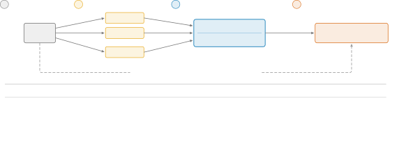

1\]Apple 2\]Duke University
\metadata\[Correspondence\][ruoyu.xie@duke.edu](mailto:ruoyu.xie@duke.edu)
\metadata\[Code\][https://github.com/apple-aiml-research/ml-rethink-mopd](https://github.com/apple-aiml-research/ml-rethink-mopd)^(∗)

# Rethinking Self-Distillation for Multi-Teacher Capability Merging

Roy Xie    Dan Friedman    Feng Nan    Yukun Huang    Zhichao Xu   
Chengjiu Zhang    Jun Xu     
Manaal Faruqui    Vivek Rathod    Bhuwan Dhingra Affiliation: \[
Affiliation: \[

###### Abstract

Combining capabilities of multiple expert models trained starting from
the same base checkpoint has become increasingly common in frontier
language-model post-training. Recent trends suggest that multi-teacher
on-policy distillation (MOPD) outperforms conventional off-policy
methods. However, despite the higher inference and environment
interaction costs incurred by MOPD, we find that much of its reported
accuracy gain is due to certain training design choices and
hyperparameter optimization, rather than the algorithm itself. We
conduct a controlled self-distillation study across two multi-teacher
settings, four models, and eleven benchmarks, comparing off-policy
methods, namely supervised fine-tuning (SFT) and soft-label
distillation, to hybrid teacher-prefix distillation and MOPD. We found
that all four methods achieve nearly identical accuracy. However, MOPD
uses $`14.8`$–$`23.1\times`$ SFT’s training GPU-hours. We also revisit
four recently published comparisons between on-policy and off-policy
distillation and find that the reported on-policy gains shrink
substantially when SFT baselines are trained on rejection-sampled
teacher trajectories and use independently tuned hyperparameters. As a
training-free alternative, we also find that simple weight-merging
methods can recover expert capabilities with minutes of CPU merging
time, although their accuracy degrades as model size decreases and task
interference increases. Overall, our results question recent gains
reported due to MOPD and suggest careful tuning of more efficient
off-policy baselines as a viable alternative.

\applefootnote

^(∗)Under legal review and will be released soon.

## 1 Introduction

Modern frontier large language model (LLM) post-training increasingly
decomposes capability development into domain-specific training
(DeepSeek AI, 2026; Kimi Team, 2026; NVIDIA, 2026). Starting from a
shared checkpoint, each expert can be optimized through reinforcement
learning (RL) with its own algorithms, prompts, rewards, and training
infrastructure, making capability hill-climbing modular and
parallelizable. Transferring these capabilities back into a student
initialized from the same checkpoint is also known as
_self-distillation_ (The Microsoft AI Team, 2026).

However, recent releases report the use of different self-distillation
recipes. Multi-teacher on-policy distillation (MOPD) supervises the
student on its own generated trajectories (Ma et al., 2026; Gao et al., 2026) and is increasingly adopted (Lim et al., 2026; Park et al., 2026;
NVIDIA, 2026), including in GLM-5 (GLM-5-Team et al., 2026), DeepSeek-V4
(DeepSeek AI, 2026), and Kimi K3 (Kimi Team, 2026). In contrast,
MAI-Thinking-1 (The Microsoft AI Team, 2026) and Step 3.5 Flash (Huang
et al., 2026) use off-policy supervised fine-tuning (SFT) on
teacher-generated trajectories.

The choice of distillation method affects both the compute budget and
the infrastructure required for post-training. MOPD requires repeated
student generation and teacher scoring throughout training (Lu and
Thinking Machines Lab, 2025; Chen et al., 2026). For agentic tasks, each
rollout may also require live environment interaction, with costs that
grow with trajectory length and the number of environments. Performing
rollouts across multiple environments in the same training run also
requires complex training infrastructure. Off-policy distillation
instead reuses fixed expert trajectories, incurring one-time collection
costs upfront with no training-time environment interaction. The two
approaches differ substantially in both cost and training dynamics.
While some work has suggested that OPD outperforms off-policy methods
(Ma et al., 2026; Gao et al., 2026), there have been limited systematic
comparisons under a controlled setup. We therefore ask: What is the most
effective way to consolidate expert capabilities into a single
general-purpose model?


Figure 1: Well-tuned SFT narrows reported OPD advantages. Four published
SFT–OPD comparisons, with

SFT and

OPD shown as published (pale) and tuned versions (solid hatched): both
methods undergo a learning-rate sweep. SFT uses rejection-sampled
teacher trajectories. The reported OPD gaps shrink in every comparison;
tuning details and full results are in Appendix A.

To assess whether on-policy training is worth its additional cost, we
first ask whether its reported gains persist against well-tuned
off-policy baselines. Several recent comparisons do not report their SFT
tuning procedure (Gao et al., 2026; Liao et al., 2026; Wang et al.,
2026c). Inspecting the released SKD code (Xu et al., 2025), we find that
it includes prompt tokens in the SFT loss and uses a shared learning
rate for SFT and OPD¹¹ 1
[https://github.com/google-research/google-research/blob/master/speculative˙kd/train/train˙sft.py](https://github.com/google-research/google-research/blob/master/speculative_kd/train/train_sft.py).
We revisit four published studies to assess how their reported on-policy
gains change with stronger SFT recipes. We tune SFT and OPD learning
rates independently and train with rejection-sampled expert trajectories
(Section 6.4). Figure 1 shows that these changes substantially reduce
the accuracy gaps between SFT and OPD, raising the question of how much
of the reported advantage comes from on-policy supervision itself.

Therefore, we conduct a comparison under shared initialization through a
controlled self-distillation setup for four methods (Section 3.1): two
off-policy approaches, SFT on teacher-generated trajectories and soft
knowledge distillation (Soft-KD) using full teacher next-token
distributions; hybrid Offline-MOPD, which samples student responses
conditioned on teacher-generated prefixes; and on-policy MOPD. Shared
initialization also makes weight merging a natural alternative: it
directly combines expert parameters without training (Wortsman et al.,
2022; Ilharco et al., 2023)²² 2 Constructing merged weights takes
minutes of CPU time, but selecting hyperparameters still requires
GPU-hours for validation, as does checkpoint selection for all
distillation methods.. We study two multi-teacher settings: MIA, which
combines mathematics, instruction following, and agentic tasks; and
Agent$`\times`$3, which combines ALFWorld (Shridhar et al., 2020),
WebShop (Yao et al., 2022), and InterCode (Yang et al., 2023), where
every on-policy rollout requires live environment interaction.

We evaluate four models from the Qwen and Ministral families (1.7B to
8B) on eleven single-turn and multi-turn benchmarks. We find that, with
careful hyperparameter tuning, SFT, Soft-KD, Offline-MOPD, and MOPD
achieve comparable accuracy and show similar out-of-domain retention
(Section 5.1). However, MOPD requires $`14.8\times`$ and $`23.1\times`$
the training GPU-hours of SFT on MIA and Agent$`\times`$3, respectively
(Section 5.2). As an efficient alternative, weight merging achieves
capability recovery comparable to distillation, although its
effectiveness declines at smaller model scales and when merging experts
with overlapping capabilities (Section 5.3). With larger teachers, MOPD
recovers a smaller fraction of the teachers’ in-domain gains, while SFT
maintains high recovery at the cost of greater out-of-domain degradation
(Section 6.1). Finally, we analyze attention-weight changes and model
behavior to characterize differences among the methods beyond accuracy
(Section 6.2). Overall, our results question the reported benefits of
MOPD and show that well-tuned off-policy and training-free methods offer
efficient alternatives for merging expert capabilities.

## 2 Related Work

#### Off-Policy and On-Policy Knowledge Distillation.

Off-policy distillation typically trains a student on teacher-generated
sequences, using either hard-token targets or teacher probability
distributions (Hinton et al., 2015; Kim and Rush, 2016). Because the
student generates its own prefixes during inference, it may encounter
mismatch in states from the training data, resulting in accumulating
errors (Ross et al., 2011; Bengio et al., 2015). On-policy distillation
(OPD) addresses this mismatch by providing teacher supervision on
student-generated trajectories (Agarwal et al., 2024; Gu et al., 2024;
Song and Zheng, 2026). Intermediate approaches interleave teacher and
student tokens (Xu et al., 2025) or combine student sampling with
replayed trajectories and prefixes (Ko et al., 2024; Liao et al., 2026).
Recent studies also identify teacher–student compatibility (Li et al.,
2026b) and data selection (Hou et al., 2026) as important factors in OPD
accuracy, and Ding and Zhang (2026) recover most of the OPD gain in an
ablation that assigns a fixed negative advantage to selected
low-probability student tokens. However, systematic comparisons across
these approaches remain limited when multiple teachers and the student
share the same initialization. We discuss additional work on SFT and
distillation in Appendix B.

#### Multi-Teacher Capability Integration.

MOPD combines specialized capabilities by using each domain expert to
supervise student-generated trajectories (Ma et al., 2026; Lim et al.,
2026). This approach is also used in large-scale post-training (Park et
al., 2026; NVIDIA, 2026). Alternatives include distilling expert
trajectories through SFT (The Microsoft AI Team, 2026) and directly
combining expert weights without additional training (Wortsman et al.,
2022; Ilharco et al., 2023; Yadav et al., 2023; Yu et al., 2024), which
Wang et al. (2026a) weigh against joint multi-domain RL. Closest to our
work, MOPD (Ma et al., 2026) and Open-MOPD (Gao et al., 2026) compare
on-policy distillation with offline fine-tuning and weight merging for
integrating experts trained from a shared initialization. However, these
studies do not systematically compare computational costs across
methods, and it is unclear to what extent each baseline is independently
tuned. For example, using released data and evaluation protocols from
Open-MOPD, we find that hyperparameter sweeps and rejection-sampled data
can bring SFT to OPD-level accuracy (Section 6.4).

## 3 Methodology

We study _multi-teacher self-distillation_ (Figure 2), which combines
the capabilities of $`K`$ domain experts into a student $`\pi_{\theta}`$
initialized from a shared base checkpoint $`\pi_{0}=\pi_{\theta_{0}}`$.
The domain experts $`\pi_{d}=\pi_{\theta_{d}}`$ share this base
initialization and provide supervision for student training. Let
$`p_{d}^{\theta}(\cdot\mid x)`$ denote the trajectory distribution
induced by policy $`\pi_{\theta}`$ on task $`x`$ in domain $`d`$,
including environment interactions for agentic tasks. A single-turn
trajectory $`\tau`$ contains one response to a fixed prompt. A
multi-turn trajectory alternates model actions and environment
observations, so later decisions depend on feedback from earlier actions
and the growing interaction history.

Off-policy distillation trains the student on recorded teacher
trajectories, avoiding student rollout generation during training but
restricting supervision to teacher-visited contexts. On-policy
distillation instead queries the teacher at student-generated contexts,
which can cover states absent from the recorded trajectories but require
additional generation and live environment interaction for agentic
tasks. To construct the offline corpus $`\mathcal{D}_{d}`$, we sample
trajectories from expert $`\pi_{d}`$ for domain-$`d`$ training prompts
and retain successful task–trajectory pairs $`(x,\tau)`$. We collect
this rejection-sampled corpus (Yuan et al., 2023) once and hold it fixed
across methods: all four use its prompts, SFT and Soft-KD use its
recorded trajectories, and Offline-MOPD samples student responses
conditioned on its recorded prompts and interaction histories. Teacher
trajectory generation costs are discussed in Section 5.2; we ablate
rejection sampling in Section 6.3.



Figure 2: Self-distillation pipeline. Each teacher is trained
independently from the shared base checkpoint. All methods use the same
rejection-sampled prompts. Recorded teacher context includes the prompt
and prior interaction history. _Multi-turn live interaction_ means
executing student actions and receiving fresh environment observations
across turns during training.

### 3.1 Self-Distillation Objectives

Let $`s`$ denote a token context: the task prompt, preceding interaction
history, and current response prefix. The student and teacher next-token
distributions are $`\pi_{\theta}(\cdot\mid s)`$ and
$`\pi_{d}(\cdot\mid s)`$ over a shared vocabulary. All per-token losses
below apply only to assistant tokens.

#### Supervised fine-tuning (SFT).

SFT minimizes the negative log-likelihood of the teacher token $`a`$
recorded at context $`s`$:

```math
\ell_{\mathrm{SFT}}(\theta;s,a)=-\log\pi_{\theta}(a\mid s). \tag{1}
```

#### Soft knowledge distillation (Soft-KD).

At the same teacher contexts, Soft-KD replaces the single recorded token
with the teacher’s full next-token distribution and minimizes the
forward KL divergence (Hinton et al., 2015):

```math
\ell_{\mathrm{FKL}}(\theta;d,s)=D_{\mathrm{KL}}\bigl(\pi_{d}(\cdot\mid s)\bigm\|\pi_{\theta}(\cdot\mid s)\bigr). \tag{2}
```

#### Offline-MOPD.

Offline-MOPD fixes the prompt and preceding interaction history to a
recorded teacher trajectory, then samples the current response from the
student. Thus $`s`$ contains a student-generated response prefix, but
student responses are used only for distillation: subsequent turns use
recorded teacher histories, without executing student actions or
obtaining new environment observations for multi-turn scenarios. At
these contexts, it minimizes the mode-seeking reverse KL divergence (Gu
et al., 2024):

```math
\ell_{\mathrm{RKL}}(\theta;d,s)=D_{\mathrm{KL}}\bigl(\pi_{\theta}(\cdot\mid s)\bigm\|\pi_{d}(\cdot\mid s)\bigr). \tag{3}
```

#### Multi-teacher on-policy distillation (MOPD).

MOPD applies the same reverse KL (Equation 3) to complete student
trajectories (Agarwal et al., 2024; Ma et al., 2026). Let
$`\widehat{P}_{d}`$ be the empirical prompt distribution in
$`\mathcal{D}_{d}`$, $`w_{d}\geq 0`$ the domain weights with
$`\sum_{d=1}^{K}w_{d}=1`$, and $`\bar{\theta}`$ the student parameters
at rollout collection. The objective is

```math
\mathcal{L}_{\mathrm{MOPD}}(\theta;\bar{\theta})=\sum_{d=1}^{K}w_{d}\,\mathbb{E}_{x\sim\widehat{P}_{d},\;\tau\sim p_{d}^{\bar{\theta}}(\cdot\mid x)}\biggl[\frac{1}{|\tau|}\sum_{t=1}^{|\tau|}\ell_{\mathrm{RKL}}(\theta;d,s_{t})\biggr], \tag{4}
```

where $`|\tau|`$ counts assistant tokens only and $`s_{t}`$ precedes the
$`t`$th assistant token. We differentiate only the loss, holding
$`\bar{\theta}`$ and sampled contexts fixed during each update;
subsequent rollouts use the updated student. In multi-turn tasks, the
initial instruction is fixed, and subsequent context consists of
environment observations produced by executing student actions. All
methods share initial task prompts, but MOPD trains on interaction
histories generated by student actions. Offline-MOPD instead uses
recorded teacher interaction histories, requiring no environment
interaction during training. Offline-MOPD shares MOPD’s sampling rule
and objective on single-turn tasks.

### 3.2 Training-Free Weight Merging

Weight merging combines expert checkpoints in parameter space (Li et
al., 2026a). We consider methods that require no gradient-based training
(Yadav et al., 2023; Yu et al., 2024). For task arithmetic, define the
task vectors $`\Delta\theta_{d}=\theta_{d}-\theta_{0}`$ (Ilharco et al., 2023) and combine them as

```math
\theta_{\mathrm{merge}}=\theta_{0}+\sum_{d=1}^{K}c_{d}\,\Delta\theta_{d}, \tag{5}
```

where the merging method and its hyperparameters determine the
coefficients $`c_{d}\in\mathbb{R}`$ and any sparsification of
$`\Delta\theta_{d}`$ applied beforehand. We describe the individual
merging methods and their sweeps in Appendix C.

### 3.3 Evaluating Capability Recovery

We split tasks into in-domain (ID) and out-of-domain (OOD) based on
teachers’ training domains. Let $`S_{b}(\pi)`$ denote policy $`\pi`$’s
held-out score on benchmark $`b`$, on a 0–100 scale where higher is
better. Define its gain over the base as
$`\Delta_{b}(\pi)=S_{b}(\pi)-S_{b}(\pi_{0})`$ and the best teacher gain
as $`\Delta_{b}^{\star}=\max_{1\leq d\leq K}\Delta_{b}(\pi_{d})`$. For a
nonempty benchmark set $`\mathcal{B}`$, we adapt the recovery
normalization of Gao et al. (2026), measuring student gains over the
shared base against the gains of a teacher over the same benchmarks, and
define retention as mean score change:

```math
\operatorname{Rec}(\pi;\mathcal{B})=100\,\frac{\sum_{b\in\mathcal{B}}\Delta_{b}(\pi)}{\sum_{b\in\mathcal{B}}\Delta_{b}^{\star}},\qquad\operatorname{Ret}(\pi;\mathcal{B})=\frac{1}{|\mathcal{B}|}\sum_{b\in\mathcal{B}}\Delta_{b}(\pi). \tag{6}
```

On ID benchmarks, $`\operatorname{Rec}`$ measures the percentage of
aggregate teacher gain recovered: 0 matches the base and 100 matches the
aggregate best teacher scores. On OOD benchmarks, $`\operatorname{Ret}`$
measures mean change from the base in benchmark points, with negative
values indicating degradation.

## 4 Experimental Setup

### 4.1 Multi-Teacher Setup

We study two multi-teacher setups: MIA combines mathematics,
instruction-following, and agentic experts, mixing disjoint
capabilities, while Agent$`\times`$3 combines ALFWorld, WebShop, and
InterCode-SQL experts (Shridhar et al., 2020; Yao et al., 2022; Yang et
al., 2023) that all focus on long-horizon agentic capability. We study
four models under both multi-teacher setups: Qwen3-8B, Qwen3-1.7B (Qwen
Team, 2025), Qwen3.5-4B-Base (Qwen, 2026), and Ministral-3-3B-Instruct
(Mistral AI, 2025); we conduct RL training on each base model to obtain
the teachers. The mathematics teacher is trained with DAPO (Yu et al., 2025) on DAPO-Math-17k (ByteDance Seed and Tsinghua AIR, 2025), the
instruction-following teacher with GRPO (Shao et al., 2024) on the
IF-RLVR multi-constraint data (Allen Institute for AI, 2025), and the
three agentic teachers with GiGPO (Feng et al., 2025) on the training
data of their environments. As a multi-task reference, we include
Mix-RL, a single model optimized jointly on all domains (Wang et al.,
2026a). All four distillation methods use prompts from the same
rejection-sampled teacher corpus; Section D.1 details its construction.

### 4.2 Hyperparameter Tuning

Our goal is to train each method to its best possible accuracy, so that
the comparison is controlled. Each of the four distillation methods is
tuned independently and trained for five epochs, as detailed in
Section D.2. Besides method-specific tuning, such as the reverse-KL
coefficient shared by the two MOPD variants, we focus on tuning the
learning rate, as the methods differ in gradient scale and a shared rate
would handicap some of them. We sweep up to five values per method,
model, and setup, giving at most 160 configurations³³ 3 $`4`$ methods
$`\times`$ $`4`$ models $`\times`$ $`2`$ multi-teacher setups $`\times`$
$`5`$ learning rates $`=`$ $`160`$ configurations. before seed
replication or additional sweeps. Its effect is large: the learning rate
alone varies the SFT validation score by up to 11.3 percentage points
(Section 6.3). The selected learning rates vary by method, model, and
setup (Table 11). For example, the two off-policy methods are about five
times higher than the two on-policy ones, which is why a shared rate
would handicap some of them Every training run uses eight B200 GPUs.
Weight merging requires no training hyperparameter tuning; we instead
sweep each merge method’s mixing coefficient and sparsity level and keep
the configuration with the highest worst-task retention on validation
data. Computing the merged weights uses CPU time, while validation
requires GPU inference. Method-specific tuning details are described in
Section D.2.

### 4.3 Evaluation

In our self-distillation setup, every task is split into disjoint
training, validation, and test sets. We select the checkpoints with the
highest validation-set task accuracy and evaluate them on held-out test
sets; Section D.3 details the selection procedure. We report accuracy on
eight single-turn benchmarks: MATH-500 (Hendrycks et al., 2021; Lightman
et al., 2023), GSM8K (Cobbe et al., 2021), AIME24 and AIME25
(Mathematical Association of America, n.d.), IFEval (Zhou et al., 2023),
IFBench (Pyatkin et al., 2025), GPQA-Diamond (Rein et al., 2024), and
MMLU-Pro (Wang et al., 2024); and on three multi-turn benchmarks:
InterCode-SQL, ALFWorld, and WebShop, with ALFWorld’s seen and unseen
splits. Section D.4 provides the split definitions and the benchmark
suite with its metrics and test-set sizes. Every benchmark counts as
either in-domain or out-of-domain, based on the teachers’ domains. We
summarize each model by its recovery rate over all in-domain benchmarks
and its retention over all out-of-domain benchmarks, as defined in
Section 3.3. We report three training seeds for the four distillation
methods and Mix-RL, and three evaluation seeds for the base, teachers,
and merged models.

## 5 Experimental Results

### 5.1 Capability Recovery across Models and Settings

|                  |                       |                      |                         |                         |                         |                        |                       |                       |                        |                        |                        |                        |                    |                        |
| ---------------- | --------------------- | -------------------- | ----------------------- | ----------------------- | ----------------------- | ---------------------- | --------------------- | --------------------- | ---------------------- | ---------------------- | ---------------------- | ---------------------- | ------------------ | ---------------------- |
|                  | Single-turn           |                      |                         |                         |                         |                        |                       |                       | Multi-turn             |                        |                        |                        | Overall            |                        |
| MIA              | MATH$`\bm{\dagger}`$  | GSM$`\bm{\dagger}`$  | AIME24$`\bm{\dagger}`$  | AIME25$`\bm{\dagger}`$  | IFEval$`\bm{\dagger}`$  | IFBen$`\bm{\dagger}`$  | GPQA$`\bm{\ddagger}`$ | MMLU$`\bm{\ddagger}`$ | IC-SQL$`\bm{\dagger}`$ | ALF-s$`\bm{\ddagger}`$ | ALF-u$`\bm{\ddagger}`$ | WShop$`\bm{\ddagger}`$ | ID Rec.            | OOD $`\Delta`$         |
| Base             | 82.8  $`\pm`$ 0.2     | 92.4  $`\pm`$ 0.1    | 27.1  $`\pm`$ 0.7       | 21.7  $`\pm`$ 0.8       | 81.9  $`\pm`$ 0.1       | 25.7  $`\pm`$ 0.3      | 42.4  $`\pm`$ 0.5     | 65.6  $`\pm`$ 0.0     | 61.7  $`\pm`$ 0.1      | 18.6  $`\pm`$ 0.7      | 10.4  $`\pm`$ 0.7      | 3.6  $`\pm`$ 0.2       | New A  $`\pm`$ n/r | 0.0  $`\pm`$ n/r       |
| Teachers         | 89.6  $`\pm`$ 0.7     | 93.0  $`\pm`$ 0.1    | 41.2  $`\pm`$ 1.5       | 31.7  $`\pm`$ 0.8       | 88.5  $`\pm`$ 0.2       | 42.0  $`\pm`$ 0.3      | 56.1  $`\pm`$ 0.5     | 69.8  $`\pm`$ 0.1     | 77.6  $`\pm`$ 0.1      | 33.6  $`\pm`$ 1.2      | 32.1  $`\pm`$ 0.7      | 11.8  $`\pm`$ 0.2      | 100.0  $`\pm`$ n/r | New A  $`\pm`$ n/r     |
| Mix-RL           | 87.9  $`\pm`$ 1.2     | 91.3  $`\pm`$ 0.2    | 45.3  $`\pm`$ 1.7       | 33.9  $`\pm`$ 0.7       | 88.0  $`\pm`$ 0.7       | 42.4  $`\pm`$ 1.3      | 51.5  $`\pm`$ 1.7     | 60.3  $`\pm`$ 0.7     | 76.4  $`\pm`$ 0.9      | 8.6  $`\pm`$ 1.2       | 5.5  $`\pm`$ 2.2       | 5.8  $`\pm`$ 0.5       | 102.3  $`\pm`$ 5.2 | $`-`$0.4   $`\pm`$ 0.6 |
| Merge            | 89.2  $`\pm`$ 0.2     | 93.6  $`\pm`$ 0.0    | 40.4  $`\pm`$ 1.7       | 32.9  $`\pm`$ 1.4       | 87.8  $`\pm`$ 0.2       | 41.0  $`\pm`$ 0.3      | 47.1  $`\pm`$ 0.6     | 63.3  $`\pm`$ 0.1     | 77.9  $`\pm`$ 0.1      | 7.9  $`\pm`$ 0.7       | 1.5  $`\pm`$ 0.7       | 6.5  $`\pm`$ 0.2       | 98.9  $`\pm`$ 2.4  | $`-`$1.1   $`\pm`$ 0.3 |
| SFT              | 88.9  $`\pm`$ 0.2     | 92.8  $`\pm`$ 0.1    | 41.7  $`\pm`$ 1.2       | 32.2  $`\pm`$ 2.1       | 88.5  $`\pm`$ 0.7       | 42.1  $`\pm`$ 1.3      | 45.6  $`\pm`$ 0.8     | 63.5  $`\pm`$ 0.2     | 76.1  $`\pm`$ 0.2      | 5.5  $`\pm`$ 1.1       | 4.5  $`\pm`$ 0.7       | 0.0  $`\pm`$ n/r       | 98.2  $`\pm`$ 5.6  | $`-`$3.0   $`\pm`$ 0.4 |
| Soft-KD          | 90.8  $`\pm`$ 0.9     | 92.5  $`\pm`$ 0.5    | 42.5  $`\pm`$ 1.2       | 30.8  $`\pm`$ 1.7       | 87.4  $`\pm`$ 0.6       | 41.1  $`\pm`$ 0.4      | 47.0  $`\pm`$ 2.6     | 62.7  $`\pm`$ 0.4     | 76.6  $`\pm`$ 0.3      | 5.0  $`\pm`$ 1.2       | 1.0  $`\pm`$ 1.7       | 7.1  $`\pm`$ 0.3       | 97.3  $`\pm`$ 2.4  | $`-`$1.6   $`\pm`$ 0.6 |
| Off-MOPD         | 92.6  $`\pm`$ 0.7     | 92.7  $`\pm`$ 0.4    | 41.4  $`\pm`$ 1.6       | 30.3  $`\pm`$ 2.7       | 87.2  $`\pm`$ 0.8       | 40.2  $`\pm`$ 0.4      | 48.8  $`\pm`$ 0.8     | 63.1  $`\pm`$ 0.1     | 77.0  $`\pm`$ 0.7      | 7.1  $`\pm`$ 1.4       | 2.2  $`\pm`$ 0.7       | 7.3  $`\pm`$ 1.1       | 96.9  $`\pm`$ 1.7  | $`-`$0.6   $`\pm`$ 0.5 |
| MOPD             | 89.5  $`\pm`$ 0.4     | 92.9  $`\pm`$ 0.3    | 41.0  $`\pm`$ 2.0       | 31.5  $`\pm`$ 0.2       | 88.9  $`\pm`$ 0.2       | 41.7  $`\pm`$ 1.5      | 48.0  $`\pm`$ 1.3     | 65.2  $`\pm`$ 0.3     | 76.6  $`\pm`$ 1.1      | 6.4  $`\pm`$ 1.9       | 1.7  $`\pm`$ 0.9       | 5.7  $`\pm`$ 0.6       | 97.9  $`\pm`$ 1.8  | $`-`$0.8   $`\pm`$ 0.6 |
| Agent$`\times`$3 | MATH$`\bm{\ddagger}`$ | GSM$`\bm{\ddagger}`$ | AIME24$`\bm{\ddagger}`$ | AIME25$`\bm{\ddagger}`$ | IFEval$`\bm{\ddagger}`$ | IFBen$`\bm{\ddagger}`$ | GPQA$`\bm{\ddagger}`$ | MMLU$`\bm{\ddagger}`$ | IC-SQL$`\bm{\dagger}`$ | ALF-s$`\bm{\dagger}`$  | ALF-u$`\bm{\dagger}`$  | WShop$`\bm{\dagger}`$  | ID Rec.            | OOD $`\Delta`$         |
| Base             | 82.8  $`\pm`$ 0.2     | 92.4  $`\pm`$ 0.1    | 27.1  $`\pm`$ 0.7       | 21.7  $`\pm`$ 0.8       | 81.9  $`\pm`$ 0.1       | 25.7  $`\pm`$ 0.3      | 42.4  $`\pm`$ 0.5     | 65.6  $`\pm`$ 0.0     | 61.7  $`\pm`$ 0.1      | 18.6  $`\pm`$ 0.7      | 10.4  $`\pm`$ 0.7      | 3.6  $`\pm`$ 0.2       | New A  $`\pm`$ n/r | 0.0  $`\pm`$ n/r       |
| Teachers         | 84.8  $`\pm`$ 0.7     | 92.7  $`\pm`$ 0.0    | 29.4  $`\pm`$ 0.9       | 22.3  $`\pm`$ 1.0       | 84.5  $`\pm`$ 0.2       | 27.7  $`\pm`$ 0.3      | 49.0  $`\pm`$ 0.5     | 65.3  $`\pm`$ 0.1     | 78.6  $`\pm`$ 0.1      | 82.1  $`\pm`$ 1.4      | 80.6  $`\pm`$ 0.7      | 62.2  $`\pm`$ 0.2      | 100.0  $`\pm`$ n/r | New A  $`\pm`$ n/r     |
| Mix-RL           | 85.3  $`\pm`$ 0.4     | 95.2  $`\pm`$ 0.2    | 31.0  $`\pm`$ 0.9       | 23.7  $`\pm`$ 1.1       | 87.4  $`\pm`$ 0.8       | 25.7  $`\pm`$ 0.9      | 44.6  $`\pm`$ 1.3     | 63.6  $`\pm`$ 0.1     | 77.7  $`\pm`$ 1.1      | 85.0  $`\pm`$ 1.4      | 82.8  $`\pm`$ 1.3      | 61.0  $`\pm`$ 0.5      | 100.3  $`\pm`$ 1.2 | $`+`$2.1   $`\pm`$ 0.1 |
| Merge            | 84.5  $`\pm`$ 0.2     | 93.9  $`\pm`$ 0.1    | 25.9  $`\pm`$ 0.5       | 20.5  $`\pm`$ 0.8       | 84.8  $`\pm`$ 0.2       | 28.0  $`\pm`$ 0.3      | 43.6  $`\pm`$ 0.6     | 64.0  $`\pm`$ 0.0     | 78.5  $`\pm`$ 0.1      | 81.4  $`\pm`$ 1.2      | 82.3  $`\pm`$ 1.1      | 60.4  $`\pm`$ 0.5      | 99.0  $`\pm`$ 0.3  | $`+`$0.7   $`\pm`$ 0.2 |
| SFT              | 80.2  $`\pm`$ 0.4     | 91.9  $`\pm`$ 0.2    | 24.9  $`\pm`$ 2.0       | 20.3  $`\pm`$ 0.8       | 82.0  $`\pm`$ 0.1       | 20.8  $`\pm`$ 1.0      | 41.1  $`\pm`$ 1.1     | 62.5  $`\pm`$ 0.2     | 77.5  $`\pm`$ 0.5      | 80.7  $`\pm`$ 2.5      | 79.9  $`\pm`$ 2.2      | 63.0  $`\pm`$ 0.7      | 99.0  $`\pm`$ 1.7  | $`-`$2.0   $`\pm`$ 0.2 |
| Soft-KD          | 79.2  $`\pm`$ 1.4     | 92.4  $`\pm`$ 0.4    | 19.0  $`\pm`$ 2.0       | 18.6  $`\pm`$ 2.8       | 78.6  $`\pm`$ 0.6       | 20.9  $`\pm`$ 0.5      | 43.4  $`\pm`$ 1.3     | 61.0  $`\pm`$ 0.5     | 78.3  $`\pm`$ 0.2      | 79.3  $`\pm`$ 2.1      | 79.1  $`\pm`$ 1.3      | 61.2  $`\pm`$ 1.4      | 97.6  $`\pm`$ 2.1  | $`-`$3.3   $`\pm`$ 0.8 |
| Off-MOPD         | 82.4  $`\pm`$ 2.3     | 92.7  $`\pm`$ 0.2    | 25.6  $`\pm`$ 1.0       | 22.1  $`\pm`$ 1.9       | 82.7  $`\pm`$ 0.6       | 25.1  $`\pm`$ 0.8      | 45.6  $`\pm`$ 1.1     | 64.9  $`\pm`$ 0.1     | 78.2  $`\pm`$ 1.3      | 80.0  $`\pm`$ 0.7      | 77.6  $`\pm`$ 1.5      | 62.0  $`\pm`$ 1.4      | 97.8  $`\pm`$ 1.7  | $`+`$0.2   $`\pm`$ 0.9 |
| MOPD             | 83.7  $`\pm`$ 1.3     | 92.9  $`\pm`$ 0.2    | 26.9  $`\pm`$ 0.9       | 22.4  $`\pm`$ 1.4       | 83.9  $`\pm`$ 0.5       | 26.1  $`\pm`$ 0.4      | 44.9  $`\pm`$ 1.0     | 63.6  $`\pm`$ 0.3     | 79.3  $`\pm`$ 1.3      | 83.6  $`\pm`$ 1.9      | 78.4  $`\pm`$ 3.0      | 60.8  $`\pm`$ 0.5      | 99.3  $`\pm`$ 1.0  | $`+`$0.6   $`\pm`$ 0.4 |

Table 1: Capability recovery and retention with Qwen3-8B. Benchmarks are
in-domain ($`\bm{\dagger}`$) or out-of-domain ($`\bm{\ddagger}`$) for
each multi-teacher setup. ID Rec. is the recovery rate over all
in-domain benchmarks in percent (Equation 6); OOD $`\Delta`$ is the mean
change from the base model over all OOD benchmarks. Teachers is a
column-wise maximum over that composition’s three experts. Entries
report mean $`\pm`$ standard deviation across three seeds. Bold marks
the best of the four distillation methods per column; Merge is the best
merge result from Appendix C.

We present capability recovery and retention for Qwen3-8B in Table 1 to
assess whether on-policy distillation recovers more expert capability
than off-policy methods. MIA mixes single-turn mathematics and
instruction following with multi-turn InterCode-SQL, whereas
Agent$`\times`$3 contains only multi-turn tasks. SFT, Soft-KD,
Offline-MOPD, and MOPD recover 96.9–98.2% of the teachers’ aggregate
in-domain gains on MIA and 97.6–99.3% on Agent$`\times`$3. Across all
four models (Table 2), the maximum within-model spread in in-domain
recovery rate is 3.5 percentage points on MIA and 4.6 on
Agent$`\times`$3. These comparisons show no consistent in-domain
recovery advantage for on-policy distillation over tuned off-policy
methods, and a larger teacher does not create one (Section 6.1). We
discuss this result and give a theoretical analysis in Appendix E. OOD
retention varies by model and setting: MOPD improves mean retention over
SFT by 1.1 benchmark points, but does not consistently outperform it.
Mix-RL and merging have mean OOD changes of $`-1.1`$ and $`-2.7`$
points, respectively. Appendix F reports the same per-benchmark results
for the other three models.

|          | Qwen3-1.7B        |                    | Ministral-3-3B    |                   | Qwen3.5-4B         |                    | Qwen3-8B           |                    | Mean           |
| -------- | ----------------- | ------------------ | ----------------- | ----------------- | ------------------ | ------------------ | ------------------ | ------------------ | -------------- |
| Method   | MIA               | A$`\times`$3       | MIA               | A$`\times`$3      | MIA                | A$`\times`$3       | MIA                | A$`\times`$3       | OOD $`\Delta`$ |
| Mix-RL   | 92.3  $`\pm`$ 1.3 | 101.9  $`\pm`$ 0.8 | 93.2  $`\pm`$ 4.8 | 92.7  $`\pm`$ 1.3 | 103.5  $`\pm`$ 4.1 | 102.6  $`\pm`$ 1.2 | 102.3  $`\pm`$ 5.2 | 100.3  $`\pm`$ 1.2 | $`-1.1`$       |
| Merge    | 86.2  $`\pm`$ 0.2 | 88.3  $`\pm`$ 0.3  | 99.7  $`\pm`$ 1.7 | 77.6  $`\pm`$ 0.4 | 101.8  $`\pm`$ 2.5 | 86.8  $`\pm`$ 0.5  | 98.9  $`\pm`$ 2.4  | 99.0  $`\pm`$ 0.3  | $`-2.7`$       |
| SFT      | 94.7  $`\pm`$ 2.9 | 98.3  $`\pm`$ 0.7  | 95.5  $`\pm`$ 1.1 | 95.1  $`\pm`$ 0.3 | 98.6  $`\pm`$ 3.0  | 96.4  $`\pm`$ 1.1  | 98.2  $`\pm`$ 5.6  | 99.0  $`\pm`$ 1.7  | $`-3.6`$       |
| Soft-KD  | 98.2  $`\pm`$ 2.0 | 96.8  $`\pm`$ 1.7  | 98.4  $`\pm`$ 1.3 | 93.3  $`\pm`$ 1.2 | 97.3  $`\pm`$ 3.4  | 97.0  $`\pm`$ 1.0  | 97.3  $`\pm`$ 2.4  | 97.6  $`\pm`$ 2.1  | $`-4.0`$       |
| Off-MOPD | 97.7  $`\pm`$ 2.3 | 96.3  $`\pm`$ 2.1  | 94.9  $`\pm`$ 4.4 | 95.4  $`\pm`$ 1.3 | 98.7  $`\pm`$ 3.2  | 94.8  $`\pm`$ 1.3  | 96.9  $`\pm`$ 1.7  | 97.8  $`\pm`$ 1.7  | $`-3.3`$       |
| MOPD     | 96.9  $`\pm`$ 1.8 | 96.8  $`\pm`$ 0.6  | 97.0  $`\pm`$ 2.6 | 97.9  $`\pm`$ 1.9 | 97.8  $`\pm`$ 4.8  | 95.9  $`\pm`$ 1.6  | 97.9  $`\pm`$ 1.8  | 99.3  $`\pm`$ 1.0  | $`-2.5`$       |

Table 2: Recovery and retention across models. Model-specific columns
report in-domain recovery (%); OOD $`\Delta`$ averages the reported
retention equally over all eight model–setting pairs. Full benchmark
results are in Appendix F.

### 5.2 Distillation Efficiency

Figure 3: Validation accuracy versus training progress and GPU-hours.
Accuracy is averaged across domains. Training progress is the update
count divided by the full-run budget; GPU-hours are cumulative and shown
on a logarithmic scale. Markers identify the highest retained validation
score for each method.

Ma et al. (2026) report each method’s accuracy against training steps.
However, step counts alone do not capture computational cost across
distillation methods when each one is individually tuned. For example,
learning rates affect convergence speed, batch sizes determine steps per
epoch, and on-policy updates also require student generation and teacher
scoring. We therefore report cumulative GPU-hours on eight B200 GPUs
(Section D.2). Figure 3 compares validation accuracy against training
progress and cumulative GPU-hours for Qwen3-8B. At the full configured
budgets, MOPD and SFT use 383.32 and 25.90 GPU-hours on MIA
($`14.8\times`$), and 415.80 and 18.00 GPU-hours on Agent$`\times`$3
($`23.1\times`$), respectively (Table 19). Student rollout accounts for
86.5–96.0% of OPD step time (Table 18). The outlined markers retain the
original best validation checkpoints; their costs exclude subsequent
training and checkpoint selection. It is worth noting that reported
training GPU-hours do not include one-time teacher trajectory
generation, as the teacher costs for on-policy and off-policy methods
are not directly comparable. SFT’s data-generation cost is incurred once
and amortized across multiple training runs and hyperparameter searches.
On the other hand, MOPD requires teacher forward passes to score new
student trajectories in every training run. We discuss these two
operational differences and report the generation cost in more detail in
Section G.2.

### 5.3 Alternatives to Distillation

We compare distillation methods with weight merging and Mix-RL to assess
whether expert capabilities can be recovered without distillation
training. Weight merging is more effective at the larger model scale:
averaged over both settings, Qwen3-8B recovers 99.0% of the teachers’
gains, compared with 87.3% for Qwen3-1.7B (Table 2). Merging also
performs better in MIA, where the experts specialize in less overlapping
domains: mean recovery across the four models is 96.6%, compared with
87.9% on Agent$`\times`$3. Constructing merged weights takes minutes of
CPU, but selecting a merge still requires GPU validation (Appendix C).
Joint multi-domain RL (Mix-RL) also avoids a separate distillation stage
by starting a single monolithic RL training run. It recovers most of the
teachers’ gains across all eight model–setting pairs, approaching or
exceeding teacher-level performance on Qwen3.5-4B and Qwen3-8B
(Table 2). However, changes to one domain’s training recipe may require
retuning the joint run, whereas separate experts support independent
iteration before integration (Ma et al., 2026).

## 6 Analysis and Discussion

### 6.1 Do Larger Teachers Favor On-Policy Distillation?

|          | MIA ID Rec.       |                   | MIA OOD $`\Delta`$     |                        | Agent$`\times`$3 ID Rec. |                   | Agent$`\times`$3 OOD $`\Delta`$ |                         |
| -------- | ----------------- | ----------------- | ---------------------- | ---------------------- | ------------------------ | ----------------- | ------------------------------- | ----------------------- |
| Method   | 1.7B              | 8B                | 1.7B                   | 8B                     | 1.7B                     | 8B                | 1.7B                            | 8B                      |
| SFT      | 94.7  $`\pm`$ 2.9 | 92.5  $`\pm`$ 1.6 | $`-`$6.3   $`\pm`$ 0.3 | $`-`$9.2   $`\pm`$ 0.5 | 98.3  $`\pm`$ 0.7        | 99.3  $`\pm`$ 0.5 | $`-`$5.4   $`\pm`$ 0.9          | $`-`$14.8   $`\pm`$ 0.7 |
| Soft-KD  | 98.2  $`\pm`$ 2.0 | 88.6  $`\pm`$ 1.5 | $`-`$7.7   $`\pm`$ 0.2 | $`-`$8.4   $`\pm`$ 0.1 | 96.8  $`\pm`$ 1.7        | 93.0  $`\pm`$ 1.2 | $`-`$4.1   $`\pm`$ 0.5          | $`-`$11.7   $`\pm`$ 0.7 |
| Off-MOPD | 97.7  $`\pm`$ 2.3 | 80.9  $`\pm`$ 1.0 | $`-`$6.9   $`\pm`$ 0.5 | $`-`$3.0   $`\pm`$ 0.8 | 96.3  $`\pm`$ 2.1        | 78.9  $`\pm`$ 0.9 | $`-`$2.6   $`\pm`$ 0.2          | $`-`$1.1   $`\pm`$ 0.7  |
| MOPD     | 96.9  $`\pm`$ 1.8 | 77.4  $`\pm`$ 1.9 | $`-`$6.1   $`\pm`$ 0.8 | $`-`$2.3   $`\pm`$ 0.3 | 96.8  $`\pm`$ 0.6        | 73.3  $`\pm`$ 0.3 | $`-`$2.1   $`\pm`$ 0.5          | $`-`$3.3   $`\pm`$ 0.6  |

Table 3: Teacher size with a fixed Qwen3-1.7B student. Each method
distills from either 1.7B or 8B Qwen3 experts. ID Rec. is the percentage
of the corresponding teachers’ aggregate in-domain gains over the 1.7B
base recovered by the student (Equation 6);

A larger teacher may provide stronger supervision while differing more
from the student’s initial behavior. To examine whether using larger
teachers favors on-policy distillation, we compare 1.7B and 8B experts
with a fixed Qwen3-1.7B student (Table 3). With 1.7B teachers, the four
methods achieve similar in-domain recovery: 94.7–98.2% on MIA and
96.3–98.3% on Agent$`\times`$3⁴⁴ 4 Recovery is normalized by each
teacher composition’s gains over the student base, so comparisons across
teacher sizes use different denominators.. With 8B teachers, SFT and
Soft-KD have higher in-domain recovery than both MOPD variants on MIA
and the reported Agent$`\times`$3 results. The gap is larger on
Agent$`\times`$3: SFT reaches 99.3% and Soft-KD 93.0%, whereas
Offline-MOPD and MOPD reach 78.9% and 73.3%, respectively. On
Agent$`\times`$3, however, this recovery advantage comes at a large
out-of-domain cost. With 8B instead of 1.7B teachers, out-of-domain
degradation grows from 5.4 to 14.8 points for SFT and from 4.1 to 11.7
for Soft-KD, with minimal changes on Offline-MOPD (2.6 to 1.1) and MOPD
(2.1 to 3.3). On MIA, SFT and Soft-KD experience larger OOD losses at
9.2 and 8.4 points, compared with 3.0 for Offline-MOPD and 2.3 for MOPD.
Table 17 provides the per-benchmark results for the 8B teachers.

### 6.2 Parameter Updates and Behavioral Changes

Figure 4: Model changes and training sensitivity on Qwen3-8B. (a)
Attention-weight changes remain below $`0.7\%`$ across methods in both
settings. (b) Distillation shortens responses on MIA and lengthens them
on Agent$`\times`$3, with MOPD showing the largest response-length
changes. (c) SFT validation scores peak at an intermediate learning rate
in both settings and vary by up to $`11.3`$ percentage points across the
sweep. (d) Rejection sampling yields the largest recovery gains for
off-policy distillation methods.

To assess how much each method alters the base model, we measure the
Frobenius norm of the attention-weight update relative to that of the
base weights (Figure 4a). On Qwen3-8B, all relative changes are below
$`0.7\%`$, with merging yielding the smallest changes on average. Small
weight changes coexist with substantial shifts in response length
(Figure 4b). Using geometric means of paired response-length ratios on
in-domain tasks, distillation shortens responses by $`23`$–$`29\%`$ on
MIA and lengthens them by $`22`$–$`67\%`$ on Agent$`\times`$3. MOPD
produces the largest response-length change in both settings. Merging
increases response length by $`3\%`$ and $`23\%`$, respectively.
Overall, similar recovery scores can accompany different parameter
updates and generation behavior.

### 6.3 What Does It Take to Make SFT a Strong Baseline?

The strength of an SFT baseline depends on optimization and training
data quality. For Qwen3-8B, we sweep five learning rates, selecting the
best validation checkpoint within five epochs at each rate (Figure 4c).
Both settings peak at $`5\times 10^{-6}`$; validation scores span
$`8.5`$ percentage points on MIA and $`11.3`$ on Agent$`\times`$3. These
differences show why SFT must be tuned independently before a
performance gap can be attributed to the distillation objective. We also
examine rejection sampling, which retains only correct or successful
teacher trajectories. SFT recovery gaps are $`6.5`$ percentage points on
MIA and $`7.0`$ on Agent$`\times`$3, compared with $`3.0`$ and $`3.6`$
for Soft-KD and $`0.5`$–$`1.6`$ for Offline-MOPD and MOPD (Figure 4d).
Each method has a slightly larger gain on Agent$`\times`$3 than on MIA.
The result shows filtering benefits off-policy more than on-policy
methods.

### 6.4 Do Reported On-Policy Gains Persist with Stronger SFT Baselines?

|           |          |                   |               |                   |        |                   |                    |            |                    |            |
| --------- | -------- | ----------------- | ------------- | ----------------- | ------ | ----------------- | ------------------ | ---------- | ------------------ | ---------- |
|           |  Teacher |                   |  Baseline SFT |                   |  OPD   |                   |  Tuned SFT         |            |  RS SFT            |            |
| Study     |  Paper   | Ours              |  Paper        | Ours              |  Paper | Ours              |  Score             | $`\Delta`$ |  Score             | $`\Delta`$ |
| Open-MOPD |  32.4    | 32.5  $`\pm`$ 0.2 |  25.7         | 23.8  $`\pm`$ 0.4 |  31.2  | 32.6  $`\pm`$ 0.8 |  25.1  $`\pm`$ 0.3 | $`+1.3`$   |  32.1  $`\pm`$ 0.6 | $`+7.0`$   |
| SKD       |  60.0    | 58.6  $`\pm`$ 1.1 |  18.7         | 18.4  $`\pm`$ 1.0 |  25.3  | 25.1  $`\pm`$ 0.6 |  23.1  $`\pm`$ 0.9 | $`+4.7`$   |  22.3  $`\pm`$ 1.0 | $`-0.8`$   |
| TCOD      |  81.3    | 84.3  $`\pm`$ 1.5 |  28.8         | 65.7  $`\pm`$ 0.9 |  63.1  | 78.0  $`\pm`$ 2.3 |  70.8  $`\pm`$ 2.6 | $`+5.1`$   |  75.2  $`\pm`$ 2.6 | $`+4.4`$   |
| ReOPD     |  49.9    | 55.6  $`\pm`$ 0.6 |  45.0         | 47.1  $`\pm`$ 1.2 |  51.0  | 54.7  $`\pm`$ 0.5 |  54.0  $`\pm`$ 0.8 | $`+6.9`$   |  54.6  $`\pm`$ 0.4 | $`+0.6`$   |

Table 4: Reproducing four published SFT–OPD comparisons. Baseline SFT is
our initial reproduction; tuned SFT uses the original or unfiltered
corpus; RS SFT additionally uses rejection-sampled teacher data. The two
$`\Delta`$ columns compare successive SFT recipes. OPD’s advantage over
RS SFT is smaller than published in every comparison.

We revisit the SFT–OPD comparisons in Open-MOPD (Gao et al., 2026), SKD
(Xu et al., 2025), TCOD (Wang et al., 2026c), and ReOPD (Liao et al., 2026) to assess whether reported on-policy gains persist with
independently tuned SFT baselines and rejection-sampled teacher
trajectories. Only Open-MOPD shares our multi-teacher self-distillation
setting, with domain experts trained from the student’s initial
checkpoint; the SKD, TCOD, and ReOPD settings we reproduce each distill
a single larger teacher into a smaller student. The results show SFT
gains of 1.3–6.9 percentage points after tuning (Table 4). Relative to
tuned SFT, the RS recipes gain 7.0 points on Open-MOPD, 4.4 on TCOD, and
0.6 on ReOPD, and lose 0.8 on SKD. Open-MOPD, TCOD, and ReOPD
reproductions use reporting benchmarks for tuning; our main study uses
held-out validation sets. These recipe comparisons also differ in data,
training budgets, or evaluation details (Appendix A).

## 7 Conclusion

Across four models and two task compositions, we find no consistent
in-domain recovery advantage for MOPD over tuned off-policy
distillation. For Qwen3-8B, MOPD uses $`14.8\times`$ and $`23.1\times`$
SFT’s training GPU-hours at the full configured budgets on MIA and
Agent$`\times`$3, respectively. Revisiting published comparisons also
narrows their reported on-policy gains, with residual gaps that depend
on the task and baseline recipe. Weight merging offers a training-free
alternative, but its performance varies with model size and task
composition. Overall, we question recent gains reported due to MOPD and
suggest careful tuning of more efficient off-policy and training-free
baselines as viable and cheaper alternatives. We discuss limitations in
Appendix H.

## References

- Agarwal et al. (2024) Rishabh Agarwal, Nino Vieillard, Yongchao Zhou,
  Piotr Stanczyk, Sabela Ramos, Matthieu Geist, and Olivier Bachem.
  On-policy distillation of language models: Learning from
  self-generated mistakes. In _International Conference on Learning
  Representations_, 2024. URL
  [https://arxiv.org/abs/2306.13649](https://arxiv.org/abs/2306.13649).
- Allen Institute for AI (2025) Allen Institute for AI.
  IF_multi_constraints_upto5: IF-RLVR training data with up to five
  constraints per instruction. Hugging Face dataset repository, 2025.
  URL
  [https://huggingface.co/datasets/allenai/IF_multi_constraints_upto5](https://huggingface.co/datasets/allenai/IF_multi_constraints_upto5).
- Bengio et al. (2015) Samy Bengio, Oriol Vinyals, Navdeep Jaitly, and
  Noam Shazeer. Scheduled sampling for sequence prediction with
  recurrent neural networks. In _Advances in Neural Information
  Processing Systems_, 2015. URL
  [https://arxiv.org/abs/1506.03099](https://arxiv.org/abs/1506.03099).
- ByteDance Seed and Tsinghua AIR (2025) ByteDance Seed and Tsinghua
  AIR. DAPO-Math-17k. Hugging Face dataset repository, 2025. URL
  [https://huggingface.co/datasets/BytedTsinghua-SIA/DAPO-Math-17k](https://huggingface.co/datasets/BytedTsinghua-SIA/DAPO-Math-17k).
- Chen et al. (2026) Yunjie Chen, Zihao Chen, Xiaoxin Chen, and Fang
  Wang. REGEN: Replay-recycling for expert-to-generalist distillation
  with offline reinforcement learning. _arXiv preprint
  arXiv:2607.19450_, 2026. URL
  [https://arxiv.org/abs/2607.19450](https://arxiv.org/abs/2607.19450).
- Cobbe et al. (2021) Karl Cobbe, Vineet Kosaraju, Mohammad Bavarian,
  Mark Chen, Heewoo Jun, Lukasz Kaiser, Matthias Plappert, Jerry Tworek,
  Jacob Hilton, Reiichiro Nakano, Christopher Hesse, and John Schulman.
  Training verifiers to solve math word problems. _arXiv preprint
  arXiv:2110.14168_, 2021. URL
  [https://arxiv.org/abs/2110.14168](https://arxiv.org/abs/2110.14168).
- Davari and Belilovsky (2024) MohammadReza Davari and Eugene
  Belilovsky. Model breadcrumbs: Scaling multi-task model merging with
  sparse masks. In _European Conference on Computer Vision
  (ECCV)_, 2024. URL
  [https://arxiv.org/abs/2312.06795](https://arxiv.org/abs/2312.06795).
- Deep et al. (2024) Pala Tej Deep, Rishabh Bhardwaj, and Soujanya
  Poria. DELLA-merging: Reducing interference in model merging through
  magnitude-based sampling. _arXiv preprint arXiv:2406.11617_, 2024. URL
  [https://arxiv.org/abs/2406.11617](https://arxiv.org/abs/2406.11617).
- DeepSeek AI (2026) DeepSeek AI. DeepSeek-V4: Towards highly efficient
  million-token context intelligence. _arXiv preprint
  arXiv:2606.19348_, 2026. URL
  [https://arxiv.org/abs/2606.19348](https://arxiv.org/abs/2606.19348).
- Ding and Zhang (2026) Yi Ding and Ruqi Zhang. Does on-policy
  distillation really distill? from noisy teacher to self-improvement.
  _arXiv preprint arXiv:2608.31046_, 2026. URL
  [https://arxiv.org/abs/2608.31046](https://arxiv.org/abs/2608.31046).
- Dodge et al. (2019) Jesse Dodge, Suchin Gururangan, Dallas Card, Roy
  Schwartz, and Noah A. Smith. Show your work: Improved reporting of
  experimental results. In _Proceedings of EMNLP-IJCNLP_, 2019. URL
  [https://arxiv.org/abs/1909.03004](https://arxiv.org/abs/1909.03004).
- Dong et al. (2023) Hanze Dong, Wei Xiong, Deepanshu Goyal, Yihan
  Zhang, Winnie Chow, Rui Pan, Shizhe Diao, Jipeng Zhang, Kashun Shum,
  and Tong Zhang. RAFT: Reward rAnked FineTuning for generative
  foundation model alignment. _Transactions on Machine Learning
  Research_, 2023. URL
  [https://arxiv.org/abs/2304.06767](https://arxiv.org/abs/2304.06767).
- Feng et al. (2025) Lang Feng, Zhenghai Xue, Tingcong Liu, and Bo An.
  Group-in-group policy optimization for LLM agent training. _arXiv
  preprint arXiv:2505.10978_, 2025. URL
  [https://arxiv.org/abs/2505.10978](https://arxiv.org/abs/2505.10978).
- Gao et al. (2026) Huan-ang Gao, Haohan Chi, Yong Yan, Shiyuan Feng,
  Hanlin Wu, Zheng Jiang, Bingxiang He, Wei-Ying Ma, Ya-Qin Zhang, and
  Hao Zhou. Open-MOPD: Diagnosing and fixing capability imbalance in
  multi-teacher on-policy distillation. _arXiv preprint
  arXiv:2608.19098_, 2026. URL
  [https://arxiv.org/abs/2608.19098](https://arxiv.org/abs/2608.19098).
- GLM-5-Team et al. (2026) GLM-5-Team et al. GLM-5: from vibe coding to
  agentic engineering. _arXiv preprint arXiv:2602.15763_, 2026. URL
  [https://arxiv.org/abs/2602.15763](https://arxiv.org/abs/2602.15763).
- Goddard et al. (2024) Charles Goddard, Shamane Siriwardhana, Malikeh
  Ehghaghi, Luke Meyers, Vladimir Karpukhin, Brian Benedict, Mark
  McQuade, and Jacob Solawetz. Arcee’s MergeKit: A toolkit for merging
  large language models. In Franck Dernoncourt, Daniel Preoţiuc-Pietro,
  and Anastasia Shimorina, editors, _Proceedings of the 2024 Conference
  on Empirical Methods in Natural Language Processing: Industry Track_,
  pages 477–485, Miami, Florida, US, November 2024. Association for
  Computational Linguistics.
  [10.18653/v1/2024.emnlp-industry.36](https://doi.org/10.18653/v1/2024.emnlp-industry.36).
  URL
  [https://aclanthology.org/2024.emnlp-industry.36/](https://aclanthology.org/2024.emnlp-industry.36/).
- Gu et al. (2024) Yuxian Gu, Li Dong, Furu Wei, and Minlie Huang.
  MiniLLM: Knowledge distillation of large language models. In
  _International Conference on Learning Representations_, 2024. URL
  [https://proceedings.iclr.cc/paper_files/paper/2024/hash/8ac015d409635f196f9e3e9dcfb9a94e-Abstract-Conference.html](https://proceedings.iclr.cc/paper_files/paper/2024/hash/8ac015d409635f196f9e3e9dcfb9a94e-Abstract-Conference.html).
- Hendrycks et al. (2021) Dan Hendrycks, Collin Burns, Saurav Kadavath,
  Akul Arora, Steven Basart, Eric Tang, Dawn Song, and Jacob Steinhardt.
  Measuring mathematical problem solving with the MATH dataset. _arXiv
  preprint arXiv:2103.03874_, 2021. URL
  [https://arxiv.org/abs/2103.03874](https://arxiv.org/abs/2103.03874).
- Hinton et al. (2015) Geoffrey Hinton, Oriol Vinyals, and Jeff Dean.
  Distilling the knowledge in a neural network. _arXiv preprint
  arXiv:1503.02531_, 2015. URL
  [https://arxiv.org/abs/1503.02531](https://arxiv.org/abs/1503.02531).
- Hou et al. (2026) Zhinan Hou, Jiaqi Zhang, Xunliang Cai, and Keyou
  You. What matters in on-policy distillation? a perspective on data
  efficiency and data selection. _arXiv preprint
  arXiv:2609.05198_, 2026. URL
  [https://arxiv.org/abs/2609.05198](https://arxiv.org/abs/2609.05198).
- Hsieh et al. (2023) Cheng-Yu Hsieh, Chun-Liang Li, Chih-kuan Yeh,
  Hootan Nakhost, Yasuhisa Fujii, Alex Ratner, Ranjay Krishna, Chen-Yu
  Lee, and Tomas Pfister. Distilling step-by-step! outperforming larger
  language models with less training data and smaller model sizes. In
  _Findings of the Association for Computational Linguistics: ACL 2023_,
  pages 8003–8017, 2023.
  [10.18653/v1/2023.findings-acl.507](https://doi.org/10.18653/v1/2023.findings-acl.507).
  URL
  [https://aclanthology.org/2023.findings-acl.507/](https://aclanthology.org/2023.findings-acl.507/).
- Huang et al. (2026) Ailin Huang et al. Step 3.5 Flash: Open
  frontier-level intelligence with 11b active parameters. _arXiv
  preprint arXiv:2602.10604_, 2026. URL
  [https://arxiv.org/abs/2602.10604](https://arxiv.org/abs/2602.10604).
- Ilharco et al. (2023) Gabriel Ilharco, Marco Tulio Ribeiro, Mitchell
  Wortsman, Suchin Gururangan, Ludwig Schmidt, Hannaneh Hajishirzi, and
  Ali Farhadi. Editing models with task arithmetic. In _International
  Conference on Learning Representations_, 2023. URL
  [https://arxiv.org/abs/2212.04089](https://arxiv.org/abs/2212.04089).
- Jang et al. (2024) Dong-Hwan Jang, Sangdoo Yun, and Dongyoon Han.
  Model stock: All we need is just a few fine-tuned models. In _European
  Conference on Computer Vision (ECCV)_, 2024. URL
  [https://arxiv.org/abs/2403.19522](https://arxiv.org/abs/2403.19522).
- Karcher (1977) Hermann Karcher. Riemannian center of mass and
  mollifier smoothing. _Communications on Pure and Applied Mathematics_,
  30(5):509–541, 1977.
  [10.1002/cpa.3160300502](https://doi.org/10.1002/cpa.3160300502).
- Kim and Rush (2016) Yoon Kim and Alexander M. Rush. Sequence-level
  knowledge distillation. In _Proceedings of EMNLP_, 2016. URL
  [https://arxiv.org/abs/1606.07947](https://arxiv.org/abs/1606.07947).
- Kimi Team (2026) Kimi Team. Kimi K3: Open frontier intelligence.
  _arXiv preprint arXiv:2607.24653_, 2026. URL
  [https://arxiv.org/abs/2607.24653](https://arxiv.org/abs/2607.24653).
- Ko et al. (2024) Jongwoo Ko, Sungnyun Kim, Tianyi Chen, and Se-Young
  Yun. Distillm: Towards streamlined distillation for large language
  models. In _Proceedings of the International Conference on Machine
  Learning_, 2024. URL
  [https://arxiv.org/abs/2402.03898](https://arxiv.org/abs/2402.03898).
- Kwon et al. (2023) Woosuk Kwon, Zhuohan Li, Siyuan Zhuang, Ying Sheng,
  Lianmin Zheng, Cody Hao Yu, Joseph E. Gonzalez, Hao Zhang, and Ion
  Stoica. Efficient memory management for large language model serving
  with PagedAttention. In _Proceedings of the 29th Symposium on
  Operating Systems Principles (SOSP)_, 2023. URL
  [https://arxiv.org/abs/2309.06180](https://arxiv.org/abs/2309.06180).
- Li et al. (2026a) Weishi Li, Yong Peng, Miao Zhang, Liang Ding, Han
  Hu, and Li Shen. Deep model fusion: A survey. _IEEE Transactions on
  Neural Networks and Learning Systems_, 37(5):2008–2024, 2026a.
  [10.1109/TNNLS.2025.3628666](https://doi.org/10.1109/TNNLS.2025.3628666).
  URL
  [https://doi.org/10.1109/TNNLS.2025.3628666](https://doi.org/10.1109/TNNLS.2025.3628666).
- Li et al. (2026b) Yaxuan Li, Yuxin Zuo, Bingxiang He, Jinqian Zhang,
  Chaojun Xiao, Cheng Qian, Tianyu Yu, Huan-ang Gao, Wenkai Yang,
  Zhiyuan Liu, and Ning Ding. Rethinking on-policy distillation of large
  language models: Phenomenology, mechanism, and recipe. _arXiv preprint
  arXiv:2604.13016_, 2026b. URL
  [https://arxiv.org/abs/2604.13016](https://arxiv.org/abs/2604.13016).
- Liao et al. (2026) Baohao Liao, Hanze Dong, Christof Monz, Xinxing Xu,
  Li Dong, and Furu Wei. Multi-turn on-policy distillation with prefix
  replay. _arXiv preprint arXiv:2607.04763_, 2026. URL
  [https://arxiv.org/abs/2607.04763](https://arxiv.org/abs/2607.04763).
- Lightman et al. (2023) Hunter Lightman, Vineet Kosaraju, Yura Burda,
  Harri Edwards, Bowen Baker, Teddy Lee, Jan Leike, John Schulman, Ilya
  Sutskever, and Karl Cobbe. Let’s verify step by step. _arXiv preprint
  arXiv:2305.20050_, 2023. URL
  [https://arxiv.org/abs/2305.20050](https://arxiv.org/abs/2305.20050).
- Lim et al. (2026) Junghwan Lim et al. Motif 3: Technical report.
  _arXiv preprint arXiv:2608.09119_, 2026. URL
  [https://arxiv.org/abs/2608.09119](https://arxiv.org/abs/2608.09119).
- Lu and Thinking Machines Lab (2025) Kevin Lu and Thinking Machines
  Lab. On-policy distillation. _Thinking Machines Lab:
  Connectionism_, 2025.
  [10.64434/tml.20251026](https://doi.org/10.64434/tml.20251026). URL
  [https://thinkingmachines.ai/blog/on-policy-distillation/](https://thinkingmachines.ai/blog/on-policy-distillation/).
- Ma et al. (2026) Wenhan Ma, Jianyu Wei, Liang Zhao, Hailin Zhang,
  Bangjun Xiao, Lei Li, Qibin Yang, Bofei Gao, Yudong Wang, Rang Li,
  Jinhao Dong, Zhifang Sui, and Fuli Luo. MOPD: Multi-teacher on-policy
  distillation for capability integration in LLM post-training. _arXiv
  preprint arXiv:2606.30406_, 2026. URL
  [https://arxiv.org/abs/2606.30406](https://arxiv.org/abs/2606.30406).
- Mathematical Association of America (n.d.) Mathematical Association of
  America. MAA invitational competitions. Mathematical Association of
  America, n.d. URL
  [https://maa.org/maa-invitational-competitions/](https://maa.org/maa-invitational-competitions/).
  Accessed September 26, 2026.
- Melis et al. (2018) Gábor Melis, Chris Dyer, and Phil Blunsom. On the
  state of the art of evaluation in neural language models. In
  _International Conference on Learning Representations_, 2018. URL
  [https://arxiv.org/abs/1707.05589](https://arxiv.org/abs/1707.05589).
- Mistral AI (2025) Mistral AI. Ministral 3 3B Instruct 2512 (BF16)
  model card. Hugging Face model repository, 2025. URL
  [https://huggingface.co/mistralai/Ministral-3-3B-Instruct-2512-BF16](https://huggingface.co/mistralai/Ministral-3-3B-Instruct-2512-BF16).
- NVIDIA (2026) NVIDIA. Nemotron 3 Ultra: Open, efficient
  mixture-of-experts hybrid mamba-transformer model for agentic
  reasoning. _arXiv preprint arXiv:2606.15007_, 2026. URL
  [https://arxiv.org/abs/2606.15007](https://arxiv.org/abs/2606.15007).
- Park et al. (2026) Sungrae Park et al. Solar Open 2 technical report.
  _arXiv preprint arXiv:2607.20062_, 2026. URL
  [https://arxiv.org/abs/2607.20062](https://arxiv.org/abs/2607.20062).
- Pyatkin et al. (2025) Valentina Pyatkin, Saumya Malik, Victoria Graf,
  Hamish Ivison, Shengyi Huang, Pradeep Dasigi, Nathan Lambert, and
  Hannaneh Hajishirzi. Generalizing verifiable instruction following. In
  _Advances in Neural Information Processing Systems, Datasets and
  Benchmarks Track_, 2025. URL
  [https://arxiv.org/abs/2507.02833](https://arxiv.org/abs/2507.02833).
- Qwen (2026) Qwen. Qwen3.5-4B-Base model card. Hugging Face model
  repository, 2026. URL
  [https://huggingface.co/Qwen/Qwen3.5-4B-Base](https://huggingface.co/Qwen/Qwen3.5-4B-Base).
- Qwen Team (2025) Qwen Team. Qwen3 technical report. _arXiv preprint
  arXiv:2505.09388_, 2025. URL
  [https://arxiv.org/abs/2505.09388](https://arxiv.org/abs/2505.09388).
- Rein et al. (2024) David Rein, Betty Li Hou, Asa Cooper Stickland,
  Jackson Petty, Richard Yuanzhe Pang, Julien Dirani, Julian Michael,
  and Samuel R. Bowman. GPQA: A graduate-level google-proof q&a
  benchmark. In _Conference on Language Modeling (COLM)_, 2024. URL
  [https://arxiv.org/abs/2311.12022](https://arxiv.org/abs/2311.12022).
- Ross et al. (2011) Stephane Ross, Geoffrey J. Gordon, and J. Andrew
  Bagnell. A reduction of imitation learning and structured prediction
  to no-regret online learning. In _Proceedings of AISTATS_, volume 15,
  pages 627–635, 2011. URL
  [https://proceedings.mlr.press/v15/ross11a.html](https://proceedings.mlr.press/v15/ross11a.html).
- Rusu et al. (2016) Andrei A. Rusu, Sergio Gómez Colmenarejo, Çağlar
  Gülçehre, Guillaume Desjardins, James Kirkpatrick, Razvan Pascanu,
  Volodymyr Mnih, Koray Kavukcuoglu, and Raia Hadsell. Policy
  distillation. In _International Conference on Learning
  Representations_, 2016. URL
  [https://arxiv.org/abs/1511.06295](https://arxiv.org/abs/1511.06295).
- Shao et al. (2024) Zhihong Shao, Peiyi Wang, Qihao Zhu, Runxin Xu,
  Junxiao Song, Xiao Bi, Haowei Zhang, Mingchuan Zhang, Y. K. Li, Y. Wu,
  and Daya Guo. DeepSeekMath: Pushing the limits of mathematical
  reasoning in open language models. _arXiv preprint
  arXiv:2402.03300_, 2024. URL
  [https://arxiv.org/abs/2402.03300](https://arxiv.org/abs/2402.03300).
- Sheng et al. (2025) Guangming Sheng, Chi Zhang, Zilingfeng Ye, Xibin
  Wu, Wang Zhang, Ru Zhang, Yanghua Peng, Haibin Lin, and Chuan Wu.
  HybridFlow: A flexible and efficient RLHF framework. In _Proceedings
  of the Twentieth European Conference on Computer Systems
  (EuroSys)_, 2025.
  [10.1145/3689031.3696075](https://doi.org/10.1145/3689031.3696075).
  URL
  [https://arxiv.org/abs/2409.19256](https://arxiv.org/abs/2409.19256).
- Shridhar et al. (2020) Mohit Shridhar, Xingdi Yuan, Marc-Alexandre
  Cote, Yonatan Bisk, Adam Trischler, and Matthew Hausknecht. ALFWorld:
  Aligning text and embodied environments for interactive learning.
  _arXiv preprint arXiv:2010.03768_, 2020. URL
  [https://arxiv.org/abs/2010.03768](https://arxiv.org/abs/2010.03768).
- Singh et al. (2024) Avi Singh, John D. Co-Reyes, Rishabh Agarwal,
  Ankesh Anand, Piyush Patil, Xavier Garcia, Peter J. Liu, James
  Harrison, Jaehoon Lee, Kelvin Xu, et al. Beyond human data: Scaling
  self-training for problem-solving with language models. _Transactions
  on Machine Learning Research_, 2024. URL
  [https://arxiv.org/abs/2312.06585](https://arxiv.org/abs/2312.06585).
- Song and Zheng (2026) Mingyang Song and Mao Zheng. A survey of
  on-policy distillation for large language models. _arXiv preprint
  arXiv:2604.00626_, 2026. URL
  [https://arxiv.org/abs/2604.00626](https://arxiv.org/abs/2604.00626).
- The Microsoft AI Team (2026) The Microsoft AI Team. MAI-Thinking-1:
  Building a hill-climbing machine. Technical report, Microsoft
  AI, 2026. URL
  [https://microsoft.ai/pdf/mai-thinking-1.pdf](https://microsoft.ai/pdf/mai-thinking-1.pdf).
- Tsybakov (2009) Alexandre B. Tsybakov. _Introduction to Nonparametric
  Estimation_. Springer, 2009. URL
  [https://doi.org/10.1007/b13794](https://doi.org/10.1007/b13794).
- von Werra et al. (2020) Leandro von Werra, Younes Belkada, Lewis
  Tunstall, Edward Beeching, Tristan Thrush, Nathan Lambert, Shengyi
  Huang, Kashif Rasul, and Quentin Gallouédec. TRL: Transformers
  reinforcement learning.
  [https://github.com/huggingface/trl](https://github.com/huggingface/trl), 2020.
- Wan et al. (2024) Fanqi Wan, Longguang Zhong, Ziyi Yang, Ruijun Chen,
  and Xiaojun Quan. FuseChat: Knowledge fusion of chat models. _arXiv
  preprint arXiv:2408.07990_, 2024. URL
  [https://arxiv.org/abs/2408.07990](https://arxiv.org/abs/2408.07990).
- Wang et al. (2026a) Haoqing Wang, Xiang Long, Ziheng Li, Yilong Xu,
  Tingguang Li, and Yehui Tang. To mix or to merge: Toward multi-domain
  reinforcement learning for large language models. In _Conference on
  Language Modeling_, 2026a. URL
  [https://arxiv.org/abs/2602.12566](https://arxiv.org/abs/2602.12566).
- Wang et al. (2026b) Huaijie Wang, Shusheng Xu, Yi Wu, and Kaifeng Lyu.
  Building multi-task agentic LLMs via two-phase distillation. _arXiv
  preprint arXiv:2606.30044_, 2026b. URL
  [https://arxiv.org/abs/2606.30044](https://arxiv.org/abs/2606.30044).
- Wang et al. (2026c) Jiaqi Wang, Wenhao Zhang, Weijie Shi, Yaliang Li,
  and James Cheng. TCOD: Exploring temporal curriculum in on-policy
  distillation for multi-turn autonomous agents. _arXiv preprint
  arXiv:2604.24005_, 2026c. URL
  [https://arxiv.org/abs/2604.24005](https://arxiv.org/abs/2604.24005).
- Wang et al. (2025) Ke Wang, Nikolaos Dimitriadis, Alessandro Favero,
  Guillermo Ortiz-Jimenez, François Fleuret, and Pascal Frossard. LiNeS:
  Post-training layer scaling prevents forgetting and enhances model
  merging. In _International Conference on Learning
  Representations_, 2025. URL
  [https://arxiv.org/abs/2410.17146](https://arxiv.org/abs/2410.17146).
- Wang et al. (2023) Yizhong Wang, Yeganeh Kordi, Swaroop Mishra, Alisa
  Liu, Noah A. Smith, Daniel Khashabi, and Hannaneh Hajishirzi.
  Self-instruct: Aligning language models with self-generated
  instructions. In _Proceedings of the 61st Annual Meeting of the
  Association for Computational Linguistics (Volume 1: Long Papers)_,
  pages 13484–13508, 2023.
  [10.18653/v1/2023.acl-long.754](https://doi.org/10.18653/v1/2023.acl-long.754).
  URL
  [https://aclanthology.org/2023.acl-long.754/](https://aclanthology.org/2023.acl-long.754/).
- Wang et al. (2024) Yubo Wang, Xueguang Ma, Ge Zhang, Yuansheng Ni,
  Abhranil Chandra, Shiguang Guo, Weiming Ren, Aaran Arulraj, Xuan He,
  Ziyan Jiang, Tianle Li, Max Ku, Kai Wang, Alex Zhuang, Rongqi Fan,
  Xiang Yue, and Wenhu Chen. MMLU-Pro: A more robust and challenging
  multi-task language understanding benchmark. _arXiv preprint
  arXiv:2406.01574_, 2024. URL
  [https://arxiv.org/abs/2406.01574](https://arxiv.org/abs/2406.01574).
- Wortsman et al. (2022) Mitchell Wortsman, Gabriel Ilharco, Samir
  Yitzhak Gadre, Rebecca Roelofs, Raphael Gontijo-Lopes, Ari S. Morcos,
  Hongseok Namkoong, Ali Farhadi, Yair Carmon, Simon Kornblith, and
  Ludwig Schmidt. Model soups: Averaging weights of multiple fine-tuned
  models improves accuracy without increasing inference time. In
  _Proceedings of ICML_, 2022. URL
  [https://arxiv.org/abs/2203.05482](https://arxiv.org/abs/2203.05482).
- Xu et al. (2025) Wenda Xu, Rujun Han, Zifeng Wang, Long T. Le, Dhruv
  Madeka, Lei Li, William Yang Wang, Rishabh Agarwal, Chen-Yu Lee, and
  Tomas Pfister. Speculative knowledge distillation: Bridging the
  teacher–student gap through interleaved sampling. In _International
  Conference on Learning Representations_, 2025. URL
  [https://arxiv.org/abs/2410.11325](https://arxiv.org/abs/2410.11325).
- Yadav et al. (2023) Prateek Yadav, Derek Tam, Leshem Choshen, Colin
  Raffel, and Mohit Bansal. TIES-merging: Resolving interference when
  merging models. In _Advances in Neural Information Processing
  Systems_, 2023. URL
  [https://arxiv.org/abs/2306.01708](https://arxiv.org/abs/2306.01708).
- Yang et al. (2023) John Yang, Akshara Prabhakar, Karthik Narasimhan,
  and Shunyu Yao. InterCode: Standardizing and benchmarking interactive
  coding with execution feedback. _arXiv preprint
  arXiv:2306.14898_, 2023. URL
  [https://arxiv.org/abs/2306.14898](https://arxiv.org/abs/2306.14898).
- Yao et al. (2022) Shunyu Yao, Howard Chen, John Yang, and Karthik
  Narasimhan. WebShop: Towards scalable real-world web interaction with
  grounded language agents. _arXiv preprint arXiv:2207.01206_, 2022. URL
  [https://arxiv.org/abs/2207.01206](https://arxiv.org/abs/2207.01206).
- Yu et al. (2024) Le Yu, Bowen Yu, Haiyang Yu, Fei Huang, and Yongbin
  Li. Language models are super mario: Absorbing abilities from
  homologous models as a free lunch. In _Proceedings of ICML_, 2024. URL
  [https://arxiv.org/abs/2311.03099](https://arxiv.org/abs/2311.03099).
- Yu et al. (2025) Qiying Yu, Zheng Zhang, Ruofei Zhu, Yufeng Yuan,
  Xiaochen Zuo, Yu Yue, Weinan Dai, Tiantian Fan, Gaohong Liu, Lingjun
  Liu, et al. DAPO: An open-source LLM reinforcement learning system at
  scale. _arXiv preprint arXiv:2503.14476_, 2025. URL
  [https://arxiv.org/abs/2503.14476](https://arxiv.org/abs/2503.14476).
- Yu et al. (2018) Tao Yu, Rui Zhang, Kai Yang, Michihiro Yasunaga,
  Dongxu Wang, Zifan Li, James Ma, Irene Li, Qingning Yao, Shanelle
  Roman, Zilin Zhang, and Dragomir Radev. Spider: A large-scale
  human-labeled dataset for complex and cross-domain semantic parsing
  and text-to-SQL task. In _Proceedings of the 2018 Conference on
  Empirical Methods in Natural Language Processing (EMNLP)_, 2018. URL
  [https://arxiv.org/abs/1809.08887](https://arxiv.org/abs/1809.08887).
- Yuan et al. (2023) Zheng Yuan, Hongyi Yuan, Chengpeng Li, Guanting
  Dong, Keming Lu, Chuanqi Tan, Chang Zhou, and Jingren Zhou. Scaling
  relationship on learning mathematical reasoning with large language
  models. _arXiv preprint arXiv:2308.01825_, 2023. URL
  [https://arxiv.org/abs/2308.01825](https://arxiv.org/abs/2308.01825).
- Zelikman et al. (2022) Eric Zelikman, Yuhuai Wu, Jesse Mu, and Noah D.
  Goodman. STaR: Bootstrapping reasoning with reasoning. In _Advances in
  Neural Information Processing Systems_, 2022. URL
  [https://arxiv.org/abs/2203.14465](https://arxiv.org/abs/2203.14465).
- Zhang et al. (2026) Huaqing Zhang, Jingchu Gai, Juno Kim, Bingbin Liu,
  and Andrej Risteski. When does online imitation learning help in LLM
  post-training? the role of (non-)realizability beyond horizon. _arXiv
  preprint arXiv:2606.30445_, 2026. URL
  [https://arxiv.org/abs/2606.30445](https://arxiv.org/abs/2606.30445).
- Zhou et al. (2023) Jeffrey Zhou, Tianjian Lu, Swaroop Mishra,
  Siddhartha Brahma, Sujoy Basu, Yi Luan, Denny Zhou, and Le Hou.
  Instruction-following evaluation for large language models. _arXiv
  preprint arXiv:2311.07911_, 2023. URL
  [https://arxiv.org/abs/2311.07911](https://arxiv.org/abs/2311.07911).

\makeappendixtitle

## Appendix A Reproducing Four Published SFT–OPD Comparisons

We describe the reproduction setups for the four SFT–OPD comparisons in
Figures 1 and 4. The subsections report individual benchmark or split
results with the procedures used to obtain them. We use released
artifacts where available. Our scope is only SFT–OPD comparisons, not an
assessment of each study’s proposed method or broader contributions.

### A.1 Open-MOPD

#### Models and data.

Open-MOPD integrates mathematics, code, and instruction-following
capabilities by using domain experts to supervise student-generated
responses (Gao et al., 2026). We initialize both methods from the
released SmolLM3-3B MixSFT checkpoint and reuse the released experts and
evaluators. MixSFT is the published SFT reference, distinct from the
paper’s rejection-fine-tuning (RFT) baseline. The published MixSFT
recipe uses unfiltered R1 and Nemotron traces and roughly balances
response tokens across mathematics, code, and instruction following
(37:28:35, approximately 1:1:1). The naive OPD sampler instead allocates
prompts approximately 2:2:1; these are different units of mixture
balance.

#### Training and evaluation.

Following the released recipe, we train the SFT baselines up to seven
epochs. Learning rates and epoch budgets are selected on the reporting
benchmarks and then fixed across three RS SFT training runs. We report
their seven-epoch checkpoints and three OPD runs at update 200, using
the released OPD rate of $`1.5\times 10^{-6}`$. The original and
rejection-sampled SFT recipes differ in both teacher data and training
budget. We evaluate on AIME 2024/2025, LiveCodeBench v5/v6, and
IFEval/IFBench. Table 5 provides the individual benchmark scores.

|                            |          |          |          |          |          |          |          |          |          |          |
| -------------------------- | -------- | -------- | -------- | -------- | -------- | -------- | -------- | -------- | -------- | -------- |
|                            | Math     |          |          | Code     |          |          | IF       |          |          |          |
| Method                     | AIME24   | AIME25   | Mean     | LCBv5    | LCBv6    | Mean     | IFEval   | IFBench  | Mean     | Avg.     |
| Teacher, published         | 23.7     | 24.8     | 24.2     | 22.2     | 21.3     | 21.7     | 74.5     | 27.7     | 51.1     | 32.4     |
| Teacher, reproduced        | 24.1     | 27.1     | 25.6     | 23.2     | 22.3     | 22.7     | 74.8     | 23.3     | 49.0     | 32.5     |
| SFT (MixSFT), published    | 15.6     | 20.3     | 17.9     | 16.0     | 19.2     | 17.6     | 66.9     | 16.0     | 41.5     | 25.7     |
| OPD, published             | 22.0     | 22.9     | 22.4     | 20.8     | 22.6     | 21.7     | 74.5     | 24.7     | 49.6     | 31.2     |
| SFT baseline, reproduced   | 11.9     | 17.5     | 14.7     | 14.7     | 18.4     | 16.5     | 64.1     | 15.9     | 40.0     | 23.8     |
| Tuned SFT, original corpus | 13.1     | 19.8     | 16.5     | 15.6     | 20.0     | 17.8     | 65.9     | 16.4     | 41.2     | 25.1     |
| Tuned SFT, RS              | 26.8     | 25.3     | 26.1     | 24.1     | 23.5     | 23.8     | 70.9     | 21.8     | 46.4     | 32.1     |
| OPD, reproduced            | 24.4     | 26.2     | 25.3     | 24.4     | 22.4     | 23.4     | 75.2     | 22.8     | 49.0     | 32.6     |
| OPD $`-`$ RS SFT           | $`-2.4`$ | $`+0.9`$ | $`-0.8`$ | $`+0.3`$ | $`-1.1`$ | $`-0.4`$ | $`+4.3`$ | $`+1.0`$ | $`+2.6`$ | $`+0.5`$ |

Table 5: Open-MOPD results by benchmark. Domain means average two
benchmarks; Avg. weights the three domains equally. Published rows are
taken from Table 2 of Gao et al. (2026): RouteRL, MixSFT at epoch 4, and
Open-MOPD. Teacher rows use routed experts. RS denotes rejection
sampling.

### A.2 SKD

#### Models and data.

SKD interleaves student-proposed tokens with teacher replacements to
construct distillation trajectories (Xu et al., 2025). We reproduce its
SFT and OPD baselines on GSM8K. We use a Gemma-2B-it student and a
Gemma-7B-it teacher. The release provides training code but no teacher
checkpoint, so we retrain the teacher on the authors’ 7,000-example
training set. The published SFT baseline uses 1,000 gold solutions,
while OPD supervises student responses to the same prompts. For
teacher-data SFT, we generate one greedy response per prompt and compare
the full corpus with a rejection-sampled corpus that retains responses
matching the gold answer. Filtering drops unsolved prompts without
resampling, changing both corpus size and prompt coverage.

#### Training and evaluation.

The released SFT loss includes prompt tokens, whereas the distillation
trainer supervises only responses. We train SFT with response-only loss,
disable packing, and match the distillation batch size of eight. The
release uses a shared learning rate of $`10^{-5}`$ without a documented
SFT-specific sweep; we select learning rates independently and select
checkpoints using validation accuracy. In separate matched controls,
each method receives 375 updates at global batch size eight. These
controls use two teacher draws and three training seeds, with learning
rates selected for each method and teacher using a separate sweep seed
and the grid
$`\{3\times 10^{-6},5\times 10^{-6},10^{-5},2\times 10^{-5},5\times 10^{-5}\}`$.
Checkpoint selection maximizes development accuracy, breaking ties in
favor of the earlier step. We evaluate on the 1,319-item GSM8K test set
with greedy decoding, a 512-token limit, and a double-newline stop
sequence. Baseline reproductions use the released grader, which requires
the entire answer line after \#### to match the gold answer.
Teacher-data comparisons and matched controls instead extract the first
number on that line, preventing trailing role markers from invalidating
a correct numeric response.

### A.3 TCOD

#### Models and data.

TCOD gradually expands the portion of an interaction trajectory assigned
to the student during on-policy distillation (Wang et al., 2026c). We
reproduce its SFT and OPD baselines on ALFWorld. We use a
Qwen2.5-3B-Instruct student. Both methods use an ALFWorld-trained
Qwen2.5-7B-Instruct teacher. We collect teacher trajectories on the
authors’ 3,553 training games, allowing up to six attempts per game and
retaining 3,342 successful trajectories for SFT. OPD generates student
rollouts on the full training game list. The release provides OPD code;
we reconstruct the SFT pipeline from the teacher trajectories.

#### Training and evaluation.

Our SFT recipe treats each teacher action as a separate target and
supervises actions throughout the episode. This replaces the framework’s
default multi-turn formatting, which supervises only the final assistant
message. SFT trains for two epochs with a 4,096-token limit, while OPD
trains for 250 updates. We tune the learning rate for each method on the
reporting splits, selecting $`2\times 10^{-5}`$ for both; the released
OPD rate is $`10^{-6}`$. The selected rates and training budgets are
fixed across subsequent runs, and we report terminal checkpoints. The
SFT development split is constructed by turn and can share games with
training. Both methods use the released _accumulate_ protocol, which
retains the full dialogue and repeats the two latest observation–action
pairs in each new prompt.

|                          |            |              |      |
| ------------------------ | ---------- | ------------ | ---- |
| Method                   | Seen (140) | Unseen (134) | Avg. |
| Teacher, published       | 85.7       | 76.9         | 81.3 |
| Teacher, reproduced      | 84.2       | 84.3         | 84.3 |
| SFT, published           | 32.1       | 25.4         | 28.8 |
| OPD, published           | 65.7       | 60.4         | 63.1 |
| SFT baseline, reproduced | 68.6       | 62.9         | 65.7 |
| Tuned SFT, without RS    | 73.1       | 68.4         | 70.8 |
| Tuned SFT, RS            | 77.4       | 73.0         | 75.2 |
| OPD, reproduced          | 81.4       | 74.6         | 78.0 |
| OPD $`-`$ RS SFT         | +4.0       | +1.6         | +2.8 |

Table 6: TCOD results by ALFWorld split. Scores are success rates (%).
Avg. gives the equal-weight mean of seen and unseen.

### A.4 ReOPD

#### Models and data.

ReOPD reuses teacher interaction histories as prefixes for student
sampling during distillation, avoiding fresh environment rollouts (Liao
et al., 2026). We reproduce its SFT and OPD baselines in the mathematics
setting. We use the released Qwen3-4B-Instruct-2507 student, initialized
by supervised training on 2,000 ReTool trajectories, and the RL-trained
Qwen3-8B teacher. Teacher training and student distillation use 6,400
DAPO prompts. The release provides checkpoints and OPD code; we
reconstruct the teacher-trajectory SFT pipeline. We generate four
teacher candidates per training prompt, constructing an unfiltered
corpus of 6,335 trajectories and a rejection-sampled corpus of 5,071.

#### Training and evaluation.

SFT supervises every assistant turn while masking prompts and tool
observations. OPD supervises student-generated rollouts through the
Python-tool environment. We train SFT for five epochs, giving 2,274
updates on the unfiltered corpus and 1,719 on the rejection-sampled
corpus. Independent learning-rate sweeps select $`5\times 10^{-6}`$ for
unfiltered SFT, $`10^{-5}`$ for rejection-sampled SFT, and
$`3\times 10^{-6}`$ for OPD, compared with the published SFT and OPD
rates of $`5\times 10^{-5}`$ and $`10^{-6}`$. We follow the mathematics
evaluation script with temperature 1.0, top-$`p`$ 1, and at most 16 tool
calls. Scores average AIME 2024/2025, AMC 2023, MATH500, Minerva Math,
and OlympiadBench with equal weights. Table 7 reports the individual
benchmark scores.

|                          |        |        |       |         |         |          |      |
| ------------------------ | ------ | ------ | ----- | ------- | ------- | -------- | ---- |
| Method                   | AIME24 | AIME25 | AMC23 | MATH500 | Minerva | Olympiad | Avg. |
| Teacher, published       | 28.3   | 23.3   | 73.1  | 84.3    | 38.5    | 52.0     | 49.9 |
| Teacher, reproduced      | 35.4   | 27.9   | 80.9  | 87.9    | 44.9    | 56.5     | 55.6 |
| SFT, published           | 22.1   | 22.9   | 63.8  | 80.8    | 36.0    | 44.7     | 45.0 |
| OPD, published           | 28.3   | 26.3   | 70.3  | 85.8    | 39.8    | 55.3     | 51.0 |
| SFT baseline, reproduced | 24.6   | 25.0   | 71.3  | 80.2    | 32.6    | 49.2     | 47.1 |
| Tuned SFT, without RS    | 34.6   | 29.2   | 77.5  | 86.2    | 42.5    | 53.9     | 54.0 |
| Tuned SFT, RS            | 34.6   | 30.4   | 80.0  | 86.0    | 44.1    | 52.6     | 54.6 |
| OPD, reproduced          | 37.1   | 27.1   | 81.6  | 86.6    | 39.2    | 56.7     | 54.7 |
| OPD $`-`$ RS SFT         | +2.5   | -3.3   | +1.6  | +0.6    | -4.9    | +4.1     | +0.1 |

Table 7: ReOPD results by mathematics benchmark. Avg. weights the six
benchmarks equally. Reproduced benchmark values use the original
evaluator.

## Appendix B Additional Related Work

Sequence-level distillation trains students on teacher-generated outputs
(Kim and Rush, 2016). Later work enriches supervised training with
synthetic instruction–response pairs, as in Self-Instruct (Wang et al.,
2023), and teacher-generated rationales, as in Distilling Step-by-Step
(Hsieh et al., 2023). Selecting the generated examples is also
consequential: STaR and rejection-sampling fine-tuning retain reasoning
traces that yield correct answers (Zelikman et al., 2022; Yuan et al.,
2023); RAFT selects examples by reward (Dong et al., 2023); and
ReST^(EM) alternates generation, filtering with binary feedback, and
fine-tuning (Singh et al., 2024). The strength of a supervised baseline
also depends on optimization: well-tuned baselines can outperform newer
methods (Melis et al., 2018), where the rankings can change with the
hyperparameter-search budget (Dodge et al., 2019). In this work, we
examine how these data and tuning choices affect reported on-policy
gains and whether on-policy supervision improves capability recovery for
self-distillation setup.

## Appendix C Model Merging Methods and Evaluation

We evaluate eleven merging methods using MergeKit (Goddard et al.,
2024). Table 8 summarizes the hyperparameters explored across students
and setups. For each student and setup, we first screen methods at
default coefficients, then tune the leading methods’ coefficients and
sparsity settings. Hyperparameter search effort varies across methods,
and Table 8 lists all the search settings. Tables 9 and 10 report
selected configurations and sweep results. Candidates are checked for
tensor-count mismatches, nonfinite values, relative $`L_{2}`$ distance
from the base, and malformed tool calls to filter out failed merged
results.

The selected merge appears in the Merge row of Appendix F, evaluated on
the full suite with three evaluation seeds and the same harness,
hardware, and decoding settings as the distillation arms (Section D.4).
Merge selection uses these same validation sets as distillation
checkpoints (Section D.3). Sweep tables report recovery of each expert’s
gain over the base (Equation 6), averaged equally across expert domains.

| Method                                         | Hyperparameters and values                                         |
| ---------------------------------------------- | ------------------------------------------------------------------ |
| Model soup (Wortsman et al., 2022)             | Expert weights: $`1/3`$ each                                       |
| Task arithmetic (Ilharco et al., 2023)         | Per-expert coefficient: $`[0.3,2.0]`$                              |
| TIES (Yadav et al., 2023)                      | Retained density: $`\{.3,.5,.7,.75,.9\}`$                          |
| DARE-TIES (Yu et al., 2024)                    | Retained density: $`.5`$                                           |
| DARE-linear (Yu et al., 2024)                  | Per-expert retained density: $`\{.6,1\}`$                          |
| DELLA (Deep et al., 2024)                      | Retained density: $`.5`$; drop-probability range: $`.15`$          |
| Breadcrumbs (Davari and Belilovsky, 2024)      | Retained density: $`\{.5,.6\}`$; outlier fraction: $`\{.01,.02\}`$ |
| Breadcrumbs-TIES (Davari and Belilovsky, 2024) | Retained density: $`\{.5,.9\}`$; outlier fraction: $`.01`$         |
| SCE (Wan et al., 2024)                         | Top-$`k`$: $`100\%`$                                               |
| Model Stock (Jang et al., 2024)                | Layer-wise weighting: off                                          |
| Karcher mean (Karcher, 1977)                   | Iterations: 10; tolerance: $`10^{-5}`$                             |
| Depth ramp (modifier) (Wang et al., 2025)      | Shallow and deep coefficients, reported as their mean              |

Table 8: Merging hyperparameters. Singleton values denote fixed
settings. Per-expert coefficient configurations appear in Tables 9
and 10.

|              |                                                         |                                                                |              |            |        |            |
| ------------ | ------------------------------------------------------- | -------------------------------------------------------------- | ------------ | ---------- | ------ | ---------- |
|              |                                                         |                                                                | Recovery (%) |            |        |            |
|              | Method                                                  | Coefficients $`(c_{\text{IF}},c_{\text{Math}},c_{\text{IC}})`$ |   IF         | Math       | IC-SQL |   Avg.     |
|              | Qwen3.5-4B all 8 configurations shown, 4 methods        |                                                                |              |            |        |            |
|              | Teacher gain over base (pts)                            |                                                                |   29.5       | 11.7       | 16.1   |            |
| $`\bigstar`$ | Task arith.                                             | $`(0.70,1.00,0.70)`$                                           |   103.1      | 159.2      | 103.6  |   122.0    |
|              | Task arith.                                             | $`(0.70,0.70,0.70)`$                                           |   86.2       | 172.0      | 100.6  |   119.6    |
|              | SCE                                                     | top-$`k`$ $`100\%`$                                            |   63.0       | 176.4      | 103.6  |   114.3    |
|              | TIES ($`d{=}.5`$)                                       | $`(1.00,1.00,1.00)`$                                           |   62.2       | 158.8      | 104.8  |   108.6    |
|              | Task arith.                                             | $`(0.70,1.00,0.70)^{\rho}`$                                    |   91.4       | 121.4      | 103.6  |   105.5    |
|              | Task arith.                                             | $`(0.70,1.00,0.85)`$                                           |   98.6       | 104.7      | 108.4  |   103.9    |
|              | Model soup                                              | equal thirds                                                   |   46.5       | 144.1      | –      |   95.3     |
|              | Task arith.                                             | $`(0.70,1.25,0.70)`$                                           |   87.9       | 53.8       | –      |   70.9     |
|              | Qwen3-8B 10 of 13 configurations shown, 4 methods       |                                                                |              |            |        |            |
|              | Teacher gain over base (pts)                            |                                                                |   4.3        | 30.6       | 15.9   |            |
|              | Task arith.                                             | $`(0.70,1.30,0.70)`$                                           |   156.5      | 82.9       | 103.7  |   114.4    |
|              | Task arith.                                             | $`(0.70,0.70,0.70)`$                                           |   152.2      | 73.9       | 101.2  |   109.1    |
|              | Task arith.                                             | $`(0.70,1.00,0.70)`$                                           |   143.5      | 85.4       | 98.2   |   109.0    |
| $`\bigstar`$ | Task arith.                                             | $`(0.50,1.30,0.70)`$                                           |   113.0      | 105.2      | 98.8   |   105.7    |
|              | Task arith.                                             | $`(1.00,0.70,0.70)`$                                           |   152.2      | 62.4       | 98.2   |   104.3    |
|              | TIES ($`d{=}.5`$)                                       | $`(1.00,1.00,1.00)`$                                           |   139.1      | 68.1       | 103.7  |   103.6    |
|              | TIES ($`d{=}.5`$)                                       | $`(0.70,1.60,0.70)`$                                           |   121.7      | 92.4       | 90.9   |   101.7    |
|              | SCE                                                     | top-$`k`$ $`100\%`$                                            |   143.5      | 59.3       | 101.2  |   101.3    |
|              | Model soup                                              | equal thirds                                                   |   56.5       | 41.0       | 63.4   |   53.6     |
|              | Task arith.                                             | $`(0.70,1.60,0.70)`$                                           |   152.2      | $`-`$117.8 | –      |   17.2     |
|              | Qwen3-1.7B 10 of 18 configurations shown, 4 methods     |                                                                |              |            |        |            |
|              | Teacher gain over base (pts)                            |                                                                |   34.3       | 29.9       | 40.8   |            |
|              | SCE                                                     | top-$`k`$ $`100\%`$                                            |   73.0       | 53.8       | 103.6  |   76.8     |
|              | TIES ($`d{=}.7`$)                                       | $`(1.30,1.30,0.70)`$                                           |   77.8       | 54.1       | 98.1   |   76.7     |
|              | TIES ($`d{=}.5`$)                                       | $`(1.30,1.30,0.70)`$                                           |   77.2       | 54.6       | 98.1   |   76.7     |
| $`\bigstar`$ | Task arith.                                             | $`(0.70,0.70,0.70)`$                                           |   77.3       | 46.1       | 103.3  |   75.6     |
|              | TIES ($`d{=}.5`$)                                       | $`(1.00,1.00,1.00)`$                                           |   67.1       | 54.8       | 103.6  |   75.2     |
|              | TIES ($`d{=}.5`$)                                       | $`(1.10,1.30,0.70)`$                                           |   65.0       | 56.3       | 103.3  |   74.9     |
|              | Task arith.                                             | $`(0.85,0.85,0.85)`$                                           |   102.5      | $`-`$3.0   | 97.9   |   65.8     |
|              | Model soup                                              | equal thirds                                                   |   26.2       | 14.2       | 100.2  |   46.9     |
|              | Task arith.                                             | $`(1.00,1.00,1.00)`$                                           |   107.7      | $`-`$100.5 | 95.0   |   34.1     |
|              | Task arith.                                             | $`(0.80,1.28,0.70)^{\rho}`$                                    |   94.0       | $`-`$203.9 | 99.8   |   $`-`$3.4 |
|              | Ministral-3-3B 10 of 54 configurations shown, 5 methods |                                                                |              |            |        |            |
|              | Teacher gain over base (pts)                            |                                                                |   27.1       | 12.4       | 47.7   |            |
|              | TIES ($`d{=}.5`$)                                       | $`(1.50,0.55,0.55^{\rho})`$                                    |   131.1      | 135.1      | 99.8   |   122.0    |
|              | Task arith.                                             | $`(1.50,0.55,0.55^{\rho})`$                                    |   131.2      | 134.4      | 100.2  |   121.9    |
|              | Task arith.                                             | $`(1.50,0.55,0.55)`$                                           |   125.5      | 142.2      | 98.0   |   121.9    |
|              | DARE-TIES ($`d{=}.5`$)                                  | $`(1.50^{\rho},0.55,0.55^{\rho})`$                             |   132.6      | 102.6      | 97.6   |   110.9    |
| $`\bigstar`$ | TIES ($`d{=}.7`$)                                       | $`(1.50,0.55,0.55^{\rho})`$                                    |   118.6      | 112.7      | 100.6  |   110.6    |
|              | Task arith.                                             | $`(0.70,0.70,0.70)`$                                           |   83.6       | 128.5      | 100.0  |   104.0    |
|              | Model soup                                              | equal thirds                                                   |   48.4       | 167.5      | 90.3   |   102.1    |
|              | Task arith.                                             | $`(1.00,1.00,1.00)`$                                           |   87.0       | 64.3       | 98.6   |   83.3     |
|              | TIES ($`d{=}.5`$)                                       | $`(1.00,1.00,1.00)`$                                           |   $`-`$11.9  | 68.1       | 99.4   |   51.9     |
|              | SCE                                                     | top-$`k`$ $`100\%`$                                            |   $`-`$23.0  | 28.8       | 99.6   |   35.2     |

Table 9: Merge sweeps on MIA. $`\bigstar`$ marks the selected merge (the
Merge row of Appendix F) and ^(ρ) a depth-ramped coefficient, all three
when set on the tuple; bold is each panel’s best average, and gray
averages cover the measured axes only.

|              |                                                         |                                                               |              |          |         |         |
| ------------ | ------------------------------------------------------- | ------------------------------------------------------------- | ------------ | -------- | ------- | ------- |
|              |                                                         |                                                               | Recovery (%) |          |         |         |
|              | Method                                                  | Coefficients $`(c_{\text{IC}},c_{\text{ALF}},c_{\text{WS}})`$ |   IC-SQL     | ALFWorld | WebShop |   Avg.  |
|              | Qwen3.5-4B 10 of 32 configurations shown, 6 methods     |                                                               |              |          |         |         |
|              | Teacher gain over base (pts)                            |                                                               |   15.7       | 72.1     | 74.4    |         |
| $`\bigstar`$ | Task arith.                                             | $`(1.25,0.95,0.80)^{\rho}`$                                   |   73.5       | 85.2     | 89.3    |   82.6  |
|              | Task arith.                                             | $`(1.25,0.85,0.80)^{\rho}`$                                   |   60.5       | 82.2     | 91.9    |   78.2  |
|              | Task arith.                                             | $`(1.25,0.85,0.80)`$                                          |   37.0       | 84.2     | 90.9    |   70.7  |
|              | Task arith.                                             | $`(1.25,0.92,0.90)`$                                          |   9.9        | 88.1     | 94.9    |   64.3  |
|              | Model soup                                              | equal thirds                                                  |   71.6       | 36.6     | 16.9    |   41.7  |
|              | Task arith.                                             | $`(0.70,0.70,0.70)`$                                          |   $`-`$116.7 | 80.2     | 81.2    |   14.9  |
|              | SCE                                                     | top-$`k`$ $`100\%`$                                           |   $`-`$122.2 | 75.3     | 76.3    |   9.8   |
|              | TIES ($`d{=}.5`$)                                       | $`(1.00,1.00,1.00)`$                                          |   $`-`$138.3 | 79.2     | 77.7    |   6.2   |
|              | Breadcrumbs ($`d{=}.6`$)                                | $`(1.41,0.94,0.89)`$                                          |   –          | 77.2     | 81.7    |   79.5  |
|              | DARE-linear ($`d{=}.6/1`$)                              | $`(1.25,0.85,0.70)`$                                          |   –          | 79.2     | 66.9    |   73.1  |
|              | Qwen3-8B all 6 configurations shown, 3 methods          |                                                               |              |          |         |         |
|              | Teacher gain over base (pts)                            |                                                               |   15.6       | 55.7     | 69.8    |         |
| $`\bigstar`$ | Task arith.                                             | $`(1.25,0.95,0.80)`$                                          |   106.2      | 111.5    | 100.9   |   106.2 |
|              | Task arith.                                             | $`(1.25,0.95,0.65)`$                                          |   100.0      | 109.0    | 99.1    |   102.7 |
|              | Task arith.                                             | $`(1.25,1.05,0.65)`$                                          |   101.3      | 105.1    | 95.1    |   100.5 |
|              | TIES ($`d{=}.5`$)                                       | $`(1.00,1.00,1.00)`$                                          |   91.3       | 89.7     | 101.2   |   94.1  |
|              | Task arith.                                             | $`(1.25,0.95,0.50)`$                                          |   102.5      | 106.4    | 63.3    |   90.8  |
|              | Model soup                                              | equal thirds                                                  |   63.4       | 26.9     | 59.9    |   50.1  |
|              | Qwen3-1.7B all 10 configurations shown, 3 methods       |                                                               |              |          |         |         |
|              | Teacher gain over base (pts)                            |                                                               |   40.8       | 82.1     | 18.4    |         |
| $`\bigstar`$ | Task arith.                                             | $`(0.30,0.55,0.90)^{\rho}`$                                   |   113.5      | 92.2     | 96.7    |   100.8 |
|              | Task arith.                                             | $`(1.25,0.55,0.80)`$                                          |   120.9      | 91.3     | 66.3    |   92.8  |
|              | Task arith.                                             | $`(0.30,0.55,0.90)`$                                          |   107.4      | 92.2     | 75.0    |   91.5  |
|              | Task arith.                                             | $`(0.70,0.70,0.70)`$                                          |   117.5      | 95.7     | 55.4    |   89.5  |
|              | Task arith.                                             | $`(0.80,0.30,0.90)`$                                          |   104.0      | 33.9     | 129.4   |   89.1  |
|              | Task arith.                                             | $`(0.30,0.33,0.90)`$                                          |   102.8      | 38.3     | 116.3   |   85.8  |
|              | Task arith.                                             | $`(1.25,0.95,0.80)`$                                          |   120.6      | 96.5     | 33.7    |   83.6  |
|              | TIES ($`d{=}.5`$)                                       | $`(1.00,1.00,1.00)`$                                          |   107.4      | 96.5     | 17.4    |   73.8  |
|              | Task arith.                                             | $`(1.25,0.30,1.50)`$                                          |   87.2       | 28.7     | 98.9    |   71.6  |
|              | Model soup                                              | equal thirds                                                  |   105.0      | 36.5     | 41.3    |   60.9  |
|              | Ministral-3-3B 11 of 64 configurations shown, 9 methods |                                                               |              |          |         |         |
|              | Teacher gain over base (pts)                            |                                                               |   33.2       | 60.7     | 62.8    |         |
|              | Breadcrumbs-TIES ($`d{=}.5`$)                           | $`(1.00,0.43,0.61)`$                                          |   85.7       | 58.8     | 83.8    |   76.1  |
|              | Task arith.                                             | $`(1.00,0.43,0.60)`$                                          |   67.9       | 75.3     | 77.1    |   73.4  |
|              | TIES ($`d{=}.5`$)                                       | $`(1.00,0.43,0.61)`$                                          |   75.5       | 63.5     | 79.6    |   72.9  |
| $`\bigstar`$ | Task arith.                                             | $`(1.00,0.43,0.61)`$                                          |   62.7       | 76.5     | 78.0    |   72.4  |
|              | Model soup                                              | equal thirds                                                  |   35.0       | 80.0     | 50.3    |   55.1  |
|              | DARE-TIES ($`d{=}.5`$)                                  | $`(1.00,0.43,0.61)`$                                          |   20.1       | 77.7     | 48.7    |   48.8  |
|              | DELLA ($`d{=}.5`$)                                      | $`(1.00,0.43,0.61)`$                                          |   8.2        | 75.3     | 46.2    |   43.2  |
|              | Task arith.                                             | $`(0.70,0.70,0.70)`$                                          |   $`-`$82.2  | 98.8     | 15.0    |   10.5  |
|              | Karcher mean                                            | fixed $`1/K`$                                                 |   –          | –        | 41.7    |   41.7  |
|              | SCE                                                     | top-$`k`$ $`100\%`$                                           |   –          | –        | 38.2    |   38.2  |
|              | Model Stock                                             | cosine-derived                                                |   –          | –        | 0.3     |   0.3   |

Table 10: Merge sweeps on Agent$`\times`$3. $`\bigstar`$ marks the
selected merge (the Merge row of Appendix F) and ^(ρ) a depth-ramped
coefficient, all three when set on the tuple; bold is each panel’s best
average, and gray averages cover the measured axes only.

## Appendix D Experimental Details

### D.1 Teachers and Distillation Corpus

In the main self-distillation experiments, teachers share their
student’s initialization, tokenizer, and chat template. Each teacher is
RL-trained from that initialization, and we evaluate the selected
teacher checkpoints using the same evaluation harness as the students.
For each student and setup, we construct one rejection-sampled teacher
corpus (Yuan et al., 2023): we sample teacher trajectories and retain at
most one trajectory with verified reward $`1`$ per prompt. Generation
costs are reported in Section G.2. SFT, Soft-KD, and Offline-MOPD use
the recorded prompt–trajectory pairs; MOPD uses the same prompts and
generates its own trajectories during training. We verify that the
prompt sets match by comparing their hashes. All four methods route
prompts to teachers by the known task domain, so the comparison measures
capability integration independently of router quality.

### D.2 Training

We train SFT and Soft-KD with TRL (von Werra et al., 2020).
Offline-MOPD, MOPD, and RL teacher training use verl (Sheng et al.,
2025), with verl-agent for multi-turn tasks (Feng et al., 2025). We use
vLLM to serve student rollouts and teacher scoring in the two MOPD
variants (Kwon et al., 2023). MOPD uses one rollout per prompt and
optimizes per-token reverse KL (Equation 3). Offline-MOPD uses the same
trainer as MOPD but replaces live environment interaction with replay of
recorded teacher observations: in Agent$`\times`$3, MOPD executes
student actions to obtain fresh environment observations, whereas
Offline-MOPD conditions each student response on the recorded teacher
history. For single-turn tasks, there is no interaction history to
replay, so Offline-MOPD samples a complete student response from the
original prompt and applies the same reverse-KL objective as MOPD.

### D.3 Checkpoint Selection and Evaluation

Table 11 lists the selected learning rates and batch sizes. Each
distillation run starts from the base checkpoint and trains for five
epochs over the shared prompts. We use three learning rates per grid,
re-center each grid on the nearest previously selected rate for that
model and setup, and extend it when the best rate lies at an endpoint.
Training and evaluation use the same prompt format, stop tokens, and
prompt and response length limits. We choose the evaluated checkpoint
with the highest unweighted mean validation score across the setup’s
domains. Validation uses model-generated rollouts under the same
held-out evaluation harness. Table 12 defines the training, validation,
and test splits for each domain; Table 13 lists the evaluation
benchmarks, metrics, and test-set sizes. We split InterCode-SQL by
Spider database (Yu et al., 2018) to prevent queries sharing a schema
across splits. For mathematics and instruction following, we use the
teachers’ held-out RL validation splits after removing prompts in the
student’s training corpus.

|                                             |            |              |                |              |            |              |          |              |
| ------------------------------------------- | ---------- | ------------ | -------------- | ------------ | ---------- | ------------ | -------- | ------------ |
|                                             | Qwen3-1.7B |              | Ministral-3-3B |              | Qwen3.5-4B |              | Qwen3-8B |              |
| Method                                      | MIA        | A$`\times`$3 | MIA            | A$`\times`$3 | MIA        | A$`\times`$3 | MIA      | A$`\times`$3 |
| Selected learning rate ($`\times 10^{-6}`$) |            |              |                |              |            |              |          |              |
| SFT                                         | 20         | 10           | 2              | 5            | 10         | 5            | 5        | 5            |
| Soft-KD                                     | 5          | 6            | 0.63           | 10           | 16         | 16           | 6.3      | 5            |
| Off-MOPD                                    | 1          | 2            | 0.2            | 0.95         | 1          | 3.2          | 1        | 3            |
| MOPD                                        | 1.5        | 1            | 0.63           | 0.95         | 1          | 3.2          | 3        | 3            |
| Batch size                                  |            |              |                |              |            |              |          |              |
| SFT                                         | 32         | 32           | 32             | 32           | 32         | 32           | 32       | 32           |
| Soft-KD                                     | 32         | 32           | 32             | 32           | 32         | 32           | 32       | 32           |
| Off-MOPD                                    | 24         | 32           | 24             | 16           | 16         | 16           | 24       | 40           |
| MOPD                                        | 24         | 16           | 24             | 16           | 48         | 16           | 96       | 40           |

Table 11: Training configuration. Selected learning rates differ across
students and setups, so each default grid is re-centered for every
student and setup as described in the text.

### D.4 Task Splits and Benchmarks

Table 12 defines the training, validation, and test splits for each
domain; Table 13 lists the evaluation benchmarks, metrics, and test-set
sizes. We split InterCode-SQL by Spider database (Yu et al., 2018) to
prevent queries sharing a schema across splits. For mathematics and
instruction following, we use the teachers’ held-out RL validation
splits after removing prompts in the student’s training corpus. Holding
out part of the distillation corpus would not ensure that validation is
also held out from teacher training: in our check, an
instruction-following subset constructed this way lay entirely within
the teacher’s RL training set and inflated the teacher ceiling by over
$`40`$ points, thereby inflating the recovery denominator in Equation 6.

| Domain                | Teacher RL training      | Validation                         | Test                                 |
| --------------------- | ------------------------ | ---------------------------------- | ------------------------------------ |
| Mathematics           | DAPO-Math-17k            | teacher’s held-out RL split (512)  | MATH-500, GSM8K, AIME24, AIME25      |
| Instruction following | IF-RLVR multi-constraint | teacher’s held-out RL split (430)  | IFEval, IFBench                      |
| InterCode-SQL         | 124 Spider train DBs     | 16 held-out Spider train DBs (815) | Spider dev (1,034)                   |
| ALFWorld              | train                    | valid_train (200)                  | valid_seen (140), valid_unseen (134) |
| WebShop               | goals $`\geq`$1,500      | goals 500–1,499 (1,000)            | goals 0–499 (500)                    |

Table 12: Task splits. Training, validation, and test splits are
disjoint and shared by all methods for each student and setup.
Validation excludes both teacher and student training data.

|                          |                       |                               |        |           |                  |
| ------------------------ | --------------------- | ----------------------------- | ------ | --------- | ---------------- |
|                          |                       |                               |        | Partition |                  |
| Benchmark                | Domain                | Metric                        | $`n`$  | MIA       | Agent$`\times`$3 |
| IFEval                   | instruction following | prompt-strict accuracy        | 541    | ID        | OOD              |
| IFBench                  | instruction following | prompt-strict accuracy        | 300    | ID        | OOD              |
| MATH-500                 | mathematics           | exact-match accuracy          | 500    | ID        | OOD              |
| GSM8K                    | mathematics           | exact-match accuracy          | 1,319  | ID        | OOD              |
| AIME24                   | mathematics           | avg@16 accuracy ($`T{=}0.6`$) | 30     | ID        | OOD              |
| AIME25                   | mathematics           | avg@16 accuracy ($`T{=}0.6`$) | 30     | ID        | OOD              |
| InterCode-SQL            | coding agent          | task success rate             | 1,034  | ID        | ID               |
| ALFWorld                 | household agent       | success rate                  | 274    | OOD       | ID               |
| WebShop                  | shopping agent        | success rate                  | 500    | OOD       | ID               |
| GPQA-Diamond             | none                  | accuracy                      | 198    | OOD       | OOD              |
| MMLU-Pro                 | none                  | accuracy                      | 12,032 | OOD       | OOD              |
| Benchmarks per partition |                       |                               |        | 7 / 4     | 3 / 8            |

Table 13: Benchmarks in the unified evaluation. Benchmarks, metrics, and
test-set sizes for Tables 1 and F. A benchmark is ID if its domain is
covered by the setup’s teachers and OOD otherwise, and every benchmark
counts toward that setup’s recovery or retention. Both setups use the
same evaluation suite.

## Appendix E Why Off-Policy Distillation Can Match On-Policy Distillation

Motivated by these empirical results, we analyze when off-policy
distillation can remain competitive despite the distribution mismatch
between teacher-generated training trajectories and student rollouts.

### E.1 Exposure Bias and Prior Work

Teacher-generated trajectories have long been used to distill multiple
RL policies into a single student (Rusu et al., 2016). When teacher and
student share a base model, SFT can match RL expert performance without
a clear advantage from on-policy distillation (Zhang et al., 2026).
Agentic studies similarly report successful single-task transfer, but
observe degradation when combining tasks (Wang et al., 2026b). Our
multi-teacher experiments show that tuned off-policy methods can still
recover expert capabilities comparably to MOPD.

However, the concern about exposure bias remains: off-policy training
uses teacher-generated trajectories, but student actions determine the
states encountered during generation. Early errors can shift the later
trajectory away from the training distribution. We therefore analyze
whether low token loss on teacher trajectories keeps student and teacher
rollout distributions close despite exposure bias.

### E.2 Distillation Losses and Success Probabilities

Fix a domain $`d`$ and a prompt. Let $`P_{T}`$ and $`P_{\theta}`$ denote
the teacher and student trajectory distributions. Assume a shared
environment and stopping rule, bounded trajectory lengths, and finite
expected losses. Both policies sample softmax outputs at temperature
$`1`$. Let $`h_{k}`$ precede assistant turn $`k`$, with at most $`N`$
turns per trajectory. Write $`Q_{T}`$ and $`Q_{\theta}`$ for the teacher
and student distributions over complete responses at a given history.
The unfiltered population losses for the forward-KL component of
Soft-KD, MOPD, and Offline-MOPD are

```math
\displaystyle L_{\mathrm{off}} \displaystyle=\mathbb{E}_{\tau\sim P_{T}}\sum_{t=1}^{|\tau|}\ell_{\mathrm{FKL}}(\theta;d,s_{t}), \tag{7}
```

```math
\displaystyle L_{\mathrm{on}} \displaystyle=\mathbb{E}_{\tau\sim P_{\theta}}\sum_{t=1}^{|\tau|}\ell_{\mathrm{RKL}}(\theta;d,s_{t}),
```

```math
\displaystyle L_{\mathrm{hyb}} \displaystyle=\mathbb{E}_{\tau\sim P_{T}}\sum_{k}D_{\mathrm{KL}}\bigl(Q_{\theta}(\cdot\mid h_{k})\,\|\,Q_{T}(\cdot\mid h_{k})\bigr).
```

Token losses are summed without length normalization, using the notation
of Equation 4. The KL chain rule identifies each response-level KL with
the expected sum of reverse-KL token losses along a student response.

###### Proposition E.1

The trajectory losses satisfy

```math
L_{\mathrm{off}}=D_{\mathrm{KL}}(P_{T}\,\|\,P_{\theta}),\qquad L_{\mathrm{on}}=D_{\mathrm{KL}}(P_{\theta}\,\|\,P_{T}).
```

For every trajectory statistic $`F`$ taking values in $`[0,1]`$,

```math
\bigl|\mathbb{E}_{P_{T}}F-\mathbb{E}_{P_{\theta}}F\bigr|\leq\operatorname{TV}(P_{T},P_{\theta})\leq\sqrt{\frac{\min\{L_{\mathrm{off}},\,L_{\mathrm{on}},\,NL_{\mathrm{hyb}}\}}{2}},
```

where $`\operatorname{TV}`$ denotes total-variation distance. At a
context $`s`$, suppose that for some $`m\geq 0`$,

```math
e^{-m}\leq\frac{\pi_{d}(a\mid s)}{\pi_{\theta}(a\mid s)}\leq e^{m}\qquad\text{for every token }a.
```

Then

```math
e^{-m}\ell_{\mathrm{RKL}}(\theta;d,s)\leq\ell_{\mathrm{FKL}}(\theta;d,s)\leq e^{m}\ell_{\mathrm{RKL}}(\theta;d,s).
```

Proof. The KL chain rule gives the trajectory identities: the shared
environment contributes zero conditional KL, leaving only
assistant-token losses. For a statistic in $`[0,1]`$, its expectation is
the integral of its upper-tail probabilities. The expectation gap is
therefore bounded by total variation. Pinsker’s inequality then gives
the bounds involving $`L_{\mathrm{off}}`$ and $`L_{\mathrm{on}}`$
(Tsybakov, 2009).

For $`L_{\mathrm{hyb}}`$, let $`\delta_{k}`$ and $`D_{k}`$ be the total
variation and reverse KL between the student and teacher response
distributions at $`h_{k}`$, setting both to zero after termination.
Replacing teacher responses with student responses from last to first
preserves teacher histories before each replacement and a common student
continuation afterward. The triangle inequality, Pinsker’s inequality,
and Cauchy–Schwarz give

```math
\operatorname{TV}(P_{T},P_{\theta})\leq\mathbb{E}_{P_{T}}\sum_{k}\delta_{k}\leq\mathbb{E}_{P_{T}}\sum_{k}\sqrt{D_{k}/2}\leq\sqrt{NL_{\mathrm{hyb}}/2}.
```

For the token-loss comparison, let $`r`$ be the teacher-to-student
probability ratio and consider

```math
\begin{gathered}f(u)=u\log u-u+1,\qquad g(u)=u-1-\log u,\\
f^{\prime\prime}(u)=u\,g^{\prime\prime}(u).\end{gathered}
```

Since $`r`$ has mean one under the student, the forward and reverse KL
losses are the student expectations of $`f(r)`$ and $`g(r)`$,
respectively. Both functions and their first derivatives vanish at
$`1`$. Integrating the second-derivative bounds twice from $`1`$ yields

```math
e^{-m}g(u)\leq f(u)\leq e^{m}g(u),\qquad u\in[e^{-m},e^{m}].
```

Taking student expectations completes the proof. $`\square`$

Choosing $`F`$ as the task-success indicator bounds the success gap; the
bounds using $`L_{\mathrm{off}}`$ and $`L_{\mathrm{on}}`$ introduce no
trajectory-length factor beyond the summed losses. The expected summed
SFT loss under $`P_{T}`$ equals $`L_{\mathrm{off}}`$ plus a
teacher-dependent entropy term.

For prompts with positive teacher success probability, rejection
sampling conditions the teacher distribution on success (Section D.1).
The expected summed SFT loss then equals forward trajectory KL from this
conditional distribution to the student, up to a parameter-independent
constant. Soft-KD and Offline-MOPD retain the original teacher targets
on successful histories, so the unfiltered bounds do not directly apply
to their filtered losses. In self-distillation, each teacher is
realizable by the student, so all three losses can vanish on an
individual domain. A simultaneous fit is not guaranteed; empirically,
Mix-RL recovers most teachers’ gains in one student (Section 5.3).

## Appendix F Per-Model Capability Recovery

This appendix breaks down Tables 2 and 3 by benchmark, in the format of
Table 1, for the other three students (Tables 14, 15 and 16) and for
Qwen3-1.7B with 8B teachers (Table 17). Under self-distillation, neither
in-domain recovery nor out-of-domain retention consistently favors
on-policy distillation: for every student, the four distillation methods
recover within 3.5 percentage points of one another on MIA and 4.6 on
Agent$`\times`$3, and MOPD improves mean OOD retention over SFT by 1.1
benchmark points (Section 5.1). With 8B teachers the methods separate:
SFT and Soft-KD recover more in domain than both MOPD variants but lose
more out of domain, most sharply on Agent$`\times`$3 (Section 6.1).

|                  |                       |                      |                         |                         |                         |                        |                       |                       |                        |                        |                        |                        |                    |                        |
| ---------------- | --------------------- | -------------------- | ----------------------- | ----------------------- | ----------------------- | ---------------------- | --------------------- | --------------------- | ---------------------- | ---------------------- | ---------------------- | ---------------------- | ------------------ | ---------------------- |
|                  | Single-turn           |                      |                         |                         |                         |                        |                       |                       | Multi-turn             |                        |                        |                        | Overall            |                        |
| MIA              | MATH$`\bm{\dagger}`$  | GSM$`\bm{\dagger}`$  | AIME24$`\bm{\dagger}`$  | AIME25$`\bm{\dagger}`$  | IFEval$`\bm{\dagger}`$  | IFBen$`\bm{\dagger}`$  | GPQA$`\bm{\ddagger}`$ | MMLU$`\bm{\ddagger}`$ | IC-SQL$`\bm{\dagger}`$ | ALF-s$`\bm{\ddagger}`$ | ALF-u$`\bm{\ddagger}`$ | WShop$`\bm{\ddagger}`$ | ID Rec.            | OOD $`\Delta`$         |
| Base             | 73.4  $`\pm`$ 0.9     | 82.7  $`\pm`$ 0.1    | 12.9  $`\pm`$ 0.4       | 11.2  $`\pm`$ 0.8       | 66.7  $`\pm`$ 0.1       | 18.3  $`\pm`$ 0.3      | 30.8  $`\pm`$ 0.5     | 47.0  $`\pm`$ 0.1     | 12.4  $`\pm`$ 0.1      | 9.3  $`\pm`$ 0.7       | 9.0  $`\pm`$ 0.7       | 6.6  $`\pm`$ 0.2       | New A  $`\pm`$ n/r | 0.0  $`\pm`$ n/r       |
| Teachers         | 79.6  $`\pm`$ 0.4     | 85.7  $`\pm`$ 0.2    | 21.5  $`\pm`$ 1.4       | 19.4  $`\pm`$ 1.1       | 83.4  $`\pm`$ 0.1       | 42.3  $`\pm`$ 0.3      | 31.3  $`\pm`$ 0.5     | 46.8  $`\pm`$ 0.1     | 61.6  $`\pm`$ 0.1      | 7.1  $`\pm`$ 0.7       | 6.7  $`\pm`$ 0.7       | 4.4  $`\pm`$ 0.2       | 100.0  $`\pm`$ n/r | New A  $`\pm`$ n/r     |
| Mix-RL           | 79.7  $`\pm`$ 0.3     | 84.3  $`\pm`$ 0.6    | 20.0  $`\pm`$ 1.9       | 20.4  $`\pm`$ 1.9       | 83.5  $`\pm`$ 0.4       | 41.6  $`\pm`$ 1.4      | 29.3  $`\pm`$ 0.9     | 40.1  $`\pm`$ 0.4     | 55.1  $`\pm`$ 0.7      | 5.7  $`\pm`$ 1.4       | 1.2  $`\pm`$ 1.6       | 1.8  $`\pm`$ 0.5       | 92.3  $`\pm`$ 1.3  | $`-`$4.7   $`\pm`$ 0.3 |
| Merge            | 78.3  $`\pm`$ 0.3     | 83.3  $`\pm`$ 0.2    | 19.9  $`\pm`$ 0.6       | 16.5  $`\pm`$ 0.8       | 84.2  $`\pm`$ 0.1       | 41.3  $`\pm`$ 0.3      | 29.3  $`\pm`$ 0.5     | 40.7  $`\pm`$ 0.1     | 54.0  $`\pm`$ 0.1      | 7.1  $`\pm`$ 0.7       | 3.7  $`\pm`$ 0.7       | 0.0  $`\pm`$ n/r       | 86.2  $`\pm`$ 0.2  | $`-`$4.5   $`\pm`$ 0.2 |
| SFT              | 78.9  $`\pm`$ 0.6     | 85.2  $`\pm`$ 0.5    | 18.6  $`\pm`$ 1.3       | 17.8  $`\pm`$ 2.0       | 84.5  $`\pm`$ 0.2       | 41.2  $`\pm`$ 0.7      | 26.3  $`\pm`$ 0.9     | 41.1  $`\pm`$ 0.2     | 61.2  $`\pm`$ 0.4      | 1.2  $`\pm`$ 1.1       | 0.7  $`\pm`$ 0.7       | 0.0  $`\pm`$ n/r       | 94.7  $`\pm`$ 2.9  | $`-`$6.3   $`\pm`$ 0.3 |
| Soft-KD          | 79.6  $`\pm`$ 0.5     | 85.5  $`\pm`$ 0.2    | 20.6  $`\pm`$ 1.0       | 20.1  $`\pm`$ 0.7       | 83.7  $`\pm`$ 1.1       | 41.3  $`\pm`$ 0.6      | 26.4  $`\pm`$ 0.8     | 36.4  $`\pm`$ 0.6     | 60.6  $`\pm`$ 0.3      | 0.0  $`\pm`$ n/r       | 0.0  $`\pm`$ n/r       | 0.0  $`\pm`$ n/r       | 98.2  $`\pm`$ 2.0  | $`-`$7.7   $`\pm`$ 0.2 |
| Off-MOPD         | 82.0  $`\pm`$ 0.7     | 83.9  $`\pm`$ 0.5    | 19.6  $`\pm`$ 1.8       | 19.3  $`\pm`$ 1.0       | 82.6  $`\pm`$ 0.7       | 42.6  $`\pm`$ 1.8      | 26.9  $`\pm`$ 1.1     | 36.1  $`\pm`$ 0.9     | 60.8  $`\pm`$ 1.4      | 0.7  $`\pm`$ 0.7       | 0.0  $`\pm`$ n/r       | 2.7  $`\pm`$ 0.6       | 97.7  $`\pm`$ 2.3  | $`-`$6.9   $`\pm`$ 0.5 |
| MOPD             | 79.3  $`\pm`$ 1.0     | 84.0  $`\pm`$ 0.7    | 19.4  $`\pm`$ 0.6       | 21.5  $`\pm`$ 1.2       | 83.9  $`\pm`$ 0.8       | 41.8  $`\pm`$ 0.8      | 25.6  $`\pm`$ 1.3     | 36.8  $`\pm`$ 0.8     | 60.0  $`\pm`$ 0.4      | 4.3  $`\pm`$ 2.1       | 3.0  $`\pm`$ 0.7       | 3.2  $`\pm`$ 1.0       | 96.9  $`\pm`$ 1.8  | $`-`$6.1   $`\pm`$ 0.8 |
| Agent$`\times`$3 | MATH$`\bm{\ddagger}`$ | GSM$`\bm{\ddagger}`$ | AIME24$`\bm{\ddagger}`$ | AIME25$`\bm{\ddagger}`$ | IFEval$`\bm{\ddagger}`$ | IFBen$`\bm{\ddagger}`$ | GPQA$`\bm{\ddagger}`$ | MMLU$`\bm{\ddagger}`$ | IC-SQL$`\bm{\dagger}`$ | ALF-s$`\bm{\dagger}`$  | ALF-u$`\bm{\dagger}`$  | WShop$`\bm{\dagger}`$  | ID Rec.            | OOD $`\Delta`$         |
| Base             | 73.4  $`\pm`$ 0.9     | 82.7  $`\pm`$ 0.1    | 12.9  $`\pm`$ 0.4       | 11.2  $`\pm`$ 0.8       | 66.7  $`\pm`$ 0.1       | 18.3  $`\pm`$ 0.3      | 30.8  $`\pm`$ 0.5     | 47.0  $`\pm`$ 0.1     | 12.4  $`\pm`$ 0.1      | 9.3  $`\pm`$ 0.7       | 9.0  $`\pm`$ 0.7       | 6.6  $`\pm`$ 0.2       | New A  $`\pm`$ n/r | 0.0  $`\pm`$ n/r       |
| Teachers         | 75.6  $`\pm`$ 0.4     | 83.2  $`\pm`$ 0.2    | 15.0  $`\pm`$ 0.4       | 11.0  $`\pm`$ 0.8       | 67.5  $`\pm`$ 0.1       | 19.7  $`\pm`$ 0.3      | 31.3  $`\pm`$ 0.5     | 47.3  $`\pm`$ 0.1     | 61.6  $`\pm`$ 0.1      | 88.6  $`\pm`$ 0.7      | 85.1  $`\pm`$ 0.7      | 65.8  $`\pm`$ 0.5      | 100.0  $`\pm`$ n/r | New A  $`\pm`$ n/r     |
| Mix-RL           | 71.2  $`\pm`$ 0.2     | 83.4  $`\pm`$ 0.3    | 10.5  $`\pm`$ 1.3       | 10.3  $`\pm`$ 0.6       | 67.5  $`\pm`$ 0.4       | 16.1  $`\pm`$ 0.5      | 30.8  $`\pm`$ 0.9     | 43.6  $`\pm`$ 0.2     | 62.0  $`\pm`$ 2.0      | 90.0  $`\pm`$ 1.4      | 88.1  $`\pm`$ 2.0      | 66.8  $`\pm`$ 0.9      | 101.9  $`\pm`$ 0.8 | $`-`$1.2   $`\pm`$ 0.1 |
| Merge            | 73.8  $`\pm`$ 1.1     | 81.4  $`\pm`$ 0.1    | 11.2  $`\pm`$ 2.0       | 13.1  $`\pm`$ 1.6       | 63.9  $`\pm`$ 0.2       | 19.1  $`\pm`$ 0.4      | 28.3  $`\pm`$ 0.5     | 45.9  $`\pm`$ 0.1     | 53.6  $`\pm`$ 0.1      | 82.9  $`\pm`$ 0.7      | 80.6  $`\pm`$ 0.7      | 57.2  $`\pm`$ 0.2      | 88.3  $`\pm`$ 0.3  | $`-`$0.8   $`\pm`$ 0.2 |
| SFT              | 68.9  $`\pm`$ 1.5     | 77.2  $`\pm`$ 0.5    | 9.7  $`\pm`$ 3.3        | 8.6  $`\pm`$ 2.2        | 55.3  $`\pm`$ 0.8       | 14.9  $`\pm`$ 0.4      | 24.4  $`\pm`$ 0.6     | 40.9  $`\pm`$ 0.3     | 60.9  $`\pm`$ 0.6      | 87.4  $`\pm`$ 1.1      | 84.3  $`\pm`$ 0.7      | 64.4  $`\pm`$ 1.2      | 98.3  $`\pm`$ 0.7  | $`-`$5.4   $`\pm`$ 0.9 |
| Soft-KD          | 70.8  $`\pm`$ 0.4     | 80.3  $`\pm`$ 0.6    | 9.6  $`\pm`$ 1.3        | 10.8  $`\pm`$ 0.6       | 56.5  $`\pm`$ 1.2       | 16.4  $`\pm`$ 0.8      | 22.6  $`\pm`$ 1.1     | 43.1  $`\pm`$ 0.3     | 60.5  $`\pm`$ 0.2      | 85.7  $`\pm`$ 2.1      | 82.8  $`\pm`$ 1.5      | 63.6  $`\pm`$ 1.8      | 96.8  $`\pm`$ 1.7  | $`-`$4.1   $`\pm`$ 0.5 |
| Off-MOPD         | 67.7  $`\pm`$ 0.9     | 82.5  $`\pm`$ 0.1    | 12.0  $`\pm`$ 1.3       | 11.8  $`\pm`$ 1.5       | 63.3  $`\pm`$ 0.9       | 16.7  $`\pm`$ 0.6      | 24.4  $`\pm`$ 0.8     | 43.8  $`\pm`$ 0.2     | 59.0  $`\pm`$ 1.6      | 86.2  $`\pm`$ 1.1      | 82.1  $`\pm`$ 2.2      | 64.2  $`\pm`$ 1.7      | 96.3  $`\pm`$ 2.1  | $`-`$2.6   $`\pm`$ 0.2 |
| MOPD             | 70.2  $`\pm`$ 0.5     | 82.2  $`\pm`$ 0.5    | 11.4  $`\pm`$ 1.9       | 11.0  $`\pm`$ 1.2       | 63.9  $`\pm`$ 0.9       | 16.4  $`\pm`$ 0.7      | 26.1  $`\pm`$ 1.1     | 45.2  $`\pm`$ 0.2     | 57.1  $`\pm`$ 1.8      | 88.6  $`\pm`$ 1.2      | 85.8  $`\pm`$ 2.0      | 64.0  $`\pm`$ 0.9      | 96.8  $`\pm`$ 0.6  | $`-`$2.1   $`\pm`$ 0.5 |

Table 14: Per-benchmark results for Qwen3-1.7B. Notation follows
Table 1. ID Rec. and OOD $`\Delta`$ pool ALFWorld’s seen (ALF-s) and
unseen (ALF-u) splits.

|                  |                       |                      |                         |                         |                         |                        |                       |                       |                        |                        |                        |                        |                    |                        |
| ---------------- | --------------------- | -------------------- | ----------------------- | ----------------------- | ----------------------- | ---------------------- | --------------------- | --------------------- | ---------------------- | ---------------------- | ---------------------- | ---------------------- | ------------------ | ---------------------- |
|                  | Single-turn           |                      |                         |                         |                         |                        |                       |                       | Multi-turn             |                        |                        |                        | Overall            |                        |
| MIA              | MATH$`\bm{\dagger}`$  | GSM$`\bm{\dagger}`$  | AIME24$`\bm{\dagger}`$  | AIME25$`\bm{\dagger}`$  | IFEval$`\bm{\dagger}`$  | IFBen$`\bm{\dagger}`$  | GPQA$`\bm{\ddagger}`$ | MMLU$`\bm{\ddagger}`$ | IC-SQL$`\bm{\dagger}`$ | ALF-s$`\bm{\ddagger}`$ | ALF-u$`\bm{\ddagger}`$ | WShop$`\bm{\ddagger}`$ | ID Rec.            | OOD $`\Delta`$         |
| Base             | 85.4  $`\pm`$ 0.3     | 91.5  $`\pm`$ 0.0    | 23.5  $`\pm`$ 0.3       | 21.9  $`\pm`$ 0.4       | 56.0  $`\pm`$ 0.2       | 17.7  $`\pm`$ 0.3      | 41.4  $`\pm`$ 0.5     | 60.1  $`\pm`$ 0.0     | 40.4  $`\pm`$ 0.1      | 6.4  $`\pm`$ 0.7       | 9.0  $`\pm`$ 0.7       | 0.4  $`\pm`$ 0.2       | New A  $`\pm`$ n/r | 0.0  $`\pm`$ n/r       |
| Teachers         | 86.6  $`\pm`$ 0.2     | 90.4  $`\pm`$ 0.2    | 26.2  $`\pm`$ 0.3       | 23.1  $`\pm`$ 0.7       | 69.1  $`\pm`$ 0.1       | 24.3  $`\pm`$ 0.3      | 39.9  $`\pm`$ 0.5     | 59.0  $`\pm`$ 0.0     | 74.1  $`\pm`$ 0.1      | 23.6  $`\pm`$ 1.2      | 20.1  $`\pm`$ 0.7      | 0.4  $`\pm`$ 0.2       | 100.0  $`\pm`$ n/r | New A  $`\pm`$ n/r     |
| Mix-RL           | 82.6  $`\pm`$ 0.9     | 89.6  $`\pm`$ 0.5    | 24.3  $`\pm`$ 1.4       | 22.5  $`\pm`$ 1.0       | 70.5  $`\pm`$ 0.4       | 26.0  $`\pm`$ 1.2      | 39.2  $`\pm`$ 0.6     | 46.2  $`\pm`$ 0.9     | 74.4  $`\pm`$ 0.3      | 15.0  $`\pm`$ 2.6      | 13.4  $`\pm`$ 2.0      | 1.2  $`\pm`$ 0.3       | 93.2  $`\pm`$ 4.8  | $`-`$2.2   $`\pm`$ 0.6 |
| Merge            | 82.1  $`\pm`$ 0.3     | 89.6  $`\pm`$ 0.1    | 21.6  $`\pm`$ 0.6       | 21.0  $`\pm`$ 0.4       | 75.7  $`\pm`$ 0.2       | 25.8  $`\pm`$ 0.4      | 36.2  $`\pm`$ 0.6     | 48.3  $`\pm`$ 0.0     | 77.8  $`\pm`$ 0.1      | 10.5  $`\pm`$ 0.8      | 16.2  $`\pm`$ 0.9      | 0.9  $`\pm`$ 0.2       | 99.7  $`\pm`$ 1.7  | $`-`$2.7   $`\pm`$ 0.1 |
| SFT              | 83.0  $`\pm`$ 0.4     | 88.5  $`\pm`$ 0.3    | 24.7  $`\pm`$ 0.5       | 24.0  $`\pm`$ 0.8       | 69.9  $`\pm`$ 0.3       | 26.1  $`\pm`$ 0.4      | 38.4  $`\pm`$ 1.0     | 49.5  $`\pm`$ 1.1     | 75.0  $`\pm`$ 0.7      | 9.5  $`\pm`$ 0.8       | 8.7  $`\pm`$ 0.9       | 0.2  $`\pm`$ 0.2       | 95.5  $`\pm`$ 1.1  | $`-`$3.1   $`\pm`$ 0.2 |
| Soft-KD          | 83.5  $`\pm`$ 0.4     | 89.4  $`\pm`$ 0.6    | 24.9  $`\pm`$ 0.5       | 23.1  $`\pm`$ 1.0       | 71.6  $`\pm`$ 0.6       | 25.3  $`\pm`$ 0.9      | 37.9  $`\pm`$ 1.0     | 52.8  $`\pm`$ 0.6     | 75.1  $`\pm`$ 0.3      | 12.6  $`\pm`$ 2.5      | 10.9  $`\pm`$ 1.1      | 0.7  $`\pm`$ 0.4       | 98.4  $`\pm`$ 1.3  | $`-`$1.6   $`\pm`$ 0.5 |
| Off-MOPD         | 84.0  $`\pm`$ 0.2     | 89.7  $`\pm`$ 0.2    | 25.0  $`\pm`$ 2.7       | 21.3  $`\pm`$ 1.4       | 70.4  $`\pm`$ 0.8       | 26.7  $`\pm`$ 0.9      | 37.9  $`\pm`$ 0.5     | 49.3  $`\pm`$ 0.5     | 73.8  $`\pm`$ 1.7      | 20.0  $`\pm`$ 0.7      | 10.4  $`\pm`$ 1.3      | 0.2  $`\pm`$ 0.3       | 94.9  $`\pm`$ 4.4  | $`-`$1.7   $`\pm`$ 0.3 |
| MOPD             | 83.1  $`\pm`$ 0.3     | 88.7  $`\pm`$ 0.3    | 23.5  $`\pm`$ 1.3       | 21.1  $`\pm`$ 1.2       | 73.0  $`\pm`$ 0.8       | 26.6  $`\pm`$ 1.3      | 38.2  $`\pm`$ 2.5     | 51.9  $`\pm`$ 0.6     | 76.1  $`\pm`$ 1.2      | 14.8  $`\pm`$ 1.5      | 13.2  $`\pm`$ 1.1      | 0.7  $`\pm`$ 0.2       | 97.0  $`\pm`$ 2.6  | $`-`$1.2   $`\pm`$ 0.6 |
| Agent$`\times`$3 | MATH$`\bm{\ddagger}`$ | GSM$`\bm{\ddagger}`$ | AIME24$`\bm{\ddagger}`$ | AIME25$`\bm{\ddagger}`$ | IFEval$`\bm{\ddagger}`$ | IFBen$`\bm{\ddagger}`$ | GPQA$`\bm{\ddagger}`$ | MMLU$`\bm{\ddagger}`$ | IC-SQL$`\bm{\dagger}`$ | ALF-s$`\bm{\dagger}`$  | ALF-u$`\bm{\dagger}`$  | WShop$`\bm{\dagger}`$  | ID Rec.            | OOD $`\Delta`$         |
| Base             | 85.4  $`\pm`$ 0.3     | 91.5  $`\pm`$ 0.0    | 23.5  $`\pm`$ 0.3       | 21.9  $`\pm`$ 0.4       | 56.0  $`\pm`$ 0.2       | 17.7  $`\pm`$ 0.3      | 41.4  $`\pm`$ 0.5     | 60.1  $`\pm`$ 0.0     | 40.4  $`\pm`$ 0.1      | 6.4  $`\pm`$ 0.7       | 9.0  $`\pm`$ 0.7       | 0.4  $`\pm`$ 0.2       | New A  $`\pm`$ n/r | 0.0  $`\pm`$ n/r       |
| Teachers         | 79.0  $`\pm`$ 0.3     | 89.2  $`\pm`$ 0.0    | 20.2  $`\pm`$ 0.8       | 16.5  $`\pm`$ 0.4       | 51.8  $`\pm`$ 0.2       | 15.0  $`\pm`$ 0.3      | 36.4  $`\pm`$ 0.5     | 54.0  $`\pm`$ 0.0     | 73.7  $`\pm`$ 0.1      | 77.9  $`\pm`$ 0.7      | 75.4  $`\pm`$ 0.7      | 68.8  $`\pm`$ 0.2      | 100.0  $`\pm`$ n/r | New A  $`\pm`$ n/r     |
| Mix-RL           | 79.9  $`\pm`$ 0.2     | 91.4  $`\pm`$ 0.3    | 19.5  $`\pm`$ 0.9       | 14.9  $`\pm`$ 1.1       | 53.4  $`\pm`$ 1.0       | 16.2  $`\pm`$ 0.7      | 33.2  $`\pm`$ 2.1     | 54.6  $`\pm`$ 0.2     | 66.3  $`\pm`$ 1.1      | 77.1  $`\pm`$ 1.2      | 74.6  $`\pm`$ 1.5      | 64.6  $`\pm`$ 1.1      | 92.7  $`\pm`$ 1.3  | $`-`$4.3   $`\pm`$ 0.5 |
| Merge            | 70.6  $`\pm`$ 0.5     | 88.3  $`\pm`$ 0.1    | 18.7  $`\pm`$ 0.4       | 16.6  $`\pm`$ 0.7       | 48.6  $`\pm`$ 0.2       | 21.7  $`\pm`$ 0.3      | 35.5  $`\pm`$ 0.6     | 46.6  $`\pm`$ 0.0     | 70.4  $`\pm`$ 0.1      | 60.0  $`\pm`$ 0.7      | 54.5  $`\pm`$ 0.7      | 53.2  $`\pm`$ 0.5      | 77.6  $`\pm`$ 0.4  | $`-`$6.4   $`\pm`$ 0.2 |
| SFT              | 80.6  $`\pm`$ 0.5     | 89.3  $`\pm`$ 0.3    | 20.1  $`\pm`$ 0.8       | 19.0  $`\pm`$ 1.9       | 58.0  $`\pm`$ 0.3       | 19.2  $`\pm`$ 0.4      | 36.4  $`\pm`$ 0.5     | 55.0  $`\pm`$ 0.2     | 65.4  $`\pm`$ 0.3      | 83.6  $`\pm`$ 0.7      | 79.9  $`\pm`$ 0.7      | 63.6  $`\pm`$ 0.2      | 95.1  $`\pm`$ 0.3  | $`-`$2.5   $`\pm`$ 0.5 |
| Soft-KD          | 77.4  $`\pm`$ 1.4     | 87.3  $`\pm`$ 0.8    | 18.2  $`\pm`$ 2.1       | 19.5  $`\pm`$ 1.3       | 59.8  $`\pm`$ 1.0       | 22.3  $`\pm`$ 1.2      | 33.8  $`\pm`$ 1.8     | 53.5  $`\pm`$ 0.3     | 63.3  $`\pm`$ 0.1      | 84.3  $`\pm`$ 1.9      | 80.6  $`\pm`$ 2.0      | 62.0  $`\pm`$ 0.8      | 93.3  $`\pm`$ 1.2  | $`-`$3.2   $`\pm`$ 0.7 |
| Off-MOPD         | 79.9  $`\pm`$ 1.4     | 89.9  $`\pm`$ 0.5    | 20.3  $`\pm`$ 1.3       | 13.2  $`\pm`$ 0.8       | 54.0  $`\pm`$ 0.2       | 14.3  $`\pm`$ 0.9      | 32.7  $`\pm`$ 1.1     | 54.9  $`\pm`$ 1.1     | 72.7  $`\pm`$ 1.0      | 77.1  $`\pm`$ 2.1      | 68.7  $`\pm`$ 2.7      | 65.6  $`\pm`$ 0.6      | 95.4  $`\pm`$ 1.3  | $`-`$4.8   $`\pm`$ 0.7 |
| MOPD             | 80.7  $`\pm`$ 0.2     | 89.7  $`\pm`$ 0.3    | 20.1  $`\pm`$ 1.0       | 16.5  $`\pm`$ 0.8       | 53.9  $`\pm`$ 0.7       | 16.8  $`\pm`$ 0.4      | 36.7  $`\pm`$ 1.1     | 55.4  $`\pm`$ 0.3     | 68.8  $`\pm`$ 1.1      | 81.4  $`\pm`$ 1.2      | 77.6  $`\pm`$ 0.7      | 67.2  $`\pm`$ 1.7      | 97.9  $`\pm`$ 1.9  | $`-`$3.5   $`\pm`$ 0.1 |

Table 15: Per-benchmark results for Ministral-3-3B. Notation follows
Table 1. ID Rec. and OOD $`\Delta`$ pool ALFWorld’s seen (ALF-s) and
unseen (ALF-u) splits.

|                  |                       |                      |                         |                         |                         |                        |                       |                       |                        |                        |                        |                        |                    |                        |
| ---------------- | --------------------- | -------------------- | ----------------------- | ----------------------- | ----------------------- | ---------------------- | --------------------- | --------------------- | ---------------------- | ---------------------- | ---------------------- | ---------------------- | ------------------ | ---------------------- |
|                  | Single-turn           |                      |                         |                         |                         |                        |                       |                       | Multi-turn             |                        |                        |                        | Overall            |                        |
| MIA              | MATH$`\bm{\dagger}`$  | GSM$`\bm{\dagger}`$  | AIME24$`\bm{\dagger}`$  | AIME25$`\bm{\dagger}`$  | IFEval$`\bm{\dagger}`$  | IFBen$`\bm{\dagger}`$  | GPQA$`\bm{\ddagger}`$ | MMLU$`\bm{\ddagger}`$ | IC-SQL$`\bm{\dagger}`$ | ALF-s$`\bm{\ddagger}`$ | ALF-u$`\bm{\ddagger}`$ | WShop$`\bm{\ddagger}`$ | ID Rec.            | OOD $`\Delta`$         |
| Base             | 88.2  $`\pm`$ 0.2     | 92.9  $`\pm`$ 0.1    | 68.1  $`\pm`$ 0.8       | 58.8  $`\pm`$ 1.5       | 65.2  $`\pm`$ 0.1       | 20.7  $`\pm`$ 0.3      | 49.0  $`\pm`$ 0.5     | 69.5  $`\pm`$ 0.0     | 61.5  $`\pm`$ 0.1      | 20.7  $`\pm`$ 0.7      | 14.2  $`\pm`$ 0.7      | 1.6  $`\pm`$ 0.2       | New A  $`\pm`$ n/r | 0.0  $`\pm`$ n/r       |
| Teachers         | 92.4  $`\pm`$ 0.2     | 94.4  $`\pm`$ 0.1    | 68.5  $`\pm`$ 0.9       | 65.0  $`\pm`$ 1.4       | 80.6  $`\pm`$ 0.2       | 39.3  $`\pm`$ 0.3      | 60.6  $`\pm`$ 0.5     | 74.5  $`\pm`$ 0.0     | 77.5  $`\pm`$ 0.1      | 21.4  $`\pm`$ 0.7      | 20.1  $`\pm`$ 0.7      | 2.4  $`\pm`$ 0.2       | 100.0  $`\pm`$ n/r | New A  $`\pm`$ n/r     |
| Mix-RL           | 92.6  $`\pm`$ 0.4     | 97.2  $`\pm`$ 0.2    | 68.9  $`\pm`$ 1.2       | 64.2  $`\pm`$ 1.5       | 80.5  $`\pm`$ 0.9       | 39.9  $`\pm`$ 1.2      | 55.1  $`\pm`$ 1.7     | 70.8  $`\pm`$ 0.1     | 76.6  $`\pm`$ 1.1      | 17.6  $`\pm`$ 2.5      | 20.6  $`\pm`$ 1.9      | 0.3  $`\pm`$ 0.3       | 103.5  $`\pm`$ 4.1 | $`+`$1.9   $`\pm`$ 0.6 |
| Merge            | 94.4  $`\pm`$ 0.2     | 94.6  $`\pm`$ 0.1    | 68.2  $`\pm`$ 1.3       | 65.7  $`\pm`$ 1.5       | 82.8  $`\pm`$ 0.2       | 35.0  $`\pm`$ 0.3      | 55.2  $`\pm`$ 0.6     | 70.3  $`\pm`$ 0.0     | 78.1  $`\pm`$ 0.1      | 14.3  $`\pm`$ 0.7      | 8.2  $`\pm`$ 0.7       | 0.4  $`\pm`$ 0.2       | 101.8  $`\pm`$ 2.5 | $`-`$0.1   $`\pm`$ 0.2 |
| SFT              | 93.9  $`\pm`$ 0.3     | 93.7  $`\pm`$ 0.2    | 65.2  $`\pm`$ 2.2       | 64.4  $`\pm`$ 1.3       | 80.9  $`\pm`$ 0.6       | 38.1  $`\pm`$ 1.0      | 52.9  $`\pm`$ 1.1     | 67.6  $`\pm`$ 0.2     | 80.6  $`\pm`$ 0.4      | 12.6  $`\pm`$ 1.5      | 14.7  $`\pm`$ 1.1      | 0.7  $`\pm`$ 0.3       | 98.6  $`\pm`$ 3.0  | $`-`$0.7   $`\pm`$ 0.5 |
| Soft-KD          | 92.2  $`\pm`$ 0.5     | 94.3  $`\pm`$ 0.1    | 67.1  $`\pm`$ 1.1       | 65.4  $`\pm`$ 1.7       | 81.3  $`\pm`$ 0.4       | 39.2  $`\pm`$ 1.3      | 53.4  $`\pm`$ 1.3     | 67.2  $`\pm`$ 0.2     | 76.5  $`\pm`$ 0.1      | 16.0  $`\pm`$ 1.8      | 13.9  $`\pm`$ 1.6      | 0.1  $`\pm`$ 0.2       | 97.3  $`\pm`$ 3.4  | $`-`$0.5   $`\pm`$ 0.6 |
| Off-MOPD         | 92.5  $`\pm`$ 0.4     | 94.2  $`\pm`$ 0.2    | 66.7  $`\pm`$ 1.0       | 64.7  $`\pm`$ 1.5       | 81.0  $`\pm`$ 0.6       | 39.8  $`\pm`$ 0.7      | 52.0  $`\pm`$ 1.0     | 65.0  $`\pm`$ 0.3     | 78.0  $`\pm`$ 0.5      | 5.5  $`\pm`$ 1.1       | 12.7  $`\pm`$ 2.2      | 0.1  $`\pm`$ 0.1       | 98.7  $`\pm`$ 3.2  | $`-`$2.9   $`\pm`$ 0.6 |
| MOPD             | 93.1  $`\pm`$ 0.2     | 94.7  $`\pm`$ 0.3    | 67.3  $`\pm`$ 1.5       | 65.8  $`\pm`$ 2.5       | 80.3  $`\pm`$ 0.6       | 38.8  $`\pm`$ 1.5      | 51.3  $`\pm`$ 0.8     | 67.0  $`\pm`$ 0.1     | 76.3  $`\pm`$ 1.1      | 9.5  $`\pm`$ 1.8       | 10.2  $`\pm`$ 1.1      | 0.3  $`\pm`$ 0.2       | 97.8  $`\pm`$ 4.8  | $`-`$2.3   $`\pm`$ 0.4 |
| Agent$`\times`$3 | MATH$`\bm{\ddagger}`$ | GSM$`\bm{\ddagger}`$ | AIME24$`\bm{\ddagger}`$ | AIME25$`\bm{\ddagger}`$ | IFEval$`\bm{\ddagger}`$ | IFBen$`\bm{\ddagger}`$ | GPQA$`\bm{\ddagger}`$ | MMLU$`\bm{\ddagger}`$ | IC-SQL$`\bm{\dagger}`$ | ALF-s$`\bm{\dagger}`$  | ALF-u$`\bm{\dagger}`$  | WShop$`\bm{\dagger}`$  | ID Rec.            | OOD $`\Delta`$         |
| Base             | 88.2  $`\pm`$ 0.2     | 92.9  $`\pm`$ 0.1    | 68.1  $`\pm`$ 0.8       | 58.8  $`\pm`$ 1.5       | 65.2  $`\pm`$ 0.1       | 20.7  $`\pm`$ 0.3      | 49.0  $`\pm`$ 0.5     | 69.5  $`\pm`$ 0.0     | 61.5  $`\pm`$ 0.1      | 20.7  $`\pm`$ 0.7      | 14.2  $`\pm`$ 0.7      | 1.6  $`\pm`$ 0.2       | New A  $`\pm`$ n/r | 0.0  $`\pm`$ n/r       |
| Teachers         | 88.2  $`\pm`$ 0.2     | 93.6  $`\pm`$ 0.0    | 69.4  $`\pm`$ 1.9       | 60.2  $`\pm`$ 1.5       | 67.3  $`\pm`$ 0.1       | 21.3  $`\pm`$ 0.3      | 56.6  $`\pm`$ 0.5     | 70.8  $`\pm`$ 0.0     | 77.5  $`\pm`$ 0.1      | 85.7  $`\pm`$ 0.7      | 79.1  $`\pm`$ 0.7      | 79.6  $`\pm`$ 0.4      | 100.0  $`\pm`$ n/r | New A  $`\pm`$ n/r     |
| Mix-RL           | 86.6  $`\pm`$ 0.3     | 95.3  $`\pm`$ 0.3    | 67.4  $`\pm`$ 1.0       | 59.8  $`\pm`$ 1.6       | 64.4  $`\pm`$ 1.3       | 18.9  $`\pm`$ 1.1      | 54.9  $`\pm`$ 0.8     | 67.6  $`\pm`$ 0.2     | 79.0  $`\pm`$ 0.5      | 87.1  $`\pm`$ 1.2      | 81.3  $`\pm`$ 2.2      | 80.4  $`\pm`$ 1.1      | 102.6  $`\pm`$ 1.2 | $`+`$0.3   $`\pm`$ 0.5 |
| Merge            | 83.5  $`\pm`$ 0.2     | 91.1  $`\pm`$ 0.1    | 46.5  $`\pm`$ 0.7       | 37.8  $`\pm`$ 1.4       | 63.4  $`\pm`$ 0.2       | 18.1  $`\pm`$ 0.4      | 52.0  $`\pm`$ 0.5     | 69.4  $`\pm`$ 0.1     | 73.5  $`\pm`$ 0.1      | 77.1  $`\pm`$ 0.7      | 70.1  $`\pm`$ 0.7      | 71.4  $`\pm`$ 0.5      | 86.8  $`\pm`$ 0.5  | $`-`$6.3   $`\pm`$ 0.2 |
| SFT              | 81.9  $`\pm`$ 1.0     | 92.6  $`\pm`$ 0.1    | 48.7  $`\pm`$ 1.0       | 38.8  $`\pm`$ 1.3       | 65.3  $`\pm`$ 0.5       | 18.6  $`\pm`$ 0.7      | 52.0  $`\pm`$ 1.5     | 67.1  $`\pm`$ 0.2     | 76.9  $`\pm`$ 0.4      | 84.3  $`\pm`$ 1.2      | 79.1  $`\pm`$ 1.5      | 75.2  $`\pm`$ 0.7      | 96.4  $`\pm`$ 1.1  | $`-`$5.9   $`\pm`$ 0.5 |
| Soft-KD          | 78.3  $`\pm`$ 1.1     | 91.6  $`\pm`$ 0.5    | 41.8  $`\pm`$ 3.2       | 37.5  $`\pm`$ 1.8       | 60.5  $`\pm`$ 1.2       | 16.8  $`\pm`$ 1.3      | 43.8  $`\pm`$ 1.8     | 65.2  $`\pm`$ 0.4     | 77.4  $`\pm`$ 0.1      | 85.7  $`\pm`$ 1.4      | 74.6  $`\pm`$ 2.0      | 77.2  $`\pm`$ 0.9      | 97.0  $`\pm`$ 1.0  | $`-`$9.6   $`\pm`$ 1.0 |
| Off-MOPD         | 82.8  $`\pm`$ 0.9     | 91.2  $`\pm`$ 0.4    | 48.3  $`\pm`$ 2.5       | 39.4  $`\pm`$ 2.9       | 63.4  $`\pm`$ 0.7       | 17.2  $`\pm`$ 0.5      | 45.6  $`\pm`$ 1.8     | 67.0  $`\pm`$ 0.4     | 76.6  $`\pm`$ 1.3      | 81.4  $`\pm`$ 1.4      | 73.1  $`\pm`$ 1.3      | 77.4  $`\pm`$ 0.6      | 94.8  $`\pm`$ 1.3  | $`-`$7.2   $`\pm`$ 0.8 |
| MOPD             | 82.9  $`\pm`$ 0.4     | 91.4  $`\pm`$ 0.1    | 53.3  $`\pm`$ 2.1       | 43.8  $`\pm`$ 2.1       | 64.1  $`\pm`$ 0.3       | 20.0  $`\pm`$ 0.6      | 51.5  $`\pm`$ 1.0     | 68.0  $`\pm`$ 0.1     | 75.8  $`\pm`$ 1.4      | 79.3  $`\pm`$ 0.7      | 79.1  $`\pm`$ 2.0      | 78.0  $`\pm`$ 1.2      | 95.9  $`\pm`$ 1.6  | $`-`$4.7   $`\pm`$ 0.4 |

Table 16: Per-benchmark results for Qwen3.5-4B. Notation follows
Table 1. ID Rec. and OOD $`\Delta`$ pool ALFWorld’s seen (ALF-s) and
unseen (ALF-u) splits.

|                  |                       |                      |                         |                         |                         |                        |                       |                       |                        |                        |                        |                        |                    |                         |
| ---------------- | --------------------- | -------------------- | ----------------------- | ----------------------- | ----------------------- | ---------------------- | --------------------- | --------------------- | ---------------------- | ---------------------- | ---------------------- | ---------------------- | ------------------ | ----------------------- |
|                  | Single-turn           |                      |                         |                         |                         |                        |                       |                       | Multi-turn             |                        |                        |                        | Overall            |                         |
| MIA              | MATH$`\bm{\dagger}`$  | GSM$`\bm{\dagger}`$  | AIME24$`\bm{\dagger}`$  | AIME25$`\bm{\dagger}`$  | IFEval$`\bm{\dagger}`$  | IFBen$`\bm{\dagger}`$  | GPQA$`\bm{\ddagger}`$ | MMLU$`\bm{\ddagger}`$ | IC-SQL$`\bm{\dagger}`$ | ALF-s$`\bm{\ddagger}`$ | ALF-u$`\bm{\ddagger}`$ | WShop$`\bm{\ddagger}`$ | ID Rec.            | OOD $`\Delta`$          |
| Base             | 73.4  $`\pm`$ 0.9     | 82.7  $`\pm`$ 0.1    | 12.9  $`\pm`$ 0.4       | 11.2  $`\pm`$ 0.8       | 66.7  $`\pm`$ 0.1       | 18.3  $`\pm`$ 0.3      | 30.8  $`\pm`$ 0.5     | 47.0  $`\pm`$ 0.1     | 12.4  $`\pm`$ 0.1      | 9.3  $`\pm`$ 0.7       | 9.0  $`\pm`$ 0.7       | 6.6  $`\pm`$ 0.2       | New A  $`\pm`$ n/r | 0.0  $`\pm`$ n/r        |
| Teachers         | 89.6  $`\pm`$ 0.7     | 93.0  $`\pm`$ 0.1    | 41.2  $`\pm`$ 1.5       | 31.7  $`\pm`$ 0.8       | 88.5  $`\pm`$ 0.2       | 42.0  $`\pm`$ 0.3      | 56.1  $`\pm`$ 0.5     | 69.8  $`\pm`$ 0.1     | 77.6  $`\pm`$ 0.1      | 33.6  $`\pm`$ 1.2      | 32.1  $`\pm`$ 0.7      | 11.8  $`\pm`$ 0.2      | 100.0  $`\pm`$ n/r | New A  $`\pm`$ n/r      |
| SFT              | 88.3  $`\pm`$ 0.3     | 91.2  $`\pm`$ 0.3    | 38.0  $`\pm`$ 1.7       | 29.9  $`\pm`$ 2.4       | 88.2  $`\pm`$ 0.4       | 40.1  $`\pm`$ 0.8      | 22.9  $`\pm`$ 1.5     | 30.3  $`\pm`$ 0.8     | 74.0  $`\pm`$ 0.5      | 1.9  $`\pm`$ 0.8       | 2.0  $`\pm`$ 1.1       | 1.7  $`\pm`$ 0.2       | 92.5  $`\pm`$ 1.6  | $`-`$9.2   $`\pm`$ 0.5  |
| Soft-KD          | 87.1  $`\pm`$ 0.3     | 90.3  $`\pm`$ 0.4    | 34.5  $`\pm`$ 0.7       | 28.7  $`\pm`$ 1.7       | 87.7  $`\pm`$ 0.5       | 37.3  $`\pm`$ 1.0      | 24.6  $`\pm`$ 0.8     | 30.6  $`\pm`$ 1.2     | 76.8  $`\pm`$ 0.1      | 2.4  $`\pm`$ 0.8       | 2.7  $`\pm`$ 0.9       | 2.1  $`\pm`$ 0.5       | 88.6  $`\pm`$ 1.5  | $`-`$8.4   $`\pm`$ 0.1  |
| Off-MOPD         | 86.0  $`\pm`$ 0.2     | 90.3  $`\pm`$ 0.3    | 33.9  $`\pm`$ 1.3       | 27.4  $`\pm`$ 1.6       | 85.4  $`\pm`$ 0.3       | 32.4  $`\pm`$ 0.7      | 29.0  $`\pm`$ 1.9     | 42.9  $`\pm`$ 0.4     | 72.6  $`\pm`$ 0.9      | 7.1  $`\pm`$ 1.2       | 8.5  $`\pm`$ 1.1       | 1.9  $`\pm`$ 0.6       | 80.9  $`\pm`$ 1.0  | $`-`$3.0   $`\pm`$ 0.8  |
| MOPD             | 85.3  $`\pm`$ 0.8     | 89.0  $`\pm`$ 0.2    | 31.7  $`\pm`$ 0.6       | 24.7  $`\pm`$ 1.7       | 85.5  $`\pm`$ 0.6       | 33.1  $`\pm`$ 0.5      | 28.6  $`\pm`$ 1.1     | 47.2  $`\pm`$ 0.1     | 72.3  $`\pm`$ 0.6      | 4.3  $`\pm`$ 0.7       | 6.7  $`\pm`$ 0.7       | 3.0  $`\pm`$ 0.3       | 77.4  $`\pm`$ 1.9  | $`-`$2.3   $`\pm`$ 0.3  |
| Agent$`\times`$3 | MATH$`\bm{\ddagger}`$ | GSM$`\bm{\ddagger}`$ | AIME24$`\bm{\ddagger}`$ | AIME25$`\bm{\ddagger}`$ | IFEval$`\bm{\ddagger}`$ | IFBen$`\bm{\ddagger}`$ | GPQA$`\bm{\ddagger}`$ | MMLU$`\bm{\ddagger}`$ | IC-SQL$`\bm{\dagger}`$ | ALF-s$`\bm{\dagger}`$  | ALF-u$`\bm{\dagger}`$  | WShop$`\bm{\dagger}`$  | ID Rec.            | OOD $`\Delta`$          |
| Base             | 73.4  $`\pm`$ 0.9     | 82.7  $`\pm`$ 0.1    | 12.9  $`\pm`$ 0.4       | 11.2  $`\pm`$ 0.8       | 66.7  $`\pm`$ 0.1       | 18.3  $`\pm`$ 0.3      | 30.8  $`\pm`$ 0.5     | 47.0  $`\pm`$ 0.1     | 12.4  $`\pm`$ 0.1      | 9.3  $`\pm`$ 0.7       | 9.0  $`\pm`$ 0.7       | 6.6  $`\pm`$ 0.2       | New A  $`\pm`$ n/r | 0.0  $`\pm`$ n/r        |
| Teachers         | 84.8  $`\pm`$ 0.7     | 92.7  $`\pm`$ 0.0    | 29.4  $`\pm`$ 0.9       | 22.3  $`\pm`$ 1.0       | 84.5  $`\pm`$ 0.2       | 27.7  $`\pm`$ 0.3      | 49.0  $`\pm`$ 0.5     | 65.3  $`\pm`$ 0.1     | 78.6  $`\pm`$ 0.1      | 82.1  $`\pm`$ 1.4      | 80.6  $`\pm`$ 0.7      | 62.2  $`\pm`$ 0.2      | 100.0  $`\pm`$ n/r | New A  $`\pm`$ n/r      |
| SFT              | 60.0  $`\pm`$ 0.3     | 78.0  $`\pm`$ 0.5    | 1.3  $`\pm`$ 0.3        | 1.1  $`\pm`$ 0.4        | 42.5  $`\pm`$ 2.1       | 11.6  $`\pm`$ 0.7      | 9.9  $`\pm`$ 1.1      | 20.2  $`\pm`$ 2.6     | 77.3  $`\pm`$ 0.4      | 82.6  $`\pm`$ 0.8      | 79.9  $`\pm`$ 1.3      | 62.2  $`\pm`$ 0.5      | 99.3  $`\pm`$ 0.5  | $`-`$14.8   $`\pm`$ 0.7 |
| Soft-KD          | 67.0  $`\pm`$ 1.1     | 75.1  $`\pm`$ 0.7    | 0.5  $`\pm`$ 0.4        | 0.8  $`\pm`$ 0.3        | 41.8  $`\pm`$ 1.8       | 17.4  $`\pm`$ 0.7      | 9.8  $`\pm`$ 2.3      | 37.0  $`\pm`$ 0.9     | 70.9  $`\pm`$ 0.1      | 77.4  $`\pm`$ 2.2      | 74.6  $`\pm`$ 1.3      | 61.6  $`\pm`$ 1.8      | 93.0  $`\pm`$ 1.2  | $`-`$11.7   $`\pm`$ 0.7 |
| Off-MOPD         | 72.6  $`\pm`$ 1.0     | 82.3  $`\pm`$ 0.4    | 13.5  $`\pm`$ 1.0       | 12.6  $`\pm`$ 1.0       | 62.8  $`\pm`$ 1.4       | 17.6  $`\pm`$ 0.8      | 25.6  $`\pm`$ 2.0     | 46.9  $`\pm`$ 0.1     | 63.2  $`\pm`$ 1.6      | 67.6  $`\pm`$ 0.8      | 59.2  $`\pm`$ 1.1      | 54.6  $`\pm`$ 1.1      | 78.9  $`\pm`$ 0.9  | $`-`$1.1   $`\pm`$ 0.7  |
| MOPD             | 67.7  $`\pm`$ 1.4     | 82.9  $`\pm`$ 0.5    | 10.5  $`\pm`$ 1.0       | 12.7  $`\pm`$ 1.1       | 61.5  $`\pm`$ 1.5       | 11.4  $`\pm`$ 0.4      | 25.6  $`\pm`$ 1.3     | 44.4  $`\pm`$ 0.1     | 60.8  $`\pm`$ 0.7      | 61.7  $`\pm`$ 2.1      | 55.2  $`\pm`$ 0.7      | 51.0  $`\pm`$ 0.7      | 73.3  $`\pm`$ 0.3  | $`-`$3.3   $`\pm`$ 0.6  |

Table 17: Per-benchmark results for Qwen3-1.7B with Qwen3-8B teachers.
Notation follows Table 1. ID Rec. and OOD $`\Delta`$ pool ALFWorld’s
seen (ALF-s) and unseen (ALF-u) splits. Base repeats Table 14 and
Teachers repeats Table 1, so ID Rec. is normalized by the 8B teachers’
gains over the 1.7B base and is not directly comparable to Table 14.

## Appendix G Efficiency and Compute

### G.1 Training-Step Breakdown

Table 18 decomposes training time within each Qwen3-8B configuration.
Seconds per step are not directly comparable across methods:
Offline-MOPD and MOPD use batches of 24 and 96 prompts on MIA,
respectively. The breakdown identifies the dominant component: student
rollout accounts for 86.5–96.0% of step time, while teacher scoring
accounts for at most 2.6%.

|                           | Offline-MOPD |           | MOPD   |           |
| ------------------------- | ------------ | --------- | ------ | --------- |
| MIA                       | s/step       | % of step | s/step | % of step |
| Student rollout           | 60.89        | 95.6      | 276.23 | 86.5      |
| Teacher scoring           | 0.60         | 0.9       | 8.20   | 2.6       |
| Student log-probabilities | 0.40         | 0.6       | 6.60   | 2.1       |
| Student gradient update   | 1.80         | 2.8       | 28.40  | 8.9       |
| Full step                 | 63.69        | 100.0     | 319.43 | 100.0     |
| Agent$`\times`$3          | s/step       | % of step | s/step | % of step |
| Student rollout           | 640.61       | 96.0      | 720.83 | 92.5      |
| Teacher scoring           | 4.70         | 0.7       | 10.20  | 1.3       |
| Student log-probabilities | 4.20         | 0.6       | 9.30   | 1.2       |
| Student gradient update   | 17.60        | 2.6       | 39.30  | 5.0       |
| Full step                 | 667.11       | 100.0     | 779.63 | 100.0     |

Table 18: OPD training-step timing for Qwen3-8B. Batch sizes
(Offline-MOPD/MOPD) are 24/96 on MIA and 40/40 on Agent$`\times`$3;
s/step describes each configuration. Rollout includes student generation
and live environment interaction where applicable. Teacher scoring
comprises forward passes over student trajectories.

### G.2 Teacher Trajectory Generation

Teacher-corpus construction requires autoregressive decoding and, for
agentic tasks, environment interaction (Section D.1). SFT, Soft-KD, and
Offline-MOPD reuse the corpus across hyperparameter settings and seeds.
A generation cost of $`C_{\mathrm{gen}}`$ shared across $`N`$ runs
contributes $`C_{\mathrm{gen}}/N`$ GPU-hours per run and is excluded
from training costs. The following B200 costs equal eight times the
recorded generation wall time in hours.

| Teacher family | MIA (B200 GPU-h) | Agent$`\times`$3 (B200 GPU-h) |
| -------------- | ---------------- | ----------------------------- |
| Qwen3-1.7B     | 7.93             | 8.20                          |
| Ministral-3-3B | 3.41             | 22.39                         |
| Qwen3.5-4B     | 14.49            | 66.37                         |
| Qwen3-8B       | 13.55            | 45.27                         |

MOPD and Offline-MOPD also require teacher forward passes to score
student-generated trajectories during training. This scoring cost is
included in training GPU-hours. Because corpus generation is excluded,
training-cost ratios do not represent end-to-end cost ratios.

### G.3 Training GPU-Hours

Each run uses eight B200 GPUs. Training GPU-hours exclude teacher-corpus
generation, validation, test evaluation, and other hyperparameter-search
runs. Table 19 reports cumulative costs at the full budget and the
selected validation checkpoint. MOPD has the highest full-run cost in
both setups: 383.32 GPU-hours on MIA and 415.80 on Agent$`\times`$3, or
$`14.8\times`$ and $`23.1\times`$ SFT’s costs, respectively.

|                  |                  |        |          |        |                            |         |        |
| ---------------- | ---------------- | ------ | -------- | ------ | -------------------------- | ------- | ------ |
|                  |                  |        | Full run |        | Best validation checkpoint |         |        |
| Method           | LR ($`10^{-6}`$) | Budget | Step     | GPU-h  | Step                       | Dev (%) | GPU-h  |
| MIA              |                  |        |          |        |                            |         |        |
| SFT              | 5                | 1920   | 1920     | 25.90  | 1056                       | 65.15   | 14.57  |
| Soft-KD          | 6.3              | 1920   | 1920     | 51.90  | 1440                       | 65.31   | 38.60  |
| Off-MOPD         | 1                | 1140   | 1140     | 161.35 | 1026                       | 65.07   | 145.21 |
| MOPD             | 3                | 540    | 540      | 383.32 | 390                        | 65.21   | 276.84 |
| Agent$`\times`$3 |                  |        |          |        |                            |         |        |
| SFT              | 5                | 1140   | 1140     | 18.00  | 285                        | 80.26   | 4.50   |
| Soft-KD          | 5                | 1140   | 1140     | 25.60  | 912                        | 81.23   | 20.44  |
| Off-MOPD         | 3                | 240    | 240      | 355.79 | 240                        | 80.20   | 355.79 |
| MOPD             | 3                | 240    | 240      | 415.80 | 156                        | 80.67   | 270.27 |

Table 19: Training configurations and checkpoint costs for Qwen3-8B.
Budget is the number of updates in a completed run. OPD cost at update
$`k`$ is $`C(k)=8kT/3600`$ GPU-hours, with constant step time $`T`$ from
Table 18.

## Appendix H Limitations

Due to limited resources, our main study covers four models from 1.7B to
8B parameters and two multi-teacher settings. More diverse teacher setup
beyond MIA and Agent$`\times`$3 are not tested. The larger-teacher
comparison uses one 1.7B student and 8B teachers from the same model
family. These results do not establish whether off-policy distillation
remains competitive at larger scales or with less compatible teachers.

\appletrademark
