\projectpage

https://github.com/smithgun2005/ACA

# Action-Consequence Alignment for Reliable Planning and Self-Improving in Latent World Models

Jinping Wang Affiliation: University of the Chinese Academy of Sciences
Affiliation: International Frontier Interdisciplinary Research Institute
(IFIRI), Wenzhou-Kean University    Zhiqiang Gao
Affiliation: International Frontier Interdisciplinary Research Institute
(IFIRI), Wenzhou-Kean University    Xiantong Zhen Affiliation: OPI Labs
   Ling Shao Affiliation: University of the Chinese Academy of Sciences
Affiliation: OPI Labs

###### Abstract

Latent world models learn to predict observed transitions, yet low
prediction error alone does not guarantee reliable planning. Inspired by
self-tickling experiments in neuroscience showing that disrupting
motor–sensory correspondence increases prediction mismatch, we examine
whether learned world models preserve an analogous action–consequence
correspondence. The results show nearby alternatives can receive lower
prediction errors despite producing physical outcomes farther from the
recorded target. With that future treated as a goal, this reveals a
concrete prediction–planning mismatch: the model assigns a lower cost to
an action that achieves the target less accurately. To mitigate this
gap, we introduce Action–Consequence Alignment (ACA), a training
objective that complements forward prediction by penalizing the
prediction-error advantage of locally searched alternatives over factual
actions without additional model components or environment interactions
during training. The same principle can also guide additional data
collection for self-improvement. We demonstrate that across diverse
environments and evaluation settings, ACA improves planning performance
and reduces real goal error, while ACA-guided data collection
outperforms random local sampling. These results support
action–consequence alignment as a practical principle for bridging
predictive learning and reliable planning.

## 1 Introduction

World models Ha and Schmidhuber (2018) provide an internal predictive
mechanism for agents to anticipate future states and plan towards the
desired outcomes. Instead of reconstructing high-dimensional
observations, recent latent world models aim to predict future states
and learn compact representations directly in the latent space LeCun and
others (2022); Assran et al. (2025); Maes et al. (2026b). However, low
prediction error on observed transitions does not by itself guarantee
reliable comparisons between candidate actions and their consequences,
as required for reliable planning. In many visual control environments,
the next observation is highly predictable from visual inertia,
repetitive movement patterns and correlations induced by the behavior
policy. A model can still achieve low prediction error while responding
weakly to its action inputs Zhang et al. (2026b); Li et al. (2026); Shi
et al. (2026).

Recent end-to-end latent world models have introduced anti-collapse
objectives Bardes et al. (2021); Maes et al. (2026a); Ivashkov et al.
(2026); Zhang et al. (2026c); Balestriero and LeCun (2025) to learn
stable predictive representations. However, preventing representation
collapse does not ensure that a predictor captures the role of actions
in producing future observations. Several recent approaches in latent
action-conditioned world model recognize related failures. SMWM Ivashkov
et al. (2026) and Delta-JEPA Zhang et al. (2026c) introduce an inverse
dynamic model to recover executed actions from the consecutive
representations or their latent displacement. Other recent related
approaches on different classes of world models also notice related
problems and mainly introduce inductive biases or post-hoc verification
mechanisms to inject action–consequence causality Shi et al. (2026); Li
et al. (2026); Seo et al. (2026). These concerns point to a mismatch
between predictive training and planning objectives. Training fits
observed futures under recorded actions, whereas planning optimizes
actions to make predicted futures match a desired goal. Accurate
predictions on recorded transitions therefore do not by themselves
ensure that the resulting planning costs favor actions with better
physical outcomes. We refer to this mismatch between factual prediction
fitting and reliable action selection as the prediction–planning gap.
This observation raises a fundamental question: can the causal
correspondence between an executed action and its observed consequence
provide an intrinsic consistency principle for training that helps
mitigate this gap?

We approach this question from the classical theory of forward models in
neuroscience in which the sensorimotor control theory bears a strong
similarity to planning in latent world model. An internal forward model
predicts the sensory consequence of a motor command and update the model
using the signal that discrepancies between the predicted and observed
consequences provide Miall and Wolpert (1996); Wolpert et al. (1995).
Self-tickling experiments show that: when the temporal or spatial
relationship between a movement and its sensory consequence is
perturbed, the resulting sensation becomes more surprising Blakemore et
al. (1999). Inspired by this experimental logic, we examine a trained
world model by keeping the current state and observed future fixed,
varying the conditioning action, and comparing the resulting prediction
errors. We find nearby alternatives that receive lower errors than the
factual action, even though executing them from the same simulator state
moves the physical outcome away from the recorded target. With the
recorded future treated as a goal, the model thus favors an action that
achieves the target less accurately.

These observations are consistent with the prediction–planning gap
discussed above, suggesting that the actions favored by a learned
predictor may not lead to better physical goal attainment. To mitigate
this prediction–planning gap, we introduce Action–Consequence Alignment
(ACA). For each observed transition, ACA uses a single action-gradient
step to search for a nearby alternative. ACA then penalizes a positive
minibatch-averaged prediction-error advantage of the searched
alternatives over factual actions Foret et al. (2020). Combined with
forward prediction, this objective provide direct supervision on how the
predictor evaluates neighboring actions that may mislead planning,
without additional model components or environment interaction during
offline training.

We demonstrate across all environments with multiple training and
evaluation settings, ACA consistently achieves better planning
performance. Moreover, ACA offers an effective technique to guide
additional data collection for self-improvement. Our main contributions
can be concluded as:

- •
  We identify a prediction–planning mismatch in latent world models.
  Inspired by self-tickling experiments, we show that nearby
  counterfactual actions can receive lower prediction errors than the
  factual action while producing physical outcomes farther from the
  observed target.
- •
  We introduce Action–Consequence Alignment (ACA), a simple training
  principle that searches for locally misleading counterfactual actions
  and penalizes their minibatch-averaged prediction-error advantage over
  the factual action, without additional model components or environment
  interaction during offline training. ACA improves planning performance
  across all evaluated environments and multiple training and evaluation
  settings.
- •
  We further extend ACA into a self-improving learning mechanism. ACA
  enables the model to use its own action–consequence inconsistencies to
  identify informative counterfactual actions for additional data
  collection, forming a self-improvement loop that yields better
  subsequent planning than random local sampling.

## 2 Problem Setting

#### Offline transitions.

Following Ivashkov et al. (2026); Maes et al. (2026b), we consider an
offline dataset $`\mathcal{D}=\{(x_{t},a_{t},x_{t+1})\}`$ of
transitions, where $`x_{t},x_{t+1}\in\mathcal{X}`$ are consecutive
observations and $`a_{t}\in\mathcal{A}\subseteq\mathbb{R}^{d_{a}}`$ is
the action executed between them. We do not require a behavior policy or
a reward function. The goal is to learning a latent action-conditioned
world model consisting of an encoder
$`f_{\theta}:\mathcal{X}\rightarrow\mathcal{Z}`$ and a forward predictor
$`P_{\phi}:\mathcal{Z}\times\mathcal{A}\rightarrow\mathcal{Z},`$, here
$`\mathcal{Z}`$ denotes the latent state space.

#### Latent forward prediction.

Given a transition $`(x_{t},a_{t},x_{t+1})`$, we encode both
observations using the same encoder $`f_{\theta}`$ and predict the next
conditioned on an action $`a`$ with the forward predictor $`P_{\phi}`$:

```math
z_{t}=f_{\theta}(x_{t}),\qquad z_{t+1}=f_{\theta}(x_{t+1}),\qquad\hat{z}_{t+1}(a)=P_{\phi}(z_{t},a). \tag{1}
```

The prediction objective is to match the embedding of the next
observation with the following forward loss:

```math
\mathcal{L}_{\mathrm{pred}}(\theta,\phi)=\mathbb{E}_{(x_{t},a_{t},x_{t+1})\sim\mathcal{D}}\left[\left\|P_{\phi}(z_{t},a_{t})-z_{t+1}\right\|_{2}^{2}\right]. \tag{2}
```

This training objective alone will admits a trivial solution when the
encoder maps every observation to a constant embedding $`c`$
($`f_{\theta}(x_{t})=f_{\theta}(x_{t+1})=c`$), then the prediction loss
$`\mathcal{L}_{\mathrm{pred}}=0`$. To prevent such collapse, we use an
anti-collapse regularization term $`\mathcal{L}_{anti}`$ by adopting
$`\mathcal{L}_{inv}`$ Ivashkov et al. (2026) and $`\mathcal{L}_{sig}`$
Maes et al. (2026b).

## 3 Action–Consequence Correspondence in Latent World Models

### 3.1 From Factual Prediction to Action Selection

In visual control environments, a latent world model tends to rely on
visual inertia, the statistical correlations with in the dataset to
predict the future even if the model is formally conditioned on actions.
Thus, the model may achieve a low prediction error while responding
weakly to action variations Liu et al. (2024); Gu et al. (2024); Seo et
al. (2026); Shi et al. (2026). More generally, for end-to-end world
models, forward training and planning evaluate the predictor
differently. Forward training measures prediction error under the action
recorded in each transition, while planning compares candidate actions
through their predicted consequences. The factual prediction objective
does not explicitly compare the error assigned to the recorded action
with that assigned to an alternative action for the same observed
future. This raises a natural question: how can an observed
action–consequence pair serve as a reference for evaluating alternative
actions? A useful starting point comes from neuroscience, where
perturbations to the correspondence between movement and sensory
feedback reveal how internal forward models evaluate expected and
unexpected consequences.

### 3.2 Neuroscientific Inspiration: Action–Consequence Mismatch in Forward Models

The classical forward model theory shows that the brain uses an
efference copy of a motor command to predict the sensory consequence.
The discrepancy between the predicted sensory consequence and the actual
feedback is used to correct state estimates, modulate sensory responses
and update the internal model Wolpert et al. (1995); Miall and Wolpert
(1996); Bubic et al. (2010). This structure resembles action-conditioned
prediction in contemporary world models, which have also been widely
discussed Ha and Schmidhuber (2018); Taniguchi et al. (2023); Rao
(2024); LeCun and others (2022).

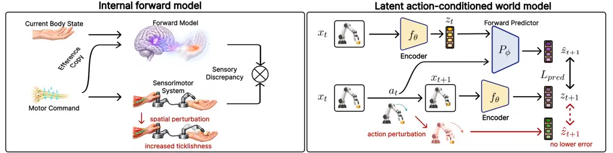

Figure 1: Structural correspondence between biological forward models
(left) and latent action-conditioned world models (right). Both use an
action signal to predict the resulting consequence and use the
discrepancy between predicted and observed outcomes to update the
internal model.

This connection motivates us to investigate the relationship between
action and forward prediction in latent world models. The self-tickling
experiment offers a particularly revealing example. Blakemore et al.
(1999) examined the action-sensation matching using a two robot
apparatus which the participants moved one robot with one hand while a
second robot delivered tactile stimulation to the other hand. The
experiments show that when introducing a temporal delay between the
movement and its tactile consequence or perturbing the spatial
corresponding between their trajectories, the ticklishness increase
progressively.

This perturbation based experimental logic inspires a direct probe of
learned action comparisons. We keep the current state and the observed
future fixed, perturbing the conditioning action and examine how the
prediction error changes. Executing the corresponding actions then
allows us to relate these model preferences to physical outcomes.

(a)

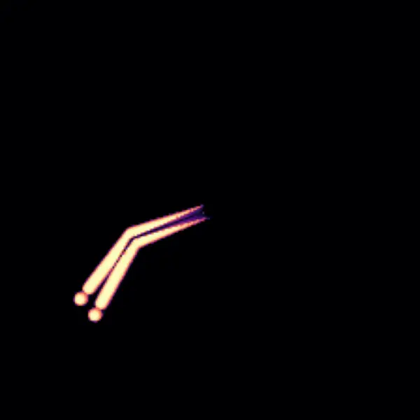

(b)

Figure 2: (a) Local action-loss landscape for a fixed Reacher
transition. The landscape is a two-dimensional slice of the
10-dimensional five-step action space. (b) Absolute pixel-wise
difference between the MuJoCo renders obtained by executing the two
action sequences for five steps from the same recorded initial simulator
state.

As illustrated in Fig. 2, for a fixed transition, we visualize the
action-loss landscape using the trained predictor and search an
alternative counterfactual action with lower prediction error. The
resulting action attains a substantially lower prediction error than the
factual action. However, executing the two actions from the same initial
state produces visibly different physical outcomes. We make the same
observations in more thorough experiments across four environments as
shown in Appendix B.

These results expose a mismatch between the actions favored by the
learned predictor and those that achieve the desired physical outcome.
When the recorded future is treated as the goal, a nearby alternative
can receive a lower prediction error than the factual action yet lead to
a larger physical goal error. Thus, minimizing the learned prediction
error can favor actions that move the system farther from the goal,
which is a specific manifestation of the prediction-planning gap. This
lower error under a mismatched action runs counter to the intuition
drawn from the self-tickling experiments, where disrupting
action–consequence correspondence makes sensory feedback less
predictable. The contrast motivates a training principle that encourages
the predictor to preserve this correspondence when comparing nearby
actions, beyond fitting factual transitions alone.

## 4 Action–Consequence Alignment

We introduce the computational principle, Action–Consequence Alignment
(ACA), which is used as a training objective to mitigate the
prediction–planning mismatch for reliable planning.

### 4.1 Factual–Counterfactual Prediction Comparison

Consider an observed transition
$`\tau=(x_{t},a_{t},x_{t+1})\sim\mathcal{D}`$. Keeping the current
latent state $`z_{t}`$ and observed future $`z_{t+1}`$ fixed, we define
the prediction error under a candidate action $`a`$ as

```math
E_{\phi}(a;\tau)=\left\|P_{\phi}(z_{t},a)-z_{t+1}\right\|_{2}^{2}. \tag{3}
```

ACA aggregates the prediction-error differences between factual and
searched actions within each minibatch and penalizes a positive average
advantage of the searched alternatives.Equal errors are permitted,
allowing different actions to explain the same outcome.

This comparison has an ideal-model reference. If the conditioning
variables determine the next latent state, an ideal predictor assigns
zero error to the factual action, which is consequently a minimizer.
Appendix C relates expected prediction-error differences to differences
between latent conditional means and clarifies the effect of conditional
variability on individual transitions. ACA uses these
factual–alternative comparisons as a local training surrogate motivated
by the observed prediction–planning mismatch. The following subsection
describes how we construct the alternative action efficiently.

### 4.2 Searching for Alternative Actions

Searching the full continuous action space for a challenging alternative
can be computationally expensive. We therefore adapt the local
perturbation framework of the traditional Sharpness-Aware Minimization
Foret et al. (2020); Li et al. (2024); Wang et al. (2026a) to
action-conditioned prediction. SAM searches for loss increasing
parameter perturbations within a bounded neighborhood to improve the
generalization ability of a model. We repurpose this framework for
perturbing conditioning actions. Starting from the factual action, ACA
searches for a nearby alternative that decreases the prediction error
for the same observed future. The search identifies alternatives to
which the current predictor assigns an error advantage, providing
confusable candidates for the factual–alternative comparison.

Specifically, we define an action neighborhood centered at the factual
action:

```math
\mathcal{C}_{\rho}(a_{t})=\left\{a\in\mathcal{A}:\|a-a_{t}\|_{2}\leq\rho\right\}, \tag{4}
```

where $`\rho>0`$ controls the perturbation radius. Within this
neighborhood, the local search target is

```math
a_{t}^{\star}\in\arg\min_{a\in\mathcal{C}_{\rho}(a_{t})}E_{\phi}(a;\tau). \tag{5}
```

Even within this neighborhood, accurately solving the inner problem can
be difficult because the prediction error is potentially nonconvex with
respect to the action. Repeating iterative optimization for every
training transition would also introduce substantial computational
overhead. Following the first-order inner approximation used in SAM, we
linearize the objective around the factual action and construct the
candidate using a single normalized action-gradient step.

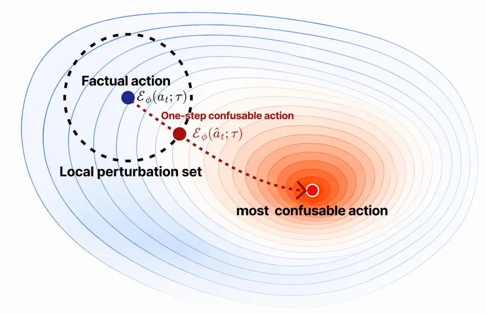

Figure 3: Illstration of the Action Consequence Alignment (ACA)
principle.

Let $`g_{t}=\left.\nabla_{a}E_{\phi}(a;\tau)\right|_{a=a_{t}}`$ denote
the action gradient. We construct the searched alternative as

```math
\hat{a}_{t}=\operatorname{sg}\left[\Pi_{\mathcal{A}}\left(a_{t}-\rho\frac{g_{t}}{\|g_{t}\|_{2}+\epsilon}\right)\right], \tag{6}
```

where $`\Pi_{\mathcal{A}}`$ projects the perturbed action onto the valid
action space and $`\epsilon>0`$ ensures numerical stability. The
stop-gradient operator prevents differentiation through the construction
of $`\hat{a}_{t}`$, avoiding second-order derivatives through $`g_{t}`$.
The prediction error $`E_{\phi}(\hat{a}_{t};\tau)`$ remains
differentiable with respect to the encoder and predictor parameters.
This approximation requires a single gradient computation with respect
to the action, without an iterative inner loop or additional environment
interaction. The resulting candidate is used in the ACA comparison
objective described next.

### 4.3 ACA Objective

Given the searched alternatives, ACA compares their prediction errors
with those of the factual actions within each minibatch. For a minibatch
$`\mathcal{B}`$, we apply a hinge penalty to the average
factual-minus-alternative prediction-error difference:

```math
\mathcal{L}_{\mathrm{ACA}}(\theta,\phi)=\mathbb{E}_{\mathcal{B}}\left[\left[\frac{1}{|\mathcal{B}|}\sum_{\tau\in\mathcal{B}}\left(E_{\phi}(a_{t};\tau)-E_{\phi}(\hat{a}_{t};\tau)\right)\right]_{+}\right]. \tag{7}
```

The minibatch penalty is positive when the searched alternatives have a
lower average prediction error than the factual actions. We combine this
term with the forward-prediction and anti-collapse objectives:

```math
\mathcal{L}(\theta,\phi)=\mathcal{L}_{\mathrm{pred}}(\theta,\phi)+\lambda_{\mathrm{anti}}\mathcal{L}_{\mathrm{anti}}+\lambda_{\mathrm{ACA}}\mathcal{L}_{\mathrm{ACA}}(\theta,\phi). \tag{8}
```

The complete training procedure is summarized in Appendix A.

The joint objective supervises both factual predictions and local
relative errors. Forward prediction fits the observed consequence under
the recorded action, while ACA penalizes a positive minibatch-averaged
error advantage of the searched alternatives. In this way, the same
transition provides both a prediction target and a reference for action
comparison. The resulting objective mitigates the prediction–planning
gap by improving the usefulness of the learned predictor for
goal-directed action selection.

|              |                   |                   |                   |                   |                   |                   |
| ------------ | ----------------- | ----------------- | ----------------- | ----------------- | ----------------- | ----------------- |
| Method       | TwoRoom           | TwoRoom\*         | Reacher           | Push-T            | OGBench- Cube     | OGBench- Cube\*   |
| Random       | 30.0              | 2.2               | 14.0              | 3.0               | 43.0              | 5.4               |
| Forward-only | 37.0              | 2.0               | 11.0              | 2.0               | 44.0              | 4.4               |
| LeWM         | 94.0              | 73.8              | 67.0              | 81.0              | 59.0              | 30.8              |
| SMWM         | 97.8              | 82.0              | 66.0              | 81.4              | 82.2              | 66.2              |
| LeWM+ACA     | $`\mathbf{94.2}`$ | $`\mathbf{79.4}`$ | $`\mathbf{72.0}`$ | $`\mathbf{83.2}`$ | $`\mathbf{65.0}`$ | $`\mathbf{34.0}`$ |
| SMWM+ACA     | $`\mathbf{98.8}`$ | $`\mathbf{95.8}`$ | $`\mathbf{71.4}`$ | $`\mathbf{84.4}`$ | $`\mathbf{85.6}`$ | $`\mathbf{72.4}`$ |

Table 1: Planning performance comparison on different environments.
Success rates (%) are reported as mean. The standard deviation is
provided in Table 7.

## 5 Reliable Planning

### 5.1 Experiment Setup

Environments and datasets. We conduct experiment on four environments
and offline datasets: TwoRoom Sobal et al. (2026), Reacher Tassa et al.
(2018), Push-T Chi et al. (2025), and OGBench-Cube Park et al. (2025),
ranging from 2D navigation to articulated control and contact-rich
manipulation. Noting that even random policies achieve relatively high
success rates on OGBench-Cube and TwoRoom, which result in difficulties
distinguishing the control capabilities of different methods, we adopt
the Strict cube and TwoRoom protocol (OGBench-Cube\*, TwoRoom\*) in
CLEAR-LeWM Sun et al. (2026). More details of the experiment datasets
are given in Appendix D.

Architecture. We adopt the same encoder and forward-prediction
architecture following Maes et al. (2026b); Ivashkov et al. (2026). The
encoder is a ViT tiny Dosovitskiy et al. (2020); Touvron et al. (2021)
with around 5M parameters. The forward predictor $`P_{\phi}`$ is a small
transformer Vaswani et al. (2017) with the action $`a_{t}`$ injected via
AdaLN-zero Peebles and Xie (2023).

Training and planning protocol. To ensure fair comparison, we strictly
follow the training an planning protocol of Ivashkov et al. (2026). All
models are trained end-to-end using two-frame snippets and a single-step
forward-prediction target. The datasets are loaded with a frame skip of
five which the primitive actions within the skipped interval are
concatenated to form a single model-level action. Every model is trained
for 10 epochs, detailed hyper-parameters for training is shown in
Appendix E. We evaluate the learned models through goal-conditioned
trajectory optimization in the latent space. In the beginning of each
planning episode, the agent will receive a current observation $`x_{t}`$
and a goal observation $`x_{g}`$. The frozen encoder will map them to
$`z_{c}=f_{\theta}(x_{t}),z_{g}=f_{\theta}(x_{g}).`$ For each candidate
action sequence,the frozen predictor is rolled out auto-regressively
where:

```math
\hat{z}_{t+h+1}=P_{\phi}\!\left(\hat{z}_{t+h},a_{t+h}\right),\quad\hat{z}_{t}=z_{t}.
```

The candidate sequence is then evaluated using its terminal latent goal
matching cost:

```math
\mathcal{C}(a_{t:t+H-1})=\left\|\hat{z}_{t+H}-z_{g}\right\|_{2}^{2}.
```

The cost is optimized using the Cross-Entropy Method Rubinstein (1997).
All methods are evaluated with a fixed budget of 50 environment steps
per episode to reach the goal. We evaluate each fixed trained checkpoint
using five consecutive planner random seeds and report the mean success
rate with standard deviation (SD). More detailed experiment settings are
in Appendix E.

### 5.2 Planning Performance

Baseline. We compare ACA against various baselines under same experiment
settings. Random uniformly samples action from the action space without
using a learned world model; Foward-Only trains the encoder and the
predictor with only the forward-prediction objective; LEWM Maes et al.
(2026b) applies a Gaussian-matching regularization term to prevent
representation collapse; SMWM Ivashkov et al. (2026) uses an inverse
dynamic model to prevent model collapse.

Results. As shown in Table 1, ACA improves both LeWorldModel and SMWM
across the evaluated environments and protocols. The improvements over
SMWM indicate that inverse-dynamics supervision leaves room for
improving downstream action selection through the forward predictor.
Under the shared planning protocol, adding ACA yields better planning
performance, supporting the value of explicitly training
factual-counterfactual comparisons alongside factual prediction.

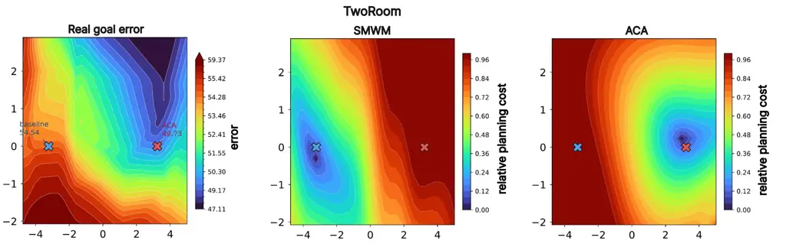

Figure 4: Visualization of planning-cost alignment on TwoRoom, more
visualization results is shown in Appendix F.

### 5.3 Planning-Cost Alignment Analysis

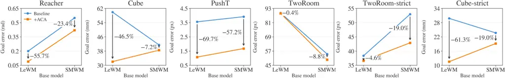

Figure 5: ACA substantially reduces the real planning error across
environments, indicating improved alignment between theplanning cost and
the actual consequences of executed actions.

The action perturbation experiment shows that lower prediction error can
favor an alternative action with a different physical consequence. We
now examine whether training with ACA improves the outcomes of actions
selected through the trained models. For the trained baseline and ACA
models, we run CEM under the same planning protocol and construct a
shared two-dimensional slice over complete action plans. The same plans
are evaluated using model-based planning costs and simulator rollouts.
Figure 4 illustrates the discrepancy between a model preference and the
physical outcome of its selected plan. The baseline favors a plan with
low model cost even though its actual outcome has a larger goal error
than the ACA-selected plan. The landscape visualization thus shows how
optimizing a learned prediction-based objective can favor a physically
inferior solution. In the illustrated example, training with ACA shifts
the model preference toward a plan that achieves a better physical
outcome.

Figure 5 extends this evaluation across environments and both base
models, showing lower real goal errors for plans selected using
ACA-trained predictors. Together with the planning success rates, these
results provide empirical support that local factual–counterfactual
comparisons help mitigate the prediction–planning gap by improving the
physical outcomes of selected plans. Additional visualizations are
provided in Appendix F.

### 5.4 Planning with limited training data

We next examine whether ACA remains useful when training experience is
limited, using only $`5\%`$ of the original training data. Restricted
state–action coverage provides a challenging setting for transferring
factual prediction learning to the candidate actions considered during
planning. This experiment evaluates whether the local comparisons
introduced by ACA improve downstream action selection under the same
limited data budget.

We train models on Reacher for 20 epochs, Cube for 10 epochs, TwoRoom
for 20 epochs and Push-T for 40 epochs to ensure convergence. We use
cosine learning-rate annealing with an initial learning rate of
$`10^{-4}`$. As shown in Figure 6, ACA outperforms LeWorldModel and SMWM
across the evaluated settings and reduces the performance difference
from their corresponding full-data baselines. These results support the
value of complementing factual prediction with action–consequence
comparisons: with the same limited training data, ACA-trained models
achieve better goal-directed planning on held-out tasks.

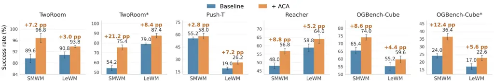

Figure 6: ACA achieves reliable planning under the limited data
settings.

### 5.5 Additional experiment

We provide hyperparameter sensitivity analysis (Appendix E), additional
planning-cost visualizations (Appendix F), single-plan and long-horizon
evaluations (Appendix G), ablations of action search and regularization
(Appendix H), and variability across planner seeds (Appendix I).

## 6 Self-Improving via the ACA principle

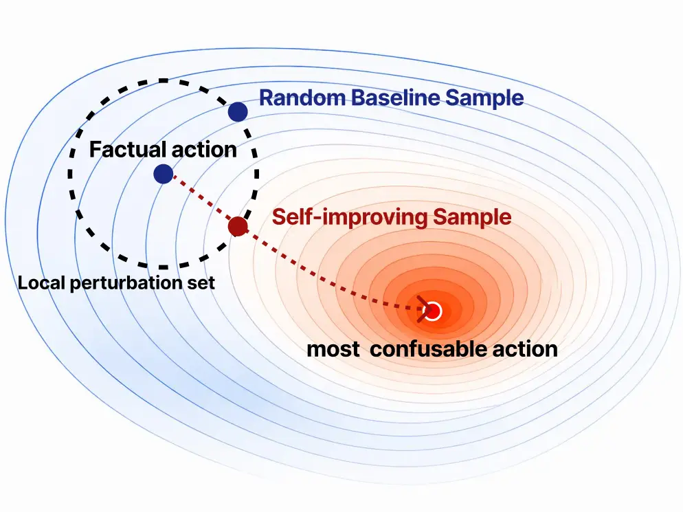

Figure 7: Overview of ACA self improving sampling method and random
sampling baseline.

Identifying potential model failures can guide targeted data collection
during training and support iterative self-improvement Liu et al.
(2026). The ACA principle provides such a signal by identifying nearby
actions through searching for nearby alternatives with lower prediction
error against a recorded future. We then execute these counterfactual
actions from the corresponding simulator states, collect their actual
outcomes, and augment the dataset for further training. This creates a
self-improvement loop in which the local action preferences of the model
guide the acquisition of additional experience.

We evaluate this procedure, starting from a model pretrained on $`5\%`$
of the original training data on Reacher and Cube datasets. We compare
two sampling strategies using exactly the same reference-transition
indices: the random baseline reuses the indices selected for
self-improving sampling strategy. For each shared transition
$`\tau=(x_{t},a_{t},x_{t+1})`$, Self-improving sampling strategy follows
the normalized negative gradient of the prediction error:

```math
a_{t}^{\mathrm{Self}}=\Pi_{\mathcal{A}}\left(a_{t}-\rho\frac{g_{t}}{\|g_{t}\|_{2}+\epsilon}\right),\quad g_{t}=\left.\nabla_{a}E_{\phi}(a;\tau)\right|_{a=a_{t}}. \tag{9}
```

The random baseline instead perturbs the same factual action along a
random unit direction $`u_{t}`$, using the same perturbation scale and
action-space projection:

```math
a_{t}^{\mathrm{Random}}=\Pi_{\mathcal{A}}\left(a_{t}+\rho u_{t}\right),\quad\|u_{t}\|_{2}=1, \tag{10}
```

where $`u_{t}`$ is sampled without using the prediction-error gradient.
For both strategies, the selected action is executed from the same
reference simulator state, and its actual resulting observation is
collected to construct a new training transition. For all models and
datasets, we use a constant learning rate of $`10^{-4}`$. Both base
models are trained for 25 epochs on Reacher and 30 epochs on
OGBench-Cube to ensure convergence. For both sampling strategies,
additional transitions are collected at epochs 5 and 10, with each
sampling round containing a number of samples equal to 10% of the
initial training subset. To ensure a fair comparison, the two strategies
use exactly the same indices of initial simulator states and differ only
in the perturbation directions applied to the corresponding factual
actions.

As shown in Fig. 8, ACA-guided sampling consistently achieves higher
planning performance than random local sampling, and also surpasses the
reference model trained without additional data. Because both sampling
strategies use the same initial-state indices, sampling budgets, and
perturbation scale, their difference isolates the effect of the selected
perturbation direction. These results suggest that executing
alternatives favored by the current predictor can provide useful
additional action–consequence supervision. Under the evaluated sampling
protocol, this directed collection improves subsequent planning more
than random local perturbations.

## 7 Related work

Latent world models  World models learn compact dynamics for prediction
and control. Early work studied control through learned representations
Ha and Schmidhuber (2018), latent-space planning Hafner et al. (2019b),
and imagined trajectories Hafner et al. (2019a). Predictive
representation learning further reduces reliance on reconstruction: CPC
Oord et al. (2018) uses contrastive future prediction, while I-JEPA
Assran et al. (2023) and V-JEPA Bardes et al. (2024) predict target
embeddings directly. DINO-WM Zhou et al. (2024), V-JEPA 2 Assran et al.
(2025), and PLDM Sobal et al. (2026) extend latent prediction to
planning and control. For end-to-end learning, VICReg Bardes et al.
(2021) and LeJEPA Balestriero and LeCun (2025) introduce anti-collapse
regularization, while LeWorldModel combines such regularization with
latent dynamics learning from pixels Maes et al. (2026b). Garrido et
al. Garrido et al. (2026) learn continuous latent actions from
in-the-wild videos and connect known controls to the learned action
space for planning. CoLA-World Wang et al. (2025) enables joint learning
of latent action and world models through a representation warm-up that
mitigates collapse. DiLA Zhang et al. (2026a) separates
dynamics-relevant structure from visual content and models
latent-action-conditioned transitions in structure space. CLAW Ayalew et
al. (2026) jointly learns continuous latent actions and a world model
from action-free videos using adversarial latent regularization.

Action–consequence dependence  Internal forward models predict sensory
consequences from motor commands and states Wolpert et al. (1995); Miall
and Wolpert (1996), while self-produced touch experiments highlight
movement–sensation correspondence Blakemore et al. (1999). Forward and
inverse dynamics have also been used for representation learning Agrawal
et al. (2016); Pathak et al. (2017). Recent latent world models
strengthen action dependence through inverse dynamics in SMWM Ivashkov
et al. (2026), latent difference decoding in Delta-JEPA Zhang et al.
(2026c), action-conditioned consistency in CoCo Shi et al. (2026),
action-dependent decomposition in Dueling World Models Li et al. (2026),
and inverse-dynamics-aware planning costs in ACID Seo et al. (2026).
Related theory studies identifiability through conditional action
variation Zhang et al. (2026b). Wang et al. Wang et al. (2026b) train a
latent compatibility predictor using counterfactual action sequences for
goal-directed navigation.

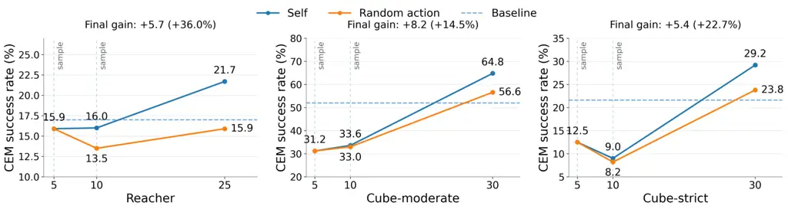

Figure 8: ACA sampling enables better self-improved performance than
random sampling.

## 8 Conclusion

We studied the prediction–planning gap in latent world models through
the action preferences induced by their forward predictors. We showed
that alternative actions can receive lower prediction errors than the
factual action while producing outcomes farther from the target,
indicating that accurate prediction alone does not guarantee reliable
planning. To address this, we introduced Action–Consequence Alignment
(ACA), which explicitly trains local action comparisons using factual
transitions as references. ACA improves planning performance, reduces
real goal error, and remains effective with limited data. The same
inconsistency signal can further guide self-improving data collection,
enabling the model to acquire more informative experience than random
local sampling. Together, these results establish action–consequence
alignment as a practical principle for both reliable planning and
self-improvement.

## References

- \[1\] D. Ha and J. Schmidhuber (2018) World models. arXiv preprint
  arXiv:1803.10122 2 (3), pp. 440. Cited by: §1, §3.2, §7.
- \[2\] Y. LeCun et al. (2022) A path towards autonomous machine
  intelligence version 0.9. 2, 2022-06-27. Open Review 62 (1), pp. 1–62.
  Cited by: §1, §3.2.
- \[3\] M. Assran, A. Bardes, D. Fan, Q. Garrido, R. Howes, M.
  Muckley, A. Rizvi, C. Roberts, K. Sinha, A. Zholus, et al. (2025)
  V-jepa 2: self-supervised video models enable understanding,
  prediction and planning. arXiv preprint arXiv:2506.09985. Cited by:
  §1, §7.
- \[4\] L. Maes, Q. L. Lidec, D. Scieur, Y. LeCun, and R.
  Balestriero (2026) Leworldmodel: stable end-to-end joint-embedding
  predictive architecture from pixels. arXiv preprint arXiv:2603.19312.
  Cited by: Appendix D, §E.1, §E.3, §1, §2, §2, §5.1, §5.2, §7.
- \[5\] X. Zhang, Y. Guan, B. Zhang, Y. Zhang, and S. E. Li (2026) On
  the identifiability of controlled world models. arXiv preprint
  arXiv:2607.22430. Cited by: §1, §7.
- \[6\] J. Li, Y. Fei, Z. Zhou, and H. Hayashi (2026) Dueling world
  models: advantage-style action channels for common-mode distractor
  rejection. arXiv preprint arXiv:2608.06706. Cited by: §1, §1, §7.
- \[7\] Y. Shi, Z. Chu, J. Wei, J. Hao, J. Liu, and J. Fu (2026)
  Overcoming statistical bias in action-controllable world models. arXiv
  preprint arXiv:2608.04653. Cited by: §1, §1, §3.1, §7.
- \[8\] A. Bardes, J. Ponce, and Y. LeCun (2021) Vicreg:
  variance-invariance-covariance regularization for self-supervised
  learning. arXiv preprint arXiv:2105.04906. Cited by: §1, §7.
- \[9\] L. Maes, Q. L. Lidec, D. Haramati, N. Massaudi, D. Scieur, Y.
  LeCun, and R. Balestriero (2026) Stable-worldmodel-v1: reproducible
  world modeling research and evaluation. arXiv preprint
  arXiv:2602.08968. Cited by: Appendix D, §1.
- \[10\] P. Ivashkov, R. Balestriero, and B. Schölkopf (2026)
  Sensorimotor world models: perception for action via inverse dynamics.
  arXiv preprint arXiv:2606.20104. Cited by: Appendix D, §E.1, §E.3, §1,
  §2, §2, §5.1, §5.1, §5.2, §7.
- \[11\] Z. Zhang, Y. Wang, Z. Guan, Y. Yang, B. Shi, T. Zong, H. Yi, G.
  Chao, X. Chen, T. Yang, et al. (2026) Delta-jepa: learning
  action-sensitive world models via latent difference decoding. arXiv
  preprint arXiv:2606.31232. Cited by: §1, §7.
- \[12\] R. Balestriero and Y. LeCun (2025) Lejepa: provable and
  scalable self-supervised learning without the heuristics. arXiv
  preprint arXiv:2511.08544. Cited by: §1, §7.
- \[13\] G. Seo, D. Kim, and S. Kwak (2026) ACID: action consistency via
  inverse dynamics for planning with world models. arXiv preprint
  arXiv:2607.02403. Cited by: §1, §3.1, §7.
- \[14\] R. C. Miall and D. M. Wolpert (1996) Forward models for
  physiological motor control. Neural networks 9 (8), pp. 1265–1279.
  Cited by: §1, §3.2, §7.
- \[15\] D. M. Wolpert, Z. Ghahramani, and M. I. Jordan (1995) An
  internal model for sensorimotor integration. Science 269 (5232),
  pp. 1880–1882. Cited by: §1, §3.2, §7.
- \[16\] S. Blakemore, C. D. Frith, and D. M. Wolpert (1999)
  Spatio-temporal prediction modulates the perception of self-produced
  stimuli. Journal of cognitive neuroscience 11 (5), pp. 551–559. Cited
  by: §1, §3.2, §7.
- \[17\] P. Foret, A. Kleiner, H. Mobahi, and B. Neyshabur (2020)
  Sharpness-aware minimization for efficiently improving generalization.
  arXiv preprint arXiv:2010.01412. Cited by: Appendix J, §1, §4.2.
- \[18\] H. Liu, Y. Zhang, V. Betala, E. Zhang, J. Liu, C. Ding, and Y.
  Zhu (2024) Multi-task interactive robot fleet learning with visual
  world models. arXiv preprint arXiv:2410.22689. Cited by: §3.1.
- \[19\] X. Gu, Y. Wang, X. Zhu, C. Shi, Y. Guo, Y. Liu, and J.
  Chen (2024) Advancing humanoid locomotion: mastering challenging
  terrains with denoising world model learning. arXiv preprint
  arXiv:2408.14472. Cited by: §3.1.
- \[20\] A. Bubic, D. Y. Von Cramon, and R. I. Schubotz (2010)
  Prediction, cognition and the brain. Frontiers in human neuroscience
  4, pp. 1094. Cited by: §3.2.
- \[21\] T. Taniguchi, S. Murata, M. Suzuki, D. Ognibene, P.
  Lanillos, E. Ugur, L. Jamone, T. Nakamura, A. Ciria, B. Lara, et
  al. (2023) World models and predictive coding for cognitive and
  developmental robotics: frontiers and challenges. Advanced Robotics 37
  (13), pp. 780–806. Cited by: §3.2.
- \[22\] R. P. Rao (2024) A sensory–motor theory of the neocortex.
  Nature neuroscience 27 (7), pp. 1221–1235. Cited by: §3.2.
- \[23\] T. Li, P. Zhou, Z. He, X. Cheng, and X. Huang (2024) Friendly
  sharpness-aware minimization. In 2024 IEEE/CVF Conference on Computer
  Vision and Pattern Recognition (CVPR), pp. 5631–5640. Cited by: §4.2.
- \[24\] J. Wang, Q. Liu, Z. Xie, and Z. Gao (2026) Fix the loss, not
  the radius: rethinking the adversarial perturbation of sharpness-aware
  minimization. arXiv preprint arXiv:2605.10183. Cited by: §4.2.
- \[25\] U. Sobal, W. Zhang, K. Cho, R. Balestriero, T. G. Rudner,
  and Y. LeCun (2026) Learning from reward-free offline data: a case for
  planning with latent dynamics models. Advances in Neural Information
  Processing Systems 38, pp. 43905–43941. Cited by: Appendix D, §5.1,
  §7.
- \[26\] Y. Tassa, Y. Doron, A. Muldal, T. Erez, Y. Li, D. d. L.
  Casas, D. Budden, A. Abdolmaleki, J. Merel, A. Lefrancq, et al. (2018)
  Deepmind control suite. arXiv preprint arXiv:1801.00690. Cited by:
  Appendix D, §5.1.
- \[27\] C. Chi, Z. Xu, S. Feng, E. Cousineau, Y. Du, B. Burchfiel, R.
  Tedrake, and S. Song (2025) Diffusion policy: visuomotor policy
  learning via action diffusion. The International Journal of Robotics
  Research 44 (10-11), pp. 1684–1704. Cited by: Appendix D, §5.1.
- \[28\] S. Park, K. Frans, B. Eysenbach, and S. Levine (2025) Ogbench:
  benchmarking offline goal-conditioned rl. In International Conference
  on Learning Representations, Vol. 2025, pp. 94937–94982. Cited by:
  Appendix D, §5.1.
- \[29\] J. Sun, H. Zhao, and G. Zhang (2026) INTACT: isomorphic
  intent-to-action learning for search-free world models. External
  Links: 2607.26056, [Link](https://arxiv.org/abs/2607.26056) Cited by:
  §5.1.
- \[30\] A. Dosovitskiy, L. Beyer, A. Kolesnikov, D. Weissenborn, X.
  Zhai, T. Unterthiner, M. Dehghani, M. Minderer, G. Heigold, S. Gelly,
  et al. (2020) An image is worth 16x16 words: transformers for image
  recognition at scale. arXiv preprint arXiv:2010.11929. Cited by: §5.1.
- \[31\] H. Touvron, M. Cord, M. Douze, F. Massa, A. Sablayrolles,
  and H. Jégou (2021) Training data-efficient image transformers &
  distillation through attention. In International conference on machine
  learning, pp. 10347–10357. Cited by: §5.1.
- \[32\] A. Vaswani, N. Shazeer, N. Parmar, J. Uszkoreit, L.
  Jones, A. N. Gomez, Ł. Kaiser, and I. Polosukhin (2017) Attention is
  all you need. Advances in neural information processing systems 30.
  Cited by: §5.1.
- \[33\] W. Peebles and S. Xie (2023) Scalable diffusion models with
  transformers. In 2023 IEEE/CVF International Conference on Computer
  Vision (ICCV), pp. 4172–4182. Cited by: §5.1.
- \[34\] R. Y. Rubinstein (1997) Optimization of computer simulation
  models with rare events. European Journal of Operational Research 99
  (1), pp. 89–112. Cited by: §5.1.
- \[35\] Y. Liu, F. Feng, L. Kong, W. Lu, J. Tang, K. Zhang, K.
  Murphy, C. Finn, and Y. Du (2026) World action verifier:
  self-improving world models via forward-inverse asymmetry. arXiv
  preprint arXiv:2604.01985. Cited by: §6.
- \[36\] D. Hafner, T. Lillicrap, I. Fischer, R. Villegas, D. Ha, H.
  Lee, and J. Davidson (2019) Learning latent dynamics for planning from
  pixels. In International conference on machine learning,
  pp. 2555–2565. Cited by: §7.
- \[37\] D. Hafner, T. Lillicrap, J. Ba, and M. Norouzi (2019) Dream to
  control: learning behaviors by latent imagination. arXiv preprint
  arXiv:1912.01603. Cited by: §7.
- \[38\] A. v. d. Oord, Y. Li, and O. Vinyals (2018) Representation
  learning with contrastive predictive coding. arXiv preprint
  arXiv:1807.03748. Cited by: §7.
- \[39\] M. Assran, Q. Duval, I. Misra, P. Bojanowski, P. Vincent, M.
  Rabbat, Y. LeCun, and N. Ballas (2023) Self-supervised learning from
  images with a joint-embedding predictive architecture. In 2023
  IEEE/CVF Conference on Computer Vision and Pattern Recognition (CVPR),
  pp. 15619–15629. Cited by: §7.
- \[40\] A. Bardes, Q. Garrido, J. Ponce, X. Chen, M. Rabbat, Y.
  LeCun, M. Assran, and N. Ballas (2024) Revisiting feature prediction
  for learning visual representations from video. arXiv preprint
  arXiv:2404.08471. Cited by: §7.
- \[41\] G. Zhou, H. Pan, Y. LeCun, and L. Pinto (2024) Dino-wm: world
  models on pre-trained visual features enable zero-shot planning. arXiv
  preprint arXiv:2411.04983. Cited by: Appendix D, §7.
- \[42\] Q. Garrido, T. Nagarajan, B. Terver, N. Ballas, Y. LeCun,
  and M. Rabbat (2026) Learning latent action world models in the wild.
  In Forty-third International Conference on Machine Learning, Cited by:
  §7.
- \[43\] Y. Wang, F. Zhang, D. Zhan, L. Zhao, K. Wang, and J.
  Bian (2025) Co-evolving latent action world models. arXiv preprint
  arXiv:2510.26433. Cited by: §7.
- \[44\] T. Zhang, M. Lyu, Y. Zhang, F. Fang, and S. Wu (2026) DiLA:
  disentangled latent action world models. arXiv preprint
  arXiv:2605.15725. Cited by: §7.
- \[45\] T. Ayalew, M. Jeung, S. Wheeler, X. Zhang, A. d. l. C. Arce, K.
  Stocking, M. Maire, and M. R. Walter (2026) CLAW: learning continuous
  latent action world models via adversarial latent regularization.
  arXiv preprint arXiv:2606.04130. Cited by: §7.
- \[46\] P. Agrawal, A. V. Nair, P. Abbeel, J. Malik, and S.
  Levine (2016) Learning to poke by poking: experiential learning of
  intuitive physics. Advances in neural information processing systems 29. Cited by: §7.
- \[47\] D. Pathak, P. Agrawal, A. A. Efros, and T. Darrell (2017)
  Curiosity-driven exploration by self-supervised prediction. In
  International conference on machine learning, pp. 2778–2787. Cited by:
  §7.
- \[48\] Z. Wang, W. Gao, and S. Shen (2026) Predicting consequences and
  reinforcing navigation policies with latent world models. In European
  Conference on Computer Vision, pp. 280–296. Cited by: §7.
- \[49\] V. Sobal, W. Zhang, K. Cho, R. Balestriero, T. G. Rudner,
  and Y. LeCun (2025) Stress-testing offline reward-free reinforcement
  learning: a case for planning with latent dynamics models. In 7th
  Robot Learning Workshop: Towards Robots with Human-Level Abilities,
  Cited by: Appendix D.
- \[50\] T. Haarnoja, A. Zhou, P. Abbeel, and S. Levine (2018) Soft
  actor-critic: off-policy maximum entropy deep reinforcement learning
  with a stochastic actor. In International conference on machine
  learning, pp. 1861–1870. Cited by: Appendix D.

## Appendix Contents

A  Algorithm.A

B  Local Action Comparisons and Their Physical Consequences.B

C  Theoretical Reference for Action Comparisons.C

D  Datasets.D

E  Experiment Details.E

E.1   Architecture.E.1

E.2   Training and Planning Details.E.2

E.3   Hyper-parameter Selections and Sensitive Analysis for ACA.E.3

F  Extra Visualization Results.F

G  Performance Under Additional Planning Settings.G

H  Ablation of Action Search and Regularization.H

I  Variability Across Planner Seeds.I

J  Discussion.J

K  Scope and Limitation.K

## Appendix A Algorithm

1: Dataset $`\mathcal{D}`$, encoder $`f_{\theta}`$, predictor
$`P_{\phi}`$, perturbation radius $`\rho`$, coefficients
$`\lambda_{\mathrm{anti}},\lambda_{\mathrm{ACA}}`$, stabilizer
$`\epsilon`$

2: for each minibatch $`\mathcal{B}\sim\mathcal{D}`$ do

3:   Encode observations for each
$`\tau=(x_{t},a_{t},x_{t+1})\in\mathcal{B}`$:
$`z_{t}=f_{\theta}(x_{t})`$, $`z_{t+1}=f_{\theta}(x_{t+1})`$

4:   Define prediction error:
$`E_{\phi}(a;\tau)=\|P_{\phi}(z_{t},a)-z_{t+1}\|_{2}^{2}`$

5:   Compute action gradient:
$`g_{t}=\left.\nabla_{a}E_{\phi}(a;\tau)\right|_{a=a_{t}}`$

6:   Estimate the most confusable action:
$`\hat{a}_{t}=\operatorname{sg}\!\left[\Pi_{\mathcal{A}}\!\left(a_{t}-\rho\frac{g_{t}}{\|g_{t}\|_{2}+\epsilon}\right)\right]`$

7:   Compute ACA loss:
$`\mathcal{L}_{\mathrm{ACA}}=\left[\frac{1}{|\mathcal{B}|}\sum_{\tau\in\mathcal{B}}\left(E_{\phi}(a_{t};\tau)-E_{\phi}(\hat{a}_{t};\tau)\right)\right]_{+}`$

8:   Compute total objective:
$`\mathcal{L}=\mathcal{L}_{\mathrm{pred}}+\lambda_{\mathrm{anti}}\mathcal{L}_{\mathrm{anti}}+\lambda_{\mathrm{ACA}}\mathcal{L}_{\mathrm{ACA}}`$

9:   Update model parameters by minimizing $`\mathcal{L}`$

10: end for

Algorithm 1 Action–Consequence Alignment (ACA)

## Appendix B Local Action Comparisons and Their Physical Consequences

We examine the local manifestation of the prediction–planning gap
through two complementary evaluations. In this section, we measure how
frequently a locally searched action receives lower prediction error
than the factual action. we then execute lower-error alternatives and
measure how far their outcomes deviate from the corresponding factual
outcomes. Together, these evaluations connect the predictor relative
action preferences with physical attainment of the factual target.

#### Lower-error alternatives.

We evaluate frozen trained baseline world models, SMWM and LeWM, on
$`N=10000`$ valid one-step transitions sampled uniformly from the
training data of each environment. For a transition
$`\tau=(x_{t},a_{t},x_{t+1})`$, we encode the observations as
$`z_{t}=f_{\theta}(x_{t})`$ and $`z_{t+1}=f_{\theta}(x_{t+1})`$, keep
both representations fixed, and the transition-wise prediction error can
be defined as

```math
E_{\phi}(a;\tau)=\left\|P_{\phi}(z_{t},a)-z_{t+1}\right\|_{2}^{2}. \tag{11}
```

Starting from the factual action, we construct an alternative using one
normalized gradient-descent step:

```math
a_{\mathrm{cf}}^{(\rho)}=\Pi_{\mathcal{A}}\left(a_{t}-\rho\frac{\left.\nabla_{a}E_{\phi}(a;\tau)\right|_{a=a_{t}}}{\left\|\left.\nabla_{a}E_{\phi}(a;\tau)\right|_{a=a_{t}}\right\|_{2}}\right),\qquad\rho\in\{0.05,0.10,0.25\}, \tag{12}
```

where $`\Pi_{\mathcal{A}}`$ enforces the action bounds. The radius
$`\rho`$ specifies the nominal step length; projection can reduce the
actual displacement. For each radius, the candidate is constructed
independently from the factual action, rather than through successive
updates.

A searched alternative receives lower prediction error when

```math
E_{\phi}\!\left(a_{\mathrm{cf}}^{(\rho)};\tau\right)<E_{\phi}(a_{t};\tau). \tag{13}
```

We report the frequency of lower error alternatives:

```math
\widehat{p}_{\mathrm{lower}}(\rho)=\frac{1}{N}\sum_{i=1}^{N}\mathbf{1}\left[E_{\phi}\!\left(a_{\mathrm{cf},i}^{(\rho)};\tau_{i}\right)<E_{\phi}(a_{i};\tau_{i})\right]. \tag{14}
```

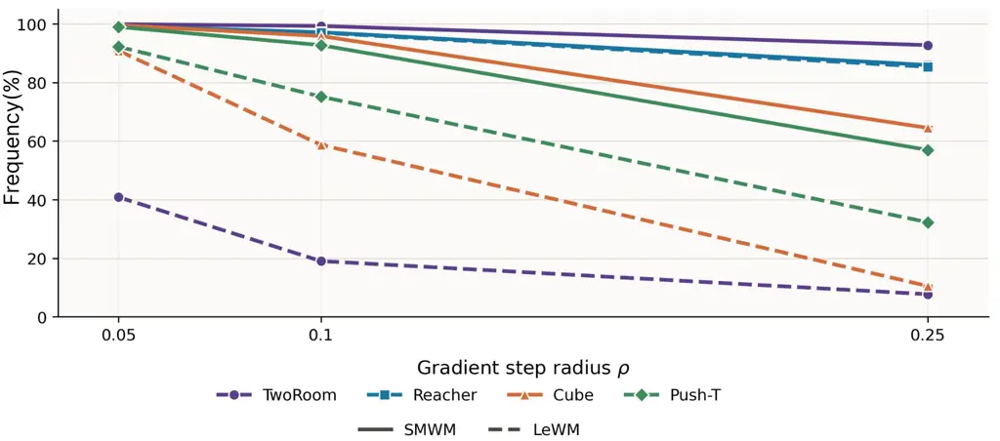

Figure 9: Frequency of lower-error alternatives. Frozen SMWM and LeWM
models are evaluated on 10,000 transitions per environment. At each
nominal perturbation radius, an alternative action is constructed using
one normalized gradient-descent step from the factual action. The
plotted frequency measures the fraction of transitions for which this
alternative receives lower prediction error against the same observed
future.

Figure 9 shows that lower-error alternatives remain detectable as the
nominal perturbation radius increases from $`0.05`$ to $`0.25`$.
Although these frequencies generally decrease with increasing radius,
substantial rates persist in several model-environment settings at the
largest tested radius. Thus, the observed lower-error alternatives are
not confined to the smallest tested step length. These statistics
characterize the action preferences of the predictor;

#### Physical outcomes of lower-error alternatives.

We extend the controlled execution example in the main text to TwoRoom,
Reacher, OGBench-Cube, and Push-T, using the same trained frozen
baseline models discussed in this section. For each model, environment,
and perturbation radius, we evaluate 1000 transitions whose searched
alternatives satisfy Equation 13. For each evaluated transition, we
restore the corresponding complete simulator state $`s_{t}`$ and execute
the alternative action over the same action horizon as the factual
transition.

Let $`T(s_{t},a)`$ denote the simulator state reached after executing
action $`a`$ over this horizon, and let $`s_{t+1}`$ denote the recorded
factual outcome. We measure the physical outcome deviation as

```math
D_{\mathrm{phys}}(a;\tau)=d_{\mathrm{env}}\left(T(s_{t},a),\,s_{t+1}\right), \tag{15}
```

where $`d_{\mathrm{env}}`$ is an environment-specific distance computed
from simulator state variables. The reported distances are expressed in
pixels for TwoRoom and Push-T, radians for Reacher, and millimeters for
OGBench-Cube. They are computed independently of the learned latent
representations.

For each model and environment, let $`\mathcal{V}_{\rho}`$ index the
evaluated transitions with lower-error alternatives at radius $`\rho`$.
The plotted mean is

```math
\overline{D}_{\mathrm{phys}}(\rho)=\frac{1}{|\mathcal{V}_{\rho}|}\sum_{i\in\mathcal{V}_{\rho}}D_{\mathrm{phys}}\left(a_{\mathrm{cf},i}^{(\rho)};\tau_{i}\right). \tag{16}
```

This quantity measures the magnitude of outcome deviation among the
evaluated lower-error alternatives, complementing the frequency of
lower-error alternatives in Equation 14.

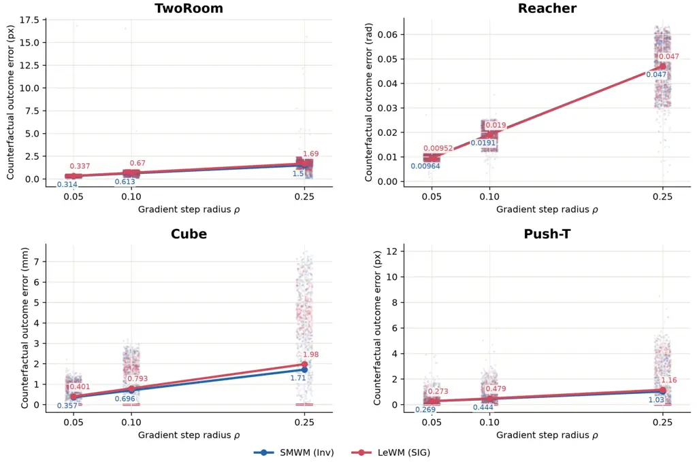

Figure 10: Physical outcome deviations of lower-error counterfactual
actions. We execute searched alternatives that receive lower prediction
error than the factual actions, starting from the corresponding recorded
simulator states. Each model–radius setting contains 1,000 evaluated
transitions. Translucent dots show individual outcome deviations from
the factual targets, and solid lines connect their means. Blue and red
denote SMWM and LeWM, respectively. Outcome deviations are measured
using environment-specific simulator state distances, with units
indicated on the axes. The alternatives receive lower model errors
despite producing nonzero mean deviations from the factual outcomes.

Figure 10 shows nonzero mean outcome deviations across all evaluated
environments, models, and perturbation radius. The mean deviations
increase at larger tested radius, while the individual transitions
exhibit heterogeneous responses. These measurements show that
alternatives favored by the predictor can produce outcomes that depart
from the factual target across multiple environments. The relevant
discrepancy is the coexistence of lower prediction error and physical
outcome deviation: the predictor assigns a better score or cost to an
alternative that does not reproduce the observed consequence.

#### Implications for action selection.

The recorded future also defines a goal against which candidate actions
can be compared. When replaying the factual action from $`s_{t}`$
reproduces the recorded transition, $`D_{\mathrm{phys}}(a_{t};\tau)=0`$.
A lower-error alternative with positive physical deviation then
satisfies

```math
E_{\phi}\!\left(a_{\mathrm{cf}}^{(\rho)};\tau\right)<E_{\phi}(a_{t};\tau),\qquad D_{\mathrm{phys}}\left(a_{\mathrm{cf}}^{(\rho)};\tau\right)>D_{\mathrm{phys}}(a_{t};\tau). \tag{17}
```

These inequalities describe a disagreement between the model’s action
preference and actual attainment of the factual target. While local
descent induced by prediction residuals offers a possible explanation
for lower-error alternatives under small perturbations, Figure 9 shows
that these alternatives persist as the nominal perturbation radius
increases from 0.05 to 0.25, with substantial frequencies in several
model–environment settings even at the largest tested radius. Figure 10
further shows that their mean physical outcome deviations increase with
the tested radius. Thus, the observed mismatch is not confined to the
smallest tested perturbation. Even when such preferences originate from
prediction residuals, assigning a lower model error to an action that
achieves the target less accurately can misdirect action selection,
constituting a concrete manifestation of the prediction–planning gap.

## Appendix C Theoretical Reference for Action Comparisons

For latent action conditioned world model, action selection depends on
how prediction error varies across candidate actions. This section
characterizes that dependence for an ideal squared-error predictor and
examines how conditional variability affects transition-level
comparisons, providing a theoretical reference for the local training
objective used by ACA.

#### Setup.

Fix the encoder $`f_{\theta}`$ and a current latent state $`z_{t}`$. For
each action under consideration, we assume that the conditional
distribution $`p(Z^{+}\mid z_{t},a)`$ is well-defined and has a finite
second moment. We then define its conditional mean and the corresponding
ideal predictor as

```math
\mu(z_{t},a)=\mathbb{E}[Z^{+}\mid z_{t},a],\qquad P^{\star}(z_{t},a)=\mu(z_{t},a).
```

For a factual action $`a_{t}`$, evaluate every candidate action against
the same factual future distribution:

```math
\overline{E}^{\star}(a;z_{t},a_{t})=\mathbb{E}_{Z^{+}\sim p(\cdot\mid z_{t},a_{t})}\left[\|P^{\star}(z_{t},a)-Z^{+}\|_{2}^{2}\right].
```

In this definition, the candidate action is fixed while the factual
future is averaged over.

###### Theorem 1 (Expected prediction-error decomposition).

Under the above assumptions, every candidate action $`a`$ satisfies

```math
\overline{E}^{\star}(a;z_{t},a_{t})-\overline{E}^{\star}(a_{t};z_{t},a_{t})=\|\mu(z_{t},a)-\mu(z_{t},a_{t})\|_{2}^{2}\geq 0.
```

Consequently, the factual action is a minimizer of the expected
prediction error. Equality holds if and only if the two actions have the
same conditional mean in the latent representation.

###### Proof.

Write

```math
Z^{+}=\mu(z_{t},a_{t})+\xi,\qquad\mathbb{E}[\xi\mid z_{t},a_{t}]=0,
```

and let $`\Delta(a)=\mu(z_{t},a)-\mu(z_{t},a_{t})`$. Expanding the
squared error gives

```math
\displaystyle\overline{E}^{\star}(a;z_{t},a_{t}) \displaystyle=\mathbb{E}\left[\|\Delta(a)-\xi\|_{2}^{2}\mid z_{t},a_{t}\right]
```

```math
\displaystyle=\|\Delta(a)\|_{2}^{2}+\mathbb{E}\left[\|\xi\|_{2}^{2}\mid z_{t},a_{t}\right].
```

The second term equals $`\overline{E}^{\star}(a_{t};z_{t},a_{t})`$,
which proves the result. ∎

#### Equivalent actions and non-unique minima.

The ideal expected error can have multiple minimizing actions. Action
redundancy, actuator saturation, and non-injective dynamics are
compatible with the result: actions with the same conditional mean
receive the same expected prediction error. The zero-margin ACA
objective also assigns zero penalty to equal errors. Thus, the
comparison does not require recovering a unique action from an observed
consequence. Under stochastic transitions, equality of conditional means
does not imply equality of the full transition distributions; the result
concerns the conditional means elicited by squared prediction loss.

###### Corollary 1 (Prediction-error decomposition for conditionally deterministic transitions).

Suppose that the factual latent future is conditionally deterministic:

```math
Z^{+}=\mu(z_{t},a_{t})\quad\text{almost surely given }(z_{t},a_{t}).
```

For any resulting transition $`\tau`$, define

```math
E^{\star}(a;\tau)=\|P^{\star}(z_{t},a)-z_{t+1}\|_{2}^{2}.
```

Then, simultaneously for all candidate actions,

```math
E^{\star}(a;\tau)-E^{\star}(a_{t};\tau)=\|\mu(z_{t},a)-\mu(z_{t},a_{t})\|_{2}^{2}\geq 0.
```

###### Proof.

Substitute $`z_{t+1}=\mu(z_{t},a_{t})`$ into the definition of
$`E^{\star}`$. ∎

The corollary requires that the factual latent future be determined by
the predictor conditioning variables. A deterministic simulator alone
does not establish this condition: partial observations or the encoder
may merge states with different future outcomes. A sufficient condition
is that the conditioning representation retains the information needed
to determine the next latent state under the action. Local action
injectivity is unnecessary.

###### Lemma 1 (Local bound on variability-induced error advantages).

For each transition $`\tau=(x_{t},a_{t},x_{t+1})`$ under consideration,
suppose $`\mu(z_{t},\cdot)`$ is $`L`$-Lipschitz on
$`\mathcal{C}_{\rho}(a_{t})`$, with a common constant $`L`$. Let

```math
\xi_{\tau}=z_{t+1}-\mu(z_{t},a_{t}).
```

For every $`a\in\mathcal{C}_{\rho}(a_{t})`$,

```math
\left[E^{\star}(a_{t};\tau)-E^{\star}(a;\tau)\right]_{+}\leq 2L\rho\|\xi_{\tau}\|_{2}.
```

Consequently, for any minibatch $`\mathcal{B}`$ and searched actions
$`\hat{a}_{t}\in\mathcal{C}_{\rho}(a_{t})`$,

```math
\displaystyle\widehat{\mathcal{L}}_{\mathrm{ACA}}^{\star}(\mathcal{B}) \displaystyle:=\left[\frac{1}{|\mathcal{B}|}\sum_{\tau\in\mathcal{B}}\left(E^{\star}(a_{t};\tau)-E^{\star}(\hat{a}_{t};\tau)\right)\right]_{+}
```

```math
\displaystyle\leq\frac{2L\rho}{|\mathcal{B}|}\sum_{\tau\in\mathcal{B}}\|\xi_{\tau}\|_{2}.
```

These bounds also hold for alternatives selected using the observed
transitions, provided that each selected action remains within its
corresponding neighborhood.

###### Proof.

For a transition $`\tau`$ and a candidate action $`a`$, let
$`\Delta_{\tau}(a)=\mu(z_{t},a)-\mu(z_{t},a_{t})`$. Expanding the
squared prediction errors and applying Cauchy-Schwarz gives

```math
\displaystyle\left[E^{\star}(a_{t};\tau)-E^{\star}(a;\tau)\right]_{+} \displaystyle=\left[2\langle\Delta_{\tau}(a),\xi_{\tau}\rangle-\|\Delta_{\tau}(a)\|_{2}^{2}\right]_{+}
```

```math
\displaystyle\leq 2\|\Delta_{\tau}(a)\|_{2}\|\xi_{\tau}\|_{2}
```

```math
\displaystyle\leq 2L\rho\|\xi_{\tau}\|_{2}.
```

This inequality holds for every action in the neighborhood, including an
observation-dependent selection.

For the minibatch objective, convexity of the positive-part function
gives

```math
\displaystyle\widehat{\mathcal{L}}_{\mathrm{ACA}}^{\star}(\mathcal{B}) \displaystyle=\left[\frac{1}{|\mathcal{B}|}\sum_{\tau\in\mathcal{B}}\left(E^{\star}(a_{t};\tau)-E^{\star}(\hat{a}_{t};\tau)\right)\right]_{+}
```

```math
\displaystyle\leq\frac{1}{|\mathcal{B}|}\sum_{\tau\in\mathcal{B}}\left[E^{\star}(a_{t};\tau)-E^{\star}(\hat{a}_{t};\tau)\right]_{+}
```

```math
\displaystyle\leq\frac{2L\rho}{|\mathcal{B}|}\sum_{\tau\in\mathcal{B}}\|\xi_{\tau}\|_{2}.
```

Taking expectations over minibatches yields the corresponding bound on
the expected ACA objective. ∎

ACA applies the positive-part operation after averaging the
factual-alternative error differences within each minibatch. The lemma
bounds the contribution of conditional variability to this minibatch
comparison penalty. Since the searched alternatives depend on the
observed futures, minibatch averaging does not in general eliminate this
contribution, even for an ideal predictor.

#### What ACA constrains. (gradient analysis)

ACA constrains the relative prediction errors around an observed action;
it does not directly maximize the sensitivity of the predictor to
actions. This distinction is important. Let

```math
r_{t}=P_{\phi}(z_{t},a_{t})-z_{t+1},\qquad J_{t}=\left.\frac{\partial P_{\phi}(z_{t},a)}{\partial a}\right|_{a=a_{t}}.
```

Then

```math
\nabla_{a}E_{\phi}(a_{t};\tau)=2J_{t}^{\top}r_{t}.
```

Therefore, a small factual error gradient does not imply an
action-invariant predictor. In particular, an accurate predictor has
$`r_{t}=0`$ and hence $`\nabla_{a}E_{\phi}(a_{t};\tau)=0`$ even when
$`J_{t}\neq 0`$. Locally,

```math
E_{\phi}(a_{t}+\delta;\tau)-E_{\phi}(a_{t};\tau)=\delta^{\top}J_{t}^{\top}J_{t}\delta+O(\|\delta\|^{3}),
```

so an action-sensitive predictor can have a stationary factual action
while assigning increasing error to nearby actions.

#### Summary

The above results and analysis clarify the principle underlying ACA.
Theorem 1 shows that, for an ideal predictor, the expected error
increase relative to the factual action equals the squared difference
between the corresponding latent conditional means, making the factual
action a natural reference for local action comparisons. Corollary 1
shows that this relation holds transition-wise when the conditioning
variables determine the next latent state, while Lemma 1 bounds the
contribution of conditional variability to both individual error
advantages and the resulting minibatch penalty. The gradient analysis
further shows that a stationary prediction error at the factual action
is compatible with action-sensitive dynamics. These results motivate a
straightforward training principle: use each observed action–consequence
pair to supervise not only the factual prediction, but also the model
evaluation of nearby actions. ACA implements this principle as a
minibatch-level regularizer alongside forward prediction, providing a
local comparison signal for the action selection required by planning.

## Appendix D Datasets

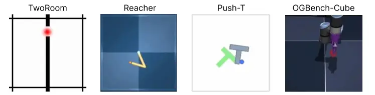

Figure 11: Four evaluation environments

We conduct experiments on the same four environments (shown in Fig 11)
and offline datasets following \[4, 10\]. All models are implemented,
trained, and evaluated using the codebase of \[10, 9\], which provides a
unified interface for environment interaction, dataset processing, and
downstream planning. For each environment, we split the data at the
episode level into 90% for training and 10% for validation.The model are
optimized only on the training trajectories, whereas all reported result
are evaluated exclusively on the held-out validation episodes.

TwoRoom.  TwoRoom \[25, 49\] is a two-dimensional point-navigation
environment consisting of two rooms connected by a single doorway. The
agent begins in one room while the target is located in the other,
requiring it to first navigate toward the doorway and then proceed to
the goal after crossing the separating wall. The offline dataset
contains 10,000 noisy scripted trajectories, with an average episode
length of 92 steps.

Push-T.  Push-T \[27\] is a planar, contact-rich manipulation task in
which a point-like agent must push a T-shaped object toward a desired
target configuration. We use the expert demonstrations released with
DINO-WM \[41\], comprising 20,000 episodes with an average length of 196
steps.

OGBench-Cube.  OGBench-Cube \[28\] is a tabletop manipulation benchmark
in which a robotic gripper is tasked with moving a cube to a specified
target pose. We consider the single-cube variant and use the benchmark’s
scripted offline dataset, which consists of 10,000 trajectories of 200
steps each.

Reacher.  Reacher \[26\] is the standard two-link robotic arm
environment from the DeepMind Control Suite. Following the DINO-WM
formulation, the objective is defined in terms of matching the target
joint configuration rather than merely minimizing end-effector distance.
We use an offline dataset of 10,000 trajectories generated by a SAC
policy \[50\], with each episode containing 200 steps.

OGBench-Cube-Moderate. The Moderate protocol preserves the original
position-based success criterion: an episode succeeds when the Euclidean
distance between the cube center and its target is at most 4 cm. Cube
orientation and the final robot or gripper configuration are not
evaluated, and the first qualifying step counts as success without a
persistence requirement. This protocol retains compatibility with the
original task criterion while excluding initially solved evaluation
pairs.

OGBench-Cube-Strict. The Strict protocol additionally evaluates
orientation and short-term persistence. Success requires a cube-center
distance of at most 3 cm and an orientation error of at most 15°,
simultaneously maintained for three consecutive simulator steps.
Orientation error is minimized over the cube 24 rotational symmetries,
treating geometrically equivalent orientations as identical. The final
robot or gripper configuration remains unconstrained. This protocol
evaluates whether the cube reaches and briefly maintains the target
pose, rather than merely entering a positional tolerance region.

TwoRoom-Strict. Evaluation pairs are restricted to start and goal states
in opposite rooms, with collision-free placements of the full agent disk
of radius 7 pixels. The recorded trajectory segment connecting each pair
must also be collision-free under continuous swept-disk geometry. During
evaluation, collision checking accounts for the full disk throughout
each movement, preventing wall crossings that could be missed by
endpoint-only checks. Success requires a valid trajectory, at least one
legal crossing through the doorway, arrival on the goal side of the
wall, and a distance to the goal strictly below 8 pixels. The first step
satisfying all conditions counts as success; no additional persistence
requirement is imposed.

## Appendix E Experiment Details

### E.1 Architecture

For the network architecture we used in this paper, we follow the
encoder and forward model of LeWorldModel \[4\] and SMWM \[10\]. Inputs
are $`224\times 224`$ RGB images. In detail, for the encoder
$`f_{\theta}`$ we use a Vision Transformer Tiny (ViT-Tiny) with patch
size 14 with approximate 5M parameters. For the forward predictor
$`P_{\phi}`$ we use a ViT-S backbone (with approximate 10M parameters)
where the action $`a`$ is injected via AdaLN-zero. We set the history
length to 1 on every environment following \[10\]. For SMWM, they use an
extra 2-layer MLP as an inverse model with approximately 0.1M
parameters.

### E.2 Training and Planning Details

All world models are trained end-to-end under the same settings as LeWM
and SMWM. As for planning setting, we use the same MPC and CEM
hyperparameters in all four environment and baselines. The detailed
hyperparameters for training and planning are shown in Table 2.

|                            |                     |
| -------------------------- | ------------------- |
| Hyperparameter             | Value               |
| Training                   |                     |
| Optimizer                  | AdamW               |
| Learning rate              | $`10^{-4}`$         |
| Weight decay               | $`10^{-3}`$         |
| Batch size                 | 256                 |
| Training epochs            | 10                  |
| Gradient clipping          | 1.0                 |
| Planning                   |                     |
| Planning horizon $`H`$     | 5 model steps       |
| Executed steps $`K`$       | 5 model steps       |
| Action block               | 5 primitive actions |
| CEM population             | 300                 |
| CEM iterations             | 30                  |
| CEM elites                 | 30                  |
| Initial CEM variance scale | 1.0                 |
| Evaluation tasks           | 100                 |
| Goal offset                | 25 primitive steps  |
| Evaluation budget          | 50 primitive steps  |

Table 2: Training and planning hyperparameters.

### E.3 Hyper-parameter selections and sensitive analysis for ACA

We consider two hyperparameters for ACA: the action perturbation radius
$`\rho`$, which controls the search step for counterfactual actions, and
the loss weight $`\lambda_{\mathrm{ACA}}`$, which controls the
contribution of the ACA comparison penalty to the overall training
objective. We follow the hyperparameter-selection procedure used in SMWM
\[10\] and LeWM \[4\], selecting the ACA perturbation radius and
regularization weight for each environment and evaluation protocol.
Importantly, the baseline models are not left untuned: we reproduce SMWM
and LeWM using their published, environment-specific recommended
regularization weights, while tuning only the two additional
hyper-parameters introduced by ACA under the same
hyperparameter-selection protocol. We select $`\rho`$ from
$`\{0.05,0.1,0.25,0.5\}`$ and $`\lambda_{\mathrm{ACA}}`$ from
$`\{0.5,1.0,1.5\}`$. The detailed hyper-parameter of our method is shown
in Table 3. As for the hyper-parameter for SMWM and LeWM, we use the
suggested value in their original paper which also shown in Table 3. We
analyze the sensitivity of ACA to the perturbation radius and loss
weight on Reacher shown in Figure 12. An excessively large perturbation
radius weakens the planning gains, highlighting the importance of
keeping counterfactual comparisons within an appropriate neighborhood.
Meanwhile, ACA consistently outperforms the baseline across the tested
nonzero loss weights, suggesting that its benefits do not require
precise tuning of the penalty strength within this range.

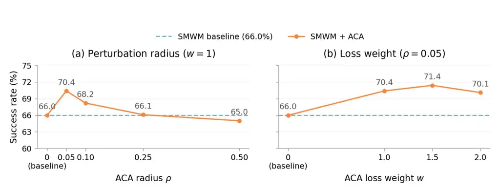

Figure 12: Sensitive Analysis on Reacher

| Environment | Method   | InvReg $`\lambda`$ | SIGReg $`\lambda`$ | ACA $`\rho`$ | ACA $`w`$ |
| ----------- | -------- | ------------------ | ------------------ | ------------ | --------- |
| TwoRoom     | SMWM     | 0.1                | –                  | –            | –         |
| TwoRoom     | LeWM     | –                  | 0.09               | –            | –         |
| TwoRoom     | SMWM+ACA | 0.1                | –                  | 0.10         | 1.0       |
| TwoRoom     | LeWM+ACA | –                  | 0.09               | 0.10         | 1.0       |
| TwoRoom^(∗) | SMWM     | 0.1                | –                  | –            | –         |
| TwoRoom^(∗) | LeWM     | –                  | 0.09               | –            | –         |
| TwoRoom^(∗) | SMWM+ACA | 0.1                | –                  | 0.25         | 1.0       |
| TwoRoom^(∗) | LeWM+ACA | –                  | 0.09               | 0.05         | 1.0       |
| Reacher     | SMWM     | 5.0                | –                  | –            | –         |
| Reacher     | LeWM     | –                  | 0.09               | –            | –         |
| Reacher     | SMWM+ACA | 5.0                | –                  | 0.05         | 1.5       |
| Reacher     | LeWM+ACA | –                  | 0.09               | 0.50         | 1.0       |
| Cube        | SMWM     | 1.0                | –                  | –            | –         |
| Cube        | LeWM     | –                  | 0.09               | –            | –         |
| Cube        | SMWM+ACA | 1.0                | –                  | 0.05         | 1.5       |
| Cube        | LeWM+ACA | –                  | 0.09               | 0.05         | 1.5       |
| Cube^(∗)    | SMWM     | 1.0                | –                  | –            | –         |
| Cube^(∗)    | LeWM     | –                  | 0.09               | –            | –         |
| Cube^(∗)    | SMWM+ACA | 1.0                | –                  | 0.10         | 1.5       |
| Cube^(∗)    | LeWM+ACA | –                  | 0.09               | 0.05         | 1.5       |
| Push-T      | SMWM     | 30.0               | –                  | –            | –         |
| Push-T      | LeWM     | –                  | 0.09               | –            | –         |
| Push-T      | SMWM+ACA | 30.0               | –                  | 0.25         | 1.0       |
| Push-T      | LeWM+ACA | –                  | 0.09               | 0.25         | 1.5       |

Table 3: Hyperparameter configurations across environments. An asterisk
denotes the strict evaluation protocol.

## Appendix F Extra Visualization Results

Figure 15 extends the planning-cost analysis with additional examples
across environments and base models. Each triplet evaluates the same
action sequences on a shared two-dimensional slice, showing the real
goal error, baseline planning cost, and ACA planning cost. In these
examples, low baseline cost can favor plans with relatively poor
physical outcomes, whereas ACA shifts the model preference toward plans
with lower real goal error. The relevant improvement is in which plans
the model favors, rather than exact agreement between the learned and
physical cost landscapes. These visualizations relate changes in learned
action preferences to physical goal attainment and provide qualitative
evidence that complements the aggregate planning results.

## Appendix G Performance Under Additional Planning Settings

We complement the main evaluation with single-plan and long-horizon
settings to examine planning without intermediate feedback and over
longer predicted trajectories.

#### Single-plan evaluation.

We select goal observations 25 primitive steps after the initial
observations and set the execution budget to 25 steps. The planner
optimizes five action blocks, each containing five primitive actions,
and executes the resulting sequence without replanning. This setting
tests the quality of the initially selected plan, since actions cannot
be corrected using intermediate observations. As shown in Table 4, ACA
improves the reported success rates of both base models across all
evaluated environments and protocols, supporting its usefulness when
execution relies entirely on the initial action selection.

#### Long-horizon evaluation.

We extend both the goal offset and execution budget to 50 primitive
steps. The planner optimizes ten action blocks at the initial state and
executes the full sequence without replanning. Selecting actions now
requires evaluating their consequences through twice as many
autoregressive prediction steps. This tests whether the local
factual–counterfactual comparisons introduced during one-step training
remain useful for selecting longer action sequences. Table 5 shows
higher reported success rates with ACA for both base models across all
evaluated environments and protocols, providing evidence that its
planning benefits extend to longer open-loop execution.

| Method   | TwoRoom           | TwoRoom\*         | Reacher           | Push-T            | OGBench- Cube     | OGBench- Cube\*   |
| -------- | ----------------- | ----------------- | ----------------- | ----------------- | ----------------- | ----------------- |
| LeWM     | $`89.8`$          | $`37.0`$          | $`36.6`$          | $`76.6`$          | $`60.0`$          | $`22.0`$          |
| SMWM     | $`92.6`$          | $`25.8`$          | $`33.4`$          | $`81.6`$          | $`82.2`$          | $`45.2`$          |
| LeWM+ACA | $`\mathbf{90.2}`$ | $`\mathbf{39.6}`$ | $`\mathbf{38.4}`$ | $`\mathbf{78.6}`$ | $`\mathbf{63.0}`$ | $`\mathbf{23.8}`$ |
| SMWM+ACA | $`\mathbf{97.0}`$ | $`\mathbf{67.2}`$ | $`\mathbf{39.6}`$ | $`\mathbf{83.0}`$ | $`\mathbf{85.0}`$ | $`\mathbf{47.2}`$ |

Table 4: Single-plan evaluation. Success rates (%) with a goal offset,
planning horizon, and execution budget of 25 primitive steps. A single
action sequence is optimized from the initial observation and executed
without replanning. An asterisk denotes the strict evaluation protocol.
Success rates (%) are reported as mean, the standard deviation is
provided in Table 8.

|          |                   |                   |                   |                   |                   |                   |
| -------- | ----------------- | ----------------- | ----------------- | ----------------- | ----------------- | ----------------- |
| Method   | TwoRoom           | TwoRoom\*         | Reacher           | Push-T            | OGBench- Cube     | OGBench- Cube\*   |
| LeWM     | 56.0              | 22.6              | 26.6              | 19.2              | 37.6              | 16.6              |
| SMWM     | 55.6              | 32.0              | 28.2              | 33.0              | 49.0              | 34.8              |
| LeWM+ACA | $`\mathbf{59.6}`$ | $`\mathbf{27.6}`$ | $`\mathbf{28.8}`$ | $`\mathbf{20.6}`$ | $`\mathbf{40.0}`$ | $`\mathbf{17.8}`$ |
| SMWM+ACA | $`\mathbf{77.4}`$ | $`\mathbf{61.2}`$ | $`\mathbf{30.6}`$ | $`\mathbf{34.4}`$ | $`\mathbf{52.4}`$ | $`\mathbf{38.0}`$ |

Table 5: Long-horizon evaluation. Success rates (%) with a goal offset,
planning horizon, and execution budget of 50 primitive steps. The
complete 50-step action sequence is planned at the initial state and
executed without intermediate replanning. An asterisk denotes the strict
evaluation protocol. Success rates (%) are reported as mean, the
standard deviation is reported in Table 9

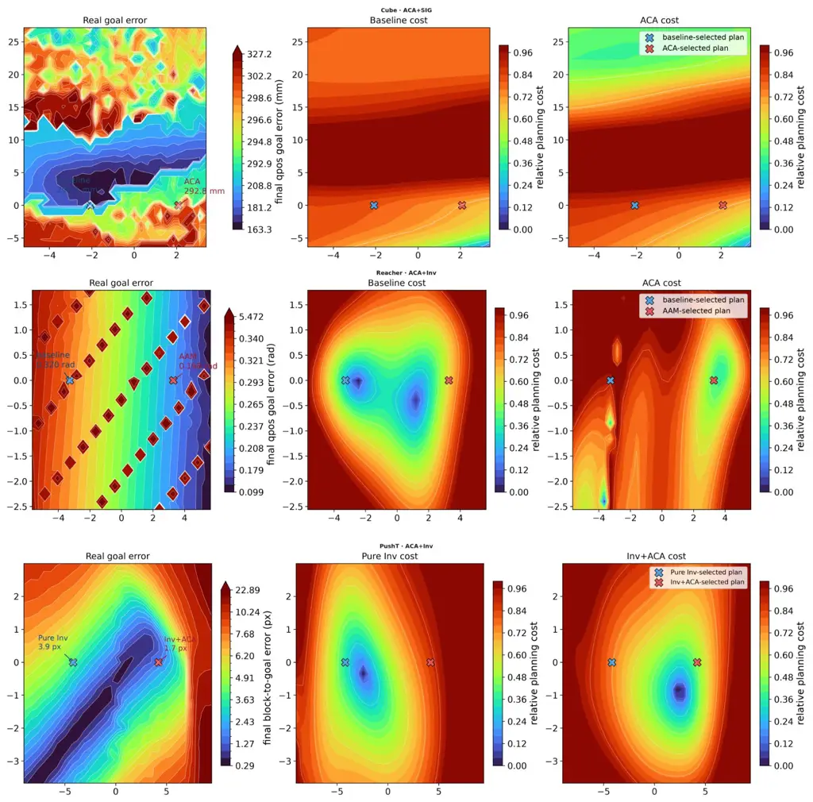

(a)

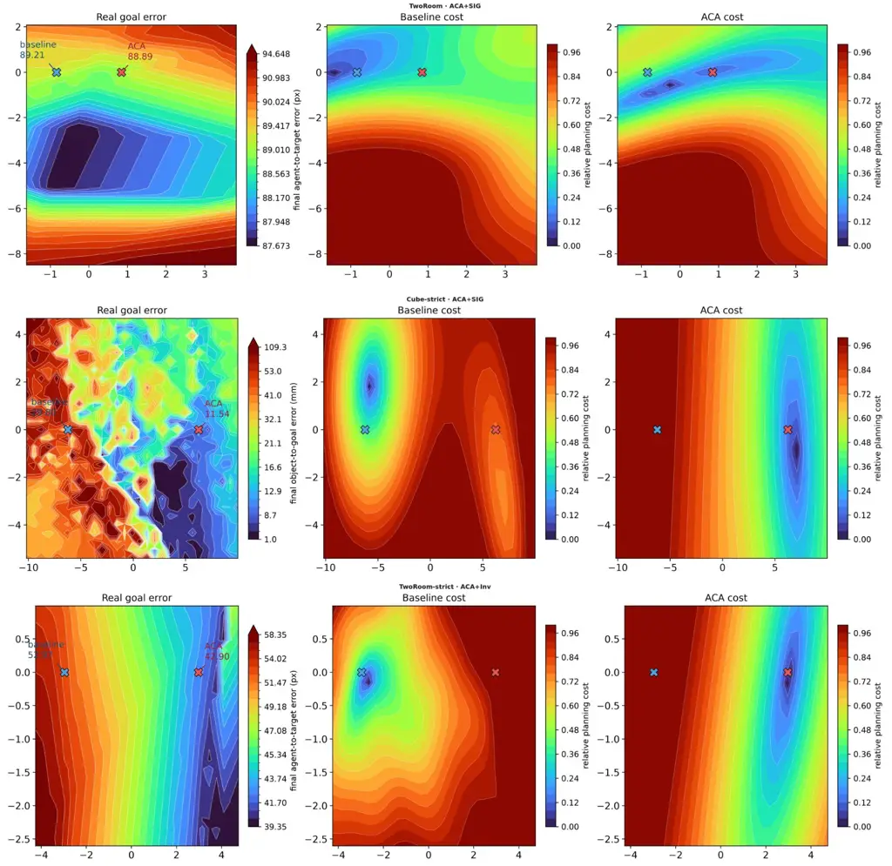

(a)

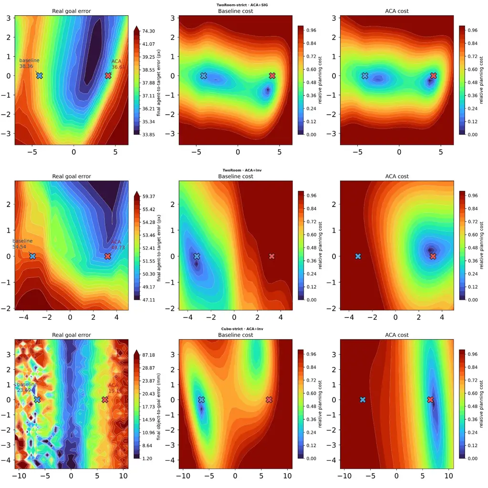

(a)

Figure 15: Additional visualizations of planning costs and physical
outcomes. Each triplet shows real goal error, baseline planning cost,
and ACA planning cost for the same action plans on a shared
two-dimensional slice. The marked plans illustrate how model-based
action selection translates into physical goal attainment across the
displayed environments and base models.

| Method                       | Reacher                  | OGBench-Cube             | OGBench-Cube^(∗)         |
| ---------------------------- | ------------------------ | ------------------------ | ------------------------ |
| SMWM                         | $`48.0\pm 3.8`$          | $`65.4\pm 3.3`$          | $`24.0\pm 2.4`$          |
| SMWM + Random-ACA            | $`53.4\pm 1.7`$          | $`66.8\pm 2.5`$          | $`25.6\pm 4.0`$          |
| SMWM + Gradient-norm penalty | $`52.0\pm 6.9`$          | $`70.4\pm 2.5`$          | $`31.0\pm 3.0`$          |
| SMWM + ACA                   | $`\mathbf{56.8\pm 3.7}`$ | $`\mathbf{74.0\pm 2.4}`$ | $`\mathbf{36.4\pm 4.2}`$ |

Table 6: Ablation of action search and regularization with SMWM trained
on 5% of the training data. Success rates (%) are reported as mean
$`\pm`$ standard deviation over five planner seeds. An asterisk denotes
the CLEAR strict evaluation protocol.

## Appendix H Ablation of Action Search and Regularization

We examine how the candidate search direction and the form of
action-based regularization affect planning performance. Using SMWM as
the base model, we compare ACA with random-direction comparisons and
direct action-gradient regularization. Both variants retain the
forward-prediction and inverse-dynamics objectives and replace only the
ACA term.

#### Comparison objectives.

Random-ACA replaces the negative-gradient search direction with a
uniformly sampled unit vector while retaining the same nominal
perturbation radius, action-space projection, and factual–counterfactual
comparison:

```math
\displaystyle\hat{a}_{t}^{\mathrm{rand}} \displaystyle=\Pi_{\mathcal{A}}(a_{t}+\rho u_{t}),\qquad u_{t}\sim\operatorname{Unif}(\mathbb{S}^{d_{a}-1}), \tag{18}
```

```math
\displaystyle\mathcal{L}_{\mathrm{rand}} \displaystyle=\mathbb{E}_{\mathcal{B},\{u_{\tau}\}}\left[\left[\frac{1}{|\mathcal{B}|}\sum_{\tau\in\mathcal{B}}\left(E_{\phi}(a_{t};\tau)-E_{\phi}(\hat{a}_{t}^{\mathrm{rand}};\tau)\right)\right]_{+}\right].
```

This variant evaluates the contribution of directing comparisons toward
alternatives with lower prediction error. Gradient-norm penalty directly
regularizes the sensitivity of the factual prediction error to the
conditioning action:

```math
\mathcal{L}_{\mathrm{grad}}=\mathbb{E}_{\tau}\left[\rho\|g_{t}\|_{2}\right],\qquad g_{t}=\left.\nabla_{a}E_{\phi}(a;\tau)\right|_{a=a_{t}}. \tag{19}
```

Optimizing this penalty requires differentiating through $`g_{t}`$,
which introduces mixed second-order derivatives with respect to actions
and model parameters. ACA instead stops gradients through the searched
candidate and therefore avoids these second-order derivatives through
the action-search procedure. For locally smooth errors and small
unprojected steps, ignoring numerical stabilization, the minibatch ACA
penalty is approximately
$`\widehat{\mathcal{L}}_{\mathrm{ACA}}(\mathcal{B})\approx\frac{\rho}{|\mathcal{B}|}\sum_{\tau\in\mathcal{B}}\|g_{t}\|_{2}.`$
The gradient-norm control captures this leading-order behavior, while
ACA evaluates the actual error difference at the perturbed action.

Importantly, this approximation concerns the gradient of the _prediction
error_, rather than the action sensitivity of the predictor itself. Let

```math
r_{t}=P_{\phi}(z_{t},a_{t})-z_{t+1},\qquad J_{t}=\left.\frac{\partial P_{\phi}(z_{t},a)}{\partial a}\right|_{a=a_{t}}.
```

Then

```math
\nabla_{a}E_{\phi}(a_{t};\tau)=2J_{t}^{\top}r_{t}.
```

Hence, reducing the factual error gradient does not in general imply
reducing the predictor’s action Jacobian. In particular, an accurate
action-sensitive predictor may satisfy $`r_{t}=0`$ and therefore
$`\nabla_{a}E_{\phi}(a_{t};\tau)=0`$, while still having
$`J_{t}\neq 0`$. Thus, the first-order approximation above should not be
interpreted as showing that ACA necessarily makes the predictor locally
action-invariant. At the same time, ACA alone does not exclude an
action-independent solution; we therefore regard it as a local
comparison regularizer within the joint training objective.

#### Experimental setup.

We use the same 5% training subset within each environment and a shared
planning protocol across variants. Reacher models are trained for 20
epochs and OGBench-Cube models for 10 epochs, using cosine learning-rate
annealing from $`10^{-4}`$. The regularized variants use
$`(\rho,\lambda_{\mathrm{ACA}})=(0.05,1.0)`$ on Reacher and
$`(0.25,1.5)`$ on OGBench-Cube, with $`\lambda_{\mathrm{ACA}}`$
weighting the corresponding additional objective. We evaluate Cube under
both the standard and CLEAR strict protocols.

#### Results and analysis.

Table 6 shows that both controls improve mean planning success over
SMWM, suggesting that local action comparisons and error-gradient
regularization each provide useful training signals. ACA achieves the
highest mean success rate across all three evaluation settings. Its
advantage over Random-ACA supports the value of directing comparisons
toward actions that challenge the factual explanation. Relative to the
gradient-norm penalty, ACA improves success by 4.8, 3.6, and 5.4
percentage points on Reacher, OGBench-Cube, and OGBench-Cube^(∗),
respectively. The advantage also holds under the stricter Cube success
criterion, supporting its usefulness when goal attainment requires
greater physical precision. Together, these results favor explicit
factual-counterfactual comparisons at a finite perturbation radius over
the tested random-direction and local gradient-norm alternatives.

## Appendix I Variability Across Planner Seeds

Tables 7, 8, 9 summarize the standard deviations across five planner
random seeds for each fixed trained checkpoint, expressed in percentage
points. These results cover the main experiments in this paper. This
evaluation follows the benchmark protocol adopted from SMWM; we
therefore keep the trained checkpoint fixed and vary the stochastic
planner seed for both baseline and ACA models. Across the evaluated
environments and protocols, the standard deviations are generally remain
comparable in magnitude between the baseline and ACA. These statistics
characterize the variability introduced by stochastic planning and
provide additional context for interpreting the corresponding mean
performance.

|                | LeWM     |        | SMWM     |        |
| -------------- | -------- | ------ | -------- | ------ |
| Environment    | Baseline | \+ ACA | Baseline | \+ ACA |
| Cube           | 2.88     | 1.73   | 1.64     | 3.35   |
| Cube-strict    | 3.36     | 2.77   | 3.03     | 2.39   |
| Reacher        | 3.11     | 2.19   | 3.58     | 2.65   |
| Push-T         | 2.35     | 3.85   | 3.21     | 2.30   |
| TwoRoom        | 1.53     | 1.22   | 1.10     | 1.10   |
| TwoRoom-strict | 2.68     | 3.51   | 2.12     | 2.59   |

Table 7: Standard deviation of success rates across five planner seeds
under the 25-step, 2-plan evaluation protocol (in percentage points).
The main results is in Table 1.

|                | LeWM     |        | SMWM     |        |
| -------------- | -------- | ------ | -------- | ------ |
| Environment    | Baseline | \+ ACA | Baseline | \+ ACA |
| Cube           | 2.55     | 1.58   | 1.64     | 1.87   |
| Cube-strict    | 3.74     | 2.17   | 3.96     | 4.97   |
| Reacher        | 2.65     | 2.51   | 2.88     | 2.79   |
| Push-T         | 2.70     | 2.12   | 1.67     | 3.35   |
| TwoRoom        | 0.84     | 1.79   | 2.07     | 1.41   |
| TwoRoom-strict | 1.00     | 2.51   | 5.17     | 4.76   |

Table 8: Sample standard deviation of success rates across five planner
seeds under the 25-step, 1-plan evaluation protocol (in percentage ).
The main result is shown in Table 4.

|                | LeWM     |        | SMWM     |        |
| -------------- | -------- | ------ | -------- | ------ |
| Environment    | Baseline | \+ ACA | Baseline | \+ ACA |
| Cube           | 3.29     | 1.41   | 3.24     | 2.30   |
| Cube-strict    | 1.87     | 2.24   | 1.79     | 3.54   |
| Reacher        | 2.82     | 3.12   | 3.96     | 3.63   |
| Push-T         | 1.14     | 2.39   | 4.69     | 2.30   |
| TwoRoom        | 3.54     | 4.16   | 1.52     | 0.55   |
| TwoRoom-strict | 4.16     | 2.30   | 3.83     | 2.78   |

Table 9: Standard deviation of success rates across five planner seeds
under the 50-step, 1-plan evaluation protocol (in percentage points).
The main result is shown in Table 5.

## Appendix J Discussion

Positioning ACA.  The approaches discussed in section 7 emphasize
preserving action-relevant information and making predictions useful for
decision making. Our work makes the connection between these
requirements explicit through the action evaluations induced by the
predictor. For latent action-conditioned world models exemplified by
joint-embedding approaches, planning evaluates candidate actions through
predicted latent trajectories. The predictor therefore determines not
only what future is imagined, but also which action appears preferable.
We examine this connection at the level of individual transitions. This
makes the prediction-planning gap concrete as a discrepancy between
model preference and physical target attainment. It also provides a
direct training opportunity: the factual action-consequence pair
supplies a reference for supervising the same comparisons that expose
the discrepancy. ACA turns this reference into a local objective that
penalizes the error advantage assigned to searched alternatives. In this
way, ACA complements the approaches above by translating the requirement
of decision-relevant prediction into explicit comparison supervision on
the existing forward predictor, without additional outcome labels for
the alternatives or a separate evaluation module.

A shift in generalization requirements.  In standard supervised
prediction, generalization primarily concerns transfer from a finite
training sample to unseen examples, with training and deployment
typically organized around the same predictive task. Methods such as
SAM \[17\] seek to improve the model generalization performance on
unseen data distribution within this framework. Action-conditioned world
models used for planning extend this requirement: they learn dynamics
from transitions that have occurred, but are subsequently queried to
imagine futures under candidate actions for a given goal. Actions thus
change from conditions supplied by the dataset to variables actively
varied and selected during decision making. The learned dynamics must
also be reused across new combinations of action sequences and goals.
Transfer therefore occurs not only across examples, but also across uses
of the learned knowledge: from accounting for recorded experience to
reasoning about and selecting possible actions. This requirement
persists even when the environment and its physical dynamics remain
unchanged, because transitions covered by data-collection behavior need
not cover the possibilities that goal-directed planning must compare.
Generalization in world models consequently concerns both prediction on
unseen transitions and whether those predictions remain useful under
action variation, multi-step composition, and changing goals. The
prediction-planning gap reflects a possible disconnect between these
requirements: generalization on the predictive task does not
automatically imply effective use of the learned dynamics for planning.

## Appendix K Scope and limitation

Our study focuses on latent action-conditioned world models (mainly
JEPA-style models empirically) on simulated visual control tasks, other
architectures are not discussed and considered here. We believe
extending ACA to larger world models and real-world robotic systems is a
promising direction for further validation.
