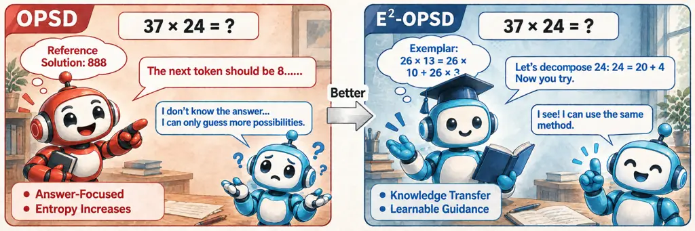
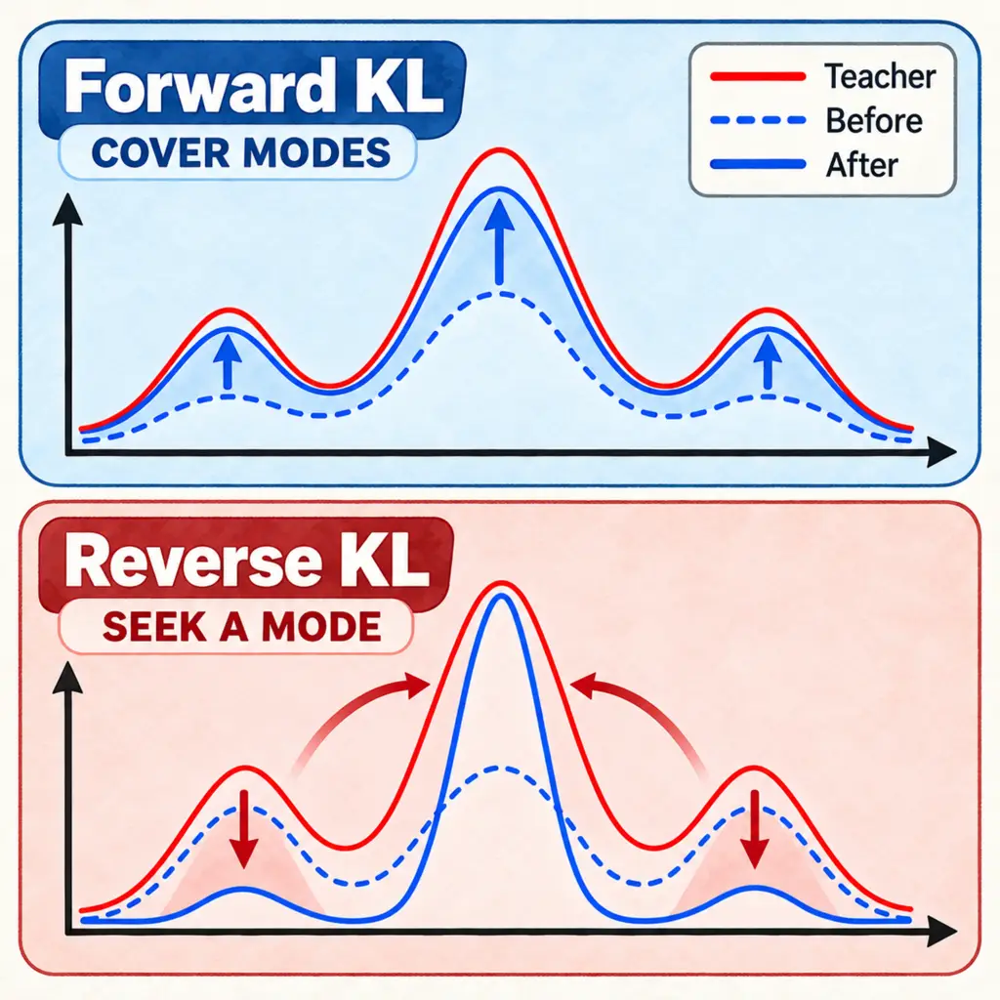
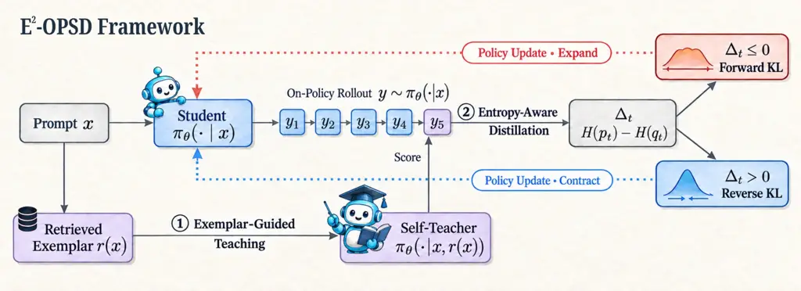

# E²-OPSD: Taming Entropy Overshoot in On-Policy Self-Distillation

Yifei Liu    Minghao Fang    Xinyu Gu Affiliation: Shanghai Artificial
Intelligence Laboratory    Chengkai Yao Affiliation: Shanghai Jiaotong
University    Mengdi Liu Affiliation: Visual Information Processing and
Learning, ICT, CAS    Tengfei Ma Affiliation: Hunan University   
Jiangbin Zheng Affiliation: Westlake University    Chang Yu
Affiliation: Nanjing University    Zhangyang Gao Affiliation: The
Chinese University of Hong Kong Affiliation: Zhejiang University

###### Abstract

On-policy self-distillation (OPSD) provides dense token-level
supervision without a second model: one network acts as teacher with the
reference solution and as student with only the problem. We identify a
specific failure mode of this recipe. During training, student token
entropy rises past the teacher’s and remains elevated, a pattern we call
_entropy overshoot_. We trace it to both sides of distillation. The
reference-conditioned teacher is confident along its answer-directed
reasoning path, but this confidence transfers poorly to
student-generated prefixes, making its supervision overly tied to
answer-specific cues rather than reusable reasoning patterns; meanwhile,
the forward KL used by OPSD continually diffuses the student’s
predictive distribution without pulling it back. We introduce _E²-OPSD_
to address both causes. Exemplar-guided teaching replaces the current
answer with a retrieved solved neighboring problem, providing
transferable reasoning guidance without revealing the destination and
better matching student-reachable states. Entropy-aware distillation
uses the student–teacher entropy gap to determine the direction and
strength of each token’s correction. _E²-OPSD_ improves math reasoning
by up to 4.3 points in mean@16 over OPSD, while out-of-domain
evaluations show gains over the corresponding base models of up to 4.9
points in mean@16 and 5.5 points in pass@8. Despite these gains,
_E²-OPSD_ remains simple, requiring no additional forward passes or
networks. Code repo:
[https://github.com/orionfei/E2-OPSD](https://github.com/orionfei/E2-OPSD).

¹¹footnotetext: Equal contribution. ^($`\dagger`$)Corresponding author.

## 1 Introduction

Figure 1: Left: Entropy overshoot in Qwen3-1.7B. Right: The
reference-conditioned teacher is less certain on student prefixes,
suggesting a reasoning-path mismatch.

Reinforcement learning with verifiable rewards (RLVR) is now the
standard recipe for improving LLM reasoning, yet its supervision remains
coarse: an entire rollout collapses into a single scalar reward (Shao et
al., 2024; Guo et al., 2025). On-policy distillation (OPD) instead
offers dense, token-level supervision by having a teacher score the
student’s own rollouts (Agarwal et al., 2024; Gu et al., 2023), and is
now a standard post-training component in Qwen3 (Yang et al., 2025),
GLM-5 (GLM-5-Team et al., 2026), and DeepSeek-V4 (DeepSeek-AI et al.,
2026). Despite this fine granularity, it still requires a stronger
open-weight teacher that shares the student’s vocabulary. On-policy
self-distillation (OPSD) further removes the need to serve a second
model: a copy of the student acts as the teacher, with access to the
reference solution, while the student sees only the problem. Teacher and
student are evaluated on the same student-generated prefixes and matched
with forward KL (Zhao et al., 2026). This makes OPSD an appealing way to
turn privileged solution information into dense supervision. In
practice, however, its gains are unstable and can deteriorate as
training proceeds.



\(a\) Exemplar-Guided Teaching



(b) Forward/Reverse KL

Figure 2: (a) Exemplar-Guided Teaching. Standard OPSD gives the teacher
the current reference solution, letting it jump from the student prefix
toward the answer. _E²-OPSD_ instead uses a solved neighbor as a
strategy guide, forcing the teacher to follow the student’s intermediate
step and solve the current problem itself, turning answer leakage into
strategy transfer. (b) Forward and reverse KL play complementary roles.
Forward KL promotes exploration over teacher-supported alternatives,
while reverse KL removes unsupported probability mass to concentrate the
policy. Entropy-aware distillation switches between them.

We identify a characteristic failure mode, as shown in Figure 1 (left),
_entropy overshoot_: instead of settling toward the teacher, the student
becomes progressively more uncertain, eventually surpassing the
teacher’s entropy and staying there. Entropy overshoot therefore
describes a regime where useful exploration spills into persistent and
excessive uncertainty, gradually eroding the student’s decisiveness and
amplifying teacher-side uncertainty into noisy student behavior.

We examine this failure from both teacher and student perspectives.
First, OPSD produces supervision mismatched to the student’s reasoning
path. The teacher is confident on its own trajectories but becomes
substantially more uncertain on student-generated prefixes (Figure 1,
right), suggesting that its guidance does not transfer cleanly to the
intermediate states the student actually reaches. This mismatch stems
from a deeper issue: seeing the current solution lets the teacher
narrate toward a known answer rather than reason from scratch, making
its supervision answer-specific rather than transferable (Figure 2(a)).
Second, OPSD lacks a mechanism to regulate policy spread. Forward KL is
beneficial when the student is too concentrated as it expands
probability toward teacher-supported alternatives. But the same pressure
persists even after the policy becomes overly diffuse, which makes
exploration a one-way ratchet: uncertainty keeps spreading, with no
force pulling the policy back into focus (Figure 2(b)).

These observations motivate _E²-OPSD_, a simple framework that repairs
both sides of the learning process with Exemplar-guided teaching and
Entropy-aware distillation, as illustrated in Figure 3. More
specifically, _E²-OPSD_ makes three contributions:

- •
  What to learn — _Exemplar-guided teaching._ We replace the current
  problem’s reference solution in the teacher’s context with a retrieved
  solved neighboring problem. The exemplar provides a transferable
  problem-solving reference without revealing the current answer.
  Conditioned on this reference and the student’s generated prefix, the
  teacher’s token-level guidance is meant to be more compatible with the
  student’s ongoing reasoning.
- •
  How to learn — _Entropy-aware distillation._ We use the
  student–teacher entropy gap as a feedback signal: when the student is
  more concentrated than the teacher, forward KL encourages exploration;
  when it becomes more diffuse, reverse KL suppresses unsupported mass
  and encourages concentration. The gap magnitude downweights uncertain
  routing decisions and concentrates learning on tokens with larger
  entropy mismatches. This turns self-distillation from a fixed one-way
  objective into closed-loop self-balancing control of exploration.
- •
  _Simple and Generalized._ _E²-OPSD_ adds no extra forward passes
  during distillation and minimum overhead. Across various model
  families, sizes from 0.6B to 7B, and both thinking and
  instruction-tuned models, it mitigates persistent entropy overshoot
  and improves math reasoning by up to 4.3 points over OPSD, with gains
  transferring to out-of-domain tasks by up to 4.9 mean@16 points over
  the corresponding base model. These results suggest that effective
  self-distillation depends not on maximizing imitation, but on aligning
  teacher guidance with the student’s reasoning path and regulating when
  the student should explore versus concentrate.



Figure 3: Overview of the _E²-OPSD_ framework. Exemplar-guided teaching
and entropy-aware distillation jointly improve teacher guidance and
regulate student learning.

## 2 Preliminaries and Related Work

### 2.1 KL Divergence

The Kullback–Leibler (KL) divergence is asymmetric, and its two
directions induce distinct approximation biases (Minka, 2005; Jin et
al., 2026). For a target distribution $`P`$ and model distribution
$`Q`$,

```math
\mathrm{KL}(P\|Q)=\mathbb{E}_{v\sim P}\left[\log\frac{P(v)}{Q(v)}\right],\qquad\mathrm{KL}(Q\|P)=\mathbb{E}_{v\sim Q}\left[\log\frac{Q(v)}{P(v)}\right]. \tag{1}
```

Forward KL is _mode covering_: if $`P(v)>0`$ while $`Q(v)\to 0`$, its
contribution diverges, strongly penalizing target-supported modes that
the model fails to cover. Reverse KL has the complementary
_mode-seeking_ bias: if $`Q(v)>0`$ while $`P(v)\to 0`$, its contribution
diverges, strongly penalizing model mass unsupported by the
target (Minka, 2005). Thus, forward KL favors coverage, whereas reverse
KL favors concentration.

### 2.2 On-Policy Distillation

On-policy distillation (OPD) trains a student $`\pi_{\theta}`$ to match
a teacher $`\pi_{T}`$ on the student’s own generations (Agarwal et al.,
2024; Gu et al., 2023; Lu and Lab, 2025). Given a problem
$`x\sim\mathcal{D}`$, the student samples
$`\hat{y}=(\hat{y}_{1},\ldots,\hat{y}_{|\hat{y}|})`$, and both models
score the same student-generated prefix $`s_{t}=(x,\hat{y}_{<t})`$:

```math
\mathcal{L}(\theta)=\mathbb{E}_{x\sim\mathcal{D}}\mathbb{E}_{\hat{y}\sim\pi_{\theta}(\cdot\mid x)}\left[\frac{1}{|\hat{y}|}\sum_{t=1}^{|\hat{y}|}D\!\left(\pi_{T}(\cdot\mid s_{t})\,\big\|\,\pi_{\theta}(\cdot\mid s_{t})\right)\right], \tag{2}
```

where $`D`$ denotes a per-token divergence between the teacher and
student distributions, instantiated as forward KL
$`\mathrm{KL}(\pi_{T}\|\pi_{\theta})`$ or reverse KL
$`\mathrm{KL}(\pi_{\theta}\|\pi_{T})`$, and gradients flow only through
the student. Reverse KL is a common choice (Gu et al., 2023; Lu and Lab,
2025), while prior work also explores mixed or skewed divergences as
alternative distillation objectives  (Agarwal et al., 2024; Ko et al.,
2024; Shing et al., 2025; Wu et al., 2025; Jin et al., 2026). OPSD
computes $`D`$ over the full vocabulary and applies per-token pointwise
clipping, capping each vocabulary entry’s contribution at $`\tau`$ so
that a few stylistic tokens do not dominate the signal (Zhao et al.,
2026). We keep this pointwise clipping and, following recent
sparse-support distillation practice, approximate $`D`$ on the teacher’s
top-$`K_{\mathrm{v}}`$ tokens together with a tail bucket carrying the
remaining probability mass (Li et al., 2026b).

### 2.3 Related Work

#### On-policy self-distillation.

On-policy self-distillation (OPSD) instantiates Eq. 2 with a copy of the
student as teacher, $`\pi_{T}=\pi_{\theta_{0}}`$, whose context includes
the reference solution $`y^{*}`$ unseen by the student and is matched
via forward KL (Zhao et al., 2026). This privileged teacher creates an
irreducible objective gap (Yang et al., 2026), overweights stylistic and
answer-implied tokens over genuine decisions (Pan et al., 2026; Harne et
al., 2026), and suppresses uncertainty important to thinking
models (Kaur et al., 2026; Kim et al., 2026). Existing remedies largely
patch these effects downstream. _Verifier-directed_ methods outsource
update control to outcome rewards (Yang et al., 2026; Ke et al., 2026;
He et al., 2026), effectively reintroducing RLVR. _Signal-purification_
methods cancel privileged bias with an additional teacher pass (Pan et
al., 2026; Shen et al., 2026), paying extra compute after the bias is
already introduced. _Context-curation_ methods expose less of the
solution or replace it with a successful sibling rollout (Han et al.,
2026; Hübotter et al., 2026), but still rely on solution-specific
supervision and auxiliary control. These approaches mitigate symptoms
without removing their source: teacher guidance tied to the current
problem’s solution. _E²-OPSD_ removes this mismatch at the source,
restores the concentrating correction absent from forward KL, and
retains a single frozen-teacher pass with no reward.

#### Entropy-aware post-training.

Entropy has become a common control signal in post-training, but serves
different roles across RLVR and distillation. In RLVR, it is primarily
used to regulate exploration, from preventing entropy collapse to
concentrating updates on high-entropy or decision-critical tokens (Cui
et al., 2025; Yu et al., 2025; Wang et al., 2025; Hao et al., 2025). In
distillation, entropy has been used to guide supervision selection and
adaptation: EOPD activates additional forward-KL supervision at
high-teacher-entropy tokens, while subsequent work further adapts
supervision across uncertainty regimes (Jin et al., 2026; Zhang et al.,
2026; Lee et al., 2026). _E²-OPSD_ instead targets the relative entropy
dynamics of the student and teacher, using their signed token-level
entropy gap to correct entropy overshoot during on-policy
self-distillation.

#### Training-time contextual guidance.

A broad line of work improves post-training by providing auxiliary
context that is available during training but absent at inference.
Context distillation internalizes prompts, exemplars, or scratchpads
into model weights (Askell et al., 2021; Snell et al., 2022; Shin et
al., 2025; Kalwar et al., 2026). More recent methods diversify the form
of this guidance: OPCD distills experiential knowledge from historical
solution traces, SDFT learns on-policy from demonstrations, SKALD
conditions a self-teacher on abstract skill cards, and PMD accumulates
reusable procedural memories across training episodes (Ye et al., 2026;
Shenfeld et al., 2026; Jiang et al., 2026; Liu et al., 2026). Other
approaches inject more instance-specific scaffolds directly into
optimization, such as partial solutions in QuestA, off-policy reasoning
traces in LUFFY, in-context exemplars in XRPO, or retrieved analogous
demonstrations in RA-RFT (Li et al., 2026a; Yan et al., 2025; Bamba et
al., 2025; Xiao et al., 2026). OPSD conditions its self-teacher on the
current problem’s reference solution; _E²-OPSD_ instead uses a retrieved
solved neighbor, transferring reusable strategy across instances without
revealing the current answer.

## 3 Method

_E²-OPSD_ repairs both sides of the entropy-overshoot failure identified
in Section 1: _exemplar-guided teaching_ changes what the teacher is
conditioned on so its guidance is grounded in transferable reasoning
rather than answer-specific cues, while _entropy-aware distillation_
changes how the student matches it, using the per-token entropy gap to
set both the direction and strength of the correction. Both run inside
the standard OPSD loop with one frozen teacher and no additional forward
passes or extra network.

#### Setup.

The student $`\pi_{\theta}`$ and frozen teacher $`\pi_{\phi}`$,
initialized from the same model ($`\phi=\theta_{0}`$), score the same
student-generated prefix $`\hat{y}_{<t}`$ but under different contexts:

```math
p_{t}(v)=\pi_{\theta}(v\mid x,\hat{y}_{<t}),\qquad q_{t}(v;r)=\pi_{\phi}(v\mid x,r(x),\hat{y}_{<t}), \tag{3}
```

where $`r(x)`$ denotes teacher-only privileged context. Standard OPSD
sets $`r(x)=y^{*}`$, giving the teacher the reference solution to the
current problem.

### 3.1 Exemplar-Guided Teaching

Conditioning on $`y^{*}`$ lets the teacher narrate toward a known
answer, producing guidance that depends on information absent from the
student’s context. Exemplar-Guided Teaching (EGT) instead replaces the
current solution with a solved neighboring problem, so the teacher must
still solve $`x`$ itself while using the exemplar only as transferable
strategy (Figure 2(a)).

We embed all training problems and compute pairwise cosine similarity
offline, keeping each problem’s $`K`$ nearest neighbors (self-excluded)
as $`\mathcal{N}_{K}(x)`$. For the $`g`$-th of $`G`$ rollouts per
problem, we draw one neighbor uniformly,

```math
r_{g}(x)=(x^{\prime}_{g},\,y^{\prime*}_{g}),\qquad x^{\prime}_{g}\sim\mathrm{Uniform}\!\left(\mathcal{N}_{K}(x)\right),\quad x^{\prime}_{g}\neq x, \tag{4}
```

seeded deterministically by problem and rollout index, so different
rollouts of the same problem see different exemplars at no extra
retrieval cost. Thus the teacher is conditioned on
$`(x,x^{\prime}_{g},y_{g}^{\prime*},\hat{y}_{<t})`$, while the student
still sees only $`(x,\hat{y}_{<t})`$. EGT therefore removes the current
answer from teacher conditioning and replaces answer-specific privilege
with cross-problem strategy guidance. Prompts and offline preprocessing
cost are in Appendix A.4.

### 3.2 Entropy-Aware Distillation

EGT improves _what_ the teacher provides; Entropy-Aware Distillation
(EAD) controls _how_ the student follows it. Building on the
complementary mode-covering and mode-seeking biases of forward and
reverse KL (Section 2.1), EAD has two components: _Bidirectional Entropy
Routing_ (BER) selects the KL direction from the student–teacher entropy
gap $`\Delta_{t}=H(p_{t})-H(q_{t})`$, while _Adaptive Gap Damping_ (AGD)
uses its magnitude to scale the update.

###### Proposition (Entropy-gap stability).

If $`p_{t}`$ and $`q_{t}`$ concentrate their mass on a shared candidate
set, the sign of $`\Delta_{t}`$ agrees with that of the gap restricted
to this set whenever $`|\Delta_{t}|`$ exceeds a tail-dependent margin
(Appendix D).

#### Bidirectional entropy routing.

We use the entropy gap $`\Delta_{t}`$ as a directional proxy for
relative policy spread. Higher entropy corresponds to more effective
next-token alternatives. BER uses this directional signal as follows.
When $`\Delta_{t}\leq 0`$, the student is relatively more concentrated
than the teacher, so BER applies forward KL to broaden coverage. When
$`\Delta_{t}>0`$, the student is relatively more diffuse, so BER
switches to reverse KL to refocus the policy (Figure 2(b)). Using
$`\widetilde{\mathcal{V}}_{t}`$, the teacher’s top-$`K_{\mathrm{v}}`$
tokens plus a tail bucket, and the per-element clip $`\tau`$ inherited
from OPSD (Section 2.2),

```math
D_{t}^{\mathrm{BER}}=\begin{cases}\sum_{v\in\widetilde{\mathcal{V}}_{t}}\min\!\left(q_{t}(v)\log\frac{q_{t}(v)}{p_{t}(v)},\,\tau\right),&\Delta_{t}\leq 0,\\[6.0pt]
\sum_{v\in\widetilde{\mathcal{V}}_{t}}\min\!\left(p_{t}(v)\log\frac{p_{t}(v)}{q_{t}(v)},\,\tau\right),&\Delta_{t}>0.\end{cases} \tag{5}
```

BER thus replaces OPSD’s fixed one-way pressure with a state-dependent
correction that can either broaden or refocus the student policy.

#### Adaptive gap damping.

The sign of $`\Delta_{t}`$ selects the correction direction, while its
magnitude indicates the need for correction: near-zero gaps make routing
sensitive to small perturbations, whereas larger gaps indicate more
pronounced student–teacher entropy mismatches that call for stronger
correction. We therefore use the gap magnitude as a confidence weight to
downweight uncertain routing decisions and concentrate learning on
tokens with larger entropy mismatches. Over the valid response tokens
$`\mathcal{T}`$ in the current mini-batch, we define the typical gap
scale
$`\sigma^{2}=\frac{1}{|\mathcal{T}|}\sum_{(i,t)\in\mathcal{T}}\Delta_{i,t}^{2}`$
and weight each routed update by

```math
c_{t}=\frac{\Delta_{t}^{2}}{\Delta_{t}^{2}+\max(\sigma^{2},\epsilon^{2})}\in[0,1), \tag{6}
```

where $`\epsilon`$ is the FP32 machine epsilon, with $`c_{t}=0`$ when
$`\Delta_{t}=0`$. Gaps small relative to the batch scale are therefore
suppressed, while those much larger than the scale retain most of their
update. Because $`\sigma^{2}`$ is recomputed every mini-batch, the
damping adapts to the training dynamics without a tunable threshold.

#### Training objective.

Combining exemplar-guided teaching, bidirectional entropy routing, and
adaptive gap damping, _E²-OPSD_ minimizes

```math
\mathcal{L}_{\mathcal{T}}(\theta)=\frac{1}{|\mathcal{T}|}\sum_{(i,t)\in\mathcal{T}}\operatorname{sg}(c_{i,t})\,D_{i,t}^{\mathrm{BER}}, \tag{7}
```

where $`\mathcal{T}`$ contains the valid response tokens in the current
loss computation, indexed by response $`i`$ and position $`t`$. Sampled
responses and exemplars are held fixed during optimization. The teacher
conditions on the sampled solved neighbor $`(x^{\prime},y^{\prime*})`$
through $`q_{t}`$, while the student context remains unchanged. Both the
routing decision and $`c_{t}`$ are treated as stop-gradient quantities,
so optimization acts only through the student probabilities in
$`D_{t}^{\mathrm{BER}}`$. Compared with OPSD, _E²-OPSD_ changes only the
teacher context and per-token divergence, requiring the same rollouts
and frozen-teacher scoring with no additional forward pass, verifier, or
reward during distillation. See Appendix A.4 for more overhead analysis.
At inference, all privileged context is removed.

## 4 Experiments

### 4.1 Experimental Settings

#### Models & Datasets.

We evaluate four configurations across the Qwen3 (Yang et al., 2025) and
Olmo3 (Olmo et al., 2026) families: Qwen3-0.6B and Qwen3-1.7B with
thinking enabled, Qwen3-4B-Instruct-2507, and Olmo-3-7B-Instruct. The
reasoning mode is consistent across the student, teacher (where
applicable), and evaluation. Following Pan et al. (2026), we use
DeepMath-103K (He et al., 2025) for training, with a difficulty band
assigned to each configuration (Appendix A.1). We evaluate in-domain
mathematical reasoning on AMC23 (math-ai, 2023), AIME’24 (Zhang and
Math-AI, 2024), AIME’25 (Zhang and Math-AI, 2025), and HMMT’25 Feb
(Harvard–MIT Mathematics Tournament, 2025). Out-of-domain evaluation
covers logical reasoning on a fixed, randomly sampled 100-puzzle subset
of ZebraLogic (Lin et al., 2025)for computational tractability, and code
generation on HumanEval (Chen et al., 2021).

#### Baselines.

We compare against (1) Base, the untrained checkpoints; (2) OPSD (Zhao
et al., 2026), which distills a frozen teacher conditioned on the
current problem’s reference solution using forward KL; (3) SDPO
(Hübotter et al., 2026), which uses an EMA teacher conditioned on a
successful sibling rollout and a generalized JSD loss; (4) GRPO (Shao et
al., 2024), which optimizes a clipped policy objective using
group-normalized advantages from verifiable rewards, with KL
regularization against a frozen reference policy; (5) RLSD (Yang et al.,
2026), which uses verifiable rewards to determine update directions and
self-distillation signals to modulate token-level update magnitudes; and
(6) OPSD + EOPD, our self-distillation adaptation of EOPD (Jin et al.,
2026), which combines reverse KL with forward KL at high-teacher-entropy
positions. We retain this entropy-gated divergence but replace EOPD’s
external stronger teacher with OPSD’s reference-conditioned self-teacher
for a controlled comparison.

#### Implementation Details.

We use veRL (Sheng et al., 2025) with vLLM (Kwon et al., 2023) on
8$`\times`$H200 GPUs and a learning rate of $`10^{-6}`$. We faithfully
implement each baseline following the algorithmic design in its original
paper, preserving its method-specific objectives and update rules,
including teacher construction for self-distillation methods. All
trained methods and ablations share the same training settings and a
budget of 360 optimizer steps. Detailed baseline configurations,
including the explicit adaptation of EOPD to the OPSD setting, are
provided in Appendix A.4 for reproducibility. The baseline results in
Table 1 are obtained from these implementations under the shared
protocol. For self-distillation methods, the teacher is frozen at its
initial weights except in SDPO and RLSD. We use $`K=15`$ for a diverse
exemplar selection, and supply retrieved exemplars only to the teacher.
We evaluate each model with three evaluation seeds to reduce noise. We
provide the model with only the original questions during evaluation
inference. See Appendix A for detailed training and evaluation settings.

|                         |                  |                                                   |                                                |                                                   |                                                  |                                                |
| ----------------------- | ---------------- | ------------------------------------------------- | ---------------------------------------------- | ------------------------------------------------- | ------------------------------------------------ | ---------------------------------------------- |
|                         |                  | Math Reasoning (mean@16)                          |                                                |                                                   |                                                  |                                                |
| Model                   | Method           | AMC23                                             | AIME24                                         | AIME25                                            | HMMT25                                           | Avg.                                           |
| Qwen3-0.6B (Thinking)   | Base             | $`45.8`$                                          | $`9.8`$                                        | $`14.2`$                                          | $`8.3`$                                          | $`19.5`$                                       |
|                         | OPSD             | $`45.9`$                                          | $`\underline{10.9}`$                           | $`14.2`$                                          | $`\mathbf{9.2}`$                                 | $`20.0`$                                       |
|                         | SDPO             | $`45.5`$                                          | $`9.4`$                                        | $`14.6`$                                          | $`7.8`$                                          | $`19.3`$                                       |
|                         | GRPO             | $`46.1`$                                          | $`9.8`$                                        | $`\mathbf{16.4}`$                                 | $`8.4`$                                          | $`\underline{20.2}`$                           |
|                         | RLSD             | $`\mathbf{46.8}`$                                 | $`\mathbf{11.0}`$                              | $`15.1`$                                          | $`7.8`$                                          | $`\underline{20.2}`$                           |
|                         | OPSD + EOPD      | $`46.4`$                                          | $`9.8`$                                        | $`15.9`$                                          | $`8.5`$                                          | $`20.1`$                                       |
|                         | _E²-OPSD_ (Ours) | $`\underline{46.6}_{{\color[rgb]{0,0.5,0}+0.8}}`$ | $`\mathbf{11.0}_{{\color[rgb]{0,0.5,0}+1.2}}`$ | $`\underline{16.2}_{{\color[rgb]{0,0.5,0}+2.0}}`$ | $`\underline{8.9}_{{\color[rgb]{0,0.5,0}+0.6}}`$ | $`\mathbf{20.7}_{{\color[rgb]{0,0.5,0}+1.2}}`$ |
| Qwen3-1.7B (Thinking)   | Base             | $`75.5`$                                          | $`46.0`$                                       | $`34.6`$                                          | $`21.9`$                                         | $`44.5`$                                       |
|                         | OPSD             | $`74.9`$                                          | $`46.0`$                                       | $`35.0`$                                          | $`\underline{22.7}`$                             | $`44.6`$                                       |
|                         | SDPO             | $`\underline{76.1}`$                              | $`48.0`$                                       | $`\underline{35.3}`$                              | $`21.9`$                                         | $`\underline{45.3}`$                           |
|                         | GRPO             | $`74.6`$                                          | $`47.0`$                                       | $`35.2`$                                          | $`21.9`$                                         | $`44.7`$                                       |
|                         | RLSD             | $`75.9`$                                          | $`\underline{48.3}`$                           | $`34.0`$                                          | $`21.8`$                                         | $`45.0`$                                       |
|                         | OPSD + EOPD      | $`74.3`$                                          | $`47.4`$                                       | $`34.2`$                                          | $`21.5`$                                         | $`44.3`$                                       |
|                         | _E²-OPSD_ (Ours) | $`\mathbf{79.0}_{{\color[rgb]{0,0.5,0}+3.5}}`$    | $`\mathbf{52.3}_{{\color[rgb]{0,0.5,0}+6.3}}`$ | $`\mathbf{39.2}_{{\color[rgb]{0,0.5,0}+4.6}}`$    | $`\mathbf{25.0}_{{\color[rgb]{0,0.5,0}+3.1}}`$   | $`\mathbf{48.9}_{{\color[rgb]{0,0.5,0}+4.4}}`$ |
| Qwen3-4B- Instruct-2507 | Base             | $`85.4`$                                          | $`61.7`$                                       | $`46.5`$                                          | $`29.0`$                                         | $`\underline{55.7}`$                           |
|                         | OPSD             | $`84.8`$                                          | $`\underline{62.4}`$                           | $`45.6`$                                          | $`\underline{29.5}`$                             | $`55.6`$                                       |
|                         | SDPO             | $`83.9`$                                          | $`61.3`$                                       | $`45.8`$                                          | $`27.5`$                                         | $`54.6`$                                       |
|                         | GRPO             | $`84.4`$                                          | $`61.7`$                                       | $`45.6`$                                          | $`29.1`$                                         | $`55.2`$                                       |
|                         | RLSD             | $`85.1`$                                          | $`62.2`$                                       | $`\underline{46.9}`$                              | $`28.4`$                                         | $`\underline{55.7}`$                           |
|                         | OPSD + EOPD      | $`\underline{85.5}`$                              | $`62.0`$                                       | $`46.5`$                                          | $`28.4`$                                         | $`55.6`$                                       |
|                         | _E²-OPSD_ (Ours) | $`\mathbf{87.1}_{{\color[rgb]{0,0.5,0}+1.7}}`$    | $`\mathbf{62.8}_{{\color[rgb]{0,0.5,0}+1.1}}`$ | $`\mathbf{51.0}_{{\color[rgb]{0,0.5,0}+4.5}}`$    | $`\mathbf{30.2}_{{\color[rgb]{0,0.5,0}+1.2}}`$   | $`\mathbf{57.8}_{{\color[rgb]{0,0.5,0}+2.1}}`$ |
| Olmo-3-7B- Instruct     | Base             | $`80.5`$                                          | $`52.8`$                                       | $`37.8`$                                          | $`23.3`$                                         | $`48.6`$                                       |
|                         | OPSD             | $`80.5`$                                          | $`52.8`$                                       | $`38.3`$                                          | $`22.4`$                                         | $`48.5`$                                       |
|                         | SDPO             | $`80.3`$                                          | $`51.3`$                                       | $`\underline{39.9}`$                              | $`\mathbf{24.5}`$                                | $`49.0`$                                       |
|                         | GRPO             | $`\underline{80.9}`$                              | $`52.6`$                                       | $`38.6`$                                          | $`23.5`$                                         | $`48.9`$                                       |
|                         | RLSD             | $`80.4`$                                          | $`\underline{53.6}`$                           | $`38.8`$                                          | $`23.8`$                                         | $`\underline{49.2}`$                           |
|                         | OPSD + EOPD      | $`79.6`$                                          | $`53.5`$                                       | $`39.2`$                                          | $`\underline{24.0}`$                             | $`49.1`$                                       |
|                         | _E²-OPSD_ (Ours) | $`\mathbf{81.2}_{{\color[rgb]{0,0.5,0}+0.7}}`$    | $`\mathbf{56.3}_{{\color[rgb]{0,0.5,0}+3.5}}`$ | $`\mathbf{40.0}_{{\color[rgb]{0,0.5,0}+2.2}}`$    | $`23.9_{{\color[rgb]{0,0.5,0}+0.6}}`$            | $`\mathbf{50.3}_{{\color[rgb]{0,0.5,0}+1.7}}`$ |

Table 1: Main results across model scales and types on math reasoning,
reported as mean@16 over three seeds. Green subscripts show our gains
over Base, computed from the displayed values. Best values are bold and
second-best distinct values underlined. Full evaluation results are in
Appendix B.

|                        |           |                           |                           |                           |                           |
| ---------------------- | --------- | ------------------------- | ------------------------- | ------------------------- | ------------------------- |
|                        |           | Logic: ZebraLogic         |                           | Coding: HumanEval         |                           |
| Model                  | Method    | mean@16                   | pass@8                    | mean@16                   | pass@8                    |
|                        | Base      | $`28.8`$                  | $`56.5`$                  | $`52.6`$                  | $`78.4`$                  |
| Qwen3-0.6B (Thinking)  | _E²-OPSD_ | $`\mathbf{29.0}`$\_(+0.2) | $`56.5`$\_(+0.0)          | $`\mathbf{53.1}`$\_(+0.5) | $`\mathbf{79.0}`$\_(+0.6) |
|                        | Base      | $`62.5`$                  | $`78.3`$                  | $`83.8`$                  | $`93.2`$                  |
| Qwen3-1.7B (Thinking)  | _E²-OPSD_ | $`\mathbf{67.4}`$\_(+4.9) | $`\mathbf{83.8}`$\_(+5.5) | $`\mathbf{84.5}`$\_(+0.7) | $`\mathbf{93.8}`$\_(+0.6) |
|                        | Base      | $`79.1`$                  | $`92.4`$                  | $`84.0`$                  | $`89.9`$                  |
| Qwen3-4B Instruct-2507 | _E²-OPSD_ | $`\mathbf{82.2}`$\_(+3.1) | $`\mathbf{92.8}`$\_(+0.4) | $`\mathbf{84.8}`$\_(+0.8) | $`\mathbf{90.7}`$\_(+0.8) |
|                        | Base      | $`32.7`$                  | $`56.6`$                  | $`78.2`$                  | $`92.1`$                  |
| OLMo-3-7B Instruct     | _E²-OPSD_ | $`\mathbf{33.9}`$\_(+1.2) | $`\mathbf{57.9}`$\_(+1.3) | $`\mathbf{78.7}`$\_(+0.5) | $`\mathbf{92.5}`$\_(+0.4) |

Table 2: Out-of-domain evaluation on logical reasoning and code
generation. _E²-OPSD_ consistently improves both mean@16 and pass@8
across ZebraLogic and HumanEval, showing that its gains extend beyond
in-domain mathematical reasoning.

### 4.2 Main Results

#### _E²-OPSD_ delivers robust and transferable gains.

As shown in Tables 1 and 2, _E²-OPSD_ achieves the highest average math
mean@16 across all four model configurations, spanning two model
families and both thinking and instruct modes. In particular, _E²-OPSD_
improves over Base by 4.4 and 2.1 percentage points on Qwen3-1.7B
Thinking and Qwen3-4B-Instruct-2507, respectively, while leading on all
four math benchmarks for both models. Its consistent effectiveness
across distinct reasoning modes suggests that _E²-OPSD_ addresses a
fundamental failure mode of OPSD, rather than relying on a model- or
reasoning-format-specific recipe. More importantly, the gains extend
beyond math reasoning: _E²-OPSD_ improves over Base in both logical
reasoning and code generation across all four configurations, with
logical reasoning gains of 4.9 and 3.1 points on Qwen3-1.7B Thinking and
Qwen3-4B-Instruct-2507, respectively, alongside consistent gains in code
generation as well. Together, these gains support our central premise
that effective self-distillation should transfer reasoning strategies
and regulate distillation dynamics, rather than merely imitate
solutions.

\(a\) Entropy dynamics on Olmo-3-7B-Instruct.

\(b\) Entropy dynamics on Qwen3-4B-Instruct-2507.

\(c\) Emergent KL-routing dynamics.

Figure 4: Training dynamics. (a,b) Student and teacher token entropy
under OPSD (dashed) and _E²-OPSD_ (solid); the dotted line marks the
first student–teacher entropy crossing under OPSD. (c) On Qwen3-1.7B
Thinking, routing share denotes the fraction of response tokens assigned
to forward or reverse KL by BER. The routing naturally shifts from
forward-dominated exploration toward increased reverse-KL concentration
as training proceeds.

#### _E²-OPSD_ mitigates persistent entropy overshoot.

Figures 4(a) and 4(b) revisit the failure identified in the
introduction. Under OPSD, student entropy crosses the teacher early and
continues to drift upward, creating a persistent entropy gap. In
contrast, _E²-OPSD_ keeps student entropy tightly regulated around the
teacher throughout training, preventing runaway diffusion while
preserving sufficient exploration. This curbs entropy overshoot and
stabilizes distillation.

#### _E²-OPSD_ exhibits an emergent exploration-to-concentration transition.

As shown in Figure 4(c), forward KL dominates early, promoting
exploration toward teacher-supported alternatives, while reverse KL
becomes increasingly prevalent later, suppressing excess probability
mass and concentrating the student distribution. This shift emerges
without an explicit schedule and naturally tracks the evolving student
state. As both routing curves flatten, _E²-OPSD_ further exhibits a
self-equilibrating diffusion–concentration dynamic.

\(a\) Component contributions.

\(b\) Teacher-context probe.

\(c\) AGD gradient probe.

Figure 5: Component ablation and mechanism probes. (a) Performance
contribution of each design component; “+” denotes the component added
on top of OPSD. (b) EGT improves teacher–student compatibility. The
x-axis denotes teacher-to-student forward KL evaluated on student
prefixes; the y-axis shows response length from each setting’s own
rollouts (log scale). (c) AGD sharpens entropy-aware routing. HL denotes
high-student/low-teacher entropy and LH the reverse.

### 4.3 Ablation Study

#### Performance breakdown by design components.

Figure 5(a) isolates the contribution of each design choice on
Qwen3-1.7B Thinking. Starting from OPSD at 44.6 macro mean@16,
exemplar-guided teaching raises performance to 46.0, while bidirectional
entropy routing reaches 47.6. Adding adaptive gap damping further
improves the score to 48.4, and the full combination achieves 48.9. The
steady gains suggest that the components provide complementary benefits,
improving both the supervision the student receives and how that
supervision is applied. For detailed results, please refer to Table 11.

#### State-dependent KL routing outperforms fixed directions.

With the reference-answer teacher fixed and adaptive gap damping
disabled, our entropy-aware routing clearly outperforms all other
methods that apply fixed KL directions (see Figure 6). To be more
precise, forward KL keeps expanding the student and eventually drives
entropy overshoot, making the student overly diffuse. Reverse KL
suppresses excess mass but also restricts exploration when the student
has not yet covered enough plausible alternatives. Their fixed mixture
softens both extremes, yet applies expansion and contraction
simultaneously regardless of the student’s current state, causing the
two corrections to partially counteract each other rather than selecting
the one that is needed. In contrast, _E²-OPSD_ uses the student–teacher
entropy gap to select the needed correction, expanding when the student
is too concentrated and contracting when it is too diffuse, yielding
more stable entropy dynamics and stronger validation performance.

Figure 6: State-dependent KL routing avoids fixed directional bias.
KL-direction dynamics on Qwen3-1.7B Thinking with the teacher context
fixed and AGD disabled. The x-axis shows optimizer steps; the left
y-axis reports student and teacher token entropy, while the right y-axis
of panel (d) reports validation mean@8. Panels compare (a) forward KL,
(b) reverse KL, (c) an equal-weight forward/reverse KL mixture, and (d)
BER. The trajectories reveal distinct distributional dynamics under
fixed versus state-dependent KL routing.

#### Exemplar guidance makes the teacher locally learnable.

Figure 5(b) reveals why replacing the current reference solution
matters. When conditioned on the reference answer, the teacher produces
much shorter and more confident trajectories than the student, with an
entropy of 0.190 nats versus the student’s 0.268 nats. EGT instead keeps
the teacher closer to the student’s reasoning regime, at 2,090 tokens
and 0.261 nats. Moreover, EGT reduces teacher–student forward KL by
25.9% (0.1549 to 0.1148 nats) on the same student prefixes. Together,
these observations suggest that EGT brings the teacher’s native
uncertainty closer to the student’s reasoning regime while providing
more closely aligned token-level guidance on student-visited states.

#### AGD sharpens entropy-aware routing.

Figure 5(c) isolates how AGD redistributes token-level learning signals.
Here, high entropy means $`H\geq\ln 2`$, corresponding to at least two
effective next-token choices. Entropy-discordant positions—HL and LH,
where student and teacher fall into opposite high/low entropy
regimes—account for only 7.67% of all response tokens, yet contribute
20.18% of the relative gradient mass without AGD. Enabling AGD further
raises this share to 28.50%, with both HL and LH increasing
consistently. This shows that AGD does not uniformly rescale the
distillation objective; instead, it makes BER more selective by shifting
learning toward positions with clearer student–teacher disagreement in
policy spread. To rule out that small entropy gaps merely hide
distributional mismatch, we measure probability-mass overlap: strongly
damped positions have 0.985 mean overlap (Appendix C), supporting the
entropy gap as a simple yet principled proxy for local distributional
mismatch. In this sense, BER determines _which direction_ to correct,
while AGD determines _which routing decisions deserve stronger updates_.

## 5 Conclusion

We identify entropy overshoot as a key failure mode of on-policy
self-distillation: a teacher that has read the answer supplies guidance
the student cannot fully learn, and OPSD’s forward-KL objective keeps
pushing the student outward, turning useful exploration into persistent
distributional mismatch. We introduce _E²-OPSD_, which controls this
process by constructing more locally learnable teacher targets and
adapting both the direction and the strength of distillation to the
student’s training state. Across both thinking and instruct models,
_E²-OPSD_ consistently improves model’s reasoning capability, with gains
transferring to out-of-domain tasks. Our analyses show that effective
self-distillation requires matching teacher guidance to
student-reachable states and uncertainty structure, rather than simply
increasing or suppressing entropy. These results suggest that
controlling where exploration occurs is as important as encouraging
exploration itself.

## References

- Agarwal et al. (2024) R. Agarwal, N. Vieillard, Y. Zhou, P.
  Stanczyk, S. Ramos Garea, M. Geist, and O. Bachem On-policy
  distillation of language models: learning from self-generated
  mistakes. In International Conference on Learning Representations,
  Vol. 2024, pp. 21246–21263. Cited by: §1, §2.2, §2.2.
- Askell et al. (2021) A. Askell, Y. Bai, A. Chen, D. Drain, D.
  Ganguli, T. Henighan, A. Jones, N. Joseph, B. Mann, N. DasSarma, et
  al. A general language assistant as a laboratory for alignment. arXiv
  preprint arXiv:2112.00861. Cited by: §2.3.
- Bamba et al. (2025) U. Bamba, M. Fang, Y. Yu, H. Zheng, and F. Lai
  XRPO: pushing the limits of grpo with targeted exploration and
  exploitation. ArXiv abs/2510.06672. External Links:
  [Link](https://api.semanticscholar.org/CorpusID:281891555) Cited by:
  §2.3.
- Chen et al. (2021) M. Chen, J. Tworek, H. Jun, Q. Yuan, H. P. de
  Oliveira Pinto, J. Kaplan, H. Edwards, Y. Burda, N. Joseph, G.
  Brockman, A. Ray, R. Puri, G. Krueger, M. Petrov, H. Khlaaf, G.
  Sastry, P. Mishkin, B. Chan, S. Gray, N. Ryder, M. Pavlov, A.
  Power, L. Kaiser, M. Bavarian, C. S. Winter, P. Tillet, F. P.
  Such, D. W. Cummings, M. Plappert, F. Chantzis, E. Barnes, A.
  Herbert-Voss, W. H. Guss, A. Nichol, A. Paino, N. Tezak, J. Tang, I.
  Babuschkin, S. Balaji, S. Jain, W. Saunders, C. Hesse, A. Carr, J.
  Leike, J. Achiam, V. Misra, E. Morikawa, A. Radford, M. M. Knight, M.
  Brundage, M. Murati, K. Mayer, P. Welinder, B. McGrew, D. Amodei, S.
  McCandlish, I. Sutskever, and W. Zaremba Evaluating large language
  models trained on code. ArXiv abs/2107.03374. External Links:
  [Link](https://api.semanticscholar.org/CorpusID:235755472) Cited by:
  §4.1.
- Cui et al. (2025) G. Cui, Y. Zhang, J. Chen, L. Yuan, Z. Wang, Y.
  Zuo, H. Li, Y. Fan, H. Chen, W. Chen, et al. The entropy mechanism of
  reinforcement learning for reasoning language models. arXiv preprint
  arXiv:2505.22617. Cited by: §2.3.
- DeepSeek-AI et al. (2026) DeepSeek-AI, A. Xu, B. Lin, B. Xue, B.
  Wang, B. Xu, B. Wu, B. Zhang, C. Lin, C. Dong, C. Ling, C. Lu, C.
  Zhao, C. Deng, C. Hou, C. Xu, C. Shao, C. Ruan, C. Sun, D. Dai, D.
  Guo, D. Yang, D. Chen, D. Li, D. Ji, E. Li, F. Wei, F. Lin, F.
  Yuan, F. Xia, F. Dai, G. Hao, G. Chen, G. Cao, G. Meng, G. Li, H.
  Yu, H. Zhang, H. Xu, H. Li, H. Liang, H. Zhang, H. Luo, H. Wei, H.
  Yuan, H. Zhang, H. Luo, H. Chen, H. Ji, H. Zhang, H. Ding, H. Tang, H.
  Cao, H. Gao, H. Qu, H. Zeng, J. Yang, J. Zhu, J. Luo, J. Song, J.
  Yu, J. Huang, J. Cai, J. Liang, J. Zhou, J. Ye, J. Li, J. Xu, J.
  Hu, J. Yang, J. Chen, J. Yan, J. Chen, J. Zhou, J. Xiang, J. Yuan, J.
  Cheng, J. Zhou, J. Zhu, J. Yu, J. Sun, J. Ran, J. Jiang, J. Qiu, J.
  Li, J. Zheng, J. Song, K. Dong, K. Gao, K. Guan, K. Zhou, K. Huang, K.
  Yu, L. Wang, L. Zhang, L. Wang, L. Xia, L. Zhang, L. Zhao, L. Guo, L.
  Luo, L. Ma, L. Zhu, L. Wang, L. Cai, L. Zhang, L. Chen, M. Di, M.
  Xu, M. Mei, M. Wang, M. Zhang, M. Zhang, M. Tang, M. Li, M. Zhou, M.
  Han, N. Wang, P. Huang, P. Wang, P. Cong, P. Wang, P. Zhang, Q.
  Wang, Q. Zhu, Q. Li, Q. Chen, Q. Du, Q. Jiang, R. Tian, R. Xu, R.
  Lu, R. Xu, R. Ge, R. Zhang, R. Pan, R. Wang, R. Chen, R. Yin, R.
  Xu, R. Shen, R. Zhang, R. Chen, S. Liu, S. Lu, S. Sun, S. Zhou, S.
  Chen, S. Cai, S. Nie, S. Wu, S. Chen, S. Hu, S. Liu, S. Hu, S. Ma, S.
  Wang, S. Yu, S. Zhou, S. Pan, S. Yu, S. Zhou, T. Ni, T. Yun, T.
  Jin, T. Pei, T. Ye, T. Lin, T. Ji, T. Cui, T. Yue, T. Yu, T. Wang, W.
  Zhang, W. Xiao, W. Zeng, W. An, W. Zhao, W. Liu, W. Liang, W. Pang, W.
  Luo, W. Yao, W. Gao, W. Yang, W. Huang, W. Hou, W. Zhang, W. Ma, X.
  Gao, X. He, X. Wang, X. Wang, X. Bi, X. Liu, X. Wang, X. Chen, X.
  Zhang, X. Nie, X. Sun, X. Wang, X. Cheng, X. Liu, X. Xie, X. Liu, X.
  Liu, X. Yu, X. Li, X. Yang, X. Zhang, X. Chen, X. Wang, X. Su, X.
  Chen, X. Lin, X. Fu, Y. Yan, Y. Wang, Y. Ma, Y. Luo, Y. Zhang, Y.
  Xu, Y. Ma, Y. Huang, Y. Li, Y. Li, Y. Xu, Y. Zhao, Y. Sun, Y. Wang, Y.
  Qian, Y. Shao, Y. Yu, Y. Zhang, Y. Ding, Y. Shi, Y. Wu, Y. Xiong, Y.
  Ma, Y. He, Y. Tang, Y. Zhou, Y. Luo, Y. Zhong, Y. Piao, Y. Wang, Y.
  Zhang, Y. Chen, Y. Tan, Y. Wei, Y. Ma, Y. Liu, Y. Yang, Y. Guo, Y.
  Wu, Y. Wu, Y. Li, Y. Cheng, Y. Ou, Y. Xu, Y. Li, Y. Wang, Y. Yang, Y.
  Xu, Y. Wu, Y. Meng, Y. Zou, Y. Zha, Y. Xiong, Y. Chen, Y. Lin, Y.
  Cao, Y. Wang, Y. Zhang, Y. Yan, Y. Lin, Y. Gu, Y. Luo, Y. You, Y.
  Liu, Y. Zhou, Y. Zhou, Y. Huang, Z. Wu, Z. Wang, Z. Zhao, Z. Ren, Z.
  Zhang, Z. Sha, Z. Fu, Z. Ju, Z. Xu, Z. Xie, Z. Zhang, Z. Gao, Z.
  Hao, Z. Gou, Z. Ma, Z. Yan, Z. Shao, Z. Huang, Z. Chen, Z. Wu, Z.
  Ren, Z. Wu, Z. Li, Z. Zhang, Z. Xu, Z. Wang, Z. Qu, Z. Gu, Z. Zhu, Z.
  Li, Z. Zhang, Z. Xie, Z. Gao, Z. Wan, Z. Pan, and Z. Yao DeepSeek-v4:
  towards highly efficient million-token context intelligence. External
  Links: 2606.19348, [Link](https://arxiv.org/abs/2606.19348) Cited by:
  §1.
- GLM-5-Team et al. (2026) GLM-5-Team, :, A. Zeng, X. Lv, Z. Hou, Z.
  Du, Q. Zheng, B. Chen, D. Yin, C. Ge, C. Huang, C. Xie, C. Zhu, C.
  Yin, C. Wang, G. Pan, H. Zeng, H. Zhang, H. Wang, H. Chen, J.
  Zhang, J. Jiao, J. Guo, J. Wang, J. Du, J. Wu, K. Wang, L. Li, L.
  Fan, L. Zhong, M. Liu, M. Zhao, P. Du, Q. Dong, R. Lu, Shuang-Li, S.
  Cao, S. Liu, T. Jiang, X. Chen, X. Zhang, X. Huang, X. Dong, Y. Xu, Y.
  Wei, Y. An, Y. Niu, Y. Zhu, Y. Wen, Y. Cen, Y. Bai, Z. Qiao, Z.
  Wang, Z. Wang, Z. Zhu, Z. Liu, Z. Li, B. Wang, B. Wen, C. Huang, C.
  Cai, C. Yu, C. Li, C. Hu, C. Zhang, D. Zhang, D. Lin, D. Yang, D.
  Wang, D. Ai, E. Zhu, F. Yi, F. Chen, G. Wen, H. Sun, H. Zhao, H.
  Hu, H. Zhang, H. Liu, H. Zhang, H. Peng, H. Tai, H. Zhang, H. Liu, H.
  Wang, H. Yan, H. Ge, H. Liu, H. Chu, J. Zhao, J. Wang, J. Zhao, J.
  Ren, J. Wang, J. Zhang, J. Gui, J. Zhao, J. Li, J. An, J. Li, J.
  Yuan, J. Du, J. Liu, J. Zhi, J. Duan, K. Zhou, K. Wei, K. Wang, K.
  Luo, L. Zhang, L. Sha, L. Xu, L. Wu, L. Ding, L. Chen, M. Li, N.
  Lin, P. Ta, Q. Zou, R. Song, R. Yang, S. Tu, S. Yang, S. Wu, S.
  Zhang, S. Li, S. Li, S. Fan, W. Qin, W. Tian, W. Zhang, W. Yu, W.
  Liang, X. Kuang, X. Cheng, X. Li, X. Yan, X. Hu, X. Ling, X. Fan, X.
  Xia, X. Zhang, X. Zhang, X. Pan, X. Zou, X. Zhang, Y. Liu, Y. Wu, Y.
  Li, Y. Wang, Y. Zhu, Y. Tan, Y. Zhou, Y. Pan, Y. Zhang, Y. Su, Y.
  Geng, Y. Yan, Y. Tan, Y. Bi, Y. Shen, Y. Yang, Y. Li, Y. Liu, Y.
  Wang, Y. Li, Y. Wu, Y. Zhang, Y. Duan, Y. Zhang, Z. Liu, Z. Jiang, Z.
  Yan, Z. Zhang, Z. Wei, Z. Chen, Z. Feng, Z. Yao, Z. Chai, Z. Wang, Z.
  Zhang, B. Xu, M. Huang, H. Wang, J. Li, Y. Dong, and J. Tang GLM-5:
  from vibe coding to agentic engineering. External Links: 2602.15763,
  [Link](https://arxiv.org/abs/2602.15763) Cited by: §1.
- Gu et al. (2023) Y. Gu, L. Dong, F. Wei, and M. Huang Minillm:
  on-policy distillation of large language models. arXiv preprint
  arXiv:2306.08543. Cited by: §1, §2.2, §2.2.
- Guo et al. (2025) D. Guo, D. Yang, H. Zhang, J. Song, P. Wang, Q.
  Zhu, R. Xu, R. Zhang, S. Ma, X. Bi, et al. Deepseek-r1: incentivizing
  reasoning capability in llms via reinforcement learning. arXiv
  preprint arXiv:2501.12948. Cited by: §1.
- Han et al. (2026) Z. Han, T. Zhang, H. Wang, and Y. Sun Adaptive
  teacher exposure for self-distillation in llm reasoning. arXiv
  preprint arXiv:2605.11458. Cited by: §2.3.
- Hao et al. (2025) Z. Hao, H. Wang, H. Liu, J. Luo, J. Yu, H. Dong, Q.
  Lin, C. Wang, and J. Chen Rethinking entropy interventions in rlvr: an
  entropy change perspective. ArXiv abs/2510.10150. External Links:
  [Link](https://api.semanticscholar.org/CorpusID:282057600) Cited by:
  §2.3.
- Harne et al. (2026) S. Harne, C. Karkar, Y. Pandya, A. Awadallah,
  and A. Nambi Privileged, but biased: how pi-conditioned teachers break
  self-distillation. arXiv preprint arXiv:2608.04794. Cited by: §2.3.
- Harvard–MIT Mathematics Tournament (2025) Harvard–MIT Mathematics
  Tournament HMMT February 2025: problems and solutions. External Links:
  [Link](https://www.hmmt.org/www/archive/282) Cited by: §4.1.
- He et al. (2026) Y. He, S. Kaur, A. Bhaskar, Y. Yang, J. Liu, N.
  Ri, L. Fowl, A. Panigrahi, D. Chen, and S. Arora Self-distillation
  zero: self-revision turns binary rewards into dense supervision. arXiv
  preprint arXiv:2604.12002. Cited by: §2.3.
- He et al. (2025) Z. He, T. Liang, J. Xu, Q. Liu, X. Chen, Y. Wang, L.
  Song, D. Yu, Z. Liang, W. Wang, Z. Zhang, R. Wang, Z. Tu, H. Mi,
  and D. Yu DeepMath-103k: a large-scale, challenging, decontaminated,
  and verifiable mathematical dataset for advancing reasoning. ArXiv
  abs/2504.11456. External Links:
  [Link](https://api.semanticscholar.org/CorpusID:277787455) Cited by:
  §A.1, §4.1.
- Hübotter et al. (2026) J. Hübotter, F. Lübeck, L. Behric, A.
  Baumann, M. Bagatella, D. Marta, I. Hakimi, I. Shenfeld, T. K.
  Buening, C. Guestrin, et al. Reinforcement learning via
  self-distillation. arXiv preprint arXiv:2601.20802. Cited by: §2.3,
  §4.1.
- Jiang et al. (2026) Y. Jiang, F. Xie, Z. Jiang, and H. Zhang Distill
  skills into weights, not prompts: abstract skills as privileged
  signals for on-policy self-distillation. arXiv preprint
  arXiv:2608.09826. Cited by: §2.3.
- Jin et al. (2026) W. Jin, T. Min, Y. Yang, D. Wei, Y. Zhou, S. R.
  Kadhe, N. Baracaldo, and K. Lee Entropy-aware on-policy distillation
  of language models. arXiv preprint arXiv:2603.07079. Cited by: §A.4,
  §2.1, §2.2, §2.3, §4.1.
- Kalwar et al. (2026) D. Kalwar, V. Palod, and S. Kambhampati Masked
  distillation: internalizing the chain-of-thought in language models.
  arXiv preprint arXiv:2607.22629. Cited by: §2.3.
- Kaur et al. (2026) S. Kaur, N. Ri, Y. He, L. Fowl, and S. Arora
  Rethinking on-policy self-distillation for thinking models. arXiv
  preprint arXiv:2607.05184. Cited by: §2.3.
- Ke et al. (2026) J. Ke, Z. Wen, W. Li, C. He, and L. Zhang Respecting
  self-uncertainty in on-policy self-distillation for efficient llm
  reasoning. arXiv preprint arXiv:2605.13255. Cited by: §2.3.
- Kim et al. (2026) J. Kim, X. Luo, M. Kim, S. Lee, D. Kim, J. Jeon, D.
  Li, and Y. Yang Why does self-distillation (sometimes) degrade the
  reasoning capability of llms?. arXiv preprint arXiv:2603.24472. Cited
  by: §2.3.
- Ko et al. (2024) J. Ko, S. Kim, T. Chen, and S. Yun Distillm: towards
  streamlined distillation for large language models. arXiv preprint
  arXiv:2402.03898. Cited by: §2.2.
- Kwon et al. (2023) W. Kwon, Z. Li, S. Zhuang, Y. Sheng, L.
  Zheng, C. H. Yu, J. E. Gonzalez, H. Zhang, and I. Stoica Efficient
  memory management for large language model serving with
  pagedattention. External Links: 2309.06180,
  [Link](https://arxiv.org/abs/2309.06180) Cited by: §4.1.
- Lee et al. (2026) C. Lee, Z. Cheng, Y. Wang, R. Ni, S. Sahu, S. Zhang,
  and W. Campbell SEAD: competence-aware on-policy distillation via
  entropy-guided supervision. arXiv preprint arXiv:2606.28562. Cited by:
  §2.3.
- Li et al. (2026a) J. Li, H. Lin, H. Lu, K. Wen, Z. Yang, J. Gao, Y.
  Wu, and J. Zhang QuestA: expanding reasoning capacity in llms via
  question augmentation. External Links: 2507.13266,
  [Link](https://arxiv.org/abs/2507.13266) Cited by: §2.3.
- Li et al. (2026b) Y. Li, Y. Zuo, B. He, J. Zhang, C. Xiao, C. Qian, T.
  Yu, H. Gao, W. Yang, Z. Liu, and N. Ding Rethinking on-policy
  distillation of large language models: phenomenology, mechanism, and
  recipe. External Links: 2604.13016,
  [Link](https://arxiv.org/abs/2604.13016) Cited by: §2.2.
- Lin et al. (2025) B. Y. Lin, R. L. Bras, K. Richardson, A.
  Sabharwal, R. Poovendran, P. Clark, and Y. Choi ZebraLogic: on the
  scaling limits of llms for logical reasoning. ArXiv abs/2502.01100.
  External Links:
  [Link](https://api.semanticscholar.org/CorpusID:276094621) Cited by:
  §4.1.
- Liu et al. (2026) Y. Liu, S. Bansal, B. Pang, Y. Li, Z. L. Liu, Y.
  Ming, Z. Ke, S. Joty, and S. Yavuz Procedural memory distillation:
  online reflection for self-improving language models. arXiv preprint
  arXiv:2607.01480. Cited by: §2.3.
- Lu and Lab (2025) K. Lu and T. M. Lab On-policy distillation. Thinking
  Machines Lab: Connectionism. Note:
  https://thinkingmachines.ai/blog/on-policy-distillation External
  Links: [Document](https://dx.doi.org/10.64434/tml.20251026) Cited by:
  §2.2, §2.2.
- math-ai (2023) math-ai AMC 2023. Note: Dataset compiled from the 2023
  American Mathematics Competitions External Links:
  [Link](https://huggingface.co/datasets/math-ai/amc23) Cited by: §4.1.
- Minka (2005) T. P. Minka Divergence measures and message passing.
  External Links:
  [Link](https://api.semanticscholar.org/CorpusID:7585417) Cited by:
  §2.1, §2.1.
- Olmo et al. (2026) T. Olmo, :, A. Ettinger, A. Bertsch, B. Kuehl, D.
  Graham, D. Heineman, D. Groeneveld, F. Brahman, F. Timbers, H.
  Ivison, J. Morrison, J. Poznanski, K. Lo, L. Soldaini, M. Jordan, M.
  Chen, M. Noukhovitch, N. Lambert, P. Walsh, P. Dasigi, R. Berry, S.
  Malik, S. Shah, S. Geng, S. Arora, S. Gupta, T. Anderson, T. Xiao, T.
  Murray, T. Romero, V. Graf, A. Asai, A. Bhagia, A. Wettig, A. Liu, A.
  Rangapur, C. Anastasiades, C. Huang, D. Schwenk, H. Trivedi, I.
  Magnusson, J. Lochner, J. Liu, L. J. V. Miranda, M. Sap, M. Morgan, M.
  Schmitz, M. Guerquin, M. Wilson, R. Huff, R. L. Bras, R. Xin, R.
  Shao, S. Skjonsberg, S. Z. Shen, S. S. Li, T. Wilde, V. Pyatkin, W.
  Merrill, Y. Chang, Y. Gu, Z. Zeng, A. Sabharwal, L. Zettlemoyer, P. W.
  Koh, A. Farhadi, N. A. Smith, and H. Hajishirzi Olmo 3. External
  Links: 2512.13961, [Link](https://arxiv.org/abs/2512.13961) Cited by:
  §4.1.
- Pan et al. (2026) L. Pan, S. Tao, Y. Zhai, L. Zhang, Z. Liu, B.
  Ding, A. Liu, and L. Wen RLCSD: reinforcement learning with
  contrastive on-policy self-distillation. arXiv preprint
  arXiv:2606.11709. Cited by: §2.3, §4.1.
- Shao et al. (2024) Z. Shao, P. Wang, Q. Zhu, R. Xu, J. Song, X. Bi, H.
  Zhang, M. Zhang, Y. Li, Y. Wu, et al. Deepseekmath: pushing the limits
  of mathematical reasoning in open language models. arXiv preprint
  arXiv:2402.03300. Cited by: §1, §4.1.
- Shen et al. (2026) Z. Shen, J. Tong, S. Yan, C. Shen, H. Chen, W.
  Ye, X. Hu, R. Miao, H. Wang, J. Zhao, et al. Purified opsd: on-policy
  self-distillation without losing how to think. arXiv preprint
  arXiv:2607.02234. Cited by: §2.3.
- Shenfeld et al. (2026) I. Shenfeld, M. Damani, J. Hübotter, and P.
  Agrawal Self-distillation enables continual learning. arXiv preprint
  arXiv:2601.19897. Cited by: §2.3.
- Sheng et al. (2025) G. Sheng, C. Zhang, Z. Ye, X. Wu, W. Zhang, R.
  Zhang, Y. Peng, H. Lin, and C. Wu HybridFlow: a flexible and efficient
  rlhf framework. In Proceedings of the Twentieth European Conference on
  Computer Systems, EuroSys ’25, pp. 1279–1297. External Links:
  [Link](http://dx.doi.org/10.1145/3689031.3696075),
  [Document](https://dx.doi.org/10.1145/3689031.3696075) Cited by: §4.1.
- Shin et al. (2025) H. Shin, L. Ji, Y. Gong, S. Kim, E. Choi, and M.
  Seo Generative prompt internalization. In Proceedings of the 2025
  Conference of the Nations of the Americas Chapter of the Association
  for Computational Linguistics: Human Language Technologies (Volume 1:
  Long Papers), pp. 7338–7363. Cited by: §2.3.
- Shing et al. (2025) M. Shing, K. Misaki, H. Bao, S. Yokoi, and T.
  Akiba TAID: temporally adaptive interpolated distillation for
  efficient knowledge transfer in language models. External Links:
  2501.16937, [Link](https://arxiv.org/abs/2501.16937) Cited by: §2.2.
- Snell et al. (2022) C. Snell, D. Klein, and R. Zhong Learning by
  distilling context. arXiv preprint arXiv:2209.15189. Cited by: §2.3.
- Wang et al. (2025) S. Wang, L. Yu, C. Gao, C. Zheng, S. Liu, R. Lu, K.
  Dang, X. Chen, J. Yang, Z. Zhang, Y. Liu, A. Yang, A. Zhao, Y. Yue, S.
  Song, B. Yu, G. Huang, and J. Lin Beyond the 80/20 rule: high-entropy
  minority tokens drive effective reinforcement learning for llm
  reasoning. External Links: 2506.01939,
  [Link](https://arxiv.org/abs/2506.01939) Cited by: §2.3.
- Wu et al. (2025) T. Wu, C. Tao, J. Wang, R. Yang, Z. Zhao, and N. Wong
  Rethinking kullback-leibler divergence in knowledge distillation for
  large language models. In Proceedings of the 31st International
  Conference on Computational Linguistics, pp. 5737–5755. Cited by:
  §2.2.
- Xiao et al. (2026) Z. Xiao, Q. Ma, C. J. Chen, X. Chen, A. Atreya, H.
  Chen, and V. Ordonez Learning to reason by analogy via
  retrieval-augmented reinforcement fine-tuning. External Links:
  2606.13680, [Link](https://arxiv.org/abs/2606.13680) Cited by: §2.3.
- Yan et al. (2025) J. Yan, Y. Li, Z. Hu, Z. Wang, G. Cui, X. Qu, Y.
  Cheng, and Y. Zhang Learning to reason under off-policy guidance.
  External Links: 2504.14945, [Link](https://arxiv.org/abs/2504.14945)
  Cited by: §2.3.
- Yang et al. (2025) A. Yang, A. Li, B. Yang, B. Zhang, B. Hui, B.
  Zheng, B. Yu, C. Gao, C. Huang, C. Lv, C. Zheng, D. Liu, F. Zhou, F.
  Huang, F. Hu, H. Ge, H. Wei, H. Lin, J. Tang, J. Yang, J. Tu, J.
  Zhang, J. Yang, J. Yang, J. Zhou, J. Zhou, J. Lin, K. Dang, K. Bao, K.
  Yang, L. Yu, L. Deng, M. Li, M. Xue, M. Li, P. Zhang, P. Wang, Q.
  Zhu, R. Men, R. Gao, S. Liu, S. Luo, T. Li, T. Tang, W. Yin, X.
  Ren, X. Wang, X. Zhang, X. Ren, Y. Fan, Y. Su, Y. Zhang, Y. Zhang, Y.
  Wan, Y. Liu, Z. Wang, Z. Cui, Z. Zhang, Z. Zhou, and Z. Qiu Qwen3
  technical report. External Links: 2505.09388,
  [Link](https://arxiv.org/abs/2505.09388) Cited by: §1, §4.1.
- Yang et al. (2026) C. Yang, C. Qin, Q. Si, M. Chen, N. Gu, D. Yao, Z.
  Lin, W. Wang, J. Wang, and N. Duan Self-distilled rlvr. arXiv preprint
  arXiv:2604.03128. Cited by: §2.3, §4.1.
- Ye et al. (2026) T. Ye, L. Dong, X. Wu, S. Huang, and F. Wei On-policy
  context distillation for language models. arXiv preprint
  arXiv:2602.12275. Cited by: §2.3.
- Yu et al. (2025) Q. Yu, Z. Zhang, R. Zhu, Y. Yuan, X. Zuo, Y. Yue, W.
  Dai, T. Fan, G. Liu, L. Liu, X. Liu, H. Lin, Z. Lin, B. Ma, G.
  Sheng, Y. Tong, C. Zhang, M. Zhang, W. Zhang, H. Zhu, J. Zhu, J.
  Chen, J. Chen, C. Wang, H. Yu, Y. Song, X. Wei, H. Zhou, J. Liu, W.
  Ma, Y. Zhang, L. Yan, M. Qiao, Y. Wu, and M. Wang DAPO: an open-source
  llm reinforcement learning system at scale. External Links:
  2503.14476, [Link](https://arxiv.org/abs/2503.14476) Cited by: §2.3.
- Zhang et al. (2026) H. Zhang, C. Wang, K. Chen, Y. Pan, Y. Xiang, J.
  Wang, and M. Zhang Tailoring teaching to aptitude: direction-adaptive
  self-distillation for llm reasoning. arXiv preprint arXiv:2605.22263.
  Cited by: §2.3.
- Zhang et al. (2025) Y. Zhang, M. Li, D. Long, X. Zhang, H. Lin, B.
  Yang, P. Xie, A. Yang, D. Liu, J. Lin, F. Huang, and J. Zhou Qwen3
  embedding: advancing text embedding and reranking through foundation
  models. ArXiv abs/2506.05176. External Links:
  [Link](https://api.semanticscholar.org/CorpusID:279243736) Cited by:
  §A.4.
- Zhang and Math-AI (2024) Y. Zhang and T. Math-AI American invitational
  mathematics examination (aime) 2024. Cited by: §4.1.
- Zhang and Math-AI (2025) Y. Zhang and T. Math-AI American invitational
  mathematics examination (aime) 2025. Cited by: §4.1.
- Zhao et al. (2026) S. Zhao, Z. Xie, M. Liu, J. Huang, G. Pang, F.
  Chen, and A. Grover Self-distilled reasoner: on-policy
  self-distillation for large language models. arXiv preprint
  arXiv:2601.18734. Cited by: §1, §2.2, §2.3, §4.1.

## Appendix A Experimental Details

This section expands the experimental protocol in Section 4.1. Complete
results and standard deviations are given in Appendix B.

### A.1 Data and Model Configurations

Training prompts come from DeepMath-103K (He et al., 2025), filtered to
the difficulty bands in Table 3. Within each configuration, the same
reasoning mode is used for the student, teacher (where applicable), and
evaluation. The Instruct configurations use Qwen3-4B-Instruct-2507 and
Olmo-3-7B-Instruct.

|                        |                |                   |
| ---------------------- | -------------- | ----------------- |
| Backbone               | Reasoning mode | Difficulty levels |
| Qwen3-0.6B             | Thinking       | 1–3               |
| Qwen3-1.7B             | Thinking       | 5–7               |
| Qwen3-4B-Instruct-2507 | Instruct       | 6–8               |
| Olmo-3-7B-Instruct     | Instruct       | 7–10              |

Table 3: Backbone configurations and DeepMath training difficulty bands.

For in-domain mathematical reasoning, we evaluate on AMC23, AIME’24,
AIME’25, and HMMT’25 Feb. For out-of-domain evaluation, we use
ZebraLogic for logical reasoning and HumanEval for code generation. We
construct a fixed subset of 100 ZebraLogic puzzles by sampling four
puzzles per grid size, using the same subset for all configurations.

### A.2 Shared Training Parameters and Budgets

All methods and ablations use veRL with vLLM rollouts on a single
8$`\times`$H200 node. They share the training settings in Table 4 and a
budget of 360 optimizer steps.

|                                 |                     |
| ------------------------------- | ------------------- |
| Parameter                       | Value               |
| Optimizer                       | AdamW               |
| Learning rate                   | $`1\times 10^{-6}`$ |
| Warmup                          | 100 steps           |
| Weight decay                    | $`0.01`$            |
| Gradient-norm clipping          | $`0.1`$             |
| Prompts per rollout round       | 256                 |
| Responses per prompt            | $`G=8`$             |
| Mini-batch size                 | 32 prompt groups    |
| Optimizer updates per round     | 8                   |
| Rollout temperature             | $`1.0`$             |
| Rollout top-$`p`$ / top-$`k`$   | $`0.95`$ / 20       |
| Maximum rollout response length | 16,384 tokens       |

Table 4: Shared training parameters.

### A.3 Evaluation Protocol

We evaluate models with the settings in Table 5. We report mean@16
averaged over three evaluation seeds. Evaluation uses the student alone
with the original question and the backbone’s corresponding reasoning
mode.

|                         |                       |               |
| ----------------------- | --------------------- | ------------- |
| Group                   | Parameter             | Value         |
| Evaluation              | Responses per problem | 16            |
|                         | Evaluation seeds      | 17, 42, 1234  |
|                         | Temperature           | $`0.6`$       |
|                         | Top-$`p`$ / top-$`k`$ | $`0.95`$ / 20 |
|                         | Maximum prompt length | 2,048 tokens  |
| Maximum response length | Math reasoning        | 38,912 tokens |
|                         | Logic (ZebraLogic)    | 38,912 tokens |
|                         | Coding (HumanEval)    | 16,384 tokens |
| Evaluation batch size   | Math reasoning        | 4 prompts     |
|                         | Logic (ZebraLogic)    | 16 prompts    |
|                         | Coding (HumanEval)    | 8 prompts     |

Table 5: Evaluation parameters. Batch sizes count prompts.

### A.4 Method-Specific Implementation and Exemplars

Table 6 summarizes the settings that differ across methods. OPSD + EOPD
adapts EOPD (Jin et al., 2026) by using OPSD’s reference-conditioned
self-teacher. Distillation uses gradient-free teacher passes; EMA and
snapshot updates follow the schedules below. Entropy is computed over
the full vocabulary.

| Method      | Setting                | Value                                  | Description                                                        |
| ----------- | ---------------------- | -------------------------------------- | ------------------------------------------------------------------ |
| OPSD        | Teacher                | Frozen initial weights                 | Current reference solution as context.                             |
|             | Objective              | Forward KL                             | Teacher-to-student distillation.                                   |
|             | Support / clipping     | Top-100 + tail; $`0.05`$               | Teacher-selected support; per-element cap.                         |
| SDPO        | Teacher / EMA decay    | EMA; $`0.95`$                          | Updated after each optimizer step.                                 |
|             | Teacher context        | Successful sibling                     | Excludes the rollout being scored.                                 |
|             | JSD mixing $`\alpha`$  | $`0.5`$                                | Equal student–teacher mixture.                                     |
|             | Support                | Top-100 + tail                         | Student-selected support.                                          |
|             | Importance-ratio cap   | $`2.0`$                                | Upper cap on the distillation ratio.                               |
| GRPO        | Reward / advantage     | Binary; group-normalized               | Verifiable correctness; normalized within each response group.     |
|             | Policy-ratio clip      | $`\epsilon=0.2`$                       | Clipped policy-gradient objective.                                 |
|             | Reference / KL weight  | Frozen initial weights; $`0.001`$      | KL regularization in the actor loss.                               |
| RLSD        | Teacher / refresh      | Snapshot; every 10 steps               | Copies student weights every 10 optimizer steps.                   |
|             | PPO / evidence clips   | $`\epsilon=0.2`$; $`\epsilon_{w}=0.2`$ | Policy-ratio and evidence-weight clipping.                         |
|             | Modulation $`\lambda`$ | $`0.5\rightarrow 0`$                   | Linear decay over 50 training steps.                               |
| OPSD + EOPD | Teacher                | Frozen initial weights                 | Current reference solution as context.                             |
|             | Entropy gate           | $`H_{T}\geq 0.8`$ nats                 | Adds forward KL to sampled reverse KL.                             |
|             | Forward-KL coefficient | $`1.0`$                                | Weight of the entropy-gated term.                                  |
|             | Forward-KL support     | Top-16; no tail                        | Renormalized teacher, full-vocabulary student; no per-element cap. |
| _E²-OPSD_   | Teacher                | Frozen initial weights                 | One retrieved solved neighbor as context.                          |
|             | Objective              | BER + AGD                              | Entropy gap sets direction and weight.                             |
|             | Support / clipping     | Top-100 + tail; $`0.05`$               | Teacher-selected support; per-element cap.                         |
|             | Exemplar candidates    | 15 neighbors                           | Self-excluded; one draw per rollout.                               |

Table 6: Method-specific objectives and training settings.

#### Exemplar construction and teacher prompt.

Using Qwen3-Embedding-8B (Zhang et al., 2025), we build a self-excluded
15-neighbor index within each difficulty band. Each rollout draws one
neighbor and its dataset reference solution, with sampling seeded by the
training seed, step, problem, and rollout slot. The box reproduces the
fixed user message with variable fields in braces. After applying the
backbone’s native chat template and reasoning mode, the teacher scores
the student’s continuation conditioned on {student_prefix}. Exemplars
are used only during training. For Qwen3-1.7B, one-time embedding and
neighbor-index construction took 219 seconds on eight H200 GPUs,
accounting for 0.41% of the GPU time spent on rollout generation and
actor updates over 360 optimizer steps.


## Appendix B Full Evaluation Results

### B.1 Evaluation Metrics

For $`N`$ problems, let $`c_{i}(m)`$ be the number of correct answers
among $`m`$ independently sampled responses to problem $`i`$. We compute

```math
\mathrm{mean}@k=\frac{1}{N}\sum_{i=1}^{N}\frac{c_{i}(k)}{k},\qquad\widehat{\mathrm{pass}@k}=\frac{1}{N}\sum_{i=1}^{N}\left[1-\frac{\binom{n-c_{i}(n)}{k}}{\binom{n}{k}}\right].
```

Here $`k\leq n=16`$, with $`\binom{a}{k}=0`$ for $`a<k`$. Estimated
pass@1 equals mean@16, so its duplicate table is omitted. Entries are
mean $`{\pm}`$ population standard deviation (%) over three seeds;
bold/underlined means indicate best/second-best distinct results.

### B.2 In-domain Mathematical Reasoning

|                         |                  |                                |                                |                                |                                |                                |
| ----------------------- | ---------------- | ------------------------------ | ------------------------------ | ------------------------------ | ------------------------------ | ------------------------------ |
|                         |                  | Math Reasoning (mean@16)       |                                |                                |                                |                                |
| Model                   | Method           | AMC23                          | AIME24                         | AIME25                         | HMMT25                         | Avg.                           |
| Qwen3-0.6B (Thinking)   | Base             | $`45.81{\pm}0.98`$             | $`9.79{\pm}0.29`$              | $`14.17{\pm}1.12`$             | $`8.26{\pm}0.43`$              | $`19.51{\pm}0.19`$             |
|                         | OPSD             | $`45.88{\pm}0.86`$             | $`10.90{\pm}0.86`$             | $`14.17{\pm}0.59`$             | $`\mathbf{9.17}{\pm}0.51`$     | $`20.03{\pm}0.49`$             |
|                         | SDPO             | $`45.48{\pm}0.27`$             | $`9.38{\pm}0.34`$              | $`14.58{\pm}1.39`$             | $`7.78{\pm}1.70`$              | $`19.30{\pm}0.62`$             |
|                         | GRPO             | $`46.11{\pm}0.98`$             | $`9.79{\pm}0.17`$              | $`\mathbf{16.39}{\pm}0.26`$    | $`8.40{\pm}0.77`$              | $`20.17{\pm}0.03`$             |
|                         | RLSD             | $`\mathbf{46.84}{\pm}1.95`$    | $`\underline{10.97}{\pm}0.49`$ | $`15.14{\pm}0.64`$             | $`7.78{\pm}0.26`$              | $`\underline{20.18}{\pm}0.53`$ |
|                         | OPSD + EOPD      | $`46.36{\pm}0.62`$             | $`9.79{\pm}0.95`$              | $`15.90{\pm}0.35`$             | $`8.54{\pm}1.03`$              | $`20.15{\pm}0.24`$             |
|                         | _E²-OPSD_ (Ours) | $`\underline{46.56}{\pm}1.37`$ | $`\mathbf{11.04}{\pm}0.29`$    | $`\underline{16.18}{\pm}0.35`$ | $`\underline{8.89}{\pm}1.39`$  | $`\mathbf{20.67}{\pm}0.42`$    |
| Qwen3-1.7B (Thinking)   | Base             | $`75.50{\pm}0.28`$             | $`46.04{\pm}1.78`$             | $`34.58{\pm}0.29`$             | $`21.88{\pm}0.78`$             | $`44.50{\pm}0.27`$             |
|                         | OPSD             | $`74.87{\pm}0.46`$             | $`45.97{\pm}1.58`$             | $`35.00{\pm}1.36`$             | $`\underline{22.71}{\pm}0.61`$ | $`44.64{\pm}0.41`$             |
|                         | SDPO             | $`\underline{76.05}{\pm}0.98`$ | $`47.99{\pm}2.04`$             | $`\underline{35.28}{\pm}1.72`$ | $`21.88{\pm}1.28`$             | $`\underline{45.30}{\pm}0.29`$ |
|                         | GRPO             | $`74.65{\pm}0.09`$             | $`47.01{\pm}1.39`$             | $`35.21{\pm}0.95`$             | $`21.88{\pm}0.90`$             | $`44.69{\pm}0.42`$             |
|                         | RLSD             | $`75.85{\pm}0.20`$             | $`\underline{48.26}{\pm}0.10`$ | $`33.96{\pm}1.39`$             | $`21.81{\pm}0.55`$             | $`44.97{\pm}0.52`$             |
|                         | OPSD + EOPD      | $`74.27{\pm}0.15`$             | $`47.43{\pm}1.28`$             | $`34.24{\pm}1.21`$             | $`21.46{\pm}0.78`$             | $`44.35{\pm}0.09`$             |
|                         | _E²-OPSD_ (Ours) | $`\mathbf{79.02}{\pm}0.41`$    | $`\mathbf{52.29}{\pm}0.45`$    | $`\mathbf{39.24}{\pm}0.26`$    | $`\mathbf{25.00}{\pm}0.90`$    | $`\mathbf{48.89}{\pm}0.32`$    |
| Qwen3-4B- Instruct-2507 | Base             | $`85.39{\pm}0.48`$             | $`61.74{\pm}0.49`$             | $`46.46{\pm}2.04`$             | $`29.03{\pm}0.71`$             | $`55.65{\pm}0.79`$             |
|                         | OPSD             | $`84.81{\pm}0.09`$             | $`\underline{62.36}{\pm}1.39`$ | $`45.63{\pm}1.47`$             | $`\underline{29.51}{\pm}0.84`$ | $`55.58{\pm}0.52`$             |
|                         | SDPO             | $`83.86{\pm}0.69`$             | $`61.32{\pm}1.32`$             | $`45.83{\pm}1.45`$             | $`27.50{\pm}1.06`$             | $`54.63{\pm}0.66`$             |
|                         | GRPO             | $`84.44{\pm}0.77`$             | $`61.67{\pm}0.45`$             | $`45.56{\pm}1.83`$             | $`29.10{\pm}1.70`$             | $`55.19{\pm}0.55`$             |
|                         | RLSD             | $`85.12{\pm}0.84`$             | $`62.22{\pm}0.94`$             | $`\underline{46.94}{\pm}0.84`$ | $`28.40{\pm}0.26`$             | $`\underline{55.67}{\pm}0.30`$ |
|                         | OPSD + EOPD      | $`\underline{85.47}{\pm}0.49`$ | $`62.01{\pm}2.21`$             | $`46.46{\pm}0.29`$             | $`28.40{\pm}0.26`$             | $`55.59{\pm}0.71`$             |
|                         | _E²-OPSD_ (Ours) | $`\mathbf{87.10}{\pm}0.63`$    | $`\mathbf{62.85}{\pm}1.09`$    | $`\mathbf{50.97}{\pm}1.13`$    | $`\mathbf{30.21}{\pm}0.61`$    | $`\mathbf{57.78}{\pm}0.34`$    |
| Olmo-3-7B- Instruct     | Base             | $`80.52{\pm}0.29`$             | $`52.85{\pm}1.21`$             | $`37.78{\pm}0.20`$             | $`23.26{\pm}0.35`$             | $`48.60{\pm}0.39`$             |
|                         | OPSD             | $`80.52{\pm}0.40`$             | $`52.78{\pm}1.32`$             | $`38.26{\pm}1.79`$             | $`22.36{\pm}0.49`$             | $`48.48{\pm}0.69`$             |
|                         | SDPO             | $`80.27{\pm}0.12`$             | $`51.32{\pm}0.79`$             | $`\underline{39.93}{\pm}1.74`$ | $`\mathbf{24.51}{\pm}1.43`$    | $`49.01{\pm}0.14`$             |
|                         | GRPO             | $`\underline{80.92}{\pm}1.08`$ | $`52.64{\pm}0.39`$             | $`38.61{\pm}0.80`$             | $`23.47{\pm}0.52`$             | $`48.91{\pm}0.18`$             |
|                         | RLSD             | $`80.37{\pm}0.51`$             | $`\underline{53.61}{\pm}1.09`$ | $`38.82{\pm}0.10`$             | $`23.82{\pm}0.26`$             | $`\underline{49.16}{\pm}0.31`$ |
|                         | OPSD + EOPD      | $`79.62{\pm}0.47`$             | $`53.47{\pm}1.19`$             | $`39.17{\pm}2.17`$             | $`\underline{23.96}{\pm}1.47`$ | $`49.05{\pm}0.37`$             |
|                         | _E²-OPSD_ (Ours) | $`\mathbf{81.22}{\pm}1.05`$    | $`\mathbf{56.25}{\pm}1.35`$    | $`\mathbf{40.00}{\pm}2.13`$    | $`23.89{\pm}0.35`$             | $`\mathbf{50.34}{\pm}0.75`$    |

Table 7: Mathematical reasoning mean@16 (%). Avg. equally weights the
four benchmarks.

|                         |                  |                                |                                |                                |                                |                                |
| ----------------------- | ---------------- | ------------------------------ | ------------------------------ | ------------------------------ | ------------------------------ | ------------------------------ |
|                         |                  | Math Reasoning (pass@2)        |                                |                                |                                |                                |
| Model                   | Method           | AMC23                          | AIME24                         | AIME25                         | HMMT25                         | Avg.                           |
| Qwen3-0.6B (Thinking)   | Base             | $`56.41{\pm}0.97`$             | $`14.05{\pm}1.10`$             | $`19.74{\pm}1.63`$             | $`11.48{\pm}0.17`$             | $`25.42{\pm}0.35`$             |
|                         | OPSD             | $`56.63{\pm}1.46`$             | $`16.39{\pm}1.23`$             | $`19.95{\pm}1.05`$             | $`\mathbf{12.79}{\pm}0.80`$    | $`26.44{\pm}0.76`$             |
|                         | SDPO             | $`56.11{\pm}0.10`$             | $`14.44{\pm}0.80`$             | $`20.19{\pm}1.88`$             | $`10.79{\pm}2.17`$             | $`25.38{\pm}0.70`$             |
|                         | GRPO             | $`56.75{\pm}0.96`$             | $`14.69{\pm}0.93`$             | $`\mathbf{22.94}{\pm}0.16`$    | $`11.56{\pm}1.07`$             | $`26.49{\pm}0.22`$             |
|                         | RLSD             | $`\mathbf{57.57}{\pm}2.43`$    | $`\underline{16.79}{\pm}0.73`$ | $`21.13{\pm}0.36`$             | $`10.72{\pm}0.40`$             | $`\underline{26.55}{\pm}0.39`$ |
|                         | OPSD + EOPD      | $`56.52{\pm}0.56`$             | $`14.85{\pm}2.14`$             | $`21.94{\pm}0.24`$             | $`11.03{\pm}1.75`$             | $`26.08{\pm}0.31`$             |
|                         | _E²-OPSD_ (Ours) | $`\underline{56.81}{\pm}0.77`$ | $`\mathbf{17.17}{\pm}0.82`$    | $`\underline{22.28}{\pm}0.54`$ | $`\underline{12.20}{\pm}1.39`$ | $`\mathbf{27.11}{\pm}0.37`$    |
| Qwen3-1.7B (Thinking)   | Base             | $`82.44{\pm}0.36`$             | $`59.14{\pm}1.90`$             | $`41.86{\pm}0.19`$             | $`25.96{\pm}1.24`$             | $`52.35{\pm}0.24`$             |
|                         | OPSD             | $`82.34{\pm}0.48`$             | $`58.31{\pm}1.94`$             | $`\underline{43.56}{\pm}1.89`$ | $`\underline{27.72}{\pm}1.12`$ | $`52.99{\pm}0.79`$             |
|                         | SDPO             | $`82.85{\pm}0.72`$             | $`59.87{\pm}2.21`$             | $`42.85{\pm}2.48`$             | $`26.75{\pm}2.21`$             | $`\underline{53.08}{\pm}0.70`$ |
|                         | GRPO             | $`81.76{\pm}0.23`$             | $`59.20{\pm}1.02`$             | $`42.74{\pm}1.09`$             | $`26.76{\pm}1.39`$             | $`52.62{\pm}0.57`$             |
|                         | RLSD             | $`\underline{83.14}{\pm}0.39`$ | $`\underline{61.35}{\pm}0.21`$ | $`41.59{\pm}2.17`$             | $`26.10{\pm}1.01`$             | $`53.05{\pm}0.66`$             |
|                         | OPSD + EOPD      | $`81.14{\pm}0.85`$             | $`60.64{\pm}1.71`$             | $`41.79{\pm}1.00`$             | $`25.77{\pm}1.21`$             | $`52.33{\pm}0.14`$             |
|                         | _E²-OPSD_ (Ours) | $`\mathbf{86.10}{\pm}0.28`$    | $`\mathbf{62.86}{\pm}0.63`$    | $`\mathbf{49.32}{\pm}0.98`$    | $`\mathbf{29.95}{\pm}1.08`$    | $`\mathbf{57.06}{\pm}0.52`$    |
| Qwen3-4B- Instruct-2507 | Base             | $`89.44{\pm}0.20`$             | $`71.11{\pm}0.17`$             | $`56.45{\pm}2.38`$             | $`33.00{\pm}0.93`$             | $`62.50{\pm}0.82`$             |
|                         | OPSD             | $`89.14{\pm}0.41`$             | $`\underline{71.94}{\pm}1.83`$ | $`56.09{\pm}1.29`$             | $`\mathbf{34.26}{\pm}1.42`$    | $`\underline{62.86}{\pm}0.68`$ |
|                         | SDPO             | $`88.79{\pm}0.19`$             | $`71.28{\pm}0.33`$             | $`55.66{\pm}2.04`$             | $`31.97{\pm}1.21`$             | $`61.92{\pm}0.71`$             |
|                         | GRPO             | $`89.26{\pm}0.55`$             | $`71.44{\pm}0.50`$             | $`54.86{\pm}2.06`$             | $`33.25{\pm}2.14`$             | $`62.20{\pm}0.19`$             |
|                         | RLSD             | $`89.54{\pm}0.83`$             | $`\mathbf{72.16}{\pm}0.19`$    | $`\underline{56.64}{\pm}0.95`$ | $`32.80{\pm}0.21`$             | $`62.78{\pm}0.17`$             |
|                         | OPSD + EOPD      | $`\underline{89.60}{\pm}0.40`$ | $`71.25{\pm}2.79`$             | $`55.30{\pm}1.00`$             | $`32.44{\pm}0.48`$             | $`62.14{\pm}0.64`$             |
|                         | _E²-OPSD_ (Ours) | $`\mathbf{90.92}{\pm}0.39`$    | $`70.65{\pm}0.76`$             | $`\mathbf{60.89}{\pm}1.48`$    | $`\underline{34.25}{\pm}0.65`$ | $`\mathbf{64.18}{\pm}0.33`$    |
| Olmo-3-7B- Instruct     | Base             | $`87.40{\pm}0.30`$             | $`63.84{\pm}0.65`$             | $`47.07{\pm}0.73`$             | $`28.08{\pm}0.92`$             | $`56.60{\pm}0.50`$             |
|                         | OPSD             | $`87.37{\pm}0.41`$             | $`\underline{63.90}{\pm}1.77`$ | $`46.72{\pm}1.64`$             | $`26.38{\pm}0.31`$             | $`56.09{\pm}0.93`$             |
|                         | SDPO             | $`87.38{\pm}0.13`$             | $`62.15{\pm}1.27`$             | $`\mathbf{49.31}{\pm}1.54`$    | $`\mathbf{29.88}{\pm}0.94`$    | $`\underline{57.18}{\pm}0.65`$ |
|                         | GRPO             | $`\mathbf{88.14}{\pm}0.74`$    | $`62.26{\pm}0.35`$             | $`46.99{\pm}0.76`$             | $`28.76{\pm}1.35`$             | $`56.54{\pm}0.22`$             |
|                         | RLSD             | $`87.53{\pm}0.45`$             | $`63.67{\pm}1.76`$             | $`48.24{\pm}0.81`$             | $`\underline{29.07}{\pm}0.34`$ | $`57.13{\pm}0.40`$             |
|                         | OPSD + EOPD      | $`87.00{\pm}0.28`$             | $`63.10{\pm}0.77`$             | $`48.56{\pm}2.67`$             | $`28.94{\pm}1.52`$             | $`56.90{\pm}0.54`$             |
|                         | _E²-OPSD_ (Ours) | $`\underline{87.92}{\pm}0.81`$ | $`\mathbf{67.39}{\pm}1.35`$    | $`\underline{48.86}{\pm}1.97`$ | $`28.86{\pm}0.86`$             | $`\mathbf{58.26}{\pm}0.59`$    |

Table 8: Mathematical reasoning unbiased pass@2 (%).

|                         |                  |                                |                                |                                |                                |                                |
| ----------------------- | ---------------- | ------------------------------ | ------------------------------ | ------------------------------ | ------------------------------ | ------------------------------ |
|                         |                  | Math Reasoning (pass@4)        |                                |                                |                                |                                |
| Model                   | Method           | AMC23                          | AIME24                         | AIME25                         | HMMT25                         | Avg.                           |
| Qwen3-0.6B (Thinking)   | Base             | $`66.30{\pm}0.67`$             | $`19.70{\pm}2.15`$             | $`24.67{\pm}1.98`$             | $`15.02{\pm}0.31`$             | $`31.42{\pm}0.71`$             |
|                         | OPSD             | $`66.28{\pm}1.94`$             | $`23.39{\pm}2.33`$             | $`25.01{\pm}1.61`$             | $`\mathbf{16.84}{\pm}1.19`$    | $`32.88{\pm}1.12`$             |
|                         | SDPO             | $`65.01{\pm}0.57`$             | $`21.34{\pm}1.46`$             | $`25.35{\pm}2.85`$             | $`14.25{\pm}2.30`$             | $`31.49{\pm}0.91`$             |
|                         | GRPO             | $`\underline{66.38}{\pm}0.94`$ | $`20.94{\pm}2.31`$             | $`\mathbf{29.06}{\pm}0.48`$    | $`14.94{\pm}1.58`$             | $`32.83{\pm}0.58`$             |
|                         | RLSD             | $`\mathbf{66.82}{\pm}2.26`$    | $`\underline{23.79}{\pm}1.18`$ | $`27.00{\pm}0.90`$             | $`14.42{\pm}0.77`$             | $`\underline{33.01}{\pm}0.01`$ |
|                         | OPSD + EOPD      | $`65.42{\pm}0.67`$             | $`21.59{\pm}3.90`$             | $`27.59{\pm}0.92`$             | $`13.86{\pm}2.47`$             | $`32.11{\pm}0.75`$             |
|                         | _E²-OPSD_ (Ours) | $`65.85{\pm}0.28`$             | $`\mathbf{25.02}{\pm}1.33`$    | $`\underline{27.65}{\pm}0.67`$ | $`\underline{16.09}{\pm}1.30`$ | $`\mathbf{33.65}{\pm}0.16`$    |
| Qwen3-1.7B (Thinking)   | Base             | $`87.14{\pm}0.43`$             | $`68.65{\pm}2.28`$             | $`48.73{\pm}0.64`$             | $`31.31{\pm}2.08`$             | $`58.96{\pm}0.75`$             |
|                         | OPSD             | $`87.65{\pm}0.31`$             | $`67.16{\pm}2.89`$             | $`\underline{51.35}{\pm}2.24`$ | $`\underline{33.75}{\pm}1.32`$ | $`\underline{59.97}{\pm}1.17`$ |
|                         | SDPO             | $`87.72{\pm}0.87`$             | $`69.17{\pm}1.62`$             | $`49.76{\pm}2.75`$             | $`32.14{\pm}2.90`$             | $`59.69{\pm}0.87`$             |
|                         | GRPO             | $`86.83{\pm}0.35`$             | $`69.06{\pm}1.03`$             | $`49.83{\pm}0.49`$             | $`33.23{\pm}2.27`$             | $`59.74{\pm}0.75`$             |
|                         | RLSD             | $`\underline{88.02}{\pm}0.72`$ | $`\mathbf{70.87}{\pm}0.65`$    | $`49.51{\pm}1.84`$             | $`31.29{\pm}1.54`$             | $`59.92{\pm}0.48`$             |
|                         | OPSD + EOPD      | $`85.68{\pm}1.81`$             | $`\mathbf{70.87}{\pm}2.23`$    | $`49.64{\pm}1.00`$             | $`31.13{\pm}2.25`$             | $`59.33{\pm}0.40`$             |
|                         | _E²-OPSD_ (Ours) | $`\mathbf{90.91}{\pm}0.73`$    | $`\underline{70.54}{\pm}1.37`$ | $`\mathbf{57.71}{\pm}1.98`$    | $`\mathbf{34.83}{\pm}1.26`$    | $`\mathbf{63.50}{\pm}0.99`$    |
| Qwen3-4B- Instruct-2507 | Base             | $`91.67{\pm}0.12`$             | $`77.81{\pm}0.24`$             | $`64.22{\pm}2.16`$             | $`36.89{\pm}1.13`$             | $`67.65{\pm}0.64`$             |
|                         | OPSD             | $`91.36{\pm}0.77`$             | $`78.85{\pm}1.39`$             | $`64.51{\pm}1.05`$             | $`\mathbf{38.20}{\pm}2.27`$    | $`68.23{\pm}0.72`$             |
|                         | SDPO             | $`91.75{\pm}0.48`$             | $`78.45{\pm}1.12`$             | $`62.88{\pm}2.11`$             | $`36.11{\pm}1.10`$             | $`67.30{\pm}0.71`$             |
|                         | GRPO             | $`91.93{\pm}0.56`$             | $`\underline{79.07}{\pm}0.99`$ | $`61.84{\pm}2.34`$             | $`37.09{\pm}3.13`$             | $`67.48{\pm}0.45`$             |
|                         | RLSD             | $`\underline{91.99}{\pm}0.94`$ | $`\mathbf{79.73}{\pm}0.65`$    | $`\underline{64.67}{\pm}1.17`$ | $`36.79{\pm}0.69`$             | $`\underline{68.30}{\pm}0.27`$ |
|                         | OPSD + EOPD      | $`91.93{\pm}0.33`$             | $`77.64{\pm}3.05`$             | $`61.66{\pm}1.89`$             | $`36.41{\pm}1.15`$             | $`66.91{\pm}0.34`$             |
|                         | _E²-OPSD_ (Ours) | $`\mathbf{93.00}{\pm}0.52`$    | $`76.29{\pm}0.32`$             | $`\mathbf{67.94}{\pm}1.38`$    | $`\underline{38.04}{\pm}0.97`$ | $`\mathbf{68.82}{\pm}0.36`$    |
| Olmo-3-7B- Instruct     | Base             | $`90.69{\pm}0.33`$             | $`73.01{\pm}1.02`$             | $`55.42{\pm}1.90`$             | $`32.72{\pm}1.30`$             | $`62.96{\pm}0.74`$             |
|                         | OPSD             | $`90.76{\pm}0.72`$             | $`\underline{73.33}{\pm}1.87`$ | $`54.37{\pm}1.36`$             | $`29.51{\pm}0.54`$             | $`61.99{\pm}1.07`$             |
|                         | SDPO             | $`90.77{\pm}0.25`$             | $`72.20{\pm}1.28`$             | $`\mathbf{57.58}{\pm}1.42`$    | $`\mathbf{34.62}{\pm}1.90`$    | $`\underline{63.79}{\pm}0.86`$ |
|                         | GRPO             | $`\mathbf{91.90}{\pm}0.52`$    | $`70.90{\pm}0.98`$             | $`53.90{\pm}0.35`$             | $`33.33{\pm}2.45`$             | $`62.51{\pm}0.36`$             |
|                         | RLSD             | $`91.04{\pm}0.54`$             | $`72.45{\pm}1.66`$             | $`\underline{56.75}{\pm}0.87`$ | $`33.39{\pm}1.12`$             | $`63.41{\pm}0.63`$             |
|                         | OPSD + EOPD      | $`91.02{\pm}0.13`$             | $`71.88{\pm}0.18`$             | $`56.71{\pm}2.54`$             | $`\underline{33.55}{\pm}0.92`$ | $`63.29{\pm}0.63`$             |
|                         | _E²-OPSD_ (Ours) | $`\underline{91.25}{\pm}0.66`$ | $`\mathbf{76.34}{\pm}1.44`$    | $`56.06{\pm}1.78`$             | $`33.49{\pm}1.73`$             | $`\mathbf{64.28}{\pm}0.74`$    |

Table 9: Mathematical reasoning unbiased pass@4 (%).

### B.3 Out-of-domain Evaluation

|                        |                  |                             |                             |                             |                             |
| ---------------------- | ---------------- | --------------------------- | --------------------------- | --------------------------- | --------------------------- |
| Model                  | Method           | mean@16                     | pass@2                      | pass@4                      | pass@8                      |
| Logic: ZebraLogic      |                  |                             |                             |                             |                             |
|                        | Base             | $`28.83{\pm}0.30`$          | $`38.93{\pm}0.35`$          | $`48.54{\pm}0.23`$          | $`56.47{\pm}0.63`$          |
| Qwen3-0.6B (Thinking)  | _E²-OPSD_ (Ours) | $`\mathbf{28.96}{\pm}0.21`$ | $`\mathbf{39.27}{\pm}0.32`$ | $`\mathbf{48.86}{\pm}0.53`$ | $`\mathbf{56.54}{\pm}0.71`$ |
|                        | Base             | $`62.54{\pm}1.05`$          | $`69.14{\pm}0.99`$          | $`74.19{\pm}1.21`$          | $`78.26{\pm}1.32`$          |
| Qwen3-1.7B (Thinking)  | _E²-OPSD_ (Ours) | $`\mathbf{67.35}{\pm}0.43`$ | $`\mathbf{73.57}{\pm}0.62`$ | $`\mathbf{78.75}{\pm}0.84`$ | $`\mathbf{83.77}{\pm}0.98`$ |
|                        | Base             | $`79.15{\pm}0.16`$          | $`85.65{\pm}0.23`$          | $`89.61{\pm}0.41`$          | $`92.35{\pm}0.64`$          |
| Qwen3-4B-Instruct-2507 | _E²-OPSD_ (Ours) | $`\mathbf{82.23}{\pm}0.21`$ | $`\mathbf{87.57}{\pm}0.10`$ | $`\mathbf{90.65}{\pm}0.35`$ | $`\mathbf{92.83}{\pm}0.82`$ |
|                        | Base             | $`32.69{\pm}0.39`$          | $`42.38{\pm}0.37`$          | $`50.61{\pm}0.25`$          | $`56.56{\pm}0.05`$          |
| Olmo-3-7B-Instruct     | _E²-OPSD_ (Ours) | $`\mathbf{33.90}{\pm}0.43`$ | $`\mathbf{43.96}{\pm}0.53`$ | $`\mathbf{52.16}{\pm}0.71`$ | $`\mathbf{57.94}{\pm}0.95`$ |
| Coding: HumanEval      |                  |                             |                             |                             |                             |
|                        | Base             | $`52.55{\pm}0.31`$          | $`63.96{\pm}0.45`$          | $`72.60{\pm}0.34`$          | $`78.42{\pm}0.48`$          |
| Qwen3-0.6B (Thinking)  | _E²-OPSD_ (Ours) | $`\mathbf{53.09}{\pm}0.70`$ | $`\mathbf{64.26}{\pm}0.76`$ | $`\mathbf{72.84}{\pm}0.71`$ | $`\mathbf{79.01}{\pm}0.72`$ |
|                        | Base             | $`83.75{\pm}0.21`$          | $`88.91{\pm}0.22`$          | $`91.55{\pm}0.17`$          | $`93.17{\pm}0.48`$          |
| Qwen3-1.7B (Thinking)  | _E²-OPSD_ (Ours) | $`\mathbf{84.50}{\pm}0.13`$ | $`\mathbf{89.12}{\pm}0.19`$ | $`\mathbf{91.79}{\pm}0.34`$ | $`\mathbf{93.77}{\pm}0.34`$ |
|                        | Base             | $`83.96{\pm}0.16`$          | $`86.41{\pm}0.24`$          | $`88.37{\pm}0.36`$          | $`89.90{\pm}0.51`$          |
| Qwen3-4B-Instruct-2507 | _E²-OPSD_ (Ours) | $`\mathbf{84.76}{\pm}0.22`$ | $`\mathbf{87.13}{\pm}0.03`$ | $`\mathbf{88.92}{\pm}0.12`$ | $`\mathbf{90.67}{\pm}0.20`$ |
|                        | Base             | $`78.18{\pm}0.51`$          | $`85.33{\pm}0.47`$          | $`89.68{\pm}0.44`$          | $`92.05{\pm}0.25`$          |
| Olmo-3-7B-Instruct     | _E²-OPSD_ (Ours) | $`\mathbf{78.66}{\pm}0.19`$ | $`\mathbf{85.78}{\pm}0.34`$ | $`\mathbf{90.14}{\pm}0.52`$ | $`\mathbf{92.52}{\pm}0.74`$ |

Table 10: Out-of-domain evaluation on logical reasoning and code
generation. ZebraLogic uses whole-puzzle correctness; best means are
bold within each model and dataset.

### B.4 Ablation Results

|                  |                                    |                                    |                                    |                                    |                                    |
| ---------------- | ---------------------------------- | ---------------------------------- | ---------------------------------- | ---------------------------------- | ---------------------------------- |
| Method           | AMC23                              | AIME24                             | AIME25                             | HMMT25                             | Avg.                               |
| Base             | $`75.50`$ $`\pm 0.28`$             | $`46.04`$ $`\pm 1.78`$             | $`34.58`$ $`\pm 0.29`$             | $`21.88`$ $`\pm 0.78`$             | $`44.50`$ $`\pm 0.27`$             |
| OPSD             | $`74.87`$ $`\pm 0.46`$             | $`45.97`$ $`\pm 1.58`$             | $`35.00`$ $`\pm 1.36`$             | $`22.71`$ $`\pm 0.61`$             | $`44.64`$ $`\pm 0.41`$             |
| + EGT            | $`76.46`$ $`\pm 0.99`$             | $`48.26`$ $`\pm 1.21`$             | $`36.81`$ $`\pm 1.49`$             | $`22.57`$ $`\pm 0.20`$             | $`46.02`$ $`\pm 0.40`$             |
| + BER            | $`77.26`$ $`\pm 0.38`$             | $`52.01`$ $`\pm 1.13`$             | $`37.15`$ $`\pm 0.94`$             | $`24.03`$ $`\pm 0.35`$             | $`47.61`$ $`\pm 0.64`$             |
| + BER + AGD      | $`\underline{77.66}`$ $`\pm 0.68`$ | $`\underline{52.15}`$ $`\pm 1.58`$ | $`\mathbf{39.44}`$ $`\pm 0.69`$    | $`\underline{24.31}`$ $`\pm 1.83`$ | $`\underline{48.39}`$ $`\pm 0.55`$ |
| _E²-OPSD_ (Ours) | $`\mathbf{79.02}`$ $`\pm 0.41`$    | $`\mathbf{52.29}`$ $`\pm 0.45`$    | $`\underline{39.24}`$ $`\pm 0.26`$ | $`\mathbf{25.00}`$ $`\pm 0.90`$    | $`\mathbf{48.89}`$ $`\pm 0.32`$    |

Table 11: Per-benchmark mean@16 with standard deviations for the
component ablation on Qwen3-1.7B Thinking (Figure 5(a)). Avg. equally
weights the four benchmarks. Best means are bold and second-best
distinct means underlined. AGD denotes adaptive gap damping.

## Appendix C Mechanism Probe Settings and Results

### C.1 Rollout and Probe Settings

Figures 5(b,c) use the same diagnostic batch of student responses. We
sample 256 distinct problems from the DeepMath level 5–7 training pool
with seed 42 and generate eight responses per problem. All three
conditions use the same frozen Qwen3-1.7B base weights in Thinking mode,
with no parameter updates. The student receives only the original
problem; the reference-conditioned teacher additionally receives its
reference solution and answer; the EGT teacher instead receives one
retrieved solved neighbor. We retain the same problems and exemplar
assignments when generating the teachers’ own responses.

|                                    |                                     |
| ---------------------------------- | ----------------------------------- |
| Parameter                          | Value                               |
| Problems / responses per problem   | 256 / 8                             |
| Sampling temperature               | 1.0                                 |
| Top-$`p`$ / top-$`k`$              | 0.95 / 20                           |
| Maximum response length            | 16,384 tokens                       |
| Maximum total context length       | 40,960 tokens                       |
| Student prompt length limit        | 2,048 tokens                        |
| Student sampling seed              | $`42+i`$ for problem index $`i`$    |
| Teacher sampling seed              | $`42+8i+g`$ for response slot $`g`$ |
| Entropy and KL scoring temperature | 1.0                                 |

Table 12: Diagnostic rollout settings. Indices $`i`$ and $`g`$ start at
zero. The two teacher conditions share sampling seeds. Teacher
generation budgets are also limited by the remaining context window.

#### Teacher-context probe.

For Figure 5(b), we score each teacher both on its own generated
response and on the corresponding student response. Entropy and
teacher-to-student forward KL are computed over the full vocabulary,
without top-$`k`$ truncation or clipping. We average over response
tokens within each trajectory, then equally over 2,047 matched response
slots; one slot is excluded because the EGT prompt and student response
exceed the context window. Response lengths use all 2,048 generations
per condition and include generated end-of-sequence tokens. Relative
entropy increase is the difference between the two mean entropies
divided by the own-prefix mean, rather than an average of per-response
ratios.

#### AGD gradient probe.

For Figure 5(c), we reuse all 2,048 student responses with the
reference-conditioned teacher. At each response position, we compute the
$`\ell_{2}`$ norm of the routed loss gradient with respect to the full
student logit vector, using teacher top-100 support plus a tail bucket
and a per-element cap of 0.05. We compare the same fixed distributions
with AGD off and on, stopping gradients through the routing decision and
damping weight. The gap scale is computed over valid tokens in fixed
batches of 32 responses, ordered by problem and response slot. Gradient
shares are normalized within each response, averaged over responses
within a problem, and then over problems. High entropy means
$`H\geq\ln 2`$; the first and second letters in HH, HL, LH, and LL refer
to student and teacher entropy, respectively. This is an offline
logit-gradient probe, not a replay of parameter updates during training.

### C.2 Detailed Probe Results

Table 13 reports the teacher-context comparison. EGT reduces forward KL
on the same student prefixes by 25.9%. Own-prefix entropy and response
length describe each condition’s separate trajectories; the forward-KL
comparison uses shared student prefixes.

|                               |         |                   |             |
| ----------------------------- | ------- | ----------------- | ----------- |
| Metric                        | Student | Reference teacher | EGT teacher |
| Mean response length (tokens) | 9,139.7 | 835.6             | 2,089.5     |
| Own-prefix entropy (nats)     | 0.2679  | 0.1900            | 0.2605      |
| Forward KL to student (nats)  | 0       | 0.1549            | 0.1148      |

Table 13: Teacher-context probe underlying Figure 5(b). Lengths use
2,048 responses per condition; entropy and KL use 2,047 matched slots.
Student zeros denote identical-prefix or self comparisons.

Table 14 reports all four entropy buckets for Figure 5(c). HL and LH
together contain 1,436,048 of 18,718,121 response tokens (7.67%). Their
gradient shares increase by 3.43 and 4.89 percentage points,
respectively.

|        |                 |             |            |             |
| ------ | --------------- | ----------- | ---------- | ----------- |
| Bucket | Token share (%) | AGD off (%) | AGD on (%) | Change (pp) |
| HH     | 14.40           | 45.57       | 43.26      | $`-2.31`$   |
| HL     | 2.33            | 8.99        | 12.42      | $`+3.43`$   |
| LH     | 5.34            | 11.19       | 16.08      | $`+4.89`$   |
| LL     | 77.93           | 34.25       | 28.24      | $`-6.01`$   |

Table 14: AGD gradient probe on 2,048 fixed student responses. Token
shares pool all response tokens; gradient shares use the response- and
problem-level normalization described in Appendix C.1. Changes are
computed from the displayed gradient shares.

#### Distributional agreement at strongly damped positions.

Using the same reference-teacher gradient probe, we compute
full-vocabulary probability-mass overlap
$`O_{t}=\sum_{v}\min\{p_{t}(v),q_{t}(v)\}`$ on student prefixes.
Table 15 reports token-pooled statistics for strongly damped positions
($`c_{t}\leq 0.1`$).

|                               |            |              |                   |
| ----------------------------- | ---------- | ------------ | ----------------- |
| Subset                        | Positions  | Mean overlap | $`O_{t}<0.5`$ (%) |
| All strongly damped positions | 12,708,962 | 0.9848       | 0.380             |
|    with $`H(p_{t})\geq\ln 2`$ | 766,682    | 0.8343       | 3.662             |

Table 15: Overlap at strongly damped positions. Percentages are computed
within each row.

Positions with both $`c_{t}\leq 0.1`$ and $`O_{t}<0.5`$ account for
0.464% of $`\sum_{t}g_{t}`$ pooled over all response tokens, where
$`g_{t}=\|\nabla_{z_{t}}D_{t}^{\mathrm{BER}}\|_{2}`$ is the
logit-gradient norm before damping.

## Appendix D Entropy Gap on a Shared Candidate Set

This appendix gives the precise conditions and proof for the proposition
motivating the entropy-gap routing signal in Section 3.2. At a fixed
response position, write $`p=p_{t}`$ and $`q=q_{t}`$ for the student and
teacher distributions over a finite vocabulary $`\mathcal{V}`$, with
entropy $`H(r)=-\sum_{v\in\mathcal{V}}r(v)\log r(v)`$. All logarithms
are natural, with $`0\log 0=0`$.

#### Proposition (Entropy-Gap Stability).

Let $`S\subseteq\mathcal{V}`$ be a nonempty shared candidate set
satisfying $`p(S),q(S)\geq 1-\eta`$ for $`0\leq\eta\leq 1/2`$. For
$`r\in\{p,q\}`$, define its restriction to $`S`$ by
$`r^{S}(v)=r(v)/r(S)`$ for $`v\in S`$. Write

```math
\Delta=H(p)-H(q),\qquad\Delta^{S}=H(p^{S})-H(q^{S}).
```

Then

```math
|\Delta-\Delta^{S}|\leq B_{\eta},\qquad B_{\eta}=2h(\eta)+2\eta\log|\mathcal{V}|,
```

where $`h(a)=-a\log a-(1-a)\log(1-a)`$ is binary entropy. Consequently,
if $`|\Delta|>B_{\eta}`$, then
$`\operatorname{sign}(\Delta)=\operatorname{sign}(\Delta^{S})`$.

###### Proof.

For either distribution $`r`$, let $`\alpha_{r}=r(S^{c})\leq\eta`$.
Decomposing entropy according to membership in $`S`$ gives

```math
H(r)=h(\alpha_{r})+(1-\alpha_{r})H(r^{S})+\alpha_{r}H(r^{S^{c}}),
```

where $`r^{S^{c}}`$ is the normalized restriction to the complement; the
last term is defined as zero when $`\alpha_{r}=0`$. Since both
conditional entropies lie between $`0`$ and $`\log|\mathcal{V}|`$, and
$`h`$ is increasing on $`[0,1/2]`$,

```math
|H(r)-H(r^{S})|\leq h(\alpha_{r})+\alpha_{r}\log|\mathcal{V}|\leq h(\eta)+\eta\log|\mathcal{V}|.
```

Applying this bound to $`p`$ and $`q`$ and using the triangle inequality
yields $`|\Delta-\Delta^{S}|\leq B_{\eta}`$. If $`|\Delta|>B_{\eta}`$,
this perturbation cannot change its sign. ∎

#### Interpretation.

The quantity $`\exp(H(r^{S}))`$ measures the effective number of
alternatives under $`r`$ within $`S`$. Thus, when $`|\Delta|>B_{\eta}`$,
a negative entropy gap indicates fewer effective alternatives under
$`p`$ than under $`q`$ within the shared set, while a positive gap
indicates more. For a fixed finite vocabulary, the error bound vanishes
as $`\eta\to 0`$.

#### Empirical check.

Using the initial Qwen3-1.7B Thinking model, we randomly select 64
DeepMath level 5–7 problems, one saved student response per problem, and
128 token positions per response (8,192 positions in total). The frozen
EGT teacher scores the same student prefixes. At each position, $`S`$ is
the union of the student’s and teacher’s top-$`K`$ tokens, and
$`\eta=\max\{p(S^{c}),q(S^{c})\}`$. This set is used only for analysis;
the training loss uses teacher top-$`K_{\mathrm{v}}`$ tokens plus a tail
bucket. Probability masses and entropies use FP64 arithmetic on BF16
model logits.

|            |               |                    |                |
| ---------- | ------------- | ------------------ | -------------- |
| Top-$`K`$  | Mass coverage | Condition coverage | Sign agreement |
| 50         | 98.14         | 98.61              | 99.90          |
| 100 (main) | 99.19         | 99.13              | 99.94          |
| 200        | 99.65         | 99.39              | 99.95          |

Table 16: Shared-candidate diagnostics (% of the 8,192 sampled
positions). Mass coverage requires $`p(S),q(S)\geq 99.9\%`$; condition
coverage requires $`\eta\leq 1/2`$ and $`|\Delta|>B_{\eta}`$; sign
agreement compares $`\Delta`$ and $`\Delta^{S}`$.

Table 16 shows that the sufficient conditions hold at over 98% of
positions across all three candidate-set sizes. At $`K=100`$, all five
sign disagreements occur outside the 8,121 positions satisfying these
conditions. These results support the proposition’s applicability in
this initial-model, fixed-prefix probe.
