# InterMimicGen: Scaling Humanoid Loco-Manipulation through Self-Evolving Motion Imitation

Yucheng Zhang    Sirui Xu    Jinhong Li    Liuyu Bian    Anatulya Nandi
   Derek Zhang    Xiangchen Liu    Xueting Li Affiliation: University of
Illinois Urbana-Champaign  NVIDIA    Umar Iqbal Affiliation: University
of Illinois Urbana-Champaign  NVIDIA    Yu-Xiong Wang    Liang-Yan Gui
Affiliation: Equal Contribution  ^(\*)Project Lead  Equal
Advising[https://sirui-xu.github.io/InterMimicGen](https://sirui-xu.github.io/InterMimicGen)

###### Abstract

Captured human-object interactions provide rich supervision for humanoid
loco-manipulation, but they are sparse, heterogeneous, and not directly
executable by robots. We introduce InterMimicGen, a self-evolving
motion-imitation framework in which robot motion data and a tracking
policy improve each other. First, we consolidate motion-captured
human-object interaction datasets and retarget them into humanoid robot
references while preserving whole-body coordination and dexterous
hand-object relationships. This produces a large and diverse humanoid
robot reference collection for dexterous whole-body loco-manipulation.
Second, we train a physics-based generalist tracker that executes these
references in simulation on a humanoid with dexterous hands, covering a
scale and diversity beyond prior humanoid tracking systems for
loco-manipulation. Third, we close a data flywheel: each round makes
small, task-preserving changes to where an interaction takes place and
how the body performs it, fine-tunes the tracker on them, and keeps only
the variants whose simulated execution completes the task, which seed
the next round. With more iterations, these small edits compound into
broader coverage around the sparse original demonstrations while
preserving task semantics and motion quality. Experiments show
contact-preserving retargeting across robot configurations, broad
tracking with a single generalist policy, executable motions that keep
growing over augmentation rounds, and transfer to real robots.
InterMimicGen provides a unified path from heterogeneous human
demonstrations to a continually expanding motion resource for humanoid
robot learning.

|     |
| --- |
|     |

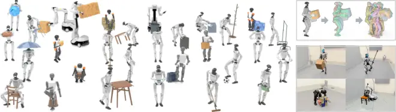

Figure 1: InterMimicGen grows a finite set of human interaction captures
into an expanding repertoire of executable robot motions. Left: One
formulation turns the captures into executable motions across diverse
objects, tasks, and robots, from humanoids to a wheeled mobile
manipulator. Top right: Self-evolving motion imitation. A single motion
grows round by round into many variants. Bottom right: The resulting
motions run on real robots.

## 1 Introduction

The value of human demonstrations for humanoid loco-manipulation extends
beyond reproducing the trajectories they record. Each demonstration
captures one coordinated solution in a high-dimensional interaction
space, but even a large motion-capture corpus provides sparse samples of
this space rather than dense coverage of their feasible variations.
Covering these variations therefore requires either a policy that can
infer the physically feasible manifold from these sparse samples, or a
data-generation process that enriches the data with coordinated,
physically valid variations.

A natural route is to train a tracking policy by collecting more
references, but any fixed set of references still leaves these
variations uncovered. When we look back, generalist trackers already
generalize well in locomotion (Luo et al., 2026), where a motion close
to a demonstration usually remains feasible. Loco-manipulation is less
forgiving. The robot must hold contact with an object while keeping its
balance, so a small change in posture or object placement can break a
grasp, push the hand into the object, or make the robot fall. As a
result, a tracker that executes a demonstration may still fail on the
same task where the trajectory is shifted by only a few centimeters
(Sec. 4.4). Covering them therefore requires data that grows with the
tracker rather than a fixed collection. We build this as a _data
flywheel_, in which executable data and the tracker grow together.

To instantiate this flywheel, we introduce InterMimicGen, a
self-evolving motion-imitation data engine that couples human-object
interaction retargeting, large-scale motion imitation, and iterative
data expansion. We first consolidate heterogeneous human-object
motion-capture data (Figure 3) and retarget the interactions into
humanoid robot references. Our retargeter keeps both long-horizon
body-object relations and the finger contact that holds small objects: a
whole-body solver shapes the grasp to follow the object’s geometry
rather than captured finger poses alone, and a fine-grained cleanup then
refines the contact at the millimeter scale. The result is a large and
diverse robot reference collection for dexterous whole-body
loco-manipulation, as shown in Figure InterMimicGen: Scaling Humanoid  
Loco-Manipulation through  
Self-Evolving Motion Imitation. Physics-based trackers then execute
these references in simulation on a humanoid robot with dexterous hands,
and the same trackers later grow together with their reference data
through iterative data expansion.

The goal of this expansion is not to invent new tasks; each human
interaction becomes a seed for physically distinct realizations of the
same semantic behavior, in the spirit of MimicGen’s demonstration-driven
data expansion (Mandlekar et al., 2023). We vary object and body motion
through small edits around previously validated interactions, such as
placing a box farther left or crouching more deeply. Each round
fine-tunes the tracker on the current references and edited candidates,
executes the candidates in simulation, and retains only rollouts that
complete without failure. Drawing on InterMimic’s insight that a policy
can correct imperfect motion by learning from it (Xu et al., 2025d),
imitation repairs errors introduced by the edits. The successful
rollouts then seed the next round. This feedback is the defining step of
InterMimicGen: corrected motions expand the reference set, and the
expanded set enables the tracker to realize progressively larger
variations.

Our contributions are threefold. First, we consolidate heterogeneous
human-object interaction (HOI) data and retarget them into, to our
knowledge, the most diverse humanoid robot reference collection (see
Sec. 4.1) for dexterous whole-body loco-manipulation. Second, using
these references, we train a physics-based generalist tracker that
realizes this repertoire on a target embodiment at a scale beyond prior
humanoid tracking systems (Weng et al., 2025; Yang et al., 2026; He et
al., 2026; Cao et al., 2026b) for loco-manipulation. Third, we introduce
a self-evolving augmentation-learning loop that expands this repertoire
through coupled variations in object and whole-body motions, turning
validated interactions into a growing resource for subsequent learning
of whole-body controllers.

## 2 Related Work

Human-object interaction data. Human-object and human-scene capture
datasets provide complementary interaction references across whole-body
grasping, object tracking, bimanual manipulation, and scene-level
coordination (Taheri et al., 2020; Bhatnagar et al., 2022; Huang et al.,
2024; Lv et al., 2024; Fan et al., 2023; Lu et al., 2025; Zhang et al.,
2025; Liu et al., 2025b; Zhang et al., 2023a; Zhao et al., 2024; Li et
al., 2023). These resources differ in object diversity, contact
structure, and body and hand annotation, shaping the supervision
available for imitation. Among them, InterAct (Xu et al., 2025c)
consolidates heterogeneous interaction sources, while HiPHI (Ji et al., 2026) adds extensive body-object capture. We combine their motion into a
robot reference collection and expand physically executable coverage
through retargeting and humanoid robot execution in simulation.

Whole-body and dexterous motion retargeting. Motion retargeting adapts
demonstrations across morphologies using learned mappings or
optimization objectives built from skeleton structure, contact cues, and
geometric correspondences (Villegas et al., 2018; Aberman et al., 2020;
Villegas et al., 2021; Reda et al., 2023; Araújo et al., 2025; Cao et
al., 2026a). For interaction, the relationships between body, object,
hand, and scene must survive the change in embodiment rather than only
the joint trajectory (Kim et al., 2016; Zhang et al., 2023b; Yang et
al., 2026). Dexterous teleoperation and synthesis study high-quality
hand or hand-arm transfer (Handa et al., 2020; Qin et al., 2023; Zhao et
al., 2026; Pan et al., 2025; Xu et al., 2025b), but whole-body
interaction also requires those contacts to remain consistent with
locomotion and balance. Our retargeter therefore separates the problem
into a coarse whole-body interaction solve and a local dense contact
refinement, so hand motion is improved without disturbing the
body-object motion.

Physics-based imitation and whole-body manipulation. Physics-based
imitation began with example-guided control of individual skills (Peng
et al., 2018) and later scaled to shared controllers over diverse motion
libraries (Won et al., 2020; Luo et al., 2023). On physical humanoids,
teleoperation and imitation enable whole-body control (He et al., 2024;
Ze et al., 2025), while universal tracking policies and visuomotor
extensions broaden the motion and sensing interfaces (Yin et al., 2026;
Luo et al., 2026; Ding et al., 2025). Object-centric extensions couple
body and object dynamics for grasping and dynamic skills (Wang et al.,
2023; Luo et al., 2024; Wang et al., 2025b; Tessler et al., 2025; Xu et
al., 2025d; Xu et al., 2026a), and then move to real-world humanoid
loco-manipulation (Weng et al., 2025; Zhao et al., 2025; Fu et al.,
2026; Liu et al., 2025a; Dao et al., 2024; Sun et al., 2025; Kalaria et
al., 2025; Yin et al., 2025; Wang et al., 2025a; He et al., 2026). Our
work starts from reference tracking and extends it into a self-evolving
data engine, with real deployment.

Demonstration augmentation and iterative generation. A demonstration can
be reused beyond its recorded trajectory (Mandlekar et al., 2023):
collected segments preserve task intent, while execution under adapted
conditions becomes valid training data. Later systems extend this
execution-validated reuse to bimanual dexterity (Jiang et al., 2025),
skill composition (Garrett et al., 2024), intervention-driven data
collection (Hoque et al., 2024; Luo et al., 2025), policy
self-improvement (Bousmalis et al., 2024), and humanoid
loco-manipulation (Lin et al., 2026). A related line in character and
humanoid control scales policies through generated experience or
closed-loop motion generation (Xu et al., 2025a; Debbad et al., 2026; Xu
et al., 2026b; Wang et al., 2026). Our setting differs in both domain
and mechanism: we expand dexterous and agile humanoid loco-manipulation
from motion-capture references, and we self-evolve through motion
imitation itself instead of a separate kinematic motion synthesizer,
which is often brittle for object interaction.

## 3 Method

InterMimicGen turns captured human-object interactions into an expanding
collection of robot references that a physics-based tracker can execute
(Figure 2). A reference $`\boldsymbol{\xi}`$ stores the target robot
motion, object motion, and contact intent of one clip. We first
consolidate heterogeneous captures (Sec. 3.1) and retarget them to robot
embodiments (Sec. 3.2). A generalist tracker then realizes these
references under robot dynamics (Sec. 3.3). Finally, self-evolving
motion imitation edits how verified interactions are realized and keeps
only the edits that the tracker executes in physics. Repeating this over
rounds, with a tracker that keeps learning from the new motions, lets
the verified references and the tracker grow together (Sec. 3.4).

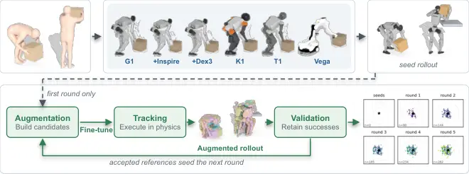

Figure 2: Top: Reference construction. Human-object motion capture is
retargeted into whole-body dexterous references, which a physics-based
tracker imitates to produce seed rollouts. Bottom: Self-evolving motion
imitation. Each round augments verified references into candidates,
fine-tunes the tracker on them, executes the candidates in physics, and
retains only successful rollouts as seeds for the next round; Bottom
right: UMAP embeddings (Sec. E.1) of accepted augmentations expanding.

### 3.1 A consolidated interaction reference collection

Because our learning loop expands skills already represented in the
source motions, the seed collection should cover interaction semantics
as broadly as possible. We combine InterAct (Xu et al., 2025c) and the
object-interaction portion of HiPHI (Ji et al., 2026) into a shared
collection. InterAct contributes diverse tasks and object categories by
consolidating public motion-capture datasets (Taheri et al., 2020;
Bhatnagar et al., 2022; Huang et al., 2024; Zhang et al., 2023a; Zhao et
al., 2024; Li et al., 2023), while HiPHI contributes longer synchronized
human-object motions. Figure 3 summarizes this complementarity: the
sources occupy different distributions of human motion, object geometry,
and interaction space, and their union improves coverage on external
motion probes. We convert both sources to a common body-object-hand
representation and treat absent hand annotations as unknown rather than
as evidence of no contact, and later refine the hand with retargeting.

We then keep only the interactions each target robot can physically
support. Sequences that simulation cannot represent, such as bag hanging
with an unmodeled strap, are removed, and platforms without dexterous
hands exclude interactions whose success depends on articulated finger
contact. The resulting references share one format for downstream
training (Sec. A).

### 3.2 Retargeting for dexterous whole-body interaction

Retargeting must satisfy constraints at two scales. The whole body must
preserve support and body-object geometry over long horizons, while the
hand must resolve millimeter-scale contact around small object regions.
Optimizing both with one objective tends to loosen contact or
over-constrain the body. We therefore solve the whole body first, with a
finger-opposition term that shapes the grasp, and then remove local
artifacts in a cleanup that preserves contact (Algorithm 1).

Interaction-preserving whole-body retargeting. The coarse stage
transfers body-object relationships through an interaction mesh (Yang et
al., 2026) that connects sparse body landmarks with sampled object
geometry, so matching the mesh preserves spatial interaction structure
rather than only joint poses. It solves for the floating base and
articulated body under the target robot’s constraints, with sparse hand
landmarks placing the wrists and palms. Because different motion clips
might fail under different local constraints, we use several constrained
solvers in turn and keep the first feasible solution. The solve keeps
the source object trajectory fixed and includes the finger-opposition
term below, so the hands close around the object while the body is
solved.

Finger opposition. Surface proximity alone can let several fingertips
settle on the same side of an object, which does not hold it. We
therefore add an opposition term to the whole-body solve. For fingertip
$`f`$, let $`\boldsymbol{n}_{t,f}`$ be the normalized displacement from
its selected object-surface point to the fingertip at time $`t`$, and
let $`\boldsymbol{n}_{t,\mathrm{thumb}}`$ be the same direction for the
thumb:

```math
E_{\mathrm{cover}}(\boldsymbol{q}_{t})=\sum_{f\in\mathcal{F}_{e}}g_{t,f}\big[\boldsymbol{n}_{t,\mathrm{thumb}}^{\top}\boldsymbol{n}_{t,f}+m\big]_{+}^{2},\qquad[x]_{+}=\max(x,0), \tag{1}
```

where $`\mathcal{F}_{e}`$ contains the supported thumb-finger pairs,
$`g_{t,f}`$ activates a pair once the thumb and finger approach the
object, and $`m`$ sets the opposition margin. The term penalizes pairs
whose directions are not sufficiently opposed, so fingers are promoted
to approach from the side opposite the thumb.

Geometry cleanup with contact preservation. The whole-body solve can
still leave small penetrations, jitter, and contact drift. We therefore
refine the robot and object trajectories with two successive Adam
passes (Kingma and Ba, 2015). The first reduces robot-object, floor, and
hand self-collision while regularizing deviation from the coarse motion,
foot support, joint limits, and temporal smoothness. The second smooths
the repaired trajectory under collision constraints and preserves
hand-object relationships during contact. Each pass is retained only if
its output satisfies deviation and quality checks relative to its input.
Robots without articulated fingers omit finger-specific terms. Sec. B
gives the objectives, acceptance checks, and solver settings.

### 3.3 A generalist for interaction motion imitation

The generalist tracker turns kinematic references into physically
executable motions, and later serves as the validator of augmented
references. It observes the robot state, upcoming reference frames, and
object-relative geometry, including distance-decayed vectors from each
body link to its nearest point on the object surface. It outputs joint
targets for proportional-derivative (PD) control, and on the Inspire
hands, coupled finger joints follow their driving joints through
mimic-joint constraints instead of acting as independent actuators. We
train a single policy $`\pi_{\theta}`$ with proximal policy
optimization (Schulman et al., 2017) across parallel environments,
sharing parameters across motions and objects. The reward balances body
motion, object motion, interaction geometry, and contact fidelity.
Reference-state initialization exposes different phases of long
sequences, and adaptive sampling emphasizes difficult motions. More
details are presented in Sec. C.

### 3.4 Self-evolving motion imitation

A human capture shows what an interaction achieves but only one way of
performing it. We therefore generate new ways of performing the same
interaction. This follows the spirit of MimicGen (Mandlekar et al.,
2023), which turns one demonstration into many training examples by
replaying it under new conditions and keeping the successful replays,
and here the replay is motion imitation by our tracker. Each variant is
derived from a verified parent reference $`\boldsymbol{\xi}`$ and must
keep four properties of the parent, which form the invariant set
$`\mathcal{I}`$: the interaction type, the intended contacts, the
object, and the task outcome. Variants thus add new motions around each
capture without changing its meaning.

What an edit changes. An edit changes either where the interaction takes
place or how the body performs it, as shown in Figures 6 and 8. We
describe it by coordinates
$`\boldsymbol{z}=(\boldsymbol{z}^{\mathrm{task}},\boldsymbol{z}^{\mathrm{body}})`$
and construct a proposal $`\tilde{\boldsymbol{\xi}}`$ that keeps every
invariant of its parent:

```math
\tilde{\boldsymbol{\xi}}=\operatorname{Augment}(\boldsymbol{\xi};\boldsymbol{z},\mathcal{I}),\qquad r_{j}(\tilde{\boldsymbol{\xi}},\boldsymbol{\xi})=0\quad\forall j\in\mathcal{I}, \tag{2}
```

where $`r_{j}`$ measures how much the proposal violates invariant $`j`$.
Object edits $`\boldsymbol{z}^{\mathrm{task}}`$ move or turn the
object’s trajectory, for example placing a box further to the left, and
leave the whole-body response to the tracker, which must reach, grasp,
carry, and place the object accordingly. Body edits
$`\boldsymbol{z}^{\mathrm{body}}`$ keep the object path and change the
posture that realizes it: a deeper crouch or a shifted and turned
pelvis, a wider stance or a different toe angle, or a different elbow
posture. In every case the hands stay on their original targets, so the
contacts with the object are preserved. After each edit, we recompute
the kinematics, velocities, and body-object interaction features of the
new reference. Sec. D defines the coordinates, their bounds, and the
checks that each invariant of the parent still holds.

Fine-tune, then keep only what executes. Each round starts from a set of
verified parents. Let $`\mathcal{D}_{k}`$ be the verified references
after round $`k`$, where $`\mathcal{D}_{0}`$ holds the seed rollouts of
the base tracker on the retargeted references, and let
$`\mathcal{P}_{k}\subseteq\mathcal{D}_{k}`$ be the parents of round
$`k`$. The round edits the parents into proposals $`\mathcal{C}_{k}`$,
fine-tunes the tracker $`\pi_{\theta}`$ on the verified references
together with the proposals, since the proposals lie partly outside what
it has learned, and then executes each proposal in physics and keeps the
successful ones:

```math
\displaystyle\mathcal{C}_{k} \displaystyle=\operatorname{Augment}(\mathcal{P}_{k}), \tag{3}
```

```math
\displaystyle\theta_{k+1} \displaystyle=\operatorname{Train}(\theta_{k},\mathcal{D}_{k}\cup\mathcal{C}_{k}),
```

```math
\displaystyle\mathcal{B}_{k} \displaystyle=\big\{\operatorname{Store}(\tilde{\boldsymbol{\xi}},\boldsymbol{\tau}):\tilde{\boldsymbol{\xi}}\in\mathcal{C}_{k},\ \boldsymbol{\tau}\sim\operatorname{Rollout}(\pi_{\theta_{k+1}},\tilde{\boldsymbol{\xi}}),\ V(\tilde{\boldsymbol{\xi}},\boldsymbol{\tau};\mathcal{I})=1\big\},
```

```math
\displaystyle\mathcal{D}_{k+1} \displaystyle=\mathcal{D}_{k}\cup\operatorname{Select}(\mathcal{B}_{k}).
```

Here, $`\operatorname{Train}`$ continues the tracker’s reinforcement
learning on the proposed references. The validation function $`V`$
accepts a proposal only if its rollout reaches the end of the reference
without early termination or a fall, passes motion-smoothness checks,
and preserves the task outcome, such as holding or placing the object at
the end (Sec. D.4). Satisfying Eq. 2 alone does not make a proposal
executable under robot dynamics. Fine-tuning expands the set of
variations the tracker can execute: without it, only a small fraction of
second-round proposals pass validation (Sec. F.2). Thus, the loop
improves the policy’s capability as it expands the motion collection,
rather than merely collecting variations the initial generalist could
already track.

Growing coverage over rounds. Accepted proposals become the parents of
the next round, so the verified references and the tracker’s skills grow
together across more iterations. A proposal that fails is never edited
again, so errors cannot accumulate across rounds. Each round picks a
diverse set of the successful motions that reached farthest from their
seed and moves each a fixed step further (Sec. D.5). Coverage is
measured independently of these edit coordinates (Sec. F.4).

## 4 Experiments

We evaluate four questions. (i) Can one retargeter preserve both
long-horizon body-object relations and fine finger contact, and does
this yield cleaner references than prior retargeters (Sec. 4.2)?
(ii) How broadly can trackers execute these references across objects
and embodiments, and which interactions remain hard (Sec. 4.3)?
(iii) Does growing the data together with the tracker expand what it can
execute beyond the original references, and does this growth come from
learning rather than from filtering more rollouts (Sec. 4.4)? (iv) Do
the resulting motions carry over from simulation to different real
humanoid robots (Sec. 4.5)?

### 4.1 Experimental setup

Data and embodiments. We consolidate InterAct (Xu et al., 2025c) and
HiPHI (Ji et al., 2026) into a collection of 16,059 motions, 140.68
reference hours, and 157 object entries (Table 4), which covers a wide
range of everyday interactions (Figure 3). We retarget it to six robot
configurations: G1 (Unitree Robotics, ) with non-dexterous,
Inspire (Inspire Robots, ), or Dex3 (Unitree Robotics, ) hands, Booster
T1 and K1 (Booster Robotics, ; Booster Robotics, ), and Dexmate
Vega (Dexmate, ). Sec. A.1 details which experiments run on each
embodiment.

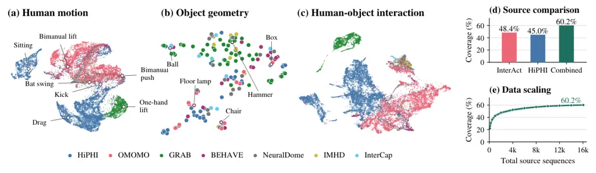

Figure 3: Our data has broad coverage. (a-c) UMAP embeddings of human
motion, object geometry, and human-object interaction of our collection,
colored by source dataset. (d) How well our collection covers external
motions from GRAIL (Xie et al., 2026), MOVIN (Jang et al., 2023), and
ELMO (Jang et al., 2024); a motion is covered when one of our sequences
is close to it (Sec. E.1). (e) The same coverage as the number of our
source sequences grows.

Metrics. Each experiment uses its own group of metrics, and Sec. E
defines each of them once. Retargeted references are scored on
plausibility and fidelity to the human motion: hand-contact
preservation, in-hand slip, penetration, foot sliding, MPJPE, and joint
acceleration. Tracking is scored by the success rate, the fraction of
clips executed to the end without a fall or a large body, object, or
interaction error, and by body and object errors on successful clips.
For the augmentation loop, we report the growth of the verified
reference set, the success of the tracker before and after
self-evolution on the generated and original references, and the quality
of their executions.

Baselines. For dexterous retargeting, we compare with Weave (Cao et al.,
2026b), whose released retargeted references use the same embodiment
with InterMimicGen. For retargeting without dexterous hands, we compare
with OmniRetarget (Yang et al., 2026), UMR (Cao et al., 2026a), and
ULTRA (He et al., 2026) on G1. For tracking, no publicly available
tracker is trained on an interaction collection of comparable scale, so
we compare our generalist with per-object specialists, each trained only
on the references of one object, which serve as a practical upper bound.
For the augmentation loop, we compare with the scene-scaling
augmentation of ULTRA (He et al., 2026), which also expands the training
references of a humanoid tracker (Sec. F.4), and we isolate the
effectiveness of augmentation with two controls: the base tracker before
any augmentation and a frozen tracker that only filters new candidates
without finetuning.

|       |                       |                      |                          |                        |                          |                        |                            |                          |                       |                                  |      |       |                              |       |
| ----- | --------------------- | -------------------- | ------------------------ | ---------------------- | ------------------------ | ---------------------- | -------------------------- | ------------------------ | --------------------- | -------------------------------- | ---- | ----- | ---------------------------- | ----- |
|       | Hand contact          |                      |                          | Penetration            |                          |                        | Motion                     |                          |                       | Jnt. acc. (rad/s²)$`\downarrow`$ |      |       | Jnt. limit (%)$`\downarrow`$ |       |
|       | Frame (%)$`\uparrow`$ | Hand (%)$`\uparrow`$ | Slip (m/s)$`\downarrow`$ | Obj. (%)$`\downarrow`$ | Depth (cm)$`\downarrow`$ | Gnd. (%)$`\downarrow`$ | Foot sl. (%)$`\downarrow`$ | MPJPE (cm)$`\downarrow`$ | EE (cm)$`\downarrow`$ | All                              | Body | Fing. | Body                         | Fing. |
| Weave | 96.1                  | 97.1                 | 0.225                    | 67.4                   | 2.62                     | 31.9                   | 62.0                       | 9.54                     | 12.6                  | 12.2                             | 6.3  | 19.3  | 0.6                          | 33.4  |
| Ours  | 98.2                  | 98.8                 | 0.239                    | 37.2                   | 2.39                     | 0.0                    | 12.3                       | 5.74                     | 5.3                   | 2.8                              | 3.2  | 2.3   | 0.0                          | 0.0   |

Table 1: Quantitative comparison on retargeting on G1 with Inspire
hands, on the 3,059 OMOMO clips. Ours shows better motion quality.
Metrics are defined in Sec. E.2.

### 4.2 Retargeting quality and dexterous contact

Our retargeter produces cleaner dexterous references. Table 1 compares
our retargeting with Weave on G1 with Inspire hands. Our references keep
hand contact slightly better, greatly reduce object penetration, foot
sliding, and joint acceleration, and stay closer to the raw motion, at
the cost of slightly higher in-hand slip. We attribute this to
explicitly shaping the grasp and then additionally refining contact in a
second cleanup, so better hands do not come at the cost of the body.

Dexterous hands keep grasps that rigid hands can only approximate.
Figures 12 and 13 compare against OmniRetarget (Yang et al., 2026) and
UMR (Cao et al., 2026a) on shared source motions. With articulated
fingers, our references preserve the grasp and hand-object relationship
of the demonstration by explicit grasp modeling. When all methods use
the same non-dexterous G1 (Sec. F.1), each favors a different trade-off:
ours is the smoothest and most accurate at the end effectors as the
explicit grasping shape, OmniRetarget penetrates least, and UMR
preserves the most contact.

One formulation retargets across embodiments and objects. Figures 4, 9,
10, and 11 show interactions with objects of different shapes, a grasp
retargeted to two dexterous hands, and one interaction retargeted to all
six embodiments. The formulation is shared across robots: each
configuration only declares its own landmarks and hand mappings, so a
new robot needs only its configuration.

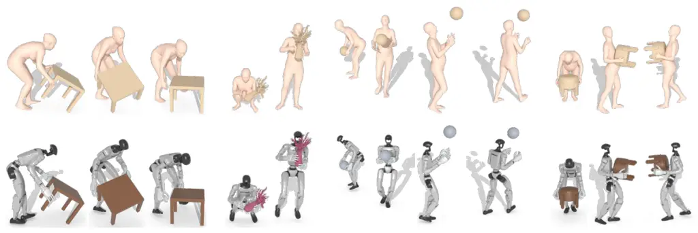

Figure 4: Qualitative evaluation on retargeting. Captured human motion
(top) and our G1 with Inspire hands reference (bottom), across
interactions from different datasets.

|                                         |                |                     |                    |                    |                |                     |                    |                    |                |                     |                    |                    |
| --------------------------------------- | -------------- | ------------------- | ------------------ | ------------------ | -------------- | ------------------- | ------------------ | ------------------ | -------------- | ------------------- | ------------------ | ------------------ |
|                                         | Bimanual       |                     |                    |                    | Sitting        |                     |                    |                    | Grasping       |                     |                    |                    |
| Embodiment                              | SR$`\uparrow`$ | MPJPE$`\downarrow`$ | Obj.$`\downarrow`$ | Rot.$`\downarrow`$ | SR$`\uparrow`$ | MPJPE$`\downarrow`$ | Obj.$`\downarrow`$ | Rot.$`\downarrow`$ | SR$`\uparrow`$ | MPJPE$`\downarrow`$ | Obj.$`\downarrow`$ | Rot.$`\downarrow`$ |
| Specialists (one policy per object)     |                |                     |                    |                    |                |                     |                    |                    |                |                     |                    |                    |
| G1 + Inspire                            | 93.8           | 5.19                | 5.79               | 10.4               | 75.4           | 5.94                | 4.76               | 7.4                | 84.9           | 5.30                | 7.17               | 14.1               |
| G1 + Dex3                               | 93.1           | 4.92                | 7.02               | 11.0               | 82.8           | 5.36                | 5.01               | 6.5                | 83.9           | 5.14                | 7.32               | 12.7               |
| G1                                      | 94.4           | 4.52                | 5.88               | 8.5                | 82.8           | 4.93                | 5.26               | 6.2                | –              | –                   | –                  | –                  |
| K1                                      | 75.7           | 6.21                | 7.35               | 14.3               | 75.4           | 6.41                | 5.08               | 8.3                | –              | –                   | –                  | –                  |
| Generalist (one policy for all objects) |                |                     |                    |                    |                |                     |                    |                    |                |                     |                    |                    |
| G1 + Inspire                            | 73.2           | 5.86                | 6.53               | 23.4               | 64.9           | 6.14                | 5.94               | 7.8                | 58.3           | 5.95                | 7.63               | 35.5               |

Table 2: Quantitative results on motion tracking. One generalist nearly
matches the per-object specialists in body and object position error,
while trailing them in success rate and object rotation. Metrics are
defined in Sec. E.3; – marks tasks the embodiment cannot perform.

### 4.3 Physics-based interaction tracking

Table 2 reports tracking on our constructed benchmark over 15 objects,
grouped into bimanual, sitting, and grasping interactions. Bimanual
interactions are tracked most reliably on every G1 configuration.
Sitting and grasping are harder, since sitting shifts the body’s weight
onto the object and grasping requires finger contact on small object
regions. The Booster K1 specialist trails the G1 specialists on bimanual
interactions. A single policy trained on the whole collection tracks all
motions (Table 2, bottom). Its body error stays close to that of the
specialists, whereas its success rate and object rotation error fall
behind, most on grasping. Sharing one policy across objects costs mainly
object control rather than body tracking, and fine grasps are where
per-object capacity matters. Figures 5, 14, and 15 show executed
rollouts across objects, across embodiments, and with two dexterous
hands.

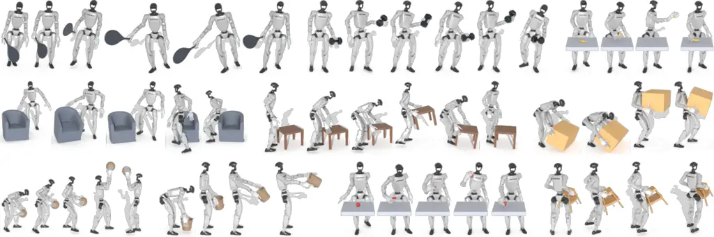

Figure 5: Physics-based tracking across objects. Executed rollouts on G1
with Inspire hands for a diverse set of objects.

### 4.4 Does iterative generation expand learned competence?

We run five rounds of self-evolving motion imitation on bimanual and
grasping interactions with G1 and Inspire hands, and on bimanual
interactions with G1 and Dex3 hands, grouped from the successful
rollouts in the tracking benchmark (Sec. 4.3). Each round applies object
edits, which move and turn where the object is placed relative to the
seed’s own execution, and body edits, which change the posture that
realizes the interaction; later rounds edit only references verified in
earlier rounds. We ask three questions: are the augmented references of
good quality, does each round expand their range, and does training on
them improve the tracker?

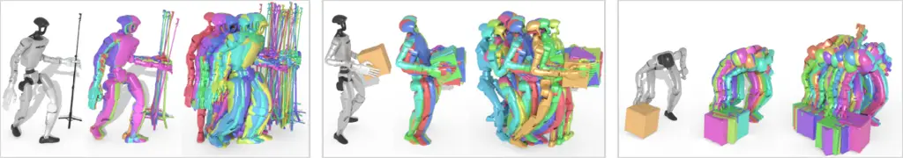

Figure 6: A single capture grows into many executable variants. Each
group shows the original reference followed by the verified
augmentations accumulated by round 1 and by round 5.

|                   |                    |             |       |          |       |                             |                   |                    |
| ----------------- | ------------------ | ----------- | ----- | -------- | ----- | --------------------------- | ----------------- | ------------------ |
|                   | Growth (×)         | Success (%) |       |          |       | Quality, Orig. $`\to`$ Aug. |                   |                    |
|                   |                    | Generated   |       | Original |       | Body acc.                   | Foot sl.          | Hand jit.          |
| Setting           | R1 $`\to`$ R5      | Orig.       | Evol. | Orig.    | Evol. | (rad/s²)$`\downarrow`$      | (%)$`\downarrow`$ | (mm)$`\downarrow`$ |
| Inspire, bimanual | 21.8 $`\to`$ 150.5 | 52.1        | 98.4  | 100      | 100   | 11.4 $`\to`$ 12.4           | 1.18 $`\to`$ 1.87 | 1.00 $`\to`$ 1.17  |
| Dex3, bimanual    | 21.3 $`\to`$ 142.0 | 59.3        | 98.7  | 100      | 100   | 13.9 $`\to`$ 16.0           | 1.14 $`\to`$ 2.21 | 1.12 $`\to`$ 1.30  |
| Inspire, grasping | 19.6 $`\to`$ 146.4 | 64.2        | 98.9  | 100      | 100   | 13.6 $`\to`$ 15.3           | 0.70 $`\to`$ 2.05 | 0.96 $`\to`$ 1.14  |

Table 3: Over five rounds, the verified references grow more than a
hundredfold, and the evolved tracker executes nearly all of them without
losing the original ones. Growth: verified references relative to the
original references. Success: rate at which the tracker before (Orig.)
and after (Evol.) self-evolution. Quality: executions of original
(Orig.) and augmented (Aug.) references.

Augmented references stay close to the originals in quality. Averaged
over all rounds, executions of augmented references stay close to those
of the original references in body joint acceleration and hand jitter,
while foot sliding rises from about 1% to about 2% of contact frames
(quality columns of Table 3). All three measures rise moderately in
later rounds, which by design accept edits farther from the captures
(Sec. F.3).

Each round expands the set of executable references. Every setting keeps
accepting new spatial and body references: the verified reference set
grows about twentyfold in the first round and more than a hundredfold by
the fifth (growth column of Table 3, Figures 6 and 8; per-round values
in Sec. F.3). Body edits also widen the range along another axis,
posture: their references spread over a region of body motion several
times wider than the scene-scaling variants of ULTRA (He et al., 2026)
(Sec. F.4). This expansion depends on learning. A frozen tracker that
only filters candidates accepts almost none of the new candidates after
the first round, because the new candidates start from first-round
successes that already lie beyond its reach (Sec. F.2).

Self-evolution makes the tracker better. We replay every accepted
reference and every original reference with the tracker before and after
self-evolution, counting a reference as executed when at least one of
three rollouts reaches its end (success columns of Table 3). The
original tracker fails on more than a third of the accepted references
even though it is trained with large-scale data, whereas the evolved
tracker executes nearly all of them, and both execute every original
reference. Self-evolution therefore extends what the tracker can execute
without losing what it could already do.

### 4.5 Cross-embodiment execution and real-world transfer

To verify that the trajectories produced by InterMimicGen work beyond
simulation, we execute them on real robots. Each embodiment uses the
parts of the framework it supports (Sec. A.1), and each platform runs
its own low-level controller, trained by us or publicly available
(Sec. G). These controllers are blind to the object and track only the
robot motion, yet our trajectories execute well on every platform,
suggesting that they are physically consistent enough to transfer
without object feedback. Figure 7 shows box lifting and placement,
suitcase pulling, tripod carrying, and chair relocation, with more
videos on the [project page](https://sirui-xu.github.io/InterMimicGen).

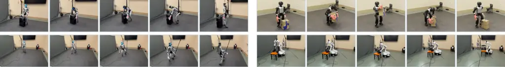

Figure 7: Real-world execution. We show the motion from our paradigm
transfer to different embodiments, from Unitree G1 pulling a suitcase
and G1 with Inspire hands carrying a tripod; Booster K1 lifting and
placing a box and Dexmate Vega relocating a chair.

## 5 Discussion and Conclusion

InterMimicGen treats a humanoid tracker as both a consumer and a
producer of interaction data. A consolidated human-object motion
collection supplies diverse task semantics, hand-aware retargeting
transfers them to six robot configurations, and physics-based tracking
grounds them in executable motion. The evolving loop then turns
validated variations into new references. Every round enlarges the
archive, and the fine-tuned tracker learns interactions beyond the base
tracker’s reach while keeping its seed skills. Learning is what keeps
the loop going, since a frozen tracker stops accepting new variations
after the first round. Acknowledgments. We thank Ziyin Wang for helping
with the on-site deployment.

## References

- Aberman et al. (2020) K. Aberman, P. Li, D. Lischinski, O.
  Sorkine-Hornung, D. Cohen-Or, and B. Chen Skeleton-aware networks for
  deep motion retargeting. ACM Transactions on Graphics 39 (4), pp. 62.
  Cited by: §2.
- Andersson et al. (2019) J. A. E. Andersson, J. Gillis, G. Horn, J. B.
  Rawlings, and M. Diehl CasADi – A software framework for nonlinear
  optimization and optimal control. Mathematical Programming Computation
  11 (1), pp. 1–36. External Links:
  [Document](https://dx.doi.org/10.1007/s12532-018-0139-4) Cited by:
  Appendix G.
- Araújo et al. (2025) J. P. Araújo, Y. Ze, P. Xu, J. Wu, and C. K. Liu
  Retargeting matters: general motion retargeting for humanoid motion
  tracking. arXiv preprint arXiv:2510.02252. Cited by: §2.
- Bhatnagar et al. (2022) B. L. Bhatnagar, X. Xie, I. A. Petrov, C.
  Sminchisescu, C. Theobalt, and G. Pons-Moll BEHAVE: dataset and method
  for tracking human object interactions. In CVPR, Cited by: §2, §3.1.
- \[5\] Booster Robotics Booster K1. Note: Official product page
  External Links: [Link](https://www.booster.tech/booster-k1/) Cited by:
  §4.1.
- \[6\] Booster Robotics Booster T1. Note: Official product page
  External Links: [Link](https://www.booster.tech/booster-t1/) Cited by:
  §4.1.
- Bousmalis et al. (2024) K. Bousmalis, G. Vezzani, D. Rao, C. M.
  Devin, A. X. Lee, M. Bauzá Villalonga, T. Davchev, Y. Zhou, A.
  Gupta, A. Raju, A. Laurens, C. Fantacci, V. Dalibard, M.
  Zambelli, M. F. Martins, R. Pevceviciute, M. Blokzijl, M. Denil, N.
  Batchelor, T. Lampe, E. Parisotto, K. Zolna, S. E. Reed, S. Gómez
  Colmenarejo, J. Scholz, A. Abdolmaleki, O. Groth, J. Regli, O.
  Sushkov, T. Rothörl, J. E. Chen, Y. Aytar, D. Barker, J. Ortiz, M. A.
  Riedmiller, J. T. Springenberg, R. Hadsell, F. Nori, and N. Heess
  RoboCat: a self-improving generalist agent for robotic manipulation.
  Transactions on Machine Learning Research. External Links:
  [Link](https://openreview.net/forum?id=vsCpILiWHu) Cited by: §2.
- Cao et al. (2026a) H. Cao, Y. Fang, T. Kwon, R. Yu, J. Ma, J. Tan, Y.
  Zhou, B. Du, Y. Gu, Y. Gao, R. Dai, L. Han, and R. Xu Unified motion
  retargeting for humanoids with learned point cloud correspondence.
  arXiv preprint arXiv:2609.02134. Cited by: §2, §4.1, §4.2.
- Cao et al. (2026b) L. Cao, X. Wu, J. Cui, B. Xu, M. Pei, R. Chen,
  and M. Xu Weave: learning whole-body dexterous loco-manipulation from
  human-object interactions. arXiv preprint arXiv:2609.16683. Cited by:
  §1, §4.1.
- Dao et al. (2024) J. Dao, H. Duan, and A. Fern Sim-to-real learning
  for humanoid box loco-manipulation. In ICRA, Cited by: §2.
- Debbad et al. (2026) P. Debbad, K. Thiagarajan, V. Dhédin, S. Omar,
  and M. Khadiv Humanoid-DART: humanoid loco-manipulation using
  diffusion-guided augmentation through relabeling and tracking. arXiv
  preprint arXiv:2606.26855. Cited by: §2.
- \[12\] Dexmate Vega. Note: Official product page External Links:
  [Link](https://www.dexmate.ai/product/vega) Cited by: §4.1.
- Ding et al. (2025) P. Ding, J. Ma, X. Tong, B. Zou, X. Luo, Y. Fan, T.
  Wang, H. Lu, P. Mo, J. Liu, Y. Wang, H. Zhou, W. Feng, J. Liu, S.
  Huang, and D. Wang Humanoid-VLA: towards universal humanoid control
  with visual integration. arXiv preprint arXiv:2502.14795. Cited by:
  §2.
- Fan et al. (2023) Z. Fan, O. Taheri, D. Tzionas, M. Kocabas, M.
  Kaufmann, M. J. Black, and O. Hilliges ARCTIC: a dataset for dexterous
  bimanual hand-object manipulation. In CVPR, Cited by: §2.
- Fu et al. (2026) Y. Fu, F. Xie, C. Xu, J. Xiong, H. Yuan, and Z. Lu
  DemoHLM: from one demonstration to generalizable humanoid
  loco-manipulation. IEEE Robotics and Automation Letters 11 (4),
  pp. 4393–4400. External Links:
  [Document](https://dx.doi.org/10.1109/LRA.2026.3666395) Cited by: §2.
- Garrett et al. (2024) C. R. Garrett, A. Mandlekar, B. Wen, and D. Fox
  SkillMimicGen: automated demonstration generation for efficient skill
  learning and deployment. In CoRL, Cited by: §2.
- Handa et al. (2020) A. Handa, K. Van Wyk, W. Yang, J. Liang, Y.
  Chao, Q. Wan, S. Birchfield, N. D. Ratliff, and D. Fox DexPilot:
  vision-based teleoperation of dexterous robotic hand-arm system. In
  ICRA, Cited by: §2.
- He et al. (2024) T. He, Z. Luo, X. He, W. Xiao, C. Zhang, W.
  Zhang, K. M. Kitani, C. Liu, and G. Shi OmniH2O: universal and
  dexterous human-to-humanoid whole-body teleoperation and learning. In
  CoRL, Cited by: §2.
- He et al. (2026) X. He, S. Xu, X. Li, R. Dong, L. Bian, Y. Wang,
  and L. Gui ULTRA: unified multimodal control for autonomous humanoid
  whole-body loco-manipulation. In IROS, Cited by: §1, §2, §4.1, §4.4.
- Hoque et al. (2024) R. Hoque, A. Mandlekar, C. R. Garrett, K.
  Goldberg, and D. Fox IntervenGen: interventional data generation for
  robust and data-efficient robot imitation learning. In IROS, Cited by:
  §2.
- Huang et al. (2024) Y. Huang, O. Taheri, M. J. Black, and D. Tzionas
  InterCap: joint markerless 3D tracking of humans and objects in
  interaction from multi-view RGB-D images. International Journal of
  Computer Vision 132 (7), pp. 2551–2566. Cited by: §2, §3.1.
- \[22\] Inspire Robots The Dexterous Hands. Note: Official product
  catalog External Links:
  [Link](https://en.inspire-robots.com/product-category/the-dexterous-hands/)
  Cited by: Appendix B, §4.1.
- Jang et al. (2023) D. Jang, D. Yang, D. Jang, B. Choi, T. Jin, and S.
  Lee MOVIN: real-time motion capture using a single LiDAR. Computer
  Graphics Forum 42 (7), pp. e14961. Cited by: Figure 3.
- Jang et al. (2024) D. Jang, D. Yang, D. Jang, B. Choi, S. Lee, and D.
  Shin ELMO: enhanced real-time LiDAR motion capture through upsampling.
  ACM Transactions on Graphics. Cited by: Figure 3.
- Ji et al. (2026) J. Ji, J. Ma, R. Zhang, R. Yu, W. Wang, W. Chi, Q.
  Peng, W. Yan, Y. Gu, Y. Tian, T. Wu, L. Li, C. Yuan, R. Dai, and L.
  Han HiPHI: a large-scale benchmark for high-precision human motion and
  object-interaction. In CoRL, Cited by: Table 4, §2, §3.1, §4.1.
- Jiang et al. (2025) Z. Jiang, Y. Xie, K. Lin, Z. Xu, W. Wan, A.
  Mandlekar, L. J. Fan, and Y. Zhu DexMimicGen: automated data
  generation for bimanual dexterous manipulation via imitation learning.
  In ICRA, Cited by: §2.
- Kalaria et al. (2025) D. Kalaria, S. S. Harithas, P. Katara, S.
  Kwak, S. Bhagat, S. Sastry, S. Sridhar, S. Vemprala, A. Kapoor,
  and J. C. Huang DreamControl: human-inspired whole-body humanoid
  control for scene interaction via guided diffusion. arXiv preprint
  arXiv:2509.14353. Cited by: §2.
- Kim et al. (2016) Y. Kim, H. Park, S. Bang, and S. Lee Retargeting
  human-object interaction to virtual avatars. IEEE Transactions on
  Visualization and Computer Graphics. Cited by: §2.
- Kingma and Ba (2015) D. Kingma and J. Ba Adam: a method for stochastic
  optimization. In ICLR, Cited by: §3.2.
- Li et al. (2023) J. Li, J. Wu, and C. K. Liu Object motion guided
  human motion synthesis. ACM Transactions on Graphics. Cited by: §2,
  §3.1.
- Lin et al. (2026) K. Lin, A. Mandlekar, C. R. Garrett, N.
  Chernyadev, Y. Fang, R. Ding, Y. Xie, J. Tran, L. Fan, and Y. Zhu
  HumanoidMimicGen: data generation for loco-manipulation via whole-body
  planning. arXiv preprint arXiv:2605.27724. Cited by: §2.
- Liu et al. (2025a) F. Liu, Z. Gu, Y. Cai, Z. Zhou, H. Jung, J.
  Jang, S. Zhao, S. Ha, Y. Chen, D. Xu, and Y. Zhao Opt2Skill: imitating
  dynamically-feasible whole-body trajectories for versatile humanoid
  loco-manipulation. IEEE Robotics and Automation Letters. Cited by: §2.
- Liu et al. (2025b) Y. Liu, C. Zhang, R. Xing, B. Tang, B. Yang, and L.
  Yi Core4D: a 4D human-object-human interaction dataset for
  collaborative object rearrangement. In CVPR, Cited by: §2.
- Lu et al. (2025) J. Lu, C. P. Huang, U. Bhattacharya, Q. Huang, and Y.
  Zhou HUMOTO: a 4D dataset of mocap human object interactions. In ICCV,
  Cited by: §2.
- Luo et al. (2025) J. Luo, C. Xu, J. Wu, and S. Levine Precise and
  dexterous robotic manipulation via human-in-the-loop reinforcement
  learning. Science Robotics 10 (105), pp. eads5033. External Links:
  [Document](https://dx.doi.org/10.1126/scirobotics.ads5033) Cited by:
  §2.
- Luo et al. (2024) Z. Luo, J. Cao, S. Christen, A. Winkler, K. Kitani,
  and W. Xu Omnigrasp: grasping diverse objects with simulated
  humanoids. In NeurIPS, Cited by: §2.
- Luo et al. (2023) Z. Luo, J. Cao, A. Winkler, K. Kitani, and W. Xu
  Perpetual humanoid control for real-time simulated avatars. In ICCV,
  Cited by: §2.
- Luo et al. (2026) Z. Luo, Y. Yuan, T. Wang, C. Li, F. Castañeda, S.
  Chen, Z. Cao, J. Li, D. Minor, Q. Ben, J. Park, D. Sami, Z. Wang, X.
  Da, R. Ding, C. Hogg, L. Song, E. Lim, E. Jeong, T. He, H. Xue, W.
  Xiao, S. Yuen, J. Kautz, Y. Chang, U. Iqbal, L. J. Fan, and Y. Zhu
  SONIC: supersizing motion tracking for natural humanoid whole-body
  control. Science Robotics 11 (117), pp. eaed4592. External Links:
  [Document](https://dx.doi.org/10.1126/scirobotics.aed4592) Cited by:
  Appendix G, §1, §2.
- Lv et al. (2024) X. Lv, L. Xu, Y. Yan, X. Jin, C. Xu, S. Wu, Y.
  Liu, L. Li, M. Bi, W. Zeng, and X. Yang HIMO: a new benchmark for
  full-body human interacting with multiple objects. In ECCV, Cited by:
  §2.
- Mandlekar et al. (2023) A. Mandlekar, S. Nasiriany, B. Wen, I.
  Akinola, Y. Narang, L. Fan, Y. Zhu, and D. Fox MimicGen: a data
  generation system for scalable robot learning using human
  demonstrations. In CoRL, Cited by: §1, §2, §3.4.
- Pan et al. (2025) C. Pan, C. Wang, H. Qi, Z. Liu, H. Bharadhwaj, A.
  Sharma, T. Wu, G. Shi, J. Malik, and F. Hogan SPIDER: scalable
  physics-informed dexterous retargeting. arXiv preprint
  arXiv:2511.09484. Cited by: §2.
- Peng et al. (2018) X. B. Peng, P. Abbeel, S. Levine, and M. Van de
  Panne DeepMimic: example-guided deep reinforcement learning of
  physics-based character skills. ACM Transactions on Graphics 37 (4),
  pp. 1–14. Cited by: §2.
- Qin et al. (2023) Y. Qin, W. Yang, B. Huang, K. Van Wyk, H. Su, X.
  Wang, Y. Chao, and D. Fox AnyTeleop: a general vision-based dexterous
  robot arm-hand teleoperation system. In RSS, Cited by: §2.
- Reda et al. (2023) D. Reda, J. Won, Y. Ye, M. van de Panne, and A. W.
  Winkler Physics-based motion retargeting from sparse inputs.
  Proceedings of the ACM on Computer Graphics and Interactive Techniques
  6 (3), pp. 1–19. Cited by: §2.
- Schulman et al. (2017) J. Schulman, F. Wolski, P. Dhariwal, A.
  Radford, and O. Klimov Proximal policy optimization algorithms. arXiv
  preprint arXiv:1707.06347. Cited by: §3.3.
- Sun et al. (2025) W. Sun, L. Feng, B. Cao, Y. Liu, Y. Jin, and Z. Xie
  ULC: a unified and fine-grained controller for humanoid
  loco-manipulation. arXiv preprint arXiv:2507.06905. Cited by: §2.
- Taheri et al. (2020) O. Taheri, N. Ghorbani, M. J. Black, and D.
  Tzionas GRAB: a dataset of whole-body human grasping of objects. In
  ECCV, Cited by: §2, §3.1.
- Tessler et al. (2025) C. Tessler, Y. Jiang, E. Coumans, Z. Luo, G.
  Chechik, and X. B. Peng MaskedManipulator: versatile whole-body
  manipulation. In SIGGRAPH Asia, Cited by: §2.
- \[49\] Unitree Robotics Unitree Dex3-1. Note: Official product page
  External Links: [Link](https://www.unitree.com/Dex3-1/) Cited by:
  Appendix B, §4.1.
- \[50\] Unitree Robotics Unitree G1. Note: Official product page
  External Links: [Link](https://www.unitree.com/g1/) Cited by: §4.1.
- Villegas et al. (2021) R. Villegas, D. Ceylan, A. Hertzmann, J. Yang,
  and J. Saito Contact-aware retargeting of skinned motion. In ICCV,
  Cited by: §2.
- Villegas et al. (2018) R. Villegas, J. Yang, D. Ceylan, and H. Lee
  Neural kinematic networks for unsupervised motion retargetting. In
  CVPR, Cited by: §2.
- Wächter and Biegler (2006) A. Wächter and L. T. Biegler On the
  implementation of an interior-point filter line-search algorithm for
  large-scale nonlinear programming. Mathematical Programming 106 (1),
  pp. 25–57. Cited by: Appendix G.
- Wang et al. (2025a) H. Wang, W. Zhang, R. Yu, T. Huang, J. Ren, F.
  Jia, Z. Wang, X. Niu, X. Chen, J. Chen, Q. Chen, J. Wang, and J. Pang
  PhysHSI: towards a real-world generalizable and natural humanoid-scene
  interaction system. arXiv preprint arXiv:2510.11072. Cited by: §2.
- Wang et al. (2026) J. Wang, Y. Jiang, H. Zhang, C. Tessler, D.
  Rempe, J. Hodgins, and X. B. Peng HIL: hybrid imitation learning for
  dynamic athletic control. ACM Transactions on Graphics. External
  Links: [Document](https://dx.doi.org/10.1145/3829364) Cited by: §2.
- Wang et al. (2023) Y. Wang, J. Lin, A. Zeng, Z. Luo, J. Zhang, and L.
  Zhang PhysHOI: physics-based imitation of dynamic human-object
  interaction. arXiv preprint arXiv:2312.04393. Cited by: §2.
- Wang et al. (2025b) Y. Wang, Q. Zhao, R. Yu, H. W. Tsui, A. Zeng, J.
  Lin, Z. Luo, J. Yu, X. Li, Q. Chen, J. Zhang, L. Zhang, and P. Tan
  SkillMimic: learning basketball interaction skills from
  demonstrations. In CVPR, Cited by: §2.
- Weng et al. (2025) H. Weng, Y. Li, N. Sobanbabu, Z. Wang, Z. Luo, T.
  He, D. Ramanan, and G. Shi HDMI: learning interactive humanoid
  whole-body control from human videos. arXiv preprint arXiv:2509.16757.
  Cited by: §1, §2.
- Won et al. (2020) J. Won, D. Gopinath, and J. Hodgins A scalable
  approach to control diverse behaviors for physically simulated
  characters. ACM Transactions on Graphics 39 (4), pp. 33. External
  Links: [Document](https://dx.doi.org/10.1145/3386569.3392381) Cited
  by: §2.
- Xie et al. (2026) T. Xie, H. Zhang, J. Park, Z. Wang, B. Wen, J.
  Li, X. Li, Q. Ben, H. Weng, Y. Ye, D. Minor, T. Wang, C. Jiang, S.
  Fidler, J. Kautz, L. Fan, Y. Zhu, Z. Luo, U. Iqbal, and Y. Yuan GRAIL:
  generating humanoid loco-manipulation from 3D assets and video priors.
  arXiv preprint arXiv:2606.05160. Cited by: Figure 3.
- Xu et al. (2025a) M. Xu, Y. Shi, K. Yin, and X. B. Peng PARC:
  physics-based augmentation with reinforcement learning for character
  controllers. In SIGGRAPH, Cited by: §2.
- Xu et al. (2025b) S. Xu, Y. Chao, L. Bian, A. Mousavian, Y. Wang, L.
  Gui, and W. Yang DexPlore: scalable neural control for dexterous
  manipulation from reference-scoped exploration. In CoRL, Cited by: §2.
- Xu et al. (2025c) S. Xu, D. Li, Y. Zhang, X. Xu, Q. Long, Z. Wang, Y.
  Lu, S. Dong, H. Jiang, A. Gupta, Y. Wang, and L. Gui InterAct:
  advancing large-scale versatile 3D human-object interaction
  generation. In CVPR, Cited by: Table 4, §2, §3.1, §4.1.
- Xu et al. (2025d) S. Xu, H. Y. Ling, Y. Wang, and L. Gui InterMimic:
  towards universal whole-body control for physics-based human-object
  interactions. In CVPR, Cited by: §1, §2.
- Xu et al. (2026a) S. Xu, S. Schulter, M. Ziyadi, X. He, X. Fei, Y.
  Wang, and L. Gui InterPrior: scaling generative control for
  physics-based human-object interactions. In CVPR, Cited by: §2.
- Xu et al. (2026b) W. Xu, Q. Wu, J. Zhang, J. Tan, Y. Li, Y. Fang, J.
  Xiong, K. Wu, R. Ou, and R. Xu Iterative closed-loop motion synthesis
  for scaling the capabilities of humanoid control. In CVPR, Cited by:
  §2.
- Yang et al. (2026) L. Yang, X. Huang, Z. Wu, A. Kanazawa, P.
  Abbeel, C. Sferrazza, C. K. Liu, R. Duan, and G. Shi OmniRetarget:
  interaction-preserving data generation for humanoid whole-body
  loco-manipulation and scene interaction. In ICRA, Cited by: Appendix
  B, §1, §2, §3.2, §4.1, §4.2.
- Yin et al. (2026) K. Yin, W. Zeng, K. Fan, M. Dai, Z. Wang, Q.
  Zhang, Z. Tian, J. Wang, J. Pang, and W. Zhang UniTracker: learning
  universal whole-body motion tracker for humanoid robots. IEEE Robotics
  and Automation Letters 11 (7), pp. 8124–8131. External Links:
  [Document](https://dx.doi.org/10.1109/LRA.2026.3692091) Cited by: §2.
- Yin et al. (2025) S. Yin, Y. Ze, H. Yu, C. K. Liu, and J. Wu
  VisualMimic: visual humanoid loco-manipulation via motion tracking and
  generation. arXiv preprint arXiv:2509.20322. Cited by: §2.
- Ze et al. (2025) Y. Ze, Z. Chen, J. P. Araújo, Z. Cao, X. B. Peng, J.
  Wu, and C. K. Liu TWIST: teleoperated whole-body imitation system. In
  CoRL, Cited by: §2.
- Zhang et al. (2023a) J. Zhang, H. Luo, H. Yang, X. Xu, Q. Wu, Y.
  Shi, J. Yu, L. Xu, and J. Wang NeuralDome: a neural modeling pipeline
  on multi-view human-object interactions. In CVPR, Cited by: §2, §3.1.
- Zhang et al. (2025) X. Zhang, B. L. Bhatnagar, S. Starke, I.
  Petrov, V. Guzov, H. Dhamo, E. Pérez-Pellitero, and G. Pons-Moll
  FORCE: physics-aware human-object interaction. In 3DV, Cited by: §2.
- Zhang et al. (2023b) Y. Zhang, D. Gopinath, Y. Ye, J. Hodgins, G.
  Turk, and J. Won Simulation and retargeting of complex multi-character
  interactions. In SIGGRAPH, Cited by: §2.
- Zhao et al. (2024) C. Zhao, J. Zhang, J. Du, Z. Shan, J. Wang, J.
  Yu, J. Wang, and L. Xu I’M HOI: inertia-aware monocular capture of 3D
  human-object interactions. In CVPR, Cited by: §2, §3.1.
- Zhao et al. (2026) M. Zhao, Y. Hou, D. Fox, Y. Narang, A. Mandlekar,
  and S. Song DexMachina: functional retargeting for bimanual dexterous
  manipulation. In ICML, Cited by: §2.
- Zhao et al. (2025) S. Zhao, Y. Ze, Y. Wang, C. K. Liu, P. Abbeel, G.
  Shi, and R. Duan ResMimic: from general motion tracking to humanoid
  whole-body loco-manipulation via residual learning. arXiv preprint
  arXiv:2510.05070. Cited by: §2.

This appendix provides implementation details and extended evaluations
that complement the main paper. Sec. A describes the data and embodiment
scope, together with additional retargeting details in Sec. B. Sec. C
specifies the tracker’s inputs and outputs, training setup, reference
sampling, and rollout termination rules used to train and evaluate the
generalist policy. Sec. D details the augmentation protocol, including
object edits, body edits, and how the tracker is fine-tuned over rounds.
Sec. E defines the evaluation metrics. Sec. F reports additional
retargeting and augmentation experiments, and Sec. G documents the
hardware protocol and details on real-world deployment.

## Appendix A Data and embodiments

All embodiments draw on one consolidated collection of 16,059 sequences,
9,030 from InterAct and 7,029 from HiPHI. Every retargeted reference
$`\boldsymbol{\xi}`$ provides the robot state, the object pose and
twist, and the contact intent, so tracking and augmentation use the same
format on every robot.

|                             |                |         |             |
| --------------------------- | -------------- | ------- | ----------- |
| Source                      | Object entries | Motions | Reference h |
| InterAct (Xu et al., 2025c) | 117            | 9,030   | 17.82       |
| HiPHI (Ji et al., 2026)     | 40             | 7,029   | 122.86      |
| Consolidated                | 157            | 16,059  | 140.68      |

Table 4: Reference collection for G1 with Inspire hands. Object entries
are dataset-object pairs, so an object that appears in two source
datasets counts twice. Reference hours sum the frames of the selected
robot references at 50 fps and may include overlapping source segments.

### A.1 Embodiment scope

Table 5 lists the studies run on each platform after the capability
filtering of Sec. 3.1. Generalist training and iterative augmentation
are evaluated mainly on G1 with dexterous hands, and the other platforms
use the subsets they can perform. Motions a platform cannot support are
excluded from its evaluation.

|              |             |                     |            |                   |              |                   |
| ------------ | ----------- | ------------------- | ---------- | ----------------- | ------------ | ----------------- |
| Platform     | Retargeting | Specialist tracking | Generalist | Augmentation loop | Sim-to- real | Excluded tasks    |
| G1           | ✓           | ✓                   | –          | –                 | ✓            | dexterous         |
| G1 + Inspire | ✓           | ✓                   | ✓          | ✓                 | ✓            | none              |
| G1 + Dex3    | ✓           | ✓                   | –          | ✓                 | –            | none              |
| Booster T1   | ✓           | –                   | –          | –                 | –            | dexterous         |
| Booster K1   | ✓           | ✓                   | –          | –                 | ✓            | dexterous         |
| Dexmate Vega | ✓           | –                   | –          | –                 | ✓            | dexterous, seated |

Table 5: Studies run on each platform. Configurations with dexterous
hands use all data, including the dexterous benchmark; the generalist is
trained on G1 with Inspire hands.

## Appendix B Retargeting

The retargeter of Sec. 3.2 runs two stages (Algorithm 1): an
interaction-preserving whole-body solve that includes finger opposition,
followed by a two-pass geometry cleanup that preserves contact.

Variables. The output is the robot trajectory $`\boldsymbol{q}_{1:T}`$,
where
$`\boldsymbol{q}_{t}=(\boldsymbol{q}^{\mathrm{root}}_{t},\boldsymbol{q}^{\mathrm{body}}_{t},\boldsymbol{q}^{\mathrm{hand}}_{t})`$
holds the floating-base pose, the body joints, and the independent
finger joints at frame $`t`$. The whole-body solve updates
$`\boldsymbol{q}_{t}`$ frame by frame and keeps the source object
trajectory $`\boldsymbol{x}^{o}_{1:T}`$ fixed. The cleanup updates the
whole trajectory $`\boldsymbol{q}_{1:T}`$ together with small
object-pose corrections $`\Delta\boldsymbol{x}^{o}_{1:T}`$.

1: scaled human motion and object trajectory
$`\boldsymbol{x}^{o}_{1:T}`$; robot configuration (landmarks,
thumb-finger pairs $`\mathcal{F}_{e}`$, coupling maps)

2: robot trajectory $`\boldsymbol{q}_{1:T}`$ and object trajectory
$`\boldsymbol{x}^{o}_{1:T}+\Delta\boldsymbol{x}^{o}_{1:T}`$

3: Stage 1: interaction-preserving whole-body solve with finger
opposition

4: for $`t=1,\dots,T`$ do

5:   update the opposition switches $`g_{t,f}`$ from finger-object
distances and reference contact labels

6:   $`\boldsymbol{q}_{t}\leftarrow\arg\min E_{\mathrm{coarse}}`$
(Eq. 4) under joint, support, and collision constraints, with
$`\boldsymbol{x}^{o}_{t}`$ fixed and warm-started from
$`\boldsymbol{q}_{t-1}`$

7:    try the solvers in turn and keep the first solution that passes
the feasibility checks

8: end for

9: Stage 2: geometry cleanup with contact preservation

10: for pass $`\in`$ (penetration repair, collision-aware smoothing) do

11:   repeat

12:    Adam on $`(\boldsymbol{q}_{1:T},\Delta\boldsymbol{x}^{o}_{1:T})`$
with the pass objective (Table 7), then projection onto joint limits

13:    apply the acceptance check of the pass to the complete candidate
against the pass input (Table 7)

14:   until the candidate passes, or all retry settings have been tried

15: end for

16: return $`\boldsymbol{q}_{1:T}`$,
$`\boldsymbol{x}^{o}_{1:T}+\Delta\boldsymbol{x}^{o}_{1:T}`$

Algorithm 1 Retargeting one interaction clip to a target robot.

Interaction-preserving whole-body solve. The whole-body stage transfers
body-object structure, rather than joint poses alone, from the scaled
human reference to the robot. It builds an interaction mesh over body
landmarks and sampled object geometry and minimizes

```math
E_{\mathrm{coarse}}=\lambda_{I}E_{\mathrm{interaction}}+\lambda_{C}E_{\mathrm{cover}}+E_{\mathrm{temporal}}+E_{\mathrm{posture}}, \tag{4}
```

subject to joint, support, and collision constraints, with the object
trajectory fixed. The interaction term $`E_{\mathrm{interaction}}`$
matches the Laplacian coordinates of the robot-object mesh to the scaled
source interaction (Yang et al., 2026), while the temporal and posture
terms regularize frame-to-frame motion and keep the posture plausible.
We set $`\lambda_{I}=10`$, uniform over the mesh vertices.
$`E_{\mathrm{temporal}}`$ penalizes the squared change of each
coordinate of $`\boldsymbol{q}_{t}`$ from the previous frame’s solution,
with weight 2 for the floating base, legs, and waist and 1 for the arm
and finger joints. $`E_{\mathrm{posture}}`$ penalizes the waist yaw and
roll angles with weight 0.2 each. Sparse hand landmarks place the wrist
and palm, and the opposition term $`E_{\mathrm{cover}}`$ of Eq. 1 shapes
the fingers, with weight $`\lambda_{C}=3`$ and margin $`m=1`$. Because
the cosine between two directions is at least $`-1`$, this margin keeps
the term active for every active pair, so the term pulls each pair
toward full opposition.

When opposition is active. The switch $`g_{t,f}`$ turns the opposition
term on only when a grasp is forming. It activates when the thumb and at
least one other finger are within 10 cm of the object, holds for 15
frames, and resets only after the fingers move more than 15 cm away.
Contact labels in the reference can also trigger it.

Solvers. Different clips fail under different local constraints and
solvers, so we solve the same interaction-mesh objective with several
constrained solvers, tried in turn: MOSEK, Clarabel, ECOS, CVXOPT, OSQP,
and SCS, plus box-bound variants of Clarabel, OSQP, and SCS that replace
the local Euclidean step bound with componentwise bounds. The coarse
stage is solved frame by frame, warm-started from the previous frame.
The first solution that passes the feasibility checks initializes the
cleanup stage.

Surface correspondences. The opposition term needs an object-surface
point for every active fingertip. For fingertip landmark
$`\boldsymbol{p}_{t,f}`$ and selected object-surface point
$`\boldsymbol{s}_{t,f}`$ on the object’s collision geometry, we define
$`\boldsymbol{v}_{t,f}=\boldsymbol{p}_{t,f}-\boldsymbol{s}_{t,f}`$ and
the direction
$`\boldsymbol{n}_{t,f}=\boldsymbol{v}_{t,f}/\|\boldsymbol{v}_{t,f}\|`$
of Eq. 1. The term depends on the robot configuration through the wrist
and hand forward kinematics and is purely geometric: it compares the
thumb direction with each active opposing fingertip direction, which
pushes the fingers to contact the object from complementary sides.

Actuation mappings. One hand formulation serves different robots because
each configuration declares its own kinematics to the shared objective.
A dependent joint, such as a coupled finger joint of the Inspire
hands (Inspire Robots, ), is written as
$`q_{j}=\alpha_{j}q_{i(j)}+\beta_{j}`$ and reconstructed inside the
differentiable hand model before forward kinematics. Its derivative is
folded into the Jacobian of the independent joint,
$`J_{i(j)}\leftarrow J_{i(j)}+\alpha_{j}J_{j}`$, for the landmark,
collision, and opposition terms. Each configuration also declares its
body and fingertip landmarks and its supported thumb-finger pairs
$`\mathcal{F}_{e}`$. Hands with fewer fingers Unitree Robotics () use
the pairs they have.

Geometry cleanup with contact preservation. The whole-body solution can
still leave millimeter-scale penetration and jitter. The cleanup
optimizes the robot joints, the floating base, and small object-pose
corrections with two successive Adam passes, each followed by projection
onto joint limits. Both passes are strongly regularized toward their
input. Table 7 lists the default weights. Penetration repair runs 300
Adam and 60 projection steps. It penalizes robot-object penetration with
a 2 mm clearance margin, robot-floor and object-floor penetration, and
hand self-collision beyond the overlap already present in its input,
while fidelity and smoothness terms keep the edit small and free of new
roughness. Collision-aware smoothing then runs 400 Adam and 60
projection steps. It penalizes acceleration and jerk of the body, hands,
root, object, and body landmarks, keeps the collision penalties so that
smoothing cannot reintroduce penetration, and weakens data fidelity to
0.02 at frames with sudden hand jumps so that these jumps can be
smoothed away.

How contact is preserved. Two terms protect contact. In both passes, a
contact-keeping term penalizes robot points that were near contact in
the input and move more than 2 cm away from the object. Smoothing also
keeps the hand-base pose fixed relative to the object at frames in
contact, detected as an object distance below 1.5 cm, with a
relative-pose scale of 2 cm. These terms preserve and stabilize existing
contact but do not attract fingertips to new surface points. Grasp shape
comes from the opposition term of the whole-body solve.

Table 6: Cleanup objective weights (default settings). “acc/jerk”: the
weight applies to both. ✓: term used, weight unlisted.

Table 7: Cleanup acceptance checks. Repair is measured against the
whole-body solution, smoothing against the repaired trajectory.

|                               |            |             |
| ----------------------------- | ---------- | ----------- |
| Term                          | Repair     | Smoothing   |
| Collision                     |            |             |
| Robot-object penetration      | 3000       | 3000 (new)  |
| Robot-floor penetration       | 3000       | 3000 (new)  |
| Object-floor penetration      | 5000       | 5000        |
| Hand self-collision (new)     | 300        | 300         |
| Fidelity and contact          |            |             |
| Trajectory deviation          | ✓          | 1           |
| Body-landmark drift           | 2          | 2           |
| Planted-foot drift            | 30         | 10          |
| Joint limits                  | 1          | 1           |
| Contact keeping               | ✓          | 20          |
| Hand pose rel. object         | –          | 0.5         |
| Smoothness                    |            |             |
| Body joints acc/jerk          | 20         | 40          |
| Hand joints acc/jerk          | 20         | 80          |
| Root translation / rotation   | 4000 (acc) | 4000 / 300  |
| Object translation / rotation | 8000 (acc) | 16000 / 300 |
| Body landmarks                | 2000 (acc) | 1000        |
| Edit roughness                | 800        | –           |

|                            |             |               |
| -------------------------- | ----------- | ------------- |
| Maximum change             | Repair      | Smoothing     |
| Root position              | 5 cm        | 5 cm          |
| Body joint                 | 0.5 rad     | 0.5 rad^(a)   |
| Hand joint                 | 1.5 rad     | 1.5 rad       |
| Object position            | 6 cm        | 4 cm          |
| Object rotation            | 15^(∘)      | 25^(∘)        |
| Non-hand body position     | 15 cm       | 12 cm         |
| Hand body / root endpoint  | –           | 20 / 2 cm     |
| Object penetration         | +3 mm       | +2 mm         |
| Non-foot floor penetration | +3 mm^(b)   | +2 mm         |
| Jerk metrics               | 3$`\times`$ | 1.5$`\times`$ |
| Fingertip-aperture acc.    | –           | +0.02         |
| Retained contact frames    | $`\geq`$50% | $`\geq`$60%   |

^(a)RMS $`\leq`$ 0.08 rad. ^(b)Above
$`\max(\text{input},3\,\text{mm})`$.

Acceptance checks. Each pass accepts a candidate only after the complete
trajectory passes its check against that pass’s input: the repair check
compares with the whole-body solution, and the smoothing check compares
with the repaired trajectory (Table 7). The checks bound how far the
root, joints, object, and body may move, how much penetration may grow,
and how many contact frames must survive, which applies when the input
has at least five. Repair must also improve penetration: if the input’s
maximum penetration exceeds 3 mm, the output must reach at most 3 mm or
cut that maximum by at least 25%. Smoothing must not worsen the
aggregate jerk score. Jerk limits allow each metric to grow by the
listed factor plus a small fixed margin. Both checks reject nonfinite
results, quaternion-norm errors of at least $`10^{-6}`$, new joint-limit
violations, and objects that sink more than 5 mm below their starting
height or the floor.

Retargeting to wheeled robots. For wheeled embodiments such as the
Dexmate Vega, we keep the interaction-mesh objective and adapt the
configuration space and landmark correspondences. The planar base
translation and yaw are optimized jointly with the upper body, while the
chassis height stays at its nominal value and the base roll and pitch
are fixed at zero. Human leg and foot landmarks are removed from the
interaction mesh and the foot-contact constraints are disabled, so the
base, torso, and arms together preserve the demonstrated manipulation
without passing changes in human pelvis height to the chassis. The three
torso joints are constrained only through the mapped shoulder, elbow,
wrist, and hand landmarks rather than by matching human spine angles.
Temporal regularization and bounds on frame-to-frame changes of the
upper-body joints and the planar base limit abrupt motion, and the wheel
joints stay fixed during this kinematic stage. We discuss how the
trajectories can be used by the real controller in Sec. G.

## Appendix C Generalist interaction tracker

The tracker $`\pi_{\theta}`$ of Sec. 3.3 is a privileged tracker,
trained with PPO on G1 with Inspire hands using the settings in Table 8.
Its observation, action, and reward define each control step, and its
training and evaluation protocol decides which references it sees and
when a rollout ends.

### C.1 Observation, action, and reward

Observation. The policy observes robot proprioception, heading-local
differences to upcoming reference frames, object-relative state, and
body-object geometry. The geometric part encodes, for each body link
$`i`$, the heading-local displacement $`v_{i}`$ to its nearest
object-surface point as a distance-decayed vector:

```math
\psi(v_{i})=\frac{v_{i}}{\|v_{i}\|_{2}+\epsilon}\exp(-\kappa\|v_{i}\|_{2}),\qquad\epsilon=10^{-6},\quad\kappa=5\,\mathrm{m}^{-1}. \tag{5}
```

The feature is computed for both the current and the reference geometry.
It makes the policy sensitive to nearby interaction structure and
applies unchanged to hands with different joint spaces.

Action and PD control. The policy outputs joint-position offsets
$`a_{t}`$, which a PD controller converts to torques:

```math
\tau_{t}=\operatorname{clip}_{\tau_{\max}}\left[K_{p}\big(q_{\mathrm{rest}}+s_{a}a_{t}-q_{t}\big)-K_{d}\dot{q}_{t}\right], \tag{6}
```

where $`q_{t}`$ and $`\dot{q}_{t}`$ are the joint positions and
velocities, $`q_{\mathrm{rest}}`$ is the rest pose, and the gains
$`K_{p}`$ and $`K_{d}`$, action scale $`s_{a}`$, and torque limit
$`\tau_{\max}`$ are embodiment-specific. On the Inspire hands, coupled
finger joints follow their driving joints through the mimic-joint
mapping, which is reconstructed before simulation, instead of acting as
independent actuators.

Reward. The reward multiplies body, object, interaction, and contact
tracking terms, so success in one term cannot offset failure in another,
and adds regularization:

```math
r_{t}^{\mathrm{track}}=s_{r}r_{t}^{\mathrm{body}}r_{t}^{\mathrm{object}}r_{t}^{\mathrm{interaction}}r_{t}^{\mathrm{contact}},\qquad r_{t}=r_{t}^{\mathrm{track}}+\lambda_{t}r_{t}^{\mathrm{regularization}}, \tag{7}
```

where $`s_{r}`$ scales the tracking reward and $`\lambda_{t}`$ weights
the regularization. The body and object terms track pose and velocity,
and the interaction and contact terms maintain the intended body-object
relation. The interaction error compares body-to-surface vectors
directly and weights close pairs most:

```math
w_{ij}=\frac{\max(\|d_{ij}\|_{2}^{2},\eta)^{-1}}{\sum_{a,b}\max(\|d_{ab}\|_{2}^{2},\eta)^{-1}},\qquad E^{\mathrm{track}}_{\mathrm{int}}=\frac{1}{2}\sum_{i,j}(w_{ij}+\hat{w}_{ij})\|d_{ij}-\hat{d}_{ij}\|_{2}^{2}, \tag{8}
```

where $`d_{ij}`$ and $`\hat{d}_{ij}`$ are the current and reference
body-surface vectors, $`\hat{w}_{ij}`$ is the same weight computed from
$`\hat{d}_{ij}`$, and $`\eta`$ floors the squared distance. The
regularization includes an object-energy factor that penalizes the
simulated linear and angular acceleration of the object, obtained by
differencing velocities at the control interval.

### C.2 Training and evaluation protocol

Object-compatible adaptive sampling. Each simulated environment holds
one object asset, so it samples only the references compatible with that
object. Within this compatible set $`\mathcal{R}_{o}`$, reference $`i`$
is drawn with probability

```math
p(i\mid o)=\frac{\rho}{|\mathcal{R}_{o}|}+(1-\rho)\frac{[\operatorname{clip}(\bar{c}_{i},c_{\min},1)]^{-\beta}}{\sum_{j\in\mathcal{R}_{o}}[\operatorname{clip}(\bar{c}_{j},c_{\min},1)]^{-\beta}},\quad\rho=0.25,\;c_{\min}=0.05,\;\beta=0.5, \tag{9}
```

where $`\bar{c}_{i}`$ is the moving-average completion of reference
$`i`$. The uniform share $`\rho`$ keeps every reference in training, and
the second term shifts the remaining mass toward clips the policy rarely
completes.

Start frames and termination. Reference-state initialization starts
training episodes at sampled frames before the terminal hold, exposing
different phases of long sequences. A rollout terminates on a fall, a
non-hand body-position error above 0.5 m, an object-position error above
0.5 m, a normalized interaction error above one, or a nonfinite state.
Physical tests use a short initialization grace interval, and
terminal-hold frames are excluded from source-duration and coverage
accounting.

Contact-prioritized hand reward. The generalist scores grasp contact
during reference-active hand phases. For distal pad $`f`$, let
$`\boldsymbol{b}_{f}=\boldsymbol{p}_{f}-\boldsymbol{u}_{f}`$ point from
its nearest object-surface sample to the pad center, and let
$`\Delta_{f}=\max(\|\boldsymbol{b}_{f}\|_{2}-r_{f},0)`$ be the gap
beyond its collision-mesh-derived effective radius $`r_{f}`$. We compute
proximity $`P_{f}=\exp[-(\Delta_{f}/\sigma)^{2}]`$, contact proxy
$`C_{f}=S_{f}[1-\Delta_{f}/d_{c}]_{0}^{1}`$, and thumb-finger opposition
$`O_{f}=[(1-\hat{\boldsymbol{b}}_{h}^{\top}\hat{\boldsymbol{b}}_{f})/2]_{0}^{1}`$,
where $`h`$ denotes the thumb, $`\sigma=0.05\,\mathrm{m}`$, and
$`d_{c}=0.025\,\mathrm{m}`$. Here $`S_{f}`$ thresholds the sum of
absolute simulator contact-force components on the distal link at
$`0.1`$; proximity filtering reduces credit for contact away from the
target object but does not identify the contacting body. For non-thumb
fingers $`f`$, define

```math
A=\max_{f}\sqrt{P_{h}P_{f}},\quad E=\max_{f}(\sqrt{P_{h}P_{f}}\,O_{f}),\quad C_{\mathrm{opp}}=C_{h}\max_{f}(C_{f}O_{f}),\quad C_{\mathrm{any}}=\max_{f\in\mathrm{pads}}C_{f}. \tag{10}
```

The palm proxy
$`C_{\mathrm{palm}}=S_{\mathrm{palm}}[1-\Delta_{\mathrm{palm}}/d_{c}]_{0}^{1}`$
uses the same proximity filter, where $`\Delta_{\mathrm{palm}}`$ is the
palm-to-object-surface gap. The per-hand grasp score is

```math
G=0.05A+0.10E+0.65C_{\mathrm{opp}}+0.15C_{\mathrm{any}}+0.05C_{\mathrm{palm}}. \tag{11}
```

The active-hand scores are combined with a limited support-contact
fallback, then converted to a bounded reward factor with strength
$`0.25`$. This factor replaces the earlier hand-tracking factor rather
than multiplying on top of it. The score favors the same thumb-finger
opposition encouraged by $`E_{\mathrm{cover}}`$ in Eq. 1.

|                                               |                                                             |
| --------------------------------------------- | ----------------------------------------------------------- |
| Setting                                       | Value                                                       |
| Reference roster                              | 16,059 motions                                              |
| Parallelization                               | 4 GPUs, 4,096 environments per GPU                          |
| Control / physics                             | 50 Hz control, 4 physics substeps per action                |
| PPO rollout / minibatch / epochs              | 32 steps / 16,384 samples / 6 epochs                        |
| Actor / critic                                | Separate ReLU MLPs, $`1024\rightarrow 1024\rightarrow 512`$ |
| Learning rate / discount / GAE                | $`2\!\times\!10^{-5}`$ / 0.99 / 0.95                        |
| PPO clip / critic / action-bound coefficients | 0.2 / 5 / 10                                                |

Table 8: Generalist tracker settings.

Per-object specialists use the same PPO configuration as the generalist
in Table 8, but each trains on the references compatible with its
object.

Evaluation. Evaluation starts at frame zero from the reference’s
prescribed initial state, runs to the reference endpoint, and freezes
the normalization statistics. Sec. E.3 defines the success rate and
tracking errors computed from these rollouts.

## Appendix D Self-evolving motion imitation

Augmentation edits a verified reference in interaction coordinates, and
the loop keeps only edits that pass physical execution (Sec. 3.4). Each
edit type has its own coordinates, its own way of blending the edit in
over time, and its own set of quantities held fixed, while building,
execution, and storage are shared by all edits.

### D.1 Edit space and invariants

Edits broaden how each task is physically realized, while its
manipulation semantics remain those of the source capture. The edit
$`\boldsymbol{z}=(\boldsymbol{z}^{\mathrm{task}},\boldsymbol{z}^{\mathrm{body}})`$
of Eq. 2 combines spatial coordinates, the object translation and yaw in
the seed’s interaction frame, with body coordinates that change the
pelvis, the stance and toe angle, or the elbow posture. Every edited
reference keeps the invariant set $`\mathcal{I}`$ of its parent: the
interaction type, the intended contacts, the object, and the task
outcome. Body edits also keep the object path, palm targets, and
relevant support constraints of the parent, and a zero edit reproduces
the parent. Each edit is blended in gradually over the interaction
through a weight $`\alpha_{t}`$, after which the edited reference
recomputes its forward kinematics and velocities and its body-object
interaction features from the edited geometry (Figure 6).

### D.2 Object edits

Object edits move where the interaction takes place, and the whole body
must respond. They act in the seed’s interaction frame, whose origin is
where a noise-free execution of the seed releases the object, and every
edit derived from that seed uses the same frame. With $`g_{t}`$ the
intended hand contact inherited from the parent, the edit is blended in
over the contact phase:

```math
\alpha_{t}=\begin{cases}\displaystyle\frac{\sum_{u\leq t}g_{u}}{\sum_{u}g_{u}},&\sum_{u}g_{u}>0,\\
0,&\text{otherwise},\end{cases}\qquad x^{\prime}_{o}(t)=x_{o}^{\mathrm{parent}}(t)+\alpha_{t}H_{\mathrm{rel}}\delta, \tag{12}
```

where $`x_{o}^{\mathrm{parent}}(t)`$ is the object position of the
verified parent being edited, $`\delta`$ is the spatial edit
$`\boldsymbol{z}^{\mathrm{task}}`$ in the release frame, and
$`H_{\mathrm{rel}}`$ maps it to the world frame. The weight is zero
before first contact and one after release, so the edit leaves the
approach untouched and accumulates during contact. Moving the goal
preserves the type of outcome, such as placement on a support, rather
than the exact terminal pose.

### D.3 Body edits

Body edits vary the robot’s posture around a fixed task, and each of
their three types keeps its own set of quantities fixed. Pelvis edits
change the pelvis and torso configuration, namely crouch, translation,
and orientation, and keep the object path, palms, ankle targets, and
contact intent. Stance edits change foot separation and toe orientation
and keep the root, arms, fingers, object path, and contact intent. Arm
edits use the extra freedom of each seven-DoF arm and keep the palms,
object, root, legs, fingers, and contact intent. Each edit is blended in
and out smoothly around the interaction before the validity checks of
Sec. D.4.

Fixed-palm arm edits. Arm edits move each arm in the nullspace of its
palm pose constraint, so the palm stays on its source target. With palm
Jacobian $`J_{h}(q_{t})\in\mathbb{R}^{6\times 7}`$,

```math
J_{h}(q_{t})n_{t}=0,\qquad q_{t}^{\mathrm{trial}}=q_{t}+\alpha_{t}\gamma s_{h}n_{t}, \tag{13}
```

where $`n_{t}`$ is a nullspace direction, consecutive $`n_{t}`$ are
sign-aligned, $`s_{h}\in\{-1,1\}`$ selects the arm-specific direction,
$`\gamma`$ sets the edit amplitude, and $`\alpha_{t}`$ is the edit
weight. The constructed pose is projected back to the original palm
target before rollout.

### D.4 Building, executing, and keeping edits

Object and body edits share the acceptance principle of Sec. 3.4, but
differ in when the tracker learns them (Table 9). Before physics, a
candidate is checked only for basic validity. Object candidates, with
near-duplicates removed, then join fine-tuning before they are judged.
Body candidates are judged with the current tracker and join training in
later rounds once verified. Each candidate is executed with three
rollouts under different random seeds.

|                                |                  |                          |
| ------------------------------ | ---------------- | ------------------------ |
|                                | Object edits     | Body edits               |
| Checked before physics         | finite values    | finite, object unchanged |
| Tracker used                   | fine-tuned first | current                  |
| Rollouts needed to pass        | 2 of 3           | 1 of 3                   |
| Completes the reference        | ✓                | ✓                        |
| Terminal hand contact          | ✓                | ✓ (held tasks)           |
| No sustained fall              | ✓                | ✓                        |
| Smooth motion                  | ✓                | ✓                        |
| Object placed and at rest      | –                | ✓ (placed tasks)         |
| Object path matches its source | –                | ✓                        |

Table 9: Acceptance rules for the two edit types. ✓: checked; –: not
checked.

Criteria. Terminal hand contact holds when the simulated hand contacts
match the reference contact labels in six of the final ten frames. A
sustained fall is a collapsed or strongly misoriented pose that lasts
ten consecutive frames or six of the final ten. Smoothness compares the
high-frequency motion of the hands and body, above 6 Hz, with that of
the original source and of the other candidates, and rejects clear
outliers. A placed object must rest stably on its support in six of the
final ten frames. These checks preserve the type of outcome rather than
the exact target pose.

### D.5 Growth over rounds

New edits are proposed only around verified parents, so each round
starts where the previous one succeeded. For object edits, each task
selects up to 16 parents among the successful edits that reached
farthest from their seed, favoring distinct sources and reliable
execution, and gives each 16 edits that move further outward. For body
edits, each source’s successful rollouts are described by their achieved
posture, and the most extreme successful postures receive the outward
edits of Sec. D.3. Figure 8 shows nine further captures.

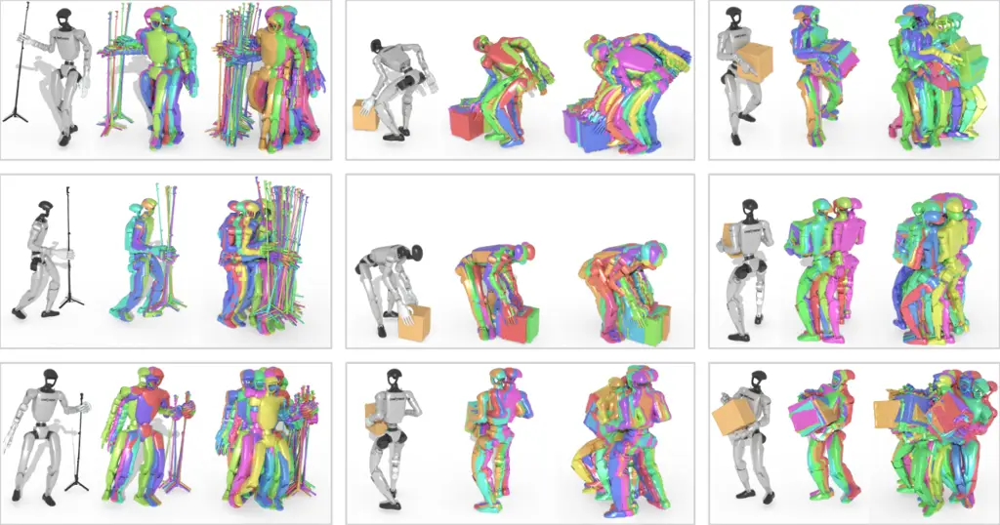

Figure 8: More executable variants. As in Figure 6, for nine further
captures: each group shows the original reference followed by the
verified augmentations accumulated by round 1 and by round 5.

## Appendix E Evaluation metrics

This section defines each metric of Sec. 4.1 once, grouped in the order
of the experiments: data coverage (Figure 3), retargeted references
(Sec. 4.2), tracking (Sec. 4.3), and the augmentation loop (Sec. 4.4).
All compared methods share the same features, thresholds, and frame
rates.

### E.1 Data coverage

The panels of Figure 2 and Figure 3 are computed from the following
features.

Human motion. Each sequence is described by 21 non-finger joint
positions relative to the pelvis, normalized by skeletal height, plus
root displacement, height, and heading. Each channel is resampled to 128
frames and truncated to its first 16 DCT coefficients (1,088
dimensions), and PCA-64 then UMAP-2 gives one point per sequence
(16,059). The feature uses no object information.

Object geometry. Each mesh is sampled with 10,000 surface points,
centered, scaled to the unit sphere, and oriented by its first source
pose, then embedded with a frozen OpenShape PointBERT encoder;
embeddings are averaged over four yaw rotations. PCA and UMAP give one
point per distinct geometry (155). Unit-sphere scaling removes physical
size.

Human-object interaction. The feature concatenates the object position
relative to the pelvis, the wrist positions and surface distances
relative to the object, the wrist separation, and the object height,
translation, and rotation, encoded with the same DCT scheme. Each block
is normalized separately before PCA-64 and UMAP-2.

External coverage. Probes from GRAIL, MOVIN, and ELMO are matched to the
source library in a 73-dimensional body-motion space: PCA-64 of the
pelvis-relative joint DCT features plus nine per-limb repetition
descriptors. A probe is covered when its nearest source sequence lies
within the 75th percentile of the source leave-one-out nearest-neighbor
distance, and coverage averages the three probe sets equally. We compare
the full InterAct, HiPHI, and their union without subsampling.

Scaling. Coverage is computed on nested random subsets of the union and
averaged over 20 orderings; shading marks the 5th–95th percentiles.

### E.2 Retargeted references

These metrics score kinematic references in Table 1 and Table 10. Each
method is evaluated on its own robot model at 30 fps, on the source
clips shared by the compared methods, against the human reference scaled
by the subject’s body scale.

Contact preservation. During human-labeled hand contact, a hand
preserves contact when the minimum distance between its wrist, palm, and
finger meshes and the object mesh is at most 2 cm, with interpenetration
counted as zero. The per-frame variant requires all contacting hands to
be preserved; the per-hand variant counts each hand–frame separately.

In-hand slip. Mean speed of eleven hand keypoints in the object frame
over consecutive contact frames.

Penetration. A frame penetrates when any robot collision geometry is
deeper than 1 cm inside the object (a shared 20-part convex
decomposition). We report their mean maximum depth. Ground penetration
(Gnd.) is the fraction of frames in which any robot collision geometry
is more than 1 cm below the floor.

Foot sliding. A foot is in stance when the human toe moves horizontally
at most 0.15 m/s, and slides when the robot toe then moves faster than
0.15 m/s. We report sliding frames over stance frames. Sliding-frame
speed is the mean robot toe speed over sliding frames.

Fidelity. MPJPE is the pelvis-relative error of twelve landmarks (hips,
knees, ankles, shoulders, elbows, wrists); end-effector error restricts
it to the wrists and ankles.

Smoothness. Absolute second finite difference of joint angles times the
squared frame rate, averaged over frames and joints. Body (29) and
finger (24) joints are reported separately, and the all-joint value
averages over all 53. P95 is the 95th percentile of the same quantity
over all frames and body joints of a clip, averaged over clips.

Joint limits. Fraction of frames with any joint outside its own range
($`10^{-4}`$ rad tolerance). Joint-frame violations count violating
joint–frame pairs instead of frames.

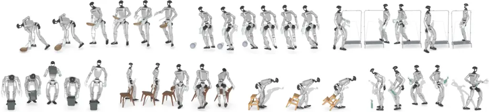

Figure 9: More retargeted interactions on G1 with Inspire hands.

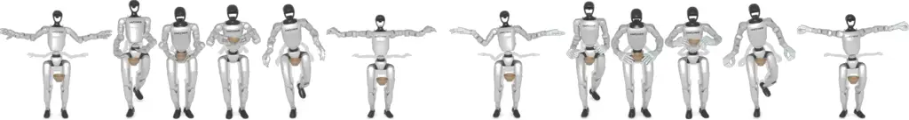

Figure 10: Retargeting with dexterous hands. A bowl-holding interaction
retargeted to G1 with Dex3 (left) and Inspire (right) hands.

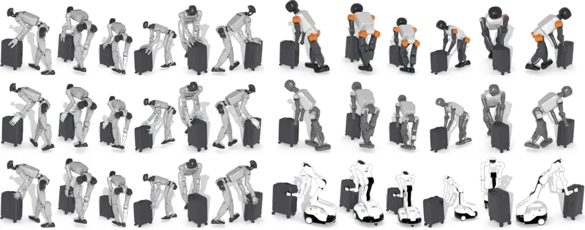

Figure 11: Retargeting across embodiments. One suitcase interaction
retargeted to G1 with Dex3, Inspire, and non-dexterous hands (left, top
to bottom) and to Booster K1, Booster T1, and Dexmate Vega (right, top
to bottom).

### E.3 Tracking

These metrics score the trackers in Table 2. Each benchmark clip is
executed once under the evaluation protocol of Sec. C.2. The benchmark
groups its 15 objects into three categories. Bimanual: OMOMO largebox
and smallbox, BEHAVE boxlarge and suitcase. Sitting: BEHAVE stool, IMHD
chair, and NeuralDome smallsofa. Grasping: OMOMO tripod and largetable,
IMHD dumbbell, InterCap cup, racket, and umbrella, GRAB mug, and
NeuralDome table.

Success rate. A rollout succeeds when it reaches the last reference
frame without triggering a termination condition of Sec. C.2. The
success rate is the fraction of successful clips.

Tracking errors. Errors are computed on successful clips by comparing
each simulated frame with the reference frame of the same index,
excluding the terminal hold frames. MPJPE is the mean world-frame
position error of the 30 body links shared by all three G1 hand
configurations (pelvis, legs, waist, torso, and arms). Object position
error is the error of the object origin, and object rotation error is
the geodesic angle between the simulated and reference orientations.
Per-frame values are averaged within a clip and then across clips.

### E.4 Self-evolution

These metrics score self-evolution in Tables 3, 12, and 11. Object and
body edits are pooled throughout.

Growth. The number of distinct verified references after a given round,
object and body together, divided by the number of original references
of the setting.

Motion quality. Quality is computed on the executed trajectory of each
original reference and of each reference newly accepted in a round, at
50 fps and without the 20 terminal-hold frames, and each motion counts
equally. Body joint acceleration is the mean absolute second finite
difference of the 29 body-joint angles times the squared frame rate.
Foot sliding is the fraction of adjacent frames with foot contact in
which the ankle link moves horizontally faster than 0.15 m/s; unlike
Sec. E.2, contact is taken from the simulation rather than from the
human motion. Hand jitter applies a fourth-order Butterworth high-pass
filter above 6 Hz to pelvis-relative hand positions and reports the 75th
percentile of the root-mean-square over 50-frame windows.

Success before and after self-evolution. Each accepted reference and
each original reference is replayed with the tracker before round 1 and
after round 5, with three rollouts under fixed random seeds and
deterministic actions. A reference counts as executed when at least one
rollout reaches its last frame without triggering a termination
condition of Sec. C.2, and the success rate is the fraction of
references executed.

Yield. In the frozen-tracker ablation, the yield is the fraction of a
round’s rollouts that pass the acceptance checks.

## Appendix F Additional results

Additional tables and figures extend the retargeting, tracking, and loop
comparisons of Sec. 4, and a frozen-tracker ablation isolates the role
of fine-tuning in the loop.

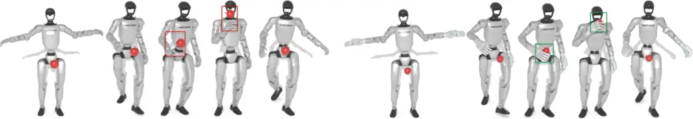

Figure 12: Retargeting comparison with OmniRetarget. OmniRetarget to G1
with rigid hands (left) and our retargeter for G1 with Inspire hands
(right), at corresponding interaction phases. The dexterous hand keeps
the grasp and the hand-object relationship of the demonstration.

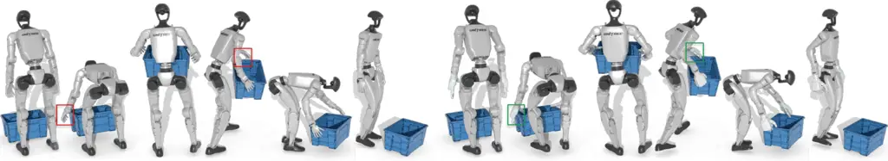

Figure 13: Retargeting comparison with UMR. UMR to G1 (left) and our
retargeter to G1 with Inspire hands (right), at corresponding
interaction phases.

### F.1 Retargeting comparison on G1 with non-dexterous hands

All four retargeters are compared on G1 with non-dexterous hands, using
the 537 OMOMO clips they share (largebox, smallbox, plasticbox, and
suitcase) and the metrics of Sec. E.2. Our entries use the final cleaned
references for every object. Contact preservation uses the supplied
left/right human-hand contact labels, which are positive in 479 clips.
ULTRA produces several variants per source sequence, which we average
before averaging all metrics over source sequences. ULTRA’s variants
have no matching human reference, so their foot-sliding and fidelity
metrics are unavailable.

|                                                   |              |       |       |       |
| ------------------------------------------------- | ------------ | ----- | ----- | ----- |
| Metric                                            | OmniRetarget | UMR   | ULTRA | Ours  |
| Contact preservation                              |              |       |       |       |
|    Hand contact preservation (%) $`\uparrow`$     | 79.09        | 95.13 | 79.06 | 83.45 |
| Penetration ($`>1`$ cm)                           |              |       |       |       |
|    Robot–object depth (cm) $`\downarrow`$         | 1.27         | 1.60  | 1.49  | 1.97  |
| Foot sliding (0.15 m/s)                           |              |       |       |       |
|    Sliding frames (%) $`\downarrow`$              | 0.00         | 7.02  | N/A   | 7.33  |
|    Sliding-frame speed (m/s) $`\downarrow`$       | –            | 0.22  | N/A   | 0.26  |
| Fidelity to human                                 |              |       |       |       |
|    MPJPE (cm) $`\downarrow`$                      | 5.55         | 6.70  | N/A   | 5.62  |
|    End-effector error (cm) $`\downarrow`$         | 6.36         | 7.92  | N/A   | 5.86  |
| Smoothness                                        |              |       |       |       |
|    Body joint acc. (rad/s²) $`\downarrow`$        | 6.65         | 6.11  | 10.54 | 2.54  |
|    Body joint acc., P95 (rad/s²) $`\downarrow`$   | 23.19        | 21.97 | 37.29 | 8.96  |
| Joint limits                                      |              |       |       |       |
|    Body violation frames (%) $`\downarrow`$       | 0.00         | 0.00  | 1.04  | 0.00  |
|    Body joint-frame violations (%) $`\downarrow`$ | 0.00         | 0.00  | 0.04  | 0.00  |

Table 10: Retargeting on G1 with non-dexterous hands, over the 537 OMOMO
clips shared by all four methods. A dash denotes no qualifying event and
N/A an unavailable metric; bold marks the unique best.

With rigid hands, each method favors a different trade-off. Table 10
shows no single winner between fidelity, geometric constraints, and
smoothness. Our references are by far the smoothest and the most
accurate at the end effectors, OmniRetarget penetrates the object least,
and UMR preserves the most hand contact. Rigid hands cannot close around
an object, so contact and penetration trade off directly. This is the
gap our dexterous retargeting addresses: with articulated fingers, our
references keep the grasp and hand–object relationship of the
demonstration (Figures 12 and 13).

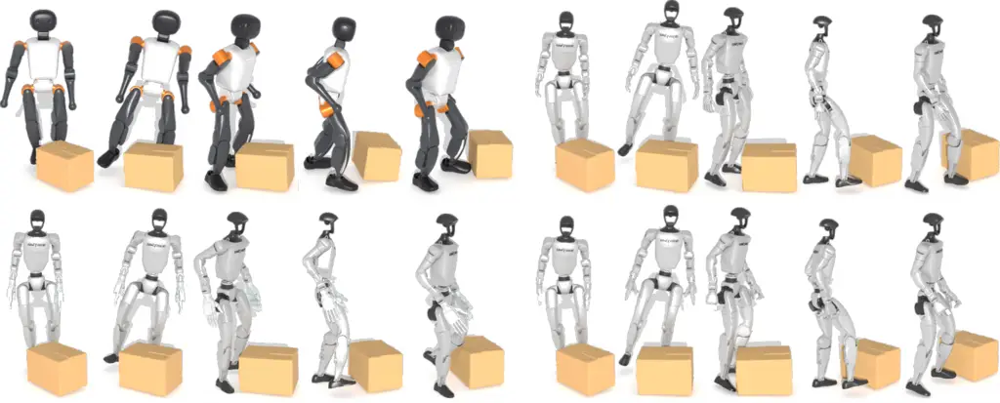

Figure 14: Physics-based tracking across embodiments. A box-lifting
reference executed by specialist trackers on Booster K1 (top left), G1
with non-dexterous hands (top right), G1 with Inspire hands (bottom
left), and G1 with Dex3 hands (bottom right).

### F.2 Ablation on learning in the loop

More sampling cannot replace learning. A fixed tracker can only filter
candidates it already executes, and after the first round it has nothing
left to filter. Because the base tracker fails on many accepted
references (Table 3), a simpler alternative to fine-tuning would keep
the tracker fixed, sample more rollouts, and keep those that pass.
Table 11 tests this alternative in a separate run on a subset of the
bimanual seeds. In the first round, both trackers execute the same
candidates with the same checkpoint, so their yields are similar. From
the second round on, the frozen tracker accepts almost nothing, because
the new candidates start from first-round successes that already lie
beyond its reach, and its growth stalls. The fine-tuned tracker keeps a
high yield in rounds 2 and 3, so its verified references keep growing.

|       |           |       |            |       |
| ----- | --------- | ----- | ---------- | ----- |
|       | Yield (%) |       | Growth (×) |       |
| Round | Frozen    | Tuned | Frozen     | Tuned |
| 1     | 29.4      | 25.3  | 163.0      | 188.5 |
| 2     | 0.4       | 72.9  | 170.5      | 426.0 |
| 3     | 0.4       | 68.9  | 184.9      | 573.0 |

Table 11: Frozen versus fine-tuned tracker in a separate run on a subset
of the bimanual seeds with translation edits, whose counts are not
directly comparable with Table 3. Yield and growth follow Sec. E.4. The
frozen run stops after round 3.

### F.3 Self-evolution by round

The reference set grows every round, while quality measures rise
moderately. Table 12 extends Table 3 to every round. Growth is measured
on the cumulative set of verified references, and quality on the
references newly accepted in each round. The verified set grows in every
round in all three settings. All three quality measures rise in later
rounds, most clearly foot sliding; later rounds, however, accept edits
farther from the captures and a different mix of object and body edits,
so the trend reflects harder motions as well as execution quality.
Success rates are measured only before and after self-evolution and
appear in Table 3.

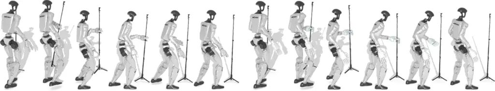

Figure 15: Physics-based tracking with dexterous hands. A tripod grasp
executed on G1 with Dex3 (left) and Inspire (right) hands.

|       |                   |      |      |      |                |      |      |      |                   |      |      |      |
| ----- | ----------------- | ---- | ---- | ---- | -------------- | ---- | ---- | ---- | ----------------- | ---- | ---- | ---- |
|       | Inspire, bimanual |      |      |      | Dex3, bimanual |      |      |      | Inspire, grasping |      |      |      |
| Round | Growth            | Acc. | Foot | Hand | Growth         | Acc. | Foot | Hand | Growth            | Acc. | Foot | Hand |
| Orig. | 1.0               | 11.4 | 1.18 | 1.00 | 1.0            | 13.9 | 1.14 | 1.12 | 1.0               | 13.6 | 0.70 | 0.96 |
| 1     | 21.8              | 11.8 | 1.39 | 1.07 | 21.3           | 15.6 | 1.59 | 1.25 | 19.6              | 15.3 | 0.99 | 1.07 |
| 2     | 34.8              | 11.3 | 1.39 | 1.09 | 31.6           | 14.8 | 1.77 | 1.23 | 33.3              | 14.4 | 1.42 | 1.09 |
| 3     | 80.4              | 12.1 | 1.63 | 1.16 | 73.3           | 14.9 | 1.87 | 1.24 | 77.8              | 14.6 | 1.78 | 1.08 |
| 4     | 118.1             | 12.9 | 2.14 | 1.22 | 110.8          | 16.4 | 2.41 | 1.33 | 112.8             | 15.7 | 2.42 | 1.16 |
| 5     | 150.5             | 13.2 | 2.37 | 1.24 | 142.0          | 17.4 | 2.99 | 1.38 | 146.4             | 16.4 | 2.87 | 1.26 |

Table 12: Self-evolution by round, extending Table 3. Growth (×):
cumulative verified references relative to the original references.
Quality of the original references (Orig.) and of the references newly
accepted in each round: body joint acceleration (Acc., rad/s²), foot
sliding (Foot, %), and hand jitter (Hand, mm).

### F.4 Body-motion range of augmented references

Body edits move references farther from their seed than scene scaling
does. Figure 16 compares how far augmented references depart from their
seed in body motion, on the bimanual seeds shared by both methods. Our
body edits spread over a region several times wider than ULTRA’s
scene-scaling variants, and mostly along directions that scaling does
not vary.

## Appendix G Hardware and real-world deployment

Deployment for Unitree G1. Experiments are performed on a Unitree G1
humanoid with 29 DOFs (six per leg, three at the waist, and seven per
arm), running robot firmware version 1.5.4. The policy is executed on a
laptop with an NVIDIA RTX 5090 Laptop GPU and communicates over Ethernet
through Unitree’s SDK. We use SONIC (Luo et al., 2026) as the low-level
whole-body controller: it takes the reference motion at 50 Hz, which is
tracked by the onboard joint-level PD controllers at 500 Hz, using
SONIC’s default per-joint PD gains. On top of these, stiffness and
damping scales of 1.5 are applied to the two ankle pitch motors; a
constant 1 degree pitch offset is further added to the measured pelvis
IMU orientation to account for the calibration bias of the robot’s own
IMU.

Figure 16: Body-motion variation around shared seeds. Each reference is
embedded by the DCT coefficients of its body joint angles, taken
relative to its seed and projected with PCA, so all seeds sit at the
origin. Ellipses enclose 95% of a Gaussian fit.

Deployment for Unitree G1 with Inspire dexterous hands. For tasks that
require dexterous manipulation, we equip Unitree G1 with two Inspire
RH56DFTP dexterous hands, each with six actuated DOFs, plus six mimic
joints. The humanoid body is controlled by SONIC as described above,
while the hands directly replay the finger trajectory of the rollout
motion. For the synchronization, the body deployment publishes its
current playback frame, and a separate process sends the hand pose for
that frame to the robot at about 12 Hz. Notably, we initiate the thumb
motion first, followed by the motion of the other four fingers.

Deployment for Booster K1. Experiments are performed on a Booster K1
humanoid with 22 DOFs (six per leg, four per arm, and two at the head).
For policy training, we build on Booster Train
([https://github.com/BoosterRobotics/booster_train](https://github.com/BoosterRobotics/booster_train)),
extending it with object-interaction tracking and targeted domain
randomization. We use an asymmetric actor-critic formulation, with
privileged object and contact information provided only to the critic
during training. Robot and object dynamics are randomized, including
ground friction, object mass, center of mass, object placement, actuator
properties, and external perturbations, while preserving close tracking
of the reference body and object motion. For real-world execution,
policies are deployed using Booster Deploy
([https://github.com/BoosterRobotics/booster_deploy](https://github.com/BoosterRobotics/booster_deploy)).

Deployment for Dexmate Vega. Experiments are performed on a Dexmate
Vega-1 Pro, a bimanual mobile manipulator with 23 DOFs (three at the
torso, seven per arm, three at the head, and three DOFs at the
omnidirectional wheeled base). Since the wheeled base is stable and
agile, no whole-body controller from RL is needed. Retargeted upper-body
joint trajectories are sent directly to the onboard joint controllers
through Dexmate’s dexcontrol SDK (v0.5.0). Notably, due to the torso
joint speed limit, all trajectories are uniformly time-scaled by
$`0.3\times`$ speed during deployment. Base motion is converted to wheel
commands by solving the chassis inverse kinematics using trajectory
optimization, formulated in CasADi (Andersson et al., 2019) and solved
with IPOPT (Wächter and Biegler, 2006). The solver penalizes position,
yaw, terminal-pose tracking errors, and regularizes body acceleration,
steering rate and acceleration, and wheel acceleration. All commands are
streamed at 100 Hz.

## Appendix H Limitations

The loop varies how an interaction is realized, so it densifies coverage
around each demonstration without creating new task semantics. Iterative
selection may also favor easier objects or compound reference errors.
